# Schema docs


<details>
<summary>The whole schema as SQL</summary>

```sql
CREATE SCHEMA IF NOT EXISTS "public";

CREATE TYPE "SsoConnectionMigrationPhase" AS ENUM ('SETUP', 'GRACE_LEGACY', 'GRACE_DIRECT', 'FINALIZING', 'FINALIZED');

CREATE TYPE "TeamUserRole" AS ENUM ('ADMIN', 'MEMBER', 'VIEWER', 'CUSTOM');

CREATE TYPE "RoleBindingScopeType" AS ENUM ('ORGANIZATION', 'TEAM', 'PROJECT');

CREATE TYPE "GrantScopeType" AS ENUM ('ORGANIZATION', 'TEAM', 'PROJECT', 'RESOURCE', 'PLATFORM');

CREATE TYPE "GrantPrincipalType" AS ENUM ('USER', 'API_KEY', 'GROUP', 'TEAM', 'ORGANIZATION', 'PROJECT', 'ANYONE');

CREATE TYPE "OrganizationUserRole" AS ENUM ('ADMIN', 'MEMBER', 'EXTERNAL', 'DEVELOPER');

CREATE TYPE "IssuedLicenseSource" AS ENUM ('BACKOFFICE', 'PURCHASE', 'SCRIPT', 'LEGACY_IMPORT');

CREATE TYPE "ConnectedCreditGrantKind" AS ENUM ('commit', 'added', 'renewal');

CREATE TYPE "ConnectedInvoiceKind" AS ENUM ('annual', 'seat_change', 'usage');

CREATE TYPE "PlanTypes" AS ENUM ('FREE', 'PRO', 'GROWTH', 'GROWTH_SEAT_EUR_MONTHLY', 'GROWTH_SEAT_EUR_ANNUAL', 'GROWTH_SEAT_USD_MONTHLY', 'GROWTH_SEAT_USD_ANNUAL', 'ENTERPRISE', 'LAUNCH', 'ACCELERATE', 'LAUNCH_ANNUAL', 'ACCELERATE_ANNUAL');

CREATE TYPE "PricingModel" AS ENUM ('TIERED', 'SEAT_EVENT');

CREATE TYPE "OrganizationIntent" AS ENUM ('AGENT_GOVERNANCE', 'LLM_OPS');

CREATE TYPE "SubscriptionStatus" AS ENUM ('PENDING', 'FAILED', 'ACTIVE', 'CANCELLED');

CREATE TYPE "Currency" AS ENUM ('USD', 'EUR');

CREATE TYPE "INVITE_STATUS" AS ENUM ('PENDING', 'ACCEPTED', 'WAITING_APPROVAL', 'PAYMENT_PENDING', 'REVOKED');

CREATE TYPE "EvaluationExecutionMode" AS ENUM ('ON_MESSAGE', 'AS_GUARDRAIL', 'MANUALLY');

CREATE TYPE "CostType" AS ENUM ('TRACE_CHECK', 'GUARDRAIL', 'CLUSTERING', 'BATCH_EVALUATION');

CREATE TYPE "CostReferenceType" AS ENUM ('CHECK', 'TRACE', 'PROJECT', 'BATCH');

CREATE TYPE "DashboardScope" AS ENUM ('PRIVATE', 'PROJECT', 'ORGANIZATION');

CREATE TYPE "TriggerAction" AS ENUM ('SEND_EMAIL', 'ADD_TO_DATASET', 'ADD_TO_ANNOTATION_QUEUE', 'SEND_SLACK_MESSAGE', 'SEND_WEBHOOK');

CREATE TYPE "TriggerKind" AS ENUM ('AUTOMATION', 'ALERT', 'REPORT');

CREATE TYPE "AlertType" AS ENUM ('CRITICAL', 'WARNING', 'INFO');

CREATE TYPE "SlackIntegrationScopeType" AS ENUM ('ORGANIZATION', 'PROJECT');

CREATE TYPE "SlackIntegrationKind" AS ENUM ('BOT', 'INCOMING_WEBHOOK');

CREATE TYPE "WebhookDeliveryOutcome" AS ENUM ('success', 'retryable', 'terminal', 'pending');

CREATE TYPE "WebhookDestinationKind" AS ENUM ('http', 'sqs');

CREATE TYPE "WebhookEndpointStatus" AS ENUM ('ACTIVE', 'DISABLED');

CREATE TYPE "WebhookDeliveryChannel" AS ENUM ('platform', 'automations');

CREATE TYPE "ExperimentType" AS ENUM ('DSPY', 'BATCH_EVALUATION', 'BATCH_EVALUATION_V2', 'EVALUATIONS_V3');

CREATE TYPE "ModelProviderScopeType" AS ENUM ('ORGANIZATION', 'TEAM', 'PROJECT');

CREATE TYPE "ModelDefaultScopeType" AS ENUM ('ORGANIZATION', 'TEAM', 'PROJECT');

CREATE TYPE "LangyProjectionTitleSource" AS ENUM ('derived', 'auto', 'user');

CREATE TYPE "AnnotationScoreDataType" AS ENUM ('CATEGORICAL', 'BOOLEAN', 'LIKERT', 'OPTION', 'CHECKBOX');

CREATE TYPE "ShareResourceType" AS ENUM ('TRACE', 'THREAD');

CREATE TYPE "ShareVisibility" AS ENUM ('PUBLIC', 'ORGANIZATION', 'PROJECT');

CREATE TYPE "PinSource" AS ENUM ('manual', 'share');

CREATE TYPE "RetentionPolicyScopeType" AS ENUM ('ORGANIZATION', 'TEAM', 'PROJECT');

CREATE TYPE "DataPrivacyScopeType" AS ENUM ('ORGANIZATION', 'DEPARTMENT', 'TEAM', 'PROJECT');

CREATE TYPE "CustomLLMModelCostScopeType" AS ENUM ('ORGANIZATION', 'TEAM', 'PROJECT');

CREATE TYPE "PromptScope" AS ENUM ('ORGANIZATION', 'PROJECT');

CREATE TYPE "VirtualKeyStatus" AS ENUM ('ACTIVE', 'DISABLED', 'REVOKED');

CREATE TYPE "VirtualKeyPurpose" AS ENUM ('USER', 'LANGY', 'CONNECT');

CREATE TYPE "GatewayProviderRotationPolicy" AS ENUM ('MANUAL');

CREATE TYPE "GatewayProviderHealthStatus" AS ENUM ('UNKNOWN', 'HEALTHY', 'DEGRADED', 'CIRCUIT_OPEN');

CREATE TYPE "GatewayBudgetScopeType" AS ENUM ('ORGANIZATION', 'TEAM', 'PROJECT', 'VIRTUAL_KEY', 'PRINCIPAL', 'GROUP', 'ATTRIBUTED_USER');

CREATE TYPE "GatewayBudgetWindow" AS ENUM ('MINUTE', 'HOUR', 'DAY', 'WEEK', 'MONTH', 'TOTAL', 'MANUAL');

CREATE TYPE "GatewayBudgetBreachAction" AS ENUM ('BLOCK', 'WARN');

CREATE TYPE "GatewayBudgetLedgerStatus" AS ENUM ('SUCCESS', 'PROVIDER_ERROR', 'BLOCKED_BY_GUARDRAIL', 'CANCELLED');

CREATE TYPE "GatewayChangeEventKind" AS ENUM ('VK_CREATED', 'VK_CONFIG_UPDATED', 'VK_REVOKED', 'VK_ROTATED', 'VK_DISABLED', 'VK_ENABLED', 'BUDGET_CREATED', 'BUDGET_UPDATED', 'BUDGET_DELETED', 'MODEL_PROVIDER_UPDATED', 'CACHE_RULE_CREATED', 'CACHE_RULE_UPDATED', 'CACHE_RULE_DELETED', 'ROUTING_POLICY_UPDATED', 'ROUTING_POLICY_DELETED');

CREATE TYPE "GatewayCacheRuleMode" AS ENUM ('RESPECT', 'FORCE', 'DISABLE');

CREATE TYPE "VirtualKeyRoutingMode" AS ENUM ('NONE', 'FALLBACK_ALL', 'POLICY');

CREATE TYPE "VirtualKeyScopeType" AS ENUM ('ORGANIZATION', 'TEAM', 'PROJECT');

CREATE TYPE "RoutingPolicyScopeType" AS ENUM ('ORGANIZATION', 'TEAM', 'PROJECT');

CREATE TYPE "GatewayGuardrailDirection" AS ENUM ('PRE', 'POST', 'STREAM_CHUNK');

CREATE TYPE "GatewayGuardrailFailureMode" AS ENUM ('FAIL_OPEN', 'FAIL_CLOSED');

CREATE TYPE "FeatureFlagExperimentSubjectType" AS ENUM ('USER', 'ORGANIZATION', 'PROJECT');

CREATE TYPE "ProcessManagerOutboxStatus" AS ENUM ('pending', 'dispatched', 'dead', 'discarded');

CREATE TYPE "ProcessManagerOutboxAttemptOutcome" AS ENUM ('retry_scheduled', 'dead');

CREATE TYPE "GatewayRealtimeSessionStatus" AS ENUM ('OPEN', 'CLOSED', 'FAILED', 'EXPIRED');

CREATE TYPE "ConnectedSeatChangeState" AS ENUM ('intent', 'invoiced', 'nothing_to_invoice', 'not_onboarded');

CREATE TABLE "Account" (
    "id" TEXT NOT NULL,
    "userId" TEXT NOT NULL,
    "type" TEXT NOT NULL DEFAULT 'oauth',
    "provider" TEXT NOT NULL,
    "issuer" TEXT,
    "providerAccountId" TEXT NOT NULL,
    "refresh_token" TEXT,
    "access_token" TEXT,
    "expires_at" TIMESTAMP(3),
    "ext_expires_in" INTEGER,
    "token_type" TEXT,
    "scope" TEXT,
    "id_token" TEXT,
    "session_state" TEXT,
    "password" TEXT,
    "createdAt" TIMESTAMP(3) NOT NULL DEFAULT CURRENT_TIMESTAMP,
    "updatedAt" TIMESTAMP(3) NOT NULL DEFAULT CURRENT_TIMESTAMP,

    CONSTRAINT "Account_pkey" PRIMARY KEY ("id")
);

CREATE TABLE "AccountCredential" (
    "id" TEXT NOT NULL,
    "userId" TEXT NOT NULL,
    "provider" TEXT NOT NULL,
    "password" TEXT,
    "accessToken" TEXT,
    "refreshToken" TEXT,
    "idToken" TEXT,
    "accessTokenExpiresAt" TIMESTAMP(3),
    "refreshTokenExpiresAt" TIMESTAMP(3),
    "scope" TEXT,
    "createdAt" TIMESTAMP(3) NOT NULL DEFAULT CURRENT_TIMESTAMP,
    "updatedAt" TIMESTAMP(3) NOT NULL DEFAULT CURRENT_TIMESTAMP,

    CONSTRAINT "AccountCredential_pkey" PRIMARY KEY ("id")
);

CREATE TABLE "Session" (
    "id" TEXT NOT NULL,
    "sessionToken" TEXT NOT NULL,
    "userId" TEXT NOT NULL,
    "expires" TIMESTAMP(3) NOT NULL,
    "ipAddress" TEXT,
    "userAgent" TEXT,
    "identifierId" TEXT,
    "amr" TEXT[] DEFAULT ARRAY[]::TEXT[],
    "startedBySignUp" BOOLEAN NOT NULL DEFAULT false,
    "impersonating" JSONB,
    "actorUserId" TEXT,
    "subjectUserId" TEXT,
    "impersonationReason" TEXT,
    "impersonationExpiresAt" TIMESTAMP(3),
    "lastSeenAt" TIMESTAMP(3),
    "createdAt" TIMESTAMP(3) NOT NULL DEFAULT CURRENT_TIMESTAMP,
    "updatedAt" TIMESTAMP(3) NOT NULL DEFAULT CURRENT_TIMESTAMP,

    CONSTRAINT "Session_pkey" PRIMARY KEY ("id")
);

CREATE TABLE "UserErasure" (
    "id" TEXT NOT NULL,
    "accountCreatedAt" TIMESTAMP(3) NOT NULL,
    "erasedAt" TIMESTAMP(3) NOT NULL DEFAULT CURRENT_TIMESTAMP,

    CONSTRAINT "UserErasure_pkey" PRIMARY KEY ("id")
);

CREATE TABLE "User" (
    "id" TEXT NOT NULL,
    "name" TEXT,
    "email" TEXT,
    "emailVerified" BOOLEAN NOT NULL DEFAULT false,
    "signupConfirmationPending" BOOLEAN NOT NULL DEFAULT false,
    "passkeySignupClaimHash" TEXT,
    "image" TEXT,
    "pendingSsoSetup" BOOLEAN NOT NULL DEFAULT false,
    "userHashKey" TEXT,
    "twoFactorEnabled" BOOLEAN NOT NULL DEFAULT false,
    "createdAt" TIMESTAMP(3) NOT NULL DEFAULT CURRENT_TIMESTAMP,
    "updatedAt" TIMESTAMP(3) NOT NULL DEFAULT CURRENT_TIMESTAMP,
    "lastLoginAt" TIMESTAMP(3),
    "deactivatedAt" TIMESTAMP(3),
    "lastHomePath" TEXT,
    "tracesExplorerTourDismissedAt" TIMESTAMP(3),
    "langyCodeAccessPreference" TEXT,
    "passkeyNudgeDismissedAt" TIMESTAMP(3),
    "joinOfferDismissedDomains" TEXT[] DEFAULT ARRAY[]::TEXT[],
    "notificationPreferences" JSONB NOT NULL DEFAULT '{}',
    "passwordResetRequiredAt" TIMESTAMP(3),

    CONSTRAINT "User_pkey" PRIMARY KEY ("id")
);

CREATE TABLE "VerificationToken" (
    "id" TEXT NOT NULL,
    "identifier" TEXT NOT NULL,
    "token" TEXT NOT NULL,
    "expires" TIMESTAMP(3) NOT NULL,
    "createdAt" TIMESTAMP(3) NOT NULL DEFAULT CURRENT_TIMESTAMP,
    "updatedAt" TIMESTAMP(3) NOT NULL DEFAULT CURRENT_TIMESTAMP,

    CONSTRAINT "VerificationToken_pkey" PRIMARY KEY ("id")
);

CREATE TABLE "Identifier" (
    "id" TEXT NOT NULL,
    "userId" TEXT NOT NULL,
    "provider" TEXT NOT NULL,
    "value" TEXT,
    "domain" TEXT,
    "identifierHash" TEXT,
    "accountId" TEXT,
    "providerId" TEXT,
    "issuer" TEXT,
    "providerAccountId" TEXT,
    "state" TEXT NOT NULL,
    "connectionId" TEXT,
    "verifiedAt" TIMESTAMP(3),
    "attachedAt" TIMESTAMP(3) NOT NULL,
    "detachedAt" TIMESTAMP(3),
    "lastUsedAt" TIMESTAMP(3),
    "createdAt" TIMESTAMP(3) NOT NULL DEFAULT CURRENT_TIMESTAMP,
    "updatedAt" TIMESTAMP(3) NOT NULL DEFAULT CURRENT_TIMESTAMP,

    CONSTRAINT "Identifier_pkey" PRIMARY KEY ("id")
);

CREATE TABLE "IdentitySignInSwitch" (
    "userId" TEXT NOT NULL,
    "onIdentifiers" BOOLEAN NOT NULL,
    "pinned" BOOLEAN NOT NULL DEFAULT false,
    "switchedAt" TIMESTAMP(3) NOT NULL,
    "lastAppliedEventId" TEXT,
    "updatedAt" TIMESTAMP(3) NOT NULL DEFAULT CURRENT_TIMESTAMP,

    CONSTRAINT "IdentitySignInSwitch_pkey" PRIMARY KEY ("userId")
);

CREATE TABLE "IdentifierReservation" (
    "normalizedValue" TEXT NOT NULL,
    "userId" TEXT NOT NULL,
    "identifierId" TEXT NOT NULL,
    "commandId" TEXT NOT NULL,
    "createdAt" TIMESTAMP(3) NOT NULL DEFAULT CURRENT_TIMESTAMP,

    CONSTRAINT "IdentifierReservation_pkey" PRIMARY KEY ("normalizedValue")
);

CREATE TABLE "IdentityProjectionCursor" (
    "userId" TEXT NOT NULL,
    "lastEventId" TEXT NOT NULL,
    "acceptedAt" TIMESTAMP(3) NOT NULL,
    "occurredAt" TIMESTAMP(3) NOT NULL,
    "projectionVersion" TEXT NOT NULL,
    "createdAt" TIMESTAMP(3) NOT NULL DEFAULT CURRENT_TIMESTAMP,
    "updatedAt" TIMESTAMP(3) NOT NULL DEFAULT CURRENT_TIMESTAMP,

    CONSTRAINT "IdentityProjectionCursor_pkey" PRIMARY KEY ("userId")
);

CREATE TABLE "TwoFactor" (
    "id" TEXT NOT NULL,
    "userId" TEXT NOT NULL,
    "secret" TEXT NOT NULL,
    "backupCodes" TEXT NOT NULL,
    "verified" BOOLEAN NOT NULL DEFAULT true,
    "failedVerificationCount" INTEGER NOT NULL DEFAULT 0,
    "lockedUntil" TIMESTAMP(3),
    "createdAt" TIMESTAMP(3) NOT NULL DEFAULT CURRENT_TIMESTAMP,
    "updatedAt" TIMESTAMP(3) NOT NULL DEFAULT CURRENT_TIMESTAMP,

    CONSTRAINT "TwoFactor_pkey" PRIMARY KEY ("id")
);

CREATE TABLE "SignInAttemptLock" (
    "id" TEXT NOT NULL,
    "identifierHash" TEXT NOT NULL,
    "failedCount" INTEGER NOT NULL DEFAULT 0,
    "lockedUntil" TIMESTAMP(3),
    "consecutiveLockouts" INTEGER NOT NULL DEFAULT 0,
    "heldForReview" BOOLEAN NOT NULL DEFAULT false,
    "userId" TEXT,
    "createdAt" TIMESTAMP(3) NOT NULL DEFAULT CURRENT_TIMESTAMP,
    "updatedAt" TIMESTAMP(3) NOT NULL DEFAULT CURRENT_TIMESTAMP,

    CONSTRAINT "SignInAttemptLock_pkey" PRIMARY KEY ("id")
);

CREATE TABLE "Passkey" (
    "id" TEXT NOT NULL,
    "name" TEXT,
    "publicKey" TEXT NOT NULL,
    "userId" TEXT NOT NULL,
    "credentialID" TEXT NOT NULL,
    "counter" INTEGER NOT NULL DEFAULT 0,
    "deviceType" TEXT NOT NULL,
    "backedUp" BOOLEAN NOT NULL DEFAULT false,
    "transports" TEXT,
    "aaguid" TEXT,
    "createdAt" TIMESTAMP(3) NOT NULL DEFAULT CURRENT_TIMESTAMP,
    "updatedAt" TIMESTAMP(3) NOT NULL DEFAULT CURRENT_TIMESTAMP,

    CONSTRAINT "Passkey_pkey" PRIMARY KEY ("id")
);

CREATE TABLE "MfaEnrollment" (
    "userId" TEXT NOT NULL,
    "enrollmentId" TEXT,
    "method" TEXT,
    "state" TEXT NOT NULL,
    "enrolledAt" TIMESTAMP(3),
    "confirmedAt" TIMESTAMP(3),
    "expiredAt" TIMESTAMP(3),
    "disabledAt" TIMESTAMP(3),
    "disabledVia" TEXT,
    "backupCodeCount" INTEGER NOT NULL DEFAULT 0,
    "consumedBackupCodeIndexes" INTEGER[] DEFAULT ARRAY[]::INTEGER[],
    "failedCount" INTEGER NOT NULL DEFAULT 0,
    "occurredAt" TIMESTAMP(3) NOT NULL,
    "lastEventId" TEXT NOT NULL,
    "acceptedAt" TIMESTAMP(3) NOT NULL,
    "projectionVersion" TEXT NOT NULL,
    "createdAt" TIMESTAMP(3) NOT NULL DEFAULT CURRENT_TIMESTAMP,
    "updatedAt" TIMESTAMP(3) NOT NULL DEFAULT CURRENT_TIMESTAMP,

    CONSTRAINT "MfaEnrollment_pkey" PRIMARY KEY ("userId")
);

CREATE TABLE "SsoConnection" (
    "id" TEXT NOT NULL,
    "organizationId" TEXT NOT NULL,
    "type" TEXT NOT NULL,
    "state" TEXT NOT NULL,
    "claimedDomains" TEXT[],
    "domainClaims" JSONB NOT NULL DEFAULT '[]',
    "approvedDomains" TEXT[],
    "verifiedDomains" TEXT[],
    "lapsedDomains" TEXT[],
    "domainVerifications" JSONB NOT NULL DEFAULT '[]',
    "pendingVerification" JSONB,
    "idpMetadata" JSONB NOT NULL,
    "arrivalPolicy" TEXT NOT NULL DEFAULT 'refuse',
    "allowsJit" BOOLEAN NOT NULL DEFAULT false,
    "arrivalPolicyDecidedAt" TIMESTAMP(3),
    "source" TEXT NOT NULL,
    "testLoginAccountId" TEXT,
    "replacesConnectionId" TEXT,
    "migrationPhase" "SsoConnectionMigrationPhase",
    "graceStartedAt" TIMESTAMP(3),
    "routeChangedAt" TIMESTAMP(3),
    "finalizationRequestedAt" TIMESTAMP(3),
    "finalizedAt" TIMESTAMP(3),
    "rejection" JSONB,
    "createdBy" TEXT,
    "tearDownAfter" TIMESTAMP(3),
    "occurredAt" TIMESTAMP(3) NOT NULL,
    "lastEventId" TEXT NOT NULL,
    "acceptedAt" TIMESTAMP(3) NOT NULL,
    "projectionVersion" TEXT NOT NULL,
    "createdAt" TIMESTAMP(3) NOT NULL,
    "updatedAt" TIMESTAMP(3) NOT NULL,

    CONSTRAINT "SsoConnection_pkey" PRIMARY KEY ("id")
);

CREATE TABLE "SsoConnectionRegistrationSlot" (
    "organizationId" TEXT NOT NULL,
    "kind" TEXT NOT NULL,
    "connectionId" TEXT NOT NULL,
    "replacesConnectionId" TEXT,
    "commandId" TEXT NOT NULL,
    "createdAt" TIMESTAMP(3) NOT NULL DEFAULT CURRENT_TIMESTAMP,
    "updatedAt" TIMESTAMP(3) NOT NULL DEFAULT CURRENT_TIMESTAMP,

    CONSTRAINT "SsoConnectionRegistrationSlot_pkey" PRIMARY KEY ("organizationId","kind")
);

CREATE TABLE "SsoConnectionReproofCursor" (
    "connectionId" TEXT NOT NULL,
    "lastReproofAt" TIMESTAMP(3) NOT NULL,

    CONSTRAINT "SsoConnectionReproofCursor_pkey" PRIMARY KEY ("connectionId")
);

CREATE TABLE "SsoCredential" (
    "id" TEXT NOT NULL,
    "organizationId" TEXT NOT NULL,
    "connectionId" TEXT NOT NULL,
    "kind" TEXT NOT NULL,
    "ciphertext" TEXT NOT NULL,
    "createdAt" TIMESTAMP(3) NOT NULL DEFAULT CURRENT_TIMESTAMP,
    "updatedAt" TIMESTAMP(3) NOT NULL,

    CONSTRAINT "SsoCredential_pkey" PRIMARY KEY ("id")
);

CREATE TABLE "SsoVerifiedDomain" (
    "domain" TEXT NOT NULL,
    "organizationId" TEXT NOT NULL,

    CONSTRAINT "SsoVerifiedDomain_pkey" PRIMARY KEY ("domain")
);

CREATE TABLE "SsoVerifiedDomainHolder" (
    "domain" TEXT NOT NULL,
    "connectionId" TEXT NOT NULL,
    "organizationId" TEXT NOT NULL,

    CONSTRAINT "SsoVerifiedDomainHolder_pkey" PRIMARY KEY ("domain","connectionId")
);

CREATE TABLE "SsoAuthenticationActivity" (
    "id" TEXT NOT NULL,
    "organizationId" TEXT NOT NULL,
    "connectionId" TEXT NOT NULL,
    "userId" TEXT NOT NULL,
    "authenticatedAt" TIMESTAMP(3) NOT NULL,
    "providerAccountId" TEXT,

    CONSTRAINT "SsoAuthenticationActivity_pkey" PRIMARY KEY ("id")
);

CREATE TABLE "SsoProvider" (
    "id" TEXT NOT NULL,
    "issuer" TEXT NOT NULL,
    "oidcConfig" TEXT,
    "samlConfig" TEXT,
    "userId" TEXT,
    "providerId" TEXT NOT NULL,
    "organizationId" TEXT,
    "domain" TEXT NOT NULL,

    CONSTRAINT "SsoProvider_pkey" PRIMARY KEY ("id")
);

CREATE TABLE "SsoBreakGlassBinding" (
    "id" TEXT NOT NULL,
    "organizationId" TEXT NOT NULL,
    "userId" TEXT NOT NULL,
    "grantedByUserId" TEXT NOT NULL,
    "grantedAt" TIMESTAMP(3) NOT NULL,
    "expiresAt" TIMESTAMP(3) NOT NULL,
    "supersededAt" TIMESTAMP(3),
    "renewedFromId" TEXT,
    "warnedDays" INTEGER[],
    "createdAt" TIMESTAMP(3) NOT NULL DEFAULT CURRENT_TIMESTAMP,

    CONSTRAINT "SsoBreakGlassBinding_pkey" PRIMARY KEY ("id")
);

CREATE TABLE "SsoActivationRecoveryReservation" (
    "commandId" TEXT NOT NULL,
    "organizationId" TEXT NOT NULL,
    "connectionId" TEXT NOT NULL,
    "createdAt" TIMESTAMP(3) NOT NULL,

    CONSTRAINT "SsoActivationRecoveryReservation_pkey" PRIMARY KEY ("commandId")
);

CREATE TABLE "JoinRequest" (
    "id" TEXT NOT NULL,
    "userId" TEXT NOT NULL,
    "organizationId" TEXT NOT NULL,
    "domain" TEXT NOT NULL,
    "state" TEXT NOT NULL,
    "matchedVia" TEXT NOT NULL,
    "origin" TEXT NOT NULL DEFAULT 'web',
    "expiresAt" TIMESTAMP(3),
    "resolvedAt" TIMESTAMP(3),
    "resolvedByType" TEXT,
    "resolvedById" TEXT,
    "withdrawalCause" TEXT,
    "connectionId" TEXT,
    "occurredAt" TIMESTAMP(3) NOT NULL,
    "lastEventId" TEXT NOT NULL,
    "acceptedAt" TIMESTAMP(3) NOT NULL,
    "projectionVersion" TEXT NOT NULL,
    "createdAt" TIMESTAMP(3) NOT NULL,
    "updatedAt" TIMESTAMP(3) NOT NULL,

    CONSTRAINT "JoinRequest_pkey" PRIMARY KEY ("id")
);

CREATE TABLE "TeamUser" (
    "userId" TEXT NOT NULL,
    "teamId" TEXT NOT NULL,
    "role" "TeamUserRole" NOT NULL,
    "assignedRoleId" TEXT,
    "createdAt" TIMESTAMP(3) NOT NULL DEFAULT CURRENT_TIMESTAMP,
    "updatedAt" TIMESTAMP(3) NOT NULL DEFAULT CURRENT_TIMESTAMP,

    CONSTRAINT "TeamUser_pkey" PRIMARY KEY ("userId","teamId")
);

CREATE TABLE "OrganizationUser" (
    "userId" TEXT NOT NULL,
    "organizationId" TEXT NOT NULL,
    "role" "OrganizationUserRole" NOT NULL,
    "createdAt" TIMESTAMP(3) NOT NULL DEFAULT CURRENT_TIMESTAMP,
    "updatedAt" TIMESTAMP(3) NOT NULL DEFAULT CURRENT_TIMESTAMP,
    "departmentId" TEXT,
    "disabledAt" TIMESTAMP(3),
    "pendingSsoGrantId" TEXT,
    "membershipStamp" TEXT NOT NULL DEFAULT gen_random_uuid()::text,
    "fullSeatSince" TIMESTAMP(3),
    "seatPendingSince" TIMESTAMP(3),

    CONSTRAINT "OrganizationUser_pkey" PRIMARY KEY ("userId","organizationId")
);

CREATE TABLE "SeatHold" (
    "id" TEXT NOT NULL,
    "organizationId" TEXT NOT NULL,
    "userId" TEXT NOT NULL,
    "email" TEXT,
    "name" TEXT,
    "seatTakenAt" TIMESTAMP(3) NOT NULL,
    "heldUntil" TIMESTAMP(3) NOT NULL,
    "reason" TEXT NOT NULL,
    "createdAt" TIMESTAMP(3) NOT NULL DEFAULT CURRENT_TIMESTAMP,

    CONSTRAINT "SeatHold_pkey" PRIMARY KEY ("id")
);

CREATE TABLE "SeatRequest" (
    "id" TEXT NOT NULL,
    "organizationId" TEXT NOT NULL,
    "email" TEXT NOT NULL,
    "userId" TEXT,
    "name" TEXT,
    "status" TEXT NOT NULL,
    "source" TEXT NOT NULL,
    "idpRefused" BOOLEAN NOT NULL DEFAULT false,
    "idpKind" TEXT,
    "salesNotifiedAt" TIMESTAMP(3),
    "openedAt" TIMESTAMP(3) NOT NULL,
    "resolvedAt" TIMESTAMP(3),
    "resolvedByUserId" TEXT,
    "seatPendingSince" TIMESTAMP(3),
    "createdAt" TIMESTAMP(3) NOT NULL DEFAULT CURRENT_TIMESTAMP,
    "updatedAt" TIMESTAMP(3) NOT NULL DEFAULT CURRENT_TIMESTAMP,

    CONSTRAINT "SeatRequest_pkey" PRIMARY KEY ("id")
);

CREATE TABLE "OrganizationSeatLease" (
    "organizationId" TEXT NOT NULL,
    "holder" TEXT NOT NULL,
    "expiresAt" TIMESTAMP(3) NOT NULL,
    "createdAt" TIMESTAMP(3) NOT NULL DEFAULT CURRENT_TIMESTAMP,

    CONSTRAINT "OrganizationSeatLease_pkey" PRIMARY KEY ("organizationId")
);

CREATE TABLE "OrganizationAccessNotice" (
    "id" TEXT NOT NULL,
    "organizationId" TEXT NOT NULL,
    "kind" TEXT NOT NULL,
    "email" TEXT NOT NULL,
    "name" TEXT,
    "idp" TEXT,
    "dayKey" TEXT NOT NULL,
    "idpRefused" BOOLEAN NOT NULL DEFAULT false,
    "createdAt" TIMESTAMP(3) NOT NULL DEFAULT CURRENT_TIMESTAMP,
    "mailedAt" TIMESTAMP(3),

    CONSTRAINT "OrganizationAccessNotice_pkey" PRIMARY KEY ("id")
);

CREATE TABLE "Team" (
    "id" TEXT NOT NULL,
    "name" TEXT NOT NULL,
    "slug" TEXT NOT NULL,
    "organizationId" TEXT NOT NULL,
    "createdAt" TIMESTAMP(3) NOT NULL DEFAULT CURRENT_TIMESTAMP,
    "updatedAt" TIMESTAMP(3) NOT NULL DEFAULT CURRENT_TIMESTAMP,
    "archivedAt" TIMESTAMP(3),
    "isPersonal" BOOLEAN NOT NULL DEFAULT false,
    "ownerUserId" VARCHAR(255),
    "departmentId" TEXT,

    CONSTRAINT "Team_pkey" PRIMARY KEY ("id")
);

CREATE TABLE "Organization" (
    "id" TEXT NOT NULL,
    "name" TEXT NOT NULL,
    "kind" TEXT NOT NULL DEFAULT 'customer',
    "phoneNumber" TEXT,
    "slug" TEXT NOT NULL,
    "createdAt" TIMESTAMP(3) NOT NULL DEFAULT CURRENT_TIMESTAMP,
    "updatedAt" TIMESTAMP(3) NOT NULL DEFAULT CURRENT_TIMESTAMP,
    "usageSpendingMaxLimit" INTEGER,
    "datasetAttachmentMaxMb" INTEGER,
    "privateClickHouseLabel" TEXT,
    "privateS3Label" TEXT,
    "privateDataplaneSeenAt" TIMESTAMP(3),
    "maxSessionDurationDays" INTEGER NOT NULL DEFAULT 0,
    "mfaRequired" BOOLEAN NOT NULL DEFAULT false,
    "lockoutAfterFailedAttempts" INTEGER NOT NULL DEFAULT 0,
    "lockoutMinutes" INTEGER NOT NULL DEFAULT 30,
    "sessionIdleTimeoutMinutes" INTEGER NOT NULL DEFAULT 1440,
    "sessionMaxLifetimeMinutes" INTEGER NOT NULL DEFAULT 0,
    "signupData" JSONB,
    "signedDPA" BOOLEAN NOT NULL DEFAULT false,
    "elasticsearchNodeUrl" TEXT,
    "elasticsearchApiKey" TEXT,
    "useCustomElasticsearch" BOOLEAN NOT NULL DEFAULT false,
    "s3Endpoint" TEXT,
    "s3AccessKeyId" TEXT,
    "s3SecretAccessKey" TEXT,
    "s3Bucket" TEXT,
    "useCustomS3" BOOLEAN NOT NULL DEFAULT false,
    "sentPlanLimitAlert" TIMESTAMP(3),
    "ssoDomain" TEXT,
    "ssoProvider" TEXT,
    "domainJoin" TEXT NOT NULL DEFAULT 'request',
    "joinerRole" "OrganizationUserRole" NOT NULL DEFAULT 'MEMBER',
    "joinDomains" TEXT[],
    "presenceEnabled" BOOLEAN NOT NULL DEFAULT true,
    "traceSharingEnabled" BOOLEAN NOT NULL DEFAULT true,
    "supportContact" TEXT,
    "primaryIntent" "OrganizationIntent",
    "promoCode" TEXT,
    "stripeCustomerId" TEXT,
    "currency" "Currency" NOT NULL DEFAULT 'EUR',
    "pricingModel" "PricingModel" NOT NULL DEFAULT 'TIERED',
    "license" TEXT,
    "licenseExpiresAt" TIMESTAMP(3),
    "licenseLastValidatedAt" TIMESTAMP(3),
    "selfHostedCustomer" BOOLEAN NOT NULL DEFAULT false,
    "connectServicesDisabled" TEXT[] DEFAULT ARRAY[]::TEXT[],
    "instantEvalsEnabledAt" TIMESTAMP(3),
    "instantEvalsEnabledByUserId" TEXT,
    "connectLastSyncAt" TIMESTAMP(3),
    "connectLastSyncError" TEXT,

    CONSTRAINT "Organization_pkey" PRIMARY KEY ("id")
);

CREATE TABLE "IssuedLicense" (
    "id" TEXT NOT NULL,
    "licenseId" TEXT NOT NULL,
    "tokenHash" TEXT NOT NULL,
    "organizationId" TEXT,
    "organizationName" TEXT NOT NULL,
    "email" TEXT NOT NULL,
    "planType" TEXT NOT NULL,
    "maxMembers" INTEGER NOT NULL,
    "maxMembersLite" INTEGER,
    "liteSeatsUnlimited" BOOLEAN NOT NULL DEFAULT false,
    "maxMembersDeveloper" INTEGER,
    "issuedAt" TIMESTAMP(3) NOT NULL,
    "expiresAt" TIMESTAMP(3) NOT NULL,
    "source" "IssuedLicenseSource" NOT NULL,
    "issuedById" TEXT,
    "revokedAt" TIMESTAMP(3),
    "revokedById" TEXT,
    "revokedReason" TEXT,
    "supersededAt" TIMESTAMP(3),
    "replacesId" TEXT,
    "pendingDeliveryLicense" TEXT,
    "services" TEXT[] DEFAULT ARRAY[]::TEXT[],
    "seatRateCents" INTEGER,
    "seatCurrency" "Currency",
    "commitUsdCents" INTEGER NOT NULL DEFAULT 0,
    "overageEnabled" BOOLEAN NOT NULL DEFAULT false,
    "overageMaxUsdCents" INTEGER,
    "instanceId" TEXT,
    "instanceBoundAt" TIMESTAMP(3),
    "lastSyncAt" TIMESTAMP(3),
    "lastSyncVersion" TEXT,
    "reportedMembers" INTEGER,
    "reportedMembersLite" INTEGER,
    "virtualKeyId" TEXT,
    "seatsRaisedFrom" INTEGER,
    "createdAt" TIMESTAMP(3) NOT NULL DEFAULT CURRENT_TIMESTAMP,
    "updatedAt" TIMESTAMP(3) NOT NULL,

    CONSTRAINT "IssuedLicense_pkey" PRIMARY KEY ("id")
);

CREATE TABLE "OrganizationLicense" (
    "organizationId" TEXT NOT NULL,
    "licenseKey" TEXT,
    "expiresAt" TIMESTAMP(3),
    "validatedAt" TIMESTAMP(3),
    "updatedAt" TIMESTAMP(3) NOT NULL DEFAULT CURRENT_TIMESTAMP,

    CONSTRAINT "OrganizationLicense_pkey" PRIMARY KEY ("organizationId")
);

CREATE TABLE "ActivationCode" (
    "id" TEXT NOT NULL,
    "codeHash" TEXT NOT NULL,
    "codeHint" TEXT NOT NULL,
    "organizationId" TEXT NOT NULL,
    "organizationName" TEXT NOT NULL,
    "email" TEXT NOT NULL,
    "planType" TEXT NOT NULL,
    "maxMembers" INTEGER NOT NULL,
    "maxMembersLite" INTEGER DEFAULT 0,
    "liteSeatsUnlimited" BOOLEAN NOT NULL DEFAULT false,
    "maxMembersDeveloper" INTEGER,
    "licenseTermDays" INTEGER NOT NULL,
    "services" TEXT[] DEFAULT ARRAY[]::TEXT[],
    "expiresAt" TIMESTAMP(3) NOT NULL,
    "reusable" BOOLEAN NOT NULL DEFAULT false,
    "redeemedAt" TIMESTAMP(3),
    "redeemedByInstanceId" TEXT,
    "issuedLicenseId" TEXT,
    "redemptionCount" INTEGER NOT NULL DEFAULT 0,
    "revokedAt" TIMESTAMP(3),
    "revokedById" TEXT,
    "createdById" TEXT,
    "createdAt" TIMESTAMP(3) NOT NULL DEFAULT CURRENT_TIMESTAMP,
    "updatedAt" TIMESTAMP(3) NOT NULL,

    CONSTRAINT "ActivationCode_pkey" PRIMARY KEY ("id")
);

CREATE TABLE "ConnectedBillingAccount" (
    "id" TEXT NOT NULL,
    "organizationId" TEXT NOT NULL,
    "stripeCustomerId" TEXT NOT NULL,
    "usageSubscriptionId" TEXT,
    "usageSubscriptionItemId" TEXT,
    "termStartsAt" TIMESTAMP(3) NOT NULL,
    "termEndsAt" TIMESTAMP(3) NOT NULL,
    "commitUsdCents" INTEGER NOT NULL DEFAULT 0,
    "seatCurrency" "Currency" NOT NULL,
    "seatRateCents" INTEGER NOT NULL,
    "seats" INTEGER NOT NULL,
    "bankTransferType" TEXT,
    "bankTransferCountry" TEXT,
    "billingEmail" TEXT NOT NULL,
    "pendingRenewal" JSONB,
    "createdById" TEXT,
    "createdAt" TIMESTAMP(3) NOT NULL DEFAULT CURRENT_TIMESTAMP,
    "updatedAt" TIMESTAMP(3) NOT NULL DEFAULT CURRENT_TIMESTAMP,

    CONSTRAINT "ConnectedBillingAccount_pkey" PRIMARY KEY ("id")
);

CREATE TABLE "ConnectedCreditGrant" (
    "id" TEXT NOT NULL,
    "accountId" TEXT NOT NULL,
    "stripeCreditGrantId" TEXT NOT NULL,
    "amountUsdCents" INTEGER NOT NULL,
    "kind" "ConnectedCreditGrantKind" NOT NULL,
    "termEndsAt" TIMESTAMP(3) NOT NULL,
    "expiresAt" TIMESTAMP(3) NOT NULL,
    "createdAt" TIMESTAMP(3) NOT NULL DEFAULT CURRENT_TIMESTAMP,

    CONSTRAINT "ConnectedCreditGrant_pkey" PRIMARY KEY ("id")
);

CREATE TABLE "ConnectedInvoice" (
    "id" TEXT NOT NULL,
    "accountId" TEXT NOT NULL,
    "stripeInvoiceId" TEXT NOT NULL,
    "kind" "ConnectedInvoiceKind" NOT NULL,
    "currency" "Currency" NOT NULL,
    "amountCents" INTEGER NOT NULL,
    "status" TEXT NOT NULL,
    "paidOutOfBandAt" TIMESTAMP(3),
    "termStartsAt" TIMESTAMP(3),
    "createdAt" TIMESTAMP(3) NOT NULL DEFAULT CURRENT_TIMESTAMP,
    "updatedAt" TIMESTAMP(3) NOT NULL DEFAULT CURRENT_TIMESTAMP,

    CONSTRAINT "ConnectedInvoice_pkey" PRIMARY KEY ("id")
);

CREATE TABLE "ScimRequestLog" (
    "id" TEXT NOT NULL,
    "organizationId" TEXT NOT NULL,
    "connectionId" TEXT,
    "method" TEXT NOT NULL,
    "resource" TEXT NOT NULL,
    "status" INTEGER NOT NULL,
    "reason" TEXT,
    "detail" TEXT,
    "occurredAt" TIMESTAMP(3) NOT NULL DEFAULT CURRENT_TIMESTAMP,

    CONSTRAINT "ScimRequestLog_pkey" PRIMARY KEY ("id")
);

CREATE TABLE "ScimToken" (
    "id" TEXT NOT NULL,
    "organizationId" TEXT NOT NULL,
    "connectionId" TEXT,
    "hashedToken" TEXT NOT NULL,
    "hashScheme" TEXT NOT NULL DEFAULT 'sha256',
    "description" TEXT,
    "createdAt" TIMESTAMP(3) NOT NULL DEFAULT CURRENT_TIMESTAMP,
    "lastUsedAt" TIMESTAMP(3),

    CONSTRAINT "ScimToken_pkey" PRIMARY KEY ("id")
);

CREATE TABLE "ScimExternalId" (
    "organizationId" TEXT NOT NULL,
    "id" TEXT NOT NULL,
    "connectionId" TEXT NOT NULL,
    "externalId" TEXT NOT NULL,
    "userId" TEXT NOT NULL,
    "createdAt" TIMESTAMP(3) NOT NULL DEFAULT CURRENT_TIMESTAMP,
    "updatedAt" TIMESTAMP(3) NOT NULL DEFAULT CURRENT_TIMESTAMP,

    CONSTRAINT "ScimExternalId_pkey" PRIMARY KEY ("id")
);

CREATE TABLE "ScimUserResource" (
    "organizationId" TEXT NOT NULL,
    "userId" TEXT NOT NULL,
    "userName" TEXT NOT NULL,
    "name" TEXT,
    "active" BOOLEAN NOT NULL DEFAULT true,
    "deletedAt" TIMESTAMP(3),
    "createdAt" TIMESTAMP(3) NOT NULL DEFAULT CURRENT_TIMESTAMP,
    "updatedAt" TIMESTAMP(3) NOT NULL DEFAULT CURRENT_TIMESTAMP,

    CONSTRAINT "ScimUserResource_pkey" PRIMARY KEY ("organizationId","userId")
);

CREATE TABLE "ScimDirectoryUser" (
    "organizationId" TEXT NOT NULL,
    "connectionId" TEXT NOT NULL,
    "userId" TEXT NOT NULL,

    CONSTRAINT "ScimDirectoryUser_pkey" PRIMARY KEY ("connectionId","userId")
);

CREATE TABLE "ScimSyncState" (
    "id" TEXT NOT NULL,
    "connectionId" TEXT NOT NULL,
    "organizationId" TEXT NOT NULL,
    "state" TEXT NOT NULL,
    "lastPushedAt" TIMESTAMP(3),
    "lastFailure" JSONB,
    "deadLetters" JSONB NOT NULL DEFAULT '[]',
    "revokedCause" TEXT,
    "occurredAt" TIMESTAMP(3) NOT NULL,
    "lastEventId" TEXT NOT NULL,
    "acceptedAt" TIMESTAMP(3) NOT NULL,
    "projectionVersion" TEXT NOT NULL,
    "createdAt" TIMESTAMP(3) NOT NULL,
    "updatedAt" TIMESTAMP(3) NOT NULL,

    CONSTRAINT "ScimSyncState_pkey" PRIMARY KEY ("id")
);

CREATE TABLE "ScimSsoConnectionView" (
    "id" TEXT NOT NULL,
    "organizationId" TEXT NOT NULL,
    "folded" JSONB NOT NULL,
    "appliedEventIds" TEXT[] DEFAULT ARRAY[]::TEXT[],
    "projectionVersion" TEXT NOT NULL,
    "createdAt" TIMESTAMP(3) NOT NULL,
    "updatedAt" TIMESTAMP(3) NOT NULL,

    CONSTRAINT "ScimSsoConnectionView_pkey" PRIMARY KEY ("id")
);

CREATE TABLE "OrganizationSeatPeak" (
    "organizationId" TEXT NOT NULL,
    "openedAt" DOUBLE PRECISION NOT NULL,
    "fullSeats" INTEGER NOT NULL,
    "liteSeats" INTEGER NOT NULL,
    "developerSeats" INTEGER NOT NULL,
    "latestChangeAt" DOUBLE PRECISION NOT NULL,
    "mismatches" INTEGER NOT NULL,

    CONSTRAINT "OrganizationSeatPeak_pkey" PRIMARY KEY ("organizationId")
);

CREATE TABLE "OrganizationSeatPeakHolder" (
    "organizationId" TEXT NOT NULL,
    "holderKind" TEXT NOT NULL,
    "holderId" TEXT NOT NULL,
    "seat" TEXT NOT NULL,
    "lastChangedAt" DOUBLE PRECISION NOT NULL,
    "lastChangeId" TEXT,
    "expiresAt" DOUBLE PRECISION,
    "expiredByFold" BOOLEAN NOT NULL DEFAULT false,
    "suppressedBy" TEXT,
    "restoredByFold" BOOLEAN NOT NULL DEFAULT false,

    CONSTRAINT "OrganizationSeatPeakHolder_pkey" PRIMARY KEY ("organizationId","holderKind","holderId")
);

CREATE TABLE "OrganizationSeatPeakMonth" (
    "organizationId" TEXT NOT NULL,
    "month" TEXT NOT NULL,
    "fullPeak" INTEGER NOT NULL,
    "fullPeakAt" DOUBLE PRECISION NOT NULL,
    "litePeak" INTEGER NOT NULL,
    "litePeakAt" DOUBLE PRECISION NOT NULL,
    "fullAtEnd" INTEGER NOT NULL,
    "liteAtEnd" INTEGER NOT NULL,

    CONSTRAINT "OrganizationSeatPeakMonth_pkey" PRIMARY KEY ("organizationId","month")
);

CREATE TABLE "Project" (
    "id" TEXT NOT NULL,
    "name" TEXT NOT NULL,
    "slug" TEXT NOT NULL,
    "apiKey" TEXT NOT NULL,
    "legacyApiKeyLastUsedAt" TIMESTAMP(3),
    "lwqlKey" TEXT NOT NULL DEFAULT (gen_random_uuid())::text,
    "teamId" TEXT NOT NULL,
    "language" TEXT NOT NULL,
    "framework" TEXT NOT NULL,
    "kind" TEXT NOT NULL DEFAULT 'application',
    "aggregateRule" JSONB,
    "firstMessage" BOOLEAN NOT NULL DEFAULT false,
    "integrated" BOOLEAN NOT NULL DEFAULT false,
    "createdAt" TIMESTAMP(3) NOT NULL DEFAULT CURRENT_TIMESTAMP,
    "updatedAt" TIMESTAMP(3) NOT NULL DEFAULT CURRENT_TIMESTAMP,
    "userLinkTemplate" TEXT,
    "traceSharingEnabled" BOOLEAN NOT NULL DEFAULT true,
    "presenceEnabled" BOOLEAN NOT NULL DEFAULT true,
    "s3Endpoint" TEXT,
    "s3AccessKeyId" TEXT,
    "s3SecretAccessKey" TEXT,
    "s3Bucket" TEXT,
    "archivedAt" TIMESTAMP(3),
    "isPersonal" BOOLEAN NOT NULL DEFAULT false,
    "ownerUserId" VARCHAR(255),
    "personalFeatures" JSONB NOT NULL DEFAULT '{}',
    "departmentId" TEXT,
    "langyEgressAllowlist" JSONB,
    "lastCodingAgentSessionAt" TIMESTAMP(3),
    "lastCodingAgentPullRequestAt" TIMESTAMP(3),

    CONSTRAINT "Project_pkey" PRIMARY KEY ("id")
);

CREATE TABLE "Department" (
    "id" TEXT NOT NULL,
    "organizationId" TEXT NOT NULL,
    "name" TEXT NOT NULL,
    "createdAt" TIMESTAMP(3) NOT NULL DEFAULT CURRENT_TIMESTAMP,
    "updatedAt" TIMESTAMP(3) NOT NULL DEFAULT CURRENT_TIMESTAMP,
    "archivedAt" TIMESTAMP(3),

    CONSTRAINT "Department_pkey" PRIMARY KEY ("id")
);

CREATE TABLE "DepartmentMembershipHistory" (
    "id" TEXT NOT NULL,
    "organizationId" TEXT NOT NULL,
    "userId" TEXT NOT NULL,
    "departmentId" TEXT NOT NULL,
    "validFrom" TIMESTAMP(3) NOT NULL,
    "validTo" TIMESTAMP(3),
    "createdAt" TIMESTAMP(3) NOT NULL DEFAULT CURRENT_TIMESTAMP,

    CONSTRAINT "DepartmentMembershipHistory_pkey" PRIMARY KEY ("id")
);

CREATE TABLE "PlatformToolPolicy" (
    "id" TEXT NOT NULL,
    "organizationId" TEXT NOT NULL,
    "toolSlug" TEXT NOT NULL,
    "allowVk" BOOLEAN NOT NULL DEFAULT true,
    "allowOtelDirect" BOOLEAN NOT NULL DEFAULT true,
    "createdAt" TIMESTAMP(3) NOT NULL DEFAULT CURRENT_TIMESTAMP,
    "updatedAt" TIMESTAMP(3) NOT NULL DEFAULT CURRENT_TIMESTAMP,

    CONSTRAINT "PlatformToolPolicy_pkey" PRIMARY KEY ("id")
);

CREATE TABLE "OrganizationInvite" (
    "id" TEXT NOT NULL,
    "email" TEXT NOT NULL,
    "inviteCode" TEXT NOT NULL,
    "expiration" TIMESTAMP(3),
    "status" "INVITE_STATUS" NOT NULL DEFAULT 'PENDING',
    "organizationId" TEXT NOT NULL,
    "teamIds" TEXT NOT NULL,
    "teamAssignments" JSONB,
    "role" "OrganizationUserRole" NOT NULL,
    "requestedBy" TEXT,
    "subscriptionId" TEXT,
    "acceptedByUserId" TEXT,
    "acceptedViaIdentifierId" TEXT,
    "createdAt" TIMESTAMP(3) NOT NULL DEFAULT CURRENT_TIMESTAMP,
    "updatedAt" TIMESTAMP(3) NOT NULL DEFAULT CURRENT_TIMESTAMP,

    CONSTRAINT "OrganizationInvite_pkey" PRIMARY KEY ("id")
);

CREATE TABLE "Monitor" (
    "id" TEXT NOT NULL,
    "projectId" TEXT NOT NULL,
    "experimentId" TEXT,
    "evaluatorId" TEXT,
    "checkType" TEXT NOT NULL,
    "name" TEXT NOT NULL,
    "slug" TEXT NOT NULL,
    "executionMode" "EvaluationExecutionMode" NOT NULL DEFAULT 'ON_MESSAGE',
    "enabled" BOOLEAN NOT NULL DEFAULT true,
    "preconditions" JSONB NOT NULL,
    "parameters" JSONB NOT NULL,
    "mappings" JSONB,
    "sample" DOUBLE PRECISION NOT NULL DEFAULT 1.0,
    "level" TEXT NOT NULL DEFAULT 'trace',
    "threadIdleTimeout" INTEGER,
    "createdAt" TIMESTAMP(3) NOT NULL DEFAULT CURRENT_TIMESTAMP,
    "updatedAt" TIMESTAMP(3) NOT NULL DEFAULT CURRENT_TIMESTAMP,
    "autoPausedAt" TIMESTAMP(3),
    "autoPausedReason" TEXT,
    "evaluatorLabel" TEXT,
    "createdById" TEXT,
    "updatedById" TEXT,

    CONSTRAINT "Monitor_pkey" PRIMARY KEY ("id")
);

CREATE TABLE "Cost" (
    "id" TEXT NOT NULL,
    "projectId" TEXT NOT NULL,
    "costType" "CostType" NOT NULL,
    "costName" TEXT,
    "referenceType" "CostReferenceType" NOT NULL,
    "referenceId" TEXT NOT NULL,
    "amount" DOUBLE PRECISION NOT NULL,
    "currency" TEXT NOT NULL,
    "createdAt" TIMESTAMP(3) NOT NULL DEFAULT CURRENT_TIMESTAMP,
    "updatedAt" TIMESTAMP(3) NOT NULL DEFAULT CURRENT_TIMESTAMP,
    "extraInfo" JSONB,

    CONSTRAINT "Cost_pkey" PRIMARY KEY ("id")
);

CREATE TABLE "Topic" (
    "id" TEXT NOT NULL,
    "projectId" TEXT NOT NULL,
    "name" TEXT NOT NULL,
    "parentId" TEXT,
    "embeddings_model" TEXT NOT NULL,
    "centroid" JSONB NOT NULL,
    "p95Distance" DOUBLE PRECISION NOT NULL,
    "automaticallyGenerated" BOOLEAN NOT NULL DEFAULT true,
    "lastEventId" TEXT,
    "createdAt" TIMESTAMP(3) NOT NULL DEFAULT CURRENT_TIMESTAMP,
    "updatedAt" TIMESTAMP(3) NOT NULL DEFAULT CURRENT_TIMESTAMP,

    CONSTRAINT "Topic_pkey" PRIMARY KEY ("id")
);

CREATE TABLE "Dataset" (
    "id" TEXT NOT NULL,
    "projectId" TEXT NOT NULL,
    "name" TEXT NOT NULL,
    "slug" TEXT NOT NULL,
    "columnTypes" JSONB NOT NULL,
    "createdAt" TIMESTAMP(3) NOT NULL DEFAULT CURRENT_TIMESTAMP,
    "updatedAt" TIMESTAMP(3) NOT NULL DEFAULT CURRENT_TIMESTAMP,
    "archivedAt" TIMESTAMP(3),
    "mapping" JSONB,
    "useS3" BOOLEAN NOT NULL DEFAULT false,
    "s3RecordCount" INTEGER,
    "contentLayout" TEXT NOT NULL DEFAULT 'postgres',
    "status" TEXT NOT NULL DEFAULT 'ready',
    "statusError" TEXT,
    "stagingKey" TEXT,
    "sourceStoredObjectId" TEXT,
    "uploadFilename" TEXT,
    "rowCount" INTEGER,
    "sizeBytes" BIGINT,
    "chunkCount" INTEGER,
    "chunkOffsets" JSONB,

    CONSTRAINT "Dataset_pkey" PRIMARY KEY ("id")
);

CREATE TABLE "DatasetRecord" (
    "id" TEXT NOT NULL,
    "datasetId" TEXT NOT NULL,
    "projectId" TEXT NOT NULL,
    "entry" JSONB NOT NULL,
    "createdAt" TIMESTAMP(3) NOT NULL DEFAULT CURRENT_TIMESTAMP,
    "updatedAt" TIMESTAMP(3) NOT NULL DEFAULT CURRENT_TIMESTAMP,

    CONSTRAINT "DatasetRecord_pkey" PRIMARY KEY ("id")
);

CREATE TABLE "DatasetVersion" (
    "id" TEXT NOT NULL,
    "projectId" TEXT NOT NULL,
    "datasetId" TEXT NOT NULL,
    "version" INTEGER NOT NULL,
    "name" TEXT,
    "trigger" TEXT NOT NULL,
    "contentHash" TEXT NOT NULL,
    "columnTypes" JSONB NOT NULL,
    "rowCount" INTEGER NOT NULL,
    "sizeBytes" BIGINT NOT NULL,
    "chunkCount" INTEGER NOT NULL,
    "restoredFromVersion" INTEGER,
    "authorId" TEXT,
    "authorKind" TEXT,
    "pinnedAt" TIMESTAMP(3),
    "createdAt" TIMESTAMP(3) NOT NULL DEFAULT CURRENT_TIMESTAMP,

    CONSTRAINT "DatasetVersion_pkey" PRIMARY KEY ("id")
);

CREATE TABLE "DatasetVersionRun" (
    "id" TEXT NOT NULL,
    "projectId" TEXT NOT NULL,
    "datasetId" TEXT NOT NULL,
    "versionId" TEXT NOT NULL,
    "runId" TEXT NOT NULL,
    "experimentId" TEXT,
    "createdAt" TIMESTAMP(3) NOT NULL DEFAULT CURRENT_TIMESTAMP,

    CONSTRAINT "DatasetVersionRun_pkey" PRIMARY KEY ("id")
);

CREATE TABLE "Dashboard" (
    "id" TEXT NOT NULL,
    "projectId" TEXT NOT NULL,
    "name" TEXT NOT NULL,
    "order" INTEGER NOT NULL DEFAULT 0,
    "description" TEXT,
    "createdById" TEXT,
    "scope" "DashboardScope" NOT NULL DEFAULT 'PROJECT',
    "organizationId" TEXT,
    "createdAt" TIMESTAMP(3) NOT NULL DEFAULT CURRENT_TIMESTAMP,
    "updatedAt" TIMESTAMP(3) NOT NULL DEFAULT CURRENT_TIMESTAMP,

    CONSTRAINT "Dashboard_pkey" PRIMARY KEY ("id")
);

CREATE TABLE "DashboardFavourite" (
    "id" TEXT NOT NULL,
    "userId" TEXT NOT NULL,
    "dashboardId" TEXT,
    "templateId" TEXT,
    "projectId" TEXT NOT NULL,
    "position" INTEGER NOT NULL,
    "createdAt" TIMESTAMP(3) NOT NULL DEFAULT CURRENT_TIMESTAMP,

    CONSTRAINT "DashboardFavourite_pkey" PRIMARY KEY ("id")
);

CREATE TABLE "DashboardsV2" (
    "id" TEXT NOT NULL,
    "projectId" TEXT NOT NULL,
    "name" TEXT NOT NULL,
    "description" TEXT,
    "createdById" TEXT,
    "scope" "DashboardScope" NOT NULL DEFAULT 'PROJECT',
    "organizationId" TEXT,
    "excludedOrigins" JSONB,
    "createdAt" TIMESTAMP(3) NOT NULL DEFAULT CURRENT_TIMESTAMP,
    "updatedAt" TIMESTAMP(3) NOT NULL DEFAULT CURRENT_TIMESTAMP,

    CONSTRAINT "DashboardsV2_pkey" PRIMARY KEY ("id")
);

CREATE TABLE "DashboardWidget" (
    "id" TEXT NOT NULL,
    "projectId" TEXT NOT NULL,
    "dashboardId" TEXT,
    "name" TEXT NOT NULL,
    "definition" JSONB NOT NULL,
    "gridColumn" INTEGER NOT NULL DEFAULT 0,
    "gridRow" INTEGER NOT NULL DEFAULT 0,
    "colSpan" INTEGER NOT NULL DEFAULT 1,
    "rowSpan" INTEGER NOT NULL DEFAULT 1,
    "createdAt" TIMESTAMP(3) NOT NULL DEFAULT CURRENT_TIMESTAMP,
    "updatedAt" TIMESTAMP(3) NOT NULL DEFAULT CURRENT_TIMESTAMP,

    CONSTRAINT "DashboardWidget_pkey" PRIMARY KEY ("id")
);

CREATE TABLE "InsightProjection" (
    "id" TEXT NOT NULL,
    "projectId" TEXT NOT NULL,
    "title" TEXT NOT NULL,
    "body" TEXT NOT NULL,
    "tone" TEXT NOT NULL,
    "topic" TEXT,
    "validDays" INTEGER NOT NULL,
    "lwql" TEXT,
    "sourceConversationId" TEXT,
    "sourceMessageId" TEXT,
    "filedByUserId" TEXT,
    "filedAt" DOUBLE PRECISION NOT NULL,
    "renewedAt" DOUBLE PRECISION,
    "createdAt" DOUBLE PRECISION NOT NULL,
    "updatedAt" DOUBLE PRECISION NOT NULL,
    "occurredAt" DOUBLE PRECISION NOT NULL,
    "acceptedAt" DOUBLE PRECISION NOT NULL,
    "lastEventId" TEXT NOT NULL,
    "projectionVersion" TEXT NOT NULL,
    "boardId" TEXT,
    "boardName" TEXT,
    "widgetId" TEXT,
    "widgetName" TEXT,
    "filedVia" TEXT NOT NULL DEFAULT 'chat',
    "replayStart" DOUBLE PRECISION,
    "replayEnd" DOUBLE PRECISION,
    "replayGranularitySeconds" INTEGER,
    "replayContext" JSONB,
    "ownerUserId" TEXT,
    "findingKey" TEXT,

    CONSTRAINT "InsightProjection_pkey" PRIMARY KEY ("id")
);

CREATE TABLE "InsightReaderProjection" (
    "id" TEXT NOT NULL,
    "projectId" TEXT NOT NULL,
    "insightId" TEXT NOT NULL,
    "userId" TEXT NOT NULL,
    "seenAt" DOUBLE PRECISION,
    "archivedAt" DOUBLE PRECISION,
    "keptAt" DOUBLE PRECISION,
    "createdAt" DOUBLE PRECISION NOT NULL,
    "updatedAt" DOUBLE PRECISION NOT NULL,
    "occurredAt" DOUBLE PRECISION NOT NULL,
    "acceptedAt" DOUBLE PRECISION NOT NULL,
    "lastEventId" TEXT NOT NULL,
    "projectionVersion" TEXT NOT NULL,

    CONSTRAINT "InsightReaderProjection_pkey" PRIMARY KEY ("id")
);

CREATE TABLE "InsightDailyScheduleProjection" (
    "id" TEXT NOT NULL,
    "projectId" TEXT NOT NULL,
    "userId" TEXT NOT NULL,
    "boardKind" TEXT NOT NULL,
    "boardId" TEXT NOT NULL,
    "boardName" TEXT NOT NULL,
    "state" TEXT NOT NULL DEFAULT 'undecided',
    "offReason" TEXT,
    "hour" INTEGER,
    "timezone" TEXT,
    "maxInsights" INTEGER,
    "lastRunId" TEXT,
    "lastRunAt" DOUBLE PRECISION,
    "lastRunOutcome" TEXT,
    "lastRunReason" TEXT,
    "lastRunFiled" INTEGER,
    "lastRunRenewed" INTEGER,
    "lastRunConversationId" TEXT,
    "consecutiveSkips" INTEGER NOT NULL DEFAULT 0,
    "skipStreakSlot" DOUBLE PRECISION,
    "createdAt" DOUBLE PRECISION NOT NULL,
    "updatedAt" DOUBLE PRECISION NOT NULL,
    "occurredAt" DOUBLE PRECISION NOT NULL,
    "acceptedAt" DOUBLE PRECISION NOT NULL,
    "lastEventId" TEXT NOT NULL,
    "projectionVersion" TEXT NOT NULL,

    CONSTRAINT "InsightDailyScheduleProjection_pkey" PRIMARY KEY ("id")
);

CREATE TABLE "SavedView" (
    "id" TEXT NOT NULL,
    "projectId" TEXT NOT NULL,
    "userId" TEXT,
    "name" TEXT NOT NULL,
    "filters" JSONB NOT NULL DEFAULT '{}',
    "query" TEXT,
    "period" JSONB,
    "order" INTEGER NOT NULL DEFAULT 0,
    "kind" TEXT NOT NULL DEFAULT 'v1-traces-filter',
    "createdAt" TIMESTAMP(3) NOT NULL DEFAULT CURRENT_TIMESTAMP,
    "updatedAt" TIMESTAMP(3) NOT NULL DEFAULT CURRENT_TIMESTAMP,

    CONSTRAINT "SavedView_pkey" PRIMARY KEY ("id")
);

CREATE TABLE "CustomGraph" (
    "id" TEXT NOT NULL,
    "projectId" TEXT NOT NULL,
    "name" TEXT NOT NULL,
    "graph" JSONB NOT NULL,
    "filters" JSONB,
    "kind" TEXT NOT NULL DEFAULT 'builder',
    "createdAt" TIMESTAMP(3) NOT NULL DEFAULT CURRENT_TIMESTAMP,
    "updatedAt" TIMESTAMP(3) NOT NULL DEFAULT CURRENT_TIMESTAMP,
    "dashboardId" TEXT,
    "gridColumn" INTEGER NOT NULL DEFAULT 0,
    "gridRow" INTEGER NOT NULL DEFAULT 0,
    "colSpan" INTEGER NOT NULL DEFAULT 1,
    "rowSpan" INTEGER NOT NULL DEFAULT 1,

    CONSTRAINT "CustomGraph_pkey" PRIMARY KEY ("id")
);

CREATE TABLE "BatchEvaluation" (
    "id" TEXT NOT NULL,
    "experimentId" TEXT NOT NULL,
    "projectId" TEXT NOT NULL,
    "data" JSONB NOT NULL DEFAULT '{}',
    "status" TEXT NOT NULL,
    "score" DOUBLE PRECISION NOT NULL,
    "label" TEXT,
    "passed" BOOLEAN NOT NULL,
    "details" TEXT NOT NULL,
    "cost" DOUBLE PRECISION NOT NULL,
    "datasetSlug" TEXT NOT NULL,
    "datasetId" TEXT NOT NULL,
    "evaluation" TEXT NOT NULL,
    "createdAt" TIMESTAMP(3) NOT NULL DEFAULT CURRENT_TIMESTAMP,
    "updatedAt" TIMESTAMP(3) NOT NULL DEFAULT CURRENT_TIMESTAMP,

    CONSTRAINT "BatchEvaluation_pkey" PRIMARY KEY ("id")
);

CREATE TABLE "Trigger" (
    "id" TEXT NOT NULL,
    "name" TEXT NOT NULL,
    "projectId" TEXT NOT NULL,
    "action" "TriggerAction" NOT NULL,
    "triggerKind" "TriggerKind" NOT NULL DEFAULT 'AUTOMATION',
    "actionParams" JSONB NOT NULL,
    "filters" JSONB NOT NULL,
    "filterQuery" TEXT,
    "lastRunAt" DOUBLE PRECISION NOT NULL DEFAULT 0,
    "createdAt" TIMESTAMP(3) NOT NULL DEFAULT CURRENT_TIMESTAMP,
    "updatedAt" TIMESTAMP(3) NOT NULL DEFAULT CURRENT_TIMESTAMP,
    "active" BOOLEAN NOT NULL DEFAULT true,
    "pausedReason" TEXT,
    "pausedAt" TIMESTAMPTZ(3),
    "message" TEXT,
    "deleted" BOOLEAN NOT NULL DEFAULT false,
    "alertType" "AlertType",
    "slackTemplateType" TEXT,
    "slackTemplate" TEXT,
    "emailSubjectTemplate" TEXT,
    "emailBodyTemplate" TEXT,
    "notificationCadence" TEXT NOT NULL DEFAULT 'immediate',
    "traceDebounceMs" INTEGER NOT NULL DEFAULT 30000,
    "customGraphId" TEXT,

    CONSTRAINT "Trigger_pkey" PRIMARY KEY ("id")
);

CREATE TABLE "SlackIntegration" (
    "id" TEXT NOT NULL,
    "name" TEXT NOT NULL,
    "kind" "SlackIntegrationKind" NOT NULL,
    "scopeType" "SlackIntegrationScopeType" NOT NULL,
    "scopeId" TEXT NOT NULL,
    "organizationId" TEXT NOT NULL,
    "botTokenEncrypted" TEXT,
    "webhookUrlEncrypted" TEXT,
    "secretFingerprint" TEXT NOT NULL,
    "secretHint" TEXT NOT NULL,
    "slackTeamId" TEXT,
    "slackTeamName" TEXT,
    "createdById" TEXT NOT NULL,
    "updatedById" TEXT NOT NULL,
    "createdAt" TIMESTAMP(3) NOT NULL DEFAULT CURRENT_TIMESTAMP,
    "updatedAt" TIMESTAMP(3) NOT NULL DEFAULT CURRENT_TIMESTAMP,

    CONSTRAINT "SlackIntegration_pkey" PRIMARY KEY ("id")
);

CREATE TABLE "slack_connection_claim" (
    "connectionId" TEXT NOT NULL,
    "claimantId" TEXT NOT NULL,
    "claimantLabel" TEXT NOT NULL,
    "organizationId" TEXT NOT NULL,
    "projectId" TEXT NOT NULL,
    "createdAt" TIMESTAMP(3) NOT NULL DEFAULT CURRENT_TIMESTAMP,
    "updatedAt" TIMESTAMP(3) NOT NULL DEFAULT CURRENT_TIMESTAMP,

    CONSTRAINT "slack_connection_claim_pkey" PRIMARY KEY ("connectionId","claimantId")
);

CREATE TABLE "WebhookEndpoint" (
    "id" TEXT NOT NULL,
    "organizationId" TEXT NOT NULL,
    "destinationKind" "WebhookDestinationKind" NOT NULL DEFAULT 'http',
    "url" TEXT,
    "sqsQueueUrl" TEXT,
    "sqsRoleArn" TEXT,
    "sqsExternalId" TEXT,
    "sqsAccessKeyId" TEXT,
    "sqsSecretAccessKeyEncrypted" TEXT,
    "secretEncrypted" TEXT NOT NULL,
    "signatureScheme" TEXT,
    "idempotencyKey" TEXT,
    "previousSecretEncrypted" TEXT,
    "previousSecretExpiresAt" TIMESTAMP(3),
    "enabledEvents" TEXT[] DEFAULT ARRAY[]::TEXT[],
    "status" "WebhookEndpointStatus" NOT NULL DEFAULT 'ACTIVE',
    "disabledReason" TEXT,
    "disabledAt" TIMESTAMP(3),
    "failingSince" TIMESTAMP(3),
    "maxBatchSize" INTEGER NOT NULL DEFAULT 100,
    "maxBatchDelayMs" INTEGER NOT NULL DEFAULT 250,
    "maxInFlight" INTEGER NOT NULL DEFAULT 4,
    "allowSelfSignedCertificate" BOOLEAN NOT NULL DEFAULT false,
    "lastSuccessAt" TIMESTAMP(3),
    "lastFailureAt" TIMESTAMP(3),
    "archivedAt" TIMESTAMP(3),
    "createdAt" TIMESTAMP(3) NOT NULL DEFAULT CURRENT_TIMESTAMP,
    "updatedAt" TIMESTAMP(3) NOT NULL DEFAULT CURRENT_TIMESTAMP,

    CONSTRAINT "WebhookEndpoint_pkey" PRIMARY KEY ("id")
);

CREATE TABLE "WebhookEndpointDelivery" (
    "id" TEXT NOT NULL,
    "channel" "WebhookDeliveryChannel" NOT NULL DEFAULT 'platform',
    "organizationId" TEXT,
    "endpointId" TEXT,
    "projectId" TEXT,
    "triggerId" TEXT,
    "dispatchId" TEXT NOT NULL,
    "attempt" INTEGER,
    "eventCount" INTEGER,
    "responseStatus" INTEGER,
    "latencyMs" INTEGER,
    "error" TEXT,
    "response" JSONB,
    "outcome" "WebhookDeliveryOutcome" NOT NULL,
    "firedAt" TIMESTAMP(3) NOT NULL DEFAULT CURRENT_TIMESTAMP,
    "createdAt" TIMESTAMP(3) NOT NULL DEFAULT CURRENT_TIMESTAMP,

    CONSTRAINT "WebhookEndpointDelivery_pkey" PRIMARY KEY ("id")
);

CREATE TABLE "Experiment" (
    "id" TEXT NOT NULL,
    "name" TEXT,
    "type" "ExperimentType" NOT NULL,
    "slug" TEXT NOT NULL,
    "projectId" TEXT NOT NULL,
    "workflowId" TEXT,
    "createdAt" TIMESTAMP(3) NOT NULL DEFAULT CURRENT_TIMESTAMP,
    "updatedAt" TIMESTAMP(3) NOT NULL DEFAULT CURRENT_TIMESTAMP,
    "archivedAt" TIMESTAMP(3),
    "workbenchState" JSONB,
    "workbenchVersion" INTEGER NOT NULL DEFAULT 0,

    CONSTRAINT "Experiment_pkey" PRIMARY KEY ("id")
);

CREATE TABLE "ExperimentVersion" (
    "id" TEXT NOT NULL,
    "experimentId" TEXT NOT NULL,
    "projectId" TEXT NOT NULL,
    "version" INTEGER NOT NULL,
    "counterVersion" INTEGER NOT NULL,
    "autoSaved" BOOLEAN NOT NULL DEFAULT false,
    "commitMessage" TEXT,
    "authorId" TEXT,
    "authorLabel" TEXT NOT NULL,
    "runId" TEXT,
    "state" JSONB NOT NULL,
    "schemaVersion" TEXT NOT NULL DEFAULT '1',
    "createdAt" TIMESTAMP(3) NOT NULL DEFAULT CURRENT_TIMESTAMP,
    "updatedAt" TIMESTAMP(3) NOT NULL DEFAULT CURRENT_TIMESTAMP,

    CONSTRAINT "ExperimentVersion_pkey" PRIMARY KEY ("id")
);

CREATE TABLE "Annotation" (
    "id" TEXT NOT NULL,
    "projectId" TEXT NOT NULL,
    "traceId" TEXT NOT NULL,
    "comment" TEXT,
    "isThumbsUp" BOOLEAN,
    "userId" TEXT,
    "createdAt" TIMESTAMP(3) NOT NULL DEFAULT CURRENT_TIMESTAMP,
    "updatedAt" TIMESTAMP(3) NOT NULL DEFAULT CURRENT_TIMESTAMP,
    "email" TEXT,
    "scoreOptions" JSONB,
    "expectedOutput" TEXT,
    "anchorKind" TEXT,
    "anchorId" TEXT,
    "anchorPath" TEXT,

    CONSTRAINT "Annotation_pkey" PRIMARY KEY ("id")
);

CREATE TABLE "ModelProvider" (
    "id" TEXT NOT NULL,
    "name" TEXT NOT NULL,
    "provider" TEXT NOT NULL,
    "routingHandle" TEXT,
    "enabled" BOOLEAN NOT NULL,
    "customKeys" JSONB,
    "extraHeaders" JSONB,
    "customModels" JSONB,
    "customEmbeddingsModels" JSONB,
    "deploymentMapping" JSONB,
    "rateLimitRpm" INTEGER,
    "rateLimitTpm" INTEGER,
    "rateLimitRpd" INTEGER,
    "rotationPolicy" "GatewayProviderRotationPolicy" NOT NULL DEFAULT 'MANUAL',
    "providerConfig" JSONB,
    "fallbackPriorityGlobal" INTEGER,
    "langySkipPermissionsModels" JSONB,
    "healthStatus" "GatewayProviderHealthStatus" NOT NULL DEFAULT 'UNKNOWN',
    "circuitOpenedAt" TIMESTAMP(3),
    "lastHealthCheckAt" TIMESTAMP(3),
    "disabledAt" TIMESTAMP(3),
    "createdAt" TIMESTAMP(3) NOT NULL DEFAULT CURRENT_TIMESTAMP,
    "updatedAt" TIMESTAMP(3) NOT NULL DEFAULT CURRENT_TIMESTAMP,
    "organizationId" TEXT NOT NULL,

    CONSTRAINT "ModelProvider_pkey" PRIMARY KEY ("id")
);

CREATE TABLE "ModelProviderScope" (
    "id" TEXT NOT NULL,
    "modelProviderId" TEXT NOT NULL,
    "scopeType" "ModelProviderScopeType" NOT NULL,
    "scopeId" TEXT NOT NULL,
    "createdAt" TIMESTAMP(3) NOT NULL DEFAULT CURRENT_TIMESTAMP,

    CONSTRAINT "ModelProviderScope_pkey" PRIMARY KEY ("id")
);

CREATE TABLE "ModelDefaultConfig" (
    "id" TEXT NOT NULL,
    "config" JSONB NOT NULL,
    "authorId" TEXT,
    "createdAt" TIMESTAMP(3) NOT NULL DEFAULT CURRENT_TIMESTAMP,
    "updatedAt" TIMESTAMP(3) NOT NULL,
    "organizationId" TEXT NOT NULL,

    CONSTRAINT "ModelDefaultConfig_pkey" PRIMARY KEY ("id")
);

CREATE TABLE "ModelDefaultConfigScope" (
    "id" TEXT NOT NULL,
    "configId" TEXT NOT NULL,
    "scopeType" "ModelDefaultScopeType" NOT NULL,
    "scopeId" TEXT NOT NULL,
    "createdAt" TIMESTAMP(3) NOT NULL DEFAULT CURRENT_TIMESTAMP,

    CONSTRAINT "ModelDefaultConfigScope_pkey" PRIMARY KEY ("id")
);

CREATE TABLE "GithubInstallation" (
    "id" TEXT NOT NULL,
    "installationId" TEXT NOT NULL,
    "organizationId" TEXT NOT NULL,
    "accountLogin" TEXT NOT NULL,
    "accountType" TEXT NOT NULL,
    "accountId" TEXT NOT NULL,
    "repositorySelection" TEXT NOT NULL,
    "repositories" JSONB,
    "suspendedAt" TIMESTAMP(3),
    "createdAt" TIMESTAMP(3) NOT NULL DEFAULT CURRENT_TIMESTAMP,
    "updatedAt" TIMESTAMP(3) NOT NULL DEFAULT CURRENT_TIMESTAMP,

    CONSTRAINT "GithubInstallation_pkey" PRIMARY KEY ("id")
);

CREATE TABLE "GithubPullRequest" (
    "id" TEXT NOT NULL,
    "organizationId" TEXT NOT NULL,
    "repositoryHost" TEXT NOT NULL,
    "repositoryFullName" TEXT NOT NULL,
    "headBranch" TEXT NOT NULL,
    "prNumber" INTEGER NOT NULL,
    "htmlUrl" TEXT NOT NULL,
    "title" TEXT NOT NULL,
    "state" TEXT NOT NULL,
    "isDraft" BOOLEAN NOT NULL DEFAULT false,
    "authorLogin" TEXT,
    "prCreatedAt" TIMESTAMP(3) NOT NULL,
    "prClosedAt" TIMESTAMP(3),
    "prMergedAt" TIMESTAMP(3),
    "prUpdatedAt" TIMESTAMP(3),
    "mappedAt" TIMESTAMP(3) NOT NULL DEFAULT CURRENT_TIMESTAMP,
    "lastCheckedAt" TIMESTAMP(3) NOT NULL DEFAULT CURRENT_TIMESTAMP,
    "createdAt" TIMESTAMP(3) NOT NULL DEFAULT CURRENT_TIMESTAMP,
    "updatedAt" TIMESTAMP(3) NOT NULL DEFAULT CURRENT_TIMESTAMP,

    CONSTRAINT "GithubPullRequest_pkey" PRIMARY KEY ("id")
);

CREATE TABLE "GithubBranchPullRequestCheck" (
    "id" TEXT NOT NULL,
    "organizationId" TEXT NOT NULL,
    "repositoryHost" TEXT NOT NULL,
    "repositoryFullName" TEXT NOT NULL,
    "headBranch" TEXT NOT NULL,
    "lastCheckedAt" TIMESTAMP(3) NOT NULL,
    "prCount" INTEGER NOT NULL DEFAULT 0,
    "notFoundAt" TIMESTAMP(3),
    "recheckAfter" TIMESTAMP(3),
    "attempts" INTEGER NOT NULL DEFAULT 0,
    "lastRequestedAt" TIMESTAMP(3) NOT NULL,
    "createdAt" TIMESTAMP(3) NOT NULL DEFAULT CURRENT_TIMESTAMP,
    "updatedAt" TIMESTAMP(3) NOT NULL DEFAULT CURRENT_TIMESTAMP,

    CONSTRAINT "GithubBranchPullRequestCheck_pkey" PRIMARY KEY ("id")
);

CREATE TABLE "LangyConversationProjection" (
    "id" TEXT NOT NULL,
    "projectId" TEXT NOT NULL,
    "conversationId" TEXT NOT NULL,
    "userId" TEXT NOT NULL,
    "title" TEXT,
    "titleSource" "LangyProjectionTitleSource" NOT NULL,
    "origin" TEXT NOT NULL DEFAULT 'interactive',
    "status" TEXT NOT NULL,
    "isShared" BOOLEAN NOT NULL DEFAULT false,
    "sharedAt" DOUBLE PRECISION,
    "sharedById" TEXT,
    "messageCount" INTEGER NOT NULL DEFAULT 0,
    "lastActivityAt" DOUBLE PRECISION,
    "currentTurnId" TEXT,
    "lastError" TEXT,
    "lastModel" TEXT,
    "pendingHandoffToken" TEXT,
    "pendingHandoffTurnId" TEXT,
    "runToken" TEXT,
    "archivedAt" DOUBLE PRECISION,
    "createdAt" DOUBLE PRECISION NOT NULL,
    "updatedAt" DOUBLE PRECISION NOT NULL,
    "occurredAt" DOUBLE PRECISION NOT NULL,
    "acceptedAt" DOUBLE PRECISION NOT NULL,
    "lastEventId" TEXT NOT NULL,
    "projectionVersion" TEXT NOT NULL,

    CONSTRAINT "LangyConversationProjection_pkey" PRIMARY KEY ("id")
);

CREATE TABLE "LangyTurnRequest" (
    "id" TEXT NOT NULL,
    "projectId" TEXT NOT NULL,
    "userId" TEXT NOT NULL,
    "requestId" TEXT NOT NULL,
    "conversationId" TEXT NOT NULL,
    "turnId" TEXT NOT NULL,
    "status" TEXT NOT NULL,
    "leaseOwner" TEXT NOT NULL,
    "leaseExpiresAt" TIMESTAMP(3) NOT NULL,
    "createdAt" TIMESTAMP(3) NOT NULL DEFAULT CURRENT_TIMESTAMP,
    "updatedAt" TIMESTAMP(3) NOT NULL DEFAULT CURRENT_TIMESTAMP,

    CONSTRAINT "LangyTurnRequest_pkey" PRIMARY KEY ("id")
);

CREATE TABLE "LangyActiveTurn" (
    "id" TEXT NOT NULL,
    "projectId" TEXT NOT NULL,
    "conversationId" TEXT NOT NULL,
    "turnId" TEXT NOT NULL,
    "requestId" TEXT NOT NULL,
    "userId" TEXT NOT NULL,
    "status" TEXT NOT NULL,
    "leaseOwner" TEXT NOT NULL,
    "leaseExpiresAt" TIMESTAMP(3) NOT NULL,
    "createdAt" TIMESTAMP(3) NOT NULL DEFAULT CURRENT_TIMESTAMP,
    "updatedAt" TIMESTAMP(3) NOT NULL DEFAULT CURRENT_TIMESTAMP,

    CONSTRAINT "LangyActiveTurn_pkey" PRIMARY KEY ("id")
);

CREATE TABLE "LangyConversationTurnProjection" (
    "id" TEXT NOT NULL,
    "projectId" TEXT NOT NULL,
    "conversationId" TEXT NOT NULL,
    "turnId" TEXT NOT NULL,
    "status" TEXT NOT NULL,
    "questionParts" JSONB NOT NULL,
    "answerParts" JSONB NOT NULL,
    "toolCalls" JSONB NOT NULL,
    "plan" JSONB,
    "error" TEXT,
    "startedAt" DOUBLE PRECISION,
    "endedAt" DOUBLE PRECISION,
    "createdAt" DOUBLE PRECISION NOT NULL,
    "updatedAt" DOUBLE PRECISION NOT NULL,
    "occurredAt" DOUBLE PRECISION NOT NULL,
    "acceptedAt" DOUBLE PRECISION NOT NULL,
    "lastEventId" TEXT NOT NULL,
    "projectionVersion" TEXT NOT NULL,

    CONSTRAINT "LangyConversationTurnProjection_pkey" PRIMARY KEY ("id")
);

CREATE TABLE "LangyMessageProjection" (
    "id" TEXT NOT NULL,
    "projectId" TEXT NOT NULL,
    "conversationId" TEXT NOT NULL,
    "messageId" TEXT NOT NULL,
    "role" TEXT NOT NULL,
    "parts" JSONB NOT NULL,
    "sourceEventId" TEXT NOT NULL,
    "occurredAt" DOUBLE PRECISION NOT NULL,
    "acceptedAt" DOUBLE PRECISION NOT NULL,
    "createdAt" DOUBLE PRECISION NOT NULL,
    "updatedAt" DOUBLE PRECISION NOT NULL,

    CONSTRAINT "LangyMessageProjection_pkey" PRIMARY KEY ("id")
);

CREATE TABLE "ProjectSecret" (
    "id" TEXT NOT NULL,
    "projectId" TEXT NOT NULL,
    "name" TEXT NOT NULL,
    "encryptedValue" TEXT NOT NULL,
    "createdById" TEXT NOT NULL,
    "updatedById" TEXT NOT NULL,
    "createdAt" TIMESTAMP(3) NOT NULL DEFAULT CURRENT_TIMESTAMP,
    "updatedAt" TIMESTAMP(3) NOT NULL DEFAULT CURRENT_TIMESTAMP,

    CONSTRAINT "ProjectSecret_pkey" PRIMARY KEY ("id")
);

CREATE TABLE "TriggerSent" (
    "id" TEXT NOT NULL,
    "triggerId" TEXT NOT NULL,
    "traceId" TEXT,
    "customGraphId" TEXT,
    "projectId" TEXT NOT NULL,
    "resolvedAt" TIMESTAMP(3),
    "openIncidentKey" TEXT,
    "createdAt" TIMESTAMP(3) NOT NULL DEFAULT CURRENT_TIMESTAMP,
    "updatedAt" TIMESTAMP(3) NOT NULL DEFAULT CURRENT_TIMESTAMP,

    CONSTRAINT "TriggerSent_pkey" PRIMARY KEY ("id")
);

CREATE TABLE "TriggerLatestEvaluation" (
    "triggerId" TEXT NOT NULL,
    "projectId" TEXT NOT NULL,
    "evaluatedAt" TIMESTAMPTZ(3) NOT NULL,
    "verdict" TEXT NOT NULL,
    "observedValue" DOUBLE PRECISION,
    "threshold" DOUBLE PRECISION,
    "operator" TEXT,
    "timePeriodMinutes" INTEGER,
    "skipCode" TEXT,
    "updatedAt" TIMESTAMPTZ(3) NOT NULL,

    CONSTRAINT "TriggerLatestEvaluation_pkey" PRIMARY KEY ("triggerId")
);

CREATE TABLE "EmailSuppression" (
    "id" TEXT NOT NULL,
    "projectId" TEXT NOT NULL,
    "email" TEXT NOT NULL,
    "triggerId" TEXT,
    "reason" TEXT NOT NULL DEFAULT 'unsubscribe',
    "createdAt" TIMESTAMP(3) NOT NULL DEFAULT CURRENT_TIMESTAMP,

    CONSTRAINT "EmailSuppression_pkey" PRIMARY KEY ("id")
);

CREATE TABLE "AnnotationScore" (
    "id" TEXT NOT NULL,
    "name" TEXT NOT NULL,
    "projectId" TEXT NOT NULL,
    "createdAt" TIMESTAMP(3) NOT NULL DEFAULT CURRENT_TIMESTAMP,
    "updatedAt" TIMESTAMP(3) NOT NULL DEFAULT CURRENT_TIMESTAMP,
    "deletedAt" TIMESTAMP(3),
    "description" TEXT,
    "active" BOOLEAN NOT NULL DEFAULT true,
    "dataType" "AnnotationScoreDataType",
    "options" JSONB,
    "defaultValue" JSONB,
    "global" BOOLEAN NOT NULL DEFAULT false,

    CONSTRAINT "AnnotationScore_pkey" PRIMARY KEY ("id")
);

CREATE TABLE "AnnotationQueue" (
    "id" TEXT NOT NULL,
    "name" TEXT NOT NULL,
    "slug" TEXT NOT NULL,
    "projectId" TEXT NOT NULL,
    "description" TEXT,
    "createdAt" TIMESTAMP(3) NOT NULL DEFAULT CURRENT_TIMESTAMP,
    "updatedAt" TIMESTAMP(3) NOT NULL DEFAULT CURRENT_TIMESTAMP,

    CONSTRAINT "AnnotationQueue_pkey" PRIMARY KEY ("id")
);

CREATE TABLE "AnnotationQueueMembers" (
    "annotationQueueId" TEXT NOT NULL,
    "userId" TEXT NOT NULL,

    CONSTRAINT "AnnotationQueueMembers_pkey" PRIMARY KEY ("annotationQueueId","userId")
);

CREATE TABLE "AnnotationQueueScores" (
    "annotationQueueId" TEXT NOT NULL,
    "annotationScoreId" TEXT NOT NULL,

    CONSTRAINT "AnnotationQueueScores_pkey" PRIMARY KEY ("annotationQueueId","annotationScoreId")
);

CREATE TABLE "AnnotationQueueItem" (
    "id" TEXT NOT NULL,
    "annotationQueueId" TEXT,
    "userId" TEXT,
    "createdAt" TIMESTAMP(3) NOT NULL DEFAULT CURRENT_TIMESTAMP,
    "updatedAt" TIMESTAMP(3) NOT NULL DEFAULT CURRENT_TIMESTAMP,
    "createdByUserId" TEXT,
    "traceId" TEXT NOT NULL,
    "projectId" TEXT NOT NULL,
    "doneAt" TIMESTAMP(3),
    "markedForDatasetAt" TIMESTAMP(3),

    CONSTRAINT "AnnotationQueueItem_pkey" PRIMARY KEY ("id")
);

CREATE TABLE "ShareLink" (
    "id" TEXT NOT NULL,
    "token" TEXT NOT NULL,
    "resourceType" "ShareResourceType" NOT NULL,
    "resourceId" TEXT NOT NULL,
    "threadId" TEXT,
    "projectId" TEXT NOT NULL,
    "userId" TEXT,
    "visibility" "ShareVisibility" NOT NULL DEFAULT 'PUBLIC',
    "expiresAt" TIMESTAMP(3),
    "maxViews" INTEGER,
    "viewCount" INTEGER NOT NULL DEFAULT 0,
    "createdAt" TIMESTAMP(3) NOT NULL DEFAULT CURRENT_TIMESTAMP,
    "updatedAt" TIMESTAMP(3) NOT NULL DEFAULT CURRENT_TIMESTAMP,

    CONSTRAINT "ShareLink_pkey" PRIMARY KEY ("id")
);

CREATE TABLE "PinnedTrace" (
    "id" TEXT NOT NULL,
    "projectId" TEXT NOT NULL,
    "traceId" TEXT NOT NULL,
    "userId" TEXT,
    "source" "PinSource" NOT NULL DEFAULT 'manual',
    "reason" TEXT,
    "createdAt" TIMESTAMP(3) NOT NULL DEFAULT CURRENT_TIMESTAMP,

    CONSTRAINT "PinnedTrace_pkey" PRIMARY KEY ("id")
);

CREATE TABLE "TraceEditOverlay" (
    "id" TEXT NOT NULL,
    "projectId" TEXT NOT NULL,
    "traceId" TEXT NOT NULL,
    "patch" JSONB NOT NULL,
    "createdById" TEXT,
    "updatedById" TEXT,
    "createdAt" TIMESTAMP(3) NOT NULL DEFAULT CURRENT_TIMESTAMP,
    "updatedAt" TIMESTAMP(3) NOT NULL DEFAULT CURRENT_TIMESTAMP,

    CONSTRAINT "TraceEditOverlay_pkey" PRIMARY KEY ("id")
);

CREATE TABLE "TraceIngestSourceBilling" (
    "organizationId" TEXT NOT NULL,
    "sourceType" TEXT NOT NULL,
    "billed" BOOLEAN NOT NULL,
    "recordedAt" TIMESTAMP(3) NOT NULL,
    "updatedAt" TIMESTAMP(3) NOT NULL,

    CONSTRAINT "TraceIngestSourceBilling_pkey" PRIMARY KEY ("organizationId","sourceType")
);

CREATE TABLE "RetentionPolicy" (
    "id" TEXT NOT NULL,
    "organizationId" TEXT NOT NULL,
    "scopeType" "RetentionPolicyScopeType" NOT NULL,
    "scopeId" TEXT NOT NULL,
    "category" TEXT NOT NULL,
    "retentionDays" INTEGER NOT NULL,
    "createdAt" TIMESTAMP(3) NOT NULL DEFAULT CURRENT_TIMESTAMP,
    "updatedAt" TIMESTAMP(3) NOT NULL DEFAULT CURRENT_TIMESTAMP,

    CONSTRAINT "RetentionPolicy_pkey" PRIMARY KEY ("id")
);

CREATE TABLE "DataPrivacyPolicy" (
    "id" TEXT NOT NULL,
    "organizationId" TEXT NOT NULL,
    "scopeType" "DataPrivacyScopeType" NOT NULL,
    "scopeId" TEXT NOT NULL,
    "personalOnly" BOOLEAN NOT NULL DEFAULT false,
    "config" JSONB NOT NULL,
    "createdAt" TIMESTAMP(3) NOT NULL DEFAULT CURRENT_TIMESTAMP,
    "updatedAt" TIMESTAMP(3) NOT NULL DEFAULT CURRENT_TIMESTAMP,

    CONSTRAINT "DataPrivacyPolicy_pkey" PRIMARY KEY ("id")
);

CREATE TABLE "DataPrivacyProjectScope" (
    "projectId" TEXT NOT NULL,
    "organizationId" TEXT NOT NULL,
    "teamId" TEXT,
    "isPersonal" BOOLEAN,
    "departmentId" TEXT,
    "teamRecordedAt" TIMESTAMP(3),
    "departmentRecordedAt" TIMESTAMP(3),
    "archivedAt" TIMESTAMP(3),
    "updatedAt" TIMESTAMP(3) NOT NULL DEFAULT CURRENT_TIMESTAMP,

    CONSTRAINT "DataPrivacyProjectScope_pkey" PRIMARY KEY ("projectId")
);

CREATE TABLE "DataRetentionProjectScope" (
    "projectId" TEXT NOT NULL,
    "organizationId" TEXT NOT NULL,
    "teamId" TEXT,
    "teamRecordedAt" TIMESTAMP(3),
    "archivedAt" TIMESTAMP(3),
    "updatedAt" TIMESTAMP(3) NOT NULL DEFAULT CURRENT_TIMESTAMP,

    CONSTRAINT "DataRetentionProjectScope_pkey" PRIMARY KEY ("projectId")
);

CREATE TABLE "InstantEvalJudgeProject" (
    "projectId" TEXT NOT NULL,
    "organizationId" TEXT NOT NULL,
    "createdAt" TIMESTAMP(3) NOT NULL,

    CONSTRAINT "InstantEvalJudgeProject_pkey" PRIMARY KEY ("projectId")
);

CREATE TABLE "InstantEvalJudgeUsageBilling" (
    "organizationId" TEXT NOT NULL,
    "usageBilled" BOOLEAN NOT NULL,
    "occurredAt" TIMESTAMP(3) NOT NULL,
    "fromCatchUp" BOOLEAN NOT NULL,

    CONSTRAINT "InstantEvalJudgeUsageBilling_pkey" PRIMARY KEY ("organizationId")
);

CREATE TABLE "InstantEvalJudgeSpend" (
    "organizationId" TEXT NOT NULL,
    "requestId" TEXT NOT NULL,
    "spendNanoUsd" BIGINT NOT NULL,
    "occurredAt" TIMESTAMP(3) NOT NULL,

    CONSTRAINT "InstantEvalJudgeSpend_pkey" PRIMARY KEY ("organizationId","requestId")
);

CREATE TABLE "CustomLLMModelCost" (
    "id" TEXT NOT NULL,
    "organizationId" TEXT NOT NULL,
    "scopeType" "CustomLLMModelCostScopeType" NOT NULL DEFAULT 'PROJECT',
    "scopeId" TEXT NOT NULL,
    "projectId" TEXT,
    "model" TEXT NOT NULL,
    "regex" TEXT NOT NULL,
    "inputCostPerToken" DOUBLE PRECISION,
    "outputCostPerToken" DOUBLE PRECISION,
    "cacheReadCostPerToken" DOUBLE PRECISION,
    "cacheCreationCostPerToken" DOUBLE PRECISION,
    "cacheCreation1hCostPerToken" DOUBLE PRECISION,
    "createdAt" TIMESTAMP(3) NOT NULL DEFAULT CURRENT_TIMESTAMP,
    "updatedAt" TIMESTAMP(3) NOT NULL DEFAULT CURRENT_TIMESTAMP,

    CONSTRAINT "CustomLLMModelCost_pkey" PRIMARY KEY ("id")
);

CREATE TABLE "Workflow" (
    "id" TEXT NOT NULL,
    "projectId" TEXT NOT NULL,
    "name" TEXT NOT NULL,
    "icon" TEXT NOT NULL,
    "description" TEXT NOT NULL,
    "createdAt" TIMESTAMP(3) NOT NULL DEFAULT CURRENT_TIMESTAMP,
    "updatedAt" TIMESTAMP(3) NOT NULL DEFAULT CURRENT_TIMESTAMP,
    "latestVersionId" TEXT,
    "currentVersionId" TEXT,
    "publishedId" TEXT,
    "publishedById" TEXT,
    "archivedAt" TIMESTAMP(3),
    "isEvaluator" BOOLEAN NOT NULL DEFAULT false,
    "isComponent" BOOLEAN NOT NULL DEFAULT false,
    "copiedFromWorkflowId" TEXT,

    CONSTRAINT "Workflow_pkey" PRIMARY KEY ("id")
);

CREATE TABLE "WorkflowVersion" (
    "id" TEXT NOT NULL,
    "version" TEXT NOT NULL,
    "commitMessage" TEXT NOT NULL,
    "authorId" TEXT NOT NULL,
    "projectId" TEXT NOT NULL,
    "workflowId" TEXT NOT NULL,
    "parentId" TEXT,
    "autoSaved" BOOLEAN NOT NULL DEFAULT false,
    "createdAt" TIMESTAMP(3) NOT NULL DEFAULT CURRENT_TIMESTAMP,
    "updatedAt" TIMESTAMP(3) NOT NULL DEFAULT CURRENT_TIMESTAMP,
    "dsl" JSONB NOT NULL,

    CONSTRAINT "WorkflowVersion_pkey" PRIMARY KEY ("id")
);

CREATE TABLE "AuditLog" (
    "id" TEXT NOT NULL,
    "createdAt" TIMESTAMP(3) NOT NULL DEFAULT CURRENT_TIMESTAMP,
    "userId" TEXT,
    "projectId" TEXT,
    "organizationId" TEXT,
    "action" TEXT NOT NULL,
    "args" JSONB,
    "error" TEXT,
    "ipAddress" TEXT,
    "userAgent" TEXT,
    "metadata" JSONB,
    "actorUserId" TEXT,
    "targetKind" TEXT,
    "targetId" TEXT,
    "before" JSONB,
    "after" JSONB,
    "idempotencyKey" TEXT,

    CONSTRAINT "AuditLog_pkey" PRIMARY KEY ("id")
);

CREATE TABLE "LlmPromptConfig" (
    "id" TEXT NOT NULL,
    "handle" TEXT,
    "name" TEXT NOT NULL,
    "projectId" TEXT NOT NULL,
    "createdAt" TIMESTAMP(3) NOT NULL DEFAULT CURRENT_TIMESTAMP,
    "updatedAt" TIMESTAMP(3) NOT NULL DEFAULT CURRENT_TIMESTAMP,
    "deletedAt" TIMESTAMP(3),
    "organizationId" TEXT NOT NULL,
    "scope" "PromptScope" NOT NULL DEFAULT 'PROJECT',
    "copiedFromPromptId" TEXT,

    CONSTRAINT "LlmPromptConfig_pkey" PRIMARY KEY ("id")
);

CREATE TABLE "LlmPromptConfigVersion" (
    "id" TEXT NOT NULL,
    "version" INTEGER NOT NULL,
    "commitMessage" TEXT,
    "authorId" TEXT,
    "configId" TEXT NOT NULL,
    "config" JSONB NOT NULL,
    "schemaVersion" TEXT NOT NULL,
    "runtimeParameters" JSONB NOT NULL DEFAULT '{}',
    "createdAt" TIMESTAMP(3) NOT NULL DEFAULT CURRENT_TIMESTAMP,
    "projectId" TEXT NOT NULL,

    CONSTRAINT "LlmPromptConfigVersion_pkey" PRIMARY KEY ("id")
);

CREATE TABLE "PromptTagAssignment" (
    "id" TEXT NOT NULL,
    "configId" TEXT NOT NULL,
    "versionId" TEXT NOT NULL,
    "tagId" TEXT NOT NULL,
    "projectId" TEXT NOT NULL,
    "createdAt" TIMESTAMP(3) NOT NULL DEFAULT CURRENT_TIMESTAMP,
    "updatedAt" TIMESTAMP(3) NOT NULL DEFAULT CURRENT_TIMESTAMP,
    "createdById" TEXT,
    "updatedById" TEXT,

    CONSTRAINT "PromptTagAssignment_pkey" PRIMARY KEY ("id")
);

CREATE TABLE "PromptTag" (
    "id" TEXT NOT NULL,
    "organizationId" TEXT NOT NULL,
    "name" TEXT NOT NULL,
    "createdAt" TIMESTAMP(3) NOT NULL DEFAULT CURRENT_TIMESTAMP,
    "updatedAt" TIMESTAMP(3) NOT NULL DEFAULT CURRENT_TIMESTAMP,
    "createdById" TEXT,
    "updatedById" TEXT,

    CONSTRAINT "PromptTag_pkey" PRIMARY KEY ("id")
);

CREATE TABLE "Analytics" (
    "id" TEXT NOT NULL,
    "projectId" TEXT NOT NULL,
    "key" TEXT NOT NULL,
    "value" JSONB,
    "numericValue" DOUBLE PRECISION,
    "stringValue" TEXT,
    "boolValue" BOOLEAN,
    "createdAt" TIMESTAMP(3) NOT NULL DEFAULT CURRENT_TIMESTAMP,

    CONSTRAINT "Analytics_pkey" PRIMARY KEY ("id")
);

CREATE TABLE "CustomRole" (
    "id" TEXT NOT NULL,
    "organizationId" TEXT NOT NULL,
    "name" TEXT NOT NULL,
    "description" TEXT,
    "permissions" JSONB NOT NULL,
    "kind" TEXT NOT NULL DEFAULT 'custom',
    "createdAt" TIMESTAMP(3) NOT NULL DEFAULT CURRENT_TIMESTAMP,
    "updatedAt" TIMESTAMP(3) NOT NULL DEFAULT CURRENT_TIMESTAMP,

    CONSTRAINT "CustomRole_pkey" PRIMARY KEY ("id")
);

CREATE TABLE "Notification" (
    "id" TEXT NOT NULL,
    "organizationId" TEXT,
    "projectId" TEXT,
    "metadata" JSONB NOT NULL,
    "createdAt" TIMESTAMP(3) NOT NULL DEFAULT CURRENT_TIMESTAMP,
    "updatedAt" TIMESTAMP(3) NOT NULL DEFAULT CURRENT_TIMESTAMP,
    "sentAt" TIMESTAMP(3) NOT NULL,

    CONSTRAINT "Notification_pkey" PRIMARY KEY ("id")
);

CREATE TABLE "Agent" (
    "id" TEXT NOT NULL,
    "projectId" TEXT NOT NULL,
    "name" TEXT NOT NULL,
    "type" TEXT NOT NULL,
    "config" JSONB NOT NULL,
    "workflowId" TEXT,
    "copiedFromAgentId" TEXT,
    "environment" TEXT,
    "ownerUserId" TEXT,
    "hostLabel" TEXT,
    "identityKey" TEXT,
    "lastSeenAt" TIMESTAMP(3),
    "archivedAt" TIMESTAMP(3),
    "createdAt" TIMESTAMP(3) NOT NULL DEFAULT CURRENT_TIMESTAMP,
    "updatedAt" TIMESTAMP(3) NOT NULL DEFAULT CURRENT_TIMESTAMP,
    "createdById" TEXT,
    "updatedById" TEXT,

    CONSTRAINT "Agent_pkey" PRIMARY KEY ("id")
);

CREATE TABLE "AgentVersion" (
    "id" TEXT NOT NULL,
    "projectId" TEXT NOT NULL,
    "agentId" TEXT NOT NULL,
    "version" INTEGER NOT NULL,
    "name" TEXT NOT NULL,
    "type" TEXT NOT NULL,
    "config" JSONB NOT NULL,
    "workflowId" TEXT,
    "commitMessage" TEXT,
    "authorId" TEXT,
    "authorKind" TEXT,
    "createdAt" TIMESTAMP(3) NOT NULL DEFAULT CURRENT_TIMESTAMP,

    CONSTRAINT "AgentVersion_pkey" PRIMARY KEY ("id")
);

CREATE TABLE "AgentVersionLabel" (
    "id" TEXT NOT NULL,
    "projectId" TEXT NOT NULL,
    "agentId" TEXT NOT NULL,
    "label" TEXT NOT NULL,
    "versionId" TEXT NOT NULL,
    "createdById" TEXT,
    "updatedById" TEXT,
    "createdAt" TIMESTAMP(3) NOT NULL DEFAULT CURRENT_TIMESTAMP,
    "updatedAt" TIMESTAMP(3) NOT NULL DEFAULT CURRENT_TIMESTAMP,

    CONSTRAINT "AgentVersionLabel_pkey" PRIMARY KEY ("id")
);

CREATE TABLE "Evaluator" (
    "id" TEXT NOT NULL,
    "projectId" TEXT NOT NULL,
    "name" TEXT NOT NULL,
    "slug" TEXT,
    "type" TEXT NOT NULL,
    "config" JSONB NOT NULL,
    "workflowId" TEXT,
    "copiedFromEvaluatorId" TEXT,
    "archivedAt" TIMESTAMP(3),
    "createdAt" TIMESTAMP(3) NOT NULL DEFAULT CURRENT_TIMESTAMP,
    "updatedAt" TIMESTAMP(3) NOT NULL DEFAULT CURRENT_TIMESTAMP,
    "createdById" TEXT,
    "updatedById" TEXT,

    CONSTRAINT "Evaluator_pkey" PRIMARY KEY ("id")
);

CREATE TABLE "EvaluatorVersion" (
    "id" TEXT NOT NULL,
    "projectId" TEXT NOT NULL,
    "evaluatorId" TEXT NOT NULL,
    "version" INTEGER NOT NULL,
    "name" TEXT NOT NULL,
    "type" TEXT NOT NULL,
    "config" JSONB NOT NULL,
    "workflowId" TEXT,
    "commitMessage" TEXT,
    "authorId" TEXT,
    "authorKind" TEXT,
    "createdAt" TIMESTAMP(3) NOT NULL DEFAULT CURRENT_TIMESTAMP,

    CONSTRAINT "EvaluatorVersion_pkey" PRIMARY KEY ("id")
);

CREATE TABLE "EvaluatorVersionLabel" (
    "id" TEXT NOT NULL,
    "projectId" TEXT NOT NULL,
    "evaluatorId" TEXT NOT NULL,
    "label" TEXT NOT NULL,
    "versionId" TEXT NOT NULL,
    "createdById" TEXT,
    "updatedById" TEXT,
    "createdAt" TIMESTAMP(3) NOT NULL DEFAULT CURRENT_TIMESTAMP,
    "updatedAt" TIMESTAMP(3) NOT NULL DEFAULT CURRENT_TIMESTAMP,

    CONSTRAINT "EvaluatorVersionLabel_pkey" PRIMARY KEY ("id")
);

CREATE TABLE "Scenario" (
    "id" TEXT NOT NULL,
    "projectId" TEXT NOT NULL,
    "name" TEXT NOT NULL,
    "situation" TEXT NOT NULL,
    "criteria" TEXT[],
    "labels" TEXT[],
    "parameters" JSONB,
    "simulatorModel" TEXT,
    "judgeModel" TEXT,
    "maxTurns" INTEGER,
    "minTurns" INTEGER,
    "fields" JSONB,
    "callerVoice" JSONB,
    "testSuiteId" TEXT,
    "version" INTEGER NOT NULL DEFAULT 1,
    "lastUpdatedById" TEXT,
    "archivedAt" TIMESTAMP(3),
    "createdAt" TIMESTAMP(3) NOT NULL DEFAULT CURRENT_TIMESTAMP,
    "updatedAt" TIMESTAMP(3) NOT NULL DEFAULT CURRENT_TIMESTAMP,

    CONSTRAINT "Scenario_pkey" PRIMARY KEY ("id")
);

CREATE TABLE "ScenarioVersion" (
    "id" TEXT NOT NULL,
    "scenarioId" TEXT NOT NULL,
    "projectId" TEXT NOT NULL,
    "version" INTEGER NOT NULL,
    "authorId" TEXT,
    "authorLabel" TEXT NOT NULL,
    "changeDescription" TEXT,
    "snapshot" JSONB NOT NULL,
    "schemaVersion" INTEGER NOT NULL DEFAULT 1,
    "createdAt" TIMESTAMP(3) NOT NULL DEFAULT CURRENT_TIMESTAMP,

    CONSTRAINT "ScenarioVersion_pkey" PRIMARY KEY ("id")
);

CREATE TABLE "SimulationSuite" (
    "id" TEXT NOT NULL,
    "projectId" TEXT NOT NULL,
    "name" TEXT NOT NULL,
    "slug" TEXT NOT NULL,
    "description" TEXT,
    "scenarioIds" TEXT[],
    "targets" JSONB NOT NULL,
    "repeatCount" INTEGER NOT NULL DEFAULT 1,
    "labels" TEXT[],
    "simulatorModel" TEXT,
    "judgeModel" TEXT,
    "kind" TEXT NOT NULL DEFAULT 'run_plan',
    "scope" JSONB,
    "fields" JSONB,
    "evaluators" JSONB,
    "archivedAt" TIMESTAMP(3),
    "createdAt" TIMESTAMP(3) NOT NULL DEFAULT CURRENT_TIMESTAMP,
    "updatedAt" TIMESTAMP(3) NOT NULL DEFAULT CURRENT_TIMESTAMP,

    CONSTRAINT "SimulationSuite_pkey" PRIMARY KEY ("id")
);

CREATE TABLE "Subscription" (
    "id" TEXT NOT NULL,
    "organizationId" TEXT NOT NULL,
    "plan" "PlanTypes" NOT NULL,
    "stripeSubscriptionId" TEXT,
    "status" "SubscriptionStatus" NOT NULL,
    "startDate" TIMESTAMP(3),
    "endDate" TIMESTAMP(3),
    "lastPaymentFailedDate" TIMESTAMP(3),
    "createdAt" TIMESTAMP(3) NOT NULL DEFAULT CURRENT_TIMESTAMP,
    "updatedAt" TIMESTAMP(3) NOT NULL DEFAULT CURRENT_TIMESTAMP,
    "maxMembers" INTEGER,
    "maxProjects" INTEGER,
    "maxMessagesPerMonth" INTEGER,
    "maxWorkflows" INTEGER,
    "maxRetentionDays" INTEGER,
    "maxMembersLite" INTEGER,
    "maxMembersDeveloper" INTEGER,
    "maxTeams" INTEGER,
    "maxPrompts" INTEGER,
    "maxEvaluators" INTEGER,
    "maxScenarios" INTEGER,
    "maxAgents" INTEGER,
    "maxExperiments" INTEGER,
    "maxOnlineEvaluations" INTEGER,
    "maxDatasets" INTEGER,
    "maxDashboards" INTEGER,
    "maxCustomGraphs" INTEGER,
    "maxAutomations" INTEGER,
    "seatsKept" INTEGER,
    "seatsKeptUntil" TIMESTAMP(3),
    "seatLineQuantity" INTEGER,
    "seatLineQuantityAt" TIMESTAMP(3),
    "seatLineWriteQuantities" INTEGER[] DEFAULT ARRAY[]::INTEGER[],
    "seatLineWriteSince" TIMESTAMP(3),
    "seatLineWriteAt" TIMESTAMP(3),
    "seatLineWriteAttempts" INTEGER,
    "seatLineWriteFlaggedAt" TIMESTAMP(3),
    "seatRepairQuantity" INTEGER,
    "seatRepairLiftedQuantity" INTEGER,
    "seatRepairSince" TIMESTAMP(3),
    "seatRepairAttempts" INTEGER,
    "seatRepairFlaggedAt" TIMESTAMP(3),
    "seatLineLeaseToken" TEXT,
    "seatLineLeaseUntil" TIMESTAMP(3),

    CONSTRAINT "Subscription_pkey" PRIMARY KEY ("id")
);

CREATE TABLE "Invoice" (
    "id" TEXT NOT NULL,
    "subscriptionId" TEXT NOT NULL,
    "totalAmount" DOUBLE PRECISION NOT NULL,
    "currency" TEXT NOT NULL,
    "dueDate" TIMESTAMP(3) NOT NULL,
    "paid" BOOLEAN NOT NULL DEFAULT false,
    "createdAt" TIMESTAMP(3) NOT NULL DEFAULT CURRENT_TIMESTAMP,
    "updatedAt" TIMESTAMP(3) NOT NULL DEFAULT CURRENT_TIMESTAMP,

    CONSTRAINT "Invoice_pkey" PRIMARY KEY ("id")
);

CREATE TABLE "InvoiceItem" (
    "id" TEXT NOT NULL,
    "invoiceId" TEXT NOT NULL,
    "description" TEXT NOT NULL,
    "amount" DOUBLE PRECISION NOT NULL,
    "createdAt" TIMESTAMP(3) NOT NULL DEFAULT CURRENT_TIMESTAMP,
    "updatedAt" TIMESTAMP(3) NOT NULL DEFAULT CURRENT_TIMESTAMP,

    CONSTRAINT "InvoiceItem_pkey" PRIMARY KEY ("id")
);

CREATE TABLE "Group" (
    "id" TEXT NOT NULL,
    "organizationId" TEXT NOT NULL,
    "name" TEXT NOT NULL,
    "slug" TEXT NOT NULL,
    "externalId" TEXT,
    "scimSource" TEXT,
    "scimConnectionId" TEXT,
    "createdAt" TIMESTAMP(3) NOT NULL DEFAULT CURRENT_TIMESTAMP,
    "updatedAt" TIMESTAMP(3) NOT NULL DEFAULT CURRENT_TIMESTAMP,

    CONSTRAINT "Group_pkey" PRIMARY KEY ("id")
);

CREATE TABLE "GroupMembership" (
    "userId" TEXT NOT NULL,
    "groupId" TEXT NOT NULL,
    "createdAt" TIMESTAMP(3) NOT NULL DEFAULT CURRENT_TIMESTAMP,

    CONSTRAINT "GroupMembership_pkey" PRIMARY KEY ("userId","groupId")
);

CREATE TABLE "AuthzUserStanding" (
    "userId" TEXT NOT NULL,
    "deactivatedAt" TIMESTAMP(3),
    "erasedAt" TIMESTAMP(3),
    "standingChangedAt" TIMESTAMP(3) NOT NULL,

    CONSTRAINT "AuthzUserStanding_pkey" PRIMARY KEY ("userId")
);

CREATE TABLE "AuthzEngineSwitch" (
    "organizationId" TEXT NOT NULL,
    "onEngine" BOOLEAN NOT NULL,
    "pinned" BOOLEAN NOT NULL DEFAULT false,
    "switchedAt" TIMESTAMP(3) NOT NULL,
    "lastAppliedEventId" TEXT,
    "updatedAt" TIMESTAMP(3) NOT NULL DEFAULT CURRENT_TIMESTAMP,

    CONSTRAINT "AuthzEngineSwitch_pkey" PRIMARY KEY ("organizationId")
);

CREATE TABLE "AuthzOrganizationPolicy" (
    "organizationId" TEXT NOT NULL,
    "braidsOrganizationAdminsOnly" BOOLEAN NOT NULL DEFAULT false,
    "updatedByUserId" TEXT NOT NULL,
    "updatedAt" TIMESTAMP(3) NOT NULL,

    CONSTRAINT "AuthzOrganizationPolicy_pkey" PRIMARY KEY ("organizationId")
);

CREATE TABLE "RoleBinding" (
    "id" TEXT NOT NULL,
    "organizationId" TEXT NOT NULL,
    "userId" TEXT,
    "groupId" TEXT,
    "apiKeyId" TEXT,
    "role" "TeamUserRole" NOT NULL,
    "customRoleId" TEXT,
    "scopeType" "RoleBindingScopeType" NOT NULL,
    "scopeId" TEXT NOT NULL,
    "createdAt" TIMESTAMP(3) NOT NULL DEFAULT CURRENT_TIMESTAMP,
    "updatedAt" TIMESTAMP(3) NOT NULL DEFAULT CURRENT_TIMESTAMP,

    CONSTRAINT "RoleBinding_pkey" PRIMARY KEY ("id")
);

CREATE TABLE "Grant" (
    "id" TEXT NOT NULL,
    "organizationId" TEXT NOT NULL,
    "principalType" "GrantPrincipalType" NOT NULL,
    "principalId" TEXT,
    "roleKey" TEXT,
    "legacyRole" TEXT,
    "source" TEXT NOT NULL,
    "scopeType" "GrantScopeType" NOT NULL,
    "scopeId" TEXT NOT NULL,
    "token" TEXT,
    "permission" TEXT,
    "resourceKind" TEXT,
    "projectId" TEXT,
    "createdByUserId" TEXT,
    "expiresAt" TIMESTAMP(3),
    "maxViews" INTEGER,
    "condition" JSONB,
    "replacesGrantId" TEXT,
    "occurredAt" TIMESTAMP(3) NOT NULL,
    "createdAt" TIMESTAMP(3) NOT NULL DEFAULT CURRENT_TIMESTAMP,
    "updatedAt" TIMESTAMP(3) NOT NULL DEFAULT CURRENT_TIMESTAMP,
    "revokedAt" TIMESTAMP(3),
    "revokedReason" TEXT,

    CONSTRAINT "Grant_pkey" PRIMARY KEY ("id")
);

CREATE TABLE "GrantUsage" (
    "grantId" TEXT NOT NULL,
    "organizationId" TEXT NOT NULL,
    "projectId" TEXT NOT NULL,
    "viewCount" INTEGER NOT NULL DEFAULT 0,
    "lastViewedAt" TIMESTAMP(3),
    "createdAt" TIMESTAMP(3) NOT NULL DEFAULT CURRENT_TIMESTAMP,
    "updatedAt" TIMESTAMP(3) NOT NULL DEFAULT CURRENT_TIMESTAMP,

    CONSTRAINT "GrantUsage_pkey" PRIMARY KEY ("grantId")
);

CREATE TABLE "Role" (
    "id" TEXT NOT NULL,
    "organizationId" TEXT NOT NULL,
    "name" TEXT NOT NULL,
    "description" TEXT,
    "permissions" JSONB NOT NULL,
    "kind" TEXT NOT NULL DEFAULT 'custom',
    "occurredAt" TIMESTAMP(3) NOT NULL,
    "createdAt" TIMESTAMP(3) NOT NULL DEFAULT CURRENT_TIMESTAMP,
    "updatedAt" TIMESTAMP(3) NOT NULL DEFAULT CURRENT_TIMESTAMP,
    "deletedAt" TIMESTAMP(3),

    CONSTRAINT "Role_pkey" PRIMARY KEY ("id")
);

CREATE TABLE "ApiKey" (
    "id" TEXT NOT NULL,
    "name" TEXT NOT NULL,
    "description" TEXT,
    "lookupId" TEXT NOT NULL,
    "hashedSecret" TEXT NOT NULL,
    "permissionMode" TEXT NOT NULL DEFAULT 'all',
    "userId" TEXT,
    "createdByUserId" TEXT,
    "organizationId" TEXT NOT NULL,
    "expiresAt" TIMESTAMP(3),
    "lastUsedAt" TIMESTAMP(3),
    "revokedAt" TIMESTAMP(3),
    "revocationCause" TEXT,
    "parentApiKeyId" TEXT,
    "ingestSourceType" TEXT,
    "ingestionTemplateId" TEXT,
    "createdByDeviceLabel" TEXT,
    "isSystemManaged" BOOLEAN NOT NULL DEFAULT false,
    "createdByBrowserSessionId" TEXT,
    "createdAt" TIMESTAMP(3) NOT NULL DEFAULT CURRENT_TIMESTAMP,
    "updatedAt" TIMESTAMP(3) NOT NULL DEFAULT CURRENT_TIMESTAMP,

    CONSTRAINT "ApiKey_pkey" PRIMARY KEY ("id")
);

CREATE TABLE "SigningKey" (
    "id" TEXT NOT NULL,
    "organizationId" TEXT NOT NULL,
    "projectId" TEXT NOT NULL,
    "name" TEXT NOT NULL,
    "publicId" TEXT NOT NULL,
    "secretCiphertext" TEXT NOT NULL,
    "createdByUserId" TEXT NOT NULL,
    "createdAt" TIMESTAMP(3) NOT NULL DEFAULT CURRENT_TIMESTAMP,
    "rotatedAt" TIMESTAMP(3),
    "verifiesUntil" TIMESTAMP(3),
    "revokedAt" TIMESTAMP(3),
    "lastUsedAt" TIMESTAMP(3),

    CONSTRAINT "SigningKey_pkey" PRIMARY KEY ("id")
);

CREATE TABLE "ProjectActiveDay" (
    "id" TEXT NOT NULL,
    "projectId" TEXT NOT NULL,
    "day" TEXT NOT NULL,
    "createdAt" TIMESTAMP(3) NOT NULL DEFAULT CURRENT_TIMESTAMP,

    CONSTRAINT "ProjectActiveDay_pkey" PRIMARY KEY ("id")
);

CREATE TABLE "NurturingProject" (
    "projectId" TEXT NOT NULL,
    "organizationId" TEXT NOT NULL,

    CONSTRAINT "NurturingProject_pkey" PRIMARY KEY ("projectId")
);

CREATE TABLE "NurturingUncopiedProject" (
    "projectId" TEXT NOT NULL,
    "firstSeenAt" TIMESTAMP(3) NOT NULL DEFAULT CURRENT_TIMESTAMP,

    CONSTRAINT "NurturingUncopiedProject_pkey" PRIMARY KEY ("projectId")
);

CREATE TABLE "NurturingOrganizationMember" (
    "organizationId" TEXT NOT NULL,
    "userId" TEXT NOT NULL,
    "joinedAt" TIMESTAMP(3),
    "leftAt" TIMESTAMP(3),
    "returnedAt" TIMESTAMP(3),

    CONSTRAINT "NurturingOrganizationMember_pkey" PRIMARY KEY ("organizationId","userId")
);

CREATE TABLE "NurturingOrganizationCreated" (
    "organizationId" TEXT NOT NULL,
    "createdAt" TIMESTAMP(3) NOT NULL,

    CONSTRAINT "NurturingOrganizationCreated_pkey" PRIMARY KEY ("organizationId")
);

CREATE TABLE "NurturingOrganization" (
    "organizationId" TEXT NOT NULL,
    "adminUserId" TEXT,
    "seeded" BOOLEAN NOT NULL DEFAULT false,
    "evaluationCount" INTEGER NOT NULL DEFAULT 0,
    "simulationRunCount" INTEGER NOT NULL DEFAULT 0,
    "codingFirstSessionAt" TIMESTAMP(3),
    "codingAgentTypes" TEXT[] DEFAULT ARRAY[]::TEXT[],
    "codingActiveDays" INTEGER NOT NULL DEFAULT 0,
    "codingLastActiveDay" TEXT,
    "codingTerminalTypes" TEXT[] DEFAULT ARRAY[]::TEXT[],
    "codingRepositoryKeys" TEXT[] DEFAULT ARRAY[]::TEXT[],
    "codingFirstDays" INTEGER[] DEFAULT ARRAY[]::INTEGER[],
    "lastTraceAt" TIMESTAMP(3),
    "updatedAt" TIMESTAMP(3) NOT NULL,

    CONSTRAINT "NurturingOrganization_pkey" PRIMARY KEY ("organizationId")
);

CREATE TABLE "NurturingProjectUsageView" (
    "projectId" TEXT NOT NULL,
    "owner" TEXT NOT NULL,
    "folded" JSONB NOT NULL,
    "appliedEventIds" TEXT[] DEFAULT ARRAY[]::TEXT[],
    "projectionVersion" TEXT NOT NULL,
    "updatedAt" TIMESTAMP(3) NOT NULL,

    CONSTRAINT "NurturingProjectUsageView_pkey" PRIMARY KEY ("projectId","owner")
);

CREATE TABLE "NurturingProjectTraceDay" (
    "projectId" TEXT NOT NULL,
    "day" TEXT NOT NULL,
    "traceCount" INTEGER NOT NULL DEFAULT 0,
    "errorCount" INTEGER NOT NULL DEFAULT 0,
    "lastTraceAt" TIMESTAMP(3),
    "lastFailedTraceAt" TIMESTAMP(3),

    CONSTRAINT "NurturingProjectTraceDay_pkey" PRIMARY KEY ("projectId","day")
);

CREATE TABLE "NurturingPersonalProject" (
    "projectId" TEXT NOT NULL,
    "organizationId" TEXT NOT NULL,
    "ownerUserId" TEXT NOT NULL,

    CONSTRAINT "NurturingPersonalProject_pkey" PRIMARY KEY ("projectId")
);

CREATE TABLE "NurturingTracedProject" (
    "projectId" TEXT NOT NULL,
    "organizationId" TEXT NOT NULL,

    CONSTRAINT "NurturingTracedProject_pkey" PRIMARY KEY ("projectId")
);

CREATE TABLE "BillingMeterCheckpoint" (
    "id" TEXT NOT NULL,
    "organizationId" TEXT NOT NULL,
    "billingMonth" TEXT NOT NULL,
    "meter" TEXT NOT NULL DEFAULT 'langwatch_billable_events',
    "lastReportedTotal" INTEGER NOT NULL DEFAULT 0,
    "pendingReportedTotal" INTEGER,
    "consecutiveFailures" INTEGER NOT NULL DEFAULT 0,
    "lastCountedEventId" TEXT,
    "updatedAt" TIMESTAMP(3) NOT NULL,

    CONSTRAINT "BillingMeterCheckpoint_pkey" PRIMARY KEY ("id")
);

CREATE TABLE "VirtualKey" (
    "id" TEXT NOT NULL,
    "organizationId" TEXT NOT NULL,
    "name" TEXT NOT NULL,
    "description" TEXT,
    "status" "VirtualKeyStatus" NOT NULL DEFAULT 'ACTIVE',
    "purpose" "VirtualKeyPurpose" NOT NULL DEFAULT 'USER',
    "externalId" TEXT,
    "metadata" JSONB NOT NULL DEFAULT '{}',
    "disabledAt" TIMESTAMP(3),
    "disabledReason" TEXT,
    "expiresAt" TIMESTAMP(3),
    "hashedSecret" TEXT NOT NULL,
    "displayPrefix" TEXT NOT NULL,
    "principalUserId" TEXT,
    "traceProjectId" TEXT,
    "config" JSONB NOT NULL DEFAULT '{}',
    "revision" BIGINT NOT NULL DEFAULT 0,
    "previousHashedSecret" TEXT,
    "previousSecretValidUntil" TIMESTAMP(3),
    "revokedAt" TIMESTAMP(3),
    "revokedById" TEXT,
    "createdAt" TIMESTAMP(3) NOT NULL DEFAULT CURRENT_TIMESTAMP,
    "updatedAt" TIMESTAMP(3) NOT NULL DEFAULT CURRENT_TIMESTAMP,
    "createdById" TEXT NOT NULL,
    "lastUsedAt" TIMESTAMP(3),
    "routingPolicyId" TEXT,
    "routingMode" "VirtualKeyRoutingMode" NOT NULL DEFAULT 'NONE',
    "connectServices" TEXT[] DEFAULT ARRAY[]::TEXT[],
    "licenseTokenHash" TEXT,
    "licenseInstanceId" TEXT,
    "licenseExpiresAt" TIMESTAMP(3),
    "licenseId" TEXT,

    CONSTRAINT "VirtualKey_pkey" PRIMARY KEY ("id")
);

CREATE TABLE "VirtualKeyScope" (
    "id" TEXT NOT NULL,
    "virtualKeyId" TEXT NOT NULL,
    "scopeType" "VirtualKeyScopeType" NOT NULL,
    "scopeId" TEXT NOT NULL,
    "createdAt" TIMESTAMP(3) NOT NULL DEFAULT CURRENT_TIMESTAMP,

    CONSTRAINT "VirtualKeyScope_pkey" PRIMARY KEY ("id")
);

CREATE TABLE "RoutingPolicy" (
    "id" TEXT NOT NULL,
    "organizationId" TEXT NOT NULL,
    "name" TEXT NOT NULL,
    "description" TEXT,
    "modelProviderIds" JSONB NOT NULL DEFAULT '[]',
    "modelAliases" JSONB NOT NULL DEFAULT '{}',
    "defaultModel" TEXT,
    "policyRules" JSONB NOT NULL DEFAULT '{}',
    "isDefault" BOOLEAN NOT NULL DEFAULT false,
    "createdAt" TIMESTAMP(3) NOT NULL DEFAULT CURRENT_TIMESTAMP,
    "updatedAt" TIMESTAMP(3) NOT NULL DEFAULT CURRENT_TIMESTAMP,
    "createdById" TEXT,
    "updatedById" TEXT,

    CONSTRAINT "RoutingPolicy_pkey" PRIMARY KEY ("id")
);

CREATE TABLE "RoutingPolicyScope" (
    "id" TEXT NOT NULL,
    "routingPolicyId" TEXT NOT NULL,
    "scopeType" "RoutingPolicyScopeType" NOT NULL,
    "scopeId" TEXT NOT NULL,
    "createdAt" TIMESTAMP(3) NOT NULL DEFAULT CURRENT_TIMESTAMP,

    CONSTRAINT "RoutingPolicyScope_pkey" PRIMARY KEY ("id")
);

CREATE TABLE "GatewayGuardrail" (
    "id" TEXT NOT NULL,
    "projectId" TEXT NOT NULL,
    "name" TEXT NOT NULL,
    "description" TEXT,
    "evaluatorId" TEXT NOT NULL,
    "direction" "GatewayGuardrailDirection" NOT NULL,
    "failureMode" "GatewayGuardrailFailureMode" NOT NULL DEFAULT 'FAIL_CLOSED',
    "archivedAt" TIMESTAMP(3),
    "createdAt" TIMESTAMP(3) NOT NULL DEFAULT CURRENT_TIMESTAMP,
    "updatedAt" TIMESTAMP(3) NOT NULL DEFAULT CURRENT_TIMESTAMP,
    "createdById" TEXT,
    "updatedById" TEXT,

    CONSTRAINT "GatewayGuardrail_pkey" PRIMARY KEY ("id")
);

CREATE TABLE "IngestionSource" (
    "id" TEXT NOT NULL,
    "organizationId" TEXT NOT NULL,
    "teamId" TEXT,
    "sourceType" TEXT NOT NULL,
    "name" TEXT NOT NULL,
    "description" TEXT,
    "ingestSecretHash" TEXT NOT NULL,
    "parserConfig" JSONB NOT NULL DEFAULT '{}',
    "pollerCursor" JSONB,
    "errorCount" INTEGER NOT NULL DEFAULT 0,
    "pullSchedule" TEXT,
    "status" TEXT NOT NULL DEFAULT 'awaiting_first_event',
    "traceProjectId" TEXT,
    "providerAccountId" TEXT,
    "lastEventAt" TIMESTAMP(3),
    "lastSuccessAt" TIMESTAMP(3),
    "lastReadThroughAt" TIMESTAMP(3),
    "lastRunCompleteness" TEXT,
    "unpricedUsageSince" TIMESTAMP(3),
    "unpricedUsageThrough" TIMESTAMP(3),
    "archivedAt" TIMESTAMP(3),
    "createdAt" TIMESTAMP(3) NOT NULL DEFAULT CURRENT_TIMESTAMP,
    "updatedAt" TIMESTAMP(3) NOT NULL DEFAULT CURRENT_TIMESTAMP,
    "createdById" TEXT,

    CONSTRAINT "IngestionSource_pkey" PRIMARY KEY ("id")
);

CREATE TABLE "AnomalyRule" (
    "id" TEXT NOT NULL,
    "organizationId" TEXT NOT NULL,
    "scope" TEXT NOT NULL,
    "scopeId" TEXT NOT NULL,
    "name" TEXT NOT NULL,
    "description" TEXT,
    "severity" TEXT NOT NULL,
    "ruleType" TEXT NOT NULL,
    "thresholdConfig" JSONB NOT NULL DEFAULT '{}',
    "destinationConfig" JSONB NOT NULL DEFAULT '{}',
    "status" TEXT NOT NULL DEFAULT 'active',
    "archivedAt" TIMESTAMP(3),
    "createdAt" TIMESTAMP(3) NOT NULL DEFAULT CURRENT_TIMESTAMP,
    "updatedAt" TIMESTAMP(3) NOT NULL DEFAULT CURRENT_TIMESTAMP,
    "createdById" TEXT,

    CONSTRAINT "AnomalyRule_pkey" PRIMARY KEY ("id")
);

CREATE TABLE "AnomalyAlert" (
    "id" TEXT NOT NULL,
    "organizationId" TEXT NOT NULL,
    "ruleId" TEXT NOT NULL,
    "severity" TEXT NOT NULL,
    "ruleName" TEXT NOT NULL,
    "ruleType" TEXT NOT NULL,
    "triggerWindowStart" TIMESTAMP(3) NOT NULL,
    "triggerWindowEnd" TIMESTAMP(3) NOT NULL,
    "triggerSpendUsd" DECIMAL(18,6),
    "triggerEventCount" INTEGER,
    "detail" JSONB NOT NULL DEFAULT '{}',
    "state" TEXT NOT NULL DEFAULT 'open',
    "destinationStatus" JSONB NOT NULL DEFAULT '{}',
    "detectedAt" TIMESTAMP(3) NOT NULL DEFAULT CURRENT_TIMESTAMP,
    "acknowledgedAt" TIMESTAMP(3),
    "resolvedAt" TIMESTAMP(3),

    CONSTRAINT "AnomalyAlert_pkey" PRIMARY KEY ("id")
);

CREATE TABLE "AiToolEntry" (
    "id" TEXT NOT NULL,
    "organizationId" TEXT NOT NULL,
    "scope" TEXT NOT NULL,
    "scopeId" TEXT NOT NULL,
    "type" TEXT NOT NULL,
    "displayName" TEXT NOT NULL,
    "slug" TEXT NOT NULL,
    "iconKey" TEXT,
    "iconAsset" TEXT,
    "order" INTEGER NOT NULL DEFAULT 0,
    "enabled" BOOLEAN NOT NULL DEFAULT true,
    "config" JSONB NOT NULL DEFAULT '{}',
    "archivedAt" TIMESTAMP(3),
    "createdAt" TIMESTAMP(3) NOT NULL DEFAULT CURRENT_TIMESTAMP,
    "updatedAt" TIMESTAMP(3) NOT NULL DEFAULT CURRENT_TIMESTAMP,
    "createdById" TEXT,
    "updatedById" TEXT,

    CONSTRAINT "AiToolEntry_pkey" PRIMARY KEY ("id")
);

CREATE TABLE "AiToolEntryTeam" (
    "id" TEXT NOT NULL,
    "entryId" TEXT NOT NULL,
    "teamId" TEXT NOT NULL,

    CONSTRAINT "AiToolEntryTeam_pkey" PRIMARY KEY ("id")
);

CREATE TABLE "AiToolEntryDepartment" (
    "id" TEXT NOT NULL,
    "entryId" TEXT NOT NULL,
    "departmentId" TEXT NOT NULL,

    CONSTRAINT "AiToolEntryDepartment_pkey" PRIMARY KEY ("id")
);

CREATE TABLE "IngestionTemplate" (
    "id" TEXT NOT NULL,
    "organizationId" TEXT,
    "slug" TEXT NOT NULL,
    "sourceType" TEXT NOT NULL,
    "displayName" TEXT NOT NULL,
    "description" TEXT,
    "iconAsset" TEXT,
    "credentialSchema" TEXT,
    "ottlRules" TEXT NOT NULL DEFAULT '',
    "platformPublished" BOOLEAN NOT NULL DEFAULT false,
    "enabled" BOOLEAN NOT NULL DEFAULT true,
    "archivedAt" TIMESTAMP(3),
    "createdAt" TIMESTAMP(3) NOT NULL DEFAULT CURRENT_TIMESTAMP,
    "updatedAt" TIMESTAMP(3) NOT NULL DEFAULT CURRENT_TIMESTAMP,
    "createdById" TEXT,
    "updatedById" TEXT,

    CONSTRAINT "IngestionTemplate_pkey" PRIMARY KEY ("id")
);

CREATE TABLE "GatewayConnectUpstream" (
    "organizationId" TEXT NOT NULL,
    "baseUrl" TEXT NOT NULL,
    "encryptedToken" TEXT NOT NULL,
    "instanceId" TEXT NOT NULL,
    "updatedAt" TIMESTAMP(3) NOT NULL,

    CONSTRAINT "GatewayConnectUpstream_pkey" PRIMARY KEY ("organizationId")
);

CREATE TABLE "GatewayTraceExportKey" (
    "projectId" TEXT NOT NULL,
    "apiKeyId" TEXT NOT NULL,
    "encryptedToken" TEXT NOT NULL,
    "createdAt" TIMESTAMP(3) NOT NULL DEFAULT CURRENT_TIMESTAMP,

    CONSTRAINT "GatewayTraceExportKey_pkey" PRIMARY KEY ("projectId")
);

CREATE TABLE "GatewayBudget" (
    "id" TEXT NOT NULL,
    "organizationId" TEXT NOT NULL,
    "scopeType" "GatewayBudgetScopeType" NOT NULL,
    "scopeId" TEXT NOT NULL,
    "providerKey" TEXT,
    "name" TEXT NOT NULL,
    "description" TEXT,
    "window" "GatewayBudgetWindow" NOT NULL,
    "limitUsd" DECIMAL(18,6) NOT NULL,
    "onBreach" "GatewayBudgetBreachAction" NOT NULL DEFAULT 'BLOCK',
    "timezone" TEXT,
    "externalId" TEXT,
    "metadata" JSONB NOT NULL DEFAULT '{}',
    "spentUsd" DECIMAL(18,6) NOT NULL DEFAULT 0,
    "currentPeriodStartedAt" TIMESTAMP(3) NOT NULL DEFAULT CURRENT_TIMESTAMP,
    "resetsAt" TIMESTAMP(3) NOT NULL,
    "lastResetAt" TIMESTAMP(3),
    "cycleAnchorAt" TIMESTAMP(3),
    "archivedAt" TIMESTAMP(3),
    "createdAt" TIMESTAMP(3) NOT NULL DEFAULT CURRENT_TIMESTAMP,
    "updatedAt" TIMESTAMP(3) NOT NULL DEFAULT CURRENT_TIMESTAMP,
    "createdById" TEXT NOT NULL,
    "managedByVirtualKeyId" TEXT,

    CONSTRAINT "GatewayBudget_pkey" PRIMARY KEY ("id")
);

CREATE TABLE "GatewayBudgetBucketBoundary" (
    "id" TEXT NOT NULL,
    "organizationId" TEXT NOT NULL,
    "budgetId" TEXT NOT NULL,
    "bucketScopeId" TEXT NOT NULL,
    "periodStartedAt" TIMESTAMP(3) NOT NULL,
    "createdAt" TIMESTAMP(3) NOT NULL DEFAULT CURRENT_TIMESTAMP,
    "updatedAt" TIMESTAMP(3) NOT NULL DEFAULT CURRENT_TIMESTAMP,

    CONSTRAINT "GatewayBudgetBucketBoundary_pkey" PRIMARY KEY ("id")
);

CREATE TABLE "GatewayBudgetLedger" (
    "id" TEXT NOT NULL,
    "budgetId" TEXT NOT NULL,
    "virtualKeyId" TEXT NOT NULL,
    "modelProviderId" TEXT,
    "providerKey" TEXT,
    "gatewayRequestId" TEXT NOT NULL,
    "amountUsd" DECIMAL(18,6) NOT NULL,
    "tokensInput" INTEGER NOT NULL DEFAULT 0,
    "tokensOutput" INTEGER NOT NULL DEFAULT 0,
    "tokensCacheRead" INTEGER NOT NULL DEFAULT 0,
    "tokensCacheWrite" INTEGER NOT NULL DEFAULT 0,
    "model" TEXT NOT NULL,
    "durationMs" INTEGER,
    "status" "GatewayBudgetLedgerStatus" NOT NULL DEFAULT 'SUCCESS',
    "occurredAt" TIMESTAMP(3) NOT NULL DEFAULT CURRENT_TIMESTAMP,

    CONSTRAINT "GatewayBudgetLedger_pkey" PRIMARY KEY ("id")
);

CREATE TABLE "GatewayChangeEvent" (
    "revision" BIGSERIAL NOT NULL,
    "organizationId" TEXT NOT NULL,
    "kind" "GatewayChangeEventKind" NOT NULL,
    "virtualKeyId" TEXT,
    "budgetId" TEXT,
    "modelProviderId" TEXT,
    "projectId" TEXT,
    "payload" JSONB,
    "createdAt" TIMESTAMP(3) NOT NULL DEFAULT CURRENT_TIMESTAMP,

    CONSTRAINT "GatewayChangeEvent_pkey" PRIMARY KEY ("revision")
);

CREATE TABLE "GatewayCacheRule" (
    "id" TEXT NOT NULL,
    "organizationId" TEXT NOT NULL,
    "name" TEXT NOT NULL,
    "description" TEXT,
    "priority" INTEGER NOT NULL DEFAULT 100,
    "enabled" BOOLEAN NOT NULL DEFAULT true,
    "matchers" JSONB NOT NULL,
    "action" JSONB NOT NULL,
    "modeEnum" "GatewayCacheRuleMode" NOT NULL,
    "archivedAt" TIMESTAMP(3),
    "createdAt" TIMESTAMP(3) NOT NULL DEFAULT CURRENT_TIMESTAMP,
    "updatedAt" TIMESTAMP(3) NOT NULL DEFAULT CURRENT_TIMESTAMP,
    "createdById" TEXT NOT NULL,

    CONSTRAINT "GatewayCacheRule_pkey" PRIMARY KEY ("id")
);

CREATE TABLE "FeatureFlag" (
    "key" TEXT NOT NULL,
    "enabled" BOOLEAN NOT NULL,
    "rules" JSONB,
    "lastEditedBy" TEXT,
    "createdAt" TIMESTAMP(3) NOT NULL DEFAULT CURRENT_TIMESTAMP,
    "updatedAt" TIMESTAMP(3) NOT NULL DEFAULT CURRENT_TIMESTAMP,

    CONSTRAINT "FeatureFlag_pkey" PRIMARY KEY ("key")
);

CREATE TABLE "FeatureFlagExperimentSetting" (
    "flagKey" TEXT NOT NULL,
    "subjectType" "FeatureFlagExperimentSubjectType" NOT NULL,
    "subjectId" TEXT NOT NULL,
    "enabled" BOOLEAN NOT NULL,
    "changedByUserId" TEXT,
    "createdAt" TIMESTAMP(3) NOT NULL DEFAULT CURRENT_TIMESTAMP,
    "updatedAt" TIMESTAMP(3) NOT NULL DEFAULT CURRENT_TIMESTAMP,

    CONSTRAINT "FeatureFlagExperimentSetting_pkey" PRIMARY KEY ("flagKey","subjectType","subjectId")
);

CREATE TABLE "ProcessManagerInstance" (
    "id" TEXT NOT NULL,
    "processName" TEXT NOT NULL,
    "projectId" TEXT NOT NULL,
    "processKey" TEXT NOT NULL,
    "tenantId" TEXT NOT NULL,
    "userId" TEXT,
    "state" JSONB NOT NULL,
    "revision" INTEGER NOT NULL,
    "nextWakeAt" TIMESTAMPTZ(3),
    "updatedAt" TIMESTAMPTZ(3) NOT NULL,

    CONSTRAINT "ProcessManagerInstance_pkey" PRIMARY KEY ("id")
);

CREATE TABLE "ProcessManagerInbox" (
    "id" TEXT NOT NULL,
    "processName" TEXT NOT NULL,
    "projectId" TEXT NOT NULL,
    "processKey" TEXT NOT NULL,
    "tenantId" TEXT NOT NULL,
    "sourceEventId" TEXT NOT NULL,
    "sourceEventKey" TEXT,
    "consumedAt" TIMESTAMPTZ(3) NOT NULL,

    CONSTRAINT "ProcessManagerInbox_pkey" PRIMARY KEY ("id")
);

CREATE TABLE "ProcessManagerOutbox" (
    "id" TEXT NOT NULL,
    "processName" TEXT NOT NULL,
    "projectId" TEXT NOT NULL,
    "processKey" TEXT NOT NULL,
    "tenantId" TEXT NOT NULL,
    "userId" TEXT,
    "messageKey" TEXT NOT NULL,
    "intentType" TEXT NOT NULL,
    "payload" JSONB NOT NULL,
    "traceCarrier" JSONB NOT NULL,
    "sourceEventId" TEXT,
    "status" "ProcessManagerOutboxStatus" NOT NULL DEFAULT 'pending',
    "attempts" INTEGER NOT NULL DEFAULT 0,
    "nextAttemptAt" TIMESTAMPTZ(3) NOT NULL,
    "leasedUntil" TIMESTAMPTZ(3),
    "leaseToken" TEXT,
    "dispatchedAt" TIMESTAMPTZ(3),
    "createdAt" TIMESTAMPTZ(3) NOT NULL,
    "updatedAt" TIMESTAMPTZ(3) NOT NULL,

    CONSTRAINT "ProcessManagerOutbox_pkey" PRIMARY KEY ("id")
);

CREATE TABLE "ProcessManagerOutboxAttempt" (
    "id" TEXT NOT NULL,
    "outboxId" TEXT NOT NULL,
    "projectId" TEXT NOT NULL,
    "attempt" INTEGER NOT NULL,
    "occurredAt" TIMESTAMPTZ(3) NOT NULL,
    "outcome" "ProcessManagerOutboxAttemptOutcome" NOT NULL,
    "errorType" TEXT NOT NULL,
    "errorMessage" TEXT NOT NULL,
    "retryAfterMs" INTEGER,

    CONSTRAINT "ProcessManagerOutboxAttempt_pkey" PRIMARY KEY ("id")
);

CREATE TABLE "TopicClusteringRunProjection" (
    "id" TEXT NOT NULL,
    "projectId" TEXT NOT NULL,
    "lastRequestedAt" DOUBLE PRECISION,
    "lastRequestTrigger" TEXT,
    "lastRunAt" DOUBLE PRECISION,
    "lastRunOutcome" TEXT,
    "lastRunMode" TEXT,
    "lastRunSkippedReason" TEXT,
    "lastRunError" TEXT,
    "lastRunErrorCode" TEXT,
    "lastRunErrorUserActionable" BOOLEAN NOT NULL DEFAULT false,
    "lastRunTracesProcessed" INTEGER NOT NULL DEFAULT 0,
    "lastRunTopicsCount" INTEGER NOT NULL DEFAULT 0,
    "lastRunSubtopicsCount" INTEGER NOT NULL DEFAULT 0,
    "lastRunPages" INTEGER NOT NULL DEFAULT 0,
    "inProgressRunId" TEXT,
    "inProgressTraces" INTEGER NOT NULL DEFAULT 0,
    "inProgressPages" INTEGER NOT NULL DEFAULT 0,
    "inProgressStartedAt" DOUBLE PRECISION,
    "createdAt" DOUBLE PRECISION NOT NULL,
    "updatedAt" DOUBLE PRECISION NOT NULL,
    "occurredAt" DOUBLE PRECISION NOT NULL,
    "acceptedAt" DOUBLE PRECISION NOT NULL,
    "lastEventId" TEXT NOT NULL,
    "projectionVersion" TEXT NOT NULL,

    CONSTRAINT "TopicClusteringRunProjection_pkey" PRIMARY KEY ("id")
);

CREATE TABLE "TopicModelProjection" (
    "id" TEXT NOT NULL,
    "projectId" TEXT NOT NULL,
    "createdAt" DOUBLE PRECISION NOT NULL,
    "updatedAt" DOUBLE PRECISION NOT NULL,
    "occurredAt" DOUBLE PRECISION NOT NULL,
    "acceptedAt" DOUBLE PRECISION NOT NULL,
    "lastEventId" TEXT NOT NULL,
    "projectionVersion" TEXT NOT NULL,

    CONSTRAINT "TopicModelProjection_pkey" PRIMARY KEY ("id")
);

CREATE TABLE "TopicClusteringRunHistoryProjection" (
    "id" TEXT NOT NULL,
    "projectId" TEXT NOT NULL,
    "runs" JSONB NOT NULL,
    "createdAt" DOUBLE PRECISION NOT NULL,
    "updatedAt" DOUBLE PRECISION NOT NULL,
    "occurredAt" DOUBLE PRECISION NOT NULL,
    "acceptedAt" DOUBLE PRECISION NOT NULL,
    "lastEventId" TEXT NOT NULL,
    "projectionVersion" TEXT NOT NULL,

    CONSTRAINT "TopicClusteringRunHistoryProjection_pkey" PRIMARY KEY ("id")
);

CREATE TABLE "IngestionPullRunProjection" (
    "id" TEXT NOT NULL,
    "sourceId" TEXT NOT NULL,
    "projectId" TEXT NOT NULL,
    "enabled" BOOLEAN NOT NULL DEFAULT false,
    "cron" TEXT,
    "cursor" TEXT,
    "lastRunAt" DOUBLE PRECISION,
    "lastRunOutcome" TEXT,
    "lastRunEventCount" INTEGER NOT NULL DEFAULT 0,
    "lastRunError" TEXT,
    "lastRunErrorCode" TEXT,
    "consecutiveErrors" INTEGER NOT NULL DEFAULT 0,
    "lastSuccessAt" DOUBLE PRECISION,
    "lastRunScheduledFor" DOUBLE PRECISION,
    "lastReadThroughAt" DOUBLE PRECISION,
    "lastRunCompleteness" TEXT,
    "lastAgentsListingAt" DOUBLE PRECISION,
    "lastAgentsListingOutcome" TEXT,
    "lastAgentsListingCount" INTEGER,
    "lastAgentsListingReason" TEXT,
    "lastAgentsListingStatus" INTEGER,
    "lastPeopleListingAt" DOUBLE PRECISION,
    "lastPeopleListingOutcome" TEXT,
    "lastPeopleDirectoryCount" INTEGER,
    "lastPeopleWithheldCount" INTEGER,
    "lastPeopleListingReason" TEXT,
    "lastPeopleListingStatus" INTEGER,
    "createdAt" DOUBLE PRECISION NOT NULL,
    "updatedAt" DOUBLE PRECISION NOT NULL,
    "occurredAt" DOUBLE PRECISION NOT NULL,
    "acceptedAt" DOUBLE PRECISION NOT NULL,
    "lastEventId" TEXT NOT NULL,
    "projectionVersion" TEXT NOT NULL,

    CONSTRAINT "IngestionPullRunProjection_pkey" PRIMARY KEY ("id")
);

CREATE TABLE "ScheduledJob" (
    "id" TEXT NOT NULL,
    "projectId" TEXT NOT NULL,
    "targetType" TEXT NOT NULL,
    "targetId" TEXT NOT NULL,
    "cron" TEXT NOT NULL,
    "timezone" TEXT NOT NULL,
    "nextRunAt" TIMESTAMP(3) NOT NULL,
    "lastSlot" TIMESTAMP(3),
    "currentSlot" TIMESTAMP(3),
    "attempts" INTEGER NOT NULL DEFAULT 0,
    "lastError" TEXT,
    "active" BOOLEAN NOT NULL DEFAULT true,
    "createdAt" TIMESTAMP(3) NOT NULL DEFAULT CURRENT_TIMESTAMP,
    "updatedAt" TIMESTAMP(3) NOT NULL DEFAULT CURRENT_TIMESTAMP,

    CONSTRAINT "ScheduledJob_pkey" PRIMARY KEY ("id")
);

CREATE TABLE "BugReport" (
    "id" TEXT NOT NULL,
    "createdAt" TIMESTAMPTZ(3) NOT NULL DEFAULT CURRENT_TIMESTAMP,
    "source" TEXT NOT NULL,
    "kind" TEXT NOT NULL,
    "title" TEXT NOT NULL,
    "summary" TEXT,
    "sessionData" TEXT,
    "sessionTruncated" BOOLEAN NOT NULL DEFAULT false,
    "agent" TEXT,
    "contactEmail" TEXT,
    "cliVersion" TEXT,
    "linkedProjectId" TEXT,
    "metadata" JSONB,

    CONSTRAINT "BugReport_pkey" PRIMARY KEY ("id")
);

CREATE TABLE "IdempotencyReceipt" (
    "id" TEXT NOT NULL,
    "scopeId" TEXT NOT NULL,
    "key" TEXT NOT NULL,
    "claimId" TEXT NOT NULL,
    "requestFingerprint" TEXT NOT NULL,
    "responseStatus" INTEGER,
    "responseBody" TEXT,
    "createdAt" TIMESTAMP(3) NOT NULL DEFAULT CURRENT_TIMESTAMP,
    "heartbeatAt" TIMESTAMP(3) NOT NULL,
    "expiresAt" TIMESTAMP(3) NOT NULL,

    CONSTRAINT "IdempotencyReceipt_pkey" PRIMARY KEY ("id")
);

CREATE TABLE "GatewayRealtimeSession" (
    "id" TEXT NOT NULL,
    "projectId" TEXT NOT NULL,
    "organizationId" TEXT NOT NULL,
    "virtualKeyId" TEXT NOT NULL,
    "modelProviderId" TEXT NOT NULL,
    "vendor" TEXT NOT NULL,
    "agentId" TEXT,
    "model" TEXT NOT NULL,
    "requestedModel" TEXT,
    "vendorConversationId" TEXT,
    "status" "GatewayRealtimeSessionStatus" NOT NULL DEFAULT 'OPEN',
    "mintedAt" TIMESTAMP(3) NOT NULL DEFAULT CURRENT_TIMESTAMP,
    "closedAt" TIMESTAMP(3),
    "closeReason" TEXT,
    "traceId" TEXT,
    "vendorCostRaw" JSONB,
    "kind" TEXT,
    "metering" TEXT,
    "credentialExpiresAt" TIMESTAMP(3),
    "transcriptionModel" TEXT,
    "endUserId" TEXT,
    "lastReportAt" TIMESTAMP(3),
    "reportedCostNanoUsd" BIGINT NOT NULL DEFAULT 0,
    "reportCount" INTEGER NOT NULL DEFAULT 0,
    "createdAt" TIMESTAMP(3) NOT NULL DEFAULT CURRENT_TIMESTAMP,
    "updatedAt" TIMESTAMP(3) NOT NULL DEFAULT CURRENT_TIMESTAMP,

    CONSTRAINT "GatewayRealtimeSession_pkey" PRIMARY KEY ("id")
);

CREATE TABLE "GatewayRealtimeSessionReport" (
    "id" TEXT NOT NULL,
    "sessionId" TEXT NOT NULL,
    "reportKey" TEXT NOT NULL,
    "projectId" TEXT NOT NULL,
    "model" TEXT NOT NULL,
    "usage" JSONB NOT NULL,
    "costNanoUsd" BIGINT NOT NULL,
    "createdAt" TIMESTAMP(3) NOT NULL DEFAULT CURRENT_TIMESTAMP,

    CONSTRAINT "GatewayRealtimeSessionReport_pkey" PRIMARY KEY ("id")
);

CREATE TABLE "SystemMigrationTenantState" (
    "migrationName" TEXT NOT NULL,
    "tenantId" TEXT NOT NULL,
    "status" TEXT NOT NULL,
    "report" JSONB,
    "occurredAt" TIMESTAMP(3) NOT NULL DEFAULT CURRENT_TIMESTAMP,
    "createdAt" TIMESTAMP(3) NOT NULL DEFAULT CURRENT_TIMESTAMP,
    "updatedAt" TIMESTAMP(3) NOT NULL DEFAULT CURRENT_TIMESTAMP,

    CONSTRAINT "SystemMigrationTenantState_pkey" PRIMARY KEY ("migrationName","tenantId")
);

CREATE TABLE "SystemMigrationEnrollment" (
    "organizationId" TEXT NOT NULL,
    "migrationName" TEXT NOT NULL,
    "enrolledByUserId" TEXT NOT NULL,
    "createdAt" TIMESTAMP(3) NOT NULL DEFAULT CURRENT_TIMESTAMP,

    CONSTRAINT "SystemMigrationEnrollment_pkey" PRIMARY KEY ("organizationId","migrationName")
);

CREATE TABLE "StoredObject" (
    "tenantId" TEXT NOT NULL,
    "id" TEXT NOT NULL,
    "status" TEXT NOT NULL,
    "purpose" TEXT NOT NULL,
    "ownerKind" TEXT NOT NULL,
    "ownerId" TEXT NOT NULL,
    "filename" TEXT NOT NULL,
    "sha256" TEXT NOT NULL,
    "sizeBytes" BIGINT NOT NULL,
    "mediaType" TEXT NOT NULL,
    "mediaTypeVerified" BOOLEAN NOT NULL DEFAULT false,
    "storageProvider" TEXT,
    "storageDestinationId" TEXT,
    "storageProviderRelativeId" TEXT,
    "generation" INTEGER NOT NULL DEFAULT 0,
    "audiences" JSONB NOT NULL,
    "expiresAt" TIMESTAMP(3),
    "availableAt" TIMESTAMP(3),
    "deletedAt" TIMESTAMP(3),
    "source" TEXT NOT NULL,
    "legacyFingerprint" TEXT,
    "createdAt" TIMESTAMP(3) NOT NULL,
    "updatedAt" TIMESTAMP(3) NOT NULL DEFAULT CURRENT_TIMESTAMP,

    CONSTRAINT "StoredObject_pkey" PRIMARY KEY ("tenantId","id")
);

CREATE TABLE "DiscoveredPerson" (
    "id" TEXT NOT NULL,
    "organizationId" TEXT NOT NULL,
    "provider" TEXT NOT NULL,
    "rawActorId" TEXT NOT NULL,
    "displayText" TEXT NOT NULL,
    "kind" TEXT NOT NULL,
    "department" TEXT,
    "firstSeenAt" TIMESTAMP(3) NOT NULL,
    "lastSeenAt" TIMESTAMP(3) NOT NULL,
    "erasedAt" TIMESTAMP(3),
    "moneyRowsPendingAt" TIMESTAMP(3),
    "moneyRebuildSince" TEXT,
    "suspendedAt" TIMESTAMP(3),
    "suspendedReason" TEXT,
    "createdAt" TIMESTAMP(3) NOT NULL DEFAULT CURRENT_TIMESTAMP,
    "updatedAt" TIMESTAMP(3) NOT NULL DEFAULT CURRENT_TIMESTAMP,

    CONSTRAINT "DiscoveredPerson_pkey" PRIMARY KEY ("id")
);

CREATE TABLE "DiscoveredAgent" (
    "id" TEXT NOT NULL,
    "organizationId" TEXT NOT NULL,
    "provider" TEXT NOT NULL,
    "rawAgentId" TEXT NOT NULL,
    "displayText" TEXT NOT NULL,
    "metadata" JSONB NOT NULL,
    "firstSeenAt" TIMESTAMP(3) NOT NULL,
    "lastSeenAt" TIMESTAMP(3) NOT NULL,
    "createdAt" TIMESTAMP(3) NOT NULL DEFAULT CURRENT_TIMESTAMP,
    "updatedAt" TIMESTAMP(3) NOT NULL DEFAULT CURRENT_TIMESTAMP,

    CONSTRAINT "DiscoveredAgent_pkey" PRIMARY KEY ("id")
);

CREATE TABLE "IdentityMatch" (
    "id" TEXT NOT NULL,
    "organizationId" TEXT NOT NULL,
    "discoveredPersonId" TEXT NOT NULL,
    "userId" TEXT,
    "evidenceKind" TEXT NOT NULL,
    "validFrom" TIMESTAMP(3) NOT NULL,
    "validTo" TIMESTAMP(3),
    "createdAt" TIMESTAMP(3) NOT NULL DEFAULT CURRENT_TIMESTAMP,

    CONSTRAINT "IdentityMatch_pkey" PRIMARY KEY ("id")
);

CREATE TABLE "GovernanceTenantHistory" (
    "id" TEXT NOT NULL,
    "organizationId" TEXT NOT NULL,
    "tenantId" TEXT NOT NULL,
    "firstUsedAt" TIMESTAMP(3) NOT NULL,
    "lastUsedAt" TIMESTAMP(3) NOT NULL,

    CONSTRAINT "GovernanceTenantHistory_pkey" PRIMARY KEY ("id")
);

CREATE TABLE "ErasedIdentifierSuppression" (
    "id" TEXT NOT NULL,
    "organizationId" TEXT NOT NULL,
    "provider" TEXT NOT NULL,
    "identifierHash" TEXT NOT NULL,
    "erasedAt" TIMESTAMP(3) NOT NULL,

    CONSTRAINT "ErasedIdentifierSuppression_pkey" PRIMARY KEY ("id")
);

CREATE TABLE "IdentityMatchSuggestion" (
    "id" TEXT NOT NULL,
    "organizationId" TEXT NOT NULL,
    "discoveredPersonId" TEXT NOT NULL,
    "userId" TEXT NOT NULL,
    "score" DOUBLE PRECISION NOT NULL,
    "computedAt" TIMESTAMP(3) NOT NULL,

    CONSTRAINT "IdentityMatchSuggestion_pkey" PRIMARY KEY ("id")
);

CREATE TABLE "ConnectedSeatChange" (
    "id" TEXT NOT NULL,
    "licenseId" TEXT NOT NULL,
    "accountId" TEXT,
    "organizationId" TEXT,
    "changedAt" TIMESTAMP(3) NOT NULL,
    "addedSeats" INTEGER NOT NULL,
    "unitAmountCents" INTEGER NOT NULL,
    "amountCents" INTEGER NOT NULL,
    "currency" "Currency",
    "stripeInvoiceId" TEXT,
    "state" "ConnectedSeatChangeState" NOT NULL,
    "createdAt" TIMESTAMP(3) NOT NULL DEFAULT CURRENT_TIMESTAMP,
    "updatedAt" TIMESTAMP(3) NOT NULL,

    CONSTRAINT "ConnectedSeatChange_pkey" PRIMARY KEY ("id")
);

CREATE TABLE "ConnectedStatement" (
    "id" TEXT NOT NULL,
    "accountId" TEXT NOT NULL,
    "month" TIMESTAMP(3) NOT NULL,
    "sentAt" TIMESTAMP(3) NOT NULL,

    CONSTRAINT "ConnectedStatement_pkey" PRIMARY KEY ("id")
);

CREATE TABLE "LicenseRenewalClaim" (
    "stripeInvoiceId" TEXT NOT NULL,
    "stripeSubscriptionId" TEXT NOT NULL,
    "claimToken" TEXT NOT NULL,
    "claimedAt" TIMESTAMP(3) NOT NULL,
    "issuedLicense" JSONB,
    "deliveredAt" TIMESTAMP(3),
    "licenseId" TEXT,

    CONSTRAINT "LicenseRenewalClaim_pkey" PRIMARY KEY ("stripeInvoiceId")
);

CREATE TABLE "InstanceIdentity" (
    "id" TEXT NOT NULL DEFAULT 'self',
    "instanceId" TEXT NOT NULL,
    "createdAt" TIMESTAMP(3) NOT NULL DEFAULT CURRENT_TIMESTAMP,
    "lastReportAt" TIMESTAMP(3),
    "lastReportError" TEXT,
    "optionalMetricsOptOut" BOOLEAN NOT NULL DEFAULT false,
    "hostnameOptOut" BOOLEAN NOT NULL DEFAULT false,
    "upgradeDiagnosticsOptOut" BOOLEAN NOT NULL DEFAULT false,

    CONSTRAINT "InstanceIdentity_pkey" PRIMARY KEY ("id")
);

CREATE TABLE "SelfHostedInstance" (
    "id" TEXT NOT NULL,
    "instanceId" TEXT NOT NULL,
    "firstSeenAt" TIMESTAMP(3) NOT NULL DEFAULT CURRENT_TIMESTAMP,
    "lastSeenAt" TIMESTAMP(3) NOT NULL,
    "version" TEXT,
    "installMethod" TEXT,
    "chartVersion" TEXT,
    "hostname" TEXT,
    "environment" TEXT,
    "installedAt" TIMESTAMP(3),
    "reportSchemaVersion" INTEGER,
    "organizationId" TEXT,
    "issuedLicenseId" TEXT,
    "userEmailDomains" JSONB,
    "userDomains" TEXT[] DEFAULT ARRAY[]::TEXT[],
    "latestReport" JSONB,
    "optionalMetricsReported" BOOLEAN NOT NULL DEFAULT true,
    "hostnameReported" BOOLEAN NOT NULL DEFAULT true,
    "reportCount" INTEGER NOT NULL DEFAULT 0,
    "lastUnknownFields" INTEGER NOT NULL DEFAULT 0,
    "raisedSignals" TEXT[] DEFAULT ARRAY[]::TEXT[],
    "createdAt" TIMESTAMP(3) NOT NULL DEFAULT CURRENT_TIMESTAMP,
    "updatedAt" TIMESTAMP(3) NOT NULL,

    CONSTRAINT "SelfHostedInstance_pkey" PRIMARY KEY ("id")
);

CREATE TABLE "SelfHostedInstanceDiagnostic" (
    "id" TEXT NOT NULL,
    "instanceId" TEXT NOT NULL,
    "stepId" TEXT NOT NULL,
    "stepDescription" TEXT,
    "release" TEXT,
    "attempt" INTEGER NOT NULL,
    "trigger" TEXT NOT NULL,
    "byteLength" INTEGER NOT NULL,
    "objectKey" TEXT NOT NULL,
    "receivedAt" TIMESTAMP(3) NOT NULL DEFAULT CURRENT_TIMESTAMP,
    "expiresAt" TIMESTAMP(3) NOT NULL,
    "slackAnnouncedAt" TIMESTAMP(3),

    CONSTRAINT "SelfHostedInstanceDiagnostic_pkey" PRIMARY KEY ("id")
);

CREATE TABLE "SelfHostedNotice" (
    "id" TEXT NOT NULL,
    "severity" TEXT NOT NULL,
    "title" TEXT NOT NULL,
    "body" TEXT NOT NULL,
    "url" TEXT,
    "fixedIn" TEXT,
    "status" TEXT NOT NULL,
    "expiresAt" TIMESTAMP(3),
    "publishedAt" TIMESTAMP(3),
    "publishedBy" TEXT,
    "createdAt" TIMESTAMP(3) NOT NULL DEFAULT CURRENT_TIMESTAMP,
    "updatedAt" TIMESTAMP(3) NOT NULL,

    CONSTRAINT "SelfHostedNotice_pkey" PRIMARY KEY ("id")
);

CREATE TABLE "SelfHostedInstanceReport" (
    "id" TEXT NOT NULL,
    "instanceId" TEXT NOT NULL,
    "receivedAt" TIMESTAMP(3) NOT NULL DEFAULT CURRENT_TIMESTAMP,
    "version" TEXT,
    "reportSchemaVersion" INTEGER,
    "unknownFields" INTEGER NOT NULL DEFAULT 0,
    "payload" JSONB NOT NULL,

    CONSTRAINT "SelfHostedInstanceReport_pkey" PRIMARY KEY ("id")
);

CREATE TABLE "WebPushSubscription" (
    "id" TEXT NOT NULL,
    "userId" TEXT NOT NULL,
    "endpoint" TEXT NOT NULL,
    "p256dh" TEXT NOT NULL,
    "auth" TEXT NOT NULL,
    "userAgent" TEXT,
    "createdAt" TIMESTAMP(3) NOT NULL DEFAULT CURRENT_TIMESTAMP,
    "lastSuccessAt" TIMESTAMP(3),

    CONSTRAINT "WebPushSubscription_pkey" PRIMARY KEY ("id")
);

CREATE TABLE "WebPushVapidKey" (
    "id" TEXT NOT NULL DEFAULT 'self',
    "publicKey" TEXT NOT NULL,
    "privateKeyEncrypted" TEXT NOT NULL,
    "createdAt" TIMESTAMP(3) NOT NULL DEFAULT CURRENT_TIMESTAMP,

    CONSTRAINT "WebPushVapidKey_pkey" PRIMARY KEY ("id")
);

CREATE TABLE "SignInProviderMount" (
    "id" TEXT NOT NULL DEFAULT 'self',
    "provider" TEXT,
    "mounted" BOOLEAN NOT NULL,
    "lastAppliedEventId" TEXT NOT NULL,
    "updatedAt" TIMESTAMP(3) NOT NULL DEFAULT CURRENT_TIMESTAMP,

    CONSTRAINT "SignInProviderMount_pkey" PRIMARY KEY ("id")
);

CREATE INDEX "Account_userId_idx" ON "Account"("userId");

CREATE INDEX "Account_issuer_providerAccountId_idx" ON "Account"("issuer", "providerAccountId");

CREATE UNIQUE INDEX "Account_provider_providerAccountId_key" ON "Account"("provider", "providerAccountId");

CREATE INDEX "AccountCredential_userId_idx" ON "AccountCredential"("userId");

CREATE UNIQUE INDEX "Session_sessionToken_key" ON "Session"("sessionToken");

CREATE INDEX "Session_userId_idx" ON "Session"("userId");

CREATE INDEX "Session_identifierId_idx" ON "Session"("identifierId");

CREATE INDEX "UserErasure_accountCreatedAt_idx" ON "UserErasure"("accountCreatedAt");

CREATE UNIQUE INDEX "User_email_key" ON "User"("email");

CREATE UNIQUE INDEX "VerificationToken_identifier_token_key" ON "VerificationToken"("identifier", "token");

CREATE INDEX "Identifier_userId_idx" ON "Identifier"("userId");

CREATE INDEX "Identifier_identifierHash_idx" ON "Identifier"("identifierHash");

CREATE INDEX "Identifier_value_idx" ON "Identifier"("value");

CREATE INDEX "Identifier_domain_idx" ON "Identifier"("domain");

CREATE INDEX "Identifier_provider_providerAccountId_idx" ON "Identifier"("provider", "providerAccountId");

CREATE INDEX "Identifier_issuer_providerAccountId_idx" ON "Identifier"("issuer", "providerAccountId");

CREATE INDEX "Identifier_accountId_idx" ON "Identifier"("accountId");

CREATE INDEX "IdentifierReservation_userId_idx" ON "IdentifierReservation"("userId");

CREATE INDEX "IdentifierReservation_identifierId_idx" ON "IdentifierReservation"("identifierId");

CREATE INDEX "TwoFactor_userId_idx" ON "TwoFactor"("userId");

CREATE INDEX "TwoFactor_secret_idx" ON "TwoFactor"("secret");

CREATE UNIQUE INDEX "SignInAttemptLock_identifierHash_key" ON "SignInAttemptLock"("identifierHash");

CREATE INDEX "SignInAttemptLock_lockedUntil_idx" ON "SignInAttemptLock"("lockedUntil");

CREATE INDEX "SignInAttemptLock_userId_idx" ON "SignInAttemptLock"("userId");

CREATE INDEX "Passkey_userId_idx" ON "Passkey"("userId");

CREATE INDEX "Passkey_credentialID_idx" ON "Passkey"("credentialID");

CREATE INDEX "MfaEnrollment_state_idx" ON "MfaEnrollment"("state");

CREATE INDEX "SsoConnection_organizationId_idx" ON "SsoConnection"("organizationId");

CREATE INDEX "SsoConnection_organizationId_migrationPhase_idx" ON "SsoConnection"("organizationId", "migrationPhase");

CREATE INDEX "SsoConnection_state_idx" ON "SsoConnection"("state");

CREATE INDEX "SsoConnection_verifiedDomains_idx" ON "SsoConnection" USING GIN ("verifiedDomains");

CREATE INDEX "SsoConnection_lapsedDomains_idx" ON "SsoConnection" USING GIN ("lapsedDomains");

CREATE UNIQUE INDEX "SsoConnectionRegistrationSlot_connectionId_key" ON "SsoConnectionRegistrationSlot"("connectionId");

CREATE INDEX "SsoConnectionReproofCursor_lastReproofAt_idx" ON "SsoConnectionReproofCursor"("lastReproofAt");

CREATE INDEX "SsoCredential_organizationId_connectionId_idx" ON "SsoCredential"("organizationId", "connectionId");

CREATE INDEX "SsoVerifiedDomain_organizationId_idx" ON "SsoVerifiedDomain"("organizationId");

CREATE UNIQUE INDEX "SsoVerifiedDomain_domain_organizationId_key" ON "SsoVerifiedDomain"("domain", "organizationId");

CREATE INDEX "SsoVerifiedDomainHolder_connectionId_idx" ON "SsoVerifiedDomainHolder"("connectionId");

CREATE INDEX "SsoVerifiedDomainHolder_organizationId_idx" ON "SsoVerifiedDomainHolder"("organizationId");

CREATE INDEX "SsoAuthenticationActivity_organizationId_connectionId_authe_idx" ON "SsoAuthenticationActivity"("organizationId", "connectionId", "authenticatedAt");

CREATE INDEX "SsoAuthenticationActivity_organizationId_userId_idx" ON "SsoAuthenticationActivity"("organizationId", "userId");

CREATE UNIQUE INDEX "SsoProvider_providerId_key" ON "SsoProvider"("providerId");

CREATE INDEX "SsoProvider_organizationId_idx" ON "SsoProvider"("organizationId");

CREATE INDEX "SsoProvider_domain_idx" ON "SsoProvider"("domain");

CREATE INDEX "SsoBreakGlassBinding_organizationId_expiresAt_idx" ON "SsoBreakGlassBinding"("organizationId", "expiresAt");

CREATE INDEX "SsoBreakGlassBinding_userId_idx" ON "SsoBreakGlassBinding"("userId");

CREATE INDEX "SsoActivationRecoveryReservation_organizationId_idx" ON "SsoActivationRecoveryReservation"("organizationId");

CREATE UNIQUE INDEX "SsoActivationRecoveryReservation_organizationId_connectionI_key" ON "SsoActivationRecoveryReservation"("organizationId", "connectionId");

CREATE INDEX "JoinRequest_organizationId_state_idx" ON "JoinRequest"("organizationId", "state");

CREATE INDEX "JoinRequest_userId_state_idx" ON "JoinRequest"("userId", "state");

CREATE INDEX "JoinRequest_userId_organizationId_idx" ON "JoinRequest"("userId", "organizationId");

CREATE INDEX "JoinRequest_domain_idx" ON "JoinRequest"("domain");

CREATE INDEX "TeamUser_teamId_idx" ON "TeamUser"("teamId");

CREATE INDEX "TeamUser_userId_idx" ON "TeamUser"("userId");

CREATE INDEX "TeamUser_assignedRoleId_idx" ON "TeamUser"("assignedRoleId");

CREATE INDEX "OrganizationUser_organizationId_idx" ON "OrganizationUser"("organizationId");

CREATE INDEX "OrganizationUser_userId_idx" ON "OrganizationUser"("userId");

CREATE INDEX "OrganizationUser_departmentId_idx" ON "OrganizationUser"("departmentId");

CREATE INDEX "SeatHold_heldUntil_idx" ON "SeatHold"("heldUntil");

CREATE UNIQUE INDEX "SeatHold_organizationId_userId_key" ON "SeatHold"("organizationId", "userId");

CREATE INDEX "SeatRequest_organizationId_status_idx" ON "SeatRequest"("organizationId", "status");

CREATE INDEX "SeatRequest_userId_idx" ON "SeatRequest"("userId");

CREATE UNIQUE INDEX "SeatRequest_organizationId_email_key" ON "SeatRequest"("organizationId", "email");

CREATE UNIQUE INDEX "OrganizationAccessNotice_organizationId_kind_email_dayKey_key" ON "OrganizationAccessNotice"("organizationId", "kind", "email", "dayKey");

CREATE UNIQUE INDEX "Team_slug_key" ON "Team"("slug");

CREATE INDEX "Team_organizationId_idx" ON "Team"("organizationId");

CREATE INDEX "Team_isPersonal_idx" ON "Team"("isPersonal");

CREATE INDEX "Team_departmentId_idx" ON "Team"("departmentId");

CREATE UNIQUE INDEX "Organization_slug_key" ON "Organization"("slug");

CREATE UNIQUE INDEX "Organization_ssoDomain_key" ON "Organization"("ssoDomain");

CREATE UNIQUE INDEX "Organization_stripeCustomerId_key" ON "Organization"("stripeCustomerId");

CREATE INDEX "Organization_ssoProvider_idx" ON "Organization"("ssoProvider");

CREATE UNIQUE INDEX "IssuedLicense_licenseId_key" ON "IssuedLicense"("licenseId");

CREATE UNIQUE INDEX "IssuedLicense_tokenHash_key" ON "IssuedLicense"("tokenHash");

CREATE UNIQUE INDEX "IssuedLicense_replacesId_key" ON "IssuedLicense"("replacesId");

CREATE UNIQUE INDEX "IssuedLicense_virtualKeyId_key" ON "IssuedLicense"("virtualKeyId");

CREATE INDEX "IssuedLicense_organizationId_idx" ON "IssuedLicense"("organizationId");

CREATE INDEX "IssuedLicense_expiresAt_idx" ON "IssuedLicense"("expiresAt");

CREATE INDEX "IssuedLicense_seatsRaisedFrom_idx" ON "IssuedLicense"("seatsRaisedFrom");

CREATE UNIQUE INDEX "ActivationCode_codeHash_key" ON "ActivationCode"("codeHash");

CREATE INDEX "ActivationCode_organizationId_idx" ON "ActivationCode"("organizationId");

CREATE INDEX "ActivationCode_expiresAt_idx" ON "ActivationCode"("expiresAt");

CREATE UNIQUE INDEX "ConnectedBillingAccount_organizationId_key" ON "ConnectedBillingAccount"("organizationId");

CREATE UNIQUE INDEX "ConnectedBillingAccount_stripeCustomerId_key" ON "ConnectedBillingAccount"("stripeCustomerId");

CREATE UNIQUE INDEX "ConnectedCreditGrant_stripeCreditGrantId_key" ON "ConnectedCreditGrant"("stripeCreditGrantId");

CREATE INDEX "ConnectedCreditGrant_accountId_idx" ON "ConnectedCreditGrant"("accountId");

CREATE UNIQUE INDEX "ConnectedInvoice_stripeInvoiceId_key" ON "ConnectedInvoice"("stripeInvoiceId");

CREATE INDEX "ConnectedInvoice_accountId_idx" ON "ConnectedInvoice"("accountId");

CREATE INDEX "ScimRequestLog_organizationId_occurredAt_idx" ON "ScimRequestLog"("organizationId", "occurredAt");

CREATE INDEX "ScimRequestLog_connectionId_occurredAt_idx" ON "ScimRequestLog"("connectionId", "occurredAt");

CREATE INDEX "ScimRequestLog_occurredAt_idx" ON "ScimRequestLog"("occurredAt");

CREATE UNIQUE INDEX "ScimToken_hashedToken_key" ON "ScimToken"("hashedToken");

CREATE INDEX "ScimToken_organizationId_idx" ON "ScimToken"("organizationId");

CREATE INDEX "ScimToken_connectionId_idx" ON "ScimToken"("connectionId");

CREATE INDEX "ScimExternalId_organizationId_userId_idx" ON "ScimExternalId"("organizationId", "userId");

CREATE INDEX "ScimExternalId_userId_idx" ON "ScimExternalId"("userId");

CREATE INDEX "ScimExternalId_connectionId_idx" ON "ScimExternalId"("connectionId");

CREATE UNIQUE INDEX "ScimExternalId_connectionId_externalId_key" ON "ScimExternalId"("connectionId", "externalId");

CREATE INDEX "ScimUserResource_organizationId_userName_idx" ON "ScimUserResource"("organizationId", "userName");

CREATE INDEX "ScimUserResource_userId_idx" ON "ScimUserResource"("userId");

CREATE INDEX "ScimDirectoryUser_organizationId_userId_idx" ON "ScimDirectoryUser"("organizationId", "userId");

CREATE INDEX "ScimSyncState_organizationId_idx" ON "ScimSyncState"("organizationId");

CREATE INDEX "ScimSyncState_state_idx" ON "ScimSyncState"("state");

CREATE INDEX "ScimSyncState_connectionId_idx" ON "ScimSyncState"("connectionId");

CREATE INDEX "ScimSsoConnectionView_organizationId_createdAt_idx" ON "ScimSsoConnectionView"("organizationId", "createdAt");

CREATE INDEX "OrganizationSeatPeakHolder_organizationId_holderKind_seat_e_idx" ON "OrganizationSeatPeakHolder"("organizationId", "holderKind", "seat", "expiresAt");

CREATE INDEX "OrganizationSeatPeakHolder_organizationId_suppressedBy_idx" ON "OrganizationSeatPeakHolder"("organizationId", "suppressedBy");

CREATE UNIQUE INDEX "Project_slug_key" ON "Project"("slug");

CREATE UNIQUE INDEX "Project_apiKey_key" ON "Project"("apiKey");

CREATE UNIQUE INDEX "Project_lwqlKey_key" ON "Project"("lwqlKey");

CREATE INDEX "Project_teamId_idx" ON "Project"("teamId");

CREATE INDEX "Project_isPersonal_idx" ON "Project"("isPersonal");

CREATE INDEX "Project_ownerUserId_idx" ON "Project"("ownerUserId");

CREATE INDEX "Project_teamId_kind_idx" ON "Project"("teamId", "kind");

CREATE INDEX "Project_departmentId_idx" ON "Project"("departmentId");

CREATE INDEX "Department_organizationId_idx" ON "Department"("organizationId");

CREATE INDEX "DepartmentMembershipHistory_organizationId_userId_validFrom_idx" ON "DepartmentMembershipHistory"("organizationId", "userId", "validFrom");

CREATE INDEX "PlatformToolPolicy_organizationId_idx" ON "PlatformToolPolicy"("organizationId");

CREATE UNIQUE INDEX "PlatformToolPolicy_organizationId_toolSlug_key" ON "PlatformToolPolicy"("organizationId", "toolSlug");

CREATE UNIQUE INDEX "OrganizationInvite_inviteCode_key" ON "OrganizationInvite"("inviteCode");

CREATE INDEX "OrganizationInvite_organizationId_idx" ON "OrganizationInvite"("organizationId");

CREATE INDEX "OrganizationInvite_requestedBy_idx" ON "OrganizationInvite"("requestedBy");

CREATE UNIQUE INDEX "Monitor_experimentId_key" ON "Monitor"("experimentId");

CREATE INDEX "Monitor_projectId_idx" ON "Monitor"("projectId");

CREATE INDEX "Monitor_evaluatorId_idx" ON "Monitor"("evaluatorId");

CREATE UNIQUE INDEX "Monitor_projectId_slug_key" ON "Monitor"("projectId", "slug");

CREATE INDEX "Cost_referenceType_referenceId_idx" ON "Cost"("referenceType", "referenceId");

CREATE INDEX "Cost_costType_idx" ON "Cost"("costType");

CREATE INDEX "Cost_projectId_idx" ON "Cost"("projectId");

CREATE INDEX "Cost_projectId_createdAt_idx" ON "Cost"("projectId", "createdAt");

CREATE INDEX "Topic_parentId_idx" ON "Topic"("parentId");

CREATE INDEX "Topic_projectId_idx" ON "Topic"("projectId");

CREATE UNIQUE INDEX "Dataset_projectId_slug_key" ON "Dataset"("projectId", "slug");

CREATE INDEX "DatasetRecord_datasetId_idx" ON "DatasetRecord"("datasetId");

CREATE INDEX "DatasetRecord_projectId_idx" ON "DatasetRecord"("projectId");

CREATE INDEX "DatasetRecord_createdAt_idx" ON "DatasetRecord"("createdAt");

CREATE INDEX "DatasetRecord_projectId_datasetId_idx" ON "DatasetRecord"("projectId", "datasetId");

CREATE INDEX "DatasetVersion_projectId_datasetId_idx" ON "DatasetVersion"("projectId", "datasetId");

CREATE UNIQUE INDEX "DatasetVersion_datasetId_version_key" ON "DatasetVersion"("datasetId", "version");

CREATE INDEX "DatasetVersionRun_versionId_idx" ON "DatasetVersionRun"("versionId");

CREATE UNIQUE INDEX "DatasetVersionRun_projectId_runId_datasetId_key" ON "DatasetVersionRun"("projectId", "runId", "datasetId");

CREATE INDEX "Dashboard_projectId_idx" ON "Dashboard"("projectId");

CREATE INDEX "Dashboard_projectId_order_idx" ON "Dashboard"("projectId", "order");

CREATE INDEX "Dashboard_organizationId_scope_idx" ON "Dashboard"("organizationId", "scope");

CREATE INDEX "DashboardFavourite_userId_projectId_position_idx" ON "DashboardFavourite"("userId", "projectId", "position");

CREATE INDEX "DashboardFavourite_dashboardId_idx" ON "DashboardFavourite"("dashboardId");

CREATE UNIQUE INDEX "DashboardFavourite_userId_dashboardId_key" ON "DashboardFavourite"("userId", "dashboardId");

CREATE UNIQUE INDEX "DashboardFavourite_userId_projectId_templateId_key" ON "DashboardFavourite"("userId", "projectId", "templateId");

CREATE INDEX "DashboardsV2_projectId_idx" ON "DashboardsV2"("projectId");

CREATE INDEX "DashboardsV2_organizationId_scope_idx" ON "DashboardsV2"("organizationId", "scope");

CREATE INDEX "DashboardWidget_projectId_dashboardId_idx" ON "DashboardWidget"("projectId", "dashboardId");

CREATE INDEX "InsightProjection_projectId_filedAt_idx" ON "InsightProjection"("projectId", "filedAt");

CREATE INDEX "InsightProjection_projectId_ownerUserId_filedAt_idx" ON "InsightProjection"("projectId", "ownerUserId", "filedAt");

CREATE INDEX "InsightReaderProjection_projectId_userId_idx" ON "InsightReaderProjection"("projectId", "userId");

CREATE UNIQUE INDEX "InsightReaderProjection_projectId_insightId_userId_key" ON "InsightReaderProjection"("projectId", "insightId", "userId");

CREATE UNIQUE INDEX "InsightDailySchedule_projectId_userId_board_key" ON "InsightDailyScheduleProjection"("projectId", "userId", "boardKind", "boardId");

CREATE INDEX "SavedView_projectId_idx" ON "SavedView"("projectId");

CREATE INDEX "SavedView_projectId_order_idx" ON "SavedView"("projectId", "order");

CREATE INDEX "SavedView_userId_idx" ON "SavedView"("userId");

CREATE INDEX "SavedView_projectId_kind_order_idx" ON "SavedView"("projectId", "kind", "order");

CREATE INDEX "CustomGraph_projectId_idx" ON "CustomGraph"("projectId");

CREATE INDEX "CustomGraph_dashboardId_idx" ON "CustomGraph"("dashboardId");

CREATE INDEX "CustomGraph_projectId_kind_idx" ON "CustomGraph"("projectId", "kind");

CREATE INDEX "BatchEvaluation_projectId_idx" ON "BatchEvaluation"("projectId");

CREATE INDEX "BatchEvaluation_datasetId_idx" ON "BatchEvaluation"("datasetId");

CREATE INDEX "BatchEvaluation_experimentId_idx" ON "BatchEvaluation"("experimentId");

CREATE UNIQUE INDEX "BatchEvaluation_id_key" ON "BatchEvaluation"("id");

CREATE UNIQUE INDEX "Trigger_customGraphId_key" ON "Trigger"("customGraphId");

CREATE INDEX "Trigger_projectId_idx" ON "Trigger"("projectId");

CREATE INDEX "SlackIntegration_scopeType_scopeId_idx" ON "SlackIntegration"("scopeType", "scopeId");

CREATE UNIQUE INDEX "SlackIntegration_organizationId_scopeType_scopeId_secretFin_key" ON "SlackIntegration"("organizationId", "scopeType", "scopeId", "secretFingerprint");

CREATE INDEX "slack_connection_claim_organizationId_idx" ON "slack_connection_claim"("organizationId");

CREATE INDEX "WebhookEndpoint_organizationId_status_idx" ON "WebhookEndpoint"("organizationId", "status");

CREATE UNIQUE INDEX "WebhookEndpoint_organizationId_idempotencyKey_key" ON "WebhookEndpoint"("organizationId", "idempotencyKey");

CREATE INDEX "WebhookEndpointDelivery_endpointId_firedAt_idx" ON "WebhookEndpointDelivery"("endpointId", "firedAt");

CREATE INDEX "WebhookEndpointDelivery_organizationId_firedAt_idx" ON "WebhookEndpointDelivery"("organizationId", "firedAt");

CREATE INDEX "WebhookEndpointDelivery_firedAt_idx" ON "WebhookEndpointDelivery"("firedAt");

CREATE INDEX "WebhookEndpointDelivery_endpointId_dispatchId_idx" ON "WebhookEndpointDelivery"("endpointId", "dispatchId");

CREATE INDEX "WebhookEndpointDelivery_projectId_triggerId_firedAt_idx" ON "WebhookEndpointDelivery"("projectId", "triggerId", "firedAt");

CREATE INDEX "WebhookEndpointDelivery_projectId_triggerId_dispatchId_idx" ON "WebhookEndpointDelivery"("projectId", "triggerId", "dispatchId");

CREATE INDEX "Experiment_projectId_idx" ON "Experiment"("projectId");

CREATE INDEX "Experiment_workflowId_idx" ON "Experiment"("workflowId");

CREATE INDEX "Experiment_projectId_archivedAt_idx" ON "Experiment"("projectId", "archivedAt");

CREATE UNIQUE INDEX "Experiment_projectId_slug_key" ON "Experiment"("projectId", "slug");

CREATE INDEX "ExperimentVersion_projectId_experimentId_autoSaved_idx" ON "ExperimentVersion"("projectId", "experimentId", "autoSaved");

CREATE INDEX "ExperimentVersion_projectId_experimentId_version_idx" ON "ExperimentVersion"("projectId", "experimentId", "version");

CREATE INDEX "ExperimentVersion_projectId_experimentId_counterVersion_idx" ON "ExperimentVersion"("projectId", "experimentId", "counterVersion");

CREATE INDEX "ExperimentVersion_createdAt_idx" ON "ExperimentVersion"("createdAt");

CREATE UNIQUE INDEX "ExperimentVersion_experimentId_version_key" ON "ExperimentVersion"("experimentId", "version");

CREATE INDEX "Annotation_projectId_idx" ON "Annotation"("projectId");

CREATE INDEX "Annotation_traceId_idx" ON "Annotation"("traceId");

CREATE INDEX "Annotation_userId_idx" ON "Annotation"("userId");

CREATE INDEX "Annotation_projectId_traceId_idx" ON "Annotation"("projectId", "traceId");

CREATE INDEX "Annotation_projectId_traceId_anchorKind_idx" ON "Annotation"("projectId", "traceId", "anchorKind");

CREATE INDEX "ModelProvider_healthStatus_idx" ON "ModelProvider"("healthStatus");

CREATE INDEX "ModelProvider_fallbackPriorityGlobal_idx" ON "ModelProvider"("fallbackPriorityGlobal");

CREATE INDEX "ModelProvider_organizationId_idx" ON "ModelProvider"("organizationId");

CREATE UNIQUE INDEX "ModelProvider_organizationId_routingHandle_key" ON "ModelProvider"("organizationId", "routingHandle");

CREATE INDEX "ModelProviderScope_scopeType_scopeId_idx" ON "ModelProviderScope"("scopeType", "scopeId");

CREATE INDEX "ModelProviderScope_modelProviderId_idx" ON "ModelProviderScope"("modelProviderId");

CREATE UNIQUE INDEX "ModelProviderScope_modelProviderId_scopeType_scopeId_key" ON "ModelProviderScope"("modelProviderId", "scopeType", "scopeId");

CREATE INDEX "ModelDefaultConfig_organizationId_idx" ON "ModelDefaultConfig"("organizationId");

CREATE INDEX "ModelDefaultConfigScope_scopeType_scopeId_idx" ON "ModelDefaultConfigScope"("scopeType", "scopeId");

CREATE INDEX "ModelDefaultConfigScope_configId_idx" ON "ModelDefaultConfigScope"("configId");

CREATE UNIQUE INDEX "ModelDefaultConfigScope_configId_scopeType_scopeId_key" ON "ModelDefaultConfigScope"("configId", "scopeType", "scopeId");

CREATE UNIQUE INDEX "GithubInstallation_installationId_key" ON "GithubInstallation"("installationId");

CREATE INDEX "GithubInstallation_organizationId_idx" ON "GithubInstallation"("organizationId");

CREATE INDEX "GithubPullRequest_organizationId_repositoryHost_repositoryF_idx" ON "GithubPullRequest"("organizationId", "repositoryHost", "repositoryFullName", "headBranch");

CREATE UNIQUE INDEX "GithubPullRequest_organizationId_repositoryHost_repositoryF_key" ON "GithubPullRequest"("organizationId", "repositoryHost", "repositoryFullName", "prNumber");

CREATE INDEX "GithubBranchPullRequestCheck_recheckAfter_lastRequestedAt_n_idx" ON "GithubBranchPullRequestCheck"("recheckAfter", "lastRequestedAt", "notFoundAt");

CREATE UNIQUE INDEX "GithubBranchPullRequestCheck_organizationId_repositoryHost__key" ON "GithubBranchPullRequestCheck"("organizationId", "repositoryHost", "repositoryFullName", "headBranch");

CREATE INDEX "LangyConversationProjection_projectId_userId_conversationId_idx" ON "LangyConversationProjection"("projectId", "userId", "conversationId");

CREATE INDEX "LangyConversationProjection_projectId_userId_lastActivityAt_idx" ON "LangyConversationProjection"("projectId", "userId", "lastActivityAt");

CREATE UNIQUE INDEX "LangyConversationProjection_projectId_conversationId_key" ON "LangyConversationProjection"("projectId", "conversationId");

CREATE INDEX "LangyTurnRequest_projectId_conversationId_idx" ON "LangyTurnRequest"("projectId", "conversationId");

CREATE UNIQUE INDEX "LangyTurnRequest_projectId_userId_requestId_key" ON "LangyTurnRequest"("projectId", "userId", "requestId");

CREATE INDEX "LangyActiveTurn_projectId_userId_idx" ON "LangyActiveTurn"("projectId", "userId");

CREATE UNIQUE INDEX "LangyActiveTurn_projectId_conversationId_key" ON "LangyActiveTurn"("projectId", "conversationId");

CREATE INDEX "LangyConversationTurnProjection_projectId_conversationId_up_idx" ON "LangyConversationTurnProjection"("projectId", "conversationId", "updatedAt");

CREATE UNIQUE INDEX "LangyConversationTurnProjection_projectId_conversationId_tu_key" ON "LangyConversationTurnProjection"("projectId", "conversationId", "turnId");

CREATE INDEX "LangyMessageProjection_projectId_conversationId_createdAt_idx" ON "LangyMessageProjection"("projectId", "conversationId", "createdAt");

CREATE UNIQUE INDEX "LangyMessageProjection_projectId_conversationId_messageId_key" ON "LangyMessageProjection"("projectId", "conversationId", "messageId");

CREATE UNIQUE INDEX "LangyMessageProjection_projectId_sourceEventId_key" ON "LangyMessageProjection"("projectId", "sourceEventId");

CREATE INDEX "ProjectSecret_projectId_idx" ON "ProjectSecret"("projectId");

CREATE UNIQUE INDEX "ProjectSecret_projectId_name_key" ON "ProjectSecret"("projectId", "name");

CREATE UNIQUE INDEX "TriggerSent_openIncidentKey_key" ON "TriggerSent"("openIncidentKey");

CREATE INDEX "TriggerSent_triggerId_idx" ON "TriggerSent"("triggerId");

CREATE INDEX "TriggerSent_projectId_idx" ON "TriggerSent"("projectId");

CREATE INDEX "TriggerSent_customGraphId_idx" ON "TriggerSent"("customGraphId");

CREATE INDEX "TriggerSent_resolvedAt_idx" ON "TriggerSent"("resolvedAt");

CREATE INDEX "TriggerSent_projectId_triggerId_createdAt_id_idx" ON "TriggerSent"("projectId", "triggerId", "createdAt", "id");

CREATE UNIQUE INDEX "TriggerSent_triggerId_traceId_key" ON "TriggerSent"("triggerId", "traceId");

CREATE INDEX "TriggerLatestEvaluation_projectId_idx" ON "TriggerLatestEvaluation"("projectId");

CREATE INDEX "EmailSuppression_projectId_idx" ON "EmailSuppression"("projectId");

CREATE UNIQUE INDEX "EmailSuppression_projectId_email_triggerId_key" ON "EmailSuppression"("projectId", "email", "triggerId");

CREATE INDEX "AnnotationScore_projectId_idx" ON "AnnotationScore"("projectId");

CREATE INDEX "AnnotationQueue_projectId_idx" ON "AnnotationQueue"("projectId");

CREATE UNIQUE INDEX "AnnotationQueue_projectId_slug_key" ON "AnnotationQueue"("projectId", "slug");

CREATE INDEX "AnnotationQueueMembers_annotationQueueId_idx" ON "AnnotationQueueMembers"("annotationQueueId");

CREATE INDEX "AnnotationQueueMembers_userId_idx" ON "AnnotationQueueMembers"("userId");

CREATE INDEX "AnnotationQueueScores_annotationQueueId_idx" ON "AnnotationQueueScores"("annotationQueueId");

CREATE INDEX "AnnotationQueueScores_annotationScoreId_idx" ON "AnnotationQueueScores"("annotationScoreId");

CREATE INDEX "AnnotationQueueItem_annotationQueueId_idx" ON "AnnotationQueueItem"("annotationQueueId");

CREATE INDEX "AnnotationQueueItem_userId_idx" ON "AnnotationQueueItem"("userId");

CREATE INDEX "AnnotationQueueItem_projectId_idx" ON "AnnotationQueueItem"("projectId");

CREATE INDEX "AnnotationQueueItem_projectId_doneAt_idx" ON "AnnotationQueueItem"("projectId", "doneAt");

CREATE INDEX "AnnotationQueueItem_projectId_userId_doneAt_idx" ON "AnnotationQueueItem"("projectId", "userId", "doneAt");

CREATE INDEX "AnnotationQueueItem_annotationQueueId_doneAt_idx" ON "AnnotationQueueItem"("annotationQueueId", "doneAt");

CREATE UNIQUE INDEX "AnnotationQueueItem_traceId_userId_projectId_key" ON "AnnotationQueueItem"("traceId", "userId", "projectId");

CREATE UNIQUE INDEX "AnnotationQueueItem_traceId_annotationQueueId_projectId_key" ON "AnnotationQueueItem"("traceId", "annotationQueueId", "projectId");

CREATE UNIQUE INDEX "ShareLink_token_key" ON "ShareLink"("token");

CREATE INDEX "ShareLink_projectId_resourceType_resourceId_idx" ON "ShareLink"("projectId", "resourceType", "resourceId");

CREATE INDEX "ShareLink_userId_idx" ON "ShareLink"("userId");

CREATE INDEX "PinnedTrace_projectId_idx" ON "PinnedTrace"("projectId");

CREATE UNIQUE INDEX "PinnedTrace_projectId_traceId_key" ON "PinnedTrace"("projectId", "traceId");

CREATE INDEX "TraceEditOverlay_projectId_idx" ON "TraceEditOverlay"("projectId");

CREATE UNIQUE INDEX "TraceEditOverlay_projectId_traceId_key" ON "TraceEditOverlay"("projectId", "traceId");

CREATE INDEX "RetentionPolicy_organizationId_idx" ON "RetentionPolicy"("organizationId");

CREATE INDEX "RetentionPolicy_scopeType_scopeId_idx" ON "RetentionPolicy"("scopeType", "scopeId");

CREATE UNIQUE INDEX "RetentionPolicy_scopeType_scopeId_category_key" ON "RetentionPolicy"("scopeType", "scopeId", "category");

CREATE INDEX "DataPrivacyPolicy_organizationId_idx" ON "DataPrivacyPolicy"("organizationId");

CREATE INDEX "DataPrivacyPolicy_scopeType_scopeId_idx" ON "DataPrivacyPolicy"("scopeType", "scopeId");

CREATE UNIQUE INDEX "DataPrivacyPolicy_scopeType_scopeId_personalOnly_key" ON "DataPrivacyPolicy"("scopeType", "scopeId", "personalOnly");

CREATE INDEX "DataPrivacyProjectScope_organizationId_idx" ON "DataPrivacyProjectScope"("organizationId");

CREATE INDEX "DataRetentionProjectScope_organizationId_idx" ON "DataRetentionProjectScope"("organizationId");

CREATE INDEX "DataRetentionProjectScope_teamId_idx" ON "DataRetentionProjectScope"("teamId");

CREATE INDEX "CustomLLMModelCost_organizationId_idx" ON "CustomLLMModelCost"("organizationId");

CREATE INDEX "CustomLLMModelCost_scopeType_scopeId_idx" ON "CustomLLMModelCost"("scopeType", "scopeId");

CREATE INDEX "CustomLLMModelCost_projectId_idx" ON "CustomLLMModelCost"("projectId");

CREATE INDEX "Workflow_projectId_idx" ON "Workflow"("projectId");

CREATE INDEX "Workflow_publishedById_idx" ON "Workflow"("publishedById");

CREATE INDEX "Workflow_latestVersionId_idx" ON "Workflow"("latestVersionId");

CREATE INDEX "Workflow_currentVersionId_idx" ON "Workflow"("currentVersionId");

CREATE INDEX "Workflow_copiedFromWorkflowId_idx" ON "Workflow"("copiedFromWorkflowId");

CREATE INDEX "WorkflowVersion_workflowId_idx" ON "WorkflowVersion"("workflowId");

CREATE INDEX "WorkflowVersion_projectId_idx" ON "WorkflowVersion"("projectId");

CREATE INDEX "WorkflowVersion_parentId_idx" ON "WorkflowVersion"("parentId");

CREATE INDEX "WorkflowVersion_authorId_idx" ON "WorkflowVersion"("authorId");

CREATE INDEX "WorkflowVersion_createdAt_idx" ON "WorkflowVersion"("createdAt");

CREATE UNIQUE INDEX "WorkflowVersion_workflowId_version_key" ON "WorkflowVersion"("workflowId", "version");

CREATE UNIQUE INDEX "AuditLog_idempotencyKey_key" ON "AuditLog"("idempotencyKey");

CREATE INDEX "AuditLog_createdAt_idx" ON "AuditLog"("createdAt");

CREATE INDEX "AuditLog_userId_idx" ON "AuditLog"("userId");

CREATE INDEX "AuditLog_actorUserId_idx" ON "AuditLog"("actorUserId");

CREATE INDEX "AuditLog_projectId_idx" ON "AuditLog"("projectId");

CREATE INDEX "AuditLog_action_idx" ON "AuditLog"("action");

CREATE INDEX "AuditLog_ipAddress_idx" ON "AuditLog"("ipAddress");

CREATE INDEX "AuditLog_organizationId_createdAt_idx" ON "AuditLog"("organizationId", "createdAt");

CREATE INDEX "AuditLog_targetKind_targetId_idx" ON "AuditLog"("targetKind", "targetId");

CREATE INDEX "LlmPromptConfig_projectId_idx" ON "LlmPromptConfig"("projectId");

CREATE INDEX "LlmPromptConfig_organizationId_scope_idx" ON "LlmPromptConfig"("organizationId", "scope");

CREATE INDEX "LlmPromptConfig_copiedFromPromptId_idx" ON "LlmPromptConfig"("copiedFromPromptId");

CREATE UNIQUE INDEX "LlmPromptConfig_handle_key" ON "LlmPromptConfig"("handle");

CREATE INDEX "LlmPromptConfigVersion_configId_idx" ON "LlmPromptConfigVersion"("configId");

CREATE INDEX "LlmPromptConfigVersion_authorId_idx" ON "LlmPromptConfigVersion"("authorId");

CREATE INDEX "LlmPromptConfigVersion_createdAt_idx" ON "LlmPromptConfigVersion"("createdAt");

CREATE UNIQUE INDEX "LlmPromptConfigVersion_configId_version_key" ON "LlmPromptConfigVersion"("configId", "version");

CREATE INDEX "PromptTagAssignment_configId_idx" ON "PromptTagAssignment"("configId");

CREATE INDEX "PromptTagAssignment_versionId_idx" ON "PromptTagAssignment"("versionId");

CREATE INDEX "PromptTagAssignment_projectId_idx" ON "PromptTagAssignment"("projectId");

CREATE INDEX "PromptTagAssignment_tagId_idx" ON "PromptTagAssignment"("tagId");

CREATE UNIQUE INDEX "PromptTagAssignment_configId_tagId_key" ON "PromptTagAssignment"("configId", "tagId");

CREATE INDEX "PromptTag_organizationId_idx" ON "PromptTag"("organizationId");

CREATE UNIQUE INDEX "PromptTag_organizationId_name_key" ON "PromptTag"("organizationId", "name");

CREATE INDEX "Analytics_createdAt_key_projectId_numericValue_idx" ON "Analytics"("createdAt", "key", "projectId", "numericValue");

CREATE INDEX "Analytics_projectId_idx" ON "Analytics"("projectId");

CREATE INDEX "CustomRole_organizationId_idx" ON "CustomRole"("organizationId");

CREATE UNIQUE INDEX "CustomRole_organizationId_name_key" ON "CustomRole"("organizationId", "name");

CREATE INDEX "Notification_organizationId_idx" ON "Notification"("organizationId");

CREATE INDEX "Notification_projectId_idx" ON "Notification"("projectId");

CREATE INDEX "Notification_createdAt_idx" ON "Notification"("createdAt");

CREATE INDEX "Notification_sentAt_idx" ON "Notification"("sentAt");

CREATE INDEX "Agent_projectId_idx" ON "Agent"("projectId");

CREATE INDEX "Agent_workflowId_idx" ON "Agent"("workflowId");

CREATE INDEX "Agent_copiedFromAgentId_idx" ON "Agent"("copiedFromAgentId");

CREATE INDEX "Agent_projectId_lastSeenAt_idx" ON "Agent"("projectId", "lastSeenAt");

CREATE UNIQUE INDEX "Agent_projectId_identityKey_key" ON "Agent"("projectId", "identityKey");

CREATE INDEX "AgentVersion_projectId_idx" ON "AgentVersion"("projectId");

CREATE UNIQUE INDEX "AgentVersion_agentId_version_key" ON "AgentVersion"("agentId", "version");

CREATE INDEX "AgentVersionLabel_projectId_idx" ON "AgentVersionLabel"("projectId");

CREATE INDEX "AgentVersionLabel_versionId_idx" ON "AgentVersionLabel"("versionId");

CREATE UNIQUE INDEX "AgentVersionLabel_agentId_label_key" ON "AgentVersionLabel"("agentId", "label");

CREATE INDEX "Evaluator_projectId_idx" ON "Evaluator"("projectId");

CREATE INDEX "Evaluator_workflowId_idx" ON "Evaluator"("workflowId");

CREATE INDEX "Evaluator_copiedFromEvaluatorId_idx" ON "Evaluator"("copiedFromEvaluatorId");

CREATE UNIQUE INDEX "Evaluator_projectId_slug_key" ON "Evaluator"("projectId", "slug");

CREATE INDEX "EvaluatorVersion_projectId_idx" ON "EvaluatorVersion"("projectId");

CREATE UNIQUE INDEX "EvaluatorVersion_evaluatorId_version_key" ON "EvaluatorVersion"("evaluatorId", "version");

CREATE INDEX "EvaluatorVersionLabel_projectId_idx" ON "EvaluatorVersionLabel"("projectId");

CREATE INDEX "EvaluatorVersionLabel_versionId_idx" ON "EvaluatorVersionLabel"("versionId");

CREATE UNIQUE INDEX "EvaluatorVersionLabel_evaluatorId_label_key" ON "EvaluatorVersionLabel"("evaluatorId", "label");

CREATE INDEX "Scenario_projectId_idx" ON "Scenario"("projectId");

CREATE INDEX "Scenario_projectId_testSuiteId_idx" ON "Scenario"("projectId", "testSuiteId");

CREATE INDEX "ScenarioVersion_projectId_scenarioId_version_idx" ON "ScenarioVersion"("projectId", "scenarioId", "version");

CREATE INDEX "ScenarioVersion_createdAt_idx" ON "ScenarioVersion"("createdAt");

CREATE UNIQUE INDEX "ScenarioVersion_scenarioId_version_key" ON "ScenarioVersion"("scenarioId", "version");

CREATE INDEX "SimulationSuite_projectId_idx" ON "SimulationSuite"("projectId");

CREATE INDEX "SimulationSuite_projectId_kind_idx" ON "SimulationSuite"("projectId", "kind");

CREATE UNIQUE INDEX "SimulationSuite_projectId_slug_key" ON "SimulationSuite"("projectId", "slug");

CREATE UNIQUE INDEX "Subscription_stripeSubscriptionId_key" ON "Subscription"("stripeSubscriptionId");

CREATE INDEX "Subscription_organizationId_idx" ON "Subscription"("organizationId");

CREATE INDEX "Invoice_subscriptionId_idx" ON "Invoice"("subscriptionId");

CREATE INDEX "InvoiceItem_invoiceId_idx" ON "InvoiceItem"("invoiceId");

CREATE INDEX "Group_organizationId_idx" ON "Group"("organizationId");

CREATE INDEX "Group_scimConnectionId_idx" ON "Group"("scimConnectionId");

CREATE UNIQUE INDEX "Group_organizationId_slug_key" ON "Group"("organizationId", "slug");

CREATE UNIQUE INDEX "Group_scimConnectionId_externalId_key" ON "Group"("scimConnectionId", "externalId");

CREATE INDEX "GroupMembership_userId_idx" ON "GroupMembership"("userId");

CREATE INDEX "GroupMembership_groupId_idx" ON "GroupMembership"("groupId");

CREATE INDEX "RoleBinding_organizationId_idx" ON "RoleBinding"("organizationId");

CREATE INDEX "RoleBinding_userId_idx" ON "RoleBinding"("userId");

CREATE INDEX "RoleBinding_groupId_idx" ON "RoleBinding"("groupId");

CREATE INDEX "RoleBinding_apiKeyId_idx" ON "RoleBinding"("apiKeyId");

CREATE INDEX "RoleBinding_scopeType_scopeId_idx" ON "RoleBinding"("scopeType", "scopeId");

CREATE UNIQUE INDEX "Grant_token_key" ON "Grant"("token");

CREATE INDEX "Grant_organizationId_scopeType_scopeId_idx" ON "Grant"("organizationId", "scopeType", "scopeId");

CREATE INDEX "Grant_projectId_resourceKind_scopeId_idx" ON "Grant"("projectId", "resourceKind", "scopeId");

CREATE INDEX "GrantUsage_organizationId_idx" ON "GrantUsage"("organizationId");

CREATE INDEX "GrantUsage_projectId_idx" ON "GrantUsage"("projectId");

CREATE INDEX "Role_organizationId_idx" ON "Role"("organizationId");

CREATE UNIQUE INDEX "ApiKey_lookupId_key" ON "ApiKey"("lookupId");

CREATE INDEX "ApiKey_userId_idx" ON "ApiKey"("userId");

CREATE INDEX "ApiKey_organizationId_idx" ON "ApiKey"("organizationId");

CREATE INDEX "ApiKey_lookupId_idx" ON "ApiKey"("lookupId");

CREATE INDEX "ApiKey_ingestSourceType_idx" ON "ApiKey"("ingestSourceType");

CREATE INDEX "ApiKey_ingestionTemplateId_idx" ON "ApiKey"("ingestionTemplateId");

CREATE UNIQUE INDEX "SigningKey_publicId_key" ON "SigningKey"("publicId");

CREATE INDEX "SigningKey_projectId_idx" ON "SigningKey"("projectId");

CREATE INDEX "SigningKey_organizationId_idx" ON "SigningKey"("organizationId");

CREATE UNIQUE INDEX "ProjectActiveDay_projectId_day_key" ON "ProjectActiveDay"("projectId", "day");

CREATE INDEX "NurturingProject_organizationId_idx" ON "NurturingProject"("organizationId");

CREATE INDEX "NurturingOrganizationMember_userId_idx" ON "NurturingOrganizationMember"("userId");

CREATE INDEX "NurturingOrganizationCreated_createdAt_idx" ON "NurturingOrganizationCreated"("createdAt");

CREATE INDEX "NurturingTracedProject_organizationId_idx" ON "NurturingTracedProject"("organizationId");

CREATE UNIQUE INDEX "BillingMeterCheckpoint_organizationId_billingMonth_meter_key" ON "BillingMeterCheckpoint"("organizationId", "billingMonth", "meter");

CREATE UNIQUE INDEX "VirtualKey_licenseTokenHash_key" ON "VirtualKey"("licenseTokenHash");

CREATE INDEX "VirtualKey_organizationId_idx" ON "VirtualKey"("organizationId");

CREATE INDEX "VirtualKey_displayPrefix_idx" ON "VirtualKey"("displayPrefix");

CREATE INDEX "VirtualKey_status_idx" ON "VirtualKey"("status");

CREATE INDEX "VirtualKey_principalUserId_idx" ON "VirtualKey"("principalUserId");

CREATE INDEX "VirtualKey_revision_idx" ON "VirtualKey"("revision");

CREATE INDEX "VirtualKey_routingPolicyId_idx" ON "VirtualKey"("routingPolicyId");

CREATE INDEX "VirtualKey_organizationId_purpose_idx" ON "VirtualKey"("organizationId", "purpose");

CREATE UNIQUE INDEX "VirtualKey_hashedSecret_key" ON "VirtualKey"("hashedSecret");

CREATE UNIQUE INDEX "VirtualKey_organizationId_externalId_key" ON "VirtualKey"("organizationId", "externalId");

CREATE INDEX "VirtualKeyScope_scopeType_scopeId_idx" ON "VirtualKeyScope"("scopeType", "scopeId");

CREATE INDEX "VirtualKeyScope_virtualKeyId_idx" ON "VirtualKeyScope"("virtualKeyId");

CREATE UNIQUE INDEX "VirtualKeyScope_virtualKeyId_scopeType_scopeId_key" ON "VirtualKeyScope"("virtualKeyId", "scopeType", "scopeId");

CREATE INDEX "RoutingPolicy_organizationId_idx" ON "RoutingPolicy"("organizationId");

CREATE INDEX "RoutingPolicyScope_scopeType_scopeId_idx" ON "RoutingPolicyScope"("scopeType", "scopeId");

CREATE INDEX "RoutingPolicyScope_routingPolicyId_idx" ON "RoutingPolicyScope"("routingPolicyId");

CREATE UNIQUE INDEX "RoutingPolicyScope_routingPolicyId_scopeType_scopeId_key" ON "RoutingPolicyScope"("routingPolicyId", "scopeType", "scopeId");

CREATE INDEX "GatewayGuardrail_projectId_idx" ON "GatewayGuardrail"("projectId");

CREATE INDEX "GatewayGuardrail_evaluatorId_idx" ON "GatewayGuardrail"("evaluatorId");

CREATE INDEX "GatewayGuardrail_projectId_archivedAt_idx" ON "GatewayGuardrail"("projectId", "archivedAt");

CREATE INDEX "IngestionSource_organizationId_idx" ON "IngestionSource"("organizationId");

CREATE INDEX "IngestionSource_teamId_idx" ON "IngestionSource"("teamId");

CREATE INDEX "IngestionSource_sourceType_idx" ON "IngestionSource"("sourceType");

CREATE UNIQUE INDEX "IngestionSource_organizationId_name_key" ON "IngestionSource"("organizationId", "name");

CREATE INDEX "AnomalyRule_organizationId_idx" ON "AnomalyRule"("organizationId");

CREATE INDEX "AnomalyRule_scope_scopeId_idx" ON "AnomalyRule"("scope", "scopeId");

CREATE INDEX "AnomalyRule_ruleType_idx" ON "AnomalyRule"("ruleType");

CREATE INDEX "AnomalyRule_status_idx" ON "AnomalyRule"("status");

CREATE UNIQUE INDEX "AnomalyRule_organizationId_name_key" ON "AnomalyRule"("organizationId", "name");

CREATE INDEX "AnomalyAlert_organizationId_detectedAt_idx" ON "AnomalyAlert"("organizationId", "detectedAt");

CREATE INDEX "AnomalyAlert_ruleId_idx" ON "AnomalyAlert"("ruleId");

CREATE INDEX "AnomalyAlert_state_idx" ON "AnomalyAlert"("state");

CREATE UNIQUE INDEX "AnomalyAlert_ruleId_triggerWindowStart_key" ON "AnomalyAlert"("ruleId", "triggerWindowStart");

CREATE INDEX "AiToolEntry_organizationId_scope_scopeId_idx" ON "AiToolEntry"("organizationId", "scope", "scopeId");

CREATE INDEX "AiToolEntry_organizationId_enabled_archivedAt_idx" ON "AiToolEntry"("organizationId", "enabled", "archivedAt");

CREATE INDEX "AiToolEntry_organizationId_type_idx" ON "AiToolEntry"("organizationId", "type");

CREATE INDEX "AiToolEntryTeam_teamId_idx" ON "AiToolEntryTeam"("teamId");

CREATE UNIQUE INDEX "AiToolEntryTeam_entryId_teamId_key" ON "AiToolEntryTeam"("entryId", "teamId");

CREATE INDEX "AiToolEntryDepartment_departmentId_idx" ON "AiToolEntryDepartment"("departmentId");

CREATE UNIQUE INDEX "AiToolEntryDepartment_entryId_departmentId_key" ON "AiToolEntryDepartment"("entryId", "departmentId");

CREATE INDEX "IngestionTemplate_organizationId_archivedAt_idx" ON "IngestionTemplate"("organizationId", "archivedAt");

CREATE INDEX "IngestionTemplate_sourceType_idx" ON "IngestionTemplate"("sourceType");

CREATE UNIQUE INDEX "IngestionTemplate_organizationId_slug_key" ON "IngestionTemplate"("organizationId", "slug");

CREATE INDEX "GatewayBudget_organizationId_idx" ON "GatewayBudget"("organizationId");

CREATE INDEX "GatewayBudget_scopeType_scopeId_providerKey_idx" ON "GatewayBudget"("scopeType", "scopeId", "providerKey");

CREATE INDEX "GatewayBudget_managedByVirtualKeyId_idx" ON "GatewayBudget"("managedByVirtualKeyId");

CREATE INDEX "GatewayBudget_resetsAt_idx" ON "GatewayBudget"("resetsAt");

CREATE UNIQUE INDEX "GatewayBudget_organizationId_externalId_key" ON "GatewayBudget"("organizationId", "externalId");

CREATE INDEX "GatewayBudgetBucketBoundary_organizationId_idx" ON "GatewayBudgetBucketBoundary"("organizationId");

CREATE UNIQUE INDEX "GatewayBudgetBucketBoundary_budgetId_bucketScopeId_key" ON "GatewayBudgetBucketBoundary"("budgetId", "bucketScopeId");

CREATE INDEX "GatewayBudgetLedger_virtualKeyId_idx" ON "GatewayBudgetLedger"("virtualKeyId");

CREATE INDEX "GatewayBudgetLedger_gatewayRequestId_idx" ON "GatewayBudgetLedger"("gatewayRequestId");

CREATE INDEX "GatewayBudgetLedger_occurredAt_idx" ON "GatewayBudgetLedger"("occurredAt");

CREATE UNIQUE INDEX "GatewayBudgetLedger_budgetId_gatewayRequestId_key" ON "GatewayBudgetLedger"("budgetId", "gatewayRequestId");

CREATE INDEX "GatewayChangeEvent_organizationId_revision_idx" ON "GatewayChangeEvent"("organizationId", "revision");

CREATE INDEX "GatewayChangeEvent_projectId_revision_idx" ON "GatewayChangeEvent"("projectId", "revision");

CREATE INDEX "GatewayChangeEvent_virtualKeyId_idx" ON "GatewayChangeEvent"("virtualKeyId");

CREATE INDEX "GatewayChangeEvent_budgetId_idx" ON "GatewayChangeEvent"("budgetId");

CREATE INDEX "GatewayCacheRule_organizationId_archivedAt_priority_idx" ON "GatewayCacheRule"("organizationId", "archivedAt", "priority");

CREATE INDEX "GatewayCacheRule_organizationId_enabled_priority_idx" ON "GatewayCacheRule"("organizationId", "enabled", "priority");

CREATE INDEX "FeatureFlagExperimentSetting_subjectType_subjectId_idx" ON "FeatureFlagExperimentSetting"("subjectType", "subjectId");

CREATE INDEX "ProcessManagerInstance_nextWakeAt_idx" ON "ProcessManagerInstance"("nextWakeAt");

CREATE UNIQUE INDEX "ProcessManagerInstance_processName_projectId_processKey_key" ON "ProcessManagerInstance"("processName", "projectId", "processKey");

CREATE INDEX "ProcessManagerInbox_processName_projectId_processKey_consum_idx" ON "ProcessManagerInbox"("processName", "projectId", "processKey", "consumedAt");

CREATE INDEX "ProcessManagerInbox_consumedAt_idx" ON "ProcessManagerInbox"("consumedAt");

CREATE UNIQUE INDEX "ProcessManagerInbox_processName_projectId_sourceEventKey_key" ON "ProcessManagerInbox"("processName", "projectId", "sourceEventKey");

CREATE UNIQUE INDEX "ProcessManagerOutbox_leaseToken_key" ON "ProcessManagerOutbox"("leaseToken");

CREATE INDEX "ProcessManagerOutbox_processName_projectId_processKey_creat_idx" ON "ProcessManagerOutbox"("processName", "projectId", "processKey", "createdAt");

CREATE INDEX "ProcessManagerOutbox_status_nextAttemptAt_leasedUntil_idx" ON "ProcessManagerOutbox"("status", "nextAttemptAt", "leasedUntil");

CREATE INDEX "ProcessManagerOutbox_status_processName_nextAttemptAt_idx" ON "ProcessManagerOutbox"("status", "processName", "nextAttemptAt");

CREATE UNIQUE INDEX "ProcessManagerOutbox_processName_projectId_messageKey_key" ON "ProcessManagerOutbox"("processName", "projectId", "messageKey");

CREATE INDEX "ProcessManagerOutboxAttempt_outboxId_attempt_idx" ON "ProcessManagerOutboxAttempt"("outboxId", "attempt");

CREATE UNIQUE INDEX "TopicClusteringRunProjection_projectId_key" ON "TopicClusteringRunProjection"("projectId");

CREATE UNIQUE INDEX "TopicModelProjection_projectId_key" ON "TopicModelProjection"("projectId");

CREATE UNIQUE INDEX "TopicClusteringRunHistoryProjection_projectId_key" ON "TopicClusteringRunHistoryProjection"("projectId");

CREATE UNIQUE INDEX "IngestionPullRunProjection_sourceId_key" ON "IngestionPullRunProjection"("sourceId");

CREATE INDEX "IngestionPullRunProjection_projectId_idx" ON "IngestionPullRunProjection"("projectId");

CREATE INDEX "ScheduledJob_active_nextRunAt_idx" ON "ScheduledJob"("active", "nextRunAt");

CREATE INDEX "ScheduledJob_projectId_idx" ON "ScheduledJob"("projectId");

CREATE UNIQUE INDEX "ScheduledJob_targetType_targetId_key" ON "ScheduledJob"("targetType", "targetId");

CREATE INDEX "BugReport_createdAt_idx" ON "BugReport"("createdAt");

CREATE INDEX "IdempotencyReceipt_expiresAt_idx" ON "IdempotencyReceipt"("expiresAt");

CREATE UNIQUE INDEX "IdempotencyReceipt_scopeId_key_key" ON "IdempotencyReceipt"("scopeId", "key");

CREATE INDEX "GatewayRealtimeSession_virtualKeyId_status_mintedAt_idx" ON "GatewayRealtimeSession"("virtualKeyId", "status", "mintedAt");

CREATE INDEX "GatewayRealtimeSession_projectId_status_mintedAt_idx" ON "GatewayRealtimeSession"("projectId", "status", "mintedAt");

CREATE INDEX "GatewayRealtimeSession_status_metering_mintedAt_idx" ON "GatewayRealtimeSession"("status", "metering", "mintedAt");

CREATE UNIQUE INDEX "GatewayRealtimeSession_vendor_vendorConversationId_key" ON "GatewayRealtimeSession"("vendor", "vendorConversationId");

CREATE INDEX "GatewayRealtimeSessionReport_projectId_idx" ON "GatewayRealtimeSessionReport"("projectId");

CREATE UNIQUE INDEX "GatewayRealtimeSessionReport_sessionId_reportKey_key" ON "GatewayRealtimeSessionReport"("sessionId", "reportKey");

CREATE INDEX "SystemMigrationTenantState_migrationName_status_idx" ON "SystemMigrationTenantState"("migrationName", "status");

CREATE INDEX "SystemMigrationEnrollment_migrationName_idx" ON "SystemMigrationEnrollment"("migrationName");

CREATE INDEX "StoredObject_tenantId_status_id_idx" ON "StoredObject"("tenantId", "status", "id");

CREATE INDEX "StoredObject_ownerKind_ownerId_status_idx" ON "StoredObject"("ownerKind", "ownerId", "status");

CREATE INDEX "StoredObject_status_expiresAt_idx" ON "StoredObject"("status", "expiresAt");

CREATE INDEX "DiscoveredPerson_organizationId_lastSeenAt_idx" ON "DiscoveredPerson"("organizationId", "lastSeenAt");

CREATE UNIQUE INDEX "DiscoveredPerson_organizationId_provider_rawActorId_key" ON "DiscoveredPerson"("organizationId", "provider", "rawActorId");

CREATE INDEX "DiscoveredAgent_organizationId_lastSeenAt_idx" ON "DiscoveredAgent"("organizationId", "lastSeenAt");

CREATE UNIQUE INDEX "DiscoveredAgent_organizationId_provider_rawAgentId_key" ON "DiscoveredAgent"("organizationId", "provider", "rawAgentId");

CREATE INDEX "IdentityMatch_organizationId_discoveredPersonId_idx" ON "IdentityMatch"("organizationId", "discoveredPersonId");

CREATE INDEX "IdentityMatch_organizationId_userId_idx" ON "IdentityMatch"("organizationId", "userId");

CREATE INDEX "GovernanceTenantHistory_organizationId_idx" ON "GovernanceTenantHistory"("organizationId");

CREATE UNIQUE INDEX "GovernanceTenantHistory_organizationId_tenantId_key" ON "GovernanceTenantHistory"("organizationId", "tenantId");

CREATE INDEX "ErasedIdentifierSuppression_organizationId_idx" ON "ErasedIdentifierSuppression"("organizationId");

CREATE UNIQUE INDEX "ErasedIdentifierSuppression_organizationId_provider_identif_key" ON "ErasedIdentifierSuppression"("organizationId", "provider", "identifierHash");

CREATE INDEX "IdentityMatchSuggestion_organizationId_score_idx" ON "IdentityMatchSuggestion"("organizationId", "score");

CREATE UNIQUE INDEX "IdentityMatchSuggestion_organizationId_discoveredPersonId_u_key" ON "IdentityMatchSuggestion"("organizationId", "discoveredPersonId", "userId");

CREATE UNIQUE INDEX "ConnectedSeatChange_licenseId_key" ON "ConnectedSeatChange"("licenseId");

CREATE INDEX "ConnectedSeatChange_accountId_idx" ON "ConnectedSeatChange"("accountId");

CREATE INDEX "ConnectedSeatChange_organizationId_idx" ON "ConnectedSeatChange"("organizationId");

CREATE INDEX "ConnectedSeatChange_state_idx" ON "ConnectedSeatChange"("state");

CREATE INDEX "ConnectedStatement_accountId_idx" ON "ConnectedStatement"("accountId");

CREATE UNIQUE INDEX "ConnectedStatement_accountId_month_key" ON "ConnectedStatement"("accountId", "month");

CREATE UNIQUE INDEX "InstanceIdentity_instanceId_key" ON "InstanceIdentity"("instanceId");

CREATE UNIQUE INDEX "SelfHostedInstance_instanceId_key" ON "SelfHostedInstance"("instanceId");

CREATE INDEX "SelfHostedInstance_lastSeenAt_idx" ON "SelfHostedInstance"("lastSeenAt");

CREATE INDEX "SelfHostedInstance_organizationId_idx" ON "SelfHostedInstance"("organizationId");

CREATE INDEX "SelfHostedInstance_issuedLicenseId_idx" ON "SelfHostedInstance"("issuedLicenseId");

CREATE INDEX "SelfHostedInstanceDiagnostic_instanceId_receivedAt_idx" ON "SelfHostedInstanceDiagnostic"("instanceId", "receivedAt");

CREATE INDEX "SelfHostedInstanceReport_instanceId_receivedAt_idx" ON "SelfHostedInstanceReport"("instanceId", "receivedAt");

CREATE INDEX "SelfHostedInstanceReport_receivedAt_idx" ON "SelfHostedInstanceReport"("receivedAt");

CREATE UNIQUE INDEX "WebPushSubscription_endpoint_key" ON "WebPushSubscription"("endpoint");

CREATE INDEX "WebPushSubscription_userId_idx" ON "WebPushSubscription"("userId");
```

</details>

## Contents

| Model                                                                             | Table                                 | Description                                                                                                                                                                                                                                                                                                                                                                                                                                                                                                                                                                                                                                                                                                                                                                                                                                                                                                                                                                                                                                                                                                                                                                                                                                                                                                                                                                                                                                                                                                                                                                                                                                                                                                                                                                                                                                                                                                                                                                                                                                                                                                                                                                                                                                                                                                                                                                                                                                                                                                                                                                                                                                                                                                                                                                                                                                                                                                                                                    |
| --------------------------------------------------------------------------------- | ------------------------------------- | -------------------------------------------------------------------------------------------------------------------------------------------------------------------------------------------------------------------------------------------------------------------------------------------------------------------------------------------------------------------------------------------------------------------------------------------------------------------------------------------------------------------------------------------------------------------------------------------------------------------------------------------------------------------------------------------------------------------------------------------------------------------------------------------------------------------------------------------------------------------------------------------------------------------------------------------------------------------------------------------------------------------------------------------------------------------------------------------------------------------------------------------------------------------------------------------------------------------------------------------------------------------------------------------------------------------------------------------------------------------------------------------------------------------------------------------------------------------------------------------------------------------------------------------------------------------------------------------------------------------------------------------------------------------------------------------------------------------------------------------------------------------------------------------------------------------------------------------------------------------------------------------------------------------------------------------------------------------------------------------------------------------------------------------------------------------------------------------------------------------------------------------------------------------------------------------------------------------------------------------------------------------------------------------------------------------------------------------------------------------------------------------------------------------------------------------------------------------------------------------------------------------------------------------------------------------------------------------------------------------------------------------------------------------------------------------------------------------------------------------------------------------------------------------------------------------------------------------------------------------------------------------------------------------------------------------------------------- |
| [Account](#model-Account)                                                         | `Account`                             |                                                                                                                                                                                                                                                                                                                                                                                                                                                                                                                                                                                                                                                                                                                                                                                                                                                                                                                                                                                                                                                                                                                                                                                                                                                                                                                                                                                                                                                                                                                                                                                                                                                                                                                                                                                                                                                                                                                                                                                                                                                                                                                                                                                                                                                                                                                                                                                                                                                                                                                                                                                                                                                                                                                                                                                                                                                                                                                                                                |
| [AccountCredential](#model-AccountCredential)                                     | `AccountCredential`                   |                                                                                                                                                                                                                                                                                                                                                                                                                                                                                                                                                                                                                                                                                                                                                                                                                                                                                                                                                                                                                                                                                                                                                                                                                                                                                                                                                                                                                                                                                                                                                                                                                                                                                                                                                                                                                                                                                                                                                                                                                                                                                                                                                                                                                                                                                                                                                                                                                                                                                                                                                                                                                                                                                                                                                                                                                                                                                                                                                                |
| [Session](#model-Session)                                                         | `Session`                             |                                                                                                                                                                                                                                                                                                                                                                                                                                                                                                                                                                                                                                                                                                                                                                                                                                                                                                                                                                                                                                                                                                                                                                                                                                                                                                                                                                                                                                                                                                                                                                                                                                                                                                                                                                                                                                                                                                                                                                                                                                                                                                                                                                                                                                                                                                                                                                                                                                                                                                                                                                                                                                                                                                                                                                                                                                                                                                                                                                |
| [UserErasure](#model-UserErasure)                                                 | `UserErasure`                         | One row per erased account, holding only its creation time: no id, name or address. It keeps the install's first-created account knowable after an erasure deletes that row. Spec: modules/user/specs/user.feature                                                                                                                                                                                                                                                                                                                                                                                                                                                                                                                                                                                                                                                                                                                                                                                                                                                                                                                                                                                                                                                                                                                                                                                                                                                                                                                                                                                                                                                                                                                                                                                                                                                                                                                                                                                                                                                                                                                                                                                                                                                                                                                                                                                                                                                                                                                                                                                                                                                                                                                                                                                                                                                                                                                                             |
| [User](#model-User)                                                               | `User`                                |                                                                                                                                                                                                                                                                                                                                                                                                                                                                                                                                                                                                                                                                                                                                                                                                                                                                                                                                                                                                                                                                                                                                                                                                                                                                                                                                                                                                                                                                                                                                                                                                                                                                                                                                                                                                                                                                                                                                                                                                                                                                                                                                                                                                                                                                                                                                                                                                                                                                                                                                                                                                                                                                                                                                                                                                                                                                                                                                                                |
| [VerificationToken](#model-VerificationToken)                                     | `VerificationToken`                   |                                                                                                                                                                                                                                                                                                                                                                                                                                                                                                                                                                                                                                                                                                                                                                                                                                                                                                                                                                                                                                                                                                                                                                                                                                                                                                                                                                                                                                                                                                                                                                                                                                                                                                                                                                                                                                                                                                                                                                                                                                                                                                                                                                                                                                                                                                                                                                                                                                                                                                                                                                                                                                                                                                                                                                                                                                                                                                                                                                |
| [Identifier](#model-Identifier)                                                   | `Identifier`                          |                                                                                                                                                                                                                                                                                                                                                                                                                                                                                                                                                                                                                                                                                                                                                                                                                                                                                                                                                                                                                                                                                                                                                                                                                                                                                                                                                                                                                                                                                                                                                                                                                                                                                                                                                                                                                                                                                                                                                                                                                                                                                                                                                                                                                                                                                                                                                                                                                                                                                                                                                                                                                                                                                                                                                                                                                                                                                                                                                                |
| [IdentitySignInSwitch](#model-IdentitySignInSwitch)                               | `IdentitySignInSwitch`                | Whether a user signs in on the identifier path: identity's own switch, set when the identifier backfill proves the user and pinned off by an operator's rollback. No row is the legacy path. Spec: modules/identity/specs/sign-in-switch.feature. Column refs only, no FK.                                                                                                                                                                                                                                                                                                                                                                                                                                                                                                                                                                                                                                                                                                                                                                                                                                                                                                                                                                                                                                                                                                                                                                                                                                                                                                                                                                                                                                                                                                                                                                                                                                                                                                                                                                                                                                                                                                                                                                                                                                                                                                                                                                                                                                                                                                                                                                                                                                                                                                                                                                                                                                                                                     |
| [IdentifierReservation](#model-IdentifierReservation)                             | `IdentifierReservation`               |                                                                                                                                                                                                                                                                                                                                                                                                                                                                                                                                                                                                                                                                                                                                                                                                                                                                                                                                                                                                                                                                                                                                                                                                                                                                                                                                                                                                                                                                                                                                                                                                                                                                                                                                                                                                                                                                                                                                                                                                                                                                                                                                                                                                                                                                                                                                                                                                                                                                                                                                                                                                                                                                                                                                                                                                                                                                                                                                                                |
| [IdentityProjectionCursor](#model-IdentityProjectionCursor)                       | `IdentityProjectionCursor`            |                                                                                                                                                                                                                                                                                                                                                                                                                                                                                                                                                                                                                                                                                                                                                                                                                                                                                                                                                                                                                                                                                                                                                                                                                                                                                                                                                                                                                                                                                                                                                                                                                                                                                                                                                                                                                                                                                                                                                                                                                                                                                                                                                                                                                                                                                                                                                                                                                                                                                                                                                                                                                                                                                                                                                                                                                                                                                                                                                                |
| [TwoFactor](#model-TwoFactor)                                                     | `TwoFactor`                           | The two-factor plugin's own table (D06). Protocol state, and row-truth for good (ADR-101 R12): the shared secret and the backup codes live here and in no event, ever. Nothing in this repo reads or writes these columns - the plugin owns them end to end, including the lockout counters, which is why `failedVerificationCount` and `lockedUntil` are here rather than rebuilt on the projection. `backupCodes` holds an ENCRYPTED blob, not hashes. A backup code has to be compared against what somebody types, and the plugin decrypts and compares; hashing them would leave it unable to verify its own codes.                                                                                                                                                                                                                                                                                                                                                                                                                                                                                                                                                                                                                                                                                                                                                                                                                                                                                                                                                                                                                                                                                                                                                                                                                                                                                                                                                                                                                                                                                                                                                                                                                                                                                                                                                                                                                                                                                                                                                                                                                                                                                                                                                                                                                                                                                                                                       |
| [SignInAttemptLock](#model-SignInAttemptLock)                                     | `SignInAttemptLock`                   | Consecutive failed sign-ins, and the lock they earn (GAC-09). Spec: specs/identity/org-account-lockout.feature. KEYED ON THE ADDRESS THAT WAS TYPED, NOT ON A USER, and that is the whole design. We already answer "no such account" and "wrong password" with one refusal so that sign-in cannot be used to discover who has an account. A lock that existed only for real accounts would put that back: five wrong guesses saying "locked" for one address and "incorrect" for another tells an attacker which addresses are worth attacking. So an address with nothing behind it gets a row, a count and a lock exactly like one that resolves, and both answer identically. `identifierHash` is a KEYED hash of the normalised address, never the address. The key is the deployment's own secret, so this table cannot be lifted and reversed into the list of every address anybody has ever tried to sign in as - which is what it would otherwise become, including every typo and every address that has no account here at all. Row-truth, deliberately (ADR-101 R12): this is protocol state read and written on the sign-in path, like TwoFactor's own counters next door. The EVIDENCE an auditor reads is the identity event emitted when a lock is taken, which is durable; these rows are reaped once they stop meaning anything.                                                                                                                                                                                                                                                                                                                                                                                                                                                                                                                                                                                                                                                                                                                                                                                                                                                                                                                                                                                                                                                                                                                                                                                                                                                                                                                                                                                                                                                                                                                                                                                                            |
| [Passkey](#model-Passkey)                                                         | `Passkey`                             | The passkey plugin's own table (D07). Protocol state, like TwoFactor: the public key and the signature counter are the plugin's to read and write. A passkey also becomes an `Identifier` row with provider `passkey`, which is what makes it a sign-in method like any other - this table is the credential, that one is the identity. `aaguid` names the authenticator MODEL, never a device or a person, and is only present at registration. Privacy-preserving platforms report all zeroes, so a label derived from it is best-effort by construction.                                                                                                                                                                                                                                                                                                                                                                                                                                                                                                                                                                                                                                                                                                                                                                                                                                                                                                                                                                                                                                                                                                                                                                                                                                                                                                                                                                                                                                                                                                                                                                                                                                                                                                                                                                                                                                                                                                                                                                                                                                                                                                                                                                                                                                                                                                                                                                                                    |
| [MfaEnrollment](#model-MfaEnrollment)                                             | `MfaEnrollment`                       | The two-step verification pipeline's projection (D06 - see specs/identity/mfa-and-session-shape.feature). One row per PERSON, because one person has one setup however many organizations they belong to. A pure event-truth head like `SsoConnection`: every column is fold-written, rows are never deleted (DISABLED is a tombstone, so history survives being turned off), and a replay rebuilds it whole-row from the event log. The cursor columns are inline because the fold produces exactly one row per aggregate - the `Identifier` fan-out needed its own cursor table, this does not. Every column here is a lifecycle fact. There is deliberately nowhere in this model a secret or a backup code could be put: `consumedBackupCodeIndexes` holds POSITIONS, which is what lets "how many are left" be answered without the projection ever knowing a code.                                                                                                                                                                                                                                                                                                                                                                                                                                                                                                                                                                                                                                                                                                                                                                                                                                                                                                                                                                                                                                                                                                                                                                                                                                                                                                                                                                                                                                                                                                                                                                                                                                                                                                                                                                                                                                                                                                                                                                                                                                                                                       |
| [SsoConnection](#model-SsoConnection)                                             | `SsoConnection`                       | The SSO connection pipeline's projection (ADR-117 §5, D04 - see specs/identity/sso-connection-lifecycle.feature). A pure event-truth head like `Identifier`: every column is fold-written, rows are never deleted (TORN_DOWN is a tombstone), and a replay rebuilds it whole-row from the event log. The fold cursor lives on the row rather than in a sibling table, because one row IS one aggregate here - a connection - so there is nothing for a separate cursor table to key on that this row does not already key on. No relation to Organization on purpose, matching `Identifier`: a projection is rebuilt from events, and a foreign key would make a replay depend on relational state the log does not carry. `idpMetadata` holds endpoints and credential REFERENCES; no secret is ever stored here or in any event.                                                                                                                                                                                                                                                                                                                                                                                                                                                                                                                                                                                                                                                                                                                                                                                                                                                                                                                                                                                                                                                                                                                                                                                                                                                                                                                                                                                                                                                                                                                                                                                                                                                                                                                                                                                                                                                                                                                                                                                                                                                                                                                             |
| [SsoConnectionRegistrationSlot](#model-SsoConnectionRegistrationSlot)             | `SsoConnectionRegistrationSlot`       | The one-statement pre-event registration lock. `SsoConnection` remains event truth; this row only decides which command may append that truth. A slot whose projected connection is terminal may be atomically replaced.                                                                                                                                                                                                                                                                                                                                                                                                                                                                                                                                                                                                                                                                                                                                                                                                                                                                                                                                                                                                                                                                                                                                                                                                                                                                                                                                                                                                                                                                                                                                                                                                                                                                                                                                                                                                                                                                                                                                                                                                                                                                                                                                                                                                                                                                                                                                                                                                                                                                                                                                                                                                                                                                                                                                       |
| [SsoConnectionReproofCursor](#model-SsoConnectionReproofCursor)                   | `SsoConnectionReproofCursor`          | Operational round-robin position for ADR-123's domain re-proof sweep. This is deliberately not a column on `SsoConnection`: that row is a whole-row event projection and its fold is its only writer, while a healthy re-read states no fact. Keeping the scheduling cursor beside the projection preserves both rules and still lets a fixed-size sweep revisit every connection, including one whose proof has started wavering.                                                                                                                                                                                                                                                                                                                                                                                                                                                                                                                                                                                                                                                                                                                                                                                                                                                                                                                                                                                                                                                                                                                                                                                                                                                                                                                                                                                                                                                                                                                                                                                                                                                                                                                                                                                                                                                                                                                                                                                                                                                                                                                                                                                                                                                                                                                                                                                                                                                                                                                             |
| [SsoCredential](#model-SsoCredential)                                             | `SsoCredential`                       | The values an `SsoConnection`'s credential references point AT (D09 - see specs/identity/sso-idp-termination.feature). The aggregate has always carried `clientIdRef` / `secretRef` / `certRefs` rather than values, because a fact may not carry a secret (ADR-101 §4). Until D09 there was nothing behind the references and every writer passed null. This is the thing behind them. `ciphertext` is AES-256-GCM under the deployment's `CREDENTIALS_SECRET`, the same key every other credential in the product is kept under. Nothing reads a row except the projection that builds the engine's dialing configuration; no surface renders one back. Written by the command path rather than the fold, and that split is deliberate: the VALUE is not event truth and cannot be, so the log records WHEN a credential changed (a new reference in a new fact) and never what it was. A replay rebuilds every reference from the log and finds the value still here.                                                                                                                                                                                                                                                                                                                                                                                                                                                                                                                                                                                                                                                                                                                                                                                                                                                                                                                                                                                                                                                                                                                                                                                                                                                                                                                                                                                                                                                                                                                                                                                                                                                                                                                                                                                                                                                                                                                                                                                       |
| [SsoVerifiedDomain](#model-SsoVerifiedDomain)                                     | `SsoVerifiedDomain`                   | better-auth's single sign-on plugin's provider table (D09), and a PROJECTION of the connection log rather than a second source of truth. The plugin owns the columns and the reads: it is the only thing that speaks OpenID Connect discovery or reads a SAML assertion, and it dials what it finds here. What it never does is decide that a row should exist — that is folded from `SsoConnection`'s events by the same projection that writes the connection head, in the same transaction, so a replay rebuilds both together and a row can never outlive the connection that justified it. Nothing else writes here. `providerId` is the CONNECTION ID rather than the name the customer typed. The plugin's column is globally unique, and two organizations both calling their provider `okta` must both be able to. `oidcConfig` and `samlConfig` are the plugin's own JSON documents, rebuilt on every fold from `SsoCredential` — the vault is where the material lives, and this row is a derived copy the engine can read synchronously. SEALED AT REST, under the same key the vault uses. The document carries the client secret the derivation reads OUT of the vault, so a plaintext copy here would hand every customer's live identity-provider credential to anybody holding a database dump — the exact threat `SsoCredential` exists to defeat, reopened one table over. A stored value announces its form (`enc:v1:`), so a row written before the seal existed still opens; the one reader is the identity storage adapter, on the path that dials. The reader tolerates both forms, so this needs no backfill — but a pod without it cannot read a sealed row, so it must not be rolled back past. WHO OWNS A PROVED DOMAIN, as a row the database can refuse twice. "First verifier owns" was enforced by reading `findDomainOwner` and then writing the fact — two different aggregates, so the per-connection queue never ordered them against each other, and `SsoConnection.verifiedDomains` is a `String[]` with only a GIN index behind it, which enforces nothing. Two organizations proving `acme.com` at the same moment both read "nobody owns it" and both committed; the sign-in router then picked between two live connections by planner order, so a member of one company could be handed to another company's identity provider — and with `arrivalPolicy` on `admit`, provisioned into it. The legacy single-domain model had this: `Organization.ssoDomain` is `@unique`. The multi-domain rewrite dropped the guarantee, and self-serve proof is what made the race reachable by customers rather than by two operators working at once. `domain` is the primary key, so a second organization loses on the constraint rather than on a check it raced. Connection holders are separate because an exact predecessor/replacement pair must coexist during migration. Both are projected with the connection head. |
| [SsoVerifiedDomainHolder](#model-SsoVerifiedDomainHolder)                         | `SsoVerifiedDomainHolder`             | A connection currently entitled to use an organization-owned verified domain. Usually there is one holder. During an Auth0 migration there are exactly two: the grandfathered predecessor and its direct replacement. The projection repository enforces that relationship before inserting a second holder. The flattened migration also installs partial unique live legacy/direct slots on `SsoConnection`, closing concurrent third-writer races that Prisma cannot describe declaratively.                                                                                                                                                                                                                                                                                                                                                                                                                                                                                                                                                                                                                                                                                                                                                                                                                                                                                                                                                                                                                                                                                                                                                                                                                                                                                                                                                                                                                                                                                                                                                                                                                                                                                                                                                                                                                                                                                                                                                                                                                                                                                                                                                                                                                                                                                                                                                                                                                                                                |
| [SsoAuthenticationActivity](#model-SsoAuthenticationActivity)                     | `SsoAuthenticationActivity`           | A successful callback through one SSO connection. Identifier.lastUsedAt also advances during routing and resolution, so it cannot prove that a member actually authenticated through the replacement before cutover.                                                                                                                                                                                                                                                                                                                                                                                                                                                                                                                                                                                                                                                                                                                                                                                                                                                                                                                                                                                                                                                                                                                                                                                                                                                                                                                                                                                                                                                                                                                                                                                                                                                                                                                                                                                                                                                                                                                                                                                                                                                                                                                                                                                                                                                                                                                                                                                                                                                                                                                                                                                                                                                                                                                                           |
| [SsoProvider](#model-SsoProvider)                                                 | `SsoProvider`                         |                                                                                                                                                                                                                                                                                                                                                                                                                                                                                                                                                                                                                                                                                                                                                                                                                                                                                                                                                                                                                                                                                                                                                                                                                                                                                                                                                                                                                                                                                                                                                                                                                                                                                                                                                                                                                                                                                                                                                                                                                                                                                                                                                                                                                                                                                                                                                                                                                                                                                                                                                                                                                                                                                                                                                                                                                                                                                                                                                                |
| [SsoBreakGlassBinding](#model-SsoBreakGlassBinding)                               | `SsoBreakGlassBinding`                | A way back in (D05 - see specs/identity/sso-onboarding-tiers.feature). One named person who may still sign in without the identity provider while their organization's sign-in belongs to one, and the date on which that stops. Activation asks whether such a person exists, because the failure it prevents is the only one that cannot be recovered from inside the product: a misconfigured connection goes live, every member is handed to an identity provider that will not authenticate them, and nobody is left who can turn it off. Rows are immutable except for `supersededAt` and `warnedDays`. A renewal writes a NEW row naming the one it replaced, so the date a way in previously ended is still readable in the history - which is what makes a renewal auditable rather than a column somebody moved. No relation to Organization or User, matching the identity heads above: the binding is the record of who could get in, and a cascade would erase exactly the history a lockout post-mortem reads.                                                                                                                                                                                                                                                                                                                                                                                                                                                                                                                                                                                                                                                                                                                                                                                                                                                                                                                                                                                                                                                                                                                                                                                                                                                                                                                                                                                                                                                                                                                                                                                                                                                                                                                                                                                                                                                                                                                                   |
| [SsoActivationRecoveryReservation](#model-SsoActivationRecoveryReservation)       | `SsoActivationRecoveryReservation`    | A durable claim on one live recovery path while activation is between its guard and projected ACTIVE fact. It has no expiry: only projection of the matching activation, or an explicit cancellation, may consume it.                                                                                                                                                                                                                                                                                                                                                                                                                                                                                                                                                                                                                                                                                                                                                                                                                                                                                                                                                                                                                                                                                                                                                                                                                                                                                                                                                                                                                                                                                                                                                                                                                                                                                                                                                                                                                                                                                                                                                                                                                                                                                                                                                                                                                                                                                                                                                                                                                                                                                                                                                                                                                                                                                                                                          |
| [JoinRequest](#model-JoinRequest)                                                 | `JoinRequest`                         | The join-request pipeline's projection (ADR-117, D12 - see specs/identity/join-requests.feature). A pure event-truth head like `Identifier` and `SsoConnection`: every column is fold-written, rows are never deleted (a terminal state is a tombstone the admin panel stops listing, not an absence), and a replay rebuilds it whole-row from the event log. The fold cursor lives on the row rather than in a sibling table, because one row IS one aggregate here - a request. No relation to Organization or User on purpose, matching the two heads above: a projection is rebuilt from events, and a foreign key would make a replay depend on relational state the log does not carry. Membership is NOT here. An approval dispatches an attach on the grants ledger, exactly as accepting an invitation does, and that ledger fact carries `source: "join-request"` as its provenance - which is what puts a join approval on the customer's audit page beside every other membership change rather than in a history of its own. The requester's address is not here either: the DOMAIN is the fact, and it is the only part of an address a join decision may depend on.                                                                                                                                                                                                                                                                                                                                                                                                                                                                                                                                                                                                                                                                                                                                                                                                                                                                                                                                                                                                                                                                                                                                                                                                                                                                                                                                                                                                                                                                                                                                                                                                                                                                                                                                                                             |
| [TeamUser](#model-TeamUser)                                                       | `TeamUser`                            |                                                                                                                                                                                                                                                                                                                                                                                                                                                                                                                                                                                                                                                                                                                                                                                                                                                                                                                                                                                                                                                                                                                                                                                                                                                                                                                                                                                                                                                                                                                                                                                                                                                                                                                                                                                                                                                                                                                                                                                                                                                                                                                                                                                                                                                                                                                                                                                                                                                                                                                                                                                                                                                                                                                                                                                                                                                                                                                                                                |
| [OrganizationUser](#model-OrganizationUser)                                       | `OrganizationUser`                    |                                                                                                                                                                                                                                                                                                                                                                                                                                                                                                                                                                                                                                                                                                                                                                                                                                                                                                                                                                                                                                                                                                                                                                                                                                                                                                                                                                                                                                                                                                                                                                                                                                                                                                                                                                                                                                                                                                                                                                                                                                                                                                                                                                                                                                                                                                                                                                                                                                                                                                                                                                                                                                                                                                                                                                                                                                                                                                                                                                |
| [SeatHold](#model-SeatHold)                                                       | `SeatHold`                            | A full seat still counted after the person who took it stopped holding it (removed, disabled or demoted), until 30 days after they took it (specs/licensing/seat-rotation.feature). One per organization and person; a return within the hold takes the seat back.                                                                                                                                                                                                                                                                                                                                                                                                                                                                                                                                                                                                                                                                                                                                                                                                                                                                                                                                                                                                                                                                                                                                                                                                                                                                                                                                                                                                                                                                                                                                                                                                                                                                                                                                                                                                                                                                                                                                                                                                                                                                                                                                                                                                                                                                                                                                                                                                                                                                                                                                                                                                                                                                                             |
| [SeatRequest](#model-SeatRequest)                                                 | `SeatRequest`                         | A person asked for a full seat the organization had no room for (modules/organization/specs/ seat-requests.feature). One row per organization and address; reopening reuses the row.                                                                                                                                                                                                                                                                                                                                                                                                                                                                                                                                                                                                                                                                                                                                                                                                                                                                                                                                                                                                                                                                                                                                                                                                                                                                                                                                                                                                                                                                                                                                                                                                                                                                                                                                                                                                                                                                                                                                                                                                                                                                                                                                                                                                                                                                                                                                                                                                                                                                                                                                                                                                                                                                                                                                                                           |
| [OrganizationSeatLease](#model-OrganizationSeatLease)                             | `OrganizationSeatLease`               | Held by the one seat-taking write running on an organization (seat-requests.feature). A row past expiresAt is free to take; a holder deletes its own row when its write is done.                                                                                                                                                                                                                                                                                                                                                                                                                                                                                                                                                                                                                                                                                                                                                                                                                                                                                                                                                                                                                                                                                                                                                                                                                                                                                                                                                                                                                                                                                                                                                                                                                                                                                                                                                                                                                                                                                                                                                                                                                                                                                                                                                                                                                                                                                                                                                                                                                                                                                                                                                                                                                                                                                                                                                                               |
| [OrganizationAccessNotice](#model-OrganizationAccessNotice)                       | `OrganizationAccessNotice`            | The mail log for seat requests and refused sign-ins: at most one row per organization, kind, address and UTC day, each mailed at once.                                                                                                                                                                                                                                                                                                                                                                                                                                                                                                                                                                                                                                                                                                                                                                                                                                                                                                                                                                                                                                                                                                                                                                                                                                                                                                                                                                                                                                                                                                                                                                                                                                                                                                                                                                                                                                                                                                                                                                                                                                                                                                                                                                                                                                                                                                                                                                                                                                                                                                                                                                                                                                                                                                                                                                                                                         |
| [Team](#model-Team)                                                               | `Team`                                |                                                                                                                                                                                                                                                                                                                                                                                                                                                                                                                                                                                                                                                                                                                                                                                                                                                                                                                                                                                                                                                                                                                                                                                                                                                                                                                                                                                                                                                                                                                                                                                                                                                                                                                                                                                                                                                                                                                                                                                                                                                                                                                                                                                                                                                                                                                                                                                                                                                                                                                                                                                                                                                                                                                                                                                                                                                                                                                                                                |
| [Organization](#model-Organization)                                               | `Organization`                        |                                                                                                                                                                                                                                                                                                                                                                                                                                                                                                                                                                                                                                                                                                                                                                                                                                                                                                                                                                                                                                                                                                                                                                                                                                                                                                                                                                                                                                                                                                                                                                                                                                                                                                                                                                                                                                                                                                                                                                                                                                                                                                                                                                                                                                                                                                                                                                                                                                                                                                                                                                                                                                                                                                                                                                                                                                                                                                                                                                |
| [IssuedLicense](#model-IssuedLicense)                                             | `IssuedLicense`                       | The registry of licenses LangWatch has issued (ADR-139). It lives on LangWatch Cloud; a self-hosted install has the table and no rows. The row never holds the token an install presents. `tokenHash` is the SHA-256 of that token, so read access to this table is not credential access. Status is derived: revoked, superseded, past `expiresAt`, else active.                                                                                                                                                                                                                                                                                                                                                                                                                                                                                                                                                                                                                                                                                                                                                                                                                                                                                                                                                                                                                                                                                                                                                                                                                                                                                                                                                                                                                                                                                                                                                                                                                                                                                                                                                                                                                                                                                                                                                                                                                                                                                                                                                                                                                                                                                                                                                                                                                                                                                                                                                                                              |
| [OrganizationLicense](#model-OrganizationLicense)                                 | `OrganizationLicense`                 | The licence an organization activated and its dates, owned by licensing (round 37 D6). A row whose key is null is a cleared licence. An organization with no row is read from its Organization columns until the copy step runs.                                                                                                                                                                                                                                                                                                                                                                                                                                                                                                                                                                                                                                                                                                                                                                                                                                                                                                                                                                                                                                                                                                                                                                                                                                                                                                                                                                                                                                                                                                                                                                                                                                                                                                                                                                                                                                                                                                                                                                                                                                                                                                                                                                                                                                                                                                                                                                                                                                                                                                                                                                                                                                                                                                                               |
| [ActivationCode](#model-ActivationCode)                                           | `ActivationCode`                      | A short code a fresh install pastes instead of a license blob (ADR-139, section 5). Redeeming it mints the license the code describes and returns it signed, which is what identifies a new customer without anybody emailing a license key around. The row holds a hash of the code, never the code. Every lookup hashes what the caller presented first, so the stored value is a step away from anything that could be presented: read access to this table is not credential access.                                                                                                                                                                                                                                                                                                                                                                                                                                                                                                                                                                                                                                                                                                                                                                                                                                                                                                                                                                                                                                                                                                                                                                                                                                                                                                                                                                                                                                                                                                                                                                                                                                                                                                                                                                                                                                                                                                                                                                                                                                                                                                                                                                                                                                                                                                                                                                                                                                                                       |
| [ConnectedBillingAccount](#model-ConnectedBillingAccount)                         | `ConnectedBillingAccount`             | How a connected customer is invoiced (ADR-139, section 7): one payment provider customer, one quarterly usage subscription in USD, and the commercial terms the annual invoice was raised from. One row per organization. Every write through it is addressed by a stored provider id, so running onboarding or a renewal twice changes nothing.                                                                                                                                                                                                                                                                                                                                                                                                                                                                                                                                                                                                                                                                                                                                                                                                                                                                                                                                                                                                                                                                                                                                                                                                                                                                                                                                                                                                                                                                                                                                                                                                                                                                                                                                                                                                                                                                                                                                                                                                                                                                                                                                                                                                                                                                                                                                                                                                                                                                                                                                                                                                               |
| [ConnectedCreditGrant](#model-ConnectedCreditGrant)                               | `ConnectedCreditGrant`                | A paid credit at the payment provider, which only metered usage draws down. Kept here so a grant is created once per reason and the backoffice can show what the customer holds without asking the provider.                                                                                                                                                                                                                                                                                                                                                                                                                                                                                                                                                                                                                                                                                                                                                                                                                                                                                                                                                                                                                                                                                                                                                                                                                                                                                                                                                                                                                                                                                                                                                                                                                                                                                                                                                                                                                                                                                                                                                                                                                                                                                                                                                                                                                                                                                                                                                                                                                                                                                                                                                                                                                                                                                                                                                   |
| [ConnectedInvoice](#model-ConnectedInvoice)                                       | `ConnectedInvoice`                    | An invoice LangWatch raised for a connected customer, as the backoffice reads it.                                                                                                                                                                                                                                                                                                                                                                                                                                                                                                                                                                                                                                                                                                                                                                                                                                                                                                                                                                                                                                                                                                                                                                                                                                                                                                                                                                                                                                                                                                                                                                                                                                                                                                                                                                                                                                                                                                                                                                                                                                                                                                                                                                                                                                                                                                                                                                                                                                                                                                                                                                                                                                                                                                                                                                                                                                                                              |
| [ScimRequestLog](#model-ScimRequestLog)                                           | `ScimRequestLog`                      | Every SCIM request we could attribute, and what we answered (ADR-126). EVIDENCE, NOT TRUTH. A request authors nothing — an HTTP round trip that was refused decided nothing — so this is a table and not an event: nothing downstream derives from it, rebuilding the world from the log must not depend on how often a provider retried a GET, and rows age out of a retention window an event log would never have. NO ROW FOR A REQUEST WE CANNOT ATTRIBUTE. A token that does not verify is answered 401 and recorded nowhere: we do not know whose organization to file it under, and a table unauthenticated traffic can write is a table anybody on the internet can fill. What answers that case instead is `ScimToken.lastUsedAt` being null. The 403 IS recorded — a lapsed plan is a credential we recognize. THE PAYLOAD RULE HOLDS. A method, a resource name, a status, a reason slug and our own sentence. Never a token, never a header, never a provider's raw message — the same reason `scim_apply_failed` carries a code and not a message.                                                                                                                                                                                                                                                                                                                                                                                                                                                                                                                                                                                                                                                                                                                                                                                                                                                                                                                                                                                                                                                                                                                                                                                                                                                                                                                                                                                                                                                                                                                                                                                                                                                                                                                                                                                                                                                                                                |
| [ScimToken](#model-ScimToken)                                                     | `ScimToken`                           |                                                                                                                                                                                                                                                                                                                                                                                                                                                                                                                                                                                                                                                                                                                                                                                                                                                                                                                                                                                                                                                                                                                                                                                                                                                                                                                                                                                                                                                                                                                                                                                                                                                                                                                                                                                                                                                                                                                                                                                                                                                                                                                                                                                                                                                                                                                                                                                                                                                                                                                                                                                                                                                                                                                                                                                                                                                                                                                                                                |
| [ScimExternalId](#model-ScimExternalId)                                           | `ScimExternalId`                      | D08 — who the directory means, per connection. The identity provider's own identifier for a person, which is what survives their email changing: an address is not identity, people change theirs, and the same person carries different identifiers on two different connections. So the PAIR is the key and `externalId` alone never is. No relation to `SsoConnection` (that projection carries no foreign keys); the `User` relation is real, so a deleted user takes their directory identities with them rather than stranding a mapping that resolves to nobody.                                                                                                                                                                                                                                                                                                                                                                                                                                                                                                                                                                                                                                                                                                                                                                                                                                                                                                                                                                                                                                                                                                                                                                                                                                                                                                                                                                                                                                                                                                                                                                                                                                                                                                                                                                                                                                                                                                                                                                                                                                                                                                                                                                                                                                                                                                                                                                                        |
| [ScimUserResource](#model-ScimUserResource)                                       | `ScimUserResource`                    | Directory profile and lifecycle are tenant facts, independent of the shared account.                                                                                                                                                                                                                                                                                                                                                                                                                                                                                                                                                                                                                                                                                                                                                                                                                                                                                                                                                                                                                                                                                                                                                                                                                                                                                                                                                                                                                                                                                                                                                                                                                                                                                                                                                                                                                                                                                                                                                                                                                                                                                                                                                                                                                                                                                                                                                                                                                                                                                                                                                                                                                                                                                                                                                                                                                                                                           |
| [ScimDirectoryUser](#model-ScimDirectoryUser)                                     | `ScimDirectoryUser`                   | A connection's managed users, including resources without an externalId. Scalar keys only; readers exclude users that no longer exist.                                                                                                                                                                                                                                                                                                                                                                                                                                                                                                                                                                                                                                                                                                                                                                                                                                                                                                                                                                                                                                                                                                                                                                                                                                                                                                                                                                                                                                                                                                                                                                                                                                                                                                                                                                                                                                                                                                                                                                                                                                                                                                                                                                                                                                                                                                                                                                                                                                                                                                                                                                                                                                                                                                                                                                                                                         |
| [ScimSyncState](#model-ScimSyncState)                                             | `ScimSyncState`                       | D08 — one connection's directory sync, as the `scim-sync` pipeline's fold writes it. Pure event truth: every column is fold-written, rows are never deleted, and REVOKED is a tombstone rather than an absence — a dead letter that vanished when a connection was torn down would be a removal nobody could check afterwards. No relation to Organization or SsoConnection, matching `SsoConnection` itself: a projection is rebuilt from events, and a foreign key would make a replay depend on relational state the log does not carry.                                                                                                                                                                                                                                                                                                                                                                                                                                                                                                                                                                                                                                                                                                                                                                                                                                                                                                                                                                                                                                                                                                                                                                                                                                                                                                                                                                                                                                                                                                                                                                                                                                                                                                                                                                                                                                                                                                                                                                                                                                                                                                                                                                                                                                                                                                                                                                                                                    |
| [ScimSsoConnectionView](#model-ScimSsoConnectionView)                             | `ScimSsoConnectionView`               | SCIM's own copy of an organization's SSO connections: a peer fold over identity's connection facts (ARCHITECTURE §9), folded with identity-contract's reducer, one row per connection. SCIM reads this instead of asking identity. Rebuilt from identity's event log by a projection replay, so no relation: a foreign key would make a replay depend on state the log does not carry.                                                                                                                                                                                                                                                                                                                                                                                                                                                                                                                                                                                                                                                                                                                                                                                                                                                                                                                                                                                                                                                                                                                                                                                                                                                                                                                                                                                                                                                                                                                                                                                                                                                                                                                                                                                                                                                                                                                                                                                                                                                                                                                                                                                                                                                                                                                                                                                                                                                                                                                                                                         |
| [OrganizationSeatPeak](#model-OrganizationSeatPeak)                               | `OrganizationSeatPeak`                | Organization's monthly seat peak, folded from its seat changes (modules/organization, ADR-002). A read model, one row per organization: rebuildable by replaying the event log, so no relation. Epochs in milliseconds. Organization's seat-peak counts (ADR-002): one row per organization once counting opened.                                                                                                                                                                                                                                                                                                                                                                                                                                                                                                                                                                                                                                                                                                                                                                                                                                                                                                                                                                                                                                                                                                                                                                                                                                                                                                                                                                                                                                                                                                                                                                                                                                                                                                                                                                                                                                                                                                                                                                                                                                                                                                                                                                                                                                                                                                                                                                                                                                                                                                                                                                                                                                              |
| [OrganizationSeatPeakHolder](#model-OrganizationSeatPeakHolder)                   | `OrganizationSeatPeakHolder`          | One member's or pending invitation's seat as the seat peak last applied it (ADR-002).                                                                                                                                                                                                                                                                                                                                                                                                                                                                                                                                                                                                                                                                                                                                                                                                                                                                                                                                                                                                                                                                                                                                                                                                                                                                                                                                                                                                                                                                                                                                                                                                                                                                                                                                                                                                                                                                                                                                                                                                                                                                                                                                                                                                                                                                                                                                                                                                                                                                                                                                                                                                                                                                                                                                                                                                                                                                          |
| [OrganizationSeatPeakMonth](#model-OrganizationSeatPeakMonth)                     | `OrganizationSeatPeakMonth`           | One calendar month's (UTC) seat peaks for an organization (ADR-002).                                                                                                                                                                                                                                                                                                                                                                                                                                                                                                                                                                                                                                                                                                                                                                                                                                                                                                                                                                                                                                                                                                                                                                                                                                                                                                                                                                                                                                                                                                                                                                                                                                                                                                                                                                                                                                                                                                                                                                                                                                                                                                                                                                                                                                                                                                                                                                                                                                                                                                                                                                                                                                                                                                                                                                                                                                                                                           |
| [Project](#model-Project)                                                         | `Project`                             |                                                                                                                                                                                                                                                                                                                                                                                                                                                                                                                                                                                                                                                                                                                                                                                                                                                                                                                                                                                                                                                                                                                                                                                                                                                                                                                                                                                                                                                                                                                                                                                                                                                                                                                                                                                                                                                                                                                                                                                                                                                                                                                                                                                                                                                                                                                                                                                                                                                                                                                                                                                                                                                                                                                                                                                                                                                                                                                                                                |
| [Department](#model-Department)                                                   | `Department`                          | A department is a single-valued accounting dimension, separate from RBAC, for rolling up AI spend by org unit (Engineering, Marketing, ...). Assigned to OrganizationUser, Team, and Project via their `departmentId` column. Pure accounting: never grants or restricts access. See specs/ai-gateway/governance/departments.feature.                                                                                                                                                                                                                                                                                                                                                                                                                                                                                                                                                                                                                                                                                                                                                                                                                                                                                                                                                                                                                                                                                                                                                                                                                                                                                                                                                                                                                                                                                                                                                                                                                                                                                                                                                                                                                                                                                                                                                                                                                                                                                                                                                                                                                                                                                                                                                                                                                                                                                                                                                                                                                          |
| [DepartmentMembershipHistory](#model-DepartmentMembershipHistory)                 | `DepartmentMembershipHistory`         | One dated person → department link (ADR-128 §13, #7882). `OrganizationUser.departmentId` stays the CURRENT assignment every screen reads; these rows are its history, appended by the same `assignUser` write so the two cannot drift. They exist for the cost reads: January's spend stays with January's department, so a read resolves against the link that was open on the cost's day, not against today's pointer. Members with no link on a day resolve to "unassigned", never to an error. Same shape as IdentityMatch's dated links, same one-open-link guard: the partial unique index in the migration rejects a second open row per (organizationId, userId) with SQLSTATE 23505.                                                                                                                                                                                                                                                                                                                                                                                                                                                                                                                                                                                                                                                                                                                                                                                                                                                                                                                                                                                                                                                                                                                                                                                                                                                                                                                                                                                                                                                                                                                                                                                                                                                                                                                                                                                                                                                                                                                                                                                                                                                                                                                                                                                                                                                                  |
| [PlatformToolPolicy](#model-PlatformToolPolicy)                                   | `PlatformToolPolicy`                  | Per-(organization, tool) override for which `langwatch <tool>` paths the CLI may use: `allowVk` gates the gateway / virtual-key path (Path A) and `allowOtelDirect` gates the direct-OTLP ingestion path (Path B). A missing row resolves to the hardcoded defaults (both true for claude/codex/gemini/ opencode; cursor allows the gateway path only), so the policy is purely additive: disabling a path is an explicit admin choice. The CLI caches the resolved map at login and gates path selection on it. See specs/ai-gateway/governance/cli-tool-mode-policy.feature.                                                                                                                                                                                                                                                                                                                                                                                                                                                                                                                                                                                                                                                                                                                                                                                                                                                                                                                                                                                                                                                                                                                                                                                                                                                                                                                                                                                                                                                                                                                                                                                                                                                                                                                                                                                                                                                                                                                                                                                                                                                                                                                                                                                                                                                                                                                                                                                 |
| [OrganizationInvite](#model-OrganizationInvite)                                   | `OrganizationInvite`                  |                                                                                                                                                                                                                                                                                                                                                                                                                                                                                                                                                                                                                                                                                                                                                                                                                                                                                                                                                                                                                                                                                                                                                                                                                                                                                                                                                                                                                                                                                                                                                                                                                                                                                                                                                                                                                                                                                                                                                                                                                                                                                                                                                                                                                                                                                                                                                                                                                                                                                                                                                                                                                                                                                                                                                                                                                                                                                                                                                                |
| [Monitor](#model-Monitor)                                                         | `Monitor`                             |                                                                                                                                                                                                                                                                                                                                                                                                                                                                                                                                                                                                                                                                                                                                                                                                                                                                                                                                                                                                                                                                                                                                                                                                                                                                                                                                                                                                                                                                                                                                                                                                                                                                                                                                                                                                                                                                                                                                                                                                                                                                                                                                                                                                                                                                                                                                                                                                                                                                                                                                                                                                                                                                                                                                                                                                                                                                                                                                                                |
| [Cost](#model-Cost)                                                               | `Cost`                                |                                                                                                                                                                                                                                                                                                                                                                                                                                                                                                                                                                                                                                                                                                                                                                                                                                                                                                                                                                                                                                                                                                                                                                                                                                                                                                                                                                                                                                                                                                                                                                                                                                                                                                                                                                                                                                                                                                                                                                                                                                                                                                                                                                                                                                                                                                                                                                                                                                                                                                                                                                                                                                                                                                                                                                                                                                                                                                                                                                |
| [Topic](#model-Topic)                                                             | `Topic`                               | PROJECTION of the topic-clustering event stream (ADR-051): topics are `topics_recorded` events; this table is written ONLY by TopicModelFoldProjection (cursor: TopicModelProjection) and is rebuildable by replay. Kept named `Topic` because it is the domain entity every surface reads — the `*Projection` suffix is reserved for cursor/read-model tables.                                                                                                                                                                                                                                                                                                                                                                                                                                                                                                                                                                                                                                                                                                                                                                                                                                                                                                                                                                                                                                                                                                                                                                                                                                                                                                                                                                                                                                                                                                                                                                                                                                                                                                                                                                                                                                                                                                                                                                                                                                                                                                                                                                                                                                                                                                                                                                                                                                                                                                                                                                                                |
| [Dataset](#model-Dataset)                                                         | `Dataset`                             |                                                                                                                                                                                                                                                                                                                                                                                                                                                                                                                                                                                                                                                                                                                                                                                                                                                                                                                                                                                                                                                                                                                                                                                                                                                                                                                                                                                                                                                                                                                                                                                                                                                                                                                                                                                                                                                                                                                                                                                                                                                                                                                                                                                                                                                                                                                                                                                                                                                                                                                                                                                                                                                                                                                                                                                                                                                                                                                                                                |
| [DatasetRecord](#model-DatasetRecord)                                             | `DatasetRecord`                       |                                                                                                                                                                                                                                                                                                                                                                                                                                                                                                                                                                                                                                                                                                                                                                                                                                                                                                                                                                                                                                                                                                                                                                                                                                                                                                                                                                                                                                                                                                                                                                                                                                                                                                                                                                                                                                                                                                                                                                                                                                                                                                                                                                                                                                                                                                                                                                                                                                                                                                                                                                                                                                                                                                                                                                                                                                                                                                                                                                |
| [DatasetVersion](#model-DatasetVersion)                                           | `DatasetVersion`                      | One immutable snapshot of a dataset's columns and rows; the rows are JSONL chunks in object storage.                                                                                                                                                                                                                                                                                                                                                                                                                                                                                                                                                                                                                                                                                                                                                                                                                                                                                                                                                                                                                                                                                                                                                                                                                                                                                                                                                                                                                                                                                                                                                                                                                                                                                                                                                                                                                                                                                                                                                                                                                                                                                                                                                                                                                                                                                                                                                                                                                                                                                                                                                                                                                                                                                                                                                                                                                                                           |
| [DatasetVersionRun](#model-DatasetVersionRun)                                     | `DatasetVersionRun`                   | An experiment run that read one dataset version; a version a run read is never thinned.                                                                                                                                                                                                                                                                                                                                                                                                                                                                                                                                                                                                                                                                                                                                                                                                                                                                                                                                                                                                                                                                                                                                                                                                                                                                                                                                                                                                                                                                                                                                                                                                                                                                                                                                                                                                                                                                                                                                                                                                                                                                                                                                                                                                                                                                                                                                                                                                                                                                                                                                                                                                                                                                                                                                                                                                                                                                        |
| [Dashboard](#model-Dashboard)                                                     | `Dashboard`                           |                                                                                                                                                                                                                                                                                                                                                                                                                                                                                                                                                                                                                                                                                                                                                                                                                                                                                                                                                                                                                                                                                                                                                                                                                                                                                                                                                                                                                                                                                                                                                                                                                                                                                                                                                                                                                                                                                                                                                                                                                                                                                                                                                                                                                                                                                                                                                                                                                                                                                                                                                                                                                                                                                                                                                                                                                                                                                                                                                                |
| [DashboardFavourite](#model-DashboardFavourite)                                   | `DashboardFavourite`                  | A member's star, in their own order within a project: a board or a From LangWatch template. Personal: one member's stars never show to another. No foreign key (per the database rule): the dashboard service removes a board's favourites when it deletes the board, so a star never outlives its dashboard.                                                                                                                                                                                                                                                                                                                                                                                                                                                                                                                                                                                                                                                                                                                                                                                                                                                                                                                                                                                                                                                                                                                                                                                                                                                                                                                                                                                                                                                                                                                                                                                                                                                                                                                                                                                                                                                                                                                                                                                                                                                                                                                                                                                                                                                                                                                                                                                                                                                                                                                                                                                                                                                  |
| [DashboardsV2](#model-DashboardsV2)                                               | `DashboardsV2`                        | A Dashboards v2 board, apart from the Analytics Reports boards in Dashboard. Boards made before the split were copied here with their ids, so stars and insight pointers still name them. No relation, per the database rule.                                                                                                                                                                                                                                                                                                                                                                                                                                                                                                                                                                                                                                                                                                                                                                                                                                                                                                                                                                                                                                                                                                                                                                                                                                                                                                                                                                                                                                                                                                                                                                                                                                                                                                                                                                                                                                                                                                                                                                                                                                                                                                                                                                                                                                                                                                                                                                                                                                                                                                                                                                                                                                                                                                                                  |
| [DashboardWidget](#model-DashboardWidget)                                         | `DashboardWidget`                     | A Dashboards v2 widget: a srcdoc definition placed on a DashboardsV2 board, or unplaced. Widgets made before the split were copied from CustomGraph with their ids. No relation, per the database rule.                                                                                                                                                                                                                                                                                                                                                                                                                                                                                                                                                                                                                                                                                                                                                                                                                                                                                                                                                                                                                                                                                                                                                                                                                                                                                                                                                                                                                                                                                                                                                                                                                                                                                                                                                                                                                                                                                                                                                                                                                                                                                                                                                                                                                                                                                                                                                                                                                                                                                                                                                                                                                                                                                                                                                        |
| [InsightProjection](#model-InsightProjection)                                     | `InsightProjection`                   | One insight in its owner's inbox in a project, folded from its `insight` aggregate (modules/insight). A read model: rebuildable by replaying the event log. Epochs in milliseconds.                                                                                                                                                                                                                                                                                                                                                                                                                                                                                                                                                                                                                                                                                                                                                                                                                                                                                                                                                                                                                                                                                                                                                                                                                                                                                                                                                                                                                                                                                                                                                                                                                                                                                                                                                                                                                                                                                                                                                                                                                                                                                                                                                                                                                                                                                                                                                                                                                                                                                                                                                                                                                                                                                                                                                                            |
| [InsightReaderProjection](#model-InsightReaderProjection)                         | `InsightReaderProjection`             | One reader's own state on one insight (seen, done, kept), folded from the same stream. An insight has one reader today, its owner; a later forward may add more.                                                                                                                                                                                                                                                                                                                                                                                                                                                                                                                                                                                                                                                                                                                                                                                                                                                                                                                                                                                                                                                                                                                                                                                                                                                                                                                                                                                                                                                                                                                                                                                                                                                                                                                                                                                                                                                                                                                                                                                                                                                                                                                                                                                                                                                                                                                                                                                                                                                                                                                                                                                                                                                                                                                                                                                               |
| [InsightDailyScheduleProjection](#model-InsightDailyScheduleProjection)           | `InsightDailyScheduleProjection`      | One person's daily insights run on one board in a project, folded from its `insight_daily_schedule` aggregate (modules/insight). A read model: rebuildable by replaying the event log. Epochs in milliseconds.                                                                                                                                                                                                                                                                                                                                                                                                                                                                                                                                                                                                                                                                                                                                                                                                                                                                                                                                                                                                                                                                                                                                                                                                                                                                                                                                                                                                                                                                                                                                                                                                                                                                                                                                                                                                                                                                                                                                                                                                                                                                                                                                                                                                                                                                                                                                                                                                                                                                                                                                                                                                                                                                                                                                                 |
| [SavedView](#model-SavedView)                                                     | `SavedView`                           |                                                                                                                                                                                                                                                                                                                                                                                                                                                                                                                                                                                                                                                                                                                                                                                                                                                                                                                                                                                                                                                                                                                                                                                                                                                                                                                                                                                                                                                                                                                                                                                                                                                                                                                                                                                                                                                                                                                                                                                                                                                                                                                                                                                                                                                                                                                                                                                                                                                                                                                                                                                                                                                                                                                                                                                                                                                                                                                                                                |
| [CustomGraph](#model-CustomGraph)                                                 | `CustomGraph`                         |                                                                                                                                                                                                                                                                                                                                                                                                                                                                                                                                                                                                                                                                                                                                                                                                                                                                                                                                                                                                                                                                                                                                                                                                                                                                                                                                                                                                                                                                                                                                                                                                                                                                                                                                                                                                                                                                                                                                                                                                                                                                                                                                                                                                                                                                                                                                                                                                                                                                                                                                                                                                                                                                                                                                                                                                                                                                                                                                                                |
| [BatchEvaluation](#model-BatchEvaluation)                                         | `BatchEvaluation`                     |                                                                                                                                                                                                                                                                                                                                                                                                                                                                                                                                                                                                                                                                                                                                                                                                                                                                                                                                                                                                                                                                                                                                                                                                                                                                                                                                                                                                                                                                                                                                                                                                                                                                                                                                                                                                                                                                                                                                                                                                                                                                                                                                                                                                                                                                                                                                                                                                                                                                                                                                                                                                                                                                                                                                                                                                                                                                                                                                                                |
| [Trigger](#model-Trigger)                                                         | `Trigger`                             |                                                                                                                                                                                                                                                                                                                                                                                                                                                                                                                                                                                                                                                                                                                                                                                                                                                                                                                                                                                                                                                                                                                                                                                                                                                                                                                                                                                                                                                                                                                                                                                                                                                                                                                                                                                                                                                                                                                                                                                                                                                                                                                                                                                                                                                                                                                                                                                                                                                                                                                                                                                                                                                                                                                                                                                                                                                                                                                                                                |
| [SlackIntegration](#model-SlackIntegration)                                       | `SlackIntegration`                    | One named Slack connection (ADR-093 §5a); an organization holds as many as it likes, each scoped to the organization or to one project. The secret is AES-256-GCM ciphertext and never returned to a client. `secretFingerprint` is an HMAC of the plaintext, so one secret is one connection per scope without decrypting anything. No foreign key: `scopeId` is polymorphic (ADR-021), as on RetentionPolicy and CustomLLMModelCost.                                                                                                                                                                                                                                                                                                                                                                                                                                                                                                                                                                                                                                                                                                                                                                                                                                                                                                                                                                                                                                                                                                                                                                                                                                                                                                                                                                                                                                                                                                                                                                                                                                                                                                                                                                                                                                                                                                                                                                                                                                                                                                                                                                                                                                                                                                                                                                                                                                                                                                                         |
| [SlackConnectionClaim](#model-SlackConnectionClaim)                               | `slack_connection_claim`              | An automation holding a Slack connection in use (ARCHITECTURE.md §3, the claims ruling): a claimed connection is never deleted. `projectId` is the claimant's project; `organizationId` is the connection's tenancy anchor. No foreign key: slack's service refuses to delete a claimed connection.                                                                                                                                                                                                                                                                                                                                                                                                                                                                                                                                                                                                                                                                                                                                                                                                                                                                                                                                                                                                                                                                                                                                                                                                                                                                                                                                                                                                                                                                                                                                                                                                                                                                                                                                                                                                                                                                                                                                                                                                                                                                                                                                                                                                                                                                                                                                                                                                                                                                                                                                                                                                                                                            |
| [WebhookEndpoint](#model-WebhookEndpoint)                                         | `WebhookEndpoint`                     | Org-anchored outbound webhook endpoint (the webhook platform, enterprise only). The signing secret is AES-256-GCM encrypted at rest (shared encrypt/decrypt, CREDENTIALS_SECRET) and returned in plaintext exactly once, at create or roll time. `enabledEvents` holds registry event types or family wildcards ("gateway._", "_"). Failure-streak columns drive the 72h auto-disable. Spec: specs/webhooks/webhook-endpoints.feature.                                                                                                                                                                                                                                                                                                                                                                                                                                                                                                                                                                                                                                                                                                                                                                                                                                                                                                                                                                                                                                                                                                                                                                                                                                                                                                                                                                                                                                                                                                                                                                                                                                                                                                                                                                                                                                                                                                                                                                                                                                                                                                                                                                                                                                                                                                                                                                                                                                                                                                                         |
| [WebhookEndpointDelivery](#model-WebhookEndpointDelivery)                         | `WebhookEndpointDelivery`             | The per-ATTEMPT delivery log for BOTH webhook channels: the endpoints platform's batches and the automations channel's trigger fires. One row per HTTP attempt; `dispatchId` groups every attempt of one logical send (the value of the X-LangWatch-Delivery-Id or X-LangWatch-Event-Id header). A slim facts table: outcome, status, latency, a capped error message, and a truncated copy of a failure response. Our request content (URL, headers, body) is never stored. Pruned after 30 days. The two channels used to keep separate tables with the same columns and two prune implementations. They are one table with a discriminator now, so the tenancy columns of the channel that did not write a row are null.                                                                                                                                                                                                                                                                                                                                                                                                                                                                                                                                                                                                                                                                                                                                                                                                                                                                                                                                                                                                                                                                                                                                                                                                                                                                                                                                                                                                                                                                                                                                                                                                                                                                                                                                                                                                                                                                                                                                                                                                                                                                                                                                                                                                                                    |
| [Experiment](#model-Experiment)                                                   | `Experiment`                          |                                                                                                                                                                                                                                                                                                                                                                                                                                                                                                                                                                                                                                                                                                                                                                                                                                                                                                                                                                                                                                                                                                                                                                                                                                                                                                                                                                                                                                                                                                                                                                                                                                                                                                                                                                                                                                                                                                                                                                                                                                                                                                                                                                                                                                                                                                                                                                                                                                                                                                                                                                                                                                                                                                                                                                                                                                                                                                                                                                |
| [ExperimentVersion](#model-ExperimentVersion)                                     | `ExperimentVersion`                   |                                                                                                                                                                                                                                                                                                                                                                                                                                                                                                                                                                                                                                                                                                                                                                                                                                                                                                                                                                                                                                                                                                                                                                                                                                                                                                                                                                                                                                                                                                                                                                                                                                                                                                                                                                                                                                                                                                                                                                                                                                                                                                                                                                                                                                                                                                                                                                                                                                                                                                                                                                                                                                                                                                                                                                                                                                                                                                                                                                |
| [Annotation](#model-Annotation)                                                   | `Annotation`                          |                                                                                                                                                                                                                                                                                                                                                                                                                                                                                                                                                                                                                                                                                                                                                                                                                                                                                                                                                                                                                                                                                                                                                                                                                                                                                                                                                                                                                                                                                                                                                                                                                                                                                                                                                                                                                                                                                                                                                                                                                                                                                                                                                                                                                                                                                                                                                                                                                                                                                                                                                                                                                                                                                                                                                                                                                                                                                                                                                                |
| [ModelProvider](#model-ModelProvider)                                             | `ModelProvider`                       |                                                                                                                                                                                                                                                                                                                                                                                                                                                                                                                                                                                                                                                                                                                                                                                                                                                                                                                                                                                                                                                                                                                                                                                                                                                                                                                                                                                                                                                                                                                                                                                                                                                                                                                                                                                                                                                                                                                                                                                                                                                                                                                                                                                                                                                                                                                                                                                                                                                                                                                                                                                                                                                                                                                                                                                                                                                                                                                                                                |
| [ModelProviderScope](#model-ModelProviderScope)                                   | `ModelProviderScope`                  |                                                                                                                                                                                                                                                                                                                                                                                                                                                                                                                                                                                                                                                                                                                                                                                                                                                                                                                                                                                                                                                                                                                                                                                                                                                                                                                                                                                                                                                                                                                                                                                                                                                                                                                                                                                                                                                                                                                                                                                                                                                                                                                                                                                                                                                                                                                                                                                                                                                                                                                                                                                                                                                                                                                                                                                                                                                                                                                                                                |
| [ModelDefaultConfig](#model-ModelDefaultConfig)                                   | `ModelDefaultConfig`                  |                                                                                                                                                                                                                                                                                                                                                                                                                                                                                                                                                                                                                                                                                                                                                                                                                                                                                                                                                                                                                                                                                                                                                                                                                                                                                                                                                                                                                                                                                                                                                                                                                                                                                                                                                                                                                                                                                                                                                                                                                                                                                                                                                                                                                                                                                                                                                                                                                                                                                                                                                                                                                                                                                                                                                                                                                                                                                                                                                                |
| [ModelDefaultConfigScope](#model-ModelDefaultConfigScope)                         | `ModelDefaultConfigScope`             |                                                                                                                                                                                                                                                                                                                                                                                                                                                                                                                                                                                                                                                                                                                                                                                                                                                                                                                                                                                                                                                                                                                                                                                                                                                                                                                                                                                                                                                                                                                                                                                                                                                                                                                                                                                                                                                                                                                                                                                                                                                                                                                                                                                                                                                                                                                                                                                                                                                                                                                                                                                                                                                                                                                                                                                                                                                                                                                                                                |
| [GithubInstallation](#model-GithubInstallation)                                   | `GithubInstallation`                  | The organization's GitHub connection: a GitHub App installation mapped to a LangWatch organization. Short-lived (1h) installation access tokens are minted against these rows on demand, by Langy for writes (bot-authored pull requests, scoped to the installation's repositories) and by pull-request linkage for reads. No user token and no secret are stored here, the crown jewel is the App private key, held only in the control-plane env. Spec: specs/integrations/github-connection.feature. installationId is globally unique (one GitHub installation, one row); a single LangWatch organization may own MANY installations (different GitHub accounts), so the org to installation relationship is one-to-many.                                                                                                                                                                                                                                                                                                                                                                                                                                                                                                                                                                                                                                                                                                                                                                                                                                                                                                                                                                                                                                                                                                                                                                                                                                                                                                                                                                                                                                                                                                                                                                                                                                                                                                                                                                                                                                                                                                                                                                                                                                                                                                                                                                                                                                 |
| [GithubPullRequest](#model-GithubPullRequest)                                     | `GithubPullRequest`                   | A pull request discovered through the organization's GitHub connection and mapped to the branch it was opened from, so a coding-agent session that knows only its branch can name the pull request it produced. Spec: specs/integrations/github-connection.feature. The stored title, state, draft and timestamp columns are SNAPSHOTS taken when the mapping was last refreshed. They are fallback labels only: the frontend reads live status from GitHub, so a stale row never presents itself as current truth.                                                                                                                                                                                                                                                                                                                                                                                                                                                                                                                                                                                                                                                                                                                                                                                                                                                                                                                                                                                                                                                                                                                                                                                                                                                                                                                                                                                                                                                                                                                                                                                                                                                                                                                                                                                                                                                                                                                                                                                                                                                                                                                                                                                                                                                                                                                                                                                                                                            |
| [GithubBranchPullRequestCheck](#model-GithubBranchPullRequestCheck)               | `GithubBranchPullRequestCheck`        | The per-branch bookkeeping behind pull-request mapping: when a branch was last looked up on GitHub, how many pull requests it resolved to, and when it may be asked about again. A branch with no pull request is the common case, so `notFoundAt` plus `recheckAfter` is what keeps an unmapped branch from costing a GitHub call on every read. Spec: specs/integrations/github-connection.feature.                                                                                                                                                                                                                                                                                                                                                                                                                                                                                                                                                                                                                                                                                                                                                                                                                                                                                                                                                                                                                                                                                                                                                                                                                                                                                                                                                                                                                                                                                                                                                                                                                                                                                                                                                                                                                                                                                                                                                                                                                                                                                                                                                                                                                                                                                                                                                                                                                                                                                                                                                          |
| [LangyConversationProjection](#model-LangyConversationProjection)                 | `LangyConversationProjection`         | Rebuildable operational state folded from Langy's canonical event stream. The source of truth remains the ClickHouse event log.                                                                                                                                                                                                                                                                                                                                                                                                                                                                                                                                                                                                                                                                                                                                                                                                                                                                                                                                                                                                                                                                                                                                                                                                                                                                                                                                                                                                                                                                                                                                                                                                                                                                                                                                                                                                                                                                                                                                                                                                                                                                                                                                                                                                                                                                                                                                                                                                                                                                                                                                                                                                                                                                                                                                                                                                                                |
| [LangyTurnRequest](#model-LangyTurnRequest)                                       | `LangyTurnRequest`                    | Durable idempotency receipt for one logical Langy send. A transport retry reuses the same requestId and receives the original conversation/turn ids instead of minting a second message or turn.                                                                                                                                                                                                                                                                                                                                                                                                                                                                                                                                                                                                                                                                                                                                                                                                                                                                                                                                                                                                                                                                                                                                                                                                                                                                                                                                                                                                                                                                                                                                                                                                                                                                                                                                                                                                                                                                                                                                                                                                                                                                                                                                                                                                                                                                                                                                                                                                                                                                                                                                                                                                                                                                                                                                                               |
| [LangyActiveTurn](#model-LangyActiveTurn)                                         | `LangyActiveTurn`                     | Postgres-authoritative one-turn admission for a conversation. PREPARING claims are leased so a crash before the durable start event can recover; COMMITTED claims are released only by the matching terminal event.                                                                                                                                                                                                                                                                                                                                                                                                                                                                                                                                                                                                                                                                                                                                                                                                                                                                                                                                                                                                                                                                                                                                                                                                                                                                                                                                                                                                                                                                                                                                                                                                                                                                                                                                                                                                                                                                                                                                                                                                                                                                                                                                                                                                                                                                                                                                                                                                                                                                                                                                                                                                                                                                                                                                            |
| [LangyConversationTurnProjection](#model-LangyConversationTurnProjection)         | `LangyConversationTurnProjection`     | Rebuildable per-turn operational render document.                                                                                                                                                                                                                                                                                                                                                                                                                                                                                                                                                                                                                                                                                                                                                                                                                                                                                                                                                                                                                                                                                                                                                                                                                                                                                                                                                                                                                                                                                                                                                                                                                                                                                                                                                                                                                                                                                                                                                                                                                                                                                                                                                                                                                                                                                                                                                                                                                                                                                                                                                                                                                                                                                                                                                                                                                                                                                                              |
| [LangyMessageProjection](#model-LangyMessageProjection)                           | `LangyMessageProjection`              | Rebuildable operational message fact. One source event produces one row.                                                                                                                                                                                                                                                                                                                                                                                                                                                                                                                                                                                                                                                                                                                                                                                                                                                                                                                                                                                                                                                                                                                                                                                                                                                                                                                                                                                                                                                                                                                                                                                                                                                                                                                                                                                                                                                                                                                                                                                                                                                                                                                                                                                                                                                                                                                                                                                                                                                                                                                                                                                                                                                                                                                                                                                                                                                                                       |
| [ProjectSecret](#model-ProjectSecret)                                             | `ProjectSecret`                       |                                                                                                                                                                                                                                                                                                                                                                                                                                                                                                                                                                                                                                                                                                                                                                                                                                                                                                                                                                                                                                                                                                                                                                                                                                                                                                                                                                                                                                                                                                                                                                                                                                                                                                                                                                                                                                                                                                                                                                                                                                                                                                                                                                                                                                                                                                                                                                                                                                                                                                                                                                                                                                                                                                                                                                                                                                                                                                                                                                |
| [TriggerSent](#model-TriggerSent)                                                 | `TriggerSent`                         |                                                                                                                                                                                                                                                                                                                                                                                                                                                                                                                                                                                                                                                                                                                                                                                                                                                                                                                                                                                                                                                                                                                                                                                                                                                                                                                                                                                                                                                                                                                                                                                                                                                                                                                                                                                                                                                                                                                                                                                                                                                                                                                                                                                                                                                                                                                                                                                                                                                                                                                                                                                                                                                                                                                                                                                                                                                                                                                                                                |
| [TriggerLatestEvaluation](#model-TriggerLatestEvaluation)                         | `TriggerLatestEvaluation`             |                                                                                                                                                                                                                                                                                                                                                                                                                                                                                                                                                                                                                                                                                                                                                                                                                                                                                                                                                                                                                                                                                                                                                                                                                                                                                                                                                                                                                                                                                                                                                                                                                                                                                                                                                                                                                                                                                                                                                                                                                                                                                                                                                                                                                                                                                                                                                                                                                                                                                                                                                                                                                                                                                                                                                                                                                                                                                                                                                                |
| [EmailSuppression](#model-EmailSuppression)                                       | `EmailSuppression`                    |                                                                                                                                                                                                                                                                                                                                                                                                                                                                                                                                                                                                                                                                                                                                                                                                                                                                                                                                                                                                                                                                                                                                                                                                                                                                                                                                                                                                                                                                                                                                                                                                                                                                                                                                                                                                                                                                                                                                                                                                                                                                                                                                                                                                                                                                                                                                                                                                                                                                                                                                                                                                                                                                                                                                                                                                                                                                                                                                                                |
| [AnnotationScore](#model-AnnotationScore)                                         | `AnnotationScore`                     |                                                                                                                                                                                                                                                                                                                                                                                                                                                                                                                                                                                                                                                                                                                                                                                                                                                                                                                                                                                                                                                                                                                                                                                                                                                                                                                                                                                                                                                                                                                                                                                                                                                                                                                                                                                                                                                                                                                                                                                                                                                                                                                                                                                                                                                                                                                                                                                                                                                                                                                                                                                                                                                                                                                                                                                                                                                                                                                                                                |
| [AnnotationQueue](#model-AnnotationQueue)                                         | `AnnotationQueue`                     |                                                                                                                                                                                                                                                                                                                                                                                                                                                                                                                                                                                                                                                                                                                                                                                                                                                                                                                                                                                                                                                                                                                                                                                                                                                                                                                                                                                                                                                                                                                                                                                                                                                                                                                                                                                                                                                                                                                                                                                                                                                                                                                                                                                                                                                                                                                                                                                                                                                                                                                                                                                                                                                                                                                                                                                                                                                                                                                                                                |
| [AnnotationQueueMembers](#model-AnnotationQueueMembers)                           | `AnnotationQueueMembers`              |                                                                                                                                                                                                                                                                                                                                                                                                                                                                                                                                                                                                                                                                                                                                                                                                                                                                                                                                                                                                                                                                                                                                                                                                                                                                                                                                                                                                                                                                                                                                                                                                                                                                                                                                                                                                                                                                                                                                                                                                                                                                                                                                                                                                                                                                                                                                                                                                                                                                                                                                                                                                                                                                                                                                                                                                                                                                                                                                                                |
| [AnnotationQueueScores](#model-AnnotationQueueScores)                             | `AnnotationQueueScores`               |                                                                                                                                                                                                                                                                                                                                                                                                                                                                                                                                                                                                                                                                                                                                                                                                                                                                                                                                                                                                                                                                                                                                                                                                                                                                                                                                                                                                                                                                                                                                                                                                                                                                                                                                                                                                                                                                                                                                                                                                                                                                                                                                                                                                                                                                                                                                                                                                                                                                                                                                                                                                                                                                                                                                                                                                                                                                                                                                                                |
| [AnnotationQueueItem](#model-AnnotationQueueItem)                                 | `AnnotationQueueItem`                 |                                                                                                                                                                                                                                                                                                                                                                                                                                                                                                                                                                                                                                                                                                                                                                                                                                                                                                                                                                                                                                                                                                                                                                                                                                                                                                                                                                                                                                                                                                                                                                                                                                                                                                                                                                                                                                                                                                                                                                                                                                                                                                                                                                                                                                                                                                                                                                                                                                                                                                                                                                                                                                                                                                                                                                                                                                                                                                                                                                |
| [ShareLink](#model-ShareLink)                                                     | `ShareLink`                           |                                                                                                                                                                                                                                                                                                                                                                                                                                                                                                                                                                                                                                                                                                                                                                                                                                                                                                                                                                                                                                                                                                                                                                                                                                                                                                                                                                                                                                                                                                                                                                                                                                                                                                                                                                                                                                                                                                                                                                                                                                                                                                                                                                                                                                                                                                                                                                                                                                                                                                                                                                                                                                                                                                                                                                                                                                                                                                                                                                |
| [PinnedTrace](#model-PinnedTrace)                                                 | `PinnedTrace`                         |                                                                                                                                                                                                                                                                                                                                                                                                                                                                                                                                                                                                                                                                                                                                                                                                                                                                                                                                                                                                                                                                                                                                                                                                                                                                                                                                                                                                                                                                                                                                                                                                                                                                                                                                                                                                                                                                                                                                                                                                                                                                                                                                                                                                                                                                                                                                                                                                                                                                                                                                                                                                                                                                                                                                                                                                                                                                                                                                                                |
| [TraceEditOverlay](#model-TraceEditOverlay)                                       | `TraceEditOverlay`                    |                                                                                                                                                                                                                                                                                                                                                                                                                                                                                                                                                                                                                                                                                                                                                                                                                                                                                                                                                                                                                                                                                                                                                                                                                                                                                                                                                                                                                                                                                                                                                                                                                                                                                                                                                                                                                                                                                                                                                                                                                                                                                                                                                                                                                                                                                                                                                                                                                                                                                                                                                                                                                                                                                                                                                                                                                                                                                                                                                                |
| [TraceIngestSourceBilling](#model-TraceIngestSourceBilling)                       | `TraceIngestSourceBilling`            |                                                                                                                                                                                                                                                                                                                                                                                                                                                                                                                                                                                                                                                                                                                                                                                                                                                                                                                                                                                                                                                                                                                                                                                                                                                                                                                                                                                                                                                                                                                                                                                                                                                                                                                                                                                                                                                                                                                                                                                                                                                                                                                                                                                                                                                                                                                                                                                                                                                                                                                                                                                                                                                                                                                                                                                                                                                                                                                                                                |
| [RetentionPolicy](#model-RetentionPolicy)                                         | `RetentionPolicy`                     |                                                                                                                                                                                                                                                                                                                                                                                                                                                                                                                                                                                                                                                                                                                                                                                                                                                                                                                                                                                                                                                                                                                                                                                                                                                                                                                                                                                                                                                                                                                                                                                                                                                                                                                                                                                                                                                                                                                                                                                                                                                                                                                                                                                                                                                                                                                                                                                                                                                                                                                                                                                                                                                                                                                                                                                                                                                                                                                                                                |
| [DataPrivacyPolicy](#model-DataPrivacyPolicy)                                     | `DataPrivacyPolicy`                   |                                                                                                                                                                                                                                                                                                                                                                                                                                                                                                                                                                                                                                                                                                                                                                                                                                                                                                                                                                                                                                                                                                                                                                                                                                                                                                                                                                                                                                                                                                                                                                                                                                                                                                                                                                                                                                                                                                                                                                                                                                                                                                                                                                                                                                                                                                                                                                                                                                                                                                                                                                                                                                                                                                                                                                                                                                                                                                                                                                |
| [InstantEvalJudgeProject](#model-InstantEvalJudgeProject)                         | `InstantEvalJudgeProject`             |                                                                                                                                                                                                                                                                                                                                                                                                                                                                                                                                                                                                                                                                                                                                                                                                                                                                                                                                                                                                                                                                                                                                                                                                                                                                                                                                                                                                                                                                                                                                                                                                                                                                                                                                                                                                                                                                                                                                                                                                                                                                                                                                                                                                                                                                                                                                                                                                                                                                                                                                                                                                                                                                                                                                                                                                                                                                                                                                                                |
| [InstantEvalJudgeUsageBilling](#model-InstantEvalJudgeUsageBilling)               | `InstantEvalJudgeUsageBilling`        |                                                                                                                                                                                                                                                                                                                                                                                                                                                                                                                                                                                                                                                                                                                                                                                                                                                                                                                                                                                                                                                                                                                                                                                                                                                                                                                                                                                                                                                                                                                                                                                                                                                                                                                                                                                                                                                                                                                                                                                                                                                                                                                                                                                                                                                                                                                                                                                                                                                                                                                                                                                                                                                                                                                                                                                                                                                                                                                                                                |
| [InstantEvalJudgeSpend](#model-InstantEvalJudgeSpend)                             | `InstantEvalJudgeSpend`               |                                                                                                                                                                                                                                                                                                                                                                                                                                                                                                                                                                                                                                                                                                                                                                                                                                                                                                                                                                                                                                                                                                                                                                                                                                                                                                                                                                                                                                                                                                                                                                                                                                                                                                                                                                                                                                                                                                                                                                                                                                                                                                                                                                                                                                                                                                                                                                                                                                                                                                                                                                                                                                                                                                                                                                                                                                                                                                                                                                |
| [CustomLLMModelCost](#model-CustomLLMModelCost)                                   | `CustomLLMModelCost`                  |                                                                                                                                                                                                                                                                                                                                                                                                                                                                                                                                                                                                                                                                                                                                                                                                                                                                                                                                                                                                                                                                                                                                                                                                                                                                                                                                                                                                                                                                                                                                                                                                                                                                                                                                                                                                                                                                                                                                                                                                                                                                                                                                                                                                                                                                                                                                                                                                                                                                                                                                                                                                                                                                                                                                                                                                                                                                                                                                                                |
| [Workflow](#model-Workflow)                                                       | `Workflow`                            |                                                                                                                                                                                                                                                                                                                                                                                                                                                                                                                                                                                                                                                                                                                                                                                                                                                                                                                                                                                                                                                                                                                                                                                                                                                                                                                                                                                                                                                                                                                                                                                                                                                                                                                                                                                                                                                                                                                                                                                                                                                                                                                                                                                                                                                                                                                                                                                                                                                                                                                                                                                                                                                                                                                                                                                                                                                                                                                                                                |
| [WorkflowVersion](#model-WorkflowVersion)                                         | `WorkflowVersion`                     |                                                                                                                                                                                                                                                                                                                                                                                                                                                                                                                                                                                                                                                                                                                                                                                                                                                                                                                                                                                                                                                                                                                                                                                                                                                                                                                                                                                                                                                                                                                                                                                                                                                                                                                                                                                                                                                                                                                                                                                                                                                                                                                                                                                                                                                                                                                                                                                                                                                                                                                                                                                                                                                                                                                                                                                                                                                                                                                                                                |
| [AuditLog](#model-AuditLog)                                                       | `AuditLog`                            |                                                                                                                                                                                                                                                                                                                                                                                                                                                                                                                                                                                                                                                                                                                                                                                                                                                                                                                                                                                                                                                                                                                                                                                                                                                                                                                                                                                                                                                                                                                                                                                                                                                                                                                                                                                                                                                                                                                                                                                                                                                                                                                                                                                                                                                                                                                                                                                                                                                                                                                                                                                                                                                                                                                                                                                                                                                                                                                                                                |
| [LlmPromptConfig](#model-LlmPromptConfig)                                         | `LlmPromptConfig`                     |                                                                                                                                                                                                                                                                                                                                                                                                                                                                                                                                                                                                                                                                                                                                                                                                                                                                                                                                                                                                                                                                                                                                                                                                                                                                                                                                                                                                                                                                                                                                                                                                                                                                                                                                                                                                                                                                                                                                                                                                                                                                                                                                                                                                                                                                                                                                                                                                                                                                                                                                                                                                                                                                                                                                                                                                                                                                                                                                                                |
| [LlmPromptConfigVersion](#model-LlmPromptConfigVersion)                           | `LlmPromptConfigVersion`              |                                                                                                                                                                                                                                                                                                                                                                                                                                                                                                                                                                                                                                                                                                                                                                                                                                                                                                                                                                                                                                                                                                                                                                                                                                                                                                                                                                                                                                                                                                                                                                                                                                                                                                                                                                                                                                                                                                                                                                                                                                                                                                                                                                                                                                                                                                                                                                                                                                                                                                                                                                                                                                                                                                                                                                                                                                                                                                                                                                |
| [PromptTagAssignment](#model-PromptTagAssignment)                                 | `PromptTagAssignment`                 |                                                                                                                                                                                                                                                                                                                                                                                                                                                                                                                                                                                                                                                                                                                                                                                                                                                                                                                                                                                                                                                                                                                                                                                                                                                                                                                                                                                                                                                                                                                                                                                                                                                                                                                                                                                                                                                                                                                                                                                                                                                                                                                                                                                                                                                                                                                                                                                                                                                                                                                                                                                                                                                                                                                                                                                                                                                                                                                                                                |
| [PromptTag](#model-PromptTag)                                                     | `PromptTag`                           |                                                                                                                                                                                                                                                                                                                                                                                                                                                                                                                                                                                                                                                                                                                                                                                                                                                                                                                                                                                                                                                                                                                                                                                                                                                                                                                                                                                                                                                                                                                                                                                                                                                                                                                                                                                                                                                                                                                                                                                                                                                                                                                                                                                                                                                                                                                                                                                                                                                                                                                                                                                                                                                                                                                                                                                                                                                                                                                                                                |
| [Analytics](#model-Analytics)                                                     | `Analytics`                           |                                                                                                                                                                                                                                                                                                                                                                                                                                                                                                                                                                                                                                                                                                                                                                                                                                                                                                                                                                                                                                                                                                                                                                                                                                                                                                                                                                                                                                                                                                                                                                                                                                                                                                                                                                                                                                                                                                                                                                                                                                                                                                                                                                                                                                                                                                                                                                                                                                                                                                                                                                                                                                                                                                                                                                                                                                                                                                                                                                |
| [CustomRole](#model-CustomRole)                                                   | `CustomRole`                          |                                                                                                                                                                                                                                                                                                                                                                                                                                                                                                                                                                                                                                                                                                                                                                                                                                                                                                                                                                                                                                                                                                                                                                                                                                                                                                                                                                                                                                                                                                                                                                                                                                                                                                                                                                                                                                                                                                                                                                                                                                                                                                                                                                                                                                                                                                                                                                                                                                                                                                                                                                                                                                                                                                                                                                                                                                                                                                                                                                |
| [Notification](#model-Notification)                                               | `Notification`                        |                                                                                                                                                                                                                                                                                                                                                                                                                                                                                                                                                                                                                                                                                                                                                                                                                                                                                                                                                                                                                                                                                                                                                                                                                                                                                                                                                                                                                                                                                                                                                                                                                                                                                                                                                                                                                                                                                                                                                                                                                                                                                                                                                                                                                                                                                                                                                                                                                                                                                                                                                                                                                                                                                                                                                                                                                                                                                                                                                                |
| [Agent](#model-Agent)                                                             | `Agent`                               |                                                                                                                                                                                                                                                                                                                                                                                                                                                                                                                                                                                                                                                                                                                                                                                                                                                                                                                                                                                                                                                                                                                                                                                                                                                                                                                                                                                                                                                                                                                                                                                                                                                                                                                                                                                                                                                                                                                                                                                                                                                                                                                                                                                                                                                                                                                                                                                                                                                                                                                                                                                                                                                                                                                                                                                                                                                                                                                                                                |
| [AgentVersion](#model-AgentVersion)                                               | `AgentVersion`                        | One immutable snapshot of an agent; the Agent row is always the latest.                                                                                                                                                                                                                                                                                                                                                                                                                                                                                                                                                                                                                                                                                                                                                                                                                                                                                                                                                                                                                                                                                                                                                                                                                                                                                                                                                                                                                                                                                                                                                                                                                                                                                                                                                                                                                                                                                                                                                                                                                                                                                                                                                                                                                                                                                                                                                                                                                                                                                                                                                                                                                                                                                                                                                                                                                                                                                        |
| [AgentVersionLabel](#model-AgentVersionLabel)                                     | `AgentVersionLabel`                   | A deploy label ("production", "staging") pointing at one version of an agent.                                                                                                                                                                                                                                                                                                                                                                                                                                                                                                                                                                                                                                                                                                                                                                                                                                                                                                                                                                                                                                                                                                                                                                                                                                                                                                                                                                                                                                                                                                                                                                                                                                                                                                                                                                                                                                                                                                                                                                                                                                                                                                                                                                                                                                                                                                                                                                                                                                                                                                                                                                                                                                                                                                                                                                                                                                                                                  |
| [Evaluator](#model-Evaluator)                                                     | `Evaluator`                           |                                                                                                                                                                                                                                                                                                                                                                                                                                                                                                                                                                                                                                                                                                                                                                                                                                                                                                                                                                                                                                                                                                                                                                                                                                                                                                                                                                                                                                                                                                                                                                                                                                                                                                                                                                                                                                                                                                                                                                                                                                                                                                                                                                                                                                                                                                                                                                                                                                                                                                                                                                                                                                                                                                                                                                                                                                                                                                                                                                |
| [EvaluatorVersion](#model-EvaluatorVersion)                                       | `EvaluatorVersion`                    | One immutable snapshot of an evaluator; the Evaluator row is always the latest.                                                                                                                                                                                                                                                                                                                                                                                                                                                                                                                                                                                                                                                                                                                                                                                                                                                                                                                                                                                                                                                                                                                                                                                                                                                                                                                                                                                                                                                                                                                                                                                                                                                                                                                                                                                                                                                                                                                                                                                                                                                                                                                                                                                                                                                                                                                                                                                                                                                                                                                                                                                                                                                                                                                                                                                                                                                                                |
| [EvaluatorVersionLabel](#model-EvaluatorVersionLabel)                             | `EvaluatorVersionLabel`               | A deploy label ("production", "staging") pointing at one version of an evaluator.                                                                                                                                                                                                                                                                                                                                                                                                                                                                                                                                                                                                                                                                                                                                                                                                                                                                                                                                                                                                                                                                                                                                                                                                                                                                                                                                                                                                                                                                                                                                                                                                                                                                                                                                                                                                                                                                                                                                                                                                                                                                                                                                                                                                                                                                                                                                                                                                                                                                                                                                                                                                                                                                                                                                                                                                                                                                              |
| [Scenario](#model-Scenario)                                                       | `Scenario`                            |                                                                                                                                                                                                                                                                                                                                                                                                                                                                                                                                                                                                                                                                                                                                                                                                                                                                                                                                                                                                                                                                                                                                                                                                                                                                                                                                                                                                                                                                                                                                                                                                                                                                                                                                                                                                                                                                                                                                                                                                                                                                                                                                                                                                                                                                                                                                                                                                                                                                                                                                                                                                                                                                                                                                                                                                                                                                                                                                                                |
| [ScenarioVersion](#model-ScenarioVersion)                                         | `ScenarioVersion`                     |                                                                                                                                                                                                                                                                                                                                                                                                                                                                                                                                                                                                                                                                                                                                                                                                                                                                                                                                                                                                                                                                                                                                                                                                                                                                                                                                                                                                                                                                                                                                                                                                                                                                                                                                                                                                                                                                                                                                                                                                                                                                                                                                                                                                                                                                                                                                                                                                                                                                                                                                                                                                                                                                                                                                                                                                                                                                                                                                                                |
| [SimulationSuite](#model-SimulationSuite)                                         | `SimulationSuite`                     |                                                                                                                                                                                                                                                                                                                                                                                                                                                                                                                                                                                                                                                                                                                                                                                                                                                                                                                                                                                                                                                                                                                                                                                                                                                                                                                                                                                                                                                                                                                                                                                                                                                                                                                                                                                                                                                                                                                                                                                                                                                                                                                                                                                                                                                                                                                                                                                                                                                                                                                                                                                                                                                                                                                                                                                                                                                                                                                                                                |
| [Subscription](#model-Subscription)                                               | `Subscription`                        |                                                                                                                                                                                                                                                                                                                                                                                                                                                                                                                                                                                                                                                                                                                                                                                                                                                                                                                                                                                                                                                                                                                                                                                                                                                                                                                                                                                                                                                                                                                                                                                                                                                                                                                                                                                                                                                                                                                                                                                                                                                                                                                                                                                                                                                                                                                                                                                                                                                                                                                                                                                                                                                                                                                                                                                                                                                                                                                                                                |
| [Invoice](#model-Invoice)                                                         | `Invoice`                             |                                                                                                                                                                                                                                                                                                                                                                                                                                                                                                                                                                                                                                                                                                                                                                                                                                                                                                                                                                                                                                                                                                                                                                                                                                                                                                                                                                                                                                                                                                                                                                                                                                                                                                                                                                                                                                                                                                                                                                                                                                                                                                                                                                                                                                                                                                                                                                                                                                                                                                                                                                                                                                                                                                                                                                                                                                                                                                                                                                |
| [InvoiceItem](#model-InvoiceItem)                                                 | `InvoiceItem`                         |                                                                                                                                                                                                                                                                                                                                                                                                                                                                                                                                                                                                                                                                                                                                                                                                                                                                                                                                                                                                                                                                                                                                                                                                                                                                                                                                                                                                                                                                                                                                                                                                                                                                                                                                                                                                                                                                                                                                                                                                                                                                                                                                                                                                                                                                                                                                                                                                                                                                                                                                                                                                                                                                                                                                                                                                                                                                                                                                                                |
| [Group](#model-Group)                                                             | `Group`                               |                                                                                                                                                                                                                                                                                                                                                                                                                                                                                                                                                                                                                                                                                                                                                                                                                                                                                                                                                                                                                                                                                                                                                                                                                                                                                                                                                                                                                                                                                                                                                                                                                                                                                                                                                                                                                                                                                                                                                                                                                                                                                                                                                                                                                                                                                                                                                                                                                                                                                                                                                                                                                                                                                                                                                                                                                                                                                                                                                                |
| [GroupMembership](#model-GroupMembership)                                         | `GroupMembership`                     |                                                                                                                                                                                                                                                                                                                                                                                                                                                                                                                                                                                                                                                                                                                                                                                                                                                                                                                                                                                                                                                                                                                                                                                                                                                                                                                                                                                                                                                                                                                                                                                                                                                                                                                                                                                                                                                                                                                                                                                                                                                                                                                                                                                                                                                                                                                                                                                                                                                                                                                                                                                                                                                                                                                                                                                                                                                                                                                                                                |
| [AuthzUserStanding](#model-AuthzUserStanding)                                     | `AuthzUserStanding`                   | Who authz treats as gone, from user's and identity's facts; authz never reads User (ARCHITECTURE.md, "Platform operators are a grant").                                                                                                                                                                                                                                                                                                                                                                                                                                                                                                                                                                                                                                                                                                                                                                                                                                                                                                                                                                                                                                                                                                                                                                                                                                                                                                                                                                                                                                                                                                                                                                                                                                                                                                                                                                                                                                                                                                                                                                                                                                                                                                                                                                                                                                                                                                                                                                                                                                                                                                                                                                                                                                                                                                                                                                                                                        |
| [AuthzEngineSwitch](#model-AuthzEngineSwitch)                                     | `AuthzEngineSwitch`                   | Whether an organization's permission checks run on the authorization engine: authz's own switch, set when the engine migration proves the organization and pinned off by an operator's rollback. No row is the legacy path. Spec: modules/authz/specs/engine-switch.feature.                                                                                                                                                                                                                                                                                                                                                                                                                                                                                                                                                                                                                                                                                                                                                                                                                                                                                                                                                                                                                                                                                                                                                                                                                                                                                                                                                                                                                                                                                                                                                                                                                                                                                                                                                                                                                                                                                                                                                                                                                                                                                                                                                                                                                                                                                                                                                                                                                                                                                                                                                                                                                                                                                   |
| [AuthzOrganizationPolicy](#model-AuthzOrganizationPolicy)                         | `AuthzOrganizationPolicy`             | ADR-201: an organisation's braid setting. Owned by authz; read into the organisation's snapshot.                                                                                                                                                                                                                                                                                                                                                                                                                                                                                                                                                                                                                                                                                                                                                                                                                                                                                                                                                                                                                                                                                                                                                                                                                                                                                                                                                                                                                                                                                                                                                                                                                                                                                                                                                                                                                                                                                                                                                                                                                                                                                                                                                                                                                                                                                                                                                                                                                                                                                                                                                                                                                                                                                                                                                                                                                                                               |
| [RoleBinding](#model-RoleBinding)                                                 | `RoleBinding`                         |                                                                                                                                                                                                                                                                                                                                                                                                                                                                                                                                                                                                                                                                                                                                                                                                                                                                                                                                                                                                                                                                                                                                                                                                                                                                                                                                                                                                                                                                                                                                                                                                                                                                                                                                                                                                                                                                                                                                                                                                                                                                                                                                                                                                                                                                                                                                                                                                                                                                                                                                                                                                                                                                                                                                                                                                                                                                                                                                                                |
| [Grant](#model-Grant)                                                             | `Grant`                               |                                                                                                                                                                                                                                                                                                                                                                                                                                                                                                                                                                                                                                                                                                                                                                                                                                                                                                                                                                                                                                                                                                                                                                                                                                                                                                                                                                                                                                                                                                                                                                                                                                                                                                                                                                                                                                                                                                                                                                                                                                                                                                                                                                                                                                                                                                                                                                                                                                                                                                                                                                                                                                                                                                                                                                                                                                                                                                                                                                |
| [GrantUsage](#model-GrantUsage)                                                   | `GrantUsage`                          |                                                                                                                                                                                                                                                                                                                                                                                                                                                                                                                                                                                                                                                                                                                                                                                                                                                                                                                                                                                                                                                                                                                                                                                                                                                                                                                                                                                                                                                                                                                                                                                                                                                                                                                                                                                                                                                                                                                                                                                                                                                                                                                                                                                                                                                                                                                                                                                                                                                                                                                                                                                                                                                                                                                                                                                                                                                                                                                                                                |
| [Role](#model-Role)                                                               | `Role`                                |                                                                                                                                                                                                                                                                                                                                                                                                                                                                                                                                                                                                                                                                                                                                                                                                                                                                                                                                                                                                                                                                                                                                                                                                                                                                                                                                                                                                                                                                                                                                                                                                                                                                                                                                                                                                                                                                                                                                                                                                                                                                                                                                                                                                                                                                                                                                                                                                                                                                                                                                                                                                                                                                                                                                                                                                                                                                                                                                                                |
| [ApiKey](#model-ApiKey)                                                           | `ApiKey`                              |                                                                                                                                                                                                                                                                                                                                                                                                                                                                                                                                                                                                                                                                                                                                                                                                                                                                                                                                                                                                                                                                                                                                                                                                                                                                                                                                                                                                                                                                                                                                                                                                                                                                                                                                                                                                                                                                                                                                                                                                                                                                                                                                                                                                                                                                                                                                                                                                                                                                                                                                                                                                                                                                                                                                                                                                                                                                                                                                                                |
| [SigningKey](#model-SigningKey)                                                   | `SigningKey`                          | ADR-201: a project's key for signing the tags on its calls. Owned by the API key module.                                                                                                                                                                                                                                                                                                                                                                                                                                                                                                                                                                                                                                                                                                                                                                                                                                                                                                                                                                                                                                                                                                                                                                                                                                                                                                                                                                                                                                                                                                                                                                                                                                                                                                                                                                                                                                                                                                                                                                                                                                                                                                                                                                                                                                                                                                                                                                                                                                                                                                                                                                                                                                                                                                                                                                                                                                                                       |
| [ProjectActiveDay](#model-ProjectActiveDay)                                       | `ProjectActiveDay`                    |                                                                                                                                                                                                                                                                                                                                                                                                                                                                                                                                                                                                                                                                                                                                                                                                                                                                                                                                                                                                                                                                                                                                                                                                                                                                                                                                                                                                                                                                                                                                                                                                                                                                                                                                                                                                                                                                                                                                                                                                                                                                                                                                                                                                                                                                                                                                                                                                                                                                                                                                                                                                                                                                                                                                                                                                                                                                                                                                                                |
| [NurturingProject](#model-NurturingProject)                                       | `NurturingProject`                    | Nurturing's read model: which organization a project belongs to, from project's created event. The per-email usage places a project and lists an organization's projects from these rows only.                                                                                                                                                                                                                                                                                                                                                                                                                                                                                                                                                                                                                                                                                                                                                                                                                                                                                                                                                                                                                                                                                                                                                                                                                                                                                                                                                                                                                                                                                                                                                                                                                                                                                                                                                                                                                                                                                                                                                                                                                                                                                                                                                                                                                                                                                                                                                                                                                                                                                                                                                                                                                                                                                                                                                                 |
| [NurturingUncopiedProject](#model-NurturingUncopiedProject)                       | `NurturingUncopiedProject`            | A project nurturing saw traces of with no placement copy, and when it first did: every worker retries its trace batches only within one window from then, across restarts. Deleted when the copy lands.                                                                                                                                                                                                                                                                                                                                                                                                                                                                                                                                                                                                                                                                                                                                                                                                                                                                                                                                                                                                                                                                                                                                                                                                                                                                                                                                                                                                                                                                                                                                                                                                                                                                                                                                                                                                                                                                                                                                                                                                                                                                                                                                                                                                                                                                                                                                                                                                                                                                                                                                                                                                                                                                                                                                                        |
| [NurturingOrganizationMember](#model-NurturingOrganizationMember)                 | `NurturingOrganizationMember`         | Nurturing's own copy of each organization's members, from the owners' member facts (§9): organization's signed_up and invite_accepted and auth's sso_auto_added join, member_removed and member_disabled leave, member_enabled returns. Each column keeps its latest time.                                                                                                                                                                                                                                                                                                                                                                                                                                                                                                                                                                                                                                                                                                                                                                                                                                                                                                                                                                                                                                                                                                                                                                                                                                                                                                                                                                                                                                                                                                                                                                                                                                                                                                                                                                                                                                                                                                                                                                                                                                                                                                                                                                                                                                                                                                                                                                                                                                                                                                                                                                                                                                                                                     |
| [NurturingOrganizationCreated](#model-NurturingOrganizationCreated)               | `NurturingOrganizationCreated`        | When an organization was created, from organization's created event: nurturing's own copy for the per-email usage's day offsets. Its own table, so an early creation never adds an unseeded NurturingOrganization row.                                                                                                                                                                                                                                                                                                                                                                                                                                                                                                                                                                                                                                                                                                                                                                                                                                                                                                                                                                                                                                                                                                                                                                                                                                                                                                                                                                                                                                                                                                                                                                                                                                                                                                                                                                                                                                                                                                                                                                                                                                                                                                                                                                                                                                                                                                                                                                                                                                                                                                                                                                                                                                                                                                                                         |
| [NurturingOrganization](#model-NurturingOrganization)                             | `NurturingOrganization`               | Nurturing's read model per organization: its admin and its milestone counts. `seeded` marks an organization learned from the project backfill: its first_* already happened.                                                                                                                                                                                                                                                                                                                                                                                                                                                                                                                                                                                                                                                                                                                                                                                                                                                                                                                                                                                                                                                                                                                                                                                                                                                                                                                                                                                                                                                                                                                                                                                                                                                                                                                                                                                                                                                                                                                                                                                                                                                                                                                                                                                                                                                                                                                                                                                                                                                                                                                                                                                                                                                                                                                                                                                   |
| [NurturingProjectUsageView](#model-NurturingProjectUsageView)                     | `NurturingProjectUsageView`           | Nurturing's own per-project usage: a peer fold over the owners' prompt, evaluator, scenario and simulation-run events (ARCHITECTURE §9), one peer fold per owner pipeline, summed per organization for the per-email traits. Traces are counted in NurturingProjectTraceDay.                                                                                                                                                                                                                                                                                                                                                                                                                                                                                                                                                                                                                                                                                                                                                                                                                                                                                                                                                                                                                                                                                                                                                                                                                                                                                                                                                                                                                                                                                                                                                                                                                                                                                                                                                                                                                                                                                                                                                                                                                                                                                                                                                                                                                                                                                                                                                                                                                                                                                                                                                                                                                                                                                   |
| [NurturingProjectTraceDay](#model-NurturingProjectTraceDay)                       | `NurturingProjectTraceDay`            | Nurturing's own trace counts from trace's span_received and trace_failed (ARCHITECTURE §9), a root span being one trace, one row per project and UTC day of append time, incremented in place by each batch. A redelivered batch can count a trace twice; accepted (issue 9378). Kept 30 days.                                                                                                                                                                                                                                                                                                                                                                                                                                                                                                                                                                                                                                                                                                                                                                                                                                                                                                                                                                                                                                                                                                                                                                                                                                                                                                                                                                                                                                                                                                                                                                                                                                                                                                                                                                                                                                                                                                                                                                                                                                                                                                                                                                                                                                                                                                                                                                                                                                                                                                                                                                                                                                                                 |
| [NurturingPersonalProject](#model-NurturingPersonalProject)                       | `NurturingPersonalProject`            | Nurturing's copy of each personal project's owner, from organization's and project's facts. The first owner recorded stays: a personal project's owner never changes.                                                                                                                                                                                                                                                                                                                                                                                                                                                                                                                                                                                                                                                                                                                                                                                                                                                                                                                                                                                                                                                                                                                                                                                                                                                                                                                                                                                                                                                                                                                                                                                                                                                                                                                                                                                                                                                                                                                                                                                                                                                                                                                                                                                                                                                                                                                                                                                                                                                                                                                                                                                                                                                                                                                                                                                          |
| [NurturingTracedProject](#model-NurturingTracedProject)                           | `NurturingTracedProject`              | Nurturing's copy of each project that received a real trace, from trace's and project's facts.                                                                                                                                                                                                                                                                                                                                                                                                                                                                                                                                                                                                                                                                                                                                                                                                                                                                                                                                                                                                                                                                                                                                                                                                                                                                                                                                                                                                                                                                                                                                                                                                                                                                                                                                                                                                                                                                                                                                                                                                                                                                                                                                                                                                                                                                                                                                                                                                                                                                                                                                                                                                                                                                                                                                                                                                                                                                 |
| [BillingMeterCheckpoint](#model-BillingMeterCheckpoint)                           | `BillingMeterCheckpoint`              |                                                                                                                                                                                                                                                                                                                                                                                                                                                                                                                                                                                                                                                                                                                                                                                                                                                                                                                                                                                                                                                                                                                                                                                                                                                                                                                                                                                                                                                                                                                                                                                                                                                                                                                                                                                                                                                                                                                                                                                                                                                                                                                                                                                                                                                                                                                                                                                                                                                                                                                                                                                                                                                                                                                                                                                                                                                                                                                                                                |
| [VirtualKey](#model-VirtualKey)                                                   | `VirtualKey`                          |                                                                                                                                                                                                                                                                                                                                                                                                                                                                                                                                                                                                                                                                                                                                                                                                                                                                                                                                                                                                                                                                                                                                                                                                                                                                                                                                                                                                                                                                                                                                                                                                                                                                                                                                                                                                                                                                                                                                                                                                                                                                                                                                                                                                                                                                                                                                                                                                                                                                                                                                                                                                                                                                                                                                                                                                                                                                                                                                                                |
| [VirtualKeyScope](#model-VirtualKeyScope)                                         | `VirtualKeyScope`                     |                                                                                                                                                                                                                                                                                                                                                                                                                                                                                                                                                                                                                                                                                                                                                                                                                                                                                                                                                                                                                                                                                                                                                                                                                                                                                                                                                                                                                                                                                                                                                                                                                                                                                                                                                                                                                                                                                                                                                                                                                                                                                                                                                                                                                                                                                                                                                                                                                                                                                                                                                                                                                                                                                                                                                                                                                                                                                                                                                                |
| [RoutingPolicy](#model-RoutingPolicy)                                             | `RoutingPolicy`                       |                                                                                                                                                                                                                                                                                                                                                                                                                                                                                                                                                                                                                                                                                                                                                                                                                                                                                                                                                                                                                                                                                                                                                                                                                                                                                                                                                                                                                                                                                                                                                                                                                                                                                                                                                                                                                                                                                                                                                                                                                                                                                                                                                                                                                                                                                                                                                                                                                                                                                                                                                                                                                                                                                                                                                                                                                                                                                                                                                                |
| [RoutingPolicyScope](#model-RoutingPolicyScope)                                   | `RoutingPolicyScope`                  |                                                                                                                                                                                                                                                                                                                                                                                                                                                                                                                                                                                                                                                                                                                                                                                                                                                                                                                                                                                                                                                                                                                                                                                                                                                                                                                                                                                                                                                                                                                                                                                                                                                                                                                                                                                                                                                                                                                                                                                                                                                                                                                                                                                                                                                                                                                                                                                                                                                                                                                                                                                                                                                                                                                                                                                                                                                                                                                                                                |
| [GatewayGuardrail](#model-GatewayGuardrail)                                       | `GatewayGuardrail`                    |                                                                                                                                                                                                                                                                                                                                                                                                                                                                                                                                                                                                                                                                                                                                                                                                                                                                                                                                                                                                                                                                                                                                                                                                                                                                                                                                                                                                                                                                                                                                                                                                                                                                                                                                                                                                                                                                                                                                                                                                                                                                                                                                                                                                                                                                                                                                                                                                                                                                                                                                                                                                                                                                                                                                                                                                                                                                                                                                                                |
| [IngestionSource](#model-IngestionSource)                                         | `IngestionSource`                     | Per-platform fleet configuration that connects a closed SaaS product's audit / OTel / S3 stream to LangWatch's Activity Monitor (cf. specs/ai-gateway/governance/activity-monitor.feature + ingestion-sources.feature, docs/ai-gateway/governance/architecture.md). One IngestionSource = one upstream fleet (e.g. "Miro Cowork", "Acme Workato production"). The runtime ingests events on whatever cadence the source supports - push for OTel/webhook/S3 (Tier C/D), pull for poll-based admin APIs (Tier C). Per-source-type adapters normalise platform-specific shapes into OCSF + AOS before they land in trace_summaries with SourceType + SourceId tags.                                                                                                                                                                                                                                                                                                                                                                                                                                                                                                                                                                                                                                                                                                                                                                                                                                                                                                                                                                                                                                                                                                                                                                                                                                                                                                                                                                                                                                                                                                                                                                                                                                                                                                                                                                                                                                                                                                                                                                                                                                                                                                                                                                                                                                                                                              |
| [AnomalyRule](#model-AnomalyRule)                                                 | `AnomalyRule`                         | Admin-defined anomaly detection rule. Evaluated server-side at ingest time (Option C - not in this slice yet) against gateway_activity_events. When triggered, an alert is dispatched to the destinations configured on the rule (Slack / SIEM / webhook / PagerDuty / email). This is a configuration entity - the actual rule evaluation + alert state lives in a future ClickHouse table (gateway_anomaly_alerts) and a server-side worker. Spec: specs/ai-gateway/governance/anomaly-rules.feature (Alexis lane B C-UI; mocked-v0 today, real persistence is THIS slice).                                                                                                                                                                                                                                                                                                                                                                                                                                                                                                                                                                                                                                                                                                                                                                                                                                                                                                                                                                                                                                                                                                                                                                                                                                                                                                                                                                                                                                                                                                                                                                                                                                                                                                                                                                                                                                                                                                                                                                                                                                                                                                                                                                                                                                                                                                                                                                                  |
| [AnomalyAlert](#model-AnomalyAlert)                                               | `AnomalyAlert`                        | Persisted anomaly detection. Inserted by the anomaly-detection reactor (event-sourcing pipeline; modeled on PR #3351's alertTrigger pattern) when a rule's threshold trips while processing a freshly-arrived ActivityEventReceived event. Read by api.activityMonitor.recentAnomalies for the admin dashboard. Dedup: (ruleId, triggerWindowStart) - re-evaluating the same window updates the existing row rather than creating a duplicate. Acknowledgement / resolution are admin actions on the row. Spec: specs/ai-gateway/governance/anomaly-detection.feature                                                                                                                                                                                                                                                                                                                                                                                                                                                                                                                                                                                                                                                                                                                                                                                                                                                                                                                                                                                                                                                                                                                                                                                                                                                                                                                                                                                                                                                                                                                                                                                                                                                                                                                                                                                                                                                                                                                                                                                                                                                                                                                                                                                                                                                                                                                                                                                          |
| [AiToolEntry](#model-AiToolEntry)                                                 | `AiToolEntry`                         | Org-scoped catalog of AI tools surfaced on the personal home portal (/me) and managed by org admins at /governance/tool-catalog. Three first-class tile types via `type` discriminator: - "coding_assistant" - click expands to setup helper (e.g. `langwatch claude`) - "model_provider" - click expands to inline personal-VK creation - "external_tool" - click expands to admin-attached markdown + external link Scoping: organization-default entries can be OVERRIDDEN at the team tier (same `slug` + `scope=team` + matching `scopeId`) so admins can hide or re-skin a globally-listed tool for a specific team. The user-facing `list` endpoint resolves this hierarchy at read time. `config` is a discriminated JSON union per `type`: coding_assistant: { setupCommand, setupDocsUrl, helperText? } model_provider: { providerKey, suggestedRoutingPolicyId?, defaultLabel?, projectSuggestionText? } external_tool: { descriptionMarkdown, linkUrl, ctaLabel? } Spec: specs/ai-governance/personal-portal/tool-catalog-*.feature                                                                                                                                                                                                                                                                                                                                                                                                                                                                                                                                                                                                                                                                                                                                                                                                                                                                                                                                                                                                                                                                                                                                                                                                                                                                                                                                                                                                                                                                                                                                                                                                                                                                                                                                                                                                                                                                                                                |
| [AiToolEntryTeam](#model-AiToolEntryTeam)                                         | `AiToolEntryTeam`                     | @deprecated Per-team scope binding for AiToolEntry. Superseded by AiToolEntryDepartment; kept so the rename migration is non-destructive. No new rows are written here.                                                                                                                                                                                                                                                                                                                                                                                                                                                                                                                                                                                                                                                                                                                                                                                                                                                                                                                                                                                                                                                                                                                                                                                                                                                                                                                                                                                                                                                                                                                                                                                                                                                                                                                                                                                                                                                                                                                                                                                                                                                                                                                                                                                                                                                                                                                                                                                                                                                                                                                                                                                                                                                                                                                                                                                        |
| [AiToolEntryDepartment](#model-AiToolEntryDepartment)                             | `AiToolEntryDepartment`               | Per-department scope binding for AiToolEntry. Empty set = org-wide. Non-empty = entry visible only to members of those departments (an OrganizationUser whose `departmentId` is in the set). Mirrors AiToolEntryTeam's shape. `departmentId` is a plain column ref (relationMode="prisma"), matching how Department is referenced elsewhere; the service validates the id belongs to the org.                                                                                                                                                                                                                                                                                                                                                                                                                                                                                                                                                                                                                                                                                                                                                                                                                                                                                                                                                                                                                                                                                                                                                                                                                                                                                                                                                                                                                                                                                                                                                                                                                                                                                                                                                                                                                                                                                                                                                                                                                                                                                                                                                                                                                                                                                                                                                                                                                                                                                                                                                                  |
| [IngestionTemplate](#model-IngestionTemplate)                                     | `IngestionTemplate`                   | Admin/platform-curated catalog row for upstream OTLP normalization. Owns the OTTL transform that reshapes a specific upstream tool's span shape into canonical gen_ai conventions. Users connect via an ingestion key (an ingest-only ApiKey carrying ingestionTemplateId) to land traces in their personal project. `organizationId` NULL = platform-published default (always-visible across every org). NOT NULL = org-authored (visible only within that org). v1 ships only platform-published; org-authored authoring UI lands v2 (the column ships now to avoid a future migration). Spec: specs/ai-gateway/governance/ingestion-templates-catalog.feature                                                                                                                                                                                                                                                                                                                                                                                                                                                                                                                                                                                                                                                                                                                                                                                                                                                                                                                                                                                                                                                                                                                                                                                                                                                                                                                                                                                                                                                                                                                                                                                                                                                                                                                                                                                                                                                                                                                                                                                                                                                                                                                                                                                                                                                                                              |
| [GatewayConnectUpstream](#model-GatewayConnectUpstream)                           | `GatewayConnectUpstream`              |                                                                                                                                                                                                                                                                                                                                                                                                                                                                                                                                                                                                                                                                                                                                                                                                                                                                                                                                                                                                                                                                                                                                                                                                                                                                                                                                                                                                                                                                                                                                                                                                                                                                                                                                                                                                                                                                                                                                                                                                                                                                                                                                                                                                                                                                                                                                                                                                                                                                                                                                                                                                                                                                                                                                                                                                                                                                                                                                                                |
| [GatewayTraceExportKey](#model-GatewayTraceExportKey)                             | `GatewayTraceExportKey`               |                                                                                                                                                                                                                                                                                                                                                                                                                                                                                                                                                                                                                                                                                                                                                                                                                                                                                                                                                                                                                                                                                                                                                                                                                                                                                                                                                                                                                                                                                                                                                                                                                                                                                                                                                                                                                                                                                                                                                                                                                                                                                                                                                                                                                                                                                                                                                                                                                                                                                                                                                                                                                                                                                                                                                                                                                                                                                                                                                                |
| [GatewayBudget](#model-GatewayBudget)                                             | `GatewayBudget`                       |                                                                                                                                                                                                                                                                                                                                                                                                                                                                                                                                                                                                                                                                                                                                                                                                                                                                                                                                                                                                                                                                                                                                                                                                                                                                                                                                                                                                                                                                                                                                                                                                                                                                                                                                                                                                                                                                                                                                                                                                                                                                                                                                                                                                                                                                                                                                                                                                                                                                                                                                                                                                                                                                                                                                                                                                                                                                                                                                                                |
| [GatewayBudgetBucketBoundary](#model-GatewayBudgetBucketBoundary)                 | `GatewayBudgetBucketBoundary`         |                                                                                                                                                                                                                                                                                                                                                                                                                                                                                                                                                                                                                                                                                                                                                                                                                                                                                                                                                                                                                                                                                                                                                                                                                                                                                                                                                                                                                                                                                                                                                                                                                                                                                                                                                                                                                                                                                                                                                                                                                                                                                                                                                                                                                                                                                                                                                                                                                                                                                                                                                                                                                                                                                                                                                                                                                                                                                                                                                                |
| [GatewayBudgetLedger](#model-GatewayBudgetLedger)                                 | `GatewayBudgetLedger`                 |                                                                                                                                                                                                                                                                                                                                                                                                                                                                                                                                                                                                                                                                                                                                                                                                                                                                                                                                                                                                                                                                                                                                                                                                                                                                                                                                                                                                                                                                                                                                                                                                                                                                                                                                                                                                                                                                                                                                                                                                                                                                                                                                                                                                                                                                                                                                                                                                                                                                                                                                                                                                                                                                                                                                                                                                                                                                                                                                                                |
| [GatewayChangeEvent](#model-GatewayChangeEvent)                                   | `GatewayChangeEvent`                  |                                                                                                                                                                                                                                                                                                                                                                                                                                                                                                                                                                                                                                                                                                                                                                                                                                                                                                                                                                                                                                                                                                                                                                                                                                                                                                                                                                                                                                                                                                                                                                                                                                                                                                                                                                                                                                                                                                                                                                                                                                                                                                                                                                                                                                                                                                                                                                                                                                                                                                                                                                                                                                                                                                                                                                                                                                                                                                                                                                |
| [GatewayCacheRule](#model-GatewayCacheRule)                                       | `GatewayCacheRule`                    |                                                                                                                                                                                                                                                                                                                                                                                                                                                                                                                                                                                                                                                                                                                                                                                                                                                                                                                                                                                                                                                                                                                                                                                                                                                                                                                                                                                                                                                                                                                                                                                                                                                                                                                                                                                                                                                                                                                                                                                                                                                                                                                                                                                                                                                                                                                                                                                                                                                                                                                                                                                                                                                                                                                                                                                                                                                                                                                                                                |
| [FeatureFlag](#model-FeatureFlag)                                                 | `FeatureFlag`                         |                                                                                                                                                                                                                                                                                                                                                                                                                                                                                                                                                                                                                                                                                                                                                                                                                                                                                                                                                                                                                                                                                                                                                                                                                                                                                                                                                                                                                                                                                                                                                                                                                                                                                                                                                                                                                                                                                                                                                                                                                                                                                                                                                                                                                                                                                                                                                                                                                                                                                                                                                                                                                                                                                                                                                                                                                                                                                                                                                                |
| [FeatureFlagExperimentSetting](#model-FeatureFlagExperimentSetting)               | `FeatureFlagExperimentSetting`        | One experiment setting per (flag, subject). A USER row is that person's own opt-in; an ORGANIZATION or PROJECT row is an owner's explicit policy for that exact scope. No row means inherit.                                                                                                                                                                                                                                                                                                                                                                                                                                                                                                                                                                                                                                                                                                                                                                                                                                                                                                                                                                                                                                                                                                                                                                                                                                                                                                                                                                                                                                                                                                                                                                                                                                                                                                                                                                                                                                                                                                                                                                                                                                                                                                                                                                                                                                                                                                                                                                                                                                                                                                                                                                                                                                                                                                                                                                   |
| [ProcessManagerInstance](#model-ProcessManagerInstance)                           | `ProcessManagerInstance`              | Durable state for a long-running event-sourced process.                                                                                                                                                                                                                                                                                                                                                                                                                                                                                                                                                                                                                                                                                                                                                                                                                                                                                                                                                                                                                                                                                                                                                                                                                                                                                                                                                                                                                                                                                                                                                                                                                                                                                                                                                                                                                                                                                                                                                                                                                                                                                                                                                                                                                                                                                                                                                                                                                                                                                                                                                                                                                                                                                                                                                                                                                                                                                                        |
| [ProcessManagerInbox](#model-ProcessManagerInbox)                                 | `ProcessManagerInbox`                 | Idempotency marker for a source event consumed by a process definition.                                                                                                                                                                                                                                                                                                                                                                                                                                                                                                                                                                                                                                                                                                                                                                                                                                                                                                                                                                                                                                                                                                                                                                                                                                                                                                                                                                                                                                                                                                                                                                                                                                                                                                                                                                                                                                                                                                                                                                                                                                                                                                                                                                                                                                                                                                                                                                                                                                                                                                                                                                                                                                                                                                                                                                                                                                                                                        |
| [ProcessManagerOutbox](#model-ProcessManagerOutbox)                               | `ProcessManagerOutbox`                | Transactional intents emitted by a durable process transition.                                                                                                                                                                                                                                                                                                                                                                                                                                                                                                                                                                                                                                                                                                                                                                                                                                                                                                                                                                                                                                                                                                                                                                                                                                                                                                                                                                                                                                                                                                                                                                                                                                                                                                                                                                                                                                                                                                                                                                                                                                                                                                                                                                                                                                                                                                                                                                                                                                                                                                                                                                                                                                                                                                                                                                                                                                                                                                 |
| [ProcessManagerOutboxAttempt](#model-ProcessManagerOutboxAttempt)                 | `ProcessManagerOutboxAttempt`         | Why an outbox delivery failed, one row per FAILED attempt (specs/ops/dead-letter-recovery.feature). Successes write nothing, so the table grows with trouble, not with traffic. Rows die with their message: the cascade delete is the retention story, riding the existing sweep.                                                                                                                                                                                                                                                                                                                                                                                                                                                                                                                                                                                                                                                                                                                                                                                                                                                                                                                                                                                                                                                                                                                                                                                                                                                                                                                                                                                                                                                                                                                                                                                                                                                                                                                                                                                                                                                                                                                                                                                                                                                                                                                                                                                                                                                                                                                                                                                                                                                                                                                                                                                                                                                                             |
| [TopicClusteringRunProjection](#model-TopicClusteringRunProjection)               | `TopicClusteringRunProjection`        | Per-project topic clustering run status (ADR-051): the rebuildable operational read model behind the settings page. One row per project; folded from run_completed/run_failed events, never written directly.                                                                                                                                                                                                                                                                                                                                                                                                                                                                                                                                                                                                                                                                                                                                                                                                                                                                                                                                                                                                                                                                                                                                                                                                                                                                                                                                                                                                                                                                                                                                                                                                                                                                                                                                                                                                                                                                                                                                                                                                                                                                                                                                                                                                                                                                                                                                                                                                                                                                                                                                                                                                                                                                                                                                                  |
| [TopicModelProjection](#model-TopicModelProjection)                               | `TopicModelProjection`                | Cursor row for the topic-model projection (ADR-051). The model itself is the `Topic` table, written through by the projection; this row only records how far the fold has applied the event log.                                                                                                                                                                                                                                                                                                                                                                                                                                                                                                                                                                                                                                                                                                                                                                                                                                                                                                                                                                                                                                                                                                                                                                                                                                                                                                                                                                                                                                                                                                                                                                                                                                                                                                                                                                                                                                                                                                                                                                                                                                                                                                                                                                                                                                                                                                                                                                                                                                                                                                                                                                                                                                                                                                                                                               |
| [TopicClusteringRunHistoryProjection](#model-TopicClusteringRunHistoryProjection) | `TopicClusteringRunHistoryProjection` | Per-project topic clustering run history (audit read model, ADR-051). One row per project; `runs` is the bounded newest-first entry list. Rebuildable by replaying the event log.                                                                                                                                                                                                                                                                                                                                                                                                                                                                                                                                                                                                                                                                                                                                                                                                                                                                                                                                                                                                                                                                                                                                                                                                                                                                                                                                                                                                                                                                                                                                                                                                                                                                                                                                                                                                                                                                                                                                                                                                                                                                                                                                                                                                                                                                                                                                                                                                                                                                                                                                                                                                                                                                                                                                                                              |
| [IngestionPullRunProjection](#model-IngestionPullRunProjection)                   | `IngestionPullRunProjection`          | Rebuildable per-source pull checkpoint and operator-facing run status.                                                                                                                                                                                                                                                                                                                                                                                                                                                                                                                                                                                                                                                                                                                                                                                                                                                                                                                                                                                                                                                                                                                                                                                                                                                                                                                                                                                                                                                                                                                                                                                                                                                                                                                                                                                                                                                                                                                                                                                                                                                                                                                                                                                                                                                                                                                                                                                                                                                                                                                                                                                                                                                                                                                                                                                                                                                                                         |
| [ScheduledJob](#model-ScheduledJob)                                               | `ScheduledJob`                        |                                                                                                                                                                                                                                                                                                                                                                                                                                                                                                                                                                                                                                                                                                                                                                                                                                                                                                                                                                                                                                                                                                                                                                                                                                                                                                                                                                                                                                                                                                                                                                                                                                                                                                                                                                                                                                                                                                                                                                                                                                                                                                                                                                                                                                                                                                                                                                                                                                                                                                                                                                                                                                                                                                                                                                                                                                                                                                                                                                |
| [BugReport](#model-BugReport)                                                     | `BugReport`                           |                                                                                                                                                                                                                                                                                                                                                                                                                                                                                                                                                                                                                                                                                                                                                                                                                                                                                                                                                                                                                                                                                                                                                                                                                                                                                                                                                                                                                                                                                                                                                                                                                                                                                                                                                                                                                                                                                                                                                                                                                                                                                                                                                                                                                                                                                                                                                                                                                                                                                                                                                                                                                                                                                                                                                                                                                                                                                                                                                                |
| [IdempotencyReceipt](#model-IdempotencyReceipt)                                   | `IdempotencyReceipt`                  |                                                                                                                                                                                                                                                                                                                                                                                                                                                                                                                                                                                                                                                                                                                                                                                                                                                                                                                                                                                                                                                                                                                                                                                                                                                                                                                                                                                                                                                                                                                                                                                                                                                                                                                                                                                                                                                                                                                                                                                                                                                                                                                                                                                                                                                                                                                                                                                                                                                                                                                                                                                                                                                                                                                                                                                                                                                                                                                                                                |
| [GatewayRealtimeSession](#model-GatewayRealtimeSession)                           | `GatewayRealtimeSession`              |                                                                                                                                                                                                                                                                                                                                                                                                                                                                                                                                                                                                                                                                                                                                                                                                                                                                                                                                                                                                                                                                                                                                                                                                                                                                                                                                                                                                                                                                                                                                                                                                                                                                                                                                                                                                                                                                                                                                                                                                                                                                                                                                                                                                                                                                                                                                                                                                                                                                                                                                                                                                                                                                                                                                                                                                                                                                                                                                                                |
| [GatewayRealtimeSessionReport](#model-GatewayRealtimeSessionReport)               | `GatewayRealtimeSessionReport`        |                                                                                                                                                                                                                                                                                                                                                                                                                                                                                                                                                                                                                                                                                                                                                                                                                                                                                                                                                                                                                                                                                                                                                                                                                                                                                                                                                                                                                                                                                                                                                                                                                                                                                                                                                                                                                                                                                                                                                                                                                                                                                                                                                                                                                                                                                                                                                                                                                                                                                                                                                                                                                                                                                                                                                                                                                                                                                                                                                                |
| [SystemMigrationTenantState](#model-SystemMigrationTenantState)                   | `SystemMigrationTenantState`          |                                                                                                                                                                                                                                                                                                                                                                                                                                                                                                                                                                                                                                                                                                                                                                                                                                                                                                                                                                                                                                                                                                                                                                                                                                                                                                                                                                                                                                                                                                                                                                                                                                                                                                                                                                                                                                                                                                                                                                                                                                                                                                                                                                                                                                                                                                                                                                                                                                                                                                                                                                                                                                                                                                                                                                                                                                                                                                                                                                |
| [SystemMigrationEnrollment](#model-SystemMigrationEnrollment)                     | `SystemMigrationEnrollment`           |                                                                                                                                                                                                                                                                                                                                                                                                                                                                                                                                                                                                                                                                                                                                                                                                                                                                                                                                                                                                                                                                                                                                                                                                                                                                                                                                                                                                                                                                                                                                                                                                                                                                                                                                                                                                                                                                                                                                                                                                                                                                                                                                                                                                                                                                                                                                                                                                                                                                                                                                                                                                                                                                                                                                                                                                                                                                                                                                                                |
| [StoredObject](#model-StoredObject)                                               | `StoredObject`                        |                                                                                                                                                                                                                                                                                                                                                                                                                                                                                                                                                                                                                                                                                                                                                                                                                                                                                                                                                                                                                                                                                                                                                                                                                                                                                                                                                                                                                                                                                                                                                                                                                                                                                                                                                                                                                                                                                                                                                                                                                                                                                                                                                                                                                                                                                                                                                                                                                                                                                                                                                                                                                                                                                                                                                                                                                                                                                                                                                                |
| [DiscoveredPerson](#model-DiscoveredPerson)                                       | `DiscoveredPerson`                    | A name-text seen on a provider's cost or audit rows: "the provider told us someone called m.silva exists". One row per provider-scoped identity. This is the unit of GDPR erasure (ADR-128 §9), and deliberately so: most of these people have no LangWatch login at all - contractors, seat holders who never signed in, anyone whose email a provider put on a cost row - so there is no platform user to key on and a user-deletion event can never fire for them.                                                                                                                                                                                                                                                                                                                                                                                                                                                                                                                                                                                                                                                                                                                                                                                                                                                                                                                                                                                                                                                                                                                                                                                                                                                                                                                                                                                                                                                                                                                                                                                                                                                                                                                                                                                                                                                                                                                                                                                                                                                                                                                                                                                                                                                                                                                                                                                                                                                                                          |
| [DiscoveredAgent](#model-DiscoveredAgent)                                         | `DiscoveredAgent`                     | The same shape as DiscoveredPerson for non-human actors - Genie spaces, Copilot bots, OpenAI projects - plus whatever provider-native metadata the source published. Discovering an agent grants it nothing either.                                                                                                                                                                                                                                                                                                                                                                                                                                                                                                                                                                                                                                                                                                                                                                                                                                                                                                                                                                                                                                                                                                                                                                                                                                                                                                                                                                                                                                                                                                                                                                                                                                                                                                                                                                                                                                                                                                                                                                                                                                                                                                                                                                                                                                                                                                                                                                                                                                                                                                                                                                                                                                                                                                                                            |
| [IdentityMatch](#model-IdentityMatch)                                             | `IdentityMatch`                       | The dated match table: "`user_abc123` on Anthropic is platform user #42, valid from March 3", closed when it stops being true. Dating is what makes a re-issued email address survivable: the leaver's link closes at offboarding, the new hire gets a new link, and January's spend stays with January's person. A correction closes the old row and opens a new one; nothing is ever silently rewritten.                                                                                                                                                                                                                                                                                                                                                                                                                                                                                                                                                                                                                                                                                                                                                                                                                                                                                                                                                                                                                                                                                                                                                                                                                                                                                                                                                                                                                                                                                                                                                                                                                                                                                                                                                                                                                                                                                                                                                                                                                                                                                                                                                                                                                                                                                                                                                                                                                                                                                                                                                     |
| [GovernanceTenantHistory](#model-GovernanceTenantHistory)                         | `GovernanceTenantHistory`             | Every ClickHouse `TenantId` this organization has ever written governance rows under, appended on first use and never pruned. The live `resolveGovProjectId` lookup cannot be this translation: it filters `archivedAt: null` and so returns null forever once someone archives the governance project, while the write path re-reads the same project by slug with no such filter and keeps landing rows under the old tenant. The organization would map to zero tenants on read and one on write - a permanent split-brain in which the cost screen reports "no governance data" and an erasure job erases nothing and reports success. Reads resolve against the whole history; erasure walks all of it, because personal data does not stop existing in a tenant that stopped being current.                                                                                                                                                                                                                                                                                                                                                                                                                                                                                                                                                                                                                                                                                                                                                                                                                                                                                                                                                                                                                                                                                                                                                                                                                                                                                                                                                                                                                                                                                                                                                                                                                                                                                                                                                                                                                                                                                                                                                                                                                                                                                                                                                              |
| [ErasedIdentifierSuppression](#model-ErasedIdentifierSuppression)                 | `ErasedIdentifierSuppression`         | Hashes of erased identifiers - the do-not-reimport list. Without it the erasure is undone by the pipeline that produced it: the pullers look 30 days back, so the next day's pull re-ingests the same email and re-writes what we erased. Every write path carrying an identifier consults this list and drops a suppressed one (ADR-128 §9 step 1). It stores hashes and never identifiers, so it is not itself a copy of the data it exists to keep out. The stored `identifierHash` and the pseudonym written in place of the erased value are the same function of the same input - HMAC-SHA256(secret, identifier) - so a write path computes that digest once and uses it twice: as the membership test, and, on a hit, as the replacement value. That is why no original-to-pseudonym mapping table exists; one would hold the erased identifier in plaintext forever. Scoped to the provider as well as the organization: the same string can be a different person under a different provider.                                                                                                                                                                                                                                                                                                                                                                                                                                                                                                                                                                                                                                                                                                                                                                                                                                                                                                                                                                                                                                                                                                                                                                                                                                                                                                                                                                                                                                                                                                                                                                                                                                                                                                                                                                                                                                                                                                                                                        |
| [IdentityMatchSuggestion](#model-IdentityMatchSuggestion)                         | `IdentityMatchSuggestion`             | Match candidates a background job computed and a human has yet to confirm (ADR-128 §12). Stored rather than computed when the review screen asks, and the reason is measured rather than stylistic: fuzzy matching is quadratic, there is no database route to it here, and at this document's own example size - 2,000 discovered people against 500 accounts - plain edit distance over the 1,000,000 pairs blocked the event loop for 2.9 seconds. Per page load, uncached, stalling every other request on the instance. A stored row also makes a pending count answerable without paying for the whole sweep. Rows are written only by the job, which prefilters before it scores and recomputes when its inputs change. Confirming one opens an `IdentityMatch` and deletes the suggestion. Suspension deliberately does NOT live here - it is on `DiscoveredPerson`, because a halt on automatic linking that the next recompute clears is not a halt.                                                                                                                                                                                                                                                                                                                                                                                                                                                                                                                                                                                                                                                                                                                                                                                                                                                                                                                                                                                                                                                                                                                                                                                                                                                                                                                                                                                                                                                                                                                                                                                                                                                                                                                                                                                                                                                                                                                                                                                                 |
| [ConnectedSeatChange](#model-ConnectedSeatChange)                                 | `ConnectedSeatChange`                 | What a mid-term seat change of one connected license owes (ADR-141, section 7): the seats added on the reissued license, invoiced prorated to the end of the term. The row is written before the payment provider is called and completed after it, so a call that failed halfway is retried by the next seat invoicing pass without inventing a second invoice. One row per reissued license.                                                                                                                                                                                                                                                                                                                                                                                                                                                                                                                                                                                                                                                                                                                                                                                                                                                                                                                                                                                                                                                                                                                                                                                                                                                                                                                                                                                                                                                                                                                                                                                                                                                                                                                                                                                                                                                                                                                                                                                                                                                                                                                                                                                                                                                                                                                                                                                                                                                                                                                                                                 |
| [ConnectedStatement](#model-ConnectedStatement)                                   | `ConnectedStatement`                  | The monthly usage statement one connected customer was sent (ADR-139, section 7). One row per account per month keeps the statement to one send, whatever runs the tick.                                                                                                                                                                                                                                                                                                                                                                                                                                                                                                                                                                                                                                                                                                                                                                                                                                                                                                                                                                                                                                                                                                                                                                                                                                                                                                                                                                                                                                                                                                                                                                                                                                                                                                                                                                                                                                                                                                                                                                                                                                                                                                                                                                                                                                                                                                                                                                                                                                                                                                                                                                                                                                                                                                                                                                                       |
| [LicenseRenewalClaim](#model-LicenseRenewalClaim)                                 | `LicenseRenewalClaim`                 | One renewed licence per paid Stripe invoice of a self-serve licence subscription (specs/licensing/self-serving-license-purchase.feature). A redelivered invoice event finds the row and mints nothing. A claim never delivered is taken over once `claimedAt` is older than the claim lease.                                                                                                                                                                                                                                                                                                                                                                                                                                                                                                                                                                                                                                                                                                                                                                                                                                                                                                                                                                                                                                                                                                                                                                                                                                                                                                                                                                                                                                                                                                                                                                                                                                                                                                                                                                                                                                                                                                                                                                                                                                                                                                                                                                                                                                                                                                                                                                                                                                                                                                                                                                                                                                                                   |
| [InstanceIdentity](#model-InstanceIdentity)                                       | `InstanceIdentity`                    | The identity this install presents to LangWatch (ADR-139, section 2). Exactly one row, minted on first use and never rewritten. It survives restarts, backups and hostname changes, and an install restored into another database mints another one, which is what the registry refuses as the wrong instance. It replaced an identity built from the organization name and id, which leaked the customer's name in cleartext, named one organization rather than one install, and could not be joined to a license row without splitting a string.                                                                                                                                                                                                                                                                                                                                                                                                                                                                                                                                                                                                                                                                                                                                                                                                                                                                                                                                                                                                                                                                                                                                                                                                                                                                                                                                                                                                                                                                                                                                                                                                                                                                                                                                                                                                                                                                                                                                                                                                                                                                                                                                                                                                                                                                                                                                                                                                            |
| [SelfHostedInstance](#model-SelfHostedInstance)                                   | `SelfHostedInstance`                  | One self-hosted install, as its daily usage report describes it (ADR-139, section 10). The row is created by the first report that names an instance id and is updated by every report after that, so the backoffice reads one row per install rather than folding a history on every page load. The report carries no credential, so it identifies an install and never a customer. `organizationId` and `issuedLicenseId` are resolved from the license bound to this instance, which the install proved by presenting its token to license sync. A field in the posted body never reaches them.                                                                                                                                                                                                                                                                                                                                                                                                                                                                                                                                                                                                                                                                                                                                                                                                                                                                                                                                                                                                                                                                                                                                                                                                                                                                                                                                                                                                                                                                                                                                                                                                                                                                                                                                                                                                                                                                                                                                                                                                                                                                                                                                                                                                                                                                                                                                                             |
| [SelfHostedInstanceDiagnostic](#model-SelfHostedInstanceDiagnostic)               | `SelfHostedInstanceDiagnostic`        | One upgrade diagnostics bundle a self-hosted install sent over Connect, on LangWatch Cloud. The bytes live in object storage under `upgrade-diagnostics/` and expire at 30 days by a lifecycle rule; this row points at them and feeds Cloud admin and the Slack signal. Plain column refs, no relation, as the usage report rows.                                                                                                                                                                                                                                                                                                                                                                                                                                                                                                                                                                                                                                                                                                                                                                                                                                                                                                                                                                                                                                                                                                                                                                                                                                                                                                                                                                                                                                                                                                                                                                                                                                                                                                                                                                                                                                                                                                                                                                                                                                                                                                                                                                                                                                                                                                                                                                                                                                                                                                                                                                                                                             |
| [SelfHostedNotice](#model-SelfHostedNotice)                                       | `SelfHostedNotice`                    | A notice LangWatch staff send every self-hosted install in Cloud's reply to its daily usage report (enterprise/modules/licensing/specs/self-hosted-notices.feature). Cloud only, and no tenant: every install receives every published notice that has not expired.                                                                                                                                                                                                                                                                                                                                                                                                                                                                                                                                                                                                                                                                                                                                                                                                                                                                                                                                                                                                                                                                                                                                                                                                                                                                                                                                                                                                                                                                                                                                                                                                                                                                                                                                                                                                                                                                                                                                                                                                                                                                                                                                                                                                                                                                                                                                                                                                                                                                                                                                                                                                                                                                                            |
| [SelfHostedInstanceReport](#model-SelfHostedInstanceReport)                       | `SelfHostedInstanceReport`            | One usage report, exactly as it arrived. Kept so a number on an install's row can be traced back to the report that set it, and so a question asked later can be answered over the history rather than over the latest snapshot.                                                                                                                                                                                                                                                                                                                                                                                                                                                                                                                                                                                                                                                                                                                                                                                                                                                                                                                                                                                                                                                                                                                                                                                                                                                                                                                                                                                                                                                                                                                                                                                                                                                                                                                                                                                                                                                                                                                                                                                                                                                                                                                                                                                                                                                                                                                                                                                                                                                                                                                                                                                                                                                                                                                               |
| [WebPushSubscription](#model-WebPushSubscription)                                 | `WebPushSubscription`                 | One browser a person subscribed to Web Push, owned by notification. A person holds one row per device; the endpoint names the browser, so a browser that subscribes again replaces its own row.                                                                                                                                                                                                                                                                                                                                                                                                                                                                                                                                                                                                                                                                                                                                                                                                                                                                                                                                                                                                                                                                                                                                                                                                                                                                                                                                                                                                                                                                                                                                                                                                                                                                                                                                                                                                                                                                                                                                                                                                                                                                                                                                                                                                                                                                                                                                                                                                                                                                                                                                                                                                                                                                                                                                                                |
| [WebPushVapidKey](#model-WebPushVapidKey)                                         | `WebPushVapidKey`                     | This installation's VAPID key pair, generated on first use so Web Push works without configuration. Fixed id, so the table holds one row: a second insert loses the race on the primary key and reads the winner's pair.                                                                                                                                                                                                                                                                                                                                                                                                                                                                                                                                                                                                                                                                                                                                                                                                                                                                                                                                                                                                                                                                                                                                                                                                                                                                                                                                                                                                                                                                                                                                                                                                                                                                                                                                                                                                                                                                                                                                                                                                                                                                                                                                                                                                                                                                                                                                                                                                                                                                                                                                                                                                                                                                                                                                       |
| [SignInProviderMount](#model-SignInProviderMount)                                 | `SignInProviderMount`                 |                                                                                                                                                                                                                                                                                                                                                                                                                                                                                                                                                                                                                                                                                                                                                                                                                                                                                                                                                                                                                                                                                                                                                                                                                                                                                                                                                                                                                                                                                                                                                                                                                                                                                                                                                                                                                                                                                                                                                                                                                                                                                                                                                                                                                                                                                                                                                                                                                                                                                                                                                                                                                                                                                                                                                                                                                                                                                                                                                                |

| Enum                                                                           | Name in the database                 | Description                                                                                                                                                                                     |
| ------------------------------------------------------------------------------ | ------------------------------------ | ----------------------------------------------------------------------------------------------------------------------------------------------------------------------------------------------- |
| [SsoConnectionMigrationPhase](#enum-SsoConnectionMigrationPhase)               | `SsoConnectionMigrationPhase`        |                                                                                                                                                                                                 |
| [TeamUserRole](#enum-TeamUserRole)                                             | `TeamUserRole`                       |                                                                                                                                                                                                 |
| [RoleBindingScopeType](#enum-RoleBindingScopeType)                             | `RoleBindingScopeType`               |                                                                                                                                                                                                 |
| [GrantScopeType](#enum-GrantScopeType)                                         | `GrantScopeType`                     |                                                                                                                                                                                                 |
| [GrantPrincipalType](#enum-GrantPrincipalType)                                 | `GrantPrincipalType`                 |                                                                                                                                                                                                 |
| [OrganizationUserRole](#enum-OrganizationUserRole)                             | `OrganizationUserRole`               |                                                                                                                                                                                                 |
| [IssuedLicenseSource](#enum-IssuedLicenseSource)                               | `IssuedLicenseSource`                | Where a license in the registry came from.                                                                                                                                                      |
| [ConnectedCreditGrantKind](#enum-ConnectedCreditGrantKind)                     | `ConnectedCreditGrantKind`           | Why a credit was granted. The amount is always prepaid, never promotional.                                                                                                                      |
| [ConnectedInvoiceKind](#enum-ConnectedInvoiceKind)                             | `ConnectedInvoiceKind`               | What an invoice of a connected customer is for.                                                                                                                                                 |
| [PlanTypes](#enum-PlanTypes)                                                   | `PlanTypes`                          |                                                                                                                                                                                                 |
| [PricingModel](#enum-PricingModel)                                             | `PricingModel`                       |                                                                                                                                                                                                 |
| [OrganizationIntent](#enum-OrganizationIntent)                                 | `OrganizationIntent`                 | Organization signup intent (ADR-038): which product the org came for.                                                                                                                           |
| [SubscriptionStatus](#enum-SubscriptionStatus)                                 | `SubscriptionStatus`                 |                                                                                                                                                                                                 |
| [Currency](#enum-Currency)                                                     | `Currency`                           |                                                                                                                                                                                                 |
| [INVITE_STATUS](#enum-INVITE_STATUS)                                           | `INVITE_STATUS`                      |                                                                                                                                                                                                 |
| [EvaluationExecutionMode](#enum-EvaluationExecutionMode)                       | `EvaluationExecutionMode`            |                                                                                                                                                                                                 |
| [CostType](#enum-CostType)                                                     | `CostType`                           |                                                                                                                                                                                                 |
| [CostReferenceType](#enum-CostReferenceType)                                   | `CostReferenceType`                  |                                                                                                                                                                                                 |
| [DashboardScope](#enum-DashboardScope)                                         | `DashboardScope`                     | Who sees a dashboard, named as the prompt scope is, with one more level.                                                                                                                        |
| [TriggerAction](#enum-TriggerAction)                                           | `TriggerAction`                      |                                                                                                                                                                                                 |
| [TriggerKind](#enum-TriggerKind)                                               | `TriggerKind`                        |                                                                                                                                                                                                 |
| [AlertType](#enum-AlertType)                                                   | `AlertType`                          |                                                                                                                                                                                                 |
| [SlackIntegrationScopeType](#enum-SlackIntegrationScopeType)                   | `SlackIntegrationScopeType`          | Who can use a Slack connection (ADR-093 §5a): every project in the organization, or one project. Chosen per connection.                                                                         |
| [SlackIntegrationKind](#enum-SlackIntegrationKind)                             | `SlackIntegrationKind`               | How a Slack connection posts: a bot token over the Web API (any channel it is invited to, every block renders) or an incoming webhook (one channel).                                            |
| [WebhookDeliveryOutcome](#enum-WebhookDeliveryOutcome)                         | `WebhookDeliveryOutcome`             |                                                                                                                                                                                                 |
| [WebhookDestinationKind](#enum-WebhookDestinationKind)                         | `WebhookDestinationKind`             | The last hop a webhook endpoint delivers over. Lowercase because these values are the wire spelling: the same strings appear in the REST DTO, both SDKs and the CLI.                            |
| [WebhookEndpointStatus](#enum-WebhookEndpointStatus)                           | `WebhookEndpointStatus`              |                                                                                                                                                                                                 |
| [WebhookDeliveryChannel](#enum-WebhookDeliveryChannel)                         | `WebhookDeliveryChannel`             | Which webhook pipeline wrote a delivery row, and therefore which columns carry its tenancy: `platform` rows anchor on organizationId + endpointId, `automations` rows on projectId + triggerId. |
| [ExperimentType](#enum-ExperimentType)                                         | `ExperimentType`                     |                                                                                                                                                                                                 |
| [ModelProviderScopeType](#enum-ModelProviderScopeType)                         | `ModelProviderScopeType`             |                                                                                                                                                                                                 |
| [ModelDefaultScopeType](#enum-ModelDefaultScopeType)                           | `ModelDefaultScopeType`              |                                                                                                                                                                                                 |
| [LangyProjectionTitleSource](#enum-LangyProjectionTitleSource)                 | `LangyProjectionTitleSource`         |                                                                                                                                                                                                 |
| [AnnotationScoreDataType](#enum-AnnotationScoreDataType)                       | `AnnotationScoreDataType`            |                                                                                                                                                                                                 |
| [ShareResourceType](#enum-ShareResourceType)                                   | `ShareResourceType`                  |                                                                                                                                                                                                 |
| [ShareVisibility](#enum-ShareVisibility)                                       | `ShareVisibility`                    |                                                                                                                                                                                                 |
| [PinSource](#enum-PinSource)                                                   | `PinSource`                          |                                                                                                                                                                                                 |
| [RetentionPolicyScopeType](#enum-RetentionPolicyScopeType)                     | `RetentionPolicyScopeType`           |                                                                                                                                                                                                 |
| [DataPrivacyScopeType](#enum-DataPrivacyScopeType)                             | `DataPrivacyScopeType`               |                                                                                                                                                                                                 |
| [CustomLLMModelCostScopeType](#enum-CustomLLMModelCostScopeType)               | `CustomLLMModelCostScopeType`        |                                                                                                                                                                                                 |
| [PromptScope](#enum-PromptScope)                                               | `PromptScope`                        |                                                                                                                                                                                                 |
| [VirtualKeyStatus](#enum-VirtualKeyStatus)                                     | `VirtualKeyStatus`                   |                                                                                                                                                                                                 |
| [VirtualKeyPurpose](#enum-VirtualKeyPurpose)                                   | `VirtualKeyPurpose`                  |                                                                                                                                                                                                 |
| [GatewayProviderRotationPolicy](#enum-GatewayProviderRotationPolicy)           | `GatewayProviderRotationPolicy`      |                                                                                                                                                                                                 |
| [GatewayProviderHealthStatus](#enum-GatewayProviderHealthStatus)               | `GatewayProviderHealthStatus`        |                                                                                                                                                                                                 |
| [GatewayBudgetScopeType](#enum-GatewayBudgetScopeType)                         | `GatewayBudgetScopeType`             |                                                                                                                                                                                                 |
| [GatewayBudgetWindow](#enum-GatewayBudgetWindow)                               | `GatewayBudgetWindow`                |                                                                                                                                                                                                 |
| [GatewayBudgetBreachAction](#enum-GatewayBudgetBreachAction)                   | `GatewayBudgetBreachAction`          |                                                                                                                                                                                                 |
| [GatewayBudgetLedgerStatus](#enum-GatewayBudgetLedgerStatus)                   | `GatewayBudgetLedgerStatus`          |                                                                                                                                                                                                 |
| [GatewayChangeEventKind](#enum-GatewayChangeEventKind)                         | `GatewayChangeEventKind`             |                                                                                                                                                                                                 |
| [GatewayCacheRuleMode](#enum-GatewayCacheRuleMode)                             | `GatewayCacheRuleMode`               |                                                                                                                                                                                                 |
| [VirtualKeyRoutingMode](#enum-VirtualKeyRoutingMode)                           | `VirtualKeyRoutingMode`              |                                                                                                                                                                                                 |
| [VirtualKeyScopeType](#enum-VirtualKeyScopeType)                               | `VirtualKeyScopeType`                |                                                                                                                                                                                                 |
| [RoutingPolicyScopeType](#enum-RoutingPolicyScopeType)                         | `RoutingPolicyScopeType`             |                                                                                                                                                                                                 |
| [GatewayGuardrailDirection](#enum-GatewayGuardrailDirection)                   | `GatewayGuardrailDirection`          |                                                                                                                                                                                                 |
| [GatewayGuardrailFailureMode](#enum-GatewayGuardrailFailureMode)               | `GatewayGuardrailFailureMode`        |                                                                                                                                                                                                 |
| [FeatureFlagExperimentSubjectType](#enum-FeatureFlagExperimentSubjectType)     | `FeatureFlagExperimentSubjectType`   |                                                                                                                                                                                                 |
| [ProcessManagerOutboxStatus](#enum-ProcessManagerOutboxStatus)                 | `ProcessManagerOutboxStatus`         |                                                                                                                                                                                                 |
| [ProcessManagerOutboxAttemptOutcome](#enum-ProcessManagerOutboxAttemptOutcome) | `ProcessManagerOutboxAttemptOutcome` |                                                                                                                                                                                                 |
| [GatewayRealtimeSessionStatus](#enum-GatewayRealtimeSessionStatus)             | `GatewayRealtimeSessionStatus`       |                                                                                                                                                                                                 |
| [ConnectedSeatChangeState](#enum-ConnectedSeatChangeState)                     | `ConnectedSeatChangeState`           | How the invoicing of one seat change ended.                                                                                                                                                     |

## Models

<a id="model-Account"></a>

### Account

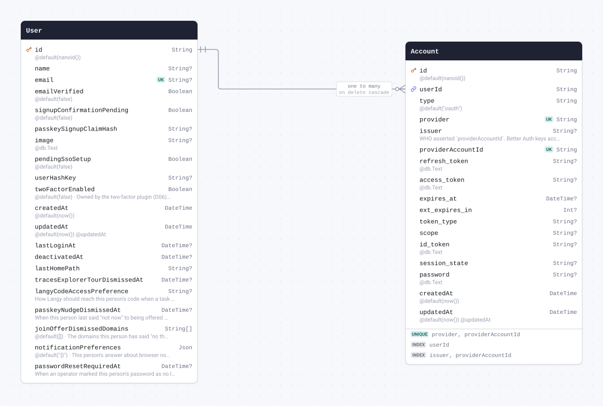

| Field               | Type                | Constraints                       | Default              | Description                                                                                                                                                                                                                                                                              |
| ------------------- | ------------------- | --------------------------------- | -------------------- | ---------------------------------------------------------------------------------------------------------------------------------------------------------------------------------------------------------------------------------------------------------------------------------------- |
| `id`                | `String`            | PK NOT NULL                       | `nanoid()`           |                                                                                                                                                                                                                                                                                          |
| `userId`            | `String`            | NOT NULL → [User.id](#model-User) |                      |                                                                                                                                                                                                                                                                                          |
| `type`              | `String`            | NOT NULL                          | `"oauth"`            |                                                                                                                                                                                                                                                                                          |
| `provider`          | `String`            | NOT NULL                          |                      |                                                                                                                                                                                                                                                                                          |
| `issuer`            | `String`            | NULL                              |                      | WHO asserted `providerAccountId`. Better Auth keys accounts by `(provider, providerAccountId)`; auth's account create hook writes this (modules/auth/specs/account-issuer.feature). Nullable only so the column could be added to a populated table; the migration backfilled every row. |
| `providerAccountId` | `String`            | NOT NULL                          |                      |                                                                                                                                                                                                                                                                                          |
| `refresh_token`     | `String` `@db.Text` | NULL                              |                      |                                                                                                                                                                                                                                                                                          |
| `access_token`      | `String` `@db.Text` | NULL                              |                      |                                                                                                                                                                                                                                                                                          |
| `expires_at`        | `DateTime`          | NULL                              |                      |                                                                                                                                                                                                                                                                                          |
| `ext_expires_in`    | `Int`               | NULL                              |                      |                                                                                                                                                                                                                                                                                          |
| `token_type`        | `String`            | NULL                              |                      |                                                                                                                                                                                                                                                                                          |
| `scope`             | `String`            | NULL                              |                      |                                                                                                                                                                                                                                                                                          |
| `id_token`          | `String` `@db.Text` | NULL                              |                      |                                                                                                                                                                                                                                                                                          |
| `session_state`     | `String`            | NULL                              |                      |                                                                                                                                                                                                                                                                                          |
| `password`          | `String` `@db.Text` | NULL                              |                      |                                                                                                                                                                                                                                                                                          |
| `createdAt`         | `DateTime`          | NOT NULL                          | `now()`              |                                                                                                                                                                                                                                                                                          |
| `updatedAt`         | `DateTime`          | NOT NULL                          | `now()` `@updatedAt` |                                                                                                                                                                                                                                                                                          |

#### Indexes

- `@@index([userId])`
- `@@index([issuer, providerAccountId])`
- `@@unique([provider, providerAccountId])`

#### References

- `userId` → [User.id](#model-User) (many-to-one, on delete Cascade)

#### Definition

```sql
CREATE TABLE "Account" (
    "id" TEXT NOT NULL,
    "userId" TEXT NOT NULL,
    "type" TEXT NOT NULL DEFAULT 'oauth',
    "provider" TEXT NOT NULL,
    "issuer" TEXT,
    "providerAccountId" TEXT NOT NULL,
    "refresh_token" TEXT,
    "access_token" TEXT,
    "expires_at" TIMESTAMP(3),
    "ext_expires_in" INTEGER,
    "token_type" TEXT,
    "scope" TEXT,
    "id_token" TEXT,
    "session_state" TEXT,
    "password" TEXT,
    "createdAt" TIMESTAMP(3) NOT NULL DEFAULT CURRENT_TIMESTAMP,
    "updatedAt" TIMESTAMP(3) NOT NULL DEFAULT CURRENT_TIMESTAMP,

    CONSTRAINT "Account_pkey" PRIMARY KEY ("id")
);

CREATE INDEX "Account_userId_idx" ON "Account"("userId");

CREATE INDEX "Account_issuer_providerAccountId_idx" ON "Account"("issuer", "providerAccountId");

CREATE UNIQUE INDEX "Account_provider_providerAccountId_key" ON "Account"("provider", "providerAccountId");
```

<details>
<summary>Queries and their SQL</summary>

**findMany**: Every row

```ts
await prisma.account.findMany();
```

```sql
SELECT
  "public"."Account"."id",
  "public"."Account"."userId",
  "public"."Account"."type",
  "public"."Account"."provider",
  "public"."Account"."issuer",
  "public"."Account"."providerAccountId",
  "public"."Account"."refresh_token",
  "public"."Account"."access_token",
  "public"."Account"."expires_at",
  "public"."Account"."ext_expires_in",
  "public"."Account"."token_type",
  "public"."Account"."scope",
  "public"."Account"."id_token",
  "public"."Account"."session_state",
  "public"."Account"."password",
  "public"."Account"."createdAt",
  "public"."Account"."updatedAt"
FROM
  "public"."Account"
WHERE
  1 = 1
OFFSET
  $1
-- params: ["0"]
```

**count**: How many rows there are

```ts
await prisma.account.count();
```

```sql
SELECT
  COUNT(*) AS "_count$_all"
FROM
  (
    SELECT
      "public"."Account"."id"
    FROM
      "public"."Account"
    WHERE
      1 = 1
    OFFSET
      $1
  ) AS "sub"
-- params: ["0"]
```

**findMany**: Every row with its relations

```ts
await prisma.account.findMany({ include: { user: true } });
```

```sql
SELECT
  "public"."Account"."id",
  "public"."Account"."userId",
  "public"."Account"."type",
  "public"."Account"."provider",
  "public"."Account"."issuer",
  "public"."Account"."providerAccountId",
  "public"."Account"."refresh_token",
  "public"."Account"."access_token",
  "public"."Account"."expires_at",
  "public"."Account"."ext_expires_in",
  "public"."Account"."token_type",
  "public"."Account"."scope",
  "public"."Account"."id_token",
  "public"."Account"."session_state",
  "public"."Account"."password",
  "public"."Account"."createdAt",
  "public"."Account"."updatedAt"
FROM
  "public"."Account"
WHERE
  1 = 1
OFFSET
  $1
-- params: ["0"]

SELECT
  "public"."User"."id",
  "public"."User"."name",
  "public"."User"."email",
  "public"."User"."emailVerified",
  "public"."User"."signupConfirmationPending",
  "public"."User"."passkeySignupClaimHash",
  "public"."User"."image",
  "public"."User"."pendingSsoSetup",
  "public"."User"."userHashKey",
  "public"."User"."twoFactorEnabled",
  "public"."User"."createdAt",
  "public"."User"."updatedAt",
  "public"."User"."lastLoginAt",
  "public"."User"."deactivatedAt",
  "public"."User"."lastHomePath",
  "public"."User"."tracesExplorerTourDismissedAt",
  "public"."User"."langyCodeAccessPreference",
  "public"."User"."passkeyNudgeDismissedAt",
  "public"."User"."joinOfferDismissedDomains",
  "public"."User"."notificationPreferences",
  "public"."User"."passwordResetRequiredAt"
FROM
  "public"."User"
WHERE
  "public"."User"."id" IN ($1)
OFFSET
  $2
-- params: ["<userId of the rows above>","0"]
```

**findUnique**: One row by what is unique to it

```ts
await prisma.account.findUnique({ where: { id: "example" } });
```

```sql
SELECT
  "public"."Account"."id",
  "public"."Account"."userId",
  "public"."Account"."type",
  "public"."Account"."provider",
  "public"."Account"."issuer",
  "public"."Account"."providerAccountId",
  "public"."Account"."refresh_token",
  "public"."Account"."access_token",
  "public"."Account"."expires_at",
  "public"."Account"."ext_expires_in",
  "public"."Account"."token_type",
  "public"."Account"."scope",
  "public"."Account"."id_token",
  "public"."Account"."session_state",
  "public"."Account"."password",
  "public"."Account"."createdAt",
  "public"."Account"."updatedAt"
FROM
  "public"."Account"
WHERE
  (
    "public"."Account"."id" = $1
    AND 1 = 1
  )
LIMIT
  $2
OFFSET
  $3
-- params: ["example","1","0"]
```

**create**: Create a row

```ts
await prisma.account.create({
  data: { userId: "example", provider: "example", providerAccountId: "example" },
});
```

```sql
INSERT INTO
  "public"."Account" (
    "id",
    "userId",
    "type",
    "provider",
    "providerAccountId",
    "createdAt",
    "updatedAt"
  )
VALUES
  ($1, $2, $3, $4, $5, $6, $7)
RETURNING
  "public"."Account"."id",
  "public"."Account"."userId",
  "public"."Account"."type",
  "public"."Account"."provider",
  "public"."Account"."issuer",
  "public"."Account"."providerAccountId",
  "public"."Account"."refresh_token",
  "public"."Account"."access_token",
  "public"."Account"."expires_at",
  "public"."Account"."ext_expires_in",
  "public"."Account"."token_type",
  "public"."Account"."scope",
  "public"."Account"."id_token",
  "public"."Account"."session_state",
  "public"."Account"."password",
  "public"."Account"."createdAt",
  "public"."Account"."updatedAt"
-- params: ["<nanoid()>","example","oauth","example","example","<now()>","<now()>"]
```

**update**: Update a row

```ts
await prisma.account.update({ where: { id: "example" }, data: { type: "example" } });
```

```sql
SELECT
  "public"."Account"."id"
FROM
  "public"."Account"
WHERE
  (
    "public"."Account"."id" = $1
    AND 1 = 1
  )
LIMIT
  $2
OFFSET
  $3
-- params: ["example","1","0"]

UPDATE "public"."Account"
SET
  "type" = $1,
  "updatedAt" = $2
WHERE
  (
    "public"."Account"."id" IN ($3)
    AND (
      "public"."Account"."id" = $4
      AND 1 = 1
    )
  )
RETURNING
  "public"."Account"."id",
  "public"."Account"."userId",
  "public"."Account"."type",
  "public"."Account"."provider",
  "public"."Account"."issuer",
  "public"."Account"."providerAccountId",
  "public"."Account"."refresh_token",
  "public"."Account"."access_token",
  "public"."Account"."expires_at",
  "public"."Account"."ext_expires_in",
  "public"."Account"."token_type",
  "public"."Account"."scope",
  "public"."Account"."id_token",
  "public"."Account"."session_state",
  "public"."Account"."password",
  "public"."Account"."createdAt",
  "public"."Account"."updatedAt"
-- params: ["example",{"prisma__type":"generatorCall","prisma__value":{"name":"now","args":[],"returnType":{"type":"DateTime"}}},"<id of the rows above>","example"]
```

**delete**: Delete a row

```ts
await prisma.account.delete({ where: { id: "example" } });
```

```sql
DELETE FROM "public"."Account"
WHERE
  (
    "public"."Account"."id" = $1
    AND 1 = 1
  )
RETURNING
  "public"."Account"."id",
  "public"."Account"."userId",
  "public"."Account"."type",
  "public"."Account"."provider",
  "public"."Account"."issuer",
  "public"."Account"."providerAccountId",
  "public"."Account"."refresh_token",
  "public"."Account"."access_token",
  "public"."Account"."expires_at",
  "public"."Account"."ext_expires_in",
  "public"."Account"."token_type",
  "public"."Account"."scope",
  "public"."Account"."id_token",
  "public"."Account"."session_state",
  "public"."Account"."password",
  "public"."Account"."createdAt",
  "public"."Account"."updatedAt"
-- params: ["example"]
```

</details>

<a id="model-AccountCredential"></a>

### AccountCredential

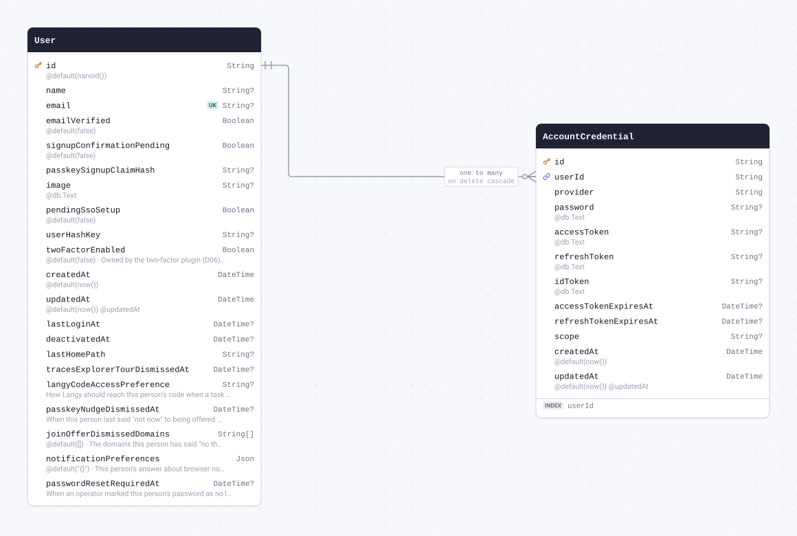

| Field                   | Type                | Constraints                       | Default              | Description |
| ----------------------- | ------------------- | --------------------------------- | -------------------- | ----------- |
| `id`                    | `String`            | PK NOT NULL                       |                      |             |
| `userId`                | `String`            | NOT NULL → [User.id](#model-User) |                      |             |
| `provider`              | `String`            | NOT NULL                          |                      |             |
| `password`              | `String` `@db.Text` | NULL                              |                      |             |
| `accessToken`           | `String` `@db.Text` | NULL                              |                      |             |
| `refreshToken`          | `String` `@db.Text` | NULL                              |                      |             |
| `idToken`               | `String` `@db.Text` | NULL                              |                      |             |
| `accessTokenExpiresAt`  | `DateTime`          | NULL                              |                      |             |
| `refreshTokenExpiresAt` | `DateTime`          | NULL                              |                      |             |
| `scope`                 | `String`            | NULL                              |                      |             |
| `createdAt`             | `DateTime`          | NOT NULL                          | `now()`              |             |
| `updatedAt`             | `DateTime`          | NOT NULL                          | `now()` `@updatedAt` |             |

#### Indexes

- `@@index([userId])`

#### References

- `userId` → [User.id](#model-User) (many-to-one, on delete Cascade)

#### Definition

```sql
CREATE TABLE "AccountCredential" (
    "id" TEXT NOT NULL,
    "userId" TEXT NOT NULL,
    "provider" TEXT NOT NULL,
    "password" TEXT,
    "accessToken" TEXT,
    "refreshToken" TEXT,
    "idToken" TEXT,
    "accessTokenExpiresAt" TIMESTAMP(3),
    "refreshTokenExpiresAt" TIMESTAMP(3),
    "scope" TEXT,
    "createdAt" TIMESTAMP(3) NOT NULL DEFAULT CURRENT_TIMESTAMP,
    "updatedAt" TIMESTAMP(3) NOT NULL DEFAULT CURRENT_TIMESTAMP,

    CONSTRAINT "AccountCredential_pkey" PRIMARY KEY ("id")
);

CREATE INDEX "AccountCredential_userId_idx" ON "AccountCredential"("userId");
```

<details>
<summary>Queries and their SQL</summary>

**findMany**: Every row

```ts
await prisma.accountCredential.findMany();
```

```sql
SELECT
  "public"."AccountCredential"."id",
  "public"."AccountCredential"."userId",
  "public"."AccountCredential"."provider",
  "public"."AccountCredential"."password",
  "public"."AccountCredential"."accessToken",
  "public"."AccountCredential"."refreshToken",
  "public"."AccountCredential"."idToken",
  "public"."AccountCredential"."accessTokenExpiresAt",
  "public"."AccountCredential"."refreshTokenExpiresAt",
  "public"."AccountCredential"."scope",
  "public"."AccountCredential"."createdAt",
  "public"."AccountCredential"."updatedAt"
FROM
  "public"."AccountCredential"
WHERE
  1 = 1
OFFSET
  $1
-- params: ["0"]
```

**count**: How many rows there are

```ts
await prisma.accountCredential.count();
```

```sql
SELECT
  COUNT(*) AS "_count$_all"
FROM
  (
    SELECT
      "public"."AccountCredential"."id"
    FROM
      "public"."AccountCredential"
    WHERE
      1 = 1
    OFFSET
      $1
  ) AS "sub"
-- params: ["0"]
```

**findMany**: Every row with its relations

```ts
await prisma.accountCredential.findMany({ include: { user: true } });
```

```sql
SELECT
  "public"."AccountCredential"."id",
  "public"."AccountCredential"."userId",
  "public"."AccountCredential"."provider",
  "public"."AccountCredential"."password",
  "public"."AccountCredential"."accessToken",
  "public"."AccountCredential"."refreshToken",
  "public"."AccountCredential"."idToken",
  "public"."AccountCredential"."accessTokenExpiresAt",
  "public"."AccountCredential"."refreshTokenExpiresAt",
  "public"."AccountCredential"."scope",
  "public"."AccountCredential"."createdAt",
  "public"."AccountCredential"."updatedAt"
FROM
  "public"."AccountCredential"
WHERE
  1 = 1
OFFSET
  $1
-- params: ["0"]

SELECT
  "public"."User"."id",
  "public"."User"."name",
  "public"."User"."email",
  "public"."User"."emailVerified",
  "public"."User"."signupConfirmationPending",
  "public"."User"."passkeySignupClaimHash",
  "public"."User"."image",
  "public"."User"."pendingSsoSetup",
  "public"."User"."userHashKey",
  "public"."User"."twoFactorEnabled",
  "public"."User"."createdAt",
  "public"."User"."updatedAt",
  "public"."User"."lastLoginAt",
  "public"."User"."deactivatedAt",
  "public"."User"."lastHomePath",
  "public"."User"."tracesExplorerTourDismissedAt",
  "public"."User"."langyCodeAccessPreference",
  "public"."User"."passkeyNudgeDismissedAt",
  "public"."User"."joinOfferDismissedDomains",
  "public"."User"."notificationPreferences",
  "public"."User"."passwordResetRequiredAt"
FROM
  "public"."User"
WHERE
  "public"."User"."id" IN ($1)
OFFSET
  $2
-- params: ["<userId of the rows above>","0"]
```

**findUnique**: One row by what is unique to it

```ts
await prisma.accountCredential.findUnique({ where: { id: "example" } });
```

```sql
SELECT
  "public"."AccountCredential"."id",
  "public"."AccountCredential"."userId",
  "public"."AccountCredential"."provider",
  "public"."AccountCredential"."password",
  "public"."AccountCredential"."accessToken",
  "public"."AccountCredential"."refreshToken",
  "public"."AccountCredential"."idToken",
  "public"."AccountCredential"."accessTokenExpiresAt",
  "public"."AccountCredential"."refreshTokenExpiresAt",
  "public"."AccountCredential"."scope",
  "public"."AccountCredential"."createdAt",
  "public"."AccountCredential"."updatedAt"
FROM
  "public"."AccountCredential"
WHERE
  (
    "public"."AccountCredential"."id" = $1
    AND 1 = 1
  )
LIMIT
  $2
OFFSET
  $3
-- params: ["example","1","0"]
```

**create**: Create a row

```ts
await prisma.accountCredential.create({
  data: { id: "example", userId: "example", provider: "example" },
});
```

```sql
INSERT INTO
  "public"."AccountCredential" (
    "id",
    "userId",
    "provider",
    "createdAt",
    "updatedAt"
  )
VALUES
  ($1, $2, $3, $4, $5)
RETURNING
  "public"."AccountCredential"."id",
  "public"."AccountCredential"."userId",
  "public"."AccountCredential"."provider",
  "public"."AccountCredential"."password",
  "public"."AccountCredential"."accessToken",
  "public"."AccountCredential"."refreshToken",
  "public"."AccountCredential"."idToken",
  "public"."AccountCredential"."accessTokenExpiresAt",
  "public"."AccountCredential"."refreshTokenExpiresAt",
  "public"."AccountCredential"."scope",
  "public"."AccountCredential"."createdAt",
  "public"."AccountCredential"."updatedAt"
-- params: ["example","example","example","<now()>","<now()>"]
```

**update**: Update a row

```ts
await prisma.accountCredential.update({ where: { id: "example" }, data: { provider: "example" } });
```

```sql
SELECT
  "public"."AccountCredential"."id"
FROM
  "public"."AccountCredential"
WHERE
  (
    "public"."AccountCredential"."id" = $1
    AND 1 = 1
  )
LIMIT
  $2
OFFSET
  $3
-- params: ["example","1","0"]

UPDATE "public"."AccountCredential"
SET
  "provider" = $1,
  "updatedAt" = $2
WHERE
  (
    "public"."AccountCredential"."id" IN ($3)
    AND (
      "public"."AccountCredential"."id" = $4
      AND 1 = 1
    )
  )
RETURNING
  "public"."AccountCredential"."id",
  "public"."AccountCredential"."userId",
  "public"."AccountCredential"."provider",
  "public"."AccountCredential"."password",
  "public"."AccountCredential"."accessToken",
  "public"."AccountCredential"."refreshToken",
  "public"."AccountCredential"."idToken",
  "public"."AccountCredential"."accessTokenExpiresAt",
  "public"."AccountCredential"."refreshTokenExpiresAt",
  "public"."AccountCredential"."scope",
  "public"."AccountCredential"."createdAt",
  "public"."AccountCredential"."updatedAt"
-- params: ["example",{"prisma__type":"generatorCall","prisma__value":{"name":"now","args":[],"returnType":{"type":"DateTime"}}},"<id of the rows above>","example"]
```

**delete**: Delete a row

```ts
await prisma.accountCredential.delete({ where: { id: "example" } });
```

```sql
DELETE FROM "public"."AccountCredential"
WHERE
  (
    "public"."AccountCredential"."id" = $1
    AND 1 = 1
  )
RETURNING
  "public"."AccountCredential"."id",
  "public"."AccountCredential"."userId",
  "public"."AccountCredential"."provider",
  "public"."AccountCredential"."password",
  "public"."AccountCredential"."accessToken",
  "public"."AccountCredential"."refreshToken",
  "public"."AccountCredential"."idToken",
  "public"."AccountCredential"."accessTokenExpiresAt",
  "public"."AccountCredential"."refreshTokenExpiresAt",
  "public"."AccountCredential"."scope",
  "public"."AccountCredential"."createdAt",
  "public"."AccountCredential"."updatedAt"
-- params: ["example"]
```

</details>

<a id="model-Session"></a>

### Session

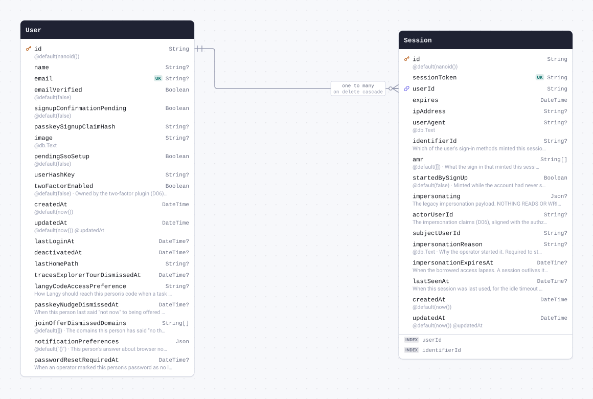

| Field                    | Type                | Constraints                       | Default              | Description                                                                                                                                                                                                                                                                                                                                                                                                                                                                                                                                                                                                                                                                                                                                                                                                                                                                                                                                                                                                                                                                                                            |
| ------------------------ | ------------------- | --------------------------------- | -------------------- | ---------------------------------------------------------------------------------------------------------------------------------------------------------------------------------------------------------------------------------------------------------------------------------------------------------------------------------------------------------------------------------------------------------------------------------------------------------------------------------------------------------------------------------------------------------------------------------------------------------------------------------------------------------------------------------------------------------------------------------------------------------------------------------------------------------------------------------------------------------------------------------------------------------------------------------------------------------------------------------------------------------------------------------------------------------------------------------------------------------------------- |
| `id`                     | `String`            | PK NOT NULL                       | `nanoid()`           |                                                                                                                                                                                                                                                                                                                                                                                                                                                                                                                                                                                                                                                                                                                                                                                                                                                                                                                                                                                                                                                                                                                        |
| `sessionToken`           | `String`            | UNIQUE NOT NULL                   |                      |                                                                                                                                                                                                                                                                                                                                                                                                                                                                                                                                                                                                                                                                                                                                                                                                                                                                                                                                                                                                                                                                                                                        |
| `userId`                 | `String`            | NOT NULL → [User.id](#model-User) |                      |                                                                                                                                                                                                                                                                                                                                                                                                                                                                                                                                                                                                                                                                                                                                                                                                                                                                                                                                                                                                                                                                                                                        |
| `expires`                | `DateTime`          | NOT NULL                          |                      |                                                                                                                                                                                                                                                                                                                                                                                                                                                                                                                                                                                                                                                                                                                                                                                                                                                                                                                                                                                                                                                                                                                        |
| `ipAddress`              | `String`            | NULL                              |                      |                                                                                                                                                                                                                                                                                                                                                                                                                                                                                                                                                                                                                                                                                                                                                                                                                                                                                                                                                                                                                                                                                                                        |
| `userAgent`              | `String` `@db.Text` | NULL                              |                      |                                                                                                                                                                                                                                                                                                                                                                                                                                                                                                                                                                                                                                                                                                                                                                                                                                                                                                                                                                                                                                                                                                                        |
| `identifierId`           | `String`            | NULL                              |                      | Which of the user's sign-in methods minted this session (D06). NULL on every session that predates the column and on any mint we could not attribute - an ordinary value, not an error. Nothing reads it to decide whether the session is valid, so no session was ended to add it.                                                                                                                                                                                                                                                                                                                                                                                                                                                                                                                                                                                                                                                                                                                                                                                                                                    |
| `amr`                    | `String[]`          | NOT NULL                          | `[]`                 | What the sign-in that minted this session PROVED, as RFC 8176 method references (D06). Empty on every session minted before the column, and on any ordinary password sign-in. An organization that requires a second factor reads this when a member reaches its data; it is never read at mint and never ends a session.                                                                                                                                                                                                                                                                                                                                                                                                                                                                                                                                                                                                                                                                                                                                                                                              |
| `startedBySignUp`        | `Boolean`           | NOT NULL                          | `false`              | Minted while the account had never signed in: the session its sign-up started, which skips the secure-account offer. False on every later one and on every session that predates the column (specs/identity/passkeys.feature).                                                                                                                                                                                                                                                                                                                                                                                                                                                                                                                                                                                                                                                                                                                                                                                                                                                                                         |
| `impersonating`          | `Json`              | NULL                              |                      | The legacy impersonation payload. NOTHING READS OR WRITES IT any more - the {actor, subject} columns below replaced it, and the migration beside them ended every session that still carried a value. It stays for ONE release, and that is the whole reason it is still here. `prisma migrate deploy` runs at container start, so the first pod of a new release drops a column while the previous release's pods are still serving - and those pods select this column on EVERY authenticated request and fail closed when the row does not come back. Dropping it in the same release that stops reading it signs everybody out for the length of the rollout. Expand now, contract next release.                                                                                                                                                                                                                                                                                                                                                                                                                   |
| `actorUserId`            | `String`            | NULL                              |                      | The impersonation claims (D06), aligned with the authz Principal {actor, subject}. The actor is the operator who really made the request and the subject is the person whose access they are borrowing; both are recorded on every authorization decision, so the audit trail can answer who really did it. These replace the legacy `impersonating` JSON blob, which is dropped in the release AFTER this one. NULL on every ordinary session, which is all of them: an impersonation is a handful of rows at a time and nothing else reads these columns.                                                                                                                                                                                                                                                                                                                                                                                                                                                                                                                                                            |
| `subjectUserId`          | `String`            | NULL                              |                      |                                                                                                                                                                                                                                                                                                                                                                                                                                                                                                                                                                                                                                                                                                                                                                                                                                                                                                                                                                                                                                                                                                                        |
| `impersonationReason`    | `String` `@db.Text` | NULL                              |                      | Why the operator started it. Required to start one (specs/features/backoffice-user-impersonation-reason.feature) and kept beside both people rather than only in the audit log, so a request under impersonation carries its own justification.                                                                                                                                                                                                                                                                                                                                                                                                                                                                                                                                                                                                                                                                                                                                                                                                                                                                        |
| `impersonationExpiresAt` | `DateTime`          | NULL                              |                      | When the borrowed access lapses. A session outlives its impersonation window: past this the claims are ignored and the operator is themselves again, with nothing ended.                                                                                                                                                                                                                                                                                                                                                                                                                                                                                                                                                                                                                                                                                                                                                                                                                                                                                                                                               |
| `lastSeenAt`             | `DateTime`          | NULL                              |                      | When this session was last used, for the idle timeout an organization may set (GAC-10, specs/identity/org-session-lifetime.feature). A COLUMN OF OUR OWN rather than `updatedAt`, because better-auth rolls a live session's expiry once per `updateAge` - a day - so `updatedAt` is activity to the nearest day and cannot tell an idle hour from an idle minute. Written only for sessions whose owner belongs to an organization that has set a window, and then at most once per quarter-window, so a deployment where nobody has turned this on writes it never. NULL on every session minted before the column and on every session under no window at all. A null READS AS `updatedAt`, which better-auth keeps rolled to within a day of the last use. That fallback is conservative in the direction that matters - `updatedAt` is never earlier than the real last use, so it can only ever judge a session MORE active than it was, never less - and it is what lets a window turned on today end the sessions that have been idle since February instead of waiting a day for a stamp they have never had. |
| `createdAt`              | `DateTime`          | NOT NULL                          | `now()`              |                                                                                                                                                                                                                                                                                                                                                                                                                                                                                                                                                                                                                                                                                                                                                                                                                                                                                                                                                                                                                                                                                                                        |
| `updatedAt`              | `DateTime`          | NOT NULL                          | `now()` `@updatedAt` |                                                                                                                                                                                                                                                                                                                                                                                                                                                                                                                                                                                                                                                                                                                                                                                                                                                                                                                                                                                                                                                                                                                        |

#### Indexes

- `@@index([userId])`
- `@@index([identifierId])`

#### References

- `userId` → [User.id](#model-User) (many-to-one, on delete Cascade)

#### Definition

```sql
CREATE TABLE "Session" (
    "id" TEXT NOT NULL,
    "sessionToken" TEXT NOT NULL,
    "userId" TEXT NOT NULL,
    "expires" TIMESTAMP(3) NOT NULL,
    "ipAddress" TEXT,
    "userAgent" TEXT,
    "identifierId" TEXT,
    "amr" TEXT[] DEFAULT ARRAY[]::TEXT[],
    "startedBySignUp" BOOLEAN NOT NULL DEFAULT false,
    "impersonating" JSONB,
    "actorUserId" TEXT,
    "subjectUserId" TEXT,
    "impersonationReason" TEXT,
    "impersonationExpiresAt" TIMESTAMP(3),
    "lastSeenAt" TIMESTAMP(3),
    "createdAt" TIMESTAMP(3) NOT NULL DEFAULT CURRENT_TIMESTAMP,
    "updatedAt" TIMESTAMP(3) NOT NULL DEFAULT CURRENT_TIMESTAMP,

    CONSTRAINT "Session_pkey" PRIMARY KEY ("id")
);

CREATE UNIQUE INDEX "Session_sessionToken_key" ON "Session"("sessionToken");

CREATE INDEX "Session_userId_idx" ON "Session"("userId");

CREATE INDEX "Session_identifierId_idx" ON "Session"("identifierId");
```

<details>
<summary>Queries and their SQL</summary>

**findMany**: Every row

```ts
await prisma.session.findMany();
```

```sql
SELECT
  "public"."Session"."id",
  "public"."Session"."sessionToken",
  "public"."Session"."userId",
  "public"."Session"."expires",
  "public"."Session"."ipAddress",
  "public"."Session"."userAgent",
  "public"."Session"."identifierId",
  "public"."Session"."amr",
  "public"."Session"."startedBySignUp",
  "public"."Session"."impersonating",
  "public"."Session"."actorUserId",
  "public"."Session"."subjectUserId",
  "public"."Session"."impersonationReason",
  "public"."Session"."impersonationExpiresAt",
  "public"."Session"."lastSeenAt",
  "public"."Session"."createdAt",
  "public"."Session"."updatedAt"
FROM
  "public"."Session"
WHERE
  1 = 1
OFFSET
  $1
-- params: ["0"]
```

**count**: How many rows there are

```ts
await prisma.session.count();
```

```sql
SELECT
  COUNT(*) AS "_count$_all"
FROM
  (
    SELECT
      "public"."Session"."id"
    FROM
      "public"."Session"
    WHERE
      1 = 1
    OFFSET
      $1
  ) AS "sub"
-- params: ["0"]
```

**findMany**: Every row with its relations

```ts
await prisma.session.findMany({ include: { user: true } });
```

```sql
SELECT
  "public"."Session"."id",
  "public"."Session"."sessionToken",
  "public"."Session"."userId",
  "public"."Session"."expires",
  "public"."Session"."ipAddress",
  "public"."Session"."userAgent",
  "public"."Session"."identifierId",
  "public"."Session"."amr",
  "public"."Session"."startedBySignUp",
  "public"."Session"."impersonating",
  "public"."Session"."actorUserId",
  "public"."Session"."subjectUserId",
  "public"."Session"."impersonationReason",
  "public"."Session"."impersonationExpiresAt",
  "public"."Session"."lastSeenAt",
  "public"."Session"."createdAt",
  "public"."Session"."updatedAt"
FROM
  "public"."Session"
WHERE
  1 = 1
OFFSET
  $1
-- params: ["0"]

SELECT
  "public"."User"."id",
  "public"."User"."name",
  "public"."User"."email",
  "public"."User"."emailVerified",
  "public"."User"."signupConfirmationPending",
  "public"."User"."passkeySignupClaimHash",
  "public"."User"."image",
  "public"."User"."pendingSsoSetup",
  "public"."User"."userHashKey",
  "public"."User"."twoFactorEnabled",
  "public"."User"."createdAt",
  "public"."User"."updatedAt",
  "public"."User"."lastLoginAt",
  "public"."User"."deactivatedAt",
  "public"."User"."lastHomePath",
  "public"."User"."tracesExplorerTourDismissedAt",
  "public"."User"."langyCodeAccessPreference",
  "public"."User"."passkeyNudgeDismissedAt",
  "public"."User"."joinOfferDismissedDomains",
  "public"."User"."notificationPreferences",
  "public"."User"."passwordResetRequiredAt"
FROM
  "public"."User"
WHERE
  "public"."User"."id" IN ($1)
OFFSET
  $2
-- params: ["<userId of the rows above>","0"]
```

**findUnique**: One row by what is unique to it

```ts
await prisma.session.findUnique({ where: { id: "example" } });
```

```sql
SELECT
  "public"."Session"."id",
  "public"."Session"."sessionToken",
  "public"."Session"."userId",
  "public"."Session"."expires",
  "public"."Session"."ipAddress",
  "public"."Session"."userAgent",
  "public"."Session"."identifierId",
  "public"."Session"."amr",
  "public"."Session"."startedBySignUp",
  "public"."Session"."impersonating",
  "public"."Session"."actorUserId",
  "public"."Session"."subjectUserId",
  "public"."Session"."impersonationReason",
  "public"."Session"."impersonationExpiresAt",
  "public"."Session"."lastSeenAt",
  "public"."Session"."createdAt",
  "public"."Session"."updatedAt"
FROM
  "public"."Session"
WHERE
  (
    "public"."Session"."id" = $1
    AND 1 = 1
  )
LIMIT
  $2
OFFSET
  $3
-- params: ["example","1","0"]
```

**create**: Create a row

```ts
await prisma.session.create({
  data: {
    sessionToken: "example",
    userId: "example",
    expires: new Date("2026-01-01T00:00:00.000Z"),
  },
});
```

```sql
INSERT INTO
  "public"."Session" (
    "id",
    "sessionToken",
    "userId",
    "expires",
    "amr",
    "startedBySignUp",
    "createdAt",
    "updatedAt"
  )
VALUES
  ($1, $2, $3, $4, $5, $6, $7, $8)
RETURNING
  "public"."Session"."id",
  "public"."Session"."sessionToken",
  "public"."Session"."userId",
  "public"."Session"."expires",
  "public"."Session"."ipAddress",
  "public"."Session"."userAgent",
  "public"."Session"."identifierId",
  "public"."Session"."amr",
  "public"."Session"."startedBySignUp",
  "public"."Session"."impersonating",
  "public"."Session"."actorUserId",
  "public"."Session"."subjectUserId",
  "public"."Session"."impersonationReason",
  "public"."Session"."impersonationExpiresAt",
  "public"."Session"."lastSeenAt",
  "public"."Session"."createdAt",
  "public"."Session"."updatedAt"
-- params: ["<nanoid()>","example","example","2026-01-01T00:00:00.000Z",[],false,"<now()>","<now()>"]
```

**update**: Update a row

```ts
await prisma.session.update({ where: { id: "example" }, data: { sessionToken: "example" } });
```

```sql
SELECT
  "public"."Session"."id"
FROM
  "public"."Session"
WHERE
  (
    "public"."Session"."id" = $1
    AND 1 = 1
  )
LIMIT
  $2
OFFSET
  $3
-- params: ["example","1","0"]

UPDATE "public"."Session"
SET
  "sessionToken" = $1,
  "updatedAt" = $2
WHERE
  (
    "public"."Session"."id" IN ($3)
    AND (
      "public"."Session"."id" = $4
      AND 1 = 1
    )
  )
RETURNING
  "public"."Session"."id",
  "public"."Session"."sessionToken",
  "public"."Session"."userId",
  "public"."Session"."expires",
  "public"."Session"."ipAddress",
  "public"."Session"."userAgent",
  "public"."Session"."identifierId",
  "public"."Session"."amr",
  "public"."Session"."startedBySignUp",
  "public"."Session"."impersonating",
  "public"."Session"."actorUserId",
  "public"."Session"."subjectUserId",
  "public"."Session"."impersonationReason",
  "public"."Session"."impersonationExpiresAt",
  "public"."Session"."lastSeenAt",
  "public"."Session"."createdAt",
  "public"."Session"."updatedAt"
-- params: ["example",{"prisma__type":"generatorCall","prisma__value":{"name":"now","args":[],"returnType":{"type":"DateTime"}}},"<id of the rows above>","example"]
```

**delete**: Delete a row

```ts
await prisma.session.delete({ where: { id: "example" } });
```

```sql
DELETE FROM "public"."Session"
WHERE
  (
    "public"."Session"."id" = $1
    AND 1 = 1
  )
RETURNING
  "public"."Session"."id",
  "public"."Session"."sessionToken",
  "public"."Session"."userId",
  "public"."Session"."expires",
  "public"."Session"."ipAddress",
  "public"."Session"."userAgent",
  "public"."Session"."identifierId",
  "public"."Session"."amr",
  "public"."Session"."startedBySignUp",
  "public"."Session"."impersonating",
  "public"."Session"."actorUserId",
  "public"."Session"."subjectUserId",
  "public"."Session"."impersonationReason",
  "public"."Session"."impersonationExpiresAt",
  "public"."Session"."lastSeenAt",
  "public"."Session"."createdAt",
  "public"."Session"."updatedAt"
-- params: ["example"]
```

</details>

<a id="model-UserErasure"></a>

### UserErasure

One row per erased account, holding only its creation time: no id, name or address. It keeps
the install's first-created account knowable after an erasure deletes that row.
Spec: modules/user/specs/user.feature

| Field              | Type       | Constraints | Default    | Description |
| ------------------ | ---------- | ----------- | ---------- | ----------- |
| `id`               | `String`   | PK NOT NULL | `nanoid()` |             |
| `accountCreatedAt` | `DateTime` | NOT NULL    |            |             |
| `erasedAt`         | `DateTime` | NOT NULL    | `now()`    |             |

#### Indexes

- `@@index([accountCreatedAt])`

#### Definition

```sql
CREATE TABLE "UserErasure" (
    "id" TEXT NOT NULL,
    "accountCreatedAt" TIMESTAMP(3) NOT NULL,
    "erasedAt" TIMESTAMP(3) NOT NULL DEFAULT CURRENT_TIMESTAMP,

    CONSTRAINT "UserErasure_pkey" PRIMARY KEY ("id")
);

CREATE INDEX "UserErasure_accountCreatedAt_idx" ON "UserErasure"("accountCreatedAt");
```

<details>
<summary>Queries and their SQL</summary>

**findMany**: Every row

```ts
await prisma.userErasure.findMany();
```

```sql
SELECT
  "public"."UserErasure"."id",
  "public"."UserErasure"."accountCreatedAt",
  "public"."UserErasure"."erasedAt"
FROM
  "public"."UserErasure"
WHERE
  1 = 1
OFFSET
  $1
-- params: ["0"]
```

**count**: How many rows there are

```ts
await prisma.userErasure.count();
```

```sql
SELECT
  COUNT(*) AS "_count$_all"
FROM
  (
    SELECT
      "public"."UserErasure"."id"
    FROM
      "public"."UserErasure"
    WHERE
      1 = 1
    OFFSET
      $1
  ) AS "sub"
-- params: ["0"]
```

**findUnique**: One row by what is unique to it

```ts
await prisma.userErasure.findUnique({ where: { id: "example" } });
```

```sql
SELECT
  "public"."UserErasure"."id",
  "public"."UserErasure"."accountCreatedAt",
  "public"."UserErasure"."erasedAt"
FROM
  "public"."UserErasure"
WHERE
  (
    "public"."UserErasure"."id" = $1
    AND 1 = 1
  )
LIMIT
  $2
OFFSET
  $3
-- params: ["example","1","0"]
```

**create**: Create a row

```ts
await prisma.userErasure.create({
  data: { accountCreatedAt: new Date("2026-01-01T00:00:00.000Z") },
});
```

```sql
INSERT INTO
  "public"."UserErasure" ("id", "accountCreatedAt", "erasedAt")
VALUES
  ($1, $2, $3)
RETURNING
  "public"."UserErasure"."id",
  "public"."UserErasure"."accountCreatedAt",
  "public"."UserErasure"."erasedAt"
-- params: ["<nanoid()>","2026-01-01T00:00:00.000Z","<now()>"]
```

**update**: Update a row

```ts
await prisma.userErasure.update({
  where: { id: "example" },
  data: { accountCreatedAt: new Date("2026-01-01T00:00:00.000Z") },
});
```

```sql
SELECT
  "public"."UserErasure"."id"
FROM
  "public"."UserErasure"
WHERE
  (
    "public"."UserErasure"."id" = $1
    AND 1 = 1
  )
LIMIT
  $2
OFFSET
  $3
-- params: ["example","1","0"]

UPDATE "public"."UserErasure"
SET
  "accountCreatedAt" = $1
WHERE
  (
    "public"."UserErasure"."id" IN ($2)
    AND (
      "public"."UserErasure"."id" = $3
      AND 1 = 1
    )
  )
RETURNING
  "public"."UserErasure"."id",
  "public"."UserErasure"."accountCreatedAt",
  "public"."UserErasure"."erasedAt"
-- params: ["2026-01-01T00:00:00.000Z","<id of the rows above>","example"]
```

**delete**: Delete a row

```ts
await prisma.userErasure.delete({ where: { id: "example" } });
```

```sql
DELETE FROM "public"."UserErasure"
WHERE
  (
    "public"."UserErasure"."id" = $1
    AND 1 = 1
  )
RETURNING
  "public"."UserErasure"."id",
  "public"."UserErasure"."accountCreatedAt",
  "public"."UserErasure"."erasedAt"
-- params: ["example"]
```

</details>

<a id="model-User"></a>

### User

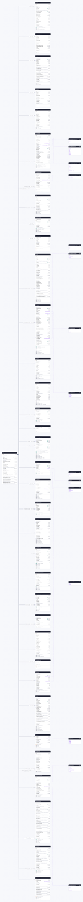

| Field                           | Type                | Constraints | Default              | Description                                                                                                                                                                                                                                                                                                                                  |
| ------------------------------- | ------------------- | ----------- | -------------------- | -------------------------------------------------------------------------------------------------------------------------------------------------------------------------------------------------------------------------------------------------------------------------------------------------------------------------------------------- |
| `id`                            | `String`            | PK NOT NULL | `nanoid()`           |                                                                                                                                                                                                                                                                                                                                              |
| `name`                          | `String`            | NULL        |                      |                                                                                                                                                                                                                                                                                                                                              |
| `email`                         | `String`            | UNIQUE NULL |                      |                                                                                                                                                                                                                                                                                                                                              |
| `emailVerified`                 | `Boolean`           | NOT NULL    | `false`              |                                                                                                                                                                                                                                                                                                                                              |
| `signupConfirmationPending`     | `Boolean`           | NOT NULL    | `false`              |                                                                                                                                                                                                                                                                                                                                              |
| `passkeySignupClaimHash`        | `String`            | NULL        |                      |                                                                                                                                                                                                                                                                                                                                              |
| `image`                         | `String` `@db.Text` | NULL        |                      |                                                                                                                                                                                                                                                                                                                                              |
| `pendingSsoSetup`               | `Boolean`           | NOT NULL    | `false`              |                                                                                                                                                                                                                                                                                                                                              |
| `userHashKey`                   | `String`            | NULL        |                      |                                                                                                                                                                                                                                                                                                                                              |
| `twoFactorEnabled`              | `Boolean`           | NOT NULL    | `false`              | Owned by the two-factor plugin (D06), which is why it is a plain boolean rather than a state: the plugin flips it when a setup is confirmed and when it is turned off, and challenges every sign-in while it is true. The lifecycle - and the history - lives on MfaEnrollment.                                                              |
| `createdAt`                     | `DateTime`          | NOT NULL    | `now()`              |                                                                                                                                                                                                                                                                                                                                              |
| `updatedAt`                     | `DateTime`          | NOT NULL    | `now()` `@updatedAt` |                                                                                                                                                                                                                                                                                                                                              |
| `lastLoginAt`                   | `DateTime`          | NULL        |                      |                                                                                                                                                                                                                                                                                                                                              |
| `deactivatedAt`                 | `DateTime`          | NULL        |                      |                                                                                                                                                                                                                                                                                                                                              |
| `lastHomePath`                  | `String`            | NULL        |                      |                                                                                                                                                                                                                                                                                                                                              |
| `tracesExplorerTourDismissedAt` | `DateTime`          | NULL        |                      |                                                                                                                                                                                                                                                                                                                                              |
| `langyCodeAccessPreference`     | `String`            | NULL        |                      | How Langy should reach this person's code when a task needs a change (ADR-129). "github" means they chose the pull request path and asked to be remembered; NULL means ask. A shared local folder is never stored here, because a folder has to be shared again each time. Spec: specs/langy/langy-code-access.feature                       |
| `passkeyNudgeDismissedAt`       | `DateTime`          | NULL        |                      | When this person last said "not now" to being offered a passkey (ADR-120). On the account rather than in browser storage for two reasons: a per-browser record forgets on a new device, which is exactly where the offer should be MORE eager, and an interval nobody can enforce is not an interval. NULL means never asked.                |
| `joinOfferDismissedDomains`     | `String[]`          | NOT NULL    | `[]`                 | The domains this person has said "no thanks" to being offered their colleagues on (D12). Per domain rather than one flag: somebody who changes jobs and verifies a second address should be offered their new employer's organization, not silenced forever by a decision they made about the old one. Empty means never dismissed anything. |
| `notificationPreferences`       | `Json`              | NOT NULL    | `"{}"`               | This person's answer about browser notifications, one entry per topic: { "langy": "enabled" \| "declined" }. A topic that is absent was never answered. The browser's own permission is not stored here. Spec: specs/langy/langy-notifications.feature                                                                                       |
| `passwordResetRequiredAt`       | `DateTime`          | NULL        |                      | When an operator marked this person's password as no longer trusted. A password sign-in opens no session while it is set; any write of a new password hash clears it. Spec: modules/auth/specs/forced-password-reset.feature                                                                                                                 |

#### Referenced by

- `id` ← [Account.userId](#model-Account) (one-to-many, on delete Cascade)
- `id` ← [AccountCredential.userId](#model-AccountCredential) (one-to-many, on delete Cascade)
- `id` ← [Session.userId](#model-Session) (one-to-many, on delete Cascade)
- `id` ← [TwoFactor.userId](#model-TwoFactor) (one-to-many, on delete Cascade)
- `id` ← [Passkey.userId](#model-Passkey) (one-to-many, on delete Cascade)
- `id` ← [TeamUser.userId](#model-TeamUser) (one-to-many)
- `id` ← [OrganizationUser.userId](#model-OrganizationUser) (one-to-many)
- `id` ← [Team.ownerUserId](#model-Team) (one-to-many)
- `id` ← [ScimExternalId.userId](#model-ScimExternalId) (one-to-many, on delete Cascade)
- `id` ← [ScimUserResource.userId](#model-ScimUserResource) (one-to-many, on delete Cascade)
- `id` ← [Project.ownerUserId](#model-Project) (one-to-many)
- `id` ← [OrganizationInvite.requestedBy](#model-OrganizationInvite) (one-to-many)
- `id` ← [SavedView.userId](#model-SavedView) (one-to-many)
- `id` ← [Annotation.userId](#model-Annotation) (one-to-many)
- `id` ← [ProjectSecret.createdById](#model-ProjectSecret) (one-to-many)
- `id` ← [ProjectSecret.updatedById](#model-ProjectSecret) (one-to-many)
- `id` ← [AnnotationQueueMembers.userId](#model-AnnotationQueueMembers) (one-to-many)
- `id` ← [AnnotationQueueItem.userId](#model-AnnotationQueueItem) (one-to-many)
- `id` ← [AnnotationQueueItem.createdByUserId](#model-AnnotationQueueItem) (one-to-many)
- `id` ← [ShareLink.userId](#model-ShareLink) (one-to-many)
- `id` ← [PinnedTrace.userId](#model-PinnedTrace) (one-to-many)
- `id` ← [TraceEditOverlay.createdById](#model-TraceEditOverlay) (one-to-many)
- `id` ← [TraceEditOverlay.updatedById](#model-TraceEditOverlay) (one-to-many)
- `id` ← [Workflow.publishedById](#model-Workflow) (one-to-many)
- `id` ← [WorkflowVersion.authorId](#model-WorkflowVersion) (one-to-many)
- `id` ← [LlmPromptConfigVersion.authorId](#model-LlmPromptConfigVersion) (one-to-many)
- `id` ← [PromptTagAssignment.createdById](#model-PromptTagAssignment) (one-to-many)
- `id` ← [PromptTagAssignment.updatedById](#model-PromptTagAssignment) (one-to-many)
- `id` ← [PromptTag.createdById](#model-PromptTag) (one-to-many)
- `id` ← [PromptTag.updatedById](#model-PromptTag) (one-to-many)
- `id` ← [Scenario.lastUpdatedById](#model-Scenario) (one-to-many)
- `id` ← [GroupMembership.userId](#model-GroupMembership) (one-to-many, on delete Cascade)
- `id` ← [RoleBinding.userId](#model-RoleBinding) (one-to-many, on delete Cascade)
- `id` ← [ApiKey.userId](#model-ApiKey) (one-to-many, on delete Restrict)
- `id` ← [VirtualKey.principalUserId](#model-VirtualKey) (one-to-many, on delete SetNull)
- `id` ← [RoutingPolicy.createdById](#model-RoutingPolicy) (one-to-many, on delete SetNull)
- `id` ← [RoutingPolicy.updatedById](#model-RoutingPolicy) (one-to-many, on delete SetNull)
- `id` ← [GatewayGuardrail.createdById](#model-GatewayGuardrail) (one-to-many, on delete SetNull)
- `id` ← [GatewayGuardrail.updatedById](#model-GatewayGuardrail) (one-to-many, on delete SetNull)
- `id` ← [IngestionSource.createdById](#model-IngestionSource) (one-to-many, on delete SetNull)
- `id` ← [AnomalyRule.createdById](#model-AnomalyRule) (one-to-many, on delete SetNull)
- `id` ← [GatewayBudget.createdById](#model-GatewayBudget) (one-to-many)

#### Definition

```sql
CREATE TABLE "User" (
    "id" TEXT NOT NULL,
    "name" TEXT,
    "email" TEXT,
    "emailVerified" BOOLEAN NOT NULL DEFAULT false,
    "signupConfirmationPending" BOOLEAN NOT NULL DEFAULT false,
    "passkeySignupClaimHash" TEXT,
    "image" TEXT,
    "pendingSsoSetup" BOOLEAN NOT NULL DEFAULT false,
    "userHashKey" TEXT,
    "twoFactorEnabled" BOOLEAN NOT NULL DEFAULT false,
    "createdAt" TIMESTAMP(3) NOT NULL DEFAULT CURRENT_TIMESTAMP,
    "updatedAt" TIMESTAMP(3) NOT NULL DEFAULT CURRENT_TIMESTAMP,
    "lastLoginAt" TIMESTAMP(3),
    "deactivatedAt" TIMESTAMP(3),
    "lastHomePath" TEXT,
    "tracesExplorerTourDismissedAt" TIMESTAMP(3),
    "langyCodeAccessPreference" TEXT,
    "passkeyNudgeDismissedAt" TIMESTAMP(3),
    "joinOfferDismissedDomains" TEXT[] DEFAULT ARRAY[]::TEXT[],
    "notificationPreferences" JSONB NOT NULL DEFAULT '{}',
    "passwordResetRequiredAt" TIMESTAMP(3),

    CONSTRAINT "User_pkey" PRIMARY KEY ("id")
);

CREATE UNIQUE INDEX "User_email_key" ON "User"("email");
```

<details>
<summary>Queries and their SQL</summary>

**findMany**: Every row

```ts
await prisma.user.findMany();
```

```sql
SELECT
  "public"."User"."id",
  "public"."User"."name",
  "public"."User"."email",
  "public"."User"."emailVerified",
  "public"."User"."signupConfirmationPending",
  "public"."User"."passkeySignupClaimHash",
  "public"."User"."image",
  "public"."User"."pendingSsoSetup",
  "public"."User"."userHashKey",
  "public"."User"."twoFactorEnabled",
  "public"."User"."createdAt",
  "public"."User"."updatedAt",
  "public"."User"."lastLoginAt",
  "public"."User"."deactivatedAt",
  "public"."User"."lastHomePath",
  "public"."User"."tracesExplorerTourDismissedAt",
  "public"."User"."langyCodeAccessPreference",
  "public"."User"."passkeyNudgeDismissedAt",
  "public"."User"."joinOfferDismissedDomains",
  "public"."User"."notificationPreferences",
  "public"."User"."passwordResetRequiredAt"
FROM
  "public"."User"
WHERE
  1 = 1
OFFSET
  $1
-- params: ["0"]
```

**count**: How many rows there are

```ts
await prisma.user.count();
```

```sql
SELECT
  COUNT(*) AS "_count$_all"
FROM
  (
    SELECT
      "public"."User"."id"
    FROM
      "public"."User"
    WHERE
      1 = 1
    OFFSET
      $1
  ) AS "sub"
-- params: ["0"]
```

**findMany**: Every row with its relations

```ts
await prisma.user.findMany({
  include: {
    accounts: true,
    accountCredentials: true,
    sessions: true,
    twoFactors: true,
    passkeys: true,
    teamMemberships: true,
    orgMemberships: true,
    scimUserResources: true,
    Annotation: true,
    shareLinks: true,
    Workflow: true,
    WorkflowVersion: true,
    annotationQueues: true,
    assignedQueueItems: true,
    createdQueueItems: true,
    llmPromptConfigVersions: true,
    scenarios: true,
    inviteRequests: true,
    secretsCreated: true,
    secretsUpdated: true,
    savedViews: true,
    versionTagsCreated: true,
    versionTagsUpdated: true,
    promptTagsCreated: true,
    promptTagsUpdated: true,
    groupMemberships: true,
    roleBindings: true,
    scimExternalIds: true,
    apiKeys: true,
    gatewayBudgetsCreated: true,
    principalVirtualKeys: true,
    personalTeams: true,
    personalProjects: true,
    routingPoliciesCreated: true,
    routingPoliciesUpdated: true,
    gatewayGuardrailsCreated: true,
    gatewayGuardrailsUpdated: true,
    ingestionSourcesCreated: true,
    anomalyRulesCreated: true,
    pinnedTraces: true,
    traceEditOverlaysCreated: true,
    traceEditOverlaysUpdated: true,
  },
});
```

```sql
SELECT
  "public"."User"."id",
  "public"."User"."name",
  "public"."User"."email",
  "public"."User"."emailVerified",
  "public"."User"."signupConfirmationPending",
  "public"."User"."passkeySignupClaimHash",
  "public"."User"."image",
  "public"."User"."pendingSsoSetup",
  "public"."User"."userHashKey",
  "public"."User"."twoFactorEnabled",
  "public"."User"."createdAt",
  "public"."User"."updatedAt",
  "public"."User"."lastLoginAt",
  "public"."User"."deactivatedAt",
  "public"."User"."lastHomePath",
  "public"."User"."tracesExplorerTourDismissedAt",
  "public"."User"."langyCodeAccessPreference",
  "public"."User"."passkeyNudgeDismissedAt",
  "public"."User"."joinOfferDismissedDomains",
  "public"."User"."notificationPreferences",
  "public"."User"."passwordResetRequiredAt"
FROM
  "public"."User"
WHERE
  1 = 1
OFFSET
  $1
-- params: ["0"]

SELECT
  "public"."Account"."id",
  "public"."Account"."userId",
  "public"."Account"."type",
  "public"."Account"."provider",
  "public"."Account"."issuer",
  "public"."Account"."providerAccountId",
  "public"."Account"."refresh_token",
  "public"."Account"."access_token",
  "public"."Account"."expires_at",
  "public"."Account"."ext_expires_in",
  "public"."Account"."token_type",
  "public"."Account"."scope",
  "public"."Account"."id_token",
  "public"."Account"."session_state",
  "public"."Account"."password",
  "public"."Account"."createdAt",
  "public"."Account"."updatedAt"
FROM
  "public"."Account"
WHERE
  "public"."Account"."userId" IN ($1)
OFFSET
  $2
-- params: ["<id of the rows above>","0"]

SELECT
  "public"."AccountCredential"."id",
  "public"."AccountCredential"."userId",
  "public"."AccountCredential"."provider",
  "public"."AccountCredential"."password",
  "public"."AccountCredential"."accessToken",
  "public"."AccountCredential"."refreshToken",
  "public"."AccountCredential"."idToken",
  "public"."AccountCredential"."accessTokenExpiresAt",
  "public"."AccountCredential"."refreshTokenExpiresAt",
  "public"."AccountCredential"."scope",
  "public"."AccountCredential"."createdAt",
  "public"."AccountCredential"."updatedAt"
FROM
  "public"."AccountCredential"
WHERE
  "public"."AccountCredential"."userId" IN ($1)
OFFSET
  $2
-- params: ["<id of the rows above>","0"]

SELECT
  "public"."Session"."id",
  "public"."Session"."sessionToken",
  "public"."Session"."userId",
  "public"."Session"."expires",
  "public"."Session"."ipAddress",
  "public"."Session"."userAgent",
  "public"."Session"."identifierId",
  "public"."Session"."amr",
  "public"."Session"."startedBySignUp",
  "public"."Session"."impersonating",
  "public"."Session"."actorUserId",
  "public"."Session"."subjectUserId",
  "public"."Session"."impersonationReason",
  "public"."Session"."impersonationExpiresAt",
  "public"."Session"."lastSeenAt",
  "public"."Session"."createdAt",
  "public"."Session"."updatedAt"
FROM
  "public"."Session"
WHERE
  "public"."Session"."userId" IN ($1)
OFFSET
  $2
-- params: ["<id of the rows above>","0"]

SELECT
  "public"."TwoFactor"."id",
  "public"."TwoFactor"."userId",
  "public"."TwoFactor"."secret",
  "public"."TwoFactor"."backupCodes",
  "public"."TwoFactor"."verified",
  "public"."TwoFactor"."failedVerificationCount",
  "public"."TwoFactor"."lockedUntil",
  "public"."TwoFactor"."createdAt",
  "public"."TwoFactor"."updatedAt"
FROM
  "public"."TwoFactor"
WHERE
  "public"."TwoFactor"."userId" IN ($1)
OFFSET
  $2
-- params: ["<id of the rows above>","0"]

SELECT
  "public"."Passkey"."id",
  "public"."Passkey"."name",
  "public"."Passkey"."publicKey",
  "public"."Passkey"."userId",
  "public"."Passkey"."credentialID",
  "public"."Passkey"."counter",
  "public"."Passkey"."deviceType",
  "public"."Passkey"."backedUp",
  "public"."Passkey"."transports",
  "public"."Passkey"."aaguid",
  "public"."Passkey"."createdAt",
  "public"."Passkey"."updatedAt"
FROM
  "public"."Passkey"
WHERE
  "public"."Passkey"."userId" IN ($1)
OFFSET
  $2
-- params: ["<id of the rows above>","0"]

SELECT
  "public"."TeamUser"."userId",
  "public"."TeamUser"."teamId",
  "public"."TeamUser"."role"::text,
  "public"."TeamUser"."assignedRoleId",
  "public"."TeamUser"."createdAt",
  "public"."TeamUser"."updatedAt"
FROM
  "public"."TeamUser"
WHERE
  "public"."TeamUser"."userId" IN ($1)
OFFSET
  $2
-- params: ["<id of the rows above>","0"]

SELECT
  "public"."OrganizationUser"."userId",
  "public"."OrganizationUser"."organizationId",
  "public"."OrganizationUser"."role"::text,
  "public"."OrganizationUser"."createdAt",
  "public"."OrganizationUser"."updatedAt",
  "public"."OrganizationUser"."departmentId",
  "public"."OrganizationUser"."disabledAt",
  "public"."OrganizationUser"."pendingSsoGrantId",
  "public"."OrganizationUser"."membershipStamp",
  "public"."OrganizationUser"."fullSeatSince",
  "public"."OrganizationUser"."seatPendingSince"
FROM
  "public"."OrganizationUser"
WHERE
  "public"."OrganizationUser"."userId" IN ($1)
OFFSET
  $2
-- params: ["<id of the rows above>","0"]

SELECT
  "public"."ScimUserResource"."organizationId",
  "public"."ScimUserResource"."userId",
  "public"."ScimUserResource"."userName",
  "public"."ScimUserResource"."name",
  "public"."ScimUserResource"."active",
  "public"."ScimUserResource"."deletedAt",
  "public"."ScimUserResource"."createdAt",
  "public"."ScimUserResource"."updatedAt"
FROM
  "public"."ScimUserResource"
WHERE
  "public"."ScimUserResource"."userId" IN ($1)
OFFSET
  $2
-- params: ["<id of the rows above>","0"]

SELECT
  "public"."Annotation"."id",
  "public"."Annotation"."projectId",
  "public"."Annotation"."traceId",
  "public"."Annotation"."comment",
  "public"."Annotation"."isThumbsUp",
  "public"."Annotation"."userId",
  "public"."Annotation"."createdAt",
  "public"."Annotation"."updatedAt",
  "public"."Annotation"."email",
  "public"."Annotation"."scoreOptions",
  "public"."Annotation"."expectedOutput",
  "public"."Annotation"."anchorKind",
  "public"."Annotation"."anchorId",
  "public"."Annotation"."anchorPath"
FROM
  "public"."Annotation"
WHERE
  "public"."Annotation"."userId" IN ($1)
OFFSET
  $2
-- params: ["<id of the rows above>","0"]

SELECT
  "public"."ShareLink"."id",
  "public"."ShareLink"."token",
  "public"."ShareLink"."resourceType"::text,
  "public"."ShareLink"."resourceId",
  "public"."ShareLink"."threadId",
  "public"."ShareLink"."projectId",
  "public"."ShareLink"."userId",
  "public"."ShareLink"."visibility"::text,
  "public"."ShareLink"."expiresAt",
  "public"."ShareLink"."maxViews",
  "public"."ShareLink"."viewCount",
  "public"."ShareLink"."createdAt",
  "public"."ShareLink"."updatedAt"
FROM
  "public"."ShareLink"
WHERE
  "public"."ShareLink"."userId" IN ($1)
OFFSET
  $2
-- params: ["<id of the rows above>","0"]

SELECT
  "public"."Workflow"."id",
  "public"."Workflow"."projectId",
  "public"."Workflow"."name",
  "public"."Workflow"."icon",
  "public"."Workflow"."description",
  "public"."Workflow"."createdAt",
  "public"."Workflow"."updatedAt",
  "public"."Workflow"."latestVersionId",
  "public"."Workflow"."currentVersionId",
  "public"."Workflow"."publishedId",
  "public"."Workflow"."publishedById",
  "public"."Workflow"."archivedAt",
  "public"."Workflow"."isEvaluator",
  "public"."Workflow"."isComponent",
  "public"."Workflow"."copiedFromWorkflowId"
FROM
  "public"."Workflow"
WHERE
  "public"."Workflow"."publishedById" IN ($1)
OFFSET
  $2
-- params: ["<id of the rows above>","0"]

SELECT
  "public"."WorkflowVersion"."id",
  "public"."WorkflowVersion"."version",
  "public"."WorkflowVersion"."commitMessage",
  "public"."WorkflowVersion"."authorId",
  "public"."WorkflowVersion"."projectId",
  "public"."WorkflowVersion"."workflowId",
  "public"."WorkflowVersion"."parentId",
  "public"."WorkflowVersion"."autoSaved",
  "public"."WorkflowVersion"."createdAt",
  "public"."WorkflowVersion"."updatedAt",
  "public"."WorkflowVersion"."dsl"
FROM
  "public"."WorkflowVersion"
WHERE
  "public"."WorkflowVersion"."authorId" IN ($1)
OFFSET
  $2
-- params: ["<id of the rows above>","0"]

SELECT
  "public"."AnnotationQueueMembers"."annotationQueueId",
  "public"."AnnotationQueueMembers"."userId"
FROM
  "public"."AnnotationQueueMembers"
WHERE
  "public"."AnnotationQueueMembers"."userId" IN ($1)
OFFSET
  $2
-- params: ["<id of the rows above>","0"]

SELECT
  "public"."AnnotationQueueItem"."id",
  "public"."AnnotationQueueItem"."annotationQueueId",
  "public"."AnnotationQueueItem"."userId",
  "public"."AnnotationQueueItem"."createdAt",
  "public"."AnnotationQueueItem"."updatedAt",
  "public"."AnnotationQueueItem"."createdByUserId",
  "public"."AnnotationQueueItem"."traceId",
  "public"."AnnotationQueueItem"."projectId",
  "public"."AnnotationQueueItem"."doneAt",
  "public"."AnnotationQueueItem"."markedForDatasetAt"
FROM
  "public"."AnnotationQueueItem"
WHERE
  "public"."AnnotationQueueItem"."userId" IN ($1)
OFFSET
  $2
-- params: ["<id of the rows above>","0"]

SELECT
  "public"."AnnotationQueueItem"."id",
  "public"."AnnotationQueueItem"."annotationQueueId",
  "public"."AnnotationQueueItem"."userId",
  "public"."AnnotationQueueItem"."createdAt",
  "public"."AnnotationQueueItem"."updatedAt",
  "public"."AnnotationQueueItem"."createdByUserId",
  "public"."AnnotationQueueItem"."traceId",
  "public"."AnnotationQueueItem"."projectId",
  "public"."AnnotationQueueItem"."doneAt",
  "public"."AnnotationQueueItem"."markedForDatasetAt"
FROM
  "public"."AnnotationQueueItem"
WHERE
  "public"."AnnotationQueueItem"."createdByUserId" IN ($1)
OFFSET
  $2
-- params: ["<id of the rows above>","0"]

SELECT
  "public"."LlmPromptConfigVersion"."id",
  "public"."LlmPromptConfigVersion"."version",
  "public"."LlmPromptConfigVersion"."commitMessage",
  "public"."LlmPromptConfigVersion"."authorId",
  "public"."LlmPromptConfigVersion"."configId",
  "public"."LlmPromptConfigVersion"."config",
  "public"."LlmPromptConfigVersion"."schemaVersion",
  "public"."LlmPromptConfigVersion"."runtimeParameters",
  "public"."LlmPromptConfigVersion"."createdAt",
  "public"."LlmPromptConfigVersion"."projectId"
FROM
  "public"."LlmPromptConfigVersion"
WHERE
  "public"."LlmPromptConfigVersion"."authorId" IN ($1)
OFFSET
  $2
-- params: ["<id of the rows above>","0"]

SELECT
  "public"."Scenario"."id",
  "public"."Scenario"."projectId",
  "public"."Scenario"."name",
  "public"."Scenario"."situation",
  "public"."Scenario"."criteria",
  "public"."Scenario"."labels",
  "public"."Scenario"."parameters",
  "public"."Scenario"."simulatorModel",
  "public"."Scenario"."judgeModel",
  "public"."Scenario"."maxTurns",
  "public"."Scenario"."minTurns",
  "public"."Scenario"."fields",
  "public"."Scenario"."callerVoice",
  "public"."Scenario"."testSuiteId",
  "public"."Scenario"."version",
  "public"."Scenario"."lastUpdatedById",
  "public"."Scenario"."archivedAt",
  "public"."Scenario"."createdAt",
  "public"."Scenario"."updatedAt"
FROM
  "public"."Scenario"
WHERE
  "public"."Scenario"."lastUpdatedById" IN ($1)
OFFSET
  $2
-- params: ["<id of the rows above>","0"]

SELECT
  "public"."OrganizationInvite"."id",
  "public"."OrganizationInvite"."email",
  "public"."OrganizationInvite"."inviteCode",
  "public"."OrganizationInvite"."expiration",
  "public"."OrganizationInvite"."status"::text,
  "public"."OrganizationInvite"."organizationId",
  "public"."OrganizationInvite"."teamIds",
  "public"."OrganizationInvite"."teamAssignments",
  "public"."OrganizationInvite"."role"::text,
  "public"."OrganizationInvite"."requestedBy",
  "public"."OrganizationInvite"."subscriptionId",
  "public"."OrganizationInvite"."acceptedByUserId",
  "public"."OrganizationInvite"."acceptedViaIdentifierId",
  "public"."OrganizationInvite"."createdAt",
  "public"."OrganizationInvite"."updatedAt"
FROM
  "public"."OrganizationInvite"
WHERE
  "public"."OrganizationInvite"."requestedBy" IN ($1)
OFFSET
  $2
-- params: ["<id of the rows above>","0"]

SELECT
  "public"."ProjectSecret"."id",
  "public"."ProjectSecret"."projectId",
  "public"."ProjectSecret"."name",
  "public"."ProjectSecret"."encryptedValue",
  "public"."ProjectSecret"."createdById",
  "public"."ProjectSecret"."updatedById",
  "public"."ProjectSecret"."createdAt",
  "public"."ProjectSecret"."updatedAt"
FROM
  "public"."ProjectSecret"
WHERE
  "public"."ProjectSecret"."createdById" IN ($1)
OFFSET
  $2
-- params: ["<id of the rows above>","0"]

SELECT
  "public"."ProjectSecret"."id",
  "public"."ProjectSecret"."projectId",
  "public"."ProjectSecret"."name",
  "public"."ProjectSecret"."encryptedValue",
  "public"."ProjectSecret"."createdById",
  "public"."ProjectSecret"."updatedById",
  "public"."ProjectSecret"."createdAt",
  "public"."ProjectSecret"."updatedAt"
FROM
  "public"."ProjectSecret"
WHERE
  "public"."ProjectSecret"."updatedById" IN ($1)
OFFSET
  $2
-- params: ["<id of the rows above>","0"]

SELECT
  "public"."SavedView"."id",
  "public"."SavedView"."projectId",
  "public"."SavedView"."userId",
  "public"."SavedView"."name",
  "public"."SavedView"."filters",
  "public"."SavedView"."query",
  "public"."SavedView"."period",
  "public"."SavedView"."order",
  "public"."SavedView"."kind",
  "public"."SavedView"."createdAt",
  "public"."SavedView"."updatedAt"
FROM
  "public"."SavedView"
WHERE
  "public"."SavedView"."userId" IN ($1)
OFFSET
  $2
-- params: ["<id of the rows above>","0"]

SELECT
  "public"."PromptTagAssignment"."id",
  "public"."PromptTagAssignment"."configId",
  "public"."PromptTagAssignment"."versionId",
  "public"."PromptTagAssignment"."tagId",
  "public"."PromptTagAssignment"."projectId",
  "public"."PromptTagAssignment"."createdAt",
  "public"."PromptTagAssignment"."updatedAt",
  "public"."PromptTagAssignment"."createdById",
  "public"."PromptTagAssignment"."updatedById"
FROM
  "public"."PromptTagAssignment"
WHERE
  "public"."PromptTagAssignment"."createdById" IN ($1)
OFFSET
  $2
-- params: ["<id of the rows above>","0"]

SELECT
  "public"."PromptTagAssignment"."id",
  "public"."PromptTagAssignment"."configId",
  "public"."PromptTagAssignment"."versionId",
  "public"."PromptTagAssignment"."tagId",
  "public"."PromptTagAssignment"."projectId",
  "public"."PromptTagAssignment"."createdAt",
  "public"."PromptTagAssignment"."updatedAt",
  "public"."PromptTagAssignment"."createdById",
  "public"."PromptTagAssignment"."updatedById"
FROM
  "public"."PromptTagAssignment"
WHERE
  "public"."PromptTagAssignment"."updatedById" IN ($1)
OFFSET
  $2
-- params: ["<id of the rows above>","0"]

SELECT
  "public"."PromptTag"."id",
  "public"."PromptTag"."organizationId",
  "public"."PromptTag"."name",
  "public"."PromptTag"."createdAt",
  "public"."PromptTag"."updatedAt",
  "public"."PromptTag"."createdById",
  "public"."PromptTag"."updatedById"
FROM
  "public"."PromptTag"
WHERE
  "public"."PromptTag"."createdById" IN ($1)
OFFSET
  $2
-- params: ["<id of the rows above>","0"]

SELECT
  "public"."PromptTag"."id",
  "public"."PromptTag"."organizationId",
  "public"."PromptTag"."name",
  "public"."PromptTag"."createdAt",
  "public"."PromptTag"."updatedAt",
  "public"."PromptTag"."createdById",
  "public"."PromptTag"."updatedById"
FROM
  "public"."PromptTag"
WHERE
  "public"."PromptTag"."updatedById" IN ($1)
OFFSET
  $2
-- params: ["<id of the rows above>","0"]

SELECT
  "public"."GroupMembership"."userId",
  "public"."GroupMembership"."groupId",
  "public"."GroupMembership"."createdAt"
FROM
  "public"."GroupMembership"
WHERE
  "public"."GroupMembership"."userId" IN ($1)
OFFSET
  $2
-- params: ["<id of the rows above>","0"]

SELECT
  "public"."RoleBinding"."id",
  "public"."RoleBinding"."organizationId",
  "public"."RoleBinding"."userId",
  "public"."RoleBinding"."groupId",
  "public"."RoleBinding"."apiKeyId",
  "public"."RoleBinding"."role"::text,
  "public"."RoleBinding"."customRoleId",
  "public"."RoleBinding"."scopeType"::text,
  "public"."RoleBinding"."scopeId",
  "public"."RoleBinding"."createdAt",
  "public"."RoleBinding"."updatedAt"
FROM
  "public"."RoleBinding"
WHERE
  "public"."RoleBinding"."userId" IN ($1)
OFFSET
  $2
-- params: ["<id of the rows above>","0"]

SELECT
  "public"."ScimExternalId"."id",
  "public"."ScimExternalId"."organizationId",
  "public"."ScimExternalId"."connectionId",
  "public"."ScimExternalId"."externalId",
  "public"."ScimExternalId"."userId",
  "public"."ScimExternalId"."createdAt",
  "public"."ScimExternalId"."updatedAt"
FROM
  "public"."ScimExternalId"
WHERE
  "public"."ScimExternalId"."userId" IN ($1)
OFFSET
  $2
-- params: ["<id of the rows above>","0"]

SELECT
  "public"."ApiKey"."id",
  "public"."ApiKey"."name",
  "public"."ApiKey"."description",
  "public"."ApiKey"."lookupId",
  "public"."ApiKey"."hashedSecret",
  "public"."ApiKey"."permissionMode",
  "public"."ApiKey"."userId",
  "public"."ApiKey"."createdByUserId",
  "public"."ApiKey"."organizationId",
  "public"."ApiKey"."expiresAt",
  "public"."ApiKey"."lastUsedAt",
  "public"."ApiKey"."revokedAt",
  "public"."ApiKey"."revocationCause",
  "public"."ApiKey"."parentApiKeyId",
  "public"."ApiKey"."ingestSourceType",
  "public"."ApiKey"."ingestionTemplateId",
  "public"."ApiKey"."createdByDeviceLabel",
  "public"."ApiKey"."isSystemManaged",
  "public"."ApiKey"."createdByBrowserSessionId",
  "public"."ApiKey"."createdAt",
  "public"."ApiKey"."updatedAt"
FROM
  "public"."ApiKey"
WHERE
  "public"."ApiKey"."userId" IN ($1)
OFFSET
  $2
-- params: ["<id of the rows above>","0"]

SELECT
  "public"."GatewayBudget"."id",
  "public"."GatewayBudget"."organizationId",
  "public"."GatewayBudget"."scopeType"::text,
  "public"."GatewayBudget"."scopeId",
  "public"."GatewayBudget"."providerKey",
  "public"."GatewayBudget"."name",
  "public"."GatewayBudget"."description",
  "public"."GatewayBudget"."window"::text,
  "public"."GatewayBudget"."limitUsd",
  "public"."GatewayBudget"."onBreach"::text,
  "public"."GatewayBudget"."timezone",
  "public"."GatewayBudget"."externalId",
  "public"."GatewayBudget"."metadata",
  "public"."GatewayBudget"."spentUsd",
  "public"."GatewayBudget"."currentPeriodStartedAt",
  "public"."GatewayBudget"."resetsAt",
  "public"."GatewayBudget"."lastResetAt",
  "public"."GatewayBudget"."cycleAnchorAt",
  "public"."GatewayBudget"."archivedAt",
  "public"."GatewayBudget"."createdAt",
  "public"."GatewayBudget"."updatedAt",
  "public"."GatewayBudget"."createdById",
  "public"."GatewayBudget"."managedByVirtualKeyId"
FROM
  "public"."GatewayBudget"
WHERE
  "public"."GatewayBudget"."createdById" IN ($1)
OFFSET
  $2
-- params: ["<id of the rows above>","0"]

SELECT
  "public"."VirtualKey"."id",
  "public"."VirtualKey"."organizationId",
  "public"."VirtualKey"."name",
  "public"."VirtualKey"."description",
  "public"."VirtualKey"."status"::text,
  "public"."VirtualKey"."purpose"::text,
  "public"."VirtualKey"."externalId",
  "public"."VirtualKey"."metadata",
  "public"."VirtualKey"."disabledAt",
  "public"."VirtualKey"."disabledReason",
  "public"."VirtualKey"."expiresAt",
  "public"."VirtualKey"."hashedSecret",
  "public"."VirtualKey"."displayPrefix",
  "public"."VirtualKey"."principalUserId",
  "public"."VirtualKey"."traceProjectId",
  "public"."VirtualKey"."config",
  "public"."VirtualKey"."revision",
  "public"."VirtualKey"."previousHashedSecret",
  "public"."VirtualKey"."previousSecretValidUntil",
  "public"."VirtualKey"."revokedAt",
  "public"."VirtualKey"."revokedById",
  "public"."VirtualKey"."createdAt",
  "public"."VirtualKey"."updatedAt",
  "public"."VirtualKey"."createdById",
  "public"."VirtualKey"."lastUsedAt",
  "public"."VirtualKey"."routingPolicyId",
  "public"."VirtualKey"."routingMode"::text,
  "public"."VirtualKey"."connectServices",
  "public"."VirtualKey"."licenseTokenHash",
  "public"."VirtualKey"."licenseInstanceId",
  "public"."VirtualKey"."licenseExpiresAt",
  "public"."VirtualKey"."licenseId"
FROM
  "public"."VirtualKey"
WHERE
  "public"."VirtualKey"."principalUserId" IN ($1)
OFFSET
  $2
-- params: ["<id of the rows above>","0"]

SELECT
  "public"."Team"."id",
  "public"."Team"."name",
  "public"."Team"."slug",
  "public"."Team"."organizationId",
  "public"."Team"."createdAt",
  "public"."Team"."updatedAt",
  "public"."Team"."archivedAt",
  "public"."Team"."isPersonal",
  "public"."Team"."ownerUserId",
  "public"."Team"."departmentId"
FROM
  "public"."Team"
WHERE
  "public"."Team"."ownerUserId" IN ($1)
OFFSET
  $2
-- params: ["<id of the rows above>","0"]

SELECT
  "public"."Project"."id",
  "public"."Project"."name",
  "public"."Project"."slug",
  "public"."Project"."apiKey",
  "public"."Project"."legacyApiKeyLastUsedAt",
  "public"."Project"."lwqlKey",
  "public"."Project"."teamId",
  "public"."Project"."language",
  "public"."Project"."framework",
  "public"."Project"."kind",
  "public"."Project"."aggregateRule",
  "public"."Project"."firstMessage",
  "public"."Project"."integrated",
  "public"."Project"."createdAt",
  "public"."Project"."updatedAt",
  "public"."Project"."userLinkTemplate",
  "public"."Project"."traceSharingEnabled",
  "public"."Project"."presenceEnabled",
  "public"."Project"."s3Endpoint",
  "public"."Project"."s3AccessKeyId",
  "public"."Project"."s3SecretAccessKey",
  "public"."Project"."s3Bucket",
  "public"."Project"."archivedAt",
  "public"."Project"."isPersonal",
  "public"."Project"."ownerUserId",
  "public"."Project"."personalFeatures",
  "public"."Project"."departmentId",
  "public"."Project"."langyEgressAllowlist",
  "public"."Project"."lastCodingAgentSessionAt",
  "public"."Project"."lastCodingAgentPullRequestAt"
FROM
  "public"."Project"
WHERE
  "public"."Project"."ownerUserId" IN ($1)
OFFSET
  $2
-- params: ["<id of the rows above>","0"]

SELECT
  "public"."RoutingPolicy"."id",
  "public"."RoutingPolicy"."organizationId",
  "public"."RoutingPolicy"."name",
  "public"."RoutingPolicy"."description",
  "public"."RoutingPolicy"."modelProviderIds",
  "public"."RoutingPolicy"."modelAliases",
  "public"."RoutingPolicy"."defaultModel",
  "public"."RoutingPolicy"."policyRules",
  "public"."RoutingPolicy"."isDefault",
  "public"."RoutingPolicy"."createdAt",
  "public"."RoutingPolicy"."updatedAt",
  "public"."RoutingPolicy"."createdById",
  "public"."RoutingPolicy"."updatedById"
FROM
  "public"."RoutingPolicy"
WHERE
  "public"."RoutingPolicy"."createdById" IN ($1)
OFFSET
  $2
-- params: ["<id of the rows above>","0"]

SELECT
  "public"."RoutingPolicy"."id",
  "public"."RoutingPolicy"."organizationId",
  "public"."RoutingPolicy"."name",
  "public"."RoutingPolicy"."description",
  "public"."RoutingPolicy"."modelProviderIds",
  "public"."RoutingPolicy"."modelAliases",
  "public"."RoutingPolicy"."defaultModel",
  "public"."RoutingPolicy"."policyRules",
  "public"."RoutingPolicy"."isDefault",
  "public"."RoutingPolicy"."createdAt",
  "public"."RoutingPolicy"."updatedAt",
  "public"."RoutingPolicy"."createdById",
  "public"."RoutingPolicy"."updatedById"
FROM
  "public"."RoutingPolicy"
WHERE
  "public"."RoutingPolicy"."updatedById" IN ($1)
OFFSET
  $2
-- params: ["<id of the rows above>","0"]

SELECT
  "public"."GatewayGuardrail"."id",
  "public"."GatewayGuardrail"."projectId",
  "public"."GatewayGuardrail"."name",
  "public"."GatewayGuardrail"."description",
  "public"."GatewayGuardrail"."evaluatorId",
  "public"."GatewayGuardrail"."direction"::text,
  "public"."GatewayGuardrail"."failureMode"::text,
  "public"."GatewayGuardrail"."archivedAt",
  "public"."GatewayGuardrail"."createdAt",
  "public"."GatewayGuardrail"."updatedAt",
  "public"."GatewayGuardrail"."createdById",
  "public"."GatewayGuardrail"."updatedById"
FROM
  "public"."GatewayGuardrail"
WHERE
  "public"."GatewayGuardrail"."createdById" IN ($1)
OFFSET
  $2
-- params: ["<id of the rows above>","0"]

SELECT
  "public"."GatewayGuardrail"."id",
  "public"."GatewayGuardrail"."projectId",
  "public"."GatewayGuardrail"."name",
  "public"."GatewayGuardrail"."description",
  "public"."GatewayGuardrail"."evaluatorId",
  "public"."GatewayGuardrail"."direction"::text,
  "public"."GatewayGuardrail"."failureMode"::text,
  "public"."GatewayGuardrail"."archivedAt",
  "public"."GatewayGuardrail"."createdAt",
  "public"."GatewayGuardrail"."updatedAt",
  "public"."GatewayGuardrail"."createdById",
  "public"."GatewayGuardrail"."updatedById"
FROM
  "public"."GatewayGuardrail"
WHERE
  "public"."GatewayGuardrail"."updatedById" IN ($1)
OFFSET
  $2
-- params: ["<id of the rows above>","0"]

SELECT
  "public"."IngestionSource"."id",
  "public"."IngestionSource"."organizationId",
  "public"."IngestionSource"."teamId",
  "public"."IngestionSource"."sourceType",
  "public"."IngestionSource"."name",
  "public"."IngestionSource"."description",
  "public"."IngestionSource"."ingestSecretHash",
  "public"."IngestionSource"."parserConfig",
  "public"."IngestionSource"."pollerCursor",
  "public"."IngestionSource"."errorCount",
  "public"."IngestionSource"."pullSchedule",
  "public"."IngestionSource"."status",
  "public"."IngestionSource"."traceProjectId",
  "public"."IngestionSource"."providerAccountId",
  "public"."IngestionSource"."lastEventAt",
  "public"."IngestionSource"."lastSuccessAt",
  "public"."IngestionSource"."lastReadThroughAt",
  "public"."IngestionSource"."lastRunCompleteness",
  "public"."IngestionSource"."unpricedUsageSince",
  "public"."IngestionSource"."unpricedUsageThrough",
  "public"."IngestionSource"."archivedAt",
  "public"."IngestionSource"."createdAt",
  "public"."IngestionSource"."updatedAt",
  "public"."IngestionSource"."createdById"
FROM
  "public"."IngestionSource"
WHERE
  "public"."IngestionSource"."createdById" IN ($1)
OFFSET
  $2
-- params: ["<id of the rows above>","0"]

SELECT
  "public"."AnomalyRule"."id",
  "public"."AnomalyRule"."organizationId",
  "public"."AnomalyRule"."scope",
  "public"."AnomalyRule"."scopeId",
  "public"."AnomalyRule"."name",
  "public"."AnomalyRule"."description",
  "public"."AnomalyRule"."severity",
  "public"."AnomalyRule"."ruleType",
  "public"."AnomalyRule"."thresholdConfig",
  "public"."AnomalyRule"."destinationConfig",
  "public"."AnomalyRule"."status",
  "public"."AnomalyRule"."archivedAt",
  "public"."AnomalyRule"."createdAt",
  "public"."AnomalyRule"."updatedAt",
  "public"."AnomalyRule"."createdById"
FROM
  "public"."AnomalyRule"
WHERE
  "public"."AnomalyRule"."createdById" IN ($1)
OFFSET
  $2
-- params: ["<id of the rows above>","0"]

SELECT
  "public"."PinnedTrace"."id",
  "public"."PinnedTrace"."projectId",
  "public"."PinnedTrace"."traceId",
  "public"."PinnedTrace"."userId",
  "public"."PinnedTrace"."source"::text,
  "public"."PinnedTrace"."reason",
  "public"."PinnedTrace"."createdAt"
FROM
  "public"."PinnedTrace"
WHERE
  "public"."PinnedTrace"."userId" IN ($1)
OFFSET
  $2
-- params: ["<id of the rows above>","0"]

SELECT
  "public"."TraceEditOverlay"."id",
  "public"."TraceEditOverlay"."projectId",
  "public"."TraceEditOverlay"."traceId",
  "public"."TraceEditOverlay"."patch",
  "public"."TraceEditOverlay"."createdById",
  "public"."TraceEditOverlay"."updatedById",
  "public"."TraceEditOverlay"."createdAt",
  "public"."TraceEditOverlay"."updatedAt"
FROM
  "public"."TraceEditOverlay"
WHERE
  "public"."TraceEditOverlay"."createdById" IN ($1)
OFFSET
  $2
-- params: ["<id of the rows above>","0"]

SELECT
  "public"."TraceEditOverlay"."id",
  "public"."TraceEditOverlay"."projectId",
  "public"."TraceEditOverlay"."traceId",
  "public"."TraceEditOverlay"."patch",
  "public"."TraceEditOverlay"."createdById",
  "public"."TraceEditOverlay"."updatedById",
  "public"."TraceEditOverlay"."createdAt",
  "public"."TraceEditOverlay"."updatedAt"
FROM
  "public"."TraceEditOverlay"
WHERE
  "public"."TraceEditOverlay"."updatedById" IN ($1)
OFFSET
  $2
-- params: ["<id of the rows above>","0"]
```

**findUnique**: One row by what is unique to it

```ts
await prisma.user.findUnique({ where: { id: "example" } });
```

```sql
SELECT
  "public"."User"."id",
  "public"."User"."name",
  "public"."User"."email",
  "public"."User"."emailVerified",
  "public"."User"."signupConfirmationPending",
  "public"."User"."passkeySignupClaimHash",
  "public"."User"."image",
  "public"."User"."pendingSsoSetup",
  "public"."User"."userHashKey",
  "public"."User"."twoFactorEnabled",
  "public"."User"."createdAt",
  "public"."User"."updatedAt",
  "public"."User"."lastLoginAt",
  "public"."User"."deactivatedAt",
  "public"."User"."lastHomePath",
  "public"."User"."tracesExplorerTourDismissedAt",
  "public"."User"."langyCodeAccessPreference",
  "public"."User"."passkeyNudgeDismissedAt",
  "public"."User"."joinOfferDismissedDomains",
  "public"."User"."notificationPreferences",
  "public"."User"."passwordResetRequiredAt"
FROM
  "public"."User"
WHERE
  (
    "public"."User"."id" = $1
    AND 1 = 1
  )
LIMIT
  $2
OFFSET
  $3
-- params: ["example","1","0"]
```

**create**: Create a row

```ts
await prisma.user.create({ data: {} });
```

```sql
INSERT INTO
  "public"."User" (
    "id",
    "emailVerified",
    "signupConfirmationPending",
    "pendingSsoSetup",
    "twoFactorEnabled",
    "createdAt",
    "updatedAt",
    "joinOfferDismissedDomains",
    "notificationPreferences"
  )
VALUES
  ($1, $2, $3, $4, $5, $6, $7, $8, $9)
RETURNING
  "public"."User"."id",
  "public"."User"."name",
  "public"."User"."email",
  "public"."User"."emailVerified",
  "public"."User"."signupConfirmationPending",
  "public"."User"."passkeySignupClaimHash",
  "public"."User"."image",
  "public"."User"."pendingSsoSetup",
  "public"."User"."userHashKey",
  "public"."User"."twoFactorEnabled",
  "public"."User"."createdAt",
  "public"."User"."updatedAt",
  "public"."User"."lastLoginAt",
  "public"."User"."deactivatedAt",
  "public"."User"."lastHomePath",
  "public"."User"."tracesExplorerTourDismissedAt",
  "public"."User"."langyCodeAccessPreference",
  "public"."User"."passkeyNudgeDismissedAt",
  "public"."User"."joinOfferDismissedDomains",
  "public"."User"."notificationPreferences",
  "public"."User"."passwordResetRequiredAt"
-- params: ["<nanoid()>",false,false,false,false,"<now()>","<now()>",[],"{}"]
```

**update**: Update a row

```ts
await prisma.user.update({ where: { id: "example" }, data: { name: "example" } });
```

```sql
SELECT
  "public"."User"."id"
FROM
  "public"."User"
WHERE
  (
    "public"."User"."id" = $1
    AND 1 = 1
  )
LIMIT
  $2
OFFSET
  $3
-- params: ["example","1","0"]

UPDATE "public"."User"
SET
  "name" = $1,
  "updatedAt" = $2
WHERE
  (
    "public"."User"."id" IN ($3)
    AND (
      "public"."User"."id" = $4
      AND 1 = 1
    )
  )
RETURNING
  "public"."User"."id",
  "public"."User"."name",
  "public"."User"."email",
  "public"."User"."emailVerified",
  "public"."User"."signupConfirmationPending",
  "public"."User"."passkeySignupClaimHash",
  "public"."User"."image",
  "public"."User"."pendingSsoSetup",
  "public"."User"."userHashKey",
  "public"."User"."twoFactorEnabled",
  "public"."User"."createdAt",
  "public"."User"."updatedAt",
  "public"."User"."lastLoginAt",
  "public"."User"."deactivatedAt",
  "public"."User"."lastHomePath",
  "public"."User"."tracesExplorerTourDismissedAt",
  "public"."User"."langyCodeAccessPreference",
  "public"."User"."passkeyNudgeDismissedAt",
  "public"."User"."joinOfferDismissedDomains",
  "public"."User"."notificationPreferences",
  "public"."User"."passwordResetRequiredAt"
-- params: ["example",{"prisma__type":"generatorCall","prisma__value":{"name":"now","args":[],"returnType":{"type":"DateTime"}}},"<id of the rows above>","example"]
```

**delete**: Delete a row

```ts
await prisma.user.delete({ where: { id: "example" } });
```

```sql
DELETE FROM "public"."User"
WHERE
  (
    "public"."User"."id" = $1
    AND 1 = 1
  )
RETURNING
  "public"."User"."id",
  "public"."User"."name",
  "public"."User"."email",
  "public"."User"."emailVerified",
  "public"."User"."signupConfirmationPending",
  "public"."User"."passkeySignupClaimHash",
  "public"."User"."image",
  "public"."User"."pendingSsoSetup",
  "public"."User"."userHashKey",
  "public"."User"."twoFactorEnabled",
  "public"."User"."createdAt",
  "public"."User"."updatedAt",
  "public"."User"."lastLoginAt",
  "public"."User"."deactivatedAt",
  "public"."User"."lastHomePath",
  "public"."User"."tracesExplorerTourDismissedAt",
  "public"."User"."langyCodeAccessPreference",
  "public"."User"."passkeyNudgeDismissedAt",
  "public"."User"."joinOfferDismissedDomains",
  "public"."User"."notificationPreferences",
  "public"."User"."passwordResetRequiredAt"
-- params: ["example"]

SELECT
  "public"."Account"."id",
  "public"."Account"."userId"
FROM
  "public"."Account"
WHERE
  (
    1 = 1
    AND "public"."Account"."userId" IN ($1)
  )
OFFSET
  $2
-- params: ["<id of the rows above>","0"]

DELETE FROM "public"."Account"
WHERE
  (
    "public"."Account"."id" IN ($1)
    AND 1 = 1
  )
-- params: ["<id of the rows above>"]

SELECT
  "public"."AccountCredential"."id",
  "public"."AccountCredential"."userId"
FROM
  "public"."AccountCredential"
WHERE
  (
    1 = 1
    AND "public"."AccountCredential"."userId" IN ($1)
  )
OFFSET
  $2
-- params: ["<id of the rows above>","0"]

DELETE FROM "public"."AccountCredential"
WHERE
  (
    "public"."AccountCredential"."id" IN ($1)
    AND 1 = 1
  )
-- params: ["<id of the rows above>"]

SELECT
  "public"."Session"."id",
  "public"."Session"."userId"
FROM
  "public"."Session"
WHERE
  (
    1 = 1
    AND "public"."Session"."userId" IN ($1)
  )
OFFSET
  $2
-- params: ["<id of the rows above>","0"]

DELETE FROM "public"."Session"
WHERE
  (
    "public"."Session"."id" IN ($1)
    AND 1 = 1
  )
-- params: ["<id of the rows above>"]

SELECT
  "public"."TwoFactor"."id",
  "public"."TwoFactor"."userId"
FROM
  "public"."TwoFactor"
WHERE
  (
    1 = 1
    AND "public"."TwoFactor"."userId" IN ($1)
  )
OFFSET
  $2
-- params: ["<id of the rows above>","0"]

DELETE FROM "public"."TwoFactor"
WHERE
  (
    "public"."TwoFactor"."id" IN ($1)
    AND 1 = 1
  )
-- params: ["<id of the rows above>"]

SELECT
  "public"."Passkey"."id",
  "public"."Passkey"."userId"
FROM
  "public"."Passkey"
WHERE
  (
    1 = 1
    AND "public"."Passkey"."userId" IN ($1)
  )
OFFSET
  $2
-- params: ["<id of the rows above>","0"]

DELETE FROM "public"."Passkey"
WHERE
  (
    "public"."Passkey"."id" IN ($1)
    AND 1 = 1
  )
-- params: ["<id of the rows above>"]

SELECT
  "public"."TeamUser"."userId",
  "public"."TeamUser"."teamId"
FROM
  "public"."TeamUser"
WHERE
  (
    1 = 1
    AND "public"."TeamUser"."userId" IN ($1)
  )
OFFSET
  $2
-- params: ["<id of the rows above>","0"]

SELECT
  "public"."OrganizationUser"."userId",
  "public"."OrganizationUser"."organizationId"
FROM
  "public"."OrganizationUser"
WHERE
  (
    1 = 1
    AND "public"."OrganizationUser"."userId" IN ($1)
  )
OFFSET
  $2
-- params: ["<id of the rows above>","0"]

SELECT
  "public"."Team"."id",
  "public"."Team"."ownerUserId"
FROM
  "public"."Team"
WHERE
  (
    1 = 1
    AND "public"."Team"."ownerUserId" IN ($1)
  )
OFFSET
  $2
-- params: ["<id of the rows above>","0"]

UPDATE "public"."Team"
SET
  "ownerUserId" = $1
WHERE
  (
    "public"."Team"."id" IN ($2)
    AND 1 = 1
  )
-- params: [null,"<id of the rows above>"]

SELECT
  "public"."ScimExternalId"."id",
  "public"."ScimExternalId"."userId"
FROM
  "public"."ScimExternalId"
WHERE
  (
    1 = 1
    AND "public"."ScimExternalId"."userId" IN ($1)
  )
OFFSET
  $2
-- params: ["<id of the rows above>","0"]

DELETE FROM "public"."ScimExternalId"
WHERE
  (
    "public"."ScimExternalId"."id" IN ($1)
    AND 1 = 1
  )
-- params: ["<id of the rows above>"]

SELECT
  "public"."ScimUserResource"."organizationId",
  "public"."ScimUserResource"."userId"
FROM
  "public"."ScimUserResource"
WHERE
  (
    1 = 1
    AND "public"."ScimUserResource"."userId" IN ($1)
  )
OFFSET
  $2
-- params: ["<id of the rows above>","0"]

DELETE FROM "public"."ScimUserResource"
WHERE
  (
    "public"."ScimUserResource"."organizationId" IN ($1)
    AND "public"."ScimUserResource"."userId" IN ($2)
    AND 1 = 1
  )
-- params: ["<organizationId of the rows above>","<userId of the rows above>"]

SELECT
  "public"."Project"."id",
  "public"."Project"."ownerUserId"
FROM
  "public"."Project"
WHERE
  (
    1 = 1
    AND "public"."Project"."ownerUserId" IN ($1)
  )
OFFSET
  $2
-- params: ["<id of the rows above>","0"]

UPDATE "public"."Project"
SET
  "ownerUserId" = $1
WHERE
  (
    "public"."Project"."id" IN ($2)
    AND 1 = 1
  )
-- params: [null,"<id of the rows above>"]

SELECT
  "public"."OrganizationInvite"."id",
  "public"."OrganizationInvite"."requestedBy"
FROM
  "public"."OrganizationInvite"
WHERE
  (
    1 = 1
    AND "public"."OrganizationInvite"."requestedBy" IN ($1)
  )
OFFSET
  $2
-- params: ["<id of the rows above>","0"]

UPDATE "public"."OrganizationInvite"
SET
  "requestedBy" = $1
WHERE
  (
    "public"."OrganizationInvite"."id" IN ($2)
    AND 1 = 1
  )
-- params: [null,"<id of the rows above>"]

SELECT
  "public"."SavedView"."id",
  "public"."SavedView"."userId"
FROM
  "public"."SavedView"
WHERE
  (
    1 = 1
    AND "public"."SavedView"."userId" IN ($1)
  )
OFFSET
  $2
-- params: ["<id of the rows above>","0"]

UPDATE "public"."SavedView"
SET
  "userId" = $1
WHERE
  (
    "public"."SavedView"."id" IN ($2)
    AND 1 = 1
  )
-- params: [null,"<id of the rows above>"]

SELECT
  "public"."Annotation"."id",
  "public"."Annotation"."userId"
FROM
  "public"."Annotation"
WHERE
  (
    1 = 1
    AND "public"."Annotation"."userId" IN ($1)
  )
OFFSET
  $2
-- params: ["<id of the rows above>","0"]

UPDATE "public"."Annotation"
SET
  "userId" = $1
WHERE
  (
    "public"."Annotation"."id" IN ($2)
    AND 1 = 1
  )
-- params: [null,"<id of the rows above>"]

SELECT
  "public"."ProjectSecret"."id",
  "public"."ProjectSecret"."createdById"
FROM
  "public"."ProjectSecret"
WHERE
  (
    1 = 1
    AND "public"."ProjectSecret"."createdById" IN ($1)
  )
OFFSET
  $2
-- params: ["<id of the rows above>","0"]

SELECT
  "public"."ProjectSecret"."id",
  "public"."ProjectSecret"."updatedById"
FROM
  "public"."ProjectSecret"
WHERE
  (
    1 = 1
    AND "public"."ProjectSecret"."updatedById" IN ($1)
  )
OFFSET
  $2
-- params: ["<id of the rows above>","0"]

SELECT
  "public"."AnnotationQueueMembers"."annotationQueueId",
  "public"."AnnotationQueueMembers"."userId"
FROM
  "public"."AnnotationQueueMembers"
WHERE
  (
    1 = 1
    AND "public"."AnnotationQueueMembers"."userId" IN ($1)
  )
OFFSET
  $2
-- params: ["<id of the rows above>","0"]

SELECT
  "public"."AnnotationQueueItem"."id",
  "public"."AnnotationQueueItem"."userId"
FROM
  "public"."AnnotationQueueItem"
WHERE
  (
    1 = 1
    AND "public"."AnnotationQueueItem"."userId" IN ($1)
  )
OFFSET
  $2
-- params: ["<id of the rows above>","0"]

UPDATE "public"."AnnotationQueueItem"
SET
  "userId" = $1
WHERE
  (
    "public"."AnnotationQueueItem"."id" IN ($2)
    AND 1 = 1
  )
-- params: [null,"<id of the rows above>"]

SELECT
  "public"."AnnotationQueueItem"."id",
  "public"."AnnotationQueueItem"."createdByUserId"
FROM
  "public"."AnnotationQueueItem"
WHERE
  (
    1 = 1
    AND "public"."AnnotationQueueItem"."createdByUserId" IN ($1)
  )
OFFSET
  $2
-- params: ["<id of the rows above>","0"]

UPDATE "public"."AnnotationQueueItem"
SET
  "createdByUserId" = $1
WHERE
  (
    "public"."AnnotationQueueItem"."id" IN ($2)
    AND 1 = 1
  )
-- params: [null,"<id of the rows above>"]

SELECT
  "public"."ShareLink"."id",
  "public"."ShareLink"."userId"
FROM
  "public"."ShareLink"
WHERE
  (
    1 = 1
    AND "public"."ShareLink"."userId" IN ($1)
  )
OFFSET
  $2
-- params: ["<id of the rows above>","0"]

UPDATE "public"."ShareLink"
SET
  "userId" = $1
WHERE
  (
    "public"."ShareLink"."id" IN ($2)
    AND 1 = 1
  )
-- params: [null,"<id of the rows above>"]

SELECT
  "public"."PinnedTrace"."id",
  "public"."PinnedTrace"."userId"
FROM
  "public"."PinnedTrace"
WHERE
  (
    1 = 1
    AND "public"."PinnedTrace"."userId" IN ($1)
  )
OFFSET
  $2
-- params: ["<id of the rows above>","0"]

UPDATE "public"."PinnedTrace"
SET
  "userId" = $1
WHERE
  (
    "public"."PinnedTrace"."id" IN ($2)
    AND 1 = 1
  )
-- params: [null,"<id of the rows above>"]

SELECT
  "public"."TraceEditOverlay"."id",
  "public"."TraceEditOverlay"."createdById"
FROM
  "public"."TraceEditOverlay"
WHERE
  (
    1 = 1
    AND "public"."TraceEditOverlay"."createdById" IN ($1)
  )
OFFSET
  $2
-- params: ["<id of the rows above>","0"]

UPDATE "public"."TraceEditOverlay"
SET
  "createdById" = $1
WHERE
  (
    "public"."TraceEditOverlay"."id" IN ($2)
    AND 1 = 1
  )
-- params: [null,"<id of the rows above>"]

SELECT
  "public"."TraceEditOverlay"."id",
  "public"."TraceEditOverlay"."updatedById"
FROM
  "public"."TraceEditOverlay"
WHERE
  (
    1 = 1
    AND "public"."TraceEditOverlay"."updatedById" IN ($1)
  )
OFFSET
  $2
-- params: ["<id of the rows above>","0"]

UPDATE "public"."TraceEditOverlay"
SET
  "updatedById" = $1
WHERE
  (
    "public"."TraceEditOverlay"."id" IN ($2)
    AND 1 = 1
  )
-- params: [null,"<id of the rows above>"]

SELECT
  "public"."Workflow"."id",
  "public"."Workflow"."publishedById"
FROM
  "public"."Workflow"
WHERE
  (
    1 = 1
    AND "public"."Workflow"."publishedById" IN ($1)
  )
OFFSET
  $2
-- params: ["<id of the rows above>","0"]

UPDATE "public"."Workflow"
SET
  "publishedById" = $1
WHERE
  (
    "public"."Workflow"."id" IN ($2)
    AND 1 = 1
  )
-- params: [null,"<id of the rows above>"]

SELECT
  "public"."WorkflowVersion"."id",
  "public"."WorkflowVersion"."authorId"
FROM
  "public"."WorkflowVersion"
WHERE
  (
    1 = 1
    AND "public"."WorkflowVersion"."authorId" IN ($1)
  )
OFFSET
  $2
-- params: ["<id of the rows above>","0"]

SELECT
  "public"."LlmPromptConfigVersion"."id",
  "public"."LlmPromptConfigVersion"."authorId"
FROM
  "public"."LlmPromptConfigVersion"
WHERE
  (
    1 = 1
    AND "public"."LlmPromptConfigVersion"."authorId" IN ($1)
  )
OFFSET
  $2
-- params: ["<id of the rows above>","0"]

UPDATE "public"."LlmPromptConfigVersion"
SET
  "authorId" = $1
WHERE
  (
    "public"."LlmPromptConfigVersion"."id" IN ($2)
    AND 1 = 1
  )
-- params: [null,"<id of the rows above>"]

SELECT
  "public"."PromptTagAssignment"."id",
  "public"."PromptTagAssignment"."createdById"
FROM
  "public"."PromptTagAssignment"
WHERE
  (
    1 = 1
    AND "public"."PromptTagAssignment"."createdById" IN ($1)
  )
OFFSET
  $2
-- params: ["<id of the rows above>","0"]

UPDATE "public"."PromptTagAssignment"
SET
  "createdById" = $1
WHERE
  (
    "public"."PromptTagAssignment"."id" IN ($2)
    AND 1 = 1
  )
-- params: [null,"<id of the rows above>"]

SELECT
  "public"."PromptTagAssignment"."id",
  "public"."PromptTagAssignment"."updatedById"
FROM
  "public"."PromptTagAssignment"
WHERE
  (
    1 = 1
    AND "public"."PromptTagAssignment"."updatedById" IN ($1)
  )
OFFSET
  $2
-- params: ["<id of the rows above>","0"]

UPDATE "public"."PromptTagAssignment"
SET
  "updatedById" = $1
WHERE
  (
    "public"."PromptTagAssignment"."id" IN ($2)
    AND 1 = 1
  )
-- params: [null,"<id of the rows above>"]

SELECT
  "public"."PromptTag"."id",
  "public"."PromptTag"."createdById"
FROM
  "public"."PromptTag"
WHERE
  (
    1 = 1
    AND "public"."PromptTag"."createdById" IN ($1)
  )
OFFSET
  $2
-- params: ["<id of the rows above>","0"]

UPDATE "public"."PromptTag"
SET
  "createdById" = $1
WHERE
  (
    "public"."PromptTag"."id" IN ($2)
    AND 1 = 1
  )
-- params: [null,"<id of the rows above>"]

SELECT
  "public"."PromptTag"."id",
  "public"."PromptTag"."updatedById"
FROM
  "public"."PromptTag"
WHERE
  (
    1 = 1
    AND "public"."PromptTag"."updatedById" IN ($1)
  )
OFFSET
  $2
-- params: ["<id of the rows above>","0"]

UPDATE "public"."PromptTag"
SET
  "updatedById" = $1
WHERE
  (
    "public"."PromptTag"."id" IN ($2)
    AND 1 = 1
  )
-- params: [null,"<id of the rows above>"]

SELECT
  "public"."Scenario"."id",
  "public"."Scenario"."lastUpdatedById"
FROM
  "public"."Scenario"
WHERE
  (
    1 = 1
    AND "public"."Scenario"."lastUpdatedById" IN ($1)
  )
OFFSET
  $2
-- params: ["<id of the rows above>","0"]

UPDATE "public"."Scenario"
SET
  "lastUpdatedById" = $1
WHERE
  (
    "public"."Scenario"."id" IN ($2)
    AND 1 = 1
  )
-- params: [null,"<id of the rows above>"]

SELECT
  "public"."GroupMembership"."userId",
  "public"."GroupMembership"."groupId"
FROM
  "public"."GroupMembership"
WHERE
  (
    1 = 1
    AND "public"."GroupMembership"."userId" IN ($1)
  )
OFFSET
  $2
-- params: ["<id of the rows above>","0"]

DELETE FROM "public"."GroupMembership"
WHERE
  (
    "public"."GroupMembership"."userId" IN ($1)
    AND "public"."GroupMembership"."groupId" IN ($2)
    AND 1 = 1
  )
-- params: ["<userId of the rows above>","<groupId of the rows above>"]

SELECT
  "public"."RoleBinding"."id",
  "public"."RoleBinding"."userId"
FROM
  "public"."RoleBinding"
WHERE
  (
    1 = 1
    AND "public"."RoleBinding"."userId" IN ($1)
  )
OFFSET
  $2
-- params: ["<id of the rows above>","0"]

DELETE FROM "public"."RoleBinding"
WHERE
  (
    "public"."RoleBinding"."id" IN ($1)
    AND 1 = 1
  )
-- params: ["<id of the rows above>"]

SELECT
  "public"."ApiKey"."id",
  "public"."ApiKey"."userId"
FROM
  "public"."ApiKey"
WHERE
  (
    1 = 1
    AND "public"."ApiKey"."userId" IN ($1)
  )
OFFSET
  $2
-- params: ["<id of the rows above>","0"]

SELECT
  "public"."VirtualKey"."id",
  "public"."VirtualKey"."principalUserId"
FROM
  "public"."VirtualKey"
WHERE
  (
    1 = 1
    AND "public"."VirtualKey"."principalUserId" IN ($1)
  )
OFFSET
  $2
-- params: ["<id of the rows above>","0"]

UPDATE "public"."VirtualKey"
SET
  "principalUserId" = $1
WHERE
  (
    "public"."VirtualKey"."id" IN ($2)
    AND 1 = 1
  )
-- params: [null,"<id of the rows above>"]

SELECT
  "public"."RoutingPolicy"."id",
  "public"."RoutingPolicy"."createdById"
FROM
  "public"."RoutingPolicy"
WHERE
  (
    1 = 1
    AND "public"."RoutingPolicy"."createdById" IN ($1)
  )
OFFSET
  $2
-- params: ["<id of the rows above>","0"]

UPDATE "public"."RoutingPolicy"
SET
  "createdById" = $1
WHERE
  (
    "public"."RoutingPolicy"."id" IN ($2)
    AND 1 = 1
  )
-- params: [null,"<id of the rows above>"]

SELECT
  "public"."RoutingPolicy"."id",
  "public"."RoutingPolicy"."updatedById"
FROM
  "public"."RoutingPolicy"
WHERE
  (
    1 = 1
    AND "public"."RoutingPolicy"."updatedById" IN ($1)
  )
OFFSET
  $2
-- params: ["<id of the rows above>","0"]

UPDATE "public"."RoutingPolicy"
SET
  "updatedById" = $1
WHERE
  (
    "public"."RoutingPolicy"."id" IN ($2)
    AND 1 = 1
  )
-- params: [null,"<id of the rows above>"]

SELECT
  "public"."GatewayGuardrail"."id",
  "public"."GatewayGuardrail"."createdById"
FROM
  "public"."GatewayGuardrail"
WHERE
  (
    1 = 1
    AND "public"."GatewayGuardrail"."createdById" IN ($1)
  )
OFFSET
  $2
-- params: ["<id of the rows above>","0"]

UPDATE "public"."GatewayGuardrail"
SET
  "createdById" = $1
WHERE
  (
    "public"."GatewayGuardrail"."id" IN ($2)
    AND 1 = 1
  )
-- params: [null,"<id of the rows above>"]

SELECT
  "public"."GatewayGuardrail"."id",
  "public"."GatewayGuardrail"."updatedById"
FROM
  "public"."GatewayGuardrail"
WHERE
  (
    1 = 1
    AND "public"."GatewayGuardrail"."updatedById" IN ($1)
  )
OFFSET
  $2
-- params: ["<id of the rows above>","0"]

UPDATE "public"."GatewayGuardrail"
SET
  "updatedById" = $1
WHERE
  (
    "public"."GatewayGuardrail"."id" IN ($2)
    AND 1 = 1
  )
-- params: [null,"<id of the rows above>"]

SELECT
  "public"."IngestionSource"."id",
  "public"."IngestionSource"."createdById"
FROM
  "public"."IngestionSource"
WHERE
  (
    1 = 1
    AND "public"."IngestionSource"."createdById" IN ($1)
  )
OFFSET
  $2
-- params: ["<id of the rows above>","0"]

UPDATE "public"."IngestionSource"
SET
  "createdById" = $1
WHERE
  (
    "public"."IngestionSource"."id" IN ($2)
    AND 1 = 1
  )
-- params: [null,"<id of the rows above>"]

SELECT
  "public"."AnomalyRule"."id",
  "public"."AnomalyRule"."createdById"
FROM
  "public"."AnomalyRule"
WHERE
  (
    1 = 1
    AND "public"."AnomalyRule"."createdById" IN ($1)
  )
OFFSET
  $2
-- params: ["<id of the rows above>","0"]

UPDATE "public"."AnomalyRule"
SET
  "createdById" = $1
WHERE
  (
    "public"."AnomalyRule"."id" IN ($2)
    AND 1 = 1
  )
-- params: [null,"<id of the rows above>"]

SELECT
  "public"."GatewayBudget"."id",
  "public"."GatewayBudget"."createdById"
FROM
  "public"."GatewayBudget"
WHERE
  (
    1 = 1
    AND "public"."GatewayBudget"."createdById" IN ($1)
  )
OFFSET
  $2
-- params: ["<id of the rows above>","0"]
```

</details>

<a id="model-VerificationToken"></a>

### VerificationToken

| Field        | Type       | Constraints | Default              | Description                                                                                   |
| ------------ | ---------- | ----------- | -------------------- | --------------------------------------------------------------------------------------------- |
| `id`         | `String`   | PK NOT NULL | `nanoid()`           |                                                                                               |
| `identifier` | `String`   | NOT NULL    |                      |                                                                                               |
| `token`      | `String`   | NOT NULL    |                      | Not unique alone: better-auth stores plain values here (a user id, a counter). See WEB-19201. |
| `expires`    | `DateTime` | NOT NULL    |                      |                                                                                               |
| `createdAt`  | `DateTime` | NOT NULL    | `now()`              |                                                                                               |
| `updatedAt`  | `DateTime` | NOT NULL    | `now()` `@updatedAt` |                                                                                               |

#### Indexes

- `@@unique([identifier, token])`

#### Definition

```sql
CREATE TABLE "VerificationToken" (
    "id" TEXT NOT NULL,
    "identifier" TEXT NOT NULL,
    "token" TEXT NOT NULL,
    "expires" TIMESTAMP(3) NOT NULL,
    "createdAt" TIMESTAMP(3) NOT NULL DEFAULT CURRENT_TIMESTAMP,
    "updatedAt" TIMESTAMP(3) NOT NULL DEFAULT CURRENT_TIMESTAMP,

    CONSTRAINT "VerificationToken_pkey" PRIMARY KEY ("id")
);

CREATE UNIQUE INDEX "VerificationToken_identifier_token_key" ON "VerificationToken"("identifier", "token");
```

<details>
<summary>Queries and their SQL</summary>

**findMany**: Every row

```ts
await prisma.verificationToken.findMany();
```

```sql
SELECT
  "public"."VerificationToken"."id",
  "public"."VerificationToken"."identifier",
  "public"."VerificationToken"."token",
  "public"."VerificationToken"."expires",
  "public"."VerificationToken"."createdAt",
  "public"."VerificationToken"."updatedAt"
FROM
  "public"."VerificationToken"
WHERE
  1 = 1
OFFSET
  $1
-- params: ["0"]
```

**count**: How many rows there are

```ts
await prisma.verificationToken.count();
```

```sql
SELECT
  COUNT(*) AS "_count$_all"
FROM
  (
    SELECT
      "public"."VerificationToken"."id"
    FROM
      "public"."VerificationToken"
    WHERE
      1 = 1
    OFFSET
      $1
  ) AS "sub"
-- params: ["0"]
```

**findUnique**: One row by what is unique to it

```ts
await prisma.verificationToken.findUnique({ where: { id: "example" } });
```

```sql
SELECT
  "public"."VerificationToken"."id",
  "public"."VerificationToken"."identifier",
  "public"."VerificationToken"."token",
  "public"."VerificationToken"."expires",
  "public"."VerificationToken"."createdAt",
  "public"."VerificationToken"."updatedAt"
FROM
  "public"."VerificationToken"
WHERE
  (
    "public"."VerificationToken"."id" = $1
    AND 1 = 1
  )
LIMIT
  $2
OFFSET
  $3
-- params: ["example","1","0"]
```

**create**: Create a row

```ts
await prisma.verificationToken.create({
  data: { identifier: "example", token: "example", expires: new Date("2026-01-01T00:00:00.000Z") },
});
```

```sql
INSERT INTO
  "public"."VerificationToken" (
    "id",
    "identifier",
    "token",
    "expires",
    "createdAt",
    "updatedAt"
  )
VALUES
  ($1, $2, $3, $4, $5, $6)
RETURNING
  "public"."VerificationToken"."id",
  "public"."VerificationToken"."identifier",
  "public"."VerificationToken"."token",
  "public"."VerificationToken"."expires",
  "public"."VerificationToken"."createdAt",
  "public"."VerificationToken"."updatedAt"
-- params: ["<nanoid()>","example","example","2026-01-01T00:00:00.000Z","<now()>","<now()>"]
```

**update**: Update a row

```ts
await prisma.verificationToken.update({
  where: { id: "example" },
  data: { identifier: "example" },
});
```

```sql
SELECT
  "public"."VerificationToken"."id"
FROM
  "public"."VerificationToken"
WHERE
  (
    "public"."VerificationToken"."id" = $1
    AND 1 = 1
  )
LIMIT
  $2
OFFSET
  $3
-- params: ["example","1","0"]

UPDATE "public"."VerificationToken"
SET
  "identifier" = $1,
  "updatedAt" = $2
WHERE
  (
    "public"."VerificationToken"."id" IN ($3)
    AND (
      "public"."VerificationToken"."id" = $4
      AND 1 = 1
    )
  )
RETURNING
  "public"."VerificationToken"."id",
  "public"."VerificationToken"."identifier",
  "public"."VerificationToken"."token",
  "public"."VerificationToken"."expires",
  "public"."VerificationToken"."createdAt",
  "public"."VerificationToken"."updatedAt"
-- params: ["example",{"prisma__type":"generatorCall","prisma__value":{"name":"now","args":[],"returnType":{"type":"DateTime"}}},"<id of the rows above>","example"]
```

**delete**: Delete a row

```ts
await prisma.verificationToken.delete({ where: { id: "example" } });
```

```sql
DELETE FROM "public"."VerificationToken"
WHERE
  (
    "public"."VerificationToken"."id" = $1
    AND 1 = 1
  )
RETURNING
  "public"."VerificationToken"."id",
  "public"."VerificationToken"."identifier",
  "public"."VerificationToken"."token",
  "public"."VerificationToken"."expires",
  "public"."VerificationToken"."createdAt",
  "public"."VerificationToken"."updatedAt"
-- params: ["example"]
```

</details>

<a id="model-Identifier"></a>

### Identifier

| Field               | Type       | Constraints | Default              | Description |
| ------------------- | ---------- | ----------- | -------------------- | ----------- |
| `id`                | `String`   | PK NOT NULL |                      |             |
| `userId`            | `String`   | NOT NULL    |                      |             |
| `provider`          | `String`   | NOT NULL    |                      |             |
| `value`             | `String`   | NULL        |                      |             |
| `domain`            | `String`   | NULL        |                      |             |
| `identifierHash`    | `String`   | NULL        |                      |             |
| `accountId`         | `String`   | NULL        |                      |             |
| `providerId`        | `String`   | NULL        |                      |             |
| `issuer`            | `String`   | NULL        |                      |             |
| `providerAccountId` | `String`   | NULL        |                      |             |
| `state`             | `String`   | NOT NULL    |                      |             |
| `connectionId`      | `String`   | NULL        |                      |             |
| `verifiedAt`        | `DateTime` | NULL        |                      |             |
| `attachedAt`        | `DateTime` | NOT NULL    |                      |             |
| `detachedAt`        | `DateTime` | NULL        |                      |             |
| `lastUsedAt`        | `DateTime` | NULL        |                      |             |
| `createdAt`         | `DateTime` | NOT NULL    | `now()`              |             |
| `updatedAt`         | `DateTime` | NOT NULL    | `now()` `@updatedAt` |             |

#### Indexes

- `@@index([userId])`
- `@@index([identifierHash])`
- `@@index([value])`
- `@@index([domain])`
- `@@index([provider, providerAccountId])`
- `@@index([issuer, providerAccountId])`
- `@@index([accountId])`

#### Definition

```sql
CREATE TABLE "Identifier" (
    "id" TEXT NOT NULL,
    "userId" TEXT NOT NULL,
    "provider" TEXT NOT NULL,
    "value" TEXT,
    "domain" TEXT,
    "identifierHash" TEXT,
    "accountId" TEXT,
    "providerId" TEXT,
    "issuer" TEXT,
    "providerAccountId" TEXT,
    "state" TEXT NOT NULL,
    "connectionId" TEXT,
    "verifiedAt" TIMESTAMP(3),
    "attachedAt" TIMESTAMP(3) NOT NULL,
    "detachedAt" TIMESTAMP(3),
    "lastUsedAt" TIMESTAMP(3),
    "createdAt" TIMESTAMP(3) NOT NULL DEFAULT CURRENT_TIMESTAMP,
    "updatedAt" TIMESTAMP(3) NOT NULL DEFAULT CURRENT_TIMESTAMP,

    CONSTRAINT "Identifier_pkey" PRIMARY KEY ("id")
);

CREATE INDEX "Identifier_userId_idx" ON "Identifier"("userId");

CREATE INDEX "Identifier_identifierHash_idx" ON "Identifier"("identifierHash");

CREATE INDEX "Identifier_value_idx" ON "Identifier"("value");

CREATE INDEX "Identifier_domain_idx" ON "Identifier"("domain");

CREATE INDEX "Identifier_provider_providerAccountId_idx" ON "Identifier"("provider", "providerAccountId");

CREATE INDEX "Identifier_issuer_providerAccountId_idx" ON "Identifier"("issuer", "providerAccountId");

CREATE INDEX "Identifier_accountId_idx" ON "Identifier"("accountId");
```

<details>
<summary>Queries and their SQL</summary>

**findMany**: Every row

```ts
await prisma.identifier.findMany();
```

```sql
SELECT
  "public"."Identifier"."id",
  "public"."Identifier"."userId",
  "public"."Identifier"."provider",
  "public"."Identifier"."value",
  "public"."Identifier"."domain",
  "public"."Identifier"."identifierHash",
  "public"."Identifier"."accountId",
  "public"."Identifier"."providerId",
  "public"."Identifier"."issuer",
  "public"."Identifier"."providerAccountId",
  "public"."Identifier"."state",
  "public"."Identifier"."connectionId",
  "public"."Identifier"."verifiedAt",
  "public"."Identifier"."attachedAt",
  "public"."Identifier"."detachedAt",
  "public"."Identifier"."lastUsedAt",
  "public"."Identifier"."createdAt",
  "public"."Identifier"."updatedAt"
FROM
  "public"."Identifier"
WHERE
  1 = 1
OFFSET
  $1
-- params: ["0"]
```

**count**: How many rows there are

```ts
await prisma.identifier.count();
```

```sql
SELECT
  COUNT(*) AS "_count$_all"
FROM
  (
    SELECT
      "public"."Identifier"."id"
    FROM
      "public"."Identifier"
    WHERE
      1 = 1
    OFFSET
      $1
  ) AS "sub"
-- params: ["0"]
```

**findUnique**: One row by what is unique to it

```ts
await prisma.identifier.findUnique({ where: { id: "example" } });
```

```sql
SELECT
  "public"."Identifier"."id",
  "public"."Identifier"."userId",
  "public"."Identifier"."provider",
  "public"."Identifier"."value",
  "public"."Identifier"."domain",
  "public"."Identifier"."identifierHash",
  "public"."Identifier"."accountId",
  "public"."Identifier"."providerId",
  "public"."Identifier"."issuer",
  "public"."Identifier"."providerAccountId",
  "public"."Identifier"."state",
  "public"."Identifier"."connectionId",
  "public"."Identifier"."verifiedAt",
  "public"."Identifier"."attachedAt",
  "public"."Identifier"."detachedAt",
  "public"."Identifier"."lastUsedAt",
  "public"."Identifier"."createdAt",
  "public"."Identifier"."updatedAt"
FROM
  "public"."Identifier"
WHERE
  (
    "public"."Identifier"."id" = $1
    AND 1 = 1
  )
LIMIT
  $2
OFFSET
  $3
-- params: ["example","1","0"]
```

**create**: Create a row

```ts
await prisma.identifier.create({
  data: {
    id: "example",
    userId: "example",
    provider: "example",
    state: "example",
    attachedAt: new Date("2026-01-01T00:00:00.000Z"),
  },
});
```

```sql
INSERT INTO
  "public"."Identifier" (
    "id",
    "userId",
    "provider",
    "state",
    "attachedAt",
    "createdAt",
    "updatedAt"
  )
VALUES
  ($1, $2, $3, $4, $5, $6, $7)
RETURNING
  "public"."Identifier"."id",
  "public"."Identifier"."userId",
  "public"."Identifier"."provider",
  "public"."Identifier"."value",
  "public"."Identifier"."domain",
  "public"."Identifier"."identifierHash",
  "public"."Identifier"."accountId",
  "public"."Identifier"."providerId",
  "public"."Identifier"."issuer",
  "public"."Identifier"."providerAccountId",
  "public"."Identifier"."state",
  "public"."Identifier"."connectionId",
  "public"."Identifier"."verifiedAt",
  "public"."Identifier"."attachedAt",
  "public"."Identifier"."detachedAt",
  "public"."Identifier"."lastUsedAt",
  "public"."Identifier"."createdAt",
  "public"."Identifier"."updatedAt"
-- params: ["example","example","example","example","2026-01-01T00:00:00.000Z","<now()>","<now()>"]
```

**update**: Update a row

```ts
await prisma.identifier.update({ where: { id: "example" }, data: { userId: "example" } });
```

```sql
SELECT
  "public"."Identifier"."id"
FROM
  "public"."Identifier"
WHERE
  (
    "public"."Identifier"."id" = $1
    AND 1 = 1
  )
LIMIT
  $2
OFFSET
  $3
-- params: ["example","1","0"]

UPDATE "public"."Identifier"
SET
  "userId" = $1,
  "updatedAt" = $2
WHERE
  (
    "public"."Identifier"."id" IN ($3)
    AND (
      "public"."Identifier"."id" = $4
      AND 1 = 1
    )
  )
RETURNING
  "public"."Identifier"."id",
  "public"."Identifier"."userId",
  "public"."Identifier"."provider",
  "public"."Identifier"."value",
  "public"."Identifier"."domain",
  "public"."Identifier"."identifierHash",
  "public"."Identifier"."accountId",
  "public"."Identifier"."providerId",
  "public"."Identifier"."issuer",
  "public"."Identifier"."providerAccountId",
  "public"."Identifier"."state",
  "public"."Identifier"."connectionId",
  "public"."Identifier"."verifiedAt",
  "public"."Identifier"."attachedAt",
  "public"."Identifier"."detachedAt",
  "public"."Identifier"."lastUsedAt",
  "public"."Identifier"."createdAt",
  "public"."Identifier"."updatedAt"
-- params: ["example",{"prisma__type":"generatorCall","prisma__value":{"name":"now","args":[],"returnType":{"type":"DateTime"}}},"<id of the rows above>","example"]
```

**delete**: Delete a row

```ts
await prisma.identifier.delete({ where: { id: "example" } });
```

```sql
DELETE FROM "public"."Identifier"
WHERE
  (
    "public"."Identifier"."id" = $1
    AND 1 = 1
  )
RETURNING
  "public"."Identifier"."id",
  "public"."Identifier"."userId",
  "public"."Identifier"."provider",
  "public"."Identifier"."value",
  "public"."Identifier"."domain",
  "public"."Identifier"."identifierHash",
  "public"."Identifier"."accountId",
  "public"."Identifier"."providerId",
  "public"."Identifier"."issuer",
  "public"."Identifier"."providerAccountId",
  "public"."Identifier"."state",
  "public"."Identifier"."connectionId",
  "public"."Identifier"."verifiedAt",
  "public"."Identifier"."attachedAt",
  "public"."Identifier"."detachedAt",
  "public"."Identifier"."lastUsedAt",
  "public"."Identifier"."createdAt",
  "public"."Identifier"."updatedAt"
-- params: ["example"]
```

</details>

<a id="model-IdentitySignInSwitch"></a>

### IdentitySignInSwitch

Whether a user signs in on the identifier path: identity's own switch, set when the
identifier backfill proves the user and pinned off by an operator's rollback. No row is the
legacy path. Spec: modules/identity/specs/sign-in-switch.feature. Column refs only, no FK.

| Field                | Type       | Constraints | Default              | Description |
| -------------------- | ---------- | ----------- | -------------------- | ----------- |
| `userId`             | `String`   | PK NOT NULL |                      |             |
| `onIdentifiers`      | `Boolean`  | NOT NULL    |                      |             |
| `pinned`             | `Boolean`  | NOT NULL    | `false`              |             |
| `switchedAt`         | `DateTime` | NOT NULL    |                      |             |
| `lastAppliedEventId` | `String`   | NULL        |                      |             |
| `updatedAt`          | `DateTime` | NOT NULL    | `now()` `@updatedAt` |             |

#### Definition

```sql
CREATE TABLE "IdentitySignInSwitch" (
    "userId" TEXT NOT NULL,
    "onIdentifiers" BOOLEAN NOT NULL,
    "pinned" BOOLEAN NOT NULL DEFAULT false,
    "switchedAt" TIMESTAMP(3) NOT NULL,
    "lastAppliedEventId" TEXT,
    "updatedAt" TIMESTAMP(3) NOT NULL DEFAULT CURRENT_TIMESTAMP,

    CONSTRAINT "IdentitySignInSwitch_pkey" PRIMARY KEY ("userId")
);
```

<details>
<summary>Queries and their SQL</summary>

**findMany**: Every row

```ts
await prisma.identitySignInSwitch.findMany();
```

```sql
SELECT
  "public"."IdentitySignInSwitch"."userId",
  "public"."IdentitySignInSwitch"."onIdentifiers",
  "public"."IdentitySignInSwitch"."pinned",
  "public"."IdentitySignInSwitch"."switchedAt",
  "public"."IdentitySignInSwitch"."lastAppliedEventId",
  "public"."IdentitySignInSwitch"."updatedAt"
FROM
  "public"."IdentitySignInSwitch"
WHERE
  1 = 1
OFFSET
  $1
-- params: ["0"]
```

**count**: How many rows there are

```ts
await prisma.identitySignInSwitch.count();
```

```sql
SELECT
  COUNT(*) AS "_count$_all"
FROM
  (
    SELECT
      "public"."IdentitySignInSwitch"."userId"
    FROM
      "public"."IdentitySignInSwitch"
    WHERE
      1 = 1
    OFFSET
      $1
  ) AS "sub"
-- params: ["0"]
```

**findUnique**: One row by what is unique to it

```ts
await prisma.identitySignInSwitch.findUnique({ where: { userId: "example" } });
```

```sql
SELECT
  "public"."IdentitySignInSwitch"."userId",
  "public"."IdentitySignInSwitch"."onIdentifiers",
  "public"."IdentitySignInSwitch"."pinned",
  "public"."IdentitySignInSwitch"."switchedAt",
  "public"."IdentitySignInSwitch"."lastAppliedEventId",
  "public"."IdentitySignInSwitch"."updatedAt"
FROM
  "public"."IdentitySignInSwitch"
WHERE
  (
    "public"."IdentitySignInSwitch"."userId" = $1
    AND 1 = 1
  )
LIMIT
  $2
OFFSET
  $3
-- params: ["example","1","0"]
```

**create**: Create a row

```ts
await prisma.identitySignInSwitch.create({
  data: {
    userId: "example",
    onIdentifiers: true,
    switchedAt: new Date("2026-01-01T00:00:00.000Z"),
  },
});
```

```sql
INSERT INTO
  "public"."IdentitySignInSwitch" (
    "userId",
    "onIdentifiers",
    "pinned",
    "switchedAt",
    "updatedAt"
  )
VALUES
  ($1, $2, $3, $4, $5)
RETURNING
  "public"."IdentitySignInSwitch"."userId",
  "public"."IdentitySignInSwitch"."onIdentifiers",
  "public"."IdentitySignInSwitch"."pinned",
  "public"."IdentitySignInSwitch"."switchedAt",
  "public"."IdentitySignInSwitch"."lastAppliedEventId",
  "public"."IdentitySignInSwitch"."updatedAt"
-- params: ["example",true,false,"2026-01-01T00:00:00.000Z","<now()>"]
```

**update**: Update a row

```ts
await prisma.identitySignInSwitch.update({
  where: { userId: "example" },
  data: { onIdentifiers: true },
});
```

```sql
SELECT
  "public"."IdentitySignInSwitch"."userId"
FROM
  "public"."IdentitySignInSwitch"
WHERE
  (
    "public"."IdentitySignInSwitch"."userId" = $1
    AND 1 = 1
  )
LIMIT
  $2
OFFSET
  $3
-- params: ["example","1","0"]

UPDATE "public"."IdentitySignInSwitch"
SET
  "onIdentifiers" = $1,
  "updatedAt" = $2
WHERE
  (
    "public"."IdentitySignInSwitch"."userId" IN ($3)
    AND (
      "public"."IdentitySignInSwitch"."userId" = $4
      AND 1 = 1
    )
  )
RETURNING
  "public"."IdentitySignInSwitch"."userId",
  "public"."IdentitySignInSwitch"."onIdentifiers",
  "public"."IdentitySignInSwitch"."pinned",
  "public"."IdentitySignInSwitch"."switchedAt",
  "public"."IdentitySignInSwitch"."lastAppliedEventId",
  "public"."IdentitySignInSwitch"."updatedAt"
-- params: [true,{"prisma__type":"generatorCall","prisma__value":{"name":"now","args":[],"returnType":{"type":"DateTime"}}},"<userId of the rows above>","example"]
```

**delete**: Delete a row

```ts
await prisma.identitySignInSwitch.delete({ where: { userId: "example" } });
```

```sql
DELETE FROM "public"."IdentitySignInSwitch"
WHERE
  (
    "public"."IdentitySignInSwitch"."userId" = $1
    AND 1 = 1
  )
RETURNING
  "public"."IdentitySignInSwitch"."userId",
  "public"."IdentitySignInSwitch"."onIdentifiers",
  "public"."IdentitySignInSwitch"."pinned",
  "public"."IdentitySignInSwitch"."switchedAt",
  "public"."IdentitySignInSwitch"."lastAppliedEventId",
  "public"."IdentitySignInSwitch"."updatedAt"
-- params: ["example"]
```

</details>

<a id="model-IdentifierReservation"></a>

### IdentifierReservation

| Field             | Type       | Constraints | Default | Description |
| ----------------- | ---------- | ----------- | ------- | ----------- |
| `normalizedValue` | `String`   | PK NOT NULL |         |             |
| `userId`          | `String`   | NOT NULL    |         |             |
| `identifierId`    | `String`   | NOT NULL    |         |             |
| `commandId`       | `String`   | NOT NULL    |         |             |
| `createdAt`       | `DateTime` | NOT NULL    | `now()` |             |

#### Indexes

- `@@index([userId])`
- `@@index([identifierId])`

#### Definition

```sql
CREATE TABLE "IdentifierReservation" (
    "normalizedValue" TEXT NOT NULL,
    "userId" TEXT NOT NULL,
    "identifierId" TEXT NOT NULL,
    "commandId" TEXT NOT NULL,
    "createdAt" TIMESTAMP(3) NOT NULL DEFAULT CURRENT_TIMESTAMP,

    CONSTRAINT "IdentifierReservation_pkey" PRIMARY KEY ("normalizedValue")
);

CREATE INDEX "IdentifierReservation_userId_idx" ON "IdentifierReservation"("userId");

CREATE INDEX "IdentifierReservation_identifierId_idx" ON "IdentifierReservation"("identifierId");
```

<details>
<summary>Queries and their SQL</summary>

**findMany**: Every row

```ts
await prisma.identifierReservation.findMany();
```

```sql
SELECT
  "public"."IdentifierReservation"."normalizedValue",
  "public"."IdentifierReservation"."userId",
  "public"."IdentifierReservation"."identifierId",
  "public"."IdentifierReservation"."commandId",
  "public"."IdentifierReservation"."createdAt"
FROM
  "public"."IdentifierReservation"
WHERE
  1 = 1
OFFSET
  $1
-- params: ["0"]
```

**count**: How many rows there are

```ts
await prisma.identifierReservation.count();
```

```sql
SELECT
  COUNT(*) AS "_count$_all"
FROM
  (
    SELECT
      "public"."IdentifierReservation"."normalizedValue"
    FROM
      "public"."IdentifierReservation"
    WHERE
      1 = 1
    OFFSET
      $1
  ) AS "sub"
-- params: ["0"]
```

**findUnique**: One row by what is unique to it

```ts
await prisma.identifierReservation.findUnique({ where: { normalizedValue: "example" } });
```

```sql
SELECT
  "public"."IdentifierReservation"."normalizedValue",
  "public"."IdentifierReservation"."userId",
  "public"."IdentifierReservation"."identifierId",
  "public"."IdentifierReservation"."commandId",
  "public"."IdentifierReservation"."createdAt"
FROM
  "public"."IdentifierReservation"
WHERE
  (
    "public"."IdentifierReservation"."normalizedValue" = $1
    AND 1 = 1
  )
LIMIT
  $2
OFFSET
  $3
-- params: ["example","1","0"]
```

**create**: Create a row

```ts
await prisma.identifierReservation.create({
  data: {
    normalizedValue: "example",
    userId: "example",
    identifierId: "example",
    commandId: "example",
  },
});
```

```sql
INSERT INTO
  "public"."IdentifierReservation" (
    "normalizedValue",
    "userId",
    "identifierId",
    "commandId",
    "createdAt"
  )
VALUES
  ($1, $2, $3, $4, $5)
RETURNING
  "public"."IdentifierReservation"."normalizedValue",
  "public"."IdentifierReservation"."userId",
  "public"."IdentifierReservation"."identifierId",
  "public"."IdentifierReservation"."commandId",
  "public"."IdentifierReservation"."createdAt"
-- params: ["example","example","example","example","<now()>"]
```

**update**: Update a row

```ts
await prisma.identifierReservation.update({
  where: { normalizedValue: "example" },
  data: { userId: "example" },
});
```

```sql
SELECT
  "public"."IdentifierReservation"."normalizedValue"
FROM
  "public"."IdentifierReservation"
WHERE
  (
    "public"."IdentifierReservation"."normalizedValue" = $1
    AND 1 = 1
  )
LIMIT
  $2
OFFSET
  $3
-- params: ["example","1","0"]

UPDATE "public"."IdentifierReservation"
SET
  "userId" = $1
WHERE
  (
    "public"."IdentifierReservation"."normalizedValue" IN ($2)
    AND (
      "public"."IdentifierReservation"."normalizedValue" = $3
      AND 1 = 1
    )
  )
RETURNING
  "public"."IdentifierReservation"."normalizedValue",
  "public"."IdentifierReservation"."userId",
  "public"."IdentifierReservation"."identifierId",
  "public"."IdentifierReservation"."commandId",
  "public"."IdentifierReservation"."createdAt"
-- params: ["example","<normalizedValue of the rows above>","example"]
```

**delete**: Delete a row

```ts
await prisma.identifierReservation.delete({ where: { normalizedValue: "example" } });
```

```sql
DELETE FROM "public"."IdentifierReservation"
WHERE
  (
    "public"."IdentifierReservation"."normalizedValue" = $1
    AND 1 = 1
  )
RETURNING
  "public"."IdentifierReservation"."normalizedValue",
  "public"."IdentifierReservation"."userId",
  "public"."IdentifierReservation"."identifierId",
  "public"."IdentifierReservation"."commandId",
  "public"."IdentifierReservation"."createdAt"
-- params: ["example"]
```

</details>

<a id="model-IdentityProjectionCursor"></a>

### IdentityProjectionCursor

| Field               | Type       | Constraints | Default              | Description |
| ------------------- | ---------- | ----------- | -------------------- | ----------- |
| `userId`            | `String`   | PK NOT NULL |                      |             |
| `lastEventId`       | `String`   | NOT NULL    |                      |             |
| `acceptedAt`        | `DateTime` | NOT NULL    |                      |             |
| `occurredAt`        | `DateTime` | NOT NULL    |                      |             |
| `projectionVersion` | `String`   | NOT NULL    |                      |             |
| `createdAt`         | `DateTime` | NOT NULL    | `now()`              |             |
| `updatedAt`         | `DateTime` | NOT NULL    | `now()` `@updatedAt` |             |

#### Definition

```sql
CREATE TABLE "IdentityProjectionCursor" (
    "userId" TEXT NOT NULL,
    "lastEventId" TEXT NOT NULL,
    "acceptedAt" TIMESTAMP(3) NOT NULL,
    "occurredAt" TIMESTAMP(3) NOT NULL,
    "projectionVersion" TEXT NOT NULL,
    "createdAt" TIMESTAMP(3) NOT NULL DEFAULT CURRENT_TIMESTAMP,
    "updatedAt" TIMESTAMP(3) NOT NULL DEFAULT CURRENT_TIMESTAMP,

    CONSTRAINT "IdentityProjectionCursor_pkey" PRIMARY KEY ("userId")
);
```

<details>
<summary>Queries and their SQL</summary>

**findMany**: Every row

```ts
await prisma.identityProjectionCursor.findMany();
```

```sql
SELECT
  "public"."IdentityProjectionCursor"."userId",
  "public"."IdentityProjectionCursor"."lastEventId",
  "public"."IdentityProjectionCursor"."acceptedAt",
  "public"."IdentityProjectionCursor"."occurredAt",
  "public"."IdentityProjectionCursor"."projectionVersion",
  "public"."IdentityProjectionCursor"."createdAt",
  "public"."IdentityProjectionCursor"."updatedAt"
FROM
  "public"."IdentityProjectionCursor"
WHERE
  1 = 1
OFFSET
  $1
-- params: ["0"]
```

**count**: How many rows there are

```ts
await prisma.identityProjectionCursor.count();
```

```sql
SELECT
  COUNT(*) AS "_count$_all"
FROM
  (
    SELECT
      "public"."IdentityProjectionCursor"."userId"
    FROM
      "public"."IdentityProjectionCursor"
    WHERE
      1 = 1
    OFFSET
      $1
  ) AS "sub"
-- params: ["0"]
```

**findUnique**: One row by what is unique to it

```ts
await prisma.identityProjectionCursor.findUnique({ where: { userId: "example" } });
```

```sql
SELECT
  "public"."IdentityProjectionCursor"."userId",
  "public"."IdentityProjectionCursor"."lastEventId",
  "public"."IdentityProjectionCursor"."acceptedAt",
  "public"."IdentityProjectionCursor"."occurredAt",
  "public"."IdentityProjectionCursor"."projectionVersion",
  "public"."IdentityProjectionCursor"."createdAt",
  "public"."IdentityProjectionCursor"."updatedAt"
FROM
  "public"."IdentityProjectionCursor"
WHERE
  (
    "public"."IdentityProjectionCursor"."userId" = $1
    AND 1 = 1
  )
LIMIT
  $2
OFFSET
  $3
-- params: ["example","1","0"]
```

**create**: Create a row

```ts
await prisma.identityProjectionCursor.create({
  data: {
    userId: "example",
    lastEventId: "example",
    acceptedAt: new Date("2026-01-01T00:00:00.000Z"),
    occurredAt: new Date("2026-01-01T00:00:00.000Z"),
    projectionVersion: "example",
  },
});
```

```sql
INSERT INTO
  "public"."IdentityProjectionCursor" (
    "userId",
    "lastEventId",
    "acceptedAt",
    "occurredAt",
    "projectionVersion",
    "createdAt",
    "updatedAt"
  )
VALUES
  ($1, $2, $3, $4, $5, $6, $7)
RETURNING
  "public"."IdentityProjectionCursor"."userId",
  "public"."IdentityProjectionCursor"."lastEventId",
  "public"."IdentityProjectionCursor"."acceptedAt",
  "public"."IdentityProjectionCursor"."occurredAt",
  "public"."IdentityProjectionCursor"."projectionVersion",
  "public"."IdentityProjectionCursor"."createdAt",
  "public"."IdentityProjectionCursor"."updatedAt"
-- params: ["example","example","2026-01-01T00:00:00.000Z","2026-01-01T00:00:00.000Z","example","<now()>","<now()>"]
```

**update**: Update a row

```ts
await prisma.identityProjectionCursor.update({
  where: { userId: "example" },
  data: { lastEventId: "example" },
});
```

```sql
SELECT
  "public"."IdentityProjectionCursor"."userId"
FROM
  "public"."IdentityProjectionCursor"
WHERE
  (
    "public"."IdentityProjectionCursor"."userId" = $1
    AND 1 = 1
  )
LIMIT
  $2
OFFSET
  $3
-- params: ["example","1","0"]

UPDATE "public"."IdentityProjectionCursor"
SET
  "lastEventId" = $1,
  "updatedAt" = $2
WHERE
  (
    "public"."IdentityProjectionCursor"."userId" IN ($3)
    AND (
      "public"."IdentityProjectionCursor"."userId" = $4
      AND 1 = 1
    )
  )
RETURNING
  "public"."IdentityProjectionCursor"."userId",
  "public"."IdentityProjectionCursor"."lastEventId",
  "public"."IdentityProjectionCursor"."acceptedAt",
  "public"."IdentityProjectionCursor"."occurredAt",
  "public"."IdentityProjectionCursor"."projectionVersion",
  "public"."IdentityProjectionCursor"."createdAt",
  "public"."IdentityProjectionCursor"."updatedAt"
-- params: ["example",{"prisma__type":"generatorCall","prisma__value":{"name":"now","args":[],"returnType":{"type":"DateTime"}}},"<userId of the rows above>","example"]
```

**delete**: Delete a row

```ts
await prisma.identityProjectionCursor.delete({ where: { userId: "example" } });
```

```sql
DELETE FROM "public"."IdentityProjectionCursor"
WHERE
  (
    "public"."IdentityProjectionCursor"."userId" = $1
    AND 1 = 1
  )
RETURNING
  "public"."IdentityProjectionCursor"."userId",
  "public"."IdentityProjectionCursor"."lastEventId",
  "public"."IdentityProjectionCursor"."acceptedAt",
  "public"."IdentityProjectionCursor"."occurredAt",
  "public"."IdentityProjectionCursor"."projectionVersion",
  "public"."IdentityProjectionCursor"."createdAt",
  "public"."IdentityProjectionCursor"."updatedAt"
-- params: ["example"]
```

</details>

<a id="model-TwoFactor"></a>

### TwoFactor

The two-factor plugin's own table (D06). Protocol state, and row-truth for
good (ADR-101 R12): the shared secret and the backup codes live here and
in no event, ever. Nothing in this repo reads or writes these columns -
the plugin owns them end to end, including the lockout counters, which is
why `failedVerificationCount` and `lockedUntil` are here rather than
rebuilt on the projection.

`backupCodes` holds an ENCRYPTED blob, not hashes. A backup code has to be
compared against what somebody types, and the plugin decrypts and compares;
hashing them would leave it unable to verify its own codes.

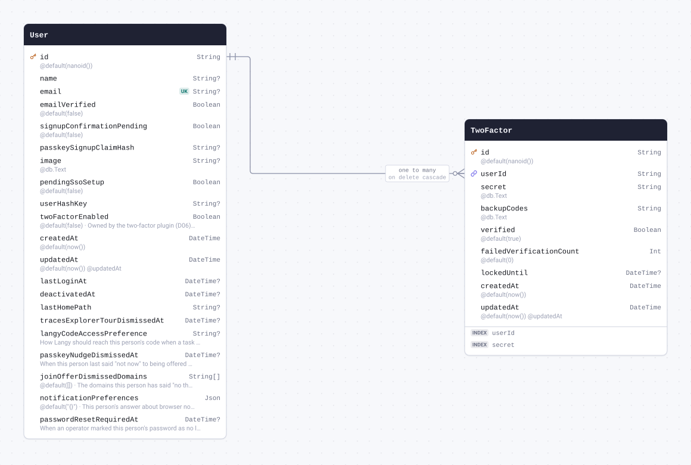

| Field                     | Type                | Constraints                       | Default              | Description |
| ------------------------- | ------------------- | --------------------------------- | -------------------- | ----------- |
| `id`                      | `String`            | PK NOT NULL                       | `nanoid()`           |             |
| `userId`                  | `String`            | NOT NULL → [User.id](#model-User) |                      |             |
| `secret`                  | `String` `@db.Text` | NOT NULL                          |                      |             |
| `backupCodes`             | `String` `@db.Text` | NOT NULL                          |                      |             |
| `verified`                | `Boolean`           | NOT NULL                          | `true`               |             |
| `failedVerificationCount` | `Int`               | NOT NULL                          | `0`                  |             |
| `lockedUntil`             | `DateTime`          | NULL                              |                      |             |
| `createdAt`               | `DateTime`          | NOT NULL                          | `now()`              |             |
| `updatedAt`               | `DateTime`          | NOT NULL                          | `now()` `@updatedAt` |             |

#### Indexes

- `@@index([userId])`
- `@@index([secret])`

#### References

- `userId` → [User.id](#model-User) (many-to-one, on delete Cascade)

#### Definition

```sql
CREATE TABLE "TwoFactor" (
    "id" TEXT NOT NULL,
    "userId" TEXT NOT NULL,
    "secret" TEXT NOT NULL,
    "backupCodes" TEXT NOT NULL,
    "verified" BOOLEAN NOT NULL DEFAULT true,
    "failedVerificationCount" INTEGER NOT NULL DEFAULT 0,
    "lockedUntil" TIMESTAMP(3),
    "createdAt" TIMESTAMP(3) NOT NULL DEFAULT CURRENT_TIMESTAMP,
    "updatedAt" TIMESTAMP(3) NOT NULL DEFAULT CURRENT_TIMESTAMP,

    CONSTRAINT "TwoFactor_pkey" PRIMARY KEY ("id")
);

CREATE INDEX "TwoFactor_userId_idx" ON "TwoFactor"("userId");

CREATE INDEX "TwoFactor_secret_idx" ON "TwoFactor"("secret");
```

<details>
<summary>Queries and their SQL</summary>

**findMany**: Every row

```ts
await prisma.twoFactor.findMany();
```

```sql
SELECT
  "public"."TwoFactor"."id",
  "public"."TwoFactor"."userId",
  "public"."TwoFactor"."secret",
  "public"."TwoFactor"."backupCodes",
  "public"."TwoFactor"."verified",
  "public"."TwoFactor"."failedVerificationCount",
  "public"."TwoFactor"."lockedUntil",
  "public"."TwoFactor"."createdAt",
  "public"."TwoFactor"."updatedAt"
FROM
  "public"."TwoFactor"
WHERE
  1 = 1
OFFSET
  $1
-- params: ["0"]
```

**count**: How many rows there are

```ts
await prisma.twoFactor.count();
```

```sql
SELECT
  COUNT(*) AS "_count$_all"
FROM
  (
    SELECT
      "public"."TwoFactor"."id"
    FROM
      "public"."TwoFactor"
    WHERE
      1 = 1
    OFFSET
      $1
  ) AS "sub"
-- params: ["0"]
```

**findMany**: Every row with its relations

```ts
await prisma.twoFactor.findMany({ include: { user: true } });
```

```sql
SELECT
  "public"."TwoFactor"."id",
  "public"."TwoFactor"."userId",
  "public"."TwoFactor"."secret",
  "public"."TwoFactor"."backupCodes",
  "public"."TwoFactor"."verified",
  "public"."TwoFactor"."failedVerificationCount",
  "public"."TwoFactor"."lockedUntil",
  "public"."TwoFactor"."createdAt",
  "public"."TwoFactor"."updatedAt"
FROM
  "public"."TwoFactor"
WHERE
  1 = 1
OFFSET
  $1
-- params: ["0"]

SELECT
  "public"."User"."id",
  "public"."User"."name",
  "public"."User"."email",
  "public"."User"."emailVerified",
  "public"."User"."signupConfirmationPending",
  "public"."User"."passkeySignupClaimHash",
  "public"."User"."image",
  "public"."User"."pendingSsoSetup",
  "public"."User"."userHashKey",
  "public"."User"."twoFactorEnabled",
  "public"."User"."createdAt",
  "public"."User"."updatedAt",
  "public"."User"."lastLoginAt",
  "public"."User"."deactivatedAt",
  "public"."User"."lastHomePath",
  "public"."User"."tracesExplorerTourDismissedAt",
  "public"."User"."langyCodeAccessPreference",
  "public"."User"."passkeyNudgeDismissedAt",
  "public"."User"."joinOfferDismissedDomains",
  "public"."User"."notificationPreferences",
  "public"."User"."passwordResetRequiredAt"
FROM
  "public"."User"
WHERE
  "public"."User"."id" IN ($1)
OFFSET
  $2
-- params: ["<userId of the rows above>","0"]
```

**findUnique**: One row by what is unique to it

```ts
await prisma.twoFactor.findUnique({ where: { id: "example" } });
```

```sql
SELECT
  "public"."TwoFactor"."id",
  "public"."TwoFactor"."userId",
  "public"."TwoFactor"."secret",
  "public"."TwoFactor"."backupCodes",
  "public"."TwoFactor"."verified",
  "public"."TwoFactor"."failedVerificationCount",
  "public"."TwoFactor"."lockedUntil",
  "public"."TwoFactor"."createdAt",
  "public"."TwoFactor"."updatedAt"
FROM
  "public"."TwoFactor"
WHERE
  (
    "public"."TwoFactor"."id" = $1
    AND 1 = 1
  )
LIMIT
  $2
OFFSET
  $3
-- params: ["example","1","0"]
```

**create**: Create a row

```ts
await prisma.twoFactor.create({
  data: { userId: "example", secret: "example", backupCodes: "example" },
});
```

```sql
INSERT INTO
  "public"."TwoFactor" (
    "id",
    "userId",
    "secret",
    "backupCodes",
    "verified",
    "failedVerificationCount",
    "createdAt",
    "updatedAt"
  )
VALUES
  ($1, $2, $3, $4, $5, $6, $7, $8)
RETURNING
  "public"."TwoFactor"."id",
  "public"."TwoFactor"."userId",
  "public"."TwoFactor"."secret",
  "public"."TwoFactor"."backupCodes",
  "public"."TwoFactor"."verified",
  "public"."TwoFactor"."failedVerificationCount",
  "public"."TwoFactor"."lockedUntil",
  "public"."TwoFactor"."createdAt",
  "public"."TwoFactor"."updatedAt"
-- params: ["<nanoid()>","example","example","example",true,"0","<now()>","<now()>"]
```

**update**: Update a row

```ts
await prisma.twoFactor.update({ where: { id: "example" }, data: { secret: "example" } });
```

```sql
SELECT
  "public"."TwoFactor"."id"
FROM
  "public"."TwoFactor"
WHERE
  (
    "public"."TwoFactor"."id" = $1
    AND 1 = 1
  )
LIMIT
  $2
OFFSET
  $3
-- params: ["example","1","0"]

UPDATE "public"."TwoFactor"
SET
  "secret" = $1,
  "updatedAt" = $2
WHERE
  (
    "public"."TwoFactor"."id" IN ($3)
    AND (
      "public"."TwoFactor"."id" = $4
      AND 1 = 1
    )
  )
RETURNING
  "public"."TwoFactor"."id",
  "public"."TwoFactor"."userId",
  "public"."TwoFactor"."secret",
  "public"."TwoFactor"."backupCodes",
  "public"."TwoFactor"."verified",
  "public"."TwoFactor"."failedVerificationCount",
  "public"."TwoFactor"."lockedUntil",
  "public"."TwoFactor"."createdAt",
  "public"."TwoFactor"."updatedAt"
-- params: ["example",{"prisma__type":"generatorCall","prisma__value":{"name":"now","args":[],"returnType":{"type":"DateTime"}}},"<id of the rows above>","example"]
```

**delete**: Delete a row

```ts
await prisma.twoFactor.delete({ where: { id: "example" } });
```

```sql
DELETE FROM "public"."TwoFactor"
WHERE
  (
    "public"."TwoFactor"."id" = $1
    AND 1 = 1
  )
RETURNING
  "public"."TwoFactor"."id",
  "public"."TwoFactor"."userId",
  "public"."TwoFactor"."secret",
  "public"."TwoFactor"."backupCodes",
  "public"."TwoFactor"."verified",
  "public"."TwoFactor"."failedVerificationCount",
  "public"."TwoFactor"."lockedUntil",
  "public"."TwoFactor"."createdAt",
  "public"."TwoFactor"."updatedAt"
-- params: ["example"]
```

</details>

<a id="model-SignInAttemptLock"></a>

### SignInAttemptLock

Consecutive failed sign-ins, and the lock they earn (GAC-09).
Spec: specs/identity/org-account-lockout.feature.

KEYED ON THE ADDRESS THAT WAS TYPED, NOT ON A USER, and that is the whole
design. We already answer "no such account" and "wrong password" with one
refusal so that sign-in cannot be used to discover who has an account. A
lock that existed only for real accounts would put that back: five wrong
guesses saying "locked" for one address and "incorrect" for another tells
an attacker which addresses are worth attacking. So an address with
nothing behind it gets a row, a count and a lock exactly like one that
resolves, and both answer identically.

`identifierHash` is a KEYED hash of the normalised address, never the
address. The key is the deployment's own secret, so this table cannot be
lifted and reversed into the list of every address anybody has ever tried
to sign in as - which is what it would otherwise become, including every
typo and every address that has no account here at all.

Row-truth, deliberately (ADR-101 R12): this is protocol state read and
written on the sign-in path, like TwoFactor's own counters next door. The
EVIDENCE an auditor reads is the identity event emitted when a lock is
taken, which is durable; these rows are reaped once they stop meaning
anything.

| Field                 | Type       | Constraints     | Default              | Description                                                                                                                                                                                                                                                                                                                        |
| --------------------- | ---------- | --------------- | -------------------- | ---------------------------------------------------------------------------------------------------------------------------------------------------------------------------------------------------------------------------------------------------------------------------------------------------------------------------------- |
| `id`                  | `String`   | PK NOT NULL     | `nanoid()`           |                                                                                                                                                                                                                                                                                                                                    |
| `identifierHash`      | `String`   | UNIQUE NOT NULL |                      | Keyed hash of the normalised address. Never the address itself.                                                                                                                                                                                                                                                                    |
| `failedCount`         | `Int`      | NOT NULL        | `0`                  | Consecutive failures since the last success. Reset by a success, not by time - "five consecutive", not five ever.                                                                                                                                                                                                                  |
| `lockedUntil`         | `DateTime` | NULL            |                      | When the current lock lifts. Null when not locked.                                                                                                                                                                                                                                                                                 |
| `consecutiveLockouts` | `Int`      | NOT NULL        | `0`                  | Locks taken since the last success. At five this stops lifting by itself and becomes an incident - see `heldForReview`.                                                                                                                                                                                                            |
| `heldForReview`       | `Boolean`  | NOT NULL        | `false`              | Held past its lock because the count of locks reached the ceiling the control names. Cleared by an administrator, or by the owner proving mailbox control through a password reset - the second is what keeps a held account from being a denial of service anyone can inflict by typing a colleague's address wrong often enough. |
| `userId`              | `String`   | NULL            |                      | Whose account this resolved to at the time, when it resolved to one. Null for an address with no account - those rows are the reason this is nullable, and the reason this table is not hung off User.                                                                                                                             |
| `createdAt`           | `DateTime` | NOT NULL        | `now()`              |                                                                                                                                                                                                                                                                                                                                    |
| `updatedAt`           | `DateTime` | NOT NULL        | `now()` `@updatedAt` |                                                                                                                                                                                                                                                                                                                                    |

#### Indexes

- `@@index([lockedUntil])`
- `@@index([userId])`

#### Definition

```sql
CREATE TABLE "SignInAttemptLock" (
    "id" TEXT NOT NULL,
    "identifierHash" TEXT NOT NULL,
    "failedCount" INTEGER NOT NULL DEFAULT 0,
    "lockedUntil" TIMESTAMP(3),
    "consecutiveLockouts" INTEGER NOT NULL DEFAULT 0,
    "heldForReview" BOOLEAN NOT NULL DEFAULT false,
    "userId" TEXT,
    "createdAt" TIMESTAMP(3) NOT NULL DEFAULT CURRENT_TIMESTAMP,
    "updatedAt" TIMESTAMP(3) NOT NULL DEFAULT CURRENT_TIMESTAMP,

    CONSTRAINT "SignInAttemptLock_pkey" PRIMARY KEY ("id")
);

CREATE UNIQUE INDEX "SignInAttemptLock_identifierHash_key" ON "SignInAttemptLock"("identifierHash");

CREATE INDEX "SignInAttemptLock_lockedUntil_idx" ON "SignInAttemptLock"("lockedUntil");

CREATE INDEX "SignInAttemptLock_userId_idx" ON "SignInAttemptLock"("userId");
```

<details>
<summary>Queries and their SQL</summary>

**findMany**: Every row

```ts
await prisma.signInAttemptLock.findMany();
```

```sql
SELECT
  "public"."SignInAttemptLock"."id",
  "public"."SignInAttemptLock"."identifierHash",
  "public"."SignInAttemptLock"."failedCount",
  "public"."SignInAttemptLock"."lockedUntil",
  "public"."SignInAttemptLock"."consecutiveLockouts",
  "public"."SignInAttemptLock"."heldForReview",
  "public"."SignInAttemptLock"."userId",
  "public"."SignInAttemptLock"."createdAt",
  "public"."SignInAttemptLock"."updatedAt"
FROM
  "public"."SignInAttemptLock"
WHERE
  1 = 1
OFFSET
  $1
-- params: ["0"]
```

**count**: How many rows there are

```ts
await prisma.signInAttemptLock.count();
```

```sql
SELECT
  COUNT(*) AS "_count$_all"
FROM
  (
    SELECT
      "public"."SignInAttemptLock"."id"
    FROM
      "public"."SignInAttemptLock"
    WHERE
      1 = 1
    OFFSET
      $1
  ) AS "sub"
-- params: ["0"]
```

**findUnique**: One row by what is unique to it

```ts
await prisma.signInAttemptLock.findUnique({ where: { id: "example" } });
```

```sql
SELECT
  "public"."SignInAttemptLock"."id",
  "public"."SignInAttemptLock"."identifierHash",
  "public"."SignInAttemptLock"."failedCount",
  "public"."SignInAttemptLock"."lockedUntil",
  "public"."SignInAttemptLock"."consecutiveLockouts",
  "public"."SignInAttemptLock"."heldForReview",
  "public"."SignInAttemptLock"."userId",
  "public"."SignInAttemptLock"."createdAt",
  "public"."SignInAttemptLock"."updatedAt"
FROM
  "public"."SignInAttemptLock"
WHERE
  (
    "public"."SignInAttemptLock"."id" = $1
    AND 1 = 1
  )
LIMIT
  $2
OFFSET
  $3
-- params: ["example","1","0"]
```

**create**: Create a row

```ts
await prisma.signInAttemptLock.create({ data: { identifierHash: "example" } });
```

```sql
INSERT INTO
  "public"."SignInAttemptLock" (
    "id",
    "identifierHash",
    "failedCount",
    "consecutiveLockouts",
    "heldForReview",
    "createdAt",
    "updatedAt"
  )
VALUES
  ($1, $2, $3, $4, $5, $6, $7)
RETURNING
  "public"."SignInAttemptLock"."id",
  "public"."SignInAttemptLock"."identifierHash",
  "public"."SignInAttemptLock"."failedCount",
  "public"."SignInAttemptLock"."lockedUntil",
  "public"."SignInAttemptLock"."consecutiveLockouts",
  "public"."SignInAttemptLock"."heldForReview",
  "public"."SignInAttemptLock"."userId",
  "public"."SignInAttemptLock"."createdAt",
  "public"."SignInAttemptLock"."updatedAt"
-- params: ["<nanoid()>","example","0","0",false,"<now()>","<now()>"]
```

**update**: Update a row

```ts
await prisma.signInAttemptLock.update({
  where: { id: "example" },
  data: { identifierHash: "example" },
});
```

```sql
SELECT
  "public"."SignInAttemptLock"."id"
FROM
  "public"."SignInAttemptLock"
WHERE
  (
    "public"."SignInAttemptLock"."id" = $1
    AND 1 = 1
  )
LIMIT
  $2
OFFSET
  $3
-- params: ["example","1","0"]

UPDATE "public"."SignInAttemptLock"
SET
  "identifierHash" = $1,
  "updatedAt" = $2
WHERE
  (
    "public"."SignInAttemptLock"."id" IN ($3)
    AND (
      "public"."SignInAttemptLock"."id" = $4
      AND 1 = 1
    )
  )
RETURNING
  "public"."SignInAttemptLock"."id",
  "public"."SignInAttemptLock"."identifierHash",
  "public"."SignInAttemptLock"."failedCount",
  "public"."SignInAttemptLock"."lockedUntil",
  "public"."SignInAttemptLock"."consecutiveLockouts",
  "public"."SignInAttemptLock"."heldForReview",
  "public"."SignInAttemptLock"."userId",
  "public"."SignInAttemptLock"."createdAt",
  "public"."SignInAttemptLock"."updatedAt"
-- params: ["example",{"prisma__type":"generatorCall","prisma__value":{"name":"now","args":[],"returnType":{"type":"DateTime"}}},"<id of the rows above>","example"]
```

**delete**: Delete a row

```ts
await prisma.signInAttemptLock.delete({ where: { id: "example" } });
```

```sql
DELETE FROM "public"."SignInAttemptLock"
WHERE
  (
    "public"."SignInAttemptLock"."id" = $1
    AND 1 = 1
  )
RETURNING
  "public"."SignInAttemptLock"."id",
  "public"."SignInAttemptLock"."identifierHash",
  "public"."SignInAttemptLock"."failedCount",
  "public"."SignInAttemptLock"."lockedUntil",
  "public"."SignInAttemptLock"."consecutiveLockouts",
  "public"."SignInAttemptLock"."heldForReview",
  "public"."SignInAttemptLock"."userId",
  "public"."SignInAttemptLock"."createdAt",
  "public"."SignInAttemptLock"."updatedAt"
-- params: ["example"]
```

</details>

<a id="model-Passkey"></a>

### Passkey

The passkey plugin's own table (D07). Protocol state, like TwoFactor: the
public key and the signature counter are the plugin's to read and write.
A passkey also becomes an `Identifier` row with provider `passkey`, which
is what makes it a sign-in method like any other - this table is the
credential, that one is the identity.

`aaguid` names the authenticator MODEL, never a device or a person, and is
only present at registration. Privacy-preserving platforms report all
zeroes, so a label derived from it is best-effort by construction.

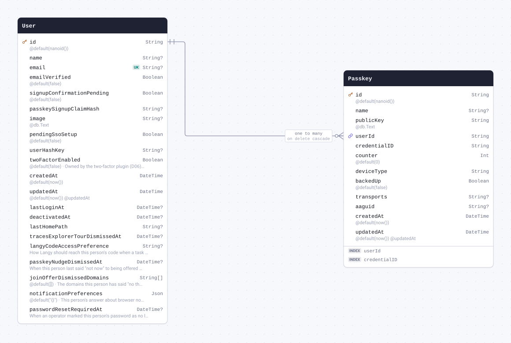

| Field          | Type                | Constraints                       | Default              | Description |
| -------------- | ------------------- | --------------------------------- | -------------------- | ----------- |
| `id`           | `String`            | PK NOT NULL                       | `nanoid()`           |             |
| `name`         | `String`            | NULL                              |                      |             |
| `publicKey`    | `String` `@db.Text` | NOT NULL                          |                      |             |
| `userId`       | `String`            | NOT NULL → [User.id](#model-User) |                      |             |
| `credentialID` | `String`            | NOT NULL                          |                      |             |
| `counter`      | `Int`               | NOT NULL                          | `0`                  |             |
| `deviceType`   | `String`            | NOT NULL                          |                      |             |
| `backedUp`     | `Boolean`           | NOT NULL                          | `false`              |             |
| `transports`   | `String`            | NULL                              |                      |             |
| `aaguid`       | `String`            | NULL                              |                      |             |
| `createdAt`    | `DateTime`          | NOT NULL                          | `now()`              |             |
| `updatedAt`    | `DateTime`          | NOT NULL                          | `now()` `@updatedAt` |             |

#### Indexes

- `@@index([userId])`
- `@@index([credentialID])`

#### References

- `userId` → [User.id](#model-User) (many-to-one, on delete Cascade)

#### Definition

```sql
CREATE TABLE "Passkey" (
    "id" TEXT NOT NULL,
    "name" TEXT,
    "publicKey" TEXT NOT NULL,
    "userId" TEXT NOT NULL,
    "credentialID" TEXT NOT NULL,
    "counter" INTEGER NOT NULL DEFAULT 0,
    "deviceType" TEXT NOT NULL,
    "backedUp" BOOLEAN NOT NULL DEFAULT false,
    "transports" TEXT,
    "aaguid" TEXT,
    "createdAt" TIMESTAMP(3) NOT NULL DEFAULT CURRENT_TIMESTAMP,
    "updatedAt" TIMESTAMP(3) NOT NULL DEFAULT CURRENT_TIMESTAMP,

    CONSTRAINT "Passkey_pkey" PRIMARY KEY ("id")
);

CREATE INDEX "Passkey_userId_idx" ON "Passkey"("userId");

CREATE INDEX "Passkey_credentialID_idx" ON "Passkey"("credentialID");
```

<details>
<summary>Queries and their SQL</summary>

**findMany**: Every row

```ts
await prisma.passkey.findMany();
```

```sql
SELECT
  "public"."Passkey"."id",
  "public"."Passkey"."name",
  "public"."Passkey"."publicKey",
  "public"."Passkey"."userId",
  "public"."Passkey"."credentialID",
  "public"."Passkey"."counter",
  "public"."Passkey"."deviceType",
  "public"."Passkey"."backedUp",
  "public"."Passkey"."transports",
  "public"."Passkey"."aaguid",
  "public"."Passkey"."createdAt",
  "public"."Passkey"."updatedAt"
FROM
  "public"."Passkey"
WHERE
  1 = 1
OFFSET
  $1
-- params: ["0"]
```

**count**: How many rows there are

```ts
await prisma.passkey.count();
```

```sql
SELECT
  COUNT(*) AS "_count$_all"
FROM
  (
    SELECT
      "public"."Passkey"."id"
    FROM
      "public"."Passkey"
    WHERE
      1 = 1
    OFFSET
      $1
  ) AS "sub"
-- params: ["0"]
```

**findMany**: Every row with its relations

```ts
await prisma.passkey.findMany({ include: { user: true } });
```

```sql
SELECT
  "public"."Passkey"."id",
  "public"."Passkey"."name",
  "public"."Passkey"."publicKey",
  "public"."Passkey"."userId",
  "public"."Passkey"."credentialID",
  "public"."Passkey"."counter",
  "public"."Passkey"."deviceType",
  "public"."Passkey"."backedUp",
  "public"."Passkey"."transports",
  "public"."Passkey"."aaguid",
  "public"."Passkey"."createdAt",
  "public"."Passkey"."updatedAt"
FROM
  "public"."Passkey"
WHERE
  1 = 1
OFFSET
  $1
-- params: ["0"]

SELECT
  "public"."User"."id",
  "public"."User"."name",
  "public"."User"."email",
  "public"."User"."emailVerified",
  "public"."User"."signupConfirmationPending",
  "public"."User"."passkeySignupClaimHash",
  "public"."User"."image",
  "public"."User"."pendingSsoSetup",
  "public"."User"."userHashKey",
  "public"."User"."twoFactorEnabled",
  "public"."User"."createdAt",
  "public"."User"."updatedAt",
  "public"."User"."lastLoginAt",
  "public"."User"."deactivatedAt",
  "public"."User"."lastHomePath",
  "public"."User"."tracesExplorerTourDismissedAt",
  "public"."User"."langyCodeAccessPreference",
  "public"."User"."passkeyNudgeDismissedAt",
  "public"."User"."joinOfferDismissedDomains",
  "public"."User"."notificationPreferences",
  "public"."User"."passwordResetRequiredAt"
FROM
  "public"."User"
WHERE
  "public"."User"."id" IN ($1)
OFFSET
  $2
-- params: ["<userId of the rows above>","0"]
```

**findUnique**: One row by what is unique to it

```ts
await prisma.passkey.findUnique({ where: { id: "example" } });
```

```sql
SELECT
  "public"."Passkey"."id",
  "public"."Passkey"."name",
  "public"."Passkey"."publicKey",
  "public"."Passkey"."userId",
  "public"."Passkey"."credentialID",
  "public"."Passkey"."counter",
  "public"."Passkey"."deviceType",
  "public"."Passkey"."backedUp",
  "public"."Passkey"."transports",
  "public"."Passkey"."aaguid",
  "public"."Passkey"."createdAt",
  "public"."Passkey"."updatedAt"
FROM
  "public"."Passkey"
WHERE
  (
    "public"."Passkey"."id" = $1
    AND 1 = 1
  )
LIMIT
  $2
OFFSET
  $3
-- params: ["example","1","0"]
```

**create**: Create a row

```ts
await prisma.passkey.create({
  data: { publicKey: "example", userId: "example", credentialID: "example", deviceType: "example" },
});
```

```sql
INSERT INTO
  "public"."Passkey" (
    "id",
    "publicKey",
    "userId",
    "credentialID",
    "counter",
    "deviceType",
    "backedUp",
    "createdAt",
    "updatedAt"
  )
VALUES
  ($1, $2, $3, $4, $5, $6, $7, $8, $9)
RETURNING
  "public"."Passkey"."id",
  "public"."Passkey"."name",
  "public"."Passkey"."publicKey",
  "public"."Passkey"."userId",
  "public"."Passkey"."credentialID",
  "public"."Passkey"."counter",
  "public"."Passkey"."deviceType",
  "public"."Passkey"."backedUp",
  "public"."Passkey"."transports",
  "public"."Passkey"."aaguid",
  "public"."Passkey"."createdAt",
  "public"."Passkey"."updatedAt"
-- params: ["<nanoid()>","example","example","example","0","example",false,"<now()>","<now()>"]
```

**update**: Update a row

```ts
await prisma.passkey.update({ where: { id: "example" }, data: { name: "example" } });
```

```sql
SELECT
  "public"."Passkey"."id"
FROM
  "public"."Passkey"
WHERE
  (
    "public"."Passkey"."id" = $1
    AND 1 = 1
  )
LIMIT
  $2
OFFSET
  $3
-- params: ["example","1","0"]

UPDATE "public"."Passkey"
SET
  "name" = $1,
  "updatedAt" = $2
WHERE
  (
    "public"."Passkey"."id" IN ($3)
    AND (
      "public"."Passkey"."id" = $4
      AND 1 = 1
    )
  )
RETURNING
  "public"."Passkey"."id",
  "public"."Passkey"."name",
  "public"."Passkey"."publicKey",
  "public"."Passkey"."userId",
  "public"."Passkey"."credentialID",
  "public"."Passkey"."counter",
  "public"."Passkey"."deviceType",
  "public"."Passkey"."backedUp",
  "public"."Passkey"."transports",
  "public"."Passkey"."aaguid",
  "public"."Passkey"."createdAt",
  "public"."Passkey"."updatedAt"
-- params: ["example",{"prisma__type":"generatorCall","prisma__value":{"name":"now","args":[],"returnType":{"type":"DateTime"}}},"<id of the rows above>","example"]
```

**delete**: Delete a row

```ts
await prisma.passkey.delete({ where: { id: "example" } });
```

```sql
DELETE FROM "public"."Passkey"
WHERE
  (
    "public"."Passkey"."id" = $1
    AND 1 = 1
  )
RETURNING
  "public"."Passkey"."id",
  "public"."Passkey"."name",
  "public"."Passkey"."publicKey",
  "public"."Passkey"."userId",
  "public"."Passkey"."credentialID",
  "public"."Passkey"."counter",
  "public"."Passkey"."deviceType",
  "public"."Passkey"."backedUp",
  "public"."Passkey"."transports",
  "public"."Passkey"."aaguid",
  "public"."Passkey"."createdAt",
  "public"."Passkey"."updatedAt"
-- params: ["example"]
```

</details>

<a id="model-MfaEnrollment"></a>

### MfaEnrollment

The two-step verification pipeline's projection (D06 - see
specs/identity/mfa-and-session-shape.feature). One row per PERSON, because
one person has one setup however many organizations they belong to.

A pure event-truth head like `SsoConnection`: every column is fold-written,
rows are never deleted (DISABLED is a tombstone, so history survives being
turned off), and a replay rebuilds it whole-row from the event log. The
cursor columns are inline because the fold produces exactly one row per
aggregate - the `Identifier` fan-out needed its own cursor table, this
does not.

Every column here is a lifecycle fact. There is deliberately nowhere in
this model a secret or a backup code could be put: `consumedBackupCodeIndexes`
holds POSITIONS, which is what lets "how many are left" be answered
without the projection ever knowing a code.

| Field                       | Type       | Constraints | Default              | Description                                                                                    |
| --------------------------- | ---------- | ----------- | -------------------- | ---------------------------------------------------------------------------------------------- |
| `userId`                    | `String`   | PK NOT NULL |                      | The user. Also the aggregate id and the tenant - one identity history per person (ADR-029 §4). |
| `enrollmentId`              | `String`   | NULL        |                      | The current enrollment, or NULL for somebody who never started one.                            |
| `method`                    | `String`   | NULL        |                      | totp. Never sms.                                                                               |
| `state`                     | `String`   | NOT NULL    |                      | NONE \| PENDING \| ENABLED \| EXPIRED \| DISABLED                                              |
| `enrolledAt`                | `DateTime` | NULL        |                      |                                                                                                |
| `confirmedAt`               | `DateTime` | NULL        |                      |                                                                                                |
| `expiredAt`                 | `DateTime` | NULL        |                      |                                                                                                |
| `disabledAt`                | `DateTime` | NULL        |                      |                                                                                                |
| `disabledVia`               | `String`   | NULL        |                      | password+totp \| org-admin - who ended it, and on whose authority.                             |
| `backupCodeCount`           | `Int`      | NOT NULL    | `0`                  |                                                                                                |
| `consumedBackupCodeIndexes` | `Int[]`    | NOT NULL    | `[]`                 | Positions already spent, ascending. Never codes.                                               |
| `failedCount`               | `Int`      | NOT NULL    | `0`                  |                                                                                                |
| `occurredAt`                | `DateTime` | NOT NULL    |                      |                                                                                                |
| `lastEventId`               | `String`   | NOT NULL    |                      |                                                                                                |
| `acceptedAt`                | `DateTime` | NOT NULL    |                      |                                                                                                |
| `projectionVersion`         | `String`   | NOT NULL    |                      |                                                                                                |
| `createdAt`                 | `DateTime` | NOT NULL    | `now()`              |                                                                                                |
| `updatedAt`                 | `DateTime` | NOT NULL    | `now()` `@updatedAt` |                                                                                                |

#### Indexes

- `@@index([state])`

#### Definition

```sql
CREATE TABLE "MfaEnrollment" (
    "userId" TEXT NOT NULL,
    "enrollmentId" TEXT,
    "method" TEXT,
    "state" TEXT NOT NULL,
    "enrolledAt" TIMESTAMP(3),
    "confirmedAt" TIMESTAMP(3),
    "expiredAt" TIMESTAMP(3),
    "disabledAt" TIMESTAMP(3),
    "disabledVia" TEXT,
    "backupCodeCount" INTEGER NOT NULL DEFAULT 0,
    "consumedBackupCodeIndexes" INTEGER[] DEFAULT ARRAY[]::INTEGER[],
    "failedCount" INTEGER NOT NULL DEFAULT 0,
    "occurredAt" TIMESTAMP(3) NOT NULL,
    "lastEventId" TEXT NOT NULL,
    "acceptedAt" TIMESTAMP(3) NOT NULL,
    "projectionVersion" TEXT NOT NULL,
    "createdAt" TIMESTAMP(3) NOT NULL DEFAULT CURRENT_TIMESTAMP,
    "updatedAt" TIMESTAMP(3) NOT NULL DEFAULT CURRENT_TIMESTAMP,

    CONSTRAINT "MfaEnrollment_pkey" PRIMARY KEY ("userId")
);

CREATE INDEX "MfaEnrollment_state_idx" ON "MfaEnrollment"("state");
```

<details>
<summary>Queries and their SQL</summary>

**findMany**: Every row

```ts
await prisma.mfaEnrollment.findMany();
```

```sql
SELECT
  "public"."MfaEnrollment"."userId",
  "public"."MfaEnrollment"."enrollmentId",
  "public"."MfaEnrollment"."method",
  "public"."MfaEnrollment"."state",
  "public"."MfaEnrollment"."enrolledAt",
  "public"."MfaEnrollment"."confirmedAt",
  "public"."MfaEnrollment"."expiredAt",
  "public"."MfaEnrollment"."disabledAt",
  "public"."MfaEnrollment"."disabledVia",
  "public"."MfaEnrollment"."backupCodeCount",
  "public"."MfaEnrollment"."consumedBackupCodeIndexes",
  "public"."MfaEnrollment"."failedCount",
  "public"."MfaEnrollment"."occurredAt",
  "public"."MfaEnrollment"."lastEventId",
  "public"."MfaEnrollment"."acceptedAt",
  "public"."MfaEnrollment"."projectionVersion",
  "public"."MfaEnrollment"."createdAt",
  "public"."MfaEnrollment"."updatedAt"
FROM
  "public"."MfaEnrollment"
WHERE
  1 = 1
OFFSET
  $1
-- params: ["0"]
```

**count**: How many rows there are

```ts
await prisma.mfaEnrollment.count();
```

```sql
SELECT
  COUNT(*) AS "_count$_all"
FROM
  (
    SELECT
      "public"."MfaEnrollment"."userId"
    FROM
      "public"."MfaEnrollment"
    WHERE
      1 = 1
    OFFSET
      $1
  ) AS "sub"
-- params: ["0"]
```

**findUnique**: One row by what is unique to it

```ts
await prisma.mfaEnrollment.findUnique({ where: { userId: "example" } });
```

```sql
SELECT
  "public"."MfaEnrollment"."userId",
  "public"."MfaEnrollment"."enrollmentId",
  "public"."MfaEnrollment"."method",
  "public"."MfaEnrollment"."state",
  "public"."MfaEnrollment"."enrolledAt",
  "public"."MfaEnrollment"."confirmedAt",
  "public"."MfaEnrollment"."expiredAt",
  "public"."MfaEnrollment"."disabledAt",
  "public"."MfaEnrollment"."disabledVia",
  "public"."MfaEnrollment"."backupCodeCount",
  "public"."MfaEnrollment"."consumedBackupCodeIndexes",
  "public"."MfaEnrollment"."failedCount",
  "public"."MfaEnrollment"."occurredAt",
  "public"."MfaEnrollment"."lastEventId",
  "public"."MfaEnrollment"."acceptedAt",
  "public"."MfaEnrollment"."projectionVersion",
  "public"."MfaEnrollment"."createdAt",
  "public"."MfaEnrollment"."updatedAt"
FROM
  "public"."MfaEnrollment"
WHERE
  (
    "public"."MfaEnrollment"."userId" = $1
    AND 1 = 1
  )
LIMIT
  $2
OFFSET
  $3
-- params: ["example","1","0"]
```

**create**: Create a row

```ts
await prisma.mfaEnrollment.create({
  data: {
    userId: "example",
    state: "example",
    occurredAt: new Date("2026-01-01T00:00:00.000Z"),
    lastEventId: "example",
    acceptedAt: new Date("2026-01-01T00:00:00.000Z"),
    projectionVersion: "example",
  },
});
```

```sql
INSERT INTO
  "public"."MfaEnrollment" (
    "userId",
    "state",
    "backupCodeCount",
    "consumedBackupCodeIndexes",
    "failedCount",
    "occurredAt",
    "lastEventId",
    "acceptedAt",
    "projectionVersion",
    "createdAt",
    "updatedAt"
  )
VALUES
  ($1, $2, $3, $4, $5, $6, $7, $8, $9, $10, $11)
RETURNING
  "public"."MfaEnrollment"."userId",
  "public"."MfaEnrollment"."enrollmentId",
  "public"."MfaEnrollment"."method",
  "public"."MfaEnrollment"."state",
  "public"."MfaEnrollment"."enrolledAt",
  "public"."MfaEnrollment"."confirmedAt",
  "public"."MfaEnrollment"."expiredAt",
  "public"."MfaEnrollment"."disabledAt",
  "public"."MfaEnrollment"."disabledVia",
  "public"."MfaEnrollment"."backupCodeCount",
  "public"."MfaEnrollment"."consumedBackupCodeIndexes",
  "public"."MfaEnrollment"."failedCount",
  "public"."MfaEnrollment"."occurredAt",
  "public"."MfaEnrollment"."lastEventId",
  "public"."MfaEnrollment"."acceptedAt",
  "public"."MfaEnrollment"."projectionVersion",
  "public"."MfaEnrollment"."createdAt",
  "public"."MfaEnrollment"."updatedAt"
-- params: ["example","example","0",[],"0","2026-01-01T00:00:00.000Z","example","2026-01-01T00:00:00.000Z","example","<now()>","<now()>"]
```

**update**: Update a row

```ts
await prisma.mfaEnrollment.update({
  where: { userId: "example" },
  data: { enrollmentId: "example" },
});
```

```sql
SELECT
  "public"."MfaEnrollment"."userId"
FROM
  "public"."MfaEnrollment"
WHERE
  (
    "public"."MfaEnrollment"."userId" = $1
    AND 1 = 1
  )
LIMIT
  $2
OFFSET
  $3
-- params: ["example","1","0"]

UPDATE "public"."MfaEnrollment"
SET
  "enrollmentId" = $1,
  "updatedAt" = $2
WHERE
  (
    "public"."MfaEnrollment"."userId" IN ($3)
    AND (
      "public"."MfaEnrollment"."userId" = $4
      AND 1 = 1
    )
  )
RETURNING
  "public"."MfaEnrollment"."userId",
  "public"."MfaEnrollment"."enrollmentId",
  "public"."MfaEnrollment"."method",
  "public"."MfaEnrollment"."state",
  "public"."MfaEnrollment"."enrolledAt",
  "public"."MfaEnrollment"."confirmedAt",
  "public"."MfaEnrollment"."expiredAt",
  "public"."MfaEnrollment"."disabledAt",
  "public"."MfaEnrollment"."disabledVia",
  "public"."MfaEnrollment"."backupCodeCount",
  "public"."MfaEnrollment"."consumedBackupCodeIndexes",
  "public"."MfaEnrollment"."failedCount",
  "public"."MfaEnrollment"."occurredAt",
  "public"."MfaEnrollment"."lastEventId",
  "public"."MfaEnrollment"."acceptedAt",
  "public"."MfaEnrollment"."projectionVersion",
  "public"."MfaEnrollment"."createdAt",
  "public"."MfaEnrollment"."updatedAt"
-- params: ["example",{"prisma__type":"generatorCall","prisma__value":{"name":"now","args":[],"returnType":{"type":"DateTime"}}},"<userId of the rows above>","example"]
```

**delete**: Delete a row

```ts
await prisma.mfaEnrollment.delete({ where: { userId: "example" } });
```

```sql
DELETE FROM "public"."MfaEnrollment"
WHERE
  (
    "public"."MfaEnrollment"."userId" = $1
    AND 1 = 1
  )
RETURNING
  "public"."MfaEnrollment"."userId",
  "public"."MfaEnrollment"."enrollmentId",
  "public"."MfaEnrollment"."method",
  "public"."MfaEnrollment"."state",
  "public"."MfaEnrollment"."enrolledAt",
  "public"."MfaEnrollment"."confirmedAt",
  "public"."MfaEnrollment"."expiredAt",
  "public"."MfaEnrollment"."disabledAt",
  "public"."MfaEnrollment"."disabledVia",
  "public"."MfaEnrollment"."backupCodeCount",
  "public"."MfaEnrollment"."consumedBackupCodeIndexes",
  "public"."MfaEnrollment"."failedCount",
  "public"."MfaEnrollment"."occurredAt",
  "public"."MfaEnrollment"."lastEventId",
  "public"."MfaEnrollment"."acceptedAt",
  "public"."MfaEnrollment"."projectionVersion",
  "public"."MfaEnrollment"."createdAt",
  "public"."MfaEnrollment"."updatedAt"
-- params: ["example"]
```

</details>

<a id="model-SsoConnection"></a>

### SsoConnection

The SSO connection pipeline's projection (ADR-117 §5, D04 - see
specs/identity/sso-connection-lifecycle.feature). A pure event-truth head
like `Identifier`: every column is fold-written, rows are never deleted
(TORN_DOWN is a tombstone), and a replay rebuilds it whole-row from the
event log.

The fold cursor lives on the row rather than in a sibling table, because
one row IS one aggregate here - a connection - so there is nothing for a
separate cursor table to key on that this row does not already key on.

No relation to Organization on purpose, matching `Identifier`: a
projection is rebuilt from events, and a foreign key would make a replay
depend on relational state the log does not carry. `idpMetadata` holds
endpoints and credential REFERENCES; no secret is ever stored here or in
any event.


| Field                     | Type                                                               | Constraints | Default    | Description                                                                                                                                                                                                                                                                                                                                                                                                                                                                                                                                                        |
| ------------------------- | ------------------------------------------------------------------ | ----------- | ---------- | ------------------------------------------------------------------------------------------------------------------------------------------------------------------------------------------------------------------------------------------------------------------------------------------------------------------------------------------------------------------------------------------------------------------------------------------------------------------------------------------------------------------------------------------------------------------ |
| `id`                      | `String`                                                           | PK NOT NULL |            |                                                                                                                                                                                                                                                                                                                                                                                                                                                                                                                                                                    |
| `organizationId`          | `String`                                                           | NOT NULL    |            |                                                                                                                                                                                                                                                                                                                                                                                                                                                                                                                                                                    |
| `type`                    | `String`                                                           | NOT NULL    |            | oidc \| saml                                                                                                                                                                                                                                                                                                                                                                                                                                                                                                                                                       |
| `state`                   | `String`                                                           | NOT NULL    |            | DRAFT \| CLAIMED \| APPROVED \| REJECTED \| DISCARDED \| VERIFICATION_PENDING \| VERIFIED \| ACTIVE \| SUSPENDED \| TEARDOWN_PENDING \| TORN_DOWN                                                                                                                                                                                                                                                                                                                                                                                                                  |
| `claimedDomains`          | `String[]`                                                         | NOT NULL    |            |                                                                                                                                                                                                                                                                                                                                                                                                                                                                                                                                                                    |
| `domainClaims`            | `Json`                                                             | NOT NULL    | `"[]"`     | [{ domain, state, claimedAtMs, claimedByActorId, decidedAtMs, decidedByActorId, authority, waitedMs, note }] - every claim this connection has made and how long each waited to be decided. The tier-3 approval queue is a read of this column, and the epic's Open Q2 wants that latency measured from the day the queue exists.                                                                                                                                                                                                                                  |
| `approvedDomains`         | `String[]`                                                         | NOT NULL    |            |                                                                                                                                                                                                                                                                                                                                                                                                                                                                                                                                                                    |
| `verifiedDomains`         | `String[]`                                                         | NOT NULL    |            | The only domains that ever route, and only while state is ACTIVE.                                                                                                                                                                                                                                                                                                                                                                                                                                                                                                  |
| `lapsedDomains`           | `String[]`                                                         | NOT NULL    |            | The subset of `verifiedDomains` whose published record stayed missing through its grace window (ADR-123). They still ROUTE - everyone already here signs in unchanged - and they stop vouching for anybody NEW: no provisioning on first sign-in, no walking in by domain. A column rather than a read of the JSON below, because both questions are asked on a sign-in path and have to be one indexed predicate.                                                                                                                                                 |
| `domainVerifications`     | `Json`                                                             | NOT NULL    | `"[]"`     | [{ domain, method, actorId, verifiedAtMs, proofState, firstAbsentAtMs, graceEndsAtMs }] - what proved each verified domain, who, and whether that evidence is still there. Kept on the row rather than only in the log so that an operator-attested domain can never be read as one the customer proved, and a wavering one never as one nothing is doubting.                                                                                                                                                                                                      |
| `pendingVerification`     | `Json`                                                             | NULL        |            | { domain, method, tokenHash } while a ceremony is in flight.                                                                                                                                                                                                                                                                                                                                                                                                                                                                                                       |
| `idpMetadata`             | `Json`                                                             | NOT NULL    |            |                                                                                                                                                                                                                                                                                                                                                                                                                                                                                                                                                                    |
| `arrivalPolicy`           | `String`                                                           | NOT NULL    | `"refuse"` | admit \| request \| refuse - what this connection does with somebody who signs in through it and is not a member yet (ADR-117 3). Stated at registration and changed by the setup journey, so it is never absent and no reader has to decide what absence means. This was two fields for a while - a boolean `allowsJit` beside it, kept in step by the fold - and they disagreed about the middle answer.                                                                                                                                                         |
| `allowsJit`               | `Boolean`                                                          | NOT NULL    | `false`    | DEAD, AND STAYING FOR ONE RELEASE. Nothing reads or writes this; the routing repository derives the same answer from `arrivalPolicy`. It is declared so the schema still describes the table, and left in place so the PREVIOUS release's pods — which select it by name on every connection read — keep working through the rollout. Dropping it in the release that stopped reading it would stop single sign-on routing and the connection projection for the length of the deploy. Dropped by `20260827120000_drop_sso_connection_allows_jit` in the next one. |
| `arrivalPolicyDecidedAt`  | `DateTime`                                                         | NULL        |            | When somebody CHOSE the policy above, and null while the registration default stands. A different fact from the policy rather than a second copy of it: a connection always has a behaviour, and separately somebody has or has not decided on it. Going live waits for the deciding - "turn everybody away" is a decision too.                                                                                                                                                                                                                                    |
| `source`                  | `String`                                                           | NOT NULL    |            | self-serve \| legacy-grandfathered                                                                                                                                                                                                                                                                                                                                                                                                                                                                                                                                 |
| `testLoginAccountId`      | `String`                                                           | NULL        |            |                                                                                                                                                                                                                                                                                                                                                                                                                                                                                                                                                                    |
| `replacesConnectionId`    | `String`                                                           | NULL        |            | The grandfathered connection this direct connection replaces. Null for ordinary connections and for the grandfathered predecessor itself. Partial uniqueness for nonterminal replacements is installed by the flattened migration; Prisma cannot express that predicate here.                                                                                                                                                                                                                                                                                      |
| `migrationPhase`          | [`SsoConnectionMigrationPhase`](#enum-SsoConnectionMigrationPhase) | NULL        |            | SETUP \| GRACE_LEGACY \| GRACE_DIRECT \| FINALIZING \| FINALIZED. Null means this connection is not a legacy-to-direct replacement.                                                                                                                                                                                                                                                                                                                                                                                                                                |
| `graceStartedAt`          | `DateTime`                                                         | NULL        |            |                                                                                                                                                                                                                                                                                                                                                                                                                                                                                                                                                                    |
| `routeChangedAt`          | `DateTime`                                                         | NULL        |            | When an administrator last selected the normal route. This is audit evidence only: routing is derived from `migrationPhase`, never recency.                                                                                                                                                                                                                                                                                                                                                                                                                        |
| `finalizationRequestedAt` | `DateTime`                                                         | NULL        |            |                                                                                                                                                                                                                                                                                                                                                                                                                                                                                                                                                                    |
| `finalizedAt`             | `DateTime`                                                         | NULL        |            |                                                                                                                                                                                                                                                                                                                                                                                                                                                                                                                                                                    |
| `rejection`               | `Json`                                                             | NULL        |            | { domain, note } - the last ops rejection, read back on a re-claim.                                                                                                                                                                                                                                                                                                                                                                                                                                                                                                |
| `createdBy`               | `String`                                                           | NULL        |            |                                                                                                                                                                                                                                                                                                                                                                                                                                                                                                                                                                    |
| `tearDownAfter`           | `DateTime`                                                         | NULL        |            | While TEARDOWN_PENDING: when the process manager's wake completes it.                                                                                                                                                                                                                                                                                                                                                                                                                                                                                              |
| `occurredAt`              | `DateTime`                                                         | NOT NULL    |            |                                                                                                                                                                                                                                                                                                                                                                                                                                                                                                                                                                    |
| `lastEventId`             | `String`                                                           | NOT NULL    |            |                                                                                                                                                                                                                                                                                                                                                                                                                                                                                                                                                                    |
| `acceptedAt`              | `DateTime`                                                         | NOT NULL    |            |                                                                                                                                                                                                                                                                                                                                                                                                                                                                                                                                                                    |
| `projectionVersion`       | `String`                                                           | NOT NULL    |            |                                                                                                                                                                                                                                                                                                                                                                                                                                                                                                                                                                    |
| `createdAt`               | `DateTime`                                                         | NOT NULL    |            | Event-derived, not database-managed: `@default(now())` / `@updatedAt` would make a replayed row differ from the row it rebuilds, which is exactly the parity this projection has to keep.                                                                                                                                                                                                                                                                                                                                                                          |
| `updatedAt`               | `DateTime`                                                         | NOT NULL    |            |                                                                                                                                                                                                                                                                                                                                                                                                                                                                                                                                                                    |

#### Indexes

- `@@index([organizationId])`
- `@@index([organizationId, migrationPhase])`
- `@@index([state])`
- `@@index([verifiedDomains])`
- `@@index([lapsedDomains])`

#### Referenced by

- `id` ← [SsoConnectionReproofCursor.connectionId](#model-SsoConnectionReproofCursor) (one-to-one, on delete Cascade)

#### Definition

```sql
CREATE TABLE "SsoConnection" (
    "id" TEXT NOT NULL,
    "organizationId" TEXT NOT NULL,
    "type" TEXT NOT NULL,
    "state" TEXT NOT NULL,
    "claimedDomains" TEXT[],
    "domainClaims" JSONB NOT NULL DEFAULT '[]',
    "approvedDomains" TEXT[],
    "verifiedDomains" TEXT[],
    "lapsedDomains" TEXT[],
    "domainVerifications" JSONB NOT NULL DEFAULT '[]',
    "pendingVerification" JSONB,
    "idpMetadata" JSONB NOT NULL,
    "arrivalPolicy" TEXT NOT NULL DEFAULT 'refuse',
    "allowsJit" BOOLEAN NOT NULL DEFAULT false,
    "arrivalPolicyDecidedAt" TIMESTAMP(3),
    "source" TEXT NOT NULL,
    "testLoginAccountId" TEXT,
    "replacesConnectionId" TEXT,
    "migrationPhase" "SsoConnectionMigrationPhase",
    "graceStartedAt" TIMESTAMP(3),
    "routeChangedAt" TIMESTAMP(3),
    "finalizationRequestedAt" TIMESTAMP(3),
    "finalizedAt" TIMESTAMP(3),
    "rejection" JSONB,
    "createdBy" TEXT,
    "tearDownAfter" TIMESTAMP(3),
    "occurredAt" TIMESTAMP(3) NOT NULL,
    "lastEventId" TEXT NOT NULL,
    "acceptedAt" TIMESTAMP(3) NOT NULL,
    "projectionVersion" TEXT NOT NULL,
    "createdAt" TIMESTAMP(3) NOT NULL,
    "updatedAt" TIMESTAMP(3) NOT NULL,

    CONSTRAINT "SsoConnection_pkey" PRIMARY KEY ("id")
);

CREATE INDEX "SsoConnection_organizationId_idx" ON "SsoConnection"("organizationId");

CREATE INDEX "SsoConnection_organizationId_migrationPhase_idx" ON "SsoConnection"("organizationId", "migrationPhase");

CREATE INDEX "SsoConnection_state_idx" ON "SsoConnection"("state");

CREATE INDEX "SsoConnection_verifiedDomains_idx" ON "SsoConnection" USING GIN ("verifiedDomains");

CREATE INDEX "SsoConnection_lapsedDomains_idx" ON "SsoConnection" USING GIN ("lapsedDomains");
```

<details>
<summary>Queries and their SQL</summary>

**findMany**: Every row

```ts
await prisma.ssoConnection.findMany();
```

```sql
SELECT
  "public"."SsoConnection"."id",
  "public"."SsoConnection"."organizationId",
  "public"."SsoConnection"."type",
  "public"."SsoConnection"."state",
  "public"."SsoConnection"."claimedDomains",
  "public"."SsoConnection"."domainClaims",
  "public"."SsoConnection"."approvedDomains",
  "public"."SsoConnection"."verifiedDomains",
  "public"."SsoConnection"."lapsedDomains",
  "public"."SsoConnection"."domainVerifications",
  "public"."SsoConnection"."pendingVerification",
  "public"."SsoConnection"."idpMetadata",
  "public"."SsoConnection"."arrivalPolicy",
  "public"."SsoConnection"."allowsJit",
  "public"."SsoConnection"."arrivalPolicyDecidedAt",
  "public"."SsoConnection"."source",
  "public"."SsoConnection"."testLoginAccountId",
  "public"."SsoConnection"."replacesConnectionId",
  "public"."SsoConnection"."migrationPhase"::text,
  "public"."SsoConnection"."graceStartedAt",
  "public"."SsoConnection"."routeChangedAt",
  "public"."SsoConnection"."finalizationRequestedAt",
  "public"."SsoConnection"."finalizedAt",
  "public"."SsoConnection"."rejection",
  "public"."SsoConnection"."createdBy",
  "public"."SsoConnection"."tearDownAfter",
  "public"."SsoConnection"."occurredAt",
  "public"."SsoConnection"."lastEventId",
  "public"."SsoConnection"."acceptedAt",
  "public"."SsoConnection"."projectionVersion",
  "public"."SsoConnection"."createdAt",
  "public"."SsoConnection"."updatedAt"
FROM
  "public"."SsoConnection"
WHERE
  1 = 1
OFFSET
  $1
-- params: ["0"]
```

**count**: How many rows there are

```ts
await prisma.ssoConnection.count();
```

```sql
SELECT
  COUNT(*) AS "_count$_all"
FROM
  (
    SELECT
      "public"."SsoConnection"."id"
    FROM
      "public"."SsoConnection"
    WHERE
      1 = 1
    OFFSET
      $1
  ) AS "sub"
-- params: ["0"]
```

**findMany**: Every row with its relations

```ts
await prisma.ssoConnection.findMany({ include: { reproofCursor: true } });
```

```sql
SELECT
  "public"."SsoConnection"."id",
  "public"."SsoConnection"."organizationId",
  "public"."SsoConnection"."type",
  "public"."SsoConnection"."state",
  "public"."SsoConnection"."claimedDomains",
  "public"."SsoConnection"."domainClaims",
  "public"."SsoConnection"."approvedDomains",
  "public"."SsoConnection"."verifiedDomains",
  "public"."SsoConnection"."lapsedDomains",
  "public"."SsoConnection"."domainVerifications",
  "public"."SsoConnection"."pendingVerification",
  "public"."SsoConnection"."idpMetadata",
  "public"."SsoConnection"."arrivalPolicy",
  "public"."SsoConnection"."allowsJit",
  "public"."SsoConnection"."arrivalPolicyDecidedAt",
  "public"."SsoConnection"."source",
  "public"."SsoConnection"."testLoginAccountId",
  "public"."SsoConnection"."replacesConnectionId",
  "public"."SsoConnection"."migrationPhase"::text,
  "public"."SsoConnection"."graceStartedAt",
  "public"."SsoConnection"."routeChangedAt",
  "public"."SsoConnection"."finalizationRequestedAt",
  "public"."SsoConnection"."finalizedAt",
  "public"."SsoConnection"."rejection",
  "public"."SsoConnection"."createdBy",
  "public"."SsoConnection"."tearDownAfter",
  "public"."SsoConnection"."occurredAt",
  "public"."SsoConnection"."lastEventId",
  "public"."SsoConnection"."acceptedAt",
  "public"."SsoConnection"."projectionVersion",
  "public"."SsoConnection"."createdAt",
  "public"."SsoConnection"."updatedAt"
FROM
  "public"."SsoConnection"
WHERE
  1 = 1
OFFSET
  $1
-- params: ["0"]

SELECT
  "public"."SsoConnectionReproofCursor"."connectionId",
  "public"."SsoConnectionReproofCursor"."lastReproofAt"
FROM
  "public"."SsoConnectionReproofCursor"
WHERE
  "public"."SsoConnectionReproofCursor"."connectionId" IN ($1)
OFFSET
  $2
-- params: ["<id of the rows above>","0"]
```

**findUnique**: One row by what is unique to it

```ts
await prisma.ssoConnection.findUnique({ where: { id: "example" } });
```

```sql
SELECT
  "public"."SsoConnection"."id",
  "public"."SsoConnection"."organizationId",
  "public"."SsoConnection"."type",
  "public"."SsoConnection"."state",
  "public"."SsoConnection"."claimedDomains",
  "public"."SsoConnection"."domainClaims",
  "public"."SsoConnection"."approvedDomains",
  "public"."SsoConnection"."verifiedDomains",
  "public"."SsoConnection"."lapsedDomains",
  "public"."SsoConnection"."domainVerifications",
  "public"."SsoConnection"."pendingVerification",
  "public"."SsoConnection"."idpMetadata",
  "public"."SsoConnection"."arrivalPolicy",
  "public"."SsoConnection"."allowsJit",
  "public"."SsoConnection"."arrivalPolicyDecidedAt",
  "public"."SsoConnection"."source",
  "public"."SsoConnection"."testLoginAccountId",
  "public"."SsoConnection"."replacesConnectionId",
  "public"."SsoConnection"."migrationPhase"::text,
  "public"."SsoConnection"."graceStartedAt",
  "public"."SsoConnection"."routeChangedAt",
  "public"."SsoConnection"."finalizationRequestedAt",
  "public"."SsoConnection"."finalizedAt",
  "public"."SsoConnection"."rejection",
  "public"."SsoConnection"."createdBy",
  "public"."SsoConnection"."tearDownAfter",
  "public"."SsoConnection"."occurredAt",
  "public"."SsoConnection"."lastEventId",
  "public"."SsoConnection"."acceptedAt",
  "public"."SsoConnection"."projectionVersion",
  "public"."SsoConnection"."createdAt",
  "public"."SsoConnection"."updatedAt"
FROM
  "public"."SsoConnection"
WHERE
  (
    "public"."SsoConnection"."id" = $1
    AND 1 = 1
  )
LIMIT
  $2
OFFSET
  $3
-- params: ["example","1","0"]
```

**create**: Create a row

```ts
await prisma.ssoConnection.create({
  data: {
    id: "example",
    organizationId: "example",
    type: "example",
    state: "example",
    claimedDomains: ["example"],
    approvedDomains: ["example"],
    verifiedDomains: ["example"],
    lapsedDomains: ["example"],
    idpMetadata: {},
    source: "example",
    occurredAt: new Date("2026-01-01T00:00:00.000Z"),
    lastEventId: "example",
    acceptedAt: new Date("2026-01-01T00:00:00.000Z"),
    projectionVersion: "example",
    createdAt: new Date("2026-01-01T00:00:00.000Z"),
    updatedAt: new Date("2026-01-01T00:00:00.000Z"),
  },
});
```

```sql
INSERT INTO
  "public"."SsoConnection" (
    "id",
    "organizationId",
    "type",
    "state",
    "claimedDomains",
    "domainClaims",
    "approvedDomains",
    "verifiedDomains",
    "lapsedDomains",
    "domainVerifications",
    "idpMetadata",
    "arrivalPolicy",
    "allowsJit",
    "source",
    "occurredAt",
    "lastEventId",
    "acceptedAt",
    "projectionVersion",
    "createdAt",
    "updatedAt"
  )
VALUES
  (
    $1,
    $2,
    $3,
    $4,
    $5,
    $6,
    $7,
    $8,
    $9,
    $10,
    $11,
    $12,
    $13,
    $14,
    $15,
    $16,
    $17,
    $18,
    $19,
    $20
  )
RETURNING
  "public"."SsoConnection"."id",
  "public"."SsoConnection"."organizationId",
  "public"."SsoConnection"."type",
  "public"."SsoConnection"."state",
  "public"."SsoConnection"."claimedDomains",
  "public"."SsoConnection"."domainClaims",
  "public"."SsoConnection"."approvedDomains",
  "public"."SsoConnection"."verifiedDomains",
  "public"."SsoConnection"."lapsedDomains",
  "public"."SsoConnection"."domainVerifications",
  "public"."SsoConnection"."pendingVerification",
  "public"."SsoConnection"."idpMetadata",
  "public"."SsoConnection"."arrivalPolicy",
  "public"."SsoConnection"."allowsJit",
  "public"."SsoConnection"."arrivalPolicyDecidedAt",
  "public"."SsoConnection"."source",
  "public"."SsoConnection"."testLoginAccountId",
  "public"."SsoConnection"."replacesConnectionId",
  "public"."SsoConnection"."migrationPhase"::text,
  "public"."SsoConnection"."graceStartedAt",
  "public"."SsoConnection"."routeChangedAt",
  "public"."SsoConnection"."finalizationRequestedAt",
  "public"."SsoConnection"."finalizedAt",
  "public"."SsoConnection"."rejection",
  "public"."SsoConnection"."createdBy",
  "public"."SsoConnection"."tearDownAfter",
  "public"."SsoConnection"."occurredAt",
  "public"."SsoConnection"."lastEventId",
  "public"."SsoConnection"."acceptedAt",
  "public"."SsoConnection"."projectionVersion",
  "public"."SsoConnection"."createdAt",
  "public"."SsoConnection"."updatedAt"
-- params: ["example","example","example","example",["example"],"[]",["example"],["example"],["example"],"[]","{}","refuse",false,"example","2026-01-01T00:00:00.000Z","example","2026-01-01T00:00:00.000Z","example","2026-01-01T00:00:00.000Z","2026-01-01T00:00:00.000Z"]
```

**update**: Update a row

```ts
await prisma.ssoConnection.update({
  where: { id: "example" },
  data: { organizationId: "example" },
});
```

```sql
SELECT
  "public"."SsoConnection"."id"
FROM
  "public"."SsoConnection"
WHERE
  (
    "public"."SsoConnection"."id" = $1
    AND 1 = 1
  )
LIMIT
  $2
OFFSET
  $3
-- params: ["example","1","0"]

UPDATE "public"."SsoConnection"
SET
  "organizationId" = $1
WHERE
  (
    "public"."SsoConnection"."id" IN ($2)
    AND (
      "public"."SsoConnection"."id" = $3
      AND 1 = 1
    )
  )
RETURNING
  "public"."SsoConnection"."id",
  "public"."SsoConnection"."organizationId",
  "public"."SsoConnection"."type",
  "public"."SsoConnection"."state",
  "public"."SsoConnection"."claimedDomains",
  "public"."SsoConnection"."domainClaims",
  "public"."SsoConnection"."approvedDomains",
  "public"."SsoConnection"."verifiedDomains",
  "public"."SsoConnection"."lapsedDomains",
  "public"."SsoConnection"."domainVerifications",
  "public"."SsoConnection"."pendingVerification",
  "public"."SsoConnection"."idpMetadata",
  "public"."SsoConnection"."arrivalPolicy",
  "public"."SsoConnection"."allowsJit",
  "public"."SsoConnection"."arrivalPolicyDecidedAt",
  "public"."SsoConnection"."source",
  "public"."SsoConnection"."testLoginAccountId",
  "public"."SsoConnection"."replacesConnectionId",
  "public"."SsoConnection"."migrationPhase"::text,
  "public"."SsoConnection"."graceStartedAt",
  "public"."SsoConnection"."routeChangedAt",
  "public"."SsoConnection"."finalizationRequestedAt",
  "public"."SsoConnection"."finalizedAt",
  "public"."SsoConnection"."rejection",
  "public"."SsoConnection"."createdBy",
  "public"."SsoConnection"."tearDownAfter",
  "public"."SsoConnection"."occurredAt",
  "public"."SsoConnection"."lastEventId",
  "public"."SsoConnection"."acceptedAt",
  "public"."SsoConnection"."projectionVersion",
  "public"."SsoConnection"."createdAt",
  "public"."SsoConnection"."updatedAt"
-- params: ["example","<id of the rows above>","example"]
```

**delete**: Delete a row

```ts
await prisma.ssoConnection.delete({ where: { id: "example" } });
```

```sql
DELETE FROM "public"."SsoConnection"
WHERE
  (
    "public"."SsoConnection"."id" = $1
    AND 1 = 1
  )
RETURNING
  "public"."SsoConnection"."id",
  "public"."SsoConnection"."organizationId",
  "public"."SsoConnection"."type",
  "public"."SsoConnection"."state",
  "public"."SsoConnection"."claimedDomains",
  "public"."SsoConnection"."domainClaims",
  "public"."SsoConnection"."approvedDomains",
  "public"."SsoConnection"."verifiedDomains",
  "public"."SsoConnection"."lapsedDomains",
  "public"."SsoConnection"."domainVerifications",
  "public"."SsoConnection"."pendingVerification",
  "public"."SsoConnection"."idpMetadata",
  "public"."SsoConnection"."arrivalPolicy",
  "public"."SsoConnection"."allowsJit",
  "public"."SsoConnection"."arrivalPolicyDecidedAt",
  "public"."SsoConnection"."source",
  "public"."SsoConnection"."testLoginAccountId",
  "public"."SsoConnection"."replacesConnectionId",
  "public"."SsoConnection"."migrationPhase"::text,
  "public"."SsoConnection"."graceStartedAt",
  "public"."SsoConnection"."routeChangedAt",
  "public"."SsoConnection"."finalizationRequestedAt",
  "public"."SsoConnection"."finalizedAt",
  "public"."SsoConnection"."rejection",
  "public"."SsoConnection"."createdBy",
  "public"."SsoConnection"."tearDownAfter",
  "public"."SsoConnection"."occurredAt",
  "public"."SsoConnection"."lastEventId",
  "public"."SsoConnection"."acceptedAt",
  "public"."SsoConnection"."projectionVersion",
  "public"."SsoConnection"."createdAt",
  "public"."SsoConnection"."updatedAt"
-- params: ["example"]

SELECT
  "public"."SsoConnectionReproofCursor"."connectionId"
FROM
  "public"."SsoConnectionReproofCursor"
WHERE
  (
    1 = 1
    AND "public"."SsoConnectionReproofCursor"."connectionId" IN ($1)
  )
OFFSET
  $2
-- params: ["<id of the rows above>","0"]

DELETE FROM "public"."SsoConnectionReproofCursor"
WHERE
  (
    "public"."SsoConnectionReproofCursor"."connectionId" IN ($1)
    AND 1 = 1
  )
-- params: ["<connectionId of the rows above>"]
```

</details>

<a id="model-SsoConnectionRegistrationSlot"></a>

### SsoConnectionRegistrationSlot

The one-statement pre-event registration lock. `SsoConnection` remains
event truth; this row only decides which command may append that truth.
A slot whose projected connection is terminal may be atomically replaced.

| Field                  | Type       | Constraints     | Default              | Description      |
| ---------------------- | ---------- | --------------- | -------------------- | ---------------- |
| `organizationId`       | `String`   | PK NOT NULL     |                      |                  |
| `kind`                 | `String`   | PK NOT NULL     |                      | legacy \| direct |
| `connectionId`         | `String`   | UNIQUE NOT NULL |                      |                  |
| `replacesConnectionId` | `String`   | NULL            |                      |                  |
| `commandId`            | `String`   | NOT NULL        |                      |                  |
| `createdAt`            | `DateTime` | NOT NULL        | `now()`              |                  |
| `updatedAt`            | `DateTime` | NOT NULL        | `now()` `@updatedAt` |                  |

#### Indexes

- `@@id([organizationId, kind])`

#### Definition

```sql
CREATE TABLE "SsoConnectionRegistrationSlot" (
    "organizationId" TEXT NOT NULL,
    "kind" TEXT NOT NULL,
    "connectionId" TEXT NOT NULL,
    "replacesConnectionId" TEXT,
    "commandId" TEXT NOT NULL,
    "createdAt" TIMESTAMP(3) NOT NULL DEFAULT CURRENT_TIMESTAMP,
    "updatedAt" TIMESTAMP(3) NOT NULL DEFAULT CURRENT_TIMESTAMP,

    CONSTRAINT "SsoConnectionRegistrationSlot_pkey" PRIMARY KEY ("organizationId","kind")
);

CREATE UNIQUE INDEX "SsoConnectionRegistrationSlot_connectionId_key" ON "SsoConnectionRegistrationSlot"("connectionId");
```

<details>
<summary>Queries and their SQL</summary>

**findMany**: Every row

```ts
await prisma.ssoConnectionRegistrationSlot.findMany();
```

```sql
SELECT
  "public"."SsoConnectionRegistrationSlot"."organizationId",
  "public"."SsoConnectionRegistrationSlot"."kind",
  "public"."SsoConnectionRegistrationSlot"."connectionId",
  "public"."SsoConnectionRegistrationSlot"."replacesConnectionId",
  "public"."SsoConnectionRegistrationSlot"."commandId",
  "public"."SsoConnectionRegistrationSlot"."createdAt",
  "public"."SsoConnectionRegistrationSlot"."updatedAt"
FROM
  "public"."SsoConnectionRegistrationSlot"
WHERE
  1 = 1
OFFSET
  $1
-- params: ["0"]
```

**count**: How many rows there are

```ts
await prisma.ssoConnectionRegistrationSlot.count();
```

```sql
SELECT
  COUNT(*) AS "_count$_all"
FROM
  (
    SELECT
      "public"."SsoConnectionRegistrationSlot"."organizationId",
      "public"."SsoConnectionRegistrationSlot"."kind"
    FROM
      "public"."SsoConnectionRegistrationSlot"
    WHERE
      1 = 1
    OFFSET
      $1
  ) AS "sub"
-- params: ["0"]
```

**findUnique**: One row by what is unique to it

```ts
await prisma.ssoConnectionRegistrationSlot.findUnique({
  where: { organizationId_kind: { organizationId: "example", kind: "example" } },
});
```

```sql
SELECT
  "public"."SsoConnectionRegistrationSlot"."organizationId",
  "public"."SsoConnectionRegistrationSlot"."kind",
  "public"."SsoConnectionRegistrationSlot"."connectionId",
  "public"."SsoConnectionRegistrationSlot"."replacesConnectionId",
  "public"."SsoConnectionRegistrationSlot"."commandId",
  "public"."SsoConnectionRegistrationSlot"."createdAt",
  "public"."SsoConnectionRegistrationSlot"."updatedAt"
FROM
  "public"."SsoConnectionRegistrationSlot"
WHERE
  (
    (
      "public"."SsoConnectionRegistrationSlot"."organizationId" = $1
      AND "public"."SsoConnectionRegistrationSlot"."kind" = $2
    )
    AND 1 = 1
  )
LIMIT
  $3
OFFSET
  $4
-- params: ["example","example","1","0"]
```

**create**: Create a row

```ts
await prisma.ssoConnectionRegistrationSlot.create({
  data: {
    organizationId: "example",
    kind: "example",
    connectionId: "example",
    commandId: "example",
  },
});
```

```sql
INSERT INTO
  "public"."SsoConnectionRegistrationSlot" (
    "organizationId",
    "kind",
    "connectionId",
    "commandId",
    "createdAt",
    "updatedAt"
  )
VALUES
  ($1, $2, $3, $4, $5, $6)
RETURNING
  "public"."SsoConnectionRegistrationSlot"."organizationId",
  "public"."SsoConnectionRegistrationSlot"."kind",
  "public"."SsoConnectionRegistrationSlot"."connectionId",
  "public"."SsoConnectionRegistrationSlot"."replacesConnectionId",
  "public"."SsoConnectionRegistrationSlot"."commandId",
  "public"."SsoConnectionRegistrationSlot"."createdAt",
  "public"."SsoConnectionRegistrationSlot"."updatedAt"
-- params: ["example","example","example","example","<now()>","<now()>"]
```

**update**: Update a row

```ts
await prisma.ssoConnectionRegistrationSlot.update({
  where: { organizationId_kind: { organizationId: "example", kind: "example" } },
  data: { connectionId: "example" },
});
```

```sql
SELECT
  "public"."SsoConnectionRegistrationSlot"."organizationId",
  "public"."SsoConnectionRegistrationSlot"."kind"
FROM
  "public"."SsoConnectionRegistrationSlot"
WHERE
  (
    (
      "public"."SsoConnectionRegistrationSlot"."organizationId" = $1
      AND "public"."SsoConnectionRegistrationSlot"."kind" = $2
    )
    AND 1 = 1
  )
LIMIT
  $3
OFFSET
  $4
-- params: ["example","example","1","0"]

UPDATE "public"."SsoConnectionRegistrationSlot"
SET
  "connectionId" = $1,
  "updatedAt" = $2
WHERE
  (
    (
      "public"."SsoConnectionRegistrationSlot"."organizationId" IN ($3)
      AND "public"."SsoConnectionRegistrationSlot"."kind" IN ($4)
    )
    AND (
      (
        "public"."SsoConnectionRegistrationSlot"."organizationId" = $5
        AND "public"."SsoConnectionRegistrationSlot"."kind" = $6
      )
      AND 1 = 1
    )
  )
RETURNING
  "public"."SsoConnectionRegistrationSlot"."organizationId",
  "public"."SsoConnectionRegistrationSlot"."kind",
  "public"."SsoConnectionRegistrationSlot"."connectionId",
  "public"."SsoConnectionRegistrationSlot"."replacesConnectionId",
  "public"."SsoConnectionRegistrationSlot"."commandId",
  "public"."SsoConnectionRegistrationSlot"."createdAt",
  "public"."SsoConnectionRegistrationSlot"."updatedAt"
-- params: ["example",{"prisma__type":"generatorCall","prisma__value":{"name":"now","args":[],"returnType":{"type":"DateTime"}}},"<organizationId of the rows above>","<kind of the rows above>","example","example"]
```

**delete**: Delete a row

```ts
await prisma.ssoConnectionRegistrationSlot.delete({
  where: { organizationId_kind: { organizationId: "example", kind: "example" } },
});
```

```sql
DELETE FROM "public"."SsoConnectionRegistrationSlot"
WHERE
  (
    (
      "public"."SsoConnectionRegistrationSlot"."organizationId" = $1
      AND "public"."SsoConnectionRegistrationSlot"."kind" = $2
    )
    AND 1 = 1
  )
RETURNING
  "public"."SsoConnectionRegistrationSlot"."organizationId",
  "public"."SsoConnectionRegistrationSlot"."kind",
  "public"."SsoConnectionRegistrationSlot"."connectionId",
  "public"."SsoConnectionRegistrationSlot"."replacesConnectionId",
  "public"."SsoConnectionRegistrationSlot"."commandId",
  "public"."SsoConnectionRegistrationSlot"."createdAt",
  "public"."SsoConnectionRegistrationSlot"."updatedAt"
-- params: ["example","example"]
```

</details>

<a id="model-SsoConnectionReproofCursor"></a>

### SsoConnectionReproofCursor

Operational round-robin position for ADR-123's domain re-proof sweep.

This is deliberately not a column on `SsoConnection`: that row is a
whole-row event projection and its fold is its only writer, while a
healthy re-read states no fact. Keeping the scheduling cursor beside the
projection preserves both rules and still lets a fixed-size sweep revisit
every connection, including one whose proof has started wavering.

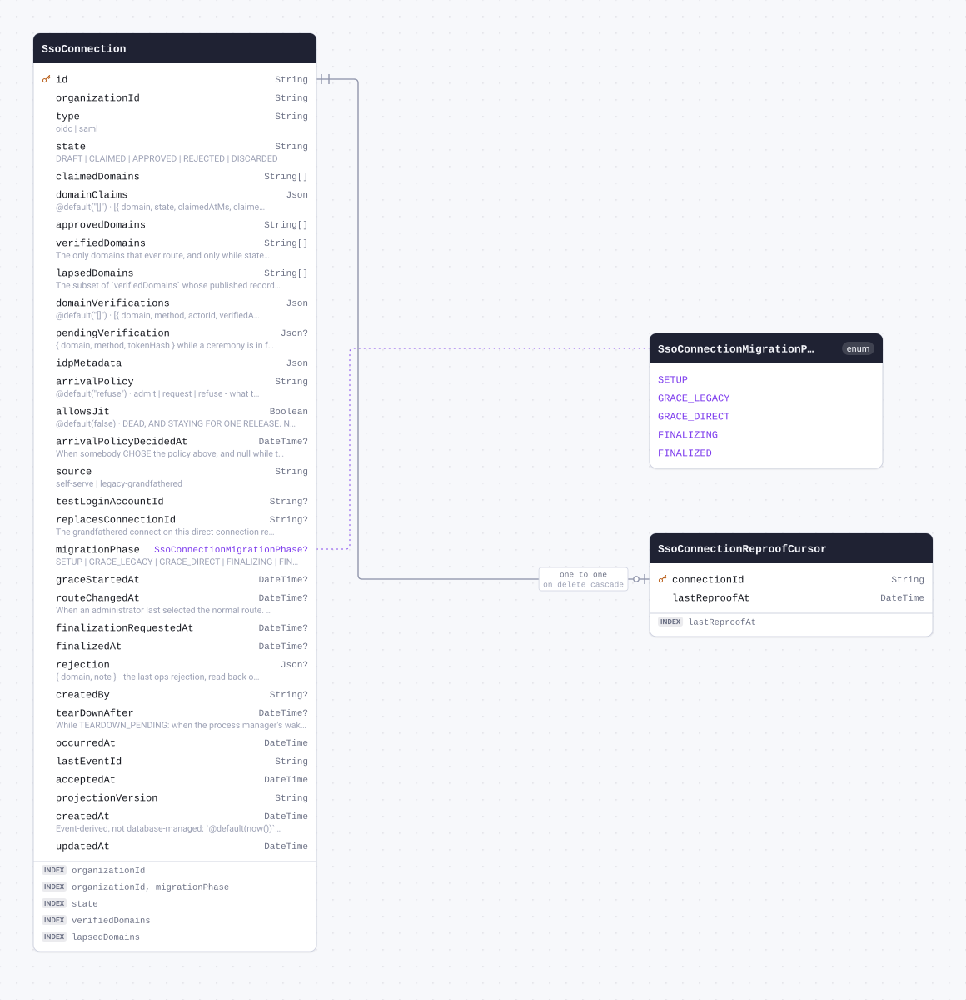

| Field           | Type       | Constraints                                            | Default | Description |
| --------------- | ---------- | ------------------------------------------------------ | ------- | ----------- |
| `connectionId`  | `String`   | PK NOT NULL → [SsoConnection.id](#model-SsoConnection) |         |             |
| `lastReproofAt` | `DateTime` | NOT NULL                                               |         |             |

#### Indexes

- `@@index([lastReproofAt])`

#### References

- `connectionId` → [SsoConnection.id](#model-SsoConnection) (one-to-one, on delete Cascade)

#### Definition

```sql
CREATE TABLE "SsoConnectionReproofCursor" (
    "connectionId" TEXT NOT NULL,
    "lastReproofAt" TIMESTAMP(3) NOT NULL,

    CONSTRAINT "SsoConnectionReproofCursor_pkey" PRIMARY KEY ("connectionId")
);

CREATE INDEX "SsoConnectionReproofCursor_lastReproofAt_idx" ON "SsoConnectionReproofCursor"("lastReproofAt");
```

<details>
<summary>Queries and their SQL</summary>

**findMany**: Every row

```ts
await prisma.ssoConnectionReproofCursor.findMany();
```

```sql
SELECT
  "public"."SsoConnectionReproofCursor"."connectionId",
  "public"."SsoConnectionReproofCursor"."lastReproofAt"
FROM
  "public"."SsoConnectionReproofCursor"
WHERE
  1 = 1
OFFSET
  $1
-- params: ["0"]
```

**count**: How many rows there are

```ts
await prisma.ssoConnectionReproofCursor.count();
```

```sql
SELECT
  COUNT(*) AS "_count$_all"
FROM
  (
    SELECT
      "public"."SsoConnectionReproofCursor"."connectionId"
    FROM
      "public"."SsoConnectionReproofCursor"
    WHERE
      1 = 1
    OFFSET
      $1
  ) AS "sub"
-- params: ["0"]
```

**findMany**: Every row with its relations

```ts
await prisma.ssoConnectionReproofCursor.findMany({ include: { connection: true } });
```

```sql
SELECT
  "public"."SsoConnectionReproofCursor"."connectionId",
  "public"."SsoConnectionReproofCursor"."lastReproofAt"
FROM
  "public"."SsoConnectionReproofCursor"
WHERE
  1 = 1
OFFSET
  $1
-- params: ["0"]

SELECT
  "public"."SsoConnection"."id",
  "public"."SsoConnection"."organizationId",
  "public"."SsoConnection"."type",
  "public"."SsoConnection"."state",
  "public"."SsoConnection"."claimedDomains",
  "public"."SsoConnection"."domainClaims",
  "public"."SsoConnection"."approvedDomains",
  "public"."SsoConnection"."verifiedDomains",
  "public"."SsoConnection"."lapsedDomains",
  "public"."SsoConnection"."domainVerifications",
  "public"."SsoConnection"."pendingVerification",
  "public"."SsoConnection"."idpMetadata",
  "public"."SsoConnection"."arrivalPolicy",
  "public"."SsoConnection"."allowsJit",
  "public"."SsoConnection"."arrivalPolicyDecidedAt",
  "public"."SsoConnection"."source",
  "public"."SsoConnection"."testLoginAccountId",
  "public"."SsoConnection"."replacesConnectionId",
  "public"."SsoConnection"."migrationPhase"::text,
  "public"."SsoConnection"."graceStartedAt",
  "public"."SsoConnection"."routeChangedAt",
  "public"."SsoConnection"."finalizationRequestedAt",
  "public"."SsoConnection"."finalizedAt",
  "public"."SsoConnection"."rejection",
  "public"."SsoConnection"."createdBy",
  "public"."SsoConnection"."tearDownAfter",
  "public"."SsoConnection"."occurredAt",
  "public"."SsoConnection"."lastEventId",
  "public"."SsoConnection"."acceptedAt",
  "public"."SsoConnection"."projectionVersion",
  "public"."SsoConnection"."createdAt",
  "public"."SsoConnection"."updatedAt"
FROM
  "public"."SsoConnection"
WHERE
  "public"."SsoConnection"."id" IN ($1)
OFFSET
  $2
-- params: ["<connectionId of the rows above>","0"]
```

**findUnique**: One row by what is unique to it

```ts
await prisma.ssoConnectionReproofCursor.findUnique({ where: { connectionId: "example" } });
```

```sql
SELECT
  "public"."SsoConnectionReproofCursor"."connectionId",
  "public"."SsoConnectionReproofCursor"."lastReproofAt"
FROM
  "public"."SsoConnectionReproofCursor"
WHERE
  (
    "public"."SsoConnectionReproofCursor"."connectionId" = $1
    AND 1 = 1
  )
LIMIT
  $2
OFFSET
  $3
-- params: ["example","1","0"]
```

**create**: Create a row

```ts
await prisma.ssoConnectionReproofCursor.create({
  data: { connectionId: "example", lastReproofAt: new Date("2026-01-01T00:00:00.000Z") },
});
```

```sql
INSERT INTO
  "public"."SsoConnectionReproofCursor" ("connectionId", "lastReproofAt")
VALUES
  ($1, $2)
RETURNING
  "public"."SsoConnectionReproofCursor"."connectionId",
  "public"."SsoConnectionReproofCursor"."lastReproofAt"
-- params: ["example","2026-01-01T00:00:00.000Z"]
```

**update**: Update a row

```ts
await prisma.ssoConnectionReproofCursor.update({
  where: { connectionId: "example" },
  data: { lastReproofAt: new Date("2026-01-01T00:00:00.000Z") },
});
```

```sql
SELECT
  "public"."SsoConnectionReproofCursor"."connectionId"
FROM
  "public"."SsoConnectionReproofCursor"
WHERE
  (
    "public"."SsoConnectionReproofCursor"."connectionId" = $1
    AND 1 = 1
  )
LIMIT
  $2
OFFSET
  $3
-- params: ["example","1","0"]

UPDATE "public"."SsoConnectionReproofCursor"
SET
  "lastReproofAt" = $1
WHERE
  (
    "public"."SsoConnectionReproofCursor"."connectionId" IN ($2)
    AND (
      "public"."SsoConnectionReproofCursor"."connectionId" = $3
      AND 1 = 1
    )
  )
RETURNING
  "public"."SsoConnectionReproofCursor"."connectionId",
  "public"."SsoConnectionReproofCursor"."lastReproofAt"
-- params: ["2026-01-01T00:00:00.000Z","<connectionId of the rows above>","example"]
```

**delete**: Delete a row

```ts
await prisma.ssoConnectionReproofCursor.delete({ where: { connectionId: "example" } });
```

```sql
DELETE FROM "public"."SsoConnectionReproofCursor"
WHERE
  (
    "public"."SsoConnectionReproofCursor"."connectionId" = $1
    AND 1 = 1
  )
RETURNING
  "public"."SsoConnectionReproofCursor"."connectionId",
  "public"."SsoConnectionReproofCursor"."lastReproofAt"
-- params: ["example"]
```

</details>

<a id="model-SsoCredential"></a>

### SsoCredential

The values an `SsoConnection`'s credential references point AT (D09 - see
specs/identity/sso-idp-termination.feature).

The aggregate has always carried `clientIdRef` / `secretRef` / `certRefs`
rather than values, because a fact may not carry a secret (ADR-101 §4).
Until D09 there was nothing behind the references and every writer passed
null. This is the thing behind them.

`ciphertext` is AES-256-GCM under the deployment's `CREDENTIALS_SECRET`,
the same key every other credential in the product is kept under. Nothing
reads a row except the projection that builds the engine's dialing
configuration; no surface renders one back.

Written by the command path rather than the fold, and that split is
deliberate: the VALUE is not event truth and cannot be, so the log records
WHEN a credential changed (a new reference in a new fact) and never what
it was. A replay rebuilds every reference from the log and finds the value
still here.

| Field            | Type       | Constraints | Default      | Description                                                                                                                                                                                  |
| ---------------- | ---------- | ----------- | ------------ | -------------------------------------------------------------------------------------------------------------------------------------------------------------------------------------------- |
| `id`             | `String`   | PK NOT NULL |              |                                                                                                                                                                                              |
| `organizationId` | `String`   | NOT NULL    |              |                                                                                                                                                                                              |
| `connectionId`   | `String`   | NOT NULL    |              | The connection whose registration minted this. Not a relation, matching `SsoConnection` itself: a projection rebuilt from events must not depend on relational state the log does not carry. |
| `kind`           | `String`   | NOT NULL    |              | oidc-client-id \| oidc-client-secret \| saml-idp-config                                                                                                                                      |
| `ciphertext`     | `String`   | NOT NULL    |              |                                                                                                                                                                                              |
| `createdAt`      | `DateTime` | NOT NULL    | `now()`      |                                                                                                                                                                                              |
| `updatedAt`      | `DateTime` | NOT NULL    | `@updatedAt` |                                                                                                                                                                                              |

#### Indexes

- `@@index([organizationId, connectionId])`

#### Definition

```sql
CREATE TABLE "SsoCredential" (
    "id" TEXT NOT NULL,
    "organizationId" TEXT NOT NULL,
    "connectionId" TEXT NOT NULL,
    "kind" TEXT NOT NULL,
    "ciphertext" TEXT NOT NULL,
    "createdAt" TIMESTAMP(3) NOT NULL DEFAULT CURRENT_TIMESTAMP,
    "updatedAt" TIMESTAMP(3) NOT NULL,

    CONSTRAINT "SsoCredential_pkey" PRIMARY KEY ("id")
);

CREATE INDEX "SsoCredential_organizationId_connectionId_idx" ON "SsoCredential"("organizationId", "connectionId");
```

<details>
<summary>Queries and their SQL</summary>

**findMany**: Every row

```ts
await prisma.ssoCredential.findMany();
```

```sql
SELECT
  "public"."SsoCredential"."id",
  "public"."SsoCredential"."organizationId",
  "public"."SsoCredential"."connectionId",
  "public"."SsoCredential"."kind",
  "public"."SsoCredential"."ciphertext",
  "public"."SsoCredential"."createdAt",
  "public"."SsoCredential"."updatedAt"
FROM
  "public"."SsoCredential"
WHERE
  1 = 1
OFFSET
  $1
-- params: ["0"]
```

**count**: How many rows there are

```ts
await prisma.ssoCredential.count();
```

```sql
SELECT
  COUNT(*) AS "_count$_all"
FROM
  (
    SELECT
      "public"."SsoCredential"."id"
    FROM
      "public"."SsoCredential"
    WHERE
      1 = 1
    OFFSET
      $1
  ) AS "sub"
-- params: ["0"]
```

**findUnique**: One row by what is unique to it

```ts
await prisma.ssoCredential.findUnique({ where: { id: "example" } });
```

```sql
SELECT
  "public"."SsoCredential"."id",
  "public"."SsoCredential"."organizationId",
  "public"."SsoCredential"."connectionId",
  "public"."SsoCredential"."kind",
  "public"."SsoCredential"."ciphertext",
  "public"."SsoCredential"."createdAt",
  "public"."SsoCredential"."updatedAt"
FROM
  "public"."SsoCredential"
WHERE
  (
    "public"."SsoCredential"."id" = $1
    AND 1 = 1
  )
LIMIT
  $2
OFFSET
  $3
-- params: ["example","1","0"]
```

**create**: Create a row

```ts
await prisma.ssoCredential.create({
  data: {
    id: "example",
    organizationId: "example",
    connectionId: "example",
    kind: "example",
    ciphertext: "example",
  },
});
```

```sql
INSERT INTO
  "public"."SsoCredential" (
    "id",
    "organizationId",
    "connectionId",
    "kind",
    "ciphertext",
    "createdAt",
    "updatedAt"
  )
VALUES
  ($1, $2, $3, $4, $5, $6, $7)
RETURNING
  "public"."SsoCredential"."id",
  "public"."SsoCredential"."organizationId",
  "public"."SsoCredential"."connectionId",
  "public"."SsoCredential"."kind",
  "public"."SsoCredential"."ciphertext",
  "public"."SsoCredential"."createdAt",
  "public"."SsoCredential"."updatedAt"
-- params: ["example","example","example","example","example","<now()>","<now()>"]
```

**update**: Update a row

```ts
await prisma.ssoCredential.update({
  where: { id: "example" },
  data: { organizationId: "example" },
});
```

```sql
SELECT
  "public"."SsoCredential"."id"
FROM
  "public"."SsoCredential"
WHERE
  (
    "public"."SsoCredential"."id" = $1
    AND 1 = 1
  )
LIMIT
  $2
OFFSET
  $3
-- params: ["example","1","0"]

UPDATE "public"."SsoCredential"
SET
  "organizationId" = $1,
  "updatedAt" = $2
WHERE
  (
    "public"."SsoCredential"."id" IN ($3)
    AND (
      "public"."SsoCredential"."id" = $4
      AND 1 = 1
    )
  )
RETURNING
  "public"."SsoCredential"."id",
  "public"."SsoCredential"."organizationId",
  "public"."SsoCredential"."connectionId",
  "public"."SsoCredential"."kind",
  "public"."SsoCredential"."ciphertext",
  "public"."SsoCredential"."createdAt",
  "public"."SsoCredential"."updatedAt"
-- params: ["example",{"prisma__type":"generatorCall","prisma__value":{"name":"now","args":[],"returnType":{"type":"DateTime"}}},"<id of the rows above>","example"]
```

**delete**: Delete a row

```ts
await prisma.ssoCredential.delete({ where: { id: "example" } });
```

```sql
DELETE FROM "public"."SsoCredential"
WHERE
  (
    "public"."SsoCredential"."id" = $1
    AND 1 = 1
  )
RETURNING
  "public"."SsoCredential"."id",
  "public"."SsoCredential"."organizationId",
  "public"."SsoCredential"."connectionId",
  "public"."SsoCredential"."kind",
  "public"."SsoCredential"."ciphertext",
  "public"."SsoCredential"."createdAt",
  "public"."SsoCredential"."updatedAt"
-- params: ["example"]
```

</details>

<a id="model-SsoVerifiedDomain"></a>

### SsoVerifiedDomain

better-auth's single sign-on plugin's provider table (D09), and a
PROJECTION of the connection log rather than a second source of truth.

The plugin owns the columns and the reads: it is the only thing that
speaks OpenID Connect discovery or reads a SAML assertion, and it dials
what it finds here. What it never does is decide that a row should exist —
that is folded from `SsoConnection`'s events by the same projection that
writes the connection head, in the same transaction, so a replay rebuilds
both together and a row can never outlive the connection that justified
it. Nothing else writes here.

`providerId` is the CONNECTION ID rather than the name the customer typed.
The plugin's column is globally unique, and two organizations both calling
their provider `okta` must both be able to.

`oidcConfig` and `samlConfig` are the plugin's own JSON documents, rebuilt
on every fold from `SsoCredential` — the vault is where the material
lives, and this row is a derived copy the engine can read synchronously.

SEALED AT REST, under the same key the vault uses. The document carries
the client secret the derivation reads OUT of the vault, so a plaintext
copy here would hand every customer's live identity-provider credential
to anybody holding a database dump — the exact threat `SsoCredential`
exists to defeat, reopened one table over. A stored value announces its
form (`enc:v1:`), so a row written before the seal existed still opens;
the one reader is the identity storage adapter, on the path that dials.
The reader tolerates both forms, so this needs no backfill — but a pod
without it cannot read a sealed row, so it must not be rolled back past.
WHO OWNS A PROVED DOMAIN, as a row the database can refuse twice.

"First verifier owns" was enforced by reading `findDomainOwner` and then
writing the fact — two different aggregates, so the per-connection queue
never ordered them against each other, and `SsoConnection.verifiedDomains`
is a `String[]` with only a GIN index behind it, which enforces nothing.
Two organizations proving `acme.com` at the same moment both read "nobody
owns it" and both committed; the sign-in router then picked between two
live connections by planner order, so a member of one company could be
handed to another company's identity provider — and with `arrivalPolicy`
on `admit`, provisioned into it.

The legacy single-domain model had this: `Organization.ssoDomain` is
`@unique`. The multi-domain rewrite dropped the guarantee, and self-serve
proof is what made the race reachable by customers rather than by two
operators working at once.

`domain` is the primary key, so a second organization loses on the
constraint rather than on a check it raced. Connection holders are
separate because an exact predecessor/replacement pair must coexist
during migration. Both are projected with the connection head.


| Field            | Type     | Constraints | Default | Description |
| ---------------- | -------- | ----------- | ------- | ----------- |
| `domain`         | `String` | PK NOT NULL |         |             |
| `organizationId` | `String` | NOT NULL    |         |             |

#### Indexes

- `@@index([organizationId])`
- `@@unique([domain, organizationId])`

#### Referenced by

- `domain` ← [SsoVerifiedDomainHolder.domain](#model-SsoVerifiedDomainHolder) (one-to-many, on delete Cascade)

#### Definition

```sql
CREATE TABLE "SsoVerifiedDomain" (
    "domain" TEXT NOT NULL,
    "organizationId" TEXT NOT NULL,

    CONSTRAINT "SsoVerifiedDomain_pkey" PRIMARY KEY ("domain")
);

CREATE INDEX "SsoVerifiedDomain_organizationId_idx" ON "SsoVerifiedDomain"("organizationId");

CREATE UNIQUE INDEX "SsoVerifiedDomain_domain_organizationId_key" ON "SsoVerifiedDomain"("domain", "organizationId");
```

<details>
<summary>Queries and their SQL</summary>

**findMany**: Every row

```ts
await prisma.ssoVerifiedDomain.findMany();
```

```sql
SELECT
  "public"."SsoVerifiedDomain"."domain",
  "public"."SsoVerifiedDomain"."organizationId"
FROM
  "public"."SsoVerifiedDomain"
WHERE
  1 = 1
OFFSET
  $1
-- params: ["0"]
```

**count**: How many rows there are

```ts
await prisma.ssoVerifiedDomain.count();
```

```sql
SELECT
  COUNT(*) AS "_count$_all"
FROM
  (
    SELECT
      "public"."SsoVerifiedDomain"."domain"
    FROM
      "public"."SsoVerifiedDomain"
    WHERE
      1 = 1
    OFFSET
      $1
  ) AS "sub"
-- params: ["0"]
```

**findMany**: Every row with its relations

```ts
await prisma.ssoVerifiedDomain.findMany({ include: { holders: true } });
```

```sql
SELECT
  "public"."SsoVerifiedDomain"."domain",
  "public"."SsoVerifiedDomain"."organizationId"
FROM
  "public"."SsoVerifiedDomain"
WHERE
  1 = 1
OFFSET
  $1
-- params: ["0"]

SELECT
  "public"."SsoVerifiedDomainHolder"."domain",
  "public"."SsoVerifiedDomainHolder"."connectionId",
  "public"."SsoVerifiedDomainHolder"."organizationId"
FROM
  "public"."SsoVerifiedDomainHolder"
WHERE
  (
    "public"."SsoVerifiedDomainHolder"."domain" IN ($1)
    AND "public"."SsoVerifiedDomainHolder"."organizationId" IN ($2)
  )
OFFSET
  $3
-- params: ["<domain of the rows above>","<organizationId of the rows above>","0"]
```

**findUnique**: One row by what is unique to it

```ts
await prisma.ssoVerifiedDomain.findUnique({ where: { domain: "example" } });
```

```sql
SELECT
  "public"."SsoVerifiedDomain"."domain",
  "public"."SsoVerifiedDomain"."organizationId"
FROM
  "public"."SsoVerifiedDomain"
WHERE
  (
    "public"."SsoVerifiedDomain"."domain" = $1
    AND 1 = 1
  )
LIMIT
  $2
OFFSET
  $3
-- params: ["example","1","0"]
```

**create**: Create a row

```ts
await prisma.ssoVerifiedDomain.create({ data: { domain: "example", organizationId: "example" } });
```

```sql
INSERT INTO
  "public"."SsoVerifiedDomain" ("domain", "organizationId")
VALUES
  ($1, $2)
RETURNING
  "public"."SsoVerifiedDomain"."domain",
  "public"."SsoVerifiedDomain"."organizationId"
-- params: ["example","example"]
```

**update**: Update a row

```ts
await prisma.ssoVerifiedDomain.update({
  where: { domain: "example" },
  data: { organizationId: "example" },
});
```

```sql
SELECT
  "public"."SsoVerifiedDomain"."domain",
  "public"."SsoVerifiedDomain"."organizationId"
FROM
  "public"."SsoVerifiedDomain"
WHERE
  (
    "public"."SsoVerifiedDomain"."domain" = $1
    AND 1 = 1
  )
LIMIT
  $2
OFFSET
  $3
-- params: ["example","1","0"]

SELECT
  "public"."SsoVerifiedDomainHolder"."domain",
  "public"."SsoVerifiedDomainHolder"."connectionId",
  "public"."SsoVerifiedDomainHolder"."organizationId"
FROM
  "public"."SsoVerifiedDomainHolder"
WHERE
  (
    1 = 1
    AND "public"."SsoVerifiedDomainHolder"."domain" IN ($1)
    AND "public"."SsoVerifiedDomainHolder"."organizationId" IN ($2)
  )
OFFSET
  $3
-- params: ["<domain of the rows above>","<organizationId of the rows above>","0"]

UPDATE "public"."SsoVerifiedDomainHolder"
SET
  "organizationId" = $1
WHERE
  (
    "public"."SsoVerifiedDomainHolder"."domain" IN ($2)
    AND "public"."SsoVerifiedDomainHolder"."connectionId" IN ($3)
    AND 1 = 1
  )
-- params: ["example","<domain of the rows above>","<connectionId of the rows above>"]

UPDATE "public"."SsoVerifiedDomain"
SET
  "organizationId" = $1
WHERE
  (
    "public"."SsoVerifiedDomain"."domain" IN ($2)
    AND (
      "public"."SsoVerifiedDomain"."domain" = $3
      AND 1 = 1
    )
  )
RETURNING
  "public"."SsoVerifiedDomain"."domain",
  "public"."SsoVerifiedDomain"."organizationId"
-- params: ["example","<domain of the rows above>","example"]
```

**delete**: Delete a row

```ts
await prisma.ssoVerifiedDomain.delete({ where: { domain: "example" } });
```

```sql
DELETE FROM "public"."SsoVerifiedDomain"
WHERE
  (
    "public"."SsoVerifiedDomain"."domain" = $1
    AND 1 = 1
  )
RETURNING
  "public"."SsoVerifiedDomain"."domain",
  "public"."SsoVerifiedDomain"."organizationId"
-- params: ["example"]

SELECT
  "public"."SsoVerifiedDomainHolder"."domain",
  "public"."SsoVerifiedDomainHolder"."connectionId",
  "public"."SsoVerifiedDomainHolder"."organizationId"
FROM
  "public"."SsoVerifiedDomainHolder"
WHERE
  (
    1 = 1
    AND "public"."SsoVerifiedDomainHolder"."domain" IN ($1)
    AND "public"."SsoVerifiedDomainHolder"."organizationId" IN ($2)
  )
OFFSET
  $3
-- params: ["<domain of the rows above>","<organizationId of the rows above>","0"]

DELETE FROM "public"."SsoVerifiedDomainHolder"
WHERE
  (
    "public"."SsoVerifiedDomainHolder"."domain" IN ($1)
    AND "public"."SsoVerifiedDomainHolder"."connectionId" IN ($2)
    AND 1 = 1
  )
-- params: ["<domain of the rows above>","<connectionId of the rows above>"]
```

</details>

<a id="model-SsoVerifiedDomainHolder"></a>

### SsoVerifiedDomainHolder

A connection currently entitled to use an organization-owned verified
domain. Usually there is one holder. During an Auth0 migration there are
exactly two: the grandfathered predecessor and its direct replacement.

The projection repository enforces that relationship before inserting a
second holder. The flattened migration also installs partial unique live
legacy/direct slots on `SsoConnection`, closing concurrent third-writer
races that Prisma cannot describe declaratively.

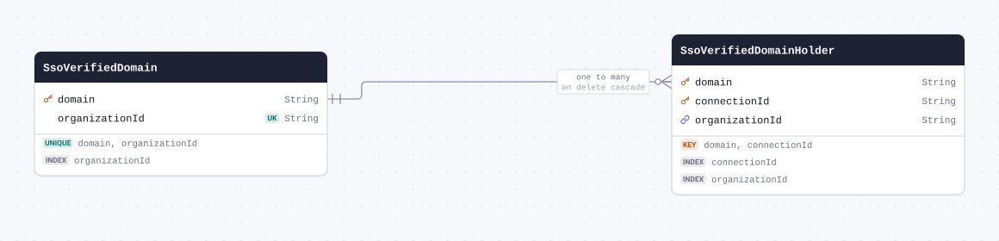

| Field            | Type     | Constraints                                                             | Default | Description |
| ---------------- | -------- | ----------------------------------------------------------------------- | ------- | ----------- |
| `domain`         | `String` | PK NOT NULL → [SsoVerifiedDomain.domain](#model-SsoVerifiedDomain)      |         |             |
| `connectionId`   | `String` | PK NOT NULL                                                             |         |             |
| `organizationId` | `String` | NOT NULL → [SsoVerifiedDomain.organizationId](#model-SsoVerifiedDomain) |         |             |

#### Indexes

- `@@id([domain, connectionId])`
- `@@index([connectionId])`
- `@@index([organizationId])`

#### References

- `domain` → [SsoVerifiedDomain.domain](#model-SsoVerifiedDomain) (many-to-one, on delete Cascade)

#### Definition

```sql
CREATE TABLE "SsoVerifiedDomainHolder" (
    "domain" TEXT NOT NULL,
    "connectionId" TEXT NOT NULL,
    "organizationId" TEXT NOT NULL,

    CONSTRAINT "SsoVerifiedDomainHolder_pkey" PRIMARY KEY ("domain","connectionId")
);

CREATE INDEX "SsoVerifiedDomainHolder_connectionId_idx" ON "SsoVerifiedDomainHolder"("connectionId");

CREATE INDEX "SsoVerifiedDomainHolder_organizationId_idx" ON "SsoVerifiedDomainHolder"("organizationId");
```

<details>
<summary>Queries and their SQL</summary>

**findMany**: Every row

```ts
await prisma.ssoVerifiedDomainHolder.findMany();
```

```sql
SELECT
  "public"."SsoVerifiedDomainHolder"."domain",
  "public"."SsoVerifiedDomainHolder"."connectionId",
  "public"."SsoVerifiedDomainHolder"."organizationId"
FROM
  "public"."SsoVerifiedDomainHolder"
WHERE
  1 = 1
OFFSET
  $1
-- params: ["0"]
```

**count**: How many rows there are

```ts
await prisma.ssoVerifiedDomainHolder.count();
```

```sql
SELECT
  COUNT(*) AS "_count$_all"
FROM
  (
    SELECT
      "public"."SsoVerifiedDomainHolder"."domain",
      "public"."SsoVerifiedDomainHolder"."connectionId"
    FROM
      "public"."SsoVerifiedDomainHolder"
    WHERE
      1 = 1
    OFFSET
      $1
  ) AS "sub"
-- params: ["0"]
```

**findMany**: Every row with its relations

```ts
await prisma.ssoVerifiedDomainHolder.findMany({ include: { ownership: true } });
```

```sql
SELECT
  "public"."SsoVerifiedDomainHolder"."domain",
  "public"."SsoVerifiedDomainHolder"."connectionId",
  "public"."SsoVerifiedDomainHolder"."organizationId"
FROM
  "public"."SsoVerifiedDomainHolder"
WHERE
  1 = 1
OFFSET
  $1
-- params: ["0"]

SELECT
  "public"."SsoVerifiedDomain"."domain",
  "public"."SsoVerifiedDomain"."organizationId"
FROM
  "public"."SsoVerifiedDomain"
WHERE
  (
    "public"."SsoVerifiedDomain"."domain" IN ($1)
    AND "public"."SsoVerifiedDomain"."organizationId" IN ($2)
  )
OFFSET
  $3
-- params: ["<domain of the rows above>","<organizationId of the rows above>","0"]
```

**findUnique**: One row by what is unique to it

```ts
await prisma.ssoVerifiedDomainHolder.findUnique({
  where: { domain_connectionId: { domain: "example", connectionId: "example" } },
});
```

```sql
SELECT
  "public"."SsoVerifiedDomainHolder"."domain",
  "public"."SsoVerifiedDomainHolder"."connectionId",
  "public"."SsoVerifiedDomainHolder"."organizationId"
FROM
  "public"."SsoVerifiedDomainHolder"
WHERE
  (
    (
      "public"."SsoVerifiedDomainHolder"."domain" = $1
      AND "public"."SsoVerifiedDomainHolder"."connectionId" = $2
    )
    AND 1 = 1
  )
LIMIT
  $3
OFFSET
  $4
-- params: ["example","example","1","0"]
```

**create**: Create a row

```ts
await prisma.ssoVerifiedDomainHolder.create({
  data: { domain: "example", connectionId: "example", organizationId: "example" },
});
```

```sql
INSERT INTO
  "public"."SsoVerifiedDomainHolder" ("domain", "connectionId", "organizationId")
VALUES
  ($1, $2, $3)
RETURNING
  "public"."SsoVerifiedDomainHolder"."domain",
  "public"."SsoVerifiedDomainHolder"."connectionId",
  "public"."SsoVerifiedDomainHolder"."organizationId"
-- params: ["example","example","example"]
```

**delete**: Delete a row

```ts
await prisma.ssoVerifiedDomainHolder.delete({
  where: { domain_connectionId: { domain: "example", connectionId: "example" } },
});
```

```sql
DELETE FROM "public"."SsoVerifiedDomainHolder"
WHERE
  (
    (
      "public"."SsoVerifiedDomainHolder"."domain" = $1
      AND "public"."SsoVerifiedDomainHolder"."connectionId" = $2
    )
    AND 1 = 1
  )
RETURNING
  "public"."SsoVerifiedDomainHolder"."domain",
  "public"."SsoVerifiedDomainHolder"."connectionId",
  "public"."SsoVerifiedDomainHolder"."organizationId"
-- params: ["example","example"]
```

</details>

<a id="model-SsoAuthenticationActivity"></a>

### SsoAuthenticationActivity

A successful callback through one SSO connection. Identifier.lastUsedAt
also advances during routing and resolution, so it cannot prove that a
member actually authenticated through the replacement before cutover.

| Field               | Type       | Constraints | Default | Description                                                                                  |
| ------------------- | ---------- | ----------- | ------- | -------------------------------------------------------------------------------------------- |
| `id`                | `String`   | PK NOT NULL |         |                                                                                              |
| `organizationId`    | `String`   | NOT NULL    |         |                                                                                              |
| `connectionId`      | `String`   | NOT NULL    |         |                                                                                              |
| `userId`            | `String`   | NOT NULL    |         |                                                                                              |
| `authenticatedAt`   | `DateTime` | NOT NULL    |         |                                                                                              |
| `providerAccountId` | `String`   | NULL        |         | The provider-side account the assertion named; null before #7633's arrival door recorded it. |

#### Indexes

- `@@index([organizationId, connectionId, authenticatedAt])`
- `@@index([organizationId, userId])`

#### Definition

```sql
CREATE TABLE "SsoAuthenticationActivity" (
    "id" TEXT NOT NULL,
    "organizationId" TEXT NOT NULL,
    "connectionId" TEXT NOT NULL,
    "userId" TEXT NOT NULL,
    "authenticatedAt" TIMESTAMP(3) NOT NULL,
    "providerAccountId" TEXT,

    CONSTRAINT "SsoAuthenticationActivity_pkey" PRIMARY KEY ("id")
);

CREATE INDEX "SsoAuthenticationActivity_organizationId_connectionId_authe_idx" ON "SsoAuthenticationActivity"("organizationId", "connectionId", "authenticatedAt");

CREATE INDEX "SsoAuthenticationActivity_organizationId_userId_idx" ON "SsoAuthenticationActivity"("organizationId", "userId");
```

<details>
<summary>Queries and their SQL</summary>

**findMany**: Every row

```ts
await prisma.ssoAuthenticationActivity.findMany();
```

```sql
SELECT
  "public"."SsoAuthenticationActivity"."id",
  "public"."SsoAuthenticationActivity"."organizationId",
  "public"."SsoAuthenticationActivity"."connectionId",
  "public"."SsoAuthenticationActivity"."userId",
  "public"."SsoAuthenticationActivity"."authenticatedAt",
  "public"."SsoAuthenticationActivity"."providerAccountId"
FROM
  "public"."SsoAuthenticationActivity"
WHERE
  1 = 1
OFFSET
  $1
-- params: ["0"]
```

**count**: How many rows there are

```ts
await prisma.ssoAuthenticationActivity.count();
```

```sql
SELECT
  COUNT(*) AS "_count$_all"
FROM
  (
    SELECT
      "public"."SsoAuthenticationActivity"."id"
    FROM
      "public"."SsoAuthenticationActivity"
    WHERE
      1 = 1
    OFFSET
      $1
  ) AS "sub"
-- params: ["0"]
```

**findUnique**: One row by what is unique to it

```ts
await prisma.ssoAuthenticationActivity.findUnique({ where: { id: "example" } });
```

```sql
SELECT
  "public"."SsoAuthenticationActivity"."id",
  "public"."SsoAuthenticationActivity"."organizationId",
  "public"."SsoAuthenticationActivity"."connectionId",
  "public"."SsoAuthenticationActivity"."userId",
  "public"."SsoAuthenticationActivity"."authenticatedAt",
  "public"."SsoAuthenticationActivity"."providerAccountId"
FROM
  "public"."SsoAuthenticationActivity"
WHERE
  (
    "public"."SsoAuthenticationActivity"."id" = $1
    AND 1 = 1
  )
LIMIT
  $2
OFFSET
  $3
-- params: ["example","1","0"]
```

**create**: Create a row

```ts
await prisma.ssoAuthenticationActivity.create({
  data: {
    id: "example",
    organizationId: "example",
    connectionId: "example",
    userId: "example",
    authenticatedAt: new Date("2026-01-01T00:00:00.000Z"),
  },
});
```

```sql
INSERT INTO
  "public"."SsoAuthenticationActivity" (
    "id",
    "organizationId",
    "connectionId",
    "userId",
    "authenticatedAt"
  )
VALUES
  ($1, $2, $3, $4, $5)
RETURNING
  "public"."SsoAuthenticationActivity"."id",
  "public"."SsoAuthenticationActivity"."organizationId",
  "public"."SsoAuthenticationActivity"."connectionId",
  "public"."SsoAuthenticationActivity"."userId",
  "public"."SsoAuthenticationActivity"."authenticatedAt",
  "public"."SsoAuthenticationActivity"."providerAccountId"
-- params: ["example","example","example","example","2026-01-01T00:00:00.000Z"]
```

**update**: Update a row

```ts
await prisma.ssoAuthenticationActivity.update({
  where: { id: "example" },
  data: { organizationId: "example" },
});
```

```sql
SELECT
  "public"."SsoAuthenticationActivity"."id"
FROM
  "public"."SsoAuthenticationActivity"
WHERE
  (
    "public"."SsoAuthenticationActivity"."id" = $1
    AND 1 = 1
  )
LIMIT
  $2
OFFSET
  $3
-- params: ["example","1","0"]

UPDATE "public"."SsoAuthenticationActivity"
SET
  "organizationId" = $1
WHERE
  (
    "public"."SsoAuthenticationActivity"."id" IN ($2)
    AND (
      "public"."SsoAuthenticationActivity"."id" = $3
      AND 1 = 1
    )
  )
RETURNING
  "public"."SsoAuthenticationActivity"."id",
  "public"."SsoAuthenticationActivity"."organizationId",
  "public"."SsoAuthenticationActivity"."connectionId",
  "public"."SsoAuthenticationActivity"."userId",
  "public"."SsoAuthenticationActivity"."authenticatedAt",
  "public"."SsoAuthenticationActivity"."providerAccountId"
-- params: ["example","<id of the rows above>","example"]
```

**delete**: Delete a row

```ts
await prisma.ssoAuthenticationActivity.delete({ where: { id: "example" } });
```

```sql
DELETE FROM "public"."SsoAuthenticationActivity"
WHERE
  (
    "public"."SsoAuthenticationActivity"."id" = $1
    AND 1 = 1
  )
RETURNING
  "public"."SsoAuthenticationActivity"."id",
  "public"."SsoAuthenticationActivity"."organizationId",
  "public"."SsoAuthenticationActivity"."connectionId",
  "public"."SsoAuthenticationActivity"."userId",
  "public"."SsoAuthenticationActivity"."authenticatedAt",
  "public"."SsoAuthenticationActivity"."providerAccountId"
-- params: ["example"]
```

</details>

<a id="model-SsoProvider"></a>

### SsoProvider

| Field            | Type     | Constraints     | Default | Description |
| ---------------- | -------- | --------------- | ------- | ----------- |
| `id`             | `String` | PK NOT NULL     |         |             |
| `issuer`         | `String` | NOT NULL        |         |             |
| `oidcConfig`     | `String` | NULL            |         |             |
| `samlConfig`     | `String` | NULL            |         |             |
| `userId`         | `String` | NULL            |         |             |
| `providerId`     | `String` | UNIQUE NOT NULL |         |             |
| `organizationId` | `String` | NULL            |         |             |
| `domain`         | `String` | NOT NULL        |         |             |

#### Indexes

- `@@index([organizationId])`
- `@@index([domain])`

#### Definition

```sql
CREATE TABLE "SsoProvider" (
    "id" TEXT NOT NULL,
    "issuer" TEXT NOT NULL,
    "oidcConfig" TEXT,
    "samlConfig" TEXT,
    "userId" TEXT,
    "providerId" TEXT NOT NULL,
    "organizationId" TEXT,
    "domain" TEXT NOT NULL,

    CONSTRAINT "SsoProvider_pkey" PRIMARY KEY ("id")
);

CREATE UNIQUE INDEX "SsoProvider_providerId_key" ON "SsoProvider"("providerId");

CREATE INDEX "SsoProvider_organizationId_idx" ON "SsoProvider"("organizationId");

CREATE INDEX "SsoProvider_domain_idx" ON "SsoProvider"("domain");
```

<details>
<summary>Queries and their SQL</summary>

**findMany**: Every row

```ts
await prisma.ssoProvider.findMany();
```

```sql
SELECT
  "public"."SsoProvider"."id",
  "public"."SsoProvider"."issuer",
  "public"."SsoProvider"."oidcConfig",
  "public"."SsoProvider"."samlConfig",
  "public"."SsoProvider"."userId",
  "public"."SsoProvider"."providerId",
  "public"."SsoProvider"."organizationId",
  "public"."SsoProvider"."domain"
FROM
  "public"."SsoProvider"
WHERE
  1 = 1
OFFSET
  $1
-- params: ["0"]
```

**count**: How many rows there are

```ts
await prisma.ssoProvider.count();
```

```sql
SELECT
  COUNT(*) AS "_count$_all"
FROM
  (
    SELECT
      "public"."SsoProvider"."id"
    FROM
      "public"."SsoProvider"
    WHERE
      1 = 1
    OFFSET
      $1
  ) AS "sub"
-- params: ["0"]
```

**findUnique**: One row by what is unique to it

```ts
await prisma.ssoProvider.findUnique({ where: { id: "example" } });
```

```sql
SELECT
  "public"."SsoProvider"."id",
  "public"."SsoProvider"."issuer",
  "public"."SsoProvider"."oidcConfig",
  "public"."SsoProvider"."samlConfig",
  "public"."SsoProvider"."userId",
  "public"."SsoProvider"."providerId",
  "public"."SsoProvider"."organizationId",
  "public"."SsoProvider"."domain"
FROM
  "public"."SsoProvider"
WHERE
  (
    "public"."SsoProvider"."id" = $1
    AND 1 = 1
  )
LIMIT
  $2
OFFSET
  $3
-- params: ["example","1","0"]
```

**create**: Create a row

```ts
await prisma.ssoProvider.create({
  data: { id: "example", issuer: "example", providerId: "example", domain: "example" },
});
```

```sql
INSERT INTO
  "public"."SsoProvider" ("id", "issuer", "providerId", "domain")
VALUES
  ($1, $2, $3, $4)
RETURNING
  "public"."SsoProvider"."id",
  "public"."SsoProvider"."issuer",
  "public"."SsoProvider"."oidcConfig",
  "public"."SsoProvider"."samlConfig",
  "public"."SsoProvider"."userId",
  "public"."SsoProvider"."providerId",
  "public"."SsoProvider"."organizationId",
  "public"."SsoProvider"."domain"
-- params: ["example","example","example","example"]
```

**update**: Update a row

```ts
await prisma.ssoProvider.update({ where: { id: "example" }, data: { issuer: "example" } });
```

```sql
SELECT
  "public"."SsoProvider"."id"
FROM
  "public"."SsoProvider"
WHERE
  (
    "public"."SsoProvider"."id" = $1
    AND 1 = 1
  )
LIMIT
  $2
OFFSET
  $3
-- params: ["example","1","0"]

UPDATE "public"."SsoProvider"
SET
  "issuer" = $1
WHERE
  (
    "public"."SsoProvider"."id" IN ($2)
    AND (
      "public"."SsoProvider"."id" = $3
      AND 1 = 1
    )
  )
RETURNING
  "public"."SsoProvider"."id",
  "public"."SsoProvider"."issuer",
  "public"."SsoProvider"."oidcConfig",
  "public"."SsoProvider"."samlConfig",
  "public"."SsoProvider"."userId",
  "public"."SsoProvider"."providerId",
  "public"."SsoProvider"."organizationId",
  "public"."SsoProvider"."domain"
-- params: ["example","<id of the rows above>","example"]
```

**delete**: Delete a row

```ts
await prisma.ssoProvider.delete({ where: { id: "example" } });
```

```sql
DELETE FROM "public"."SsoProvider"
WHERE
  (
    "public"."SsoProvider"."id" = $1
    AND 1 = 1
  )
RETURNING
  "public"."SsoProvider"."id",
  "public"."SsoProvider"."issuer",
  "public"."SsoProvider"."oidcConfig",
  "public"."SsoProvider"."samlConfig",
  "public"."SsoProvider"."userId",
  "public"."SsoProvider"."providerId",
  "public"."SsoProvider"."organizationId",
  "public"."SsoProvider"."domain"
-- params: ["example"]
```

</details>

<a id="model-SsoBreakGlassBinding"></a>

### SsoBreakGlassBinding

A way back in (D05 - see specs/identity/sso-onboarding-tiers.feature).

One named person who may still sign in without the identity provider
while their organization's sign-in belongs to one, and the date on which
that stops. Activation asks whether such a person exists, because the
failure it prevents is the only one that cannot be recovered from inside
the product: a misconfigured connection goes live, every member is handed
to an identity provider that will not authenticate them, and nobody is
left who can turn it off.

Rows are immutable except for `supersededAt` and `warnedDays`. A renewal
writes a NEW row naming the one it replaced, so the date a way in
previously ended is still readable in the history - which is what makes a
renewal auditable rather than a column somebody moved.

No relation to Organization or User, matching the identity heads above:
the binding is the record of who could get in, and a cascade would erase
exactly the history a lockout post-mortem reads.

| Field             | Type       | Constraints | Default | Description                                                                                                                            |
| ----------------- | ---------- | ----------- | ------- | -------------------------------------------------------------------------------------------------------------------------------------- |
| `id`              | `String`   | PK NOT NULL |         |                                                                                                                                        |
| `organizationId`  | `String`   | NOT NULL    |         |                                                                                                                                        |
| `userId`          | `String`   | NOT NULL    |         | Who holds the way in.                                                                                                                  |
| `grantedByUserId` | `String`   | NOT NULL    |         | Who granted it. A way back in is never self-served.                                                                                    |
| `grantedAt`       | `DateTime` | NOT NULL    |         |                                                                                                                                        |
| `expiresAt`       | `DateTime` | NOT NULL    |         |                                                                                                                                        |
| `supersededAt`    | `DateTime` | NULL        |         | Set when a renewal replaced this row; the row itself is never edited.                                                                  |
| `renewedFromId`   | `String`   | NULL        |         | The binding this one renewed, so the previous end date stays readable.                                                                 |
| `warnedDays`      | `Int[]`    | NOT NULL    |         | Which of the fourteen, seven and one day warnings have been sent, so a sweep that runs twice in a day never says the same thing twice. |
| `createdAt`       | `DateTime` | NOT NULL    | `now()` |                                                                                                                                        |

#### Indexes

- `@@index([organizationId, expiresAt])`
- `@@index([userId])`

#### Definition

```sql
CREATE TABLE "SsoBreakGlassBinding" (
    "id" TEXT NOT NULL,
    "organizationId" TEXT NOT NULL,
    "userId" TEXT NOT NULL,
    "grantedByUserId" TEXT NOT NULL,
    "grantedAt" TIMESTAMP(3) NOT NULL,
    "expiresAt" TIMESTAMP(3) NOT NULL,
    "supersededAt" TIMESTAMP(3),
    "renewedFromId" TEXT,
    "warnedDays" INTEGER[],
    "createdAt" TIMESTAMP(3) NOT NULL DEFAULT CURRENT_TIMESTAMP,

    CONSTRAINT "SsoBreakGlassBinding_pkey" PRIMARY KEY ("id")
);

CREATE INDEX "SsoBreakGlassBinding_organizationId_expiresAt_idx" ON "SsoBreakGlassBinding"("organizationId", "expiresAt");

CREATE INDEX "SsoBreakGlassBinding_userId_idx" ON "SsoBreakGlassBinding"("userId");
```

<details>
<summary>Queries and their SQL</summary>

**findMany**: Every row

```ts
await prisma.ssoBreakGlassBinding.findMany();
```

```sql
SELECT
  "public"."SsoBreakGlassBinding"."id",
  "public"."SsoBreakGlassBinding"."organizationId",
  "public"."SsoBreakGlassBinding"."userId",
  "public"."SsoBreakGlassBinding"."grantedByUserId",
  "public"."SsoBreakGlassBinding"."grantedAt",
  "public"."SsoBreakGlassBinding"."expiresAt",
  "public"."SsoBreakGlassBinding"."supersededAt",
  "public"."SsoBreakGlassBinding"."renewedFromId",
  "public"."SsoBreakGlassBinding"."warnedDays",
  "public"."SsoBreakGlassBinding"."createdAt"
FROM
  "public"."SsoBreakGlassBinding"
WHERE
  1 = 1
OFFSET
  $1
-- params: ["0"]
```

**count**: How many rows there are

```ts
await prisma.ssoBreakGlassBinding.count();
```

```sql
SELECT
  COUNT(*) AS "_count$_all"
FROM
  (
    SELECT
      "public"."SsoBreakGlassBinding"."id"
    FROM
      "public"."SsoBreakGlassBinding"
    WHERE
      1 = 1
    OFFSET
      $1
  ) AS "sub"
-- params: ["0"]
```

**findUnique**: One row by what is unique to it

```ts
await prisma.ssoBreakGlassBinding.findUnique({ where: { id: "example" } });
```

```sql
SELECT
  "public"."SsoBreakGlassBinding"."id",
  "public"."SsoBreakGlassBinding"."organizationId",
  "public"."SsoBreakGlassBinding"."userId",
  "public"."SsoBreakGlassBinding"."grantedByUserId",
  "public"."SsoBreakGlassBinding"."grantedAt",
  "public"."SsoBreakGlassBinding"."expiresAt",
  "public"."SsoBreakGlassBinding"."supersededAt",
  "public"."SsoBreakGlassBinding"."renewedFromId",
  "public"."SsoBreakGlassBinding"."warnedDays",
  "public"."SsoBreakGlassBinding"."createdAt"
FROM
  "public"."SsoBreakGlassBinding"
WHERE
  (
    "public"."SsoBreakGlassBinding"."id" = $1
    AND 1 = 1
  )
LIMIT
  $2
OFFSET
  $3
-- params: ["example","1","0"]
```

**create**: Create a row

```ts
await prisma.ssoBreakGlassBinding.create({
  data: {
    id: "example",
    organizationId: "example",
    userId: "example",
    grantedByUserId: "example",
    grantedAt: new Date("2026-01-01T00:00:00.000Z"),
    expiresAt: new Date("2026-01-01T00:00:00.000Z"),
    warnedDays: [1],
  },
});
```

```sql
INSERT INTO
  "public"."SsoBreakGlassBinding" (
    "id",
    "organizationId",
    "userId",
    "grantedByUserId",
    "grantedAt",
    "expiresAt",
    "warnedDays",
    "createdAt"
  )
VALUES
  ($1, $2, $3, $4, $5, $6, $7, $8)
RETURNING
  "public"."SsoBreakGlassBinding"."id",
  "public"."SsoBreakGlassBinding"."organizationId",
  "public"."SsoBreakGlassBinding"."userId",
  "public"."SsoBreakGlassBinding"."grantedByUserId",
  "public"."SsoBreakGlassBinding"."grantedAt",
  "public"."SsoBreakGlassBinding"."expiresAt",
  "public"."SsoBreakGlassBinding"."supersededAt",
  "public"."SsoBreakGlassBinding"."renewedFromId",
  "public"."SsoBreakGlassBinding"."warnedDays",
  "public"."SsoBreakGlassBinding"."createdAt"
-- params: ["example","example","example","example","2026-01-01T00:00:00.000Z","2026-01-01T00:00:00.000Z",["1"],"<now()>"]
```

**update**: Update a row

```ts
await prisma.ssoBreakGlassBinding.update({
  where: { id: "example" },
  data: { organizationId: "example" },
});
```

```sql
SELECT
  "public"."SsoBreakGlassBinding"."id"
FROM
  "public"."SsoBreakGlassBinding"
WHERE
  (
    "public"."SsoBreakGlassBinding"."id" = $1
    AND 1 = 1
  )
LIMIT
  $2
OFFSET
  $3
-- params: ["example","1","0"]

UPDATE "public"."SsoBreakGlassBinding"
SET
  "organizationId" = $1
WHERE
  (
    "public"."SsoBreakGlassBinding"."id" IN ($2)
    AND (
      "public"."SsoBreakGlassBinding"."id" = $3
      AND 1 = 1
    )
  )
RETURNING
  "public"."SsoBreakGlassBinding"."id",
  "public"."SsoBreakGlassBinding"."organizationId",
  "public"."SsoBreakGlassBinding"."userId",
  "public"."SsoBreakGlassBinding"."grantedByUserId",
  "public"."SsoBreakGlassBinding"."grantedAt",
  "public"."SsoBreakGlassBinding"."expiresAt",
  "public"."SsoBreakGlassBinding"."supersededAt",
  "public"."SsoBreakGlassBinding"."renewedFromId",
  "public"."SsoBreakGlassBinding"."warnedDays",
  "public"."SsoBreakGlassBinding"."createdAt"
-- params: ["example","<id of the rows above>","example"]
```

**delete**: Delete a row

```ts
await prisma.ssoBreakGlassBinding.delete({ where: { id: "example" } });
```

```sql
DELETE FROM "public"."SsoBreakGlassBinding"
WHERE
  (
    "public"."SsoBreakGlassBinding"."id" = $1
    AND 1 = 1
  )
RETURNING
  "public"."SsoBreakGlassBinding"."id",
  "public"."SsoBreakGlassBinding"."organizationId",
  "public"."SsoBreakGlassBinding"."userId",
  "public"."SsoBreakGlassBinding"."grantedByUserId",
  "public"."SsoBreakGlassBinding"."grantedAt",
  "public"."SsoBreakGlassBinding"."expiresAt",
  "public"."SsoBreakGlassBinding"."supersededAt",
  "public"."SsoBreakGlassBinding"."renewedFromId",
  "public"."SsoBreakGlassBinding"."warnedDays",
  "public"."SsoBreakGlassBinding"."createdAt"
-- params: ["example"]
```

</details>

<a id="model-SsoActivationRecoveryReservation"></a>

### SsoActivationRecoveryReservation

A durable claim on one live recovery path while activation is between its
guard and projected ACTIVE fact. It has no expiry: only projection of the
matching activation, or an explicit cancellation, may consume it.

| Field            | Type       | Constraints | Default | Description |
| ---------------- | ---------- | ----------- | ------- | ----------- |
| `commandId`      | `String`   | PK NOT NULL |         |             |
| `organizationId` | `String`   | NOT NULL    |         |             |
| `connectionId`   | `String`   | NOT NULL    |         |             |
| `createdAt`      | `DateTime` | NOT NULL    |         |             |

#### Indexes

- `@@index([organizationId])`
- `@@unique([organizationId, connectionId])`

#### Definition

```sql
CREATE TABLE "SsoActivationRecoveryReservation" (
    "commandId" TEXT NOT NULL,
    "organizationId" TEXT NOT NULL,
    "connectionId" TEXT NOT NULL,
    "createdAt" TIMESTAMP(3) NOT NULL,

    CONSTRAINT "SsoActivationRecoveryReservation_pkey" PRIMARY KEY ("commandId")
);

CREATE INDEX "SsoActivationRecoveryReservation_organizationId_idx" ON "SsoActivationRecoveryReservation"("organizationId");

CREATE UNIQUE INDEX "SsoActivationRecoveryReservation_organizationId_connectionI_key" ON "SsoActivationRecoveryReservation"("organizationId", "connectionId");
```

<details>
<summary>Queries and their SQL</summary>

**findMany**: Every row

```ts
await prisma.ssoActivationRecoveryReservation.findMany();
```

```sql
SELECT
  "public"."SsoActivationRecoveryReservation"."commandId",
  "public"."SsoActivationRecoveryReservation"."organizationId",
  "public"."SsoActivationRecoveryReservation"."connectionId",
  "public"."SsoActivationRecoveryReservation"."createdAt"
FROM
  "public"."SsoActivationRecoveryReservation"
WHERE
  1 = 1
OFFSET
  $1
-- params: ["0"]
```

**count**: How many rows there are

```ts
await prisma.ssoActivationRecoveryReservation.count();
```

```sql
SELECT
  COUNT(*) AS "_count$_all"
FROM
  (
    SELECT
      "public"."SsoActivationRecoveryReservation"."commandId"
    FROM
      "public"."SsoActivationRecoveryReservation"
    WHERE
      1 = 1
    OFFSET
      $1
  ) AS "sub"
-- params: ["0"]
```

**findUnique**: One row by what is unique to it

```ts
await prisma.ssoActivationRecoveryReservation.findUnique({ where: { commandId: "example" } });
```

```sql
SELECT
  "public"."SsoActivationRecoveryReservation"."commandId",
  "public"."SsoActivationRecoveryReservation"."organizationId",
  "public"."SsoActivationRecoveryReservation"."connectionId",
  "public"."SsoActivationRecoveryReservation"."createdAt"
FROM
  "public"."SsoActivationRecoveryReservation"
WHERE
  (
    "public"."SsoActivationRecoveryReservation"."commandId" = $1
    AND 1 = 1
  )
LIMIT
  $2
OFFSET
  $3
-- params: ["example","1","0"]
```

**create**: Create a row

```ts
await prisma.ssoActivationRecoveryReservation.create({
  data: {
    commandId: "example",
    organizationId: "example",
    connectionId: "example",
    createdAt: new Date("2026-01-01T00:00:00.000Z"),
  },
});
```

```sql
INSERT INTO
  "public"."SsoActivationRecoveryReservation" (
    "commandId",
    "organizationId",
    "connectionId",
    "createdAt"
  )
VALUES
  ($1, $2, $3, $4)
RETURNING
  "public"."SsoActivationRecoveryReservation"."commandId",
  "public"."SsoActivationRecoveryReservation"."organizationId",
  "public"."SsoActivationRecoveryReservation"."connectionId",
  "public"."SsoActivationRecoveryReservation"."createdAt"
-- params: ["example","example","example","2026-01-01T00:00:00.000Z"]
```

**update**: Update a row

```ts
await prisma.ssoActivationRecoveryReservation.update({
  where: { commandId: "example" },
  data: { organizationId: "example" },
});
```

```sql
SELECT
  "public"."SsoActivationRecoveryReservation"."commandId"
FROM
  "public"."SsoActivationRecoveryReservation"
WHERE
  (
    "public"."SsoActivationRecoveryReservation"."commandId" = $1
    AND 1 = 1
  )
LIMIT
  $2
OFFSET
  $3
-- params: ["example","1","0"]

UPDATE "public"."SsoActivationRecoveryReservation"
SET
  "organizationId" = $1
WHERE
  (
    "public"."SsoActivationRecoveryReservation"."commandId" IN ($2)
    AND (
      "public"."SsoActivationRecoveryReservation"."commandId" = $3
      AND 1 = 1
    )
  )
RETURNING
  "public"."SsoActivationRecoveryReservation"."commandId",
  "public"."SsoActivationRecoveryReservation"."organizationId",
  "public"."SsoActivationRecoveryReservation"."connectionId",
  "public"."SsoActivationRecoveryReservation"."createdAt"
-- params: ["example","<commandId of the rows above>","example"]
```

**delete**: Delete a row

```ts
await prisma.ssoActivationRecoveryReservation.delete({ where: { commandId: "example" } });
```

```sql
DELETE FROM "public"."SsoActivationRecoveryReservation"
WHERE
  (
    "public"."SsoActivationRecoveryReservation"."commandId" = $1
    AND 1 = 1
  )
RETURNING
  "public"."SsoActivationRecoveryReservation"."commandId",
  "public"."SsoActivationRecoveryReservation"."organizationId",
  "public"."SsoActivationRecoveryReservation"."connectionId",
  "public"."SsoActivationRecoveryReservation"."createdAt"
-- params: ["example"]
```

</details>

<a id="model-JoinRequest"></a>

### JoinRequest

The join-request pipeline's projection (ADR-117, D12 - see
specs/identity/join-requests.feature). A pure event-truth head like
`Identifier` and `SsoConnection`: every column is fold-written, rows are
never deleted (a terminal state is a tombstone the admin panel stops
listing, not an absence), and a replay rebuilds it whole-row from the
event log.

The fold cursor lives on the row rather than in a sibling table, because
one row IS one aggregate here - a request.

No relation to Organization or User on purpose, matching the two heads
above: a projection is rebuilt from events, and a foreign key would make a
replay depend on relational state the log does not carry.

Membership is NOT here. An approval dispatches an attach on the grants
ledger, exactly as accepting an invitation does, and that ledger fact
carries `source: "join-request"` as its provenance - which is what puts a
join approval on the customer's audit page beside every other membership
change rather than in a history of its own.

The requester's address is not here either: the DOMAIN is the fact, and it
is the only part of an address a join decision may depend on.

| Field               | Type       | Constraints | Default | Description                                                                                                                                                                               |
| ------------------- | ---------- | ----------- | ------- | ----------------------------------------------------------------------------------------------------------------------------------------------------------------------------------------- |
| `id`                | `String`   | PK NOT NULL |         |                                                                                                                                                                                           |
| `userId`            | `String`   | NOT NULL    |         |                                                                                                                                                                                           |
| `organizationId`    | `String`   | NOT NULL    |         |                                                                                                                                                                                           |
| `domain`            | `String`   | NOT NULL    |         | The normalized domain the match was made on.                                                                                                                                              |
| `state`             | `String`   | NOT NULL    |         | PENDING \| APPROVED \| REJECTED \| EXPIRED \| WITHDRAWN                                                                                                                                   |
| `matchedVia`        | `String`   | NOT NULL    |         | How the domain was matched: `verified-identifier-domain` or `sso-connection-domain`.                                                                                                      |
| `origin`            | `String`   | NOT NULL    | `"web"` | Where the request was made: `web` or `cli` (ADR-171 v6). A request from the terminal lands a Developer seat whatever the joiner seat says.                                                |
| `expiresAt`         | `DateTime` | NULL        |         | While PENDING: when the day-14 wake lapses it. Null once resolved.                                                                                                                        |
| `resolvedAt`        | `DateTime` | NULL        |         |                                                                                                                                                                                           |
| `resolvedByType`    | `String`   | NULL        |         | user \| policy \| invite - who ended it. `policy` is domain auto-join's own principal, deliberately not the one SSO auto-join uses.                                                       |
| `resolvedById`      | `String`   | NULL        |         | The admin's user id, `domain-auto`, or the invitation id.                                                                                                                                 |
| `withdrawalCause`   | `String`   | NULL        |         | user \| invite-accepted, on a withdrawal.                                                                                                                                                 |
| `connectionId`      | `String`   | NULL        |         | The SSO connection a single sign-on arrival was admitted through; null otherwise.                                                                                                         |
| `occurredAt`        | `DateTime` | NOT NULL    |         |                                                                                                                                                                                           |
| `lastEventId`       | `String`   | NOT NULL    |         |                                                                                                                                                                                           |
| `acceptedAt`        | `DateTime` | NOT NULL    |         |                                                                                                                                                                                           |
| `projectionVersion` | `String`   | NOT NULL    |         |                                                                                                                                                                                           |
| `createdAt`         | `DateTime` | NOT NULL    |         | Event-derived, not database-managed: `@default(now())` / `@updatedAt` would make a replayed row differ from the row it rebuilds, which is exactly the parity this projection has to keep. |
| `updatedAt`         | `DateTime` | NOT NULL    |         |                                                                                                                                                                                           |

#### Indexes

- `@@index([organizationId, state])`
- `@@index([userId, state])`
- `@@index([userId, organizationId])`
- `@@index([domain])`

#### Definition

```sql
CREATE TABLE "JoinRequest" (
    "id" TEXT NOT NULL,
    "userId" TEXT NOT NULL,
    "organizationId" TEXT NOT NULL,
    "domain" TEXT NOT NULL,
    "state" TEXT NOT NULL,
    "matchedVia" TEXT NOT NULL,
    "origin" TEXT NOT NULL DEFAULT 'web',
    "expiresAt" TIMESTAMP(3),
    "resolvedAt" TIMESTAMP(3),
    "resolvedByType" TEXT,
    "resolvedById" TEXT,
    "withdrawalCause" TEXT,
    "connectionId" TEXT,
    "occurredAt" TIMESTAMP(3) NOT NULL,
    "lastEventId" TEXT NOT NULL,
    "acceptedAt" TIMESTAMP(3) NOT NULL,
    "projectionVersion" TEXT NOT NULL,
    "createdAt" TIMESTAMP(3) NOT NULL,
    "updatedAt" TIMESTAMP(3) NOT NULL,

    CONSTRAINT "JoinRequest_pkey" PRIMARY KEY ("id")
);

CREATE INDEX "JoinRequest_organizationId_state_idx" ON "JoinRequest"("organizationId", "state");

CREATE INDEX "JoinRequest_userId_state_idx" ON "JoinRequest"("userId", "state");

CREATE INDEX "JoinRequest_userId_organizationId_idx" ON "JoinRequest"("userId", "organizationId");

CREATE INDEX "JoinRequest_domain_idx" ON "JoinRequest"("domain");
```

<details>
<summary>Queries and their SQL</summary>

**findMany**: Every row

```ts
await prisma.joinRequest.findMany();
```

```sql
SELECT
  "public"."JoinRequest"."id",
  "public"."JoinRequest"."userId",
  "public"."JoinRequest"."organizationId",
  "public"."JoinRequest"."domain",
  "public"."JoinRequest"."state",
  "public"."JoinRequest"."matchedVia",
  "public"."JoinRequest"."origin",
  "public"."JoinRequest"."expiresAt",
  "public"."JoinRequest"."resolvedAt",
  "public"."JoinRequest"."resolvedByType",
  "public"."JoinRequest"."resolvedById",
  "public"."JoinRequest"."withdrawalCause",
  "public"."JoinRequest"."connectionId",
  "public"."JoinRequest"."occurredAt",
  "public"."JoinRequest"."lastEventId",
  "public"."JoinRequest"."acceptedAt",
  "public"."JoinRequest"."projectionVersion",
  "public"."JoinRequest"."createdAt",
  "public"."JoinRequest"."updatedAt"
FROM
  "public"."JoinRequest"
WHERE
  1 = 1
OFFSET
  $1
-- params: ["0"]
```

**count**: How many rows there are

```ts
await prisma.joinRequest.count();
```

```sql
SELECT
  COUNT(*) AS "_count$_all"
FROM
  (
    SELECT
      "public"."JoinRequest"."id"
    FROM
      "public"."JoinRequest"
    WHERE
      1 = 1
    OFFSET
      $1
  ) AS "sub"
-- params: ["0"]
```

**findUnique**: One row by what is unique to it

```ts
await prisma.joinRequest.findUnique({ where: { id: "example" } });
```

```sql
SELECT
  "public"."JoinRequest"."id",
  "public"."JoinRequest"."userId",
  "public"."JoinRequest"."organizationId",
  "public"."JoinRequest"."domain",
  "public"."JoinRequest"."state",
  "public"."JoinRequest"."matchedVia",
  "public"."JoinRequest"."origin",
  "public"."JoinRequest"."expiresAt",
  "public"."JoinRequest"."resolvedAt",
  "public"."JoinRequest"."resolvedByType",
  "public"."JoinRequest"."resolvedById",
  "public"."JoinRequest"."withdrawalCause",
  "public"."JoinRequest"."connectionId",
  "public"."JoinRequest"."occurredAt",
  "public"."JoinRequest"."lastEventId",
  "public"."JoinRequest"."acceptedAt",
  "public"."JoinRequest"."projectionVersion",
  "public"."JoinRequest"."createdAt",
  "public"."JoinRequest"."updatedAt"
FROM
  "public"."JoinRequest"
WHERE
  (
    "public"."JoinRequest"."id" = $1
    AND 1 = 1
  )
LIMIT
  $2
OFFSET
  $3
-- params: ["example","1","0"]
```

**create**: Create a row

```ts
await prisma.joinRequest.create({
  data: {
    id: "example",
    userId: "example",
    organizationId: "example",
    domain: "example",
    state: "example",
    matchedVia: "example",
    occurredAt: new Date("2026-01-01T00:00:00.000Z"),
    lastEventId: "example",
    acceptedAt: new Date("2026-01-01T00:00:00.000Z"),
    projectionVersion: "example",
    createdAt: new Date("2026-01-01T00:00:00.000Z"),
    updatedAt: new Date("2026-01-01T00:00:00.000Z"),
  },
});
```

```sql
INSERT INTO
  "public"."JoinRequest" (
    "id",
    "userId",
    "organizationId",
    "domain",
    "state",
    "matchedVia",
    "origin",
    "occurredAt",
    "lastEventId",
    "acceptedAt",
    "projectionVersion",
    "createdAt",
    "updatedAt"
  )
VALUES
  (
    $1,
    $2,
    $3,
    $4,
    $5,
    $6,
    $7,
    $8,
    $9,
    $10,
    $11,
    $12,
    $13
  )
RETURNING
  "public"."JoinRequest"."id",
  "public"."JoinRequest"."userId",
  "public"."JoinRequest"."organizationId",
  "public"."JoinRequest"."domain",
  "public"."JoinRequest"."state",
  "public"."JoinRequest"."matchedVia",
  "public"."JoinRequest"."origin",
  "public"."JoinRequest"."expiresAt",
  "public"."JoinRequest"."resolvedAt",
  "public"."JoinRequest"."resolvedByType",
  "public"."JoinRequest"."resolvedById",
  "public"."JoinRequest"."withdrawalCause",
  "public"."JoinRequest"."connectionId",
  "public"."JoinRequest"."occurredAt",
  "public"."JoinRequest"."lastEventId",
  "public"."JoinRequest"."acceptedAt",
  "public"."JoinRequest"."projectionVersion",
  "public"."JoinRequest"."createdAt",
  "public"."JoinRequest"."updatedAt"
-- params: ["example","example","example","example","example","example","web","2026-01-01T00:00:00.000Z","example","2026-01-01T00:00:00.000Z","example","2026-01-01T00:00:00.000Z","2026-01-01T00:00:00.000Z"]
```

**update**: Update a row

```ts
await prisma.joinRequest.update({ where: { id: "example" }, data: { userId: "example" } });
```

```sql
SELECT
  "public"."JoinRequest"."id"
FROM
  "public"."JoinRequest"
WHERE
  (
    "public"."JoinRequest"."id" = $1
    AND 1 = 1
  )
LIMIT
  $2
OFFSET
  $3
-- params: ["example","1","0"]

UPDATE "public"."JoinRequest"
SET
  "userId" = $1
WHERE
  (
    "public"."JoinRequest"."id" IN ($2)
    AND (
      "public"."JoinRequest"."id" = $3
      AND 1 = 1
    )
  )
RETURNING
  "public"."JoinRequest"."id",
  "public"."JoinRequest"."userId",
  "public"."JoinRequest"."organizationId",
  "public"."JoinRequest"."domain",
  "public"."JoinRequest"."state",
  "public"."JoinRequest"."matchedVia",
  "public"."JoinRequest"."origin",
  "public"."JoinRequest"."expiresAt",
  "public"."JoinRequest"."resolvedAt",
  "public"."JoinRequest"."resolvedByType",
  "public"."JoinRequest"."resolvedById",
  "public"."JoinRequest"."withdrawalCause",
  "public"."JoinRequest"."connectionId",
  "public"."JoinRequest"."occurredAt",
  "public"."JoinRequest"."lastEventId",
  "public"."JoinRequest"."acceptedAt",
  "public"."JoinRequest"."projectionVersion",
  "public"."JoinRequest"."createdAt",
  "public"."JoinRequest"."updatedAt"
-- params: ["example","<id of the rows above>","example"]
```

**delete**: Delete a row

```ts
await prisma.joinRequest.delete({ where: { id: "example" } });
```

```sql
DELETE FROM "public"."JoinRequest"
WHERE
  (
    "public"."JoinRequest"."id" = $1
    AND 1 = 1
  )
RETURNING
  "public"."JoinRequest"."id",
  "public"."JoinRequest"."userId",
  "public"."JoinRequest"."organizationId",
  "public"."JoinRequest"."domain",
  "public"."JoinRequest"."state",
  "public"."JoinRequest"."matchedVia",
  "public"."JoinRequest"."origin",
  "public"."JoinRequest"."expiresAt",
  "public"."JoinRequest"."resolvedAt",
  "public"."JoinRequest"."resolvedByType",
  "public"."JoinRequest"."resolvedById",
  "public"."JoinRequest"."withdrawalCause",
  "public"."JoinRequest"."connectionId",
  "public"."JoinRequest"."occurredAt",
  "public"."JoinRequest"."lastEventId",
  "public"."JoinRequest"."acceptedAt",
  "public"."JoinRequest"."projectionVersion",
  "public"."JoinRequest"."createdAt",
  "public"."JoinRequest"."updatedAt"
-- params: ["example"]
```

</details>

<a id="model-TeamUser"></a>

### TeamUser

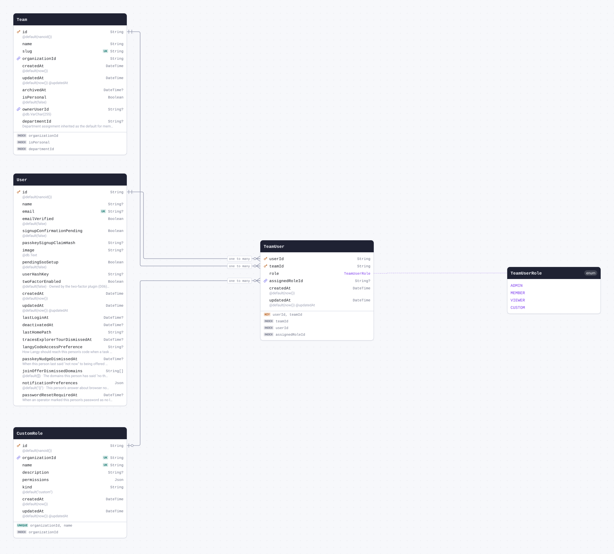

| Field            | Type                                 | Constraints                               | Default              | Description |
| ---------------- | ------------------------------------ | ----------------------------------------- | -------------------- | ----------- |
| `userId`         | `String`                             | PK NOT NULL → [User.id](#model-User)      |                      |             |
| `teamId`         | `String`                             | PK NOT NULL → [Team.id](#model-Team)      |                      |             |
| `role`           | [`TeamUserRole`](#enum-TeamUserRole) | NOT NULL                                  |                      |             |
| `assignedRoleId` | `String`                             | NULL → [CustomRole.id](#model-CustomRole) |                      |             |
| `createdAt`      | `DateTime`                           | NOT NULL                                  | `now()`              |             |
| `updatedAt`      | `DateTime`                           | NOT NULL                                  | `now()` `@updatedAt` |             |

#### Indexes

- `@@id([userId, teamId])`
- `@@index([teamId])`
- `@@index([userId])`
- `@@index([assignedRoleId])`

#### References

- `assignedRoleId` → [CustomRole.id](#model-CustomRole) (many-to-one)
- `userId` → [User.id](#model-User) (many-to-one)
- `teamId` → [Team.id](#model-Team) (many-to-one)

#### Definition

```sql
CREATE TABLE "TeamUser" (
    "userId" TEXT NOT NULL,
    "teamId" TEXT NOT NULL,
    "role" "TeamUserRole" NOT NULL,
    "assignedRoleId" TEXT,
    "createdAt" TIMESTAMP(3) NOT NULL DEFAULT CURRENT_TIMESTAMP,
    "updatedAt" TIMESTAMP(3) NOT NULL DEFAULT CURRENT_TIMESTAMP,

    CONSTRAINT "TeamUser_pkey" PRIMARY KEY ("userId","teamId")
);

CREATE INDEX "TeamUser_teamId_idx" ON "TeamUser"("teamId");

CREATE INDEX "TeamUser_userId_idx" ON "TeamUser"("userId");

CREATE INDEX "TeamUser_assignedRoleId_idx" ON "TeamUser"("assignedRoleId");
```

<details>
<summary>Queries and their SQL</summary>

**findMany**: Every row

```ts
await prisma.teamUser.findMany();
```

```sql
SELECT
  "public"."TeamUser"."userId",
  "public"."TeamUser"."teamId",
  "public"."TeamUser"."role"::text,
  "public"."TeamUser"."assignedRoleId",
  "public"."TeamUser"."createdAt",
  "public"."TeamUser"."updatedAt"
FROM
  "public"."TeamUser"
WHERE
  1 = 1
OFFSET
  $1
-- params: ["0"]
```

**count**: How many rows there are

```ts
await prisma.teamUser.count();
```

```sql
SELECT
  COUNT(*) AS "_count$_all"
FROM
  (
    SELECT
      "public"."TeamUser"."userId",
      "public"."TeamUser"."teamId"
    FROM
      "public"."TeamUser"
    WHERE
      1 = 1
    OFFSET
      $1
  ) AS "sub"
-- params: ["0"]
```

**findMany**: Every row with its relations

```ts
await prisma.teamUser.findMany({ include: { assignedRole: true, user: true, team: true } });
```

```sql
SELECT
  "public"."TeamUser"."userId",
  "public"."TeamUser"."teamId",
  "public"."TeamUser"."role"::text,
  "public"."TeamUser"."assignedRoleId",
  "public"."TeamUser"."createdAt",
  "public"."TeamUser"."updatedAt"
FROM
  "public"."TeamUser"
WHERE
  1 = 1
OFFSET
  $1
-- params: ["0"]

SELECT
  "public"."CustomRole"."id",
  "public"."CustomRole"."organizationId",
  "public"."CustomRole"."name",
  "public"."CustomRole"."description",
  "public"."CustomRole"."permissions",
  "public"."CustomRole"."kind",
  "public"."CustomRole"."createdAt",
  "public"."CustomRole"."updatedAt"
FROM
  "public"."CustomRole"
WHERE
  "public"."CustomRole"."id" IN ($1)
OFFSET
  $2
-- params: ["<assignedRoleId of the rows above>","0"]

SELECT
  "public"."User"."id",
  "public"."User"."name",
  "public"."User"."email",
  "public"."User"."emailVerified",
  "public"."User"."signupConfirmationPending",
  "public"."User"."passkeySignupClaimHash",
  "public"."User"."image",
  "public"."User"."pendingSsoSetup",
  "public"."User"."userHashKey",
  "public"."User"."twoFactorEnabled",
  "public"."User"."createdAt",
  "public"."User"."updatedAt",
  "public"."User"."lastLoginAt",
  "public"."User"."deactivatedAt",
  "public"."User"."lastHomePath",
  "public"."User"."tracesExplorerTourDismissedAt",
  "public"."User"."langyCodeAccessPreference",
  "public"."User"."passkeyNudgeDismissedAt",
  "public"."User"."joinOfferDismissedDomains",
  "public"."User"."notificationPreferences",
  "public"."User"."passwordResetRequiredAt"
FROM
  "public"."User"
WHERE
  "public"."User"."id" IN ($1)
OFFSET
  $2
-- params: ["<userId of the rows above>","0"]

SELECT
  "public"."Team"."id",
  "public"."Team"."name",
  "public"."Team"."slug",
  "public"."Team"."organizationId",
  "public"."Team"."createdAt",
  "public"."Team"."updatedAt",
  "public"."Team"."archivedAt",
  "public"."Team"."isPersonal",
  "public"."Team"."ownerUserId",
  "public"."Team"."departmentId"
FROM
  "public"."Team"
WHERE
  "public"."Team"."id" IN ($1)
OFFSET
  $2
-- params: ["<teamId of the rows above>","0"]
```

**findUnique**: One row by what is unique to it

```ts
await prisma.teamUser.findUnique({
  where: { userId_teamId: { userId: "example", teamId: "example" } },
});
```

```sql
SELECT
  "public"."TeamUser"."userId",
  "public"."TeamUser"."teamId",
  "public"."TeamUser"."role"::text,
  "public"."TeamUser"."assignedRoleId",
  "public"."TeamUser"."createdAt",
  "public"."TeamUser"."updatedAt"
FROM
  "public"."TeamUser"
WHERE
  (
    (
      "public"."TeamUser"."userId" = $1
      AND "public"."TeamUser"."teamId" = $2
    )
    AND 1 = 1
  )
LIMIT
  $3
OFFSET
  $4
-- params: ["example","example","1","0"]
```

**create**: Create a row

```ts
await prisma.teamUser.create({ data: { userId: "example", teamId: "example", role: "ADMIN" } });
```

```sql
INSERT INTO
  "public"."TeamUser" (
    "userId",
    "teamId",
    "role",
    "createdAt",
    "updatedAt"
  )
VALUES
  (
    $1,
    $2,
    CAST($3::text AS "public"."TeamUserRole"),
    $4,
    $5
  )
RETURNING
  "public"."TeamUser"."userId",
  "public"."TeamUser"."teamId",
  "public"."TeamUser"."role"::text,
  "public"."TeamUser"."assignedRoleId",
  "public"."TeamUser"."createdAt",
  "public"."TeamUser"."updatedAt"
-- params: ["example","example","ADMIN","<now()>","<now()>"]
```

**update**: Update a row

```ts
await prisma.teamUser.update({
  where: { userId_teamId: { userId: "example", teamId: "example" } },
  data: { role: "ADMIN" },
});
```

```sql
SELECT
  "public"."TeamUser"."userId",
  "public"."TeamUser"."teamId"
FROM
  "public"."TeamUser"
WHERE
  (
    (
      "public"."TeamUser"."userId" = $1
      AND "public"."TeamUser"."teamId" = $2
    )
    AND 1 = 1
  )
LIMIT
  $3
OFFSET
  $4
-- params: ["example","example","1","0"]

UPDATE "public"."TeamUser"
SET
  "role" = CAST($1::text AS "public"."TeamUserRole"),
  "updatedAt" = $2
WHERE
  (
    (
      "public"."TeamUser"."userId" IN ($3)
      AND "public"."TeamUser"."teamId" IN ($4)
    )
    AND (
      (
        "public"."TeamUser"."userId" = $5
        AND "public"."TeamUser"."teamId" = $6
      )
      AND 1 = 1
    )
  )
RETURNING
  "public"."TeamUser"."userId",
  "public"."TeamUser"."teamId",
  "public"."TeamUser"."role"::text,
  "public"."TeamUser"."assignedRoleId",
  "public"."TeamUser"."createdAt",
  "public"."TeamUser"."updatedAt"
-- params: ["ADMIN",{"prisma__type":"generatorCall","prisma__value":{"name":"now","args":[],"returnType":{"type":"DateTime"}}},"<userId of the rows above>","<teamId of the rows above>","example","example"]
```

**delete**: Delete a row

```ts
await prisma.teamUser.delete({
  where: { userId_teamId: { userId: "example", teamId: "example" } },
});
```

```sql
DELETE FROM "public"."TeamUser"
WHERE
  (
    (
      "public"."TeamUser"."userId" = $1
      AND "public"."TeamUser"."teamId" = $2
    )
    AND 1 = 1
  )
RETURNING
  "public"."TeamUser"."userId",
  "public"."TeamUser"."teamId",
  "public"."TeamUser"."role"::text,
  "public"."TeamUser"."assignedRoleId",
  "public"."TeamUser"."createdAt",
  "public"."TeamUser"."updatedAt"
-- params: ["example","example"]
```

</details>

<a id="model-OrganizationUser"></a>

### OrganizationUser

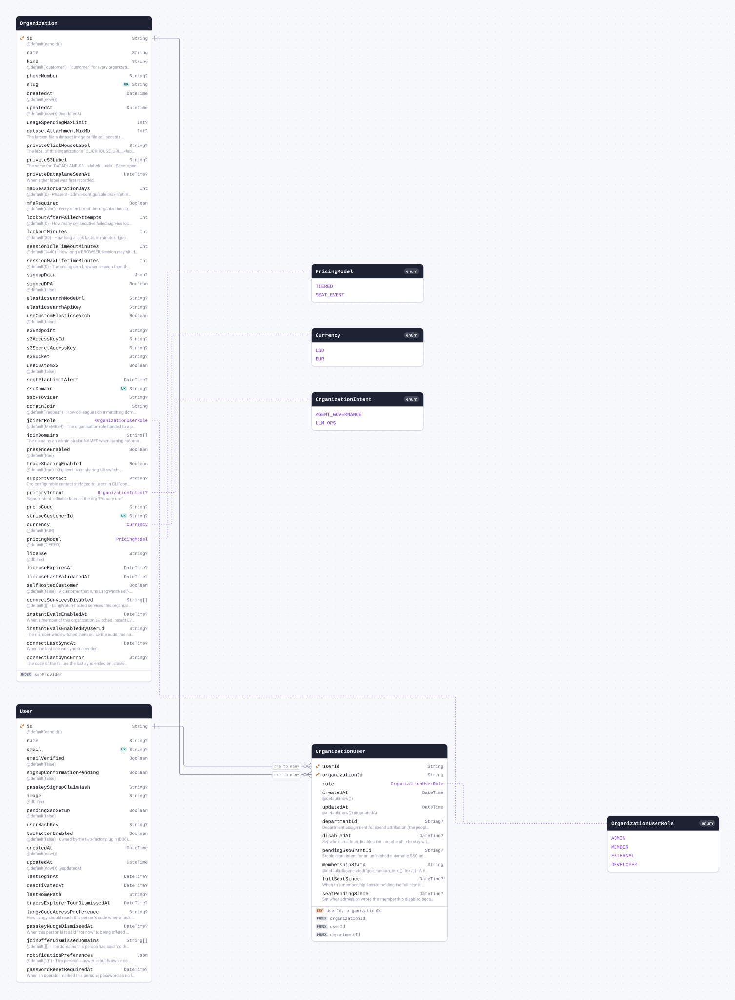

| Field               | Type                                                 | Constraints                                          | Default                                  | Description                                                                                                                                                                                                                                                                                                                                                     |
| ------------------- | ---------------------------------------------------- | ---------------------------------------------------- | ---------------------------------------- | --------------------------------------------------------------------------------------------------------------------------------------------------------------------------------------------------------------------------------------------------------------------------------------------------------------------------------------------------------------- |
| `userId`            | `String`                                             | PK NOT NULL → [User.id](#model-User)                 |                                          |                                                                                                                                                                                                                                                                                                                                                                 |
| `organizationId`    | `String`                                             | PK NOT NULL → [Organization.id](#model-Organization) |                                          |                                                                                                                                                                                                                                                                                                                                                                 |
| `role`              | [`OrganizationUserRole`](#enum-OrganizationUserRole) | NOT NULL                                             |                                          |                                                                                                                                                                                                                                                                                                                                                                 |
| `createdAt`         | `DateTime`                                           | NOT NULL                                             | `now()`                                  |                                                                                                                                                                                                                                                                                                                                                                 |
| `updatedAt`         | `DateTime`                                           | NOT NULL                                             | `now()` `@updatedAt`                     |                                                                                                                                                                                                                                                                                                                                                                 |
| `departmentId`      | `String`                                             | NULL                                                 |                                          | Department assignment for spend attribution (the people lens). Single-valued, org-scoped, accounting-only (never gates access). Plain column ref (relationMode="prisma"); the service validates the id belongs to this org. See departments.feature.                                                                                                            |
| `disabledAt`        | `DateTime`                                           | NULL                                                 |                                          | Set when an admin disables this membership to stay within the licensed seat count. The person loses access to this organization only, keeps their role, department and everything they did, and frees their seat. Reversible: re-enabling restores access if a seat is available. Seat counting excludes disabled memberships. See seat-reconciliation.feature. |
| `pendingSsoGrantId` | `String`                                             | NULL                                                 |                                          | Stable grant intent for an unfinished automatic SSO admission. Cleared after the authoritative grant is observed; never inferred from missing access.                                                                                                                                                                                                           |
| `membershipStamp`   | `String`                                             | NOT NULL                                             | `dbgenerated("gen_random_uuid()::text")` | A new generation for each membership lifetime. Stamped USER grant facts must match the current active membership before they can be projected; removing and rejoining therefore cannot revive a delayed old attach.                                                                                                                                             |
| `fullSeatSince`     | `DateTime`                                           | NULL                                                 |                                          | When this membership started holding the full seat it holds now; null means createdAt. Anchors the 30-day seat hold (specs/licensing/seat-rotation.feature).                                                                                                                                                                                                    |
| `seatPendingSince`  | `DateTime`                                           | NULL                                                 |                                          | Set when admission wrote this membership disabled because no seat was free: the person is waiting for one. Cleared when the membership is enabled.                                                                                                                                                                                                              |

#### Indexes

- `@@id([userId, organizationId])`
- `@@index([organizationId])`
- `@@index([userId])`
- `@@index([departmentId])`

#### References

- `userId` → [User.id](#model-User) (many-to-one)
- `organizationId` → [Organization.id](#model-Organization) (many-to-one)

#### Definition

```sql
CREATE TABLE "OrganizationUser" (
    "userId" TEXT NOT NULL,
    "organizationId" TEXT NOT NULL,
    "role" "OrganizationUserRole" NOT NULL,
    "createdAt" TIMESTAMP(3) NOT NULL DEFAULT CURRENT_TIMESTAMP,
    "updatedAt" TIMESTAMP(3) NOT NULL DEFAULT CURRENT_TIMESTAMP,
    "departmentId" TEXT,
    "disabledAt" TIMESTAMP(3),
    "pendingSsoGrantId" TEXT,
    "membershipStamp" TEXT NOT NULL DEFAULT gen_random_uuid()::text,
    "fullSeatSince" TIMESTAMP(3),
    "seatPendingSince" TIMESTAMP(3),

    CONSTRAINT "OrganizationUser_pkey" PRIMARY KEY ("userId","organizationId")
);

CREATE INDEX "OrganizationUser_organizationId_idx" ON "OrganizationUser"("organizationId");

CREATE INDEX "OrganizationUser_userId_idx" ON "OrganizationUser"("userId");

CREATE INDEX "OrganizationUser_departmentId_idx" ON "OrganizationUser"("departmentId");
```

<details>
<summary>Queries and their SQL</summary>

**findMany**: Every row

```ts
await prisma.organizationUser.findMany();
```

```sql
SELECT
  "public"."OrganizationUser"."userId",
  "public"."OrganizationUser"."organizationId",
  "public"."OrganizationUser"."role"::text,
  "public"."OrganizationUser"."createdAt",
  "public"."OrganizationUser"."updatedAt",
  "public"."OrganizationUser"."departmentId",
  "public"."OrganizationUser"."disabledAt",
  "public"."OrganizationUser"."pendingSsoGrantId",
  "public"."OrganizationUser"."membershipStamp",
  "public"."OrganizationUser"."fullSeatSince",
  "public"."OrganizationUser"."seatPendingSince"
FROM
  "public"."OrganizationUser"
WHERE
  1 = 1
OFFSET
  $1
-- params: ["0"]
```

**count**: How many rows there are

```ts
await prisma.organizationUser.count();
```

```sql
SELECT
  COUNT(*) AS "_count$_all"
FROM
  (
    SELECT
      "public"."OrganizationUser"."userId",
      "public"."OrganizationUser"."organizationId"
    FROM
      "public"."OrganizationUser"
    WHERE
      1 = 1
    OFFSET
      $1
  ) AS "sub"
-- params: ["0"]
```

**findMany**: Every row with its relations

```ts
await prisma.organizationUser.findMany({ include: { user: true, organization: true } });
```

```sql
SELECT
  "public"."OrganizationUser"."userId",
  "public"."OrganizationUser"."organizationId",
  "public"."OrganizationUser"."role"::text,
  "public"."OrganizationUser"."createdAt",
  "public"."OrganizationUser"."updatedAt",
  "public"."OrganizationUser"."departmentId",
  "public"."OrganizationUser"."disabledAt",
  "public"."OrganizationUser"."pendingSsoGrantId",
  "public"."OrganizationUser"."membershipStamp",
  "public"."OrganizationUser"."fullSeatSince",
  "public"."OrganizationUser"."seatPendingSince"
FROM
  "public"."OrganizationUser"
WHERE
  1 = 1
OFFSET
  $1
-- params: ["0"]

SELECT
  "public"."User"."id",
  "public"."User"."name",
  "public"."User"."email",
  "public"."User"."emailVerified",
  "public"."User"."signupConfirmationPending",
  "public"."User"."passkeySignupClaimHash",
  "public"."User"."image",
  "public"."User"."pendingSsoSetup",
  "public"."User"."userHashKey",
  "public"."User"."twoFactorEnabled",
  "public"."User"."createdAt",
  "public"."User"."updatedAt",
  "public"."User"."lastLoginAt",
  "public"."User"."deactivatedAt",
  "public"."User"."lastHomePath",
  "public"."User"."tracesExplorerTourDismissedAt",
  "public"."User"."langyCodeAccessPreference",
  "public"."User"."passkeyNudgeDismissedAt",
  "public"."User"."joinOfferDismissedDomains",
  "public"."User"."notificationPreferences",
  "public"."User"."passwordResetRequiredAt"
FROM
  "public"."User"
WHERE
  "public"."User"."id" IN ($1)
OFFSET
  $2
-- params: ["<userId of the rows above>","0"]

SELECT
  "public"."Organization"."id",
  "public"."Organization"."name",
  "public"."Organization"."kind",
  "public"."Organization"."phoneNumber",
  "public"."Organization"."slug",
  "public"."Organization"."createdAt",
  "public"."Organization"."updatedAt",
  "public"."Organization"."usageSpendingMaxLimit",
  "public"."Organization"."datasetAttachmentMaxMb",
  "public"."Organization"."privateClickHouseLabel",
  "public"."Organization"."privateS3Label",
  "public"."Organization"."privateDataplaneSeenAt",
  "public"."Organization"."maxSessionDurationDays",
  "public"."Organization"."mfaRequired",
  "public"."Organization"."lockoutAfterFailedAttempts",
  "public"."Organization"."lockoutMinutes",
  "public"."Organization"."sessionIdleTimeoutMinutes",
  "public"."Organization"."sessionMaxLifetimeMinutes",
  "public"."Organization"."signupData",
  "public"."Organization"."signedDPA",
  "public"."Organization"."elasticsearchNodeUrl",
  "public"."Organization"."elasticsearchApiKey",
  "public"."Organization"."useCustomElasticsearch",
  "public"."Organization"."s3Endpoint",
  "public"."Organization"."s3AccessKeyId",
  "public"."Organization"."s3SecretAccessKey",
  "public"."Organization"."s3Bucket",
  "public"."Organization"."useCustomS3",
  "public"."Organization"."sentPlanLimitAlert",
  "public"."Organization"."ssoDomain",
  "public"."Organization"."ssoProvider",
  "public"."Organization"."domainJoin",
  "public"."Organization"."joinerRole"::text,
  "public"."Organization"."joinDomains",
  "public"."Organization"."presenceEnabled",
  "public"."Organization"."traceSharingEnabled",
  "public"."Organization"."supportContact",
  "public"."Organization"."primaryIntent"::text,
  "public"."Organization"."promoCode",
  "public"."Organization"."stripeCustomerId",
  "public"."Organization"."currency"::text,
  "public"."Organization"."pricingModel"::text,
  "public"."Organization"."license",
  "public"."Organization"."licenseExpiresAt",
  "public"."Organization"."licenseLastValidatedAt",
  "public"."Organization"."selfHostedCustomer",
  "public"."Organization"."connectServicesDisabled",
  "public"."Organization"."instantEvalsEnabledAt",
  "public"."Organization"."instantEvalsEnabledByUserId",
  "public"."Organization"."connectLastSyncAt",
  "public"."Organization"."connectLastSyncError"
FROM
  "public"."Organization"
WHERE
  "public"."Organization"."id" IN ($1)
OFFSET
  $2
-- params: ["<organizationId of the rows above>","0"]
```

**findUnique**: One row by what is unique to it

```ts
await prisma.organizationUser.findUnique({
  where: { userId_organizationId: { userId: "example", organizationId: "example" } },
});
```

```sql
SELECT
  "public"."OrganizationUser"."userId",
  "public"."OrganizationUser"."organizationId",
  "public"."OrganizationUser"."role"::text,
  "public"."OrganizationUser"."createdAt",
  "public"."OrganizationUser"."updatedAt",
  "public"."OrganizationUser"."departmentId",
  "public"."OrganizationUser"."disabledAt",
  "public"."OrganizationUser"."pendingSsoGrantId",
  "public"."OrganizationUser"."membershipStamp",
  "public"."OrganizationUser"."fullSeatSince",
  "public"."OrganizationUser"."seatPendingSince"
FROM
  "public"."OrganizationUser"
WHERE
  (
    (
      "public"."OrganizationUser"."userId" = $1
      AND "public"."OrganizationUser"."organizationId" = $2
    )
    AND 1 = 1
  )
LIMIT
  $3
OFFSET
  $4
-- params: ["example","example","1","0"]
```

**create**: Create a row

```ts
await prisma.organizationUser.create({
  data: { userId: "example", organizationId: "example", role: "ADMIN" },
});
```

```sql
INSERT INTO
  "public"."OrganizationUser" (
    "userId",
    "organizationId",
    "role",
    "createdAt",
    "updatedAt"
  )
VALUES
  (
    $1,
    $2,
    CAST($3::text AS "public"."OrganizationUserRole"),
    $4,
    $5
  )
RETURNING
  "public"."OrganizationUser"."userId",
  "public"."OrganizationUser"."organizationId",
  "public"."OrganizationUser"."role"::text,
  "public"."OrganizationUser"."createdAt",
  "public"."OrganizationUser"."updatedAt",
  "public"."OrganizationUser"."departmentId",
  "public"."OrganizationUser"."disabledAt",
  "public"."OrganizationUser"."pendingSsoGrantId",
  "public"."OrganizationUser"."membershipStamp",
  "public"."OrganizationUser"."fullSeatSince",
  "public"."OrganizationUser"."seatPendingSince"
-- params: ["example","example","ADMIN","<now()>","<now()>"]
```

**update**: Update a row

```ts
await prisma.organizationUser.update({
  where: { userId_organizationId: { userId: "example", organizationId: "example" } },
  data: { role: "ADMIN" },
});
```

```sql
SELECT
  "public"."OrganizationUser"."userId",
  "public"."OrganizationUser"."organizationId"
FROM
  "public"."OrganizationUser"
WHERE
  (
    (
      "public"."OrganizationUser"."userId" = $1
      AND "public"."OrganizationUser"."organizationId" = $2
    )
    AND 1 = 1
  )
LIMIT
  $3
OFFSET
  $4
-- params: ["example","example","1","0"]

UPDATE "public"."OrganizationUser"
SET
  "role" = CAST($1::text AS "public"."OrganizationUserRole"),
  "updatedAt" = $2
WHERE
  (
    (
      "public"."OrganizationUser"."userId" IN ($3)
      AND "public"."OrganizationUser"."organizationId" IN ($4)
    )
    AND (
      (
        "public"."OrganizationUser"."userId" = $5
        AND "public"."OrganizationUser"."organizationId" = $6
      )
      AND 1 = 1
    )
  )
RETURNING
  "public"."OrganizationUser"."userId",
  "public"."OrganizationUser"."organizationId",
  "public"."OrganizationUser"."role"::text,
  "public"."OrganizationUser"."createdAt",
  "public"."OrganizationUser"."updatedAt",
  "public"."OrganizationUser"."departmentId",
  "public"."OrganizationUser"."disabledAt",
  "public"."OrganizationUser"."pendingSsoGrantId",
  "public"."OrganizationUser"."membershipStamp",
  "public"."OrganizationUser"."fullSeatSince",
  "public"."OrganizationUser"."seatPendingSince"
-- params: ["ADMIN",{"prisma__type":"generatorCall","prisma__value":{"name":"now","args":[],"returnType":{"type":"DateTime"}}},"<userId of the rows above>","<organizationId of the rows above>","example","example"]
```

**delete**: Delete a row

```ts
await prisma.organizationUser.delete({
  where: { userId_organizationId: { userId: "example", organizationId: "example" } },
});
```

```sql
DELETE FROM "public"."OrganizationUser"
WHERE
  (
    (
      "public"."OrganizationUser"."userId" = $1
      AND "public"."OrganizationUser"."organizationId" = $2
    )
    AND 1 = 1
  )
RETURNING
  "public"."OrganizationUser"."userId",
  "public"."OrganizationUser"."organizationId",
  "public"."OrganizationUser"."role"::text,
  "public"."OrganizationUser"."createdAt",
  "public"."OrganizationUser"."updatedAt",
  "public"."OrganizationUser"."departmentId",
  "public"."OrganizationUser"."disabledAt",
  "public"."OrganizationUser"."pendingSsoGrantId",
  "public"."OrganizationUser"."membershipStamp",
  "public"."OrganizationUser"."fullSeatSince",
  "public"."OrganizationUser"."seatPendingSince"
-- params: ["example","example"]
```

</details>

<a id="model-SeatHold"></a>

### SeatHold

A full seat still counted after the person who took it stopped holding it (removed,
disabled or demoted), until 30 days after they took it (specs/licensing/seat-rotation.feature).
One per organization and person; a return within the hold takes the seat back.

| Field            | Type       | Constraints | Default | Description                                                                            |
| ---------------- | ---------- | ----------- | ------- | -------------------------------------------------------------------------------------- |
| `id`             | `String`   | PK NOT NULL |         |                                                                                        |
| `organizationId` | `String`   | NOT NULL    |         |                                                                                        |
| `userId`         | `String`   | NOT NULL    |         |                                                                                        |
| `email`          | `String`   | NULL        |         | Display copy for the Users list, kept because a removed person has no membership row.  |
| `name`           | `String`   | NULL        |         |                                                                                        |
| `seatTakenAt`    | `DateTime` | NOT NULL    |         | When the person took the seat this hold keeps.                                         |
| `heldUntil`      | `DateTime` | NOT NULL    |         | seatTakenAt plus 30 days; expired holds are ignored by every count and deleted hourly. |
| `reason`         | `String`   | NOT NULL    |         | REMOVED \| DISABLED \| DEMOTED                                                         |
| `createdAt`      | `DateTime` | NOT NULL    | `now()` |                                                                                        |

#### Indexes

- `@@index([heldUntil])`
- `@@unique([organizationId, userId])`

#### Definition

```sql
CREATE TABLE "SeatHold" (
    "id" TEXT NOT NULL,
    "organizationId" TEXT NOT NULL,
    "userId" TEXT NOT NULL,
    "email" TEXT,
    "name" TEXT,
    "seatTakenAt" TIMESTAMP(3) NOT NULL,
    "heldUntil" TIMESTAMP(3) NOT NULL,
    "reason" TEXT NOT NULL,
    "createdAt" TIMESTAMP(3) NOT NULL DEFAULT CURRENT_TIMESTAMP,

    CONSTRAINT "SeatHold_pkey" PRIMARY KEY ("id")
);

CREATE INDEX "SeatHold_heldUntil_idx" ON "SeatHold"("heldUntil");

CREATE UNIQUE INDEX "SeatHold_organizationId_userId_key" ON "SeatHold"("organizationId", "userId");
```

<details>
<summary>Queries and their SQL</summary>

**findMany**: Every row

```ts
await prisma.seatHold.findMany();
```

```sql
SELECT
  "public"."SeatHold"."id",
  "public"."SeatHold"."organizationId",
  "public"."SeatHold"."userId",
  "public"."SeatHold"."email",
  "public"."SeatHold"."name",
  "public"."SeatHold"."seatTakenAt",
  "public"."SeatHold"."heldUntil",
  "public"."SeatHold"."reason",
  "public"."SeatHold"."createdAt"
FROM
  "public"."SeatHold"
WHERE
  1 = 1
OFFSET
  $1
-- params: ["0"]
```

**count**: How many rows there are

```ts
await prisma.seatHold.count();
```

```sql
SELECT
  COUNT(*) AS "_count$_all"
FROM
  (
    SELECT
      "public"."SeatHold"."id"
    FROM
      "public"."SeatHold"
    WHERE
      1 = 1
    OFFSET
      $1
  ) AS "sub"
-- params: ["0"]
```

**findUnique**: One row by what is unique to it

```ts
await prisma.seatHold.findUnique({ where: { id: "example" } });
```

```sql
SELECT
  "public"."SeatHold"."id",
  "public"."SeatHold"."organizationId",
  "public"."SeatHold"."userId",
  "public"."SeatHold"."email",
  "public"."SeatHold"."name",
  "public"."SeatHold"."seatTakenAt",
  "public"."SeatHold"."heldUntil",
  "public"."SeatHold"."reason",
  "public"."SeatHold"."createdAt"
FROM
  "public"."SeatHold"
WHERE
  (
    "public"."SeatHold"."id" = $1
    AND 1 = 1
  )
LIMIT
  $2
OFFSET
  $3
-- params: ["example","1","0"]
```

**create**: Create a row

```ts
await prisma.seatHold.create({
  data: {
    id: "example",
    organizationId: "example",
    userId: "example",
    seatTakenAt: new Date("2026-01-01T00:00:00.000Z"),
    heldUntil: new Date("2026-01-01T00:00:00.000Z"),
    reason: "example",
  },
});
```

```sql
INSERT INTO
  "public"."SeatHold" (
    "id",
    "organizationId",
    "userId",
    "seatTakenAt",
    "heldUntil",
    "reason",
    "createdAt"
  )
VALUES
  ($1, $2, $3, $4, $5, $6, $7)
RETURNING
  "public"."SeatHold"."id",
  "public"."SeatHold"."organizationId",
  "public"."SeatHold"."userId",
  "public"."SeatHold"."email",
  "public"."SeatHold"."name",
  "public"."SeatHold"."seatTakenAt",
  "public"."SeatHold"."heldUntil",
  "public"."SeatHold"."reason",
  "public"."SeatHold"."createdAt"
-- params: ["example","example","example","2026-01-01T00:00:00.000Z","2026-01-01T00:00:00.000Z","example","<now()>"]
```

**update**: Update a row

```ts
await prisma.seatHold.update({ where: { id: "example" }, data: { organizationId: "example" } });
```

```sql
SELECT
  "public"."SeatHold"."id"
FROM
  "public"."SeatHold"
WHERE
  (
    "public"."SeatHold"."id" = $1
    AND 1 = 1
  )
LIMIT
  $2
OFFSET
  $3
-- params: ["example","1","0"]

UPDATE "public"."SeatHold"
SET
  "organizationId" = $1
WHERE
  (
    "public"."SeatHold"."id" IN ($2)
    AND (
      "public"."SeatHold"."id" = $3
      AND 1 = 1
    )
  )
RETURNING
  "public"."SeatHold"."id",
  "public"."SeatHold"."organizationId",
  "public"."SeatHold"."userId",
  "public"."SeatHold"."email",
  "public"."SeatHold"."name",
  "public"."SeatHold"."seatTakenAt",
  "public"."SeatHold"."heldUntil",
  "public"."SeatHold"."reason",
  "public"."SeatHold"."createdAt"
-- params: ["example","<id of the rows above>","example"]
```

**delete**: Delete a row

```ts
await prisma.seatHold.delete({ where: { id: "example" } });
```

```sql
DELETE FROM "public"."SeatHold"
WHERE
  (
    "public"."SeatHold"."id" = $1
    AND 1 = 1
  )
RETURNING
  "public"."SeatHold"."id",
  "public"."SeatHold"."organizationId",
  "public"."SeatHold"."userId",
  "public"."SeatHold"."email",
  "public"."SeatHold"."name",
  "public"."SeatHold"."seatTakenAt",
  "public"."SeatHold"."heldUntil",
  "public"."SeatHold"."reason",
  "public"."SeatHold"."createdAt"
-- params: ["example"]
```

</details>

<a id="model-SeatRequest"></a>

### SeatRequest

A person asked for a full seat the organization had no room for (modules/organization/specs/
seat-requests.feature). One row per organization and address; reopening reuses the row.

| Field              | Type       | Constraints | Default              | Description                                                                                                                                                    |
| ------------------ | ---------- | ----------- | -------------------- | -------------------------------------------------------------------------------------------------------------------------------------------------------------- |
| `id`               | `String`   | PK NOT NULL |                      |                                                                                                                                                                |
| `organizationId`   | `String`   | NOT NULL    |                      |                                                                                                                                                                |
| `email`            | `String`   | NOT NULL    |                      | Lowercased address of the person asking.                                                                                                                       |
| `userId`           | `String`   | NULL        |                      | Null when only the address is known (a sign-in the identity provider refused).                                                                                 |
| `name`             | `String`   | NULL        |                      |                                                                                                                                                                |
| `status`           | `String`   | NOT NULL    |                      | OPEN \| APPROVED \| DECLINED                                                                                                                                   |
| `source`           | `String`   | NOT NULL    |                      | pending \| lite \| idp_refused: how the person was left when the request opened.                                                                               |
| `idpRefused`       | `Boolean`  | NOT NULL    | `false`              | The identity provider also refused this person's sign-in.                                                                                                      |
| `idpKind`          | `String`   | NULL        |                      | okta \| entra \| google \| onelogin \| jumpcloud \| ping \| auth0 \| oidc \| saml                                                                              |
| `salesNotifiedAt`  | `DateTime` | NULL        |                      | When sales were told about this request; reset when it reopens.                                                                                                |
| `openedAt`         | `DateTime` | NOT NULL    |                      |                                                                                                                                                                |
| `resolvedAt`       | `DateTime` | NULL        |                      |                                                                                                                                                                |
| `resolvedByUserId` | `String`   | NULL        |                      |                                                                                                                                                                |
| `seatPendingSince` | `DateTime` | NULL        |                      | Set when an approval claims the request, cleared once its seat is given; an approval still pending long after is one whose seat never landed, and is reopened. |
| `createdAt`        | `DateTime` | NOT NULL    | `now()`              |                                                                                                                                                                |
| `updatedAt`        | `DateTime` | NOT NULL    | `now()` `@updatedAt` |                                                                                                                                                                |

#### Indexes

- `@@index([organizationId, status])`
- `@@index([userId])`
- `@@unique([organizationId, email])`

#### Definition

```sql
CREATE TABLE "SeatRequest" (
    "id" TEXT NOT NULL,
    "organizationId" TEXT NOT NULL,
    "email" TEXT NOT NULL,
    "userId" TEXT,
    "name" TEXT,
    "status" TEXT NOT NULL,
    "source" TEXT NOT NULL,
    "idpRefused" BOOLEAN NOT NULL DEFAULT false,
    "idpKind" TEXT,
    "salesNotifiedAt" TIMESTAMP(3),
    "openedAt" TIMESTAMP(3) NOT NULL,
    "resolvedAt" TIMESTAMP(3),
    "resolvedByUserId" TEXT,
    "seatPendingSince" TIMESTAMP(3),
    "createdAt" TIMESTAMP(3) NOT NULL DEFAULT CURRENT_TIMESTAMP,
    "updatedAt" TIMESTAMP(3) NOT NULL DEFAULT CURRENT_TIMESTAMP,

    CONSTRAINT "SeatRequest_pkey" PRIMARY KEY ("id")
);

CREATE INDEX "SeatRequest_organizationId_status_idx" ON "SeatRequest"("organizationId", "status");

CREATE INDEX "SeatRequest_userId_idx" ON "SeatRequest"("userId");

CREATE UNIQUE INDEX "SeatRequest_organizationId_email_key" ON "SeatRequest"("organizationId", "email");
```

<details>
<summary>Queries and their SQL</summary>

**findMany**: Every row

```ts
await prisma.seatRequest.findMany();
```

```sql
SELECT
  "public"."SeatRequest"."id",
  "public"."SeatRequest"."organizationId",
  "public"."SeatRequest"."email",
  "public"."SeatRequest"."userId",
  "public"."SeatRequest"."name",
  "public"."SeatRequest"."status",
  "public"."SeatRequest"."source",
  "public"."SeatRequest"."idpRefused",
  "public"."SeatRequest"."idpKind",
  "public"."SeatRequest"."salesNotifiedAt",
  "public"."SeatRequest"."openedAt",
  "public"."SeatRequest"."resolvedAt",
  "public"."SeatRequest"."resolvedByUserId",
  "public"."SeatRequest"."seatPendingSince",
  "public"."SeatRequest"."createdAt",
  "public"."SeatRequest"."updatedAt"
FROM
  "public"."SeatRequest"
WHERE
  1 = 1
OFFSET
  $1
-- params: ["0"]
```

**count**: How many rows there are

```ts
await prisma.seatRequest.count();
```

```sql
SELECT
  COUNT(*) AS "_count$_all"
FROM
  (
    SELECT
      "public"."SeatRequest"."id"
    FROM
      "public"."SeatRequest"
    WHERE
      1 = 1
    OFFSET
      $1
  ) AS "sub"
-- params: ["0"]
```

**findUnique**: One row by what is unique to it

```ts
await prisma.seatRequest.findUnique({ where: { id: "example" } });
```

```sql
SELECT
  "public"."SeatRequest"."id",
  "public"."SeatRequest"."organizationId",
  "public"."SeatRequest"."email",
  "public"."SeatRequest"."userId",
  "public"."SeatRequest"."name",
  "public"."SeatRequest"."status",
  "public"."SeatRequest"."source",
  "public"."SeatRequest"."idpRefused",
  "public"."SeatRequest"."idpKind",
  "public"."SeatRequest"."salesNotifiedAt",
  "public"."SeatRequest"."openedAt",
  "public"."SeatRequest"."resolvedAt",
  "public"."SeatRequest"."resolvedByUserId",
  "public"."SeatRequest"."seatPendingSince",
  "public"."SeatRequest"."createdAt",
  "public"."SeatRequest"."updatedAt"
FROM
  "public"."SeatRequest"
WHERE
  (
    "public"."SeatRequest"."id" = $1
    AND 1 = 1
  )
LIMIT
  $2
OFFSET
  $3
-- params: ["example","1","0"]
```

**create**: Create a row

```ts
await prisma.seatRequest.create({
  data: {
    id: "example",
    organizationId: "example",
    email: "example",
    status: "example",
    source: "example",
    openedAt: new Date("2026-01-01T00:00:00.000Z"),
  },
});
```

```sql
INSERT INTO
  "public"."SeatRequest" (
    "id",
    "organizationId",
    "email",
    "status",
    "source",
    "idpRefused",
    "openedAt",
    "createdAt",
    "updatedAt"
  )
VALUES
  ($1, $2, $3, $4, $5, $6, $7, $8, $9)
RETURNING
  "public"."SeatRequest"."id",
  "public"."SeatRequest"."organizationId",
  "public"."SeatRequest"."email",
  "public"."SeatRequest"."userId",
  "public"."SeatRequest"."name",
  "public"."SeatRequest"."status",
  "public"."SeatRequest"."source",
  "public"."SeatRequest"."idpRefused",
  "public"."SeatRequest"."idpKind",
  "public"."SeatRequest"."salesNotifiedAt",
  "public"."SeatRequest"."openedAt",
  "public"."SeatRequest"."resolvedAt",
  "public"."SeatRequest"."resolvedByUserId",
  "public"."SeatRequest"."seatPendingSince",
  "public"."SeatRequest"."createdAt",
  "public"."SeatRequest"."updatedAt"
-- params: ["example","example","example","example","example",false,"2026-01-01T00:00:00.000Z","<now()>","<now()>"]
```

**update**: Update a row

```ts
await prisma.seatRequest.update({ where: { id: "example" }, data: { organizationId: "example" } });
```

```sql
SELECT
  "public"."SeatRequest"."id"
FROM
  "public"."SeatRequest"
WHERE
  (
    "public"."SeatRequest"."id" = $1
    AND 1 = 1
  )
LIMIT
  $2
OFFSET
  $3
-- params: ["example","1","0"]

UPDATE "public"."SeatRequest"
SET
  "organizationId" = $1,
  "updatedAt" = $2
WHERE
  (
    "public"."SeatRequest"."id" IN ($3)
    AND (
      "public"."SeatRequest"."id" = $4
      AND 1 = 1
    )
  )
RETURNING
  "public"."SeatRequest"."id",
  "public"."SeatRequest"."organizationId",
  "public"."SeatRequest"."email",
  "public"."SeatRequest"."userId",
  "public"."SeatRequest"."name",
  "public"."SeatRequest"."status",
  "public"."SeatRequest"."source",
  "public"."SeatRequest"."idpRefused",
  "public"."SeatRequest"."idpKind",
  "public"."SeatRequest"."salesNotifiedAt",
  "public"."SeatRequest"."openedAt",
  "public"."SeatRequest"."resolvedAt",
  "public"."SeatRequest"."resolvedByUserId",
  "public"."SeatRequest"."seatPendingSince",
  "public"."SeatRequest"."createdAt",
  "public"."SeatRequest"."updatedAt"
-- params: ["example",{"prisma__type":"generatorCall","prisma__value":{"name":"now","args":[],"returnType":{"type":"DateTime"}}},"<id of the rows above>","example"]
```

**delete**: Delete a row

```ts
await prisma.seatRequest.delete({ where: { id: "example" } });
```

```sql
DELETE FROM "public"."SeatRequest"
WHERE
  (
    "public"."SeatRequest"."id" = $1
    AND 1 = 1
  )
RETURNING
  "public"."SeatRequest"."id",
  "public"."SeatRequest"."organizationId",
  "public"."SeatRequest"."email",
  "public"."SeatRequest"."userId",
  "public"."SeatRequest"."name",
  "public"."SeatRequest"."status",
  "public"."SeatRequest"."source",
  "public"."SeatRequest"."idpRefused",
  "public"."SeatRequest"."idpKind",
  "public"."SeatRequest"."salesNotifiedAt",
  "public"."SeatRequest"."openedAt",
  "public"."SeatRequest"."resolvedAt",
  "public"."SeatRequest"."resolvedByUserId",
  "public"."SeatRequest"."seatPendingSince",
  "public"."SeatRequest"."createdAt",
  "public"."SeatRequest"."updatedAt"
-- params: ["example"]
```

</details>

<a id="model-OrganizationSeatLease"></a>

### OrganizationSeatLease

Held by the one seat-taking write running on an organization (seat-requests.feature). A
row past expiresAt is free to take; a holder deletes its own row when its write is done.

| Field            | Type       | Constraints | Default | Description                                               |
| ---------------- | ---------- | ----------- | ------- | --------------------------------------------------------- |
| `organizationId` | `String`   | PK NOT NULL |         |                                                           |
| `holder`         | `String`   | NOT NULL    |         | Random per hold, so a release deletes only its own lease. |
| `expiresAt`      | `DateTime` | NOT NULL    |         |                                                           |
| `createdAt`      | `DateTime` | NOT NULL    | `now()` |                                                           |

#### Definition

```sql
CREATE TABLE "OrganizationSeatLease" (
    "organizationId" TEXT NOT NULL,
    "holder" TEXT NOT NULL,
    "expiresAt" TIMESTAMP(3) NOT NULL,
    "createdAt" TIMESTAMP(3) NOT NULL DEFAULT CURRENT_TIMESTAMP,

    CONSTRAINT "OrganizationSeatLease_pkey" PRIMARY KEY ("organizationId")
);
```

<details>
<summary>Queries and their SQL</summary>

**findMany**: Every row

```ts
await prisma.organizationSeatLease.findMany();
```

```sql
SELECT
  "public"."OrganizationSeatLease"."organizationId",
  "public"."OrganizationSeatLease"."holder",
  "public"."OrganizationSeatLease"."expiresAt",
  "public"."OrganizationSeatLease"."createdAt"
FROM
  "public"."OrganizationSeatLease"
WHERE
  1 = 1
OFFSET
  $1
-- params: ["0"]
```

**count**: How many rows there are

```ts
await prisma.organizationSeatLease.count();
```

```sql
SELECT
  COUNT(*) AS "_count$_all"
FROM
  (
    SELECT
      "public"."OrganizationSeatLease"."organizationId"
    FROM
      "public"."OrganizationSeatLease"
    WHERE
      1 = 1
    OFFSET
      $1
  ) AS "sub"
-- params: ["0"]
```

**findUnique**: One row by what is unique to it

```ts
await prisma.organizationSeatLease.findUnique({ where: { organizationId: "example" } });
```

```sql
SELECT
  "public"."OrganizationSeatLease"."organizationId",
  "public"."OrganizationSeatLease"."holder",
  "public"."OrganizationSeatLease"."expiresAt",
  "public"."OrganizationSeatLease"."createdAt"
FROM
  "public"."OrganizationSeatLease"
WHERE
  (
    "public"."OrganizationSeatLease"."organizationId" = $1
    AND 1 = 1
  )
LIMIT
  $2
OFFSET
  $3
-- params: ["example","1","0"]
```

**create**: Create a row

```ts
await prisma.organizationSeatLease.create({
  data: {
    organizationId: "example",
    holder: "example",
    expiresAt: new Date("2026-01-01T00:00:00.000Z"),
  },
});
```

```sql
INSERT INTO
  "public"."OrganizationSeatLease" (
    "organizationId",
    "holder",
    "expiresAt",
    "createdAt"
  )
VALUES
  ($1, $2, $3, $4)
RETURNING
  "public"."OrganizationSeatLease"."organizationId",
  "public"."OrganizationSeatLease"."holder",
  "public"."OrganizationSeatLease"."expiresAt",
  "public"."OrganizationSeatLease"."createdAt"
-- params: ["example","example","2026-01-01T00:00:00.000Z","<now()>"]
```

**update**: Update a row

```ts
await prisma.organizationSeatLease.update({
  where: { organizationId: "example" },
  data: { holder: "example" },
});
```

```sql
SELECT
  "public"."OrganizationSeatLease"."organizationId"
FROM
  "public"."OrganizationSeatLease"
WHERE
  (
    "public"."OrganizationSeatLease"."organizationId" = $1
    AND 1 = 1
  )
LIMIT
  $2
OFFSET
  $3
-- params: ["example","1","0"]

UPDATE "public"."OrganizationSeatLease"
SET
  "holder" = $1
WHERE
  (
    "public"."OrganizationSeatLease"."organizationId" IN ($2)
    AND (
      "public"."OrganizationSeatLease"."organizationId" = $3
      AND 1 = 1
    )
  )
RETURNING
  "public"."OrganizationSeatLease"."organizationId",
  "public"."OrganizationSeatLease"."holder",
  "public"."OrganizationSeatLease"."expiresAt",
  "public"."OrganizationSeatLease"."createdAt"
-- params: ["example","<organizationId of the rows above>","example"]
```

**delete**: Delete a row

```ts
await prisma.organizationSeatLease.delete({ where: { organizationId: "example" } });
```

```sql
DELETE FROM "public"."OrganizationSeatLease"
WHERE
  (
    "public"."OrganizationSeatLease"."organizationId" = $1
    AND 1 = 1
  )
RETURNING
  "public"."OrganizationSeatLease"."organizationId",
  "public"."OrganizationSeatLease"."holder",
  "public"."OrganizationSeatLease"."expiresAt",
  "public"."OrganizationSeatLease"."createdAt"
-- params: ["example"]
```

</details>

<a id="model-OrganizationAccessNotice"></a>

### OrganizationAccessNotice

The mail log for seat requests and refused sign-ins: at most one row per organization,
kind, address and UTC day, each mailed at once.

| Field            | Type       | Constraints | Default | Description                                                                      |
| ---------------- | ---------- | ----------- | ------- | -------------------------------------------------------------------------------- |
| `id`             | `String`   | PK NOT NULL |         |                                                                                  |
| `organizationId` | `String`   | NOT NULL    |         |                                                                                  |
| `kind`           | `String`   | NOT NULL    |         | seat_request \| idp_refused                                                      |
| `email`          | `String`   | NOT NULL    |         |                                                                                  |
| `name`           | `String`   | NULL        |         |                                                                                  |
| `idp`            | `String`   | NULL        |         |                                                                                  |
| `dayKey`         | `String`   | NOT NULL    |         | UTC day the notice was recorded on, YYYY-MM-DD.                                  |
| `idpRefused`     | `Boolean`  | NOT NULL    | `false` | Whether the seat request it announces was also refused by the identity provider. |
| `createdAt`      | `DateTime` | NOT NULL    | `now()` |                                                                                  |
| `mailedAt`       | `DateTime` | NULL        |         | Set once the notice was handed to the mailer; null if a send never started.      |

#### Indexes

- `@@unique([organizationId, kind, email, dayKey])`

#### Definition

```sql
CREATE TABLE "OrganizationAccessNotice" (
    "id" TEXT NOT NULL,
    "organizationId" TEXT NOT NULL,
    "kind" TEXT NOT NULL,
    "email" TEXT NOT NULL,
    "name" TEXT,
    "idp" TEXT,
    "dayKey" TEXT NOT NULL,
    "idpRefused" BOOLEAN NOT NULL DEFAULT false,
    "createdAt" TIMESTAMP(3) NOT NULL DEFAULT CURRENT_TIMESTAMP,
    "mailedAt" TIMESTAMP(3),

    CONSTRAINT "OrganizationAccessNotice_pkey" PRIMARY KEY ("id")
);

CREATE UNIQUE INDEX "OrganizationAccessNotice_organizationId_kind_email_dayKey_key" ON "OrganizationAccessNotice"("organizationId", "kind", "email", "dayKey");
```

<details>
<summary>Queries and their SQL</summary>

**findMany**: Every row

```ts
await prisma.organizationAccessNotice.findMany();
```

```sql
SELECT
  "public"."OrganizationAccessNotice"."id",
  "public"."OrganizationAccessNotice"."organizationId",
  "public"."OrganizationAccessNotice"."kind",
  "public"."OrganizationAccessNotice"."email",
  "public"."OrganizationAccessNotice"."name",
  "public"."OrganizationAccessNotice"."idp",
  "public"."OrganizationAccessNotice"."dayKey",
  "public"."OrganizationAccessNotice"."idpRefused",
  "public"."OrganizationAccessNotice"."createdAt",
  "public"."OrganizationAccessNotice"."mailedAt"
FROM
  "public"."OrganizationAccessNotice"
WHERE
  1 = 1
OFFSET
  $1
-- params: ["0"]
```

**count**: How many rows there are

```ts
await prisma.organizationAccessNotice.count();
```

```sql
SELECT
  COUNT(*) AS "_count$_all"
FROM
  (
    SELECT
      "public"."OrganizationAccessNotice"."id"
    FROM
      "public"."OrganizationAccessNotice"
    WHERE
      1 = 1
    OFFSET
      $1
  ) AS "sub"
-- params: ["0"]
```

**findUnique**: One row by what is unique to it

```ts
await prisma.organizationAccessNotice.findUnique({ where: { id: "example" } });
```

```sql
SELECT
  "public"."OrganizationAccessNotice"."id",
  "public"."OrganizationAccessNotice"."organizationId",
  "public"."OrganizationAccessNotice"."kind",
  "public"."OrganizationAccessNotice"."email",
  "public"."OrganizationAccessNotice"."name",
  "public"."OrganizationAccessNotice"."idp",
  "public"."OrganizationAccessNotice"."dayKey",
  "public"."OrganizationAccessNotice"."idpRefused",
  "public"."OrganizationAccessNotice"."createdAt",
  "public"."OrganizationAccessNotice"."mailedAt"
FROM
  "public"."OrganizationAccessNotice"
WHERE
  (
    "public"."OrganizationAccessNotice"."id" = $1
    AND 1 = 1
  )
LIMIT
  $2
OFFSET
  $3
-- params: ["example","1","0"]
```

**create**: Create a row

```ts
await prisma.organizationAccessNotice.create({
  data: {
    id: "example",
    organizationId: "example",
    kind: "example",
    email: "example",
    dayKey: "example",
  },
});
```

```sql
INSERT INTO
  "public"."OrganizationAccessNotice" (
    "id",
    "organizationId",
    "kind",
    "email",
    "dayKey",
    "idpRefused",
    "createdAt"
  )
VALUES
  ($1, $2, $3, $4, $5, $6, $7)
RETURNING
  "public"."OrganizationAccessNotice"."id",
  "public"."OrganizationAccessNotice"."organizationId",
  "public"."OrganizationAccessNotice"."kind",
  "public"."OrganizationAccessNotice"."email",
  "public"."OrganizationAccessNotice"."name",
  "public"."OrganizationAccessNotice"."idp",
  "public"."OrganizationAccessNotice"."dayKey",
  "public"."OrganizationAccessNotice"."idpRefused",
  "public"."OrganizationAccessNotice"."createdAt",
  "public"."OrganizationAccessNotice"."mailedAt"
-- params: ["example","example","example","example","example",false,"<now()>"]
```

**update**: Update a row

```ts
await prisma.organizationAccessNotice.update({
  where: { id: "example" },
  data: { organizationId: "example" },
});
```

```sql
SELECT
  "public"."OrganizationAccessNotice"."id"
FROM
  "public"."OrganizationAccessNotice"
WHERE
  (
    "public"."OrganizationAccessNotice"."id" = $1
    AND 1 = 1
  )
LIMIT
  $2
OFFSET
  $3
-- params: ["example","1","0"]

UPDATE "public"."OrganizationAccessNotice"
SET
  "organizationId" = $1
WHERE
  (
    "public"."OrganizationAccessNotice"."id" IN ($2)
    AND (
      "public"."OrganizationAccessNotice"."id" = $3
      AND 1 = 1
    )
  )
RETURNING
  "public"."OrganizationAccessNotice"."id",
  "public"."OrganizationAccessNotice"."organizationId",
  "public"."OrganizationAccessNotice"."kind",
  "public"."OrganizationAccessNotice"."email",
  "public"."OrganizationAccessNotice"."name",
  "public"."OrganizationAccessNotice"."idp",
  "public"."OrganizationAccessNotice"."dayKey",
  "public"."OrganizationAccessNotice"."idpRefused",
  "public"."OrganizationAccessNotice"."createdAt",
  "public"."OrganizationAccessNotice"."mailedAt"
-- params: ["example","<id of the rows above>","example"]
```

**delete**: Delete a row

```ts
await prisma.organizationAccessNotice.delete({ where: { id: "example" } });
```

```sql
DELETE FROM "public"."OrganizationAccessNotice"
WHERE
  (
    "public"."OrganizationAccessNotice"."id" = $1
    AND 1 = 1
  )
RETURNING
  "public"."OrganizationAccessNotice"."id",
  "public"."OrganizationAccessNotice"."organizationId",
  "public"."OrganizationAccessNotice"."kind",
  "public"."OrganizationAccessNotice"."email",
  "public"."OrganizationAccessNotice"."name",
  "public"."OrganizationAccessNotice"."idp",
  "public"."OrganizationAccessNotice"."dayKey",
  "public"."OrganizationAccessNotice"."idpRefused",
  "public"."OrganizationAccessNotice"."createdAt",
  "public"."OrganizationAccessNotice"."mailedAt"
-- params: ["example"]
```

</details>

<a id="model-Team"></a>

### Team

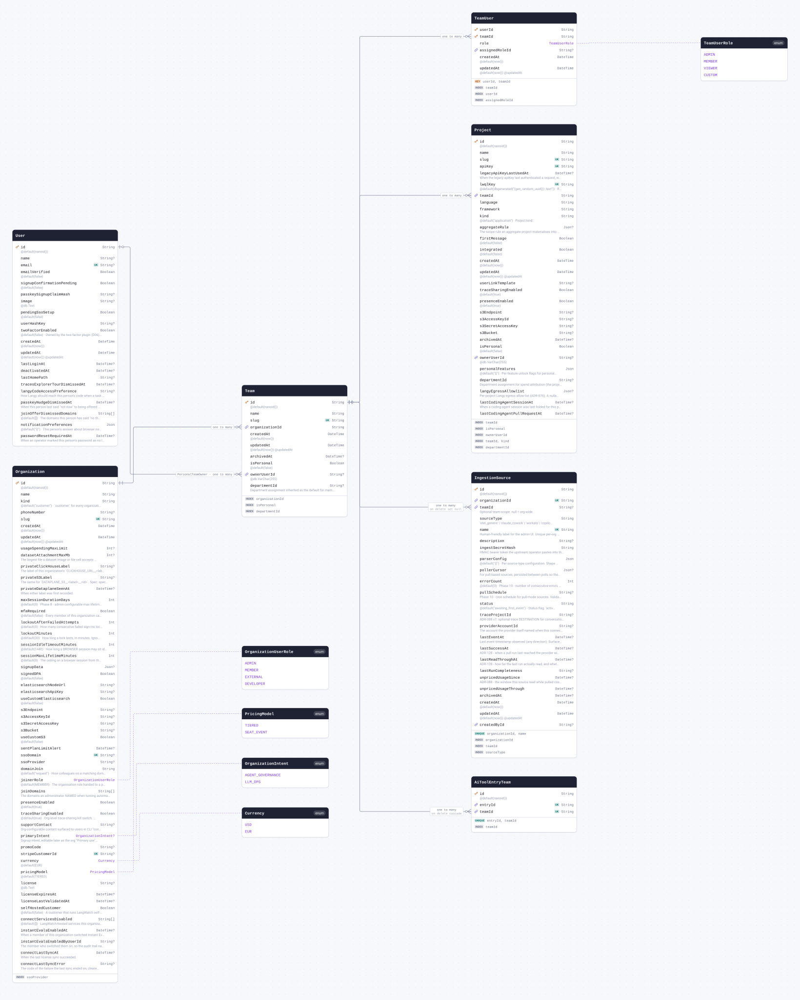

| Field            | Type                        | Constraints                                       | Default              | Description                                                                                                           |
| ---------------- | --------------------------- | ------------------------------------------------- | -------------------- | --------------------------------------------------------------------------------------------------------------------- |
| `id`             | `String`                    | PK NOT NULL                                       | `nanoid()`           |                                                                                                                       |
| `name`           | `String`                    | NOT NULL                                          |                      |                                                                                                                       |
| `slug`           | `String`                    | UNIQUE NOT NULL                                   |                      |                                                                                                                       |
| `organizationId` | `String`                    | NOT NULL → [Organization.id](#model-Organization) |                      |                                                                                                                       |
| `createdAt`      | `DateTime`                  | NOT NULL                                          | `now()`              |                                                                                                                       |
| `updatedAt`      | `DateTime`                  | NOT NULL                                          | `now()` `@updatedAt` |                                                                                                                       |
| `archivedAt`     | `DateTime`                  | NULL                                              |                      |                                                                                                                       |
| `isPersonal`     | `Boolean`                   | NOT NULL                                          | `false`              |                                                                                                                       |
| `ownerUserId`    | `String` `@db.VarChar(255)` | NULL → [User.id](#model-User)                     |                      |                                                                                                                       |
| `departmentId`   | `String`                    | NULL                                              |                      | Department assignment inherited as the default for members and projects that have none of their own. Accounting-only. |

#### Indexes

- `@@index([organizationId])`
- `@@index([isPersonal])`
- `@@index([departmentId])`

#### References

- `organizationId` → [Organization.id](#model-Organization) (many-to-one)
- `ownerUserId` → [User.id](#model-User) (many-to-one)

#### Referenced by

- `id` ← [TeamUser.teamId](#model-TeamUser) (one-to-many)
- `id` ← [Project.teamId](#model-Project) (one-to-many)
- `id` ← [IngestionSource.teamId](#model-IngestionSource) (one-to-many, on delete SetNull)
- `id` ← [AiToolEntryTeam.teamId](#model-AiToolEntryTeam) (one-to-many, on delete Cascade)

#### Definition

```sql
CREATE TABLE "Team" (
    "id" TEXT NOT NULL,
    "name" TEXT NOT NULL,
    "slug" TEXT NOT NULL,
    "organizationId" TEXT NOT NULL,
    "createdAt" TIMESTAMP(3) NOT NULL DEFAULT CURRENT_TIMESTAMP,
    "updatedAt" TIMESTAMP(3) NOT NULL DEFAULT CURRENT_TIMESTAMP,
    "archivedAt" TIMESTAMP(3),
    "isPersonal" BOOLEAN NOT NULL DEFAULT false,
    "ownerUserId" VARCHAR(255),
    "departmentId" TEXT,

    CONSTRAINT "Team_pkey" PRIMARY KEY ("id")
);

CREATE UNIQUE INDEX "Team_slug_key" ON "Team"("slug");

CREATE INDEX "Team_organizationId_idx" ON "Team"("organizationId");

CREATE INDEX "Team_isPersonal_idx" ON "Team"("isPersonal");

CREATE INDEX "Team_departmentId_idx" ON "Team"("departmentId");
```

<details>
<summary>Queries and their SQL</summary>

**findMany**: Every row

```ts
await prisma.team.findMany();
```

```sql
SELECT
  "public"."Team"."id",
  "public"."Team"."name",
  "public"."Team"."slug",
  "public"."Team"."organizationId",
  "public"."Team"."createdAt",
  "public"."Team"."updatedAt",
  "public"."Team"."archivedAt",
  "public"."Team"."isPersonal",
  "public"."Team"."ownerUserId",
  "public"."Team"."departmentId"
FROM
  "public"."Team"
WHERE
  1 = 1
OFFSET
  $1
-- params: ["0"]
```

**count**: How many rows there are

```ts
await prisma.team.count();
```

```sql
SELECT
  COUNT(*) AS "_count$_all"
FROM
  (
    SELECT
      "public"."Team"."id"
    FROM
      "public"."Team"
    WHERE
      1 = 1
    OFFSET
      $1
  ) AS "sub"
-- params: ["0"]
```

**findMany**: Every row with its relations

```ts
await prisma.team.findMany({
  include: {
    members: true,
    organization: true,
    projects: true,
    ownerUser: true,
    ingestionSources: true,
    aiToolEntryTeams: true,
  },
});
```

```sql
SELECT
  "public"."Team"."id",
  "public"."Team"."name",
  "public"."Team"."slug",
  "public"."Team"."organizationId",
  "public"."Team"."createdAt",
  "public"."Team"."updatedAt",
  "public"."Team"."archivedAt",
  "public"."Team"."isPersonal",
  "public"."Team"."ownerUserId",
  "public"."Team"."departmentId"
FROM
  "public"."Team"
WHERE
  1 = 1
OFFSET
  $1
-- params: ["0"]

SELECT
  "public"."TeamUser"."userId",
  "public"."TeamUser"."teamId",
  "public"."TeamUser"."role"::text,
  "public"."TeamUser"."assignedRoleId",
  "public"."TeamUser"."createdAt",
  "public"."TeamUser"."updatedAt"
FROM
  "public"."TeamUser"
WHERE
  "public"."TeamUser"."teamId" IN ($1)
OFFSET
  $2
-- params: ["<id of the rows above>","0"]

SELECT
  "public"."Organization"."id",
  "public"."Organization"."name",
  "public"."Organization"."kind",
  "public"."Organization"."phoneNumber",
  "public"."Organization"."slug",
  "public"."Organization"."createdAt",
  "public"."Organization"."updatedAt",
  "public"."Organization"."usageSpendingMaxLimit",
  "public"."Organization"."datasetAttachmentMaxMb",
  "public"."Organization"."privateClickHouseLabel",
  "public"."Organization"."privateS3Label",
  "public"."Organization"."privateDataplaneSeenAt",
  "public"."Organization"."maxSessionDurationDays",
  "public"."Organization"."mfaRequired",
  "public"."Organization"."lockoutAfterFailedAttempts",
  "public"."Organization"."lockoutMinutes",
  "public"."Organization"."sessionIdleTimeoutMinutes",
  "public"."Organization"."sessionMaxLifetimeMinutes",
  "public"."Organization"."signupData",
  "public"."Organization"."signedDPA",
  "public"."Organization"."elasticsearchNodeUrl",
  "public"."Organization"."elasticsearchApiKey",
  "public"."Organization"."useCustomElasticsearch",
  "public"."Organization"."s3Endpoint",
  "public"."Organization"."s3AccessKeyId",
  "public"."Organization"."s3SecretAccessKey",
  "public"."Organization"."s3Bucket",
  "public"."Organization"."useCustomS3",
  "public"."Organization"."sentPlanLimitAlert",
  "public"."Organization"."ssoDomain",
  "public"."Organization"."ssoProvider",
  "public"."Organization"."domainJoin",
  "public"."Organization"."joinerRole"::text,
  "public"."Organization"."joinDomains",
  "public"."Organization"."presenceEnabled",
  "public"."Organization"."traceSharingEnabled",
  "public"."Organization"."supportContact",
  "public"."Organization"."primaryIntent"::text,
  "public"."Organization"."promoCode",
  "public"."Organization"."stripeCustomerId",
  "public"."Organization"."currency"::text,
  "public"."Organization"."pricingModel"::text,
  "public"."Organization"."license",
  "public"."Organization"."licenseExpiresAt",
  "public"."Organization"."licenseLastValidatedAt",
  "public"."Organization"."selfHostedCustomer",
  "public"."Organization"."connectServicesDisabled",
  "public"."Organization"."instantEvalsEnabledAt",
  "public"."Organization"."instantEvalsEnabledByUserId",
  "public"."Organization"."connectLastSyncAt",
  "public"."Organization"."connectLastSyncError"
FROM
  "public"."Organization"
WHERE
  "public"."Organization"."id" IN ($1)
OFFSET
  $2
-- params: ["<organizationId of the rows above>","0"]

SELECT
  "public"."Project"."id",
  "public"."Project"."name",
  "public"."Project"."slug",
  "public"."Project"."apiKey",
  "public"."Project"."legacyApiKeyLastUsedAt",
  "public"."Project"."lwqlKey",
  "public"."Project"."teamId",
  "public"."Project"."language",
  "public"."Project"."framework",
  "public"."Project"."kind",
  "public"."Project"."aggregateRule",
  "public"."Project"."firstMessage",
  "public"."Project"."integrated",
  "public"."Project"."createdAt",
  "public"."Project"."updatedAt",
  "public"."Project"."userLinkTemplate",
  "public"."Project"."traceSharingEnabled",
  "public"."Project"."presenceEnabled",
  "public"."Project"."s3Endpoint",
  "public"."Project"."s3AccessKeyId",
  "public"."Project"."s3SecretAccessKey",
  "public"."Project"."s3Bucket",
  "public"."Project"."archivedAt",
  "public"."Project"."isPersonal",
  "public"."Project"."ownerUserId",
  "public"."Project"."personalFeatures",
  "public"."Project"."departmentId",
  "public"."Project"."langyEgressAllowlist",
  "public"."Project"."lastCodingAgentSessionAt",
  "public"."Project"."lastCodingAgentPullRequestAt"
FROM
  "public"."Project"
WHERE
  "public"."Project"."teamId" IN ($1)
OFFSET
  $2
-- params: ["<id of the rows above>","0"]

SELECT
  "public"."User"."id",
  "public"."User"."name",
  "public"."User"."email",
  "public"."User"."emailVerified",
  "public"."User"."signupConfirmationPending",
  "public"."User"."passkeySignupClaimHash",
  "public"."User"."image",
  "public"."User"."pendingSsoSetup",
  "public"."User"."userHashKey",
  "public"."User"."twoFactorEnabled",
  "public"."User"."createdAt",
  "public"."User"."updatedAt",
  "public"."User"."lastLoginAt",
  "public"."User"."deactivatedAt",
  "public"."User"."lastHomePath",
  "public"."User"."tracesExplorerTourDismissedAt",
  "public"."User"."langyCodeAccessPreference",
  "public"."User"."passkeyNudgeDismissedAt",
  "public"."User"."joinOfferDismissedDomains",
  "public"."User"."notificationPreferences",
  "public"."User"."passwordResetRequiredAt"
FROM
  "public"."User"
WHERE
  "public"."User"."id" IN ($1)
OFFSET
  $2
-- params: ["<ownerUserId of the rows above>","0"]

SELECT
  "public"."IngestionSource"."id",
  "public"."IngestionSource"."organizationId",
  "public"."IngestionSource"."teamId",
  "public"."IngestionSource"."sourceType",
  "public"."IngestionSource"."name",
  "public"."IngestionSource"."description",
  "public"."IngestionSource"."ingestSecretHash",
  "public"."IngestionSource"."parserConfig",
  "public"."IngestionSource"."pollerCursor",
  "public"."IngestionSource"."errorCount",
  "public"."IngestionSource"."pullSchedule",
  "public"."IngestionSource"."status",
  "public"."IngestionSource"."traceProjectId",
  "public"."IngestionSource"."providerAccountId",
  "public"."IngestionSource"."lastEventAt",
  "public"."IngestionSource"."lastSuccessAt",
  "public"."IngestionSource"."lastReadThroughAt",
  "public"."IngestionSource"."lastRunCompleteness",
  "public"."IngestionSource"."unpricedUsageSince",
  "public"."IngestionSource"."unpricedUsageThrough",
  "public"."IngestionSource"."archivedAt",
  "public"."IngestionSource"."createdAt",
  "public"."IngestionSource"."updatedAt",
  "public"."IngestionSource"."createdById"
FROM
  "public"."IngestionSource"
WHERE
  "public"."IngestionSource"."teamId" IN ($1)
OFFSET
  $2
-- params: ["<id of the rows above>","0"]

SELECT
  "public"."AiToolEntryTeam"."id",
  "public"."AiToolEntryTeam"."entryId",
  "public"."AiToolEntryTeam"."teamId"
FROM
  "public"."AiToolEntryTeam"
WHERE
  "public"."AiToolEntryTeam"."teamId" IN ($1)
OFFSET
  $2
-- params: ["<id of the rows above>","0"]
```

**findUnique**: One row by what is unique to it

```ts
await prisma.team.findUnique({ where: { id: "example" } });
```

```sql
SELECT
  "public"."Team"."id",
  "public"."Team"."name",
  "public"."Team"."slug",
  "public"."Team"."organizationId",
  "public"."Team"."createdAt",
  "public"."Team"."updatedAt",
  "public"."Team"."archivedAt",
  "public"."Team"."isPersonal",
  "public"."Team"."ownerUserId",
  "public"."Team"."departmentId"
FROM
  "public"."Team"
WHERE
  (
    "public"."Team"."id" = $1
    AND 1 = 1
  )
LIMIT
  $2
OFFSET
  $3
-- params: ["example","1","0"]
```

**create**: Create a row

```ts
await prisma.team.create({ data: { name: "example", slug: "example", organizationId: "example" } });
```

```sql
INSERT INTO
  "public"."Team" (
    "id",
    "name",
    "slug",
    "organizationId",
    "createdAt",
    "updatedAt",
    "isPersonal"
  )
VALUES
  ($1, $2, $3, $4, $5, $6, $7)
RETURNING
  "public"."Team"."id",
  "public"."Team"."name",
  "public"."Team"."slug",
  "public"."Team"."organizationId",
  "public"."Team"."createdAt",
  "public"."Team"."updatedAt",
  "public"."Team"."archivedAt",
  "public"."Team"."isPersonal",
  "public"."Team"."ownerUserId",
  "public"."Team"."departmentId"
-- params: ["<nanoid()>","example","example","example","<now()>","<now()>",false]
```

**update**: Update a row

```ts
await prisma.team.update({ where: { id: "example" }, data: { name: "example" } });
```

```sql
SELECT
  "public"."Team"."id"
FROM
  "public"."Team"
WHERE
  (
    "public"."Team"."id" = $1
    AND 1 = 1
  )
LIMIT
  $2
OFFSET
  $3
-- params: ["example","1","0"]

UPDATE "public"."Team"
SET
  "name" = $1,
  "updatedAt" = $2
WHERE
  (
    "public"."Team"."id" IN ($3)
    AND (
      "public"."Team"."id" = $4
      AND 1 = 1
    )
  )
RETURNING
  "public"."Team"."id",
  "public"."Team"."name",
  "public"."Team"."slug",
  "public"."Team"."organizationId",
  "public"."Team"."createdAt",
  "public"."Team"."updatedAt",
  "public"."Team"."archivedAt",
  "public"."Team"."isPersonal",
  "public"."Team"."ownerUserId",
  "public"."Team"."departmentId"
-- params: ["example",{"prisma__type":"generatorCall","prisma__value":{"name":"now","args":[],"returnType":{"type":"DateTime"}}},"<id of the rows above>","example"]
```

**delete**: Delete a row

```ts
await prisma.team.delete({ where: { id: "example" } });
```

```sql
DELETE FROM "public"."Team"
WHERE
  (
    "public"."Team"."id" = $1
    AND 1 = 1
  )
RETURNING
  "public"."Team"."id",
  "public"."Team"."name",
  "public"."Team"."slug",
  "public"."Team"."organizationId",
  "public"."Team"."createdAt",
  "public"."Team"."updatedAt",
  "public"."Team"."archivedAt",
  "public"."Team"."isPersonal",
  "public"."Team"."ownerUserId",
  "public"."Team"."departmentId"
-- params: ["example"]

SELECT
  "public"."TeamUser"."userId",
  "public"."TeamUser"."teamId"
FROM
  "public"."TeamUser"
WHERE
  (
    1 = 1
    AND "public"."TeamUser"."teamId" IN ($1)
  )
OFFSET
  $2
-- params: ["<id of the rows above>","0"]

SELECT
  "public"."Project"."id",
  "public"."Project"."teamId"
FROM
  "public"."Project"
WHERE
  (
    1 = 1
    AND "public"."Project"."teamId" IN ($1)
  )
OFFSET
  $2
-- params: ["<id of the rows above>","0"]

SELECT
  "public"."IngestionSource"."id",
  "public"."IngestionSource"."teamId"
FROM
  "public"."IngestionSource"
WHERE
  (
    1 = 1
    AND "public"."IngestionSource"."teamId" IN ($1)
  )
OFFSET
  $2
-- params: ["<id of the rows above>","0"]

UPDATE "public"."IngestionSource"
SET
  "teamId" = $1
WHERE
  (
    "public"."IngestionSource"."id" IN ($2)
    AND 1 = 1
  )
-- params: [null,"<id of the rows above>"]

SELECT
  "public"."AiToolEntryTeam"."id",
  "public"."AiToolEntryTeam"."teamId"
FROM
  "public"."AiToolEntryTeam"
WHERE
  (
    1 = 1
    AND "public"."AiToolEntryTeam"."teamId" IN ($1)
  )
OFFSET
  $2
-- params: ["<id of the rows above>","0"]

DELETE FROM "public"."AiToolEntryTeam"
WHERE
  (
    "public"."AiToolEntryTeam"."id" IN ($1)
    AND 1 = 1
  )
-- params: ["<id of the rows above>"]
```

</details>

<a id="model-Organization"></a>

### Organization

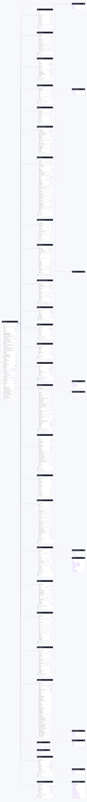

| Field                         | Type                                                 | Constraints     | Default              | Description                                                                                                                                                                                                                                                                                                                                                                                                                                                                                                                                                                                                                    |
| ----------------------------- | ---------------------------------------------------- | --------------- | -------------------- | ------------------------------------------------------------------------------------------------------------------------------------------------------------------------------------------------------------------------------------------------------------------------------------------------------------------------------------------------------------------------------------------------------------------------------------------------------------------------------------------------------------------------------------------------------------------------------------------------------------------------------ |
| `id`                          | `String`                                             | PK NOT NULL     | `nanoid()`           |                                                                                                                                                                                                                                                                                                                                                                                                                                                                                                                                                                                                                                |
| `name`                        | `String`                                             | NOT NULL        |                      |                                                                                                                                                                                                                                                                                                                                                                                                                                                                                                                                                                                                                                |
| `kind`                        | `String`                                             | NOT NULL        | `"customer"`         | `customer` for every organization a person founds or an operator provisions; `system` for the install's one hidden organization the Ops checkup canaries run in, never listed to a person. Spec: modules/ops/specs/checkup-canary-project.feature.                                                                                                                                                                                                                                                                                                                                                                             |
| `phoneNumber`                 | `String`                                             | NULL            |                      |                                                                                                                                                                                                                                                                                                                                                                                                                                                                                                                                                                                                                                |
| `slug`                        | `String`                                             | UNIQUE NOT NULL |                      |                                                                                                                                                                                                                                                                                                                                                                                                                                                                                                                                                                                                                                |
| `createdAt`                   | `DateTime`                                           | NOT NULL        | `now()`              |                                                                                                                                                                                                                                                                                                                                                                                                                                                                                                                                                                                                                                |
| `updatedAt`                   | `DateTime`                                           | NOT NULL        | `now()` `@updatedAt` |                                                                                                                                                                                                                                                                                                                                                                                                                                                                                                                                                                                                                                |
| `usageSpendingMaxLimit`       | `Int`                                                | NULL            |                      |                                                                                                                                                                                                                                                                                                                                                                                                                                                                                                                                                                                                                                |
| `datasetAttachmentMaxMb`      | `Int`                                                | NULL            |                      | The largest file a dataset image or file cell accepts for this organization, in mebibytes. Null means the default. Set by an operator from the back office only; every other dataset size limit scales with it.                                                                                                                                                                                                                                                                                                                                                                                                                |
| `privateClickHouseLabel`      | `String`                                             | NULL            |                      | The label of this organization's `CLICKHOUSE_URL__<label>__<id>` route, recorded by the organization module the first time it is seen. Once set, a missing route refuses the organization instead of serving it from the shared ClickHouse. Null: never private. Spec: specs/private-dataplane/clickhouse-routing.feature.                                                                                                                                                                                                                                                                                                     |
| `privateS3Label`              | `String`                                             | NULL            |                      | The same for `DATAPLANE_S3__<label>__<id>`. Spec: specs/private-dataplane/s3-routing.feature.                                                                                                                                                                                                                                                                                                                                                                                                                                                                                                                                  |
| `privateDataplaneSeenAt`      | `DateTime`                                           | NULL            |                      | When either label was first recorded.                                                                                                                                                                                                                                                                                                                                                                                                                                                                                                                                                                                          |
| `maxSessionDurationDays`      | `Int`                                                | NOT NULL        | `0`                  | Phase 8 - admin-configurable max lifetime for CLI device-flow sessions, in days. 0 = unbounded (default, mirrors GitHub CLI / gh-style flows). Companies that need finite session lifetime (eg. SOC 2 / ISO 27001 customers with mandated session expiration) can set a positive value. The /api/auth/cli/refresh endpoint rejects refresh attempts where now - issued_at exceeds this value, regardless of the underlying refresh-token TTL. Spec: specs/ai-governance/sessions/session-ttl.feature.                                                                                                                          |
| `mfaRequired`                 | `Boolean`                                            | NOT NULL        | `false`              | Every member of this organization can prove a second factor (D06). A MEMBERSHIP CONDITION, not a session policy: it is asked when a member reaches this organization's data, it holds the ones who cannot prove one at an enrollment gate for THIS organization alone, and it ends no session, ever. Turning it on signs nobody out. Spec: specs/identity/mfa-and-session-shape.feature.                                                                                                                                                                                                                                       |
| `lockoutAfterFailedAttempts`  | `Int`                                                | NOT NULL        | `0`                  | How many consecutive failed sign-ins lock an account (GAC-09). 0 = never lock, which is the default and what every organization that has not asked for this keeps. Counts EVERY credential together - a password, a one-time code, a backup code, a passkey - because five per factor hands an attacker one budget per factor. Spec: specs/identity/org-account-lockout.feature.                                                                                                                                                                                                                                               |
| `lockoutMinutes`              | `Int`                                                | NOT NULL        | `30`                 | How long a lock lasts, in minutes. Ignored while the threshold is 0.                                                                                                                                                                                                                                                                                                                                                                                                                                                                                                                                                           |
| `sessionIdleTimeoutMinutes`   | `Int`                                                | NOT NULL        | `1440`               | How long a BROWSER session may sit idle before it ends, in minutes (GAC-10). 0 = no idle timeout. Activity rolls the window, which is the "refreshed every hour" half of the control. A day for organizations created from now on; organizations that predate the column keep 0 and are unchanged, because the migration adds the column at zero and moves the default afterwards. NOT `maxSessionDurationDays`, which bounds CLI and device sessions and is enforced when the CLI refreshes. Two surfaces, two lifetimes, two decisions an administrator makes separately. Spec: specs/identity/org-session-lifetime.feature. |
| `sessionMaxLifetimeMinutes`   | `Int`                                                | NOT NULL        | `0`                  | The ceiling on a browser session from the moment it was minted, in minutes, which no amount of activity extends. 0 = no ceiling, the default. Offered beside the idle timeout because a session kept alive forever by a polling page is not really bounded.                                                                                                                                                                                                                                                                                                                                                                    |
| `signupData`                  | `Json`                                               | NULL            |                      |                                                                                                                                                                                                                                                                                                                                                                                                                                                                                                                                                                                                                                |
| `signedDPA`                   | `Boolean`                                            | NOT NULL        | `false`              |                                                                                                                                                                                                                                                                                                                                                                                                                                                                                                                                                                                                                                |
| `elasticsearchNodeUrl`        | `String`                                             | NULL            |                      |                                                                                                                                                                                                                                                                                                                                                                                                                                                                                                                                                                                                                                |
| `elasticsearchApiKey`         | `String`                                             | NULL            |                      |                                                                                                                                                                                                                                                                                                                                                                                                                                                                                                                                                                                                                                |
| `useCustomElasticsearch`      | `Boolean`                                            | NOT NULL        | `false`              |                                                                                                                                                                                                                                                                                                                                                                                                                                                                                                                                                                                                                                |
| `s3Endpoint`                  | `String`                                             | NULL            |                      |                                                                                                                                                                                                                                                                                                                                                                                                                                                                                                                                                                                                                                |
| `s3AccessKeyId`               | `String`                                             | NULL            |                      |                                                                                                                                                                                                                                                                                                                                                                                                                                                                                                                                                                                                                                |
| `s3SecretAccessKey`           | `String`                                             | NULL            |                      |                                                                                                                                                                                                                                                                                                                                                                                                                                                                                                                                                                                                                                |
| `s3Bucket`                    | `String`                                             | NULL            |                      |                                                                                                                                                                                                                                                                                                                                                                                                                                                                                                                                                                                                                                |
| `useCustomS3`                 | `Boolean`                                            | NOT NULL        | `false`              |                                                                                                                                                                                                                                                                                                                                                                                                                                                                                                                                                                                                                                |
| `sentPlanLimitAlert`          | `DateTime`                                           | NULL            |                      |                                                                                                                                                                                                                                                                                                                                                                                                                                                                                                                                                                                                                                |
| `ssoDomain`                   | `String`                                             | UNIQUE NULL     |                      |                                                                                                                                                                                                                                                                                                                                                                                                                                                                                                                                                                                                                                |
| `ssoProvider`                 | `String`                                             | NULL            |                      |                                                                                                                                                                                                                                                                                                                                                                                                                                                                                                                                                                                                                                |
| `domainJoin`                  | `String`                                             | NOT NULL        | `"request"`          | How colleagues on a matching domain get in (D12, ADR-117): `off` (invisible to them entirely) \| `request` (they ask, an admin approves) \| `auto` (a verified colleague walks straight in). `request` is the default for a self-serve organization; `auto` is never a default and never inferred - an administrator turns it on, names the domain in `joinDomains` while doing it, and the licence gate holds that value while letting `request` through.                                                                                                                                                                     |
| `joinerRole`                  | [`OrganizationUserRole`](#enum-OrganizationUserRole) | NOT NULL        | `MEMBER`             | The organisation role handed to a person admitted without an invitation: a self-service domain join (`domainJoin`) or an SSO-admitted login. `MEMBER` (default, a Full seat) or `DEVELOPER` (ADR-171). Set on the organisation settings page only; the join flow never asks, and an invitation always names its own role.                                                                                                                                                                                                                                                                                                      |
| `joinDomains`                 | `String[]`                                           | NOT NULL        |                      | The domains an administrator NAMED when turning automatic joining on. Empty means automatic joining admits nobody whatever `domainJoin` says - which is what keeps a setting left on from admitting a domain nobody ever agreed to.                                                                                                                                                                                                                                                                                                                                                                                            |
| `presenceEnabled`             | `Boolean`                                            | NOT NULL        | `true`               |                                                                                                                                                                                                                                                                                                                                                                                                                                                                                                                                                                                                                                |
| `traceSharingEnabled`         | `Boolean`                                            | NOT NULL        | `true`               | Org-level trace-sharing kill switch. Off = trace share links cannot be created in ANY project of this org, and existing links stop resolving — the org toggle is the global switch, the per-project `Project.traceSharingEnabled` scopes the kill to a single project (mirrors `presenceEnabled`). Effective sharing = org AND project. ADR-039.                                                                                                                                                                                                                                                                               |
| `supportContact`              | `String`                                             | NULL            |                      | Org-configurable contact surfaced to users in CLI "contact your admin" messages and the in-app budget-exceeded banner. Free text: accepts an email, a URL (internal ticketing system), or any other instruction. When null, callers fall back to the first ADMIN member's email (`resolveSupportContact` helper).                                                                                                                                                                                                                                                                                                              |
| `primaryIntent`               | [`OrganizationIntent`](#enum-OrganizationIntent)     | NULL            |                      | Signup intent, editable later as the org "Primary use" setting. AGENT_GOVERNANCE lands "/" on /me, LLM_OPS on the project home. NULL means intent unset (every pre-fork org and any org created outside onboarding) — the home resolver keeps legacy behavior. ADR-038.                                                                                                                                                                                                                                                                                                                                                        |
| `promoCode`                   | `String`                                             | NULL            |                      |                                                                                                                                                                                                                                                                                                                                                                                                                                                                                                                                                                                                                                |
| `stripeCustomerId`            | `String`                                             | UNIQUE NULL     |                      |                                                                                                                                                                                                                                                                                                                                                                                                                                                                                                                                                                                                                                |
| `currency`                    | [`Currency`](#enum-Currency)                         | NOT NULL        | `EUR`                |                                                                                                                                                                                                                                                                                                                                                                                                                                                                                                                                                                                                                                |
| `pricingModel`                | [`PricingModel`](#enum-PricingModel)                 | NOT NULL        | `TIERED`             |                                                                                                                                                                                                                                                                                                                                                                                                                                                                                                                                                                                                                                |
| `license`                     | `String` `@db.Text`                                  | NULL            |                      |                                                                                                                                                                                                                                                                                                                                                                                                                                                                                                                                                                                                                                |
| `licenseExpiresAt`            | `DateTime`                                           | NULL            |                      |                                                                                                                                                                                                                                                                                                                                                                                                                                                                                                                                                                                                                                |
| `licenseLastValidatedAt`      | `DateTime`                                           | NULL            |                      |                                                                                                                                                                                                                                                                                                                                                                                                                                                                                                                                                                                                                                |
| `selfHostedCustomer`          | `Boolean`                                            | NOT NULL        | `false`              | A customer that runs LangWatch self-hosted. The hosted usage, budgets and invoices of its connected installs attach to this organization (ADR-139).                                                                                                                                                                                                                                                                                                                                                                                                                                                                            |
| `connectServicesDisabled`     | `String[]`                                           | NOT NULL        | `[]`                 | LangWatch-hosted services this organization has switched OFF, named the way its license names them ("instant_evals"). A service the license is entitled to is on unless it is listed here, so a customer who bought hosted judging gets it without finding a settings page first, and an administrator who switched one off keeps it off across license changes (ADR-139, section 2). A license that names no service reaches nothing, whatever this column holds.                                                                                                                                                             |
| `instantEvalsEnabledAt`       | `DateTime`                                           | NULL            |                      | When a member of this organization switched Instant Evals on from the search bar, which is the organization's consent to have judged text sent to the judge's provider. Null until then: a self-serve organization is never opted in on its behalf, and an enterprise one is switched on by an operator through the release flag after asking, never here.                                                                                                                                                                                                                                                                     |
| `instantEvalsEnabledByUserId` | `String`                                             | NULL            |                      | The member who switched them on, so the audit trail names a person and not just a moment.                                                                                                                                                                                                                                                                                                                                                                                                                                                                                                                                      |
| `connectLastSyncAt`           | `DateTime`                                           | NULL            |                      | When the last license sync succeeded.                                                                                                                                                                                                                                                                                                                                                                                                                                                                                                                                                                                          |
| `connectLastSyncError`        | `String`                                             | NULL            |                      | The code of the failure the last sync ended on, cleared on the next success. Settings, Connect renders the copy for it.                                                                                                                                                                                                                                                                                                                                                                                                                                                                                                        |

#### Indexes

- `@@index([ssoProvider])`

#### Referenced by

- `id` ← [OrganizationUser.organizationId](#model-OrganizationUser) (one-to-many)
- `id` ← [Team.organizationId](#model-Team) (one-to-many)
- `id` ← [IssuedLicense.organizationId](#model-IssuedLicense) (one-to-many, on delete Restrict)
- `id` ← [ConnectedBillingAccount.organizationId](#model-ConnectedBillingAccount) (one-to-one, on delete Restrict)
- `id` ← [ScimRequestLog.organizationId](#model-ScimRequestLog) (one-to-many, on delete Cascade)
- `id` ← [ScimToken.organizationId](#model-ScimToken) (one-to-many, on delete Cascade)
- `id` ← [OrganizationInvite.organizationId](#model-OrganizationInvite) (one-to-many)
- `id` ← [WebhookEndpoint.organizationId](#model-WebhookEndpoint) (one-to-many, on delete Cascade)
- `id` ← [GithubInstallation.organizationId](#model-GithubInstallation) (one-to-many, on delete Cascade)
- `id` ← [GithubPullRequest.organizationId](#model-GithubPullRequest) (one-to-many, on delete Cascade)
- `id` ← [GithubBranchPullRequestCheck.organizationId](#model-GithubBranchPullRequestCheck) (one-to-many, on delete Cascade)
- `id` ← [PromptTag.organizationId](#model-PromptTag) (one-to-many, on delete Cascade)
- `id` ← [CustomRole.organizationId](#model-CustomRole) (one-to-many)
- `id` ← [Notification.organizationId](#model-Notification) (one-to-many, on delete Cascade)
- `id` ← [Subscription.organizationId](#model-Subscription) (one-to-many)
- `id` ← [Group.organizationId](#model-Group) (one-to-many, on delete Cascade)
- `id` ← [RoleBinding.organizationId](#model-RoleBinding) (one-to-many, on delete Cascade)
- `id` ← [ApiKey.organizationId](#model-ApiKey) (one-to-many, on delete Restrict)
- `id` ← [RoutingPolicy.organizationId](#model-RoutingPolicy) (one-to-many, on delete Cascade)
- `id` ← [IngestionSource.organizationId](#model-IngestionSource) (one-to-many, on delete Cascade)
- `id` ← [AnomalyRule.organizationId](#model-AnomalyRule) (one-to-many, on delete Cascade)
- `id` ← [AnomalyAlert.organizationId](#model-AnomalyAlert) (one-to-many, on delete Cascade)
- `id` ← [AiToolEntry.organizationId](#model-AiToolEntry) (one-to-many, on delete Cascade)
- `id` ← [IngestionTemplate.organizationId](#model-IngestionTemplate) (one-to-many, on delete Cascade)
- `id` ← [GatewayChangeEvent.organizationId](#model-GatewayChangeEvent) (one-to-many, on delete Cascade)

#### Definition

```sql
CREATE TABLE "Organization" (
    "id" TEXT NOT NULL,
    "name" TEXT NOT NULL,
    "kind" TEXT NOT NULL DEFAULT 'customer',
    "phoneNumber" TEXT,
    "slug" TEXT NOT NULL,
    "createdAt" TIMESTAMP(3) NOT NULL DEFAULT CURRENT_TIMESTAMP,
    "updatedAt" TIMESTAMP(3) NOT NULL DEFAULT CURRENT_TIMESTAMP,
    "usageSpendingMaxLimit" INTEGER,
    "datasetAttachmentMaxMb" INTEGER,
    "privateClickHouseLabel" TEXT,
    "privateS3Label" TEXT,
    "privateDataplaneSeenAt" TIMESTAMP(3),
    "maxSessionDurationDays" INTEGER NOT NULL DEFAULT 0,
    "mfaRequired" BOOLEAN NOT NULL DEFAULT false,
    "lockoutAfterFailedAttempts" INTEGER NOT NULL DEFAULT 0,
    "lockoutMinutes" INTEGER NOT NULL DEFAULT 30,
    "sessionIdleTimeoutMinutes" INTEGER NOT NULL DEFAULT 1440,
    "sessionMaxLifetimeMinutes" INTEGER NOT NULL DEFAULT 0,
    "signupData" JSONB,
    "signedDPA" BOOLEAN NOT NULL DEFAULT false,
    "elasticsearchNodeUrl" TEXT,
    "elasticsearchApiKey" TEXT,
    "useCustomElasticsearch" BOOLEAN NOT NULL DEFAULT false,
    "s3Endpoint" TEXT,
    "s3AccessKeyId" TEXT,
    "s3SecretAccessKey" TEXT,
    "s3Bucket" TEXT,
    "useCustomS3" BOOLEAN NOT NULL DEFAULT false,
    "sentPlanLimitAlert" TIMESTAMP(3),
    "ssoDomain" TEXT,
    "ssoProvider" TEXT,
    "domainJoin" TEXT NOT NULL DEFAULT 'request',
    "joinerRole" "OrganizationUserRole" NOT NULL DEFAULT 'MEMBER',
    "joinDomains" TEXT[],
    "presenceEnabled" BOOLEAN NOT NULL DEFAULT true,
    "traceSharingEnabled" BOOLEAN NOT NULL DEFAULT true,
    "supportContact" TEXT,
    "primaryIntent" "OrganizationIntent",
    "promoCode" TEXT,
    "stripeCustomerId" TEXT,
    "currency" "Currency" NOT NULL DEFAULT 'EUR',
    "pricingModel" "PricingModel" NOT NULL DEFAULT 'TIERED',
    "license" TEXT,
    "licenseExpiresAt" TIMESTAMP(3),
    "licenseLastValidatedAt" TIMESTAMP(3),
    "selfHostedCustomer" BOOLEAN NOT NULL DEFAULT false,
    "connectServicesDisabled" TEXT[] DEFAULT ARRAY[]::TEXT[],
    "instantEvalsEnabledAt" TIMESTAMP(3),
    "instantEvalsEnabledByUserId" TEXT,
    "connectLastSyncAt" TIMESTAMP(3),
    "connectLastSyncError" TEXT,

    CONSTRAINT "Organization_pkey" PRIMARY KEY ("id")
);

CREATE UNIQUE INDEX "Organization_slug_key" ON "Organization"("slug");

CREATE UNIQUE INDEX "Organization_ssoDomain_key" ON "Organization"("ssoDomain");

CREATE UNIQUE INDEX "Organization_stripeCustomerId_key" ON "Organization"("stripeCustomerId");

CREATE INDEX "Organization_ssoProvider_idx" ON "Organization"("ssoProvider");
```

<details>
<summary>Queries and their SQL</summary>

**findMany**: Every row

```ts
await prisma.organization.findMany();
```

```sql
SELECT
  "public"."Organization"."id",
  "public"."Organization"."name",
  "public"."Organization"."kind",
  "public"."Organization"."phoneNumber",
  "public"."Organization"."slug",
  "public"."Organization"."createdAt",
  "public"."Organization"."updatedAt",
  "public"."Organization"."usageSpendingMaxLimit",
  "public"."Organization"."datasetAttachmentMaxMb",
  "public"."Organization"."privateClickHouseLabel",
  "public"."Organization"."privateS3Label",
  "public"."Organization"."privateDataplaneSeenAt",
  "public"."Organization"."maxSessionDurationDays",
  "public"."Organization"."mfaRequired",
  "public"."Organization"."lockoutAfterFailedAttempts",
  "public"."Organization"."lockoutMinutes",
  "public"."Organization"."sessionIdleTimeoutMinutes",
  "public"."Organization"."sessionMaxLifetimeMinutes",
  "public"."Organization"."signupData",
  "public"."Organization"."signedDPA",
  "public"."Organization"."elasticsearchNodeUrl",
  "public"."Organization"."elasticsearchApiKey",
  "public"."Organization"."useCustomElasticsearch",
  "public"."Organization"."s3Endpoint",
  "public"."Organization"."s3AccessKeyId",
  "public"."Organization"."s3SecretAccessKey",
  "public"."Organization"."s3Bucket",
  "public"."Organization"."useCustomS3",
  "public"."Organization"."sentPlanLimitAlert",
  "public"."Organization"."ssoDomain",
  "public"."Organization"."ssoProvider",
  "public"."Organization"."domainJoin",
  "public"."Organization"."joinerRole"::text,
  "public"."Organization"."joinDomains",
  "public"."Organization"."presenceEnabled",
  "public"."Organization"."traceSharingEnabled",
  "public"."Organization"."supportContact",
  "public"."Organization"."primaryIntent"::text,
  "public"."Organization"."promoCode",
  "public"."Organization"."stripeCustomerId",
  "public"."Organization"."currency"::text,
  "public"."Organization"."pricingModel"::text,
  "public"."Organization"."license",
  "public"."Organization"."licenseExpiresAt",
  "public"."Organization"."licenseLastValidatedAt",
  "public"."Organization"."selfHostedCustomer",
  "public"."Organization"."connectServicesDisabled",
  "public"."Organization"."instantEvalsEnabledAt",
  "public"."Organization"."instantEvalsEnabledByUserId",
  "public"."Organization"."connectLastSyncAt",
  "public"."Organization"."connectLastSyncError"
FROM
  "public"."Organization"
WHERE
  1 = 1
OFFSET
  $1
-- params: ["0"]
```

**count**: How many rows there are

```ts
await prisma.organization.count();
```

```sql
SELECT
  COUNT(*) AS "_count$_all"
FROM
  (
    SELECT
      "public"."Organization"."id"
    FROM
      "public"."Organization"
    WHERE
      1 = 1
    OFFSET
      $1
  ) AS "sub"
-- params: ["0"]
```

**findMany**: Every row with its relations

```ts
await prisma.organization.findMany({
  include: {
    members: true,
    teams: true,
    webhookEndpoints: true,
    OrganizationInvite: true,
    CustomRoles: true,
    notifications: true,
    subscriptions: true,
    scimTokens: true,
    scimRequestLog: true,
    promptTags: true,
    groups: true,
    roleBindings: true,
    apiKeys: true,
    issuedLicenses: true,
    connectedBilling: true,
    gatewayChangeEvents: true,
    routingPolicies: true,
    ingestionSources: true,
    anomalyRules: true,
    anomalyAlerts: true,
    aiToolEntries: true,
    ingestionTemplates: true,
    githubInstallations: true,
    githubPullRequests: true,
    githubBranchPrChecks: true,
  },
});
```

```sql
SELECT
  "public"."Organization"."id",
  "public"."Organization"."name",
  "public"."Organization"."kind",
  "public"."Organization"."phoneNumber",
  "public"."Organization"."slug",
  "public"."Organization"."createdAt",
  "public"."Organization"."updatedAt",
  "public"."Organization"."usageSpendingMaxLimit",
  "public"."Organization"."datasetAttachmentMaxMb",
  "public"."Organization"."privateClickHouseLabel",
  "public"."Organization"."privateS3Label",
  "public"."Organization"."privateDataplaneSeenAt",
  "public"."Organization"."maxSessionDurationDays",
  "public"."Organization"."mfaRequired",
  "public"."Organization"."lockoutAfterFailedAttempts",
  "public"."Organization"."lockoutMinutes",
  "public"."Organization"."sessionIdleTimeoutMinutes",
  "public"."Organization"."sessionMaxLifetimeMinutes",
  "public"."Organization"."signupData",
  "public"."Organization"."signedDPA",
  "public"."Organization"."elasticsearchNodeUrl",
  "public"."Organization"."elasticsearchApiKey",
  "public"."Organization"."useCustomElasticsearch",
  "public"."Organization"."s3Endpoint",
  "public"."Organization"."s3AccessKeyId",
  "public"."Organization"."s3SecretAccessKey",
  "public"."Organization"."s3Bucket",
  "public"."Organization"."useCustomS3",
  "public"."Organization"."sentPlanLimitAlert",
  "public"."Organization"."ssoDomain",
  "public"."Organization"."ssoProvider",
  "public"."Organization"."domainJoin",
  "public"."Organization"."joinerRole"::text,
  "public"."Organization"."joinDomains",
  "public"."Organization"."presenceEnabled",
  "public"."Organization"."traceSharingEnabled",
  "public"."Organization"."supportContact",
  "public"."Organization"."primaryIntent"::text,
  "public"."Organization"."promoCode",
  "public"."Organization"."stripeCustomerId",
  "public"."Organization"."currency"::text,
  "public"."Organization"."pricingModel"::text,
  "public"."Organization"."license",
  "public"."Organization"."licenseExpiresAt",
  "public"."Organization"."licenseLastValidatedAt",
  "public"."Organization"."selfHostedCustomer",
  "public"."Organization"."connectServicesDisabled",
  "public"."Organization"."instantEvalsEnabledAt",
  "public"."Organization"."instantEvalsEnabledByUserId",
  "public"."Organization"."connectLastSyncAt",
  "public"."Organization"."connectLastSyncError"
FROM
  "public"."Organization"
WHERE
  1 = 1
OFFSET
  $1
-- params: ["0"]

SELECT
  "public"."OrganizationUser"."userId",
  "public"."OrganizationUser"."organizationId",
  "public"."OrganizationUser"."role"::text,
  "public"."OrganizationUser"."createdAt",
  "public"."OrganizationUser"."updatedAt",
  "public"."OrganizationUser"."departmentId",
  "public"."OrganizationUser"."disabledAt",
  "public"."OrganizationUser"."pendingSsoGrantId",
  "public"."OrganizationUser"."membershipStamp",
  "public"."OrganizationUser"."fullSeatSince",
  "public"."OrganizationUser"."seatPendingSince"
FROM
  "public"."OrganizationUser"
WHERE
  "public"."OrganizationUser"."organizationId" IN ($1)
OFFSET
  $2
-- params: ["<id of the rows above>","0"]

SELECT
  "public"."Team"."id",
  "public"."Team"."name",
  "public"."Team"."slug",
  "public"."Team"."organizationId",
  "public"."Team"."createdAt",
  "public"."Team"."updatedAt",
  "public"."Team"."archivedAt",
  "public"."Team"."isPersonal",
  "public"."Team"."ownerUserId",
  "public"."Team"."departmentId"
FROM
  "public"."Team"
WHERE
  "public"."Team"."organizationId" IN ($1)
OFFSET
  $2
-- params: ["<id of the rows above>","0"]

SELECT
  "public"."WebhookEndpoint"."id",
  "public"."WebhookEndpoint"."organizationId",
  "public"."WebhookEndpoint"."destinationKind"::text,
  "public"."WebhookEndpoint"."url",
  "public"."WebhookEndpoint"."sqsQueueUrl",
  "public"."WebhookEndpoint"."sqsRoleArn",
  "public"."WebhookEndpoint"."sqsExternalId",
  "public"."WebhookEndpoint"."sqsAccessKeyId",
  "public"."WebhookEndpoint"."sqsSecretAccessKeyEncrypted",
  "public"."WebhookEndpoint"."secretEncrypted",
  "public"."WebhookEndpoint"."signatureScheme",
  "public"."WebhookEndpoint"."idempotencyKey",
  "public"."WebhookEndpoint"."previousSecretEncrypted",
  "public"."WebhookEndpoint"."previousSecretExpiresAt",
  "public"."WebhookEndpoint"."enabledEvents",
  "public"."WebhookEndpoint"."status"::text,
  "public"."WebhookEndpoint"."disabledReason",
  "public"."WebhookEndpoint"."disabledAt",
  "public"."WebhookEndpoint"."failingSince",
  "public"."WebhookEndpoint"."maxBatchSize",
  "public"."WebhookEndpoint"."maxBatchDelayMs",
  "public"."WebhookEndpoint"."maxInFlight",
  "public"."WebhookEndpoint"."allowSelfSignedCertificate",
  "public"."WebhookEndpoint"."lastSuccessAt",
  "public"."WebhookEndpoint"."lastFailureAt",
  "public"."WebhookEndpoint"."archivedAt",
  "public"."WebhookEndpoint"."createdAt",
  "public"."WebhookEndpoint"."updatedAt"
FROM
  "public"."WebhookEndpoint"
WHERE
  "public"."WebhookEndpoint"."organizationId" IN ($1)
OFFSET
  $2
-- params: ["<id of the rows above>","0"]

SELECT
  "public"."OrganizationInvite"."id",
  "public"."OrganizationInvite"."email",
  "public"."OrganizationInvite"."inviteCode",
  "public"."OrganizationInvite"."expiration",
  "public"."OrganizationInvite"."status"::text,
  "public"."OrganizationInvite"."organizationId",
  "public"."OrganizationInvite"."teamIds",
  "public"."OrganizationInvite"."teamAssignments",
  "public"."OrganizationInvite"."role"::text,
  "public"."OrganizationInvite"."requestedBy",
  "public"."OrganizationInvite"."subscriptionId",
  "public"."OrganizationInvite"."acceptedByUserId",
  "public"."OrganizationInvite"."acceptedViaIdentifierId",
  "public"."OrganizationInvite"."createdAt",
  "public"."OrganizationInvite"."updatedAt"
FROM
  "public"."OrganizationInvite"
WHERE
  "public"."OrganizationInvite"."organizationId" IN ($1)
OFFSET
  $2
-- params: ["<id of the rows above>","0"]

SELECT
  "public"."CustomRole"."id",
  "public"."CustomRole"."organizationId",
  "public"."CustomRole"."name",
  "public"."CustomRole"."description",
  "public"."CustomRole"."permissions",
  "public"."CustomRole"."kind",
  "public"."CustomRole"."createdAt",
  "public"."CustomRole"."updatedAt"
FROM
  "public"."CustomRole"
WHERE
  "public"."CustomRole"."organizationId" IN ($1)
OFFSET
  $2
-- params: ["<id of the rows above>","0"]

SELECT
  "public"."Notification"."id",
  "public"."Notification"."organizationId",
  "public"."Notification"."projectId",
  "public"."Notification"."metadata",
  "public"."Notification"."createdAt",
  "public"."Notification"."updatedAt",
  "public"."Notification"."sentAt"
FROM
  "public"."Notification"
WHERE
  "public"."Notification"."organizationId" IN ($1)
OFFSET
  $2
-- params: ["<id of the rows above>","0"]

SELECT
  "public"."Subscription"."id",
  "public"."Subscription"."organizationId",
  "public"."Subscription"."plan"::text,
  "public"."Subscription"."stripeSubscriptionId",
  "public"."Subscription"."status"::text,
  "public"."Subscription"."startDate",
  "public"."Subscription"."endDate",
  "public"."Subscription"."lastPaymentFailedDate",
  "public"."Subscription"."createdAt",
  "public"."Subscription"."updatedAt",
  "public"."Subscription"."maxMembers",
  "public"."Subscription"."maxProjects",
  "public"."Subscription"."maxMessagesPerMonth",
  "public"."Subscription"."maxWorkflows",
  "public"."Subscription"."maxRetentionDays",
  "public"."Subscription"."maxMembersLite",
  "public"."Subscription"."maxMembersDeveloper",
  "public"."Subscription"."maxTeams",
  "public"."Subscription"."maxPrompts",
  "public"."Subscription"."maxEvaluators",
  "public"."Subscription"."maxScenarios",
  "public"."Subscription"."maxAgents",
  "public"."Subscription"."maxExperiments",
  "public"."Subscription"."maxOnlineEvaluations",
  "public"."Subscription"."maxDatasets",
  "public"."Subscription"."maxDashboards",
  "public"."Subscription"."maxCustomGraphs",
  "public"."Subscription"."maxAutomations",
  "public"."Subscription"."seatsKept",
  "public"."Subscription"."seatsKeptUntil",
  "public"."Subscription"."seatLineQuantity",
  "public"."Subscription"."seatLineQuantityAt",
  "public"."Subscription"."seatLineWriteQuantities",
  "public"."Subscription"."seatLineWriteSince",
  "public"."Subscription"."seatLineWriteAt",
  "public"."Subscription"."seatLineWriteAttempts",
  "public"."Subscription"."seatLineWriteFlaggedAt",
  "public"."Subscription"."seatRepairQuantity",
  "public"."Subscription"."seatRepairLiftedQuantity",
  "public"."Subscription"."seatRepairSince",
  "public"."Subscription"."seatRepairAttempts",
  "public"."Subscription"."seatRepairFlaggedAt",
  "public"."Subscription"."seatLineLeaseToken",
  "public"."Subscription"."seatLineLeaseUntil"
FROM
  "public"."Subscription"
WHERE
  "public"."Subscription"."organizationId" IN ($1)
OFFSET
  $2
-- params: ["<id of the rows above>","0"]

SELECT
  "public"."ScimToken"."id",
  "public"."ScimToken"."organizationId",
  "public"."ScimToken"."connectionId",
  "public"."ScimToken"."hashedToken",
  "public"."ScimToken"."hashScheme",
  "public"."ScimToken"."description",
  "public"."ScimToken"."createdAt",
  "public"."ScimToken"."lastUsedAt"
FROM
  "public"."ScimToken"
WHERE
  "public"."ScimToken"."organizationId" IN ($1)
OFFSET
  $2
-- params: ["<id of the rows above>","0"]

SELECT
  "public"."ScimRequestLog"."id",
  "public"."ScimRequestLog"."organizationId",
  "public"."ScimRequestLog"."connectionId",
  "public"."ScimRequestLog"."method",
  "public"."ScimRequestLog"."resource",
  "public"."ScimRequestLog"."status",
  "public"."ScimRequestLog"."reason",
  "public"."ScimRequestLog"."detail",
  "public"."ScimRequestLog"."occurredAt"
FROM
  "public"."ScimRequestLog"
WHERE
  "public"."ScimRequestLog"."organizationId" IN ($1)
OFFSET
  $2
-- params: ["<id of the rows above>","0"]

SELECT
  "public"."PromptTag"."id",
  "public"."PromptTag"."organizationId",
  "public"."PromptTag"."name",
  "public"."PromptTag"."createdAt",
  "public"."PromptTag"."updatedAt",
  "public"."PromptTag"."createdById",
  "public"."PromptTag"."updatedById"
FROM
  "public"."PromptTag"
WHERE
  "public"."PromptTag"."organizationId" IN ($1)
OFFSET
  $2
-- params: ["<id of the rows above>","0"]

SELECT
  "public"."Group"."id",
  "public"."Group"."organizationId",
  "public"."Group"."name",
  "public"."Group"."slug",
  "public"."Group"."externalId",
  "public"."Group"."scimSource",
  "public"."Group"."scimConnectionId",
  "public"."Group"."createdAt",
  "public"."Group"."updatedAt"
FROM
  "public"."Group"
WHERE
  "public"."Group"."organizationId" IN ($1)
OFFSET
  $2
-- params: ["<id of the rows above>","0"]

SELECT
  "public"."RoleBinding"."id",
  "public"."RoleBinding"."organizationId",
  "public"."RoleBinding"."userId",
  "public"."RoleBinding"."groupId",
  "public"."RoleBinding"."apiKeyId",
  "public"."RoleBinding"."role"::text,
  "public"."RoleBinding"."customRoleId",
  "public"."RoleBinding"."scopeType"::text,
  "public"."RoleBinding"."scopeId",
  "public"."RoleBinding"."createdAt",
  "public"."RoleBinding"."updatedAt"
FROM
  "public"."RoleBinding"
WHERE
  "public"."RoleBinding"."organizationId" IN ($1)
OFFSET
  $2
-- params: ["<id of the rows above>","0"]

SELECT
  "public"."ApiKey"."id",
  "public"."ApiKey"."name",
  "public"."ApiKey"."description",
  "public"."ApiKey"."lookupId",
  "public"."ApiKey"."hashedSecret",
  "public"."ApiKey"."permissionMode",
  "public"."ApiKey"."userId",
  "public"."ApiKey"."createdByUserId",
  "public"."ApiKey"."organizationId",
  "public"."ApiKey"."expiresAt",
  "public"."ApiKey"."lastUsedAt",
  "public"."ApiKey"."revokedAt",
  "public"."ApiKey"."revocationCause",
  "public"."ApiKey"."parentApiKeyId",
  "public"."ApiKey"."ingestSourceType",
  "public"."ApiKey"."ingestionTemplateId",
  "public"."ApiKey"."createdByDeviceLabel",
  "public"."ApiKey"."isSystemManaged",
  "public"."ApiKey"."createdByBrowserSessionId",
  "public"."ApiKey"."createdAt",
  "public"."ApiKey"."updatedAt"
FROM
  "public"."ApiKey"
WHERE
  "public"."ApiKey"."organizationId" IN ($1)
OFFSET
  $2
-- params: ["<id of the rows above>","0"]

SELECT
  "public"."IssuedLicense"."id",
  "public"."IssuedLicense"."licenseId",
  "public"."IssuedLicense"."tokenHash",
  "public"."IssuedLicense"."organizationId",
  "public"."IssuedLicense"."organizationName",
  "public"."IssuedLicense"."email",
  "public"."IssuedLicense"."planType",
  "public"."IssuedLicense"."maxMembers",
  "public"."IssuedLicense"."maxMembersLite",
  "public"."IssuedLicense"."liteSeatsUnlimited",
  "public"."IssuedLicense"."maxMembersDeveloper",
  "public"."IssuedLicense"."issuedAt",
  "public"."IssuedLicense"."expiresAt",
  "public"."IssuedLicense"."source"::text,
  "public"."IssuedLicense"."issuedById",
  "public"."IssuedLicense"."revokedAt",
  "public"."IssuedLicense"."revokedById",
  "public"."IssuedLicense"."revokedReason",
  "public"."IssuedLicense"."supersededAt",
  "public"."IssuedLicense"."replacesId",
  "public"."IssuedLicense"."pendingDeliveryLicense",
  "public"."IssuedLicense"."services",
  "public"."IssuedLicense"."seatRateCents",
  "public"."IssuedLicense"."seatCurrency"::text,
  "public"."IssuedLicense"."commitUsdCents",
  "public"."IssuedLicense"."overageEnabled",
  "public"."IssuedLicense"."overageMaxUsdCents",
  "public"."IssuedLicense"."instanceId",
  "public"."IssuedLicense"."instanceBoundAt",
  "public"."IssuedLicense"."lastSyncAt",
  "public"."IssuedLicense"."lastSyncVersion",
  "public"."IssuedLicense"."reportedMembers",
  "public"."IssuedLicense"."reportedMembersLite",
  "public"."IssuedLicense"."virtualKeyId",
  "public"."IssuedLicense"."seatsRaisedFrom",
  "public"."IssuedLicense"."createdAt",
  "public"."IssuedLicense"."updatedAt"
FROM
  "public"."IssuedLicense"
WHERE
  "public"."IssuedLicense"."organizationId" IN ($1)
OFFSET
  $2
-- params: ["<id of the rows above>","0"]

SELECT
  "public"."ConnectedBillingAccount"."id",
  "public"."ConnectedBillingAccount"."organizationId",
  "public"."ConnectedBillingAccount"."stripeCustomerId",
  "public"."ConnectedBillingAccount"."usageSubscriptionId",
  "public"."ConnectedBillingAccount"."usageSubscriptionItemId",
  "public"."ConnectedBillingAccount"."termStartsAt",
  "public"."ConnectedBillingAccount"."termEndsAt",
  "public"."ConnectedBillingAccount"."commitUsdCents",
  "public"."ConnectedBillingAccount"."seatCurrency"::text,
  "public"."ConnectedBillingAccount"."seatRateCents",
  "public"."ConnectedBillingAccount"."seats",
  "public"."ConnectedBillingAccount"."bankTransferType",
  "public"."ConnectedBillingAccount"."bankTransferCountry",
  "public"."ConnectedBillingAccount"."billingEmail",
  "public"."ConnectedBillingAccount"."pendingRenewal",
  "public"."ConnectedBillingAccount"."createdById",
  "public"."ConnectedBillingAccount"."createdAt",
  "public"."ConnectedBillingAccount"."updatedAt"
FROM
  "public"."ConnectedBillingAccount"
WHERE
  "public"."ConnectedBillingAccount"."organizationId" IN ($1)
OFFSET
  $2
-- params: ["<id of the rows above>","0"]

SELECT
  "public"."GatewayChangeEvent"."revision",
  "public"."GatewayChangeEvent"."organizationId",
  "public"."GatewayChangeEvent"."kind"::text,
  "public"."GatewayChangeEvent"."virtualKeyId",
  "public"."GatewayChangeEvent"."budgetId",
  "public"."GatewayChangeEvent"."modelProviderId",
  "public"."GatewayChangeEvent"."projectId",
  "public"."GatewayChangeEvent"."payload",
  "public"."GatewayChangeEvent"."createdAt"
FROM
  "public"."GatewayChangeEvent"
WHERE
  "public"."GatewayChangeEvent"."organizationId" IN ($1)
OFFSET
  $2
-- params: ["<id of the rows above>","0"]

SELECT
  "public"."RoutingPolicy"."id",
  "public"."RoutingPolicy"."organizationId",
  "public"."RoutingPolicy"."name",
  "public"."RoutingPolicy"."description",
  "public"."RoutingPolicy"."modelProviderIds",
  "public"."RoutingPolicy"."modelAliases",
  "public"."RoutingPolicy"."defaultModel",
  "public"."RoutingPolicy"."policyRules",
  "public"."RoutingPolicy"."isDefault",
  "public"."RoutingPolicy"."createdAt",
  "public"."RoutingPolicy"."updatedAt",
  "public"."RoutingPolicy"."createdById",
  "public"."RoutingPolicy"."updatedById"
FROM
  "public"."RoutingPolicy"
WHERE
  "public"."RoutingPolicy"."organizationId" IN ($1)
OFFSET
  $2
-- params: ["<id of the rows above>","0"]

SELECT
  "public"."IngestionSource"."id",
  "public"."IngestionSource"."organizationId",
  "public"."IngestionSource"."teamId",
  "public"."IngestionSource"."sourceType",
  "public"."IngestionSource"."name",
  "public"."IngestionSource"."description",
  "public"."IngestionSource"."ingestSecretHash",
  "public"."IngestionSource"."parserConfig",
  "public"."IngestionSource"."pollerCursor",
  "public"."IngestionSource"."errorCount",
  "public"."IngestionSource"."pullSchedule",
  "public"."IngestionSource"."status",
  "public"."IngestionSource"."traceProjectId",
  "public"."IngestionSource"."providerAccountId",
  "public"."IngestionSource"."lastEventAt",
  "public"."IngestionSource"."lastSuccessAt",
  "public"."IngestionSource"."lastReadThroughAt",
  "public"."IngestionSource"."lastRunCompleteness",
  "public"."IngestionSource"."unpricedUsageSince",
  "public"."IngestionSource"."unpricedUsageThrough",
  "public"."IngestionSource"."archivedAt",
  "public"."IngestionSource"."createdAt",
  "public"."IngestionSource"."updatedAt",
  "public"."IngestionSource"."createdById"
FROM
  "public"."IngestionSource"
WHERE
  "public"."IngestionSource"."organizationId" IN ($1)
OFFSET
  $2
-- params: ["<id of the rows above>","0"]

SELECT
  "public"."AnomalyRule"."id",
  "public"."AnomalyRule"."organizationId",
  "public"."AnomalyRule"."scope",
  "public"."AnomalyRule"."scopeId",
  "public"."AnomalyRule"."name",
  "public"."AnomalyRule"."description",
  "public"."AnomalyRule"."severity",
  "public"."AnomalyRule"."ruleType",
  "public"."AnomalyRule"."thresholdConfig",
  "public"."AnomalyRule"."destinationConfig",
  "public"."AnomalyRule"."status",
  "public"."AnomalyRule"."archivedAt",
  "public"."AnomalyRule"."createdAt",
  "public"."AnomalyRule"."updatedAt",
  "public"."AnomalyRule"."createdById"
FROM
  "public"."AnomalyRule"
WHERE
  "public"."AnomalyRule"."organizationId" IN ($1)
OFFSET
  $2
-- params: ["<id of the rows above>","0"]

SELECT
  "public"."AnomalyAlert"."id",
  "public"."AnomalyAlert"."organizationId",
  "public"."AnomalyAlert"."ruleId",
  "public"."AnomalyAlert"."severity",
  "public"."AnomalyAlert"."ruleName",
  "public"."AnomalyAlert"."ruleType",
  "public"."AnomalyAlert"."triggerWindowStart",
  "public"."AnomalyAlert"."triggerWindowEnd",
  "public"."AnomalyAlert"."triggerSpendUsd",
  "public"."AnomalyAlert"."triggerEventCount",
  "public"."AnomalyAlert"."detail",
  "public"."AnomalyAlert"."state",
  "public"."AnomalyAlert"."destinationStatus",
  "public"."AnomalyAlert"."detectedAt",
  "public"."AnomalyAlert"."acknowledgedAt",
  "public"."AnomalyAlert"."resolvedAt"
FROM
  "public"."AnomalyAlert"
WHERE
  "public"."AnomalyAlert"."organizationId" IN ($1)
OFFSET
  $2
-- params: ["<id of the rows above>","0"]

SELECT
  "public"."AiToolEntry"."id",
  "public"."AiToolEntry"."organizationId",
  "public"."AiToolEntry"."scope",
  "public"."AiToolEntry"."scopeId",
  "public"."AiToolEntry"."type",
  "public"."AiToolEntry"."displayName",
  "public"."AiToolEntry"."slug",
  "public"."AiToolEntry"."iconKey",
  "public"."AiToolEntry"."iconAsset",
  "public"."AiToolEntry"."order",
  "public"."AiToolEntry"."enabled",
  "public"."AiToolEntry"."config",
  "public"."AiToolEntry"."archivedAt",
  "public"."AiToolEntry"."createdAt",
  "public"."AiToolEntry"."updatedAt",
  "public"."AiToolEntry"."createdById",
  "public"."AiToolEntry"."updatedById"
FROM
  "public"."AiToolEntry"
WHERE
  "public"."AiToolEntry"."organizationId" IN ($1)
OFFSET
  $2
-- params: ["<id of the rows above>","0"]

SELECT
  "public"."IngestionTemplate"."id",
  "public"."IngestionTemplate"."organizationId",
  "public"."IngestionTemplate"."slug",
  "public"."IngestionTemplate"."sourceType",
  "public"."IngestionTemplate"."displayName",
  "public"."IngestionTemplate"."description",
  "public"."IngestionTemplate"."iconAsset",
  "public"."IngestionTemplate"."credentialSchema",
  "public"."IngestionTemplate"."ottlRules",
  "public"."IngestionTemplate"."platformPublished",
  "public"."IngestionTemplate"."enabled",
  "public"."IngestionTemplate"."archivedAt",
  "public"."IngestionTemplate"."createdAt",
  "public"."IngestionTemplate"."updatedAt",
  "public"."IngestionTemplate"."createdById",
  "public"."IngestionTemplate"."updatedById"
FROM
  "public"."IngestionTemplate"
WHERE
  "public"."IngestionTemplate"."organizationId" IN ($1)
OFFSET
  $2
-- params: ["<id of the rows above>","0"]

SELECT
  "public"."GithubInstallation"."id",
  "public"."GithubInstallation"."installationId",
  "public"."GithubInstallation"."organizationId",
  "public"."GithubInstallation"."accountLogin",
  "public"."GithubInstallation"."accountType",
  "public"."GithubInstallation"."accountId",
  "public"."GithubInstallation"."repositorySelection",
  "public"."GithubInstallation"."repositories",
  "public"."GithubInstallation"."suspendedAt",
  "public"."GithubInstallation"."createdAt",
  "public"."GithubInstallation"."updatedAt"
FROM
  "public"."GithubInstallation"
WHERE
  "public"."GithubInstallation"."organizationId" IN ($1)
OFFSET
  $2
-- params: ["<id of the rows above>","0"]

SELECT
  "public"."GithubPullRequest"."id",
  "public"."GithubPullRequest"."organizationId",
  "public"."GithubPullRequest"."repositoryHost",
  "public"."GithubPullRequest"."repositoryFullName",
  "public"."GithubPullRequest"."headBranch",
  "public"."GithubPullRequest"."prNumber",
  "public"."GithubPullRequest"."htmlUrl",
  "public"."GithubPullRequest"."title",
  "public"."GithubPullRequest"."state",
  "public"."GithubPullRequest"."isDraft",
  "public"."GithubPullRequest"."authorLogin",
  "public"."GithubPullRequest"."prCreatedAt",
  "public"."GithubPullRequest"."prClosedAt",
  "public"."GithubPullRequest"."prMergedAt",
  "public"."GithubPullRequest"."prUpdatedAt",
  "public"."GithubPullRequest"."mappedAt",
  "public"."GithubPullRequest"."lastCheckedAt",
  "public"."GithubPullRequest"."createdAt",
  "public"."GithubPullRequest"."updatedAt"
FROM
  "public"."GithubPullRequest"
WHERE
  "public"."GithubPullRequest"."organizationId" IN ($1)
OFFSET
  $2
-- params: ["<id of the rows above>","0"]

SELECT
  "public"."GithubBranchPullRequestCheck"."id",
  "public"."GithubBranchPullRequestCheck"."organizationId",
  "public"."GithubBranchPullRequestCheck"."repositoryHost",
  "public"."GithubBranchPullRequestCheck"."repositoryFullName",
  "public"."GithubBranchPullRequestCheck"."headBranch",
  "public"."GithubBranchPullRequestCheck"."lastCheckedAt",
  "public"."GithubBranchPullRequestCheck"."prCount",
  "public"."GithubBranchPullRequestCheck"."notFoundAt",
  "public"."GithubBranchPullRequestCheck"."recheckAfter",
  "public"."GithubBranchPullRequestCheck"."attempts",
  "public"."GithubBranchPullRequestCheck"."lastRequestedAt",
  "public"."GithubBranchPullRequestCheck"."createdAt",
  "public"."GithubBranchPullRequestCheck"."updatedAt"
FROM
  "public"."GithubBranchPullRequestCheck"
WHERE
  "public"."GithubBranchPullRequestCheck"."organizationId" IN ($1)
OFFSET
  $2
-- params: ["<id of the rows above>","0"]
```

**findUnique**: One row by what is unique to it

```ts
await prisma.organization.findUnique({ where: { id: "example" } });
```

```sql
SELECT
  "public"."Organization"."id",
  "public"."Organization"."name",
  "public"."Organization"."kind",
  "public"."Organization"."phoneNumber",
  "public"."Organization"."slug",
  "public"."Organization"."createdAt",
  "public"."Organization"."updatedAt",
  "public"."Organization"."usageSpendingMaxLimit",
  "public"."Organization"."datasetAttachmentMaxMb",
  "public"."Organization"."privateClickHouseLabel",
  "public"."Organization"."privateS3Label",
  "public"."Organization"."privateDataplaneSeenAt",
  "public"."Organization"."maxSessionDurationDays",
  "public"."Organization"."mfaRequired",
  "public"."Organization"."lockoutAfterFailedAttempts",
  "public"."Organization"."lockoutMinutes",
  "public"."Organization"."sessionIdleTimeoutMinutes",
  "public"."Organization"."sessionMaxLifetimeMinutes",
  "public"."Organization"."signupData",
  "public"."Organization"."signedDPA",
  "public"."Organization"."elasticsearchNodeUrl",
  "public"."Organization"."elasticsearchApiKey",
  "public"."Organization"."useCustomElasticsearch",
  "public"."Organization"."s3Endpoint",
  "public"."Organization"."s3AccessKeyId",
  "public"."Organization"."s3SecretAccessKey",
  "public"."Organization"."s3Bucket",
  "public"."Organization"."useCustomS3",
  "public"."Organization"."sentPlanLimitAlert",
  "public"."Organization"."ssoDomain",
  "public"."Organization"."ssoProvider",
  "public"."Organization"."domainJoin",
  "public"."Organization"."joinerRole"::text,
  "public"."Organization"."joinDomains",
  "public"."Organization"."presenceEnabled",
  "public"."Organization"."traceSharingEnabled",
  "public"."Organization"."supportContact",
  "public"."Organization"."primaryIntent"::text,
  "public"."Organization"."promoCode",
  "public"."Organization"."stripeCustomerId",
  "public"."Organization"."currency"::text,
  "public"."Organization"."pricingModel"::text,
  "public"."Organization"."license",
  "public"."Organization"."licenseExpiresAt",
  "public"."Organization"."licenseLastValidatedAt",
  "public"."Organization"."selfHostedCustomer",
  "public"."Organization"."connectServicesDisabled",
  "public"."Organization"."instantEvalsEnabledAt",
  "public"."Organization"."instantEvalsEnabledByUserId",
  "public"."Organization"."connectLastSyncAt",
  "public"."Organization"."connectLastSyncError"
FROM
  "public"."Organization"
WHERE
  (
    "public"."Organization"."id" = $1
    AND 1 = 1
  )
LIMIT
  $2
OFFSET
  $3
-- params: ["example","1","0"]
```

**create**: Create a row

```ts
await prisma.organization.create({
  data: { name: "example", slug: "example", joinDomains: ["example"] },
});
```

```sql
INSERT INTO
  "public"."Organization" (
    "id",
    "name",
    "kind",
    "slug",
    "createdAt",
    "updatedAt",
    "maxSessionDurationDays",
    "mfaRequired",
    "lockoutAfterFailedAttempts",
    "lockoutMinutes",
    "sessionIdleTimeoutMinutes",
    "sessionMaxLifetimeMinutes",
    "signedDPA",
    "useCustomElasticsearch",
    "useCustomS3",
    "domainJoin",
    "joinerRole",
    "joinDomains",
    "presenceEnabled",
    "traceSharingEnabled",
    "currency",
    "pricingModel",
    "selfHostedCustomer",
    "connectServicesDisabled"
  )
VALUES
  (
    $1,
    $2,
    $3,
    $4,
    $5,
    $6,
    $7,
    $8,
    $9,
    $10,
    $11,
    $12,
    $13,
    $14,
    $15,
    $16,
    CAST($17::text AS "public"."OrganizationUserRole"),
    $18,
    $19,
    $20,
    CAST($21::text AS "public"."Currency"),
    CAST($22::text AS "public"."PricingModel"),
    $23,
    $24
  )
RETURNING
  "public"."Organization"."id",
  "public"."Organization"."name",
  "public"."Organization"."kind",
  "public"."Organization"."phoneNumber",
  "public"."Organization"."slug",
  "public"."Organization"."createdAt",
  "public"."Organization"."updatedAt",
  "public"."Organization"."usageSpendingMaxLimit",
  "public"."Organization"."datasetAttachmentMaxMb",
  "public"."Organization"."privateClickHouseLabel",
  "public"."Organization"."privateS3Label",
  "public"."Organization"."privateDataplaneSeenAt",
  "public"."Organization"."maxSessionDurationDays",
  "public"."Organization"."mfaRequired",
  "public"."Organization"."lockoutAfterFailedAttempts",
  "public"."Organization"."lockoutMinutes",
  "public"."Organization"."sessionIdleTimeoutMinutes",
  "public"."Organization"."sessionMaxLifetimeMinutes",
  "public"."Organization"."signupData",
  "public"."Organization"."signedDPA",
  "public"."Organization"."elasticsearchNodeUrl",
  "public"."Organization"."elasticsearchApiKey",
  "public"."Organization"."useCustomElasticsearch",
  "public"."Organization"."s3Endpoint",
  "public"."Organization"."s3AccessKeyId",
  "public"."Organization"."s3SecretAccessKey",
  "public"."Organization"."s3Bucket",
  "public"."Organization"."useCustomS3",
  "public"."Organization"."sentPlanLimitAlert",
  "public"."Organization"."ssoDomain",
  "public"."Organization"."ssoProvider",
  "public"."Organization"."domainJoin",
  "public"."Organization"."joinerRole"::text,
  "public"."Organization"."joinDomains",
  "public"."Organization"."presenceEnabled",
  "public"."Organization"."traceSharingEnabled",
  "public"."Organization"."supportContact",
  "public"."Organization"."primaryIntent"::text,
  "public"."Organization"."promoCode",
  "public"."Organization"."stripeCustomerId",
  "public"."Organization"."currency"::text,
  "public"."Organization"."pricingModel"::text,
  "public"."Organization"."license",
  "public"."Organization"."licenseExpiresAt",
  "public"."Organization"."licenseLastValidatedAt",
  "public"."Organization"."selfHostedCustomer",
  "public"."Organization"."connectServicesDisabled",
  "public"."Organization"."instantEvalsEnabledAt",
  "public"."Organization"."instantEvalsEnabledByUserId",
  "public"."Organization"."connectLastSyncAt",
  "public"."Organization"."connectLastSyncError"
-- params: ["<nanoid()>","example","customer","example","<now()>","<now()>","0",false,"0","30","1440","0",false,false,false,"request","MEMBER",["example"],true,true,"EUR","TIERED",false,[]]
```

**update**: Update a row

```ts
await prisma.organization.update({ where: { id: "example" }, data: { name: "example" } });
```

```sql
SELECT
  "public"."Organization"."id"
FROM
  "public"."Organization"
WHERE
  (
    "public"."Organization"."id" = $1
    AND 1 = 1
  )
LIMIT
  $2
OFFSET
  $3
-- params: ["example","1","0"]

UPDATE "public"."Organization"
SET
  "name" = $1,
  "updatedAt" = $2
WHERE
  (
    "public"."Organization"."id" IN ($3)
    AND (
      "public"."Organization"."id" = $4
      AND 1 = 1
    )
  )
RETURNING
  "public"."Organization"."id",
  "public"."Organization"."name",
  "public"."Organization"."kind",
  "public"."Organization"."phoneNumber",
  "public"."Organization"."slug",
  "public"."Organization"."createdAt",
  "public"."Organization"."updatedAt",
  "public"."Organization"."usageSpendingMaxLimit",
  "public"."Organization"."datasetAttachmentMaxMb",
  "public"."Organization"."privateClickHouseLabel",
  "public"."Organization"."privateS3Label",
  "public"."Organization"."privateDataplaneSeenAt",
  "public"."Organization"."maxSessionDurationDays",
  "public"."Organization"."mfaRequired",
  "public"."Organization"."lockoutAfterFailedAttempts",
  "public"."Organization"."lockoutMinutes",
  "public"."Organization"."sessionIdleTimeoutMinutes",
  "public"."Organization"."sessionMaxLifetimeMinutes",
  "public"."Organization"."signupData",
  "public"."Organization"."signedDPA",
  "public"."Organization"."elasticsearchNodeUrl",
  "public"."Organization"."elasticsearchApiKey",
  "public"."Organization"."useCustomElasticsearch",
  "public"."Organization"."s3Endpoint",
  "public"."Organization"."s3AccessKeyId",
  "public"."Organization"."s3SecretAccessKey",
  "public"."Organization"."s3Bucket",
  "public"."Organization"."useCustomS3",
  "public"."Organization"."sentPlanLimitAlert",
  "public"."Organization"."ssoDomain",
  "public"."Organization"."ssoProvider",
  "public"."Organization"."domainJoin",
  "public"."Organization"."joinerRole"::text,
  "public"."Organization"."joinDomains",
  "public"."Organization"."presenceEnabled",
  "public"."Organization"."traceSharingEnabled",
  "public"."Organization"."supportContact",
  "public"."Organization"."primaryIntent"::text,
  "public"."Organization"."promoCode",
  "public"."Organization"."stripeCustomerId",
  "public"."Organization"."currency"::text,
  "public"."Organization"."pricingModel"::text,
  "public"."Organization"."license",
  "public"."Organization"."licenseExpiresAt",
  "public"."Organization"."licenseLastValidatedAt",
  "public"."Organization"."selfHostedCustomer",
  "public"."Organization"."connectServicesDisabled",
  "public"."Organization"."instantEvalsEnabledAt",
  "public"."Organization"."instantEvalsEnabledByUserId",
  "public"."Organization"."connectLastSyncAt",
  "public"."Organization"."connectLastSyncError"
-- params: ["example",{"prisma__type":"generatorCall","prisma__value":{"name":"now","args":[],"returnType":{"type":"DateTime"}}},"<id of the rows above>","example"]
```

**delete**: Delete a row

```ts
await prisma.organization.delete({ where: { id: "example" } });
```

```sql
DELETE FROM "public"."Organization"
WHERE
  (
    "public"."Organization"."id" = $1
    AND 1 = 1
  )
RETURNING
  "public"."Organization"."id",
  "public"."Organization"."name",
  "public"."Organization"."kind",
  "public"."Organization"."phoneNumber",
  "public"."Organization"."slug",
  "public"."Organization"."createdAt",
  "public"."Organization"."updatedAt",
  "public"."Organization"."usageSpendingMaxLimit",
  "public"."Organization"."datasetAttachmentMaxMb",
  "public"."Organization"."privateClickHouseLabel",
  "public"."Organization"."privateS3Label",
  "public"."Organization"."privateDataplaneSeenAt",
  "public"."Organization"."maxSessionDurationDays",
  "public"."Organization"."mfaRequired",
  "public"."Organization"."lockoutAfterFailedAttempts",
  "public"."Organization"."lockoutMinutes",
  "public"."Organization"."sessionIdleTimeoutMinutes",
  "public"."Organization"."sessionMaxLifetimeMinutes",
  "public"."Organization"."signupData",
  "public"."Organization"."signedDPA",
  "public"."Organization"."elasticsearchNodeUrl",
  "public"."Organization"."elasticsearchApiKey",
  "public"."Organization"."useCustomElasticsearch",
  "public"."Organization"."s3Endpoint",
  "public"."Organization"."s3AccessKeyId",
  "public"."Organization"."s3SecretAccessKey",
  "public"."Organization"."s3Bucket",
  "public"."Organization"."useCustomS3",
  "public"."Organization"."sentPlanLimitAlert",
  "public"."Organization"."ssoDomain",
  "public"."Organization"."ssoProvider",
  "public"."Organization"."domainJoin",
  "public"."Organization"."joinerRole"::text,
  "public"."Organization"."joinDomains",
  "public"."Organization"."presenceEnabled",
  "public"."Organization"."traceSharingEnabled",
  "public"."Organization"."supportContact",
  "public"."Organization"."primaryIntent"::text,
  "public"."Organization"."promoCode",
  "public"."Organization"."stripeCustomerId",
  "public"."Organization"."currency"::text,
  "public"."Organization"."pricingModel"::text,
  "public"."Organization"."license",
  "public"."Organization"."licenseExpiresAt",
  "public"."Organization"."licenseLastValidatedAt",
  "public"."Organization"."selfHostedCustomer",
  "public"."Organization"."connectServicesDisabled",
  "public"."Organization"."instantEvalsEnabledAt",
  "public"."Organization"."instantEvalsEnabledByUserId",
  "public"."Organization"."connectLastSyncAt",
  "public"."Organization"."connectLastSyncError"
-- params: ["example"]

SELECT
  "public"."OrganizationUser"."userId",
  "public"."OrganizationUser"."organizationId"
FROM
  "public"."OrganizationUser"
WHERE
  (
    1 = 1
    AND "public"."OrganizationUser"."organizationId" IN ($1)
  )
OFFSET
  $2
-- params: ["<id of the rows above>","0"]

SELECT
  "public"."Team"."id",
  "public"."Team"."organizationId"
FROM
  "public"."Team"
WHERE
  (
    1 = 1
    AND "public"."Team"."organizationId" IN ($1)
  )
OFFSET
  $2
-- params: ["<id of the rows above>","0"]

SELECT
  "public"."IssuedLicense"."id",
  "public"."IssuedLicense"."organizationId"
FROM
  "public"."IssuedLicense"
WHERE
  (
    1 = 1
    AND "public"."IssuedLicense"."organizationId" IN ($1)
  )
OFFSET
  $2
-- params: ["<id of the rows above>","0"]

SELECT
  "public"."ConnectedBillingAccount"."id",
  "public"."ConnectedBillingAccount"."organizationId"
FROM
  "public"."ConnectedBillingAccount"
WHERE
  (
    1 = 1
    AND "public"."ConnectedBillingAccount"."organizationId" IN ($1)
  )
OFFSET
  $2
-- params: ["<id of the rows above>","0"]

SELECT
  "public"."ScimRequestLog"."id",
  "public"."ScimRequestLog"."organizationId"
FROM
  "public"."ScimRequestLog"
WHERE
  (
    1 = 1
    AND "public"."ScimRequestLog"."organizationId" IN ($1)
  )
OFFSET
  $2
-- params: ["<id of the rows above>","0"]

DELETE FROM "public"."ScimRequestLog"
WHERE
  (
    "public"."ScimRequestLog"."id" IN ($1)
    AND 1 = 1
  )
-- params: ["<id of the rows above>"]

SELECT
  "public"."ScimToken"."id",
  "public"."ScimToken"."organizationId"
FROM
  "public"."ScimToken"
WHERE
  (
    1 = 1
    AND "public"."ScimToken"."organizationId" IN ($1)
  )
OFFSET
  $2
-- params: ["<id of the rows above>","0"]

DELETE FROM "public"."ScimToken"
WHERE
  (
    "public"."ScimToken"."id" IN ($1)
    AND 1 = 1
  )
-- params: ["<id of the rows above>"]

SELECT
  "public"."OrganizationInvite"."id",
  "public"."OrganizationInvite"."organizationId"
FROM
  "public"."OrganizationInvite"
WHERE
  (
    1 = 1
    AND "public"."OrganizationInvite"."organizationId" IN ($1)
  )
OFFSET
  $2
-- params: ["<id of the rows above>","0"]

SELECT
  "public"."WebhookEndpoint"."id",
  "public"."WebhookEndpoint"."organizationId"
FROM
  "public"."WebhookEndpoint"
WHERE
  (
    1 = 1
    AND "public"."WebhookEndpoint"."organizationId" IN ($1)
  )
OFFSET
  $2
-- params: ["<id of the rows above>","0"]

SELECT
  "public"."WebhookEndpointDelivery"."id",
  "public"."WebhookEndpointDelivery"."endpointId"
FROM
  "public"."WebhookEndpointDelivery"
WHERE
  (
    1 = 1
    AND "public"."WebhookEndpointDelivery"."endpointId" IN ($1)
  )
OFFSET
  $2
-- params: ["<id of the rows above>","0"]

DELETE FROM "public"."WebhookEndpointDelivery"
WHERE
  (
    "public"."WebhookEndpointDelivery"."id" IN ($1)
    AND 1 = 1
  )
-- params: ["<id of the rows above>"]

DELETE FROM "public"."WebhookEndpoint"
WHERE
  (
    "public"."WebhookEndpoint"."id" IN ($1)
    AND 1 = 1
  )
-- params: ["<id of the rows above>"]

SELECT
  "public"."GithubInstallation"."id",
  "public"."GithubInstallation"."organizationId"
FROM
  "public"."GithubInstallation"
WHERE
  (
    1 = 1
    AND "public"."GithubInstallation"."organizationId" IN ($1)
  )
OFFSET
  $2
-- params: ["<id of the rows above>","0"]

DELETE FROM "public"."GithubInstallation"
WHERE
  (
    "public"."GithubInstallation"."id" IN ($1)
    AND 1 = 1
  )
-- params: ["<id of the rows above>"]

SELECT
  "public"."GithubPullRequest"."id",
  "public"."GithubPullRequest"."organizationId"
FROM
  "public"."GithubPullRequest"
WHERE
  (
    1 = 1
    AND "public"."GithubPullRequest"."organizationId" IN ($1)
  )
OFFSET
  $2
-- params: ["<id of the rows above>","0"]

DELETE FROM "public"."GithubPullRequest"
WHERE
  (
    "public"."GithubPullRequest"."id" IN ($1)
    AND 1 = 1
  )
-- params: ["<id of the rows above>"]

SELECT
  "public"."GithubBranchPullRequestCheck"."id",
  "public"."GithubBranchPullRequestCheck"."organizationId"
FROM
  "public"."GithubBranchPullRequestCheck"
WHERE
  (
    1 = 1
    AND "public"."GithubBranchPullRequestCheck"."organizationId" IN ($1)
  )
OFFSET
  $2
-- params: ["<id of the rows above>","0"]

DELETE FROM "public"."GithubBranchPullRequestCheck"
WHERE
  (
    "public"."GithubBranchPullRequestCheck"."id" IN ($1)
    AND 1 = 1
  )
-- params: ["<id of the rows above>"]

SELECT
  "public"."PromptTag"."id",
  "public"."PromptTag"."organizationId"
FROM
  "public"."PromptTag"
WHERE
  (
    1 = 1
    AND "public"."PromptTag"."organizationId" IN ($1)
  )
OFFSET
  $2
-- params: ["<id of the rows above>","0"]

SELECT
  "public"."PromptTagAssignment"."id",
  "public"."PromptTagAssignment"."tagId"
FROM
  "public"."PromptTagAssignment"
WHERE
  (
    1 = 1
    AND "public"."PromptTagAssignment"."tagId" IN ($1)
  )
OFFSET
  $2
-- params: ["<id of the rows above>","0"]

DELETE FROM "public"."PromptTagAssignment"
WHERE
  (
    "public"."PromptTagAssignment"."id" IN ($1)
    AND 1 = 1
  )
-- params: ["<id of the rows above>"]

DELETE FROM "public"."PromptTag"
WHERE
  (
    "public"."PromptTag"."id" IN ($1)
    AND 1 = 1
  )
-- params: ["<id of the rows above>"]

SELECT
  "public"."CustomRole"."id",
  "public"."CustomRole"."organizationId"
FROM
  "public"."CustomRole"
WHERE
  (
    1 = 1
    AND "public"."CustomRole"."organizationId" IN ($1)
  )
OFFSET
  $2
-- params: ["<id of the rows above>","0"]

SELECT
  "public"."Notification"."id",
  "public"."Notification"."organizationId"
FROM
  "public"."Notification"
WHERE
  (
    1 = 1
    AND "public"."Notification"."organizationId" IN ($1)
  )
OFFSET
  $2
-- params: ["<id of the rows above>","0"]

DELETE FROM "public"."Notification"
WHERE
  (
    "public"."Notification"."id" IN ($1)
    AND 1 = 1
  )
-- params: ["<id of the rows above>"]

SELECT
  "public"."Subscription"."id",
  "public"."Subscription"."organizationId"
FROM
  "public"."Subscription"
WHERE
  (
    1 = 1
    AND "public"."Subscription"."organizationId" IN ($1)
  )
OFFSET
  $2
-- params: ["<id of the rows above>","0"]

SELECT
  "public"."Group"."id",
  "public"."Group"."organizationId"
FROM
  "public"."Group"
WHERE
  (
    1 = 1
    AND "public"."Group"."organizationId" IN ($1)
  )
OFFSET
  $2
-- params: ["<id of the rows above>","0"]

SELECT
  "public"."GroupMembership"."userId",
  "public"."GroupMembership"."groupId"
FROM
  "public"."GroupMembership"
WHERE
  (
    1 = 1
    AND "public"."GroupMembership"."groupId" IN ($1)
  )
OFFSET
  $2
-- params: ["<id of the rows above>","0"]

DELETE FROM "public"."GroupMembership"
WHERE
  (
    "public"."GroupMembership"."userId" IN ($1)
    AND "public"."GroupMembership"."groupId" IN ($2)
    AND 1 = 1
  )
-- params: ["<userId of the rows above>","<groupId of the rows above>"]

SELECT
  "public"."RoleBinding"."id",
  "public"."RoleBinding"."groupId"
FROM
  "public"."RoleBinding"
WHERE
  (
    1 = 1
    AND "public"."RoleBinding"."groupId" IN ($1)
  )
OFFSET
  $2
-- params: ["<id of the rows above>","0"]

DELETE FROM "public"."RoleBinding"
WHERE
  (
    "public"."RoleBinding"."id" IN ($1)
    AND 1 = 1
  )
-- params: ["<id of the rows above>"]

DELETE FROM "public"."Group"
WHERE
  (
    "public"."Group"."id" IN ($1)
    AND 1 = 1
  )
-- params: ["<id of the rows above>"]

SELECT
  "public"."RoleBinding"."id",
  "public"."RoleBinding"."organizationId"
FROM
  "public"."RoleBinding"
WHERE
  (
    1 = 1
    AND "public"."RoleBinding"."organizationId" IN ($1)
  )
OFFSET
  $2
-- params: ["<id of the rows above>","0"]

DELETE FROM "public"."RoleBinding"
WHERE
  (
    "public"."RoleBinding"."id" IN ($1)
    AND 1 = 1
  )
-- params: ["<id of the rows above>"]

SELECT
  "public"."ApiKey"."id",
  "public"."ApiKey"."organizationId"
FROM
  "public"."ApiKey"
WHERE
  (
    1 = 1
    AND "public"."ApiKey"."organizationId" IN ($1)
  )
OFFSET
  $2
-- params: ["<id of the rows above>","0"]

SELECT
  "public"."RoutingPolicy"."id",
  "public"."RoutingPolicy"."organizationId"
FROM
  "public"."RoutingPolicy"
WHERE
  (
    1 = 1
    AND "public"."RoutingPolicy"."organizationId" IN ($1)
  )
OFFSET
  $2
-- params: ["<id of the rows above>","0"]

SELECT
  "public"."VirtualKey"."id",
  "public"."VirtualKey"."routingPolicyId"
FROM
  "public"."VirtualKey"
WHERE
  (
    1 = 1
    AND "public"."VirtualKey"."routingPolicyId" IN ($1)
  )
OFFSET
  $2
-- params: ["<id of the rows above>","0"]

UPDATE "public"."VirtualKey"
SET
  "routingPolicyId" = $1
WHERE
  (
    "public"."VirtualKey"."id" IN ($2)
    AND 1 = 1
  )
-- params: [null,"<id of the rows above>"]

SELECT
  "public"."RoutingPolicyScope"."id",
  "public"."RoutingPolicyScope"."routingPolicyId"
FROM
  "public"."RoutingPolicyScope"
WHERE
  (
    1 = 1
    AND "public"."RoutingPolicyScope"."routingPolicyId" IN ($1)
  )
OFFSET
  $2
-- params: ["<id of the rows above>","0"]

DELETE FROM "public"."RoutingPolicyScope"
WHERE
  (
    "public"."RoutingPolicyScope"."id" IN ($1)
    AND 1 = 1
  )
-- params: ["<id of the rows above>"]

DELETE FROM "public"."RoutingPolicy"
WHERE
  (
    "public"."RoutingPolicy"."id" IN ($1)
    AND 1 = 1
  )
-- params: ["<id of the rows above>"]

SELECT
  "public"."IngestionSource"."id",
  "public"."IngestionSource"."organizationId"
FROM
  "public"."IngestionSource"
WHERE
  (
    1 = 1
    AND "public"."IngestionSource"."organizationId" IN ($1)
  )
OFFSET
  $2
-- params: ["<id of the rows above>","0"]

DELETE FROM "public"."IngestionSource"
WHERE
  (
    "public"."IngestionSource"."id" IN ($1)
    AND 1 = 1
  )
-- params: ["<id of the rows above>"]

SELECT
  "public"."AnomalyRule"."id",
  "public"."AnomalyRule"."organizationId"
FROM
  "public"."AnomalyRule"
WHERE
  (
    1 = 1
    AND "public"."AnomalyRule"."organizationId" IN ($1)
  )
OFFSET
  $2
-- params: ["<id of the rows above>","0"]

SELECT
  "public"."AnomalyAlert"."id",
  "public"."AnomalyAlert"."ruleId"
FROM
  "public"."AnomalyAlert"
WHERE
  (
    1 = 1
    AND "public"."AnomalyAlert"."ruleId" IN ($1)
  )
OFFSET
  $2
-- params: ["<id of the rows above>","0"]

DELETE FROM "public"."AnomalyAlert"
WHERE
  (
    "public"."AnomalyAlert"."id" IN ($1)
    AND 1 = 1
  )
-- params: ["<id of the rows above>"]

DELETE FROM "public"."AnomalyRule"
WHERE
  (
    "public"."AnomalyRule"."id" IN ($1)
    AND 1 = 1
  )
-- params: ["<id of the rows above>"]

SELECT
  "public"."AnomalyAlert"."id",
  "public"."AnomalyAlert"."organizationId"
FROM
  "public"."AnomalyAlert"
WHERE
  (
    1 = 1
    AND "public"."AnomalyAlert"."organizationId" IN ($1)
  )
OFFSET
  $2
-- params: ["<id of the rows above>","0"]

DELETE FROM "public"."AnomalyAlert"
WHERE
  (
    "public"."AnomalyAlert"."id" IN ($1)
    AND 1 = 1
  )
-- params: ["<id of the rows above>"]

SELECT
  "public"."AiToolEntry"."id",
  "public"."AiToolEntry"."organizationId"
FROM
  "public"."AiToolEntry"
WHERE
  (
    1 = 1
    AND "public"."AiToolEntry"."organizationId" IN ($1)
  )
OFFSET
  $2
-- params: ["<id of the rows above>","0"]

SELECT
  "public"."AiToolEntryTeam"."id",
  "public"."AiToolEntryTeam"."entryId"
FROM
  "public"."AiToolEntryTeam"
WHERE
  (
    1 = 1
    AND "public"."AiToolEntryTeam"."entryId" IN ($1)
  )
OFFSET
  $2
-- params: ["<id of the rows above>","0"]

DELETE FROM "public"."AiToolEntryTeam"
WHERE
  (
    "public"."AiToolEntryTeam"."id" IN ($1)
    AND 1 = 1
  )
-- params: ["<id of the rows above>"]

SELECT
  "public"."AiToolEntryDepartment"."id",
  "public"."AiToolEntryDepartment"."entryId"
FROM
  "public"."AiToolEntryDepartment"
WHERE
  (
    1 = 1
    AND "public"."AiToolEntryDepartment"."entryId" IN ($1)
  )
OFFSET
  $2
-- params: ["<id of the rows above>","0"]

DELETE FROM "public"."AiToolEntryDepartment"
WHERE
  (
    "public"."AiToolEntryDepartment"."id" IN ($1)
    AND 1 = 1
  )
-- params: ["<id of the rows above>"]

DELETE FROM "public"."AiToolEntry"
WHERE
  (
    "public"."AiToolEntry"."id" IN ($1)
    AND 1 = 1
  )
-- params: ["<id of the rows above>"]

SELECT
  "public"."IngestionTemplate"."id",
  "public"."IngestionTemplate"."organizationId"
FROM
  "public"."IngestionTemplate"
WHERE
  (
    1 = 1
    AND "public"."IngestionTemplate"."organizationId" IN ($1)
  )
OFFSET
  $2
-- params: ["<id of the rows above>","0"]

DELETE FROM "public"."IngestionTemplate"
WHERE
  (
    "public"."IngestionTemplate"."id" IN ($1)
    AND 1 = 1
  )
-- params: ["<id of the rows above>"]

SELECT
  "public"."GatewayChangeEvent"."revision",
  "public"."GatewayChangeEvent"."organizationId"
FROM
  "public"."GatewayChangeEvent"
WHERE
  (
    1 = 1
    AND "public"."GatewayChangeEvent"."organizationId" IN ($1)
  )
OFFSET
  $2
-- params: ["<id of the rows above>","0"]

DELETE FROM "public"."GatewayChangeEvent"
WHERE
  (
    "public"."GatewayChangeEvent"."revision" IN ($1)
    AND 1 = 1
  )
-- params: ["<revision of the rows above>"]
```

</details>

<a id="model-IssuedLicense"></a>

### IssuedLicense

The registry of licenses LangWatch has issued (ADR-139). It lives on
LangWatch Cloud; a self-hosted install has the table and no rows.

The row never holds the token an install presents. `tokenHash` is the
SHA-256 of that token, so read access to this table is not credential
access. Status is derived: revoked, superseded, past `expiresAt`, else active.

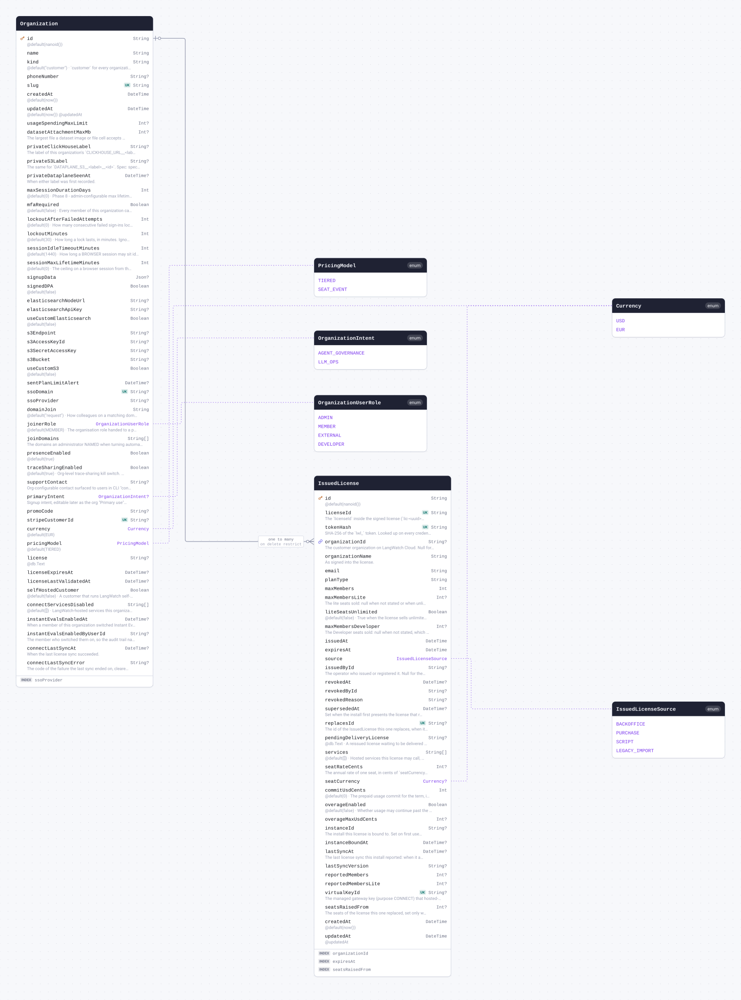

| Field                    | Type                                               | Constraints                                   | Default      | Description                                                                                                                                                                                                                                             |
| ------------------------ | -------------------------------------------------- | --------------------------------------------- | ------------ | ------------------------------------------------------------------------------------------------------------------------------------------------------------------------------------------------------------------------------------------------------- |
| `id`                     | `String`                                           | PK NOT NULL                                   | `nanoid()`   |                                                                                                                                                                                                                                                         |
| `licenseId`              | `String`                                           | UNIQUE NOT NULL                               |              | The `licenseId` inside the signed license (`lic-<uuid>`).                                                                                                                                                                                               |
| `tokenHash`              | `String`                                           | UNIQUE NOT NULL                               |              | SHA-256 of the `lwl_` token. Looked up on every credential resolution.                                                                                                                                                                                  |
| `organizationId`         | `String`                                           | NULL → [Organization.id](#model-Organization) |              | The customer organization on LangWatch Cloud. Null for a license that is recorded but not linked to a customer yet, such as a self-serve purchase: it resolves to nothing until an operator links it.                                                   |
| `organizationName`       | `String`                                           | NOT NULL                                      |              | As signed into the license.                                                                                                                                                                                                                             |
| `email`                  | `String`                                           | NOT NULL                                      |              |                                                                                                                                                                                                                                                         |
| `planType`               | `String`                                           | NOT NULL                                      |              |                                                                                                                                                                                                                                                         |
| `maxMembers`             | `Int`                                              | NOT NULL                                      |              |                                                                                                                                                                                                                                                         |
| `maxMembersLite`         | `Int`                                              | NULL                                          |              | The lite seats sold: null when not stated or when unlimited. Never a stand-in number.                                                                                                                                                                   |
| `liteSeatsUnlimited`     | `Boolean`                                          | NOT NULL                                      | `false`      | True when the license sells unlimited lite seats; maxMembersLite is then null.                                                                                                                                                                          |
| `maxMembersDeveloper`    | `Int`                                              | NULL                                          |              | The Developer seats sold: null when not stated, which sells none.                                                                                                                                                                                       |
| `issuedAt`               | `DateTime`                                         | NOT NULL                                      |              |                                                                                                                                                                                                                                                         |
| `expiresAt`              | `DateTime`                                         | NOT NULL                                      |              |                                                                                                                                                                                                                                                         |
| `source`                 | [`IssuedLicenseSource`](#enum-IssuedLicenseSource) | NOT NULL                                      |              |                                                                                                                                                                                                                                                         |
| `issuedById`             | `String`                                           | NULL                                          |              | The operator who issued or registered it. Null for the purchase flow and the script.                                                                                                                                                                    |
| `revokedAt`              | `DateTime`                                         | NULL                                          |              |                                                                                                                                                                                                                                                         |
| `revokedById`            | `String`                                           | NULL                                          |              |                                                                                                                                                                                                                                                         |
| `revokedReason`          | `String`                                           | NULL                                          |              |                                                                                                                                                                                                                                                         |
| `supersededAt`           | `DateTime`                                         | NULL                                          |              | Set when the install first presents the license that replaced this one.                                                                                                                                                                                 |
| `replacesId`             | `String`                                           | UNIQUE NULL                                   |              | The id of the IssuedLicense this one replaces, when it was reissued. A plain column ref (relationMode="prisma" cannot declare a self-relation on Postgres); the registry service validates it. Unique, so a license is replaced by one license at most. |
| `pendingDeliveryLicense` | `String` `@db.Text`                                | NULL                                          |              | A reissued license waiting to be delivered over sync, encrypted. Erased when the install first presents it. The only license text the registry holds.                                                                                                   |
| `services`               | `String[]`                                         | NOT NULL                                      | `[]`         | Hosted services this license may call, such as `instant_evals`.                                                                                                                                                                                         |
| `seatRateCents`          | `Int`                                              | NULL                                          |              | The annual rate of one seat, in cents of `seatCurrency`. Needed to prorate added seats.                                                                                                                                                                 |
| `seatCurrency`           | [`Currency`](#enum-Currency)                       | NULL                                          |              |                                                                                                                                                                                                                                                         |
| `commitUsdCents`         | `Int`                                              | NOT NULL                                      | `0`          | The prepaid usage commit for the term, in USD cents.                                                                                                                                                                                                    |
| `overageEnabled`         | `Boolean`                                          | NOT NULL                                      | `false`      | Whether usage may continue past the commit, up to `overageMaxUsdCents`.                                                                                                                                                                                 |
| `overageMaxUsdCents`     | `Int`                                              | NULL                                          |              |                                                                                                                                                                                                                                                         |
| `instanceId`             | `String`                                           | NULL                                          |              | The install this license is bound to. Set on first use, cleared by an operator.                                                                                                                                                                         |
| `instanceBoundAt`        | `DateTime`                                         | NULL                                          |              |                                                                                                                                                                                                                                                         |
| `lastSyncAt`             | `DateTime`                                         | NULL                                          |              | The last license sync this install reported: when it arrived, the LangWatch version that sent it, and the seats in use at that moment. Null until the install syncs for the first time.                                                                 |
| `lastSyncVersion`        | `String`                                           | NULL                                          |              |                                                                                                                                                                                                                                                         |
| `reportedMembers`        | `Int`                                              | NULL                                          |              |                                                                                                                                                                                                                                                         |
| `reportedMembersLite`    | `Int`                                              | NULL                                          |              |                                                                                                                                                                                                                                                         |
| `virtualKeyId`           | `String`                                           | UNIQUE NULL                                   |              | The managed gateway key (purpose CONNECT) that hosted-service traffic of this license runs under. One per license, so spend rows name the install. Created when the license first resolves. A plain column, not a relation.                             |
| `seatsRaisedFrom`        | `Int`                                              | NULL                                          |              | The seats of the license this one replaced, set only when a seat change raised a linked license. Billing reads it through licensing to invoice the added seats, so the fact commits with the license or not at all.                                     |
| `createdAt`              | `DateTime`                                         | NOT NULL                                      | `now()`      |                                                                                                                                                                                                                                                         |
| `updatedAt`              | `DateTime`                                         | NOT NULL                                      | `@updatedAt` |                                                                                                                                                                                                                                                         |

#### Indexes

- `@@index([organizationId])`
- `@@index([expiresAt])`
- `@@index([seatsRaisedFrom])`

#### References

- `organizationId` → [Organization.id](#model-Organization) (many-to-one, on delete Restrict)

#### Definition

```sql
CREATE TABLE "IssuedLicense" (
    "id" TEXT NOT NULL,
    "licenseId" TEXT NOT NULL,
    "tokenHash" TEXT NOT NULL,
    "organizationId" TEXT,
    "organizationName" TEXT NOT NULL,
    "email" TEXT NOT NULL,
    "planType" TEXT NOT NULL,
    "maxMembers" INTEGER NOT NULL,
    "maxMembersLite" INTEGER,
    "liteSeatsUnlimited" BOOLEAN NOT NULL DEFAULT false,
    "maxMembersDeveloper" INTEGER,
    "issuedAt" TIMESTAMP(3) NOT NULL,
    "expiresAt" TIMESTAMP(3) NOT NULL,
    "source" "IssuedLicenseSource" NOT NULL,
    "issuedById" TEXT,
    "revokedAt" TIMESTAMP(3),
    "revokedById" TEXT,
    "revokedReason" TEXT,
    "supersededAt" TIMESTAMP(3),
    "replacesId" TEXT,
    "pendingDeliveryLicense" TEXT,
    "services" TEXT[] DEFAULT ARRAY[]::TEXT[],
    "seatRateCents" INTEGER,
    "seatCurrency" "Currency",
    "commitUsdCents" INTEGER NOT NULL DEFAULT 0,
    "overageEnabled" BOOLEAN NOT NULL DEFAULT false,
    "overageMaxUsdCents" INTEGER,
    "instanceId" TEXT,
    "instanceBoundAt" TIMESTAMP(3),
    "lastSyncAt" TIMESTAMP(3),
    "lastSyncVersion" TEXT,
    "reportedMembers" INTEGER,
    "reportedMembersLite" INTEGER,
    "virtualKeyId" TEXT,
    "seatsRaisedFrom" INTEGER,
    "createdAt" TIMESTAMP(3) NOT NULL DEFAULT CURRENT_TIMESTAMP,
    "updatedAt" TIMESTAMP(3) NOT NULL,

    CONSTRAINT "IssuedLicense_pkey" PRIMARY KEY ("id")
);

CREATE UNIQUE INDEX "IssuedLicense_licenseId_key" ON "IssuedLicense"("licenseId");

CREATE UNIQUE INDEX "IssuedLicense_tokenHash_key" ON "IssuedLicense"("tokenHash");

CREATE UNIQUE INDEX "IssuedLicense_replacesId_key" ON "IssuedLicense"("replacesId");

CREATE UNIQUE INDEX "IssuedLicense_virtualKeyId_key" ON "IssuedLicense"("virtualKeyId");

CREATE INDEX "IssuedLicense_organizationId_idx" ON "IssuedLicense"("organizationId");

CREATE INDEX "IssuedLicense_expiresAt_idx" ON "IssuedLicense"("expiresAt");

CREATE INDEX "IssuedLicense_seatsRaisedFrom_idx" ON "IssuedLicense"("seatsRaisedFrom");
```

<details>
<summary>Queries and their SQL</summary>

**findMany**: Every row

```ts
await prisma.issuedLicense.findMany();
```

```sql
SELECT
  "public"."IssuedLicense"."id",
  "public"."IssuedLicense"."licenseId",
  "public"."IssuedLicense"."tokenHash",
  "public"."IssuedLicense"."organizationId",
  "public"."IssuedLicense"."organizationName",
  "public"."IssuedLicense"."email",
  "public"."IssuedLicense"."planType",
  "public"."IssuedLicense"."maxMembers",
  "public"."IssuedLicense"."maxMembersLite",
  "public"."IssuedLicense"."liteSeatsUnlimited",
  "public"."IssuedLicense"."maxMembersDeveloper",
  "public"."IssuedLicense"."issuedAt",
  "public"."IssuedLicense"."expiresAt",
  "public"."IssuedLicense"."source"::text,
  "public"."IssuedLicense"."issuedById",
  "public"."IssuedLicense"."revokedAt",
  "public"."IssuedLicense"."revokedById",
  "public"."IssuedLicense"."revokedReason",
  "public"."IssuedLicense"."supersededAt",
  "public"."IssuedLicense"."replacesId",
  "public"."IssuedLicense"."pendingDeliveryLicense",
  "public"."IssuedLicense"."services",
  "public"."IssuedLicense"."seatRateCents",
  "public"."IssuedLicense"."seatCurrency"::text,
  "public"."IssuedLicense"."commitUsdCents",
  "public"."IssuedLicense"."overageEnabled",
  "public"."IssuedLicense"."overageMaxUsdCents",
  "public"."IssuedLicense"."instanceId",
  "public"."IssuedLicense"."instanceBoundAt",
  "public"."IssuedLicense"."lastSyncAt",
  "public"."IssuedLicense"."lastSyncVersion",
  "public"."IssuedLicense"."reportedMembers",
  "public"."IssuedLicense"."reportedMembersLite",
  "public"."IssuedLicense"."virtualKeyId",
  "public"."IssuedLicense"."seatsRaisedFrom",
  "public"."IssuedLicense"."createdAt",
  "public"."IssuedLicense"."updatedAt"
FROM
  "public"."IssuedLicense"
WHERE
  1 = 1
OFFSET
  $1
-- params: ["0"]
```

**count**: How many rows there are

```ts
await prisma.issuedLicense.count();
```

```sql
SELECT
  COUNT(*) AS "_count$_all"
FROM
  (
    SELECT
      "public"."IssuedLicense"."id"
    FROM
      "public"."IssuedLicense"
    WHERE
      1 = 1
    OFFSET
      $1
  ) AS "sub"
-- params: ["0"]
```

**findMany**: Every row with its relations

```ts
await prisma.issuedLicense.findMany({ include: { organization: true } });
```

```sql
SELECT
  "public"."IssuedLicense"."id",
  "public"."IssuedLicense"."licenseId",
  "public"."IssuedLicense"."tokenHash",
  "public"."IssuedLicense"."organizationId",
  "public"."IssuedLicense"."organizationName",
  "public"."IssuedLicense"."email",
  "public"."IssuedLicense"."planType",
  "public"."IssuedLicense"."maxMembers",
  "public"."IssuedLicense"."maxMembersLite",
  "public"."IssuedLicense"."liteSeatsUnlimited",
  "public"."IssuedLicense"."maxMembersDeveloper",
  "public"."IssuedLicense"."issuedAt",
  "public"."IssuedLicense"."expiresAt",
  "public"."IssuedLicense"."source"::text,
  "public"."IssuedLicense"."issuedById",
  "public"."IssuedLicense"."revokedAt",
  "public"."IssuedLicense"."revokedById",
  "public"."IssuedLicense"."revokedReason",
  "public"."IssuedLicense"."supersededAt",
  "public"."IssuedLicense"."replacesId",
  "public"."IssuedLicense"."pendingDeliveryLicense",
  "public"."IssuedLicense"."services",
  "public"."IssuedLicense"."seatRateCents",
  "public"."IssuedLicense"."seatCurrency"::text,
  "public"."IssuedLicense"."commitUsdCents",
  "public"."IssuedLicense"."overageEnabled",
  "public"."IssuedLicense"."overageMaxUsdCents",
  "public"."IssuedLicense"."instanceId",
  "public"."IssuedLicense"."instanceBoundAt",
  "public"."IssuedLicense"."lastSyncAt",
  "public"."IssuedLicense"."lastSyncVersion",
  "public"."IssuedLicense"."reportedMembers",
  "public"."IssuedLicense"."reportedMembersLite",
  "public"."IssuedLicense"."virtualKeyId",
  "public"."IssuedLicense"."seatsRaisedFrom",
  "public"."IssuedLicense"."createdAt",
  "public"."IssuedLicense"."updatedAt"
FROM
  "public"."IssuedLicense"
WHERE
  1 = 1
OFFSET
  $1
-- params: ["0"]

SELECT
  "public"."Organization"."id",
  "public"."Organization"."name",
  "public"."Organization"."kind",
  "public"."Organization"."phoneNumber",
  "public"."Organization"."slug",
  "public"."Organization"."createdAt",
  "public"."Organization"."updatedAt",
  "public"."Organization"."usageSpendingMaxLimit",
  "public"."Organization"."datasetAttachmentMaxMb",
  "public"."Organization"."privateClickHouseLabel",
  "public"."Organization"."privateS3Label",
  "public"."Organization"."privateDataplaneSeenAt",
  "public"."Organization"."maxSessionDurationDays",
  "public"."Organization"."mfaRequired",
  "public"."Organization"."lockoutAfterFailedAttempts",
  "public"."Organization"."lockoutMinutes",
  "public"."Organization"."sessionIdleTimeoutMinutes",
  "public"."Organization"."sessionMaxLifetimeMinutes",
  "public"."Organization"."signupData",
  "public"."Organization"."signedDPA",
  "public"."Organization"."elasticsearchNodeUrl",
  "public"."Organization"."elasticsearchApiKey",
  "public"."Organization"."useCustomElasticsearch",
  "public"."Organization"."s3Endpoint",
  "public"."Organization"."s3AccessKeyId",
  "public"."Organization"."s3SecretAccessKey",
  "public"."Organization"."s3Bucket",
  "public"."Organization"."useCustomS3",
  "public"."Organization"."sentPlanLimitAlert",
  "public"."Organization"."ssoDomain",
  "public"."Organization"."ssoProvider",
  "public"."Organization"."domainJoin",
  "public"."Organization"."joinerRole"::text,
  "public"."Organization"."joinDomains",
  "public"."Organization"."presenceEnabled",
  "public"."Organization"."traceSharingEnabled",
  "public"."Organization"."supportContact",
  "public"."Organization"."primaryIntent"::text,
  "public"."Organization"."promoCode",
  "public"."Organization"."stripeCustomerId",
  "public"."Organization"."currency"::text,
  "public"."Organization"."pricingModel"::text,
  "public"."Organization"."license",
  "public"."Organization"."licenseExpiresAt",
  "public"."Organization"."licenseLastValidatedAt",
  "public"."Organization"."selfHostedCustomer",
  "public"."Organization"."connectServicesDisabled",
  "public"."Organization"."instantEvalsEnabledAt",
  "public"."Organization"."instantEvalsEnabledByUserId",
  "public"."Organization"."connectLastSyncAt",
  "public"."Organization"."connectLastSyncError"
FROM
  "public"."Organization"
WHERE
  "public"."Organization"."id" IN ($1)
OFFSET
  $2
-- params: ["<organizationId of the rows above>","0"]
```

**findUnique**: One row by what is unique to it

```ts
await prisma.issuedLicense.findUnique({ where: { id: "example" } });
```

```sql
SELECT
  "public"."IssuedLicense"."id",
  "public"."IssuedLicense"."licenseId",
  "public"."IssuedLicense"."tokenHash",
  "public"."IssuedLicense"."organizationId",
  "public"."IssuedLicense"."organizationName",
  "public"."IssuedLicense"."email",
  "public"."IssuedLicense"."planType",
  "public"."IssuedLicense"."maxMembers",
  "public"."IssuedLicense"."maxMembersLite",
  "public"."IssuedLicense"."liteSeatsUnlimited",
  "public"."IssuedLicense"."maxMembersDeveloper",
  "public"."IssuedLicense"."issuedAt",
  "public"."IssuedLicense"."expiresAt",
  "public"."IssuedLicense"."source"::text,
  "public"."IssuedLicense"."issuedById",
  "public"."IssuedLicense"."revokedAt",
  "public"."IssuedLicense"."revokedById",
  "public"."IssuedLicense"."revokedReason",
  "public"."IssuedLicense"."supersededAt",
  "public"."IssuedLicense"."replacesId",
  "public"."IssuedLicense"."pendingDeliveryLicense",
  "public"."IssuedLicense"."services",
  "public"."IssuedLicense"."seatRateCents",
  "public"."IssuedLicense"."seatCurrency"::text,
  "public"."IssuedLicense"."commitUsdCents",
  "public"."IssuedLicense"."overageEnabled",
  "public"."IssuedLicense"."overageMaxUsdCents",
  "public"."IssuedLicense"."instanceId",
  "public"."IssuedLicense"."instanceBoundAt",
  "public"."IssuedLicense"."lastSyncAt",
  "public"."IssuedLicense"."lastSyncVersion",
  "public"."IssuedLicense"."reportedMembers",
  "public"."IssuedLicense"."reportedMembersLite",
  "public"."IssuedLicense"."virtualKeyId",
  "public"."IssuedLicense"."seatsRaisedFrom",
  "public"."IssuedLicense"."createdAt",
  "public"."IssuedLicense"."updatedAt"
FROM
  "public"."IssuedLicense"
WHERE
  (
    "public"."IssuedLicense"."id" = $1
    AND 1 = 1
  )
LIMIT
  $2
OFFSET
  $3
-- params: ["example","1","0"]
```

**create**: Create a row

```ts
await prisma.issuedLicense.create({
  data: {
    licenseId: "example",
    tokenHash: "example",
    organizationName: "example",
    email: "example",
    planType: "example",
    maxMembers: 1,
    issuedAt: new Date("2026-01-01T00:00:00.000Z"),
    expiresAt: new Date("2026-01-01T00:00:00.000Z"),
    source: "BACKOFFICE",
  },
});
```

```sql
INSERT INTO
  "public"."IssuedLicense" (
    "id",
    "licenseId",
    "tokenHash",
    "organizationName",
    "email",
    "planType",
    "maxMembers",
    "liteSeatsUnlimited",
    "issuedAt",
    "expiresAt",
    "source",
    "services",
    "commitUsdCents",
    "overageEnabled",
    "createdAt",
    "updatedAt"
  )
VALUES
  (
    $1,
    $2,
    $3,
    $4,
    $5,
    $6,
    $7,
    $8,
    $9,
    $10,
    CAST($11::text AS "public"."IssuedLicenseSource"),
    $12,
    $13,
    $14,
    $15,
    $16
  )
RETURNING
  "public"."IssuedLicense"."id",
  "public"."IssuedLicense"."licenseId",
  "public"."IssuedLicense"."tokenHash",
  "public"."IssuedLicense"."organizationId",
  "public"."IssuedLicense"."organizationName",
  "public"."IssuedLicense"."email",
  "public"."IssuedLicense"."planType",
  "public"."IssuedLicense"."maxMembers",
  "public"."IssuedLicense"."maxMembersLite",
  "public"."IssuedLicense"."liteSeatsUnlimited",
  "public"."IssuedLicense"."maxMembersDeveloper",
  "public"."IssuedLicense"."issuedAt",
  "public"."IssuedLicense"."expiresAt",
  "public"."IssuedLicense"."source"::text,
  "public"."IssuedLicense"."issuedById",
  "public"."IssuedLicense"."revokedAt",
  "public"."IssuedLicense"."revokedById",
  "public"."IssuedLicense"."revokedReason",
  "public"."IssuedLicense"."supersededAt",
  "public"."IssuedLicense"."replacesId",
  "public"."IssuedLicense"."pendingDeliveryLicense",
  "public"."IssuedLicense"."services",
  "public"."IssuedLicense"."seatRateCents",
  "public"."IssuedLicense"."seatCurrency"::text,
  "public"."IssuedLicense"."commitUsdCents",
  "public"."IssuedLicense"."overageEnabled",
  "public"."IssuedLicense"."overageMaxUsdCents",
  "public"."IssuedLicense"."instanceId",
  "public"."IssuedLicense"."instanceBoundAt",
  "public"."IssuedLicense"."lastSyncAt",
  "public"."IssuedLicense"."lastSyncVersion",
  "public"."IssuedLicense"."reportedMembers",
  "public"."IssuedLicense"."reportedMembersLite",
  "public"."IssuedLicense"."virtualKeyId",
  "public"."IssuedLicense"."seatsRaisedFrom",
  "public"."IssuedLicense"."createdAt",
  "public"."IssuedLicense"."updatedAt"
-- params: ["<nanoid()>","example","example","example","example","example","1",false,"2026-01-01T00:00:00.000Z","2026-01-01T00:00:00.000Z","BACKOFFICE",[],"0",false,"<now()>","<now()>"]
```

**update**: Update a row

```ts
await prisma.issuedLicense.update({ where: { id: "example" }, data: { licenseId: "example" } });
```

```sql
SELECT
  "public"."IssuedLicense"."id"
FROM
  "public"."IssuedLicense"
WHERE
  (
    "public"."IssuedLicense"."id" = $1
    AND 1 = 1
  )
LIMIT
  $2
OFFSET
  $3
-- params: ["example","1","0"]

UPDATE "public"."IssuedLicense"
SET
  "licenseId" = $1,
  "updatedAt" = $2
WHERE
  (
    "public"."IssuedLicense"."id" IN ($3)
    AND (
      "public"."IssuedLicense"."id" = $4
      AND 1 = 1
    )
  )
RETURNING
  "public"."IssuedLicense"."id",
  "public"."IssuedLicense"."licenseId",
  "public"."IssuedLicense"."tokenHash",
  "public"."IssuedLicense"."organizationId",
  "public"."IssuedLicense"."organizationName",
  "public"."IssuedLicense"."email",
  "public"."IssuedLicense"."planType",
  "public"."IssuedLicense"."maxMembers",
  "public"."IssuedLicense"."maxMembersLite",
  "public"."IssuedLicense"."liteSeatsUnlimited",
  "public"."IssuedLicense"."maxMembersDeveloper",
  "public"."IssuedLicense"."issuedAt",
  "public"."IssuedLicense"."expiresAt",
  "public"."IssuedLicense"."source"::text,
  "public"."IssuedLicense"."issuedById",
  "public"."IssuedLicense"."revokedAt",
  "public"."IssuedLicense"."revokedById",
  "public"."IssuedLicense"."revokedReason",
  "public"."IssuedLicense"."supersededAt",
  "public"."IssuedLicense"."replacesId",
  "public"."IssuedLicense"."pendingDeliveryLicense",
  "public"."IssuedLicense"."services",
  "public"."IssuedLicense"."seatRateCents",
  "public"."IssuedLicense"."seatCurrency"::text,
  "public"."IssuedLicense"."commitUsdCents",
  "public"."IssuedLicense"."overageEnabled",
  "public"."IssuedLicense"."overageMaxUsdCents",
  "public"."IssuedLicense"."instanceId",
  "public"."IssuedLicense"."instanceBoundAt",
  "public"."IssuedLicense"."lastSyncAt",
  "public"."IssuedLicense"."lastSyncVersion",
  "public"."IssuedLicense"."reportedMembers",
  "public"."IssuedLicense"."reportedMembersLite",
  "public"."IssuedLicense"."virtualKeyId",
  "public"."IssuedLicense"."seatsRaisedFrom",
  "public"."IssuedLicense"."createdAt",
  "public"."IssuedLicense"."updatedAt"
-- params: ["example",{"prisma__type":"generatorCall","prisma__value":{"name":"now","args":[],"returnType":{"type":"DateTime"}}},"<id of the rows above>","example"]
```

**delete**: Delete a row

```ts
await prisma.issuedLicense.delete({ where: { id: "example" } });
```

```sql
DELETE FROM "public"."IssuedLicense"
WHERE
  (
    "public"."IssuedLicense"."id" = $1
    AND 1 = 1
  )
RETURNING
  "public"."IssuedLicense"."id",
  "public"."IssuedLicense"."licenseId",
  "public"."IssuedLicense"."tokenHash",
  "public"."IssuedLicense"."organizationId",
  "public"."IssuedLicense"."organizationName",
  "public"."IssuedLicense"."email",
  "public"."IssuedLicense"."planType",
  "public"."IssuedLicense"."maxMembers",
  "public"."IssuedLicense"."maxMembersLite",
  "public"."IssuedLicense"."liteSeatsUnlimited",
  "public"."IssuedLicense"."maxMembersDeveloper",
  "public"."IssuedLicense"."issuedAt",
  "public"."IssuedLicense"."expiresAt",
  "public"."IssuedLicense"."source"::text,
  "public"."IssuedLicense"."issuedById",
  "public"."IssuedLicense"."revokedAt",
  "public"."IssuedLicense"."revokedById",
  "public"."IssuedLicense"."revokedReason",
  "public"."IssuedLicense"."supersededAt",
  "public"."IssuedLicense"."replacesId",
  "public"."IssuedLicense"."pendingDeliveryLicense",
  "public"."IssuedLicense"."services",
  "public"."IssuedLicense"."seatRateCents",
  "public"."IssuedLicense"."seatCurrency"::text,
  "public"."IssuedLicense"."commitUsdCents",
  "public"."IssuedLicense"."overageEnabled",
  "public"."IssuedLicense"."overageMaxUsdCents",
  "public"."IssuedLicense"."instanceId",
  "public"."IssuedLicense"."instanceBoundAt",
  "public"."IssuedLicense"."lastSyncAt",
  "public"."IssuedLicense"."lastSyncVersion",
  "public"."IssuedLicense"."reportedMembers",
  "public"."IssuedLicense"."reportedMembersLite",
  "public"."IssuedLicense"."virtualKeyId",
  "public"."IssuedLicense"."seatsRaisedFrom",
  "public"."IssuedLicense"."createdAt",
  "public"."IssuedLicense"."updatedAt"
-- params: ["example"]
```

</details>

<a id="model-OrganizationLicense"></a>

### OrganizationLicense

The licence an organization activated and its dates, owned by licensing
(round 37 D6). A row whose key is null is a cleared licence. An organization
with no row is read from its Organization columns until the copy step runs.

| Field            | Type                | Constraints | Default              | Description |
| ---------------- | ------------------- | ----------- | -------------------- | ----------- |
| `organizationId` | `String`            | PK NOT NULL |                      |             |
| `licenseKey`     | `String` `@db.Text` | NULL        |                      |             |
| `expiresAt`      | `DateTime`          | NULL        |                      |             |
| `validatedAt`    | `DateTime`          | NULL        |                      |             |
| `updatedAt`      | `DateTime`          | NOT NULL    | `now()` `@updatedAt` |             |

#### Definition

```sql
CREATE TABLE "OrganizationLicense" (
    "organizationId" TEXT NOT NULL,
    "licenseKey" TEXT,
    "expiresAt" TIMESTAMP(3),
    "validatedAt" TIMESTAMP(3),
    "updatedAt" TIMESTAMP(3) NOT NULL DEFAULT CURRENT_TIMESTAMP,

    CONSTRAINT "OrganizationLicense_pkey" PRIMARY KEY ("organizationId")
);
```

<details>
<summary>Queries and their SQL</summary>

**findMany**: Every row

```ts
await prisma.organizationLicense.findMany();
```

```sql
SELECT
  "public"."OrganizationLicense"."organizationId",
  "public"."OrganizationLicense"."licenseKey",
  "public"."OrganizationLicense"."expiresAt",
  "public"."OrganizationLicense"."validatedAt",
  "public"."OrganizationLicense"."updatedAt"
FROM
  "public"."OrganizationLicense"
WHERE
  1 = 1
OFFSET
  $1
-- params: ["0"]
```

**count**: How many rows there are

```ts
await prisma.organizationLicense.count();
```

```sql
SELECT
  COUNT(*) AS "_count$_all"
FROM
  (
    SELECT
      "public"."OrganizationLicense"."organizationId"
    FROM
      "public"."OrganizationLicense"
    WHERE
      1 = 1
    OFFSET
      $1
  ) AS "sub"
-- params: ["0"]
```

**findUnique**: One row by what is unique to it

```ts
await prisma.organizationLicense.findUnique({ where: { organizationId: "example" } });
```

```sql
SELECT
  "public"."OrganizationLicense"."organizationId",
  "public"."OrganizationLicense"."licenseKey",
  "public"."OrganizationLicense"."expiresAt",
  "public"."OrganizationLicense"."validatedAt",
  "public"."OrganizationLicense"."updatedAt"
FROM
  "public"."OrganizationLicense"
WHERE
  (
    "public"."OrganizationLicense"."organizationId" = $1
    AND 1 = 1
  )
LIMIT
  $2
OFFSET
  $3
-- params: ["example","1","0"]
```

**create**: Create a row

```ts
await prisma.organizationLicense.create({ data: { organizationId: "example" } });
```

```sql
INSERT INTO
  "public"."OrganizationLicense" ("organizationId", "updatedAt")
VALUES
  ($1, $2)
RETURNING
  "public"."OrganizationLicense"."organizationId",
  "public"."OrganizationLicense"."licenseKey",
  "public"."OrganizationLicense"."expiresAt",
  "public"."OrganizationLicense"."validatedAt",
  "public"."OrganizationLicense"."updatedAt"
-- params: ["example","<now()>"]
```

**update**: Update a row

```ts
await prisma.organizationLicense.update({
  where: { organizationId: "example" },
  data: { licenseKey: "example" },
});
```

```sql
SELECT
  "public"."OrganizationLicense"."organizationId"
FROM
  "public"."OrganizationLicense"
WHERE
  (
    "public"."OrganizationLicense"."organizationId" = $1
    AND 1 = 1
  )
LIMIT
  $2
OFFSET
  $3
-- params: ["example","1","0"]

UPDATE "public"."OrganizationLicense"
SET
  "licenseKey" = $1,
  "updatedAt" = $2
WHERE
  (
    "public"."OrganizationLicense"."organizationId" IN ($3)
    AND (
      "public"."OrganizationLicense"."organizationId" = $4
      AND 1 = 1
    )
  )
RETURNING
  "public"."OrganizationLicense"."organizationId",
  "public"."OrganizationLicense"."licenseKey",
  "public"."OrganizationLicense"."expiresAt",
  "public"."OrganizationLicense"."validatedAt",
  "public"."OrganizationLicense"."updatedAt"
-- params: ["example",{"prisma__type":"generatorCall","prisma__value":{"name":"now","args":[],"returnType":{"type":"DateTime"}}},"<organizationId of the rows above>","example"]
```

**delete**: Delete a row

```ts
await prisma.organizationLicense.delete({ where: { organizationId: "example" } });
```

```sql
DELETE FROM "public"."OrganizationLicense"
WHERE
  (
    "public"."OrganizationLicense"."organizationId" = $1
    AND 1 = 1
  )
RETURNING
  "public"."OrganizationLicense"."organizationId",
  "public"."OrganizationLicense"."licenseKey",
  "public"."OrganizationLicense"."expiresAt",
  "public"."OrganizationLicense"."validatedAt",
  "public"."OrganizationLicense"."updatedAt"
-- params: ["example"]
```

</details>

<a id="model-ActivationCode"></a>

### ActivationCode

A short code a fresh install pastes instead of a license blob (ADR-139,
section 5). Redeeming it mints the license the code describes and returns
it signed, which is what identifies a new customer without anybody emailing
a license key around.

The row holds a hash of the code, never the code. Every lookup hashes what
the caller presented first, so the stored value is a step away from anything
that could be presented: read access to this table is not credential access.

| Field                  | Type       | Constraints     | Default      | Description                                                                                                               |
| ---------------------- | ---------- | --------------- | ------------ | ------------------------------------------------------------------------------------------------------------------------- |
| `id`                   | `String`   | PK NOT NULL     | `nanoid()`   |                                                                                                                           |
| `codeHash`             | `String`   | UNIQUE NOT NULL |              | SHA-256 of the normalised code. Looked up on every redemption.                                                            |
| `codeHint`             | `String`   | NOT NULL        |              | The last four characters, so an operator tells two codes apart in a list without the list holding either one.             |
| `organizationId`       | `String`   | NOT NULL        |              | The customer this code belongs to, and the terms it mints.                                                                |
| `organizationName`     | `String`   | NOT NULL        |              |                                                                                                                           |
| `email`                | `String`   | NOT NULL        |              |                                                                                                                           |
| `planType`             | `String`   | NOT NULL        |              |                                                                                                                           |
| `maxMembers`           | `Int`      | NOT NULL        |              |                                                                                                                           |
| `maxMembersLite`       | `Int`      | NULL            | `0`          | The lite seats the minted license carries: null when unlimited. Never a stand-in number.                                  |
| `liteSeatsUnlimited`   | `Boolean`  | NOT NULL        | `false`      | True when the minted license carries unlimited lite seats; maxMembersLite is then null.                                   |
| `maxMembersDeveloper`  | `Int`      | NULL            |              | The Developer seats the minted license carries: null when not stated, which sells none.                                   |
| `licenseTermDays`      | `Int`      | NOT NULL        |              | How long the license this code mints runs for.                                                                            |
| `services`             | `String[]` | NOT NULL        | `[]`         | Hosted services the minted license may call.                                                                              |
| `expiresAt`            | `DateTime` | NOT NULL        |              | When the code stops working, which is not the term of what it mints.                                                      |
| `reusable`             | `Boolean`  | NOT NULL        | `false`      | A code a customer may redeem on more than one install, for a rollout.                                                     |
| `redeemedAt`           | `DateTime` | NULL            |              | Set by the redemption that won, which is what makes a single-use code single use: the write itself carries the condition. |
| `redeemedByInstanceId` | `String`   | NULL            |              |                                                                                                                           |
| `issuedLicenseId`      | `String`   | NULL            |              | The license the winning redemption minted.                                                                                |
| `redemptionCount`      | `Int`      | NOT NULL        | `0`          | How many installs have redeemed it, which only moves on a reusable code.                                                  |
| `revokedAt`            | `DateTime` | NULL            |              |                                                                                                                           |
| `revokedById`          | `String`   | NULL            |              |                                                                                                                           |
| `createdById`          | `String`   | NULL            |              |                                                                                                                           |
| `createdAt`            | `DateTime` | NOT NULL        | `now()`      |                                                                                                                           |
| `updatedAt`            | `DateTime` | NOT NULL        | `@updatedAt` |                                                                                                                           |

#### Indexes

- `@@index([organizationId])`
- `@@index([expiresAt])`

#### Definition

```sql
CREATE TABLE "ActivationCode" (
    "id" TEXT NOT NULL,
    "codeHash" TEXT NOT NULL,
    "codeHint" TEXT NOT NULL,
    "organizationId" TEXT NOT NULL,
    "organizationName" TEXT NOT NULL,
    "email" TEXT NOT NULL,
    "planType" TEXT NOT NULL,
    "maxMembers" INTEGER NOT NULL,
    "maxMembersLite" INTEGER DEFAULT 0,
    "liteSeatsUnlimited" BOOLEAN NOT NULL DEFAULT false,
    "maxMembersDeveloper" INTEGER,
    "licenseTermDays" INTEGER NOT NULL,
    "services" TEXT[] DEFAULT ARRAY[]::TEXT[],
    "expiresAt" TIMESTAMP(3) NOT NULL,
    "reusable" BOOLEAN NOT NULL DEFAULT false,
    "redeemedAt" TIMESTAMP(3),
    "redeemedByInstanceId" TEXT,
    "issuedLicenseId" TEXT,
    "redemptionCount" INTEGER NOT NULL DEFAULT 0,
    "revokedAt" TIMESTAMP(3),
    "revokedById" TEXT,
    "createdById" TEXT,
    "createdAt" TIMESTAMP(3) NOT NULL DEFAULT CURRENT_TIMESTAMP,
    "updatedAt" TIMESTAMP(3) NOT NULL,

    CONSTRAINT "ActivationCode_pkey" PRIMARY KEY ("id")
);

CREATE UNIQUE INDEX "ActivationCode_codeHash_key" ON "ActivationCode"("codeHash");

CREATE INDEX "ActivationCode_organizationId_idx" ON "ActivationCode"("organizationId");

CREATE INDEX "ActivationCode_expiresAt_idx" ON "ActivationCode"("expiresAt");
```

<details>
<summary>Queries and their SQL</summary>

**findMany**: Every row

```ts
await prisma.activationCode.findMany();
```

```sql
SELECT
  "public"."ActivationCode"."id",
  "public"."ActivationCode"."codeHash",
  "public"."ActivationCode"."codeHint",
  "public"."ActivationCode"."organizationId",
  "public"."ActivationCode"."organizationName",
  "public"."ActivationCode"."email",
  "public"."ActivationCode"."planType",
  "public"."ActivationCode"."maxMembers",
  "public"."ActivationCode"."maxMembersLite",
  "public"."ActivationCode"."liteSeatsUnlimited",
  "public"."ActivationCode"."maxMembersDeveloper",
  "public"."ActivationCode"."licenseTermDays",
  "public"."ActivationCode"."services",
  "public"."ActivationCode"."expiresAt",
  "public"."ActivationCode"."reusable",
  "public"."ActivationCode"."redeemedAt",
  "public"."ActivationCode"."redeemedByInstanceId",
  "public"."ActivationCode"."issuedLicenseId",
  "public"."ActivationCode"."redemptionCount",
  "public"."ActivationCode"."revokedAt",
  "public"."ActivationCode"."revokedById",
  "public"."ActivationCode"."createdById",
  "public"."ActivationCode"."createdAt",
  "public"."ActivationCode"."updatedAt"
FROM
  "public"."ActivationCode"
WHERE
  1 = 1
OFFSET
  $1
-- params: ["0"]
```

**count**: How many rows there are

```ts
await prisma.activationCode.count();
```

```sql
SELECT
  COUNT(*) AS "_count$_all"
FROM
  (
    SELECT
      "public"."ActivationCode"."id"
    FROM
      "public"."ActivationCode"
    WHERE
      1 = 1
    OFFSET
      $1
  ) AS "sub"
-- params: ["0"]
```

**findUnique**: One row by what is unique to it

```ts
await prisma.activationCode.findUnique({ where: { id: "example" } });
```

```sql
SELECT
  "public"."ActivationCode"."id",
  "public"."ActivationCode"."codeHash",
  "public"."ActivationCode"."codeHint",
  "public"."ActivationCode"."organizationId",
  "public"."ActivationCode"."organizationName",
  "public"."ActivationCode"."email",
  "public"."ActivationCode"."planType",
  "public"."ActivationCode"."maxMembers",
  "public"."ActivationCode"."maxMembersLite",
  "public"."ActivationCode"."liteSeatsUnlimited",
  "public"."ActivationCode"."maxMembersDeveloper",
  "public"."ActivationCode"."licenseTermDays",
  "public"."ActivationCode"."services",
  "public"."ActivationCode"."expiresAt",
  "public"."ActivationCode"."reusable",
  "public"."ActivationCode"."redeemedAt",
  "public"."ActivationCode"."redeemedByInstanceId",
  "public"."ActivationCode"."issuedLicenseId",
  "public"."ActivationCode"."redemptionCount",
  "public"."ActivationCode"."revokedAt",
  "public"."ActivationCode"."revokedById",
  "public"."ActivationCode"."createdById",
  "public"."ActivationCode"."createdAt",
  "public"."ActivationCode"."updatedAt"
FROM
  "public"."ActivationCode"
WHERE
  (
    "public"."ActivationCode"."id" = $1
    AND 1 = 1
  )
LIMIT
  $2
OFFSET
  $3
-- params: ["example","1","0"]
```

**create**: Create a row

```ts
await prisma.activationCode.create({
  data: {
    codeHash: "example",
    codeHint: "example",
    organizationId: "example",
    organizationName: "example",
    email: "example",
    planType: "example",
    maxMembers: 1,
    licenseTermDays: 1,
    expiresAt: new Date("2026-01-01T00:00:00.000Z"),
  },
});
```

```sql
INSERT INTO
  "public"."ActivationCode" (
    "id",
    "codeHash",
    "codeHint",
    "organizationId",
    "organizationName",
    "email",
    "planType",
    "maxMembers",
    "maxMembersLite",
    "liteSeatsUnlimited",
    "licenseTermDays",
    "services",
    "expiresAt",
    "reusable",
    "redemptionCount",
    "createdAt",
    "updatedAt"
  )
VALUES
  (
    $1,
    $2,
    $3,
    $4,
    $5,
    $6,
    $7,
    $8,
    $9,
    $10,
    $11,
    $12,
    $13,
    $14,
    $15,
    $16,
    $17
  )
RETURNING
  "public"."ActivationCode"."id",
  "public"."ActivationCode"."codeHash",
  "public"."ActivationCode"."codeHint",
  "public"."ActivationCode"."organizationId",
  "public"."ActivationCode"."organizationName",
  "public"."ActivationCode"."email",
  "public"."ActivationCode"."planType",
  "public"."ActivationCode"."maxMembers",
  "public"."ActivationCode"."maxMembersLite",
  "public"."ActivationCode"."liteSeatsUnlimited",
  "public"."ActivationCode"."maxMembersDeveloper",
  "public"."ActivationCode"."licenseTermDays",
  "public"."ActivationCode"."services",
  "public"."ActivationCode"."expiresAt",
  "public"."ActivationCode"."reusable",
  "public"."ActivationCode"."redeemedAt",
  "public"."ActivationCode"."redeemedByInstanceId",
  "public"."ActivationCode"."issuedLicenseId",
  "public"."ActivationCode"."redemptionCount",
  "public"."ActivationCode"."revokedAt",
  "public"."ActivationCode"."revokedById",
  "public"."ActivationCode"."createdById",
  "public"."ActivationCode"."createdAt",
  "public"."ActivationCode"."updatedAt"
-- params: ["<nanoid()>","example","example","example","example","example","example","1","0",false,"1",[],"2026-01-01T00:00:00.000Z",false,"0","<now()>","<now()>"]
```

**update**: Update a row

```ts
await prisma.activationCode.update({ where: { id: "example" }, data: { codeHash: "example" } });
```

```sql
SELECT
  "public"."ActivationCode"."id"
FROM
  "public"."ActivationCode"
WHERE
  (
    "public"."ActivationCode"."id" = $1
    AND 1 = 1
  )
LIMIT
  $2
OFFSET
  $3
-- params: ["example","1","0"]

UPDATE "public"."ActivationCode"
SET
  "codeHash" = $1,
  "updatedAt" = $2
WHERE
  (
    "public"."ActivationCode"."id" IN ($3)
    AND (
      "public"."ActivationCode"."id" = $4
      AND 1 = 1
    )
  )
RETURNING
  "public"."ActivationCode"."id",
  "public"."ActivationCode"."codeHash",
  "public"."ActivationCode"."codeHint",
  "public"."ActivationCode"."organizationId",
  "public"."ActivationCode"."organizationName",
  "public"."ActivationCode"."email",
  "public"."ActivationCode"."planType",
  "public"."ActivationCode"."maxMembers",
  "public"."ActivationCode"."maxMembersLite",
  "public"."ActivationCode"."liteSeatsUnlimited",
  "public"."ActivationCode"."maxMembersDeveloper",
  "public"."ActivationCode"."licenseTermDays",
  "public"."ActivationCode"."services",
  "public"."ActivationCode"."expiresAt",
  "public"."ActivationCode"."reusable",
  "public"."ActivationCode"."redeemedAt",
  "public"."ActivationCode"."redeemedByInstanceId",
  "public"."ActivationCode"."issuedLicenseId",
  "public"."ActivationCode"."redemptionCount",
  "public"."ActivationCode"."revokedAt",
  "public"."ActivationCode"."revokedById",
  "public"."ActivationCode"."createdById",
  "public"."ActivationCode"."createdAt",
  "public"."ActivationCode"."updatedAt"
-- params: ["example",{"prisma__type":"generatorCall","prisma__value":{"name":"now","args":[],"returnType":{"type":"DateTime"}}},"<id of the rows above>","example"]
```

**delete**: Delete a row

```ts
await prisma.activationCode.delete({ where: { id: "example" } });
```

```sql
DELETE FROM "public"."ActivationCode"
WHERE
  (
    "public"."ActivationCode"."id" = $1
    AND 1 = 1
  )
RETURNING
  "public"."ActivationCode"."id",
  "public"."ActivationCode"."codeHash",
  "public"."ActivationCode"."codeHint",
  "public"."ActivationCode"."organizationId",
  "public"."ActivationCode"."organizationName",
  "public"."ActivationCode"."email",
  "public"."ActivationCode"."planType",
  "public"."ActivationCode"."maxMembers",
  "public"."ActivationCode"."maxMembersLite",
  "public"."ActivationCode"."liteSeatsUnlimited",
  "public"."ActivationCode"."maxMembersDeveloper",
  "public"."ActivationCode"."licenseTermDays",
  "public"."ActivationCode"."services",
  "public"."ActivationCode"."expiresAt",
  "public"."ActivationCode"."reusable",
  "public"."ActivationCode"."redeemedAt",
  "public"."ActivationCode"."redeemedByInstanceId",
  "public"."ActivationCode"."issuedLicenseId",
  "public"."ActivationCode"."redemptionCount",
  "public"."ActivationCode"."revokedAt",
  "public"."ActivationCode"."revokedById",
  "public"."ActivationCode"."createdById",
  "public"."ActivationCode"."createdAt",
  "public"."ActivationCode"."updatedAt"
-- params: ["example"]
```

</details>

<a id="model-ConnectedBillingAccount"></a>

### ConnectedBillingAccount

How a connected customer is invoiced (ADR-139, section 7): one payment
provider customer, one quarterly usage subscription in USD, and the
commercial terms the annual invoice was raised from.

One row per organization. Every write through it is addressed by a stored
provider id, so running onboarding or a renewal twice changes nothing.

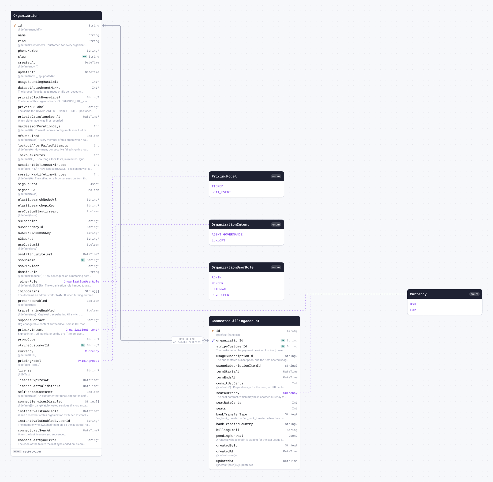

| Field                     | Type                         | Constraints                                              | Default              | Description                                                                                                                                                                                            |
| ------------------------- | ---------------------------- | -------------------------------------------------------- | -------------------- | ------------------------------------------------------------------------------------------------------------------------------------------------------------------------------------------------------ |
| `id`                      | `String`                     | PK NOT NULL                                              | `nanoid()`           |                                                                                                                                                                                                        |
| `organizationId`          | `String`                     | UNIQUE NOT NULL → [Organization.id](#model-Organization) |                      |                                                                                                                                                                                                        |
| `stripeCustomerId`        | `String`                     | UNIQUE NOT NULL                                          |                      | The customer at the payment provider. Invoiced, never charged.                                                                                                                                         |
| `usageSubscriptionId`     | `String`                     | NULL                                                     |                      | The one metered subscription, and the item hosted usage is reported on. Null between the customer being created and the subscription existing, which is where a half-finished onboarding resumes from. |
| `usageSubscriptionItemId` | `String`                     | NULL                                                     |                      |                                                                                                                                                                                                        |
| `termStartsAt`            | `DateTime`                   | NOT NULL                                                 |                      |                                                                                                                                                                                                        |
| `termEndsAt`              | `DateTime`                   | NOT NULL                                                 |                      |                                                                                                                                                                                                        |
| `commitUsdCents`          | `Int`                        | NOT NULL                                                 | `0`                  | Prepaid usage for the term, in USD cents. The credit grants add up to it.                                                                                                                              |
| `seatCurrency`            | [`Currency`](#enum-Currency) | NOT NULL                                                 |                      | The seat contract, which may be in another currency than hosted usage.                                                                                                                                 |
| `seatRateCents`           | `Int`                        | NOT NULL                                                 |                      |                                                                                                                                                                                                        |
| `seats`                   | `Int`                        | NOT NULL                                                 |                      |                                                                                                                                                                                                        |
| `bankTransferType`        | `String`                     | NULL                                                     |                      | `us_bank_transfer` or `eu_bank_transfer` when the customer pays into a virtual bank account at the provider. Null when it wires to LangWatch's own account and finance marks the invoice paid.         |
| `bankTransferCountry`     | `String`                     | NULL                                                     |                      |                                                                                                                                                                                                        |
| `billingEmail`            | `String`                     | NOT NULL                                                 |                      |                                                                                                                                                                                                        |
| `pendingRenewal`          | `Json`                       | NULL                                                     |                      | A renewal whose credit is waiting for the last usage invoice of the old term to be finalized: the new term's end and commit, and who asked.                                                            |
| `createdById`             | `String`                     | NULL                                                     |                      |                                                                                                                                                                                                        |
| `createdAt`               | `DateTime`                   | NOT NULL                                                 | `now()`              |                                                                                                                                                                                                        |
| `updatedAt`               | `DateTime`                   | NOT NULL                                                 | `now()` `@updatedAt` |                                                                                                                                                                                                        |

#### References

- `organizationId` → [Organization.id](#model-Organization) (one-to-one, on delete Restrict)

#### Definition

```sql
CREATE TABLE "ConnectedBillingAccount" (
    "id" TEXT NOT NULL,
    "organizationId" TEXT NOT NULL,
    "stripeCustomerId" TEXT NOT NULL,
    "usageSubscriptionId" TEXT,
    "usageSubscriptionItemId" TEXT,
    "termStartsAt" TIMESTAMP(3) NOT NULL,
    "termEndsAt" TIMESTAMP(3) NOT NULL,
    "commitUsdCents" INTEGER NOT NULL DEFAULT 0,
    "seatCurrency" "Currency" NOT NULL,
    "seatRateCents" INTEGER NOT NULL,
    "seats" INTEGER NOT NULL,
    "bankTransferType" TEXT,
    "bankTransferCountry" TEXT,
    "billingEmail" TEXT NOT NULL,
    "pendingRenewal" JSONB,
    "createdById" TEXT,
    "createdAt" TIMESTAMP(3) NOT NULL DEFAULT CURRENT_TIMESTAMP,
    "updatedAt" TIMESTAMP(3) NOT NULL DEFAULT CURRENT_TIMESTAMP,

    CONSTRAINT "ConnectedBillingAccount_pkey" PRIMARY KEY ("id")
);

CREATE UNIQUE INDEX "ConnectedBillingAccount_organizationId_key" ON "ConnectedBillingAccount"("organizationId");

CREATE UNIQUE INDEX "ConnectedBillingAccount_stripeCustomerId_key" ON "ConnectedBillingAccount"("stripeCustomerId");
```

<details>
<summary>Queries and their SQL</summary>

**findMany**: Every row

```ts
await prisma.connectedBillingAccount.findMany();
```

```sql
SELECT
  "public"."ConnectedBillingAccount"."id",
  "public"."ConnectedBillingAccount"."organizationId",
  "public"."ConnectedBillingAccount"."stripeCustomerId",
  "public"."ConnectedBillingAccount"."usageSubscriptionId",
  "public"."ConnectedBillingAccount"."usageSubscriptionItemId",
  "public"."ConnectedBillingAccount"."termStartsAt",
  "public"."ConnectedBillingAccount"."termEndsAt",
  "public"."ConnectedBillingAccount"."commitUsdCents",
  "public"."ConnectedBillingAccount"."seatCurrency"::text,
  "public"."ConnectedBillingAccount"."seatRateCents",
  "public"."ConnectedBillingAccount"."seats",
  "public"."ConnectedBillingAccount"."bankTransferType",
  "public"."ConnectedBillingAccount"."bankTransferCountry",
  "public"."ConnectedBillingAccount"."billingEmail",
  "public"."ConnectedBillingAccount"."pendingRenewal",
  "public"."ConnectedBillingAccount"."createdById",
  "public"."ConnectedBillingAccount"."createdAt",
  "public"."ConnectedBillingAccount"."updatedAt"
FROM
  "public"."ConnectedBillingAccount"
WHERE
  1 = 1
OFFSET
  $1
-- params: ["0"]
```

**count**: How many rows there are

```ts
await prisma.connectedBillingAccount.count();
```

```sql
SELECT
  COUNT(*) AS "_count$_all"
FROM
  (
    SELECT
      "public"."ConnectedBillingAccount"."id"
    FROM
      "public"."ConnectedBillingAccount"
    WHERE
      1 = 1
    OFFSET
      $1
  ) AS "sub"
-- params: ["0"]
```

**findMany**: Every row with its relations

```ts
await prisma.connectedBillingAccount.findMany({ include: { organization: true } });
```

```sql
SELECT
  "public"."ConnectedBillingAccount"."id",
  "public"."ConnectedBillingAccount"."organizationId",
  "public"."ConnectedBillingAccount"."stripeCustomerId",
  "public"."ConnectedBillingAccount"."usageSubscriptionId",
  "public"."ConnectedBillingAccount"."usageSubscriptionItemId",
  "public"."ConnectedBillingAccount"."termStartsAt",
  "public"."ConnectedBillingAccount"."termEndsAt",
  "public"."ConnectedBillingAccount"."commitUsdCents",
  "public"."ConnectedBillingAccount"."seatCurrency"::text,
  "public"."ConnectedBillingAccount"."seatRateCents",
  "public"."ConnectedBillingAccount"."seats",
  "public"."ConnectedBillingAccount"."bankTransferType",
  "public"."ConnectedBillingAccount"."bankTransferCountry",
  "public"."ConnectedBillingAccount"."billingEmail",
  "public"."ConnectedBillingAccount"."pendingRenewal",
  "public"."ConnectedBillingAccount"."createdById",
  "public"."ConnectedBillingAccount"."createdAt",
  "public"."ConnectedBillingAccount"."updatedAt"
FROM
  "public"."ConnectedBillingAccount"
WHERE
  1 = 1
OFFSET
  $1
-- params: ["0"]

SELECT
  "public"."Organization"."id",
  "public"."Organization"."name",
  "public"."Organization"."kind",
  "public"."Organization"."phoneNumber",
  "public"."Organization"."slug",
  "public"."Organization"."createdAt",
  "public"."Organization"."updatedAt",
  "public"."Organization"."usageSpendingMaxLimit",
  "public"."Organization"."datasetAttachmentMaxMb",
  "public"."Organization"."privateClickHouseLabel",
  "public"."Organization"."privateS3Label",
  "public"."Organization"."privateDataplaneSeenAt",
  "public"."Organization"."maxSessionDurationDays",
  "public"."Organization"."mfaRequired",
  "public"."Organization"."lockoutAfterFailedAttempts",
  "public"."Organization"."lockoutMinutes",
  "public"."Organization"."sessionIdleTimeoutMinutes",
  "public"."Organization"."sessionMaxLifetimeMinutes",
  "public"."Organization"."signupData",
  "public"."Organization"."signedDPA",
  "public"."Organization"."elasticsearchNodeUrl",
  "public"."Organization"."elasticsearchApiKey",
  "public"."Organization"."useCustomElasticsearch",
  "public"."Organization"."s3Endpoint",
  "public"."Organization"."s3AccessKeyId",
  "public"."Organization"."s3SecretAccessKey",
  "public"."Organization"."s3Bucket",
  "public"."Organization"."useCustomS3",
  "public"."Organization"."sentPlanLimitAlert",
  "public"."Organization"."ssoDomain",
  "public"."Organization"."ssoProvider",
  "public"."Organization"."domainJoin",
  "public"."Organization"."joinerRole"::text,
  "public"."Organization"."joinDomains",
  "public"."Organization"."presenceEnabled",
  "public"."Organization"."traceSharingEnabled",
  "public"."Organization"."supportContact",
  "public"."Organization"."primaryIntent"::text,
  "public"."Organization"."promoCode",
  "public"."Organization"."stripeCustomerId",
  "public"."Organization"."currency"::text,
  "public"."Organization"."pricingModel"::text,
  "public"."Organization"."license",
  "public"."Organization"."licenseExpiresAt",
  "public"."Organization"."licenseLastValidatedAt",
  "public"."Organization"."selfHostedCustomer",
  "public"."Organization"."connectServicesDisabled",
  "public"."Organization"."instantEvalsEnabledAt",
  "public"."Organization"."instantEvalsEnabledByUserId",
  "public"."Organization"."connectLastSyncAt",
  "public"."Organization"."connectLastSyncError"
FROM
  "public"."Organization"
WHERE
  "public"."Organization"."id" IN ($1)
OFFSET
  $2
-- params: ["<organizationId of the rows above>","0"]
```

**findUnique**: One row by what is unique to it

```ts
await prisma.connectedBillingAccount.findUnique({ where: { id: "example" } });
```

```sql
SELECT
  "public"."ConnectedBillingAccount"."id",
  "public"."ConnectedBillingAccount"."organizationId",
  "public"."ConnectedBillingAccount"."stripeCustomerId",
  "public"."ConnectedBillingAccount"."usageSubscriptionId",
  "public"."ConnectedBillingAccount"."usageSubscriptionItemId",
  "public"."ConnectedBillingAccount"."termStartsAt",
  "public"."ConnectedBillingAccount"."termEndsAt",
  "public"."ConnectedBillingAccount"."commitUsdCents",
  "public"."ConnectedBillingAccount"."seatCurrency"::text,
  "public"."ConnectedBillingAccount"."seatRateCents",
  "public"."ConnectedBillingAccount"."seats",
  "public"."ConnectedBillingAccount"."bankTransferType",
  "public"."ConnectedBillingAccount"."bankTransferCountry",
  "public"."ConnectedBillingAccount"."billingEmail",
  "public"."ConnectedBillingAccount"."pendingRenewal",
  "public"."ConnectedBillingAccount"."createdById",
  "public"."ConnectedBillingAccount"."createdAt",
  "public"."ConnectedBillingAccount"."updatedAt"
FROM
  "public"."ConnectedBillingAccount"
WHERE
  (
    "public"."ConnectedBillingAccount"."id" = $1
    AND 1 = 1
  )
LIMIT
  $2
OFFSET
  $3
-- params: ["example","1","0"]
```

**create**: Create a row

```ts
await prisma.connectedBillingAccount.create({
  data: {
    organizationId: "example",
    stripeCustomerId: "example",
    termStartsAt: new Date("2026-01-01T00:00:00.000Z"),
    termEndsAt: new Date("2026-01-01T00:00:00.000Z"),
    seatCurrency: "USD",
    seatRateCents: 1,
    seats: 1,
    billingEmail: "example",
  },
});
```

```sql
INSERT INTO
  "public"."ConnectedBillingAccount" (
    "id",
    "organizationId",
    "stripeCustomerId",
    "termStartsAt",
    "termEndsAt",
    "commitUsdCents",
    "seatCurrency",
    "seatRateCents",
    "seats",
    "billingEmail",
    "createdAt",
    "updatedAt"
  )
VALUES
  (
    $1,
    $2,
    $3,
    $4,
    $5,
    $6,
    CAST($7::text AS "public"."Currency"),
    $8,
    $9,
    $10,
    $11,
    $12
  )
RETURNING
  "public"."ConnectedBillingAccount"."id",
  "public"."ConnectedBillingAccount"."organizationId",
  "public"."ConnectedBillingAccount"."stripeCustomerId",
  "public"."ConnectedBillingAccount"."usageSubscriptionId",
  "public"."ConnectedBillingAccount"."usageSubscriptionItemId",
  "public"."ConnectedBillingAccount"."termStartsAt",
  "public"."ConnectedBillingAccount"."termEndsAt",
  "public"."ConnectedBillingAccount"."commitUsdCents",
  "public"."ConnectedBillingAccount"."seatCurrency"::text,
  "public"."ConnectedBillingAccount"."seatRateCents",
  "public"."ConnectedBillingAccount"."seats",
  "public"."ConnectedBillingAccount"."bankTransferType",
  "public"."ConnectedBillingAccount"."bankTransferCountry",
  "public"."ConnectedBillingAccount"."billingEmail",
  "public"."ConnectedBillingAccount"."pendingRenewal",
  "public"."ConnectedBillingAccount"."createdById",
  "public"."ConnectedBillingAccount"."createdAt",
  "public"."ConnectedBillingAccount"."updatedAt"
-- params: ["<nanoid()>","example","example","2026-01-01T00:00:00.000Z","2026-01-01T00:00:00.000Z","0","USD","1","1","example","<now()>","<now()>"]
```

**update**: Update a row

```ts
await prisma.connectedBillingAccount.update({
  where: { id: "example" },
  data: { stripeCustomerId: "example" },
});
```

```sql
SELECT
  "public"."ConnectedBillingAccount"."id"
FROM
  "public"."ConnectedBillingAccount"
WHERE
  (
    "public"."ConnectedBillingAccount"."id" = $1
    AND 1 = 1
  )
LIMIT
  $2
OFFSET
  $3
-- params: ["example","1","0"]

UPDATE "public"."ConnectedBillingAccount"
SET
  "stripeCustomerId" = $1,
  "updatedAt" = $2
WHERE
  (
    "public"."ConnectedBillingAccount"."id" IN ($3)
    AND (
      "public"."ConnectedBillingAccount"."id" = $4
      AND 1 = 1
    )
  )
RETURNING
  "public"."ConnectedBillingAccount"."id",
  "public"."ConnectedBillingAccount"."organizationId",
  "public"."ConnectedBillingAccount"."stripeCustomerId",
  "public"."ConnectedBillingAccount"."usageSubscriptionId",
  "public"."ConnectedBillingAccount"."usageSubscriptionItemId",
  "public"."ConnectedBillingAccount"."termStartsAt",
  "public"."ConnectedBillingAccount"."termEndsAt",
  "public"."ConnectedBillingAccount"."commitUsdCents",
  "public"."ConnectedBillingAccount"."seatCurrency"::text,
  "public"."ConnectedBillingAccount"."seatRateCents",
  "public"."ConnectedBillingAccount"."seats",
  "public"."ConnectedBillingAccount"."bankTransferType",
  "public"."ConnectedBillingAccount"."bankTransferCountry",
  "public"."ConnectedBillingAccount"."billingEmail",
  "public"."ConnectedBillingAccount"."pendingRenewal",
  "public"."ConnectedBillingAccount"."createdById",
  "public"."ConnectedBillingAccount"."createdAt",
  "public"."ConnectedBillingAccount"."updatedAt"
-- params: ["example",{"prisma__type":"generatorCall","prisma__value":{"name":"now","args":[],"returnType":{"type":"DateTime"}}},"<id of the rows above>","example"]
```

**delete**: Delete a row

```ts
await prisma.connectedBillingAccount.delete({ where: { id: "example" } });
```

```sql
DELETE FROM "public"."ConnectedBillingAccount"
WHERE
  (
    "public"."ConnectedBillingAccount"."id" = $1
    AND 1 = 1
  )
RETURNING
  "public"."ConnectedBillingAccount"."id",
  "public"."ConnectedBillingAccount"."organizationId",
  "public"."ConnectedBillingAccount"."stripeCustomerId",
  "public"."ConnectedBillingAccount"."usageSubscriptionId",
  "public"."ConnectedBillingAccount"."usageSubscriptionItemId",
  "public"."ConnectedBillingAccount"."termStartsAt",
  "public"."ConnectedBillingAccount"."termEndsAt",
  "public"."ConnectedBillingAccount"."commitUsdCents",
  "public"."ConnectedBillingAccount"."seatCurrency"::text,
  "public"."ConnectedBillingAccount"."seatRateCents",
  "public"."ConnectedBillingAccount"."seats",
  "public"."ConnectedBillingAccount"."bankTransferType",
  "public"."ConnectedBillingAccount"."bankTransferCountry",
  "public"."ConnectedBillingAccount"."billingEmail",
  "public"."ConnectedBillingAccount"."pendingRenewal",
  "public"."ConnectedBillingAccount"."createdById",
  "public"."ConnectedBillingAccount"."createdAt",
  "public"."ConnectedBillingAccount"."updatedAt"
-- params: ["example"]
```

</details>

<a id="model-ConnectedCreditGrant"></a>

### ConnectedCreditGrant

A paid credit at the payment provider, which only metered usage draws down.
Kept here so a grant is created once per reason and the backoffice can show
what the customer holds without asking the provider.

| Field                 | Type                                                         | Constraints     | Default    | Description                                                                                                                                                        |
| --------------------- | ------------------------------------------------------------ | --------------- | ---------- | ------------------------------------------------------------------------------------------------------------------------------------------------------------------ |
| `id`                  | `String`                                                     | PK NOT NULL     | `nanoid()` |                                                                                                                                                                    |
| `accountId`           | `String`                                                     | NOT NULL        |            | The `ConnectedBillingAccount` row. A plain column ref, like `IssuedLicense.replacesId`: relationMode="prisma" carries no foreign keys.                             |
| `stripeCreditGrantId` | `String`                                                     | UNIQUE NOT NULL |            | The grant at the payment provider. Unique, so a retry records one row.                                                                                             |
| `amountUsdCents`      | `Int`                                                        | NOT NULL        |            |                                                                                                                                                                    |
| `kind`                | [`ConnectedCreditGrantKind`](#enum-ConnectedCreditGrantKind) | NOT NULL        |            |                                                                                                                                                                    |
| `termEndsAt`          | `DateTime`                                                   | NOT NULL        |            | The term this credit was granted for, and when the provider lets it lapse: after the last invoice of that term has been finalized, never on the day the term ends. |
| `expiresAt`           | `DateTime`                                                   | NOT NULL        |            |                                                                                                                                                                    |
| `createdAt`           | `DateTime`                                                   | NOT NULL        | `now()`    |                                                                                                                                                                    |

#### Indexes

- `@@index([accountId])`

#### Definition

```sql
CREATE TABLE "ConnectedCreditGrant" (
    "id" TEXT NOT NULL,
    "accountId" TEXT NOT NULL,
    "stripeCreditGrantId" TEXT NOT NULL,
    "amountUsdCents" INTEGER NOT NULL,
    "kind" "ConnectedCreditGrantKind" NOT NULL,
    "termEndsAt" TIMESTAMP(3) NOT NULL,
    "expiresAt" TIMESTAMP(3) NOT NULL,
    "createdAt" TIMESTAMP(3) NOT NULL DEFAULT CURRENT_TIMESTAMP,

    CONSTRAINT "ConnectedCreditGrant_pkey" PRIMARY KEY ("id")
);

CREATE UNIQUE INDEX "ConnectedCreditGrant_stripeCreditGrantId_key" ON "ConnectedCreditGrant"("stripeCreditGrantId");

CREATE INDEX "ConnectedCreditGrant_accountId_idx" ON "ConnectedCreditGrant"("accountId");
```

<details>
<summary>Queries and their SQL</summary>

**findMany**: Every row

```ts
await prisma.connectedCreditGrant.findMany();
```

```sql
SELECT
  "public"."ConnectedCreditGrant"."id",
  "public"."ConnectedCreditGrant"."accountId",
  "public"."ConnectedCreditGrant"."stripeCreditGrantId",
  "public"."ConnectedCreditGrant"."amountUsdCents",
  "public"."ConnectedCreditGrant"."kind"::text,
  "public"."ConnectedCreditGrant"."termEndsAt",
  "public"."ConnectedCreditGrant"."expiresAt",
  "public"."ConnectedCreditGrant"."createdAt"
FROM
  "public"."ConnectedCreditGrant"
WHERE
  1 = 1
OFFSET
  $1
-- params: ["0"]
```

**count**: How many rows there are

```ts
await prisma.connectedCreditGrant.count();
```

```sql
SELECT
  COUNT(*) AS "_count$_all"
FROM
  (
    SELECT
      "public"."ConnectedCreditGrant"."id"
    FROM
      "public"."ConnectedCreditGrant"
    WHERE
      1 = 1
    OFFSET
      $1
  ) AS "sub"
-- params: ["0"]
```

**findUnique**: One row by what is unique to it

```ts
await prisma.connectedCreditGrant.findUnique({ where: { id: "example" } });
```

```sql
SELECT
  "public"."ConnectedCreditGrant"."id",
  "public"."ConnectedCreditGrant"."accountId",
  "public"."ConnectedCreditGrant"."stripeCreditGrantId",
  "public"."ConnectedCreditGrant"."amountUsdCents",
  "public"."ConnectedCreditGrant"."kind"::text,
  "public"."ConnectedCreditGrant"."termEndsAt",
  "public"."ConnectedCreditGrant"."expiresAt",
  "public"."ConnectedCreditGrant"."createdAt"
FROM
  "public"."ConnectedCreditGrant"
WHERE
  (
    "public"."ConnectedCreditGrant"."id" = $1
    AND 1 = 1
  )
LIMIT
  $2
OFFSET
  $3
-- params: ["example","1","0"]
```

**create**: Create a row

```ts
await prisma.connectedCreditGrant.create({
  data: {
    accountId: "example",
    stripeCreditGrantId: "example",
    amountUsdCents: 1,
    kind: "commit",
    termEndsAt: new Date("2026-01-01T00:00:00.000Z"),
    expiresAt: new Date("2026-01-01T00:00:00.000Z"),
  },
});
```

```sql
INSERT INTO
  "public"."ConnectedCreditGrant" (
    "id",
    "accountId",
    "stripeCreditGrantId",
    "amountUsdCents",
    "kind",
    "termEndsAt",
    "expiresAt",
    "createdAt"
  )
VALUES
  (
    $1,
    $2,
    $3,
    $4,
    CAST($5::text AS "public"."ConnectedCreditGrantKind"),
    $6,
    $7,
    $8
  )
RETURNING
  "public"."ConnectedCreditGrant"."id",
  "public"."ConnectedCreditGrant"."accountId",
  "public"."ConnectedCreditGrant"."stripeCreditGrantId",
  "public"."ConnectedCreditGrant"."amountUsdCents",
  "public"."ConnectedCreditGrant"."kind"::text,
  "public"."ConnectedCreditGrant"."termEndsAt",
  "public"."ConnectedCreditGrant"."expiresAt",
  "public"."ConnectedCreditGrant"."createdAt"
-- params: ["<nanoid()>","example","example","1","commit","2026-01-01T00:00:00.000Z","2026-01-01T00:00:00.000Z","<now()>"]
```

**update**: Update a row

```ts
await prisma.connectedCreditGrant.update({
  where: { id: "example" },
  data: { accountId: "example" },
});
```

```sql
SELECT
  "public"."ConnectedCreditGrant"."id"
FROM
  "public"."ConnectedCreditGrant"
WHERE
  (
    "public"."ConnectedCreditGrant"."id" = $1
    AND 1 = 1
  )
LIMIT
  $2
OFFSET
  $3
-- params: ["example","1","0"]

UPDATE "public"."ConnectedCreditGrant"
SET
  "accountId" = $1
WHERE
  (
    "public"."ConnectedCreditGrant"."id" IN ($2)
    AND (
      "public"."ConnectedCreditGrant"."id" = $3
      AND 1 = 1
    )
  )
RETURNING
  "public"."ConnectedCreditGrant"."id",
  "public"."ConnectedCreditGrant"."accountId",
  "public"."ConnectedCreditGrant"."stripeCreditGrantId",
  "public"."ConnectedCreditGrant"."amountUsdCents",
  "public"."ConnectedCreditGrant"."kind"::text,
  "public"."ConnectedCreditGrant"."termEndsAt",
  "public"."ConnectedCreditGrant"."expiresAt",
  "public"."ConnectedCreditGrant"."createdAt"
-- params: ["example","<id of the rows above>","example"]
```

**delete**: Delete a row

```ts
await prisma.connectedCreditGrant.delete({ where: { id: "example" } });
```

```sql
DELETE FROM "public"."ConnectedCreditGrant"
WHERE
  (
    "public"."ConnectedCreditGrant"."id" = $1
    AND 1 = 1
  )
RETURNING
  "public"."ConnectedCreditGrant"."id",
  "public"."ConnectedCreditGrant"."accountId",
  "public"."ConnectedCreditGrant"."stripeCreditGrantId",
  "public"."ConnectedCreditGrant"."amountUsdCents",
  "public"."ConnectedCreditGrant"."kind"::text,
  "public"."ConnectedCreditGrant"."termEndsAt",
  "public"."ConnectedCreditGrant"."expiresAt",
  "public"."ConnectedCreditGrant"."createdAt"
-- params: ["example"]
```

</details>

<a id="model-ConnectedInvoice"></a>

### ConnectedInvoice

An invoice LangWatch raised for a connected customer, as the backoffice
reads it.

| Field             | Type                                                 | Constraints     | Default              | Description                                                                    |
| ----------------- | ---------------------------------------------------- | --------------- | -------------------- | ------------------------------------------------------------------------------ |
| `id`              | `String`                                             | PK NOT NULL     | `nanoid()`           |                                                                                |
| `accountId`       | `String`                                             | NOT NULL        |                      | The `ConnectedBillingAccount` row, as a plain column ref.                      |
| `stripeInvoiceId` | `String`                                             | UNIQUE NOT NULL |                      |                                                                                |
| `kind`            | [`ConnectedInvoiceKind`](#enum-ConnectedInvoiceKind) | NOT NULL        |                      |                                                                                |
| `currency`        | [`Currency`](#enum-Currency)                         | NOT NULL        |                      |                                                                                |
| `amountCents`     | `Int`                                                | NOT NULL        |                      |                                                                                |
| `status`          | `String`                                             | NOT NULL        |                      | The provider's own status: `draft`, `open`, `paid`, `void` or `uncollectible`. |
| `paidOutOfBandAt` | `DateTime`                                           | NULL            |                      |                                                                                |
| `termStartsAt`    | `DateTime`                                           | NULL            |                      |                                                                                |
| `createdAt`       | `DateTime`                                           | NOT NULL        | `now()`              |                                                                                |
| `updatedAt`       | `DateTime`                                           | NOT NULL        | `now()` `@updatedAt` |                                                                                |

#### Indexes

- `@@index([accountId])`

#### Definition

```sql
CREATE TABLE "ConnectedInvoice" (
    "id" TEXT NOT NULL,
    "accountId" TEXT NOT NULL,
    "stripeInvoiceId" TEXT NOT NULL,
    "kind" "ConnectedInvoiceKind" NOT NULL,
    "currency" "Currency" NOT NULL,
    "amountCents" INTEGER NOT NULL,
    "status" TEXT NOT NULL,
    "paidOutOfBandAt" TIMESTAMP(3),
    "termStartsAt" TIMESTAMP(3),
    "createdAt" TIMESTAMP(3) NOT NULL DEFAULT CURRENT_TIMESTAMP,
    "updatedAt" TIMESTAMP(3) NOT NULL DEFAULT CURRENT_TIMESTAMP,

    CONSTRAINT "ConnectedInvoice_pkey" PRIMARY KEY ("id")
);

CREATE UNIQUE INDEX "ConnectedInvoice_stripeInvoiceId_key" ON "ConnectedInvoice"("stripeInvoiceId");

CREATE INDEX "ConnectedInvoice_accountId_idx" ON "ConnectedInvoice"("accountId");
```

<details>
<summary>Queries and their SQL</summary>

**findMany**: Every row

```ts
await prisma.connectedInvoice.findMany();
```

```sql
SELECT
  "public"."ConnectedInvoice"."id",
  "public"."ConnectedInvoice"."accountId",
  "public"."ConnectedInvoice"."stripeInvoiceId",
  "public"."ConnectedInvoice"."kind"::text,
  "public"."ConnectedInvoice"."currency"::text,
  "public"."ConnectedInvoice"."amountCents",
  "public"."ConnectedInvoice"."status",
  "public"."ConnectedInvoice"."paidOutOfBandAt",
  "public"."ConnectedInvoice"."termStartsAt",
  "public"."ConnectedInvoice"."createdAt",
  "public"."ConnectedInvoice"."updatedAt"
FROM
  "public"."ConnectedInvoice"
WHERE
  1 = 1
OFFSET
  $1
-- params: ["0"]
```

**count**: How many rows there are

```ts
await prisma.connectedInvoice.count();
```

```sql
SELECT
  COUNT(*) AS "_count$_all"
FROM
  (
    SELECT
      "public"."ConnectedInvoice"."id"
    FROM
      "public"."ConnectedInvoice"
    WHERE
      1 = 1
    OFFSET
      $1
  ) AS "sub"
-- params: ["0"]
```

**findUnique**: One row by what is unique to it

```ts
await prisma.connectedInvoice.findUnique({ where: { id: "example" } });
```

```sql
SELECT
  "public"."ConnectedInvoice"."id",
  "public"."ConnectedInvoice"."accountId",
  "public"."ConnectedInvoice"."stripeInvoiceId",
  "public"."ConnectedInvoice"."kind"::text,
  "public"."ConnectedInvoice"."currency"::text,
  "public"."ConnectedInvoice"."amountCents",
  "public"."ConnectedInvoice"."status",
  "public"."ConnectedInvoice"."paidOutOfBandAt",
  "public"."ConnectedInvoice"."termStartsAt",
  "public"."ConnectedInvoice"."createdAt",
  "public"."ConnectedInvoice"."updatedAt"
FROM
  "public"."ConnectedInvoice"
WHERE
  (
    "public"."ConnectedInvoice"."id" = $1
    AND 1 = 1
  )
LIMIT
  $2
OFFSET
  $3
-- params: ["example","1","0"]
```

**create**: Create a row

```ts
await prisma.connectedInvoice.create({
  data: {
    accountId: "example",
    stripeInvoiceId: "example",
    kind: "annual",
    currency: "USD",
    amountCents: 1,
    status: "example",
  },
});
```

```sql
INSERT INTO
  "public"."ConnectedInvoice" (
    "id",
    "accountId",
    "stripeInvoiceId",
    "kind",
    "currency",
    "amountCents",
    "status",
    "createdAt",
    "updatedAt"
  )
VALUES
  (
    $1,
    $2,
    $3,
    CAST($4::text AS "public"."ConnectedInvoiceKind"),
    CAST($5::text AS "public"."Currency"),
    $6,
    $7,
    $8,
    $9
  )
RETURNING
  "public"."ConnectedInvoice"."id",
  "public"."ConnectedInvoice"."accountId",
  "public"."ConnectedInvoice"."stripeInvoiceId",
  "public"."ConnectedInvoice"."kind"::text,
  "public"."ConnectedInvoice"."currency"::text,
  "public"."ConnectedInvoice"."amountCents",
  "public"."ConnectedInvoice"."status",
  "public"."ConnectedInvoice"."paidOutOfBandAt",
  "public"."ConnectedInvoice"."termStartsAt",
  "public"."ConnectedInvoice"."createdAt",
  "public"."ConnectedInvoice"."updatedAt"
-- params: ["<nanoid()>","example","example","annual","USD","1","example","<now()>","<now()>"]
```

**update**: Update a row

```ts
await prisma.connectedInvoice.update({ where: { id: "example" }, data: { accountId: "example" } });
```

```sql
SELECT
  "public"."ConnectedInvoice"."id"
FROM
  "public"."ConnectedInvoice"
WHERE
  (
    "public"."ConnectedInvoice"."id" = $1
    AND 1 = 1
  )
LIMIT
  $2
OFFSET
  $3
-- params: ["example","1","0"]

UPDATE "public"."ConnectedInvoice"
SET
  "accountId" = $1,
  "updatedAt" = $2
WHERE
  (
    "public"."ConnectedInvoice"."id" IN ($3)
    AND (
      "public"."ConnectedInvoice"."id" = $4
      AND 1 = 1
    )
  )
RETURNING
  "public"."ConnectedInvoice"."id",
  "public"."ConnectedInvoice"."accountId",
  "public"."ConnectedInvoice"."stripeInvoiceId",
  "public"."ConnectedInvoice"."kind"::text,
  "public"."ConnectedInvoice"."currency"::text,
  "public"."ConnectedInvoice"."amountCents",
  "public"."ConnectedInvoice"."status",
  "public"."ConnectedInvoice"."paidOutOfBandAt",
  "public"."ConnectedInvoice"."termStartsAt",
  "public"."ConnectedInvoice"."createdAt",
  "public"."ConnectedInvoice"."updatedAt"
-- params: ["example",{"prisma__type":"generatorCall","prisma__value":{"name":"now","args":[],"returnType":{"type":"DateTime"}}},"<id of the rows above>","example"]
```

**delete**: Delete a row

```ts
await prisma.connectedInvoice.delete({ where: { id: "example" } });
```

```sql
DELETE FROM "public"."ConnectedInvoice"
WHERE
  (
    "public"."ConnectedInvoice"."id" = $1
    AND 1 = 1
  )
RETURNING
  "public"."ConnectedInvoice"."id",
  "public"."ConnectedInvoice"."accountId",
  "public"."ConnectedInvoice"."stripeInvoiceId",
  "public"."ConnectedInvoice"."kind"::text,
  "public"."ConnectedInvoice"."currency"::text,
  "public"."ConnectedInvoice"."amountCents",
  "public"."ConnectedInvoice"."status",
  "public"."ConnectedInvoice"."paidOutOfBandAt",
  "public"."ConnectedInvoice"."termStartsAt",
  "public"."ConnectedInvoice"."createdAt",
  "public"."ConnectedInvoice"."updatedAt"
-- params: ["example"]
```

</details>

<a id="model-ScimRequestLog"></a>

### ScimRequestLog

Every SCIM request we could attribute, and what we answered (ADR-126).

EVIDENCE, NOT TRUTH. A request authors nothing — an HTTP round trip that
was refused decided nothing — so this is a table and not an event: nothing
downstream derives from it, rebuilding the world from the log must not
depend on how often a provider retried a GET, and rows age out of a
retention window an event log would never have.

NO ROW FOR A REQUEST WE CANNOT ATTRIBUTE. A token that does not verify is
answered 401 and recorded nowhere: we do not know whose organization to
file it under, and a table unauthenticated traffic can write is a table
anybody on the internet can fill. What answers that case instead is
`ScimToken.lastUsedAt` being null. The 403 IS recorded — a lapsed plan is
a credential we recognize.

THE PAYLOAD RULE HOLDS. A method, a resource name, a status, a reason slug
and our own sentence. Never a token, never a header, never a provider's
raw message — the same reason `scim_apply_failed` carries a code and not a
message.

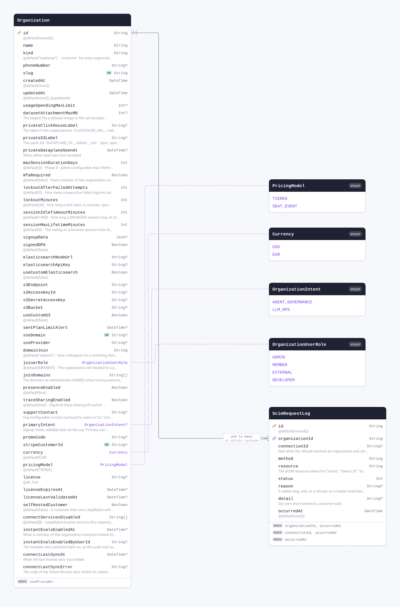

| Field            | Type       | Constraints                                       | Default    | Description                                                                                                                                                                         |
| ---------------- | ---------- | ------------------------------------------------- | ---------- | ----------------------------------------------------------------------------------------------------------------------------------------------------------------------------------- |
| `id`             | `String`   | PK NOT NULL                                       | `nanoid()` |                                                                                                                                                                                     |
| `organizationId` | `String`   | NOT NULL → [Organization.id](#model-Organization) |            |                                                                                                                                                                                     |
| `connectionId`   | `String`   | NULL                                              |            | Null when the refusal resolved an organization and stopped before the connection — a lapsed plan is answered off the token alone.                                                   |
| `method`         | `String`   | NOT NULL                                          |            |                                                                                                                                                                                     |
| `resource`       | `String`   | NOT NULL                                          |            | The SCIM resource asked for ("Users", "Users/:id", "Groups"), never the raw path: a path carries ids and query strings, and this is read by people rather than matched by machines. |
| `status`         | `Int`      | NOT NULL                                          |            |                                                                                                                                                                                     |
| `reason`         | `String`   | NULL                                              |            | A stable slug, only on a refusal, so a reader branches on this and never on the sentence beside it.                                                                                 |
| `detail`         | `String`   | NULL                                              |            | Our own short sentence, customer-safe.                                                                                                                                              |
| `occurredAt`     | `DateTime` | NOT NULL                                          | `now()`    |                                                                                                                                                                                     |

#### Indexes

- `@@index([organizationId, occurredAt])`
- `@@index([connectionId, occurredAt])`
- `@@index([occurredAt])`

#### References

- `organizationId` → [Organization.id](#model-Organization) (many-to-one, on delete Cascade)

#### Definition

```sql
CREATE TABLE "ScimRequestLog" (
    "id" TEXT NOT NULL,
    "organizationId" TEXT NOT NULL,
    "connectionId" TEXT,
    "method" TEXT NOT NULL,
    "resource" TEXT NOT NULL,
    "status" INTEGER NOT NULL,
    "reason" TEXT,
    "detail" TEXT,
    "occurredAt" TIMESTAMP(3) NOT NULL DEFAULT CURRENT_TIMESTAMP,

    CONSTRAINT "ScimRequestLog_pkey" PRIMARY KEY ("id")
);

CREATE INDEX "ScimRequestLog_organizationId_occurredAt_idx" ON "ScimRequestLog"("organizationId", "occurredAt");

CREATE INDEX "ScimRequestLog_connectionId_occurredAt_idx" ON "ScimRequestLog"("connectionId", "occurredAt");

CREATE INDEX "ScimRequestLog_occurredAt_idx" ON "ScimRequestLog"("occurredAt");
```

<details>
<summary>Queries and their SQL</summary>

**findMany**: Every row

```ts
await prisma.scimRequestLog.findMany();
```

```sql
SELECT
  "public"."ScimRequestLog"."id",
  "public"."ScimRequestLog"."organizationId",
  "public"."ScimRequestLog"."connectionId",
  "public"."ScimRequestLog"."method",
  "public"."ScimRequestLog"."resource",
  "public"."ScimRequestLog"."status",
  "public"."ScimRequestLog"."reason",
  "public"."ScimRequestLog"."detail",
  "public"."ScimRequestLog"."occurredAt"
FROM
  "public"."ScimRequestLog"
WHERE
  1 = 1
OFFSET
  $1
-- params: ["0"]
```

**count**: How many rows there are

```ts
await prisma.scimRequestLog.count();
```

```sql
SELECT
  COUNT(*) AS "_count$_all"
FROM
  (
    SELECT
      "public"."ScimRequestLog"."id"
    FROM
      "public"."ScimRequestLog"
    WHERE
      1 = 1
    OFFSET
      $1
  ) AS "sub"
-- params: ["0"]
```

**findMany**: Every row with its relations

```ts
await prisma.scimRequestLog.findMany({ include: { organization: true } });
```

```sql
SELECT
  "public"."ScimRequestLog"."id",
  "public"."ScimRequestLog"."organizationId",
  "public"."ScimRequestLog"."connectionId",
  "public"."ScimRequestLog"."method",
  "public"."ScimRequestLog"."resource",
  "public"."ScimRequestLog"."status",
  "public"."ScimRequestLog"."reason",
  "public"."ScimRequestLog"."detail",
  "public"."ScimRequestLog"."occurredAt"
FROM
  "public"."ScimRequestLog"
WHERE
  1 = 1
OFFSET
  $1
-- params: ["0"]

SELECT
  "public"."Organization"."id",
  "public"."Organization"."name",
  "public"."Organization"."kind",
  "public"."Organization"."phoneNumber",
  "public"."Organization"."slug",
  "public"."Organization"."createdAt",
  "public"."Organization"."updatedAt",
  "public"."Organization"."usageSpendingMaxLimit",
  "public"."Organization"."datasetAttachmentMaxMb",
  "public"."Organization"."privateClickHouseLabel",
  "public"."Organization"."privateS3Label",
  "public"."Organization"."privateDataplaneSeenAt",
  "public"."Organization"."maxSessionDurationDays",
  "public"."Organization"."mfaRequired",
  "public"."Organization"."lockoutAfterFailedAttempts",
  "public"."Organization"."lockoutMinutes",
  "public"."Organization"."sessionIdleTimeoutMinutes",
  "public"."Organization"."sessionMaxLifetimeMinutes",
  "public"."Organization"."signupData",
  "public"."Organization"."signedDPA",
  "public"."Organization"."elasticsearchNodeUrl",
  "public"."Organization"."elasticsearchApiKey",
  "public"."Organization"."useCustomElasticsearch",
  "public"."Organization"."s3Endpoint",
  "public"."Organization"."s3AccessKeyId",
  "public"."Organization"."s3SecretAccessKey",
  "public"."Organization"."s3Bucket",
  "public"."Organization"."useCustomS3",
  "public"."Organization"."sentPlanLimitAlert",
  "public"."Organization"."ssoDomain",
  "public"."Organization"."ssoProvider",
  "public"."Organization"."domainJoin",
  "public"."Organization"."joinerRole"::text,
  "public"."Organization"."joinDomains",
  "public"."Organization"."presenceEnabled",
  "public"."Organization"."traceSharingEnabled",
  "public"."Organization"."supportContact",
  "public"."Organization"."primaryIntent"::text,
  "public"."Organization"."promoCode",
  "public"."Organization"."stripeCustomerId",
  "public"."Organization"."currency"::text,
  "public"."Organization"."pricingModel"::text,
  "public"."Organization"."license",
  "public"."Organization"."licenseExpiresAt",
  "public"."Organization"."licenseLastValidatedAt",
  "public"."Organization"."selfHostedCustomer",
  "public"."Organization"."connectServicesDisabled",
  "public"."Organization"."instantEvalsEnabledAt",
  "public"."Organization"."instantEvalsEnabledByUserId",
  "public"."Organization"."connectLastSyncAt",
  "public"."Organization"."connectLastSyncError"
FROM
  "public"."Organization"
WHERE
  "public"."Organization"."id" IN ($1)
OFFSET
  $2
-- params: ["<organizationId of the rows above>","0"]
```

**findUnique**: One row by what is unique to it

```ts
await prisma.scimRequestLog.findUnique({ where: { id: "example" } });
```

```sql
SELECT
  "public"."ScimRequestLog"."id",
  "public"."ScimRequestLog"."organizationId",
  "public"."ScimRequestLog"."connectionId",
  "public"."ScimRequestLog"."method",
  "public"."ScimRequestLog"."resource",
  "public"."ScimRequestLog"."status",
  "public"."ScimRequestLog"."reason",
  "public"."ScimRequestLog"."detail",
  "public"."ScimRequestLog"."occurredAt"
FROM
  "public"."ScimRequestLog"
WHERE
  (
    "public"."ScimRequestLog"."id" = $1
    AND 1 = 1
  )
LIMIT
  $2
OFFSET
  $3
-- params: ["example","1","0"]
```

**create**: Create a row

```ts
await prisma.scimRequestLog.create({
  data: { organizationId: "example", method: "example", resource: "example", status: 1 },
});
```

```sql
INSERT INTO
  "public"."ScimRequestLog" (
    "id",
    "organizationId",
    "method",
    "resource",
    "status",
    "occurredAt"
  )
VALUES
  ($1, $2, $3, $4, $5, $6)
RETURNING
  "public"."ScimRequestLog"."id",
  "public"."ScimRequestLog"."organizationId",
  "public"."ScimRequestLog"."connectionId",
  "public"."ScimRequestLog"."method",
  "public"."ScimRequestLog"."resource",
  "public"."ScimRequestLog"."status",
  "public"."ScimRequestLog"."reason",
  "public"."ScimRequestLog"."detail",
  "public"."ScimRequestLog"."occurredAt"
-- params: ["<nanoid()>","example","example","example","1","<now()>"]
```

**update**: Update a row

```ts
await prisma.scimRequestLog.update({ where: { id: "example" }, data: { connectionId: "example" } });
```

```sql
SELECT
  "public"."ScimRequestLog"."id"
FROM
  "public"."ScimRequestLog"
WHERE
  (
    "public"."ScimRequestLog"."id" = $1
    AND 1 = 1
  )
LIMIT
  $2
OFFSET
  $3
-- params: ["example","1","0"]

UPDATE "public"."ScimRequestLog"
SET
  "connectionId" = $1
WHERE
  (
    "public"."ScimRequestLog"."id" IN ($2)
    AND (
      "public"."ScimRequestLog"."id" = $3
      AND 1 = 1
    )
  )
RETURNING
  "public"."ScimRequestLog"."id",
  "public"."ScimRequestLog"."organizationId",
  "public"."ScimRequestLog"."connectionId",
  "public"."ScimRequestLog"."method",
  "public"."ScimRequestLog"."resource",
  "public"."ScimRequestLog"."status",
  "public"."ScimRequestLog"."reason",
  "public"."ScimRequestLog"."detail",
  "public"."ScimRequestLog"."occurredAt"
-- params: ["example","<id of the rows above>","example"]
```

**delete**: Delete a row

```ts
await prisma.scimRequestLog.delete({ where: { id: "example" } });
```

```sql
DELETE FROM "public"."ScimRequestLog"
WHERE
  (
    "public"."ScimRequestLog"."id" = $1
    AND 1 = 1
  )
RETURNING
  "public"."ScimRequestLog"."id",
  "public"."ScimRequestLog"."organizationId",
  "public"."ScimRequestLog"."connectionId",
  "public"."ScimRequestLog"."method",
  "public"."ScimRequestLog"."resource",
  "public"."ScimRequestLog"."status",
  "public"."ScimRequestLog"."reason",
  "public"."ScimRequestLog"."detail",
  "public"."ScimRequestLog"."occurredAt"
-- params: ["example"]
```

</details>

<a id="model-ScimToken"></a>

### ScimToken

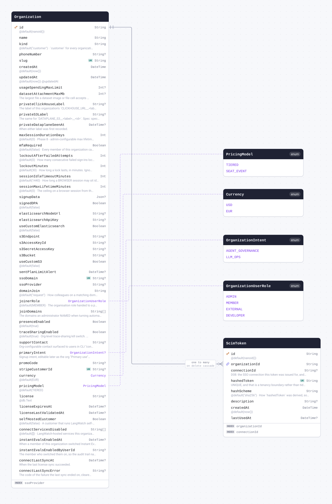

| Field            | Type       | Constraints                                       | Default    | Description                                                                                                                                                                                                                                                                                                                                                                                                                                                                                                                                                                                                                                                   |
| ---------------- | ---------- | ------------------------------------------------- | ---------- | ------------------------------------------------------------------------------------------------------------------------------------------------------------------------------------------------------------------------------------------------------------------------------------------------------------------------------------------------------------------------------------------------------------------------------------------------------------------------------------------------------------------------------------------------------------------------------------------------------------------------------------------------------------- |
| `id`             | `String`   | PK NOT NULL                                       | `nanoid()` |                                                                                                                                                                                                                                                                                                                                                                                                                                                                                                                                                                                                                                                               |
| `organizationId` | `String`   | NOT NULL → [Organization.id](#model-Organization) |            |                                                                                                                                                                                                                                                                                                                                                                                                                                                                                                                                                                                                                                                               |
| `connectionId`   | `String`   | NULL                                              |            | D08: the SSO connection this token was issued for, and its ENTIRE write authority — a token minted for one connection can never touch another connection's people. No relation, matching `SsoConnection` itself: that projection carries no foreign keys, so neither may a row pointing at it. Nullable only for the tokens that predate the column. They were minted when "which organization" was the whole answer, so they keep the organization-wide authority they were sold with; the backfill points each at its organization's first connection where there is one. Minting a NEW token without a connection is refused (`scim_connection_required`). |
| `hashedToken`    | `String`   | UNIQUE NOT NULL                                   |            | UNIQUE, and that is a tenancy boundary rather than tidiness. The lookup that turns a bearer token into an organization is keyed on this column alone — it has to be, since the token is the only thing the caller presents. While every token was 32 random bytes a collision was impossible and the missing constraint cost nothing. An administrator may now supply a value they already hold, so two organizations CAN choose the same string, and without this the lookup would answer with whichever row the planner reached first: one customer's directory provisioning and deleting another customer's people.                                        |
| `hashScheme`     | `String`   | NOT NULL                                          | `"sha256"` | How `hashedToken` was derived, so the two schemes can coexist while tokens minted under the old one are still in use. `sha256` is a bare digest, which is correct for 32 random bytes and wrong for a value a person chose — a database dump of those is a wordlist away from live credentials. `hmac-sha256` is keyed on the deployment's own secret, so a dump on its own is inert. Every new row is the latter.                                                                                                                                                                                                                                            |
| `description`    | `String`   | NULL                                              |            |                                                                                                                                                                                                                                                                                                                                                                                                                                                                                                                                                                                                                                                               |
| `createdAt`      | `DateTime` | NOT NULL                                          | `now()`    |                                                                                                                                                                                                                                                                                                                                                                                                                                                                                                                                                                                                                                                               |
| `lastUsedAt`     | `DateTime` | NULL                                              |            |                                                                                                                                                                                                                                                                                                                                                                                                                                                                                                                                                                                                                                                               |

#### Indexes

- `@@index([organizationId])`
- `@@index([connectionId])`

#### References

- `organizationId` → [Organization.id](#model-Organization) (many-to-one, on delete Cascade)

#### Definition

```sql
CREATE TABLE "ScimToken" (
    "id" TEXT NOT NULL,
    "organizationId" TEXT NOT NULL,
    "connectionId" TEXT,
    "hashedToken" TEXT NOT NULL,
    "hashScheme" TEXT NOT NULL DEFAULT 'sha256',
    "description" TEXT,
    "createdAt" TIMESTAMP(3) NOT NULL DEFAULT CURRENT_TIMESTAMP,
    "lastUsedAt" TIMESTAMP(3),

    CONSTRAINT "ScimToken_pkey" PRIMARY KEY ("id")
);

CREATE UNIQUE INDEX "ScimToken_hashedToken_key" ON "ScimToken"("hashedToken");

CREATE INDEX "ScimToken_organizationId_idx" ON "ScimToken"("organizationId");

CREATE INDEX "ScimToken_connectionId_idx" ON "ScimToken"("connectionId");
```

<details>
<summary>Queries and their SQL</summary>

**findMany**: Every row

```ts
await prisma.scimToken.findMany();
```

```sql
SELECT
  "public"."ScimToken"."id",
  "public"."ScimToken"."organizationId",
  "public"."ScimToken"."connectionId",
  "public"."ScimToken"."hashedToken",
  "public"."ScimToken"."hashScheme",
  "public"."ScimToken"."description",
  "public"."ScimToken"."createdAt",
  "public"."ScimToken"."lastUsedAt"
FROM
  "public"."ScimToken"
WHERE
  1 = 1
OFFSET
  $1
-- params: ["0"]
```

**count**: How many rows there are

```ts
await prisma.scimToken.count();
```

```sql
SELECT
  COUNT(*) AS "_count$_all"
FROM
  (
    SELECT
      "public"."ScimToken"."id"
    FROM
      "public"."ScimToken"
    WHERE
      1 = 1
    OFFSET
      $1
  ) AS "sub"
-- params: ["0"]
```

**findMany**: Every row with its relations

```ts
await prisma.scimToken.findMany({ include: { organization: true } });
```

```sql
SELECT
  "public"."ScimToken"."id",
  "public"."ScimToken"."organizationId",
  "public"."ScimToken"."connectionId",
  "public"."ScimToken"."hashedToken",
  "public"."ScimToken"."hashScheme",
  "public"."ScimToken"."description",
  "public"."ScimToken"."createdAt",
  "public"."ScimToken"."lastUsedAt"
FROM
  "public"."ScimToken"
WHERE
  1 = 1
OFFSET
  $1
-- params: ["0"]

SELECT
  "public"."Organization"."id",
  "public"."Organization"."name",
  "public"."Organization"."kind",
  "public"."Organization"."phoneNumber",
  "public"."Organization"."slug",
  "public"."Organization"."createdAt",
  "public"."Organization"."updatedAt",
  "public"."Organization"."usageSpendingMaxLimit",
  "public"."Organization"."datasetAttachmentMaxMb",
  "public"."Organization"."privateClickHouseLabel",
  "public"."Organization"."privateS3Label",
  "public"."Organization"."privateDataplaneSeenAt",
  "public"."Organization"."maxSessionDurationDays",
  "public"."Organization"."mfaRequired",
  "public"."Organization"."lockoutAfterFailedAttempts",
  "public"."Organization"."lockoutMinutes",
  "public"."Organization"."sessionIdleTimeoutMinutes",
  "public"."Organization"."sessionMaxLifetimeMinutes",
  "public"."Organization"."signupData",
  "public"."Organization"."signedDPA",
  "public"."Organization"."elasticsearchNodeUrl",
  "public"."Organization"."elasticsearchApiKey",
  "public"."Organization"."useCustomElasticsearch",
  "public"."Organization"."s3Endpoint",
  "public"."Organization"."s3AccessKeyId",
  "public"."Organization"."s3SecretAccessKey",
  "public"."Organization"."s3Bucket",
  "public"."Organization"."useCustomS3",
  "public"."Organization"."sentPlanLimitAlert",
  "public"."Organization"."ssoDomain",
  "public"."Organization"."ssoProvider",
  "public"."Organization"."domainJoin",
  "public"."Organization"."joinerRole"::text,
  "public"."Organization"."joinDomains",
  "public"."Organization"."presenceEnabled",
  "public"."Organization"."traceSharingEnabled",
  "public"."Organization"."supportContact",
  "public"."Organization"."primaryIntent"::text,
  "public"."Organization"."promoCode",
  "public"."Organization"."stripeCustomerId",
  "public"."Organization"."currency"::text,
  "public"."Organization"."pricingModel"::text,
  "public"."Organization"."license",
  "public"."Organization"."licenseExpiresAt",
  "public"."Organization"."licenseLastValidatedAt",
  "public"."Organization"."selfHostedCustomer",
  "public"."Organization"."connectServicesDisabled",
  "public"."Organization"."instantEvalsEnabledAt",
  "public"."Organization"."instantEvalsEnabledByUserId",
  "public"."Organization"."connectLastSyncAt",
  "public"."Organization"."connectLastSyncError"
FROM
  "public"."Organization"
WHERE
  "public"."Organization"."id" IN ($1)
OFFSET
  $2
-- params: ["<organizationId of the rows above>","0"]
```

**findUnique**: One row by what is unique to it

```ts
await prisma.scimToken.findUnique({ where: { id: "example" } });
```

```sql
SELECT
  "public"."ScimToken"."id",
  "public"."ScimToken"."organizationId",
  "public"."ScimToken"."connectionId",
  "public"."ScimToken"."hashedToken",
  "public"."ScimToken"."hashScheme",
  "public"."ScimToken"."description",
  "public"."ScimToken"."createdAt",
  "public"."ScimToken"."lastUsedAt"
FROM
  "public"."ScimToken"
WHERE
  (
    "public"."ScimToken"."id" = $1
    AND 1 = 1
  )
LIMIT
  $2
OFFSET
  $3
-- params: ["example","1","0"]
```

**create**: Create a row

```ts
await prisma.scimToken.create({ data: { organizationId: "example", hashedToken: "example" } });
```

```sql
INSERT INTO
  "public"."ScimToken" (
    "id",
    "organizationId",
    "hashedToken",
    "hashScheme",
    "createdAt"
  )
VALUES
  ($1, $2, $3, $4, $5)
RETURNING
  "public"."ScimToken"."id",
  "public"."ScimToken"."organizationId",
  "public"."ScimToken"."connectionId",
  "public"."ScimToken"."hashedToken",
  "public"."ScimToken"."hashScheme",
  "public"."ScimToken"."description",
  "public"."ScimToken"."createdAt",
  "public"."ScimToken"."lastUsedAt"
-- params: ["<nanoid()>","example","example","sha256","<now()>"]
```

**update**: Update a row

```ts
await prisma.scimToken.update({ where: { id: "example" }, data: { connectionId: "example" } });
```

```sql
SELECT
  "public"."ScimToken"."id"
FROM
  "public"."ScimToken"
WHERE
  (
    "public"."ScimToken"."id" = $1
    AND 1 = 1
  )
LIMIT
  $2
OFFSET
  $3
-- params: ["example","1","0"]

UPDATE "public"."ScimToken"
SET
  "connectionId" = $1
WHERE
  (
    "public"."ScimToken"."id" IN ($2)
    AND (
      "public"."ScimToken"."id" = $3
      AND 1 = 1
    )
  )
RETURNING
  "public"."ScimToken"."id",
  "public"."ScimToken"."organizationId",
  "public"."ScimToken"."connectionId",
  "public"."ScimToken"."hashedToken",
  "public"."ScimToken"."hashScheme",
  "public"."ScimToken"."description",
  "public"."ScimToken"."createdAt",
  "public"."ScimToken"."lastUsedAt"
-- params: ["example","<id of the rows above>","example"]
```

**delete**: Delete a row

```ts
await prisma.scimToken.delete({ where: { id: "example" } });
```

```sql
DELETE FROM "public"."ScimToken"
WHERE
  (
    "public"."ScimToken"."id" = $1
    AND 1 = 1
  )
RETURNING
  "public"."ScimToken"."id",
  "public"."ScimToken"."organizationId",
  "public"."ScimToken"."connectionId",
  "public"."ScimToken"."hashedToken",
  "public"."ScimToken"."hashScheme",
  "public"."ScimToken"."description",
  "public"."ScimToken"."createdAt",
  "public"."ScimToken"."lastUsedAt"
-- params: ["example"]
```

</details>

<a id="model-ScimExternalId"></a>

### ScimExternalId

D08 — who the directory means, per connection.

The identity provider's own identifier for a person, which is what
survives their email changing: an address is not identity, people change
theirs, and the same person carries different identifiers on two different
connections. So the PAIR is the key and `externalId` alone never is.

No relation to `SsoConnection` (that projection carries no foreign keys);
the `User` relation is real, so a deleted user takes their directory
identities with them rather than stranding a mapping that resolves to
nobody.

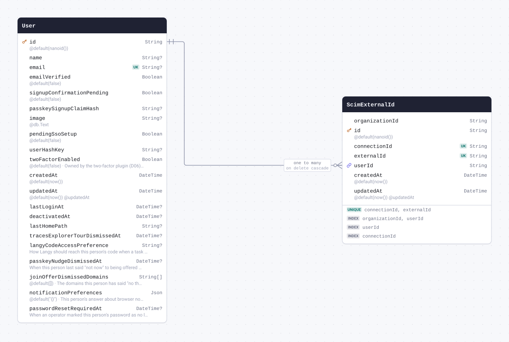

| Field            | Type       | Constraints                       | Default              | Description |
| ---------------- | ---------- | --------------------------------- | -------------------- | ----------- |
| `organizationId` | `String`   | NOT NULL                          |                      |             |
| `id`             | `String`   | PK NOT NULL                       | `nanoid()`           |             |
| `connectionId`   | `String`   | NOT NULL                          |                      |             |
| `externalId`     | `String`   | NOT NULL                          |                      |             |
| `userId`         | `String`   | NOT NULL → [User.id](#model-User) |                      |             |
| `createdAt`      | `DateTime` | NOT NULL                          | `now()`              |             |
| `updatedAt`      | `DateTime` | NOT NULL                          | `now()` `@updatedAt` |             |

#### Indexes

- `@@index([organizationId, userId])`
- `@@index([userId])`
- `@@index([connectionId])`
- `@@unique([connectionId, externalId])`

#### References

- `userId` → [User.id](#model-User) (many-to-one, on delete Cascade)

#### Definition

```sql
CREATE TABLE "ScimExternalId" (
    "organizationId" TEXT NOT NULL,
    "id" TEXT NOT NULL,
    "connectionId" TEXT NOT NULL,
    "externalId" TEXT NOT NULL,
    "userId" TEXT NOT NULL,
    "createdAt" TIMESTAMP(3) NOT NULL DEFAULT CURRENT_TIMESTAMP,
    "updatedAt" TIMESTAMP(3) NOT NULL DEFAULT CURRENT_TIMESTAMP,

    CONSTRAINT "ScimExternalId_pkey" PRIMARY KEY ("id")
);

CREATE INDEX "ScimExternalId_organizationId_userId_idx" ON "ScimExternalId"("organizationId", "userId");

CREATE INDEX "ScimExternalId_userId_idx" ON "ScimExternalId"("userId");

CREATE INDEX "ScimExternalId_connectionId_idx" ON "ScimExternalId"("connectionId");

CREATE UNIQUE INDEX "ScimExternalId_connectionId_externalId_key" ON "ScimExternalId"("connectionId", "externalId");
```

<details>
<summary>Queries and their SQL</summary>

**findMany**: Every row

```ts
await prisma.scimExternalId.findMany();
```

```sql
SELECT
  "public"."ScimExternalId"."id",
  "public"."ScimExternalId"."organizationId",
  "public"."ScimExternalId"."connectionId",
  "public"."ScimExternalId"."externalId",
  "public"."ScimExternalId"."userId",
  "public"."ScimExternalId"."createdAt",
  "public"."ScimExternalId"."updatedAt"
FROM
  "public"."ScimExternalId"
WHERE
  1 = 1
OFFSET
  $1
-- params: ["0"]
```

**count**: How many rows there are

```ts
await prisma.scimExternalId.count();
```

```sql
SELECT
  COUNT(*) AS "_count$_all"
FROM
  (
    SELECT
      "public"."ScimExternalId"."id"
    FROM
      "public"."ScimExternalId"
    WHERE
      1 = 1
    OFFSET
      $1
  ) AS "sub"
-- params: ["0"]
```

**findMany**: Every row with its relations

```ts
await prisma.scimExternalId.findMany({ include: { user: true } });
```

```sql
SELECT
  "public"."ScimExternalId"."id",
  "public"."ScimExternalId"."organizationId",
  "public"."ScimExternalId"."connectionId",
  "public"."ScimExternalId"."externalId",
  "public"."ScimExternalId"."userId",
  "public"."ScimExternalId"."createdAt",
  "public"."ScimExternalId"."updatedAt"
FROM
  "public"."ScimExternalId"
WHERE
  1 = 1
OFFSET
  $1
-- params: ["0"]

SELECT
  "public"."User"."id",
  "public"."User"."name",
  "public"."User"."email",
  "public"."User"."emailVerified",
  "public"."User"."signupConfirmationPending",
  "public"."User"."passkeySignupClaimHash",
  "public"."User"."image",
  "public"."User"."pendingSsoSetup",
  "public"."User"."userHashKey",
  "public"."User"."twoFactorEnabled",
  "public"."User"."createdAt",
  "public"."User"."updatedAt",
  "public"."User"."lastLoginAt",
  "public"."User"."deactivatedAt",
  "public"."User"."lastHomePath",
  "public"."User"."tracesExplorerTourDismissedAt",
  "public"."User"."langyCodeAccessPreference",
  "public"."User"."passkeyNudgeDismissedAt",
  "public"."User"."joinOfferDismissedDomains",
  "public"."User"."notificationPreferences",
  "public"."User"."passwordResetRequiredAt"
FROM
  "public"."User"
WHERE
  "public"."User"."id" IN ($1)
OFFSET
  $2
-- params: ["<userId of the rows above>","0"]
```

**findUnique**: One row by what is unique to it

```ts
await prisma.scimExternalId.findUnique({ where: { id: "example" } });
```

```sql
SELECT
  "public"."ScimExternalId"."id",
  "public"."ScimExternalId"."organizationId",
  "public"."ScimExternalId"."connectionId",
  "public"."ScimExternalId"."externalId",
  "public"."ScimExternalId"."userId",
  "public"."ScimExternalId"."createdAt",
  "public"."ScimExternalId"."updatedAt"
FROM
  "public"."ScimExternalId"
WHERE
  (
    "public"."ScimExternalId"."id" = $1
    AND 1 = 1
  )
LIMIT
  $2
OFFSET
  $3
-- params: ["example","1","0"]
```

**create**: Create a row

```ts
await prisma.scimExternalId.create({
  data: {
    organizationId: "example",
    connectionId: "example",
    externalId: "example",
    userId: "example",
  },
});
```

```sql
INSERT INTO
  "public"."ScimExternalId" (
    "organizationId",
    "id",
    "connectionId",
    "externalId",
    "userId",
    "createdAt",
    "updatedAt"
  )
VALUES
  ($1, $2, $3, $4, $5, $6, $7)
RETURNING
  "public"."ScimExternalId"."id",
  "public"."ScimExternalId"."organizationId",
  "public"."ScimExternalId"."connectionId",
  "public"."ScimExternalId"."externalId",
  "public"."ScimExternalId"."userId",
  "public"."ScimExternalId"."createdAt",
  "public"."ScimExternalId"."updatedAt"
-- params: ["example","<nanoid()>","example","example","example","<now()>","<now()>"]
```

**update**: Update a row

```ts
await prisma.scimExternalId.update({
  where: { id: "example" },
  data: { organizationId: "example" },
});
```

```sql
SELECT
  "public"."ScimExternalId"."id"
FROM
  "public"."ScimExternalId"
WHERE
  (
    "public"."ScimExternalId"."id" = $1
    AND 1 = 1
  )
LIMIT
  $2
OFFSET
  $3
-- params: ["example","1","0"]

UPDATE "public"."ScimExternalId"
SET
  "organizationId" = $1,
  "updatedAt" = $2
WHERE
  (
    "public"."ScimExternalId"."id" IN ($3)
    AND (
      "public"."ScimExternalId"."id" = $4
      AND 1 = 1
    )
  )
RETURNING
  "public"."ScimExternalId"."id",
  "public"."ScimExternalId"."organizationId",
  "public"."ScimExternalId"."connectionId",
  "public"."ScimExternalId"."externalId",
  "public"."ScimExternalId"."userId",
  "public"."ScimExternalId"."createdAt",
  "public"."ScimExternalId"."updatedAt"
-- params: ["example",{"prisma__type":"generatorCall","prisma__value":{"name":"now","args":[],"returnType":{"type":"DateTime"}}},"<id of the rows above>","example"]
```

**delete**: Delete a row

```ts
await prisma.scimExternalId.delete({ where: { id: "example" } });
```

```sql
DELETE FROM "public"."ScimExternalId"
WHERE
  (
    "public"."ScimExternalId"."id" = $1
    AND 1 = 1
  )
RETURNING
  "public"."ScimExternalId"."id",
  "public"."ScimExternalId"."organizationId",
  "public"."ScimExternalId"."connectionId",
  "public"."ScimExternalId"."externalId",
  "public"."ScimExternalId"."userId",
  "public"."ScimExternalId"."createdAt",
  "public"."ScimExternalId"."updatedAt"
-- params: ["example"]
```

</details>

<a id="model-ScimUserResource"></a>

### ScimUserResource

Directory profile and lifecycle are tenant facts, independent of the shared account.


| Field            | Type       | Constraints                          | Default              | Description |
| ---------------- | ---------- | ------------------------------------ | -------------------- | ----------- |
| `organizationId` | `String`   | PK NOT NULL                          |                      |             |
| `userId`         | `String`   | PK NOT NULL → [User.id](#model-User) |                      |             |
| `userName`       | `String`   | NOT NULL                             |                      |             |
| `name`           | `String`   | NULL                                 |                      |             |
| `active`         | `Boolean`  | NOT NULL                             | `true`               |             |
| `deletedAt`      | `DateTime` | NULL                                 |                      |             |
| `createdAt`      | `DateTime` | NOT NULL                             | `now()`              |             |
| `updatedAt`      | `DateTime` | NOT NULL                             | `now()` `@updatedAt` |             |

#### Indexes

- `@@id([organizationId, userId])`
- `@@index([organizationId, userName])`
- `@@index([userId])`

#### References

- `userId` → [User.id](#model-User) (many-to-one, on delete Cascade)

#### Definition

```sql
CREATE TABLE "ScimUserResource" (
    "organizationId" TEXT NOT NULL,
    "userId" TEXT NOT NULL,
    "userName" TEXT NOT NULL,
    "name" TEXT,
    "active" BOOLEAN NOT NULL DEFAULT true,
    "deletedAt" TIMESTAMP(3),
    "createdAt" TIMESTAMP(3) NOT NULL DEFAULT CURRENT_TIMESTAMP,
    "updatedAt" TIMESTAMP(3) NOT NULL DEFAULT CURRENT_TIMESTAMP,

    CONSTRAINT "ScimUserResource_pkey" PRIMARY KEY ("organizationId","userId")
);

CREATE INDEX "ScimUserResource_organizationId_userName_idx" ON "ScimUserResource"("organizationId", "userName");

CREATE INDEX "ScimUserResource_userId_idx" ON "ScimUserResource"("userId");
```

<details>
<summary>Queries and their SQL</summary>

**findMany**: Every row

```ts
await prisma.scimUserResource.findMany();
```

```sql
SELECT
  "public"."ScimUserResource"."organizationId",
  "public"."ScimUserResource"."userId",
  "public"."ScimUserResource"."userName",
  "public"."ScimUserResource"."name",
  "public"."ScimUserResource"."active",
  "public"."ScimUserResource"."deletedAt",
  "public"."ScimUserResource"."createdAt",
  "public"."ScimUserResource"."updatedAt"
FROM
  "public"."ScimUserResource"
WHERE
  1 = 1
OFFSET
  $1
-- params: ["0"]
```

**count**: How many rows there are

```ts
await prisma.scimUserResource.count();
```

```sql
SELECT
  COUNT(*) AS "_count$_all"
FROM
  (
    SELECT
      "public"."ScimUserResource"."organizationId",
      "public"."ScimUserResource"."userId"
    FROM
      "public"."ScimUserResource"
    WHERE
      1 = 1
    OFFSET
      $1
  ) AS "sub"
-- params: ["0"]
```

**findMany**: Every row with its relations

```ts
await prisma.scimUserResource.findMany({ include: { user: true } });
```

```sql
SELECT
  "public"."ScimUserResource"."organizationId",
  "public"."ScimUserResource"."userId",
  "public"."ScimUserResource"."userName",
  "public"."ScimUserResource"."name",
  "public"."ScimUserResource"."active",
  "public"."ScimUserResource"."deletedAt",
  "public"."ScimUserResource"."createdAt",
  "public"."ScimUserResource"."updatedAt"
FROM
  "public"."ScimUserResource"
WHERE
  1 = 1
OFFSET
  $1
-- params: ["0"]

SELECT
  "public"."User"."id",
  "public"."User"."name",
  "public"."User"."email",
  "public"."User"."emailVerified",
  "public"."User"."signupConfirmationPending",
  "public"."User"."passkeySignupClaimHash",
  "public"."User"."image",
  "public"."User"."pendingSsoSetup",
  "public"."User"."userHashKey",
  "public"."User"."twoFactorEnabled",
  "public"."User"."createdAt",
  "public"."User"."updatedAt",
  "public"."User"."lastLoginAt",
  "public"."User"."deactivatedAt",
  "public"."User"."lastHomePath",
  "public"."User"."tracesExplorerTourDismissedAt",
  "public"."User"."langyCodeAccessPreference",
  "public"."User"."passkeyNudgeDismissedAt",
  "public"."User"."joinOfferDismissedDomains",
  "public"."User"."notificationPreferences",
  "public"."User"."passwordResetRequiredAt"
FROM
  "public"."User"
WHERE
  "public"."User"."id" IN ($1)
OFFSET
  $2
-- params: ["<userId of the rows above>","0"]
```

**findUnique**: One row by what is unique to it

```ts
await prisma.scimUserResource.findUnique({
  where: { organizationId_userId: { organizationId: "example", userId: "example" } },
});
```

```sql
SELECT
  "public"."ScimUserResource"."organizationId",
  "public"."ScimUserResource"."userId",
  "public"."ScimUserResource"."userName",
  "public"."ScimUserResource"."name",
  "public"."ScimUserResource"."active",
  "public"."ScimUserResource"."deletedAt",
  "public"."ScimUserResource"."createdAt",
  "public"."ScimUserResource"."updatedAt"
FROM
  "public"."ScimUserResource"
WHERE
  (
    (
      "public"."ScimUserResource"."organizationId" = $1
      AND "public"."ScimUserResource"."userId" = $2
    )
    AND 1 = 1
  )
LIMIT
  $3
OFFSET
  $4
-- params: ["example","example","1","0"]
```

**create**: Create a row

```ts
await prisma.scimUserResource.create({
  data: { organizationId: "example", userId: "example", userName: "example" },
});
```

```sql
INSERT INTO
  "public"."ScimUserResource" (
    "organizationId",
    "userId",
    "userName",
    "active",
    "createdAt",
    "updatedAt"
  )
VALUES
  ($1, $2, $3, $4, $5, $6)
RETURNING
  "public"."ScimUserResource"."organizationId",
  "public"."ScimUserResource"."userId",
  "public"."ScimUserResource"."userName",
  "public"."ScimUserResource"."name",
  "public"."ScimUserResource"."active",
  "public"."ScimUserResource"."deletedAt",
  "public"."ScimUserResource"."createdAt",
  "public"."ScimUserResource"."updatedAt"
-- params: ["example","example","example",true,"<now()>","<now()>"]
```

**update**: Update a row

```ts
await prisma.scimUserResource.update({
  where: { organizationId_userId: { organizationId: "example", userId: "example" } },
  data: { userName: "example" },
});
```

```sql
SELECT
  "public"."ScimUserResource"."organizationId",
  "public"."ScimUserResource"."userId"
FROM
  "public"."ScimUserResource"
WHERE
  (
    (
      "public"."ScimUserResource"."organizationId" = $1
      AND "public"."ScimUserResource"."userId" = $2
    )
    AND 1 = 1
  )
LIMIT
  $3
OFFSET
  $4
-- params: ["example","example","1","0"]

UPDATE "public"."ScimUserResource"
SET
  "userName" = $1,
  "updatedAt" = $2
WHERE
  (
    (
      "public"."ScimUserResource"."organizationId" IN ($3)
      AND "public"."ScimUserResource"."userId" IN ($4)
    )
    AND (
      (
        "public"."ScimUserResource"."organizationId" = $5
        AND "public"."ScimUserResource"."userId" = $6
      )
      AND 1 = 1
    )
  )
RETURNING
  "public"."ScimUserResource"."organizationId",
  "public"."ScimUserResource"."userId",
  "public"."ScimUserResource"."userName",
  "public"."ScimUserResource"."name",
  "public"."ScimUserResource"."active",
  "public"."ScimUserResource"."deletedAt",
  "public"."ScimUserResource"."createdAt",
  "public"."ScimUserResource"."updatedAt"
-- params: ["example",{"prisma__type":"generatorCall","prisma__value":{"name":"now","args":[],"returnType":{"type":"DateTime"}}},"<organizationId of the rows above>","<userId of the rows above>","example","example"]
```

**delete**: Delete a row

```ts
await prisma.scimUserResource.delete({
  where: { organizationId_userId: { organizationId: "example", userId: "example" } },
});
```

```sql
DELETE FROM "public"."ScimUserResource"
WHERE
  (
    (
      "public"."ScimUserResource"."organizationId" = $1
      AND "public"."ScimUserResource"."userId" = $2
    )
    AND 1 = 1
  )
RETURNING
  "public"."ScimUserResource"."organizationId",
  "public"."ScimUserResource"."userId",
  "public"."ScimUserResource"."userName",
  "public"."ScimUserResource"."name",
  "public"."ScimUserResource"."active",
  "public"."ScimUserResource"."deletedAt",
  "public"."ScimUserResource"."createdAt",
  "public"."ScimUserResource"."updatedAt"
-- params: ["example","example"]
```

</details>

<a id="model-ScimDirectoryUser"></a>

### ScimDirectoryUser

A connection's managed users, including resources without an externalId.
Scalar keys only; readers exclude users that no longer exist.

| Field            | Type     | Constraints | Default | Description |
| ---------------- | -------- | ----------- | ------- | ----------- |
| `organizationId` | `String` | NOT NULL    |         |             |
| `connectionId`   | `String` | PK NOT NULL |         |             |
| `userId`         | `String` | PK NOT NULL |         |             |

#### Indexes

- `@@id([connectionId, userId])`
- `@@index([organizationId, userId])`

#### Definition

```sql
CREATE TABLE "ScimDirectoryUser" (
    "organizationId" TEXT NOT NULL,
    "connectionId" TEXT NOT NULL,
    "userId" TEXT NOT NULL,

    CONSTRAINT "ScimDirectoryUser_pkey" PRIMARY KEY ("connectionId","userId")
);

CREATE INDEX "ScimDirectoryUser_organizationId_userId_idx" ON "ScimDirectoryUser"("organizationId", "userId");
```

<details>
<summary>Queries and their SQL</summary>

**findMany**: Every row

```ts
await prisma.scimDirectoryUser.findMany();
```

```sql
SELECT
  "public"."ScimDirectoryUser"."connectionId",
  "public"."ScimDirectoryUser"."userId",
  "public"."ScimDirectoryUser"."organizationId"
FROM
  "public"."ScimDirectoryUser"
WHERE
  1 = 1
OFFSET
  $1
-- params: ["0"]
```

**count**: How many rows there are

```ts
await prisma.scimDirectoryUser.count();
```

```sql
SELECT
  COUNT(*) AS "_count$_all"
FROM
  (
    SELECT
      "public"."ScimDirectoryUser"."connectionId",
      "public"."ScimDirectoryUser"."userId"
    FROM
      "public"."ScimDirectoryUser"
    WHERE
      1 = 1
    OFFSET
      $1
  ) AS "sub"
-- params: ["0"]
```

**findUnique**: One row by what is unique to it

```ts
await prisma.scimDirectoryUser.findUnique({
  where: { connectionId_userId: { connectionId: "example", userId: "example" } },
});
```

```sql
SELECT
  "public"."ScimDirectoryUser"."connectionId",
  "public"."ScimDirectoryUser"."userId",
  "public"."ScimDirectoryUser"."organizationId"
FROM
  "public"."ScimDirectoryUser"
WHERE
  (
    (
      "public"."ScimDirectoryUser"."connectionId" = $1
      AND "public"."ScimDirectoryUser"."userId" = $2
    )
    AND 1 = 1
  )
LIMIT
  $3
OFFSET
  $4
-- params: ["example","example","1","0"]
```

**create**: Create a row

```ts
await prisma.scimDirectoryUser.create({
  data: { organizationId: "example", connectionId: "example", userId: "example" },
});
```

```sql
INSERT INTO
  "public"."ScimDirectoryUser" ("organizationId", "connectionId", "userId")
VALUES
  ($1, $2, $3)
RETURNING
  "public"."ScimDirectoryUser"."connectionId",
  "public"."ScimDirectoryUser"."userId",
  "public"."ScimDirectoryUser"."organizationId"
-- params: ["example","example","example"]
```

**update**: Update a row

```ts
await prisma.scimDirectoryUser.update({
  where: { connectionId_userId: { connectionId: "example", userId: "example" } },
  data: { organizationId: "example" },
});
```

```sql
SELECT
  "public"."ScimDirectoryUser"."connectionId",
  "public"."ScimDirectoryUser"."userId"
FROM
  "public"."ScimDirectoryUser"
WHERE
  (
    (
      "public"."ScimDirectoryUser"."connectionId" = $1
      AND "public"."ScimDirectoryUser"."userId" = $2
    )
    AND 1 = 1
  )
LIMIT
  $3
OFFSET
  $4
-- params: ["example","example","1","0"]

UPDATE "public"."ScimDirectoryUser"
SET
  "organizationId" = $1
WHERE
  (
    (
      "public"."ScimDirectoryUser"."connectionId" IN ($2)
      AND "public"."ScimDirectoryUser"."userId" IN ($3)
    )
    AND (
      (
        "public"."ScimDirectoryUser"."connectionId" = $4
        AND "public"."ScimDirectoryUser"."userId" = $5
      )
      AND 1 = 1
    )
  )
RETURNING
  "public"."ScimDirectoryUser"."connectionId",
  "public"."ScimDirectoryUser"."userId",
  "public"."ScimDirectoryUser"."organizationId"
-- params: ["example","<connectionId of the rows above>","<userId of the rows above>","example","example"]
```

**delete**: Delete a row

```ts
await prisma.scimDirectoryUser.delete({
  where: { connectionId_userId: { connectionId: "example", userId: "example" } },
});
```

```sql
DELETE FROM "public"."ScimDirectoryUser"
WHERE
  (
    (
      "public"."ScimDirectoryUser"."connectionId" = $1
      AND "public"."ScimDirectoryUser"."userId" = $2
    )
    AND 1 = 1
  )
RETURNING
  "public"."ScimDirectoryUser"."connectionId",
  "public"."ScimDirectoryUser"."userId",
  "public"."ScimDirectoryUser"."organizationId"
-- params: ["example","example"]
```

</details>

<a id="model-ScimSyncState"></a>

### ScimSyncState

D08 — one connection's directory sync, as the `scim-sync` pipeline's fold
writes it.

Pure event truth: every column is fold-written, rows are never deleted,
and REVOKED is a tombstone rather than an absence — a dead letter that
vanished when a connection was torn down would be a removal nobody could
check afterwards.

No relation to Organization or SsoConnection, matching `SsoConnection`
itself: a projection is rebuilt from events, and a foreign key would make
a replay depend on relational state the log does not carry.

| Field               | Type       | Constraints | Default | Description                                                                                                                                                                               |
| ------------------- | ---------- | ----------- | ------- | ----------------------------------------------------------------------------------------------------------------------------------------------------------------------------------------- |
| `id`                | `String`   | PK NOT NULL |         | The aggregate: the connection's id, which IS its sync's id.                                                                                                                               |
| `connectionId`      | `String`   | NOT NULL    |         |                                                                                                                                                                                           |
| `organizationId`    | `String`   | NOT NULL    |         |                                                                                                                                                                                           |
| `state`             | `String`   | NOT NULL    |         | TOKEN_ISSUED \| SYNCING \| ERROR \| REVOKED                                                                                                                                               |
| `lastPushedAt`      | `DateTime` | NULL        |         |                                                                                                                                                                                           |
| `lastFailure`       | `Json`     | NULL        |         | The failure standing right now: { op, errorCode, attempts, retiredAtMs, userId, occurredAtMs }. A reason CODE and ids — never a token, never a secret, never an internal hostname.        |
| `deadLetters`       | `Json`     | NOT NULL    | `"[]"`  | Every failure retired without ever being applied, newest last. The dead letters an administrator has to see; retiring never drops one.                                                    |
| `revokedCause`      | `String`   | NULL        |         | revoke \| teardown, once the sync has ended.                                                                                                                                              |
| `occurredAt`        | `DateTime` | NOT NULL    |         |                                                                                                                                                                                           |
| `lastEventId`       | `String`   | NOT NULL    |         |                                                                                                                                                                                           |
| `acceptedAt`        | `DateTime` | NOT NULL    |         |                                                                                                                                                                                           |
| `projectionVersion` | `String`   | NOT NULL    |         |                                                                                                                                                                                           |
| `createdAt`         | `DateTime` | NOT NULL    |         | Event-derived, not database-managed: `@default(now())` / `@updatedAt` would make a replayed row differ from the row it rebuilds, which is exactly the parity this projection has to keep. |
| `updatedAt`         | `DateTime` | NOT NULL    |         |                                                                                                                                                                                           |

#### Indexes

- `@@index([organizationId])`
- `@@index([state])`
- `@@index([connectionId])`

#### Definition

```sql
CREATE TABLE "ScimSyncState" (
    "id" TEXT NOT NULL,
    "connectionId" TEXT NOT NULL,
    "organizationId" TEXT NOT NULL,
    "state" TEXT NOT NULL,
    "lastPushedAt" TIMESTAMP(3),
    "lastFailure" JSONB,
    "deadLetters" JSONB NOT NULL DEFAULT '[]',
    "revokedCause" TEXT,
    "occurredAt" TIMESTAMP(3) NOT NULL,
    "lastEventId" TEXT NOT NULL,
    "acceptedAt" TIMESTAMP(3) NOT NULL,
    "projectionVersion" TEXT NOT NULL,
    "createdAt" TIMESTAMP(3) NOT NULL,
    "updatedAt" TIMESTAMP(3) NOT NULL,

    CONSTRAINT "ScimSyncState_pkey" PRIMARY KEY ("id")
);

CREATE INDEX "ScimSyncState_organizationId_idx" ON "ScimSyncState"("organizationId");

CREATE INDEX "ScimSyncState_state_idx" ON "ScimSyncState"("state");

CREATE INDEX "ScimSyncState_connectionId_idx" ON "ScimSyncState"("connectionId");
```

<details>
<summary>Queries and their SQL</summary>

**findMany**: Every row

```ts
await prisma.scimSyncState.findMany();
```

```sql
SELECT
  "public"."ScimSyncState"."id",
  "public"."ScimSyncState"."connectionId",
  "public"."ScimSyncState"."organizationId",
  "public"."ScimSyncState"."state",
  "public"."ScimSyncState"."lastPushedAt",
  "public"."ScimSyncState"."lastFailure",
  "public"."ScimSyncState"."deadLetters",
  "public"."ScimSyncState"."revokedCause",
  "public"."ScimSyncState"."occurredAt",
  "public"."ScimSyncState"."lastEventId",
  "public"."ScimSyncState"."acceptedAt",
  "public"."ScimSyncState"."projectionVersion",
  "public"."ScimSyncState"."createdAt",
  "public"."ScimSyncState"."updatedAt"
FROM
  "public"."ScimSyncState"
WHERE
  1 = 1
OFFSET
  $1
-- params: ["0"]
```

**count**: How many rows there are

```ts
await prisma.scimSyncState.count();
```

```sql
SELECT
  COUNT(*) AS "_count$_all"
FROM
  (
    SELECT
      "public"."ScimSyncState"."id"
    FROM
      "public"."ScimSyncState"
    WHERE
      1 = 1
    OFFSET
      $1
  ) AS "sub"
-- params: ["0"]
```

**findUnique**: One row by what is unique to it

```ts
await prisma.scimSyncState.findUnique({ where: { id: "example" } });
```

```sql
SELECT
  "public"."ScimSyncState"."id",
  "public"."ScimSyncState"."connectionId",
  "public"."ScimSyncState"."organizationId",
  "public"."ScimSyncState"."state",
  "public"."ScimSyncState"."lastPushedAt",
  "public"."ScimSyncState"."lastFailure",
  "public"."ScimSyncState"."deadLetters",
  "public"."ScimSyncState"."revokedCause",
  "public"."ScimSyncState"."occurredAt",
  "public"."ScimSyncState"."lastEventId",
  "public"."ScimSyncState"."acceptedAt",
  "public"."ScimSyncState"."projectionVersion",
  "public"."ScimSyncState"."createdAt",
  "public"."ScimSyncState"."updatedAt"
FROM
  "public"."ScimSyncState"
WHERE
  (
    "public"."ScimSyncState"."id" = $1
    AND 1 = 1
  )
LIMIT
  $2
OFFSET
  $3
-- params: ["example","1","0"]
```

**create**: Create a row

```ts
await prisma.scimSyncState.create({
  data: {
    id: "example",
    connectionId: "example",
    organizationId: "example",
    state: "example",
    occurredAt: new Date("2026-01-01T00:00:00.000Z"),
    lastEventId: "example",
    acceptedAt: new Date("2026-01-01T00:00:00.000Z"),
    projectionVersion: "example",
    createdAt: new Date("2026-01-01T00:00:00.000Z"),
    updatedAt: new Date("2026-01-01T00:00:00.000Z"),
  },
});
```

```sql
INSERT INTO
  "public"."ScimSyncState" (
    "id",
    "connectionId",
    "organizationId",
    "state",
    "deadLetters",
    "occurredAt",
    "lastEventId",
    "acceptedAt",
    "projectionVersion",
    "createdAt",
    "updatedAt"
  )
VALUES
  ($1, $2, $3, $4, $5, $6, $7, $8, $9, $10, $11)
RETURNING
  "public"."ScimSyncState"."id",
  "public"."ScimSyncState"."connectionId",
  "public"."ScimSyncState"."organizationId",
  "public"."ScimSyncState"."state",
  "public"."ScimSyncState"."lastPushedAt",
  "public"."ScimSyncState"."lastFailure",
  "public"."ScimSyncState"."deadLetters",
  "public"."ScimSyncState"."revokedCause",
  "public"."ScimSyncState"."occurredAt",
  "public"."ScimSyncState"."lastEventId",
  "public"."ScimSyncState"."acceptedAt",
  "public"."ScimSyncState"."projectionVersion",
  "public"."ScimSyncState"."createdAt",
  "public"."ScimSyncState"."updatedAt"
-- params: ["example","example","example","example","[]","2026-01-01T00:00:00.000Z","example","2026-01-01T00:00:00.000Z","example","2026-01-01T00:00:00.000Z","2026-01-01T00:00:00.000Z"]
```

**update**: Update a row

```ts
await prisma.scimSyncState.update({ where: { id: "example" }, data: { connectionId: "example" } });
```

```sql
SELECT
  "public"."ScimSyncState"."id"
FROM
  "public"."ScimSyncState"
WHERE
  (
    "public"."ScimSyncState"."id" = $1
    AND 1 = 1
  )
LIMIT
  $2
OFFSET
  $3
-- params: ["example","1","0"]

UPDATE "public"."ScimSyncState"
SET
  "connectionId" = $1
WHERE
  (
    "public"."ScimSyncState"."id" IN ($2)
    AND (
      "public"."ScimSyncState"."id" = $3
      AND 1 = 1
    )
  )
RETURNING
  "public"."ScimSyncState"."id",
  "public"."ScimSyncState"."connectionId",
  "public"."ScimSyncState"."organizationId",
  "public"."ScimSyncState"."state",
  "public"."ScimSyncState"."lastPushedAt",
  "public"."ScimSyncState"."lastFailure",
  "public"."ScimSyncState"."deadLetters",
  "public"."ScimSyncState"."revokedCause",
  "public"."ScimSyncState"."occurredAt",
  "public"."ScimSyncState"."lastEventId",
  "public"."ScimSyncState"."acceptedAt",
  "public"."ScimSyncState"."projectionVersion",
  "public"."ScimSyncState"."createdAt",
  "public"."ScimSyncState"."updatedAt"
-- params: ["example","<id of the rows above>","example"]
```

**delete**: Delete a row

```ts
await prisma.scimSyncState.delete({ where: { id: "example" } });
```

```sql
DELETE FROM "public"."ScimSyncState"
WHERE
  (
    "public"."ScimSyncState"."id" = $1
    AND 1 = 1
  )
RETURNING
  "public"."ScimSyncState"."id",
  "public"."ScimSyncState"."connectionId",
  "public"."ScimSyncState"."organizationId",
  "public"."ScimSyncState"."state",
  "public"."ScimSyncState"."lastPushedAt",
  "public"."ScimSyncState"."lastFailure",
  "public"."ScimSyncState"."deadLetters",
  "public"."ScimSyncState"."revokedCause",
  "public"."ScimSyncState"."occurredAt",
  "public"."ScimSyncState"."lastEventId",
  "public"."ScimSyncState"."acceptedAt",
  "public"."ScimSyncState"."projectionVersion",
  "public"."ScimSyncState"."createdAt",
  "public"."ScimSyncState"."updatedAt"
-- params: ["example"]
```

</details>

<a id="model-ScimSsoConnectionView"></a>

### ScimSsoConnectionView

SCIM's own copy of an organization's SSO connections: a peer fold over
identity's connection facts (ARCHITECTURE §9), folded with identity-contract's
reducer, one row per connection. SCIM reads this instead of asking identity.
Rebuilt from identity's event log by a projection replay, so no relation:
a foreign key would make a replay depend on state the log does not carry.

| Field               | Type       | Constraints | Default | Description                                                                         |
| ------------------- | ---------- | ----------- | ------- | ----------------------------------------------------------------------------------- |
| `id`                | `String`   | PK NOT NULL |         | The aggregate: identity's connection id.                                            |
| `organizationId`    | `String`   | NOT NULL    |         |                                                                                     |
| `folded`            | `Json`     | NOT NULL    |         | The connection as the reducer folded it (SsoConnectionState + LastEventOccurredAt). |
| `appliedEventIds`   | `String[]` | NOT NULL    | `[]`    | The event ids of the last delivery folded in, so a redelivery folds once.           |
| `projectionVersion` | `String`   | NOT NULL    |         | A row of another version reads as undecodable and is re-folded from the log.        |
| `createdAt`         | `DateTime` | NOT NULL    |         | Event-derived, so a replayed row equals the row it rebuilds.                        |
| `updatedAt`         | `DateTime` | NOT NULL    |         |                                                                                     |

#### Indexes

- `@@index([organizationId, createdAt])`

#### Definition

```sql
CREATE TABLE "ScimSsoConnectionView" (
    "id" TEXT NOT NULL,
    "organizationId" TEXT NOT NULL,
    "folded" JSONB NOT NULL,
    "appliedEventIds" TEXT[] DEFAULT ARRAY[]::TEXT[],
    "projectionVersion" TEXT NOT NULL,
    "createdAt" TIMESTAMP(3) NOT NULL,
    "updatedAt" TIMESTAMP(3) NOT NULL,

    CONSTRAINT "ScimSsoConnectionView_pkey" PRIMARY KEY ("id")
);

CREATE INDEX "ScimSsoConnectionView_organizationId_createdAt_idx" ON "ScimSsoConnectionView"("organizationId", "createdAt");
```

<details>
<summary>Queries and their SQL</summary>

**findMany**: Every row

```ts
await prisma.scimSsoConnectionView.findMany();
```

```sql
SELECT
  "public"."ScimSsoConnectionView"."id",
  "public"."ScimSsoConnectionView"."organizationId",
  "public"."ScimSsoConnectionView"."folded",
  "public"."ScimSsoConnectionView"."appliedEventIds",
  "public"."ScimSsoConnectionView"."projectionVersion",
  "public"."ScimSsoConnectionView"."createdAt",
  "public"."ScimSsoConnectionView"."updatedAt"
FROM
  "public"."ScimSsoConnectionView"
WHERE
  1 = 1
OFFSET
  $1
-- params: ["0"]
```

**count**: How many rows there are

```ts
await prisma.scimSsoConnectionView.count();
```

```sql
SELECT
  COUNT(*) AS "_count$_all"
FROM
  (
    SELECT
      "public"."ScimSsoConnectionView"."id"
    FROM
      "public"."ScimSsoConnectionView"
    WHERE
      1 = 1
    OFFSET
      $1
  ) AS "sub"
-- params: ["0"]
```

**findUnique**: One row by what is unique to it

```ts
await prisma.scimSsoConnectionView.findUnique({ where: { id: "example" } });
```

```sql
SELECT
  "public"."ScimSsoConnectionView"."id",
  "public"."ScimSsoConnectionView"."organizationId",
  "public"."ScimSsoConnectionView"."folded",
  "public"."ScimSsoConnectionView"."appliedEventIds",
  "public"."ScimSsoConnectionView"."projectionVersion",
  "public"."ScimSsoConnectionView"."createdAt",
  "public"."ScimSsoConnectionView"."updatedAt"
FROM
  "public"."ScimSsoConnectionView"
WHERE
  (
    "public"."ScimSsoConnectionView"."id" = $1
    AND 1 = 1
  )
LIMIT
  $2
OFFSET
  $3
-- params: ["example","1","0"]
```

**create**: Create a row

```ts
await prisma.scimSsoConnectionView.create({
  data: {
    id: "example",
    organizationId: "example",
    folded: {},
    projectionVersion: "example",
    createdAt: new Date("2026-01-01T00:00:00.000Z"),
    updatedAt: new Date("2026-01-01T00:00:00.000Z"),
  },
});
```

```sql
INSERT INTO
  "public"."ScimSsoConnectionView" (
    "id",
    "organizationId",
    "folded",
    "appliedEventIds",
    "projectionVersion",
    "createdAt",
    "updatedAt"
  )
VALUES
  ($1, $2, $3, $4, $5, $6, $7)
RETURNING
  "public"."ScimSsoConnectionView"."id",
  "public"."ScimSsoConnectionView"."organizationId",
  "public"."ScimSsoConnectionView"."folded",
  "public"."ScimSsoConnectionView"."appliedEventIds",
  "public"."ScimSsoConnectionView"."projectionVersion",
  "public"."ScimSsoConnectionView"."createdAt",
  "public"."ScimSsoConnectionView"."updatedAt"
-- params: ["example","example","{}",[],"example","2026-01-01T00:00:00.000Z","2026-01-01T00:00:00.000Z"]
```

**update**: Update a row

```ts
await prisma.scimSsoConnectionView.update({
  where: { id: "example" },
  data: { organizationId: "example" },
});
```

```sql
SELECT
  "public"."ScimSsoConnectionView"."id"
FROM
  "public"."ScimSsoConnectionView"
WHERE
  (
    "public"."ScimSsoConnectionView"."id" = $1
    AND 1 = 1
  )
LIMIT
  $2
OFFSET
  $3
-- params: ["example","1","0"]

UPDATE "public"."ScimSsoConnectionView"
SET
  "organizationId" = $1
WHERE
  (
    "public"."ScimSsoConnectionView"."id" IN ($2)
    AND (
      "public"."ScimSsoConnectionView"."id" = $3
      AND 1 = 1
    )
  )
RETURNING
  "public"."ScimSsoConnectionView"."id",
  "public"."ScimSsoConnectionView"."organizationId",
  "public"."ScimSsoConnectionView"."folded",
  "public"."ScimSsoConnectionView"."appliedEventIds",
  "public"."ScimSsoConnectionView"."projectionVersion",
  "public"."ScimSsoConnectionView"."createdAt",
  "public"."ScimSsoConnectionView"."updatedAt"
-- params: ["example","<id of the rows above>","example"]
```

**delete**: Delete a row

```ts
await prisma.scimSsoConnectionView.delete({ where: { id: "example" } });
```

```sql
DELETE FROM "public"."ScimSsoConnectionView"
WHERE
  (
    "public"."ScimSsoConnectionView"."id" = $1
    AND 1 = 1
  )
RETURNING
  "public"."ScimSsoConnectionView"."id",
  "public"."ScimSsoConnectionView"."organizationId",
  "public"."ScimSsoConnectionView"."folded",
  "public"."ScimSsoConnectionView"."appliedEventIds",
  "public"."ScimSsoConnectionView"."projectionVersion",
  "public"."ScimSsoConnectionView"."createdAt",
  "public"."ScimSsoConnectionView"."updatedAt"
-- params: ["example"]
```

</details>

<a id="model-OrganizationSeatPeak"></a>

### OrganizationSeatPeak

Organization's monthly seat peak, folded from its seat changes (modules/organization, ADR-002).
A read model, one row per organization: rebuildable by replaying the event log, so no relation.
Epochs in milliseconds.
Organization's seat-peak counts (ADR-002): one row per organization once counting opened.

| Field            | Type     | Constraints | Default | Description                                                                |
| ---------------- | -------- | ----------- | ------- | -------------------------------------------------------------------------- |
| `organizationId` | `String` | PK NOT NULL |         | The organization, which is also the aggregate id.                          |
| `openedAt`       | `Float`  | NOT NULL    |         | When the opening snapshot was taken, epoch milliseconds.                   |
| `fullSeats`      | `Int`    | NOT NULL    |         |                                                                            |
| `liteSeats`      | `Int`    | NOT NULL    |         |                                                                            |
| `developerSeats` | `Int`    | NOT NULL    |         |                                                                            |
| `latestChangeAt` | `Float`  | NOT NULL    |         | The latest change time applied to any holder; invitations expire up to it. |
| `mismatches`     | `Int`    | NOT NULL    |         | Changes whose `from` disagreed with the seat the fold held.                |

#### Definition

```sql
CREATE TABLE "OrganizationSeatPeak" (
    "organizationId" TEXT NOT NULL,
    "openedAt" DOUBLE PRECISION NOT NULL,
    "fullSeats" INTEGER NOT NULL,
    "liteSeats" INTEGER NOT NULL,
    "developerSeats" INTEGER NOT NULL,
    "latestChangeAt" DOUBLE PRECISION NOT NULL,
    "mismatches" INTEGER NOT NULL,

    CONSTRAINT "OrganizationSeatPeak_pkey" PRIMARY KEY ("organizationId")
);
```

<details>
<summary>Queries and their SQL</summary>

**findMany**: Every row

```ts
await prisma.organizationSeatPeak.findMany();
```

```sql
SELECT
  "public"."OrganizationSeatPeak"."organizationId",
  "public"."OrganizationSeatPeak"."openedAt",
  "public"."OrganizationSeatPeak"."fullSeats",
  "public"."OrganizationSeatPeak"."liteSeats",
  "public"."OrganizationSeatPeak"."developerSeats",
  "public"."OrganizationSeatPeak"."latestChangeAt",
  "public"."OrganizationSeatPeak"."mismatches"
FROM
  "public"."OrganizationSeatPeak"
WHERE
  1 = 1
OFFSET
  $1
-- params: ["0"]
```

**count**: How many rows there are

```ts
await prisma.organizationSeatPeak.count();
```

```sql
SELECT
  COUNT(*) AS "_count$_all"
FROM
  (
    SELECT
      "public"."OrganizationSeatPeak"."organizationId"
    FROM
      "public"."OrganizationSeatPeak"
    WHERE
      1 = 1
    OFFSET
      $1
  ) AS "sub"
-- params: ["0"]
```

**findUnique**: One row by what is unique to it

```ts
await prisma.organizationSeatPeak.findUnique({ where: { organizationId: "example" } });
```

```sql
SELECT
  "public"."OrganizationSeatPeak"."organizationId",
  "public"."OrganizationSeatPeak"."openedAt",
  "public"."OrganizationSeatPeak"."fullSeats",
  "public"."OrganizationSeatPeak"."liteSeats",
  "public"."OrganizationSeatPeak"."developerSeats",
  "public"."OrganizationSeatPeak"."latestChangeAt",
  "public"."OrganizationSeatPeak"."mismatches"
FROM
  "public"."OrganizationSeatPeak"
WHERE
  (
    "public"."OrganizationSeatPeak"."organizationId" = $1
    AND 1 = 1
  )
LIMIT
  $2
OFFSET
  $3
-- params: ["example","1","0"]
```

**create**: Create a row

```ts
await prisma.organizationSeatPeak.create({
  data: {
    organizationId: "example",
    openedAt: 1.5,
    fullSeats: 1,
    liteSeats: 1,
    developerSeats: 1,
    latestChangeAt: 1.5,
    mismatches: 1,
  },
});
```

```sql
INSERT INTO
  "public"."OrganizationSeatPeak" (
    "organizationId",
    "openedAt",
    "fullSeats",
    "liteSeats",
    "developerSeats",
    "latestChangeAt",
    "mismatches"
  )
VALUES
  ($1, $2, $3, $4, $5, $6, $7)
RETURNING
  "public"."OrganizationSeatPeak"."organizationId",
  "public"."OrganizationSeatPeak"."openedAt",
  "public"."OrganizationSeatPeak"."fullSeats",
  "public"."OrganizationSeatPeak"."liteSeats",
  "public"."OrganizationSeatPeak"."developerSeats",
  "public"."OrganizationSeatPeak"."latestChangeAt",
  "public"."OrganizationSeatPeak"."mismatches"
-- params: ["example","1.5","1","1","1","1.5","1"]
```

**update**: Update a row

```ts
await prisma.organizationSeatPeak.update({
  where: { organizationId: "example" },
  data: { openedAt: 1.5 },
});
```

```sql
SELECT
  "public"."OrganizationSeatPeak"."organizationId"
FROM
  "public"."OrganizationSeatPeak"
WHERE
  (
    "public"."OrganizationSeatPeak"."organizationId" = $1
    AND 1 = 1
  )
LIMIT
  $2
OFFSET
  $3
-- params: ["example","1","0"]

UPDATE "public"."OrganizationSeatPeak"
SET
  "openedAt" = $1
WHERE
  (
    "public"."OrganizationSeatPeak"."organizationId" IN ($2)
    AND (
      "public"."OrganizationSeatPeak"."organizationId" = $3
      AND 1 = 1
    )
  )
RETURNING
  "public"."OrganizationSeatPeak"."organizationId",
  "public"."OrganizationSeatPeak"."openedAt",
  "public"."OrganizationSeatPeak"."fullSeats",
  "public"."OrganizationSeatPeak"."liteSeats",
  "public"."OrganizationSeatPeak"."developerSeats",
  "public"."OrganizationSeatPeak"."latestChangeAt",
  "public"."OrganizationSeatPeak"."mismatches"
-- params: ["1.5","<organizationId of the rows above>","example"]
```

**delete**: Delete a row

```ts
await prisma.organizationSeatPeak.delete({ where: { organizationId: "example" } });
```

```sql
DELETE FROM "public"."OrganizationSeatPeak"
WHERE
  (
    "public"."OrganizationSeatPeak"."organizationId" = $1
    AND 1 = 1
  )
RETURNING
  "public"."OrganizationSeatPeak"."organizationId",
  "public"."OrganizationSeatPeak"."openedAt",
  "public"."OrganizationSeatPeak"."fullSeats",
  "public"."OrganizationSeatPeak"."liteSeats",
  "public"."OrganizationSeatPeak"."developerSeats",
  "public"."OrganizationSeatPeak"."latestChangeAt",
  "public"."OrganizationSeatPeak"."mismatches"
-- params: ["example"]
```

</details>

<a id="model-OrganizationSeatPeakHolder"></a>

### OrganizationSeatPeakHolder

One member's or pending invitation's seat as the seat peak last applied it (ADR-002).

| Field            | Type      | Constraints | Default | Description                                                                         |
| ---------------- | --------- | ----------- | ------- | ----------------------------------------------------------------------------------- |
| `organizationId` | `String`  | PK NOT NULL |         |                                                                                     |
| `holderKind`     | `String`  | PK NOT NULL |         | `member`, `invitation` or `hold` (a seat held after somebody left).                 |
| `holderId`       | `String`  | PK NOT NULL |         | The member's or the hold's userId, or the invitation's id.                          |
| `seat`           | `String`  | NOT NULL    |         | `full`, `lite`, `developer` or `none`.                                              |
| `lastChangedAt`  | `Float`   | NOT NULL    |         |                                                                                     |
| `lastChangeId`   | `String`  | NULL        |         | Absent for a seat the opening snapshot recorded.                                    |
| `expiresAt`      | `Float`   | NULL        |         | An invitation's expiry; null for a member or an invitation that never expires.      |
| `expiredByFold`  | `Boolean` | NOT NULL    | `false` | The fold gave the invitation's seat back at `expiresAt`.                            |
| `suppressedBy`   | `String`  | NULL        |         | A hold whose seat a live full invitation to its address took: that invitation's id. |
| `restoredByFold` | `Boolean` | NOT NULL    | `false` | The fold gave a suppressed hold its seat back when that invitation expired.         |

#### Indexes

- `@@id([organizationId, holderKind, holderId])`
- `@@index([organizationId, holderKind, seat, expiresAt])`
- `@@index([organizationId, suppressedBy])`

#### Definition

```sql
CREATE TABLE "OrganizationSeatPeakHolder" (
    "organizationId" TEXT NOT NULL,
    "holderKind" TEXT NOT NULL,
    "holderId" TEXT NOT NULL,
    "seat" TEXT NOT NULL,
    "lastChangedAt" DOUBLE PRECISION NOT NULL,
    "lastChangeId" TEXT,
    "expiresAt" DOUBLE PRECISION,
    "expiredByFold" BOOLEAN NOT NULL DEFAULT false,
    "suppressedBy" TEXT,
    "restoredByFold" BOOLEAN NOT NULL DEFAULT false,

    CONSTRAINT "OrganizationSeatPeakHolder_pkey" PRIMARY KEY ("organizationId","holderKind","holderId")
);

CREATE INDEX "OrganizationSeatPeakHolder_organizationId_holderKind_seat_e_idx" ON "OrganizationSeatPeakHolder"("organizationId", "holderKind", "seat", "expiresAt");

CREATE INDEX "OrganizationSeatPeakHolder_organizationId_suppressedBy_idx" ON "OrganizationSeatPeakHolder"("organizationId", "suppressedBy");
```

<details>
<summary>Queries and their SQL</summary>

**findMany**: Every row

```ts
await prisma.organizationSeatPeakHolder.findMany();
```

```sql
SELECT
  "public"."OrganizationSeatPeakHolder"."organizationId",
  "public"."OrganizationSeatPeakHolder"."holderKind",
  "public"."OrganizationSeatPeakHolder"."holderId",
  "public"."OrganizationSeatPeakHolder"."seat",
  "public"."OrganizationSeatPeakHolder"."lastChangedAt",
  "public"."OrganizationSeatPeakHolder"."lastChangeId",
  "public"."OrganizationSeatPeakHolder"."expiresAt",
  "public"."OrganizationSeatPeakHolder"."expiredByFold",
  "public"."OrganizationSeatPeakHolder"."suppressedBy",
  "public"."OrganizationSeatPeakHolder"."restoredByFold"
FROM
  "public"."OrganizationSeatPeakHolder"
WHERE
  1 = 1
OFFSET
  $1
-- params: ["0"]
```

**count**: How many rows there are

```ts
await prisma.organizationSeatPeakHolder.count();
```

```sql
SELECT
  COUNT(*) AS "_count$_all"
FROM
  (
    SELECT
      "public"."OrganizationSeatPeakHolder"."organizationId",
      "public"."OrganizationSeatPeakHolder"."holderKind",
      "public"."OrganizationSeatPeakHolder"."holderId"
    FROM
      "public"."OrganizationSeatPeakHolder"
    WHERE
      1 = 1
    OFFSET
      $1
  ) AS "sub"
-- params: ["0"]
```

**findUnique**: One row by what is unique to it

```ts
await prisma.organizationSeatPeakHolder.findUnique({
  where: {
    organizationId_holderKind_holderId: {
      organizationId: "example",
      holderKind: "example",
      holderId: "example",
    },
  },
});
```

```sql
SELECT
  "public"."OrganizationSeatPeakHolder"."organizationId",
  "public"."OrganizationSeatPeakHolder"."holderKind",
  "public"."OrganizationSeatPeakHolder"."holderId",
  "public"."OrganizationSeatPeakHolder"."seat",
  "public"."OrganizationSeatPeakHolder"."lastChangedAt",
  "public"."OrganizationSeatPeakHolder"."lastChangeId",
  "public"."OrganizationSeatPeakHolder"."expiresAt",
  "public"."OrganizationSeatPeakHolder"."expiredByFold",
  "public"."OrganizationSeatPeakHolder"."suppressedBy",
  "public"."OrganizationSeatPeakHolder"."restoredByFold"
FROM
  "public"."OrganizationSeatPeakHolder"
WHERE
  (
    (
      "public"."OrganizationSeatPeakHolder"."organizationId" = $1
      AND "public"."OrganizationSeatPeakHolder"."holderKind" = $2
      AND "public"."OrganizationSeatPeakHolder"."holderId" = $3
    )
    AND 1 = 1
  )
LIMIT
  $4
OFFSET
  $5
-- params: ["example","example","example","1","0"]
```

**create**: Create a row

```ts
await prisma.organizationSeatPeakHolder.create({
  data: {
    organizationId: "example",
    holderKind: "example",
    holderId: "example",
    seat: "example",
    lastChangedAt: 1.5,
  },
});
```

```sql
INSERT INTO
  "public"."OrganizationSeatPeakHolder" (
    "organizationId",
    "holderKind",
    "holderId",
    "seat",
    "lastChangedAt",
    "expiredByFold",
    "restoredByFold"
  )
VALUES
  ($1, $2, $3, $4, $5, $6, $7)
RETURNING
  "public"."OrganizationSeatPeakHolder"."organizationId",
  "public"."OrganizationSeatPeakHolder"."holderKind",
  "public"."OrganizationSeatPeakHolder"."holderId",
  "public"."OrganizationSeatPeakHolder"."seat",
  "public"."OrganizationSeatPeakHolder"."lastChangedAt",
  "public"."OrganizationSeatPeakHolder"."lastChangeId",
  "public"."OrganizationSeatPeakHolder"."expiresAt",
  "public"."OrganizationSeatPeakHolder"."expiredByFold",
  "public"."OrganizationSeatPeakHolder"."suppressedBy",
  "public"."OrganizationSeatPeakHolder"."restoredByFold"
-- params: ["example","example","example","example","1.5",false,false]
```

**update**: Update a row

```ts
await prisma.organizationSeatPeakHolder.update({
  where: {
    organizationId_holderKind_holderId: {
      organizationId: "example",
      holderKind: "example",
      holderId: "example",
    },
  },
  data: { seat: "example" },
});
```

```sql
SELECT
  "public"."OrganizationSeatPeakHolder"."organizationId",
  "public"."OrganizationSeatPeakHolder"."holderKind",
  "public"."OrganizationSeatPeakHolder"."holderId"
FROM
  "public"."OrganizationSeatPeakHolder"
WHERE
  (
    (
      "public"."OrganizationSeatPeakHolder"."organizationId" = $1
      AND "public"."OrganizationSeatPeakHolder"."holderKind" = $2
      AND "public"."OrganizationSeatPeakHolder"."holderId" = $3
    )
    AND 1 = 1
  )
LIMIT
  $4
OFFSET
  $5
-- params: ["example","example","example","1","0"]

UPDATE "public"."OrganizationSeatPeakHolder"
SET
  "seat" = $1
WHERE
  (
    (
      "public"."OrganizationSeatPeakHolder"."organizationId" IN ($2)
      AND "public"."OrganizationSeatPeakHolder"."holderKind" IN ($3)
      AND "public"."OrganizationSeatPeakHolder"."holderId" IN ($4)
    )
    AND (
      (
        "public"."OrganizationSeatPeakHolder"."organizationId" = $5
        AND "public"."OrganizationSeatPeakHolder"."holderKind" = $6
        AND "public"."OrganizationSeatPeakHolder"."holderId" = $7
      )
      AND 1 = 1
    )
  )
RETURNING
  "public"."OrganizationSeatPeakHolder"."organizationId",
  "public"."OrganizationSeatPeakHolder"."holderKind",
  "public"."OrganizationSeatPeakHolder"."holderId",
  "public"."OrganizationSeatPeakHolder"."seat",
  "public"."OrganizationSeatPeakHolder"."lastChangedAt",
  "public"."OrganizationSeatPeakHolder"."lastChangeId",
  "public"."OrganizationSeatPeakHolder"."expiresAt",
  "public"."OrganizationSeatPeakHolder"."expiredByFold",
  "public"."OrganizationSeatPeakHolder"."suppressedBy",
  "public"."OrganizationSeatPeakHolder"."restoredByFold"
-- params: ["example","<organizationId of the rows above>","<holderKind of the rows above>","<holderId of the rows above>","example","example","example"]
```

**delete**: Delete a row

```ts
await prisma.organizationSeatPeakHolder.delete({
  where: {
    organizationId_holderKind_holderId: {
      organizationId: "example",
      holderKind: "example",
      holderId: "example",
    },
  },
});
```

```sql
DELETE FROM "public"."OrganizationSeatPeakHolder"
WHERE
  (
    (
      "public"."OrganizationSeatPeakHolder"."organizationId" = $1
      AND "public"."OrganizationSeatPeakHolder"."holderKind" = $2
      AND "public"."OrganizationSeatPeakHolder"."holderId" = $3
    )
    AND 1 = 1
  )
RETURNING
  "public"."OrganizationSeatPeakHolder"."organizationId",
  "public"."OrganizationSeatPeakHolder"."holderKind",
  "public"."OrganizationSeatPeakHolder"."holderId",
  "public"."OrganizationSeatPeakHolder"."seat",
  "public"."OrganizationSeatPeakHolder"."lastChangedAt",
  "public"."OrganizationSeatPeakHolder"."lastChangeId",
  "public"."OrganizationSeatPeakHolder"."expiresAt",
  "public"."OrganizationSeatPeakHolder"."expiredByFold",
  "public"."OrganizationSeatPeakHolder"."suppressedBy",
  "public"."OrganizationSeatPeakHolder"."restoredByFold"
-- params: ["example","example","example"]
```

</details>

<a id="model-OrganizationSeatPeakMonth"></a>

### OrganizationSeatPeakMonth

One calendar month's (UTC) seat peaks for an organization (ADR-002).

| Field            | Type     | Constraints | Default | Description |
| ---------------- | -------- | ----------- | ------- | ----------- |
| `organizationId` | `String` | PK NOT NULL |         |             |
| `month`          | `String` | PK NOT NULL |         | `YYYY-MM`.  |
| `fullPeak`       | `Int`    | NOT NULL    |         |             |
| `fullPeakAt`     | `Float`  | NOT NULL    |         |             |
| `litePeak`       | `Int`    | NOT NULL    |         |             |
| `litePeakAt`     | `Float`  | NOT NULL    |         |             |
| `fullAtEnd`      | `Int`    | NOT NULL    |         |             |
| `liteAtEnd`      | `Int`    | NOT NULL    |         |             |

#### Indexes

- `@@id([organizationId, month])`

#### Definition

```sql
CREATE TABLE "OrganizationSeatPeakMonth" (
    "organizationId" TEXT NOT NULL,
    "month" TEXT NOT NULL,
    "fullPeak" INTEGER NOT NULL,
    "fullPeakAt" DOUBLE PRECISION NOT NULL,
    "litePeak" INTEGER NOT NULL,
    "litePeakAt" DOUBLE PRECISION NOT NULL,
    "fullAtEnd" INTEGER NOT NULL,
    "liteAtEnd" INTEGER NOT NULL,

    CONSTRAINT "OrganizationSeatPeakMonth_pkey" PRIMARY KEY ("organizationId","month")
);
```

<details>
<summary>Queries and their SQL</summary>

**findMany**: Every row

```ts
await prisma.organizationSeatPeakMonth.findMany();
```

```sql
SELECT
  "public"."OrganizationSeatPeakMonth"."organizationId",
  "public"."OrganizationSeatPeakMonth"."month",
  "public"."OrganizationSeatPeakMonth"."fullPeak",
  "public"."OrganizationSeatPeakMonth"."fullPeakAt",
  "public"."OrganizationSeatPeakMonth"."litePeak",
  "public"."OrganizationSeatPeakMonth"."litePeakAt",
  "public"."OrganizationSeatPeakMonth"."fullAtEnd",
  "public"."OrganizationSeatPeakMonth"."liteAtEnd"
FROM
  "public"."OrganizationSeatPeakMonth"
WHERE
  1 = 1
OFFSET
  $1
-- params: ["0"]
```

**count**: How many rows there are

```ts
await prisma.organizationSeatPeakMonth.count();
```

```sql
SELECT
  COUNT(*) AS "_count$_all"
FROM
  (
    SELECT
      "public"."OrganizationSeatPeakMonth"."organizationId",
      "public"."OrganizationSeatPeakMonth"."month"
    FROM
      "public"."OrganizationSeatPeakMonth"
    WHERE
      1 = 1
    OFFSET
      $1
  ) AS "sub"
-- params: ["0"]
```

**findUnique**: One row by what is unique to it

```ts
await prisma.organizationSeatPeakMonth.findUnique({
  where: { organizationId_month: { organizationId: "example", month: "example" } },
});
```

```sql
SELECT
  "public"."OrganizationSeatPeakMonth"."organizationId",
  "public"."OrganizationSeatPeakMonth"."month",
  "public"."OrganizationSeatPeakMonth"."fullPeak",
  "public"."OrganizationSeatPeakMonth"."fullPeakAt",
  "public"."OrganizationSeatPeakMonth"."litePeak",
  "public"."OrganizationSeatPeakMonth"."litePeakAt",
  "public"."OrganizationSeatPeakMonth"."fullAtEnd",
  "public"."OrganizationSeatPeakMonth"."liteAtEnd"
FROM
  "public"."OrganizationSeatPeakMonth"
WHERE
  (
    (
      "public"."OrganizationSeatPeakMonth"."organizationId" = $1
      AND "public"."OrganizationSeatPeakMonth"."month" = $2
    )
    AND 1 = 1
  )
LIMIT
  $3
OFFSET
  $4
-- params: ["example","example","1","0"]
```

**create**: Create a row

```ts
await prisma.organizationSeatPeakMonth.create({
  data: {
    organizationId: "example",
    month: "example",
    fullPeak: 1,
    fullPeakAt: 1.5,
    litePeak: 1,
    litePeakAt: 1.5,
    fullAtEnd: 1,
    liteAtEnd: 1,
  },
});
```

```sql
INSERT INTO
  "public"."OrganizationSeatPeakMonth" (
    "organizationId",
    "month",
    "fullPeak",
    "fullPeakAt",
    "litePeak",
    "litePeakAt",
    "fullAtEnd",
    "liteAtEnd"
  )
VALUES
  ($1, $2, $3, $4, $5, $6, $7, $8)
RETURNING
  "public"."OrganizationSeatPeakMonth"."organizationId",
  "public"."OrganizationSeatPeakMonth"."month",
  "public"."OrganizationSeatPeakMonth"."fullPeak",
  "public"."OrganizationSeatPeakMonth"."fullPeakAt",
  "public"."OrganizationSeatPeakMonth"."litePeak",
  "public"."OrganizationSeatPeakMonth"."litePeakAt",
  "public"."OrganizationSeatPeakMonth"."fullAtEnd",
  "public"."OrganizationSeatPeakMonth"."liteAtEnd"
-- params: ["example","example","1","1.5","1","1.5","1","1"]
```

**update**: Update a row

```ts
await prisma.organizationSeatPeakMonth.update({
  where: { organizationId_month: { organizationId: "example", month: "example" } },
  data: { fullPeak: 1 },
});
```

```sql
SELECT
  "public"."OrganizationSeatPeakMonth"."organizationId",
  "public"."OrganizationSeatPeakMonth"."month"
FROM
  "public"."OrganizationSeatPeakMonth"
WHERE
  (
    (
      "public"."OrganizationSeatPeakMonth"."organizationId" = $1
      AND "public"."OrganizationSeatPeakMonth"."month" = $2
    )
    AND 1 = 1
  )
LIMIT
  $3
OFFSET
  $4
-- params: ["example","example","1","0"]

UPDATE "public"."OrganizationSeatPeakMonth"
SET
  "fullPeak" = $1
WHERE
  (
    (
      "public"."OrganizationSeatPeakMonth"."organizationId" IN ($2)
      AND "public"."OrganizationSeatPeakMonth"."month" IN ($3)
    )
    AND (
      (
        "public"."OrganizationSeatPeakMonth"."organizationId" = $4
        AND "public"."OrganizationSeatPeakMonth"."month" = $5
      )
      AND 1 = 1
    )
  )
RETURNING
  "public"."OrganizationSeatPeakMonth"."organizationId",
  "public"."OrganizationSeatPeakMonth"."month",
  "public"."OrganizationSeatPeakMonth"."fullPeak",
  "public"."OrganizationSeatPeakMonth"."fullPeakAt",
  "public"."OrganizationSeatPeakMonth"."litePeak",
  "public"."OrganizationSeatPeakMonth"."litePeakAt",
  "public"."OrganizationSeatPeakMonth"."fullAtEnd",
  "public"."OrganizationSeatPeakMonth"."liteAtEnd"
-- params: ["1","<organizationId of the rows above>","<month of the rows above>","example","example"]
```

**delete**: Delete a row

```ts
await prisma.organizationSeatPeakMonth.delete({
  where: { organizationId_month: { organizationId: "example", month: "example" } },
});
```

```sql
DELETE FROM "public"."OrganizationSeatPeakMonth"
WHERE
  (
    (
      "public"."OrganizationSeatPeakMonth"."organizationId" = $1
      AND "public"."OrganizationSeatPeakMonth"."month" = $2
    )
    AND 1 = 1
  )
RETURNING
  "public"."OrganizationSeatPeakMonth"."organizationId",
  "public"."OrganizationSeatPeakMonth"."month",
  "public"."OrganizationSeatPeakMonth"."fullPeak",
  "public"."OrganizationSeatPeakMonth"."fullPeakAt",
  "public"."OrganizationSeatPeakMonth"."litePeak",
  "public"."OrganizationSeatPeakMonth"."litePeakAt",
  "public"."OrganizationSeatPeakMonth"."fullAtEnd",
  "public"."OrganizationSeatPeakMonth"."liteAtEnd"
-- params: ["example","example"]
```

</details>

<a id="model-Project"></a>

### Project

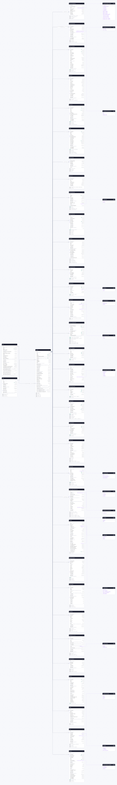

| Field                          | Type                        | Constraints                       | Default                                    | Description                                                                                                                                                                                                                                                                                                                                                                                                                                                                                                                                                                                                                                                                                                                                                                                                                                                                                                                                                                                              |
| ------------------------------ | --------------------------- | --------------------------------- | ------------------------------------------ | -------------------------------------------------------------------------------------------------------------------------------------------------------------------------------------------------------------------------------------------------------------------------------------------------------------------------------------------------------------------------------------------------------------------------------------------------------------------------------------------------------------------------------------------------------------------------------------------------------------------------------------------------------------------------------------------------------------------------------------------------------------------------------------------------------------------------------------------------------------------------------------------------------------------------------------------------------------------------------------------------------- |
| `id`                           | `String`                    | PK NOT NULL                       | `nanoid()`                                 |                                                                                                                                                                                                                                                                                                                                                                                                                                                                                                                                                                                                                                                                                                                                                                                                                                                                                                                                                                                                          |
| `name`                         | `String`                    | NOT NULL                          |                                            |                                                                                                                                                                                                                                                                                                                                                                                                                                                                                                                                                                                                                                                                                                                                                                                                                                                                                                                                                                                                          |
| `slug`                         | `String`                    | UNIQUE NOT NULL                   |                                            |                                                                                                                                                                                                                                                                                                                                                                                                                                                                                                                                                                                                                                                                                                                                                                                                                                                                                                                                                                                                          |
| `apiKey`                       | `String`                    | UNIQUE NOT NULL                   |                                            |                                                                                                                                                                                                                                                                                                                                                                                                                                                                                                                                                                                                                                                                                                                                                                                                                                                                                                                                                                                                          |
| `legacyApiKeyLastUsedAt`       | `DateTime`                  | NULL                              |                                            | When the legacy apiKey last authenticated a request, written at most once a minute per project and process. Spec: modules/api-key/specs/request-credential-type.feature                                                                                                                                                                                                                                                                                                                                                                                                                                                                                                                                                                                                                                                                                                                                                                                                                                  |
| `lwqlKey`                      | `String`                    | UNIQUE NOT NULL                   | `dbgenerated("(gen_random_uuid())::text")` | Random per-project secret whose SHA-256 digest is this project's LangWatchQL SQL tenant capability in ClickHouse. Deliberately NOT the API key: the credential a caller authenticates with and the capability the database resolves a tenant from stay decoupled, so rotating one never invalidates the other, and a leak of the ClickHouse key map's input discloses nothing a caller could authenticate with. Generated by the database on insert.                                                                                                                                                                                                                                                                                                                                                                                                                                                                                                                                                     |
| `teamId`                       | `String`                    | NOT NULL → [Team.id](#model-Team) |                                            |                                                                                                                                                                                                                                                                                                                                                                                                                                                                                                                                                                                                                                                                                                                                                                                                                                                                                                                                                                                                          |
| `language`                     | `String`                    | NOT NULL                          |                                            |                                                                                                                                                                                                                                                                                                                                                                                                                                                                                                                                                                                                                                                                                                                                                                                                                                                                                                                                                                                                          |
| `framework`                    | `String`                    | NOT NULL                          |                                            |                                                                                                                                                                                                                                                                                                                                                                                                                                                                                                                                                                                                                                                                                                                                                                                                                                                                                                                                                                                                          |
| `kind`                         | `String`                    | NOT NULL                          | `"application"`                            | Project kind: - "application": user-facing workspace where developers send their own app traces. The default for everything created via the onboarding/quickstart flow. - "internal_governance": hidden per-org routing/tenancy artifact for IngestionSource ingest data. Auto-created lazily on the first IngestionSource mint via ensureHiddenGovernanceProject(). MUST be filtered out of every user-visible Project surface (project picker, /api/v1/projects, billing exports, RBAC pickers, etc.) - the regression-test invariant in specs/ai-gateway/governance/ui-contract.feature codifies this. - "aggregate": a project that owns no traces and reads its member projects through shared project-reader grants (ADR-177). Hidden from every "send traces here" picker and from ingestion; visible in the project switcher to organisation admins only. Stored as a free-form string (matching IngestionSource.sourceType pattern) so future routing kinds can ship without schema migrations. |
| `aggregateRule`                | `Json`                      | NULL                              |                                            | The scope rule an aggregate project materialises into grants. Null on every other kind; decided in ADR-177. Shapes: { kind: "all-personal" } \| { kind: "personal-by-department", departmentId } \| { kind: "explicit", projectIds: string[] }.                                                                                                                                                                                                                                                                                                                                                                                                                                                                                                                                                                                                                                                                                                                                                          |
| `firstMessage`                 | `Boolean`                   | NOT NULL                          | `false`                                    |                                                                                                                                                                                                                                                                                                                                                                                                                                                                                                                                                                                                                                                                                                                                                                                                                                                                                                                                                                                                          |
| `integrated`                   | `Boolean`                   | NOT NULL                          | `false`                                    |                                                                                                                                                                                                                                                                                                                                                                                                                                                                                                                                                                                                                                                                                                                                                                                                                                                                                                                                                                                                          |
| `createdAt`                    | `DateTime`                  | NOT NULL                          | `now()`                                    |                                                                                                                                                                                                                                                                                                                                                                                                                                                                                                                                                                                                                                                                                                                                                                                                                                                                                                                                                                                                          |
| `updatedAt`                    | `DateTime`                  | NOT NULL                          | `now()` `@updatedAt`                       |                                                                                                                                                                                                                                                                                                                                                                                                                                                                                                                                                                                                                                                                                                                                                                                                                                                                                                                                                                                                          |
| `userLinkTemplate`             | `String`                    | NULL                              |                                            |                                                                                                                                                                                                                                                                                                                                                                                                                                                                                                                                                                                                                                                                                                                                                                                                                                                                                                                                                                                                          |
| `traceSharingEnabled`          | `Boolean`                   | NOT NULL                          | `true`                                     |                                                                                                                                                                                                                                                                                                                                                                                                                                                                                                                                                                                                                                                                                                                                                                                                                                                                                                                                                                                                          |
| `presenceEnabled`              | `Boolean`                   | NOT NULL                          | `true`                                     |                                                                                                                                                                                                                                                                                                                                                                                                                                                                                                                                                                                                                                                                                                                                                                                                                                                                                                                                                                                                          |
| `s3Endpoint`                   | `String`                    | NULL                              |                                            |                                                                                                                                                                                                                                                                                                                                                                                                                                                                                                                                                                                                                                                                                                                                                                                                                                                                                                                                                                                                          |
| `s3AccessKeyId`                | `String`                    | NULL                              |                                            |                                                                                                                                                                                                                                                                                                                                                                                                                                                                                                                                                                                                                                                                                                                                                                                                                                                                                                                                                                                                          |
| `s3SecretAccessKey`            | `String`                    | NULL                              |                                            |                                                                                                                                                                                                                                                                                                                                                                                                                                                                                                                                                                                                                                                                                                                                                                                                                                                                                                                                                                                                          |
| `s3Bucket`                     | `String`                    | NULL                              |                                            |                                                                                                                                                                                                                                                                                                                                                                                                                                                                                                                                                                                                                                                                                                                                                                                                                                                                                                                                                                                                          |
| `archivedAt`                   | `DateTime`                  | NULL                              |                                            |                                                                                                                                                                                                                                                                                                                                                                                                                                                                                                                                                                                                                                                                                                                                                                                                                                                                                                                                                                                                          |
| `isPersonal`                   | `Boolean`                   | NOT NULL                          | `false`                                    |                                                                                                                                                                                                                                                                                                                                                                                                                                                                                                                                                                                                                                                                                                                                                                                                                                                                                                                                                                                                          |
| `ownerUserId`                  | `String` `@db.VarChar(255)` | NULL → [User.id](#model-User)     |                                            |                                                                                                                                                                                                                                                                                                                                                                                                                                                                                                                                                                                                                                                                                                                                                                                                                                                                                                                                                                                                          |
| `personalFeatures`             | `Json`                      | NOT NULL                          | `"{}"`                                     | Per-feature unlock flags for personal projects only. Shape: `{ evaluations: bool, datasets: bool, annotations: bool, automations: bool }`. Empty `{}` (default) reads as all-false at the service layer - existing rows pre-migration require no backfill. The bundle is a UI/nav predicate, NOT an auth gate (the underlying tRPC routers stay open even when the bundle is off; admin tooling + offline migration scripts can still operate on the data). Team / org-scope projects are not feature-gated - this column is meaningful only when `isPersonal=true`.                                                                                                                                                                                                                                                                                                                                                                                                                                     |
| `departmentId`                 | `String`                    | NULL                              |                                            | Department assignment for spend attribution (the project / agent lens, used when a trace has no principal user). Accounting-only.                                                                                                                                                                                                                                                                                                                                                                                                                                                                                                                                                                                                                                                                                                                                                                                                                                                                        |
| `langyEgressAllowlist`         | `Json`                      | NULL                              |                                            | Per-project Langy egress allow-list (ADR-076). A nullable JSON array of host patterns (`["registry.npmjs.org", "*.internal.acme.com"]`) that the project's Langy workers may reach outbound. The _presence_ of the list is the enforcement mode: null/absent ⇒ monitor-only (watch, never block); non-empty ⇒ the worker's egress adapter restricts outbound to floor ∪ this list. Enforced in the agent pod's egress adapter — NOT the gateway — so it lives on the project, not the VirtualKey. Resolved by LangyCredentialService.getEgressAllowlist and threaded through the per-request credentials envelope. See specs/langy/langy-egress-enforcement.feature.                                                                                                                                                                                                                                                                                                                                     |
| `lastCodingAgentSessionAt`     | `DateTime`                  | NULL                              |                                            | When a coding-agent session was last folded for this project, and when a pull request was last mapped for a branch one of those sessions ran on. Both are instrumentation signals, not counters: the project sidebar shows its Sessions and Pull requests destinations only while the matching column is inside the recency window, so a project that never sends coding-agent telemetry never grows the two links, and one that stops sending loses them again. Written through the throttled touch methods on ProjectService, which skip the write while the stored value is still recent, so a busy project costs at most one update an hour per column. No index: every read is by project id, which is the primary key. See specs/coding-agent/project-menu-links.feature.                                                                                                                                                                                                                          |
| `lastCodingAgentPullRequestAt` | `DateTime`                  | NULL                              |                                            |                                                                                                                                                                                                                                                                                                                                                                                                                                                                                                                                                                                                                                                                                                                                                                                                                                                                                                                                                                                                          |

#### Indexes

- `@@index([teamId])`
- `@@index([isPersonal])`
- `@@index([ownerUserId])`
- `@@index([teamId, kind])`
- `@@index([departmentId])`

#### References

- `teamId` → [Team.id](#model-Team) (many-to-one)
- `ownerUserId` → [User.id](#model-User) (many-to-one)

#### Referenced by

- `id` ← [Monitor.projectId](#model-Monitor) (one-to-many)
- `id` ← [Cost.projectId](#model-Cost) (one-to-many)
- `id` ← [Topic.projectId](#model-Topic) (one-to-many)
- `id` ← [Dataset.projectId](#model-Dataset) (one-to-many)
- `id` ← [DatasetRecord.projectId](#model-DatasetRecord) (one-to-many)
- `id` ← [Dashboard.projectId](#model-Dashboard) (one-to-many)
- `id` ← [SavedView.projectId](#model-SavedView) (one-to-many)
- `id` ← [CustomGraph.projectId](#model-CustomGraph) (one-to-many)
- `id` ← [BatchEvaluation.projectId](#model-BatchEvaluation) (one-to-many)
- `id` ← [Trigger.projectId](#model-Trigger) (one-to-many)
- `id` ← [WebhookEndpointDelivery.projectId](#model-WebhookEndpointDelivery) (one-to-many, on delete Cascade)
- `id` ← [Experiment.projectId](#model-Experiment) (one-to-many)
- `id` ← [Annotation.projectId](#model-Annotation) (one-to-many)
- `id` ← [ProjectSecret.projectId](#model-ProjectSecret) (one-to-many)
- `id` ← [TriggerSent.projectId](#model-TriggerSent) (one-to-many)
- `id` ← [EmailSuppression.projectId](#model-EmailSuppression) (one-to-many)
- `id` ← [AnnotationScore.projectId](#model-AnnotationScore) (one-to-many)
- `id` ← [AnnotationQueue.projectId](#model-AnnotationQueue) (one-to-many)
- `id` ← [AnnotationQueueItem.projectId](#model-AnnotationQueueItem) (one-to-many)
- `id` ← [ShareLink.projectId](#model-ShareLink) (one-to-many)
- `id` ← [PinnedTrace.projectId](#model-PinnedTrace) (one-to-many)
- `id` ← [TraceEditOverlay.projectId](#model-TraceEditOverlay) (one-to-many)
- `id` ← [Workflow.projectId](#model-Workflow) (one-to-many)
- `id` ← [WorkflowVersion.projectId](#model-WorkflowVersion) (one-to-many)
- `id` ← [LlmPromptConfig.projectId](#model-LlmPromptConfig) (one-to-many)
- `id` ← [Analytics.projectId](#model-Analytics) (one-to-many)
- `id` ← [Notification.projectId](#model-Notification) (one-to-many, on delete Cascade)
- `id` ← [Agent.projectId](#model-Agent) (one-to-many)
- `id` ← [Evaluator.projectId](#model-Evaluator) (one-to-many)
- `id` ← [Scenario.projectId](#model-Scenario) (one-to-many)
- `id` ← [SimulationSuite.projectId](#model-SimulationSuite) (one-to-many)
- `id` ← [GatewayGuardrail.projectId](#model-GatewayGuardrail) (one-to-many, on delete Cascade)
- `id` ← [GatewayChangeEvent.projectId](#model-GatewayChangeEvent) (one-to-many, on delete SetNull)

#### Definition

```sql
CREATE TABLE "Project" (
    "id" TEXT NOT NULL,
    "name" TEXT NOT NULL,
    "slug" TEXT NOT NULL,
    "apiKey" TEXT NOT NULL,
    "legacyApiKeyLastUsedAt" TIMESTAMP(3),
    "lwqlKey" TEXT NOT NULL DEFAULT (gen_random_uuid())::text,
    "teamId" TEXT NOT NULL,
    "language" TEXT NOT NULL,
    "framework" TEXT NOT NULL,
    "kind" TEXT NOT NULL DEFAULT 'application',
    "aggregateRule" JSONB,
    "firstMessage" BOOLEAN NOT NULL DEFAULT false,
    "integrated" BOOLEAN NOT NULL DEFAULT false,
    "createdAt" TIMESTAMP(3) NOT NULL DEFAULT CURRENT_TIMESTAMP,
    "updatedAt" TIMESTAMP(3) NOT NULL DEFAULT CURRENT_TIMESTAMP,
    "userLinkTemplate" TEXT,
    "traceSharingEnabled" BOOLEAN NOT NULL DEFAULT true,
    "presenceEnabled" BOOLEAN NOT NULL DEFAULT true,
    "s3Endpoint" TEXT,
    "s3AccessKeyId" TEXT,
    "s3SecretAccessKey" TEXT,
    "s3Bucket" TEXT,
    "archivedAt" TIMESTAMP(3),
    "isPersonal" BOOLEAN NOT NULL DEFAULT false,
    "ownerUserId" VARCHAR(255),
    "personalFeatures" JSONB NOT NULL DEFAULT '{}',
    "departmentId" TEXT,
    "langyEgressAllowlist" JSONB,
    "lastCodingAgentSessionAt" TIMESTAMP(3),
    "lastCodingAgentPullRequestAt" TIMESTAMP(3),

    CONSTRAINT "Project_pkey" PRIMARY KEY ("id")
);

CREATE UNIQUE INDEX "Project_slug_key" ON "Project"("slug");

CREATE UNIQUE INDEX "Project_apiKey_key" ON "Project"("apiKey");

CREATE UNIQUE INDEX "Project_lwqlKey_key" ON "Project"("lwqlKey");

CREATE INDEX "Project_teamId_idx" ON "Project"("teamId");

CREATE INDEX "Project_isPersonal_idx" ON "Project"("isPersonal");

CREATE INDEX "Project_ownerUserId_idx" ON "Project"("ownerUserId");

CREATE INDEX "Project_teamId_kind_idx" ON "Project"("teamId", "kind");

CREATE INDEX "Project_departmentId_idx" ON "Project"("departmentId");
```

<details>
<summary>Queries and their SQL</summary>

**findMany**: Every row

```ts
await prisma.project.findMany();
```

```sql
SELECT
  "public"."Project"."id",
  "public"."Project"."name",
  "public"."Project"."slug",
  "public"."Project"."apiKey",
  "public"."Project"."legacyApiKeyLastUsedAt",
  "public"."Project"."lwqlKey",
  "public"."Project"."teamId",
  "public"."Project"."language",
  "public"."Project"."framework",
  "public"."Project"."kind",
  "public"."Project"."aggregateRule",
  "public"."Project"."firstMessage",
  "public"."Project"."integrated",
  "public"."Project"."createdAt",
  "public"."Project"."updatedAt",
  "public"."Project"."userLinkTemplate",
  "public"."Project"."traceSharingEnabled",
  "public"."Project"."presenceEnabled",
  "public"."Project"."s3Endpoint",
  "public"."Project"."s3AccessKeyId",
  "public"."Project"."s3SecretAccessKey",
  "public"."Project"."s3Bucket",
  "public"."Project"."archivedAt",
  "public"."Project"."isPersonal",
  "public"."Project"."ownerUserId",
  "public"."Project"."personalFeatures",
  "public"."Project"."departmentId",
  "public"."Project"."langyEgressAllowlist",
  "public"."Project"."lastCodingAgentSessionAt",
  "public"."Project"."lastCodingAgentPullRequestAt"
FROM
  "public"."Project"
WHERE
  1 = 1
OFFSET
  $1
-- params: ["0"]
```

**count**: How many rows there are

```ts
await prisma.project.count();
```

```sql
SELECT
  COUNT(*) AS "_count$_all"
FROM
  (
    SELECT
      "public"."Project"."id"
    FROM
      "public"."Project"
    WHERE
      1 = 1
    OFFSET
      $1
  ) AS "sub"
-- params: ["0"]
```

**findMany**: Every row with its relations

```ts
await prisma.project.findMany({
  include: {
    team: true,
    checks: true,
    costs: true,
    topics: true,
    datasets: true,
    datasetRecords: true,
    customGraphs: true,
    dashboards: true,
    batchEvaluations: true,
    triggers: true,
    experiments: true,
    annotations: true,
    projectSecrets: true,
    TriggerSent: true,
    webhookDeliveries: true,
    annotationScores: true,
    shareLinks: true,
    workflows: true,
    WorkflowVersion: true,
    AnnotationQueue: true,
    AnnotationQueueItem: true,
    llmPromptConfigs: true,
    analytics: true,
    notifications: true,
    agents: true,
    evaluators: true,
    scenarios: true,
    suiteConfigurations: true,
    savedViews: true,
    gatewayGuardrails: true,
    gatewayChangeEvents: true,
    pinnedTraces: true,
    traceEditOverlays: true,
    emailSuppressions: true,
    ownerUser: true,
  },
});
```

```sql
SELECT
  "public"."Project"."id",
  "public"."Project"."name",
  "public"."Project"."slug",
  "public"."Project"."apiKey",
  "public"."Project"."legacyApiKeyLastUsedAt",
  "public"."Project"."lwqlKey",
  "public"."Project"."teamId",
  "public"."Project"."language",
  "public"."Project"."framework",
  "public"."Project"."kind",
  "public"."Project"."aggregateRule",
  "public"."Project"."firstMessage",
  "public"."Project"."integrated",
  "public"."Project"."createdAt",
  "public"."Project"."updatedAt",
  "public"."Project"."userLinkTemplate",
  "public"."Project"."traceSharingEnabled",
  "public"."Project"."presenceEnabled",
  "public"."Project"."s3Endpoint",
  "public"."Project"."s3AccessKeyId",
  "public"."Project"."s3SecretAccessKey",
  "public"."Project"."s3Bucket",
  "public"."Project"."archivedAt",
  "public"."Project"."isPersonal",
  "public"."Project"."ownerUserId",
  "public"."Project"."personalFeatures",
  "public"."Project"."departmentId",
  "public"."Project"."langyEgressAllowlist",
  "public"."Project"."lastCodingAgentSessionAt",
  "public"."Project"."lastCodingAgentPullRequestAt"
FROM
  "public"."Project"
WHERE
  1 = 1
OFFSET
  $1
-- params: ["0"]

SELECT
  "public"."Team"."id",
  "public"."Team"."name",
  "public"."Team"."slug",
  "public"."Team"."organizationId",
  "public"."Team"."createdAt",
  "public"."Team"."updatedAt",
  "public"."Team"."archivedAt",
  "public"."Team"."isPersonal",
  "public"."Team"."ownerUserId",
  "public"."Team"."departmentId"
FROM
  "public"."Team"
WHERE
  "public"."Team"."id" IN ($1)
OFFSET
  $2
-- params: ["<teamId of the rows above>","0"]

SELECT
  "public"."Monitor"."id",
  "public"."Monitor"."projectId",
  "public"."Monitor"."experimentId",
  "public"."Monitor"."evaluatorId",
  "public"."Monitor"."checkType",
  "public"."Monitor"."name",
  "public"."Monitor"."slug",
  "public"."Monitor"."executionMode"::text,
  "public"."Monitor"."enabled",
  "public"."Monitor"."preconditions",
  "public"."Monitor"."parameters",
  "public"."Monitor"."mappings",
  "public"."Monitor"."sample",
  "public"."Monitor"."level",
  "public"."Monitor"."threadIdleTimeout",
  "public"."Monitor"."createdAt",
  "public"."Monitor"."updatedAt",
  "public"."Monitor"."autoPausedAt",
  "public"."Monitor"."autoPausedReason",
  "public"."Monitor"."evaluatorLabel",
  "public"."Monitor"."createdById",
  "public"."Monitor"."updatedById"
FROM
  "public"."Monitor"
WHERE
  "public"."Monitor"."projectId" IN ($1)
OFFSET
  $2
-- params: ["<id of the rows above>","0"]

SELECT
  "public"."Cost"."id",
  "public"."Cost"."projectId",
  "public"."Cost"."costType"::text,
  "public"."Cost"."costName",
  "public"."Cost"."referenceType"::text,
  "public"."Cost"."referenceId",
  "public"."Cost"."amount",
  "public"."Cost"."currency",
  "public"."Cost"."createdAt",
  "public"."Cost"."updatedAt",
  "public"."Cost"."extraInfo"
FROM
  "public"."Cost"
WHERE
  "public"."Cost"."projectId" IN ($1)
OFFSET
  $2
-- params: ["<id of the rows above>","0"]

SELECT
  "public"."Topic"."id",
  "public"."Topic"."projectId",
  "public"."Topic"."name",
  "public"."Topic"."parentId",
  "public"."Topic"."embeddings_model",
  "public"."Topic"."centroid",
  "public"."Topic"."p95Distance",
  "public"."Topic"."automaticallyGenerated",
  "public"."Topic"."lastEventId",
  "public"."Topic"."createdAt",
  "public"."Topic"."updatedAt"
FROM
  "public"."Topic"
WHERE
  "public"."Topic"."projectId" IN ($1)
OFFSET
  $2
-- params: ["<id of the rows above>","0"]

SELECT
  "public"."Dataset"."id",
  "public"."Dataset"."projectId",
  "public"."Dataset"."name",
  "public"."Dataset"."slug",
  "public"."Dataset"."columnTypes",
  "public"."Dataset"."createdAt",
  "public"."Dataset"."updatedAt",
  "public"."Dataset"."archivedAt",
  "public"."Dataset"."mapping",
  "public"."Dataset"."useS3",
  "public"."Dataset"."s3RecordCount",
  "public"."Dataset"."contentLayout",
  "public"."Dataset"."status",
  "public"."Dataset"."statusError",
  "public"."Dataset"."stagingKey",
  "public"."Dataset"."sourceStoredObjectId",
  "public"."Dataset"."uploadFilename",
  "public"."Dataset"."rowCount",
  "public"."Dataset"."sizeBytes",
  "public"."Dataset"."chunkCount",
  "public"."Dataset"."chunkOffsets"
FROM
  "public"."Dataset"
WHERE
  "public"."Dataset"."projectId" IN ($1)
OFFSET
  $2
-- params: ["<id of the rows above>","0"]

SELECT
  "public"."DatasetRecord"."id",
  "public"."DatasetRecord"."datasetId",
  "public"."DatasetRecord"."projectId",
  "public"."DatasetRecord"."entry",
  "public"."DatasetRecord"."createdAt",
  "public"."DatasetRecord"."updatedAt"
FROM
  "public"."DatasetRecord"
WHERE
  "public"."DatasetRecord"."projectId" IN ($1)
OFFSET
  $2
-- params: ["<id of the rows above>","0"]

SELECT
  "public"."CustomGraph"."id",
  "public"."CustomGraph"."projectId",
  "public"."CustomGraph"."name",
  "public"."CustomGraph"."graph",
  "public"."CustomGraph"."filters",
  "public"."CustomGraph"."kind",
  "public"."CustomGraph"."createdAt",
  "public"."CustomGraph"."updatedAt",
  "public"."CustomGraph"."dashboardId",
  "public"."CustomGraph"."gridColumn",
  "public"."CustomGraph"."gridRow",
  "public"."CustomGraph"."colSpan",
  "public"."CustomGraph"."rowSpan"
FROM
  "public"."CustomGraph"
WHERE
  "public"."CustomGraph"."projectId" IN ($1)
OFFSET
  $2
-- params: ["<id of the rows above>","0"]

SELECT
  "public"."Dashboard"."id",
  "public"."Dashboard"."projectId",
  "public"."Dashboard"."name",
  "public"."Dashboard"."order",
  "public"."Dashboard"."description",
  "public"."Dashboard"."createdById",
  "public"."Dashboard"."scope"::text,
  "public"."Dashboard"."organizationId",
  "public"."Dashboard"."createdAt",
  "public"."Dashboard"."updatedAt"
FROM
  "public"."Dashboard"
WHERE
  "public"."Dashboard"."projectId" IN ($1)
OFFSET
  $2
-- params: ["<id of the rows above>","0"]

SELECT
  "public"."BatchEvaluation"."id",
  "public"."BatchEvaluation"."experimentId",
  "public"."BatchEvaluation"."projectId",
  "public"."BatchEvaluation"."data",
  "public"."BatchEvaluation"."status",
  "public"."BatchEvaluation"."score",
  "public"."BatchEvaluation"."label",
  "public"."BatchEvaluation"."passed",
  "public"."BatchEvaluation"."details",
  "public"."BatchEvaluation"."cost",
  "public"."BatchEvaluation"."datasetSlug",
  "public"."BatchEvaluation"."datasetId",
  "public"."BatchEvaluation"."evaluation",
  "public"."BatchEvaluation"."createdAt",
  "public"."BatchEvaluation"."updatedAt"
FROM
  "public"."BatchEvaluation"
WHERE
  "public"."BatchEvaluation"."projectId" IN ($1)
OFFSET
  $2
-- params: ["<id of the rows above>","0"]

SELECT
  "public"."Trigger"."id",
  "public"."Trigger"."name",
  "public"."Trigger"."projectId",
  "public"."Trigger"."action"::text,
  "public"."Trigger"."triggerKind"::text,
  "public"."Trigger"."actionParams",
  "public"."Trigger"."filters",
  "public"."Trigger"."filterQuery",
  "public"."Trigger"."lastRunAt",
  "public"."Trigger"."createdAt",
  "public"."Trigger"."updatedAt",
  "public"."Trigger"."active",
  "public"."Trigger"."pausedReason",
  "public"."Trigger"."pausedAt",
  "public"."Trigger"."message",
  "public"."Trigger"."deleted",
  "public"."Trigger"."alertType"::text,
  "public"."Trigger"."slackTemplateType",
  "public"."Trigger"."slackTemplate",
  "public"."Trigger"."emailSubjectTemplate",
  "public"."Trigger"."emailBodyTemplate",
  "public"."Trigger"."notificationCadence",
  "public"."Trigger"."traceDebounceMs",
  "public"."Trigger"."customGraphId"
FROM
  "public"."Trigger"
WHERE
  "public"."Trigger"."projectId" IN ($1)
OFFSET
  $2
-- params: ["<id of the rows above>","0"]

SELECT
  "public"."Experiment"."id",
  "public"."Experiment"."name",
  "public"."Experiment"."type"::text,
  "public"."Experiment"."slug",
  "public"."Experiment"."projectId",
  "public"."Experiment"."workflowId",
  "public"."Experiment"."createdAt",
  "public"."Experiment"."updatedAt",
  "public"."Experiment"."archivedAt",
  "public"."Experiment"."workbenchState",
  "public"."Experiment"."workbenchVersion"
FROM
  "public"."Experiment"
WHERE
  "public"."Experiment"."projectId" IN ($1)
OFFSET
  $2
-- params: ["<id of the rows above>","0"]

SELECT
  "public"."Annotation"."id",
  "public"."Annotation"."projectId",
  "public"."Annotation"."traceId",
  "public"."Annotation"."comment",
  "public"."Annotation"."isThumbsUp",
  "public"."Annotation"."userId",
  "public"."Annotation"."createdAt",
  "public"."Annotation"."updatedAt",
  "public"."Annotation"."email",
  "public"."Annotation"."scoreOptions",
  "public"."Annotation"."expectedOutput",
  "public"."Annotation"."anchorKind",
  "public"."Annotation"."anchorId",
  "public"."Annotation"."anchorPath"
FROM
  "public"."Annotation"
WHERE
  "public"."Annotation"."projectId" IN ($1)
OFFSET
  $2
-- params: ["<id of the rows above>","0"]

SELECT
  "public"."ProjectSecret"."id",
  "public"."ProjectSecret"."projectId",
  "public"."ProjectSecret"."name",
  "public"."ProjectSecret"."encryptedValue",
  "public"."ProjectSecret"."createdById",
  "public"."ProjectSecret"."updatedById",
  "public"."ProjectSecret"."createdAt",
  "public"."ProjectSecret"."updatedAt"
FROM
  "public"."ProjectSecret"
WHERE
  "public"."ProjectSecret"."projectId" IN ($1)
OFFSET
  $2
-- params: ["<id of the rows above>","0"]

SELECT
  "public"."TriggerSent"."id",
  "public"."TriggerSent"."triggerId",
  "public"."TriggerSent"."traceId",
  "public"."TriggerSent"."customGraphId",
  "public"."TriggerSent"."projectId",
  "public"."TriggerSent"."resolvedAt",
  "public"."TriggerSent"."openIncidentKey",
  "public"."TriggerSent"."createdAt",
  "public"."TriggerSent"."updatedAt"
FROM
  "public"."TriggerSent"
WHERE
  "public"."TriggerSent"."projectId" IN ($1)
OFFSET
  $2
-- params: ["<id of the rows above>","0"]

SELECT
  "public"."WebhookEndpointDelivery"."id",
  "public"."WebhookEndpointDelivery"."channel"::text,
  "public"."WebhookEndpointDelivery"."organizationId",
  "public"."WebhookEndpointDelivery"."endpointId",
  "public"."WebhookEndpointDelivery"."projectId",
  "public"."WebhookEndpointDelivery"."triggerId",
  "public"."WebhookEndpointDelivery"."dispatchId",
  "public"."WebhookEndpointDelivery"."attempt",
  "public"."WebhookEndpointDelivery"."eventCount",
  "public"."WebhookEndpointDelivery"."responseStatus",
  "public"."WebhookEndpointDelivery"."latencyMs",
  "public"."WebhookEndpointDelivery"."error",
  "public"."WebhookEndpointDelivery"."response",
  "public"."WebhookEndpointDelivery"."outcome"::text,
  "public"."WebhookEndpointDelivery"."firedAt",
  "public"."WebhookEndpointDelivery"."createdAt"
FROM
  "public"."WebhookEndpointDelivery"
WHERE
  "public"."WebhookEndpointDelivery"."projectId" IN ($1)
OFFSET
  $2
-- params: ["<id of the rows above>","0"]

SELECT
  "public"."AnnotationScore"."id",
  "public"."AnnotationScore"."name",
  "public"."AnnotationScore"."projectId",
  "public"."AnnotationScore"."createdAt",
  "public"."AnnotationScore"."updatedAt",
  "public"."AnnotationScore"."deletedAt",
  "public"."AnnotationScore"."description",
  "public"."AnnotationScore"."active",
  "public"."AnnotationScore"."dataType"::text,
  "public"."AnnotationScore"."options",
  "public"."AnnotationScore"."defaultValue",
  "public"."AnnotationScore"."global"
FROM
  "public"."AnnotationScore"
WHERE
  "public"."AnnotationScore"."projectId" IN ($1)
OFFSET
  $2
-- params: ["<id of the rows above>","0"]

SELECT
  "public"."ShareLink"."id",
  "public"."ShareLink"."token",
  "public"."ShareLink"."resourceType"::text,
  "public"."ShareLink"."resourceId",
  "public"."ShareLink"."threadId",
  "public"."ShareLink"."projectId",
  "public"."ShareLink"."userId",
  "public"."ShareLink"."visibility"::text,
  "public"."ShareLink"."expiresAt",
  "public"."ShareLink"."maxViews",
  "public"."ShareLink"."viewCount",
  "public"."ShareLink"."createdAt",
  "public"."ShareLink"."updatedAt"
FROM
  "public"."ShareLink"
WHERE
  "public"."ShareLink"."projectId" IN ($1)
OFFSET
  $2
-- params: ["<id of the rows above>","0"]

SELECT
  "public"."Workflow"."id",
  "public"."Workflow"."projectId",
  "public"."Workflow"."name",
  "public"."Workflow"."icon",
  "public"."Workflow"."description",
  "public"."Workflow"."createdAt",
  "public"."Workflow"."updatedAt",
  "public"."Workflow"."latestVersionId",
  "public"."Workflow"."currentVersionId",
  "public"."Workflow"."publishedId",
  "public"."Workflow"."publishedById",
  "public"."Workflow"."archivedAt",
  "public"."Workflow"."isEvaluator",
  "public"."Workflow"."isComponent",
  "public"."Workflow"."copiedFromWorkflowId"
FROM
  "public"."Workflow"
WHERE
  "public"."Workflow"."projectId" IN ($1)
OFFSET
  $2
-- params: ["<id of the rows above>","0"]

SELECT
  "public"."WorkflowVersion"."id",
  "public"."WorkflowVersion"."version",
  "public"."WorkflowVersion"."commitMessage",
  "public"."WorkflowVersion"."authorId",
  "public"."WorkflowVersion"."projectId",
  "public"."WorkflowVersion"."workflowId",
  "public"."WorkflowVersion"."parentId",
  "public"."WorkflowVersion"."autoSaved",
  "public"."WorkflowVersion"."createdAt",
  "public"."WorkflowVersion"."updatedAt",
  "public"."WorkflowVersion"."dsl"
FROM
  "public"."WorkflowVersion"
WHERE
  "public"."WorkflowVersion"."projectId" IN ($1)
OFFSET
  $2
-- params: ["<id of the rows above>","0"]

SELECT
  "public"."AnnotationQueue"."id",
  "public"."AnnotationQueue"."name",
  "public"."AnnotationQueue"."slug",
  "public"."AnnotationQueue"."projectId",
  "public"."AnnotationQueue"."description",
  "public"."AnnotationQueue"."createdAt",
  "public"."AnnotationQueue"."updatedAt"
FROM
  "public"."AnnotationQueue"
WHERE
  "public"."AnnotationQueue"."projectId" IN ($1)
OFFSET
  $2
-- params: ["<id of the rows above>","0"]

SELECT
  "public"."AnnotationQueueItem"."id",
  "public"."AnnotationQueueItem"."annotationQueueId",
  "public"."AnnotationQueueItem"."userId",
  "public"."AnnotationQueueItem"."createdAt",
  "public"."AnnotationQueueItem"."updatedAt",
  "public"."AnnotationQueueItem"."createdByUserId",
  "public"."AnnotationQueueItem"."traceId",
  "public"."AnnotationQueueItem"."projectId",
  "public"."AnnotationQueueItem"."doneAt",
  "public"."AnnotationQueueItem"."markedForDatasetAt"
FROM
  "public"."AnnotationQueueItem"
WHERE
  "public"."AnnotationQueueItem"."projectId" IN ($1)
OFFSET
  $2
-- params: ["<id of the rows above>","0"]

SELECT
  "public"."LlmPromptConfig"."id",
  "public"."LlmPromptConfig"."handle",
  "public"."LlmPromptConfig"."name",
  "public"."LlmPromptConfig"."projectId",
  "public"."LlmPromptConfig"."createdAt",
  "public"."LlmPromptConfig"."updatedAt",
  "public"."LlmPromptConfig"."deletedAt",
  "public"."LlmPromptConfig"."organizationId",
  "public"."LlmPromptConfig"."scope"::text,
  "public"."LlmPromptConfig"."copiedFromPromptId"
FROM
  "public"."LlmPromptConfig"
WHERE
  "public"."LlmPromptConfig"."projectId" IN ($1)
OFFSET
  $2
-- params: ["<id of the rows above>","0"]

SELECT
  "public"."Analytics"."id",
  "public"."Analytics"."projectId",
  "public"."Analytics"."key",
  "public"."Analytics"."value",
  "public"."Analytics"."numericValue",
  "public"."Analytics"."stringValue",
  "public"."Analytics"."boolValue",
  "public"."Analytics"."createdAt"
FROM
  "public"."Analytics"
WHERE
  "public"."Analytics"."projectId" IN ($1)
OFFSET
  $2
-- params: ["<id of the rows above>","0"]

SELECT
  "public"."Notification"."id",
  "public"."Notification"."organizationId",
  "public"."Notification"."projectId",
  "public"."Notification"."metadata",
  "public"."Notification"."createdAt",
  "public"."Notification"."updatedAt",
  "public"."Notification"."sentAt"
FROM
  "public"."Notification"
WHERE
  "public"."Notification"."projectId" IN ($1)
OFFSET
  $2
-- params: ["<id of the rows above>","0"]

SELECT
  "public"."Agent"."id",
  "public"."Agent"."projectId",
  "public"."Agent"."name",
  "public"."Agent"."type",
  "public"."Agent"."config",
  "public"."Agent"."workflowId",
  "public"."Agent"."copiedFromAgentId",
  "public"."Agent"."environment",
  "public"."Agent"."ownerUserId",
  "public"."Agent"."hostLabel",
  "public"."Agent"."identityKey",
  "public"."Agent"."lastSeenAt",
  "public"."Agent"."archivedAt",
  "public"."Agent"."createdAt",
  "public"."Agent"."updatedAt",
  "public"."Agent"."createdById",
  "public"."Agent"."updatedById"
FROM
  "public"."Agent"
WHERE
  "public"."Agent"."projectId" IN ($1)
OFFSET
  $2
-- params: ["<id of the rows above>","0"]

SELECT
  "public"."Evaluator"."id",
  "public"."Evaluator"."projectId",
  "public"."Evaluator"."name",
  "public"."Evaluator"."slug",
  "public"."Evaluator"."type",
  "public"."Evaluator"."config",
  "public"."Evaluator"."workflowId",
  "public"."Evaluator"."copiedFromEvaluatorId",
  "public"."Evaluator"."archivedAt",
  "public"."Evaluator"."createdAt",
  "public"."Evaluator"."updatedAt",
  "public"."Evaluator"."createdById",
  "public"."Evaluator"."updatedById"
FROM
  "public"."Evaluator"
WHERE
  "public"."Evaluator"."projectId" IN ($1)
OFFSET
  $2
-- params: ["<id of the rows above>","0"]

SELECT
  "public"."Scenario"."id",
  "public"."Scenario"."projectId",
  "public"."Scenario"."name",
  "public"."Scenario"."situation",
  "public"."Scenario"."criteria",
  "public"."Scenario"."labels",
  "public"."Scenario"."parameters",
  "public"."Scenario"."simulatorModel",
  "public"."Scenario"."judgeModel",
  "public"."Scenario"."maxTurns",
  "public"."Scenario"."minTurns",
  "public"."Scenario"."fields",
  "public"."Scenario"."callerVoice",
  "public"."Scenario"."testSuiteId",
  "public"."Scenario"."version",
  "public"."Scenario"."lastUpdatedById",
  "public"."Scenario"."archivedAt",
  "public"."Scenario"."createdAt",
  "public"."Scenario"."updatedAt"
FROM
  "public"."Scenario"
WHERE
  "public"."Scenario"."projectId" IN ($1)
OFFSET
  $2
-- params: ["<id of the rows above>","0"]

SELECT
  "public"."SimulationSuite"."id",
  "public"."SimulationSuite"."projectId",
  "public"."SimulationSuite"."name",
  "public"."SimulationSuite"."slug",
  "public"."SimulationSuite"."description",
  "public"."SimulationSuite"."scenarioIds",
  "public"."SimulationSuite"."targets",
  "public"."SimulationSuite"."repeatCount",
  "public"."SimulationSuite"."labels",
  "public"."SimulationSuite"."simulatorModel",
  "public"."SimulationSuite"."judgeModel",
  "public"."SimulationSuite"."kind",
  "public"."SimulationSuite"."scope",
  "public"."SimulationSuite"."fields",
  "public"."SimulationSuite"."evaluators",
  "public"."SimulationSuite"."archivedAt",
  "public"."SimulationSuite"."createdAt",
  "public"."SimulationSuite"."updatedAt"
FROM
  "public"."SimulationSuite"
WHERE
  "public"."SimulationSuite"."projectId" IN ($1)
OFFSET
  $2
-- params: ["<id of the rows above>","0"]

SELECT
  "public"."SavedView"."id",
  "public"."SavedView"."projectId",
  "public"."SavedView"."userId",
  "public"."SavedView"."name",
  "public"."SavedView"."filters",
  "public"."SavedView"."query",
  "public"."SavedView"."period",
  "public"."SavedView"."order",
  "public"."SavedView"."kind",
  "public"."SavedView"."createdAt",
  "public"."SavedView"."updatedAt"
FROM
  "public"."SavedView"
WHERE
  "public"."SavedView"."projectId" IN ($1)
OFFSET
  $2
-- params: ["<id of the rows above>","0"]

SELECT
  "public"."GatewayGuardrail"."id",
  "public"."GatewayGuardrail"."projectId",
  "public"."GatewayGuardrail"."name",
  "public"."GatewayGuardrail"."description",
  "public"."GatewayGuardrail"."evaluatorId",
  "public"."GatewayGuardrail"."direction"::text,
  "public"."GatewayGuardrail"."failureMode"::text,
  "public"."GatewayGuardrail"."archivedAt",
  "public"."GatewayGuardrail"."createdAt",
  "public"."GatewayGuardrail"."updatedAt",
  "public"."GatewayGuardrail"."createdById",
  "public"."GatewayGuardrail"."updatedById"
FROM
  "public"."GatewayGuardrail"
WHERE
  "public"."GatewayGuardrail"."projectId" IN ($1)
OFFSET
  $2
-- params: ["<id of the rows above>","0"]

SELECT
  "public"."GatewayChangeEvent"."revision",
  "public"."GatewayChangeEvent"."organizationId",
  "public"."GatewayChangeEvent"."kind"::text,
  "public"."GatewayChangeEvent"."virtualKeyId",
  "public"."GatewayChangeEvent"."budgetId",
  "public"."GatewayChangeEvent"."modelProviderId",
  "public"."GatewayChangeEvent"."projectId",
  "public"."GatewayChangeEvent"."payload",
  "public"."GatewayChangeEvent"."createdAt"
FROM
  "public"."GatewayChangeEvent"
WHERE
  "public"."GatewayChangeEvent"."projectId" IN ($1)
OFFSET
  $2
-- params: ["<id of the rows above>","0"]

SELECT
  "public"."PinnedTrace"."id",
  "public"."PinnedTrace"."projectId",
  "public"."PinnedTrace"."traceId",
  "public"."PinnedTrace"."userId",
  "public"."PinnedTrace"."source"::text,
  "public"."PinnedTrace"."reason",
  "public"."PinnedTrace"."createdAt"
FROM
  "public"."PinnedTrace"
WHERE
  "public"."PinnedTrace"."projectId" IN ($1)
OFFSET
  $2
-- params: ["<id of the rows above>","0"]

SELECT
  "public"."TraceEditOverlay"."id",
  "public"."TraceEditOverlay"."projectId",
  "public"."TraceEditOverlay"."traceId",
  "public"."TraceEditOverlay"."patch",
  "public"."TraceEditOverlay"."createdById",
  "public"."TraceEditOverlay"."updatedById",
  "public"."TraceEditOverlay"."createdAt",
  "public"."TraceEditOverlay"."updatedAt"
FROM
  "public"."TraceEditOverlay"
WHERE
  "public"."TraceEditOverlay"."projectId" IN ($1)
OFFSET
  $2
-- params: ["<id of the rows above>","0"]

SELECT
  "public"."EmailSuppression"."id",
  "public"."EmailSuppression"."projectId",
  "public"."EmailSuppression"."email",
  "public"."EmailSuppression"."triggerId",
  "public"."EmailSuppression"."reason",
  "public"."EmailSuppression"."createdAt"
FROM
  "public"."EmailSuppression"
WHERE
  "public"."EmailSuppression"."projectId" IN ($1)
OFFSET
  $2
-- params: ["<id of the rows above>","0"]

SELECT
  "public"."User"."id",
  "public"."User"."name",
  "public"."User"."email",
  "public"."User"."emailVerified",
  "public"."User"."signupConfirmationPending",
  "public"."User"."passkeySignupClaimHash",
  "public"."User"."image",
  "public"."User"."pendingSsoSetup",
  "public"."User"."userHashKey",
  "public"."User"."twoFactorEnabled",
  "public"."User"."createdAt",
  "public"."User"."updatedAt",
  "public"."User"."lastLoginAt",
  "public"."User"."deactivatedAt",
  "public"."User"."lastHomePath",
  "public"."User"."tracesExplorerTourDismissedAt",
  "public"."User"."langyCodeAccessPreference",
  "public"."User"."passkeyNudgeDismissedAt",
  "public"."User"."joinOfferDismissedDomains",
  "public"."User"."notificationPreferences",
  "public"."User"."passwordResetRequiredAt"
FROM
  "public"."User"
WHERE
  "public"."User"."id" IN ($1)
OFFSET
  $2
-- params: ["<ownerUserId of the rows above>","0"]
```

**findUnique**: One row by what is unique to it

```ts
await prisma.project.findUnique({ where: { id: "example" } });
```

```sql
SELECT
  "public"."Project"."id",
  "public"."Project"."name",
  "public"."Project"."slug",
  "public"."Project"."apiKey",
  "public"."Project"."legacyApiKeyLastUsedAt",
  "public"."Project"."lwqlKey",
  "public"."Project"."teamId",
  "public"."Project"."language",
  "public"."Project"."framework",
  "public"."Project"."kind",
  "public"."Project"."aggregateRule",
  "public"."Project"."firstMessage",
  "public"."Project"."integrated",
  "public"."Project"."createdAt",
  "public"."Project"."updatedAt",
  "public"."Project"."userLinkTemplate",
  "public"."Project"."traceSharingEnabled",
  "public"."Project"."presenceEnabled",
  "public"."Project"."s3Endpoint",
  "public"."Project"."s3AccessKeyId",
  "public"."Project"."s3SecretAccessKey",
  "public"."Project"."s3Bucket",
  "public"."Project"."archivedAt",
  "public"."Project"."isPersonal",
  "public"."Project"."ownerUserId",
  "public"."Project"."personalFeatures",
  "public"."Project"."departmentId",
  "public"."Project"."langyEgressAllowlist",
  "public"."Project"."lastCodingAgentSessionAt",
  "public"."Project"."lastCodingAgentPullRequestAt"
FROM
  "public"."Project"
WHERE
  (
    "public"."Project"."id" = $1
    AND 1 = 1
  )
LIMIT
  $2
OFFSET
  $3
-- params: ["example","1","0"]
```

**create**: Create a row

```ts
await prisma.project.create({
  data: {
    name: "example",
    slug: "example",
    apiKey: "example",
    teamId: "example",
    language: "example",
    framework: "example",
  },
});
```

```sql
INSERT INTO
  "public"."Project" (
    "id",
    "name",
    "slug",
    "apiKey",
    "teamId",
    "language",
    "framework",
    "kind",
    "firstMessage",
    "integrated",
    "createdAt",
    "updatedAt",
    "traceSharingEnabled",
    "presenceEnabled",
    "isPersonal",
    "personalFeatures"
  )
VALUES
  (
    $1,
    $2,
    $3,
    $4,
    $5,
    $6,
    $7,
    $8,
    $9,
    $10,
    $11,
    $12,
    $13,
    $14,
    $15,
    $16
  )
RETURNING
  "public"."Project"."id",
  "public"."Project"."name",
  "public"."Project"."slug",
  "public"."Project"."apiKey",
  "public"."Project"."legacyApiKeyLastUsedAt",
  "public"."Project"."lwqlKey",
  "public"."Project"."teamId",
  "public"."Project"."language",
  "public"."Project"."framework",
  "public"."Project"."kind",
  "public"."Project"."aggregateRule",
  "public"."Project"."firstMessage",
  "public"."Project"."integrated",
  "public"."Project"."createdAt",
  "public"."Project"."updatedAt",
  "public"."Project"."userLinkTemplate",
  "public"."Project"."traceSharingEnabled",
  "public"."Project"."presenceEnabled",
  "public"."Project"."s3Endpoint",
  "public"."Project"."s3AccessKeyId",
  "public"."Project"."s3SecretAccessKey",
  "public"."Project"."s3Bucket",
  "public"."Project"."archivedAt",
  "public"."Project"."isPersonal",
  "public"."Project"."ownerUserId",
  "public"."Project"."personalFeatures",
  "public"."Project"."departmentId",
  "public"."Project"."langyEgressAllowlist",
  "public"."Project"."lastCodingAgentSessionAt",
  "public"."Project"."lastCodingAgentPullRequestAt"
-- params: ["<nanoid()>","example","example","example","example","example","example","application",false,false,"<now()>","<now()>",true,true,false,"{}"]
```

**update**: Update a row

```ts
await prisma.project.update({ where: { id: "example" }, data: { name: "example" } });
```

```sql
SELECT
  "public"."Project"."id"
FROM
  "public"."Project"
WHERE
  (
    "public"."Project"."id" = $1
    AND 1 = 1
  )
LIMIT
  $2
OFFSET
  $3
-- params: ["example","1","0"]

UPDATE "public"."Project"
SET
  "name" = $1,
  "updatedAt" = $2
WHERE
  (
    "public"."Project"."id" IN ($3)
    AND (
      "public"."Project"."id" = $4
      AND 1 = 1
    )
  )
RETURNING
  "public"."Project"."id",
  "public"."Project"."name",
  "public"."Project"."slug",
  "public"."Project"."apiKey",
  "public"."Project"."legacyApiKeyLastUsedAt",
  "public"."Project"."lwqlKey",
  "public"."Project"."teamId",
  "public"."Project"."language",
  "public"."Project"."framework",
  "public"."Project"."kind",
  "public"."Project"."aggregateRule",
  "public"."Project"."firstMessage",
  "public"."Project"."integrated",
  "public"."Project"."createdAt",
  "public"."Project"."updatedAt",
  "public"."Project"."userLinkTemplate",
  "public"."Project"."traceSharingEnabled",
  "public"."Project"."presenceEnabled",
  "public"."Project"."s3Endpoint",
  "public"."Project"."s3AccessKeyId",
  "public"."Project"."s3SecretAccessKey",
  "public"."Project"."s3Bucket",
  "public"."Project"."archivedAt",
  "public"."Project"."isPersonal",
  "public"."Project"."ownerUserId",
  "public"."Project"."personalFeatures",
  "public"."Project"."departmentId",
  "public"."Project"."langyEgressAllowlist",
  "public"."Project"."lastCodingAgentSessionAt",
  "public"."Project"."lastCodingAgentPullRequestAt"
-- params: ["example",{"prisma__type":"generatorCall","prisma__value":{"name":"now","args":[],"returnType":{"type":"DateTime"}}},"<id of the rows above>","example"]
```

**delete**: Delete a row

```ts
await prisma.project.delete({ where: { id: "example" } });
```

```sql
DELETE FROM "public"."Project"
WHERE
  (
    "public"."Project"."id" = $1
    AND 1 = 1
  )
RETURNING
  "public"."Project"."id",
  "public"."Project"."name",
  "public"."Project"."slug",
  "public"."Project"."apiKey",
  "public"."Project"."legacyApiKeyLastUsedAt",
  "public"."Project"."lwqlKey",
  "public"."Project"."teamId",
  "public"."Project"."language",
  "public"."Project"."framework",
  "public"."Project"."kind",
  "public"."Project"."aggregateRule",
  "public"."Project"."firstMessage",
  "public"."Project"."integrated",
  "public"."Project"."createdAt",
  "public"."Project"."updatedAt",
  "public"."Project"."userLinkTemplate",
  "public"."Project"."traceSharingEnabled",
  "public"."Project"."presenceEnabled",
  "public"."Project"."s3Endpoint",
  "public"."Project"."s3AccessKeyId",
  "public"."Project"."s3SecretAccessKey",
  "public"."Project"."s3Bucket",
  "public"."Project"."archivedAt",
  "public"."Project"."isPersonal",
  "public"."Project"."ownerUserId",
  "public"."Project"."personalFeatures",
  "public"."Project"."departmentId",
  "public"."Project"."langyEgressAllowlist",
  "public"."Project"."lastCodingAgentSessionAt",
  "public"."Project"."lastCodingAgentPullRequestAt"
-- params: ["example"]

SELECT
  "public"."Monitor"."id",
  "public"."Monitor"."projectId"
FROM
  "public"."Monitor"
WHERE
  (
    1 = 1
    AND "public"."Monitor"."projectId" IN ($1)
  )
OFFSET
  $2
-- params: ["<id of the rows above>","0"]

SELECT
  "public"."Cost"."id",
  "public"."Cost"."projectId"
FROM
  "public"."Cost"
WHERE
  (
    1 = 1
    AND "public"."Cost"."projectId" IN ($1)
  )
OFFSET
  $2
-- params: ["<id of the rows above>","0"]

SELECT
  "public"."Topic"."id",
  "public"."Topic"."projectId"
FROM
  "public"."Topic"
WHERE
  (
    1 = 1
    AND "public"."Topic"."projectId" IN ($1)
  )
OFFSET
  $2
-- params: ["<id of the rows above>","0"]

SELECT
  "public"."Dataset"."id",
  "public"."Dataset"."projectId"
FROM
  "public"."Dataset"
WHERE
  (
    1 = 1
    AND "public"."Dataset"."projectId" IN ($1)
  )
OFFSET
  $2
-- params: ["<id of the rows above>","0"]

SELECT
  "public"."DatasetRecord"."id",
  "public"."DatasetRecord"."projectId"
FROM
  "public"."DatasetRecord"
WHERE
  (
    1 = 1
    AND "public"."DatasetRecord"."projectId" IN ($1)
  )
OFFSET
  $2
-- params: ["<id of the rows above>","0"]

SELECT
  "public"."Dashboard"."id",
  "public"."Dashboard"."projectId"
FROM
  "public"."Dashboard"
WHERE
  (
    1 = 1
    AND "public"."Dashboard"."projectId" IN ($1)
  )
OFFSET
  $2
-- params: ["<id of the rows above>","0"]

SELECT
  "public"."SavedView"."id",
  "public"."SavedView"."projectId"
FROM
  "public"."SavedView"
WHERE
  (
    1 = 1
    AND "public"."SavedView"."projectId" IN ($1)
  )
OFFSET
  $2
-- params: ["<id of the rows above>","0"]

SELECT
  "public"."CustomGraph"."id",
  "public"."CustomGraph"."projectId"
FROM
  "public"."CustomGraph"
WHERE
  (
    1 = 1
    AND "public"."CustomGraph"."projectId" IN ($1)
  )
OFFSET
  $2
-- params: ["<id of the rows above>","0"]

SELECT
  "public"."BatchEvaluation"."id",
  "public"."BatchEvaluation"."projectId"
FROM
  "public"."BatchEvaluation"
WHERE
  (
    1 = 1
    AND "public"."BatchEvaluation"."projectId" IN ($1)
  )
OFFSET
  $2
-- params: ["<id of the rows above>","0"]

SELECT
  "public"."Trigger"."id",
  "public"."Trigger"."projectId"
FROM
  "public"."Trigger"
WHERE
  (
    1 = 1
    AND "public"."Trigger"."projectId" IN ($1)
  )
OFFSET
  $2
-- params: ["<id of the rows above>","0"]

SELECT
  "public"."WebhookEndpointDelivery"."id",
  "public"."WebhookEndpointDelivery"."projectId"
FROM
  "public"."WebhookEndpointDelivery"
WHERE
  (
    1 = 1
    AND "public"."WebhookEndpointDelivery"."projectId" IN ($1)
  )
OFFSET
  $2
-- params: ["<id of the rows above>","0"]

DELETE FROM "public"."WebhookEndpointDelivery"
WHERE
  (
    "public"."WebhookEndpointDelivery"."id" IN ($1)
    AND 1 = 1
  )
-- params: ["<id of the rows above>"]

SELECT
  "public"."Experiment"."id",
  "public"."Experiment"."projectId"
FROM
  "public"."Experiment"
WHERE
  (
    1 = 1
    AND "public"."Experiment"."projectId" IN ($1)
  )
OFFSET
  $2
-- params: ["<id of the rows above>","0"]

SELECT
  "public"."Annotation"."id",
  "public"."Annotation"."projectId"
FROM
  "public"."Annotation"
WHERE
  (
    1 = 1
    AND "public"."Annotation"."projectId" IN ($1)
  )
OFFSET
  $2
-- params: ["<id of the rows above>","0"]

SELECT
  "public"."ProjectSecret"."id",
  "public"."ProjectSecret"."projectId"
FROM
  "public"."ProjectSecret"
WHERE
  (
    1 = 1
    AND "public"."ProjectSecret"."projectId" IN ($1)
  )
OFFSET
  $2
-- params: ["<id of the rows above>","0"]

SELECT
  "public"."TriggerSent"."id",
  "public"."TriggerSent"."projectId"
FROM
  "public"."TriggerSent"
WHERE
  (
    1 = 1
    AND "public"."TriggerSent"."projectId" IN ($1)
  )
OFFSET
  $2
-- params: ["<id of the rows above>","0"]

SELECT
  "public"."EmailSuppression"."id",
  "public"."EmailSuppression"."projectId"
FROM
  "public"."EmailSuppression"
WHERE
  (
    1 = 1
    AND "public"."EmailSuppression"."projectId" IN ($1)
  )
OFFSET
  $2
-- params: ["<id of the rows above>","0"]

SELECT
  "public"."AnnotationScore"."id",
  "public"."AnnotationScore"."projectId"
FROM
  "public"."AnnotationScore"
WHERE
  (
    1 = 1
    AND "public"."AnnotationScore"."projectId" IN ($1)
  )
OFFSET
  $2
-- params: ["<id of the rows above>","0"]

SELECT
  "public"."AnnotationQueue"."id",
  "public"."AnnotationQueue"."projectId"
FROM
  "public"."AnnotationQueue"
WHERE
  (
    1 = 1
    AND "public"."AnnotationQueue"."projectId" IN ($1)
  )
OFFSET
  $2
-- params: ["<id of the rows above>","0"]

SELECT
  "public"."AnnotationQueueItem"."id",
  "public"."AnnotationQueueItem"."projectId"
FROM
  "public"."AnnotationQueueItem"
WHERE
  (
    1 = 1
    AND "public"."AnnotationQueueItem"."projectId" IN ($1)
  )
OFFSET
  $2
-- params: ["<id of the rows above>","0"]

SELECT
  "public"."ShareLink"."id",
  "public"."ShareLink"."projectId"
FROM
  "public"."ShareLink"
WHERE
  (
    1 = 1
    AND "public"."ShareLink"."projectId" IN ($1)
  )
OFFSET
  $2
-- params: ["<id of the rows above>","0"]

SELECT
  "public"."PinnedTrace"."id",
  "public"."PinnedTrace"."projectId"
FROM
  "public"."PinnedTrace"
WHERE
  (
    1 = 1
    AND "public"."PinnedTrace"."projectId" IN ($1)
  )
OFFSET
  $2
-- params: ["<id of the rows above>","0"]

SELECT
  "public"."TraceEditOverlay"."id",
  "public"."TraceEditOverlay"."projectId"
FROM
  "public"."TraceEditOverlay"
WHERE
  (
    1 = 1
    AND "public"."TraceEditOverlay"."projectId" IN ($1)
  )
OFFSET
  $2
-- params: ["<id of the rows above>","0"]

SELECT
  "public"."Workflow"."id",
  "public"."Workflow"."projectId"
FROM
  "public"."Workflow"
WHERE
  (
    1 = 1
    AND "public"."Workflow"."projectId" IN ($1)
  )
OFFSET
  $2
-- params: ["<id of the rows above>","0"]

SELECT
  "public"."WorkflowVersion"."id",
  "public"."WorkflowVersion"."projectId"
FROM
  "public"."WorkflowVersion"
WHERE
  (
    1 = 1
    AND "public"."WorkflowVersion"."projectId" IN ($1)
  )
OFFSET
  $2
-- params: ["<id of the rows above>","0"]

SELECT
  "public"."LlmPromptConfig"."id",
  "public"."LlmPromptConfig"."projectId"
FROM
  "public"."LlmPromptConfig"
WHERE
  (
    1 = 1
    AND "public"."LlmPromptConfig"."projectId" IN ($1)
  )
OFFSET
  $2
-- params: ["<id of the rows above>","0"]

SELECT
  "public"."Analytics"."id",
  "public"."Analytics"."projectId"
FROM
  "public"."Analytics"
WHERE
  (
    1 = 1
    AND "public"."Analytics"."projectId" IN ($1)
  )
OFFSET
  $2
-- params: ["<id of the rows above>","0"]

SELECT
  "public"."Notification"."id",
  "public"."Notification"."projectId"
FROM
  "public"."Notification"
WHERE
  (
    1 = 1
    AND "public"."Notification"."projectId" IN ($1)
  )
OFFSET
  $2
-- params: ["<id of the rows above>","0"]

DELETE FROM "public"."Notification"
WHERE
  (
    "public"."Notification"."id" IN ($1)
    AND 1 = 1
  )
-- params: ["<id of the rows above>"]

SELECT
  "public"."Agent"."id",
  "public"."Agent"."projectId"
FROM
  "public"."Agent"
WHERE
  (
    1 = 1
    AND "public"."Agent"."projectId" IN ($1)
  )
OFFSET
  $2
-- params: ["<id of the rows above>","0"]

SELECT
  "public"."Evaluator"."id",
  "public"."Evaluator"."projectId"
FROM
  "public"."Evaluator"
WHERE
  (
    1 = 1
    AND "public"."Evaluator"."projectId" IN ($1)
  )
OFFSET
  $2
-- params: ["<id of the rows above>","0"]

SELECT
  "public"."Scenario"."id",
  "public"."Scenario"."projectId"
FROM
  "public"."Scenario"
WHERE
  (
    1 = 1
    AND "public"."Scenario"."projectId" IN ($1)
  )
OFFSET
  $2
-- params: ["<id of the rows above>","0"]

SELECT
  "public"."SimulationSuite"."id",
  "public"."SimulationSuite"."projectId"
FROM
  "public"."SimulationSuite"
WHERE
  (
    1 = 1
    AND "public"."SimulationSuite"."projectId" IN ($1)
  )
OFFSET
  $2
-- params: ["<id of the rows above>","0"]

SELECT
  "public"."GatewayGuardrail"."id",
  "public"."GatewayGuardrail"."projectId"
FROM
  "public"."GatewayGuardrail"
WHERE
  (
    1 = 1
    AND "public"."GatewayGuardrail"."projectId" IN ($1)
  )
OFFSET
  $2
-- params: ["<id of the rows above>","0"]

DELETE FROM "public"."GatewayGuardrail"
WHERE
  (
    "public"."GatewayGuardrail"."id" IN ($1)
    AND 1 = 1
  )
-- params: ["<id of the rows above>"]

SELECT
  "public"."GatewayChangeEvent"."revision",
  "public"."GatewayChangeEvent"."projectId"
FROM
  "public"."GatewayChangeEvent"
WHERE
  (
    1 = 1
    AND "public"."GatewayChangeEvent"."projectId" IN ($1)
  )
OFFSET
  $2
-- params: ["<id of the rows above>","0"]

UPDATE "public"."GatewayChangeEvent"
SET
  "projectId" = $1
WHERE
  (
    "public"."GatewayChangeEvent"."revision" IN ($2)
    AND 1 = 1
  )
-- params: [null,"<revision of the rows above>"]
```

</details>

<a id="model-Department"></a>

### Department

A department is a single-valued accounting dimension, separate from
RBAC, for rolling up AI spend by org unit (Engineering, Marketing,
...). Assigned to OrganizationUser, Team, and Project via their
`departmentId` column. Pure accounting: never grants or restricts
access. See specs/ai-gateway/governance/departments.feature.

| Field            | Type       | Constraints | Default              | Description |
| ---------------- | ---------- | ----------- | -------------------- | ----------- |
| `id`             | `String`   | PK NOT NULL | `nanoid()`           |             |
| `organizationId` | `String`   | NOT NULL    |                      |             |
| `name`           | `String`   | NOT NULL    |                      |             |
| `createdAt`      | `DateTime` | NOT NULL    | `now()`              |             |
| `updatedAt`      | `DateTime` | NOT NULL    | `now()` `@updatedAt` |             |
| `archivedAt`     | `DateTime` | NULL        |                      |             |

#### Indexes

- `@@index([organizationId])`

#### Definition

```sql
CREATE TABLE "Department" (
    "id" TEXT NOT NULL,
    "organizationId" TEXT NOT NULL,
    "name" TEXT NOT NULL,
    "createdAt" TIMESTAMP(3) NOT NULL DEFAULT CURRENT_TIMESTAMP,
    "updatedAt" TIMESTAMP(3) NOT NULL DEFAULT CURRENT_TIMESTAMP,
    "archivedAt" TIMESTAMP(3),

    CONSTRAINT "Department_pkey" PRIMARY KEY ("id")
);

CREATE INDEX "Department_organizationId_idx" ON "Department"("organizationId");
```

<details>
<summary>Queries and their SQL</summary>

**findMany**: Every row

```ts
await prisma.department.findMany();
```

```sql
SELECT
  "public"."Department"."id",
  "public"."Department"."organizationId",
  "public"."Department"."name",
  "public"."Department"."createdAt",
  "public"."Department"."updatedAt",
  "public"."Department"."archivedAt"
FROM
  "public"."Department"
WHERE
  1 = 1
OFFSET
  $1
-- params: ["0"]
```

**count**: How many rows there are

```ts
await prisma.department.count();
```

```sql
SELECT
  COUNT(*) AS "_count$_all"
FROM
  (
    SELECT
      "public"."Department"."id"
    FROM
      "public"."Department"
    WHERE
      1 = 1
    OFFSET
      $1
  ) AS "sub"
-- params: ["0"]
```

**findUnique**: One row by what is unique to it

```ts
await prisma.department.findUnique({ where: { id: "example" } });
```

```sql
SELECT
  "public"."Department"."id",
  "public"."Department"."organizationId",
  "public"."Department"."name",
  "public"."Department"."createdAt",
  "public"."Department"."updatedAt",
  "public"."Department"."archivedAt"
FROM
  "public"."Department"
WHERE
  (
    "public"."Department"."id" = $1
    AND 1 = 1
  )
LIMIT
  $2
OFFSET
  $3
-- params: ["example","1","0"]
```

**create**: Create a row

```ts
await prisma.department.create({ data: { organizationId: "example", name: "example" } });
```

```sql
INSERT INTO
  "public"."Department" (
    "id",
    "organizationId",
    "name",
    "createdAt",
    "updatedAt"
  )
VALUES
  ($1, $2, $3, $4, $5)
RETURNING
  "public"."Department"."id",
  "public"."Department"."organizationId",
  "public"."Department"."name",
  "public"."Department"."createdAt",
  "public"."Department"."updatedAt",
  "public"."Department"."archivedAt"
-- params: ["<nanoid()>","example","example","<now()>","<now()>"]
```

**update**: Update a row

```ts
await prisma.department.update({ where: { id: "example" }, data: { organizationId: "example" } });
```

```sql
SELECT
  "public"."Department"."id"
FROM
  "public"."Department"
WHERE
  (
    "public"."Department"."id" = $1
    AND 1 = 1
  )
LIMIT
  $2
OFFSET
  $3
-- params: ["example","1","0"]

UPDATE "public"."Department"
SET
  "organizationId" = $1,
  "updatedAt" = $2
WHERE
  (
    "public"."Department"."id" IN ($3)
    AND (
      "public"."Department"."id" = $4
      AND 1 = 1
    )
  )
RETURNING
  "public"."Department"."id",
  "public"."Department"."organizationId",
  "public"."Department"."name",
  "public"."Department"."createdAt",
  "public"."Department"."updatedAt",
  "public"."Department"."archivedAt"
-- params: ["example",{"prisma__type":"generatorCall","prisma__value":{"name":"now","args":[],"returnType":{"type":"DateTime"}}},"<id of the rows above>","example"]
```

**delete**: Delete a row

```ts
await prisma.department.delete({ where: { id: "example" } });
```

```sql
DELETE FROM "public"."Department"
WHERE
  (
    "public"."Department"."id" = $1
    AND 1 = 1
  )
RETURNING
  "public"."Department"."id",
  "public"."Department"."organizationId",
  "public"."Department"."name",
  "public"."Department"."createdAt",
  "public"."Department"."updatedAt",
  "public"."Department"."archivedAt"
-- params: ["example"]
```

</details>

<a id="model-DepartmentMembershipHistory"></a>

### DepartmentMembershipHistory

One dated person → department link (ADR-128 §13, #7882).

`OrganizationUser.departmentId` stays the CURRENT assignment every screen
reads; these rows are its history, appended by the same `assignUser` write
so the two cannot drift. They exist for the cost reads: January's spend
stays with January's department, so a read resolves against the link that
was open on the cost's day, not against today's pointer. Members with no
link on a day resolve to "unassigned", never to an error.

Same shape as IdentityMatch's dated links, same one-open-link guard: the
partial unique index in the migration rejects a second open row per
(organizationId, userId) with SQLSTATE 23505.

| Field            | Type       | Constraints | Default    | Description                                                      |
| ---------------- | ---------- | ----------- | ---------- | ---------------------------------------------------------------- |
| `id`             | `String`   | PK NOT NULL | `nanoid()` |                                                                  |
| `organizationId` | `String`   | NOT NULL    |            |                                                                  |
| `userId`         | `String`   | NOT NULL    |            |                                                                  |
| `departmentId`   | `String`   | NOT NULL    |            |                                                                  |
| `validFrom`      | `DateTime` | NOT NULL    |            |                                                                  |
| `validTo`        | `DateTime` | NULL        |            | Null means the link is open. Reassignment and clearing close it. |
| `createdAt`      | `DateTime` | NOT NULL    | `now()`    |                                                                  |

#### Indexes

- `@@index([organizationId, userId, validFrom])`

#### Definition

```sql
CREATE TABLE "DepartmentMembershipHistory" (
    "id" TEXT NOT NULL,
    "organizationId" TEXT NOT NULL,
    "userId" TEXT NOT NULL,
    "departmentId" TEXT NOT NULL,
    "validFrom" TIMESTAMP(3) NOT NULL,
    "validTo" TIMESTAMP(3),
    "createdAt" TIMESTAMP(3) NOT NULL DEFAULT CURRENT_TIMESTAMP,

    CONSTRAINT "DepartmentMembershipHistory_pkey" PRIMARY KEY ("id")
);

CREATE INDEX "DepartmentMembershipHistory_organizationId_userId_validFrom_idx" ON "DepartmentMembershipHistory"("organizationId", "userId", "validFrom");
```

<details>
<summary>Queries and their SQL</summary>

**findMany**: Every row

```ts
await prisma.departmentMembershipHistory.findMany();
```

```sql
SELECT
  "public"."DepartmentMembershipHistory"."id",
  "public"."DepartmentMembershipHistory"."organizationId",
  "public"."DepartmentMembershipHistory"."userId",
  "public"."DepartmentMembershipHistory"."departmentId",
  "public"."DepartmentMembershipHistory"."validFrom",
  "public"."DepartmentMembershipHistory"."validTo",
  "public"."DepartmentMembershipHistory"."createdAt"
FROM
  "public"."DepartmentMembershipHistory"
WHERE
  1 = 1
OFFSET
  $1
-- params: ["0"]
```

**count**: How many rows there are

```ts
await prisma.departmentMembershipHistory.count();
```

```sql
SELECT
  COUNT(*) AS "_count$_all"
FROM
  (
    SELECT
      "public"."DepartmentMembershipHistory"."id"
    FROM
      "public"."DepartmentMembershipHistory"
    WHERE
      1 = 1
    OFFSET
      $1
  ) AS "sub"
-- params: ["0"]
```

**findUnique**: One row by what is unique to it

```ts
await prisma.departmentMembershipHistory.findUnique({ where: { id: "example" } });
```

```sql
SELECT
  "public"."DepartmentMembershipHistory"."id",
  "public"."DepartmentMembershipHistory"."organizationId",
  "public"."DepartmentMembershipHistory"."userId",
  "public"."DepartmentMembershipHistory"."departmentId",
  "public"."DepartmentMembershipHistory"."validFrom",
  "public"."DepartmentMembershipHistory"."validTo",
  "public"."DepartmentMembershipHistory"."createdAt"
FROM
  "public"."DepartmentMembershipHistory"
WHERE
  (
    "public"."DepartmentMembershipHistory"."id" = $1
    AND 1 = 1
  )
LIMIT
  $2
OFFSET
  $3
-- params: ["example","1","0"]
```

**create**: Create a row

```ts
await prisma.departmentMembershipHistory.create({
  data: {
    organizationId: "example",
    userId: "example",
    departmentId: "example",
    validFrom: new Date("2026-01-01T00:00:00.000Z"),
  },
});
```

```sql
INSERT INTO
  "public"."DepartmentMembershipHistory" (
    "id",
    "organizationId",
    "userId",
    "departmentId",
    "validFrom",
    "createdAt"
  )
VALUES
  ($1, $2, $3, $4, $5, $6)
RETURNING
  "public"."DepartmentMembershipHistory"."id",
  "public"."DepartmentMembershipHistory"."organizationId",
  "public"."DepartmentMembershipHistory"."userId",
  "public"."DepartmentMembershipHistory"."departmentId",
  "public"."DepartmentMembershipHistory"."validFrom",
  "public"."DepartmentMembershipHistory"."validTo",
  "public"."DepartmentMembershipHistory"."createdAt"
-- params: ["<nanoid()>","example","example","example","2026-01-01T00:00:00.000Z","<now()>"]
```

**update**: Update a row

```ts
await prisma.departmentMembershipHistory.update({
  where: { id: "example" },
  data: { organizationId: "example" },
});
```

```sql
SELECT
  "public"."DepartmentMembershipHistory"."id"
FROM
  "public"."DepartmentMembershipHistory"
WHERE
  (
    "public"."DepartmentMembershipHistory"."id" = $1
    AND 1 = 1
  )
LIMIT
  $2
OFFSET
  $3
-- params: ["example","1","0"]

UPDATE "public"."DepartmentMembershipHistory"
SET
  "organizationId" = $1
WHERE
  (
    "public"."DepartmentMembershipHistory"."id" IN ($2)
    AND (
      "public"."DepartmentMembershipHistory"."id" = $3
      AND 1 = 1
    )
  )
RETURNING
  "public"."DepartmentMembershipHistory"."id",
  "public"."DepartmentMembershipHistory"."organizationId",
  "public"."DepartmentMembershipHistory"."userId",
  "public"."DepartmentMembershipHistory"."departmentId",
  "public"."DepartmentMembershipHistory"."validFrom",
  "public"."DepartmentMembershipHistory"."validTo",
  "public"."DepartmentMembershipHistory"."createdAt"
-- params: ["example","<id of the rows above>","example"]
```

**delete**: Delete a row

```ts
await prisma.departmentMembershipHistory.delete({ where: { id: "example" } });
```

```sql
DELETE FROM "public"."DepartmentMembershipHistory"
WHERE
  (
    "public"."DepartmentMembershipHistory"."id" = $1
    AND 1 = 1
  )
RETURNING
  "public"."DepartmentMembershipHistory"."id",
  "public"."DepartmentMembershipHistory"."organizationId",
  "public"."DepartmentMembershipHistory"."userId",
  "public"."DepartmentMembershipHistory"."departmentId",
  "public"."DepartmentMembershipHistory"."validFrom",
  "public"."DepartmentMembershipHistory"."validTo",
  "public"."DepartmentMembershipHistory"."createdAt"
-- params: ["example"]
```

</details>

<a id="model-PlatformToolPolicy"></a>

### PlatformToolPolicy

Per-(organization, tool) override for which `langwatch <tool>` paths the
CLI may use: `allowVk` gates the gateway / virtual-key path (Path A) and
`allowOtelDirect` gates the direct-OTLP ingestion path (Path B). A missing
row resolves to the hardcoded defaults (both true for claude/codex/gemini/
opencode; cursor allows the gateway path only), so the policy is purely
additive: disabling a path is an explicit admin choice. The CLI caches the
resolved map at login and gates path selection on it.
See specs/ai-gateway/governance/cli-tool-mode-policy.feature.

| Field             | Type       | Constraints | Default              | Description |
| ----------------- | ---------- | ----------- | -------------------- | ----------- |
| `id`              | `String`   | PK NOT NULL | `nanoid()`           |             |
| `organizationId`  | `String`   | NOT NULL    |                      |             |
| `toolSlug`        | `String`   | NOT NULL    |                      |             |
| `allowVk`         | `Boolean`  | NOT NULL    | `true`               |             |
| `allowOtelDirect` | `Boolean`  | NOT NULL    | `true`               |             |
| `createdAt`       | `DateTime` | NOT NULL    | `now()`              |             |
| `updatedAt`       | `DateTime` | NOT NULL    | `now()` `@updatedAt` |             |

#### Indexes

- `@@index([organizationId])`
- `@@unique([organizationId, toolSlug])`

#### Definition

```sql
CREATE TABLE "PlatformToolPolicy" (
    "id" TEXT NOT NULL,
    "organizationId" TEXT NOT NULL,
    "toolSlug" TEXT NOT NULL,
    "allowVk" BOOLEAN NOT NULL DEFAULT true,
    "allowOtelDirect" BOOLEAN NOT NULL DEFAULT true,
    "createdAt" TIMESTAMP(3) NOT NULL DEFAULT CURRENT_TIMESTAMP,
    "updatedAt" TIMESTAMP(3) NOT NULL DEFAULT CURRENT_TIMESTAMP,

    CONSTRAINT "PlatformToolPolicy_pkey" PRIMARY KEY ("id")
);

CREATE INDEX "PlatformToolPolicy_organizationId_idx" ON "PlatformToolPolicy"("organizationId");

CREATE UNIQUE INDEX "PlatformToolPolicy_organizationId_toolSlug_key" ON "PlatformToolPolicy"("organizationId", "toolSlug");
```

<details>
<summary>Queries and their SQL</summary>

**findMany**: Every row

```ts
await prisma.platformToolPolicy.findMany();
```

```sql
SELECT
  "public"."PlatformToolPolicy"."id",
  "public"."PlatformToolPolicy"."organizationId",
  "public"."PlatformToolPolicy"."toolSlug",
  "public"."PlatformToolPolicy"."allowVk",
  "public"."PlatformToolPolicy"."allowOtelDirect",
  "public"."PlatformToolPolicy"."createdAt",
  "public"."PlatformToolPolicy"."updatedAt"
FROM
  "public"."PlatformToolPolicy"
WHERE
  1 = 1
OFFSET
  $1
-- params: ["0"]
```

**count**: How many rows there are

```ts
await prisma.platformToolPolicy.count();
```

```sql
SELECT
  COUNT(*) AS "_count$_all"
FROM
  (
    SELECT
      "public"."PlatformToolPolicy"."id"
    FROM
      "public"."PlatformToolPolicy"
    WHERE
      1 = 1
    OFFSET
      $1
  ) AS "sub"
-- params: ["0"]
```

**findUnique**: One row by what is unique to it

```ts
await prisma.platformToolPolicy.findUnique({ where: { id: "example" } });
```

```sql
SELECT
  "public"."PlatformToolPolicy"."id",
  "public"."PlatformToolPolicy"."organizationId",
  "public"."PlatformToolPolicy"."toolSlug",
  "public"."PlatformToolPolicy"."allowVk",
  "public"."PlatformToolPolicy"."allowOtelDirect",
  "public"."PlatformToolPolicy"."createdAt",
  "public"."PlatformToolPolicy"."updatedAt"
FROM
  "public"."PlatformToolPolicy"
WHERE
  (
    "public"."PlatformToolPolicy"."id" = $1
    AND 1 = 1
  )
LIMIT
  $2
OFFSET
  $3
-- params: ["example","1","0"]
```

**create**: Create a row

```ts
await prisma.platformToolPolicy.create({
  data: { organizationId: "example", toolSlug: "example" },
});
```

```sql
INSERT INTO
  "public"."PlatformToolPolicy" (
    "id",
    "organizationId",
    "toolSlug",
    "allowVk",
    "allowOtelDirect",
    "createdAt",
    "updatedAt"
  )
VALUES
  ($1, $2, $3, $4, $5, $6, $7)
RETURNING
  "public"."PlatformToolPolicy"."id",
  "public"."PlatformToolPolicy"."organizationId",
  "public"."PlatformToolPolicy"."toolSlug",
  "public"."PlatformToolPolicy"."allowVk",
  "public"."PlatformToolPolicy"."allowOtelDirect",
  "public"."PlatformToolPolicy"."createdAt",
  "public"."PlatformToolPolicy"."updatedAt"
-- params: ["<nanoid()>","example","example",true,true,"<now()>","<now()>"]
```

**update**: Update a row

```ts
await prisma.platformToolPolicy.update({
  where: { id: "example" },
  data: { organizationId: "example" },
});
```

```sql
SELECT
  "public"."PlatformToolPolicy"."id"
FROM
  "public"."PlatformToolPolicy"
WHERE
  (
    "public"."PlatformToolPolicy"."id" = $1
    AND 1 = 1
  )
LIMIT
  $2
OFFSET
  $3
-- params: ["example","1","0"]

UPDATE "public"."PlatformToolPolicy"
SET
  "organizationId" = $1,
  "updatedAt" = $2
WHERE
  (
    "public"."PlatformToolPolicy"."id" IN ($3)
    AND (
      "public"."PlatformToolPolicy"."id" = $4
      AND 1 = 1
    )
  )
RETURNING
  "public"."PlatformToolPolicy"."id",
  "public"."PlatformToolPolicy"."organizationId",
  "public"."PlatformToolPolicy"."toolSlug",
  "public"."PlatformToolPolicy"."allowVk",
  "public"."PlatformToolPolicy"."allowOtelDirect",
  "public"."PlatformToolPolicy"."createdAt",
  "public"."PlatformToolPolicy"."updatedAt"
-- params: ["example",{"prisma__type":"generatorCall","prisma__value":{"name":"now","args":[],"returnType":{"type":"DateTime"}}},"<id of the rows above>","example"]
```

**delete**: Delete a row

```ts
await prisma.platformToolPolicy.delete({ where: { id: "example" } });
```

```sql
DELETE FROM "public"."PlatformToolPolicy"
WHERE
  (
    "public"."PlatformToolPolicy"."id" = $1
    AND 1 = 1
  )
RETURNING
  "public"."PlatformToolPolicy"."id",
  "public"."PlatformToolPolicy"."organizationId",
  "public"."PlatformToolPolicy"."toolSlug",
  "public"."PlatformToolPolicy"."allowVk",
  "public"."PlatformToolPolicy"."allowOtelDirect",
  "public"."PlatformToolPolicy"."createdAt",
  "public"."PlatformToolPolicy"."updatedAt"
-- params: ["example"]
```

</details>

<a id="model-OrganizationInvite"></a>

### OrganizationInvite

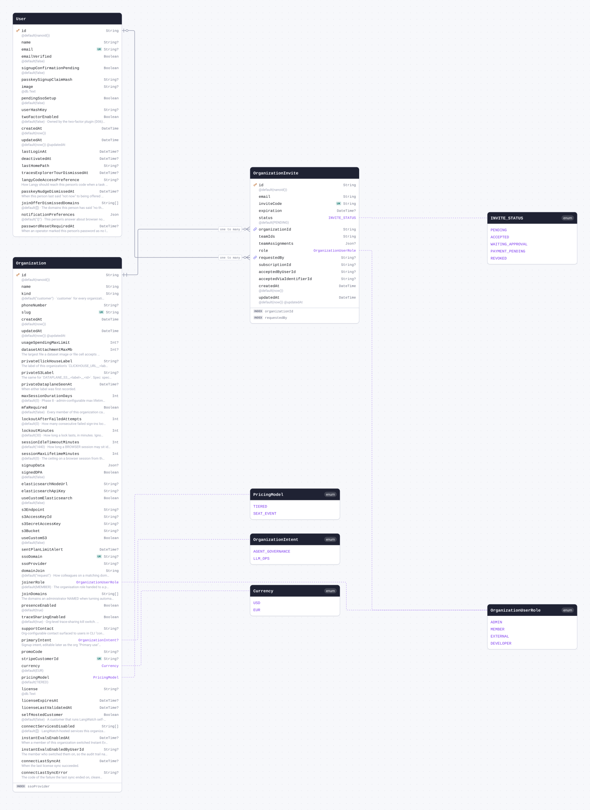

| Field                     | Type                                                 | Constraints                                       | Default              | Description |
| ------------------------- | ---------------------------------------------------- | ------------------------------------------------- | -------------------- | ----------- |
| `id`                      | `String`                                             | PK NOT NULL                                       | `nanoid()`           |             |
| `email`                   | `String`                                             | NOT NULL                                          |                      |             |
| `inviteCode`              | `String`                                             | UNIQUE NOT NULL                                   |                      |             |
| `expiration`              | `DateTime`                                           | NULL                                              |                      |             |
| `status`                  | [`INVITE_STATUS`](#enum-INVITE_STATUS)               | NOT NULL                                          | `PENDING`            |             |
| `organizationId`          | `String`                                             | NOT NULL → [Organization.id](#model-Organization) |                      |             |
| `teamIds`                 | `String`                                             | NOT NULL                                          |                      |             |
| `teamAssignments`         | `Json`                                               | NULL                                              |                      |             |
| `role`                    | [`OrganizationUserRole`](#enum-OrganizationUserRole) | NOT NULL                                          |                      |             |
| `requestedBy`             | `String`                                             | NULL → [User.id](#model-User)                     |                      |             |
| `subscriptionId`          | `String`                                             | NULL                                              |                      |             |
| `acceptedByUserId`        | `String`                                             | NULL                                              |                      |             |
| `acceptedViaIdentifierId` | `String`                                             | NULL                                              |                      |             |
| `createdAt`               | `DateTime`                                           | NOT NULL                                          | `now()`              |             |
| `updatedAt`               | `DateTime`                                           | NOT NULL                                          | `now()` `@updatedAt` |             |

#### Indexes

- `@@index([organizationId])`
- `@@index([requestedBy])`

#### References

- `organizationId` → [Organization.id](#model-Organization) (many-to-one)
- `requestedBy` → [User.id](#model-User) (many-to-one)

#### Definition

```sql
CREATE TABLE "OrganizationInvite" (
    "id" TEXT NOT NULL,
    "email" TEXT NOT NULL,
    "inviteCode" TEXT NOT NULL,
    "expiration" TIMESTAMP(3),
    "status" "INVITE_STATUS" NOT NULL DEFAULT 'PENDING',
    "organizationId" TEXT NOT NULL,
    "teamIds" TEXT NOT NULL,
    "teamAssignments" JSONB,
    "role" "OrganizationUserRole" NOT NULL,
    "requestedBy" TEXT,
    "subscriptionId" TEXT,
    "acceptedByUserId" TEXT,
    "acceptedViaIdentifierId" TEXT,
    "createdAt" TIMESTAMP(3) NOT NULL DEFAULT CURRENT_TIMESTAMP,
    "updatedAt" TIMESTAMP(3) NOT NULL DEFAULT CURRENT_TIMESTAMP,

    CONSTRAINT "OrganizationInvite_pkey" PRIMARY KEY ("id")
);

CREATE UNIQUE INDEX "OrganizationInvite_inviteCode_key" ON "OrganizationInvite"("inviteCode");

CREATE INDEX "OrganizationInvite_organizationId_idx" ON "OrganizationInvite"("organizationId");

CREATE INDEX "OrganizationInvite_requestedBy_idx" ON "OrganizationInvite"("requestedBy");
```

<details>
<summary>Queries and their SQL</summary>

**findMany**: Every row

```ts
await prisma.organizationInvite.findMany();
```

```sql
SELECT
  "public"."OrganizationInvite"."id",
  "public"."OrganizationInvite"."email",
  "public"."OrganizationInvite"."inviteCode",
  "public"."OrganizationInvite"."expiration",
  "public"."OrganizationInvite"."status"::text,
  "public"."OrganizationInvite"."organizationId",
  "public"."OrganizationInvite"."teamIds",
  "public"."OrganizationInvite"."teamAssignments",
  "public"."OrganizationInvite"."role"::text,
  "public"."OrganizationInvite"."requestedBy",
  "public"."OrganizationInvite"."subscriptionId",
  "public"."OrganizationInvite"."acceptedByUserId",
  "public"."OrganizationInvite"."acceptedViaIdentifierId",
  "public"."OrganizationInvite"."createdAt",
  "public"."OrganizationInvite"."updatedAt"
FROM
  "public"."OrganizationInvite"
WHERE
  1 = 1
OFFSET
  $1
-- params: ["0"]
```

**count**: How many rows there are

```ts
await prisma.organizationInvite.count();
```

```sql
SELECT
  COUNT(*) AS "_count$_all"
FROM
  (
    SELECT
      "public"."OrganizationInvite"."id"
    FROM
      "public"."OrganizationInvite"
    WHERE
      1 = 1
    OFFSET
      $1
  ) AS "sub"
-- params: ["0"]
```

**findMany**: Every row with its relations

```ts
await prisma.organizationInvite.findMany({
  include: { organization: true, requestedByUser: true },
});
```

```sql
SELECT
  "public"."OrganizationInvite"."id",
  "public"."OrganizationInvite"."email",
  "public"."OrganizationInvite"."inviteCode",
  "public"."OrganizationInvite"."expiration",
  "public"."OrganizationInvite"."status"::text,
  "public"."OrganizationInvite"."organizationId",
  "public"."OrganizationInvite"."teamIds",
  "public"."OrganizationInvite"."teamAssignments",
  "public"."OrganizationInvite"."role"::text,
  "public"."OrganizationInvite"."requestedBy",
  "public"."OrganizationInvite"."subscriptionId",
  "public"."OrganizationInvite"."acceptedByUserId",
  "public"."OrganizationInvite"."acceptedViaIdentifierId",
  "public"."OrganizationInvite"."createdAt",
  "public"."OrganizationInvite"."updatedAt"
FROM
  "public"."OrganizationInvite"
WHERE
  1 = 1
OFFSET
  $1
-- params: ["0"]

SELECT
  "public"."Organization"."id",
  "public"."Organization"."name",
  "public"."Organization"."kind",
  "public"."Organization"."phoneNumber",
  "public"."Organization"."slug",
  "public"."Organization"."createdAt",
  "public"."Organization"."updatedAt",
  "public"."Organization"."usageSpendingMaxLimit",
  "public"."Organization"."datasetAttachmentMaxMb",
  "public"."Organization"."privateClickHouseLabel",
  "public"."Organization"."privateS3Label",
  "public"."Organization"."privateDataplaneSeenAt",
  "public"."Organization"."maxSessionDurationDays",
  "public"."Organization"."mfaRequired",
  "public"."Organization"."lockoutAfterFailedAttempts",
  "public"."Organization"."lockoutMinutes",
  "public"."Organization"."sessionIdleTimeoutMinutes",
  "public"."Organization"."sessionMaxLifetimeMinutes",
  "public"."Organization"."signupData",
  "public"."Organization"."signedDPA",
  "public"."Organization"."elasticsearchNodeUrl",
  "public"."Organization"."elasticsearchApiKey",
  "public"."Organization"."useCustomElasticsearch",
  "public"."Organization"."s3Endpoint",
  "public"."Organization"."s3AccessKeyId",
  "public"."Organization"."s3SecretAccessKey",
  "public"."Organization"."s3Bucket",
  "public"."Organization"."useCustomS3",
  "public"."Organization"."sentPlanLimitAlert",
  "public"."Organization"."ssoDomain",
  "public"."Organization"."ssoProvider",
  "public"."Organization"."domainJoin",
  "public"."Organization"."joinerRole"::text,
  "public"."Organization"."joinDomains",
  "public"."Organization"."presenceEnabled",
  "public"."Organization"."traceSharingEnabled",
  "public"."Organization"."supportContact",
  "public"."Organization"."primaryIntent"::text,
  "public"."Organization"."promoCode",
  "public"."Organization"."stripeCustomerId",
  "public"."Organization"."currency"::text,
  "public"."Organization"."pricingModel"::text,
  "public"."Organization"."license",
  "public"."Organization"."licenseExpiresAt",
  "public"."Organization"."licenseLastValidatedAt",
  "public"."Organization"."selfHostedCustomer",
  "public"."Organization"."connectServicesDisabled",
  "public"."Organization"."instantEvalsEnabledAt",
  "public"."Organization"."instantEvalsEnabledByUserId",
  "public"."Organization"."connectLastSyncAt",
  "public"."Organization"."connectLastSyncError"
FROM
  "public"."Organization"
WHERE
  "public"."Organization"."id" IN ($1)
OFFSET
  $2
-- params: ["<organizationId of the rows above>","0"]

SELECT
  "public"."User"."id",
  "public"."User"."name",
  "public"."User"."email",
  "public"."User"."emailVerified",
  "public"."User"."signupConfirmationPending",
  "public"."User"."passkeySignupClaimHash",
  "public"."User"."image",
  "public"."User"."pendingSsoSetup",
  "public"."User"."userHashKey",
  "public"."User"."twoFactorEnabled",
  "public"."User"."createdAt",
  "public"."User"."updatedAt",
  "public"."User"."lastLoginAt",
  "public"."User"."deactivatedAt",
  "public"."User"."lastHomePath",
  "public"."User"."tracesExplorerTourDismissedAt",
  "public"."User"."langyCodeAccessPreference",
  "public"."User"."passkeyNudgeDismissedAt",
  "public"."User"."joinOfferDismissedDomains",
  "public"."User"."notificationPreferences",
  "public"."User"."passwordResetRequiredAt"
FROM
  "public"."User"
WHERE
  "public"."User"."id" IN ($1)
OFFSET
  $2
-- params: ["<requestedBy of the rows above>","0"]
```

**findUnique**: One row by what is unique to it

```ts
await prisma.organizationInvite.findUnique({ where: { id: "example" } });
```

```sql
SELECT
  "public"."OrganizationInvite"."id",
  "public"."OrganizationInvite"."email",
  "public"."OrganizationInvite"."inviteCode",
  "public"."OrganizationInvite"."expiration",
  "public"."OrganizationInvite"."status"::text,
  "public"."OrganizationInvite"."organizationId",
  "public"."OrganizationInvite"."teamIds",
  "public"."OrganizationInvite"."teamAssignments",
  "public"."OrganizationInvite"."role"::text,
  "public"."OrganizationInvite"."requestedBy",
  "public"."OrganizationInvite"."subscriptionId",
  "public"."OrganizationInvite"."acceptedByUserId",
  "public"."OrganizationInvite"."acceptedViaIdentifierId",
  "public"."OrganizationInvite"."createdAt",
  "public"."OrganizationInvite"."updatedAt"
FROM
  "public"."OrganizationInvite"
WHERE
  (
    "public"."OrganizationInvite"."id" = $1
    AND 1 = 1
  )
LIMIT
  $2
OFFSET
  $3
-- params: ["example","1","0"]
```

**create**: Create a row

```ts
await prisma.organizationInvite.create({
  data: {
    email: "example",
    inviteCode: "example",
    organizationId: "example",
    teamIds: "example",
    role: "ADMIN",
  },
});
```

```sql
INSERT INTO
  "public"."OrganizationInvite" (
    "id",
    "email",
    "inviteCode",
    "status",
    "organizationId",
    "teamIds",
    "role",
    "createdAt",
    "updatedAt"
  )
VALUES
  (
    $1,
    $2,
    $3,
    CAST($4::text AS "public"."INVITE_STATUS"),
    $5,
    $6,
    CAST($7::text AS "public"."OrganizationUserRole"),
    $8,
    $9
  )
RETURNING
  "public"."OrganizationInvite"."id",
  "public"."OrganizationInvite"."email",
  "public"."OrganizationInvite"."inviteCode",
  "public"."OrganizationInvite"."expiration",
  "public"."OrganizationInvite"."status"::text,
  "public"."OrganizationInvite"."organizationId",
  "public"."OrganizationInvite"."teamIds",
  "public"."OrganizationInvite"."teamAssignments",
  "public"."OrganizationInvite"."role"::text,
  "public"."OrganizationInvite"."requestedBy",
  "public"."OrganizationInvite"."subscriptionId",
  "public"."OrganizationInvite"."acceptedByUserId",
  "public"."OrganizationInvite"."acceptedViaIdentifierId",
  "public"."OrganizationInvite"."createdAt",
  "public"."OrganizationInvite"."updatedAt"
-- params: ["<nanoid()>","example","example","PENDING","example","example","ADMIN","<now()>","<now()>"]
```

**update**: Update a row

```ts
await prisma.organizationInvite.update({ where: { id: "example" }, data: { email: "example" } });
```

```sql
SELECT
  "public"."OrganizationInvite"."id"
FROM
  "public"."OrganizationInvite"
WHERE
  (
    "public"."OrganizationInvite"."id" = $1
    AND 1 = 1
  )
LIMIT
  $2
OFFSET
  $3
-- params: ["example","1","0"]

UPDATE "public"."OrganizationInvite"
SET
  "email" = $1,
  "updatedAt" = $2
WHERE
  (
    "public"."OrganizationInvite"."id" IN ($3)
    AND (
      "public"."OrganizationInvite"."id" = $4
      AND 1 = 1
    )
  )
RETURNING
  "public"."OrganizationInvite"."id",
  "public"."OrganizationInvite"."email",
  "public"."OrganizationInvite"."inviteCode",
  "public"."OrganizationInvite"."expiration",
  "public"."OrganizationInvite"."status"::text,
  "public"."OrganizationInvite"."organizationId",
  "public"."OrganizationInvite"."teamIds",
  "public"."OrganizationInvite"."teamAssignments",
  "public"."OrganizationInvite"."role"::text,
  "public"."OrganizationInvite"."requestedBy",
  "public"."OrganizationInvite"."subscriptionId",
  "public"."OrganizationInvite"."acceptedByUserId",
  "public"."OrganizationInvite"."acceptedViaIdentifierId",
  "public"."OrganizationInvite"."createdAt",
  "public"."OrganizationInvite"."updatedAt"
-- params: ["example",{"prisma__type":"generatorCall","prisma__value":{"name":"now","args":[],"returnType":{"type":"DateTime"}}},"<id of the rows above>","example"]
```

**delete**: Delete a row

```ts
await prisma.organizationInvite.delete({ where: { id: "example" } });
```

```sql
DELETE FROM "public"."OrganizationInvite"
WHERE
  (
    "public"."OrganizationInvite"."id" = $1
    AND 1 = 1
  )
RETURNING
  "public"."OrganizationInvite"."id",
  "public"."OrganizationInvite"."email",
  "public"."OrganizationInvite"."inviteCode",
  "public"."OrganizationInvite"."expiration",
  "public"."OrganizationInvite"."status"::text,
  "public"."OrganizationInvite"."organizationId",
  "public"."OrganizationInvite"."teamIds",
  "public"."OrganizationInvite"."teamAssignments",
  "public"."OrganizationInvite"."role"::text,
  "public"."OrganizationInvite"."requestedBy",
  "public"."OrganizationInvite"."subscriptionId",
  "public"."OrganizationInvite"."acceptedByUserId",
  "public"."OrganizationInvite"."acceptedViaIdentifierId",
  "public"."OrganizationInvite"."createdAt",
  "public"."OrganizationInvite"."updatedAt"
-- params: ["example"]
```

</details>

<a id="model-Monitor"></a>

### Monitor

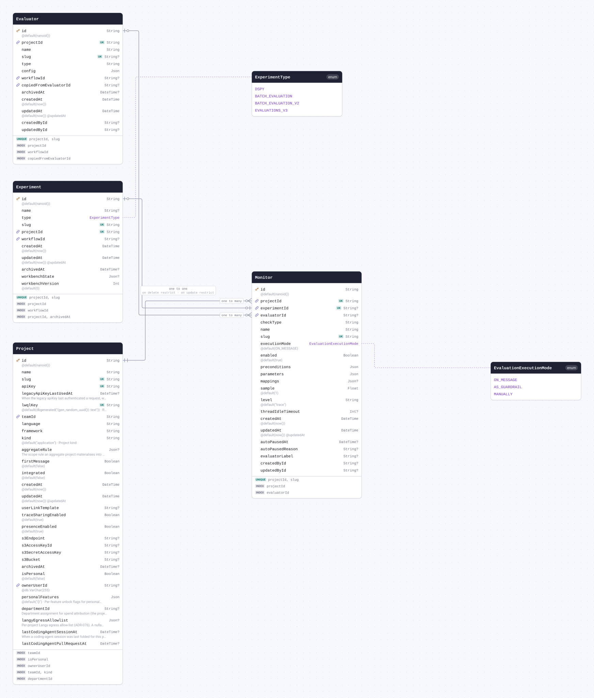

| Field               | Type                                                       | Constraints                                      | Default              | Description |
| ------------------- | ---------------------------------------------------------- | ------------------------------------------------ | -------------------- | ----------- |
| `id`                | `String`                                                   | PK NOT NULL                                      | `nanoid()`           |             |
| `projectId`         | `String`                                                   | NOT NULL → [Project.id](#model-Project)          |                      |             |
| `experimentId`      | `String`                                                   | UNIQUE NULL → [Experiment.id](#model-Experiment) |                      |             |
| `evaluatorId`       | `String`                                                   | NULL → [Evaluator.id](#model-Evaluator)          |                      |             |
| `checkType`         | `String`                                                   | NOT NULL                                         |                      |             |
| `name`              | `String`                                                   | NOT NULL                                         |                      |             |
| `slug`              | `String`                                                   | NOT NULL                                         |                      |             |
| `executionMode`     | [`EvaluationExecutionMode`](#enum-EvaluationExecutionMode) | NOT NULL                                         | `ON_MESSAGE`         |             |
| `enabled`           | `Boolean`                                                  | NOT NULL                                         | `true`               |             |
| `preconditions`     | `Json`                                                     | NOT NULL                                         |                      |             |
| `parameters`        | `Json`                                                     | NOT NULL                                         |                      |             |
| `mappings`          | `Json`                                                     | NULL                                             |                      |             |
| `sample`            | `Float`                                                    | NOT NULL                                         | `1`                  |             |
| `level`             | `String`                                                   | NOT NULL                                         | `"trace"`            |             |
| `threadIdleTimeout` | `Int`                                                      | NULL                                             |                      |             |
| `createdAt`         | `DateTime`                                                 | NOT NULL                                         | `now()`              |             |
| `updatedAt`         | `DateTime`                                                 | NOT NULL                                         | `now()` `@updatedAt` |             |
| `autoPausedAt`      | `DateTime`                                                 | NULL                                             |                      |             |
| `autoPausedReason`  | `String`                                                   | NULL                                             |                      |             |
| `evaluatorLabel`    | `String`                                                   | NULL                                             |                      |             |
| `createdById`       | `String`                                                   | NULL                                             |                      |             |
| `updatedById`       | `String`                                                   | NULL                                             |                      |             |

#### Indexes

- `@@index([projectId])`
- `@@index([evaluatorId])`
- `@@unique([projectId, slug])`

#### References

- `projectId` → [Project.id](#model-Project) (many-to-one)
- `experimentId` → [Experiment.id](#model-Experiment) (one-to-one, on delete Restrict, on update Restrict)
- `evaluatorId` → [Evaluator.id](#model-Evaluator) (many-to-one)

#### Definition

```sql
CREATE TABLE "Monitor" (
    "id" TEXT NOT NULL,
    "projectId" TEXT NOT NULL,
    "experimentId" TEXT,
    "evaluatorId" TEXT,
    "checkType" TEXT NOT NULL,
    "name" TEXT NOT NULL,
    "slug" TEXT NOT NULL,
    "executionMode" "EvaluationExecutionMode" NOT NULL DEFAULT 'ON_MESSAGE',
    "enabled" BOOLEAN NOT NULL DEFAULT true,
    "preconditions" JSONB NOT NULL,
    "parameters" JSONB NOT NULL,
    "mappings" JSONB,
    "sample" DOUBLE PRECISION NOT NULL DEFAULT 1.0,
    "level" TEXT NOT NULL DEFAULT 'trace',
    "threadIdleTimeout" INTEGER,
    "createdAt" TIMESTAMP(3) NOT NULL DEFAULT CURRENT_TIMESTAMP,
    "updatedAt" TIMESTAMP(3) NOT NULL DEFAULT CURRENT_TIMESTAMP,
    "autoPausedAt" TIMESTAMP(3),
    "autoPausedReason" TEXT,
    "evaluatorLabel" TEXT,
    "createdById" TEXT,
    "updatedById" TEXT,

    CONSTRAINT "Monitor_pkey" PRIMARY KEY ("id")
);

CREATE UNIQUE INDEX "Monitor_experimentId_key" ON "Monitor"("experimentId");

CREATE INDEX "Monitor_projectId_idx" ON "Monitor"("projectId");

CREATE INDEX "Monitor_evaluatorId_idx" ON "Monitor"("evaluatorId");

CREATE UNIQUE INDEX "Monitor_projectId_slug_key" ON "Monitor"("projectId", "slug");
```

<details>
<summary>Queries and their SQL</summary>

**findMany**: Every row

```ts
await prisma.monitor.findMany();
```

```sql
SELECT
  "public"."Monitor"."id",
  "public"."Monitor"."projectId",
  "public"."Monitor"."experimentId",
  "public"."Monitor"."evaluatorId",
  "public"."Monitor"."checkType",
  "public"."Monitor"."name",
  "public"."Monitor"."slug",
  "public"."Monitor"."executionMode"::text,
  "public"."Monitor"."enabled",
  "public"."Monitor"."preconditions",
  "public"."Monitor"."parameters",
  "public"."Monitor"."mappings",
  "public"."Monitor"."sample",
  "public"."Monitor"."level",
  "public"."Monitor"."threadIdleTimeout",
  "public"."Monitor"."createdAt",
  "public"."Monitor"."updatedAt",
  "public"."Monitor"."autoPausedAt",
  "public"."Monitor"."autoPausedReason",
  "public"."Monitor"."evaluatorLabel",
  "public"."Monitor"."createdById",
  "public"."Monitor"."updatedById"
FROM
  "public"."Monitor"
WHERE
  1 = 1
OFFSET
  $1
-- params: ["0"]
```

**count**: How many rows there are

```ts
await prisma.monitor.count();
```

```sql
SELECT
  COUNT(*) AS "_count$_all"
FROM
  (
    SELECT
      "public"."Monitor"."id"
    FROM
      "public"."Monitor"
    WHERE
      1 = 1
    OFFSET
      $1
  ) AS "sub"
-- params: ["0"]
```

**findMany**: Every row with its relations

```ts
await prisma.monitor.findMany({ include: { project: true, experiment: true, evaluator: true } });
```

```sql
SELECT
  "public"."Monitor"."id",
  "public"."Monitor"."projectId",
  "public"."Monitor"."experimentId",
  "public"."Monitor"."evaluatorId",
  "public"."Monitor"."checkType",
  "public"."Monitor"."name",
  "public"."Monitor"."slug",
  "public"."Monitor"."executionMode"::text,
  "public"."Monitor"."enabled",
  "public"."Monitor"."preconditions",
  "public"."Monitor"."parameters",
  "public"."Monitor"."mappings",
  "public"."Monitor"."sample",
  "public"."Monitor"."level",
  "public"."Monitor"."threadIdleTimeout",
  "public"."Monitor"."createdAt",
  "public"."Monitor"."updatedAt",
  "public"."Monitor"."autoPausedAt",
  "public"."Monitor"."autoPausedReason",
  "public"."Monitor"."evaluatorLabel",
  "public"."Monitor"."createdById",
  "public"."Monitor"."updatedById"
FROM
  "public"."Monitor"
WHERE
  1 = 1
OFFSET
  $1
-- params: ["0"]

SELECT
  "public"."Project"."id",
  "public"."Project"."name",
  "public"."Project"."slug",
  "public"."Project"."apiKey",
  "public"."Project"."legacyApiKeyLastUsedAt",
  "public"."Project"."lwqlKey",
  "public"."Project"."teamId",
  "public"."Project"."language",
  "public"."Project"."framework",
  "public"."Project"."kind",
  "public"."Project"."aggregateRule",
  "public"."Project"."firstMessage",
  "public"."Project"."integrated",
  "public"."Project"."createdAt",
  "public"."Project"."updatedAt",
  "public"."Project"."userLinkTemplate",
  "public"."Project"."traceSharingEnabled",
  "public"."Project"."presenceEnabled",
  "public"."Project"."s3Endpoint",
  "public"."Project"."s3AccessKeyId",
  "public"."Project"."s3SecretAccessKey",
  "public"."Project"."s3Bucket",
  "public"."Project"."archivedAt",
  "public"."Project"."isPersonal",
  "public"."Project"."ownerUserId",
  "public"."Project"."personalFeatures",
  "public"."Project"."departmentId",
  "public"."Project"."langyEgressAllowlist",
  "public"."Project"."lastCodingAgentSessionAt",
  "public"."Project"."lastCodingAgentPullRequestAt"
FROM
  "public"."Project"
WHERE
  "public"."Project"."id" IN ($1)
OFFSET
  $2
-- params: ["<projectId of the rows above>","0"]

SELECT
  "public"."Experiment"."id",
  "public"."Experiment"."name",
  "public"."Experiment"."type"::text,
  "public"."Experiment"."slug",
  "public"."Experiment"."projectId",
  "public"."Experiment"."workflowId",
  "public"."Experiment"."createdAt",
  "public"."Experiment"."updatedAt",
  "public"."Experiment"."archivedAt",
  "public"."Experiment"."workbenchState",
  "public"."Experiment"."workbenchVersion"
FROM
  "public"."Experiment"
WHERE
  "public"."Experiment"."id" IN ($1)
OFFSET
  $2
-- params: ["<experimentId of the rows above>","0"]

SELECT
  "public"."Evaluator"."id",
  "public"."Evaluator"."projectId",
  "public"."Evaluator"."name",
  "public"."Evaluator"."slug",
  "public"."Evaluator"."type",
  "public"."Evaluator"."config",
  "public"."Evaluator"."workflowId",
  "public"."Evaluator"."copiedFromEvaluatorId",
  "public"."Evaluator"."archivedAt",
  "public"."Evaluator"."createdAt",
  "public"."Evaluator"."updatedAt",
  "public"."Evaluator"."createdById",
  "public"."Evaluator"."updatedById"
FROM
  "public"."Evaluator"
WHERE
  "public"."Evaluator"."id" IN ($1)
OFFSET
  $2
-- params: ["<evaluatorId of the rows above>","0"]
```

**findUnique**: One row by what is unique to it

```ts
await prisma.monitor.findUnique({ where: { id: "example" } });
```

```sql
SELECT
  "public"."Monitor"."id",
  "public"."Monitor"."projectId",
  "public"."Monitor"."experimentId",
  "public"."Monitor"."evaluatorId",
  "public"."Monitor"."checkType",
  "public"."Monitor"."name",
  "public"."Monitor"."slug",
  "public"."Monitor"."executionMode"::text,
  "public"."Monitor"."enabled",
  "public"."Monitor"."preconditions",
  "public"."Monitor"."parameters",
  "public"."Monitor"."mappings",
  "public"."Monitor"."sample",
  "public"."Monitor"."level",
  "public"."Monitor"."threadIdleTimeout",
  "public"."Monitor"."createdAt",
  "public"."Monitor"."updatedAt",
  "public"."Monitor"."autoPausedAt",
  "public"."Monitor"."autoPausedReason",
  "public"."Monitor"."evaluatorLabel",
  "public"."Monitor"."createdById",
  "public"."Monitor"."updatedById"
FROM
  "public"."Monitor"
WHERE
  (
    "public"."Monitor"."id" = $1
    AND 1 = 1
  )
LIMIT
  $2
OFFSET
  $3
-- params: ["example","1","0"]
```

**create**: Create a row

```ts
await prisma.monitor.create({
  data: {
    projectId: "example",
    checkType: "example",
    name: "example",
    slug: "example",
    preconditions: {},
    parameters: {},
  },
});
```

```sql
INSERT INTO
  "public"."Monitor" (
    "id",
    "projectId",
    "checkType",
    "name",
    "slug",
    "executionMode",
    "enabled",
    "preconditions",
    "parameters",
    "sample",
    "level",
    "createdAt",
    "updatedAt"
  )
VALUES
  (
    $1,
    $2,
    $3,
    $4,
    $5,
    CAST($6::text AS "public"."EvaluationExecutionMode"),
    $7,
    $8,
    $9,
    $10,
    $11,
    $12,
    $13
  )
RETURNING
  "public"."Monitor"."id",
  "public"."Monitor"."projectId",
  "public"."Monitor"."experimentId",
  "public"."Monitor"."evaluatorId",
  "public"."Monitor"."checkType",
  "public"."Monitor"."name",
  "public"."Monitor"."slug",
  "public"."Monitor"."executionMode"::text,
  "public"."Monitor"."enabled",
  "public"."Monitor"."preconditions",
  "public"."Monitor"."parameters",
  "public"."Monitor"."mappings",
  "public"."Monitor"."sample",
  "public"."Monitor"."level",
  "public"."Monitor"."threadIdleTimeout",
  "public"."Monitor"."createdAt",
  "public"."Monitor"."updatedAt",
  "public"."Monitor"."autoPausedAt",
  "public"."Monitor"."autoPausedReason",
  "public"."Monitor"."evaluatorLabel",
  "public"."Monitor"."createdById",
  "public"."Monitor"."updatedById"
-- params: ["<nanoid()>","example","example","example","example","ON_MESSAGE",true,"{}","{}","1.0","trace","<now()>","<now()>"]
```

**update**: Update a row

```ts
await prisma.monitor.update({ where: { id: "example" }, data: { checkType: "example" } });
```

```sql
SELECT
  "public"."Monitor"."id"
FROM
  "public"."Monitor"
WHERE
  (
    "public"."Monitor"."id" = $1
    AND 1 = 1
  )
LIMIT
  $2
OFFSET
  $3
-- params: ["example","1","0"]

UPDATE "public"."Monitor"
SET
  "checkType" = $1,
  "updatedAt" = $2
WHERE
  (
    "public"."Monitor"."id" IN ($3)
    AND (
      "public"."Monitor"."id" = $4
      AND 1 = 1
    )
  )
RETURNING
  "public"."Monitor"."id",
  "public"."Monitor"."projectId",
  "public"."Monitor"."experimentId",
  "public"."Monitor"."evaluatorId",
  "public"."Monitor"."checkType",
  "public"."Monitor"."name",
  "public"."Monitor"."slug",
  "public"."Monitor"."executionMode"::text,
  "public"."Monitor"."enabled",
  "public"."Monitor"."preconditions",
  "public"."Monitor"."parameters",
  "public"."Monitor"."mappings",
  "public"."Monitor"."sample",
  "public"."Monitor"."level",
  "public"."Monitor"."threadIdleTimeout",
  "public"."Monitor"."createdAt",
  "public"."Monitor"."updatedAt",
  "public"."Monitor"."autoPausedAt",
  "public"."Monitor"."autoPausedReason",
  "public"."Monitor"."evaluatorLabel",
  "public"."Monitor"."createdById",
  "public"."Monitor"."updatedById"
-- params: ["example",{"prisma__type":"generatorCall","prisma__value":{"name":"now","args":[],"returnType":{"type":"DateTime"}}},"<id of the rows above>","example"]
```

**delete**: Delete a row

```ts
await prisma.monitor.delete({ where: { id: "example" } });
```

```sql
DELETE FROM "public"."Monitor"
WHERE
  (
    "public"."Monitor"."id" = $1
    AND 1 = 1
  )
RETURNING
  "public"."Monitor"."id",
  "public"."Monitor"."projectId",
  "public"."Monitor"."experimentId",
  "public"."Monitor"."evaluatorId",
  "public"."Monitor"."checkType",
  "public"."Monitor"."name",
  "public"."Monitor"."slug",
  "public"."Monitor"."executionMode"::text,
  "public"."Monitor"."enabled",
  "public"."Monitor"."preconditions",
  "public"."Monitor"."parameters",
  "public"."Monitor"."mappings",
  "public"."Monitor"."sample",
  "public"."Monitor"."level",
  "public"."Monitor"."threadIdleTimeout",
  "public"."Monitor"."createdAt",
  "public"."Monitor"."updatedAt",
  "public"."Monitor"."autoPausedAt",
  "public"."Monitor"."autoPausedReason",
  "public"."Monitor"."evaluatorLabel",
  "public"."Monitor"."createdById",
  "public"."Monitor"."updatedById"
-- params: ["example"]
```

</details>

<a id="model-Cost"></a>

### Cost

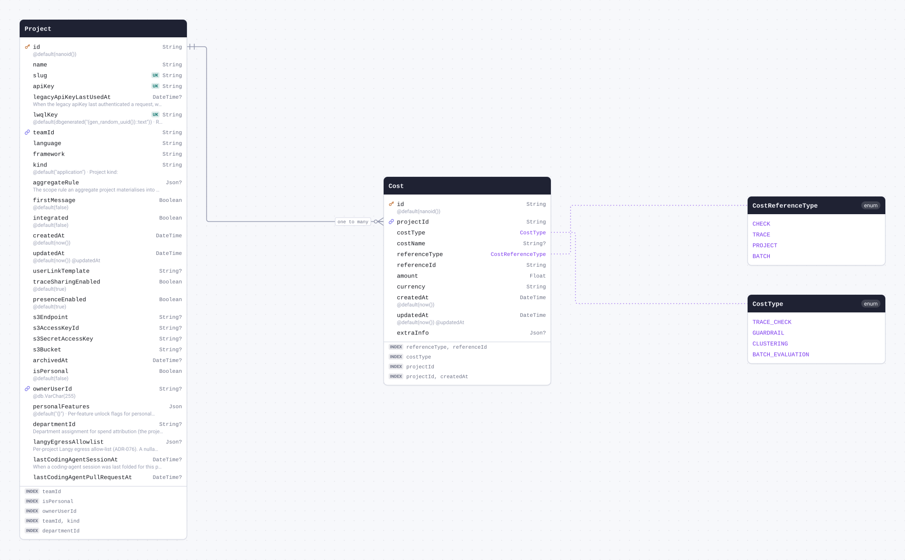

| Field           | Type                                           | Constraints                             | Default              | Description |
| --------------- | ---------------------------------------------- | --------------------------------------- | -------------------- | ----------- |
| `id`            | `String`                                       | PK NOT NULL                             | `nanoid()`           |             |
| `projectId`     | `String`                                       | NOT NULL → [Project.id](#model-Project) |                      |             |
| `costType`      | [`CostType`](#enum-CostType)                   | NOT NULL                                |                      |             |
| `costName`      | `String`                                       | NULL                                    |                      |             |
| `referenceType` | [`CostReferenceType`](#enum-CostReferenceType) | NOT NULL                                |                      |             |
| `referenceId`   | `String`                                       | NOT NULL                                |                      |             |
| `amount`        | `Float`                                        | NOT NULL                                |                      |             |
| `currency`      | `String`                                       | NOT NULL                                |                      |             |
| `createdAt`     | `DateTime`                                     | NOT NULL                                | `now()`              |             |
| `updatedAt`     | `DateTime`                                     | NOT NULL                                | `now()` `@updatedAt` |             |
| `extraInfo`     | `Json`                                         | NULL                                    |                      |             |

#### Indexes

- `@@index([referenceType, referenceId])`
- `@@index([costType])`
- `@@index([projectId])`
- `@@index([projectId, createdAt])`

#### References

- `projectId` → [Project.id](#model-Project) (many-to-one)

#### Definition

```sql
CREATE TABLE "Cost" (
    "id" TEXT NOT NULL,
    "projectId" TEXT NOT NULL,
    "costType" "CostType" NOT NULL,
    "costName" TEXT,
    "referenceType" "CostReferenceType" NOT NULL,
    "referenceId" TEXT NOT NULL,
    "amount" DOUBLE PRECISION NOT NULL,
    "currency" TEXT NOT NULL,
    "createdAt" TIMESTAMP(3) NOT NULL DEFAULT CURRENT_TIMESTAMP,
    "updatedAt" TIMESTAMP(3) NOT NULL DEFAULT CURRENT_TIMESTAMP,
    "extraInfo" JSONB,

    CONSTRAINT "Cost_pkey" PRIMARY KEY ("id")
);

CREATE INDEX "Cost_referenceType_referenceId_idx" ON "Cost"("referenceType", "referenceId");

CREATE INDEX "Cost_costType_idx" ON "Cost"("costType");

CREATE INDEX "Cost_projectId_idx" ON "Cost"("projectId");

CREATE INDEX "Cost_projectId_createdAt_idx" ON "Cost"("projectId", "createdAt");
```

<details>
<summary>Queries and their SQL</summary>

**findMany**: Every row

```ts
await prisma.cost.findMany();
```

```sql
SELECT
  "public"."Cost"."id",
  "public"."Cost"."projectId",
  "public"."Cost"."costType"::text,
  "public"."Cost"."costName",
  "public"."Cost"."referenceType"::text,
  "public"."Cost"."referenceId",
  "public"."Cost"."amount",
  "public"."Cost"."currency",
  "public"."Cost"."createdAt",
  "public"."Cost"."updatedAt",
  "public"."Cost"."extraInfo"
FROM
  "public"."Cost"
WHERE
  1 = 1
OFFSET
  $1
-- params: ["0"]
```

**count**: How many rows there are

```ts
await prisma.cost.count();
```

```sql
SELECT
  COUNT(*) AS "_count$_all"
FROM
  (
    SELECT
      "public"."Cost"."id"
    FROM
      "public"."Cost"
    WHERE
      1 = 1
    OFFSET
      $1
  ) AS "sub"
-- params: ["0"]
```

**findMany**: Every row with its relations

```ts
await prisma.cost.findMany({ include: { project: true } });
```

```sql
SELECT
  "public"."Cost"."id",
  "public"."Cost"."projectId",
  "public"."Cost"."costType"::text,
  "public"."Cost"."costName",
  "public"."Cost"."referenceType"::text,
  "public"."Cost"."referenceId",
  "public"."Cost"."amount",
  "public"."Cost"."currency",
  "public"."Cost"."createdAt",
  "public"."Cost"."updatedAt",
  "public"."Cost"."extraInfo"
FROM
  "public"."Cost"
WHERE
  1 = 1
OFFSET
  $1
-- params: ["0"]

SELECT
  "public"."Project"."id",
  "public"."Project"."name",
  "public"."Project"."slug",
  "public"."Project"."apiKey",
  "public"."Project"."legacyApiKeyLastUsedAt",
  "public"."Project"."lwqlKey",
  "public"."Project"."teamId",
  "public"."Project"."language",
  "public"."Project"."framework",
  "public"."Project"."kind",
  "public"."Project"."aggregateRule",
  "public"."Project"."firstMessage",
  "public"."Project"."integrated",
  "public"."Project"."createdAt",
  "public"."Project"."updatedAt",
  "public"."Project"."userLinkTemplate",
  "public"."Project"."traceSharingEnabled",
  "public"."Project"."presenceEnabled",
  "public"."Project"."s3Endpoint",
  "public"."Project"."s3AccessKeyId",
  "public"."Project"."s3SecretAccessKey",
  "public"."Project"."s3Bucket",
  "public"."Project"."archivedAt",
  "public"."Project"."isPersonal",
  "public"."Project"."ownerUserId",
  "public"."Project"."personalFeatures",
  "public"."Project"."departmentId",
  "public"."Project"."langyEgressAllowlist",
  "public"."Project"."lastCodingAgentSessionAt",
  "public"."Project"."lastCodingAgentPullRequestAt"
FROM
  "public"."Project"
WHERE
  "public"."Project"."id" IN ($1)
OFFSET
  $2
-- params: ["<projectId of the rows above>","0"]
```

**findUnique**: One row by what is unique to it

```ts
await prisma.cost.findUnique({ where: { id: "example" } });
```

```sql
SELECT
  "public"."Cost"."id",
  "public"."Cost"."projectId",
  "public"."Cost"."costType"::text,
  "public"."Cost"."costName",
  "public"."Cost"."referenceType"::text,
  "public"."Cost"."referenceId",
  "public"."Cost"."amount",
  "public"."Cost"."currency",
  "public"."Cost"."createdAt",
  "public"."Cost"."updatedAt",
  "public"."Cost"."extraInfo"
FROM
  "public"."Cost"
WHERE
  (
    "public"."Cost"."id" = $1
    AND 1 = 1
  )
LIMIT
  $2
OFFSET
  $3
-- params: ["example","1","0"]
```

**create**: Create a row

```ts
await prisma.cost.create({
  data: {
    projectId: "example",
    costType: "TRACE_CHECK",
    referenceType: "CHECK",
    referenceId: "example",
    amount: 1.5,
    currency: "example",
  },
});
```

```sql
INSERT INTO
  "public"."Cost" (
    "id",
    "projectId",
    "costType",
    "referenceType",
    "referenceId",
    "amount",
    "currency",
    "createdAt",
    "updatedAt"
  )
VALUES
  (
    $1,
    $2,
    CAST($3::text AS "public"."CostType"),
    CAST($4::text AS "public"."CostReferenceType"),
    $5,
    $6,
    $7,
    $8,
    $9
  )
RETURNING
  "public"."Cost"."id",
  "public"."Cost"."projectId",
  "public"."Cost"."costType"::text,
  "public"."Cost"."costName",
  "public"."Cost"."referenceType"::text,
  "public"."Cost"."referenceId",
  "public"."Cost"."amount",
  "public"."Cost"."currency",
  "public"."Cost"."createdAt",
  "public"."Cost"."updatedAt",
  "public"."Cost"."extraInfo"
-- params: ["<nanoid()>","example","TRACE_CHECK","CHECK","example","1.5","example","<now()>","<now()>"]
```

**update**: Update a row

```ts
await prisma.cost.update({ where: { id: "example" }, data: { costType: "TRACE_CHECK" } });
```

```sql
SELECT
  "public"."Cost"."id"
FROM
  "public"."Cost"
WHERE
  (
    "public"."Cost"."id" = $1
    AND 1 = 1
  )
LIMIT
  $2
OFFSET
  $3
-- params: ["example","1","0"]

UPDATE "public"."Cost"
SET
  "costType" = CAST($1::text AS "public"."CostType"),
  "updatedAt" = $2
WHERE
  (
    "public"."Cost"."id" IN ($3)
    AND (
      "public"."Cost"."id" = $4
      AND 1 = 1
    )
  )
RETURNING
  "public"."Cost"."id",
  "public"."Cost"."projectId",
  "public"."Cost"."costType"::text,
  "public"."Cost"."costName",
  "public"."Cost"."referenceType"::text,
  "public"."Cost"."referenceId",
  "public"."Cost"."amount",
  "public"."Cost"."currency",
  "public"."Cost"."createdAt",
  "public"."Cost"."updatedAt",
  "public"."Cost"."extraInfo"
-- params: ["TRACE_CHECK",{"prisma__type":"generatorCall","prisma__value":{"name":"now","args":[],"returnType":{"type":"DateTime"}}},"<id of the rows above>","example"]
```

**delete**: Delete a row

```ts
await prisma.cost.delete({ where: { id: "example" } });
```

```sql
DELETE FROM "public"."Cost"
WHERE
  (
    "public"."Cost"."id" = $1
    AND 1 = 1
  )
RETURNING
  "public"."Cost"."id",
  "public"."Cost"."projectId",
  "public"."Cost"."costType"::text,
  "public"."Cost"."costName",
  "public"."Cost"."referenceType"::text,
  "public"."Cost"."referenceId",
  "public"."Cost"."amount",
  "public"."Cost"."currency",
  "public"."Cost"."createdAt",
  "public"."Cost"."updatedAt",
  "public"."Cost"."extraInfo"
-- params: ["example"]
```

</details>

<a id="model-Topic"></a>

### Topic

PROJECTION of the topic-clustering event stream (ADR-051): topics are
`topics_recorded` events; this table is written ONLY by
TopicModelFoldProjection (cursor: TopicModelProjection) and is
rebuildable by replay. Kept named `Topic` because it is the domain
entity every surface reads — the `*Projection` suffix is reserved for
cursor/read-model tables.

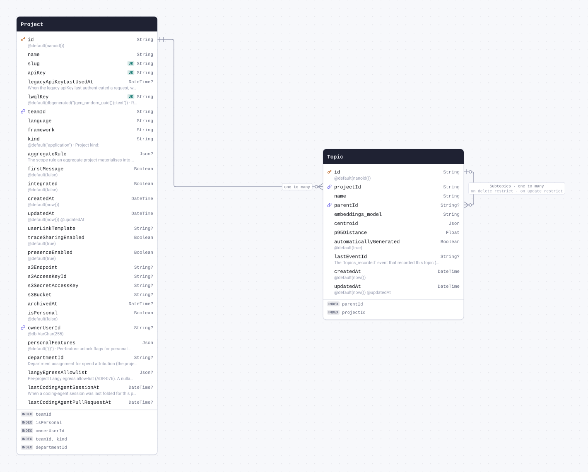

| Field                    | Type       | Constraints                             | Default              | Description                                                                                                                                                                                                             |
| ------------------------ | ---------- | --------------------------------------- | -------------------- | ----------------------------------------------------------------------------------------------------------------------------------------------------------------------------------------------------------------------- |
| `id`                     | `String`   | PK NOT NULL                             | `nanoid()`           |                                                                                                                                                                                                                         |
| `projectId`              | `String`   | NOT NULL → [Project.id](#model-Project) |                      |                                                                                                                                                                                                                         |
| `name`                   | `String`   | NOT NULL                                |                      |                                                                                                                                                                                                                         |
| `parentId`               | `String`   | NULL → [Topic.id](#model-Topic)         |                      |                                                                                                                                                                                                                         |
| `embeddings_model`       | `String`   | NOT NULL                                |                      |                                                                                                                                                                                                                         |
| `centroid`               | `Json`     | NOT NULL                                |                      |                                                                                                                                                                                                                         |
| `p95Distance`            | `Float`    | NOT NULL                                |                      |                                                                                                                                                                                                                         |
| `automaticallyGenerated` | `Boolean`  | NOT NULL                                | `true`               |                                                                                                                                                                                                                         |
| `lastEventId`            | `String`   | NULL                                    |                      | The `topics_recorded` event that recorded this topic (its id in the event log). Null means the row predates event ownership and has not been seeded onto the stream yet; the projection sets it on every row it writes. |
| `createdAt`              | `DateTime` | NOT NULL                                | `now()`              |                                                                                                                                                                                                                         |
| `updatedAt`              | `DateTime` | NOT NULL                                | `now()` `@updatedAt` |                                                                                                                                                                                                                         |

#### Indexes

- `@@index([parentId])`
- `@@index([projectId])`

#### References

- `projectId` → [Project.id](#model-Project) (many-to-one)
- `parentId` → [Topic.id](#model-Topic) (many-to-one, on delete Restrict, on update Restrict)

#### Referenced by

- `id` ← [Topic.parentId](#model-Topic) (one-to-many, on delete Restrict, on update Restrict)

#### Definition

```sql
CREATE TABLE "Topic" (
    "id" TEXT NOT NULL,
    "projectId" TEXT NOT NULL,
    "name" TEXT NOT NULL,
    "parentId" TEXT,
    "embeddings_model" TEXT NOT NULL,
    "centroid" JSONB NOT NULL,
    "p95Distance" DOUBLE PRECISION NOT NULL,
    "automaticallyGenerated" BOOLEAN NOT NULL DEFAULT true,
    "lastEventId" TEXT,
    "createdAt" TIMESTAMP(3) NOT NULL DEFAULT CURRENT_TIMESTAMP,
    "updatedAt" TIMESTAMP(3) NOT NULL DEFAULT CURRENT_TIMESTAMP,

    CONSTRAINT "Topic_pkey" PRIMARY KEY ("id")
);

CREATE INDEX "Topic_parentId_idx" ON "Topic"("parentId");

CREATE INDEX "Topic_projectId_idx" ON "Topic"("projectId");
```

<details>
<summary>Queries and their SQL</summary>

**findMany**: Every row

```ts
await prisma.topic.findMany();
```

```sql
SELECT
  "public"."Topic"."id",
  "public"."Topic"."projectId",
  "public"."Topic"."name",
  "public"."Topic"."parentId",
  "public"."Topic"."embeddings_model",
  "public"."Topic"."centroid",
  "public"."Topic"."p95Distance",
  "public"."Topic"."automaticallyGenerated",
  "public"."Topic"."lastEventId",
  "public"."Topic"."createdAt",
  "public"."Topic"."updatedAt"
FROM
  "public"."Topic"
WHERE
  1 = 1
OFFSET
  $1
-- params: ["0"]
```

**count**: How many rows there are

```ts
await prisma.topic.count();
```

```sql
SELECT
  COUNT(*) AS "_count$_all"
FROM
  (
    SELECT
      "public"."Topic"."id"
    FROM
      "public"."Topic"
    WHERE
      1 = 1
    OFFSET
      $1
  ) AS "sub"
-- params: ["0"]
```

**findMany**: Every row with its relations

```ts
await prisma.topic.findMany({ include: { project: true, parent: true, subtopics: true } });
```

```sql
SELECT
  "public"."Topic"."id",
  "public"."Topic"."projectId",
  "public"."Topic"."name",
  "public"."Topic"."parentId",
  "public"."Topic"."embeddings_model",
  "public"."Topic"."centroid",
  "public"."Topic"."p95Distance",
  "public"."Topic"."automaticallyGenerated",
  "public"."Topic"."lastEventId",
  "public"."Topic"."createdAt",
  "public"."Topic"."updatedAt"
FROM
  "public"."Topic"
WHERE
  1 = 1
OFFSET
  $1
-- params: ["0"]

SELECT
  "public"."Project"."id",
  "public"."Project"."name",
  "public"."Project"."slug",
  "public"."Project"."apiKey",
  "public"."Project"."legacyApiKeyLastUsedAt",
  "public"."Project"."lwqlKey",
  "public"."Project"."teamId",
  "public"."Project"."language",
  "public"."Project"."framework",
  "public"."Project"."kind",
  "public"."Project"."aggregateRule",
  "public"."Project"."firstMessage",
  "public"."Project"."integrated",
  "public"."Project"."createdAt",
  "public"."Project"."updatedAt",
  "public"."Project"."userLinkTemplate",
  "public"."Project"."traceSharingEnabled",
  "public"."Project"."presenceEnabled",
  "public"."Project"."s3Endpoint",
  "public"."Project"."s3AccessKeyId",
  "public"."Project"."s3SecretAccessKey",
  "public"."Project"."s3Bucket",
  "public"."Project"."archivedAt",
  "public"."Project"."isPersonal",
  "public"."Project"."ownerUserId",
  "public"."Project"."personalFeatures",
  "public"."Project"."departmentId",
  "public"."Project"."langyEgressAllowlist",
  "public"."Project"."lastCodingAgentSessionAt",
  "public"."Project"."lastCodingAgentPullRequestAt"
FROM
  "public"."Project"
WHERE
  "public"."Project"."id" IN ($1)
OFFSET
  $2
-- params: ["<projectId of the rows above>","0"]

SELECT
  "public"."Topic"."id",
  "public"."Topic"."projectId",
  "public"."Topic"."name",
  "public"."Topic"."parentId",
  "public"."Topic"."embeddings_model",
  "public"."Topic"."centroid",
  "public"."Topic"."p95Distance",
  "public"."Topic"."automaticallyGenerated",
  "public"."Topic"."lastEventId",
  "public"."Topic"."createdAt",
  "public"."Topic"."updatedAt"
FROM
  "public"."Topic"
WHERE
  "public"."Topic"."id" IN ($1)
OFFSET
  $2
-- params: ["<parentId of the rows above>","0"]

SELECT
  "public"."Topic"."id",
  "public"."Topic"."projectId",
  "public"."Topic"."name",
  "public"."Topic"."parentId",
  "public"."Topic"."embeddings_model",
  "public"."Topic"."centroid",
  "public"."Topic"."p95Distance",
  "public"."Topic"."automaticallyGenerated",
  "public"."Topic"."lastEventId",
  "public"."Topic"."createdAt",
  "public"."Topic"."updatedAt"
FROM
  "public"."Topic"
WHERE
  "public"."Topic"."parentId" IN ($1)
OFFSET
  $2
-- params: ["<id of the rows above>","0"]
```

**findUnique**: One row by what is unique to it

```ts
await prisma.topic.findUnique({ where: { id: "example" } });
```

```sql
SELECT
  "public"."Topic"."id",
  "public"."Topic"."projectId",
  "public"."Topic"."name",
  "public"."Topic"."parentId",
  "public"."Topic"."embeddings_model",
  "public"."Topic"."centroid",
  "public"."Topic"."p95Distance",
  "public"."Topic"."automaticallyGenerated",
  "public"."Topic"."lastEventId",
  "public"."Topic"."createdAt",
  "public"."Topic"."updatedAt"
FROM
  "public"."Topic"
WHERE
  (
    "public"."Topic"."id" = $1
    AND 1 = 1
  )
LIMIT
  $2
OFFSET
  $3
-- params: ["example","1","0"]
```

**create**: Create a row

```ts
await prisma.topic.create({
  data: {
    projectId: "example",
    name: "example",
    embeddings_model: "example",
    centroid: {},
    p95Distance: 1.5,
  },
});
```

```sql
INSERT INTO
  "public"."Topic" (
    "id",
    "projectId",
    "name",
    "embeddings_model",
    "centroid",
    "p95Distance",
    "automaticallyGenerated",
    "createdAt",
    "updatedAt"
  )
VALUES
  ($1, $2, $3, $4, $5, $6, $7, $8, $9)
RETURNING
  "public"."Topic"."id",
  "public"."Topic"."projectId",
  "public"."Topic"."name",
  "public"."Topic"."parentId",
  "public"."Topic"."embeddings_model",
  "public"."Topic"."centroid",
  "public"."Topic"."p95Distance",
  "public"."Topic"."automaticallyGenerated",
  "public"."Topic"."lastEventId",
  "public"."Topic"."createdAt",
  "public"."Topic"."updatedAt"
-- params: ["<nanoid()>","example","example","example","{}","1.5",true,"<now()>","<now()>"]
```

**update**: Update a row

```ts
await prisma.topic.update({ where: { id: "example" }, data: { name: "example" } });
```

```sql
SELECT
  "public"."Topic"."id"
FROM
  "public"."Topic"
WHERE
  (
    "public"."Topic"."id" = $1
    AND 1 = 1
  )
LIMIT
  $2
OFFSET
  $3
-- params: ["example","1","0"]

SELECT
  "public"."Topic"."id",
  "public"."Topic"."parentId"
FROM
  "public"."Topic"
WHERE
  (
    1 = 1
    AND "public"."Topic"."parentId" IN ($1)
  )
OFFSET
  $2
-- params: ["<id of the rows above>","0"]

UPDATE "public"."Topic"
SET
  "name" = $1,
  "updatedAt" = $2
WHERE
  (
    "public"."Topic"."id" IN ($3)
    AND (
      "public"."Topic"."id" = $4
      AND 1 = 1
    )
  )
RETURNING
  "public"."Topic"."id",
  "public"."Topic"."projectId",
  "public"."Topic"."name",
  "public"."Topic"."parentId",
  "public"."Topic"."embeddings_model",
  "public"."Topic"."centroid",
  "public"."Topic"."p95Distance",
  "public"."Topic"."automaticallyGenerated",
  "public"."Topic"."lastEventId",
  "public"."Topic"."createdAt",
  "public"."Topic"."updatedAt"
-- params: ["example",{"prisma__type":"generatorCall","prisma__value":{"name":"now","args":[],"returnType":{"type":"DateTime"}}},"<id of the rows above>","example"]
```

**delete**: Delete a row

```ts
await prisma.topic.delete({ where: { id: "example" } });
```

```sql
DELETE FROM "public"."Topic"
WHERE
  (
    "public"."Topic"."id" = $1
    AND 1 = 1
  )
RETURNING
  "public"."Topic"."id",
  "public"."Topic"."projectId",
  "public"."Topic"."name",
  "public"."Topic"."parentId",
  "public"."Topic"."embeddings_model",
  "public"."Topic"."centroid",
  "public"."Topic"."p95Distance",
  "public"."Topic"."automaticallyGenerated",
  "public"."Topic"."lastEventId",
  "public"."Topic"."createdAt",
  "public"."Topic"."updatedAt"
-- params: ["example"]

SELECT
  "public"."Topic"."id",
  "public"."Topic"."parentId"
FROM
  "public"."Topic"
WHERE
  (
    1 = 1
    AND "public"."Topic"."parentId" IN ($1)
  )
OFFSET
  $2
-- params: ["<id of the rows above>","0"]
```

</details>

<a id="model-Dataset"></a>

### Dataset

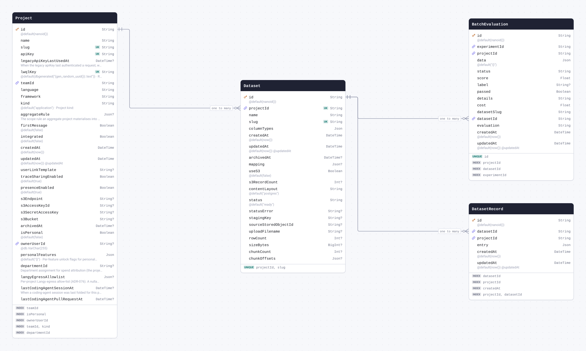

| Field                  | Type       | Constraints                             | Default              | Description |
| ---------------------- | ---------- | --------------------------------------- | -------------------- | ----------- |
| `id`                   | `String`   | PK NOT NULL                             | `nanoid()`           |             |
| `projectId`            | `String`   | NOT NULL → [Project.id](#model-Project) |                      |             |
| `name`                 | `String`   | NOT NULL                                |                      |             |
| `slug`                 | `String`   | NOT NULL                                |                      |             |
| `columnTypes`          | `Json`     | NOT NULL                                |                      |             |
| `createdAt`            | `DateTime` | NOT NULL                                | `now()`              |             |
| `updatedAt`            | `DateTime` | NOT NULL                                | `now()` `@updatedAt` |             |
| `archivedAt`           | `DateTime` | NULL                                    |                      |             |
| `mapping`              | `Json`     | NULL                                    |                      |             |
| `useS3`                | `Boolean`  | NOT NULL                                | `false`              |             |
| `s3RecordCount`        | `Int`      | NULL                                    |                      |             |
| `contentLayout`        | `String`   | NOT NULL                                | `"postgres"`         |             |
| `status`               | `String`   | NOT NULL                                | `"ready"`            |             |
| `statusError`          | `String`   | NULL                                    |                      |             |
| `stagingKey`           | `String`   | NULL                                    |                      |             |
| `sourceStoredObjectId` | `String`   | NULL                                    |                      |             |
| `uploadFilename`       | `String`   | NULL                                    |                      |             |
| `rowCount`             | `Int`      | NULL                                    |                      |             |
| `sizeBytes`            | `BigInt`   | NULL                                    |                      |             |
| `chunkCount`           | `Int`      | NULL                                    |                      |             |
| `chunkOffsets`         | `Json`     | NULL                                    |                      |             |

#### Indexes

- `@@unique([projectId, slug])`

#### References

- `projectId` → [Project.id](#model-Project) (many-to-one)

#### Referenced by

- `id` ← [DatasetRecord.datasetId](#model-DatasetRecord) (one-to-many)
- `id` ← [BatchEvaluation.datasetId](#model-BatchEvaluation) (one-to-many)

#### Definition

```sql
CREATE TABLE "Dataset" (
    "id" TEXT NOT NULL,
    "projectId" TEXT NOT NULL,
    "name" TEXT NOT NULL,
    "slug" TEXT NOT NULL,
    "columnTypes" JSONB NOT NULL,
    "createdAt" TIMESTAMP(3) NOT NULL DEFAULT CURRENT_TIMESTAMP,
    "updatedAt" TIMESTAMP(3) NOT NULL DEFAULT CURRENT_TIMESTAMP,
    "archivedAt" TIMESTAMP(3),
    "mapping" JSONB,
    "useS3" BOOLEAN NOT NULL DEFAULT false,
    "s3RecordCount" INTEGER,
    "contentLayout" TEXT NOT NULL DEFAULT 'postgres',
    "status" TEXT NOT NULL DEFAULT 'ready',
    "statusError" TEXT,
    "stagingKey" TEXT,
    "sourceStoredObjectId" TEXT,
    "uploadFilename" TEXT,
    "rowCount" INTEGER,
    "sizeBytes" BIGINT,
    "chunkCount" INTEGER,
    "chunkOffsets" JSONB,

    CONSTRAINT "Dataset_pkey" PRIMARY KEY ("id")
);

CREATE UNIQUE INDEX "Dataset_projectId_slug_key" ON "Dataset"("projectId", "slug");
```

<details>
<summary>Queries and their SQL</summary>

**findMany**: Every row

```ts
await prisma.dataset.findMany();
```

```sql
SELECT
  "public"."Dataset"."id",
  "public"."Dataset"."projectId",
  "public"."Dataset"."name",
  "public"."Dataset"."slug",
  "public"."Dataset"."columnTypes",
  "public"."Dataset"."createdAt",
  "public"."Dataset"."updatedAt",
  "public"."Dataset"."archivedAt",
  "public"."Dataset"."mapping",
  "public"."Dataset"."useS3",
  "public"."Dataset"."s3RecordCount",
  "public"."Dataset"."contentLayout",
  "public"."Dataset"."status",
  "public"."Dataset"."statusError",
  "public"."Dataset"."stagingKey",
  "public"."Dataset"."sourceStoredObjectId",
  "public"."Dataset"."uploadFilename",
  "public"."Dataset"."rowCount",
  "public"."Dataset"."sizeBytes",
  "public"."Dataset"."chunkCount",
  "public"."Dataset"."chunkOffsets"
FROM
  "public"."Dataset"
WHERE
  1 = 1
OFFSET
  $1
-- params: ["0"]
```

**count**: How many rows there are

```ts
await prisma.dataset.count();
```

```sql
SELECT
  COUNT(*) AS "_count$_all"
FROM
  (
    SELECT
      "public"."Dataset"."id"
    FROM
      "public"."Dataset"
    WHERE
      1 = 1
    OFFSET
      $1
  ) AS "sub"
-- params: ["0"]
```

**findMany**: Every row with its relations

```ts
await prisma.dataset.findMany({
  include: { project: true, datasetRecords: true, batchEvaluations: true },
});
```

```sql
SELECT
  "public"."Dataset"."id",
  "public"."Dataset"."projectId",
  "public"."Dataset"."name",
  "public"."Dataset"."slug",
  "public"."Dataset"."columnTypes",
  "public"."Dataset"."createdAt",
  "public"."Dataset"."updatedAt",
  "public"."Dataset"."archivedAt",
  "public"."Dataset"."mapping",
  "public"."Dataset"."useS3",
  "public"."Dataset"."s3RecordCount",
  "public"."Dataset"."contentLayout",
  "public"."Dataset"."status",
  "public"."Dataset"."statusError",
  "public"."Dataset"."stagingKey",
  "public"."Dataset"."sourceStoredObjectId",
  "public"."Dataset"."uploadFilename",
  "public"."Dataset"."rowCount",
  "public"."Dataset"."sizeBytes",
  "public"."Dataset"."chunkCount",
  "public"."Dataset"."chunkOffsets"
FROM
  "public"."Dataset"
WHERE
  1 = 1
OFFSET
  $1
-- params: ["0"]

SELECT
  "public"."Project"."id",
  "public"."Project"."name",
  "public"."Project"."slug",
  "public"."Project"."apiKey",
  "public"."Project"."legacyApiKeyLastUsedAt",
  "public"."Project"."lwqlKey",
  "public"."Project"."teamId",
  "public"."Project"."language",
  "public"."Project"."framework",
  "public"."Project"."kind",
  "public"."Project"."aggregateRule",
  "public"."Project"."firstMessage",
  "public"."Project"."integrated",
  "public"."Project"."createdAt",
  "public"."Project"."updatedAt",
  "public"."Project"."userLinkTemplate",
  "public"."Project"."traceSharingEnabled",
  "public"."Project"."presenceEnabled",
  "public"."Project"."s3Endpoint",
  "public"."Project"."s3AccessKeyId",
  "public"."Project"."s3SecretAccessKey",
  "public"."Project"."s3Bucket",
  "public"."Project"."archivedAt",
  "public"."Project"."isPersonal",
  "public"."Project"."ownerUserId",
  "public"."Project"."personalFeatures",
  "public"."Project"."departmentId",
  "public"."Project"."langyEgressAllowlist",
  "public"."Project"."lastCodingAgentSessionAt",
  "public"."Project"."lastCodingAgentPullRequestAt"
FROM
  "public"."Project"
WHERE
  "public"."Project"."id" IN ($1)
OFFSET
  $2
-- params: ["<projectId of the rows above>","0"]

SELECT
  "public"."DatasetRecord"."id",
  "public"."DatasetRecord"."datasetId",
  "public"."DatasetRecord"."projectId",
  "public"."DatasetRecord"."entry",
  "public"."DatasetRecord"."createdAt",
  "public"."DatasetRecord"."updatedAt"
FROM
  "public"."DatasetRecord"
WHERE
  "public"."DatasetRecord"."datasetId" IN ($1)
OFFSET
  $2
-- params: ["<id of the rows above>","0"]

SELECT
  "public"."BatchEvaluation"."id",
  "public"."BatchEvaluation"."experimentId",
  "public"."BatchEvaluation"."projectId",
  "public"."BatchEvaluation"."data",
  "public"."BatchEvaluation"."status",
  "public"."BatchEvaluation"."score",
  "public"."BatchEvaluation"."label",
  "public"."BatchEvaluation"."passed",
  "public"."BatchEvaluation"."details",
  "public"."BatchEvaluation"."cost",
  "public"."BatchEvaluation"."datasetSlug",
  "public"."BatchEvaluation"."datasetId",
  "public"."BatchEvaluation"."evaluation",
  "public"."BatchEvaluation"."createdAt",
  "public"."BatchEvaluation"."updatedAt"
FROM
  "public"."BatchEvaluation"
WHERE
  "public"."BatchEvaluation"."datasetId" IN ($1)
OFFSET
  $2
-- params: ["<id of the rows above>","0"]
```

**findUnique**: One row by what is unique to it

```ts
await prisma.dataset.findUnique({ where: { id: "example" } });
```

```sql
SELECT
  "public"."Dataset"."id",
  "public"."Dataset"."projectId",
  "public"."Dataset"."name",
  "public"."Dataset"."slug",
  "public"."Dataset"."columnTypes",
  "public"."Dataset"."createdAt",
  "public"."Dataset"."updatedAt",
  "public"."Dataset"."archivedAt",
  "public"."Dataset"."mapping",
  "public"."Dataset"."useS3",
  "public"."Dataset"."s3RecordCount",
  "public"."Dataset"."contentLayout",
  "public"."Dataset"."status",
  "public"."Dataset"."statusError",
  "public"."Dataset"."stagingKey",
  "public"."Dataset"."sourceStoredObjectId",
  "public"."Dataset"."uploadFilename",
  "public"."Dataset"."rowCount",
  "public"."Dataset"."sizeBytes",
  "public"."Dataset"."chunkCount",
  "public"."Dataset"."chunkOffsets"
FROM
  "public"."Dataset"
WHERE
  (
    "public"."Dataset"."id" = $1
    AND 1 = 1
  )
LIMIT
  $2
OFFSET
  $3
-- params: ["example","1","0"]
```

**create**: Create a row

```ts
await prisma.dataset.create({
  data: { projectId: "example", name: "example", slug: "example", columnTypes: {} },
});
```

```sql
INSERT INTO
  "public"."Dataset" (
    "id",
    "projectId",
    "name",
    "slug",
    "columnTypes",
    "createdAt",
    "updatedAt",
    "useS3",
    "contentLayout",
    "status"
  )
VALUES
  ($1, $2, $3, $4, $5, $6, $7, $8, $9, $10)
RETURNING
  "public"."Dataset"."id",
  "public"."Dataset"."projectId",
  "public"."Dataset"."name",
  "public"."Dataset"."slug",
  "public"."Dataset"."columnTypes",
  "public"."Dataset"."createdAt",
  "public"."Dataset"."updatedAt",
  "public"."Dataset"."archivedAt",
  "public"."Dataset"."mapping",
  "public"."Dataset"."useS3",
  "public"."Dataset"."s3RecordCount",
  "public"."Dataset"."contentLayout",
  "public"."Dataset"."status",
  "public"."Dataset"."statusError",
  "public"."Dataset"."stagingKey",
  "public"."Dataset"."sourceStoredObjectId",
  "public"."Dataset"."uploadFilename",
  "public"."Dataset"."rowCount",
  "public"."Dataset"."sizeBytes",
  "public"."Dataset"."chunkCount",
  "public"."Dataset"."chunkOffsets"
-- params: ["<nanoid()>","example","example","example","{}","<now()>","<now()>",false,"postgres","ready"]
```

**update**: Update a row

```ts
await prisma.dataset.update({ where: { id: "example" }, data: { name: "example" } });
```

```sql
SELECT
  "public"."Dataset"."id"
FROM
  "public"."Dataset"
WHERE
  (
    "public"."Dataset"."id" = $1
    AND 1 = 1
  )
LIMIT
  $2
OFFSET
  $3
-- params: ["example","1","0"]

UPDATE "public"."Dataset"
SET
  "name" = $1,
  "updatedAt" = $2
WHERE
  (
    "public"."Dataset"."id" IN ($3)
    AND (
      "public"."Dataset"."id" = $4
      AND 1 = 1
    )
  )
RETURNING
  "public"."Dataset"."id",
  "public"."Dataset"."projectId",
  "public"."Dataset"."name",
  "public"."Dataset"."slug",
  "public"."Dataset"."columnTypes",
  "public"."Dataset"."createdAt",
  "public"."Dataset"."updatedAt",
  "public"."Dataset"."archivedAt",
  "public"."Dataset"."mapping",
  "public"."Dataset"."useS3",
  "public"."Dataset"."s3RecordCount",
  "public"."Dataset"."contentLayout",
  "public"."Dataset"."status",
  "public"."Dataset"."statusError",
  "public"."Dataset"."stagingKey",
  "public"."Dataset"."sourceStoredObjectId",
  "public"."Dataset"."uploadFilename",
  "public"."Dataset"."rowCount",
  "public"."Dataset"."sizeBytes",
  "public"."Dataset"."chunkCount",
  "public"."Dataset"."chunkOffsets"
-- params: ["example",{"prisma__type":"generatorCall","prisma__value":{"name":"now","args":[],"returnType":{"type":"DateTime"}}},"<id of the rows above>","example"]
```

**delete**: Delete a row

```ts
await prisma.dataset.delete({ where: { id: "example" } });
```

```sql
DELETE FROM "public"."Dataset"
WHERE
  (
    "public"."Dataset"."id" = $1
    AND 1 = 1
  )
RETURNING
  "public"."Dataset"."id",
  "public"."Dataset"."projectId",
  "public"."Dataset"."name",
  "public"."Dataset"."slug",
  "public"."Dataset"."columnTypes",
  "public"."Dataset"."createdAt",
  "public"."Dataset"."updatedAt",
  "public"."Dataset"."archivedAt",
  "public"."Dataset"."mapping",
  "public"."Dataset"."useS3",
  "public"."Dataset"."s3RecordCount",
  "public"."Dataset"."contentLayout",
  "public"."Dataset"."status",
  "public"."Dataset"."statusError",
  "public"."Dataset"."stagingKey",
  "public"."Dataset"."sourceStoredObjectId",
  "public"."Dataset"."uploadFilename",
  "public"."Dataset"."rowCount",
  "public"."Dataset"."sizeBytes",
  "public"."Dataset"."chunkCount",
  "public"."Dataset"."chunkOffsets"
-- params: ["example"]

SELECT
  "public"."DatasetRecord"."id",
  "public"."DatasetRecord"."datasetId"
FROM
  "public"."DatasetRecord"
WHERE
  (
    1 = 1
    AND "public"."DatasetRecord"."datasetId" IN ($1)
  )
OFFSET
  $2
-- params: ["<id of the rows above>","0"]

SELECT
  "public"."BatchEvaluation"."id",
  "public"."BatchEvaluation"."datasetId"
FROM
  "public"."BatchEvaluation"
WHERE
  (
    1 = 1
    AND "public"."BatchEvaluation"."datasetId" IN ($1)
  )
OFFSET
  $2
-- params: ["<id of the rows above>","0"]
```

</details>

<a id="model-DatasetRecord"></a>

### DatasetRecord

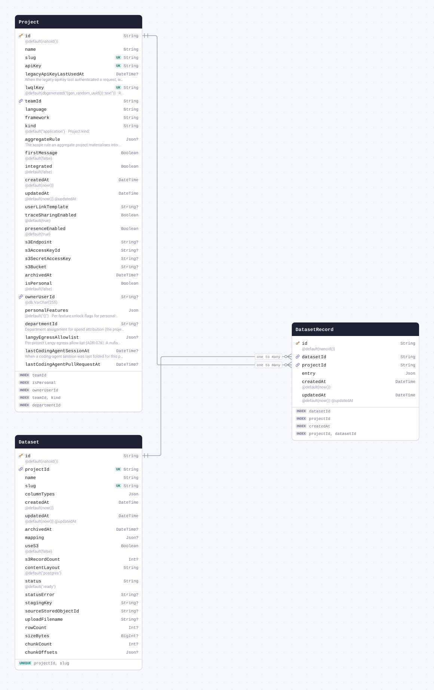

| Field       | Type       | Constraints                             | Default              | Description |
| ----------- | ---------- | --------------------------------------- | -------------------- | ----------- |
| `id`        | `String`   | PK NOT NULL                             | `nanoid()`           |             |
| `datasetId` | `String`   | NOT NULL → [Dataset.id](#model-Dataset) |                      |             |
| `projectId` | `String`   | NOT NULL → [Project.id](#model-Project) |                      |             |
| `entry`     | `Json`     | NOT NULL                                |                      |             |
| `createdAt` | `DateTime` | NOT NULL                                | `now()`              |             |
| `updatedAt` | `DateTime` | NOT NULL                                | `now()` `@updatedAt` |             |

#### Indexes

- `@@index([datasetId])`
- `@@index([projectId])`
- `@@index([createdAt])`
- `@@index([projectId, datasetId])`

#### References

- `datasetId` → [Dataset.id](#model-Dataset) (many-to-one)
- `projectId` → [Project.id](#model-Project) (many-to-one)

#### Definition

```sql
CREATE TABLE "DatasetRecord" (
    "id" TEXT NOT NULL,
    "datasetId" TEXT NOT NULL,
    "projectId" TEXT NOT NULL,
    "entry" JSONB NOT NULL,
    "createdAt" TIMESTAMP(3) NOT NULL DEFAULT CURRENT_TIMESTAMP,
    "updatedAt" TIMESTAMP(3) NOT NULL DEFAULT CURRENT_TIMESTAMP,

    CONSTRAINT "DatasetRecord_pkey" PRIMARY KEY ("id")
);

CREATE INDEX "DatasetRecord_datasetId_idx" ON "DatasetRecord"("datasetId");

CREATE INDEX "DatasetRecord_projectId_idx" ON "DatasetRecord"("projectId");

CREATE INDEX "DatasetRecord_createdAt_idx" ON "DatasetRecord"("createdAt");

CREATE INDEX "DatasetRecord_projectId_datasetId_idx" ON "DatasetRecord"("projectId", "datasetId");
```

<details>
<summary>Queries and their SQL</summary>

**findMany**: Every row

```ts
await prisma.datasetRecord.findMany();
```

```sql
SELECT
  "public"."DatasetRecord"."id",
  "public"."DatasetRecord"."datasetId",
  "public"."DatasetRecord"."projectId",
  "public"."DatasetRecord"."entry",
  "public"."DatasetRecord"."createdAt",
  "public"."DatasetRecord"."updatedAt"
FROM
  "public"."DatasetRecord"
WHERE
  1 = 1
OFFSET
  $1
-- params: ["0"]
```

**count**: How many rows there are

```ts
await prisma.datasetRecord.count();
```

```sql
SELECT
  COUNT(*) AS "_count$_all"
FROM
  (
    SELECT
      "public"."DatasetRecord"."id"
    FROM
      "public"."DatasetRecord"
    WHERE
      1 = 1
    OFFSET
      $1
  ) AS "sub"
-- params: ["0"]
```

**findMany**: Every row with its relations

```ts
await prisma.datasetRecord.findMany({ include: { dataset: true, project: true } });
```

```sql
SELECT
  "public"."DatasetRecord"."id",
  "public"."DatasetRecord"."datasetId",
  "public"."DatasetRecord"."projectId",
  "public"."DatasetRecord"."entry",
  "public"."DatasetRecord"."createdAt",
  "public"."DatasetRecord"."updatedAt"
FROM
  "public"."DatasetRecord"
WHERE
  1 = 1
OFFSET
  $1
-- params: ["0"]

SELECT
  "public"."Dataset"."id",
  "public"."Dataset"."projectId",
  "public"."Dataset"."name",
  "public"."Dataset"."slug",
  "public"."Dataset"."columnTypes",
  "public"."Dataset"."createdAt",
  "public"."Dataset"."updatedAt",
  "public"."Dataset"."archivedAt",
  "public"."Dataset"."mapping",
  "public"."Dataset"."useS3",
  "public"."Dataset"."s3RecordCount",
  "public"."Dataset"."contentLayout",
  "public"."Dataset"."status",
  "public"."Dataset"."statusError",
  "public"."Dataset"."stagingKey",
  "public"."Dataset"."sourceStoredObjectId",
  "public"."Dataset"."uploadFilename",
  "public"."Dataset"."rowCount",
  "public"."Dataset"."sizeBytes",
  "public"."Dataset"."chunkCount",
  "public"."Dataset"."chunkOffsets"
FROM
  "public"."Dataset"
WHERE
  "public"."Dataset"."id" IN ($1)
OFFSET
  $2
-- params: ["<datasetId of the rows above>","0"]

SELECT
  "public"."Project"."id",
  "public"."Project"."name",
  "public"."Project"."slug",
  "public"."Project"."apiKey",
  "public"."Project"."legacyApiKeyLastUsedAt",
  "public"."Project"."lwqlKey",
  "public"."Project"."teamId",
  "public"."Project"."language",
  "public"."Project"."framework",
  "public"."Project"."kind",
  "public"."Project"."aggregateRule",
  "public"."Project"."firstMessage",
  "public"."Project"."integrated",
  "public"."Project"."createdAt",
  "public"."Project"."updatedAt",
  "public"."Project"."userLinkTemplate",
  "public"."Project"."traceSharingEnabled",
  "public"."Project"."presenceEnabled",
  "public"."Project"."s3Endpoint",
  "public"."Project"."s3AccessKeyId",
  "public"."Project"."s3SecretAccessKey",
  "public"."Project"."s3Bucket",
  "public"."Project"."archivedAt",
  "public"."Project"."isPersonal",
  "public"."Project"."ownerUserId",
  "public"."Project"."personalFeatures",
  "public"."Project"."departmentId",
  "public"."Project"."langyEgressAllowlist",
  "public"."Project"."lastCodingAgentSessionAt",
  "public"."Project"."lastCodingAgentPullRequestAt"
FROM
  "public"."Project"
WHERE
  "public"."Project"."id" IN ($1)
OFFSET
  $2
-- params: ["<projectId of the rows above>","0"]
```

**findUnique**: One row by what is unique to it

```ts
await prisma.datasetRecord.findUnique({ where: { id: "example" } });
```

```sql
SELECT
  "public"."DatasetRecord"."id",
  "public"."DatasetRecord"."datasetId",
  "public"."DatasetRecord"."projectId",
  "public"."DatasetRecord"."entry",
  "public"."DatasetRecord"."createdAt",
  "public"."DatasetRecord"."updatedAt"
FROM
  "public"."DatasetRecord"
WHERE
  (
    "public"."DatasetRecord"."id" = $1
    AND 1 = 1
  )
LIMIT
  $2
OFFSET
  $3
-- params: ["example","1","0"]
```

**create**: Create a row

```ts
await prisma.datasetRecord.create({
  data: { datasetId: "example", projectId: "example", entry: {} },
});
```

```sql
INSERT INTO
  "public"."DatasetRecord" (
    "id",
    "datasetId",
    "projectId",
    "entry",
    "createdAt",
    "updatedAt"
  )
VALUES
  ($1, $2, $3, $4, $5, $6)
RETURNING
  "public"."DatasetRecord"."id",
  "public"."DatasetRecord"."datasetId",
  "public"."DatasetRecord"."projectId",
  "public"."DatasetRecord"."entry",
  "public"."DatasetRecord"."createdAt",
  "public"."DatasetRecord"."updatedAt"
-- params: ["<nanoid()>","example","example","{}","<now()>","<now()>"]
```

**update**: Update a row

```ts
await prisma.datasetRecord.update({ where: { id: "example" }, data: { entry: {} } });
```

```sql
SELECT
  "public"."DatasetRecord"."id"
FROM
  "public"."DatasetRecord"
WHERE
  (
    "public"."DatasetRecord"."id" = $1
    AND 1 = 1
  )
LIMIT
  $2
OFFSET
  $3
-- params: ["example","1","0"]

UPDATE "public"."DatasetRecord"
SET
  "entry" = $1,
  "updatedAt" = $2
WHERE
  (
    "public"."DatasetRecord"."id" IN ($3)
    AND (
      "public"."DatasetRecord"."id" = $4
      AND 1 = 1
    )
  )
RETURNING
  "public"."DatasetRecord"."id",
  "public"."DatasetRecord"."datasetId",
  "public"."DatasetRecord"."projectId",
  "public"."DatasetRecord"."entry",
  "public"."DatasetRecord"."createdAt",
  "public"."DatasetRecord"."updatedAt"
-- params: ["{}",{"prisma__type":"generatorCall","prisma__value":{"name":"now","args":[],"returnType":{"type":"DateTime"}}},"<id of the rows above>","example"]
```

**delete**: Delete a row

```ts
await prisma.datasetRecord.delete({ where: { id: "example" } });
```

```sql
DELETE FROM "public"."DatasetRecord"
WHERE
  (
    "public"."DatasetRecord"."id" = $1
    AND 1 = 1
  )
RETURNING
  "public"."DatasetRecord"."id",
  "public"."DatasetRecord"."datasetId",
  "public"."DatasetRecord"."projectId",
  "public"."DatasetRecord"."entry",
  "public"."DatasetRecord"."createdAt",
  "public"."DatasetRecord"."updatedAt"
-- params: ["example"]
```

</details>

<a id="model-DatasetVersion"></a>

### DatasetVersion

One immutable snapshot of a dataset's columns and rows; the rows are JSONL chunks in object storage.

| Field                 | Type       | Constraints | Default | Description                                                                         |
| --------------------- | ---------- | ----------- | ------- | ----------------------------------------------------------------------------------- |
| `id`                  | `String`   | PK NOT NULL |         |                                                                                     |
| `projectId`           | `String`   | NOT NULL    |         |                                                                                     |
| `datasetId`           | `String`   | NOT NULL    |         |                                                                                     |
| `version`             | `Int`      | NOT NULL    |         |                                                                                     |
| `name`                | `String`   | NULL        |         | A name given by hand; a named version is never thinned by retention.                |
| `trigger`             | `String`   | NOT NULL    |         | "autosave", "manual", "experiment_run", "restore" or "initial".                     |
| `contentHash`         | `String`   | NOT NULL    |         | SHA-256 over the columns and the rows in order; equal content saves no new version. |
| `columnTypes`         | `Json`     | NOT NULL    |         |                                                                                     |
| `rowCount`            | `Int`      | NOT NULL    |         |                                                                                     |
| `sizeBytes`           | `BigInt`   | NOT NULL    |         |                                                                                     |
| `chunkCount`          | `Int`      | NOT NULL    |         |                                                                                     |
| `restoredFromVersion` | `Int`      | NULL        |         |                                                                                     |
| `authorId`            | `String`   | NULL        |         |                                                                                     |
| `authorKind`          | `String`   | NULL        |         | "user", "api_key" or "system": who saved the version when authorId is null.         |
| `pinnedAt`            | `DateTime` | NULL        |         | Set when an experiment pins this version; a pinned version is never thinned.        |
| `createdAt`           | `DateTime` | NOT NULL    | `now()` |                                                                                     |

#### Indexes

- `@@index([projectId, datasetId])`
- `@@unique([datasetId, version])`

#### Definition

```sql
CREATE TABLE "DatasetVersion" (
    "id" TEXT NOT NULL,
    "projectId" TEXT NOT NULL,
    "datasetId" TEXT NOT NULL,
    "version" INTEGER NOT NULL,
    "name" TEXT,
    "trigger" TEXT NOT NULL,
    "contentHash" TEXT NOT NULL,
    "columnTypes" JSONB NOT NULL,
    "rowCount" INTEGER NOT NULL,
    "sizeBytes" BIGINT NOT NULL,
    "chunkCount" INTEGER NOT NULL,
    "restoredFromVersion" INTEGER,
    "authorId" TEXT,
    "authorKind" TEXT,
    "pinnedAt" TIMESTAMP(3),
    "createdAt" TIMESTAMP(3) NOT NULL DEFAULT CURRENT_TIMESTAMP,

    CONSTRAINT "DatasetVersion_pkey" PRIMARY KEY ("id")
);

CREATE INDEX "DatasetVersion_projectId_datasetId_idx" ON "DatasetVersion"("projectId", "datasetId");

CREATE UNIQUE INDEX "DatasetVersion_datasetId_version_key" ON "DatasetVersion"("datasetId", "version");
```

<details>
<summary>Queries and their SQL</summary>

**findMany**: Every row

```ts
await prisma.datasetVersion.findMany();
```

```sql
SELECT
  "public"."DatasetVersion"."id",
  "public"."DatasetVersion"."projectId",
  "public"."DatasetVersion"."datasetId",
  "public"."DatasetVersion"."version",
  "public"."DatasetVersion"."name",
  "public"."DatasetVersion"."trigger",
  "public"."DatasetVersion"."contentHash",
  "public"."DatasetVersion"."columnTypes",
  "public"."DatasetVersion"."rowCount",
  "public"."DatasetVersion"."sizeBytes",
  "public"."DatasetVersion"."chunkCount",
  "public"."DatasetVersion"."restoredFromVersion",
  "public"."DatasetVersion"."authorId",
  "public"."DatasetVersion"."authorKind",
  "public"."DatasetVersion"."pinnedAt",
  "public"."DatasetVersion"."createdAt"
FROM
  "public"."DatasetVersion"
WHERE
  1 = 1
OFFSET
  $1
-- params: ["0"]
```

**count**: How many rows there are

```ts
await prisma.datasetVersion.count();
```

```sql
SELECT
  COUNT(*) AS "_count$_all"
FROM
  (
    SELECT
      "public"."DatasetVersion"."id"
    FROM
      "public"."DatasetVersion"
    WHERE
      1 = 1
    OFFSET
      $1
  ) AS "sub"
-- params: ["0"]
```

**findUnique**: One row by what is unique to it

```ts
await prisma.datasetVersion.findUnique({ where: { id: "example" } });
```

```sql
SELECT
  "public"."DatasetVersion"."id",
  "public"."DatasetVersion"."projectId",
  "public"."DatasetVersion"."datasetId",
  "public"."DatasetVersion"."version",
  "public"."DatasetVersion"."name",
  "public"."DatasetVersion"."trigger",
  "public"."DatasetVersion"."contentHash",
  "public"."DatasetVersion"."columnTypes",
  "public"."DatasetVersion"."rowCount",
  "public"."DatasetVersion"."sizeBytes",
  "public"."DatasetVersion"."chunkCount",
  "public"."DatasetVersion"."restoredFromVersion",
  "public"."DatasetVersion"."authorId",
  "public"."DatasetVersion"."authorKind",
  "public"."DatasetVersion"."pinnedAt",
  "public"."DatasetVersion"."createdAt"
FROM
  "public"."DatasetVersion"
WHERE
  (
    "public"."DatasetVersion"."id" = $1
    AND 1 = 1
  )
LIMIT
  $2
OFFSET
  $3
-- params: ["example","1","0"]
```

**create**: Create a row

```ts
await prisma.datasetVersion.create({
  data: {
    id: "example",
    projectId: "example",
    datasetId: "example",
    version: 1,
    trigger: "example",
    contentHash: "example",
    columnTypes: {},
    rowCount: 1,
    sizeBytes: 1n,
    chunkCount: 1,
  },
});
```

```sql
INSERT INTO
  "public"."DatasetVersion" (
    "id",
    "projectId",
    "datasetId",
    "version",
    "trigger",
    "contentHash",
    "columnTypes",
    "rowCount",
    "sizeBytes",
    "chunkCount",
    "createdAt"
  )
VALUES
  ($1, $2, $3, $4, $5, $6, $7, $8, $9, $10, $11)
RETURNING
  "public"."DatasetVersion"."id",
  "public"."DatasetVersion"."projectId",
  "public"."DatasetVersion"."datasetId",
  "public"."DatasetVersion"."version",
  "public"."DatasetVersion"."name",
  "public"."DatasetVersion"."trigger",
  "public"."DatasetVersion"."contentHash",
  "public"."DatasetVersion"."columnTypes",
  "public"."DatasetVersion"."rowCount",
  "public"."DatasetVersion"."sizeBytes",
  "public"."DatasetVersion"."chunkCount",
  "public"."DatasetVersion"."restoredFromVersion",
  "public"."DatasetVersion"."authorId",
  "public"."DatasetVersion"."authorKind",
  "public"."DatasetVersion"."pinnedAt",
  "public"."DatasetVersion"."createdAt"
-- params: ["example","example","example","1","example","example","{}","1","1","1","<now()>"]
```

**update**: Update a row

```ts
await prisma.datasetVersion.update({ where: { id: "example" }, data: { projectId: "example" } });
```

```sql
SELECT
  "public"."DatasetVersion"."id"
FROM
  "public"."DatasetVersion"
WHERE
  (
    "public"."DatasetVersion"."id" = $1
    AND 1 = 1
  )
LIMIT
  $2
OFFSET
  $3
-- params: ["example","1","0"]

UPDATE "public"."DatasetVersion"
SET
  "projectId" = $1
WHERE
  (
    "public"."DatasetVersion"."id" IN ($2)
    AND (
      "public"."DatasetVersion"."id" = $3
      AND 1 = 1
    )
  )
RETURNING
  "public"."DatasetVersion"."id",
  "public"."DatasetVersion"."projectId",
  "public"."DatasetVersion"."datasetId",
  "public"."DatasetVersion"."version",
  "public"."DatasetVersion"."name",
  "public"."DatasetVersion"."trigger",
  "public"."DatasetVersion"."contentHash",
  "public"."DatasetVersion"."columnTypes",
  "public"."DatasetVersion"."rowCount",
  "public"."DatasetVersion"."sizeBytes",
  "public"."DatasetVersion"."chunkCount",
  "public"."DatasetVersion"."restoredFromVersion",
  "public"."DatasetVersion"."authorId",
  "public"."DatasetVersion"."authorKind",
  "public"."DatasetVersion"."pinnedAt",
  "public"."DatasetVersion"."createdAt"
-- params: ["example","<id of the rows above>","example"]
```

**delete**: Delete a row

```ts
await prisma.datasetVersion.delete({ where: { id: "example" } });
```

```sql
DELETE FROM "public"."DatasetVersion"
WHERE
  (
    "public"."DatasetVersion"."id" = $1
    AND 1 = 1
  )
RETURNING
  "public"."DatasetVersion"."id",
  "public"."DatasetVersion"."projectId",
  "public"."DatasetVersion"."datasetId",
  "public"."DatasetVersion"."version",
  "public"."DatasetVersion"."name",
  "public"."DatasetVersion"."trigger",
  "public"."DatasetVersion"."contentHash",
  "public"."DatasetVersion"."columnTypes",
  "public"."DatasetVersion"."rowCount",
  "public"."DatasetVersion"."sizeBytes",
  "public"."DatasetVersion"."chunkCount",
  "public"."DatasetVersion"."restoredFromVersion",
  "public"."DatasetVersion"."authorId",
  "public"."DatasetVersion"."authorKind",
  "public"."DatasetVersion"."pinnedAt",
  "public"."DatasetVersion"."createdAt"
-- params: ["example"]
```

</details>

<a id="model-DatasetVersionRun"></a>

### DatasetVersionRun

An experiment run that read one dataset version; a version a run read is never thinned.

| Field          | Type       | Constraints | Default | Description |
| -------------- | ---------- | ----------- | ------- | ----------- |
| `id`           | `String`   | PK NOT NULL |         |             |
| `projectId`    | `String`   | NOT NULL    |         |             |
| `datasetId`    | `String`   | NOT NULL    |         |             |
| `versionId`    | `String`   | NOT NULL    |         |             |
| `runId`        | `String`   | NOT NULL    |         |             |
| `experimentId` | `String`   | NULL        |         |             |
| `createdAt`    | `DateTime` | NOT NULL    | `now()` |             |

#### Indexes

- `@@index([versionId])`
- `@@unique([projectId, runId, datasetId])`

#### Definition

```sql
CREATE TABLE "DatasetVersionRun" (
    "id" TEXT NOT NULL,
    "projectId" TEXT NOT NULL,
    "datasetId" TEXT NOT NULL,
    "versionId" TEXT NOT NULL,
    "runId" TEXT NOT NULL,
    "experimentId" TEXT,
    "createdAt" TIMESTAMP(3) NOT NULL DEFAULT CURRENT_TIMESTAMP,

    CONSTRAINT "DatasetVersionRun_pkey" PRIMARY KEY ("id")
);

CREATE INDEX "DatasetVersionRun_versionId_idx" ON "DatasetVersionRun"("versionId");

CREATE UNIQUE INDEX "DatasetVersionRun_projectId_runId_datasetId_key" ON "DatasetVersionRun"("projectId", "runId", "datasetId");
```

<details>
<summary>Queries and their SQL</summary>

**findMany**: Every row

```ts
await prisma.datasetVersionRun.findMany();
```

```sql
SELECT
  "public"."DatasetVersionRun"."id",
  "public"."DatasetVersionRun"."projectId",
  "public"."DatasetVersionRun"."datasetId",
  "public"."DatasetVersionRun"."versionId",
  "public"."DatasetVersionRun"."runId",
  "public"."DatasetVersionRun"."experimentId",
  "public"."DatasetVersionRun"."createdAt"
FROM
  "public"."DatasetVersionRun"
WHERE
  1 = 1
OFFSET
  $1
-- params: ["0"]
```

**count**: How many rows there are

```ts
await prisma.datasetVersionRun.count();
```

```sql
SELECT
  COUNT(*) AS "_count$_all"
FROM
  (
    SELECT
      "public"."DatasetVersionRun"."id"
    FROM
      "public"."DatasetVersionRun"
    WHERE
      1 = 1
    OFFSET
      $1
  ) AS "sub"
-- params: ["0"]
```

**findUnique**: One row by what is unique to it

```ts
await prisma.datasetVersionRun.findUnique({ where: { id: "example" } });
```

```sql
SELECT
  "public"."DatasetVersionRun"."id",
  "public"."DatasetVersionRun"."projectId",
  "public"."DatasetVersionRun"."datasetId",
  "public"."DatasetVersionRun"."versionId",
  "public"."DatasetVersionRun"."runId",
  "public"."DatasetVersionRun"."experimentId",
  "public"."DatasetVersionRun"."createdAt"
FROM
  "public"."DatasetVersionRun"
WHERE
  (
    "public"."DatasetVersionRun"."id" = $1
    AND 1 = 1
  )
LIMIT
  $2
OFFSET
  $3
-- params: ["example","1","0"]
```

**create**: Create a row

```ts
await prisma.datasetVersionRun.create({
  data: {
    id: "example",
    projectId: "example",
    datasetId: "example",
    versionId: "example",
    runId: "example",
  },
});
```

```sql
INSERT INTO
  "public"."DatasetVersionRun" (
    "id",
    "projectId",
    "datasetId",
    "versionId",
    "runId",
    "createdAt"
  )
VALUES
  ($1, $2, $3, $4, $5, $6)
RETURNING
  "public"."DatasetVersionRun"."id",
  "public"."DatasetVersionRun"."projectId",
  "public"."DatasetVersionRun"."datasetId",
  "public"."DatasetVersionRun"."versionId",
  "public"."DatasetVersionRun"."runId",
  "public"."DatasetVersionRun"."experimentId",
  "public"."DatasetVersionRun"."createdAt"
-- params: ["example","example","example","example","example","<now()>"]
```

**update**: Update a row

```ts
await prisma.datasetVersionRun.update({ where: { id: "example" }, data: { projectId: "example" } });
```

```sql
SELECT
  "public"."DatasetVersionRun"."id"
FROM
  "public"."DatasetVersionRun"
WHERE
  (
    "public"."DatasetVersionRun"."id" = $1
    AND 1 = 1
  )
LIMIT
  $2
OFFSET
  $3
-- params: ["example","1","0"]

UPDATE "public"."DatasetVersionRun"
SET
  "projectId" = $1
WHERE
  (
    "public"."DatasetVersionRun"."id" IN ($2)
    AND (
      "public"."DatasetVersionRun"."id" = $3
      AND 1 = 1
    )
  )
RETURNING
  "public"."DatasetVersionRun"."id",
  "public"."DatasetVersionRun"."projectId",
  "public"."DatasetVersionRun"."datasetId",
  "public"."DatasetVersionRun"."versionId",
  "public"."DatasetVersionRun"."runId",
  "public"."DatasetVersionRun"."experimentId",
  "public"."DatasetVersionRun"."createdAt"
-- params: ["example","<id of the rows above>","example"]
```

**delete**: Delete a row

```ts
await prisma.datasetVersionRun.delete({ where: { id: "example" } });
```

```sql
DELETE FROM "public"."DatasetVersionRun"
WHERE
  (
    "public"."DatasetVersionRun"."id" = $1
    AND 1 = 1
  )
RETURNING
  "public"."DatasetVersionRun"."id",
  "public"."DatasetVersionRun"."projectId",
  "public"."DatasetVersionRun"."datasetId",
  "public"."DatasetVersionRun"."versionId",
  "public"."DatasetVersionRun"."runId",
  "public"."DatasetVersionRun"."experimentId",
  "public"."DatasetVersionRun"."createdAt"
-- params: ["example"]
```

</details>

<a id="model-Dashboard"></a>

### Dashboard

Table `Dashboard`.

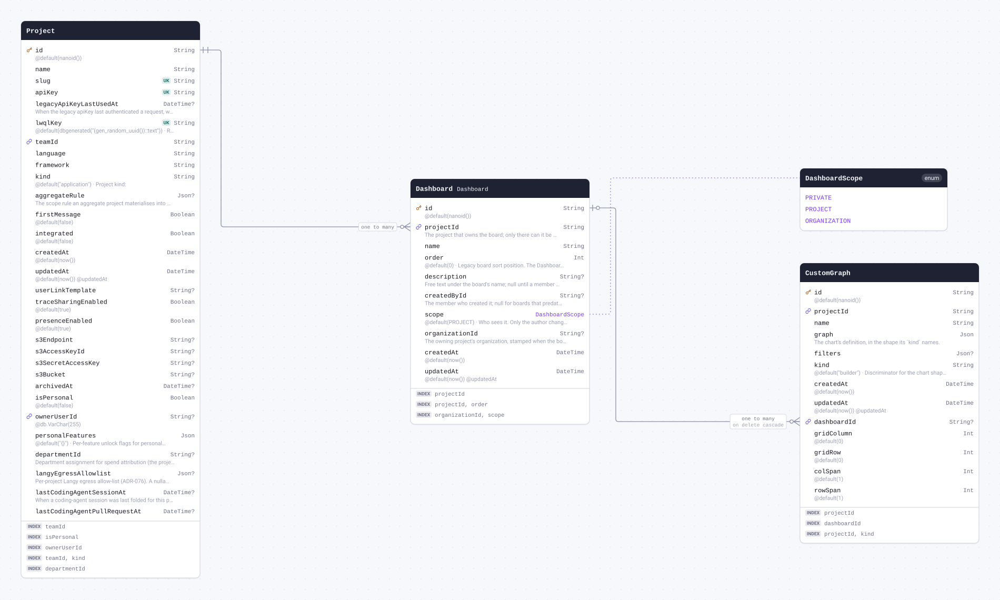

| Field            | Type                                     | Constraints                             | Default              | Description                                                                                                                                                                                                                                                        |
| ---------------- | ---------------------------------------- | --------------------------------------- | -------------------- | ------------------------------------------------------------------------------------------------------------------------------------------------------------------------------------------------------------------------------------------------------------------ |
| `id`             | `String`                                 | PK NOT NULL                             | `nanoid()`           |                                                                                                                                                                                                                                                                    |
| `projectId`      | `String`                                 | NOT NULL → [Project.id](#model-Project) |                      | The project that owns the board; only there can it be edited.                                                                                                                                                                                                      |
| `name`           | `String`                                 | NOT NULL                                |                      |                                                                                                                                                                                                                                                                    |
| `order`          | `Int`                                    | NOT NULL                                | `0`                  | Legacy board sort position. The Dashboards v2 app orders boards by a member's favourites and never writes this; kept because the legacy Analytics reports section and the REST reorder endpoint still write it, and a rolling deploy's older image still reads it. |
| `description`    | `String`                                 | NULL                                    |                      | Free text under the board's name; null until a member writes one. Retiring: Dashboards v2 boards live in DashboardsV2, so no new write sets it.                                                                                                                    |
| `createdById`    | `String`                                 | NULL                                    |                      | The member who created it; null for boards that predate the column. Retiring: Dashboards v2 boards live in DashboardsV2, so no new write sets it.                                                                                                                  |
| `scope`          | [`DashboardScope`](#enum-DashboardScope) | NOT NULL                                | `PROJECT`            | Who sees it. Only the author changes it; a board with no author stays PROJECT. Retiring: Dashboards v2 boards live in DashboardsV2, so no new write sets it.                                                                                                       |
| `organizationId` | `String`                                 | NULL                                    |                      | The owning project's organization, stamped when the board is first set to ORGANIZATION; null before. No relation, per the database rule. Retiring: Dashboards v2 boards live in DashboardsV2, so no new write sets it.                                             |
| `createdAt`      | `DateTime`                               | NOT NULL                                | `now()`              |                                                                                                                                                                                                                                                                    |
| `updatedAt`      | `DateTime`                               | NOT NULL                                | `now()` `@updatedAt` |                                                                                                                                                                                                                                                                    |

#### Indexes

- `@@index([projectId])`
- `@@index([projectId, order])`
- `@@index([organizationId, scope])`

#### References

- `projectId` → [Project.id](#model-Project) (many-to-one)

#### Referenced by

- `id` ← [CustomGraph.dashboardId](#model-CustomGraph) (one-to-many, on delete Cascade)

#### Definition

```sql
CREATE TABLE "Dashboard" (
    "id" TEXT NOT NULL,
    "projectId" TEXT NOT NULL,
    "name" TEXT NOT NULL,
    "order" INTEGER NOT NULL DEFAULT 0,
    "description" TEXT,
    "createdById" TEXT,
    "scope" "DashboardScope" NOT NULL DEFAULT 'PROJECT',
    "organizationId" TEXT,
    "createdAt" TIMESTAMP(3) NOT NULL DEFAULT CURRENT_TIMESTAMP,
    "updatedAt" TIMESTAMP(3) NOT NULL DEFAULT CURRENT_TIMESTAMP,

    CONSTRAINT "Dashboard_pkey" PRIMARY KEY ("id")
);

CREATE INDEX "Dashboard_projectId_idx" ON "Dashboard"("projectId");

CREATE INDEX "Dashboard_projectId_order_idx" ON "Dashboard"("projectId", "order");

CREATE INDEX "Dashboard_organizationId_scope_idx" ON "Dashboard"("organizationId", "scope");
```

<details>
<summary>Queries and their SQL</summary>

**findMany**: Every row

```ts
await prisma.dashboard.findMany();
```

```sql
SELECT
  "public"."Dashboard"."id",
  "public"."Dashboard"."projectId",
  "public"."Dashboard"."name",
  "public"."Dashboard"."order",
  "public"."Dashboard"."description",
  "public"."Dashboard"."createdById",
  "public"."Dashboard"."scope"::text,
  "public"."Dashboard"."organizationId",
  "public"."Dashboard"."createdAt",
  "public"."Dashboard"."updatedAt"
FROM
  "public"."Dashboard"
WHERE
  1 = 1
OFFSET
  $1
-- params: ["0"]
```

**count**: How many rows there are

```ts
await prisma.dashboard.count();
```

```sql
SELECT
  COUNT(*) AS "_count$_all"
FROM
  (
    SELECT
      "public"."Dashboard"."id"
    FROM
      "public"."Dashboard"
    WHERE
      1 = 1
    OFFSET
      $1
  ) AS "sub"
-- params: ["0"]
```

**findMany**: Every row with its relations

```ts
await prisma.dashboard.findMany({ include: { project: true, graphs: true } });
```

```sql
SELECT
  "public"."Dashboard"."id",
  "public"."Dashboard"."projectId",
  "public"."Dashboard"."name",
  "public"."Dashboard"."order",
  "public"."Dashboard"."description",
  "public"."Dashboard"."createdById",
  "public"."Dashboard"."scope"::text,
  "public"."Dashboard"."organizationId",
  "public"."Dashboard"."createdAt",
  "public"."Dashboard"."updatedAt"
FROM
  "public"."Dashboard"
WHERE
  1 = 1
OFFSET
  $1
-- params: ["0"]

SELECT
  "public"."Project"."id",
  "public"."Project"."name",
  "public"."Project"."slug",
  "public"."Project"."apiKey",
  "public"."Project"."legacyApiKeyLastUsedAt",
  "public"."Project"."lwqlKey",
  "public"."Project"."teamId",
  "public"."Project"."language",
  "public"."Project"."framework",
  "public"."Project"."kind",
  "public"."Project"."aggregateRule",
  "public"."Project"."firstMessage",
  "public"."Project"."integrated",
  "public"."Project"."createdAt",
  "public"."Project"."updatedAt",
  "public"."Project"."userLinkTemplate",
  "public"."Project"."traceSharingEnabled",
  "public"."Project"."presenceEnabled",
  "public"."Project"."s3Endpoint",
  "public"."Project"."s3AccessKeyId",
  "public"."Project"."s3SecretAccessKey",
  "public"."Project"."s3Bucket",
  "public"."Project"."archivedAt",
  "public"."Project"."isPersonal",
  "public"."Project"."ownerUserId",
  "public"."Project"."personalFeatures",
  "public"."Project"."departmentId",
  "public"."Project"."langyEgressAllowlist",
  "public"."Project"."lastCodingAgentSessionAt",
  "public"."Project"."lastCodingAgentPullRequestAt"
FROM
  "public"."Project"
WHERE
  "public"."Project"."id" IN ($1)
OFFSET
  $2
-- params: ["<projectId of the rows above>","0"]

SELECT
  "public"."CustomGraph"."id",
  "public"."CustomGraph"."projectId",
  "public"."CustomGraph"."name",
  "public"."CustomGraph"."graph",
  "public"."CustomGraph"."filters",
  "public"."CustomGraph"."kind",
  "public"."CustomGraph"."createdAt",
  "public"."CustomGraph"."updatedAt",
  "public"."CustomGraph"."dashboardId",
  "public"."CustomGraph"."gridColumn",
  "public"."CustomGraph"."gridRow",
  "public"."CustomGraph"."colSpan",
  "public"."CustomGraph"."rowSpan"
FROM
  "public"."CustomGraph"
WHERE
  "public"."CustomGraph"."dashboardId" IN ($1)
OFFSET
  $2
-- params: ["<id of the rows above>","0"]
```

**findUnique**: One row by what is unique to it

```ts
await prisma.dashboard.findUnique({ where: { id: "example" } });
```

```sql
SELECT
  "public"."Dashboard"."id",
  "public"."Dashboard"."projectId",
  "public"."Dashboard"."name",
  "public"."Dashboard"."order",
  "public"."Dashboard"."description",
  "public"."Dashboard"."createdById",
  "public"."Dashboard"."scope"::text,
  "public"."Dashboard"."organizationId",
  "public"."Dashboard"."createdAt",
  "public"."Dashboard"."updatedAt"
FROM
  "public"."Dashboard"
WHERE
  (
    "public"."Dashboard"."id" = $1
    AND 1 = 1
  )
LIMIT
  $2
OFFSET
  $3
-- params: ["example","1","0"]
```

**create**: Create a row

```ts
await prisma.dashboard.create({ data: { projectId: "example", name: "example" } });
```

```sql
INSERT INTO
  "public"."Dashboard" (
    "id",
    "projectId",
    "name",
    "order",
    "scope",
    "createdAt",
    "updatedAt"
  )
VALUES
  (
    $1,
    $2,
    $3,
    $4,
    CAST($5::text AS "public"."DashboardScope"),
    $6,
    $7
  )
RETURNING
  "public"."Dashboard"."id",
  "public"."Dashboard"."projectId",
  "public"."Dashboard"."name",
  "public"."Dashboard"."order",
  "public"."Dashboard"."description",
  "public"."Dashboard"."createdById",
  "public"."Dashboard"."scope"::text,
  "public"."Dashboard"."organizationId",
  "public"."Dashboard"."createdAt",
  "public"."Dashboard"."updatedAt"
-- params: ["<nanoid()>","example","example","0","PROJECT","<now()>","<now()>"]
```

**update**: Update a row

```ts
await prisma.dashboard.update({ where: { id: "example" }, data: { name: "example" } });
```

```sql
SELECT
  "public"."Dashboard"."id"
FROM
  "public"."Dashboard"
WHERE
  (
    "public"."Dashboard"."id" = $1
    AND 1 = 1
  )
LIMIT
  $2
OFFSET
  $3
-- params: ["example","1","0"]

UPDATE "public"."Dashboard"
SET
  "name" = $1,
  "updatedAt" = $2
WHERE
  (
    "public"."Dashboard"."id" IN ($3)
    AND (
      "public"."Dashboard"."id" = $4
      AND 1 = 1
    )
  )
RETURNING
  "public"."Dashboard"."id",
  "public"."Dashboard"."projectId",
  "public"."Dashboard"."name",
  "public"."Dashboard"."order",
  "public"."Dashboard"."description",
  "public"."Dashboard"."createdById",
  "public"."Dashboard"."scope"::text,
  "public"."Dashboard"."organizationId",
  "public"."Dashboard"."createdAt",
  "public"."Dashboard"."updatedAt"
-- params: ["example",{"prisma__type":"generatorCall","prisma__value":{"name":"now","args":[],"returnType":{"type":"DateTime"}}},"<id of the rows above>","example"]
```

**delete**: Delete a row

```ts
await prisma.dashboard.delete({ where: { id: "example" } });
```

```sql
DELETE FROM "public"."Dashboard"
WHERE
  (
    "public"."Dashboard"."id" = $1
    AND 1 = 1
  )
RETURNING
  "public"."Dashboard"."id",
  "public"."Dashboard"."projectId",
  "public"."Dashboard"."name",
  "public"."Dashboard"."order",
  "public"."Dashboard"."description",
  "public"."Dashboard"."createdById",
  "public"."Dashboard"."scope"::text,
  "public"."Dashboard"."organizationId",
  "public"."Dashboard"."createdAt",
  "public"."Dashboard"."updatedAt"
-- params: ["example"]

SELECT
  "public"."CustomGraph"."id",
  "public"."CustomGraph"."dashboardId"
FROM
  "public"."CustomGraph"
WHERE
  (
    1 = 1
    AND "public"."CustomGraph"."dashboardId" IN ($1)
  )
OFFSET
  $2
-- params: ["<id of the rows above>","0"]

SELECT
  "public"."Trigger"."id",
  "public"."Trigger"."customGraphId"
FROM
  "public"."Trigger"
WHERE
  (
    1 = 1
    AND "public"."Trigger"."customGraphId" IN ($1)
  )
OFFSET
  $2
-- params: ["<id of the rows above>","0"]

SELECT
  "public"."WebhookEndpointDelivery"."id",
  "public"."WebhookEndpointDelivery"."triggerId"
FROM
  "public"."WebhookEndpointDelivery"
WHERE
  (
    1 = 1
    AND "public"."WebhookEndpointDelivery"."triggerId" IN ($1)
  )
OFFSET
  $2
-- params: ["<id of the rows above>","0"]

DELETE FROM "public"."WebhookEndpointDelivery"
WHERE
  (
    "public"."WebhookEndpointDelivery"."id" IN ($1)
    AND 1 = 1
  )
-- params: ["<id of the rows above>"]

SELECT
  "public"."TriggerSent"."id",
  "public"."TriggerSent"."triggerId"
FROM
  "public"."TriggerSent"
WHERE
  (
    1 = 1
    AND "public"."TriggerSent"."triggerId" IN ($1)
  )
OFFSET
  $2
-- params: ["<id of the rows above>","0"]

SELECT
  "public"."TriggerLatestEvaluation"."triggerId"
FROM
  "public"."TriggerLatestEvaluation"
WHERE
  (
    1 = 1
    AND "public"."TriggerLatestEvaluation"."triggerId" IN ($1)
  )
OFFSET
  $2
-- params: ["<id of the rows above>","0"]

DELETE FROM "public"."TriggerLatestEvaluation"
WHERE
  (
    "public"."TriggerLatestEvaluation"."triggerId" IN ($1)
    AND 1 = 1
  )
-- params: ["<triggerId of the rows above>"]

DELETE FROM "public"."Trigger"
WHERE
  (
    "public"."Trigger"."id" IN ($1)
    AND 1 = 1
  )
-- params: ["<id of the rows above>"]

SELECT
  "public"."TriggerSent"."id",
  "public"."TriggerSent"."customGraphId"
FROM
  "public"."TriggerSent"
WHERE
  (
    1 = 1
    AND "public"."TriggerSent"."customGraphId" IN ($1)
  )
OFFSET
  $2
-- params: ["<id of the rows above>","0"]

DELETE FROM "public"."TriggerSent"
WHERE
  (
    "public"."TriggerSent"."id" IN ($1)
    AND 1 = 1
  )
-- params: ["<id of the rows above>"]

DELETE FROM "public"."CustomGraph"
WHERE
  (
    "public"."CustomGraph"."id" IN ($1)
    AND 1 = 1
  )
-- params: ["<id of the rows above>"]
```

</details>

<a id="model-DashboardFavourite"></a>

### DashboardFavourite

Table `DashboardFavourite`. A member's star, in their own order within a project: a board or a From
LangWatch template. Personal: one member's stars never show to another. No
foreign key (per the database rule): the dashboard service removes a board's
favourites when it deletes the board, so a star never outlives its dashboard.

| Field         | Type       | Constraints | Default    | Description                                                                                          |
| ------------- | ---------- | ----------- | ---------- | ---------------------------------------------------------------------------------------------------- |
| `id`          | `String`   | PK NOT NULL | `nanoid()` |                                                                                                      |
| `userId`      | `String`   | NOT NULL    |            |                                                                                                      |
| `dashboardId` | `String`   | NULL        |            | A DashboardsV2 board's id (copied boards kept their Dashboard id); null when the star is a template. |
| `templateId`  | `String`   | NULL        |            | The starred From LangWatch template id; null when the star is a board.                               |
| `projectId`   | `String`   | NOT NULL    |            |                                                                                                      |
| `position`    | `Int`      | NOT NULL    |            | The member's drag order among their own stars in the project.                                        |
| `createdAt`   | `DateTime` | NOT NULL    | `now()`    |                                                                                                      |

#### Indexes

- `@@index([userId, projectId, position])`
- `@@index([dashboardId])`
- `@@unique([userId, dashboardId])`
- `@@unique([userId, projectId, templateId])`

#### Definition

```sql
CREATE TABLE "DashboardFavourite" (
    "id" TEXT NOT NULL,
    "userId" TEXT NOT NULL,
    "dashboardId" TEXT,
    "templateId" TEXT,
    "projectId" TEXT NOT NULL,
    "position" INTEGER NOT NULL,
    "createdAt" TIMESTAMP(3) NOT NULL DEFAULT CURRENT_TIMESTAMP,

    CONSTRAINT "DashboardFavourite_pkey" PRIMARY KEY ("id")
);

CREATE INDEX "DashboardFavourite_userId_projectId_position_idx" ON "DashboardFavourite"("userId", "projectId", "position");

CREATE INDEX "DashboardFavourite_dashboardId_idx" ON "DashboardFavourite"("dashboardId");

CREATE UNIQUE INDEX "DashboardFavourite_userId_dashboardId_key" ON "DashboardFavourite"("userId", "dashboardId");

CREATE UNIQUE INDEX "DashboardFavourite_userId_projectId_templateId_key" ON "DashboardFavourite"("userId", "projectId", "templateId");
```

<details>
<summary>Queries and their SQL</summary>

**findMany**: Every row

```ts
await prisma.dashboardFavourite.findMany();
```

```sql
SELECT
  "public"."DashboardFavourite"."id",
  "public"."DashboardFavourite"."userId",
  "public"."DashboardFavourite"."dashboardId",
  "public"."DashboardFavourite"."templateId",
  "public"."DashboardFavourite"."projectId",
  "public"."DashboardFavourite"."position",
  "public"."DashboardFavourite"."createdAt"
FROM
  "public"."DashboardFavourite"
WHERE
  1 = 1
OFFSET
  $1
-- params: ["0"]
```

**count**: How many rows there are

```ts
await prisma.dashboardFavourite.count();
```

```sql
SELECT
  COUNT(*) AS "_count$_all"
FROM
  (
    SELECT
      "public"."DashboardFavourite"."id"
    FROM
      "public"."DashboardFavourite"
    WHERE
      1 = 1
    OFFSET
      $1
  ) AS "sub"
-- params: ["0"]
```

**findUnique**: One row by what is unique to it

```ts
await prisma.dashboardFavourite.findUnique({ where: { id: "example" } });
```

```sql
SELECT
  "public"."DashboardFavourite"."id",
  "public"."DashboardFavourite"."userId",
  "public"."DashboardFavourite"."dashboardId",
  "public"."DashboardFavourite"."templateId",
  "public"."DashboardFavourite"."projectId",
  "public"."DashboardFavourite"."position",
  "public"."DashboardFavourite"."createdAt"
FROM
  "public"."DashboardFavourite"
WHERE
  (
    "public"."DashboardFavourite"."id" = $1
    AND 1 = 1
  )
LIMIT
  $2
OFFSET
  $3
-- params: ["example","1","0"]
```

**create**: Create a row

```ts
await prisma.dashboardFavourite.create({
  data: { userId: "example", projectId: "example", position: 1 },
});
```

```sql
INSERT INTO
  "public"."DashboardFavourite" (
    "id",
    "userId",
    "projectId",
    "position",
    "createdAt"
  )
VALUES
  ($1, $2, $3, $4, $5)
RETURNING
  "public"."DashboardFavourite"."id",
  "public"."DashboardFavourite"."userId",
  "public"."DashboardFavourite"."dashboardId",
  "public"."DashboardFavourite"."templateId",
  "public"."DashboardFavourite"."projectId",
  "public"."DashboardFavourite"."position",
  "public"."DashboardFavourite"."createdAt"
-- params: ["<nanoid()>","example","example","1","<now()>"]
```

**update**: Update a row

```ts
await prisma.dashboardFavourite.update({ where: { id: "example" }, data: { userId: "example" } });
```

```sql
SELECT
  "public"."DashboardFavourite"."id"
FROM
  "public"."DashboardFavourite"
WHERE
  (
    "public"."DashboardFavourite"."id" = $1
    AND 1 = 1
  )
LIMIT
  $2
OFFSET
  $3
-- params: ["example","1","0"]

UPDATE "public"."DashboardFavourite"
SET
  "userId" = $1
WHERE
  (
    "public"."DashboardFavourite"."id" IN ($2)
    AND (
      "public"."DashboardFavourite"."id" = $3
      AND 1 = 1
    )
  )
RETURNING
  "public"."DashboardFavourite"."id",
  "public"."DashboardFavourite"."userId",
  "public"."DashboardFavourite"."dashboardId",
  "public"."DashboardFavourite"."templateId",
  "public"."DashboardFavourite"."projectId",
  "public"."DashboardFavourite"."position",
  "public"."DashboardFavourite"."createdAt"
-- params: ["example","<id of the rows above>","example"]
```

**delete**: Delete a row

```ts
await prisma.dashboardFavourite.delete({ where: { id: "example" } });
```

```sql
DELETE FROM "public"."DashboardFavourite"
WHERE
  (
    "public"."DashboardFavourite"."id" = $1
    AND 1 = 1
  )
RETURNING
  "public"."DashboardFavourite"."id",
  "public"."DashboardFavourite"."userId",
  "public"."DashboardFavourite"."dashboardId",
  "public"."DashboardFavourite"."templateId",
  "public"."DashboardFavourite"."projectId",
  "public"."DashboardFavourite"."position",
  "public"."DashboardFavourite"."createdAt"
-- params: ["example"]
```

</details>

<a id="model-DashboardsV2"></a>

### DashboardsV2

A Dashboards v2 board, apart from the Analytics Reports boards in Dashboard. Boards
made before the split were copied here with their ids, so stars and insight
pointers still name them. No relation, per the database rule.

| Field             | Type                                     | Constraints | Default              | Description                                                                                                                                                         |
| ----------------- | ---------------------------------------- | ----------- | -------------------- | ------------------------------------------------------------------------------------------------------------------------------------------------------------------- |
| `id`              | `String`                                 | PK NOT NULL | `nanoid()`           |                                                                                                                                                                     |
| `projectId`       | `String`                                 | NOT NULL    |                      | The project that owns the board; only there can it be edited.                                                                                                       |
| `name`            | `String`                                 | NOT NULL    |                      |                                                                                                                                                                     |
| `description`     | `String`                                 | NULL        |                      | Free text under the board's name; null until a member writes one.                                                                                                   |
| `createdById`     | `String`                                 | NULL        |                      | The member who created it; null for boards that predate authorship.                                                                                                 |
| `scope`           | [`DashboardScope`](#enum-DashboardScope) | NOT NULL    | `PROJECT`            | Who sees it. Only the author changes it; a board with no author stays PROJECT.                                                                                      |
| `organizationId`  | `String`                                 | NULL        |                      | The owning project's organization, stamped when the board is first set to ORGANIZATION; null before.                                                                |
| `excludedOrigins` | `Json`                                   | NULL        |                      | Deprecated: unused since each widget query names its own sources (dashboards-v2 AC200, 2026-10-28); dropped in a later migration, once no serving release reads it. |
| `createdAt`       | `DateTime`                               | NOT NULL    | `now()`              |                                                                                                                                                                     |
| `updatedAt`       | `DateTime`                               | NOT NULL    | `now()` `@updatedAt` |                                                                                                                                                                     |

#### Indexes

- `@@index([projectId])`
- `@@index([organizationId, scope])`

#### Definition

```sql
CREATE TABLE "DashboardsV2" (
    "id" TEXT NOT NULL,
    "projectId" TEXT NOT NULL,
    "name" TEXT NOT NULL,
    "description" TEXT,
    "createdById" TEXT,
    "scope" "DashboardScope" NOT NULL DEFAULT 'PROJECT',
    "organizationId" TEXT,
    "excludedOrigins" JSONB,
    "createdAt" TIMESTAMP(3) NOT NULL DEFAULT CURRENT_TIMESTAMP,
    "updatedAt" TIMESTAMP(3) NOT NULL DEFAULT CURRENT_TIMESTAMP,

    CONSTRAINT "DashboardsV2_pkey" PRIMARY KEY ("id")
);

CREATE INDEX "DashboardsV2_projectId_idx" ON "DashboardsV2"("projectId");

CREATE INDEX "DashboardsV2_organizationId_scope_idx" ON "DashboardsV2"("organizationId", "scope");
```

<details>
<summary>Queries and their SQL</summary>

**findMany**: Every row

```ts
await prisma.dashboardsV2.findMany();
```

```sql
SELECT
  "public"."DashboardsV2"."id",
  "public"."DashboardsV2"."projectId",
  "public"."DashboardsV2"."name",
  "public"."DashboardsV2"."description",
  "public"."DashboardsV2"."createdById",
  "public"."DashboardsV2"."scope"::text,
  "public"."DashboardsV2"."organizationId",
  "public"."DashboardsV2"."excludedOrigins",
  "public"."DashboardsV2"."createdAt",
  "public"."DashboardsV2"."updatedAt"
FROM
  "public"."DashboardsV2"
WHERE
  1 = 1
OFFSET
  $1
-- params: ["0"]
```

**count**: How many rows there are

```ts
await prisma.dashboardsV2.count();
```

```sql
SELECT
  COUNT(*) AS "_count$_all"
FROM
  (
    SELECT
      "public"."DashboardsV2"."id"
    FROM
      "public"."DashboardsV2"
    WHERE
      1 = 1
    OFFSET
      $1
  ) AS "sub"
-- params: ["0"]
```

**findUnique**: One row by what is unique to it

```ts
await prisma.dashboardsV2.findUnique({ where: { id: "example" } });
```

```sql
SELECT
  "public"."DashboardsV2"."id",
  "public"."DashboardsV2"."projectId",
  "public"."DashboardsV2"."name",
  "public"."DashboardsV2"."description",
  "public"."DashboardsV2"."createdById",
  "public"."DashboardsV2"."scope"::text,
  "public"."DashboardsV2"."organizationId",
  "public"."DashboardsV2"."excludedOrigins",
  "public"."DashboardsV2"."createdAt",
  "public"."DashboardsV2"."updatedAt"
FROM
  "public"."DashboardsV2"
WHERE
  (
    "public"."DashboardsV2"."id" = $1
    AND 1 = 1
  )
LIMIT
  $2
OFFSET
  $3
-- params: ["example","1","0"]
```

**create**: Create a row

```ts
await prisma.dashboardsV2.create({ data: { projectId: "example", name: "example" } });
```

```sql
INSERT INTO
  "public"."DashboardsV2" (
    "id",
    "projectId",
    "name",
    "scope",
    "createdAt",
    "updatedAt"
  )
VALUES
  (
    $1,
    $2,
    $3,
    CAST($4::text AS "public"."DashboardScope"),
    $5,
    $6
  )
RETURNING
  "public"."DashboardsV2"."id",
  "public"."DashboardsV2"."projectId",
  "public"."DashboardsV2"."name",
  "public"."DashboardsV2"."description",
  "public"."DashboardsV2"."createdById",
  "public"."DashboardsV2"."scope"::text,
  "public"."DashboardsV2"."organizationId",
  "public"."DashboardsV2"."excludedOrigins",
  "public"."DashboardsV2"."createdAt",
  "public"."DashboardsV2"."updatedAt"
-- params: ["<nanoid()>","example","example","PROJECT","<now()>","<now()>"]
```

**update**: Update a row

```ts
await prisma.dashboardsV2.update({ where: { id: "example" }, data: { projectId: "example" } });
```

```sql
SELECT
  "public"."DashboardsV2"."id"
FROM
  "public"."DashboardsV2"
WHERE
  (
    "public"."DashboardsV2"."id" = $1
    AND 1 = 1
  )
LIMIT
  $2
OFFSET
  $3
-- params: ["example","1","0"]

UPDATE "public"."DashboardsV2"
SET
  "projectId" = $1,
  "updatedAt" = $2
WHERE
  (
    "public"."DashboardsV2"."id" IN ($3)
    AND (
      "public"."DashboardsV2"."id" = $4
      AND 1 = 1
    )
  )
RETURNING
  "public"."DashboardsV2"."id",
  "public"."DashboardsV2"."projectId",
  "public"."DashboardsV2"."name",
  "public"."DashboardsV2"."description",
  "public"."DashboardsV2"."createdById",
  "public"."DashboardsV2"."scope"::text,
  "public"."DashboardsV2"."organizationId",
  "public"."DashboardsV2"."excludedOrigins",
  "public"."DashboardsV2"."createdAt",
  "public"."DashboardsV2"."updatedAt"
-- params: ["example",{"prisma__type":"generatorCall","prisma__value":{"name":"now","args":[],"returnType":{"type":"DateTime"}}},"<id of the rows above>","example"]
```

**delete**: Delete a row

```ts
await prisma.dashboardsV2.delete({ where: { id: "example" } });
```

```sql
DELETE FROM "public"."DashboardsV2"
WHERE
  (
    "public"."DashboardsV2"."id" = $1
    AND 1 = 1
  )
RETURNING
  "public"."DashboardsV2"."id",
  "public"."DashboardsV2"."projectId",
  "public"."DashboardsV2"."name",
  "public"."DashboardsV2"."description",
  "public"."DashboardsV2"."createdById",
  "public"."DashboardsV2"."scope"::text,
  "public"."DashboardsV2"."organizationId",
  "public"."DashboardsV2"."excludedOrigins",
  "public"."DashboardsV2"."createdAt",
  "public"."DashboardsV2"."updatedAt"
-- params: ["example"]
```

</details>

<a id="model-DashboardWidget"></a>

### DashboardWidget

A Dashboards v2 widget: a srcdoc definition placed on a DashboardsV2 board, or
unplaced. Widgets made before the split were copied from CustomGraph with their
ids. No relation, per the database rule.

| Field         | Type       | Constraints | Default              | Description                                             |
| ------------- | ---------- | ----------- | -------------------- | ------------------------------------------------------- |
| `id`          | `String`   | PK NOT NULL | `nanoid()`           |                                                         |
| `projectId`   | `String`   | NOT NULL    |                      |                                                         |
| `dashboardId` | `String`   | NULL        |                      | The DashboardsV2 board it sits on; null while unplaced. |
| `name`        | `String`   | NOT NULL    |                      |                                                         |
| `definition`  | `Json`     | NOT NULL    |                      | The widget's srcdoc definition.                         |
| `gridColumn`  | `Int`      | NOT NULL    | `0`                  |                                                         |
| `gridRow`     | `Int`      | NOT NULL    | `0`                  |                                                         |
| `colSpan`     | `Int`      | NOT NULL    | `1`                  |                                                         |
| `rowSpan`     | `Int`      | NOT NULL    | `1`                  |                                                         |
| `createdAt`   | `DateTime` | NOT NULL    | `now()`              |                                                         |
| `updatedAt`   | `DateTime` | NOT NULL    | `now()` `@updatedAt` |                                                         |

#### Indexes

- `@@index([projectId, dashboardId])`

#### Definition

```sql
CREATE TABLE "DashboardWidget" (
    "id" TEXT NOT NULL,
    "projectId" TEXT NOT NULL,
    "dashboardId" TEXT,
    "name" TEXT NOT NULL,
    "definition" JSONB NOT NULL,
    "gridColumn" INTEGER NOT NULL DEFAULT 0,
    "gridRow" INTEGER NOT NULL DEFAULT 0,
    "colSpan" INTEGER NOT NULL DEFAULT 1,
    "rowSpan" INTEGER NOT NULL DEFAULT 1,
    "createdAt" TIMESTAMP(3) NOT NULL DEFAULT CURRENT_TIMESTAMP,
    "updatedAt" TIMESTAMP(3) NOT NULL DEFAULT CURRENT_TIMESTAMP,

    CONSTRAINT "DashboardWidget_pkey" PRIMARY KEY ("id")
);

CREATE INDEX "DashboardWidget_projectId_dashboardId_idx" ON "DashboardWidget"("projectId", "dashboardId");
```

<details>
<summary>Queries and their SQL</summary>

**findMany**: Every row

```ts
await prisma.dashboardWidget.findMany();
```

```sql
SELECT
  "public"."DashboardWidget"."id",
  "public"."DashboardWidget"."projectId",
  "public"."DashboardWidget"."dashboardId",
  "public"."DashboardWidget"."name",
  "public"."DashboardWidget"."definition",
  "public"."DashboardWidget"."gridColumn",
  "public"."DashboardWidget"."gridRow",
  "public"."DashboardWidget"."colSpan",
  "public"."DashboardWidget"."rowSpan",
  "public"."DashboardWidget"."createdAt",
  "public"."DashboardWidget"."updatedAt"
FROM
  "public"."DashboardWidget"
WHERE
  1 = 1
OFFSET
  $1
-- params: ["0"]
```

**count**: How many rows there are

```ts
await prisma.dashboardWidget.count();
```

```sql
SELECT
  COUNT(*) AS "_count$_all"
FROM
  (
    SELECT
      "public"."DashboardWidget"."id"
    FROM
      "public"."DashboardWidget"
    WHERE
      1 = 1
    OFFSET
      $1
  ) AS "sub"
-- params: ["0"]
```

**findUnique**: One row by what is unique to it

```ts
await prisma.dashboardWidget.findUnique({ where: { id: "example" } });
```

```sql
SELECT
  "public"."DashboardWidget"."id",
  "public"."DashboardWidget"."projectId",
  "public"."DashboardWidget"."dashboardId",
  "public"."DashboardWidget"."name",
  "public"."DashboardWidget"."definition",
  "public"."DashboardWidget"."gridColumn",
  "public"."DashboardWidget"."gridRow",
  "public"."DashboardWidget"."colSpan",
  "public"."DashboardWidget"."rowSpan",
  "public"."DashboardWidget"."createdAt",
  "public"."DashboardWidget"."updatedAt"
FROM
  "public"."DashboardWidget"
WHERE
  (
    "public"."DashboardWidget"."id" = $1
    AND 1 = 1
  )
LIMIT
  $2
OFFSET
  $3
-- params: ["example","1","0"]
```

**create**: Create a row

```ts
await prisma.dashboardWidget.create({
  data: { projectId: "example", name: "example", definition: {} },
});
```

```sql
INSERT INTO
  "public"."DashboardWidget" (
    "id",
    "projectId",
    "name",
    "definition",
    "gridColumn",
    "gridRow",
    "colSpan",
    "rowSpan",
    "createdAt",
    "updatedAt"
  )
VALUES
  ($1, $2, $3, $4, $5, $6, $7, $8, $9, $10)
RETURNING
  "public"."DashboardWidget"."id",
  "public"."DashboardWidget"."projectId",
  "public"."DashboardWidget"."dashboardId",
  "public"."DashboardWidget"."name",
  "public"."DashboardWidget"."definition",
  "public"."DashboardWidget"."gridColumn",
  "public"."DashboardWidget"."gridRow",
  "public"."DashboardWidget"."colSpan",
  "public"."DashboardWidget"."rowSpan",
  "public"."DashboardWidget"."createdAt",
  "public"."DashboardWidget"."updatedAt"
-- params: ["<nanoid()>","example","example","{}","0","0","1","1","<now()>","<now()>"]
```

**update**: Update a row

```ts
await prisma.dashboardWidget.update({ where: { id: "example" }, data: { projectId: "example" } });
```

```sql
SELECT
  "public"."DashboardWidget"."id"
FROM
  "public"."DashboardWidget"
WHERE
  (
    "public"."DashboardWidget"."id" = $1
    AND 1 = 1
  )
LIMIT
  $2
OFFSET
  $3
-- params: ["example","1","0"]

UPDATE "public"."DashboardWidget"
SET
  "projectId" = $1,
  "updatedAt" = $2
WHERE
  (
    "public"."DashboardWidget"."id" IN ($3)
    AND (
      "public"."DashboardWidget"."id" = $4
      AND 1 = 1
    )
  )
RETURNING
  "public"."DashboardWidget"."id",
  "public"."DashboardWidget"."projectId",
  "public"."DashboardWidget"."dashboardId",
  "public"."DashboardWidget"."name",
  "public"."DashboardWidget"."definition",
  "public"."DashboardWidget"."gridColumn",
  "public"."DashboardWidget"."gridRow",
  "public"."DashboardWidget"."colSpan",
  "public"."DashboardWidget"."rowSpan",
  "public"."DashboardWidget"."createdAt",
  "public"."DashboardWidget"."updatedAt"
-- params: ["example",{"prisma__type":"generatorCall","prisma__value":{"name":"now","args":[],"returnType":{"type":"DateTime"}}},"<id of the rows above>","example"]
```

**delete**: Delete a row

```ts
await prisma.dashboardWidget.delete({ where: { id: "example" } });
```

```sql
DELETE FROM "public"."DashboardWidget"
WHERE
  (
    "public"."DashboardWidget"."id" = $1
    AND 1 = 1
  )
RETURNING
  "public"."DashboardWidget"."id",
  "public"."DashboardWidget"."projectId",
  "public"."DashboardWidget"."dashboardId",
  "public"."DashboardWidget"."name",
  "public"."DashboardWidget"."definition",
  "public"."DashboardWidget"."gridColumn",
  "public"."DashboardWidget"."gridRow",
  "public"."DashboardWidget"."colSpan",
  "public"."DashboardWidget"."rowSpan",
  "public"."DashboardWidget"."createdAt",
  "public"."DashboardWidget"."updatedAt"
-- params: ["example"]
```

</details>

<a id="model-InsightProjection"></a>

### InsightProjection

One insight in its owner's inbox in a project, folded from its `insight` aggregate
(modules/insight). A read model: rebuildable by replaying the event log. Epochs in
milliseconds.

| Field                      | Type     | Constraints | Default  | Description                                                                                                                                                                                |
| -------------------------- | -------- | ----------- | -------- | ------------------------------------------------------------------------------------------------------------------------------------------------------------------------------------------ |
| `id`                       | `String` | PK NOT NULL |          | The insight id, which is also its aggregate id.                                                                                                                                            |
| `projectId`                | `String` | NOT NULL    |          |                                                                                                                                                                                            |
| `title`                    | `String` | NOT NULL    |          |                                                                                                                                                                                            |
| `body`                     | `String` | NOT NULL    |          |                                                                                                                                                                                            |
| `tone`                     | `String` | NOT NULL    |          | bad \| watch \| good                                                                                                                                                                       |
| `topic`                    | `String` | NULL        |          |                                                                                                                                                                                            |
| `validDays`                | `Int`    | NOT NULL    |          |                                                                                                                                                                                            |
| `lwql`                     | `String` | NULL        |          |                                                                                                                                                                                            |
| `sourceConversationId`     | `String` | NULL        |          |                                                                                                                                                                                            |
| `sourceMessageId`          | `String` | NULL        |          |                                                                                                                                                                                            |
| `filedByUserId`            | `String` | NULL        |          |                                                                                                                                                                                            |
| `filedAt`                  | `Float`  | NOT NULL    |          |                                                                                                                                                                                            |
| `renewedAt`                | `Float`  | NULL        |          | Set by a later run that found the insight still true.                                                                                                                                      |
| `createdAt`                | `Float`  | NOT NULL    |          |                                                                                                                                                                                            |
| `updatedAt`                | `Float`  | NOT NULL    |          |                                                                                                                                                                                            |
| `occurredAt`               | `Float`  | NOT NULL    |          |                                                                                                                                                                                            |
| `acceptedAt`               | `Float`  | NOT NULL    |          |                                                                                                                                                                                            |
| `lastEventId`              | `String` | NOT NULL    |          |                                                                                                                                                                                            |
| `projectionVersion`        | `String` | NOT NULL    |          |                                                                                                                                                                                            |
| `boardId`                  | `String` | NULL        |          | The board and widget it came from. A pointer only, never a relation: the row reads the same once either is deleted, so the names are kept as filed.                                        |
| `boardName`                | `String` | NULL        |          |                                                                                                                                                                                            |
| `widgetId`                 | `String` | NULL        |          |                                                                                                                                                                                            |
| `widgetName`               | `String` | NULL        |          |                                                                                                                                                                                            |
| `filedVia`                 | `String` | NOT NULL    | `"chat"` | chat \| run                                                                                                                                                                                |
| `replayStart`              | `Float`  | NULL        |          | The fixed window `lwql` replays over (epoch milliseconds, half-open) and its step.                                                                                                         |
| `replayEnd`                | `Float`  | NULL        |          |                                                                                                                                                                                            |
| `replayGranularitySeconds` | `Int`    | NULL        |          |                                                                                                                                                                                            |
| `replayContext`            | `Json`   | NULL        |          | The values in force when it was filed: `{ period, parameters }`.                                                                                                                           |
| `ownerUserId`              | `String` | NULL        |          | Whose insight it is: the one person who reads it. NULL on a row folded before the column existed, which is owned by whoever filed it (`filedByUserId`).                                    |
| `findingKey`               | `String` | NULL        |          | The stable key a daily run matches a repeated finding by, so it renews the insight and files no twin. NULL for an insight saved from a chat and on a row folded before the column existed. |

#### Indexes

- `@@index([projectId, filedAt])`
- `@@index([projectId, ownerUserId, filedAt])`

#### Definition

```sql
CREATE TABLE "InsightProjection" (
    "id" TEXT NOT NULL,
    "projectId" TEXT NOT NULL,
    "title" TEXT NOT NULL,
    "body" TEXT NOT NULL,
    "tone" TEXT NOT NULL,
    "topic" TEXT,
    "validDays" INTEGER NOT NULL,
    "lwql" TEXT,
    "sourceConversationId" TEXT,
    "sourceMessageId" TEXT,
    "filedByUserId" TEXT,
    "filedAt" DOUBLE PRECISION NOT NULL,
    "renewedAt" DOUBLE PRECISION,
    "createdAt" DOUBLE PRECISION NOT NULL,
    "updatedAt" DOUBLE PRECISION NOT NULL,
    "occurredAt" DOUBLE PRECISION NOT NULL,
    "acceptedAt" DOUBLE PRECISION NOT NULL,
    "lastEventId" TEXT NOT NULL,
    "projectionVersion" TEXT NOT NULL,
    "boardId" TEXT,
    "boardName" TEXT,
    "widgetId" TEXT,
    "widgetName" TEXT,
    "filedVia" TEXT NOT NULL DEFAULT 'chat',
    "replayStart" DOUBLE PRECISION,
    "replayEnd" DOUBLE PRECISION,
    "replayGranularitySeconds" INTEGER,
    "replayContext" JSONB,
    "ownerUserId" TEXT,
    "findingKey" TEXT,

    CONSTRAINT "InsightProjection_pkey" PRIMARY KEY ("id")
);

CREATE INDEX "InsightProjection_projectId_filedAt_idx" ON "InsightProjection"("projectId", "filedAt");

CREATE INDEX "InsightProjection_projectId_ownerUserId_filedAt_idx" ON "InsightProjection"("projectId", "ownerUserId", "filedAt");
```

<details>
<summary>Queries and their SQL</summary>

**findMany**: Every row

```ts
await prisma.insightProjection.findMany();
```

```sql
SELECT
  "public"."InsightProjection"."id",
  "public"."InsightProjection"."projectId",
  "public"."InsightProjection"."title",
  "public"."InsightProjection"."body",
  "public"."InsightProjection"."tone",
  "public"."InsightProjection"."topic",
  "public"."InsightProjection"."validDays",
  "public"."InsightProjection"."lwql",
  "public"."InsightProjection"."sourceConversationId",
  "public"."InsightProjection"."sourceMessageId",
  "public"."InsightProjection"."filedByUserId",
  "public"."InsightProjection"."filedAt",
  "public"."InsightProjection"."renewedAt",
  "public"."InsightProjection"."createdAt",
  "public"."InsightProjection"."updatedAt",
  "public"."InsightProjection"."occurredAt",
  "public"."InsightProjection"."acceptedAt",
  "public"."InsightProjection"."lastEventId",
  "public"."InsightProjection"."projectionVersion",
  "public"."InsightProjection"."boardId",
  "public"."InsightProjection"."boardName",
  "public"."InsightProjection"."widgetId",
  "public"."InsightProjection"."widgetName",
  "public"."InsightProjection"."filedVia",
  "public"."InsightProjection"."replayStart",
  "public"."InsightProjection"."replayEnd",
  "public"."InsightProjection"."replayGranularitySeconds",
  "public"."InsightProjection"."replayContext",
  "public"."InsightProjection"."ownerUserId",
  "public"."InsightProjection"."findingKey"
FROM
  "public"."InsightProjection"
WHERE
  1 = 1
OFFSET
  $1
-- params: ["0"]
```

**count**: How many rows there are

```ts
await prisma.insightProjection.count();
```

```sql
SELECT
  COUNT(*) AS "_count$_all"
FROM
  (
    SELECT
      "public"."InsightProjection"."id"
    FROM
      "public"."InsightProjection"
    WHERE
      1 = 1
    OFFSET
      $1
  ) AS "sub"
-- params: ["0"]
```

**findUnique**: One row by what is unique to it

```ts
await prisma.insightProjection.findUnique({ where: { id: "example" } });
```

```sql
SELECT
  "public"."InsightProjection"."id",
  "public"."InsightProjection"."projectId",
  "public"."InsightProjection"."title",
  "public"."InsightProjection"."body",
  "public"."InsightProjection"."tone",
  "public"."InsightProjection"."topic",
  "public"."InsightProjection"."validDays",
  "public"."InsightProjection"."lwql",
  "public"."InsightProjection"."sourceConversationId",
  "public"."InsightProjection"."sourceMessageId",
  "public"."InsightProjection"."filedByUserId",
  "public"."InsightProjection"."filedAt",
  "public"."InsightProjection"."renewedAt",
  "public"."InsightProjection"."createdAt",
  "public"."InsightProjection"."updatedAt",
  "public"."InsightProjection"."occurredAt",
  "public"."InsightProjection"."acceptedAt",
  "public"."InsightProjection"."lastEventId",
  "public"."InsightProjection"."projectionVersion",
  "public"."InsightProjection"."boardId",
  "public"."InsightProjection"."boardName",
  "public"."InsightProjection"."widgetId",
  "public"."InsightProjection"."widgetName",
  "public"."InsightProjection"."filedVia",
  "public"."InsightProjection"."replayStart",
  "public"."InsightProjection"."replayEnd",
  "public"."InsightProjection"."replayGranularitySeconds",
  "public"."InsightProjection"."replayContext",
  "public"."InsightProjection"."ownerUserId",
  "public"."InsightProjection"."findingKey"
FROM
  "public"."InsightProjection"
WHERE
  (
    "public"."InsightProjection"."id" = $1
    AND 1 = 1
  )
LIMIT
  $2
OFFSET
  $3
-- params: ["example","1","0"]
```

**create**: Create a row

```ts
await prisma.insightProjection.create({
  data: {
    id: "example",
    projectId: "example",
    title: "example",
    body: "example",
    tone: "example",
    validDays: 1,
    filedAt: 1.5,
    createdAt: 1.5,
    updatedAt: 1.5,
    occurredAt: 1.5,
    acceptedAt: 1.5,
    lastEventId: "example",
    projectionVersion: "example",
  },
});
```

```sql
INSERT INTO
  "public"."InsightProjection" (
    "id",
    "projectId",
    "title",
    "body",
    "tone",
    "validDays",
    "filedAt",
    "createdAt",
    "updatedAt",
    "occurredAt",
    "acceptedAt",
    "lastEventId",
    "projectionVersion",
    "filedVia"
  )
VALUES
  (
    $1,
    $2,
    $3,
    $4,
    $5,
    $6,
    $7,
    $8,
    $9,
    $10,
    $11,
    $12,
    $13,
    $14
  )
RETURNING
  "public"."InsightProjection"."id",
  "public"."InsightProjection"."projectId",
  "public"."InsightProjection"."title",
  "public"."InsightProjection"."body",
  "public"."InsightProjection"."tone",
  "public"."InsightProjection"."topic",
  "public"."InsightProjection"."validDays",
  "public"."InsightProjection"."lwql",
  "public"."InsightProjection"."sourceConversationId",
  "public"."InsightProjection"."sourceMessageId",
  "public"."InsightProjection"."filedByUserId",
  "public"."InsightProjection"."filedAt",
  "public"."InsightProjection"."renewedAt",
  "public"."InsightProjection"."createdAt",
  "public"."InsightProjection"."updatedAt",
  "public"."InsightProjection"."occurredAt",
  "public"."InsightProjection"."acceptedAt",
  "public"."InsightProjection"."lastEventId",
  "public"."InsightProjection"."projectionVersion",
  "public"."InsightProjection"."boardId",
  "public"."InsightProjection"."boardName",
  "public"."InsightProjection"."widgetId",
  "public"."InsightProjection"."widgetName",
  "public"."InsightProjection"."filedVia",
  "public"."InsightProjection"."replayStart",
  "public"."InsightProjection"."replayEnd",
  "public"."InsightProjection"."replayGranularitySeconds",
  "public"."InsightProjection"."replayContext",
  "public"."InsightProjection"."ownerUserId",
  "public"."InsightProjection"."findingKey"
-- params: ["example","example","example","example","example","1","1.5","1.5","1.5","1.5","1.5","example","example","chat"]
```

**update**: Update a row

```ts
await prisma.insightProjection.update({ where: { id: "example" }, data: { projectId: "example" } });
```

```sql
SELECT
  "public"."InsightProjection"."id"
FROM
  "public"."InsightProjection"
WHERE
  (
    "public"."InsightProjection"."id" = $1
    AND 1 = 1
  )
LIMIT
  $2
OFFSET
  $3
-- params: ["example","1","0"]

UPDATE "public"."InsightProjection"
SET
  "projectId" = $1
WHERE
  (
    "public"."InsightProjection"."id" IN ($2)
    AND (
      "public"."InsightProjection"."id" = $3
      AND 1 = 1
    )
  )
RETURNING
  "public"."InsightProjection"."id",
  "public"."InsightProjection"."projectId",
  "public"."InsightProjection"."title",
  "public"."InsightProjection"."body",
  "public"."InsightProjection"."tone",
  "public"."InsightProjection"."topic",
  "public"."InsightProjection"."validDays",
  "public"."InsightProjection"."lwql",
  "public"."InsightProjection"."sourceConversationId",
  "public"."InsightProjection"."sourceMessageId",
  "public"."InsightProjection"."filedByUserId",
  "public"."InsightProjection"."filedAt",
  "public"."InsightProjection"."renewedAt",
  "public"."InsightProjection"."createdAt",
  "public"."InsightProjection"."updatedAt",
  "public"."InsightProjection"."occurredAt",
  "public"."InsightProjection"."acceptedAt",
  "public"."InsightProjection"."lastEventId",
  "public"."InsightProjection"."projectionVersion",
  "public"."InsightProjection"."boardId",
  "public"."InsightProjection"."boardName",
  "public"."InsightProjection"."widgetId",
  "public"."InsightProjection"."widgetName",
  "public"."InsightProjection"."filedVia",
  "public"."InsightProjection"."replayStart",
  "public"."InsightProjection"."replayEnd",
  "public"."InsightProjection"."replayGranularitySeconds",
  "public"."InsightProjection"."replayContext",
  "public"."InsightProjection"."ownerUserId",
  "public"."InsightProjection"."findingKey"
-- params: ["example","<id of the rows above>","example"]
```

**delete**: Delete a row

```ts
await prisma.insightProjection.delete({ where: { id: "example" } });
```

```sql
DELETE FROM "public"."InsightProjection"
WHERE
  (
    "public"."InsightProjection"."id" = $1
    AND 1 = 1
  )
RETURNING
  "public"."InsightProjection"."id",
  "public"."InsightProjection"."projectId",
  "public"."InsightProjection"."title",
  "public"."InsightProjection"."body",
  "public"."InsightProjection"."tone",
  "public"."InsightProjection"."topic",
  "public"."InsightProjection"."validDays",
  "public"."InsightProjection"."lwql",
  "public"."InsightProjection"."sourceConversationId",
  "public"."InsightProjection"."sourceMessageId",
  "public"."InsightProjection"."filedByUserId",
  "public"."InsightProjection"."filedAt",
  "public"."InsightProjection"."renewedAt",
  "public"."InsightProjection"."createdAt",
  "public"."InsightProjection"."updatedAt",
  "public"."InsightProjection"."occurredAt",
  "public"."InsightProjection"."acceptedAt",
  "public"."InsightProjection"."lastEventId",
  "public"."InsightProjection"."projectionVersion",
  "public"."InsightProjection"."boardId",
  "public"."InsightProjection"."boardName",
  "public"."InsightProjection"."widgetId",
  "public"."InsightProjection"."widgetName",
  "public"."InsightProjection"."filedVia",
  "public"."InsightProjection"."replayStart",
  "public"."InsightProjection"."replayEnd",
  "public"."InsightProjection"."replayGranularitySeconds",
  "public"."InsightProjection"."replayContext",
  "public"."InsightProjection"."ownerUserId",
  "public"."InsightProjection"."findingKey"
-- params: ["example"]
```

</details>

<a id="model-InsightReaderProjection"></a>

### InsightReaderProjection

One reader's own state on one insight (seen, done, kept), folded from the same stream.
An insight has one reader today, its owner; a later forward may add more.

| Field               | Type     | Constraints | Default | Description |
| ------------------- | -------- | ----------- | ------- | ----------- |
| `id`                | `String` | PK NOT NULL |         |             |
| `projectId`         | `String` | NOT NULL    |         |             |
| `insightId`         | `String` | NOT NULL    |         |             |
| `userId`            | `String` | NOT NULL    |         |             |
| `seenAt`            | `Float`  | NULL        |         |             |
| `archivedAt`        | `Float`  | NULL        |         |             |
| `keptAt`            | `Float`  | NULL        |         |             |
| `createdAt`         | `Float`  | NOT NULL    |         |             |
| `updatedAt`         | `Float`  | NOT NULL    |         |             |
| `occurredAt`        | `Float`  | NOT NULL    |         |             |
| `acceptedAt`        | `Float`  | NOT NULL    |         |             |
| `lastEventId`       | `String` | NOT NULL    |         |             |
| `projectionVersion` | `String` | NOT NULL    |         |             |

#### Indexes

- `@@index([projectId, userId])`
- `@@unique([projectId, insightId, userId])`

#### Definition

```sql
CREATE TABLE "InsightReaderProjection" (
    "id" TEXT NOT NULL,
    "projectId" TEXT NOT NULL,
    "insightId" TEXT NOT NULL,
    "userId" TEXT NOT NULL,
    "seenAt" DOUBLE PRECISION,
    "archivedAt" DOUBLE PRECISION,
    "keptAt" DOUBLE PRECISION,
    "createdAt" DOUBLE PRECISION NOT NULL,
    "updatedAt" DOUBLE PRECISION NOT NULL,
    "occurredAt" DOUBLE PRECISION NOT NULL,
    "acceptedAt" DOUBLE PRECISION NOT NULL,
    "lastEventId" TEXT NOT NULL,
    "projectionVersion" TEXT NOT NULL,

    CONSTRAINT "InsightReaderProjection_pkey" PRIMARY KEY ("id")
);

CREATE INDEX "InsightReaderProjection_projectId_userId_idx" ON "InsightReaderProjection"("projectId", "userId");

CREATE UNIQUE INDEX "InsightReaderProjection_projectId_insightId_userId_key" ON "InsightReaderProjection"("projectId", "insightId", "userId");
```

<details>
<summary>Queries and their SQL</summary>

**findMany**: Every row

```ts
await prisma.insightReaderProjection.findMany();
```

```sql
SELECT
  "public"."InsightReaderProjection"."id",
  "public"."InsightReaderProjection"."projectId",
  "public"."InsightReaderProjection"."insightId",
  "public"."InsightReaderProjection"."userId",
  "public"."InsightReaderProjection"."seenAt",
  "public"."InsightReaderProjection"."archivedAt",
  "public"."InsightReaderProjection"."keptAt",
  "public"."InsightReaderProjection"."createdAt",
  "public"."InsightReaderProjection"."updatedAt",
  "public"."InsightReaderProjection"."occurredAt",
  "public"."InsightReaderProjection"."acceptedAt",
  "public"."InsightReaderProjection"."lastEventId",
  "public"."InsightReaderProjection"."projectionVersion"
FROM
  "public"."InsightReaderProjection"
WHERE
  1 = 1
OFFSET
  $1
-- params: ["0"]
```

**count**: How many rows there are

```ts
await prisma.insightReaderProjection.count();
```

```sql
SELECT
  COUNT(*) AS "_count$_all"
FROM
  (
    SELECT
      "public"."InsightReaderProjection"."id"
    FROM
      "public"."InsightReaderProjection"
    WHERE
      1 = 1
    OFFSET
      $1
  ) AS "sub"
-- params: ["0"]
```

**findUnique**: One row by what is unique to it

```ts
await prisma.insightReaderProjection.findUnique({ where: { id: "example" } });
```

```sql
SELECT
  "public"."InsightReaderProjection"."id",
  "public"."InsightReaderProjection"."projectId",
  "public"."InsightReaderProjection"."insightId",
  "public"."InsightReaderProjection"."userId",
  "public"."InsightReaderProjection"."seenAt",
  "public"."InsightReaderProjection"."archivedAt",
  "public"."InsightReaderProjection"."keptAt",
  "public"."InsightReaderProjection"."createdAt",
  "public"."InsightReaderProjection"."updatedAt",
  "public"."InsightReaderProjection"."occurredAt",
  "public"."InsightReaderProjection"."acceptedAt",
  "public"."InsightReaderProjection"."lastEventId",
  "public"."InsightReaderProjection"."projectionVersion"
FROM
  "public"."InsightReaderProjection"
WHERE
  (
    "public"."InsightReaderProjection"."id" = $1
    AND 1 = 1
  )
LIMIT
  $2
OFFSET
  $3
-- params: ["example","1","0"]
```

**create**: Create a row

```ts
await prisma.insightReaderProjection.create({
  data: {
    id: "example",
    projectId: "example",
    insightId: "example",
    userId: "example",
    createdAt: 1.5,
    updatedAt: 1.5,
    occurredAt: 1.5,
    acceptedAt: 1.5,
    lastEventId: "example",
    projectionVersion: "example",
  },
});
```

```sql
INSERT INTO
  "public"."InsightReaderProjection" (
    "id",
    "projectId",
    "insightId",
    "userId",
    "createdAt",
    "updatedAt",
    "occurredAt",
    "acceptedAt",
    "lastEventId",
    "projectionVersion"
  )
VALUES
  ($1, $2, $3, $4, $5, $6, $7, $8, $9, $10)
RETURNING
  "public"."InsightReaderProjection"."id",
  "public"."InsightReaderProjection"."projectId",
  "public"."InsightReaderProjection"."insightId",
  "public"."InsightReaderProjection"."userId",
  "public"."InsightReaderProjection"."seenAt",
  "public"."InsightReaderProjection"."archivedAt",
  "public"."InsightReaderProjection"."keptAt",
  "public"."InsightReaderProjection"."createdAt",
  "public"."InsightReaderProjection"."updatedAt",
  "public"."InsightReaderProjection"."occurredAt",
  "public"."InsightReaderProjection"."acceptedAt",
  "public"."InsightReaderProjection"."lastEventId",
  "public"."InsightReaderProjection"."projectionVersion"
-- params: ["example","example","example","example","1.5","1.5","1.5","1.5","example","example"]
```

**update**: Update a row

```ts
await prisma.insightReaderProjection.update({
  where: { id: "example" },
  data: { projectId: "example" },
});
```

```sql
SELECT
  "public"."InsightReaderProjection"."id"
FROM
  "public"."InsightReaderProjection"
WHERE
  (
    "public"."InsightReaderProjection"."id" = $1
    AND 1 = 1
  )
LIMIT
  $2
OFFSET
  $3
-- params: ["example","1","0"]

UPDATE "public"."InsightReaderProjection"
SET
  "projectId" = $1
WHERE
  (
    "public"."InsightReaderProjection"."id" IN ($2)
    AND (
      "public"."InsightReaderProjection"."id" = $3
      AND 1 = 1
    )
  )
RETURNING
  "public"."InsightReaderProjection"."id",
  "public"."InsightReaderProjection"."projectId",
  "public"."InsightReaderProjection"."insightId",
  "public"."InsightReaderProjection"."userId",
  "public"."InsightReaderProjection"."seenAt",
  "public"."InsightReaderProjection"."archivedAt",
  "public"."InsightReaderProjection"."keptAt",
  "public"."InsightReaderProjection"."createdAt",
  "public"."InsightReaderProjection"."updatedAt",
  "public"."InsightReaderProjection"."occurredAt",
  "public"."InsightReaderProjection"."acceptedAt",
  "public"."InsightReaderProjection"."lastEventId",
  "public"."InsightReaderProjection"."projectionVersion"
-- params: ["example","<id of the rows above>","example"]
```

**delete**: Delete a row

```ts
await prisma.insightReaderProjection.delete({ where: { id: "example" } });
```

```sql
DELETE FROM "public"."InsightReaderProjection"
WHERE
  (
    "public"."InsightReaderProjection"."id" = $1
    AND 1 = 1
  )
RETURNING
  "public"."InsightReaderProjection"."id",
  "public"."InsightReaderProjection"."projectId",
  "public"."InsightReaderProjection"."insightId",
  "public"."InsightReaderProjection"."userId",
  "public"."InsightReaderProjection"."seenAt",
  "public"."InsightReaderProjection"."archivedAt",
  "public"."InsightReaderProjection"."keptAt",
  "public"."InsightReaderProjection"."createdAt",
  "public"."InsightReaderProjection"."updatedAt",
  "public"."InsightReaderProjection"."occurredAt",
  "public"."InsightReaderProjection"."acceptedAt",
  "public"."InsightReaderProjection"."lastEventId",
  "public"."InsightReaderProjection"."projectionVersion"
-- params: ["example"]
```

</details>

<a id="model-InsightDailyScheduleProjection"></a>

### InsightDailyScheduleProjection

One person's daily insights run on one board in a project, folded from its
`insight_daily_schedule` aggregate (modules/insight). A read model: rebuildable by
replaying the event log. Epochs in milliseconds.

| Field                   | Type     | Constraints | Default       | Description                                                                                                                                                |
| ----------------------- | -------- | ----------- | ------------- | ---------------------------------------------------------------------------------------------------------------------------------------------------------- |
| `id`                    | `String` | PK NOT NULL |               | The schedule id, which is also its aggregate id: one per project, person and board.                                                                        |
| `projectId`             | `String` | NOT NULL    |               |                                                                                                                                                            |
| `userId`                | `String` | NOT NULL    |               |                                                                                                                                                            |
| `boardKind`             | `String` | NOT NULL    |               | dashboard \| template. A pointer only, never a relation: a run checks the board is there.                                                                  |
| `boardId`               | `String` | NOT NULL    |               |                                                                                                                                                            |
| `boardName`             | `String` | NOT NULL    |               |                                                                                                                                                            |
| `state`                 | `String` | NOT NULL    | `"undecided"` | on \| off \| undecided.                                                                                                                                    |
| `offReason`             | `String` | NULL        |               | board_deleted \| skipped_days \| member_removed \| project_archived. Why the system turned it off. NULL while it is on, and when the person turned it off. |
| `hour`                  | `Int`    | NULL        |               |                                                                                                                                                            |
| `timezone`              | `String` | NULL        |               |                                                                                                                                                            |
| `maxInsights`           | `Int`    | NULL        |               |                                                                                                                                                            |
| `lastRunId`             | `String` | NULL        |               | The last run that recorded an outcome. NULL until one did.                                                                                                 |
| `lastRunAt`             | `Float`  | NULL        |               |                                                                                                                                                            |
| `lastRunOutcome`        | `String` | NULL        |               | filed \| nothing \| failed \| skipped                                                                                                                      |
| `lastRunReason`         | `String` | NULL        |               |                                                                                                                                                            |
| `lastRunFiled`          | `Int`    | NULL        |               |                                                                                                                                                            |
| `lastRunRenewed`        | `Int`    | NULL        |               | How many insights the run found still true and renewed.                                                                                                    |
| `lastRunConversationId` | `String` | NULL        |               |                                                                                                                                                            |
| `consecutiveSkips`      | `Int`    | NOT NULL    | `0`           | The scheduled days in a row whose run ended skipped, and the slot of the newest counted.                                                                   |
| `skipStreakSlot`        | `Float`  | NULL        |               |                                                                                                                                                            |
| `createdAt`             | `Float`  | NOT NULL    |               |                                                                                                                                                            |
| `updatedAt`             | `Float`  | NOT NULL    |               |                                                                                                                                                            |
| `occurredAt`            | `Float`  | NOT NULL    |               |                                                                                                                                                            |
| `acceptedAt`            | `Float`  | NOT NULL    |               |                                                                                                                                                            |
| `lastEventId`           | `String` | NOT NULL    |               |                                                                                                                                                            |
| `projectionVersion`     | `String` | NOT NULL    |               |                                                                                                                                                            |

#### Indexes

- `@@unique([projectId, userId, boardKind, boardId], map: "InsightDailySchedule_projectId_userId_board_key")`

#### Definition

```sql
CREATE TABLE "InsightDailyScheduleProjection" (
    "id" TEXT NOT NULL,
    "projectId" TEXT NOT NULL,
    "userId" TEXT NOT NULL,
    "boardKind" TEXT NOT NULL,
    "boardId" TEXT NOT NULL,
    "boardName" TEXT NOT NULL,
    "state" TEXT NOT NULL DEFAULT 'undecided',
    "offReason" TEXT,
    "hour" INTEGER,
    "timezone" TEXT,
    "maxInsights" INTEGER,
    "lastRunId" TEXT,
    "lastRunAt" DOUBLE PRECISION,
    "lastRunOutcome" TEXT,
    "lastRunReason" TEXT,
    "lastRunFiled" INTEGER,
    "lastRunRenewed" INTEGER,
    "lastRunConversationId" TEXT,
    "consecutiveSkips" INTEGER NOT NULL DEFAULT 0,
    "skipStreakSlot" DOUBLE PRECISION,
    "createdAt" DOUBLE PRECISION NOT NULL,
    "updatedAt" DOUBLE PRECISION NOT NULL,
    "occurredAt" DOUBLE PRECISION NOT NULL,
    "acceptedAt" DOUBLE PRECISION NOT NULL,
    "lastEventId" TEXT NOT NULL,
    "projectionVersion" TEXT NOT NULL,

    CONSTRAINT "InsightDailyScheduleProjection_pkey" PRIMARY KEY ("id")
);

CREATE UNIQUE INDEX "InsightDailySchedule_projectId_userId_board_key" ON "InsightDailyScheduleProjection"("projectId", "userId", "boardKind", "boardId");
```

<details>
<summary>Queries and their SQL</summary>

**findMany**: Every row

```ts
await prisma.insightDailyScheduleProjection.findMany();
```

```sql
SELECT
  "public"."InsightDailyScheduleProjection"."id",
  "public"."InsightDailyScheduleProjection"."projectId",
  "public"."InsightDailyScheduleProjection"."userId",
  "public"."InsightDailyScheduleProjection"."boardKind",
  "public"."InsightDailyScheduleProjection"."boardId",
  "public"."InsightDailyScheduleProjection"."boardName",
  "public"."InsightDailyScheduleProjection"."state",
  "public"."InsightDailyScheduleProjection"."offReason",
  "public"."InsightDailyScheduleProjection"."hour",
  "public"."InsightDailyScheduleProjection"."timezone",
  "public"."InsightDailyScheduleProjection"."maxInsights",
  "public"."InsightDailyScheduleProjection"."lastRunId",
  "public"."InsightDailyScheduleProjection"."lastRunAt",
  "public"."InsightDailyScheduleProjection"."lastRunOutcome",
  "public"."InsightDailyScheduleProjection"."lastRunReason",
  "public"."InsightDailyScheduleProjection"."lastRunFiled",
  "public"."InsightDailyScheduleProjection"."lastRunRenewed",
  "public"."InsightDailyScheduleProjection"."lastRunConversationId",
  "public"."InsightDailyScheduleProjection"."consecutiveSkips",
  "public"."InsightDailyScheduleProjection"."skipStreakSlot",
  "public"."InsightDailyScheduleProjection"."createdAt",
  "public"."InsightDailyScheduleProjection"."updatedAt",
  "public"."InsightDailyScheduleProjection"."occurredAt",
  "public"."InsightDailyScheduleProjection"."acceptedAt",
  "public"."InsightDailyScheduleProjection"."lastEventId",
  "public"."InsightDailyScheduleProjection"."projectionVersion"
FROM
  "public"."InsightDailyScheduleProjection"
WHERE
  1 = 1
OFFSET
  $1
-- params: ["0"]
```

**count**: How many rows there are

```ts
await prisma.insightDailyScheduleProjection.count();
```

```sql
SELECT
  COUNT(*) AS "_count$_all"
FROM
  (
    SELECT
      "public"."InsightDailyScheduleProjection"."id"
    FROM
      "public"."InsightDailyScheduleProjection"
    WHERE
      1 = 1
    OFFSET
      $1
  ) AS "sub"
-- params: ["0"]
```

**findUnique**: One row by what is unique to it

```ts
await prisma.insightDailyScheduleProjection.findUnique({ where: { id: "example" } });
```

```sql
SELECT
  "public"."InsightDailyScheduleProjection"."id",
  "public"."InsightDailyScheduleProjection"."projectId",
  "public"."InsightDailyScheduleProjection"."userId",
  "public"."InsightDailyScheduleProjection"."boardKind",
  "public"."InsightDailyScheduleProjection"."boardId",
  "public"."InsightDailyScheduleProjection"."boardName",
  "public"."InsightDailyScheduleProjection"."state",
  "public"."InsightDailyScheduleProjection"."offReason",
  "public"."InsightDailyScheduleProjection"."hour",
  "public"."InsightDailyScheduleProjection"."timezone",
  "public"."InsightDailyScheduleProjection"."maxInsights",
  "public"."InsightDailyScheduleProjection"."lastRunId",
  "public"."InsightDailyScheduleProjection"."lastRunAt",
  "public"."InsightDailyScheduleProjection"."lastRunOutcome",
  "public"."InsightDailyScheduleProjection"."lastRunReason",
  "public"."InsightDailyScheduleProjection"."lastRunFiled",
  "public"."InsightDailyScheduleProjection"."lastRunRenewed",
  "public"."InsightDailyScheduleProjection"."lastRunConversationId",
  "public"."InsightDailyScheduleProjection"."consecutiveSkips",
  "public"."InsightDailyScheduleProjection"."skipStreakSlot",
  "public"."InsightDailyScheduleProjection"."createdAt",
  "public"."InsightDailyScheduleProjection"."updatedAt",
  "public"."InsightDailyScheduleProjection"."occurredAt",
  "public"."InsightDailyScheduleProjection"."acceptedAt",
  "public"."InsightDailyScheduleProjection"."lastEventId",
  "public"."InsightDailyScheduleProjection"."projectionVersion"
FROM
  "public"."InsightDailyScheduleProjection"
WHERE
  (
    "public"."InsightDailyScheduleProjection"."id" = $1
    AND 1 = 1
  )
LIMIT
  $2
OFFSET
  $3
-- params: ["example","1","0"]
```

**create**: Create a row

```ts
await prisma.insightDailyScheduleProjection.create({
  data: {
    id: "example",
    projectId: "example",
    userId: "example",
    boardKind: "example",
    boardId: "example",
    boardName: "example",
    createdAt: 1.5,
    updatedAt: 1.5,
    occurredAt: 1.5,
    acceptedAt: 1.5,
    lastEventId: "example",
    projectionVersion: "example",
  },
});
```

```sql
INSERT INTO
  "public"."InsightDailyScheduleProjection" (
    "id",
    "projectId",
    "userId",
    "boardKind",
    "boardId",
    "boardName",
    "state",
    "consecutiveSkips",
    "createdAt",
    "updatedAt",
    "occurredAt",
    "acceptedAt",
    "lastEventId",
    "projectionVersion"
  )
VALUES
  (
    $1,
    $2,
    $3,
    $4,
    $5,
    $6,
    $7,
    $8,
    $9,
    $10,
    $11,
    $12,
    $13,
    $14
  )
RETURNING
  "public"."InsightDailyScheduleProjection"."id",
  "public"."InsightDailyScheduleProjection"."projectId",
  "public"."InsightDailyScheduleProjection"."userId",
  "public"."InsightDailyScheduleProjection"."boardKind",
  "public"."InsightDailyScheduleProjection"."boardId",
  "public"."InsightDailyScheduleProjection"."boardName",
  "public"."InsightDailyScheduleProjection"."state",
  "public"."InsightDailyScheduleProjection"."offReason",
  "public"."InsightDailyScheduleProjection"."hour",
  "public"."InsightDailyScheduleProjection"."timezone",
  "public"."InsightDailyScheduleProjection"."maxInsights",
  "public"."InsightDailyScheduleProjection"."lastRunId",
  "public"."InsightDailyScheduleProjection"."lastRunAt",
  "public"."InsightDailyScheduleProjection"."lastRunOutcome",
  "public"."InsightDailyScheduleProjection"."lastRunReason",
  "public"."InsightDailyScheduleProjection"."lastRunFiled",
  "public"."InsightDailyScheduleProjection"."lastRunRenewed",
  "public"."InsightDailyScheduleProjection"."lastRunConversationId",
  "public"."InsightDailyScheduleProjection"."consecutiveSkips",
  "public"."InsightDailyScheduleProjection"."skipStreakSlot",
  "public"."InsightDailyScheduleProjection"."createdAt",
  "public"."InsightDailyScheduleProjection"."updatedAt",
  "public"."InsightDailyScheduleProjection"."occurredAt",
  "public"."InsightDailyScheduleProjection"."acceptedAt",
  "public"."InsightDailyScheduleProjection"."lastEventId",
  "public"."InsightDailyScheduleProjection"."projectionVersion"
-- params: ["example","example","example","example","example","example","undecided","0","1.5","1.5","1.5","1.5","example","example"]
```

**update**: Update a row

```ts
await prisma.insightDailyScheduleProjection.update({
  where: { id: "example" },
  data: { projectId: "example" },
});
```

```sql
SELECT
  "public"."InsightDailyScheduleProjection"."id"
FROM
  "public"."InsightDailyScheduleProjection"
WHERE
  (
    "public"."InsightDailyScheduleProjection"."id" = $1
    AND 1 = 1
  )
LIMIT
  $2
OFFSET
  $3
-- params: ["example","1","0"]

UPDATE "public"."InsightDailyScheduleProjection"
SET
  "projectId" = $1
WHERE
  (
    "public"."InsightDailyScheduleProjection"."id" IN ($2)
    AND (
      "public"."InsightDailyScheduleProjection"."id" = $3
      AND 1 = 1
    )
  )
RETURNING
  "public"."InsightDailyScheduleProjection"."id",
  "public"."InsightDailyScheduleProjection"."projectId",
  "public"."InsightDailyScheduleProjection"."userId",
  "public"."InsightDailyScheduleProjection"."boardKind",
  "public"."InsightDailyScheduleProjection"."boardId",
  "public"."InsightDailyScheduleProjection"."boardName",
  "public"."InsightDailyScheduleProjection"."state",
  "public"."InsightDailyScheduleProjection"."offReason",
  "public"."InsightDailyScheduleProjection"."hour",
  "public"."InsightDailyScheduleProjection"."timezone",
  "public"."InsightDailyScheduleProjection"."maxInsights",
  "public"."InsightDailyScheduleProjection"."lastRunId",
  "public"."InsightDailyScheduleProjection"."lastRunAt",
  "public"."InsightDailyScheduleProjection"."lastRunOutcome",
  "public"."InsightDailyScheduleProjection"."lastRunReason",
  "public"."InsightDailyScheduleProjection"."lastRunFiled",
  "public"."InsightDailyScheduleProjection"."lastRunRenewed",
  "public"."InsightDailyScheduleProjection"."lastRunConversationId",
  "public"."InsightDailyScheduleProjection"."consecutiveSkips",
  "public"."InsightDailyScheduleProjection"."skipStreakSlot",
  "public"."InsightDailyScheduleProjection"."createdAt",
  "public"."InsightDailyScheduleProjection"."updatedAt",
  "public"."InsightDailyScheduleProjection"."occurredAt",
  "public"."InsightDailyScheduleProjection"."acceptedAt",
  "public"."InsightDailyScheduleProjection"."lastEventId",
  "public"."InsightDailyScheduleProjection"."projectionVersion"
-- params: ["example","<id of the rows above>","example"]
```

**delete**: Delete a row

```ts
await prisma.insightDailyScheduleProjection.delete({ where: { id: "example" } });
```

```sql
DELETE FROM "public"."InsightDailyScheduleProjection"
WHERE
  (
    "public"."InsightDailyScheduleProjection"."id" = $1
    AND 1 = 1
  )
RETURNING
  "public"."InsightDailyScheduleProjection"."id",
  "public"."InsightDailyScheduleProjection"."projectId",
  "public"."InsightDailyScheduleProjection"."userId",
  "public"."InsightDailyScheduleProjection"."boardKind",
  "public"."InsightDailyScheduleProjection"."boardId",
  "public"."InsightDailyScheduleProjection"."boardName",
  "public"."InsightDailyScheduleProjection"."state",
  "public"."InsightDailyScheduleProjection"."offReason",
  "public"."InsightDailyScheduleProjection"."hour",
  "public"."InsightDailyScheduleProjection"."timezone",
  "public"."InsightDailyScheduleProjection"."maxInsights",
  "public"."InsightDailyScheduleProjection"."lastRunId",
  "public"."InsightDailyScheduleProjection"."lastRunAt",
  "public"."InsightDailyScheduleProjection"."lastRunOutcome",
  "public"."InsightDailyScheduleProjection"."lastRunReason",
  "public"."InsightDailyScheduleProjection"."lastRunFiled",
  "public"."InsightDailyScheduleProjection"."lastRunRenewed",
  "public"."InsightDailyScheduleProjection"."lastRunConversationId",
  "public"."InsightDailyScheduleProjection"."consecutiveSkips",
  "public"."InsightDailyScheduleProjection"."skipStreakSlot",
  "public"."InsightDailyScheduleProjection"."createdAt",
  "public"."InsightDailyScheduleProjection"."updatedAt",
  "public"."InsightDailyScheduleProjection"."occurredAt",
  "public"."InsightDailyScheduleProjection"."acceptedAt",
  "public"."InsightDailyScheduleProjection"."lastEventId",
  "public"."InsightDailyScheduleProjection"."projectionVersion"
-- params: ["example"]
```

</details>

<a id="model-SavedView"></a>

### SavedView

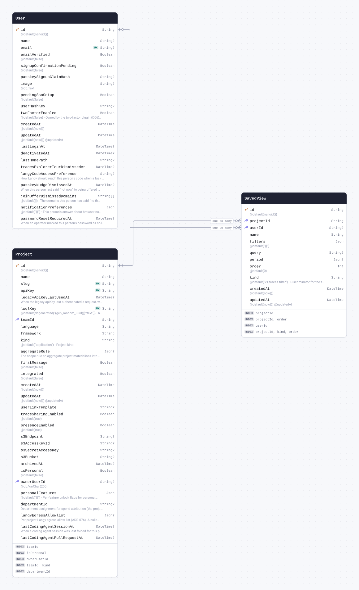

| Field       | Type       | Constraints                             | Default              | Description                                                                                                                                                                                                                                                                                                                                             |
| ----------- | ---------- | --------------------------------------- | -------------------- | ------------------------------------------------------------------------------------------------------------------------------------------------------------------------------------------------------------------------------------------------------------------------------------------------------------------------------------------------------- |
| `id`        | `String`   | PK NOT NULL                             | `nanoid()`           |                                                                                                                                                                                                                                                                                                                                                         |
| `projectId` | `String`   | NOT NULL → [Project.id](#model-Project) |                      |                                                                                                                                                                                                                                                                                                                                                         |
| `userId`    | `String`   | NULL → [User.id](#model-User)           |                      |                                                                                                                                                                                                                                                                                                                                                         |
| `name`      | `String`   | NOT NULL                                |                      |                                                                                                                                                                                                                                                                                                                                                         |
| `filters`   | `Json`     | NOT NULL                                | `"{}"`               |                                                                                                                                                                                                                                                                                                                                                         |
| `query`     | `String`   | NULL                                    |                      |                                                                                                                                                                                                                                                                                                                                                         |
| `period`    | `Json`     | NULL                                    |                      |                                                                                                                                                                                                                                                                                                                                                         |
| `order`     | `Int`      | NOT NULL                                | `0`                  |                                                                                                                                                                                                                                                                                                                                                         |
| `kind`      | `String`   | NOT NULL                                | `"v1-traces-filter"` | Discriminator for the two storage shapes that share this table: - "v1-traces-filter" (default) - legacy /messages page filter map saved views - "v2-traces-lens" - new traces v2 lens configs (columns, addons, grouping, sort, filterText) encoded inside `filters` JSON Each client filters by its own kind on read so neither sees the other's rows. |
| `createdAt` | `DateTime` | NOT NULL                                | `now()`              |                                                                                                                                                                                                                                                                                                                                                         |
| `updatedAt` | `DateTime` | NOT NULL                                | `now()` `@updatedAt` |                                                                                                                                                                                                                                                                                                                                                         |

#### Indexes

- `@@index([projectId])`
- `@@index([projectId, order])`
- `@@index([userId])`
- `@@index([projectId, kind, order])`

#### References

- `projectId` → [Project.id](#model-Project) (many-to-one)
- `userId` → [User.id](#model-User) (many-to-one)

#### Definition

```sql
CREATE TABLE "SavedView" (
    "id" TEXT NOT NULL,
    "projectId" TEXT NOT NULL,
    "userId" TEXT,
    "name" TEXT NOT NULL,
    "filters" JSONB NOT NULL DEFAULT '{}',
    "query" TEXT,
    "period" JSONB,
    "order" INTEGER NOT NULL DEFAULT 0,
    "kind" TEXT NOT NULL DEFAULT 'v1-traces-filter',
    "createdAt" TIMESTAMP(3) NOT NULL DEFAULT CURRENT_TIMESTAMP,
    "updatedAt" TIMESTAMP(3) NOT NULL DEFAULT CURRENT_TIMESTAMP,

    CONSTRAINT "SavedView_pkey" PRIMARY KEY ("id")
);

CREATE INDEX "SavedView_projectId_idx" ON "SavedView"("projectId");

CREATE INDEX "SavedView_projectId_order_idx" ON "SavedView"("projectId", "order");

CREATE INDEX "SavedView_userId_idx" ON "SavedView"("userId");

CREATE INDEX "SavedView_projectId_kind_order_idx" ON "SavedView"("projectId", "kind", "order");
```

<details>
<summary>Queries and their SQL</summary>

**findMany**: Every row

```ts
await prisma.savedView.findMany();
```

```sql
SELECT
  "public"."SavedView"."id",
  "public"."SavedView"."projectId",
  "public"."SavedView"."userId",
  "public"."SavedView"."name",
  "public"."SavedView"."filters",
  "public"."SavedView"."query",
  "public"."SavedView"."period",
  "public"."SavedView"."order",
  "public"."SavedView"."kind",
  "public"."SavedView"."createdAt",
  "public"."SavedView"."updatedAt"
FROM
  "public"."SavedView"
WHERE
  1 = 1
OFFSET
  $1
-- params: ["0"]
```

**count**: How many rows there are

```ts
await prisma.savedView.count();
```

```sql
SELECT
  COUNT(*) AS "_count$_all"
FROM
  (
    SELECT
      "public"."SavedView"."id"
    FROM
      "public"."SavedView"
    WHERE
      1 = 1
    OFFSET
      $1
  ) AS "sub"
-- params: ["0"]
```

**findMany**: Every row with its relations

```ts
await prisma.savedView.findMany({ include: { project: true, user: true } });
```

```sql
SELECT
  "public"."SavedView"."id",
  "public"."SavedView"."projectId",
  "public"."SavedView"."userId",
  "public"."SavedView"."name",
  "public"."SavedView"."filters",
  "public"."SavedView"."query",
  "public"."SavedView"."period",
  "public"."SavedView"."order",
  "public"."SavedView"."kind",
  "public"."SavedView"."createdAt",
  "public"."SavedView"."updatedAt"
FROM
  "public"."SavedView"
WHERE
  1 = 1
OFFSET
  $1
-- params: ["0"]

SELECT
  "public"."Project"."id",
  "public"."Project"."name",
  "public"."Project"."slug",
  "public"."Project"."apiKey",
  "public"."Project"."legacyApiKeyLastUsedAt",
  "public"."Project"."lwqlKey",
  "public"."Project"."teamId",
  "public"."Project"."language",
  "public"."Project"."framework",
  "public"."Project"."kind",
  "public"."Project"."aggregateRule",
  "public"."Project"."firstMessage",
  "public"."Project"."integrated",
  "public"."Project"."createdAt",
  "public"."Project"."updatedAt",
  "public"."Project"."userLinkTemplate",
  "public"."Project"."traceSharingEnabled",
  "public"."Project"."presenceEnabled",
  "public"."Project"."s3Endpoint",
  "public"."Project"."s3AccessKeyId",
  "public"."Project"."s3SecretAccessKey",
  "public"."Project"."s3Bucket",
  "public"."Project"."archivedAt",
  "public"."Project"."isPersonal",
  "public"."Project"."ownerUserId",
  "public"."Project"."personalFeatures",
  "public"."Project"."departmentId",
  "public"."Project"."langyEgressAllowlist",
  "public"."Project"."lastCodingAgentSessionAt",
  "public"."Project"."lastCodingAgentPullRequestAt"
FROM
  "public"."Project"
WHERE
  "public"."Project"."id" IN ($1)
OFFSET
  $2
-- params: ["<projectId of the rows above>","0"]

SELECT
  "public"."User"."id",
  "public"."User"."name",
  "public"."User"."email",
  "public"."User"."emailVerified",
  "public"."User"."signupConfirmationPending",
  "public"."User"."passkeySignupClaimHash",
  "public"."User"."image",
  "public"."User"."pendingSsoSetup",
  "public"."User"."userHashKey",
  "public"."User"."twoFactorEnabled",
  "public"."User"."createdAt",
  "public"."User"."updatedAt",
  "public"."User"."lastLoginAt",
  "public"."User"."deactivatedAt",
  "public"."User"."lastHomePath",
  "public"."User"."tracesExplorerTourDismissedAt",
  "public"."User"."langyCodeAccessPreference",
  "public"."User"."passkeyNudgeDismissedAt",
  "public"."User"."joinOfferDismissedDomains",
  "public"."User"."notificationPreferences",
  "public"."User"."passwordResetRequiredAt"
FROM
  "public"."User"
WHERE
  "public"."User"."id" IN ($1)
OFFSET
  $2
-- params: ["<userId of the rows above>","0"]
```

**findUnique**: One row by what is unique to it

```ts
await prisma.savedView.findUnique({ where: { id: "example" } });
```

```sql
SELECT
  "public"."SavedView"."id",
  "public"."SavedView"."projectId",
  "public"."SavedView"."userId",
  "public"."SavedView"."name",
  "public"."SavedView"."filters",
  "public"."SavedView"."query",
  "public"."SavedView"."period",
  "public"."SavedView"."order",
  "public"."SavedView"."kind",
  "public"."SavedView"."createdAt",
  "public"."SavedView"."updatedAt"
FROM
  "public"."SavedView"
WHERE
  (
    "public"."SavedView"."id" = $1
    AND 1 = 1
  )
LIMIT
  $2
OFFSET
  $3
-- params: ["example","1","0"]
```

**create**: Create a row

```ts
await prisma.savedView.create({ data: { projectId: "example", name: "example" } });
```

```sql
INSERT INTO
  "public"."SavedView" (
    "id",
    "projectId",
    "name",
    "filters",
    "order",
    "kind",
    "createdAt",
    "updatedAt"
  )
VALUES
  ($1, $2, $3, $4, $5, $6, $7, $8)
RETURNING
  "public"."SavedView"."id",
  "public"."SavedView"."projectId",
  "public"."SavedView"."userId",
  "public"."SavedView"."name",
  "public"."SavedView"."filters",
  "public"."SavedView"."query",
  "public"."SavedView"."period",
  "public"."SavedView"."order",
  "public"."SavedView"."kind",
  "public"."SavedView"."createdAt",
  "public"."SavedView"."updatedAt"
-- params: ["<nanoid()>","example","example","{}","0","v1-traces-filter","<now()>","<now()>"]
```

**update**: Update a row

```ts
await prisma.savedView.update({ where: { id: "example" }, data: { name: "example" } });
```

```sql
SELECT
  "public"."SavedView"."id"
FROM
  "public"."SavedView"
WHERE
  (
    "public"."SavedView"."id" = $1
    AND 1 = 1
  )
LIMIT
  $2
OFFSET
  $3
-- params: ["example","1","0"]

UPDATE "public"."SavedView"
SET
  "name" = $1,
  "updatedAt" = $2
WHERE
  (
    "public"."SavedView"."id" IN ($3)
    AND (
      "public"."SavedView"."id" = $4
      AND 1 = 1
    )
  )
RETURNING
  "public"."SavedView"."id",
  "public"."SavedView"."projectId",
  "public"."SavedView"."userId",
  "public"."SavedView"."name",
  "public"."SavedView"."filters",
  "public"."SavedView"."query",
  "public"."SavedView"."period",
  "public"."SavedView"."order",
  "public"."SavedView"."kind",
  "public"."SavedView"."createdAt",
  "public"."SavedView"."updatedAt"
-- params: ["example",{"prisma__type":"generatorCall","prisma__value":{"name":"now","args":[],"returnType":{"type":"DateTime"}}},"<id of the rows above>","example"]
```

**delete**: Delete a row

```ts
await prisma.savedView.delete({ where: { id: "example" } });
```

```sql
DELETE FROM "public"."SavedView"
WHERE
  (
    "public"."SavedView"."id" = $1
    AND 1 = 1
  )
RETURNING
  "public"."SavedView"."id",
  "public"."SavedView"."projectId",
  "public"."SavedView"."userId",
  "public"."SavedView"."name",
  "public"."SavedView"."filters",
  "public"."SavedView"."query",
  "public"."SavedView"."period",
  "public"."SavedView"."order",
  "public"."SavedView"."kind",
  "public"."SavedView"."createdAt",
  "public"."SavedView"."updatedAt"
-- params: ["example"]
```

</details>

<a id="model-CustomGraph"></a>

### CustomGraph

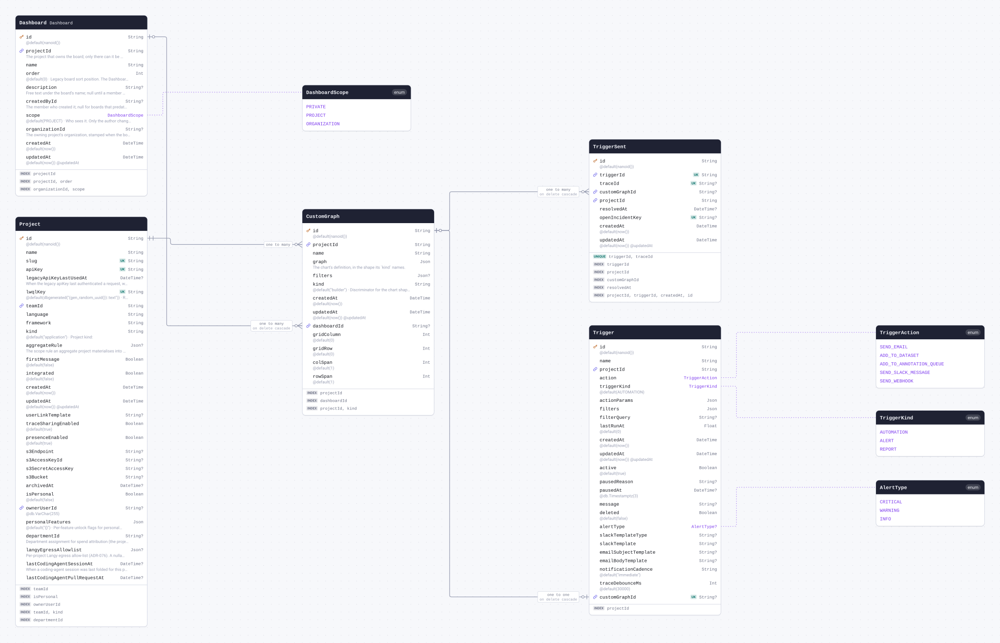

| Field         | Type       | Constraints                             | Default              | Description                                                                                                                                                                                                                                                                                                                                                                                                                                                                                                                                                                                         |
| ------------- | ---------- | --------------------------------------- | -------------------- | --------------------------------------------------------------------------------------------------------------------------------------------------------------------------------------------------------------------------------------------------------------------------------------------------------------------------------------------------------------------------------------------------------------------------------------------------------------------------------------------------------------------------------------------------------------------------------------------------- |
| `id`          | `String`   | PK NOT NULL                             | `nanoid()`           |                                                                                                                                                                                                                                                                                                                                                                                                                                                                                                                                                                                                     |
| `projectId`   | `String`   | NOT NULL → [Project.id](#model-Project) |                      |                                                                                                                                                                                                                                                                                                                                                                                                                                                                                                                                                                                                     |
| `name`        | `String`   | NOT NULL                                |                      |                                                                                                                                                                                                                                                                                                                                                                                                                                                                                                                                                                                                     |
| `graph`       | `Json`     | NOT NULL                                |                      | The chart's definition, in the shape its `kind` names.                                                                                                                                                                                                                                                                                                                                                                                                                                                                                                                                              |
| `filters`     | `Json`     | NULL                                    |                      |                                                                                                                                                                                                                                                                                                                                                                                                                                                                                                                                                                                                     |
| `kind`        | `String`   | NOT NULL                                | `"builder"`          | Discriminator for the chart shapes that share this table: - "builder" (default) - the chart builder's own `graph` payload - "workbench_sql" - a saved LangWatchQL workbench chart, whose `graph` holds the versioned { sql, parameters, vegaLiteSpec } definition (see server/analytics/saved-workbench-charts) - "dashboard_srcdoc" - frozen legacy copies of Dashboards v2 widgets, which now live in DashboardWidget; nothing new writes this kind Each reader filters by its own kind, so neither sees the other's rows and a builder chart can never be interpreted as a workbench definition. |
| `createdAt`   | `DateTime` | NOT NULL                                | `now()`              |                                                                                                                                                                                                                                                                                                                                                                                                                                                                                                                                                                                                     |
| `updatedAt`   | `DateTime` | NOT NULL                                | `now()` `@updatedAt` |                                                                                                                                                                                                                                                                                                                                                                                                                                                                                                                                                                                                     |
| `dashboardId` | `String`   | NULL → [Dashboard.id](#model-Dashboard) |                      |                                                                                                                                                                                                                                                                                                                                                                                                                                                                                                                                                                                                     |
| `gridColumn`  | `Int`      | NOT NULL                                | `0`                  |                                                                                                                                                                                                                                                                                                                                                                                                                                                                                                                                                                                                     |
| `gridRow`     | `Int`      | NOT NULL                                | `0`                  |                                                                                                                                                                                                                                                                                                                                                                                                                                                                                                                                                                                                     |
| `colSpan`     | `Int`      | NOT NULL                                | `1`                  |                                                                                                                                                                                                                                                                                                                                                                                                                                                                                                                                                                                                     |
| `rowSpan`     | `Int`      | NOT NULL                                | `1`                  |                                                                                                                                                                                                                                                                                                                                                                                                                                                                                                                                                                                                     |

#### Indexes

- `@@index([projectId])`
- `@@index([dashboardId])`
- `@@index([projectId, kind])`

#### References

- `projectId` → [Project.id](#model-Project) (many-to-one)
- `dashboardId` → [Dashboard.id](#model-Dashboard) (many-to-one, on delete Cascade)

#### Referenced by

- `id` ← [Trigger.customGraphId](#model-Trigger) (one-to-one, on delete Cascade)
- `id` ← [TriggerSent.customGraphId](#model-TriggerSent) (one-to-many, on delete Cascade)

#### Definition

```sql
CREATE TABLE "CustomGraph" (
    "id" TEXT NOT NULL,
    "projectId" TEXT NOT NULL,
    "name" TEXT NOT NULL,
    "graph" JSONB NOT NULL,
    "filters" JSONB,
    "kind" TEXT NOT NULL DEFAULT 'builder',
    "createdAt" TIMESTAMP(3) NOT NULL DEFAULT CURRENT_TIMESTAMP,
    "updatedAt" TIMESTAMP(3) NOT NULL DEFAULT CURRENT_TIMESTAMP,
    "dashboardId" TEXT,
    "gridColumn" INTEGER NOT NULL DEFAULT 0,
    "gridRow" INTEGER NOT NULL DEFAULT 0,
    "colSpan" INTEGER NOT NULL DEFAULT 1,
    "rowSpan" INTEGER NOT NULL DEFAULT 1,

    CONSTRAINT "CustomGraph_pkey" PRIMARY KEY ("id")
);

CREATE INDEX "CustomGraph_projectId_idx" ON "CustomGraph"("projectId");

CREATE INDEX "CustomGraph_dashboardId_idx" ON "CustomGraph"("dashboardId");

CREATE INDEX "CustomGraph_projectId_kind_idx" ON "CustomGraph"("projectId", "kind");
```

<details>
<summary>Queries and their SQL</summary>

**findMany**: Every row

```ts
await prisma.customGraph.findMany();
```

```sql
SELECT
  "public"."CustomGraph"."id",
  "public"."CustomGraph"."projectId",
  "public"."CustomGraph"."name",
  "public"."CustomGraph"."graph",
  "public"."CustomGraph"."filters",
  "public"."CustomGraph"."kind",
  "public"."CustomGraph"."createdAt",
  "public"."CustomGraph"."updatedAt",
  "public"."CustomGraph"."dashboardId",
  "public"."CustomGraph"."gridColumn",
  "public"."CustomGraph"."gridRow",
  "public"."CustomGraph"."colSpan",
  "public"."CustomGraph"."rowSpan"
FROM
  "public"."CustomGraph"
WHERE
  1 = 1
OFFSET
  $1
-- params: ["0"]
```

**count**: How many rows there are

```ts
await prisma.customGraph.count();
```

```sql
SELECT
  COUNT(*) AS "_count$_all"
FROM
  (
    SELECT
      "public"."CustomGraph"."id"
    FROM
      "public"."CustomGraph"
    WHERE
      1 = 1
    OFFSET
      $1
  ) AS "sub"
-- params: ["0"]
```

**findMany**: Every row with its relations

```ts
await prisma.customGraph.findMany({
  include: { project: true, dashboard: true, trigger: true, TriggerSent: true },
});
```

```sql
SELECT
  "public"."CustomGraph"."id",
  "public"."CustomGraph"."projectId",
  "public"."CustomGraph"."name",
  "public"."CustomGraph"."graph",
  "public"."CustomGraph"."filters",
  "public"."CustomGraph"."kind",
  "public"."CustomGraph"."createdAt",
  "public"."CustomGraph"."updatedAt",
  "public"."CustomGraph"."dashboardId",
  "public"."CustomGraph"."gridColumn",
  "public"."CustomGraph"."gridRow",
  "public"."CustomGraph"."colSpan",
  "public"."CustomGraph"."rowSpan"
FROM
  "public"."CustomGraph"
WHERE
  1 = 1
OFFSET
  $1
-- params: ["0"]

SELECT
  "public"."Project"."id",
  "public"."Project"."name",
  "public"."Project"."slug",
  "public"."Project"."apiKey",
  "public"."Project"."legacyApiKeyLastUsedAt",
  "public"."Project"."lwqlKey",
  "public"."Project"."teamId",
  "public"."Project"."language",
  "public"."Project"."framework",
  "public"."Project"."kind",
  "public"."Project"."aggregateRule",
  "public"."Project"."firstMessage",
  "public"."Project"."integrated",
  "public"."Project"."createdAt",
  "public"."Project"."updatedAt",
  "public"."Project"."userLinkTemplate",
  "public"."Project"."traceSharingEnabled",
  "public"."Project"."presenceEnabled",
  "public"."Project"."s3Endpoint",
  "public"."Project"."s3AccessKeyId",
  "public"."Project"."s3SecretAccessKey",
  "public"."Project"."s3Bucket",
  "public"."Project"."archivedAt",
  "public"."Project"."isPersonal",
  "public"."Project"."ownerUserId",
  "public"."Project"."personalFeatures",
  "public"."Project"."departmentId",
  "public"."Project"."langyEgressAllowlist",
  "public"."Project"."lastCodingAgentSessionAt",
  "public"."Project"."lastCodingAgentPullRequestAt"
FROM
  "public"."Project"
WHERE
  "public"."Project"."id" IN ($1)
OFFSET
  $2
-- params: ["<projectId of the rows above>","0"]

SELECT
  "public"."Dashboard"."id",
  "public"."Dashboard"."projectId",
  "public"."Dashboard"."name",
  "public"."Dashboard"."order",
  "public"."Dashboard"."description",
  "public"."Dashboard"."createdById",
  "public"."Dashboard"."scope"::text,
  "public"."Dashboard"."organizationId",
  "public"."Dashboard"."createdAt",
  "public"."Dashboard"."updatedAt"
FROM
  "public"."Dashboard"
WHERE
  "public"."Dashboard"."id" IN ($1)
OFFSET
  $2
-- params: ["<dashboardId of the rows above>","0"]

SELECT
  "public"."Trigger"."id",
  "public"."Trigger"."name",
  "public"."Trigger"."projectId",
  "public"."Trigger"."action"::text,
  "public"."Trigger"."triggerKind"::text,
  "public"."Trigger"."actionParams",
  "public"."Trigger"."filters",
  "public"."Trigger"."filterQuery",
  "public"."Trigger"."lastRunAt",
  "public"."Trigger"."createdAt",
  "public"."Trigger"."updatedAt",
  "public"."Trigger"."active",
  "public"."Trigger"."pausedReason",
  "public"."Trigger"."pausedAt",
  "public"."Trigger"."message",
  "public"."Trigger"."deleted",
  "public"."Trigger"."alertType"::text,
  "public"."Trigger"."slackTemplateType",
  "public"."Trigger"."slackTemplate",
  "public"."Trigger"."emailSubjectTemplate",
  "public"."Trigger"."emailBodyTemplate",
  "public"."Trigger"."notificationCadence",
  "public"."Trigger"."traceDebounceMs",
  "public"."Trigger"."customGraphId"
FROM
  "public"."Trigger"
WHERE
  "public"."Trigger"."customGraphId" IN ($1)
OFFSET
  $2
-- params: ["<id of the rows above>","0"]

SELECT
  "public"."TriggerSent"."id",
  "public"."TriggerSent"."triggerId",
  "public"."TriggerSent"."traceId",
  "public"."TriggerSent"."customGraphId",
  "public"."TriggerSent"."projectId",
  "public"."TriggerSent"."resolvedAt",
  "public"."TriggerSent"."openIncidentKey",
  "public"."TriggerSent"."createdAt",
  "public"."TriggerSent"."updatedAt"
FROM
  "public"."TriggerSent"
WHERE
  "public"."TriggerSent"."customGraphId" IN ($1)
OFFSET
  $2
-- params: ["<id of the rows above>","0"]
```

**findUnique**: One row by what is unique to it

```ts
await prisma.customGraph.findUnique({ where: { id: "example" } });
```

```sql
SELECT
  "public"."CustomGraph"."id",
  "public"."CustomGraph"."projectId",
  "public"."CustomGraph"."name",
  "public"."CustomGraph"."graph",
  "public"."CustomGraph"."filters",
  "public"."CustomGraph"."kind",
  "public"."CustomGraph"."createdAt",
  "public"."CustomGraph"."updatedAt",
  "public"."CustomGraph"."dashboardId",
  "public"."CustomGraph"."gridColumn",
  "public"."CustomGraph"."gridRow",
  "public"."CustomGraph"."colSpan",
  "public"."CustomGraph"."rowSpan"
FROM
  "public"."CustomGraph"
WHERE
  (
    "public"."CustomGraph"."id" = $1
    AND 1 = 1
  )
LIMIT
  $2
OFFSET
  $3
-- params: ["example","1","0"]
```

**create**: Create a row

```ts
await prisma.customGraph.create({ data: { projectId: "example", name: "example", graph: {} } });
```

```sql
INSERT INTO
  "public"."CustomGraph" (
    "id",
    "projectId",
    "name",
    "graph",
    "kind",
    "createdAt",
    "updatedAt",
    "gridColumn",
    "gridRow",
    "colSpan",
    "rowSpan"
  )
VALUES
  ($1, $2, $3, $4, $5, $6, $7, $8, $9, $10, $11)
RETURNING
  "public"."CustomGraph"."id",
  "public"."CustomGraph"."projectId",
  "public"."CustomGraph"."name",
  "public"."CustomGraph"."graph",
  "public"."CustomGraph"."filters",
  "public"."CustomGraph"."kind",
  "public"."CustomGraph"."createdAt",
  "public"."CustomGraph"."updatedAt",
  "public"."CustomGraph"."dashboardId",
  "public"."CustomGraph"."gridColumn",
  "public"."CustomGraph"."gridRow",
  "public"."CustomGraph"."colSpan",
  "public"."CustomGraph"."rowSpan"
-- params: ["<nanoid()>","example","example","{}","builder","<now()>","<now()>","0","0","1","1"]
```

**update**: Update a row

```ts
await prisma.customGraph.update({ where: { id: "example" }, data: { name: "example" } });
```

```sql
SELECT
  "public"."CustomGraph"."id"
FROM
  "public"."CustomGraph"
WHERE
  (
    "public"."CustomGraph"."id" = $1
    AND 1 = 1
  )
LIMIT
  $2
OFFSET
  $3
-- params: ["example","1","0"]

UPDATE "public"."CustomGraph"
SET
  "name" = $1,
  "updatedAt" = $2
WHERE
  (
    "public"."CustomGraph"."id" IN ($3)
    AND (
      "public"."CustomGraph"."id" = $4
      AND 1 = 1
    )
  )
RETURNING
  "public"."CustomGraph"."id",
  "public"."CustomGraph"."projectId",
  "public"."CustomGraph"."name",
  "public"."CustomGraph"."graph",
  "public"."CustomGraph"."filters",
  "public"."CustomGraph"."kind",
  "public"."CustomGraph"."createdAt",
  "public"."CustomGraph"."updatedAt",
  "public"."CustomGraph"."dashboardId",
  "public"."CustomGraph"."gridColumn",
  "public"."CustomGraph"."gridRow",
  "public"."CustomGraph"."colSpan",
  "public"."CustomGraph"."rowSpan"
-- params: ["example",{"prisma__type":"generatorCall","prisma__value":{"name":"now","args":[],"returnType":{"type":"DateTime"}}},"<id of the rows above>","example"]
```

**delete**: Delete a row

```ts
await prisma.customGraph.delete({ where: { id: "example" } });
```

```sql
DELETE FROM "public"."CustomGraph"
WHERE
  (
    "public"."CustomGraph"."id" = $1
    AND 1 = 1
  )
RETURNING
  "public"."CustomGraph"."id",
  "public"."CustomGraph"."projectId",
  "public"."CustomGraph"."name",
  "public"."CustomGraph"."graph",
  "public"."CustomGraph"."filters",
  "public"."CustomGraph"."kind",
  "public"."CustomGraph"."createdAt",
  "public"."CustomGraph"."updatedAt",
  "public"."CustomGraph"."dashboardId",
  "public"."CustomGraph"."gridColumn",
  "public"."CustomGraph"."gridRow",
  "public"."CustomGraph"."colSpan",
  "public"."CustomGraph"."rowSpan"
-- params: ["example"]

SELECT
  "public"."Trigger"."id",
  "public"."Trigger"."customGraphId"
FROM
  "public"."Trigger"
WHERE
  (
    1 = 1
    AND "public"."Trigger"."customGraphId" IN ($1)
  )
OFFSET
  $2
-- params: ["<id of the rows above>","0"]

SELECT
  "public"."WebhookEndpointDelivery"."id",
  "public"."WebhookEndpointDelivery"."triggerId"
FROM
  "public"."WebhookEndpointDelivery"
WHERE
  (
    1 = 1
    AND "public"."WebhookEndpointDelivery"."triggerId" IN ($1)
  )
OFFSET
  $2
-- params: ["<id of the rows above>","0"]

DELETE FROM "public"."WebhookEndpointDelivery"
WHERE
  (
    "public"."WebhookEndpointDelivery"."id" IN ($1)
    AND 1 = 1
  )
-- params: ["<id of the rows above>"]

SELECT
  "public"."TriggerSent"."id",
  "public"."TriggerSent"."triggerId"
FROM
  "public"."TriggerSent"
WHERE
  (
    1 = 1
    AND "public"."TriggerSent"."triggerId" IN ($1)
  )
OFFSET
  $2
-- params: ["<id of the rows above>","0"]

SELECT
  "public"."TriggerLatestEvaluation"."triggerId"
FROM
  "public"."TriggerLatestEvaluation"
WHERE
  (
    1 = 1
    AND "public"."TriggerLatestEvaluation"."triggerId" IN ($1)
  )
OFFSET
  $2
-- params: ["<id of the rows above>","0"]

DELETE FROM "public"."TriggerLatestEvaluation"
WHERE
  (
    "public"."TriggerLatestEvaluation"."triggerId" IN ($1)
    AND 1 = 1
  )
-- params: ["<triggerId of the rows above>"]

DELETE FROM "public"."Trigger"
WHERE
  (
    "public"."Trigger"."id" IN ($1)
    AND 1 = 1
  )
-- params: ["<id of the rows above>"]

SELECT
  "public"."TriggerSent"."id",
  "public"."TriggerSent"."customGraphId"
FROM
  "public"."TriggerSent"
WHERE
  (
    1 = 1
    AND "public"."TriggerSent"."customGraphId" IN ($1)
  )
OFFSET
  $2
-- params: ["<id of the rows above>","0"]

DELETE FROM "public"."TriggerSent"
WHERE
  (
    "public"."TriggerSent"."id" IN ($1)
    AND 1 = 1
  )
-- params: ["<id of the rows above>"]
```

</details>

<a id="model-BatchEvaluation"></a>

### BatchEvaluation

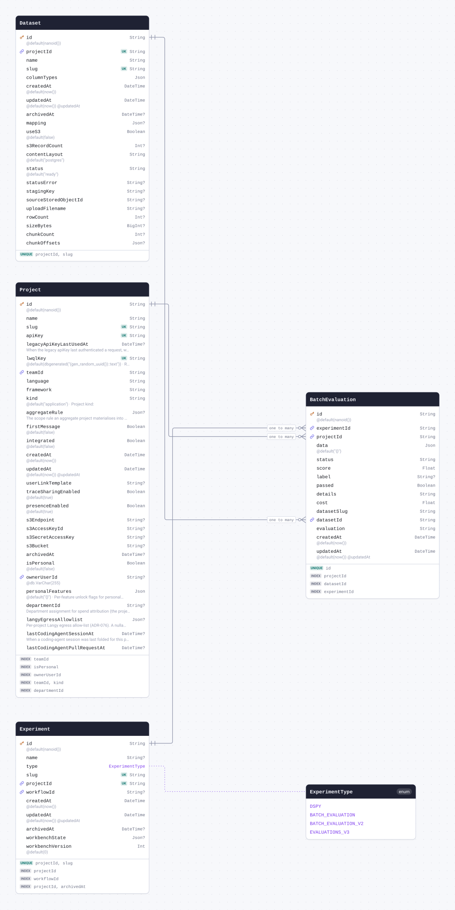

| Field          | Type       | Constraints                                   | Default              | Description |
| -------------- | ---------- | --------------------------------------------- | -------------------- | ----------- |
| `id`           | `String`   | PK NOT NULL                                   | `nanoid()`           |             |
| `experimentId` | `String`   | NOT NULL → [Experiment.id](#model-Experiment) |                      |             |
| `projectId`    | `String`   | NOT NULL → [Project.id](#model-Project)       |                      |             |
| `data`         | `Json`     | NOT NULL                                      | `"{}"`               |             |
| `status`       | `String`   | NOT NULL                                      |                      |             |
| `score`        | `Float`    | NOT NULL                                      |                      |             |
| `label`        | `String`   | NULL                                          |                      |             |
| `passed`       | `Boolean`  | NOT NULL                                      |                      |             |
| `details`      | `String`   | NOT NULL                                      |                      |             |
| `cost`         | `Float`    | NOT NULL                                      |                      |             |
| `datasetSlug`  | `String`   | NOT NULL                                      |                      |             |
| `datasetId`    | `String`   | NOT NULL → [Dataset.id](#model-Dataset)       |                      |             |
| `evaluation`   | `String`   | NOT NULL                                      |                      |             |
| `createdAt`    | `DateTime` | NOT NULL                                      | `now()`              |             |
| `updatedAt`    | `DateTime` | NOT NULL                                      | `now()` `@updatedAt` |             |

#### Indexes

- `@@index([projectId])`
- `@@index([datasetId])`
- `@@index([experimentId])`
- `@@unique([id])`

#### References

- `experimentId` → [Experiment.id](#model-Experiment) (many-to-one)
- `projectId` → [Project.id](#model-Project) (many-to-one)
- `datasetId` → [Dataset.id](#model-Dataset) (many-to-one)

#### Definition

```sql
CREATE TABLE "BatchEvaluation" (
    "id" TEXT NOT NULL,
    "experimentId" TEXT NOT NULL,
    "projectId" TEXT NOT NULL,
    "data" JSONB NOT NULL DEFAULT '{}',
    "status" TEXT NOT NULL,
    "score" DOUBLE PRECISION NOT NULL,
    "label" TEXT,
    "passed" BOOLEAN NOT NULL,
    "details" TEXT NOT NULL,
    "cost" DOUBLE PRECISION NOT NULL,
    "datasetSlug" TEXT NOT NULL,
    "datasetId" TEXT NOT NULL,
    "evaluation" TEXT NOT NULL,
    "createdAt" TIMESTAMP(3) NOT NULL DEFAULT CURRENT_TIMESTAMP,
    "updatedAt" TIMESTAMP(3) NOT NULL DEFAULT CURRENT_TIMESTAMP,

    CONSTRAINT "BatchEvaluation_pkey" PRIMARY KEY ("id")
);

CREATE INDEX "BatchEvaluation_projectId_idx" ON "BatchEvaluation"("projectId");

CREATE INDEX "BatchEvaluation_datasetId_idx" ON "BatchEvaluation"("datasetId");

CREATE INDEX "BatchEvaluation_experimentId_idx" ON "BatchEvaluation"("experimentId");

CREATE UNIQUE INDEX "BatchEvaluation_id_key" ON "BatchEvaluation"("id");
```

<details>
<summary>Queries and their SQL</summary>

**findMany**: Every row

```ts
await prisma.batchEvaluation.findMany();
```

```sql
SELECT
  "public"."BatchEvaluation"."id",
  "public"."BatchEvaluation"."experimentId",
  "public"."BatchEvaluation"."projectId",
  "public"."BatchEvaluation"."data",
  "public"."BatchEvaluation"."status",
  "public"."BatchEvaluation"."score",
  "public"."BatchEvaluation"."label",
  "public"."BatchEvaluation"."passed",
  "public"."BatchEvaluation"."details",
  "public"."BatchEvaluation"."cost",
  "public"."BatchEvaluation"."datasetSlug",
  "public"."BatchEvaluation"."datasetId",
  "public"."BatchEvaluation"."evaluation",
  "public"."BatchEvaluation"."createdAt",
  "public"."BatchEvaluation"."updatedAt"
FROM
  "public"."BatchEvaluation"
WHERE
  1 = 1
OFFSET
  $1
-- params: ["0"]
```

**count**: How many rows there are

```ts
await prisma.batchEvaluation.count();
```

```sql
SELECT
  COUNT(*) AS "_count$_all"
FROM
  (
    SELECT
      "public"."BatchEvaluation"."id"
    FROM
      "public"."BatchEvaluation"
    WHERE
      1 = 1
    OFFSET
      $1
  ) AS "sub"
-- params: ["0"]
```

**findMany**: Every row with its relations

```ts
await prisma.batchEvaluation.findMany({
  include: { experiment: true, project: true, dataset: true },
});
```

```sql
SELECT
  "public"."BatchEvaluation"."id",
  "public"."BatchEvaluation"."experimentId",
  "public"."BatchEvaluation"."projectId",
  "public"."BatchEvaluation"."data",
  "public"."BatchEvaluation"."status",
  "public"."BatchEvaluation"."score",
  "public"."BatchEvaluation"."label",
  "public"."BatchEvaluation"."passed",
  "public"."BatchEvaluation"."details",
  "public"."BatchEvaluation"."cost",
  "public"."BatchEvaluation"."datasetSlug",
  "public"."BatchEvaluation"."datasetId",
  "public"."BatchEvaluation"."evaluation",
  "public"."BatchEvaluation"."createdAt",
  "public"."BatchEvaluation"."updatedAt"
FROM
  "public"."BatchEvaluation"
WHERE
  1 = 1
OFFSET
  $1
-- params: ["0"]

SELECT
  "public"."Experiment"."id",
  "public"."Experiment"."name",
  "public"."Experiment"."type"::text,
  "public"."Experiment"."slug",
  "public"."Experiment"."projectId",
  "public"."Experiment"."workflowId",
  "public"."Experiment"."createdAt",
  "public"."Experiment"."updatedAt",
  "public"."Experiment"."archivedAt",
  "public"."Experiment"."workbenchState",
  "public"."Experiment"."workbenchVersion"
FROM
  "public"."Experiment"
WHERE
  "public"."Experiment"."id" IN ($1)
OFFSET
  $2
-- params: ["<experimentId of the rows above>","0"]

SELECT
  "public"."Project"."id",
  "public"."Project"."name",
  "public"."Project"."slug",
  "public"."Project"."apiKey",
  "public"."Project"."legacyApiKeyLastUsedAt",
  "public"."Project"."lwqlKey",
  "public"."Project"."teamId",
  "public"."Project"."language",
  "public"."Project"."framework",
  "public"."Project"."kind",
  "public"."Project"."aggregateRule",
  "public"."Project"."firstMessage",
  "public"."Project"."integrated",
  "public"."Project"."createdAt",
  "public"."Project"."updatedAt",
  "public"."Project"."userLinkTemplate",
  "public"."Project"."traceSharingEnabled",
  "public"."Project"."presenceEnabled",
  "public"."Project"."s3Endpoint",
  "public"."Project"."s3AccessKeyId",
  "public"."Project"."s3SecretAccessKey",
  "public"."Project"."s3Bucket",
  "public"."Project"."archivedAt",
  "public"."Project"."isPersonal",
  "public"."Project"."ownerUserId",
  "public"."Project"."personalFeatures",
  "public"."Project"."departmentId",
  "public"."Project"."langyEgressAllowlist",
  "public"."Project"."lastCodingAgentSessionAt",
  "public"."Project"."lastCodingAgentPullRequestAt"
FROM
  "public"."Project"
WHERE
  "public"."Project"."id" IN ($1)
OFFSET
  $2
-- params: ["<projectId of the rows above>","0"]

SELECT
  "public"."Dataset"."id",
  "public"."Dataset"."projectId",
  "public"."Dataset"."name",
  "public"."Dataset"."slug",
  "public"."Dataset"."columnTypes",
  "public"."Dataset"."createdAt",
  "public"."Dataset"."updatedAt",
  "public"."Dataset"."archivedAt",
  "public"."Dataset"."mapping",
  "public"."Dataset"."useS3",
  "public"."Dataset"."s3RecordCount",
  "public"."Dataset"."contentLayout",
  "public"."Dataset"."status",
  "public"."Dataset"."statusError",
  "public"."Dataset"."stagingKey",
  "public"."Dataset"."sourceStoredObjectId",
  "public"."Dataset"."uploadFilename",
  "public"."Dataset"."rowCount",
  "public"."Dataset"."sizeBytes",
  "public"."Dataset"."chunkCount",
  "public"."Dataset"."chunkOffsets"
FROM
  "public"."Dataset"
WHERE
  "public"."Dataset"."id" IN ($1)
OFFSET
  $2
-- params: ["<datasetId of the rows above>","0"]
```

**findUnique**: One row by what is unique to it

```ts
await prisma.batchEvaluation.findUnique({ where: { id: "example" } });
```

```sql
SELECT
  "public"."BatchEvaluation"."id",
  "public"."BatchEvaluation"."experimentId",
  "public"."BatchEvaluation"."projectId",
  "public"."BatchEvaluation"."data",
  "public"."BatchEvaluation"."status",
  "public"."BatchEvaluation"."score",
  "public"."BatchEvaluation"."label",
  "public"."BatchEvaluation"."passed",
  "public"."BatchEvaluation"."details",
  "public"."BatchEvaluation"."cost",
  "public"."BatchEvaluation"."datasetSlug",
  "public"."BatchEvaluation"."datasetId",
  "public"."BatchEvaluation"."evaluation",
  "public"."BatchEvaluation"."createdAt",
  "public"."BatchEvaluation"."updatedAt"
FROM
  "public"."BatchEvaluation"
WHERE
  (
    "public"."BatchEvaluation"."id" = $1
    AND 1 = 1
  )
LIMIT
  $2
OFFSET
  $3
-- params: ["example","1","0"]
```

**create**: Create a row

```ts
await prisma.batchEvaluation.create({
  data: {
    experimentId: "example",
    projectId: "example",
    status: "example",
    score: 1.5,
    passed: true,
    details: "example",
    cost: 1.5,
    datasetSlug: "example",
    datasetId: "example",
    evaluation: "example",
  },
});
```

```sql
INSERT INTO
  "public"."BatchEvaluation" (
    "id",
    "experimentId",
    "projectId",
    "data",
    "status",
    "score",
    "passed",
    "details",
    "cost",
    "datasetSlug",
    "datasetId",
    "evaluation",
    "createdAt",
    "updatedAt"
  )
VALUES
  (
    $1,
    $2,
    $3,
    $4,
    $5,
    $6,
    $7,
    $8,
    $9,
    $10,
    $11,
    $12,
    $13,
    $14
  )
RETURNING
  "public"."BatchEvaluation"."id",
  "public"."BatchEvaluation"."experimentId",
  "public"."BatchEvaluation"."projectId",
  "public"."BatchEvaluation"."data",
  "public"."BatchEvaluation"."status",
  "public"."BatchEvaluation"."score",
  "public"."BatchEvaluation"."label",
  "public"."BatchEvaluation"."passed",
  "public"."BatchEvaluation"."details",
  "public"."BatchEvaluation"."cost",
  "public"."BatchEvaluation"."datasetSlug",
  "public"."BatchEvaluation"."datasetId",
  "public"."BatchEvaluation"."evaluation",
  "public"."BatchEvaluation"."createdAt",
  "public"."BatchEvaluation"."updatedAt"
-- params: ["<nanoid()>","example","example","{}","example","1.5",true,"example","1.5","example","example","example","<now()>","<now()>"]
```

**update**: Update a row

```ts
await prisma.batchEvaluation.update({ where: { id: "example" }, data: { data: {} } });
```

```sql
SELECT
  "public"."BatchEvaluation"."id"
FROM
  "public"."BatchEvaluation"
WHERE
  (
    "public"."BatchEvaluation"."id" = $1
    AND 1 = 1
  )
LIMIT
  $2
OFFSET
  $3
-- params: ["example","1","0"]

UPDATE "public"."BatchEvaluation"
SET
  "data" = $1,
  "updatedAt" = $2
WHERE
  (
    "public"."BatchEvaluation"."id" IN ($3)
    AND (
      "public"."BatchEvaluation"."id" = $4
      AND 1 = 1
    )
  )
RETURNING
  "public"."BatchEvaluation"."id",
  "public"."BatchEvaluation"."experimentId",
  "public"."BatchEvaluation"."projectId",
  "public"."BatchEvaluation"."data",
  "public"."BatchEvaluation"."status",
  "public"."BatchEvaluation"."score",
  "public"."BatchEvaluation"."label",
  "public"."BatchEvaluation"."passed",
  "public"."BatchEvaluation"."details",
  "public"."BatchEvaluation"."cost",
  "public"."BatchEvaluation"."datasetSlug",
  "public"."BatchEvaluation"."datasetId",
  "public"."BatchEvaluation"."evaluation",
  "public"."BatchEvaluation"."createdAt",
  "public"."BatchEvaluation"."updatedAt"
-- params: ["{}",{"prisma__type":"generatorCall","prisma__value":{"name":"now","args":[],"returnType":{"type":"DateTime"}}},"<id of the rows above>","example"]
```

**delete**: Delete a row

```ts
await prisma.batchEvaluation.delete({ where: { id: "example" } });
```

```sql
DELETE FROM "public"."BatchEvaluation"
WHERE
  (
    "public"."BatchEvaluation"."id" = $1
    AND 1 = 1
  )
RETURNING
  "public"."BatchEvaluation"."id",
  "public"."BatchEvaluation"."experimentId",
  "public"."BatchEvaluation"."projectId",
  "public"."BatchEvaluation"."data",
  "public"."BatchEvaluation"."status",
  "public"."BatchEvaluation"."score",
  "public"."BatchEvaluation"."label",
  "public"."BatchEvaluation"."passed",
  "public"."BatchEvaluation"."details",
  "public"."BatchEvaluation"."cost",
  "public"."BatchEvaluation"."datasetSlug",
  "public"."BatchEvaluation"."datasetId",
  "public"."BatchEvaluation"."evaluation",
  "public"."BatchEvaluation"."createdAt",
  "public"."BatchEvaluation"."updatedAt"
-- params: ["example"]
```

</details>

<a id="model-Trigger"></a>

### Trigger

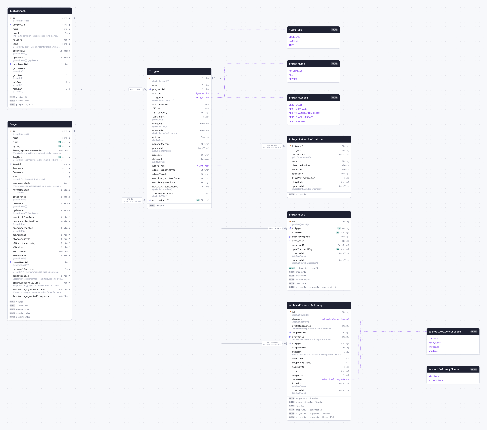

| Field                  | Type                                   | Constraints                                        | Default              | Description |
| ---------------------- | -------------------------------------- | -------------------------------------------------- | -------------------- | ----------- |
| `id`                   | `String`                               | PK NOT NULL                                        | `nanoid()`           |             |
| `name`                 | `String`                               | NOT NULL                                           |                      |             |
| `projectId`            | `String`                               | NOT NULL → [Project.id](#model-Project)            |                      |             |
| `action`               | [`TriggerAction`](#enum-TriggerAction) | NOT NULL                                           |                      |             |
| `triggerKind`          | [`TriggerKind`](#enum-TriggerKind)     | NOT NULL                                           | `AUTOMATION`         |             |
| `actionParams`         | `Json`                                 | NOT NULL                                           |                      |             |
| `filters`              | `Json`                                 | NOT NULL                                           |                      |             |
| `filterQuery`          | `String`                               | NULL                                               |                      |             |
| `lastRunAt`            | `Float`                                | NOT NULL                                           | `0`                  |             |
| `createdAt`            | `DateTime`                             | NOT NULL                                           | `now()`              |             |
| `updatedAt`            | `DateTime`                             | NOT NULL                                           | `now()` `@updatedAt` |             |
| `active`               | `Boolean`                              | NOT NULL                                           | `true`               |             |
| `pausedReason`         | `String`                               | NULL                                               |                      |             |
| `pausedAt`             | `DateTime` `@db.Timestamptz(3)`        | NULL                                               |                      |             |
| `message`              | `String`                               | NULL                                               |                      |             |
| `deleted`              | `Boolean`                              | NOT NULL                                           | `false`              |             |
| `alertType`            | [`AlertType`](#enum-AlertType)         | NULL                                               |                      |             |
| `slackTemplateType`    | `String`                               | NULL                                               |                      |             |
| `slackTemplate`        | `String`                               | NULL                                               |                      |             |
| `emailSubjectTemplate` | `String`                               | NULL                                               |                      |             |
| `emailBodyTemplate`    | `String`                               | NULL                                               |                      |             |
| `notificationCadence`  | `String`                               | NOT NULL                                           | `"immediate"`        |             |
| `traceDebounceMs`      | `Int`                                  | NOT NULL                                           | `30000`              |             |
| `customGraphId`        | `String`                               | UNIQUE NULL → [CustomGraph.id](#model-CustomGraph) |                      |             |

#### Indexes

- `@@index([projectId])`

#### References

- `projectId` → [Project.id](#model-Project) (many-to-one)
- `customGraphId` → [CustomGraph.id](#model-CustomGraph) (one-to-one, on delete Cascade)

#### Referenced by

- `id` ← [WebhookEndpointDelivery.triggerId](#model-WebhookEndpointDelivery) (one-to-many, on delete Cascade)
- `id` ← [TriggerSent.triggerId](#model-TriggerSent) (one-to-many)
- `id` ← [TriggerLatestEvaluation.triggerId](#model-TriggerLatestEvaluation) (one-to-one, on delete Cascade)

#### Definition

```sql
CREATE TABLE "Trigger" (
    "id" TEXT NOT NULL,
    "name" TEXT NOT NULL,
    "projectId" TEXT NOT NULL,
    "action" "TriggerAction" NOT NULL,
    "triggerKind" "TriggerKind" NOT NULL DEFAULT 'AUTOMATION',
    "actionParams" JSONB NOT NULL,
    "filters" JSONB NOT NULL,
    "filterQuery" TEXT,
    "lastRunAt" DOUBLE PRECISION NOT NULL DEFAULT 0,
    "createdAt" TIMESTAMP(3) NOT NULL DEFAULT CURRENT_TIMESTAMP,
    "updatedAt" TIMESTAMP(3) NOT NULL DEFAULT CURRENT_TIMESTAMP,
    "active" BOOLEAN NOT NULL DEFAULT true,
    "pausedReason" TEXT,
    "pausedAt" TIMESTAMPTZ(3),
    "message" TEXT,
    "deleted" BOOLEAN NOT NULL DEFAULT false,
    "alertType" "AlertType",
    "slackTemplateType" TEXT,
    "slackTemplate" TEXT,
    "emailSubjectTemplate" TEXT,
    "emailBodyTemplate" TEXT,
    "notificationCadence" TEXT NOT NULL DEFAULT 'immediate',
    "traceDebounceMs" INTEGER NOT NULL DEFAULT 30000,
    "customGraphId" TEXT,

    CONSTRAINT "Trigger_pkey" PRIMARY KEY ("id")
);

CREATE UNIQUE INDEX "Trigger_customGraphId_key" ON "Trigger"("customGraphId");

CREATE INDEX "Trigger_projectId_idx" ON "Trigger"("projectId");
```

<details>
<summary>Queries and their SQL</summary>

**findMany**: Every row

```ts
await prisma.trigger.findMany();
```

```sql
SELECT
  "public"."Trigger"."id",
  "public"."Trigger"."name",
  "public"."Trigger"."projectId",
  "public"."Trigger"."action"::text,
  "public"."Trigger"."triggerKind"::text,
  "public"."Trigger"."actionParams",
  "public"."Trigger"."filters",
  "public"."Trigger"."filterQuery",
  "public"."Trigger"."lastRunAt",
  "public"."Trigger"."createdAt",
  "public"."Trigger"."updatedAt",
  "public"."Trigger"."active",
  "public"."Trigger"."pausedReason",
  "public"."Trigger"."pausedAt",
  "public"."Trigger"."message",
  "public"."Trigger"."deleted",
  "public"."Trigger"."alertType"::text,
  "public"."Trigger"."slackTemplateType",
  "public"."Trigger"."slackTemplate",
  "public"."Trigger"."emailSubjectTemplate",
  "public"."Trigger"."emailBodyTemplate",
  "public"."Trigger"."notificationCadence",
  "public"."Trigger"."traceDebounceMs",
  "public"."Trigger"."customGraphId"
FROM
  "public"."Trigger"
WHERE
  1 = 1
OFFSET
  $1
-- params: ["0"]
```

**count**: How many rows there are

```ts
await prisma.trigger.count();
```

```sql
SELECT
  COUNT(*) AS "_count$_all"
FROM
  (
    SELECT
      "public"."Trigger"."id"
    FROM
      "public"."Trigger"
    WHERE
      1 = 1
    OFFSET
      $1
  ) AS "sub"
-- params: ["0"]
```

**findMany**: Every row with its relations

```ts
await prisma.trigger.findMany({
  include: {
    project: true,
    TriggerSent: true,
    webhookDeliveries: true,
    latestEvaluation: true,
    customGraph: true,
  },
});
```

```sql
SELECT
  "public"."Trigger"."id",
  "public"."Trigger"."name",
  "public"."Trigger"."projectId",
  "public"."Trigger"."action"::text,
  "public"."Trigger"."triggerKind"::text,
  "public"."Trigger"."actionParams",
  "public"."Trigger"."filters",
  "public"."Trigger"."filterQuery",
  "public"."Trigger"."lastRunAt",
  "public"."Trigger"."createdAt",
  "public"."Trigger"."updatedAt",
  "public"."Trigger"."active",
  "public"."Trigger"."pausedReason",
  "public"."Trigger"."pausedAt",
  "public"."Trigger"."message",
  "public"."Trigger"."deleted",
  "public"."Trigger"."alertType"::text,
  "public"."Trigger"."slackTemplateType",
  "public"."Trigger"."slackTemplate",
  "public"."Trigger"."emailSubjectTemplate",
  "public"."Trigger"."emailBodyTemplate",
  "public"."Trigger"."notificationCadence",
  "public"."Trigger"."traceDebounceMs",
  "public"."Trigger"."customGraphId"
FROM
  "public"."Trigger"
WHERE
  1 = 1
OFFSET
  $1
-- params: ["0"]

SELECT
  "public"."Project"."id",
  "public"."Project"."name",
  "public"."Project"."slug",
  "public"."Project"."apiKey",
  "public"."Project"."legacyApiKeyLastUsedAt",
  "public"."Project"."lwqlKey",
  "public"."Project"."teamId",
  "public"."Project"."language",
  "public"."Project"."framework",
  "public"."Project"."kind",
  "public"."Project"."aggregateRule",
  "public"."Project"."firstMessage",
  "public"."Project"."integrated",
  "public"."Project"."createdAt",
  "public"."Project"."updatedAt",
  "public"."Project"."userLinkTemplate",
  "public"."Project"."traceSharingEnabled",
  "public"."Project"."presenceEnabled",
  "public"."Project"."s3Endpoint",
  "public"."Project"."s3AccessKeyId",
  "public"."Project"."s3SecretAccessKey",
  "public"."Project"."s3Bucket",
  "public"."Project"."archivedAt",
  "public"."Project"."isPersonal",
  "public"."Project"."ownerUserId",
  "public"."Project"."personalFeatures",
  "public"."Project"."departmentId",
  "public"."Project"."langyEgressAllowlist",
  "public"."Project"."lastCodingAgentSessionAt",
  "public"."Project"."lastCodingAgentPullRequestAt"
FROM
  "public"."Project"
WHERE
  "public"."Project"."id" IN ($1)
OFFSET
  $2
-- params: ["<projectId of the rows above>","0"]

SELECT
  "public"."TriggerSent"."id",
  "public"."TriggerSent"."triggerId",
  "public"."TriggerSent"."traceId",
  "public"."TriggerSent"."customGraphId",
  "public"."TriggerSent"."projectId",
  "public"."TriggerSent"."resolvedAt",
  "public"."TriggerSent"."openIncidentKey",
  "public"."TriggerSent"."createdAt",
  "public"."TriggerSent"."updatedAt"
FROM
  "public"."TriggerSent"
WHERE
  "public"."TriggerSent"."triggerId" IN ($1)
OFFSET
  $2
-- params: ["<id of the rows above>","0"]

SELECT
  "public"."WebhookEndpointDelivery"."id",
  "public"."WebhookEndpointDelivery"."channel"::text,
  "public"."WebhookEndpointDelivery"."organizationId",
  "public"."WebhookEndpointDelivery"."endpointId",
  "public"."WebhookEndpointDelivery"."projectId",
  "public"."WebhookEndpointDelivery"."triggerId",
  "public"."WebhookEndpointDelivery"."dispatchId",
  "public"."WebhookEndpointDelivery"."attempt",
  "public"."WebhookEndpointDelivery"."eventCount",
  "public"."WebhookEndpointDelivery"."responseStatus",
  "public"."WebhookEndpointDelivery"."latencyMs",
  "public"."WebhookEndpointDelivery"."error",
  "public"."WebhookEndpointDelivery"."response",
  "public"."WebhookEndpointDelivery"."outcome"::text,
  "public"."WebhookEndpointDelivery"."firedAt",
  "public"."WebhookEndpointDelivery"."createdAt"
FROM
  "public"."WebhookEndpointDelivery"
WHERE
  "public"."WebhookEndpointDelivery"."triggerId" IN ($1)
OFFSET
  $2
-- params: ["<id of the rows above>","0"]

SELECT
  "public"."TriggerLatestEvaluation"."triggerId",
  "public"."TriggerLatestEvaluation"."projectId",
  "public"."TriggerLatestEvaluation"."evaluatedAt",
  "public"."TriggerLatestEvaluation"."verdict",
  "public"."TriggerLatestEvaluation"."observedValue",
  "public"."TriggerLatestEvaluation"."threshold",
  "public"."TriggerLatestEvaluation"."operator",
  "public"."TriggerLatestEvaluation"."timePeriodMinutes",
  "public"."TriggerLatestEvaluation"."skipCode",
  "public"."TriggerLatestEvaluation"."updatedAt"
FROM
  "public"."TriggerLatestEvaluation"
WHERE
  "public"."TriggerLatestEvaluation"."triggerId" IN ($1)
OFFSET
  $2
-- params: ["<id of the rows above>","0"]

SELECT
  "public"."CustomGraph"."id",
  "public"."CustomGraph"."projectId",
  "public"."CustomGraph"."name",
  "public"."CustomGraph"."graph",
  "public"."CustomGraph"."filters",
  "public"."CustomGraph"."kind",
  "public"."CustomGraph"."createdAt",
  "public"."CustomGraph"."updatedAt",
  "public"."CustomGraph"."dashboardId",
  "public"."CustomGraph"."gridColumn",
  "public"."CustomGraph"."gridRow",
  "public"."CustomGraph"."colSpan",
  "public"."CustomGraph"."rowSpan"
FROM
  "public"."CustomGraph"
WHERE
  "public"."CustomGraph"."id" IN ($1)
OFFSET
  $2
-- params: ["<customGraphId of the rows above>","0"]
```

**findUnique**: One row by what is unique to it

```ts
await prisma.trigger.findUnique({ where: { id: "example" } });
```

```sql
SELECT
  "public"."Trigger"."id",
  "public"."Trigger"."name",
  "public"."Trigger"."projectId",
  "public"."Trigger"."action"::text,
  "public"."Trigger"."triggerKind"::text,
  "public"."Trigger"."actionParams",
  "public"."Trigger"."filters",
  "public"."Trigger"."filterQuery",
  "public"."Trigger"."lastRunAt",
  "public"."Trigger"."createdAt",
  "public"."Trigger"."updatedAt",
  "public"."Trigger"."active",
  "public"."Trigger"."pausedReason",
  "public"."Trigger"."pausedAt",
  "public"."Trigger"."message",
  "public"."Trigger"."deleted",
  "public"."Trigger"."alertType"::text,
  "public"."Trigger"."slackTemplateType",
  "public"."Trigger"."slackTemplate",
  "public"."Trigger"."emailSubjectTemplate",
  "public"."Trigger"."emailBodyTemplate",
  "public"."Trigger"."notificationCadence",
  "public"."Trigger"."traceDebounceMs",
  "public"."Trigger"."customGraphId"
FROM
  "public"."Trigger"
WHERE
  (
    "public"."Trigger"."id" = $1
    AND 1 = 1
  )
LIMIT
  $2
OFFSET
  $3
-- params: ["example","1","0"]
```

**create**: Create a row

```ts
await prisma.trigger.create({
  data: {
    name: "example",
    projectId: "example",
    action: "SEND_EMAIL",
    actionParams: {},
    filters: {},
  },
});
```

```sql
INSERT INTO
  "public"."Trigger" (
    "id",
    "name",
    "projectId",
    "action",
    "triggerKind",
    "actionParams",
    "filters",
    "lastRunAt",
    "createdAt",
    "updatedAt",
    "active",
    "deleted",
    "notificationCadence",
    "traceDebounceMs"
  )
VALUES
  (
    $1,
    $2,
    $3,
    CAST($4::text AS "public"."TriggerAction"),
    CAST($5::text AS "public"."TriggerKind"),
    $6,
    $7,
    $8,
    $9,
    $10,
    $11,
    $12,
    $13,
    $14
  )
RETURNING
  "public"."Trigger"."id",
  "public"."Trigger"."name",
  "public"."Trigger"."projectId",
  "public"."Trigger"."action"::text,
  "public"."Trigger"."triggerKind"::text,
  "public"."Trigger"."actionParams",
  "public"."Trigger"."filters",
  "public"."Trigger"."filterQuery",
  "public"."Trigger"."lastRunAt",
  "public"."Trigger"."createdAt",
  "public"."Trigger"."updatedAt",
  "public"."Trigger"."active",
  "public"."Trigger"."pausedReason",
  "public"."Trigger"."pausedAt",
  "public"."Trigger"."message",
  "public"."Trigger"."deleted",
  "public"."Trigger"."alertType"::text,
  "public"."Trigger"."slackTemplateType",
  "public"."Trigger"."slackTemplate",
  "public"."Trigger"."emailSubjectTemplate",
  "public"."Trigger"."emailBodyTemplate",
  "public"."Trigger"."notificationCadence",
  "public"."Trigger"."traceDebounceMs",
  "public"."Trigger"."customGraphId"
-- params: ["<nanoid()>","example","example","SEND_EMAIL","AUTOMATION","{}","{}","0","<now()>","<now()>",true,false,"immediate","30000"]
```

**update**: Update a row

```ts
await prisma.trigger.update({ where: { id: "example" }, data: { name: "example" } });
```

```sql
SELECT
  "public"."Trigger"."id"
FROM
  "public"."Trigger"
WHERE
  (
    "public"."Trigger"."id" = $1
    AND 1 = 1
  )
LIMIT
  $2
OFFSET
  $3
-- params: ["example","1","0"]

UPDATE "public"."Trigger"
SET
  "name" = $1,
  "updatedAt" = $2
WHERE
  (
    "public"."Trigger"."id" IN ($3)
    AND (
      "public"."Trigger"."id" = $4
      AND 1 = 1
    )
  )
RETURNING
  "public"."Trigger"."id",
  "public"."Trigger"."name",
  "public"."Trigger"."projectId",
  "public"."Trigger"."action"::text,
  "public"."Trigger"."triggerKind"::text,
  "public"."Trigger"."actionParams",
  "public"."Trigger"."filters",
  "public"."Trigger"."filterQuery",
  "public"."Trigger"."lastRunAt",
  "public"."Trigger"."createdAt",
  "public"."Trigger"."updatedAt",
  "public"."Trigger"."active",
  "public"."Trigger"."pausedReason",
  "public"."Trigger"."pausedAt",
  "public"."Trigger"."message",
  "public"."Trigger"."deleted",
  "public"."Trigger"."alertType"::text,
  "public"."Trigger"."slackTemplateType",
  "public"."Trigger"."slackTemplate",
  "public"."Trigger"."emailSubjectTemplate",
  "public"."Trigger"."emailBodyTemplate",
  "public"."Trigger"."notificationCadence",
  "public"."Trigger"."traceDebounceMs",
  "public"."Trigger"."customGraphId"
-- params: ["example",{"prisma__type":"generatorCall","prisma__value":{"name":"now","args":[],"returnType":{"type":"DateTime"}}},"<id of the rows above>","example"]
```

**delete**: Delete a row

```ts
await prisma.trigger.delete({ where: { id: "example" } });
```

```sql
DELETE FROM "public"."Trigger"
WHERE
  (
    "public"."Trigger"."id" = $1
    AND 1 = 1
  )
RETURNING
  "public"."Trigger"."id",
  "public"."Trigger"."name",
  "public"."Trigger"."projectId",
  "public"."Trigger"."action"::text,
  "public"."Trigger"."triggerKind"::text,
  "public"."Trigger"."actionParams",
  "public"."Trigger"."filters",
  "public"."Trigger"."filterQuery",
  "public"."Trigger"."lastRunAt",
  "public"."Trigger"."createdAt",
  "public"."Trigger"."updatedAt",
  "public"."Trigger"."active",
  "public"."Trigger"."pausedReason",
  "public"."Trigger"."pausedAt",
  "public"."Trigger"."message",
  "public"."Trigger"."deleted",
  "public"."Trigger"."alertType"::text,
  "public"."Trigger"."slackTemplateType",
  "public"."Trigger"."slackTemplate",
  "public"."Trigger"."emailSubjectTemplate",
  "public"."Trigger"."emailBodyTemplate",
  "public"."Trigger"."notificationCadence",
  "public"."Trigger"."traceDebounceMs",
  "public"."Trigger"."customGraphId"
-- params: ["example"]

SELECT
  "public"."WebhookEndpointDelivery"."id",
  "public"."WebhookEndpointDelivery"."triggerId"
FROM
  "public"."WebhookEndpointDelivery"
WHERE
  (
    1 = 1
    AND "public"."WebhookEndpointDelivery"."triggerId" IN ($1)
  )
OFFSET
  $2
-- params: ["<id of the rows above>","0"]

DELETE FROM "public"."WebhookEndpointDelivery"
WHERE
  (
    "public"."WebhookEndpointDelivery"."id" IN ($1)
    AND 1 = 1
  )
-- params: ["<id of the rows above>"]

SELECT
  "public"."TriggerSent"."id",
  "public"."TriggerSent"."triggerId"
FROM
  "public"."TriggerSent"
WHERE
  (
    1 = 1
    AND "public"."TriggerSent"."triggerId" IN ($1)
  )
OFFSET
  $2
-- params: ["<id of the rows above>","0"]

SELECT
  "public"."TriggerLatestEvaluation"."triggerId"
FROM
  "public"."TriggerLatestEvaluation"
WHERE
  (
    1 = 1
    AND "public"."TriggerLatestEvaluation"."triggerId" IN ($1)
  )
OFFSET
  $2
-- params: ["<id of the rows above>","0"]

DELETE FROM "public"."TriggerLatestEvaluation"
WHERE
  (
    "public"."TriggerLatestEvaluation"."triggerId" IN ($1)
    AND 1 = 1
  )
-- params: ["<triggerId of the rows above>"]
```

</details>

<a id="model-SlackIntegration"></a>

### SlackIntegration

One named Slack connection (ADR-093 §5a); an organization holds as many as
it likes, each scoped to the organization or to one project. The secret is
AES-256-GCM ciphertext and never returned to a client. `secretFingerprint`
is an HMAC of the plaintext, so one secret is one connection per scope
without decrypting anything. No foreign key: `scopeId` is
polymorphic (ADR-021), as on RetentionPolicy and CustomLLMModelCost.

| Field                 | Type                                                           | Constraints | Default              | Description |
| --------------------- | -------------------------------------------------------------- | ----------- | -------------------- | ----------- |
| `id`                  | `String`                                                       | PK NOT NULL | `nanoid()`           |             |
| `name`                | `String`                                                       | NOT NULL    |                      |             |
| `kind`                | [`SlackIntegrationKind`](#enum-SlackIntegrationKind)           | NOT NULL    |                      |             |
| `scopeType`           | [`SlackIntegrationScopeType`](#enum-SlackIntegrationScopeType) | NOT NULL    |                      |             |
| `scopeId`             | `String`                                                       | NOT NULL    |                      |             |
| `organizationId`      | `String`                                                       | NOT NULL    |                      |             |
| `botTokenEncrypted`   | `String`                                                       | NULL        |                      |             |
| `webhookUrlEncrypted` | `String`                                                       | NULL        |                      |             |
| `secretFingerprint`   | `String`                                                       | NOT NULL    |                      |             |
| `secretHint`          | `String`                                                       | NOT NULL    |                      |             |
| `slackTeamId`         | `String`                                                       | NULL        |                      |             |
| `slackTeamName`       | `String`                                                       | NULL        |                      |             |
| `createdById`         | `String`                                                       | NOT NULL    |                      |             |
| `updatedById`         | `String`                                                       | NOT NULL    |                      |             |
| `createdAt`           | `DateTime`                                                     | NOT NULL    | `now()`              |             |
| `updatedAt`           | `DateTime`                                                     | NOT NULL    | `now()` `@updatedAt` |             |

#### Indexes

- `@@index([scopeType, scopeId])`
- `@@unique([organizationId, scopeType, scopeId, secretFingerprint])`

#### Definition

```sql
CREATE TABLE "SlackIntegration" (
    "id" TEXT NOT NULL,
    "name" TEXT NOT NULL,
    "kind" "SlackIntegrationKind" NOT NULL,
    "scopeType" "SlackIntegrationScopeType" NOT NULL,
    "scopeId" TEXT NOT NULL,
    "organizationId" TEXT NOT NULL,
    "botTokenEncrypted" TEXT,
    "webhookUrlEncrypted" TEXT,
    "secretFingerprint" TEXT NOT NULL,
    "secretHint" TEXT NOT NULL,
    "slackTeamId" TEXT,
    "slackTeamName" TEXT,
    "createdById" TEXT NOT NULL,
    "updatedById" TEXT NOT NULL,
    "createdAt" TIMESTAMP(3) NOT NULL DEFAULT CURRENT_TIMESTAMP,
    "updatedAt" TIMESTAMP(3) NOT NULL DEFAULT CURRENT_TIMESTAMP,

    CONSTRAINT "SlackIntegration_pkey" PRIMARY KEY ("id")
);

CREATE INDEX "SlackIntegration_scopeType_scopeId_idx" ON "SlackIntegration"("scopeType", "scopeId");

CREATE UNIQUE INDEX "SlackIntegration_organizationId_scopeType_scopeId_secretFin_key" ON "SlackIntegration"("organizationId", "scopeType", "scopeId", "secretFingerprint");
```

<details>
<summary>Queries and their SQL</summary>

**findMany**: Every row

```ts
await prisma.slackIntegration.findMany();
```

```sql
SELECT
  "public"."SlackIntegration"."id",
  "public"."SlackIntegration"."name",
  "public"."SlackIntegration"."kind"::text,
  "public"."SlackIntegration"."scopeType"::text,
  "public"."SlackIntegration"."scopeId",
  "public"."SlackIntegration"."organizationId",
  "public"."SlackIntegration"."botTokenEncrypted",
  "public"."SlackIntegration"."webhookUrlEncrypted",
  "public"."SlackIntegration"."secretFingerprint",
  "public"."SlackIntegration"."secretHint",
  "public"."SlackIntegration"."slackTeamId",
  "public"."SlackIntegration"."slackTeamName",
  "public"."SlackIntegration"."createdById",
  "public"."SlackIntegration"."updatedById",
  "public"."SlackIntegration"."createdAt",
  "public"."SlackIntegration"."updatedAt"
FROM
  "public"."SlackIntegration"
WHERE
  1 = 1
OFFSET
  $1
-- params: ["0"]
```

**count**: How many rows there are

```ts
await prisma.slackIntegration.count();
```

```sql
SELECT
  COUNT(*) AS "_count$_all"
FROM
  (
    SELECT
      "public"."SlackIntegration"."id"
    FROM
      "public"."SlackIntegration"
    WHERE
      1 = 1
    OFFSET
      $1
  ) AS "sub"
-- params: ["0"]
```

**findUnique**: One row by what is unique to it

```ts
await prisma.slackIntegration.findUnique({ where: { id: "example" } });
```

```sql
SELECT
  "public"."SlackIntegration"."id",
  "public"."SlackIntegration"."name",
  "public"."SlackIntegration"."kind"::text,
  "public"."SlackIntegration"."scopeType"::text,
  "public"."SlackIntegration"."scopeId",
  "public"."SlackIntegration"."organizationId",
  "public"."SlackIntegration"."botTokenEncrypted",
  "public"."SlackIntegration"."webhookUrlEncrypted",
  "public"."SlackIntegration"."secretFingerprint",
  "public"."SlackIntegration"."secretHint",
  "public"."SlackIntegration"."slackTeamId",
  "public"."SlackIntegration"."slackTeamName",
  "public"."SlackIntegration"."createdById",
  "public"."SlackIntegration"."updatedById",
  "public"."SlackIntegration"."createdAt",
  "public"."SlackIntegration"."updatedAt"
FROM
  "public"."SlackIntegration"
WHERE
  (
    "public"."SlackIntegration"."id" = $1
    AND 1 = 1
  )
LIMIT
  $2
OFFSET
  $3
-- params: ["example","1","0"]
```

**create**: Create a row

```ts
await prisma.slackIntegration.create({
  data: {
    name: "example",
    kind: "BOT",
    scopeType: "ORGANIZATION",
    scopeId: "example",
    organizationId: "example",
    secretFingerprint: "example",
    secretHint: "example",
    createdById: "example",
    updatedById: "example",
  },
});
```

```sql
INSERT INTO
  "public"."SlackIntegration" (
    "id",
    "name",
    "kind",
    "scopeType",
    "scopeId",
    "organizationId",
    "secretFingerprint",
    "secretHint",
    "createdById",
    "updatedById",
    "createdAt",
    "updatedAt"
  )
VALUES
  (
    $1,
    $2,
    CAST($3::text AS "public"."SlackIntegrationKind"),
    CAST($4::text AS "public"."SlackIntegrationScopeType"),
    $5,
    $6,
    $7,
    $8,
    $9,
    $10,
    $11,
    $12
  )
RETURNING
  "public"."SlackIntegration"."id",
  "public"."SlackIntegration"."name",
  "public"."SlackIntegration"."kind"::text,
  "public"."SlackIntegration"."scopeType"::text,
  "public"."SlackIntegration"."scopeId",
  "public"."SlackIntegration"."organizationId",
  "public"."SlackIntegration"."botTokenEncrypted",
  "public"."SlackIntegration"."webhookUrlEncrypted",
  "public"."SlackIntegration"."secretFingerprint",
  "public"."SlackIntegration"."secretHint",
  "public"."SlackIntegration"."slackTeamId",
  "public"."SlackIntegration"."slackTeamName",
  "public"."SlackIntegration"."createdById",
  "public"."SlackIntegration"."updatedById",
  "public"."SlackIntegration"."createdAt",
  "public"."SlackIntegration"."updatedAt"
-- params: ["<nanoid()>","example","BOT","ORGANIZATION","example","example","example","example","example","example","<now()>","<now()>"]
```

**update**: Update a row

```ts
await prisma.slackIntegration.update({ where: { id: "example" }, data: { name: "example" } });
```

```sql
SELECT
  "public"."SlackIntegration"."id"
FROM
  "public"."SlackIntegration"
WHERE
  (
    "public"."SlackIntegration"."id" = $1
    AND 1 = 1
  )
LIMIT
  $2
OFFSET
  $3
-- params: ["example","1","0"]

UPDATE "public"."SlackIntegration"
SET
  "name" = $1,
  "updatedAt" = $2
WHERE
  (
    "public"."SlackIntegration"."id" IN ($3)
    AND (
      "public"."SlackIntegration"."id" = $4
      AND 1 = 1
    )
  )
RETURNING
  "public"."SlackIntegration"."id",
  "public"."SlackIntegration"."name",
  "public"."SlackIntegration"."kind"::text,
  "public"."SlackIntegration"."scopeType"::text,
  "public"."SlackIntegration"."scopeId",
  "public"."SlackIntegration"."organizationId",
  "public"."SlackIntegration"."botTokenEncrypted",
  "public"."SlackIntegration"."webhookUrlEncrypted",
  "public"."SlackIntegration"."secretFingerprint",
  "public"."SlackIntegration"."secretHint",
  "public"."SlackIntegration"."slackTeamId",
  "public"."SlackIntegration"."slackTeamName",
  "public"."SlackIntegration"."createdById",
  "public"."SlackIntegration"."updatedById",
  "public"."SlackIntegration"."createdAt",
  "public"."SlackIntegration"."updatedAt"
-- params: ["example",{"prisma__type":"generatorCall","prisma__value":{"name":"now","args":[],"returnType":{"type":"DateTime"}}},"<id of the rows above>","example"]
```

**delete**: Delete a row

```ts
await prisma.slackIntegration.delete({ where: { id: "example" } });
```

```sql
DELETE FROM "public"."SlackIntegration"
WHERE
  (
    "public"."SlackIntegration"."id" = $1
    AND 1 = 1
  )
RETURNING
  "public"."SlackIntegration"."id",
  "public"."SlackIntegration"."name",
  "public"."SlackIntegration"."kind"::text,
  "public"."SlackIntegration"."scopeType"::text,
  "public"."SlackIntegration"."scopeId",
  "public"."SlackIntegration"."organizationId",
  "public"."SlackIntegration"."botTokenEncrypted",
  "public"."SlackIntegration"."webhookUrlEncrypted",
  "public"."SlackIntegration"."secretFingerprint",
  "public"."SlackIntegration"."secretHint",
  "public"."SlackIntegration"."slackTeamId",
  "public"."SlackIntegration"."slackTeamName",
  "public"."SlackIntegration"."createdById",
  "public"."SlackIntegration"."updatedById",
  "public"."SlackIntegration"."createdAt",
  "public"."SlackIntegration"."updatedAt"
-- params: ["example"]
```

</details>

<a id="model-SlackConnectionClaim"></a>

### SlackConnectionClaim

Table `slack_connection_claim`. An automation holding a Slack connection in use (ARCHITECTURE.md §3, the
claims ruling): a claimed connection is never deleted. `projectId` is the
claimant's project; `organizationId` is the connection's tenancy anchor.
No foreign key: slack's service refuses to delete a claimed connection.

| Field            | Type       | Constraints | Default              | Description |
| ---------------- | ---------- | ----------- | -------------------- | ----------- |
| `connectionId`   | `String`   | PK NOT NULL |                      |             |
| `claimantId`     | `String`   | PK NOT NULL |                      |             |
| `claimantLabel`  | `String`   | NOT NULL    |                      |             |
| `organizationId` | `String`   | NOT NULL    |                      |             |
| `projectId`      | `String`   | NOT NULL    |                      |             |
| `createdAt`      | `DateTime` | NOT NULL    | `now()`              |             |
| `updatedAt`      | `DateTime` | NOT NULL    | `now()` `@updatedAt` |             |

#### Indexes

- `@@id([connectionId, claimantId])`
- `@@index([organizationId])`

#### Definition

```sql
CREATE TABLE "slack_connection_claim" (
    "connectionId" TEXT NOT NULL,
    "claimantId" TEXT NOT NULL,
    "claimantLabel" TEXT NOT NULL,
    "organizationId" TEXT NOT NULL,
    "projectId" TEXT NOT NULL,
    "createdAt" TIMESTAMP(3) NOT NULL DEFAULT CURRENT_TIMESTAMP,
    "updatedAt" TIMESTAMP(3) NOT NULL DEFAULT CURRENT_TIMESTAMP,

    CONSTRAINT "slack_connection_claim_pkey" PRIMARY KEY ("connectionId","claimantId")
);

CREATE INDEX "slack_connection_claim_organizationId_idx" ON "slack_connection_claim"("organizationId");
```

<details>
<summary>Queries and their SQL</summary>

**findMany**: Every row

```ts
await prisma.slackConnectionClaim.findMany();
```

```sql
SELECT
  "public"."slack_connection_claim"."connectionId",
  "public"."slack_connection_claim"."claimantId",
  "public"."slack_connection_claim"."claimantLabel",
  "public"."slack_connection_claim"."organizationId",
  "public"."slack_connection_claim"."projectId",
  "public"."slack_connection_claim"."createdAt",
  "public"."slack_connection_claim"."updatedAt"
FROM
  "public"."slack_connection_claim"
WHERE
  1 = 1
OFFSET
  $1
-- params: ["0"]
```

**count**: How many rows there are

```ts
await prisma.slackConnectionClaim.count();
```

```sql
SELECT
  COUNT(*) AS "_count$_all"
FROM
  (
    SELECT
      "public"."slack_connection_claim"."connectionId",
      "public"."slack_connection_claim"."claimantId"
    FROM
      "public"."slack_connection_claim"
    WHERE
      1 = 1
    OFFSET
      $1
  ) AS "sub"
-- params: ["0"]
```

**findUnique**: One row by what is unique to it

```ts
await prisma.slackConnectionClaim.findUnique({
  where: { connectionId_claimantId: { connectionId: "example", claimantId: "example" } },
});
```

```sql
SELECT
  "public"."slack_connection_claim"."connectionId",
  "public"."slack_connection_claim"."claimantId",
  "public"."slack_connection_claim"."claimantLabel",
  "public"."slack_connection_claim"."organizationId",
  "public"."slack_connection_claim"."projectId",
  "public"."slack_connection_claim"."createdAt",
  "public"."slack_connection_claim"."updatedAt"
FROM
  "public"."slack_connection_claim"
WHERE
  (
    (
      "public"."slack_connection_claim"."connectionId" = $1
      AND "public"."slack_connection_claim"."claimantId" = $2
    )
    AND 1 = 1
  )
LIMIT
  $3
OFFSET
  $4
-- params: ["example","example","1","0"]
```

**create**: Create a row

```ts
await prisma.slackConnectionClaim.create({
  data: {
    connectionId: "example",
    claimantId: "example",
    claimantLabel: "example",
    organizationId: "example",
    projectId: "example",
  },
});
```

```sql
INSERT INTO
  "public"."slack_connection_claim" (
    "connectionId",
    "claimantId",
    "claimantLabel",
    "organizationId",
    "projectId",
    "createdAt",
    "updatedAt"
  )
VALUES
  ($1, $2, $3, $4, $5, $6, $7)
RETURNING
  "public"."slack_connection_claim"."connectionId",
  "public"."slack_connection_claim"."claimantId",
  "public"."slack_connection_claim"."claimantLabel",
  "public"."slack_connection_claim"."organizationId",
  "public"."slack_connection_claim"."projectId",
  "public"."slack_connection_claim"."createdAt",
  "public"."slack_connection_claim"."updatedAt"
-- params: ["example","example","example","example","example","<now()>","<now()>"]
```

**update**: Update a row

```ts
await prisma.slackConnectionClaim.update({
  where: { connectionId_claimantId: { connectionId: "example", claimantId: "example" } },
  data: { claimantLabel: "example" },
});
```

```sql
SELECT
  "public"."slack_connection_claim"."connectionId",
  "public"."slack_connection_claim"."claimantId"
FROM
  "public"."slack_connection_claim"
WHERE
  (
    (
      "public"."slack_connection_claim"."connectionId" = $1
      AND "public"."slack_connection_claim"."claimantId" = $2
    )
    AND 1 = 1
  )
LIMIT
  $3
OFFSET
  $4
-- params: ["example","example","1","0"]

UPDATE "public"."slack_connection_claim"
SET
  "claimantLabel" = $1,
  "updatedAt" = $2
WHERE
  (
    (
      "public"."slack_connection_claim"."connectionId" IN ($3)
      AND "public"."slack_connection_claim"."claimantId" IN ($4)
    )
    AND (
      (
        "public"."slack_connection_claim"."connectionId" = $5
        AND "public"."slack_connection_claim"."claimantId" = $6
      )
      AND 1 = 1
    )
  )
RETURNING
  "public"."slack_connection_claim"."connectionId",
  "public"."slack_connection_claim"."claimantId",
  "public"."slack_connection_claim"."claimantLabel",
  "public"."slack_connection_claim"."organizationId",
  "public"."slack_connection_claim"."projectId",
  "public"."slack_connection_claim"."createdAt",
  "public"."slack_connection_claim"."updatedAt"
-- params: ["example",{"prisma__type":"generatorCall","prisma__value":{"name":"now","args":[],"returnType":{"type":"DateTime"}}},"<connectionId of the rows above>","<claimantId of the rows above>","example","example"]
```

**delete**: Delete a row

```ts
await prisma.slackConnectionClaim.delete({
  where: { connectionId_claimantId: { connectionId: "example", claimantId: "example" } },
});
```

```sql
DELETE FROM "public"."slack_connection_claim"
WHERE
  (
    (
      "public"."slack_connection_claim"."connectionId" = $1
      AND "public"."slack_connection_claim"."claimantId" = $2
    )
    AND 1 = 1
  )
RETURNING
  "public"."slack_connection_claim"."connectionId",
  "public"."slack_connection_claim"."claimantId",
  "public"."slack_connection_claim"."claimantLabel",
  "public"."slack_connection_claim"."organizationId",
  "public"."slack_connection_claim"."projectId",
  "public"."slack_connection_claim"."createdAt",
  "public"."slack_connection_claim"."updatedAt"
-- params: ["example","example"]
```

</details>

<a id="model-WebhookEndpoint"></a>

### WebhookEndpoint

Org-anchored outbound webhook endpoint (the webhook platform, enterprise
only). The signing secret is AES-256-GCM encrypted at rest (shared
encrypt/decrypt, CREDENTIALS_SECRET) and returned in plaintext exactly
once, at create or roll time. `enabledEvents` holds registry event types
or family wildcards ("gateway._", "_"). Failure-streak columns drive the
72h auto-disable. Spec: specs/webhooks/webhook-endpoints.feature.

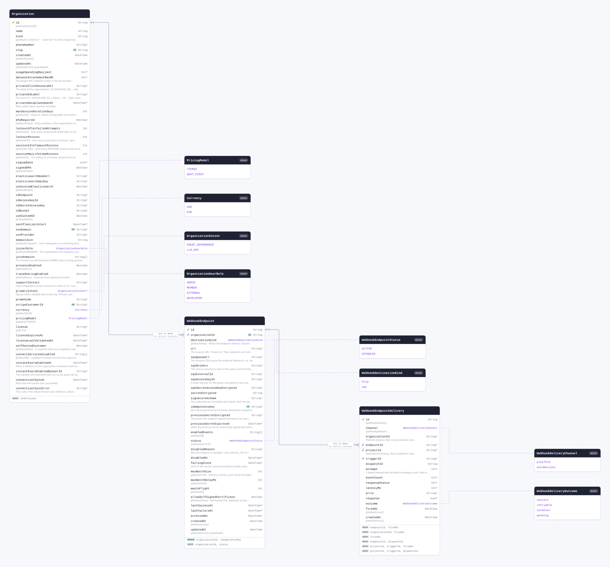

| Field                         | Type                                                     | Constraints                                       | Default              | Description                                                                                                                                                                                                                                                                             |
| ----------------------------- | -------------------------------------------------------- | ------------------------------------------------- | -------------------- | --------------------------------------------------------------------------------------------------------------------------------------------------------------------------------------------------------------------------------------------------------------------------------------- |
| `id`                          | `String`                                                 | PK NOT NULL                                       |                      |                                                                                                                                                                                                                                                                                         |
| `organizationId`              | `String`                                                 | NOT NULL → [Organization.id](#model-Organization) |                      |                                                                                                                                                                                                                                                                                         |
| `destinationKind`             | [`WebhookDestinationKind`](#enum-WebhookDestinationKind) | NOT NULL                                          | `http`               | Where this endpoint delivers. Everything above the last hop is shared: same batching, same retry ladder, same delivery log, same signature over the same bytes.                                                                                                                         |
| `url`                         | `String`                                                 | NULL                                              |                      | The receiver URL. Present on `http` endpoints and null on the others; the per-kind shape is pinned by a CHECK constraint Prisma cannot model.                                                                                                                                           |
| `sqsQueueUrl`                 | `String`                                                 | NULL                                              |                      | The Amazon SQS queue this endpoint delivers to, on `sqs` endpoints. The region and the owning account are read off it rather than configured separately, so they can never disagree with the queue.                                                                                     |
| `sqsRoleArn`                  | `String`                                                 | NULL                                              |                      | The role we assume to write to the queue, and the ExternalId that proves the request came from us rather than from anyone who learned the role's name. The recommended credential mode.                                                                                                 |
| `sqsExternalId`               | `String`                                                 | NULL                                              |                      |                                                                                                                                                                                                                                                                                         |
| `sqsAccessKeyId`              | `String`                                                 | NULL                                              |                      | A static key pair for the queue, encrypted at rest exactly like the signing secret. Both halves are present or both are absent: a half-filled pair is what the AWS SDK reads as "we have credentials" and stops looking with, so the CHECK constraint refuses it.                       |
| `sqsSecretAccessKeyEncrypted` | `String`                                                 | NULL                                              |                      |                                                                                                                                                                                                                                                                                         |
| `secretEncrypted`             | `String`                                                 | NOT NULL                                          |                      |                                                                                                                                                                                                                                                                                         |
| `signatureScheme`             | `String`                                                 | NULL                                              |                      | How deliveries are formatted and signed. Null: the batch envelope signed `t=,v1=`. `legacy_sha256`: one raw message per POST signed `sha256=`, kept only for endpoints migrated from governance anomaly destinations.                                                                   |
| `idempotencyKey`              | `String`                                                 | NULL                                              |                      | Set only by governance's anomaly destination migration: a create that repeats it in the same organization answers the endpoint it made. An archived endpoint gives its key up, so a retry after cleanup creates anew.                                                                   |
| `previousSecretEncrypted`     | `String`                                                 | NULL                                              |                      | The secret this endpoint signed with before the last roll. Deliveries carry a second `v1=` computed from it until it expires, so a receiver swaps secrets on its own schedule instead of dropping deliveries in the gap. Null once the window closes or if the secret was never rolled. |
| `previousSecretExpiresAt`     | `DateTime`                                               | NULL                                              |                      | When the previous secret stops being signed with and accepted.                                                                                                                                                                                                                          |
| `enabledEvents`               | `String[]`                                               | NOT NULL                                          | `[]`                 |                                                                                                                                                                                                                                                                                         |
| `status`                      | [`WebhookEndpointStatus`](#enum-WebhookEndpointStatus)   | NOT NULL                                          | `ACTIVE`             |                                                                                                                                                                                                                                                                                         |
| `disabledReason`              | `String`                                                 | NULL                                              |                      | Why the endpoint is disabled: "auto_failures_72h" or "manual".                                                                                                                                                                                                                          |
| `disabledAt`                  | `DateTime`                                               | NULL                                              |                      |                                                                                                                                                                                                                                                                                         |
| `failingSince`                | `DateTime`                                               | NULL                                              |                      | Start of the current consecutive-failure streak; cleared on any 2xx. 72 hours of unbroken failures from this instant auto-disables.                                                                                                                                                     |
| `maxBatchSize`                | `Int`                                                    | NOT NULL                                          | `100`                | Delivery controls, each server-bounded (see webhookDeliveryControls constants): envelopes per POST, coalescing window before a partial batch ships, and concurrent POSTs to this receiver.                                                                                              |
| `maxBatchDelayMs`             | `Int`                                                    | NOT NULL                                          | `250`                |                                                                                                                                                                                                                                                                                         |
| `maxInFlight`                 | `Int`                                                    | NOT NULL                                          | `4`                  |                                                                                                                                                                                                                                                                                         |
| `allowSelfSignedCertificate`  | `Boolean`                                                | NOT NULL                                          | `false`              | Self-hosted only: deliveries accept the receiver's self-signed TLS certificate. Off by default; the hosted product ignores it.                                                                                                                                                          |
| `lastSuccessAt`               | `DateTime`                                               | NULL                                              |                      |                                                                                                                                                                                                                                                                                         |
| `lastFailureAt`               | `DateTime`                                               | NULL                                              |                      |                                                                                                                                                                                                                                                                                         |
| `archivedAt`                  | `DateTime`                                               | NULL                                              |                      |                                                                                                                                                                                                                                                                                         |
| `createdAt`                   | `DateTime`                                               | NOT NULL                                          | `now()`              |                                                                                                                                                                                                                                                                                         |
| `updatedAt`                   | `DateTime`                                               | NOT NULL                                          | `now()` `@updatedAt` |                                                                                                                                                                                                                                                                                         |

#### Indexes

- `@@index([organizationId, status])`
- `@@unique([organizationId, idempotencyKey])`

#### References

- `organizationId` → [Organization.id](#model-Organization) (many-to-one, on delete Cascade)

#### Referenced by

- `id` ← [WebhookEndpointDelivery.endpointId](#model-WebhookEndpointDelivery) (one-to-many, on delete Cascade)

#### Definition

```sql
CREATE TABLE "WebhookEndpoint" (
    "id" TEXT NOT NULL,
    "organizationId" TEXT NOT NULL,
    "destinationKind" "WebhookDestinationKind" NOT NULL DEFAULT 'http',
    "url" TEXT,
    "sqsQueueUrl" TEXT,
    "sqsRoleArn" TEXT,
    "sqsExternalId" TEXT,
    "sqsAccessKeyId" TEXT,
    "sqsSecretAccessKeyEncrypted" TEXT,
    "secretEncrypted" TEXT NOT NULL,
    "signatureScheme" TEXT,
    "idempotencyKey" TEXT,
    "previousSecretEncrypted" TEXT,
    "previousSecretExpiresAt" TIMESTAMP(3),
    "enabledEvents" TEXT[] DEFAULT ARRAY[]::TEXT[],
    "status" "WebhookEndpointStatus" NOT NULL DEFAULT 'ACTIVE',
    "disabledReason" TEXT,
    "disabledAt" TIMESTAMP(3),
    "failingSince" TIMESTAMP(3),
    "maxBatchSize" INTEGER NOT NULL DEFAULT 100,
    "maxBatchDelayMs" INTEGER NOT NULL DEFAULT 250,
    "maxInFlight" INTEGER NOT NULL DEFAULT 4,
    "allowSelfSignedCertificate" BOOLEAN NOT NULL DEFAULT false,
    "lastSuccessAt" TIMESTAMP(3),
    "lastFailureAt" TIMESTAMP(3),
    "archivedAt" TIMESTAMP(3),
    "createdAt" TIMESTAMP(3) NOT NULL DEFAULT CURRENT_TIMESTAMP,
    "updatedAt" TIMESTAMP(3) NOT NULL DEFAULT CURRENT_TIMESTAMP,

    CONSTRAINT "WebhookEndpoint_pkey" PRIMARY KEY ("id")
);

CREATE INDEX "WebhookEndpoint_organizationId_status_idx" ON "WebhookEndpoint"("organizationId", "status");

CREATE UNIQUE INDEX "WebhookEndpoint_organizationId_idempotencyKey_key" ON "WebhookEndpoint"("organizationId", "idempotencyKey");
```

<details>
<summary>Queries and their SQL</summary>

**findMany**: Every row

```ts
await prisma.webhookEndpoint.findMany();
```

```sql
SELECT
  "public"."WebhookEndpoint"."id",
  "public"."WebhookEndpoint"."organizationId",
  "public"."WebhookEndpoint"."destinationKind"::text,
  "public"."WebhookEndpoint"."url",
  "public"."WebhookEndpoint"."sqsQueueUrl",
  "public"."WebhookEndpoint"."sqsRoleArn",
  "public"."WebhookEndpoint"."sqsExternalId",
  "public"."WebhookEndpoint"."sqsAccessKeyId",
  "public"."WebhookEndpoint"."sqsSecretAccessKeyEncrypted",
  "public"."WebhookEndpoint"."secretEncrypted",
  "public"."WebhookEndpoint"."signatureScheme",
  "public"."WebhookEndpoint"."idempotencyKey",
  "public"."WebhookEndpoint"."previousSecretEncrypted",
  "public"."WebhookEndpoint"."previousSecretExpiresAt",
  "public"."WebhookEndpoint"."enabledEvents",
  "public"."WebhookEndpoint"."status"::text,
  "public"."WebhookEndpoint"."disabledReason",
  "public"."WebhookEndpoint"."disabledAt",
  "public"."WebhookEndpoint"."failingSince",
  "public"."WebhookEndpoint"."maxBatchSize",
  "public"."WebhookEndpoint"."maxBatchDelayMs",
  "public"."WebhookEndpoint"."maxInFlight",
  "public"."WebhookEndpoint"."allowSelfSignedCertificate",
  "public"."WebhookEndpoint"."lastSuccessAt",
  "public"."WebhookEndpoint"."lastFailureAt",
  "public"."WebhookEndpoint"."archivedAt",
  "public"."WebhookEndpoint"."createdAt",
  "public"."WebhookEndpoint"."updatedAt"
FROM
  "public"."WebhookEndpoint"
WHERE
  1 = 1
OFFSET
  $1
-- params: ["0"]
```

**count**: How many rows there are

```ts
await prisma.webhookEndpoint.count();
```

```sql
SELECT
  COUNT(*) AS "_count$_all"
FROM
  (
    SELECT
      "public"."WebhookEndpoint"."id"
    FROM
      "public"."WebhookEndpoint"
    WHERE
      1 = 1
    OFFSET
      $1
  ) AS "sub"
-- params: ["0"]
```

**findMany**: Every row with its relations

```ts
await prisma.webhookEndpoint.findMany({ include: { organization: true, deliveries: true } });
```

```sql
SELECT
  "public"."WebhookEndpoint"."id",
  "public"."WebhookEndpoint"."organizationId",
  "public"."WebhookEndpoint"."destinationKind"::text,
  "public"."WebhookEndpoint"."url",
  "public"."WebhookEndpoint"."sqsQueueUrl",
  "public"."WebhookEndpoint"."sqsRoleArn",
  "public"."WebhookEndpoint"."sqsExternalId",
  "public"."WebhookEndpoint"."sqsAccessKeyId",
  "public"."WebhookEndpoint"."sqsSecretAccessKeyEncrypted",
  "public"."WebhookEndpoint"."secretEncrypted",
  "public"."WebhookEndpoint"."signatureScheme",
  "public"."WebhookEndpoint"."idempotencyKey",
  "public"."WebhookEndpoint"."previousSecretEncrypted",
  "public"."WebhookEndpoint"."previousSecretExpiresAt",
  "public"."WebhookEndpoint"."enabledEvents",
  "public"."WebhookEndpoint"."status"::text,
  "public"."WebhookEndpoint"."disabledReason",
  "public"."WebhookEndpoint"."disabledAt",
  "public"."WebhookEndpoint"."failingSince",
  "public"."WebhookEndpoint"."maxBatchSize",
  "public"."WebhookEndpoint"."maxBatchDelayMs",
  "public"."WebhookEndpoint"."maxInFlight",
  "public"."WebhookEndpoint"."allowSelfSignedCertificate",
  "public"."WebhookEndpoint"."lastSuccessAt",
  "public"."WebhookEndpoint"."lastFailureAt",
  "public"."WebhookEndpoint"."archivedAt",
  "public"."WebhookEndpoint"."createdAt",
  "public"."WebhookEndpoint"."updatedAt"
FROM
  "public"."WebhookEndpoint"
WHERE
  1 = 1
OFFSET
  $1
-- params: ["0"]

SELECT
  "public"."Organization"."id",
  "public"."Organization"."name",
  "public"."Organization"."kind",
  "public"."Organization"."phoneNumber",
  "public"."Organization"."slug",
  "public"."Organization"."createdAt",
  "public"."Organization"."updatedAt",
  "public"."Organization"."usageSpendingMaxLimit",
  "public"."Organization"."datasetAttachmentMaxMb",
  "public"."Organization"."privateClickHouseLabel",
  "public"."Organization"."privateS3Label",
  "public"."Organization"."privateDataplaneSeenAt",
  "public"."Organization"."maxSessionDurationDays",
  "public"."Organization"."mfaRequired",
  "public"."Organization"."lockoutAfterFailedAttempts",
  "public"."Organization"."lockoutMinutes",
  "public"."Organization"."sessionIdleTimeoutMinutes",
  "public"."Organization"."sessionMaxLifetimeMinutes",
  "public"."Organization"."signupData",
  "public"."Organization"."signedDPA",
  "public"."Organization"."elasticsearchNodeUrl",
  "public"."Organization"."elasticsearchApiKey",
  "public"."Organization"."useCustomElasticsearch",
  "public"."Organization"."s3Endpoint",
  "public"."Organization"."s3AccessKeyId",
  "public"."Organization"."s3SecretAccessKey",
  "public"."Organization"."s3Bucket",
  "public"."Organization"."useCustomS3",
  "public"."Organization"."sentPlanLimitAlert",
  "public"."Organization"."ssoDomain",
  "public"."Organization"."ssoProvider",
  "public"."Organization"."domainJoin",
  "public"."Organization"."joinerRole"::text,
  "public"."Organization"."joinDomains",
  "public"."Organization"."presenceEnabled",
  "public"."Organization"."traceSharingEnabled",
  "public"."Organization"."supportContact",
  "public"."Organization"."primaryIntent"::text,
  "public"."Organization"."promoCode",
  "public"."Organization"."stripeCustomerId",
  "public"."Organization"."currency"::text,
  "public"."Organization"."pricingModel"::text,
  "public"."Organization"."license",
  "public"."Organization"."licenseExpiresAt",
  "public"."Organization"."licenseLastValidatedAt",
  "public"."Organization"."selfHostedCustomer",
  "public"."Organization"."connectServicesDisabled",
  "public"."Organization"."instantEvalsEnabledAt",
  "public"."Organization"."instantEvalsEnabledByUserId",
  "public"."Organization"."connectLastSyncAt",
  "public"."Organization"."connectLastSyncError"
FROM
  "public"."Organization"
WHERE
  "public"."Organization"."id" IN ($1)
OFFSET
  $2
-- params: ["<organizationId of the rows above>","0"]

SELECT
  "public"."WebhookEndpointDelivery"."id",
  "public"."WebhookEndpointDelivery"."channel"::text,
  "public"."WebhookEndpointDelivery"."organizationId",
  "public"."WebhookEndpointDelivery"."endpointId",
  "public"."WebhookEndpointDelivery"."projectId",
  "public"."WebhookEndpointDelivery"."triggerId",
  "public"."WebhookEndpointDelivery"."dispatchId",
  "public"."WebhookEndpointDelivery"."attempt",
  "public"."WebhookEndpointDelivery"."eventCount",
  "public"."WebhookEndpointDelivery"."responseStatus",
  "public"."WebhookEndpointDelivery"."latencyMs",
  "public"."WebhookEndpointDelivery"."error",
  "public"."WebhookEndpointDelivery"."response",
  "public"."WebhookEndpointDelivery"."outcome"::text,
  "public"."WebhookEndpointDelivery"."firedAt",
  "public"."WebhookEndpointDelivery"."createdAt"
FROM
  "public"."WebhookEndpointDelivery"
WHERE
  "public"."WebhookEndpointDelivery"."endpointId" IN ($1)
OFFSET
  $2
-- params: ["<id of the rows above>","0"]
```

**findUnique**: One row by what is unique to it

```ts
await prisma.webhookEndpoint.findUnique({ where: { id: "example" } });
```

```sql
SELECT
  "public"."WebhookEndpoint"."id",
  "public"."WebhookEndpoint"."organizationId",
  "public"."WebhookEndpoint"."destinationKind"::text,
  "public"."WebhookEndpoint"."url",
  "public"."WebhookEndpoint"."sqsQueueUrl",
  "public"."WebhookEndpoint"."sqsRoleArn",
  "public"."WebhookEndpoint"."sqsExternalId",
  "public"."WebhookEndpoint"."sqsAccessKeyId",
  "public"."WebhookEndpoint"."sqsSecretAccessKeyEncrypted",
  "public"."WebhookEndpoint"."secretEncrypted",
  "public"."WebhookEndpoint"."signatureScheme",
  "public"."WebhookEndpoint"."idempotencyKey",
  "public"."WebhookEndpoint"."previousSecretEncrypted",
  "public"."WebhookEndpoint"."previousSecretExpiresAt",
  "public"."WebhookEndpoint"."enabledEvents",
  "public"."WebhookEndpoint"."status"::text,
  "public"."WebhookEndpoint"."disabledReason",
  "public"."WebhookEndpoint"."disabledAt",
  "public"."WebhookEndpoint"."failingSince",
  "public"."WebhookEndpoint"."maxBatchSize",
  "public"."WebhookEndpoint"."maxBatchDelayMs",
  "public"."WebhookEndpoint"."maxInFlight",
  "public"."WebhookEndpoint"."allowSelfSignedCertificate",
  "public"."WebhookEndpoint"."lastSuccessAt",
  "public"."WebhookEndpoint"."lastFailureAt",
  "public"."WebhookEndpoint"."archivedAt",
  "public"."WebhookEndpoint"."createdAt",
  "public"."WebhookEndpoint"."updatedAt"
FROM
  "public"."WebhookEndpoint"
WHERE
  (
    "public"."WebhookEndpoint"."id" = $1
    AND 1 = 1
  )
LIMIT
  $2
OFFSET
  $3
-- params: ["example","1","0"]
```

**create**: Create a row

```ts
await prisma.webhookEndpoint.create({
  data: { id: "example", organizationId: "example", secretEncrypted: "example" },
});
```

```sql
INSERT INTO
  "public"."WebhookEndpoint" (
    "id",
    "organizationId",
    "destinationKind",
    "secretEncrypted",
    "enabledEvents",
    "status",
    "maxBatchSize",
    "maxBatchDelayMs",
    "maxInFlight",
    "allowSelfSignedCertificate",
    "createdAt",
    "updatedAt"
  )
VALUES
  (
    $1,
    $2,
    CAST($3::text AS "public"."WebhookDestinationKind"),
    $4,
    $5,
    CAST($6::text AS "public"."WebhookEndpointStatus"),
    $7,
    $8,
    $9,
    $10,
    $11,
    $12
  )
RETURNING
  "public"."WebhookEndpoint"."id",
  "public"."WebhookEndpoint"."organizationId",
  "public"."WebhookEndpoint"."destinationKind"::text,
  "public"."WebhookEndpoint"."url",
  "public"."WebhookEndpoint"."sqsQueueUrl",
  "public"."WebhookEndpoint"."sqsRoleArn",
  "public"."WebhookEndpoint"."sqsExternalId",
  "public"."WebhookEndpoint"."sqsAccessKeyId",
  "public"."WebhookEndpoint"."sqsSecretAccessKeyEncrypted",
  "public"."WebhookEndpoint"."secretEncrypted",
  "public"."WebhookEndpoint"."signatureScheme",
  "public"."WebhookEndpoint"."idempotencyKey",
  "public"."WebhookEndpoint"."previousSecretEncrypted",
  "public"."WebhookEndpoint"."previousSecretExpiresAt",
  "public"."WebhookEndpoint"."enabledEvents",
  "public"."WebhookEndpoint"."status"::text,
  "public"."WebhookEndpoint"."disabledReason",
  "public"."WebhookEndpoint"."disabledAt",
  "public"."WebhookEndpoint"."failingSince",
  "public"."WebhookEndpoint"."maxBatchSize",
  "public"."WebhookEndpoint"."maxBatchDelayMs",
  "public"."WebhookEndpoint"."maxInFlight",
  "public"."WebhookEndpoint"."allowSelfSignedCertificate",
  "public"."WebhookEndpoint"."lastSuccessAt",
  "public"."WebhookEndpoint"."lastFailureAt",
  "public"."WebhookEndpoint"."archivedAt",
  "public"."WebhookEndpoint"."createdAt",
  "public"."WebhookEndpoint"."updatedAt"
-- params: ["example","example","http","example",[],"ACTIVE","100","250","4",false,"<now()>","<now()>"]
```

**update**: Update a row

```ts
await prisma.webhookEndpoint.update({
  where: { id: "example" },
  data: { destinationKind: "http" },
});
```

```sql
SELECT
  "public"."WebhookEndpoint"."id"
FROM
  "public"."WebhookEndpoint"
WHERE
  (
    "public"."WebhookEndpoint"."id" = $1
    AND 1 = 1
  )
LIMIT
  $2
OFFSET
  $3
-- params: ["example","1","0"]

UPDATE "public"."WebhookEndpoint"
SET
  "destinationKind" = CAST($1::text AS "public"."WebhookDestinationKind"),
  "updatedAt" = $2
WHERE
  (
    "public"."WebhookEndpoint"."id" IN ($3)
    AND (
      "public"."WebhookEndpoint"."id" = $4
      AND 1 = 1
    )
  )
RETURNING
  "public"."WebhookEndpoint"."id",
  "public"."WebhookEndpoint"."organizationId",
  "public"."WebhookEndpoint"."destinationKind"::text,
  "public"."WebhookEndpoint"."url",
  "public"."WebhookEndpoint"."sqsQueueUrl",
  "public"."WebhookEndpoint"."sqsRoleArn",
  "public"."WebhookEndpoint"."sqsExternalId",
  "public"."WebhookEndpoint"."sqsAccessKeyId",
  "public"."WebhookEndpoint"."sqsSecretAccessKeyEncrypted",
  "public"."WebhookEndpoint"."secretEncrypted",
  "public"."WebhookEndpoint"."signatureScheme",
  "public"."WebhookEndpoint"."idempotencyKey",
  "public"."WebhookEndpoint"."previousSecretEncrypted",
  "public"."WebhookEndpoint"."previousSecretExpiresAt",
  "public"."WebhookEndpoint"."enabledEvents",
  "public"."WebhookEndpoint"."status"::text,
  "public"."WebhookEndpoint"."disabledReason",
  "public"."WebhookEndpoint"."disabledAt",
  "public"."WebhookEndpoint"."failingSince",
  "public"."WebhookEndpoint"."maxBatchSize",
  "public"."WebhookEndpoint"."maxBatchDelayMs",
  "public"."WebhookEndpoint"."maxInFlight",
  "public"."WebhookEndpoint"."allowSelfSignedCertificate",
  "public"."WebhookEndpoint"."lastSuccessAt",
  "public"."WebhookEndpoint"."lastFailureAt",
  "public"."WebhookEndpoint"."archivedAt",
  "public"."WebhookEndpoint"."createdAt",
  "public"."WebhookEndpoint"."updatedAt"
-- params: ["http",{"prisma__type":"generatorCall","prisma__value":{"name":"now","args":[],"returnType":{"type":"DateTime"}}},"<id of the rows above>","example"]
```

**delete**: Delete a row

```ts
await prisma.webhookEndpoint.delete({ where: { id: "example" } });
```

```sql
DELETE FROM "public"."WebhookEndpoint"
WHERE
  (
    "public"."WebhookEndpoint"."id" = $1
    AND 1 = 1
  )
RETURNING
  "public"."WebhookEndpoint"."id",
  "public"."WebhookEndpoint"."organizationId",
  "public"."WebhookEndpoint"."destinationKind"::text,
  "public"."WebhookEndpoint"."url",
  "public"."WebhookEndpoint"."sqsQueueUrl",
  "public"."WebhookEndpoint"."sqsRoleArn",
  "public"."WebhookEndpoint"."sqsExternalId",
  "public"."WebhookEndpoint"."sqsAccessKeyId",
  "public"."WebhookEndpoint"."sqsSecretAccessKeyEncrypted",
  "public"."WebhookEndpoint"."secretEncrypted",
  "public"."WebhookEndpoint"."signatureScheme",
  "public"."WebhookEndpoint"."idempotencyKey",
  "public"."WebhookEndpoint"."previousSecretEncrypted",
  "public"."WebhookEndpoint"."previousSecretExpiresAt",
  "public"."WebhookEndpoint"."enabledEvents",
  "public"."WebhookEndpoint"."status"::text,
  "public"."WebhookEndpoint"."disabledReason",
  "public"."WebhookEndpoint"."disabledAt",
  "public"."WebhookEndpoint"."failingSince",
  "public"."WebhookEndpoint"."maxBatchSize",
  "public"."WebhookEndpoint"."maxBatchDelayMs",
  "public"."WebhookEndpoint"."maxInFlight",
  "public"."WebhookEndpoint"."allowSelfSignedCertificate",
  "public"."WebhookEndpoint"."lastSuccessAt",
  "public"."WebhookEndpoint"."lastFailureAt",
  "public"."WebhookEndpoint"."archivedAt",
  "public"."WebhookEndpoint"."createdAt",
  "public"."WebhookEndpoint"."updatedAt"
-- params: ["example"]

SELECT
  "public"."WebhookEndpointDelivery"."id",
  "public"."WebhookEndpointDelivery"."endpointId"
FROM
  "public"."WebhookEndpointDelivery"
WHERE
  (
    1 = 1
    AND "public"."WebhookEndpointDelivery"."endpointId" IN ($1)
  )
OFFSET
  $2
-- params: ["<id of the rows above>","0"]

DELETE FROM "public"."WebhookEndpointDelivery"
WHERE
  (
    "public"."WebhookEndpointDelivery"."id" IN ($1)
    AND 1 = 1
  )
-- params: ["<id of the rows above>"]
```

</details>

<a id="model-WebhookEndpointDelivery"></a>

### WebhookEndpointDelivery

The per-ATTEMPT delivery log for BOTH webhook channels: the endpoints
platform's batches and the automations channel's trigger fires. One row per
HTTP attempt; `dispatchId` groups every attempt of one logical send (the
value of the X-LangWatch-Delivery-Id or X-LangWatch-Event-Id header). A slim
facts table: outcome, status, latency, a capped error message, and a
truncated copy of a failure response. Our request content (URL, headers,
body) is never stored. Pruned after 30 days.

The two channels used to keep separate tables with the same columns and two
prune implementations. They are one table with a discriminator now, so the
tenancy columns of the channel that did not write a row are null.

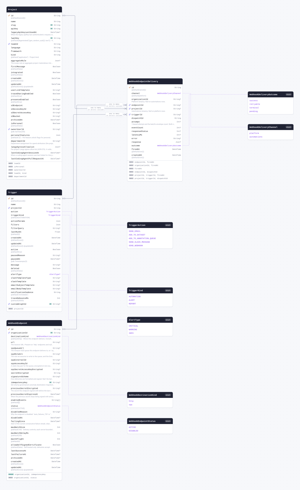

| Field            | Type                                                     | Constraints                                         | Default    | Description                                                                                                                                                                                                   |
| ---------------- | -------------------------------------------------------- | --------------------------------------------------- | ---------- | ------------------------------------------------------------------------------------------------------------------------------------------------------------------------------------------------------------- |
| `id`             | `String`                                                 | PK NOT NULL                                         | `nanoid()` |                                                                                                                                                                                                               |
| `channel`        | [`WebhookDeliveryChannel`](#enum-WebhookDeliveryChannel) | NOT NULL                                            | `platform` |                                                                                                                                                                                                               |
| `organizationId` | `String`                                                 | NULL                                                |            | Platform tenancy. Null on automations rows.                                                                                                                                                                   |
| `endpointId`     | `String`                                                 | NULL → [WebhookEndpoint.id](#model-WebhookEndpoint) |            |                                                                                                                                                                                                               |
| `projectId`      | `String`                                                 | NULL → [Project.id](#model-Project)                 |            | Automations tenancy. Null on platform rows.                                                                                                                                                                   |
| `triggerId`      | `String`                                                 | NULL → [Trigger.id](#model-Trigger)                 |            |                                                                                                                                                                                                               |
| `dispatchId`     | `String`                                                 | NOT NULL                                            |            |                                                                                                                                                                                                               |
| `attempt`        | `Int`                                                    | NULL                                                |            | 1-based attempt and the batch's envelope count. Both null on automations rows, which record neither: one trigger fire is one event, and the channel's sender does not thread its attempt number into the log. |
| `eventCount`     | `Int`                                                    | NULL                                                |            |                                                                                                                                                                                                               |
| `responseStatus` | `Int`                                                    | NULL                                                |            |                                                                                                                                                                                                               |
| `latencyMs`      | `Int`                                                    | NULL                                                |            |                                                                                                                                                                                                               |
| `error`          | `String`                                                 | NULL                                                |            |                                                                                                                                                                                                               |
| `response`       | `Json`                                                   | NULL                                                |            |                                                                                                                                                                                                               |
| `outcome`        | [`WebhookDeliveryOutcome`](#enum-WebhookDeliveryOutcome) | NOT NULL                                            |            |                                                                                                                                                                                                               |
| `firedAt`        | `DateTime`                                               | NOT NULL                                            | `now()`    |                                                                                                                                                                                                               |
| `createdAt`      | `DateTime`                                               | NOT NULL                                            | `now()`    |                                                                                                                                                                                                               |

#### Indexes

- `@@index([endpointId, firedAt])`
- `@@index([organizationId, firedAt])`
- `@@index([firedAt])`
- `@@index([endpointId, dispatchId])`
- `@@index([projectId, triggerId, firedAt])`
- `@@index([projectId, triggerId, dispatchId])`

#### References

- `endpointId` → [WebhookEndpoint.id](#model-WebhookEndpoint) (many-to-one, on delete Cascade)
- `projectId` → [Project.id](#model-Project) (many-to-one, on delete Cascade)
- `triggerId` → [Trigger.id](#model-Trigger) (many-to-one, on delete Cascade)

#### Definition

```sql
CREATE TABLE "WebhookEndpointDelivery" (
    "id" TEXT NOT NULL,
    "channel" "WebhookDeliveryChannel" NOT NULL DEFAULT 'platform',
    "organizationId" TEXT,
    "endpointId" TEXT,
    "projectId" TEXT,
    "triggerId" TEXT,
    "dispatchId" TEXT NOT NULL,
    "attempt" INTEGER,
    "eventCount" INTEGER,
    "responseStatus" INTEGER,
    "latencyMs" INTEGER,
    "error" TEXT,
    "response" JSONB,
    "outcome" "WebhookDeliveryOutcome" NOT NULL,
    "firedAt" TIMESTAMP(3) NOT NULL DEFAULT CURRENT_TIMESTAMP,
    "createdAt" TIMESTAMP(3) NOT NULL DEFAULT CURRENT_TIMESTAMP,

    CONSTRAINT "WebhookEndpointDelivery_pkey" PRIMARY KEY ("id")
);

CREATE INDEX "WebhookEndpointDelivery_endpointId_firedAt_idx" ON "WebhookEndpointDelivery"("endpointId", "firedAt");

CREATE INDEX "WebhookEndpointDelivery_organizationId_firedAt_idx" ON "WebhookEndpointDelivery"("organizationId", "firedAt");

CREATE INDEX "WebhookEndpointDelivery_firedAt_idx" ON "WebhookEndpointDelivery"("firedAt");

CREATE INDEX "WebhookEndpointDelivery_endpointId_dispatchId_idx" ON "WebhookEndpointDelivery"("endpointId", "dispatchId");

CREATE INDEX "WebhookEndpointDelivery_projectId_triggerId_firedAt_idx" ON "WebhookEndpointDelivery"("projectId", "triggerId", "firedAt");

CREATE INDEX "WebhookEndpointDelivery_projectId_triggerId_dispatchId_idx" ON "WebhookEndpointDelivery"("projectId", "triggerId", "dispatchId");
```

<details>
<summary>Queries and their SQL</summary>

**findMany**: Every row

```ts
await prisma.webhookEndpointDelivery.findMany();
```

```sql
SELECT
  "public"."WebhookEndpointDelivery"."id",
  "public"."WebhookEndpointDelivery"."channel"::text,
  "public"."WebhookEndpointDelivery"."organizationId",
  "public"."WebhookEndpointDelivery"."endpointId",
  "public"."WebhookEndpointDelivery"."projectId",
  "public"."WebhookEndpointDelivery"."triggerId",
  "public"."WebhookEndpointDelivery"."dispatchId",
  "public"."WebhookEndpointDelivery"."attempt",
  "public"."WebhookEndpointDelivery"."eventCount",
  "public"."WebhookEndpointDelivery"."responseStatus",
  "public"."WebhookEndpointDelivery"."latencyMs",
  "public"."WebhookEndpointDelivery"."error",
  "public"."WebhookEndpointDelivery"."response",
  "public"."WebhookEndpointDelivery"."outcome"::text,
  "public"."WebhookEndpointDelivery"."firedAt",
  "public"."WebhookEndpointDelivery"."createdAt"
FROM
  "public"."WebhookEndpointDelivery"
WHERE
  1 = 1
OFFSET
  $1
-- params: ["0"]
```

**count**: How many rows there are

```ts
await prisma.webhookEndpointDelivery.count();
```

```sql
SELECT
  COUNT(*) AS "_count$_all"
FROM
  (
    SELECT
      "public"."WebhookEndpointDelivery"."id"
    FROM
      "public"."WebhookEndpointDelivery"
    WHERE
      1 = 1
    OFFSET
      $1
  ) AS "sub"
-- params: ["0"]
```

**findMany**: Every row with its relations

```ts
await prisma.webhookEndpointDelivery.findMany({
  include: { endpoint: true, project: true, trigger: true },
});
```

```sql
SELECT
  "public"."WebhookEndpointDelivery"."id",
  "public"."WebhookEndpointDelivery"."channel"::text,
  "public"."WebhookEndpointDelivery"."organizationId",
  "public"."WebhookEndpointDelivery"."endpointId",
  "public"."WebhookEndpointDelivery"."projectId",
  "public"."WebhookEndpointDelivery"."triggerId",
  "public"."WebhookEndpointDelivery"."dispatchId",
  "public"."WebhookEndpointDelivery"."attempt",
  "public"."WebhookEndpointDelivery"."eventCount",
  "public"."WebhookEndpointDelivery"."responseStatus",
  "public"."WebhookEndpointDelivery"."latencyMs",
  "public"."WebhookEndpointDelivery"."error",
  "public"."WebhookEndpointDelivery"."response",
  "public"."WebhookEndpointDelivery"."outcome"::text,
  "public"."WebhookEndpointDelivery"."firedAt",
  "public"."WebhookEndpointDelivery"."createdAt"
FROM
  "public"."WebhookEndpointDelivery"
WHERE
  1 = 1
OFFSET
  $1
-- params: ["0"]

SELECT
  "public"."WebhookEndpoint"."id",
  "public"."WebhookEndpoint"."organizationId",
  "public"."WebhookEndpoint"."destinationKind"::text,
  "public"."WebhookEndpoint"."url",
  "public"."WebhookEndpoint"."sqsQueueUrl",
  "public"."WebhookEndpoint"."sqsRoleArn",
  "public"."WebhookEndpoint"."sqsExternalId",
  "public"."WebhookEndpoint"."sqsAccessKeyId",
  "public"."WebhookEndpoint"."sqsSecretAccessKeyEncrypted",
  "public"."WebhookEndpoint"."secretEncrypted",
  "public"."WebhookEndpoint"."signatureScheme",
  "public"."WebhookEndpoint"."idempotencyKey",
  "public"."WebhookEndpoint"."previousSecretEncrypted",
  "public"."WebhookEndpoint"."previousSecretExpiresAt",
  "public"."WebhookEndpoint"."enabledEvents",
  "public"."WebhookEndpoint"."status"::text,
  "public"."WebhookEndpoint"."disabledReason",
  "public"."WebhookEndpoint"."disabledAt",
  "public"."WebhookEndpoint"."failingSince",
  "public"."WebhookEndpoint"."maxBatchSize",
  "public"."WebhookEndpoint"."maxBatchDelayMs",
  "public"."WebhookEndpoint"."maxInFlight",
  "public"."WebhookEndpoint"."allowSelfSignedCertificate",
  "public"."WebhookEndpoint"."lastSuccessAt",
  "public"."WebhookEndpoint"."lastFailureAt",
  "public"."WebhookEndpoint"."archivedAt",
  "public"."WebhookEndpoint"."createdAt",
  "public"."WebhookEndpoint"."updatedAt"
FROM
  "public"."WebhookEndpoint"
WHERE
  "public"."WebhookEndpoint"."id" IN ($1)
OFFSET
  $2
-- params: ["<endpointId of the rows above>","0"]

SELECT
  "public"."Project"."id",
  "public"."Project"."name",
  "public"."Project"."slug",
  "public"."Project"."apiKey",
  "public"."Project"."legacyApiKeyLastUsedAt",
  "public"."Project"."lwqlKey",
  "public"."Project"."teamId",
  "public"."Project"."language",
  "public"."Project"."framework",
  "public"."Project"."kind",
  "public"."Project"."aggregateRule",
  "public"."Project"."firstMessage",
  "public"."Project"."integrated",
  "public"."Project"."createdAt",
  "public"."Project"."updatedAt",
  "public"."Project"."userLinkTemplate",
  "public"."Project"."traceSharingEnabled",
  "public"."Project"."presenceEnabled",
  "public"."Project"."s3Endpoint",
  "public"."Project"."s3AccessKeyId",
  "public"."Project"."s3SecretAccessKey",
  "public"."Project"."s3Bucket",
  "public"."Project"."archivedAt",
  "public"."Project"."isPersonal",
  "public"."Project"."ownerUserId",
  "public"."Project"."personalFeatures",
  "public"."Project"."departmentId",
  "public"."Project"."langyEgressAllowlist",
  "public"."Project"."lastCodingAgentSessionAt",
  "public"."Project"."lastCodingAgentPullRequestAt"
FROM
  "public"."Project"
WHERE
  "public"."Project"."id" IN ($1)
OFFSET
  $2
-- params: ["<projectId of the rows above>","0"]

SELECT
  "public"."Trigger"."id",
  "public"."Trigger"."name",
  "public"."Trigger"."projectId",
  "public"."Trigger"."action"::text,
  "public"."Trigger"."triggerKind"::text,
  "public"."Trigger"."actionParams",
  "public"."Trigger"."filters",
  "public"."Trigger"."filterQuery",
  "public"."Trigger"."lastRunAt",
  "public"."Trigger"."createdAt",
  "public"."Trigger"."updatedAt",
  "public"."Trigger"."active",
  "public"."Trigger"."pausedReason",
  "public"."Trigger"."pausedAt",
  "public"."Trigger"."message",
  "public"."Trigger"."deleted",
  "public"."Trigger"."alertType"::text,
  "public"."Trigger"."slackTemplateType",
  "public"."Trigger"."slackTemplate",
  "public"."Trigger"."emailSubjectTemplate",
  "public"."Trigger"."emailBodyTemplate",
  "public"."Trigger"."notificationCadence",
  "public"."Trigger"."traceDebounceMs",
  "public"."Trigger"."customGraphId"
FROM
  "public"."Trigger"
WHERE
  "public"."Trigger"."id" IN ($1)
OFFSET
  $2
-- params: ["<triggerId of the rows above>","0"]
```

**findUnique**: One row by what is unique to it

```ts
await prisma.webhookEndpointDelivery.findUnique({ where: { id: "example" } });
```

```sql
SELECT
  "public"."WebhookEndpointDelivery"."id",
  "public"."WebhookEndpointDelivery"."channel"::text,
  "public"."WebhookEndpointDelivery"."organizationId",
  "public"."WebhookEndpointDelivery"."endpointId",
  "public"."WebhookEndpointDelivery"."projectId",
  "public"."WebhookEndpointDelivery"."triggerId",
  "public"."WebhookEndpointDelivery"."dispatchId",
  "public"."WebhookEndpointDelivery"."attempt",
  "public"."WebhookEndpointDelivery"."eventCount",
  "public"."WebhookEndpointDelivery"."responseStatus",
  "public"."WebhookEndpointDelivery"."latencyMs",
  "public"."WebhookEndpointDelivery"."error",
  "public"."WebhookEndpointDelivery"."response",
  "public"."WebhookEndpointDelivery"."outcome"::text,
  "public"."WebhookEndpointDelivery"."firedAt",
  "public"."WebhookEndpointDelivery"."createdAt"
FROM
  "public"."WebhookEndpointDelivery"
WHERE
  (
    "public"."WebhookEndpointDelivery"."id" = $1
    AND 1 = 1
  )
LIMIT
  $2
OFFSET
  $3
-- params: ["example","1","0"]
```

**create**: Create a row

```ts
await prisma.webhookEndpointDelivery.create({
  data: { dispatchId: "example", outcome: "success" },
});
```

```sql
INSERT INTO
  "public"."WebhookEndpointDelivery" (
    "id",
    "channel",
    "dispatchId",
    "outcome",
    "firedAt",
    "createdAt"
  )
VALUES
  (
    $1,
    CAST($2::text AS "public"."WebhookDeliveryChannel"),
    $3,
    CAST($4::text AS "public"."WebhookDeliveryOutcome"),
    $5,
    $6
  )
RETURNING
  "public"."WebhookEndpointDelivery"."id",
  "public"."WebhookEndpointDelivery"."channel"::text,
  "public"."WebhookEndpointDelivery"."organizationId",
  "public"."WebhookEndpointDelivery"."endpointId",
  "public"."WebhookEndpointDelivery"."projectId",
  "public"."WebhookEndpointDelivery"."triggerId",
  "public"."WebhookEndpointDelivery"."dispatchId",
  "public"."WebhookEndpointDelivery"."attempt",
  "public"."WebhookEndpointDelivery"."eventCount",
  "public"."WebhookEndpointDelivery"."responseStatus",
  "public"."WebhookEndpointDelivery"."latencyMs",
  "public"."WebhookEndpointDelivery"."error",
  "public"."WebhookEndpointDelivery"."response",
  "public"."WebhookEndpointDelivery"."outcome"::text,
  "public"."WebhookEndpointDelivery"."firedAt",
  "public"."WebhookEndpointDelivery"."createdAt"
-- params: ["<nanoid()>","platform","example","success","<now()>","<now()>"]
```

**update**: Update a row

```ts
await prisma.webhookEndpointDelivery.update({
  where: { id: "example" },
  data: { channel: "platform" },
});
```

```sql
SELECT
  "public"."WebhookEndpointDelivery"."id"
FROM
  "public"."WebhookEndpointDelivery"
WHERE
  (
    "public"."WebhookEndpointDelivery"."id" = $1
    AND 1 = 1
  )
LIMIT
  $2
OFFSET
  $3
-- params: ["example","1","0"]

UPDATE "public"."WebhookEndpointDelivery"
SET
  "channel" = CAST($1::text AS "public"."WebhookDeliveryChannel")
WHERE
  (
    "public"."WebhookEndpointDelivery"."id" IN ($2)
    AND (
      "public"."WebhookEndpointDelivery"."id" = $3
      AND 1 = 1
    )
  )
RETURNING
  "public"."WebhookEndpointDelivery"."id",
  "public"."WebhookEndpointDelivery"."channel"::text,
  "public"."WebhookEndpointDelivery"."organizationId",
  "public"."WebhookEndpointDelivery"."endpointId",
  "public"."WebhookEndpointDelivery"."projectId",
  "public"."WebhookEndpointDelivery"."triggerId",
  "public"."WebhookEndpointDelivery"."dispatchId",
  "public"."WebhookEndpointDelivery"."attempt",
  "public"."WebhookEndpointDelivery"."eventCount",
  "public"."WebhookEndpointDelivery"."responseStatus",
  "public"."WebhookEndpointDelivery"."latencyMs",
  "public"."WebhookEndpointDelivery"."error",
  "public"."WebhookEndpointDelivery"."response",
  "public"."WebhookEndpointDelivery"."outcome"::text,
  "public"."WebhookEndpointDelivery"."firedAt",
  "public"."WebhookEndpointDelivery"."createdAt"
-- params: ["platform","<id of the rows above>","example"]
```

**delete**: Delete a row

```ts
await prisma.webhookEndpointDelivery.delete({ where: { id: "example" } });
```

```sql
DELETE FROM "public"."WebhookEndpointDelivery"
WHERE
  (
    "public"."WebhookEndpointDelivery"."id" = $1
    AND 1 = 1
  )
RETURNING
  "public"."WebhookEndpointDelivery"."id",
  "public"."WebhookEndpointDelivery"."channel"::text,
  "public"."WebhookEndpointDelivery"."organizationId",
  "public"."WebhookEndpointDelivery"."endpointId",
  "public"."WebhookEndpointDelivery"."projectId",
  "public"."WebhookEndpointDelivery"."triggerId",
  "public"."WebhookEndpointDelivery"."dispatchId",
  "public"."WebhookEndpointDelivery"."attempt",
  "public"."WebhookEndpointDelivery"."eventCount",
  "public"."WebhookEndpointDelivery"."responseStatus",
  "public"."WebhookEndpointDelivery"."latencyMs",
  "public"."WebhookEndpointDelivery"."error",
  "public"."WebhookEndpointDelivery"."response",
  "public"."WebhookEndpointDelivery"."outcome"::text,
  "public"."WebhookEndpointDelivery"."firedAt",
  "public"."WebhookEndpointDelivery"."createdAt"
-- params: ["example"]
```

</details>

<a id="model-Experiment"></a>

### Experiment

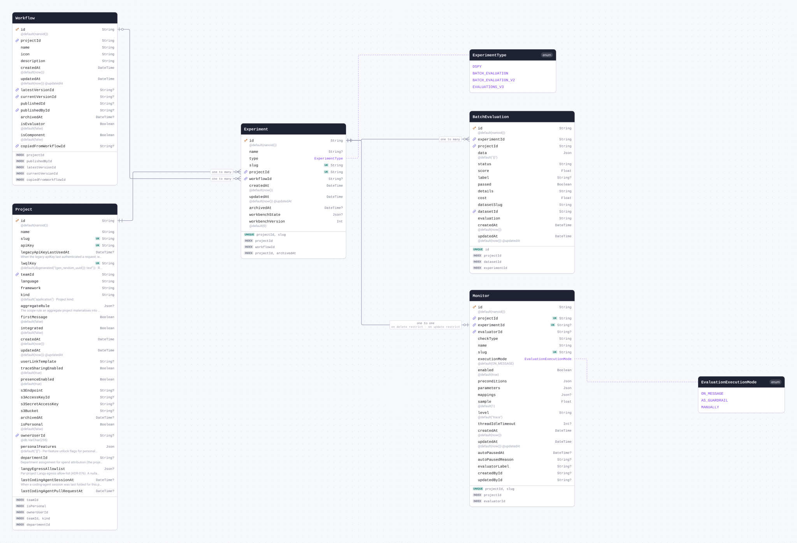

| Field              | Type                                     | Constraints                             | Default              | Description |
| ------------------ | ---------------------------------------- | --------------------------------------- | -------------------- | ----------- |
| `id`               | `String`                                 | PK NOT NULL                             | `nanoid()`           |             |
| `name`             | `String`                                 | NULL                                    |                      |             |
| `type`             | [`ExperimentType`](#enum-ExperimentType) | NOT NULL                                |                      |             |
| `slug`             | `String`                                 | NOT NULL                                |                      |             |
| `projectId`        | `String`                                 | NOT NULL → [Project.id](#model-Project) |                      |             |
| `workflowId`       | `String`                                 | NULL → [Workflow.id](#model-Workflow)   |                      |             |
| `createdAt`        | `DateTime`                               | NOT NULL                                | `now()`              |             |
| `updatedAt`        | `DateTime`                               | NOT NULL                                | `now()` `@updatedAt` |             |
| `archivedAt`       | `DateTime`                               | NULL                                    |                      |             |
| `workbenchState`   | `Json`                                   | NULL                                    |                      |             |
| `workbenchVersion` | `Int`                                    | NOT NULL                                | `0`                  |             |

#### Indexes

- `@@index([projectId])`
- `@@index([workflowId])`
- `@@index([projectId, archivedAt])`
- `@@unique([projectId, slug])`

#### References

- `projectId` → [Project.id](#model-Project) (many-to-one)
- `workflowId` → [Workflow.id](#model-Workflow) (many-to-one)

#### Referenced by

- `id` ← [Monitor.experimentId](#model-Monitor) (one-to-one, on delete Restrict, on update Restrict)
- `id` ← [BatchEvaluation.experimentId](#model-BatchEvaluation) (one-to-many)

#### Definition

```sql
CREATE TABLE "Experiment" (
    "id" TEXT NOT NULL,
    "name" TEXT,
    "type" "ExperimentType" NOT NULL,
    "slug" TEXT NOT NULL,
    "projectId" TEXT NOT NULL,
    "workflowId" TEXT,
    "createdAt" TIMESTAMP(3) NOT NULL DEFAULT CURRENT_TIMESTAMP,
    "updatedAt" TIMESTAMP(3) NOT NULL DEFAULT CURRENT_TIMESTAMP,
    "archivedAt" TIMESTAMP(3),
    "workbenchState" JSONB,
    "workbenchVersion" INTEGER NOT NULL DEFAULT 0,

    CONSTRAINT "Experiment_pkey" PRIMARY KEY ("id")
);

CREATE INDEX "Experiment_projectId_idx" ON "Experiment"("projectId");

CREATE INDEX "Experiment_workflowId_idx" ON "Experiment"("workflowId");

CREATE INDEX "Experiment_projectId_archivedAt_idx" ON "Experiment"("projectId", "archivedAt");

CREATE UNIQUE INDEX "Experiment_projectId_slug_key" ON "Experiment"("projectId", "slug");
```

<details>
<summary>Queries and their SQL</summary>

**findMany**: Every row

```ts
await prisma.experiment.findMany();
```

```sql
SELECT
  "public"."Experiment"."id",
  "public"."Experiment"."name",
  "public"."Experiment"."type"::text,
  "public"."Experiment"."slug",
  "public"."Experiment"."projectId",
  "public"."Experiment"."workflowId",
  "public"."Experiment"."createdAt",
  "public"."Experiment"."updatedAt",
  "public"."Experiment"."archivedAt",
  "public"."Experiment"."workbenchState",
  "public"."Experiment"."workbenchVersion"
FROM
  "public"."Experiment"
WHERE
  1 = 1
OFFSET
  $1
-- params: ["0"]
```

**count**: How many rows there are

```ts
await prisma.experiment.count();
```

```sql
SELECT
  COUNT(*) AS "_count$_all"
FROM
  (
    SELECT
      "public"."Experiment"."id"
    FROM
      "public"."Experiment"
    WHERE
      1 = 1
    OFFSET
      $1
  ) AS "sub"
-- params: ["0"]
```

**findMany**: Every row with its relations

```ts
await prisma.experiment.findMany({
  include: { project: true, workflow: true, batchEvaluations: true, monitor: true },
});
```

```sql
SELECT
  "public"."Experiment"."id",
  "public"."Experiment"."name",
  "public"."Experiment"."type"::text,
  "public"."Experiment"."slug",
  "public"."Experiment"."projectId",
  "public"."Experiment"."workflowId",
  "public"."Experiment"."createdAt",
  "public"."Experiment"."updatedAt",
  "public"."Experiment"."archivedAt",
  "public"."Experiment"."workbenchState",
  "public"."Experiment"."workbenchVersion"
FROM
  "public"."Experiment"
WHERE
  1 = 1
OFFSET
  $1
-- params: ["0"]

SELECT
  "public"."Project"."id",
  "public"."Project"."name",
  "public"."Project"."slug",
  "public"."Project"."apiKey",
  "public"."Project"."legacyApiKeyLastUsedAt",
  "public"."Project"."lwqlKey",
  "public"."Project"."teamId",
  "public"."Project"."language",
  "public"."Project"."framework",
  "public"."Project"."kind",
  "public"."Project"."aggregateRule",
  "public"."Project"."firstMessage",
  "public"."Project"."integrated",
  "public"."Project"."createdAt",
  "public"."Project"."updatedAt",
  "public"."Project"."userLinkTemplate",
  "public"."Project"."traceSharingEnabled",
  "public"."Project"."presenceEnabled",
  "public"."Project"."s3Endpoint",
  "public"."Project"."s3AccessKeyId",
  "public"."Project"."s3SecretAccessKey",
  "public"."Project"."s3Bucket",
  "public"."Project"."archivedAt",
  "public"."Project"."isPersonal",
  "public"."Project"."ownerUserId",
  "public"."Project"."personalFeatures",
  "public"."Project"."departmentId",
  "public"."Project"."langyEgressAllowlist",
  "public"."Project"."lastCodingAgentSessionAt",
  "public"."Project"."lastCodingAgentPullRequestAt"
FROM
  "public"."Project"
WHERE
  "public"."Project"."id" IN ($1)
OFFSET
  $2
-- params: ["<projectId of the rows above>","0"]

SELECT
  "public"."Workflow"."id",
  "public"."Workflow"."projectId",
  "public"."Workflow"."name",
  "public"."Workflow"."icon",
  "public"."Workflow"."description",
  "public"."Workflow"."createdAt",
  "public"."Workflow"."updatedAt",
  "public"."Workflow"."latestVersionId",
  "public"."Workflow"."currentVersionId",
  "public"."Workflow"."publishedId",
  "public"."Workflow"."publishedById",
  "public"."Workflow"."archivedAt",
  "public"."Workflow"."isEvaluator",
  "public"."Workflow"."isComponent",
  "public"."Workflow"."copiedFromWorkflowId"
FROM
  "public"."Workflow"
WHERE
  "public"."Workflow"."id" IN ($1)
OFFSET
  $2
-- params: ["<workflowId of the rows above>","0"]

SELECT
  "public"."BatchEvaluation"."id",
  "public"."BatchEvaluation"."experimentId",
  "public"."BatchEvaluation"."projectId",
  "public"."BatchEvaluation"."data",
  "public"."BatchEvaluation"."status",
  "public"."BatchEvaluation"."score",
  "public"."BatchEvaluation"."label",
  "public"."BatchEvaluation"."passed",
  "public"."BatchEvaluation"."details",
  "public"."BatchEvaluation"."cost",
  "public"."BatchEvaluation"."datasetSlug",
  "public"."BatchEvaluation"."datasetId",
  "public"."BatchEvaluation"."evaluation",
  "public"."BatchEvaluation"."createdAt",
  "public"."BatchEvaluation"."updatedAt"
FROM
  "public"."BatchEvaluation"
WHERE
  "public"."BatchEvaluation"."experimentId" IN ($1)
OFFSET
  $2
-- params: ["<id of the rows above>","0"]

SELECT
  "public"."Monitor"."id",
  "public"."Monitor"."projectId",
  "public"."Monitor"."experimentId",
  "public"."Monitor"."evaluatorId",
  "public"."Monitor"."checkType",
  "public"."Monitor"."name",
  "public"."Monitor"."slug",
  "public"."Monitor"."executionMode"::text,
  "public"."Monitor"."enabled",
  "public"."Monitor"."preconditions",
  "public"."Monitor"."parameters",
  "public"."Monitor"."mappings",
  "public"."Monitor"."sample",
  "public"."Monitor"."level",
  "public"."Monitor"."threadIdleTimeout",
  "public"."Monitor"."createdAt",
  "public"."Monitor"."updatedAt",
  "public"."Monitor"."autoPausedAt",
  "public"."Monitor"."autoPausedReason",
  "public"."Monitor"."evaluatorLabel",
  "public"."Monitor"."createdById",
  "public"."Monitor"."updatedById"
FROM
  "public"."Monitor"
WHERE
  "public"."Monitor"."experimentId" IN ($1)
OFFSET
  $2
-- params: ["<id of the rows above>","0"]
```

**findUnique**: One row by what is unique to it

```ts
await prisma.experiment.findUnique({ where: { id: "example" } });
```

```sql
SELECT
  "public"."Experiment"."id",
  "public"."Experiment"."name",
  "public"."Experiment"."type"::text,
  "public"."Experiment"."slug",
  "public"."Experiment"."projectId",
  "public"."Experiment"."workflowId",
  "public"."Experiment"."createdAt",
  "public"."Experiment"."updatedAt",
  "public"."Experiment"."archivedAt",
  "public"."Experiment"."workbenchState",
  "public"."Experiment"."workbenchVersion"
FROM
  "public"."Experiment"
WHERE
  (
    "public"."Experiment"."id" = $1
    AND 1 = 1
  )
LIMIT
  $2
OFFSET
  $3
-- params: ["example","1","0"]
```

**create**: Create a row

```ts
await prisma.experiment.create({ data: { type: "DSPY", slug: "example", projectId: "example" } });
```

```sql
INSERT INTO
  "public"."Experiment" (
    "id",
    "type",
    "slug",
    "projectId",
    "createdAt",
    "updatedAt",
    "workbenchVersion"
  )
VALUES
  (
    $1,
    CAST($2::text AS "public"."ExperimentType"),
    $3,
    $4,
    $5,
    $6,
    $7
  )
RETURNING
  "public"."Experiment"."id",
  "public"."Experiment"."name",
  "public"."Experiment"."type"::text,
  "public"."Experiment"."slug",
  "public"."Experiment"."projectId",
  "public"."Experiment"."workflowId",
  "public"."Experiment"."createdAt",
  "public"."Experiment"."updatedAt",
  "public"."Experiment"."archivedAt",
  "public"."Experiment"."workbenchState",
  "public"."Experiment"."workbenchVersion"
-- params: ["<nanoid()>","DSPY","example","example","<now()>","<now()>","0"]
```

**update**: Update a row

```ts
await prisma.experiment.update({ where: { id: "example" }, data: { name: "example" } });
```

```sql
SELECT
  "public"."Experiment"."id"
FROM
  "public"."Experiment"
WHERE
  (
    "public"."Experiment"."id" = $1
    AND 1 = 1
  )
LIMIT
  $2
OFFSET
  $3
-- params: ["example","1","0"]

SELECT
  "public"."Monitor"."id",
  "public"."Monitor"."experimentId"
FROM
  "public"."Monitor"
WHERE
  (
    1 = 1
    AND "public"."Monitor"."experimentId" IN ($1)
  )
OFFSET
  $2
-- params: ["<id of the rows above>","0"]

UPDATE "public"."Experiment"
SET
  "name" = $1,
  "updatedAt" = $2
WHERE
  (
    "public"."Experiment"."id" IN ($3)
    AND (
      "public"."Experiment"."id" = $4
      AND 1 = 1
    )
  )
RETURNING
  "public"."Experiment"."id",
  "public"."Experiment"."name",
  "public"."Experiment"."type"::text,
  "public"."Experiment"."slug",
  "public"."Experiment"."projectId",
  "public"."Experiment"."workflowId",
  "public"."Experiment"."createdAt",
  "public"."Experiment"."updatedAt",
  "public"."Experiment"."archivedAt",
  "public"."Experiment"."workbenchState",
  "public"."Experiment"."workbenchVersion"
-- params: ["example",{"prisma__type":"generatorCall","prisma__value":{"name":"now","args":[],"returnType":{"type":"DateTime"}}},"<id of the rows above>","example"]
```

**delete**: Delete a row

```ts
await prisma.experiment.delete({ where: { id: "example" } });
```

```sql
DELETE FROM "public"."Experiment"
WHERE
  (
    "public"."Experiment"."id" = $1
    AND 1 = 1
  )
RETURNING
  "public"."Experiment"."id",
  "public"."Experiment"."name",
  "public"."Experiment"."type"::text,
  "public"."Experiment"."slug",
  "public"."Experiment"."projectId",
  "public"."Experiment"."workflowId",
  "public"."Experiment"."createdAt",
  "public"."Experiment"."updatedAt",
  "public"."Experiment"."archivedAt",
  "public"."Experiment"."workbenchState",
  "public"."Experiment"."workbenchVersion"
-- params: ["example"]

SELECT
  "public"."Monitor"."id",
  "public"."Monitor"."experimentId"
FROM
  "public"."Monitor"
WHERE
  (
    1 = 1
    AND "public"."Monitor"."experimentId" IN ($1)
  )
OFFSET
  $2
-- params: ["<id of the rows above>","0"]

SELECT
  "public"."BatchEvaluation"."id",
  "public"."BatchEvaluation"."experimentId"
FROM
  "public"."BatchEvaluation"
WHERE
  (
    1 = 1
    AND "public"."BatchEvaluation"."experimentId" IN ($1)
  )
OFFSET
  $2
-- params: ["<id of the rows above>","0"]
```

</details>

<a id="model-ExperimentVersion"></a>

### ExperimentVersion

| Field            | Type       | Constraints | Default              | Description                                                                                                                                                                                                                                                                                                                                                         |
| ---------------- | ---------- | ----------- | -------------------- | ------------------------------------------------------------------------------------------------------------------------------------------------------------------------------------------------------------------------------------------------------------------------------------------------------------------------------------------------------------------- |
| `id`             | `String`   | PK NOT NULL | `nanoid()`           |                                                                                                                                                                                                                                                                                                                                                                     |
| `experimentId`   | `String`   | NOT NULL    |                      |                                                                                                                                                                                                                                                                                                                                                                     |
| `projectId`      | `String`   | NOT NULL    |                      |                                                                                                                                                                                                                                                                                                                                                                     |
| `version`        | `Int`      | NOT NULL    |                      | The number the version is addressed and displayed by. Numbered rows hold a gap-free sequence. The rolling autosave row rides on the counter instead, which is what keeps it clear of that sequence.                                                                                                                                                                 |
| `counterVersion` | `Int`      | NOT NULL    |                      | `Experiment.workbenchVersion` at the moment this row was last written. The rolling row is rewritten in place, so this is the only column that says how recent its content is, and the version list sorts and pages by it. It also joins a row to the live state: the row whose `counterVersion` equals the experiment's counter holds what the workbench shows now. |
| `autoSaved`      | `Boolean`  | NOT NULL    | `false`              |                                                                                                                                                                                                                                                                                                                                                                     |
| `commitMessage`  | `String`   | NULL        |                      |                                                                                                                                                                                                                                                                                                                                                                     |
| `authorId`       | `String`   | NULL        |                      |                                                                                                                                                                                                                                                                                                                                                                     |
| `authorLabel`    | `String`   | NOT NULL    |                      | Who wrote this version: "user", "langy" or "api".                                                                                                                                                                                                                                                                                                                   |
| `runId`          | `String`   | NULL        |                      | The run that wrote this version, when a run wrote it. A run writes its cells into the workbench state, which advances the counter. Without this, the page that started that run reads the bump as somebody else's write, refuses to save, and asks the reader to reload over their own unsaved edits. Named here, the page adopts the version and carries on.       |
| `state`          | `Json`     | NOT NULL    |                      |                                                                                                                                                                                                                                                                                                                                                                     |
| `schemaVersion`  | `String`   | NOT NULL    | `"1"`                | Schema version of `state`, so a later shape change can be read forward.                                                                                                                                                                                                                                                                                             |
| `createdAt`      | `DateTime` | NOT NULL    | `now()`              |                                                                                                                                                                                                                                                                                                                                                                     |
| `updatedAt`      | `DateTime` | NOT NULL    | `now()` `@updatedAt` |                                                                                                                                                                                                                                                                                                                                                                     |

#### Indexes

- `@@index([projectId, experimentId, autoSaved])`
- `@@index([projectId, experimentId, version])`
- `@@index([projectId, experimentId, counterVersion])`
- `@@index([createdAt])`
- `@@unique([experimentId, version])`

#### Definition

```sql
CREATE TABLE "ExperimentVersion" (
    "id" TEXT NOT NULL,
    "experimentId" TEXT NOT NULL,
    "projectId" TEXT NOT NULL,
    "version" INTEGER NOT NULL,
    "counterVersion" INTEGER NOT NULL,
    "autoSaved" BOOLEAN NOT NULL DEFAULT false,
    "commitMessage" TEXT,
    "authorId" TEXT,
    "authorLabel" TEXT NOT NULL,
    "runId" TEXT,
    "state" JSONB NOT NULL,
    "schemaVersion" TEXT NOT NULL DEFAULT '1',
    "createdAt" TIMESTAMP(3) NOT NULL DEFAULT CURRENT_TIMESTAMP,
    "updatedAt" TIMESTAMP(3) NOT NULL DEFAULT CURRENT_TIMESTAMP,

    CONSTRAINT "ExperimentVersion_pkey" PRIMARY KEY ("id")
);

CREATE INDEX "ExperimentVersion_projectId_experimentId_autoSaved_idx" ON "ExperimentVersion"("projectId", "experimentId", "autoSaved");

CREATE INDEX "ExperimentVersion_projectId_experimentId_version_idx" ON "ExperimentVersion"("projectId", "experimentId", "version");

CREATE INDEX "ExperimentVersion_projectId_experimentId_counterVersion_idx" ON "ExperimentVersion"("projectId", "experimentId", "counterVersion");

CREATE INDEX "ExperimentVersion_createdAt_idx" ON "ExperimentVersion"("createdAt");

CREATE UNIQUE INDEX "ExperimentVersion_experimentId_version_key" ON "ExperimentVersion"("experimentId", "version");
```

<details>
<summary>Queries and their SQL</summary>

**findMany**: Every row

```ts
await prisma.experimentVersion.findMany();
```

```sql
SELECT
  "public"."ExperimentVersion"."id",
  "public"."ExperimentVersion"."experimentId",
  "public"."ExperimentVersion"."projectId",
  "public"."ExperimentVersion"."version",
  "public"."ExperimentVersion"."counterVersion",
  "public"."ExperimentVersion"."autoSaved",
  "public"."ExperimentVersion"."commitMessage",
  "public"."ExperimentVersion"."authorId",
  "public"."ExperimentVersion"."authorLabel",
  "public"."ExperimentVersion"."runId",
  "public"."ExperimentVersion"."state",
  "public"."ExperimentVersion"."schemaVersion",
  "public"."ExperimentVersion"."createdAt",
  "public"."ExperimentVersion"."updatedAt"
FROM
  "public"."ExperimentVersion"
WHERE
  1 = 1
OFFSET
  $1
-- params: ["0"]
```

**count**: How many rows there are

```ts
await prisma.experimentVersion.count();
```

```sql
SELECT
  COUNT(*) AS "_count$_all"
FROM
  (
    SELECT
      "public"."ExperimentVersion"."id"
    FROM
      "public"."ExperimentVersion"
    WHERE
      1 = 1
    OFFSET
      $1
  ) AS "sub"
-- params: ["0"]
```

**findUnique**: One row by what is unique to it

```ts
await prisma.experimentVersion.findUnique({ where: { id: "example" } });
```

```sql
SELECT
  "public"."ExperimentVersion"."id",
  "public"."ExperimentVersion"."experimentId",
  "public"."ExperimentVersion"."projectId",
  "public"."ExperimentVersion"."version",
  "public"."ExperimentVersion"."counterVersion",
  "public"."ExperimentVersion"."autoSaved",
  "public"."ExperimentVersion"."commitMessage",
  "public"."ExperimentVersion"."authorId",
  "public"."ExperimentVersion"."authorLabel",
  "public"."ExperimentVersion"."runId",
  "public"."ExperimentVersion"."state",
  "public"."ExperimentVersion"."schemaVersion",
  "public"."ExperimentVersion"."createdAt",
  "public"."ExperimentVersion"."updatedAt"
FROM
  "public"."ExperimentVersion"
WHERE
  (
    "public"."ExperimentVersion"."id" = $1
    AND 1 = 1
  )
LIMIT
  $2
OFFSET
  $3
-- params: ["example","1","0"]
```

**create**: Create a row

```ts
await prisma.experimentVersion.create({
  data: {
    experimentId: "example",
    projectId: "example",
    version: 1,
    counterVersion: 1,
    authorLabel: "example",
    state: {},
  },
});
```

```sql
INSERT INTO
  "public"."ExperimentVersion" (
    "id",
    "experimentId",
    "projectId",
    "version",
    "counterVersion",
    "autoSaved",
    "authorLabel",
    "state",
    "schemaVersion",
    "createdAt",
    "updatedAt"
  )
VALUES
  ($1, $2, $3, $4, $5, $6, $7, $8, $9, $10, $11)
RETURNING
  "public"."ExperimentVersion"."id",
  "public"."ExperimentVersion"."experimentId",
  "public"."ExperimentVersion"."projectId",
  "public"."ExperimentVersion"."version",
  "public"."ExperimentVersion"."counterVersion",
  "public"."ExperimentVersion"."autoSaved",
  "public"."ExperimentVersion"."commitMessage",
  "public"."ExperimentVersion"."authorId",
  "public"."ExperimentVersion"."authorLabel",
  "public"."ExperimentVersion"."runId",
  "public"."ExperimentVersion"."state",
  "public"."ExperimentVersion"."schemaVersion",
  "public"."ExperimentVersion"."createdAt",
  "public"."ExperimentVersion"."updatedAt"
-- params: ["<nanoid()>","example","example","1","1",false,"example","{}","1","<now()>","<now()>"]
```

**update**: Update a row

```ts
await prisma.experimentVersion.update({
  where: { id: "example" },
  data: { experimentId: "example" },
});
```

```sql
SELECT
  "public"."ExperimentVersion"."id"
FROM
  "public"."ExperimentVersion"
WHERE
  (
    "public"."ExperimentVersion"."id" = $1
    AND 1 = 1
  )
LIMIT
  $2
OFFSET
  $3
-- params: ["example","1","0"]

UPDATE "public"."ExperimentVersion"
SET
  "experimentId" = $1,
  "updatedAt" = $2
WHERE
  (
    "public"."ExperimentVersion"."id" IN ($3)
    AND (
      "public"."ExperimentVersion"."id" = $4
      AND 1 = 1
    )
  )
RETURNING
  "public"."ExperimentVersion"."id",
  "public"."ExperimentVersion"."experimentId",
  "public"."ExperimentVersion"."projectId",
  "public"."ExperimentVersion"."version",
  "public"."ExperimentVersion"."counterVersion",
  "public"."ExperimentVersion"."autoSaved",
  "public"."ExperimentVersion"."commitMessage",
  "public"."ExperimentVersion"."authorId",
  "public"."ExperimentVersion"."authorLabel",
  "public"."ExperimentVersion"."runId",
  "public"."ExperimentVersion"."state",
  "public"."ExperimentVersion"."schemaVersion",
  "public"."ExperimentVersion"."createdAt",
  "public"."ExperimentVersion"."updatedAt"
-- params: ["example",{"prisma__type":"generatorCall","prisma__value":{"name":"now","args":[],"returnType":{"type":"DateTime"}}},"<id of the rows above>","example"]
```

**delete**: Delete a row

```ts
await prisma.experimentVersion.delete({ where: { id: "example" } });
```

```sql
DELETE FROM "public"."ExperimentVersion"
WHERE
  (
    "public"."ExperimentVersion"."id" = $1
    AND 1 = 1
  )
RETURNING
  "public"."ExperimentVersion"."id",
  "public"."ExperimentVersion"."experimentId",
  "public"."ExperimentVersion"."projectId",
  "public"."ExperimentVersion"."version",
  "public"."ExperimentVersion"."counterVersion",
  "public"."ExperimentVersion"."autoSaved",
  "public"."ExperimentVersion"."commitMessage",
  "public"."ExperimentVersion"."authorId",
  "public"."ExperimentVersion"."authorLabel",
  "public"."ExperimentVersion"."runId",
  "public"."ExperimentVersion"."state",
  "public"."ExperimentVersion"."schemaVersion",
  "public"."ExperimentVersion"."createdAt",
  "public"."ExperimentVersion"."updatedAt"
-- params: ["example"]
```

</details>

<a id="model-Annotation"></a>

### Annotation

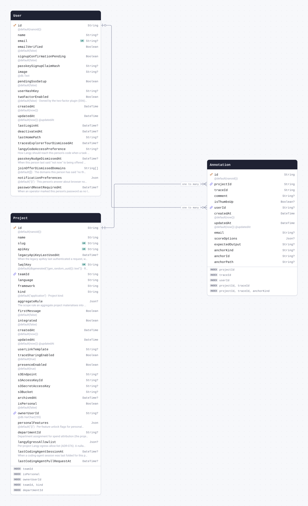

| Field            | Type       | Constraints                             | Default              | Description |
| ---------------- | ---------- | --------------------------------------- | -------------------- | ----------- |
| `id`             | `String`   | PK NOT NULL                             | `nanoid()`           |             |
| `projectId`      | `String`   | NOT NULL → [Project.id](#model-Project) |                      |             |
| `traceId`        | `String`   | NOT NULL                                |                      |             |
| `comment`        | `String`   | NULL                                    |                      |             |
| `isThumbsUp`     | `Boolean`  | NULL                                    |                      |             |
| `userId`         | `String`   | NULL → [User.id](#model-User)           |                      |             |
| `createdAt`      | `DateTime` | NOT NULL                                | `now()`              |             |
| `updatedAt`      | `DateTime` | NOT NULL                                | `now()` `@updatedAt` |             |
| `email`          | `String`   | NULL                                    |                      |             |
| `scoreOptions`   | `Json`     | NULL                                    |                      |             |
| `expectedOutput` | `String`   | NULL                                    |                      |             |
| `anchorKind`     | `String`   | NULL                                    |                      |             |
| `anchorId`       | `String`   | NULL                                    |                      |             |
| `anchorPath`     | `String`   | NULL                                    |                      |             |

#### Indexes

- `@@index([projectId])`
- `@@index([traceId])`
- `@@index([userId])`
- `@@index([projectId, traceId])`
- `@@index([projectId, traceId, anchorKind])`

#### References

- `projectId` → [Project.id](#model-Project) (many-to-one)
- `userId` → [User.id](#model-User) (many-to-one)

#### Definition

```sql
CREATE TABLE "Annotation" (
    "id" TEXT NOT NULL,
    "projectId" TEXT NOT NULL,
    "traceId" TEXT NOT NULL,
    "comment" TEXT,
    "isThumbsUp" BOOLEAN,
    "userId" TEXT,
    "createdAt" TIMESTAMP(3) NOT NULL DEFAULT CURRENT_TIMESTAMP,
    "updatedAt" TIMESTAMP(3) NOT NULL DEFAULT CURRENT_TIMESTAMP,
    "email" TEXT,
    "scoreOptions" JSONB,
    "expectedOutput" TEXT,
    "anchorKind" TEXT,
    "anchorId" TEXT,
    "anchorPath" TEXT,

    CONSTRAINT "Annotation_pkey" PRIMARY KEY ("id")
);

CREATE INDEX "Annotation_projectId_idx" ON "Annotation"("projectId");

CREATE INDEX "Annotation_traceId_idx" ON "Annotation"("traceId");

CREATE INDEX "Annotation_userId_idx" ON "Annotation"("userId");

CREATE INDEX "Annotation_projectId_traceId_idx" ON "Annotation"("projectId", "traceId");

CREATE INDEX "Annotation_projectId_traceId_anchorKind_idx" ON "Annotation"("projectId", "traceId", "anchorKind");
```

<details>
<summary>Queries and their SQL</summary>

**findMany**: Every row

```ts
await prisma.annotation.findMany();
```

```sql
SELECT
  "public"."Annotation"."id",
  "public"."Annotation"."projectId",
  "public"."Annotation"."traceId",
  "public"."Annotation"."comment",
  "public"."Annotation"."isThumbsUp",
  "public"."Annotation"."userId",
  "public"."Annotation"."createdAt",
  "public"."Annotation"."updatedAt",
  "public"."Annotation"."email",
  "public"."Annotation"."scoreOptions",
  "public"."Annotation"."expectedOutput",
  "public"."Annotation"."anchorKind",
  "public"."Annotation"."anchorId",
  "public"."Annotation"."anchorPath"
FROM
  "public"."Annotation"
WHERE
  1 = 1
OFFSET
  $1
-- params: ["0"]
```

**count**: How many rows there are

```ts
await prisma.annotation.count();
```

```sql
SELECT
  COUNT(*) AS "_count$_all"
FROM
  (
    SELECT
      "public"."Annotation"."id"
    FROM
      "public"."Annotation"
    WHERE
      1 = 1
    OFFSET
      $1
  ) AS "sub"
-- params: ["0"]
```

**findMany**: Every row with its relations

```ts
await prisma.annotation.findMany({ include: { project: true, user: true } });
```

```sql
SELECT
  "public"."Annotation"."id",
  "public"."Annotation"."projectId",
  "public"."Annotation"."traceId",
  "public"."Annotation"."comment",
  "public"."Annotation"."isThumbsUp",
  "public"."Annotation"."userId",
  "public"."Annotation"."createdAt",
  "public"."Annotation"."updatedAt",
  "public"."Annotation"."email",
  "public"."Annotation"."scoreOptions",
  "public"."Annotation"."expectedOutput",
  "public"."Annotation"."anchorKind",
  "public"."Annotation"."anchorId",
  "public"."Annotation"."anchorPath"
FROM
  "public"."Annotation"
WHERE
  1 = 1
OFFSET
  $1
-- params: ["0"]

SELECT
  "public"."Project"."id",
  "public"."Project"."name",
  "public"."Project"."slug",
  "public"."Project"."apiKey",
  "public"."Project"."legacyApiKeyLastUsedAt",
  "public"."Project"."lwqlKey",
  "public"."Project"."teamId",
  "public"."Project"."language",
  "public"."Project"."framework",
  "public"."Project"."kind",
  "public"."Project"."aggregateRule",
  "public"."Project"."firstMessage",
  "public"."Project"."integrated",
  "public"."Project"."createdAt",
  "public"."Project"."updatedAt",
  "public"."Project"."userLinkTemplate",
  "public"."Project"."traceSharingEnabled",
  "public"."Project"."presenceEnabled",
  "public"."Project"."s3Endpoint",
  "public"."Project"."s3AccessKeyId",
  "public"."Project"."s3SecretAccessKey",
  "public"."Project"."s3Bucket",
  "public"."Project"."archivedAt",
  "public"."Project"."isPersonal",
  "public"."Project"."ownerUserId",
  "public"."Project"."personalFeatures",
  "public"."Project"."departmentId",
  "public"."Project"."langyEgressAllowlist",
  "public"."Project"."lastCodingAgentSessionAt",
  "public"."Project"."lastCodingAgentPullRequestAt"
FROM
  "public"."Project"
WHERE
  "public"."Project"."id" IN ($1)
OFFSET
  $2
-- params: ["<projectId of the rows above>","0"]

SELECT
  "public"."User"."id",
  "public"."User"."name",
  "public"."User"."email",
  "public"."User"."emailVerified",
  "public"."User"."signupConfirmationPending",
  "public"."User"."passkeySignupClaimHash",
  "public"."User"."image",
  "public"."User"."pendingSsoSetup",
  "public"."User"."userHashKey",
  "public"."User"."twoFactorEnabled",
  "public"."User"."createdAt",
  "public"."User"."updatedAt",
  "public"."User"."lastLoginAt",
  "public"."User"."deactivatedAt",
  "public"."User"."lastHomePath",
  "public"."User"."tracesExplorerTourDismissedAt",
  "public"."User"."langyCodeAccessPreference",
  "public"."User"."passkeyNudgeDismissedAt",
  "public"."User"."joinOfferDismissedDomains",
  "public"."User"."notificationPreferences",
  "public"."User"."passwordResetRequiredAt"
FROM
  "public"."User"
WHERE
  "public"."User"."id" IN ($1)
OFFSET
  $2
-- params: ["<userId of the rows above>","0"]
```

**findUnique**: One row by what is unique to it

```ts
await prisma.annotation.findUnique({ where: { id: "example" } });
```

```sql
SELECT
  "public"."Annotation"."id",
  "public"."Annotation"."projectId",
  "public"."Annotation"."traceId",
  "public"."Annotation"."comment",
  "public"."Annotation"."isThumbsUp",
  "public"."Annotation"."userId",
  "public"."Annotation"."createdAt",
  "public"."Annotation"."updatedAt",
  "public"."Annotation"."email",
  "public"."Annotation"."scoreOptions",
  "public"."Annotation"."expectedOutput",
  "public"."Annotation"."anchorKind",
  "public"."Annotation"."anchorId",
  "public"."Annotation"."anchorPath"
FROM
  "public"."Annotation"
WHERE
  (
    "public"."Annotation"."id" = $1
    AND 1 = 1
  )
LIMIT
  $2
OFFSET
  $3
-- params: ["example","1","0"]
```

**create**: Create a row

```ts
await prisma.annotation.create({ data: { projectId: "example", traceId: "example" } });
```

```sql
INSERT INTO
  "public"."Annotation" (
    "id",
    "projectId",
    "traceId",
    "createdAt",
    "updatedAt"
  )
VALUES
  ($1, $2, $3, $4, $5)
RETURNING
  "public"."Annotation"."id",
  "public"."Annotation"."projectId",
  "public"."Annotation"."traceId",
  "public"."Annotation"."comment",
  "public"."Annotation"."isThumbsUp",
  "public"."Annotation"."userId",
  "public"."Annotation"."createdAt",
  "public"."Annotation"."updatedAt",
  "public"."Annotation"."email",
  "public"."Annotation"."scoreOptions",
  "public"."Annotation"."expectedOutput",
  "public"."Annotation"."anchorKind",
  "public"."Annotation"."anchorId",
  "public"."Annotation"."anchorPath"
-- params: ["<nanoid()>","example","example","<now()>","<now()>"]
```

**update**: Update a row

```ts
await prisma.annotation.update({ where: { id: "example" }, data: { traceId: "example" } });
```

```sql
SELECT
  "public"."Annotation"."id"
FROM
  "public"."Annotation"
WHERE
  (
    "public"."Annotation"."id" = $1
    AND 1 = 1
  )
LIMIT
  $2
OFFSET
  $3
-- params: ["example","1","0"]

UPDATE "public"."Annotation"
SET
  "traceId" = $1,
  "updatedAt" = $2
WHERE
  (
    "public"."Annotation"."id" IN ($3)
    AND (
      "public"."Annotation"."id" = $4
      AND 1 = 1
    )
  )
RETURNING
  "public"."Annotation"."id",
  "public"."Annotation"."projectId",
  "public"."Annotation"."traceId",
  "public"."Annotation"."comment",
  "public"."Annotation"."isThumbsUp",
  "public"."Annotation"."userId",
  "public"."Annotation"."createdAt",
  "public"."Annotation"."updatedAt",
  "public"."Annotation"."email",
  "public"."Annotation"."scoreOptions",
  "public"."Annotation"."expectedOutput",
  "public"."Annotation"."anchorKind",
  "public"."Annotation"."anchorId",
  "public"."Annotation"."anchorPath"
-- params: ["example",{"prisma__type":"generatorCall","prisma__value":{"name":"now","args":[],"returnType":{"type":"DateTime"}}},"<id of the rows above>","example"]
```

**delete**: Delete a row

```ts
await prisma.annotation.delete({ where: { id: "example" } });
```

```sql
DELETE FROM "public"."Annotation"
WHERE
  (
    "public"."Annotation"."id" = $1
    AND 1 = 1
  )
RETURNING
  "public"."Annotation"."id",
  "public"."Annotation"."projectId",
  "public"."Annotation"."traceId",
  "public"."Annotation"."comment",
  "public"."Annotation"."isThumbsUp",
  "public"."Annotation"."userId",
  "public"."Annotation"."createdAt",
  "public"."Annotation"."updatedAt",
  "public"."Annotation"."email",
  "public"."Annotation"."scoreOptions",
  "public"."Annotation"."expectedOutput",
  "public"."Annotation"."anchorKind",
  "public"."Annotation"."anchorId",
  "public"."Annotation"."anchorPath"
-- params: ["example"]
```

</details>

<a id="model-ModelProvider"></a>

### ModelProvider

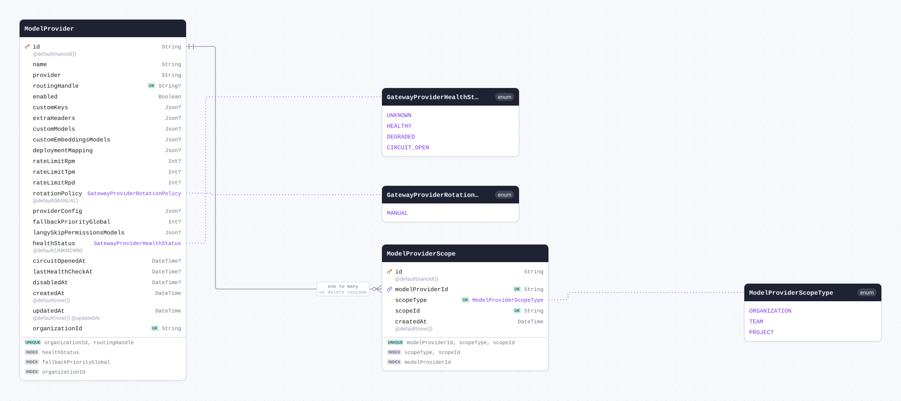

| Field                        | Type                                                                   | Constraints | Default              | Description |
| ---------------------------- | ---------------------------------------------------------------------- | ----------- | -------------------- | ----------- |
| `id`                         | `String`                                                               | PK NOT NULL | `nanoid()`           |             |
| `name`                       | `String`                                                               | NOT NULL    |                      |             |
| `provider`                   | `String`                                                               | NOT NULL    |                      |             |
| `routingHandle`              | `String`                                                               | NULL        |                      |             |
| `enabled`                    | `Boolean`                                                              | NOT NULL    |                      |             |
| `customKeys`                 | `Json`                                                                 | NULL        |                      |             |
| `extraHeaders`               | `Json`                                                                 | NULL        |                      |             |
| `customModels`               | `Json`                                                                 | NULL        |                      |             |
| `customEmbeddingsModels`     | `Json`                                                                 | NULL        |                      |             |
| `deploymentMapping`          | `Json`                                                                 | NULL        |                      |             |
| `rateLimitRpm`               | `Int`                                                                  | NULL        |                      |             |
| `rateLimitTpm`               | `Int`                                                                  | NULL        |                      |             |
| `rateLimitRpd`               | `Int`                                                                  | NULL        |                      |             |
| `rotationPolicy`             | [`GatewayProviderRotationPolicy`](#enum-GatewayProviderRotationPolicy) | NOT NULL    | `MANUAL`             |             |
| `providerConfig`             | `Json`                                                                 | NULL        |                      |             |
| `fallbackPriorityGlobal`     | `Int`                                                                  | NULL        |                      |             |
| `langySkipPermissionsModels` | `Json`                                                                 | NULL        |                      |             |
| `healthStatus`               | [`GatewayProviderHealthStatus`](#enum-GatewayProviderHealthStatus)     | NOT NULL    | `UNKNOWN`            |             |
| `circuitOpenedAt`            | `DateTime`                                                             | NULL        |                      |             |
| `lastHealthCheckAt`          | `DateTime`                                                             | NULL        |                      |             |
| `disabledAt`                 | `DateTime`                                                             | NULL        |                      |             |
| `createdAt`                  | `DateTime`                                                             | NOT NULL    | `now()`              |             |
| `updatedAt`                  | `DateTime`                                                             | NOT NULL    | `now()` `@updatedAt` |             |
| `organizationId`             | `String`                                                               | NOT NULL    |                      |             |

#### Indexes

- `@@index([healthStatus])`
- `@@index([fallbackPriorityGlobal])`
- `@@index([organizationId])`
- `@@unique([organizationId, routingHandle])`

#### Referenced by

- `id` ← [ModelProviderScope.modelProviderId](#model-ModelProviderScope) (one-to-many, on delete Cascade)

#### Definition

```sql
CREATE TABLE "ModelProvider" (
    "id" TEXT NOT NULL,
    "name" TEXT NOT NULL,
    "provider" TEXT NOT NULL,
    "routingHandle" TEXT,
    "enabled" BOOLEAN NOT NULL,
    "customKeys" JSONB,
    "extraHeaders" JSONB,
    "customModels" JSONB,
    "customEmbeddingsModels" JSONB,
    "deploymentMapping" JSONB,
    "rateLimitRpm" INTEGER,
    "rateLimitTpm" INTEGER,
    "rateLimitRpd" INTEGER,
    "rotationPolicy" "GatewayProviderRotationPolicy" NOT NULL DEFAULT 'MANUAL',
    "providerConfig" JSONB,
    "fallbackPriorityGlobal" INTEGER,
    "langySkipPermissionsModels" JSONB,
    "healthStatus" "GatewayProviderHealthStatus" NOT NULL DEFAULT 'UNKNOWN',
    "circuitOpenedAt" TIMESTAMP(3),
    "lastHealthCheckAt" TIMESTAMP(3),
    "disabledAt" TIMESTAMP(3),
    "createdAt" TIMESTAMP(3) NOT NULL DEFAULT CURRENT_TIMESTAMP,
    "updatedAt" TIMESTAMP(3) NOT NULL DEFAULT CURRENT_TIMESTAMP,
    "organizationId" TEXT NOT NULL,

    CONSTRAINT "ModelProvider_pkey" PRIMARY KEY ("id")
);

CREATE INDEX "ModelProvider_healthStatus_idx" ON "ModelProvider"("healthStatus");

CREATE INDEX "ModelProvider_fallbackPriorityGlobal_idx" ON "ModelProvider"("fallbackPriorityGlobal");

CREATE INDEX "ModelProvider_organizationId_idx" ON "ModelProvider"("organizationId");

CREATE UNIQUE INDEX "ModelProvider_organizationId_routingHandle_key" ON "ModelProvider"("organizationId", "routingHandle");
```

<details>
<summary>Queries and their SQL</summary>

**findMany**: Every row

```ts
await prisma.modelProvider.findMany();
```

```sql
SELECT
  "public"."ModelProvider"."id",
  "public"."ModelProvider"."name",
  "public"."ModelProvider"."provider",
  "public"."ModelProvider"."routingHandle",
  "public"."ModelProvider"."enabled",
  "public"."ModelProvider"."customKeys",
  "public"."ModelProvider"."extraHeaders",
  "public"."ModelProvider"."customModels",
  "public"."ModelProvider"."customEmbeddingsModels",
  "public"."ModelProvider"."deploymentMapping",
  "public"."ModelProvider"."rateLimitRpm",
  "public"."ModelProvider"."rateLimitTpm",
  "public"."ModelProvider"."rateLimitRpd",
  "public"."ModelProvider"."rotationPolicy"::text,
  "public"."ModelProvider"."providerConfig",
  "public"."ModelProvider"."fallbackPriorityGlobal",
  "public"."ModelProvider"."langySkipPermissionsModels",
  "public"."ModelProvider"."healthStatus"::text,
  "public"."ModelProvider"."circuitOpenedAt",
  "public"."ModelProvider"."lastHealthCheckAt",
  "public"."ModelProvider"."disabledAt",
  "public"."ModelProvider"."createdAt",
  "public"."ModelProvider"."updatedAt",
  "public"."ModelProvider"."organizationId"
FROM
  "public"."ModelProvider"
WHERE
  1 = 1
OFFSET
  $1
-- params: ["0"]
```

**count**: How many rows there are

```ts
await prisma.modelProvider.count();
```

```sql
SELECT
  COUNT(*) AS "_count$_all"
FROM
  (
    SELECT
      "public"."ModelProvider"."id"
    FROM
      "public"."ModelProvider"
    WHERE
      1 = 1
    OFFSET
      $1
  ) AS "sub"
-- params: ["0"]
```

**findMany**: Every row with its relations

```ts
await prisma.modelProvider.findMany({ include: { scopes: true } });
```

```sql
SELECT
  "public"."ModelProvider"."id",
  "public"."ModelProvider"."name",
  "public"."ModelProvider"."provider",
  "public"."ModelProvider"."routingHandle",
  "public"."ModelProvider"."enabled",
  "public"."ModelProvider"."customKeys",
  "public"."ModelProvider"."extraHeaders",
  "public"."ModelProvider"."customModels",
  "public"."ModelProvider"."customEmbeddingsModels",
  "public"."ModelProvider"."deploymentMapping",
  "public"."ModelProvider"."rateLimitRpm",
  "public"."ModelProvider"."rateLimitTpm",
  "public"."ModelProvider"."rateLimitRpd",
  "public"."ModelProvider"."rotationPolicy"::text,
  "public"."ModelProvider"."providerConfig",
  "public"."ModelProvider"."fallbackPriorityGlobal",
  "public"."ModelProvider"."langySkipPermissionsModels",
  "public"."ModelProvider"."healthStatus"::text,
  "public"."ModelProvider"."circuitOpenedAt",
  "public"."ModelProvider"."lastHealthCheckAt",
  "public"."ModelProvider"."disabledAt",
  "public"."ModelProvider"."createdAt",
  "public"."ModelProvider"."updatedAt",
  "public"."ModelProvider"."organizationId"
FROM
  "public"."ModelProvider"
WHERE
  1 = 1
OFFSET
  $1
-- params: ["0"]

SELECT
  "public"."ModelProviderScope"."id",
  "public"."ModelProviderScope"."modelProviderId",
  "public"."ModelProviderScope"."scopeType"::text,
  "public"."ModelProviderScope"."scopeId",
  "public"."ModelProviderScope"."createdAt"
FROM
  "public"."ModelProviderScope"
WHERE
  "public"."ModelProviderScope"."modelProviderId" IN ($1)
OFFSET
  $2
-- params: ["<id of the rows above>","0"]
```

**findUnique**: One row by what is unique to it

```ts
await prisma.modelProvider.findUnique({ where: { id: "example" } });
```

```sql
SELECT
  "public"."ModelProvider"."id",
  "public"."ModelProvider"."name",
  "public"."ModelProvider"."provider",
  "public"."ModelProvider"."routingHandle",
  "public"."ModelProvider"."enabled",
  "public"."ModelProvider"."customKeys",
  "public"."ModelProvider"."extraHeaders",
  "public"."ModelProvider"."customModels",
  "public"."ModelProvider"."customEmbeddingsModels",
  "public"."ModelProvider"."deploymentMapping",
  "public"."ModelProvider"."rateLimitRpm",
  "public"."ModelProvider"."rateLimitTpm",
  "public"."ModelProvider"."rateLimitRpd",
  "public"."ModelProvider"."rotationPolicy"::text,
  "public"."ModelProvider"."providerConfig",
  "public"."ModelProvider"."fallbackPriorityGlobal",
  "public"."ModelProvider"."langySkipPermissionsModels",
  "public"."ModelProvider"."healthStatus"::text,
  "public"."ModelProvider"."circuitOpenedAt",
  "public"."ModelProvider"."lastHealthCheckAt",
  "public"."ModelProvider"."disabledAt",
  "public"."ModelProvider"."createdAt",
  "public"."ModelProvider"."updatedAt",
  "public"."ModelProvider"."organizationId"
FROM
  "public"."ModelProvider"
WHERE
  (
    "public"."ModelProvider"."id" = $1
    AND 1 = 1
  )
LIMIT
  $2
OFFSET
  $3
-- params: ["example","1","0"]
```

**create**: Create a row

```ts
await prisma.modelProvider.create({
  data: { name: "example", provider: "example", enabled: true, organizationId: "example" },
});
```

```sql
INSERT INTO
  "public"."ModelProvider" (
    "id",
    "name",
    "provider",
    "enabled",
    "rotationPolicy",
    "healthStatus",
    "createdAt",
    "updatedAt",
    "organizationId"
  )
VALUES
  (
    $1,
    $2,
    $3,
    $4,
    CAST(
      $5::text AS "public"."GatewayProviderRotationPolicy"
    ),
    CAST(
      $6::text AS "public"."GatewayProviderHealthStatus"
    ),
    $7,
    $8,
    $9
  )
RETURNING
  "public"."ModelProvider"."id",
  "public"."ModelProvider"."name",
  "public"."ModelProvider"."provider",
  "public"."ModelProvider"."routingHandle",
  "public"."ModelProvider"."enabled",
  "public"."ModelProvider"."customKeys",
  "public"."ModelProvider"."extraHeaders",
  "public"."ModelProvider"."customModels",
  "public"."ModelProvider"."customEmbeddingsModels",
  "public"."ModelProvider"."deploymentMapping",
  "public"."ModelProvider"."rateLimitRpm",
  "public"."ModelProvider"."rateLimitTpm",
  "public"."ModelProvider"."rateLimitRpd",
  "public"."ModelProvider"."rotationPolicy"::text,
  "public"."ModelProvider"."providerConfig",
  "public"."ModelProvider"."fallbackPriorityGlobal",
  "public"."ModelProvider"."langySkipPermissionsModels",
  "public"."ModelProvider"."healthStatus"::text,
  "public"."ModelProvider"."circuitOpenedAt",
  "public"."ModelProvider"."lastHealthCheckAt",
  "public"."ModelProvider"."disabledAt",
  "public"."ModelProvider"."createdAt",
  "public"."ModelProvider"."updatedAt",
  "public"."ModelProvider"."organizationId"
-- params: ["<nanoid()>","example","example",true,"MANUAL","UNKNOWN","<now()>","<now()>","example"]
```

**update**: Update a row

```ts
await prisma.modelProvider.update({ where: { id: "example" }, data: { name: "example" } });
```

```sql
SELECT
  "public"."ModelProvider"."id"
FROM
  "public"."ModelProvider"
WHERE
  (
    "public"."ModelProvider"."id" = $1
    AND 1 = 1
  )
LIMIT
  $2
OFFSET
  $3
-- params: ["example","1","0"]

UPDATE "public"."ModelProvider"
SET
  "name" = $1,
  "updatedAt" = $2
WHERE
  (
    "public"."ModelProvider"."id" IN ($3)
    AND (
      "public"."ModelProvider"."id" = $4
      AND 1 = 1
    )
  )
RETURNING
  "public"."ModelProvider"."id",
  "public"."ModelProvider"."name",
  "public"."ModelProvider"."provider",
  "public"."ModelProvider"."routingHandle",
  "public"."ModelProvider"."enabled",
  "public"."ModelProvider"."customKeys",
  "public"."ModelProvider"."extraHeaders",
  "public"."ModelProvider"."customModels",
  "public"."ModelProvider"."customEmbeddingsModels",
  "public"."ModelProvider"."deploymentMapping",
  "public"."ModelProvider"."rateLimitRpm",
  "public"."ModelProvider"."rateLimitTpm",
  "public"."ModelProvider"."rateLimitRpd",
  "public"."ModelProvider"."rotationPolicy"::text,
  "public"."ModelProvider"."providerConfig",
  "public"."ModelProvider"."fallbackPriorityGlobal",
  "public"."ModelProvider"."langySkipPermissionsModels",
  "public"."ModelProvider"."healthStatus"::text,
  "public"."ModelProvider"."circuitOpenedAt",
  "public"."ModelProvider"."lastHealthCheckAt",
  "public"."ModelProvider"."disabledAt",
  "public"."ModelProvider"."createdAt",
  "public"."ModelProvider"."updatedAt",
  "public"."ModelProvider"."organizationId"
-- params: ["example",{"prisma__type":"generatorCall","prisma__value":{"name":"now","args":[],"returnType":{"type":"DateTime"}}},"<id of the rows above>","example"]
```

**delete**: Delete a row

```ts
await prisma.modelProvider.delete({ where: { id: "example" } });
```

```sql
DELETE FROM "public"."ModelProvider"
WHERE
  (
    "public"."ModelProvider"."id" = $1
    AND 1 = 1
  )
RETURNING
  "public"."ModelProvider"."id",
  "public"."ModelProvider"."name",
  "public"."ModelProvider"."provider",
  "public"."ModelProvider"."routingHandle",
  "public"."ModelProvider"."enabled",
  "public"."ModelProvider"."customKeys",
  "public"."ModelProvider"."extraHeaders",
  "public"."ModelProvider"."customModels",
  "public"."ModelProvider"."customEmbeddingsModels",
  "public"."ModelProvider"."deploymentMapping",
  "public"."ModelProvider"."rateLimitRpm",
  "public"."ModelProvider"."rateLimitTpm",
  "public"."ModelProvider"."rateLimitRpd",
  "public"."ModelProvider"."rotationPolicy"::text,
  "public"."ModelProvider"."providerConfig",
  "public"."ModelProvider"."fallbackPriorityGlobal",
  "public"."ModelProvider"."langySkipPermissionsModels",
  "public"."ModelProvider"."healthStatus"::text,
  "public"."ModelProvider"."circuitOpenedAt",
  "public"."ModelProvider"."lastHealthCheckAt",
  "public"."ModelProvider"."disabledAt",
  "public"."ModelProvider"."createdAt",
  "public"."ModelProvider"."updatedAt",
  "public"."ModelProvider"."organizationId"
-- params: ["example"]

SELECT
  "public"."ModelProviderScope"."id",
  "public"."ModelProviderScope"."modelProviderId"
FROM
  "public"."ModelProviderScope"
WHERE
  (
    1 = 1
    AND "public"."ModelProviderScope"."modelProviderId" IN ($1)
  )
OFFSET
  $2
-- params: ["<id of the rows above>","0"]

DELETE FROM "public"."ModelProviderScope"
WHERE
  (
    "public"."ModelProviderScope"."id" IN ($1)
    AND 1 = 1
  )
-- params: ["<id of the rows above>"]
```

</details>

<a id="model-ModelProviderScope"></a>

### ModelProviderScope


| Field             | Type                                                     | Constraints                                         | Default    | Description |
| ----------------- | -------------------------------------------------------- | --------------------------------------------------- | ---------- | ----------- |
| `id`              | `String`                                                 | PK NOT NULL                                         | `nanoid()` |             |
| `modelProviderId` | `String`                                                 | NOT NULL → [ModelProvider.id](#model-ModelProvider) |            |             |
| `scopeType`       | [`ModelProviderScopeType`](#enum-ModelProviderScopeType) | NOT NULL                                            |            |             |
| `scopeId`         | `String`                                                 | NOT NULL                                            |            |             |
| `createdAt`       | `DateTime`                                               | NOT NULL                                            | `now()`    |             |

#### Indexes

- `@@index([scopeType, scopeId])`
- `@@index([modelProviderId])`
- `@@unique([modelProviderId, scopeType, scopeId])`

#### References

- `modelProviderId` → [ModelProvider.id](#model-ModelProvider) (many-to-one, on delete Cascade)

#### Definition

```sql
CREATE TABLE "ModelProviderScope" (
    "id" TEXT NOT NULL,
    "modelProviderId" TEXT NOT NULL,
    "scopeType" "ModelProviderScopeType" NOT NULL,
    "scopeId" TEXT NOT NULL,
    "createdAt" TIMESTAMP(3) NOT NULL DEFAULT CURRENT_TIMESTAMP,

    CONSTRAINT "ModelProviderScope_pkey" PRIMARY KEY ("id")
);

CREATE INDEX "ModelProviderScope_scopeType_scopeId_idx" ON "ModelProviderScope"("scopeType", "scopeId");

CREATE INDEX "ModelProviderScope_modelProviderId_idx" ON "ModelProviderScope"("modelProviderId");

CREATE UNIQUE INDEX "ModelProviderScope_modelProviderId_scopeType_scopeId_key" ON "ModelProviderScope"("modelProviderId", "scopeType", "scopeId");
```

<details>
<summary>Queries and their SQL</summary>

**findMany**: Every row

```ts
await prisma.modelProviderScope.findMany();
```

```sql
SELECT
  "public"."ModelProviderScope"."id",
  "public"."ModelProviderScope"."modelProviderId",
  "public"."ModelProviderScope"."scopeType"::text,
  "public"."ModelProviderScope"."scopeId",
  "public"."ModelProviderScope"."createdAt"
FROM
  "public"."ModelProviderScope"
WHERE
  1 = 1
OFFSET
  $1
-- params: ["0"]
```

**count**: How many rows there are

```ts
await prisma.modelProviderScope.count();
```

```sql
SELECT
  COUNT(*) AS "_count$_all"
FROM
  (
    SELECT
      "public"."ModelProviderScope"."id"
    FROM
      "public"."ModelProviderScope"
    WHERE
      1 = 1
    OFFSET
      $1
  ) AS "sub"
-- params: ["0"]
```

**findMany**: Every row with its relations

```ts
await prisma.modelProviderScope.findMany({ include: { modelProvider: true } });
```

```sql
SELECT
  "public"."ModelProviderScope"."id",
  "public"."ModelProviderScope"."modelProviderId",
  "public"."ModelProviderScope"."scopeType"::text,
  "public"."ModelProviderScope"."scopeId",
  "public"."ModelProviderScope"."createdAt"
FROM
  "public"."ModelProviderScope"
WHERE
  1 = 1
OFFSET
  $1
-- params: ["0"]

SELECT
  "public"."ModelProvider"."id",
  "public"."ModelProvider"."name",
  "public"."ModelProvider"."provider",
  "public"."ModelProvider"."routingHandle",
  "public"."ModelProvider"."enabled",
  "public"."ModelProvider"."customKeys",
  "public"."ModelProvider"."extraHeaders",
  "public"."ModelProvider"."customModels",
  "public"."ModelProvider"."customEmbeddingsModels",
  "public"."ModelProvider"."deploymentMapping",
  "public"."ModelProvider"."rateLimitRpm",
  "public"."ModelProvider"."rateLimitTpm",
  "public"."ModelProvider"."rateLimitRpd",
  "public"."ModelProvider"."rotationPolicy"::text,
  "public"."ModelProvider"."providerConfig",
  "public"."ModelProvider"."fallbackPriorityGlobal",
  "public"."ModelProvider"."langySkipPermissionsModels",
  "public"."ModelProvider"."healthStatus"::text,
  "public"."ModelProvider"."circuitOpenedAt",
  "public"."ModelProvider"."lastHealthCheckAt",
  "public"."ModelProvider"."disabledAt",
  "public"."ModelProvider"."createdAt",
  "public"."ModelProvider"."updatedAt",
  "public"."ModelProvider"."organizationId"
FROM
  "public"."ModelProvider"
WHERE
  "public"."ModelProvider"."id" IN ($1)
OFFSET
  $2
-- params: ["<modelProviderId of the rows above>","0"]
```

**findUnique**: One row by what is unique to it

```ts
await prisma.modelProviderScope.findUnique({ where: { id: "example" } });
```

```sql
SELECT
  "public"."ModelProviderScope"."id",
  "public"."ModelProviderScope"."modelProviderId",
  "public"."ModelProviderScope"."scopeType"::text,
  "public"."ModelProviderScope"."scopeId",
  "public"."ModelProviderScope"."createdAt"
FROM
  "public"."ModelProviderScope"
WHERE
  (
    "public"."ModelProviderScope"."id" = $1
    AND 1 = 1
  )
LIMIT
  $2
OFFSET
  $3
-- params: ["example","1","0"]
```

**create**: Create a row

```ts
await prisma.modelProviderScope.create({
  data: { modelProviderId: "example", scopeType: "ORGANIZATION", scopeId: "example" },
});
```

```sql
INSERT INTO
  "public"."ModelProviderScope" (
    "id",
    "modelProviderId",
    "scopeType",
    "scopeId",
    "createdAt"
  )
VALUES
  (
    $1,
    $2,
    CAST($3::text AS "public"."ModelProviderScopeType"),
    $4,
    $5
  )
RETURNING
  "public"."ModelProviderScope"."id",
  "public"."ModelProviderScope"."modelProviderId",
  "public"."ModelProviderScope"."scopeType"::text,
  "public"."ModelProviderScope"."scopeId",
  "public"."ModelProviderScope"."createdAt"
-- params: ["<nanoid()>","example","ORGANIZATION","example","<now()>"]
```

**update**: Update a row

```ts
await prisma.modelProviderScope.update({
  where: { id: "example" },
  data: { scopeType: "ORGANIZATION" },
});
```

```sql
SELECT
  "public"."ModelProviderScope"."id"
FROM
  "public"."ModelProviderScope"
WHERE
  (
    "public"."ModelProviderScope"."id" = $1
    AND 1 = 1
  )
LIMIT
  $2
OFFSET
  $3
-- params: ["example","1","0"]

UPDATE "public"."ModelProviderScope"
SET
  "scopeType" = CAST($1::text AS "public"."ModelProviderScopeType")
WHERE
  (
    "public"."ModelProviderScope"."id" IN ($2)
    AND (
      "public"."ModelProviderScope"."id" = $3
      AND 1 = 1
    )
  )
RETURNING
  "public"."ModelProviderScope"."id",
  "public"."ModelProviderScope"."modelProviderId",
  "public"."ModelProviderScope"."scopeType"::text,
  "public"."ModelProviderScope"."scopeId",
  "public"."ModelProviderScope"."createdAt"
-- params: ["ORGANIZATION","<id of the rows above>","example"]
```

**delete**: Delete a row

```ts
await prisma.modelProviderScope.delete({ where: { id: "example" } });
```

```sql
DELETE FROM "public"."ModelProviderScope"
WHERE
  (
    "public"."ModelProviderScope"."id" = $1
    AND 1 = 1
  )
RETURNING
  "public"."ModelProviderScope"."id",
  "public"."ModelProviderScope"."modelProviderId",
  "public"."ModelProviderScope"."scopeType"::text,
  "public"."ModelProviderScope"."scopeId",
  "public"."ModelProviderScope"."createdAt"
-- params: ["example"]
```

</details>

<a id="model-ModelDefaultConfig"></a>

### ModelDefaultConfig


| Field            | Type       | Constraints | Default      | Description |
| ---------------- | ---------- | ----------- | ------------ | ----------- |
| `id`             | `String`   | PK NOT NULL | `nanoid()`   |             |
| `config`         | `Json`     | NOT NULL    |              |             |
| `authorId`       | `String`   | NULL        |              |             |
| `createdAt`      | `DateTime` | NOT NULL    | `now()`      |             |
| `updatedAt`      | `DateTime` | NOT NULL    | `@updatedAt` |             |
| `organizationId` | `String`   | NOT NULL    |              |             |

#### Indexes

- `@@index([organizationId])`

#### Referenced by

- `id` ← [ModelDefaultConfigScope.configId](#model-ModelDefaultConfigScope) (one-to-many, on delete Cascade)

#### Definition

```sql
CREATE TABLE "ModelDefaultConfig" (
    "id" TEXT NOT NULL,
    "config" JSONB NOT NULL,
    "authorId" TEXT,
    "createdAt" TIMESTAMP(3) NOT NULL DEFAULT CURRENT_TIMESTAMP,
    "updatedAt" TIMESTAMP(3) NOT NULL,
    "organizationId" TEXT NOT NULL,

    CONSTRAINT "ModelDefaultConfig_pkey" PRIMARY KEY ("id")
);

CREATE INDEX "ModelDefaultConfig_organizationId_idx" ON "ModelDefaultConfig"("organizationId");
```

<details>
<summary>Queries and their SQL</summary>

**findMany**: Every row

```ts
await prisma.modelDefaultConfig.findMany();
```

```sql
SELECT
  "public"."ModelDefaultConfig"."id",
  "public"."ModelDefaultConfig"."config",
  "public"."ModelDefaultConfig"."authorId",
  "public"."ModelDefaultConfig"."createdAt",
  "public"."ModelDefaultConfig"."updatedAt",
  "public"."ModelDefaultConfig"."organizationId"
FROM
  "public"."ModelDefaultConfig"
WHERE
  1 = 1
OFFSET
  $1
-- params: ["0"]
```

**count**: How many rows there are

```ts
await prisma.modelDefaultConfig.count();
```

```sql
SELECT
  COUNT(*) AS "_count$_all"
FROM
  (
    SELECT
      "public"."ModelDefaultConfig"."id"
    FROM
      "public"."ModelDefaultConfig"
    WHERE
      1 = 1
    OFFSET
      $1
  ) AS "sub"
-- params: ["0"]
```

**findMany**: Every row with its relations

```ts
await prisma.modelDefaultConfig.findMany({ include: { scopes: true } });
```

```sql
SELECT
  "public"."ModelDefaultConfig"."id",
  "public"."ModelDefaultConfig"."config",
  "public"."ModelDefaultConfig"."authorId",
  "public"."ModelDefaultConfig"."createdAt",
  "public"."ModelDefaultConfig"."updatedAt",
  "public"."ModelDefaultConfig"."organizationId"
FROM
  "public"."ModelDefaultConfig"
WHERE
  1 = 1
OFFSET
  $1
-- params: ["0"]

SELECT
  "public"."ModelDefaultConfigScope"."id",
  "public"."ModelDefaultConfigScope"."configId",
  "public"."ModelDefaultConfigScope"."scopeType"::text,
  "public"."ModelDefaultConfigScope"."scopeId",
  "public"."ModelDefaultConfigScope"."createdAt"
FROM
  "public"."ModelDefaultConfigScope"
WHERE
  "public"."ModelDefaultConfigScope"."configId" IN ($1)
OFFSET
  $2
-- params: ["<id of the rows above>","0"]
```

**findUnique**: One row by what is unique to it

```ts
await prisma.modelDefaultConfig.findUnique({ where: { id: "example" } });
```

```sql
SELECT
  "public"."ModelDefaultConfig"."id",
  "public"."ModelDefaultConfig"."config",
  "public"."ModelDefaultConfig"."authorId",
  "public"."ModelDefaultConfig"."createdAt",
  "public"."ModelDefaultConfig"."updatedAt",
  "public"."ModelDefaultConfig"."organizationId"
FROM
  "public"."ModelDefaultConfig"
WHERE
  (
    "public"."ModelDefaultConfig"."id" = $1
    AND 1 = 1
  )
LIMIT
  $2
OFFSET
  $3
-- params: ["example","1","0"]
```

**create**: Create a row

```ts
await prisma.modelDefaultConfig.create({ data: { config: {}, organizationId: "example" } });
```

```sql
INSERT INTO
  "public"."ModelDefaultConfig" (
    "id",
    "config",
    "createdAt",
    "updatedAt",
    "organizationId"
  )
VALUES
  ($1, $2, $3, $4, $5)
RETURNING
  "public"."ModelDefaultConfig"."id",
  "public"."ModelDefaultConfig"."config",
  "public"."ModelDefaultConfig"."authorId",
  "public"."ModelDefaultConfig"."createdAt",
  "public"."ModelDefaultConfig"."updatedAt",
  "public"."ModelDefaultConfig"."organizationId"
-- params: ["<nanoid()>","{}","<now()>","<now()>","example"]
```

**update**: Update a row

```ts
await prisma.modelDefaultConfig.update({ where: { id: "example" }, data: { config: {} } });
```

```sql
SELECT
  "public"."ModelDefaultConfig"."id"
FROM
  "public"."ModelDefaultConfig"
WHERE
  (
    "public"."ModelDefaultConfig"."id" = $1
    AND 1 = 1
  )
LIMIT
  $2
OFFSET
  $3
-- params: ["example","1","0"]

UPDATE "public"."ModelDefaultConfig"
SET
  "config" = $1,
  "updatedAt" = $2
WHERE
  (
    "public"."ModelDefaultConfig"."id" IN ($3)
    AND (
      "public"."ModelDefaultConfig"."id" = $4
      AND 1 = 1
    )
  )
RETURNING
  "public"."ModelDefaultConfig"."id",
  "public"."ModelDefaultConfig"."config",
  "public"."ModelDefaultConfig"."authorId",
  "public"."ModelDefaultConfig"."createdAt",
  "public"."ModelDefaultConfig"."updatedAt",
  "public"."ModelDefaultConfig"."organizationId"
-- params: ["{}",{"prisma__type":"generatorCall","prisma__value":{"name":"now","args":[],"returnType":{"type":"DateTime"}}},"<id of the rows above>","example"]
```

**delete**: Delete a row

```ts
await prisma.modelDefaultConfig.delete({ where: { id: "example" } });
```

```sql
DELETE FROM "public"."ModelDefaultConfig"
WHERE
  (
    "public"."ModelDefaultConfig"."id" = $1
    AND 1 = 1
  )
RETURNING
  "public"."ModelDefaultConfig"."id",
  "public"."ModelDefaultConfig"."config",
  "public"."ModelDefaultConfig"."authorId",
  "public"."ModelDefaultConfig"."createdAt",
  "public"."ModelDefaultConfig"."updatedAt",
  "public"."ModelDefaultConfig"."organizationId"
-- params: ["example"]

SELECT
  "public"."ModelDefaultConfigScope"."id",
  "public"."ModelDefaultConfigScope"."configId"
FROM
  "public"."ModelDefaultConfigScope"
WHERE
  (
    1 = 1
    AND "public"."ModelDefaultConfigScope"."configId" IN ($1)
  )
OFFSET
  $2
-- params: ["<id of the rows above>","0"]

DELETE FROM "public"."ModelDefaultConfigScope"
WHERE
  (
    "public"."ModelDefaultConfigScope"."id" IN ($1)
    AND 1 = 1
  )
-- params: ["<id of the rows above>"]
```

</details>

<a id="model-ModelDefaultConfigScope"></a>

### ModelDefaultConfigScope

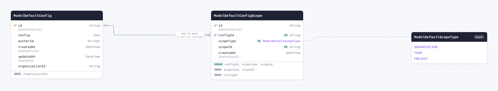

| Field       | Type                                                   | Constraints                                                   | Default    | Description |
| ----------- | ------------------------------------------------------ | ------------------------------------------------------------- | ---------- | ----------- |
| `id`        | `String`                                               | PK NOT NULL                                                   | `nanoid()` |             |
| `configId`  | `String`                                               | NOT NULL → [ModelDefaultConfig.id](#model-ModelDefaultConfig) |            |             |
| `scopeType` | [`ModelDefaultScopeType`](#enum-ModelDefaultScopeType) | NOT NULL                                                      |            |             |
| `scopeId`   | `String`                                               | NOT NULL                                                      |            |             |
| `createdAt` | `DateTime`                                             | NOT NULL                                                      | `now()`    |             |

#### Indexes

- `@@index([scopeType, scopeId])`
- `@@index([configId])`
- `@@unique([configId, scopeType, scopeId])`

#### References

- `configId` → [ModelDefaultConfig.id](#model-ModelDefaultConfig) (many-to-one, on delete Cascade)

#### Definition

```sql
CREATE TABLE "ModelDefaultConfigScope" (
    "id" TEXT NOT NULL,
    "configId" TEXT NOT NULL,
    "scopeType" "ModelDefaultScopeType" NOT NULL,
    "scopeId" TEXT NOT NULL,
    "createdAt" TIMESTAMP(3) NOT NULL DEFAULT CURRENT_TIMESTAMP,

    CONSTRAINT "ModelDefaultConfigScope_pkey" PRIMARY KEY ("id")
);

CREATE INDEX "ModelDefaultConfigScope_scopeType_scopeId_idx" ON "ModelDefaultConfigScope"("scopeType", "scopeId");

CREATE INDEX "ModelDefaultConfigScope_configId_idx" ON "ModelDefaultConfigScope"("configId");

CREATE UNIQUE INDEX "ModelDefaultConfigScope_configId_scopeType_scopeId_key" ON "ModelDefaultConfigScope"("configId", "scopeType", "scopeId");
```

<details>
<summary>Queries and their SQL</summary>

**findMany**: Every row

```ts
await prisma.modelDefaultConfigScope.findMany();
```

```sql
SELECT
  "public"."ModelDefaultConfigScope"."id",
  "public"."ModelDefaultConfigScope"."configId",
  "public"."ModelDefaultConfigScope"."scopeType"::text,
  "public"."ModelDefaultConfigScope"."scopeId",
  "public"."ModelDefaultConfigScope"."createdAt"
FROM
  "public"."ModelDefaultConfigScope"
WHERE
  1 = 1
OFFSET
  $1
-- params: ["0"]
```

**count**: How many rows there are

```ts
await prisma.modelDefaultConfigScope.count();
```

```sql
SELECT
  COUNT(*) AS "_count$_all"
FROM
  (
    SELECT
      "public"."ModelDefaultConfigScope"."id"
    FROM
      "public"."ModelDefaultConfigScope"
    WHERE
      1 = 1
    OFFSET
      $1
  ) AS "sub"
-- params: ["0"]
```

**findMany**: Every row with its relations

```ts
await prisma.modelDefaultConfigScope.findMany({ include: { config: true } });
```

```sql
SELECT
  "public"."ModelDefaultConfigScope"."id",
  "public"."ModelDefaultConfigScope"."configId",
  "public"."ModelDefaultConfigScope"."scopeType"::text,
  "public"."ModelDefaultConfigScope"."scopeId",
  "public"."ModelDefaultConfigScope"."createdAt"
FROM
  "public"."ModelDefaultConfigScope"
WHERE
  1 = 1
OFFSET
  $1
-- params: ["0"]

SELECT
  "public"."ModelDefaultConfig"."id",
  "public"."ModelDefaultConfig"."config",
  "public"."ModelDefaultConfig"."authorId",
  "public"."ModelDefaultConfig"."createdAt",
  "public"."ModelDefaultConfig"."updatedAt",
  "public"."ModelDefaultConfig"."organizationId"
FROM
  "public"."ModelDefaultConfig"
WHERE
  "public"."ModelDefaultConfig"."id" IN ($1)
OFFSET
  $2
-- params: ["<configId of the rows above>","0"]
```

**findUnique**: One row by what is unique to it

```ts
await prisma.modelDefaultConfigScope.findUnique({ where: { id: "example" } });
```

```sql
SELECT
  "public"."ModelDefaultConfigScope"."id",
  "public"."ModelDefaultConfigScope"."configId",
  "public"."ModelDefaultConfigScope"."scopeType"::text,
  "public"."ModelDefaultConfigScope"."scopeId",
  "public"."ModelDefaultConfigScope"."createdAt"
FROM
  "public"."ModelDefaultConfigScope"
WHERE
  (
    "public"."ModelDefaultConfigScope"."id" = $1
    AND 1 = 1
  )
LIMIT
  $2
OFFSET
  $3
-- params: ["example","1","0"]
```

**create**: Create a row

```ts
await prisma.modelDefaultConfigScope.create({
  data: { configId: "example", scopeType: "ORGANIZATION", scopeId: "example" },
});
```

```sql
INSERT INTO
  "public"."ModelDefaultConfigScope" (
    "id",
    "configId",
    "scopeType",
    "scopeId",
    "createdAt"
  )
VALUES
  (
    $1,
    $2,
    CAST($3::text AS "public"."ModelDefaultScopeType"),
    $4,
    $5
  )
RETURNING
  "public"."ModelDefaultConfigScope"."id",
  "public"."ModelDefaultConfigScope"."configId",
  "public"."ModelDefaultConfigScope"."scopeType"::text,
  "public"."ModelDefaultConfigScope"."scopeId",
  "public"."ModelDefaultConfigScope"."createdAt"
-- params: ["<nanoid()>","example","ORGANIZATION","example","<now()>"]
```

**update**: Update a row

```ts
await prisma.modelDefaultConfigScope.update({
  where: { id: "example" },
  data: { scopeType: "ORGANIZATION" },
});
```

```sql
SELECT
  "public"."ModelDefaultConfigScope"."id"
FROM
  "public"."ModelDefaultConfigScope"
WHERE
  (
    "public"."ModelDefaultConfigScope"."id" = $1
    AND 1 = 1
  )
LIMIT
  $2
OFFSET
  $3
-- params: ["example","1","0"]

UPDATE "public"."ModelDefaultConfigScope"
SET
  "scopeType" = CAST($1::text AS "public"."ModelDefaultScopeType")
WHERE
  (
    "public"."ModelDefaultConfigScope"."id" IN ($2)
    AND (
      "public"."ModelDefaultConfigScope"."id" = $3
      AND 1 = 1
    )
  )
RETURNING
  "public"."ModelDefaultConfigScope"."id",
  "public"."ModelDefaultConfigScope"."configId",
  "public"."ModelDefaultConfigScope"."scopeType"::text,
  "public"."ModelDefaultConfigScope"."scopeId",
  "public"."ModelDefaultConfigScope"."createdAt"
-- params: ["ORGANIZATION","<id of the rows above>","example"]
```

**delete**: Delete a row

```ts
await prisma.modelDefaultConfigScope.delete({ where: { id: "example" } });
```

```sql
DELETE FROM "public"."ModelDefaultConfigScope"
WHERE
  (
    "public"."ModelDefaultConfigScope"."id" = $1
    AND 1 = 1
  )
RETURNING
  "public"."ModelDefaultConfigScope"."id",
  "public"."ModelDefaultConfigScope"."configId",
  "public"."ModelDefaultConfigScope"."scopeType"::text,
  "public"."ModelDefaultConfigScope"."scopeId",
  "public"."ModelDefaultConfigScope"."createdAt"
-- params: ["example"]
```

</details>

<a id="model-GithubInstallation"></a>

### GithubInstallation

The organization's GitHub connection: a GitHub App installation mapped to a
LangWatch organization. Short-lived (1h) installation access tokens are
minted against these rows on demand, by Langy for writes (bot-authored pull
requests, scoped to the installation's repositories) and by pull-request
linkage for reads. No user token and no secret are stored here, the crown
jewel is the App private key, held only in the control-plane env.
Spec: specs/integrations/github-connection.feature.

installationId is globally unique (one GitHub installation, one row); a
single LangWatch organization may own MANY installations (different GitHub
accounts), so the org to installation relationship is one-to-many.

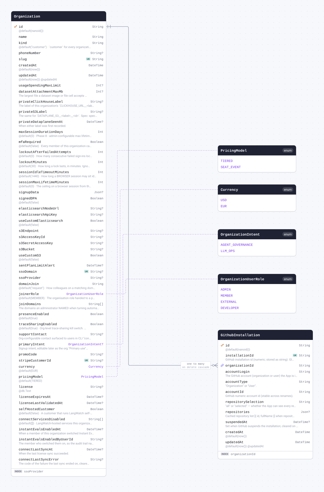

| Field                 | Type       | Constraints                                       | Default              | Description                                                                                                                                    |
| --------------------- | ---------- | ------------------------------------------------- | -------------------- | ---------------------------------------------------------------------------------------------------------------------------------------------- |
| `id`                  | `String`   | PK NOT NULL                                       | `nanoid()`           |                                                                                                                                                |
| `installationId`      | `String`   | UNIQUE NOT NULL                                   |                      | GitHub installation id (numeric; stored as string). Globally unique.                                                                           |
| `organizationId`      | `String`   | NOT NULL → [Organization.id](#model-Organization) |                      |                                                                                                                                                |
| `accountLogin`        | `String`   | NOT NULL                                          |                      | The GitHub account (organization or user) the App is installed on.                                                                             |
| `accountType`         | `String`   | NOT NULL                                          |                      | "Organization" or "User".                                                                                                                      |
| `accountId`           | `String`   | NOT NULL                                          |                      | GitHub numeric account id (stable across renames).                                                                                             |
| `repositorySelection` | `String`   | NOT NULL                                          |                      | "all" or "selected" — whether the App can see every repo on the account or only a chosen subset.                                               |
| `repositories`        | `Json`     | NULL                                              |                      | Cached repository list [{ id, fullName }] when repositorySelection = "selected". Null when "all" (the full set is resolved live at mint time). |
| `suspendedAt`         | `DateTime` | NULL                                              |                      | Set when GitHub suspends the installation; cleared on unsuspend. A suspended installation cannot mint tokens.                                  |
| `createdAt`           | `DateTime` | NOT NULL                                          | `now()`              |                                                                                                                                                |
| `updatedAt`           | `DateTime` | NOT NULL                                          | `now()` `@updatedAt` |                                                                                                                                                |

#### Indexes

- `@@index([organizationId])`

#### References

- `organizationId` → [Organization.id](#model-Organization) (many-to-one, on delete Cascade)

#### Definition

```sql
CREATE TABLE "GithubInstallation" (
    "id" TEXT NOT NULL,
    "installationId" TEXT NOT NULL,
    "organizationId" TEXT NOT NULL,
    "accountLogin" TEXT NOT NULL,
    "accountType" TEXT NOT NULL,
    "accountId" TEXT NOT NULL,
    "repositorySelection" TEXT NOT NULL,
    "repositories" JSONB,
    "suspendedAt" TIMESTAMP(3),
    "createdAt" TIMESTAMP(3) NOT NULL DEFAULT CURRENT_TIMESTAMP,
    "updatedAt" TIMESTAMP(3) NOT NULL DEFAULT CURRENT_TIMESTAMP,

    CONSTRAINT "GithubInstallation_pkey" PRIMARY KEY ("id")
);

CREATE UNIQUE INDEX "GithubInstallation_installationId_key" ON "GithubInstallation"("installationId");

CREATE INDEX "GithubInstallation_organizationId_idx" ON "GithubInstallation"("organizationId");
```

<details>
<summary>Queries and their SQL</summary>

**findMany**: Every row

```ts
await prisma.githubInstallation.findMany();
```

```sql
SELECT
  "public"."GithubInstallation"."id",
  "public"."GithubInstallation"."installationId",
  "public"."GithubInstallation"."organizationId",
  "public"."GithubInstallation"."accountLogin",
  "public"."GithubInstallation"."accountType",
  "public"."GithubInstallation"."accountId",
  "public"."GithubInstallation"."repositorySelection",
  "public"."GithubInstallation"."repositories",
  "public"."GithubInstallation"."suspendedAt",
  "public"."GithubInstallation"."createdAt",
  "public"."GithubInstallation"."updatedAt"
FROM
  "public"."GithubInstallation"
WHERE
  1 = 1
OFFSET
  $1
-- params: ["0"]
```

**count**: How many rows there are

```ts
await prisma.githubInstallation.count();
```

```sql
SELECT
  COUNT(*) AS "_count$_all"
FROM
  (
    SELECT
      "public"."GithubInstallation"."id"
    FROM
      "public"."GithubInstallation"
    WHERE
      1 = 1
    OFFSET
      $1
  ) AS "sub"
-- params: ["0"]
```

**findMany**: Every row with its relations

```ts
await prisma.githubInstallation.findMany({ include: { organization: true } });
```

```sql
SELECT
  "public"."GithubInstallation"."id",
  "public"."GithubInstallation"."installationId",
  "public"."GithubInstallation"."organizationId",
  "public"."GithubInstallation"."accountLogin",
  "public"."GithubInstallation"."accountType",
  "public"."GithubInstallation"."accountId",
  "public"."GithubInstallation"."repositorySelection",
  "public"."GithubInstallation"."repositories",
  "public"."GithubInstallation"."suspendedAt",
  "public"."GithubInstallation"."createdAt",
  "public"."GithubInstallation"."updatedAt"
FROM
  "public"."GithubInstallation"
WHERE
  1 = 1
OFFSET
  $1
-- params: ["0"]

SELECT
  "public"."Organization"."id",
  "public"."Organization"."name",
  "public"."Organization"."kind",
  "public"."Organization"."phoneNumber",
  "public"."Organization"."slug",
  "public"."Organization"."createdAt",
  "public"."Organization"."updatedAt",
  "public"."Organization"."usageSpendingMaxLimit",
  "public"."Organization"."datasetAttachmentMaxMb",
  "public"."Organization"."privateClickHouseLabel",
  "public"."Organization"."privateS3Label",
  "public"."Organization"."privateDataplaneSeenAt",
  "public"."Organization"."maxSessionDurationDays",
  "public"."Organization"."mfaRequired",
  "public"."Organization"."lockoutAfterFailedAttempts",
  "public"."Organization"."lockoutMinutes",
  "public"."Organization"."sessionIdleTimeoutMinutes",
  "public"."Organization"."sessionMaxLifetimeMinutes",
  "public"."Organization"."signupData",
  "public"."Organization"."signedDPA",
  "public"."Organization"."elasticsearchNodeUrl",
  "public"."Organization"."elasticsearchApiKey",
  "public"."Organization"."useCustomElasticsearch",
  "public"."Organization"."s3Endpoint",
  "public"."Organization"."s3AccessKeyId",
  "public"."Organization"."s3SecretAccessKey",
  "public"."Organization"."s3Bucket",
  "public"."Organization"."useCustomS3",
  "public"."Organization"."sentPlanLimitAlert",
  "public"."Organization"."ssoDomain",
  "public"."Organization"."ssoProvider",
  "public"."Organization"."domainJoin",
  "public"."Organization"."joinerRole"::text,
  "public"."Organization"."joinDomains",
  "public"."Organization"."presenceEnabled",
  "public"."Organization"."traceSharingEnabled",
  "public"."Organization"."supportContact",
  "public"."Organization"."primaryIntent"::text,
  "public"."Organization"."promoCode",
  "public"."Organization"."stripeCustomerId",
  "public"."Organization"."currency"::text,
  "public"."Organization"."pricingModel"::text,
  "public"."Organization"."license",
  "public"."Organization"."licenseExpiresAt",
  "public"."Organization"."licenseLastValidatedAt",
  "public"."Organization"."selfHostedCustomer",
  "public"."Organization"."connectServicesDisabled",
  "public"."Organization"."instantEvalsEnabledAt",
  "public"."Organization"."instantEvalsEnabledByUserId",
  "public"."Organization"."connectLastSyncAt",
  "public"."Organization"."connectLastSyncError"
FROM
  "public"."Organization"
WHERE
  "public"."Organization"."id" IN ($1)
OFFSET
  $2
-- params: ["<organizationId of the rows above>","0"]
```

**findUnique**: One row by what is unique to it

```ts
await prisma.githubInstallation.findUnique({ where: { id: "example" } });
```

```sql
SELECT
  "public"."GithubInstallation"."id",
  "public"."GithubInstallation"."installationId",
  "public"."GithubInstallation"."organizationId",
  "public"."GithubInstallation"."accountLogin",
  "public"."GithubInstallation"."accountType",
  "public"."GithubInstallation"."accountId",
  "public"."GithubInstallation"."repositorySelection",
  "public"."GithubInstallation"."repositories",
  "public"."GithubInstallation"."suspendedAt",
  "public"."GithubInstallation"."createdAt",
  "public"."GithubInstallation"."updatedAt"
FROM
  "public"."GithubInstallation"
WHERE
  (
    "public"."GithubInstallation"."id" = $1
    AND 1 = 1
  )
LIMIT
  $2
OFFSET
  $3
-- params: ["example","1","0"]
```

**create**: Create a row

```ts
await prisma.githubInstallation.create({
  data: {
    installationId: "example",
    organizationId: "example",
    accountLogin: "example",
    accountType: "example",
    accountId: "example",
    repositorySelection: "example",
  },
});
```

```sql
INSERT INTO
  "public"."GithubInstallation" (
    "id",
    "installationId",
    "organizationId",
    "accountLogin",
    "accountType",
    "accountId",
    "repositorySelection",
    "createdAt",
    "updatedAt"
  )
VALUES
  ($1, $2, $3, $4, $5, $6, $7, $8, $9)
RETURNING
  "public"."GithubInstallation"."id",
  "public"."GithubInstallation"."installationId",
  "public"."GithubInstallation"."organizationId",
  "public"."GithubInstallation"."accountLogin",
  "public"."GithubInstallation"."accountType",
  "public"."GithubInstallation"."accountId",
  "public"."GithubInstallation"."repositorySelection",
  "public"."GithubInstallation"."repositories",
  "public"."GithubInstallation"."suspendedAt",
  "public"."GithubInstallation"."createdAt",
  "public"."GithubInstallation"."updatedAt"
-- params: ["<nanoid()>","example","example","example","example","example","example","<now()>","<now()>"]
```

**update**: Update a row

```ts
await prisma.githubInstallation.update({
  where: { id: "example" },
  data: { installationId: "example" },
});
```

```sql
SELECT
  "public"."GithubInstallation"."id"
FROM
  "public"."GithubInstallation"
WHERE
  (
    "public"."GithubInstallation"."id" = $1
    AND 1 = 1
  )
LIMIT
  $2
OFFSET
  $3
-- params: ["example","1","0"]

UPDATE "public"."GithubInstallation"
SET
  "installationId" = $1,
  "updatedAt" = $2
WHERE
  (
    "public"."GithubInstallation"."id" IN ($3)
    AND (
      "public"."GithubInstallation"."id" = $4
      AND 1 = 1
    )
  )
RETURNING
  "public"."GithubInstallation"."id",
  "public"."GithubInstallation"."installationId",
  "public"."GithubInstallation"."organizationId",
  "public"."GithubInstallation"."accountLogin",
  "public"."GithubInstallation"."accountType",
  "public"."GithubInstallation"."accountId",
  "public"."GithubInstallation"."repositorySelection",
  "public"."GithubInstallation"."repositories",
  "public"."GithubInstallation"."suspendedAt",
  "public"."GithubInstallation"."createdAt",
  "public"."GithubInstallation"."updatedAt"
-- params: ["example",{"prisma__type":"generatorCall","prisma__value":{"name":"now","args":[],"returnType":{"type":"DateTime"}}},"<id of the rows above>","example"]
```

**delete**: Delete a row

```ts
await prisma.githubInstallation.delete({ where: { id: "example" } });
```

```sql
DELETE FROM "public"."GithubInstallation"
WHERE
  (
    "public"."GithubInstallation"."id" = $1
    AND 1 = 1
  )
RETURNING
  "public"."GithubInstallation"."id",
  "public"."GithubInstallation"."installationId",
  "public"."GithubInstallation"."organizationId",
  "public"."GithubInstallation"."accountLogin",
  "public"."GithubInstallation"."accountType",
  "public"."GithubInstallation"."accountId",
  "public"."GithubInstallation"."repositorySelection",
  "public"."GithubInstallation"."repositories",
  "public"."GithubInstallation"."suspendedAt",
  "public"."GithubInstallation"."createdAt",
  "public"."GithubInstallation"."updatedAt"
-- params: ["example"]
```

</details>

<a id="model-GithubPullRequest"></a>

### GithubPullRequest

A pull request discovered through the organization's GitHub connection and
mapped to the branch it was opened from, so a coding-agent session that
knows only its branch can name the pull request it produced.
Spec: specs/integrations/github-connection.feature.

The stored title, state, draft and timestamp columns are SNAPSHOTS taken
when the mapping was last refreshed. They are fallback labels only: the
frontend reads live status from GitHub, so a stale row never presents
itself as current truth.

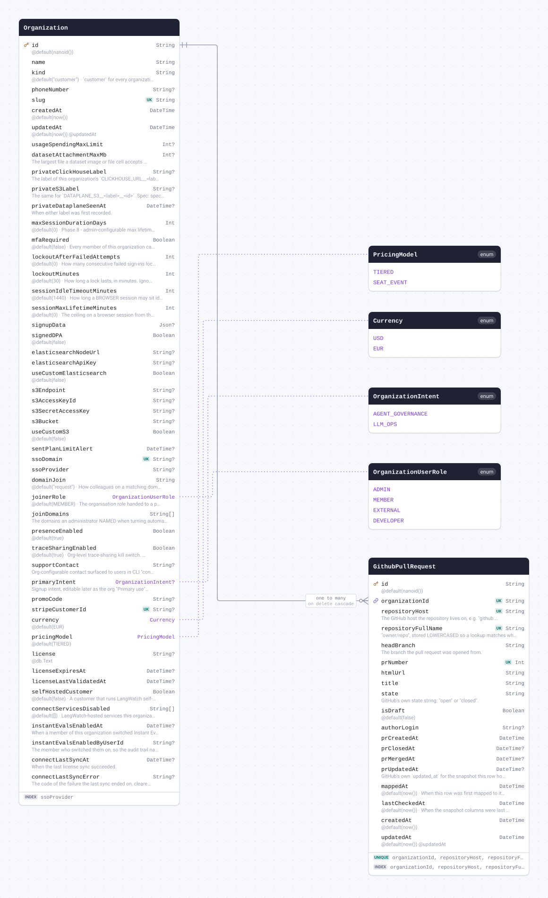

| Field                | Type       | Constraints                                       | Default              | Description                                                                                                                                                                                                                                                                                                                                                         |
| -------------------- | ---------- | ------------------------------------------------- | -------------------- | ------------------------------------------------------------------------------------------------------------------------------------------------------------------------------------------------------------------------------------------------------------------------------------------------------------------------------------------------------------------- |
| `id`                 | `String`   | PK NOT NULL                                       | `nanoid()`           |                                                                                                                                                                                                                                                                                                                                                                     |
| `organizationId`     | `String`   | NOT NULL → [Organization.id](#model-Organization) |                      |                                                                                                                                                                                                                                                                                                                                                                     |
| `repositoryHost`     | `String`   | NOT NULL                                          |                      | The GitHub host the repository lives on, e.g. "github.com".                                                                                                                                                                                                                                                                                                         |
| `repositoryFullName` | `String`   | NOT NULL                                          |                      | "owner/repo", stored LOWERCASED so a lookup matches whatever casing the session reported.                                                                                                                                                                                                                                                                           |
| `headBranch`         | `String`   | NOT NULL                                          |                      | The branch the pull request was opened from.                                                                                                                                                                                                                                                                                                                        |
| `prNumber`           | `Int`      | NOT NULL                                          |                      |                                                                                                                                                                                                                                                                                                                                                                     |
| `htmlUrl`            | `String`   | NOT NULL                                          |                      |                                                                                                                                                                                                                                                                                                                                                                     |
| `title`              | `String`   | NOT NULL                                          |                      |                                                                                                                                                                                                                                                                                                                                                                     |
| `state`              | `String`   | NOT NULL                                          |                      | GitHub's own state string: "open" or "closed".                                                                                                                                                                                                                                                                                                                      |
| `isDraft`            | `Boolean`  | NOT NULL                                          | `false`              |                                                                                                                                                                                                                                                                                                                                                                     |
| `authorLogin`        | `String`   | NULL                                              |                      |                                                                                                                                                                                                                                                                                                                                                                     |
| `prCreatedAt`        | `DateTime` | NOT NULL                                          |                      |                                                                                                                                                                                                                                                                                                                                                                     |
| `prClosedAt`         | `DateTime` | NULL                                              |                      |                                                                                                                                                                                                                                                                                                                                                                     |
| `prMergedAt`         | `DateTime` | NULL                                              |                      |                                                                                                                                                                                                                                                                                                                                                                     |
| `prUpdatedAt`        | `DateTime` | NULL                                              |                      | GitHub's own `updated_at` for the snapshot this row holds, and the freshness guard on every write to it: a snapshot older than the stored one is skipped. GitHub may deliver webhooks out of order, and without the guard a late `opened` lands after `closed` and reopens a merged pull request. NULL means the row predates the column, so any write is accepted. |
| `mappedAt`           | `DateTime` | NOT NULL                                          | `now()`              | When this row was first mapped to its branch.                                                                                                                                                                                                                                                                                                                       |
| `lastCheckedAt`      | `DateTime` | NOT NULL                                          | `now()`              | When the snapshot columns were last refreshed from GitHub.                                                                                                                                                                                                                                                                                                          |
| `createdAt`          | `DateTime` | NOT NULL                                          | `now()`              |                                                                                                                                                                                                                                                                                                                                                                     |
| `updatedAt`          | `DateTime` | NOT NULL                                          | `now()` `@updatedAt` |                                                                                                                                                                                                                                                                                                                                                                     |

#### Indexes

- `@@index([organizationId, repositoryHost, repositoryFullName, headBranch])`
- `@@unique([organizationId, repositoryHost, repositoryFullName, prNumber])`

#### References

- `organizationId` → [Organization.id](#model-Organization) (many-to-one, on delete Cascade)

#### Definition

```sql
CREATE TABLE "GithubPullRequest" (
    "id" TEXT NOT NULL,
    "organizationId" TEXT NOT NULL,
    "repositoryHost" TEXT NOT NULL,
    "repositoryFullName" TEXT NOT NULL,
    "headBranch" TEXT NOT NULL,
    "prNumber" INTEGER NOT NULL,
    "htmlUrl" TEXT NOT NULL,
    "title" TEXT NOT NULL,
    "state" TEXT NOT NULL,
    "isDraft" BOOLEAN NOT NULL DEFAULT false,
    "authorLogin" TEXT,
    "prCreatedAt" TIMESTAMP(3) NOT NULL,
    "prClosedAt" TIMESTAMP(3),
    "prMergedAt" TIMESTAMP(3),
    "prUpdatedAt" TIMESTAMP(3),
    "mappedAt" TIMESTAMP(3) NOT NULL DEFAULT CURRENT_TIMESTAMP,
    "lastCheckedAt" TIMESTAMP(3) NOT NULL DEFAULT CURRENT_TIMESTAMP,
    "createdAt" TIMESTAMP(3) NOT NULL DEFAULT CURRENT_TIMESTAMP,
    "updatedAt" TIMESTAMP(3) NOT NULL DEFAULT CURRENT_TIMESTAMP,

    CONSTRAINT "GithubPullRequest_pkey" PRIMARY KEY ("id")
);

CREATE INDEX "GithubPullRequest_organizationId_repositoryHost_repositoryF_idx" ON "GithubPullRequest"("organizationId", "repositoryHost", "repositoryFullName", "headBranch");

CREATE UNIQUE INDEX "GithubPullRequest_organizationId_repositoryHost_repositoryF_key" ON "GithubPullRequest"("organizationId", "repositoryHost", "repositoryFullName", "prNumber");
```

<details>
<summary>Queries and their SQL</summary>

**findMany**: Every row

```ts
await prisma.githubPullRequest.findMany();
```

```sql
SELECT
  "public"."GithubPullRequest"."id",
  "public"."GithubPullRequest"."organizationId",
  "public"."GithubPullRequest"."repositoryHost",
  "public"."GithubPullRequest"."repositoryFullName",
  "public"."GithubPullRequest"."headBranch",
  "public"."GithubPullRequest"."prNumber",
  "public"."GithubPullRequest"."htmlUrl",
  "public"."GithubPullRequest"."title",
  "public"."GithubPullRequest"."state",
  "public"."GithubPullRequest"."isDraft",
  "public"."GithubPullRequest"."authorLogin",
  "public"."GithubPullRequest"."prCreatedAt",
  "public"."GithubPullRequest"."prClosedAt",
  "public"."GithubPullRequest"."prMergedAt",
  "public"."GithubPullRequest"."prUpdatedAt",
  "public"."GithubPullRequest"."mappedAt",
  "public"."GithubPullRequest"."lastCheckedAt",
  "public"."GithubPullRequest"."createdAt",
  "public"."GithubPullRequest"."updatedAt"
FROM
  "public"."GithubPullRequest"
WHERE
  1 = 1
OFFSET
  $1
-- params: ["0"]
```

**count**: How many rows there are

```ts
await prisma.githubPullRequest.count();
```

```sql
SELECT
  COUNT(*) AS "_count$_all"
FROM
  (
    SELECT
      "public"."GithubPullRequest"."id"
    FROM
      "public"."GithubPullRequest"
    WHERE
      1 = 1
    OFFSET
      $1
  ) AS "sub"
-- params: ["0"]
```

**findMany**: Every row with its relations

```ts
await prisma.githubPullRequest.findMany({ include: { organization: true } });
```

```sql
SELECT
  "public"."GithubPullRequest"."id",
  "public"."GithubPullRequest"."organizationId",
  "public"."GithubPullRequest"."repositoryHost",
  "public"."GithubPullRequest"."repositoryFullName",
  "public"."GithubPullRequest"."headBranch",
  "public"."GithubPullRequest"."prNumber",
  "public"."GithubPullRequest"."htmlUrl",
  "public"."GithubPullRequest"."title",
  "public"."GithubPullRequest"."state",
  "public"."GithubPullRequest"."isDraft",
  "public"."GithubPullRequest"."authorLogin",
  "public"."GithubPullRequest"."prCreatedAt",
  "public"."GithubPullRequest"."prClosedAt",
  "public"."GithubPullRequest"."prMergedAt",
  "public"."GithubPullRequest"."prUpdatedAt",
  "public"."GithubPullRequest"."mappedAt",
  "public"."GithubPullRequest"."lastCheckedAt",
  "public"."GithubPullRequest"."createdAt",
  "public"."GithubPullRequest"."updatedAt"
FROM
  "public"."GithubPullRequest"
WHERE
  1 = 1
OFFSET
  $1
-- params: ["0"]

SELECT
  "public"."Organization"."id",
  "public"."Organization"."name",
  "public"."Organization"."kind",
  "public"."Organization"."phoneNumber",
  "public"."Organization"."slug",
  "public"."Organization"."createdAt",
  "public"."Organization"."updatedAt",
  "public"."Organization"."usageSpendingMaxLimit",
  "public"."Organization"."datasetAttachmentMaxMb",
  "public"."Organization"."privateClickHouseLabel",
  "public"."Organization"."privateS3Label",
  "public"."Organization"."privateDataplaneSeenAt",
  "public"."Organization"."maxSessionDurationDays",
  "public"."Organization"."mfaRequired",
  "public"."Organization"."lockoutAfterFailedAttempts",
  "public"."Organization"."lockoutMinutes",
  "public"."Organization"."sessionIdleTimeoutMinutes",
  "public"."Organization"."sessionMaxLifetimeMinutes",
  "public"."Organization"."signupData",
  "public"."Organization"."signedDPA",
  "public"."Organization"."elasticsearchNodeUrl",
  "public"."Organization"."elasticsearchApiKey",
  "public"."Organization"."useCustomElasticsearch",
  "public"."Organization"."s3Endpoint",
  "public"."Organization"."s3AccessKeyId",
  "public"."Organization"."s3SecretAccessKey",
  "public"."Organization"."s3Bucket",
  "public"."Organization"."useCustomS3",
  "public"."Organization"."sentPlanLimitAlert",
  "public"."Organization"."ssoDomain",
  "public"."Organization"."ssoProvider",
  "public"."Organization"."domainJoin",
  "public"."Organization"."joinerRole"::text,
  "public"."Organization"."joinDomains",
  "public"."Organization"."presenceEnabled",
  "public"."Organization"."traceSharingEnabled",
  "public"."Organization"."supportContact",
  "public"."Organization"."primaryIntent"::text,
  "public"."Organization"."promoCode",
  "public"."Organization"."stripeCustomerId",
  "public"."Organization"."currency"::text,
  "public"."Organization"."pricingModel"::text,
  "public"."Organization"."license",
  "public"."Organization"."licenseExpiresAt",
  "public"."Organization"."licenseLastValidatedAt",
  "public"."Organization"."selfHostedCustomer",
  "public"."Organization"."connectServicesDisabled",
  "public"."Organization"."instantEvalsEnabledAt",
  "public"."Organization"."instantEvalsEnabledByUserId",
  "public"."Organization"."connectLastSyncAt",
  "public"."Organization"."connectLastSyncError"
FROM
  "public"."Organization"
WHERE
  "public"."Organization"."id" IN ($1)
OFFSET
  $2
-- params: ["<organizationId of the rows above>","0"]
```

**findUnique**: One row by what is unique to it

```ts
await prisma.githubPullRequest.findUnique({ where: { id: "example" } });
```

```sql
SELECT
  "public"."GithubPullRequest"."id",
  "public"."GithubPullRequest"."organizationId",
  "public"."GithubPullRequest"."repositoryHost",
  "public"."GithubPullRequest"."repositoryFullName",
  "public"."GithubPullRequest"."headBranch",
  "public"."GithubPullRequest"."prNumber",
  "public"."GithubPullRequest"."htmlUrl",
  "public"."GithubPullRequest"."title",
  "public"."GithubPullRequest"."state",
  "public"."GithubPullRequest"."isDraft",
  "public"."GithubPullRequest"."authorLogin",
  "public"."GithubPullRequest"."prCreatedAt",
  "public"."GithubPullRequest"."prClosedAt",
  "public"."GithubPullRequest"."prMergedAt",
  "public"."GithubPullRequest"."prUpdatedAt",
  "public"."GithubPullRequest"."mappedAt",
  "public"."GithubPullRequest"."lastCheckedAt",
  "public"."GithubPullRequest"."createdAt",
  "public"."GithubPullRequest"."updatedAt"
FROM
  "public"."GithubPullRequest"
WHERE
  (
    "public"."GithubPullRequest"."id" = $1
    AND 1 = 1
  )
LIMIT
  $2
OFFSET
  $3
-- params: ["example","1","0"]
```

**create**: Create a row

```ts
await prisma.githubPullRequest.create({
  data: {
    organizationId: "example",
    repositoryHost: "example",
    repositoryFullName: "example",
    headBranch: "example",
    prNumber: 1,
    htmlUrl: "example",
    title: "example",
    state: "example",
    prCreatedAt: new Date("2026-01-01T00:00:00.000Z"),
  },
});
```

```sql
INSERT INTO
  "public"."GithubPullRequest" (
    "id",
    "organizationId",
    "repositoryHost",
    "repositoryFullName",
    "headBranch",
    "prNumber",
    "htmlUrl",
    "title",
    "state",
    "isDraft",
    "prCreatedAt",
    "mappedAt",
    "lastCheckedAt",
    "createdAt",
    "updatedAt"
  )
VALUES
  (
    $1,
    $2,
    $3,
    $4,
    $5,
    $6,
    $7,
    $8,
    $9,
    $10,
    $11,
    $12,
    $13,
    $14,
    $15
  )
RETURNING
  "public"."GithubPullRequest"."id",
  "public"."GithubPullRequest"."organizationId",
  "public"."GithubPullRequest"."repositoryHost",
  "public"."GithubPullRequest"."repositoryFullName",
  "public"."GithubPullRequest"."headBranch",
  "public"."GithubPullRequest"."prNumber",
  "public"."GithubPullRequest"."htmlUrl",
  "public"."GithubPullRequest"."title",
  "public"."GithubPullRequest"."state",
  "public"."GithubPullRequest"."isDraft",
  "public"."GithubPullRequest"."authorLogin",
  "public"."GithubPullRequest"."prCreatedAt",
  "public"."GithubPullRequest"."prClosedAt",
  "public"."GithubPullRequest"."prMergedAt",
  "public"."GithubPullRequest"."prUpdatedAt",
  "public"."GithubPullRequest"."mappedAt",
  "public"."GithubPullRequest"."lastCheckedAt",
  "public"."GithubPullRequest"."createdAt",
  "public"."GithubPullRequest"."updatedAt"
-- params: ["<nanoid()>","example","example","example","example","1","example","example","example",false,"2026-01-01T00:00:00.000Z","<now()>","<now()>","<now()>","<now()>"]
```

**update**: Update a row

```ts
await prisma.githubPullRequest.update({
  where: { id: "example" },
  data: { repositoryHost: "example" },
});
```

```sql
SELECT
  "public"."GithubPullRequest"."id"
FROM
  "public"."GithubPullRequest"
WHERE
  (
    "public"."GithubPullRequest"."id" = $1
    AND 1 = 1
  )
LIMIT
  $2
OFFSET
  $3
-- params: ["example","1","0"]

UPDATE "public"."GithubPullRequest"
SET
  "repositoryHost" = $1,
  "updatedAt" = $2
WHERE
  (
    "public"."GithubPullRequest"."id" IN ($3)
    AND (
      "public"."GithubPullRequest"."id" = $4
      AND 1 = 1
    )
  )
RETURNING
  "public"."GithubPullRequest"."id",
  "public"."GithubPullRequest"."organizationId",
  "public"."GithubPullRequest"."repositoryHost",
  "public"."GithubPullRequest"."repositoryFullName",
  "public"."GithubPullRequest"."headBranch",
  "public"."GithubPullRequest"."prNumber",
  "public"."GithubPullRequest"."htmlUrl",
  "public"."GithubPullRequest"."title",
  "public"."GithubPullRequest"."state",
  "public"."GithubPullRequest"."isDraft",
  "public"."GithubPullRequest"."authorLogin",
  "public"."GithubPullRequest"."prCreatedAt",
  "public"."GithubPullRequest"."prClosedAt",
  "public"."GithubPullRequest"."prMergedAt",
  "public"."GithubPullRequest"."prUpdatedAt",
  "public"."GithubPullRequest"."mappedAt",
  "public"."GithubPullRequest"."lastCheckedAt",
  "public"."GithubPullRequest"."createdAt",
  "public"."GithubPullRequest"."updatedAt"
-- params: ["example",{"prisma__type":"generatorCall","prisma__value":{"name":"now","args":[],"returnType":{"type":"DateTime"}}},"<id of the rows above>","example"]
```

**delete**: Delete a row

```ts
await prisma.githubPullRequest.delete({ where: { id: "example" } });
```

```sql
DELETE FROM "public"."GithubPullRequest"
WHERE
  (
    "public"."GithubPullRequest"."id" = $1
    AND 1 = 1
  )
RETURNING
  "public"."GithubPullRequest"."id",
  "public"."GithubPullRequest"."organizationId",
  "public"."GithubPullRequest"."repositoryHost",
  "public"."GithubPullRequest"."repositoryFullName",
  "public"."GithubPullRequest"."headBranch",
  "public"."GithubPullRequest"."prNumber",
  "public"."GithubPullRequest"."htmlUrl",
  "public"."GithubPullRequest"."title",
  "public"."GithubPullRequest"."state",
  "public"."GithubPullRequest"."isDraft",
  "public"."GithubPullRequest"."authorLogin",
  "public"."GithubPullRequest"."prCreatedAt",
  "public"."GithubPullRequest"."prClosedAt",
  "public"."GithubPullRequest"."prMergedAt",
  "public"."GithubPullRequest"."prUpdatedAt",
  "public"."GithubPullRequest"."mappedAt",
  "public"."GithubPullRequest"."lastCheckedAt",
  "public"."GithubPullRequest"."createdAt",
  "public"."GithubPullRequest"."updatedAt"
-- params: ["example"]
```

</details>

<a id="model-GithubBranchPullRequestCheck"></a>

### GithubBranchPullRequestCheck

The per-branch bookkeeping behind pull-request mapping: when a branch was
last looked up on GitHub, how many pull requests it resolved to, and when it
may be asked about again. A branch with no pull request is the common case,
so `notFoundAt` plus `recheckAfter` is what keeps an unmapped branch from
costing a GitHub call on every read.
Spec: specs/integrations/github-connection.feature.

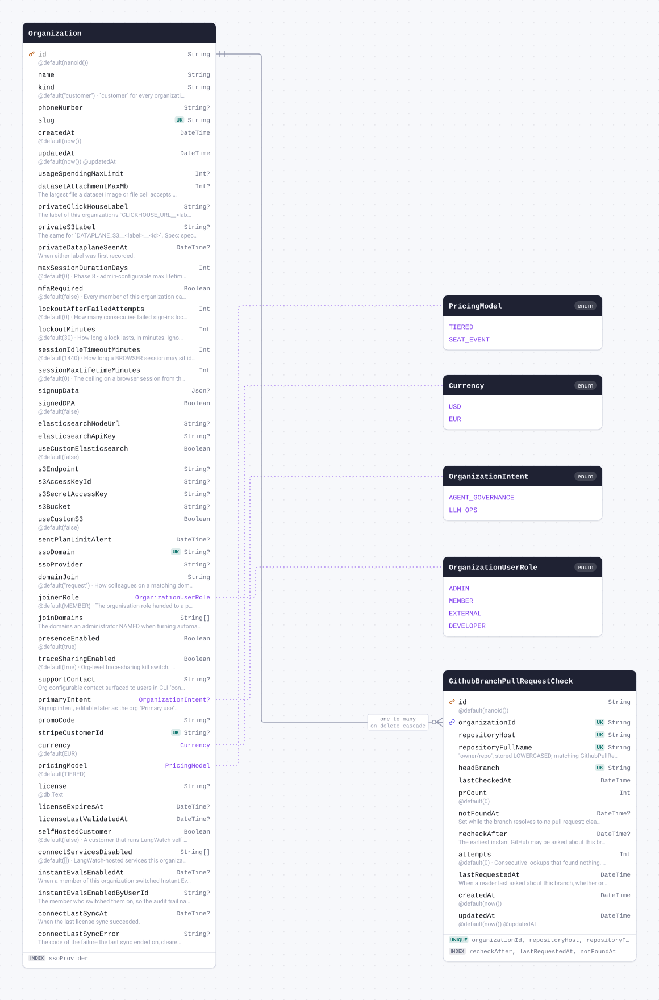

| Field                | Type       | Constraints                                       | Default              | Description                                                                   |
| -------------------- | ---------- | ------------------------------------------------- | -------------------- | ----------------------------------------------------------------------------- |
| `id`                 | `String`   | PK NOT NULL                                       | `nanoid()`           |                                                                               |
| `organizationId`     | `String`   | NOT NULL → [Organization.id](#model-Organization) |                      |                                                                               |
| `repositoryHost`     | `String`   | NOT NULL                                          |                      |                                                                               |
| `repositoryFullName` | `String`   | NOT NULL                                          |                      | "owner/repo", stored LOWERCASED, matching GithubPullRequest.                  |
| `headBranch`         | `String`   | NOT NULL                                          |                      |                                                                               |
| `lastCheckedAt`      | `DateTime` | NOT NULL                                          |                      |                                                                               |
| `prCount`            | `Int`      | NOT NULL                                          | `0`                  |                                                                               |
| `notFoundAt`         | `DateTime` | NULL                                              |                      | Set while the branch resolves to no pull request; cleared once one is found.  |
| `recheckAfter`       | `DateTime` | NULL                                              |                      | The earliest instant GitHub may be asked about this branch again.             |
| `attempts`           | `Int`      | NOT NULL                                          | `0`                  | Consecutive lookups that found nothing, backing off the recheck.              |
| `lastRequestedAt`    | `DateTime` | NOT NULL                                          |                      | When a reader last asked about this branch, whether or not GitHub was called. |
| `createdAt`          | `DateTime` | NOT NULL                                          | `now()`              |                                                                               |
| `updatedAt`          | `DateTime` | NOT NULL                                          | `now()` `@updatedAt` |                                                                               |

#### Indexes

- `@@index([recheckAfter, lastRequestedAt, notFoundAt])`
- `@@unique([organizationId, repositoryHost, repositoryFullName, headBranch])`

#### References

- `organizationId` → [Organization.id](#model-Organization) (many-to-one, on delete Cascade)

#### Definition

```sql
CREATE TABLE "GithubBranchPullRequestCheck" (
    "id" TEXT NOT NULL,
    "organizationId" TEXT NOT NULL,
    "repositoryHost" TEXT NOT NULL,
    "repositoryFullName" TEXT NOT NULL,
    "headBranch" TEXT NOT NULL,
    "lastCheckedAt" TIMESTAMP(3) NOT NULL,
    "prCount" INTEGER NOT NULL DEFAULT 0,
    "notFoundAt" TIMESTAMP(3),
    "recheckAfter" TIMESTAMP(3),
    "attempts" INTEGER NOT NULL DEFAULT 0,
    "lastRequestedAt" TIMESTAMP(3) NOT NULL,
    "createdAt" TIMESTAMP(3) NOT NULL DEFAULT CURRENT_TIMESTAMP,
    "updatedAt" TIMESTAMP(3) NOT NULL DEFAULT CURRENT_TIMESTAMP,

    CONSTRAINT "GithubBranchPullRequestCheck_pkey" PRIMARY KEY ("id")
);

CREATE INDEX "GithubBranchPullRequestCheck_recheckAfter_lastRequestedAt_n_idx" ON "GithubBranchPullRequestCheck"("recheckAfter", "lastRequestedAt", "notFoundAt");

CREATE UNIQUE INDEX "GithubBranchPullRequestCheck_organizationId_repositoryHost__key" ON "GithubBranchPullRequestCheck"("organizationId", "repositoryHost", "repositoryFullName", "headBranch");
```

<details>
<summary>Queries and their SQL</summary>

**findMany**: Every row

```ts
await prisma.githubBranchPullRequestCheck.findMany();
```

```sql
SELECT
  "public"."GithubBranchPullRequestCheck"."id",
  "public"."GithubBranchPullRequestCheck"."organizationId",
  "public"."GithubBranchPullRequestCheck"."repositoryHost",
  "public"."GithubBranchPullRequestCheck"."repositoryFullName",
  "public"."GithubBranchPullRequestCheck"."headBranch",
  "public"."GithubBranchPullRequestCheck"."lastCheckedAt",
  "public"."GithubBranchPullRequestCheck"."prCount",
  "public"."GithubBranchPullRequestCheck"."notFoundAt",
  "public"."GithubBranchPullRequestCheck"."recheckAfter",
  "public"."GithubBranchPullRequestCheck"."attempts",
  "public"."GithubBranchPullRequestCheck"."lastRequestedAt",
  "public"."GithubBranchPullRequestCheck"."createdAt",
  "public"."GithubBranchPullRequestCheck"."updatedAt"
FROM
  "public"."GithubBranchPullRequestCheck"
WHERE
  1 = 1
OFFSET
  $1
-- params: ["0"]
```

**count**: How many rows there are

```ts
await prisma.githubBranchPullRequestCheck.count();
```

```sql
SELECT
  COUNT(*) AS "_count$_all"
FROM
  (
    SELECT
      "public"."GithubBranchPullRequestCheck"."id"
    FROM
      "public"."GithubBranchPullRequestCheck"
    WHERE
      1 = 1
    OFFSET
      $1
  ) AS "sub"
-- params: ["0"]
```

**findMany**: Every row with its relations

```ts
await prisma.githubBranchPullRequestCheck.findMany({ include: { organization: true } });
```

```sql
SELECT
  "public"."GithubBranchPullRequestCheck"."id",
  "public"."GithubBranchPullRequestCheck"."organizationId",
  "public"."GithubBranchPullRequestCheck"."repositoryHost",
  "public"."GithubBranchPullRequestCheck"."repositoryFullName",
  "public"."GithubBranchPullRequestCheck"."headBranch",
  "public"."GithubBranchPullRequestCheck"."lastCheckedAt",
  "public"."GithubBranchPullRequestCheck"."prCount",
  "public"."GithubBranchPullRequestCheck"."notFoundAt",
  "public"."GithubBranchPullRequestCheck"."recheckAfter",
  "public"."GithubBranchPullRequestCheck"."attempts",
  "public"."GithubBranchPullRequestCheck"."lastRequestedAt",
  "public"."GithubBranchPullRequestCheck"."createdAt",
  "public"."GithubBranchPullRequestCheck"."updatedAt"
FROM
  "public"."GithubBranchPullRequestCheck"
WHERE
  1 = 1
OFFSET
  $1
-- params: ["0"]

SELECT
  "public"."Organization"."id",
  "public"."Organization"."name",
  "public"."Organization"."kind",
  "public"."Organization"."phoneNumber",
  "public"."Organization"."slug",
  "public"."Organization"."createdAt",
  "public"."Organization"."updatedAt",
  "public"."Organization"."usageSpendingMaxLimit",
  "public"."Organization"."datasetAttachmentMaxMb",
  "public"."Organization"."privateClickHouseLabel",
  "public"."Organization"."privateS3Label",
  "public"."Organization"."privateDataplaneSeenAt",
  "public"."Organization"."maxSessionDurationDays",
  "public"."Organization"."mfaRequired",
  "public"."Organization"."lockoutAfterFailedAttempts",
  "public"."Organization"."lockoutMinutes",
  "public"."Organization"."sessionIdleTimeoutMinutes",
  "public"."Organization"."sessionMaxLifetimeMinutes",
  "public"."Organization"."signupData",
  "public"."Organization"."signedDPA",
  "public"."Organization"."elasticsearchNodeUrl",
  "public"."Organization"."elasticsearchApiKey",
  "public"."Organization"."useCustomElasticsearch",
  "public"."Organization"."s3Endpoint",
  "public"."Organization"."s3AccessKeyId",
  "public"."Organization"."s3SecretAccessKey",
  "public"."Organization"."s3Bucket",
  "public"."Organization"."useCustomS3",
  "public"."Organization"."sentPlanLimitAlert",
  "public"."Organization"."ssoDomain",
  "public"."Organization"."ssoProvider",
  "public"."Organization"."domainJoin",
  "public"."Organization"."joinerRole"::text,
  "public"."Organization"."joinDomains",
  "public"."Organization"."presenceEnabled",
  "public"."Organization"."traceSharingEnabled",
  "public"."Organization"."supportContact",
  "public"."Organization"."primaryIntent"::text,
  "public"."Organization"."promoCode",
  "public"."Organization"."stripeCustomerId",
  "public"."Organization"."currency"::text,
  "public"."Organization"."pricingModel"::text,
  "public"."Organization"."license",
  "public"."Organization"."licenseExpiresAt",
  "public"."Organization"."licenseLastValidatedAt",
  "public"."Organization"."selfHostedCustomer",
  "public"."Organization"."connectServicesDisabled",
  "public"."Organization"."instantEvalsEnabledAt",
  "public"."Organization"."instantEvalsEnabledByUserId",
  "public"."Organization"."connectLastSyncAt",
  "public"."Organization"."connectLastSyncError"
FROM
  "public"."Organization"
WHERE
  "public"."Organization"."id" IN ($1)
OFFSET
  $2
-- params: ["<organizationId of the rows above>","0"]
```

**findUnique**: One row by what is unique to it

```ts
await prisma.githubBranchPullRequestCheck.findUnique({ where: { id: "example" } });
```

```sql
SELECT
  "public"."GithubBranchPullRequestCheck"."id",
  "public"."GithubBranchPullRequestCheck"."organizationId",
  "public"."GithubBranchPullRequestCheck"."repositoryHost",
  "public"."GithubBranchPullRequestCheck"."repositoryFullName",
  "public"."GithubBranchPullRequestCheck"."headBranch",
  "public"."GithubBranchPullRequestCheck"."lastCheckedAt",
  "public"."GithubBranchPullRequestCheck"."prCount",
  "public"."GithubBranchPullRequestCheck"."notFoundAt",
  "public"."GithubBranchPullRequestCheck"."recheckAfter",
  "public"."GithubBranchPullRequestCheck"."attempts",
  "public"."GithubBranchPullRequestCheck"."lastRequestedAt",
  "public"."GithubBranchPullRequestCheck"."createdAt",
  "public"."GithubBranchPullRequestCheck"."updatedAt"
FROM
  "public"."GithubBranchPullRequestCheck"
WHERE
  (
    "public"."GithubBranchPullRequestCheck"."id" = $1
    AND 1 = 1
  )
LIMIT
  $2
OFFSET
  $3
-- params: ["example","1","0"]
```

**create**: Create a row

```ts
await prisma.githubBranchPullRequestCheck.create({
  data: {
    organizationId: "example",
    repositoryHost: "example",
    repositoryFullName: "example",
    headBranch: "example",
    lastCheckedAt: new Date("2026-01-01T00:00:00.000Z"),
    lastRequestedAt: new Date("2026-01-01T00:00:00.000Z"),
  },
});
```

```sql
INSERT INTO
  "public"."GithubBranchPullRequestCheck" (
    "id",
    "organizationId",
    "repositoryHost",
    "repositoryFullName",
    "headBranch",
    "lastCheckedAt",
    "prCount",
    "attempts",
    "lastRequestedAt",
    "createdAt",
    "updatedAt"
  )
VALUES
  ($1, $2, $3, $4, $5, $6, $7, $8, $9, $10, $11)
RETURNING
  "public"."GithubBranchPullRequestCheck"."id",
  "public"."GithubBranchPullRequestCheck"."organizationId",
  "public"."GithubBranchPullRequestCheck"."repositoryHost",
  "public"."GithubBranchPullRequestCheck"."repositoryFullName",
  "public"."GithubBranchPullRequestCheck"."headBranch",
  "public"."GithubBranchPullRequestCheck"."lastCheckedAt",
  "public"."GithubBranchPullRequestCheck"."prCount",
  "public"."GithubBranchPullRequestCheck"."notFoundAt",
  "public"."GithubBranchPullRequestCheck"."recheckAfter",
  "public"."GithubBranchPullRequestCheck"."attempts",
  "public"."GithubBranchPullRequestCheck"."lastRequestedAt",
  "public"."GithubBranchPullRequestCheck"."createdAt",
  "public"."GithubBranchPullRequestCheck"."updatedAt"
-- params: ["<nanoid()>","example","example","example","example","2026-01-01T00:00:00.000Z","0","0","2026-01-01T00:00:00.000Z","<now()>","<now()>"]
```

**update**: Update a row

```ts
await prisma.githubBranchPullRequestCheck.update({
  where: { id: "example" },
  data: { repositoryHost: "example" },
});
```

```sql
SELECT
  "public"."GithubBranchPullRequestCheck"."id"
FROM
  "public"."GithubBranchPullRequestCheck"
WHERE
  (
    "public"."GithubBranchPullRequestCheck"."id" = $1
    AND 1 = 1
  )
LIMIT
  $2
OFFSET
  $3
-- params: ["example","1","0"]

UPDATE "public"."GithubBranchPullRequestCheck"
SET
  "repositoryHost" = $1,
  "updatedAt" = $2
WHERE
  (
    "public"."GithubBranchPullRequestCheck"."id" IN ($3)
    AND (
      "public"."GithubBranchPullRequestCheck"."id" = $4
      AND 1 = 1
    )
  )
RETURNING
  "public"."GithubBranchPullRequestCheck"."id",
  "public"."GithubBranchPullRequestCheck"."organizationId",
  "public"."GithubBranchPullRequestCheck"."repositoryHost",
  "public"."GithubBranchPullRequestCheck"."repositoryFullName",
  "public"."GithubBranchPullRequestCheck"."headBranch",
  "public"."GithubBranchPullRequestCheck"."lastCheckedAt",
  "public"."GithubBranchPullRequestCheck"."prCount",
  "public"."GithubBranchPullRequestCheck"."notFoundAt",
  "public"."GithubBranchPullRequestCheck"."recheckAfter",
  "public"."GithubBranchPullRequestCheck"."attempts",
  "public"."GithubBranchPullRequestCheck"."lastRequestedAt",
  "public"."GithubBranchPullRequestCheck"."createdAt",
  "public"."GithubBranchPullRequestCheck"."updatedAt"
-- params: ["example",{"prisma__type":"generatorCall","prisma__value":{"name":"now","args":[],"returnType":{"type":"DateTime"}}},"<id of the rows above>","example"]
```

**delete**: Delete a row

```ts
await prisma.githubBranchPullRequestCheck.delete({ where: { id: "example" } });
```

```sql
DELETE FROM "public"."GithubBranchPullRequestCheck"
WHERE
  (
    "public"."GithubBranchPullRequestCheck"."id" = $1
    AND 1 = 1
  )
RETURNING
  "public"."GithubBranchPullRequestCheck"."id",
  "public"."GithubBranchPullRequestCheck"."organizationId",
  "public"."GithubBranchPullRequestCheck"."repositoryHost",
  "public"."GithubBranchPullRequestCheck"."repositoryFullName",
  "public"."GithubBranchPullRequestCheck"."headBranch",
  "public"."GithubBranchPullRequestCheck"."lastCheckedAt",
  "public"."GithubBranchPullRequestCheck"."prCount",
  "public"."GithubBranchPullRequestCheck"."notFoundAt",
  "public"."GithubBranchPullRequestCheck"."recheckAfter",
  "public"."GithubBranchPullRequestCheck"."attempts",
  "public"."GithubBranchPullRequestCheck"."lastRequestedAt",
  "public"."GithubBranchPullRequestCheck"."createdAt",
  "public"."GithubBranchPullRequestCheck"."updatedAt"
-- params: ["example"]
```

</details>

<a id="model-LangyConversationProjection"></a>

### LangyConversationProjection

Rebuildable operational state folded from Langy's canonical event stream.
The source of truth remains the ClickHouse event log.

| Field                                           | Type                                                             | Constraints | Default         | Description                                                                                                                                                                                           |
| ----------------------------------------------- | ---------------------------------------------------------------- | ----------- | --------------- | ----------------------------------------------------------------------------------------------------------------------------------------------------------------------------------------------------- |
| `id`                                            | `String`                                                         | PK NOT NULL | `nanoid()`      |                                                                                                                                                                                                       |
| `projectId`                                     | `String`                                                         | NOT NULL    |                 |                                                                                                                                                                                                       |
| `ConversationId` (`conversationId`)             | `String`                                                         | NOT NULL    |                 |                                                                                                                                                                                                       |
| `UserId` (`userId`)                             | `String`                                                         | NOT NULL    |                 | Owner; first-writer-wins from the first message's userId.                                                                                                                                             |
| `Title` (`title`)                               | `String`                                                         | NULL        |                 |                                                                                                                                                                                                       |
| `TitleSource` (`titleSource`)                   | [`LangyProjectionTitleSource`](#enum-LangyProjectionTitleSource) | NOT NULL    |                 | derived \| auto \| user — governs auto-title precedence (user is sticky).                                                                                                                             |
| `Origin` (`origin`)                             | `String`                                                         | NOT NULL    | `"interactive"` | Who started the conversation: `interactive` for the person in the panel, `run` for a module acting for them with nobody at the keyboard. A row folded before the column existed reads as interactive. |
| `Status` (`status`)                             | `String`                                                         | NOT NULL    |                 |                                                                                                                                                                                                       |
| `IsShared` (`isShared`)                         | `Boolean`                                                        | NOT NULL    | `false`         |                                                                                                                                                                                                       |
| `SharedAt` (`sharedAt`)                         | `Float`                                                          | NULL        |                 |                                                                                                                                                                                                       |
| `SharedById` (`sharedById`)                     | `String`                                                         | NULL        |                 |                                                                                                                                                                                                       |
| `MessageCount` (`messageCount`)                 | `Int`                                                            | NOT NULL    | `0`             |                                                                                                                                                                                                       |
| `LastActivityAt` (`lastActivityAt`)             | `Float`                                                          | NULL        |                 |                                                                                                                                                                                                       |
| `CurrentTurnId` (`currentTurnId`)               | `String`                                                         | NULL        |                 | The turn in flight, or null when idle (busy guard reads this).                                                                                                                                        |
| `LastError` (`lastError`)                       | `String`                                                         | NULL        |                 |                                                                                                                                                                                                       |
| `LastModel` (`lastModel`)                       | `String`                                                         | NULL        |                 | The model the latest accepted turn ran on; reopening seeds the picker from it.                                                                                                                        |
| `PendingHandoffToken` (`pendingHandoffToken`)   | `String`                                                         | NULL        |                 | ADR-048 shutdown-handoff resume token (opaque, worker-authored).                                                                                                                                      |
| `PendingHandoffTurnId` (`pendingHandoffTurnId`) | `String`                                                         | NULL        |                 |                                                                                                                                                                                                       |
| `RunToken` (`runToken`)                         | `String`                                                         | NULL        |                 | Per-conversation HMAC key for worker stream frames; server-side only.                                                                                                                                 |
| `ArchivedAt` (`archivedAt`)                     | `Float`                                                          | NULL        |                 |                                                                                                                                                                                                       |
| `CreatedAt` (`createdAt`)                       | `Float`                                                          | NOT NULL    |                 |                                                                                                                                                                                                       |
| `UpdatedAt` (`updatedAt`)                       | `Float`                                                          | NOT NULL    |                 |                                                                                                                                                                                                       |
| `OccurredAt` (`occurredAt`)                     | `Float`                                                          | NOT NULL    |                 | Business time of the latest applied event.                                                                                                                                                            |
| `AcceptedAt` (`acceptedAt`)                     | `Float`                                                          | NOT NULL    |                 | Event-log acceptance time. Together with lastEventId this is the cursor.                                                                                                                              |
| `LastEventId` (`lastEventId`)                   | `String`                                                         | NOT NULL    |                 |                                                                                                                                                                                                       |
| `ProjectionVersion` (`projectionVersion`)       | `String`                                                         | NOT NULL    |                 |                                                                                                                                                                                                       |

#### Indexes

- `@@index([projectId, UserId, ConversationId])`
- `@@index([projectId, UserId, LastActivityAt])`
- `@@unique([projectId, ConversationId])`

#### Definition

```sql
CREATE TABLE "LangyConversationProjection" (
    "id" TEXT NOT NULL,
    "projectId" TEXT NOT NULL,
    "conversationId" TEXT NOT NULL,
    "userId" TEXT NOT NULL,
    "title" TEXT,
    "titleSource" "LangyProjectionTitleSource" NOT NULL,
    "origin" TEXT NOT NULL DEFAULT 'interactive',
    "status" TEXT NOT NULL,
    "isShared" BOOLEAN NOT NULL DEFAULT false,
    "sharedAt" DOUBLE PRECISION,
    "sharedById" TEXT,
    "messageCount" INTEGER NOT NULL DEFAULT 0,
    "lastActivityAt" DOUBLE PRECISION,
    "currentTurnId" TEXT,
    "lastError" TEXT,
    "lastModel" TEXT,
    "pendingHandoffToken" TEXT,
    "pendingHandoffTurnId" TEXT,
    "runToken" TEXT,
    "archivedAt" DOUBLE PRECISION,
    "createdAt" DOUBLE PRECISION NOT NULL,
    "updatedAt" DOUBLE PRECISION NOT NULL,
    "occurredAt" DOUBLE PRECISION NOT NULL,
    "acceptedAt" DOUBLE PRECISION NOT NULL,
    "lastEventId" TEXT NOT NULL,
    "projectionVersion" TEXT NOT NULL,

    CONSTRAINT "LangyConversationProjection_pkey" PRIMARY KEY ("id")
);

CREATE INDEX "LangyConversationProjection_projectId_userId_conversationId_idx" ON "LangyConversationProjection"("projectId", "userId", "conversationId");

CREATE INDEX "LangyConversationProjection_projectId_userId_lastActivityAt_idx" ON "LangyConversationProjection"("projectId", "userId", "lastActivityAt");

CREATE UNIQUE INDEX "LangyConversationProjection_projectId_conversationId_key" ON "LangyConversationProjection"("projectId", "conversationId");
```

<details>
<summary>Queries and their SQL</summary>

**findMany**: Every row

```ts
await prisma.langyConversationProjection.findMany();
```

```sql
SELECT
  "public"."LangyConversationProjection"."id",
  "public"."LangyConversationProjection"."projectId",
  "public"."LangyConversationProjection"."conversationId",
  "public"."LangyConversationProjection"."userId",
  "public"."LangyConversationProjection"."title",
  "public"."LangyConversationProjection"."titleSource"::text,
  "public"."LangyConversationProjection"."origin",
  "public"."LangyConversationProjection"."status",
  "public"."LangyConversationProjection"."isShared",
  "public"."LangyConversationProjection"."sharedAt",
  "public"."LangyConversationProjection"."sharedById",
  "public"."LangyConversationProjection"."messageCount",
  "public"."LangyConversationProjection"."lastActivityAt",
  "public"."LangyConversationProjection"."currentTurnId",
  "public"."LangyConversationProjection"."lastError",
  "public"."LangyConversationProjection"."lastModel",
  "public"."LangyConversationProjection"."pendingHandoffToken",
  "public"."LangyConversationProjection"."pendingHandoffTurnId",
  "public"."LangyConversationProjection"."runToken",
  "public"."LangyConversationProjection"."archivedAt",
  "public"."LangyConversationProjection"."createdAt",
  "public"."LangyConversationProjection"."updatedAt",
  "public"."LangyConversationProjection"."occurredAt",
  "public"."LangyConversationProjection"."acceptedAt",
  "public"."LangyConversationProjection"."lastEventId",
  "public"."LangyConversationProjection"."projectionVersion"
FROM
  "public"."LangyConversationProjection"
WHERE
  1 = 1
OFFSET
  $1
-- params: ["0"]
```

**count**: How many rows there are

```ts
await prisma.langyConversationProjection.count();
```

```sql
SELECT
  COUNT(*) AS "_count$_all"
FROM
  (
    SELECT
      "public"."LangyConversationProjection"."id"
    FROM
      "public"."LangyConversationProjection"
    WHERE
      1 = 1
    OFFSET
      $1
  ) AS "sub"
-- params: ["0"]
```

**findUnique**: One row by what is unique to it

```ts
await prisma.langyConversationProjection.findUnique({ where: { id: "example" } });
```

```sql
SELECT
  "public"."LangyConversationProjection"."id",
  "public"."LangyConversationProjection"."projectId",
  "public"."LangyConversationProjection"."conversationId",
  "public"."LangyConversationProjection"."userId",
  "public"."LangyConversationProjection"."title",
  "public"."LangyConversationProjection"."titleSource"::text,
  "public"."LangyConversationProjection"."origin",
  "public"."LangyConversationProjection"."status",
  "public"."LangyConversationProjection"."isShared",
  "public"."LangyConversationProjection"."sharedAt",
  "public"."LangyConversationProjection"."sharedById",
  "public"."LangyConversationProjection"."messageCount",
  "public"."LangyConversationProjection"."lastActivityAt",
  "public"."LangyConversationProjection"."currentTurnId",
  "public"."LangyConversationProjection"."lastError",
  "public"."LangyConversationProjection"."lastModel",
  "public"."LangyConversationProjection"."pendingHandoffToken",
  "public"."LangyConversationProjection"."pendingHandoffTurnId",
  "public"."LangyConversationProjection"."runToken",
  "public"."LangyConversationProjection"."archivedAt",
  "public"."LangyConversationProjection"."createdAt",
  "public"."LangyConversationProjection"."updatedAt",
  "public"."LangyConversationProjection"."occurredAt",
  "public"."LangyConversationProjection"."acceptedAt",
  "public"."LangyConversationProjection"."lastEventId",
  "public"."LangyConversationProjection"."projectionVersion"
FROM
  "public"."LangyConversationProjection"
WHERE
  (
    "public"."LangyConversationProjection"."id" = $1
    AND 1 = 1
  )
LIMIT
  $2
OFFSET
  $3
-- params: ["example","1","0"]
```

**create**: Create a row

```ts
await prisma.langyConversationProjection.create({
  data: {
    projectId: "example",
    ConversationId: "example",
    UserId: "example",
    TitleSource: "derived",
    Status: "example",
    CreatedAt: 1.5,
    UpdatedAt: 1.5,
    OccurredAt: 1.5,
    AcceptedAt: 1.5,
    LastEventId: "example",
    ProjectionVersion: "example",
  },
});
```

```sql
INSERT INTO
  "public"."LangyConversationProjection" (
    "id",
    "projectId",
    "conversationId",
    "userId",
    "titleSource",
    "origin",
    "status",
    "isShared",
    "messageCount",
    "createdAt",
    "updatedAt",
    "occurredAt",
    "acceptedAt",
    "lastEventId",
    "projectionVersion"
  )
VALUES
  (
    $1,
    $2,
    $3,
    $4,
    CAST($5::text AS "public"."LangyProjectionTitleSource"),
    $6,
    $7,
    $8,
    $9,
    $10,
    $11,
    $12,
    $13,
    $14,
    $15
  )
RETURNING
  "public"."LangyConversationProjection"."id",
  "public"."LangyConversationProjection"."projectId",
  "public"."LangyConversationProjection"."conversationId",
  "public"."LangyConversationProjection"."userId",
  "public"."LangyConversationProjection"."title",
  "public"."LangyConversationProjection"."titleSource"::text,
  "public"."LangyConversationProjection"."origin",
  "public"."LangyConversationProjection"."status",
  "public"."LangyConversationProjection"."isShared",
  "public"."LangyConversationProjection"."sharedAt",
  "public"."LangyConversationProjection"."sharedById",
  "public"."LangyConversationProjection"."messageCount",
  "public"."LangyConversationProjection"."lastActivityAt",
  "public"."LangyConversationProjection"."currentTurnId",
  "public"."LangyConversationProjection"."lastError",
  "public"."LangyConversationProjection"."lastModel",
  "public"."LangyConversationProjection"."pendingHandoffToken",
  "public"."LangyConversationProjection"."pendingHandoffTurnId",
  "public"."LangyConversationProjection"."runToken",
  "public"."LangyConversationProjection"."archivedAt",
  "public"."LangyConversationProjection"."createdAt",
  "public"."LangyConversationProjection"."updatedAt",
  "public"."LangyConversationProjection"."occurredAt",
  "public"."LangyConversationProjection"."acceptedAt",
  "public"."LangyConversationProjection"."lastEventId",
  "public"."LangyConversationProjection"."projectionVersion"
-- params: ["<nanoid()>","example","example","example","derived","interactive","example",false,"0","1.5","1.5","1.5","1.5","example","example"]
```

**update**: Update a row

```ts
await prisma.langyConversationProjection.update({
  where: { id: "example" },
  data: { projectId: "example" },
});
```

```sql
SELECT
  "public"."LangyConversationProjection"."id"
FROM
  "public"."LangyConversationProjection"
WHERE
  (
    "public"."LangyConversationProjection"."id" = $1
    AND 1 = 1
  )
LIMIT
  $2
OFFSET
  $3
-- params: ["example","1","0"]

UPDATE "public"."LangyConversationProjection"
SET
  "projectId" = $1
WHERE
  (
    "public"."LangyConversationProjection"."id" IN ($2)
    AND (
      "public"."LangyConversationProjection"."id" = $3
      AND 1 = 1
    )
  )
RETURNING
  "public"."LangyConversationProjection"."id",
  "public"."LangyConversationProjection"."projectId",
  "public"."LangyConversationProjection"."conversationId",
  "public"."LangyConversationProjection"."userId",
  "public"."LangyConversationProjection"."title",
  "public"."LangyConversationProjection"."titleSource"::text,
  "public"."LangyConversationProjection"."origin",
  "public"."LangyConversationProjection"."status",
  "public"."LangyConversationProjection"."isShared",
  "public"."LangyConversationProjection"."sharedAt",
  "public"."LangyConversationProjection"."sharedById",
  "public"."LangyConversationProjection"."messageCount",
  "public"."LangyConversationProjection"."lastActivityAt",
  "public"."LangyConversationProjection"."currentTurnId",
  "public"."LangyConversationProjection"."lastError",
  "public"."LangyConversationProjection"."lastModel",
  "public"."LangyConversationProjection"."pendingHandoffToken",
  "public"."LangyConversationProjection"."pendingHandoffTurnId",
  "public"."LangyConversationProjection"."runToken",
  "public"."LangyConversationProjection"."archivedAt",
  "public"."LangyConversationProjection"."createdAt",
  "public"."LangyConversationProjection"."updatedAt",
  "public"."LangyConversationProjection"."occurredAt",
  "public"."LangyConversationProjection"."acceptedAt",
  "public"."LangyConversationProjection"."lastEventId",
  "public"."LangyConversationProjection"."projectionVersion"
-- params: ["example","<id of the rows above>","example"]
```

**delete**: Delete a row

```ts
await prisma.langyConversationProjection.delete({ where: { id: "example" } });
```

```sql
DELETE FROM "public"."LangyConversationProjection"
WHERE
  (
    "public"."LangyConversationProjection"."id" = $1
    AND 1 = 1
  )
RETURNING
  "public"."LangyConversationProjection"."id",
  "public"."LangyConversationProjection"."projectId",
  "public"."LangyConversationProjection"."conversationId",
  "public"."LangyConversationProjection"."userId",
  "public"."LangyConversationProjection"."title",
  "public"."LangyConversationProjection"."titleSource"::text,
  "public"."LangyConversationProjection"."origin",
  "public"."LangyConversationProjection"."status",
  "public"."LangyConversationProjection"."isShared",
  "public"."LangyConversationProjection"."sharedAt",
  "public"."LangyConversationProjection"."sharedById",
  "public"."LangyConversationProjection"."messageCount",
  "public"."LangyConversationProjection"."lastActivityAt",
  "public"."LangyConversationProjection"."currentTurnId",
  "public"."LangyConversationProjection"."lastError",
  "public"."LangyConversationProjection"."lastModel",
  "public"."LangyConversationProjection"."pendingHandoffToken",
  "public"."LangyConversationProjection"."pendingHandoffTurnId",
  "public"."LangyConversationProjection"."runToken",
  "public"."LangyConversationProjection"."archivedAt",
  "public"."LangyConversationProjection"."createdAt",
  "public"."LangyConversationProjection"."updatedAt",
  "public"."LangyConversationProjection"."occurredAt",
  "public"."LangyConversationProjection"."acceptedAt",
  "public"."LangyConversationProjection"."lastEventId",
  "public"."LangyConversationProjection"."projectionVersion"
-- params: ["example"]
```

</details>

<a id="model-LangyTurnRequest"></a>

### LangyTurnRequest

Durable idempotency receipt for one logical Langy send. A transport retry
reuses the same requestId and receives the original conversation/turn ids
instead of minting a second message or turn.

| Field            | Type       | Constraints | Default              | Description |
| ---------------- | ---------- | ----------- | -------------------- | ----------- |
| `id`             | `String`   | PK NOT NULL | `nanoid()`           |             |
| `projectId`      | `String`   | NOT NULL    |                      |             |
| `userId`         | `String`   | NOT NULL    |                      |             |
| `requestId`      | `String`   | NOT NULL    |                      |             |
| `conversationId` | `String`   | NOT NULL    |                      |             |
| `turnId`         | `String`   | NOT NULL    |                      |             |
| `status`         | `String`   | NOT NULL    |                      |             |
| `leaseOwner`     | `String`   | NOT NULL    |                      |             |
| `leaseExpiresAt` | `DateTime` | NOT NULL    |                      |             |
| `createdAt`      | `DateTime` | NOT NULL    | `now()`              |             |
| `updatedAt`      | `DateTime` | NOT NULL    | `now()` `@updatedAt` |             |

#### Indexes

- `@@index([projectId, conversationId])`
- `@@unique([projectId, userId, requestId])`

#### Definition

```sql
CREATE TABLE "LangyTurnRequest" (
    "id" TEXT NOT NULL,
    "projectId" TEXT NOT NULL,
    "userId" TEXT NOT NULL,
    "requestId" TEXT NOT NULL,
    "conversationId" TEXT NOT NULL,
    "turnId" TEXT NOT NULL,
    "status" TEXT NOT NULL,
    "leaseOwner" TEXT NOT NULL,
    "leaseExpiresAt" TIMESTAMP(3) NOT NULL,
    "createdAt" TIMESTAMP(3) NOT NULL DEFAULT CURRENT_TIMESTAMP,
    "updatedAt" TIMESTAMP(3) NOT NULL DEFAULT CURRENT_TIMESTAMP,

    CONSTRAINT "LangyTurnRequest_pkey" PRIMARY KEY ("id")
);

CREATE INDEX "LangyTurnRequest_projectId_conversationId_idx" ON "LangyTurnRequest"("projectId", "conversationId");

CREATE UNIQUE INDEX "LangyTurnRequest_projectId_userId_requestId_key" ON "LangyTurnRequest"("projectId", "userId", "requestId");
```

<details>
<summary>Queries and their SQL</summary>

**findMany**: Every row

```ts
await prisma.langyTurnRequest.findMany();
```

```sql
SELECT
  "public"."LangyTurnRequest"."id",
  "public"."LangyTurnRequest"."projectId",
  "public"."LangyTurnRequest"."userId",
  "public"."LangyTurnRequest"."requestId",
  "public"."LangyTurnRequest"."conversationId",
  "public"."LangyTurnRequest"."turnId",
  "public"."LangyTurnRequest"."status",
  "public"."LangyTurnRequest"."leaseOwner",
  "public"."LangyTurnRequest"."leaseExpiresAt",
  "public"."LangyTurnRequest"."createdAt",
  "public"."LangyTurnRequest"."updatedAt"
FROM
  "public"."LangyTurnRequest"
WHERE
  1 = 1
OFFSET
  $1
-- params: ["0"]
```

**count**: How many rows there are

```ts
await prisma.langyTurnRequest.count();
```

```sql
SELECT
  COUNT(*) AS "_count$_all"
FROM
  (
    SELECT
      "public"."LangyTurnRequest"."id"
    FROM
      "public"."LangyTurnRequest"
    WHERE
      1 = 1
    OFFSET
      $1
  ) AS "sub"
-- params: ["0"]
```

**findUnique**: One row by what is unique to it

```ts
await prisma.langyTurnRequest.findUnique({ where: { id: "example" } });
```

```sql
SELECT
  "public"."LangyTurnRequest"."id",
  "public"."LangyTurnRequest"."projectId",
  "public"."LangyTurnRequest"."userId",
  "public"."LangyTurnRequest"."requestId",
  "public"."LangyTurnRequest"."conversationId",
  "public"."LangyTurnRequest"."turnId",
  "public"."LangyTurnRequest"."status",
  "public"."LangyTurnRequest"."leaseOwner",
  "public"."LangyTurnRequest"."leaseExpiresAt",
  "public"."LangyTurnRequest"."createdAt",
  "public"."LangyTurnRequest"."updatedAt"
FROM
  "public"."LangyTurnRequest"
WHERE
  (
    "public"."LangyTurnRequest"."id" = $1
    AND 1 = 1
  )
LIMIT
  $2
OFFSET
  $3
-- params: ["example","1","0"]
```

**create**: Create a row

```ts
await prisma.langyTurnRequest.create({
  data: {
    projectId: "example",
    userId: "example",
    requestId: "example",
    conversationId: "example",
    turnId: "example",
    status: "example",
    leaseOwner: "example",
    leaseExpiresAt: new Date("2026-01-01T00:00:00.000Z"),
  },
});
```

```sql
INSERT INTO
  "public"."LangyTurnRequest" (
    "id",
    "projectId",
    "userId",
    "requestId",
    "conversationId",
    "turnId",
    "status",
    "leaseOwner",
    "leaseExpiresAt",
    "createdAt",
    "updatedAt"
  )
VALUES
  ($1, $2, $3, $4, $5, $6, $7, $8, $9, $10, $11)
RETURNING
  "public"."LangyTurnRequest"."id",
  "public"."LangyTurnRequest"."projectId",
  "public"."LangyTurnRequest"."userId",
  "public"."LangyTurnRequest"."requestId",
  "public"."LangyTurnRequest"."conversationId",
  "public"."LangyTurnRequest"."turnId",
  "public"."LangyTurnRequest"."status",
  "public"."LangyTurnRequest"."leaseOwner",
  "public"."LangyTurnRequest"."leaseExpiresAt",
  "public"."LangyTurnRequest"."createdAt",
  "public"."LangyTurnRequest"."updatedAt"
-- params: ["<nanoid()>","example","example","example","example","example","example","example","2026-01-01T00:00:00.000Z","<now()>","<now()>"]
```

**update**: Update a row

```ts
await prisma.langyTurnRequest.update({ where: { id: "example" }, data: { projectId: "example" } });
```

```sql
SELECT
  "public"."LangyTurnRequest"."id"
FROM
  "public"."LangyTurnRequest"
WHERE
  (
    "public"."LangyTurnRequest"."id" = $1
    AND 1 = 1
  )
LIMIT
  $2
OFFSET
  $3
-- params: ["example","1","0"]

UPDATE "public"."LangyTurnRequest"
SET
  "projectId" = $1,
  "updatedAt" = $2
WHERE
  (
    "public"."LangyTurnRequest"."id" IN ($3)
    AND (
      "public"."LangyTurnRequest"."id" = $4
      AND 1 = 1
    )
  )
RETURNING
  "public"."LangyTurnRequest"."id",
  "public"."LangyTurnRequest"."projectId",
  "public"."LangyTurnRequest"."userId",
  "public"."LangyTurnRequest"."requestId",
  "public"."LangyTurnRequest"."conversationId",
  "public"."LangyTurnRequest"."turnId",
  "public"."LangyTurnRequest"."status",
  "public"."LangyTurnRequest"."leaseOwner",
  "public"."LangyTurnRequest"."leaseExpiresAt",
  "public"."LangyTurnRequest"."createdAt",
  "public"."LangyTurnRequest"."updatedAt"
-- params: ["example",{"prisma__type":"generatorCall","prisma__value":{"name":"now","args":[],"returnType":{"type":"DateTime"}}},"<id of the rows above>","example"]
```

**delete**: Delete a row

```ts
await prisma.langyTurnRequest.delete({ where: { id: "example" } });
```

```sql
DELETE FROM "public"."LangyTurnRequest"
WHERE
  (
    "public"."LangyTurnRequest"."id" = $1
    AND 1 = 1
  )
RETURNING
  "public"."LangyTurnRequest"."id",
  "public"."LangyTurnRequest"."projectId",
  "public"."LangyTurnRequest"."userId",
  "public"."LangyTurnRequest"."requestId",
  "public"."LangyTurnRequest"."conversationId",
  "public"."LangyTurnRequest"."turnId",
  "public"."LangyTurnRequest"."status",
  "public"."LangyTurnRequest"."leaseOwner",
  "public"."LangyTurnRequest"."leaseExpiresAt",
  "public"."LangyTurnRequest"."createdAt",
  "public"."LangyTurnRequest"."updatedAt"
-- params: ["example"]
```

</details>

<a id="model-LangyActiveTurn"></a>

### LangyActiveTurn

Postgres-authoritative one-turn admission for a conversation. PREPARING
claims are leased so a crash before the durable start event can recover;
COMMITTED claims are released only by the matching terminal event.

| Field            | Type       | Constraints | Default              | Description |
| ---------------- | ---------- | ----------- | -------------------- | ----------- |
| `id`             | `String`   | PK NOT NULL | `nanoid()`           |             |
| `projectId`      | `String`   | NOT NULL    |                      |             |
| `conversationId` | `String`   | NOT NULL    |                      |             |
| `turnId`         | `String`   | NOT NULL    |                      |             |
| `requestId`      | `String`   | NOT NULL    |                      |             |
| `userId`         | `String`   | NOT NULL    |                      |             |
| `status`         | `String`   | NOT NULL    |                      |             |
| `leaseOwner`     | `String`   | NOT NULL    |                      |             |
| `leaseExpiresAt` | `DateTime` | NOT NULL    |                      |             |
| `createdAt`      | `DateTime` | NOT NULL    | `now()`              |             |
| `updatedAt`      | `DateTime` | NOT NULL    | `now()` `@updatedAt` |             |

#### Indexes

- `@@index([projectId, userId])`
- `@@unique([projectId, conversationId])`

#### Definition

```sql
CREATE TABLE "LangyActiveTurn" (
    "id" TEXT NOT NULL,
    "projectId" TEXT NOT NULL,
    "conversationId" TEXT NOT NULL,
    "turnId" TEXT NOT NULL,
    "requestId" TEXT NOT NULL,
    "userId" TEXT NOT NULL,
    "status" TEXT NOT NULL,
    "leaseOwner" TEXT NOT NULL,
    "leaseExpiresAt" TIMESTAMP(3) NOT NULL,
    "createdAt" TIMESTAMP(3) NOT NULL DEFAULT CURRENT_TIMESTAMP,
    "updatedAt" TIMESTAMP(3) NOT NULL DEFAULT CURRENT_TIMESTAMP,

    CONSTRAINT "LangyActiveTurn_pkey" PRIMARY KEY ("id")
);

CREATE INDEX "LangyActiveTurn_projectId_userId_idx" ON "LangyActiveTurn"("projectId", "userId");

CREATE UNIQUE INDEX "LangyActiveTurn_projectId_conversationId_key" ON "LangyActiveTurn"("projectId", "conversationId");
```

<details>
<summary>Queries and their SQL</summary>

**findMany**: Every row

```ts
await prisma.langyActiveTurn.findMany();
```

```sql
SELECT
  "public"."LangyActiveTurn"."id",
  "public"."LangyActiveTurn"."projectId",
  "public"."LangyActiveTurn"."conversationId",
  "public"."LangyActiveTurn"."turnId",
  "public"."LangyActiveTurn"."requestId",
  "public"."LangyActiveTurn"."userId",
  "public"."LangyActiveTurn"."status",
  "public"."LangyActiveTurn"."leaseOwner",
  "public"."LangyActiveTurn"."leaseExpiresAt",
  "public"."LangyActiveTurn"."createdAt",
  "public"."LangyActiveTurn"."updatedAt"
FROM
  "public"."LangyActiveTurn"
WHERE
  1 = 1
OFFSET
  $1
-- params: ["0"]
```

**count**: How many rows there are

```ts
await prisma.langyActiveTurn.count();
```

```sql
SELECT
  COUNT(*) AS "_count$_all"
FROM
  (
    SELECT
      "public"."LangyActiveTurn"."id"
    FROM
      "public"."LangyActiveTurn"
    WHERE
      1 = 1
    OFFSET
      $1
  ) AS "sub"
-- params: ["0"]
```

**findUnique**: One row by what is unique to it

```ts
await prisma.langyActiveTurn.findUnique({ where: { id: "example" } });
```

```sql
SELECT
  "public"."LangyActiveTurn"."id",
  "public"."LangyActiveTurn"."projectId",
  "public"."LangyActiveTurn"."conversationId",
  "public"."LangyActiveTurn"."turnId",
  "public"."LangyActiveTurn"."requestId",
  "public"."LangyActiveTurn"."userId",
  "public"."LangyActiveTurn"."status",
  "public"."LangyActiveTurn"."leaseOwner",
  "public"."LangyActiveTurn"."leaseExpiresAt",
  "public"."LangyActiveTurn"."createdAt",
  "public"."LangyActiveTurn"."updatedAt"
FROM
  "public"."LangyActiveTurn"
WHERE
  (
    "public"."LangyActiveTurn"."id" = $1
    AND 1 = 1
  )
LIMIT
  $2
OFFSET
  $3
-- params: ["example","1","0"]
```

**create**: Create a row

```ts
await prisma.langyActiveTurn.create({
  data: {
    projectId: "example",
    conversationId: "example",
    turnId: "example",
    requestId: "example",
    userId: "example",
    status: "example",
    leaseOwner: "example",
    leaseExpiresAt: new Date("2026-01-01T00:00:00.000Z"),
  },
});
```

```sql
INSERT INTO
  "public"."LangyActiveTurn" (
    "id",
    "projectId",
    "conversationId",
    "turnId",
    "requestId",
    "userId",
    "status",
    "leaseOwner",
    "leaseExpiresAt",
    "createdAt",
    "updatedAt"
  )
VALUES
  ($1, $2, $3, $4, $5, $6, $7, $8, $9, $10, $11)
RETURNING
  "public"."LangyActiveTurn"."id",
  "public"."LangyActiveTurn"."projectId",
  "public"."LangyActiveTurn"."conversationId",
  "public"."LangyActiveTurn"."turnId",
  "public"."LangyActiveTurn"."requestId",
  "public"."LangyActiveTurn"."userId",
  "public"."LangyActiveTurn"."status",
  "public"."LangyActiveTurn"."leaseOwner",
  "public"."LangyActiveTurn"."leaseExpiresAt",
  "public"."LangyActiveTurn"."createdAt",
  "public"."LangyActiveTurn"."updatedAt"
-- params: ["<nanoid()>","example","example","example","example","example","example","example","2026-01-01T00:00:00.000Z","<now()>","<now()>"]
```

**update**: Update a row

```ts
await prisma.langyActiveTurn.update({ where: { id: "example" }, data: { projectId: "example" } });
```

```sql
SELECT
  "public"."LangyActiveTurn"."id"
FROM
  "public"."LangyActiveTurn"
WHERE
  (
    "public"."LangyActiveTurn"."id" = $1
    AND 1 = 1
  )
LIMIT
  $2
OFFSET
  $3
-- params: ["example","1","0"]

UPDATE "public"."LangyActiveTurn"
SET
  "projectId" = $1,
  "updatedAt" = $2
WHERE
  (
    "public"."LangyActiveTurn"."id" IN ($3)
    AND (
      "public"."LangyActiveTurn"."id" = $4
      AND 1 = 1
    )
  )
RETURNING
  "public"."LangyActiveTurn"."id",
  "public"."LangyActiveTurn"."projectId",
  "public"."LangyActiveTurn"."conversationId",
  "public"."LangyActiveTurn"."turnId",
  "public"."LangyActiveTurn"."requestId",
  "public"."LangyActiveTurn"."userId",
  "public"."LangyActiveTurn"."status",
  "public"."LangyActiveTurn"."leaseOwner",
  "public"."LangyActiveTurn"."leaseExpiresAt",
  "public"."LangyActiveTurn"."createdAt",
  "public"."LangyActiveTurn"."updatedAt"
-- params: ["example",{"prisma__type":"generatorCall","prisma__value":{"name":"now","args":[],"returnType":{"type":"DateTime"}}},"<id of the rows above>","example"]
```

**delete**: Delete a row

```ts
await prisma.langyActiveTurn.delete({ where: { id: "example" } });
```

```sql
DELETE FROM "public"."LangyActiveTurn"
WHERE
  (
    "public"."LangyActiveTurn"."id" = $1
    AND 1 = 1
  )
RETURNING
  "public"."LangyActiveTurn"."id",
  "public"."LangyActiveTurn"."projectId",
  "public"."LangyActiveTurn"."conversationId",
  "public"."LangyActiveTurn"."turnId",
  "public"."LangyActiveTurn"."requestId",
  "public"."LangyActiveTurn"."userId",
  "public"."LangyActiveTurn"."status",
  "public"."LangyActiveTurn"."leaseOwner",
  "public"."LangyActiveTurn"."leaseExpiresAt",
  "public"."LangyActiveTurn"."createdAt",
  "public"."LangyActiveTurn"."updatedAt"
-- params: ["example"]
```

</details>

<a id="model-LangyConversationTurnProjection"></a>

### LangyConversationTurnProjection

Rebuildable per-turn operational render document.

| Field                                     | Type     | Constraints | Default    | Description                                                                                                                                                                                                                                                                                                                                                                                                                             |
| ----------------------------------------- | -------- | ----------- | ---------- | --------------------------------------------------------------------------------------------------------------------------------------------------------------------------------------------------------------------------------------------------------------------------------------------------------------------------------------------------------------------------------------------------------------------------------------- |
| `id`                                      | `String` | PK NOT NULL | `nanoid()` |                                                                                                                                                                                                                                                                                                                                                                                                                                         |
| `projectId`                               | `String` | NOT NULL    |            |                                                                                                                                                                                                                                                                                                                                                                                                                                         |
| `ConversationId` (`conversationId`)       | `String` | NOT NULL    |            |                                                                                                                                                                                                                                                                                                                                                                                                                                         |
| `TurnId` (`turnId`)                       | `String` | NOT NULL    |            |                                                                                                                                                                                                                                                                                                                                                                                                                                         |
| `Status` (`status`)                       | `String` | NOT NULL    |            | LangyConversationTurnStatus. Deliberately TEXT, not a Postgres enum: this is a PROJECTION — one writer (the fold), rebuildable from the event log, and nothing queries or indexes on it. An enum bought no selectivity here, only typo protection, and charged a migration for every new status that Postgres then could not remove. The one definition lives in `LANGY_CONVERSATION_TURN_STATUS`; the repository validates against it. |
| `QuestionParts` (`questionParts`)         | `Json`   | NOT NULL    |            | LangyMessagePart[] — the user question that opened the turn.                                                                                                                                                                                                                                                                                                                                                                            |
| `AnswerParts` (`answerParts`)             | `Json`   | NOT NULL    |            | LangyMessagePart[] — the agent's whole final answer.                                                                                                                                                                                                                                                                                                                                                                                    |
| `ToolCalls` (`toolCalls`)                 | `Json`   | NOT NULL    |            | LangyTurnToolCall[] — tool-call lifecycle audit in initiation order.                                                                                                                                                                                                                                                                                                                                                                    |
| `Plan` (`plan`)                           | `Json`   | NULL        |            | LangyPlanItemData[] \| null — null means the turn never kept a plan.                                                                                                                                                                                                                                                                                                                                                                    |
| `Error` (`error`)                         | `String` | NULL        |            |                                                                                                                                                                                                                                                                                                                                                                                                                                         |
| `StartedAt` (`startedAt`)                 | `Float`  | NULL        |            |                                                                                                                                                                                                                                                                                                                                                                                                                                         |
| `EndedAt` (`endedAt`)                     | `Float`  | NULL        |            |                                                                                                                                                                                                                                                                                                                                                                                                                                         |
| `CreatedAt` (`createdAt`)                 | `Float`  | NOT NULL    |            |                                                                                                                                                                                                                                                                                                                                                                                                                                         |
| `UpdatedAt` (`updatedAt`)                 | `Float`  | NOT NULL    |            |                                                                                                                                                                                                                                                                                                                                                                                                                                         |
| `OccurredAt` (`occurredAt`)               | `Float`  | NOT NULL    |            |                                                                                                                                                                                                                                                                                                                                                                                                                                         |
| `AcceptedAt` (`acceptedAt`)               | `Float`  | NOT NULL    |            |                                                                                                                                                                                                                                                                                                                                                                                                                                         |
| `LastEventId` (`lastEventId`)             | `String` | NOT NULL    |            |                                                                                                                                                                                                                                                                                                                                                                                                                                         |
| `ProjectionVersion` (`projectionVersion`) | `String` | NOT NULL    |            |                                                                                                                                                                                                                                                                                                                                                                                                                                         |

#### Indexes

- `@@index([projectId, ConversationId, UpdatedAt])`
- `@@unique([projectId, ConversationId, TurnId])`

#### Definition

```sql
CREATE TABLE "LangyConversationTurnProjection" (
    "id" TEXT NOT NULL,
    "projectId" TEXT NOT NULL,
    "conversationId" TEXT NOT NULL,
    "turnId" TEXT NOT NULL,
    "status" TEXT NOT NULL,
    "questionParts" JSONB NOT NULL,
    "answerParts" JSONB NOT NULL,
    "toolCalls" JSONB NOT NULL,
    "plan" JSONB,
    "error" TEXT,
    "startedAt" DOUBLE PRECISION,
    "endedAt" DOUBLE PRECISION,
    "createdAt" DOUBLE PRECISION NOT NULL,
    "updatedAt" DOUBLE PRECISION NOT NULL,
    "occurredAt" DOUBLE PRECISION NOT NULL,
    "acceptedAt" DOUBLE PRECISION NOT NULL,
    "lastEventId" TEXT NOT NULL,
    "projectionVersion" TEXT NOT NULL,

    CONSTRAINT "LangyConversationTurnProjection_pkey" PRIMARY KEY ("id")
);

CREATE INDEX "LangyConversationTurnProjection_projectId_conversationId_up_idx" ON "LangyConversationTurnProjection"("projectId", "conversationId", "updatedAt");

CREATE UNIQUE INDEX "LangyConversationTurnProjection_projectId_conversationId_tu_key" ON "LangyConversationTurnProjection"("projectId", "conversationId", "turnId");
```

<details>
<summary>Queries and their SQL</summary>

**findMany**: Every row

```ts
await prisma.langyConversationTurnProjection.findMany();
```

```sql
SELECT
  "public"."LangyConversationTurnProjection"."id",
  "public"."LangyConversationTurnProjection"."projectId",
  "public"."LangyConversationTurnProjection"."conversationId",
  "public"."LangyConversationTurnProjection"."turnId",
  "public"."LangyConversationTurnProjection"."status",
  "public"."LangyConversationTurnProjection"."questionParts",
  "public"."LangyConversationTurnProjection"."answerParts",
  "public"."LangyConversationTurnProjection"."toolCalls",
  "public"."LangyConversationTurnProjection"."plan",
  "public"."LangyConversationTurnProjection"."error",
  "public"."LangyConversationTurnProjection"."startedAt",
  "public"."LangyConversationTurnProjection"."endedAt",
  "public"."LangyConversationTurnProjection"."createdAt",
  "public"."LangyConversationTurnProjection"."updatedAt",
  "public"."LangyConversationTurnProjection"."occurredAt",
  "public"."LangyConversationTurnProjection"."acceptedAt",
  "public"."LangyConversationTurnProjection"."lastEventId",
  "public"."LangyConversationTurnProjection"."projectionVersion"
FROM
  "public"."LangyConversationTurnProjection"
WHERE
  1 = 1
OFFSET
  $1
-- params: ["0"]
```

**count**: How many rows there are

```ts
await prisma.langyConversationTurnProjection.count();
```

```sql
SELECT
  COUNT(*) AS "_count$_all"
FROM
  (
    SELECT
      "public"."LangyConversationTurnProjection"."id"
    FROM
      "public"."LangyConversationTurnProjection"
    WHERE
      1 = 1
    OFFSET
      $1
  ) AS "sub"
-- params: ["0"]
```

**findUnique**: One row by what is unique to it

```ts
await prisma.langyConversationTurnProjection.findUnique({ where: { id: "example" } });
```

```sql
SELECT
  "public"."LangyConversationTurnProjection"."id",
  "public"."LangyConversationTurnProjection"."projectId",
  "public"."LangyConversationTurnProjection"."conversationId",
  "public"."LangyConversationTurnProjection"."turnId",
  "public"."LangyConversationTurnProjection"."status",
  "public"."LangyConversationTurnProjection"."questionParts",
  "public"."LangyConversationTurnProjection"."answerParts",
  "public"."LangyConversationTurnProjection"."toolCalls",
  "public"."LangyConversationTurnProjection"."plan",
  "public"."LangyConversationTurnProjection"."error",
  "public"."LangyConversationTurnProjection"."startedAt",
  "public"."LangyConversationTurnProjection"."endedAt",
  "public"."LangyConversationTurnProjection"."createdAt",
  "public"."LangyConversationTurnProjection"."updatedAt",
  "public"."LangyConversationTurnProjection"."occurredAt",
  "public"."LangyConversationTurnProjection"."acceptedAt",
  "public"."LangyConversationTurnProjection"."lastEventId",
  "public"."LangyConversationTurnProjection"."projectionVersion"
FROM
  "public"."LangyConversationTurnProjection"
WHERE
  (
    "public"."LangyConversationTurnProjection"."id" = $1
    AND 1 = 1
  )
LIMIT
  $2
OFFSET
  $3
-- params: ["example","1","0"]
```

**create**: Create a row

```ts
await prisma.langyConversationTurnProjection.create({
  data: {
    projectId: "example",
    ConversationId: "example",
    TurnId: "example",
    Status: "example",
    QuestionParts: {},
    AnswerParts: {},
    ToolCalls: {},
    CreatedAt: 1.5,
    UpdatedAt: 1.5,
    OccurredAt: 1.5,
    AcceptedAt: 1.5,
    LastEventId: "example",
    ProjectionVersion: "example",
  },
});
```

```sql
INSERT INTO
  "public"."LangyConversationTurnProjection" (
    "id",
    "projectId",
    "conversationId",
    "turnId",
    "status",
    "questionParts",
    "answerParts",
    "toolCalls",
    "createdAt",
    "updatedAt",
    "occurredAt",
    "acceptedAt",
    "lastEventId",
    "projectionVersion"
  )
VALUES
  (
    $1,
    $2,
    $3,
    $4,
    $5,
    $6,
    $7,
    $8,
    $9,
    $10,
    $11,
    $12,
    $13,
    $14
  )
RETURNING
  "public"."LangyConversationTurnProjection"."id",
  "public"."LangyConversationTurnProjection"."projectId",
  "public"."LangyConversationTurnProjection"."conversationId",
  "public"."LangyConversationTurnProjection"."turnId",
  "public"."LangyConversationTurnProjection"."status",
  "public"."LangyConversationTurnProjection"."questionParts",
  "public"."LangyConversationTurnProjection"."answerParts",
  "public"."LangyConversationTurnProjection"."toolCalls",
  "public"."LangyConversationTurnProjection"."plan",
  "public"."LangyConversationTurnProjection"."error",
  "public"."LangyConversationTurnProjection"."startedAt",
  "public"."LangyConversationTurnProjection"."endedAt",
  "public"."LangyConversationTurnProjection"."createdAt",
  "public"."LangyConversationTurnProjection"."updatedAt",
  "public"."LangyConversationTurnProjection"."occurredAt",
  "public"."LangyConversationTurnProjection"."acceptedAt",
  "public"."LangyConversationTurnProjection"."lastEventId",
  "public"."LangyConversationTurnProjection"."projectionVersion"
-- params: ["<nanoid()>","example","example","example","example","{}","{}","{}","1.5","1.5","1.5","1.5","example","example"]
```

**update**: Update a row

```ts
await prisma.langyConversationTurnProjection.update({
  where: { id: "example" },
  data: { projectId: "example" },
});
```

```sql
SELECT
  "public"."LangyConversationTurnProjection"."id"
FROM
  "public"."LangyConversationTurnProjection"
WHERE
  (
    "public"."LangyConversationTurnProjection"."id" = $1
    AND 1 = 1
  )
LIMIT
  $2
OFFSET
  $3
-- params: ["example","1","0"]

UPDATE "public"."LangyConversationTurnProjection"
SET
  "projectId" = $1
WHERE
  (
    "public"."LangyConversationTurnProjection"."id" IN ($2)
    AND (
      "public"."LangyConversationTurnProjection"."id" = $3
      AND 1 = 1
    )
  )
RETURNING
  "public"."LangyConversationTurnProjection"."id",
  "public"."LangyConversationTurnProjection"."projectId",
  "public"."LangyConversationTurnProjection"."conversationId",
  "public"."LangyConversationTurnProjection"."turnId",
  "public"."LangyConversationTurnProjection"."status",
  "public"."LangyConversationTurnProjection"."questionParts",
  "public"."LangyConversationTurnProjection"."answerParts",
  "public"."LangyConversationTurnProjection"."toolCalls",
  "public"."LangyConversationTurnProjection"."plan",
  "public"."LangyConversationTurnProjection"."error",
  "public"."LangyConversationTurnProjection"."startedAt",
  "public"."LangyConversationTurnProjection"."endedAt",
  "public"."LangyConversationTurnProjection"."createdAt",
  "public"."LangyConversationTurnProjection"."updatedAt",
  "public"."LangyConversationTurnProjection"."occurredAt",
  "public"."LangyConversationTurnProjection"."acceptedAt",
  "public"."LangyConversationTurnProjection"."lastEventId",
  "public"."LangyConversationTurnProjection"."projectionVersion"
-- params: ["example","<id of the rows above>","example"]
```

**delete**: Delete a row

```ts
await prisma.langyConversationTurnProjection.delete({ where: { id: "example" } });
```

```sql
DELETE FROM "public"."LangyConversationTurnProjection"
WHERE
  (
    "public"."LangyConversationTurnProjection"."id" = $1
    AND 1 = 1
  )
RETURNING
  "public"."LangyConversationTurnProjection"."id",
  "public"."LangyConversationTurnProjection"."projectId",
  "public"."LangyConversationTurnProjection"."conversationId",
  "public"."LangyConversationTurnProjection"."turnId",
  "public"."LangyConversationTurnProjection"."status",
  "public"."LangyConversationTurnProjection"."questionParts",
  "public"."LangyConversationTurnProjection"."answerParts",
  "public"."LangyConversationTurnProjection"."toolCalls",
  "public"."LangyConversationTurnProjection"."plan",
  "public"."LangyConversationTurnProjection"."error",
  "public"."LangyConversationTurnProjection"."startedAt",
  "public"."LangyConversationTurnProjection"."endedAt",
  "public"."LangyConversationTurnProjection"."createdAt",
  "public"."LangyConversationTurnProjection"."updatedAt",
  "public"."LangyConversationTurnProjection"."occurredAt",
  "public"."LangyConversationTurnProjection"."acceptedAt",
  "public"."LangyConversationTurnProjection"."lastEventId",
  "public"."LangyConversationTurnProjection"."projectionVersion"
-- params: ["example"]
```

</details>

<a id="model-LangyMessageProjection"></a>

### LangyMessageProjection

Rebuildable operational message fact. One source event produces one row.

| Field                               | Type     | Constraints | Default    | Description |
| ----------------------------------- | -------- | ----------- | ---------- | ----------- |
| `id`                                | `String` | PK NOT NULL | `nanoid()` |             |
| `projectId`                         | `String` | NOT NULL    |            |             |
| `ConversationId` (`conversationId`) | `String` | NOT NULL    |            |             |
| `MessageId` (`messageId`)           | `String` | NOT NULL    |            |             |
| `Role` (`role`)                     | `String` | NOT NULL    |            |             |
| `Parts` (`parts`)                   | `Json`   | NOT NULL    |            |             |
| `SourceEventId` (`sourceEventId`)   | `String` | NOT NULL    |            |             |
| `OccurredAt` (`occurredAt`)         | `Float`  | NOT NULL    |            |             |
| `AcceptedAt` (`acceptedAt`)         | `Float`  | NOT NULL    |            |             |
| `CreatedAt` (`createdAt`)           | `Float`  | NOT NULL    |            |             |
| `UpdatedAt` (`updatedAt`)           | `Float`  | NOT NULL    |            |             |

#### Indexes

- `@@index([projectId, ConversationId, CreatedAt])`
- `@@unique([projectId, ConversationId, MessageId])`
- `@@unique([projectId, SourceEventId])`

#### Definition

```sql
CREATE TABLE "LangyMessageProjection" (
    "id" TEXT NOT NULL,
    "projectId" TEXT NOT NULL,
    "conversationId" TEXT NOT NULL,
    "messageId" TEXT NOT NULL,
    "role" TEXT NOT NULL,
    "parts" JSONB NOT NULL,
    "sourceEventId" TEXT NOT NULL,
    "occurredAt" DOUBLE PRECISION NOT NULL,
    "acceptedAt" DOUBLE PRECISION NOT NULL,
    "createdAt" DOUBLE PRECISION NOT NULL,
    "updatedAt" DOUBLE PRECISION NOT NULL,

    CONSTRAINT "LangyMessageProjection_pkey" PRIMARY KEY ("id")
);

CREATE INDEX "LangyMessageProjection_projectId_conversationId_createdAt_idx" ON "LangyMessageProjection"("projectId", "conversationId", "createdAt");

CREATE UNIQUE INDEX "LangyMessageProjection_projectId_conversationId_messageId_key" ON "LangyMessageProjection"("projectId", "conversationId", "messageId");

CREATE UNIQUE INDEX "LangyMessageProjection_projectId_sourceEventId_key" ON "LangyMessageProjection"("projectId", "sourceEventId");
```

<details>
<summary>Queries and their SQL</summary>

**findMany**: Every row

```ts
await prisma.langyMessageProjection.findMany();
```

```sql
SELECT
  "public"."LangyMessageProjection"."id",
  "public"."LangyMessageProjection"."projectId",
  "public"."LangyMessageProjection"."conversationId",
  "public"."LangyMessageProjection"."messageId",
  "public"."LangyMessageProjection"."role",
  "public"."LangyMessageProjection"."parts",
  "public"."LangyMessageProjection"."sourceEventId",
  "public"."LangyMessageProjection"."occurredAt",
  "public"."LangyMessageProjection"."acceptedAt",
  "public"."LangyMessageProjection"."createdAt",
  "public"."LangyMessageProjection"."updatedAt"
FROM
  "public"."LangyMessageProjection"
WHERE
  1 = 1
OFFSET
  $1
-- params: ["0"]
```

**count**: How many rows there are

```ts
await prisma.langyMessageProjection.count();
```

```sql
SELECT
  COUNT(*) AS "_count$_all"
FROM
  (
    SELECT
      "public"."LangyMessageProjection"."id"
    FROM
      "public"."LangyMessageProjection"
    WHERE
      1 = 1
    OFFSET
      $1
  ) AS "sub"
-- params: ["0"]
```

**findUnique**: One row by what is unique to it

```ts
await prisma.langyMessageProjection.findUnique({ where: { id: "example" } });
```

```sql
SELECT
  "public"."LangyMessageProjection"."id",
  "public"."LangyMessageProjection"."projectId",
  "public"."LangyMessageProjection"."conversationId",
  "public"."LangyMessageProjection"."messageId",
  "public"."LangyMessageProjection"."role",
  "public"."LangyMessageProjection"."parts",
  "public"."LangyMessageProjection"."sourceEventId",
  "public"."LangyMessageProjection"."occurredAt",
  "public"."LangyMessageProjection"."acceptedAt",
  "public"."LangyMessageProjection"."createdAt",
  "public"."LangyMessageProjection"."updatedAt"
FROM
  "public"."LangyMessageProjection"
WHERE
  (
    "public"."LangyMessageProjection"."id" = $1
    AND 1 = 1
  )
LIMIT
  $2
OFFSET
  $3
-- params: ["example","1","0"]
```

**create**: Create a row

```ts
await prisma.langyMessageProjection.create({
  data: {
    projectId: "example",
    ConversationId: "example",
    MessageId: "example",
    Role: "example",
    Parts: {},
    SourceEventId: "example",
    OccurredAt: 1.5,
    AcceptedAt: 1.5,
    CreatedAt: 1.5,
    UpdatedAt: 1.5,
  },
});
```

```sql
INSERT INTO
  "public"."LangyMessageProjection" (
    "id",
    "projectId",
    "conversationId",
    "messageId",
    "role",
    "parts",
    "sourceEventId",
    "occurredAt",
    "acceptedAt",
    "createdAt",
    "updatedAt"
  )
VALUES
  ($1, $2, $3, $4, $5, $6, $7, $8, $9, $10, $11)
RETURNING
  "public"."LangyMessageProjection"."id",
  "public"."LangyMessageProjection"."projectId",
  "public"."LangyMessageProjection"."conversationId",
  "public"."LangyMessageProjection"."messageId",
  "public"."LangyMessageProjection"."role",
  "public"."LangyMessageProjection"."parts",
  "public"."LangyMessageProjection"."sourceEventId",
  "public"."LangyMessageProjection"."occurredAt",
  "public"."LangyMessageProjection"."acceptedAt",
  "public"."LangyMessageProjection"."createdAt",
  "public"."LangyMessageProjection"."updatedAt"
-- params: ["<nanoid()>","example","example","example","example","{}","example","1.5","1.5","1.5","1.5"]
```

**update**: Update a row

```ts
await prisma.langyMessageProjection.update({
  where: { id: "example" },
  data: { projectId: "example" },
});
```

```sql
SELECT
  "public"."LangyMessageProjection"."id"
FROM
  "public"."LangyMessageProjection"
WHERE
  (
    "public"."LangyMessageProjection"."id" = $1
    AND 1 = 1
  )
LIMIT
  $2
OFFSET
  $3
-- params: ["example","1","0"]

UPDATE "public"."LangyMessageProjection"
SET
  "projectId" = $1
WHERE
  (
    "public"."LangyMessageProjection"."id" IN ($2)
    AND (
      "public"."LangyMessageProjection"."id" = $3
      AND 1 = 1
    )
  )
RETURNING
  "public"."LangyMessageProjection"."id",
  "public"."LangyMessageProjection"."projectId",
  "public"."LangyMessageProjection"."conversationId",
  "public"."LangyMessageProjection"."messageId",
  "public"."LangyMessageProjection"."role",
  "public"."LangyMessageProjection"."parts",
  "public"."LangyMessageProjection"."sourceEventId",
  "public"."LangyMessageProjection"."occurredAt",
  "public"."LangyMessageProjection"."acceptedAt",
  "public"."LangyMessageProjection"."createdAt",
  "public"."LangyMessageProjection"."updatedAt"
-- params: ["example","<id of the rows above>","example"]
```

**delete**: Delete a row

```ts
await prisma.langyMessageProjection.delete({ where: { id: "example" } });
```

```sql
DELETE FROM "public"."LangyMessageProjection"
WHERE
  (
    "public"."LangyMessageProjection"."id" = $1
    AND 1 = 1
  )
RETURNING
  "public"."LangyMessageProjection"."id",
  "public"."LangyMessageProjection"."projectId",
  "public"."LangyMessageProjection"."conversationId",
  "public"."LangyMessageProjection"."messageId",
  "public"."LangyMessageProjection"."role",
  "public"."LangyMessageProjection"."parts",
  "public"."LangyMessageProjection"."sourceEventId",
  "public"."LangyMessageProjection"."occurredAt",
  "public"."LangyMessageProjection"."acceptedAt",
  "public"."LangyMessageProjection"."createdAt",
  "public"."LangyMessageProjection"."updatedAt"
-- params: ["example"]
```

</details>

<a id="model-ProjectSecret"></a>

### ProjectSecret


| Field            | Type       | Constraints                             | Default              | Description |
| ---------------- | ---------- | --------------------------------------- | -------------------- | ----------- |
| `id`             | `String`   | PK NOT NULL                             | `nanoid()`           |             |
| `projectId`      | `String`   | NOT NULL → [Project.id](#model-Project) |                      |             |
| `name`           | `String`   | NOT NULL                                |                      |             |
| `encryptedValue` | `String`   | NOT NULL                                |                      |             |
| `createdById`    | `String`   | NOT NULL → [User.id](#model-User)       |                      |             |
| `updatedById`    | `String`   | NOT NULL → [User.id](#model-User)       |                      |             |
| `createdAt`      | `DateTime` | NOT NULL                                | `now()`              |             |
| `updatedAt`      | `DateTime` | NOT NULL                                | `now()` `@updatedAt` |             |

#### Indexes

- `@@index([projectId])`
- `@@unique([projectId, name])`

#### References

- `projectId` → [Project.id](#model-Project) (many-to-one)
- `createdById` → [User.id](#model-User) (many-to-one)
- `updatedById` → [User.id](#model-User) (many-to-one)

#### Definition

```sql
CREATE TABLE "ProjectSecret" (
    "id" TEXT NOT NULL,
    "projectId" TEXT NOT NULL,
    "name" TEXT NOT NULL,
    "encryptedValue" TEXT NOT NULL,
    "createdById" TEXT NOT NULL,
    "updatedById" TEXT NOT NULL,
    "createdAt" TIMESTAMP(3) NOT NULL DEFAULT CURRENT_TIMESTAMP,
    "updatedAt" TIMESTAMP(3) NOT NULL DEFAULT CURRENT_TIMESTAMP,

    CONSTRAINT "ProjectSecret_pkey" PRIMARY KEY ("id")
);

CREATE INDEX "ProjectSecret_projectId_idx" ON "ProjectSecret"("projectId");

CREATE UNIQUE INDEX "ProjectSecret_projectId_name_key" ON "ProjectSecret"("projectId", "name");
```

<details>
<summary>Queries and their SQL</summary>

**findMany**: Every row

```ts
await prisma.projectSecret.findMany();
```

```sql
SELECT
  "public"."ProjectSecret"."id",
  "public"."ProjectSecret"."projectId",
  "public"."ProjectSecret"."name",
  "public"."ProjectSecret"."encryptedValue",
  "public"."ProjectSecret"."createdById",
  "public"."ProjectSecret"."updatedById",
  "public"."ProjectSecret"."createdAt",
  "public"."ProjectSecret"."updatedAt"
FROM
  "public"."ProjectSecret"
WHERE
  1 = 1
OFFSET
  $1
-- params: ["0"]
```

**count**: How many rows there are

```ts
await prisma.projectSecret.count();
```

```sql
SELECT
  COUNT(*) AS "_count$_all"
FROM
  (
    SELECT
      "public"."ProjectSecret"."id"
    FROM
      "public"."ProjectSecret"
    WHERE
      1 = 1
    OFFSET
      $1
  ) AS "sub"
-- params: ["0"]
```

**findMany**: Every row with its relations

```ts
await prisma.projectSecret.findMany({
  include: { project: true, createdBy: true, updatedBy: true },
});
```

```sql
SELECT
  "public"."ProjectSecret"."id",
  "public"."ProjectSecret"."projectId",
  "public"."ProjectSecret"."name",
  "public"."ProjectSecret"."encryptedValue",
  "public"."ProjectSecret"."createdById",
  "public"."ProjectSecret"."updatedById",
  "public"."ProjectSecret"."createdAt",
  "public"."ProjectSecret"."updatedAt"
FROM
  "public"."ProjectSecret"
WHERE
  1 = 1
OFFSET
  $1
-- params: ["0"]

SELECT
  "public"."Project"."id",
  "public"."Project"."name",
  "public"."Project"."slug",
  "public"."Project"."apiKey",
  "public"."Project"."legacyApiKeyLastUsedAt",
  "public"."Project"."lwqlKey",
  "public"."Project"."teamId",
  "public"."Project"."language",
  "public"."Project"."framework",
  "public"."Project"."kind",
  "public"."Project"."aggregateRule",
  "public"."Project"."firstMessage",
  "public"."Project"."integrated",
  "public"."Project"."createdAt",
  "public"."Project"."updatedAt",
  "public"."Project"."userLinkTemplate",
  "public"."Project"."traceSharingEnabled",
  "public"."Project"."presenceEnabled",
  "public"."Project"."s3Endpoint",
  "public"."Project"."s3AccessKeyId",
  "public"."Project"."s3SecretAccessKey",
  "public"."Project"."s3Bucket",
  "public"."Project"."archivedAt",
  "public"."Project"."isPersonal",
  "public"."Project"."ownerUserId",
  "public"."Project"."personalFeatures",
  "public"."Project"."departmentId",
  "public"."Project"."langyEgressAllowlist",
  "public"."Project"."lastCodingAgentSessionAt",
  "public"."Project"."lastCodingAgentPullRequestAt"
FROM
  "public"."Project"
WHERE
  "public"."Project"."id" IN ($1)
OFFSET
  $2
-- params: ["<projectId of the rows above>","0"]

SELECT
  "public"."User"."id",
  "public"."User"."name",
  "public"."User"."email",
  "public"."User"."emailVerified",
  "public"."User"."signupConfirmationPending",
  "public"."User"."passkeySignupClaimHash",
  "public"."User"."image",
  "public"."User"."pendingSsoSetup",
  "public"."User"."userHashKey",
  "public"."User"."twoFactorEnabled",
  "public"."User"."createdAt",
  "public"."User"."updatedAt",
  "public"."User"."lastLoginAt",
  "public"."User"."deactivatedAt",
  "public"."User"."lastHomePath",
  "public"."User"."tracesExplorerTourDismissedAt",
  "public"."User"."langyCodeAccessPreference",
  "public"."User"."passkeyNudgeDismissedAt",
  "public"."User"."joinOfferDismissedDomains",
  "public"."User"."notificationPreferences",
  "public"."User"."passwordResetRequiredAt"
FROM
  "public"."User"
WHERE
  "public"."User"."id" IN ($1)
OFFSET
  $2
-- params: ["<createdById of the rows above>","0"]

SELECT
  "public"."User"."id",
  "public"."User"."name",
  "public"."User"."email",
  "public"."User"."emailVerified",
  "public"."User"."signupConfirmationPending",
  "public"."User"."passkeySignupClaimHash",
  "public"."User"."image",
  "public"."User"."pendingSsoSetup",
  "public"."User"."userHashKey",
  "public"."User"."twoFactorEnabled",
  "public"."User"."createdAt",
  "public"."User"."updatedAt",
  "public"."User"."lastLoginAt",
  "public"."User"."deactivatedAt",
  "public"."User"."lastHomePath",
  "public"."User"."tracesExplorerTourDismissedAt",
  "public"."User"."langyCodeAccessPreference",
  "public"."User"."passkeyNudgeDismissedAt",
  "public"."User"."joinOfferDismissedDomains",
  "public"."User"."notificationPreferences",
  "public"."User"."passwordResetRequiredAt"
FROM
  "public"."User"
WHERE
  "public"."User"."id" IN ($1)
OFFSET
  $2
-- params: ["<updatedById of the rows above>","0"]
```

**findUnique**: One row by what is unique to it

```ts
await prisma.projectSecret.findUnique({ where: { id: "example" } });
```

```sql
SELECT
  "public"."ProjectSecret"."id",
  "public"."ProjectSecret"."projectId",
  "public"."ProjectSecret"."name",
  "public"."ProjectSecret"."encryptedValue",
  "public"."ProjectSecret"."createdById",
  "public"."ProjectSecret"."updatedById",
  "public"."ProjectSecret"."createdAt",
  "public"."ProjectSecret"."updatedAt"
FROM
  "public"."ProjectSecret"
WHERE
  (
    "public"."ProjectSecret"."id" = $1
    AND 1 = 1
  )
LIMIT
  $2
OFFSET
  $3
-- params: ["example","1","0"]
```

**create**: Create a row

```ts
await prisma.projectSecret.create({
  data: {
    projectId: "example",
    name: "example",
    encryptedValue: "example",
    createdById: "example",
    updatedById: "example",
  },
});
```

```sql
INSERT INTO
  "public"."ProjectSecret" (
    "id",
    "projectId",
    "name",
    "encryptedValue",
    "createdById",
    "updatedById",
    "createdAt",
    "updatedAt"
  )
VALUES
  ($1, $2, $3, $4, $5, $6, $7, $8)
RETURNING
  "public"."ProjectSecret"."id",
  "public"."ProjectSecret"."projectId",
  "public"."ProjectSecret"."name",
  "public"."ProjectSecret"."encryptedValue",
  "public"."ProjectSecret"."createdById",
  "public"."ProjectSecret"."updatedById",
  "public"."ProjectSecret"."createdAt",
  "public"."ProjectSecret"."updatedAt"
-- params: ["<nanoid()>","example","example","example","example","example","<now()>","<now()>"]
```

**update**: Update a row

```ts
await prisma.projectSecret.update({ where: { id: "example" }, data: { name: "example" } });
```

```sql
SELECT
  "public"."ProjectSecret"."id"
FROM
  "public"."ProjectSecret"
WHERE
  (
    "public"."ProjectSecret"."id" = $1
    AND 1 = 1
  )
LIMIT
  $2
OFFSET
  $3
-- params: ["example","1","0"]

UPDATE "public"."ProjectSecret"
SET
  "name" = $1,
  "updatedAt" = $2
WHERE
  (
    "public"."ProjectSecret"."id" IN ($3)
    AND (
      "public"."ProjectSecret"."id" = $4
      AND 1 = 1
    )
  )
RETURNING
  "public"."ProjectSecret"."id",
  "public"."ProjectSecret"."projectId",
  "public"."ProjectSecret"."name",
  "public"."ProjectSecret"."encryptedValue",
  "public"."ProjectSecret"."createdById",
  "public"."ProjectSecret"."updatedById",
  "public"."ProjectSecret"."createdAt",
  "public"."ProjectSecret"."updatedAt"
-- params: ["example",{"prisma__type":"generatorCall","prisma__value":{"name":"now","args":[],"returnType":{"type":"DateTime"}}},"<id of the rows above>","example"]
```

**delete**: Delete a row

```ts
await prisma.projectSecret.delete({ where: { id: "example" } });
```

```sql
DELETE FROM "public"."ProjectSecret"
WHERE
  (
    "public"."ProjectSecret"."id" = $1
    AND 1 = 1
  )
RETURNING
  "public"."ProjectSecret"."id",
  "public"."ProjectSecret"."projectId",
  "public"."ProjectSecret"."name",
  "public"."ProjectSecret"."encryptedValue",
  "public"."ProjectSecret"."createdById",
  "public"."ProjectSecret"."updatedById",
  "public"."ProjectSecret"."createdAt",
  "public"."ProjectSecret"."updatedAt"
-- params: ["example"]
```

</details>

<a id="model-TriggerSent"></a>

### TriggerSent

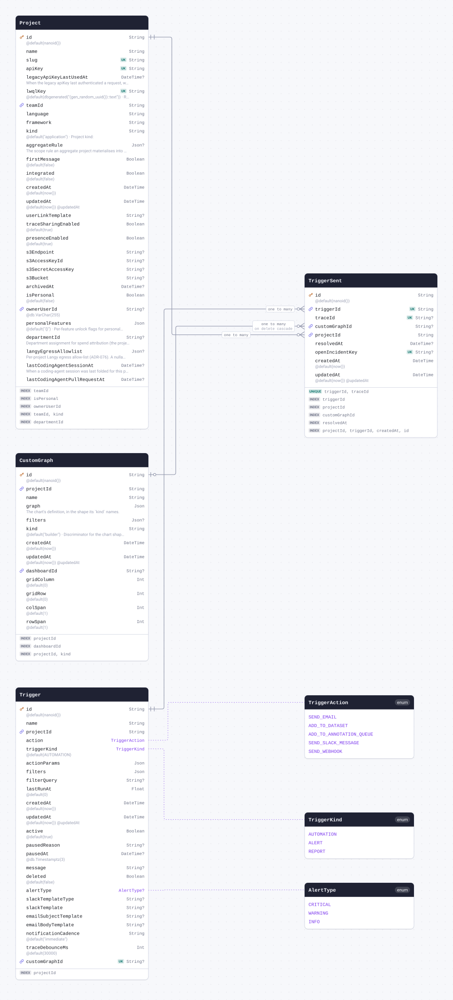

| Field             | Type       | Constraints                                 | Default              | Description |
| ----------------- | ---------- | ------------------------------------------- | -------------------- | ----------- |
| `id`              | `String`   | PK NOT NULL                                 | `nanoid()`           |             |
| `triggerId`       | `String`   | NOT NULL → [Trigger.id](#model-Trigger)     |                      |             |
| `traceId`         | `String`   | NULL                                        |                      |             |
| `customGraphId`   | `String`   | NULL → [CustomGraph.id](#model-CustomGraph) |                      |             |
| `projectId`       | `String`   | NOT NULL → [Project.id](#model-Project)     |                      |             |
| `resolvedAt`      | `DateTime` | NULL                                        |                      |             |
| `openIncidentKey` | `String`   | UNIQUE NULL                                 |                      |             |
| `createdAt`       | `DateTime` | NOT NULL                                    | `now()`              |             |
| `updatedAt`       | `DateTime` | NOT NULL                                    | `now()` `@updatedAt` |             |

#### Indexes

- `@@index([triggerId])`
- `@@index([projectId])`
- `@@index([customGraphId])`
- `@@index([resolvedAt])`
- `@@index([projectId, triggerId, createdAt, id])`
- `@@unique([triggerId, traceId])`

#### References

- `customGraphId` → [CustomGraph.id](#model-CustomGraph) (many-to-one, on delete Cascade)
- `projectId` → [Project.id](#model-Project) (many-to-one)
- `triggerId` → [Trigger.id](#model-Trigger) (many-to-one)

#### Definition

```sql
CREATE TABLE "TriggerSent" (
    "id" TEXT NOT NULL,
    "triggerId" TEXT NOT NULL,
    "traceId" TEXT,
    "customGraphId" TEXT,
    "projectId" TEXT NOT NULL,
    "resolvedAt" TIMESTAMP(3),
    "openIncidentKey" TEXT,
    "createdAt" TIMESTAMP(3) NOT NULL DEFAULT CURRENT_TIMESTAMP,
    "updatedAt" TIMESTAMP(3) NOT NULL DEFAULT CURRENT_TIMESTAMP,

    CONSTRAINT "TriggerSent_pkey" PRIMARY KEY ("id")
);

CREATE UNIQUE INDEX "TriggerSent_openIncidentKey_key" ON "TriggerSent"("openIncidentKey");

CREATE INDEX "TriggerSent_triggerId_idx" ON "TriggerSent"("triggerId");

CREATE INDEX "TriggerSent_projectId_idx" ON "TriggerSent"("projectId");

CREATE INDEX "TriggerSent_customGraphId_idx" ON "TriggerSent"("customGraphId");

CREATE INDEX "TriggerSent_resolvedAt_idx" ON "TriggerSent"("resolvedAt");

CREATE INDEX "TriggerSent_projectId_triggerId_createdAt_id_idx" ON "TriggerSent"("projectId", "triggerId", "createdAt", "id");

CREATE UNIQUE INDEX "TriggerSent_triggerId_traceId_key" ON "TriggerSent"("triggerId", "traceId");
```

<details>
<summary>Queries and their SQL</summary>

**findMany**: Every row

```ts
await prisma.triggerSent.findMany();
```

```sql
SELECT
  "public"."TriggerSent"."id",
  "public"."TriggerSent"."triggerId",
  "public"."TriggerSent"."traceId",
  "public"."TriggerSent"."customGraphId",
  "public"."TriggerSent"."projectId",
  "public"."TriggerSent"."resolvedAt",
  "public"."TriggerSent"."openIncidentKey",
  "public"."TriggerSent"."createdAt",
  "public"."TriggerSent"."updatedAt"
FROM
  "public"."TriggerSent"
WHERE
  1 = 1
OFFSET
  $1
-- params: ["0"]
```

**count**: How many rows there are

```ts
await prisma.triggerSent.count();
```

```sql
SELECT
  COUNT(*) AS "_count$_all"
FROM
  (
    SELECT
      "public"."TriggerSent"."id"
    FROM
      "public"."TriggerSent"
    WHERE
      1 = 1
    OFFSET
      $1
  ) AS "sub"
-- params: ["0"]
```

**findMany**: Every row with its relations

```ts
await prisma.triggerSent.findMany({ include: { customGraph: true, project: true, trigger: true } });
```

```sql
SELECT
  "public"."TriggerSent"."id",
  "public"."TriggerSent"."triggerId",
  "public"."TriggerSent"."traceId",
  "public"."TriggerSent"."customGraphId",
  "public"."TriggerSent"."projectId",
  "public"."TriggerSent"."resolvedAt",
  "public"."TriggerSent"."openIncidentKey",
  "public"."TriggerSent"."createdAt",
  "public"."TriggerSent"."updatedAt"
FROM
  "public"."TriggerSent"
WHERE
  1 = 1
OFFSET
  $1
-- params: ["0"]

SELECT
  "public"."CustomGraph"."id",
  "public"."CustomGraph"."projectId",
  "public"."CustomGraph"."name",
  "public"."CustomGraph"."graph",
  "public"."CustomGraph"."filters",
  "public"."CustomGraph"."kind",
  "public"."CustomGraph"."createdAt",
  "public"."CustomGraph"."updatedAt",
  "public"."CustomGraph"."dashboardId",
  "public"."CustomGraph"."gridColumn",
  "public"."CustomGraph"."gridRow",
  "public"."CustomGraph"."colSpan",
  "public"."CustomGraph"."rowSpan"
FROM
  "public"."CustomGraph"
WHERE
  "public"."CustomGraph"."id" IN ($1)
OFFSET
  $2
-- params: ["<customGraphId of the rows above>","0"]

SELECT
  "public"."Project"."id",
  "public"."Project"."name",
  "public"."Project"."slug",
  "public"."Project"."apiKey",
  "public"."Project"."legacyApiKeyLastUsedAt",
  "public"."Project"."lwqlKey",
  "public"."Project"."teamId",
  "public"."Project"."language",
  "public"."Project"."framework",
  "public"."Project"."kind",
  "public"."Project"."aggregateRule",
  "public"."Project"."firstMessage",
  "public"."Project"."integrated",
  "public"."Project"."createdAt",
  "public"."Project"."updatedAt",
  "public"."Project"."userLinkTemplate",
  "public"."Project"."traceSharingEnabled",
  "public"."Project"."presenceEnabled",
  "public"."Project"."s3Endpoint",
  "public"."Project"."s3AccessKeyId",
  "public"."Project"."s3SecretAccessKey",
  "public"."Project"."s3Bucket",
  "public"."Project"."archivedAt",
  "public"."Project"."isPersonal",
  "public"."Project"."ownerUserId",
  "public"."Project"."personalFeatures",
  "public"."Project"."departmentId",
  "public"."Project"."langyEgressAllowlist",
  "public"."Project"."lastCodingAgentSessionAt",
  "public"."Project"."lastCodingAgentPullRequestAt"
FROM
  "public"."Project"
WHERE
  "public"."Project"."id" IN ($1)
OFFSET
  $2
-- params: ["<projectId of the rows above>","0"]

SELECT
  "public"."Trigger"."id",
  "public"."Trigger"."name",
  "public"."Trigger"."projectId",
  "public"."Trigger"."action"::text,
  "public"."Trigger"."triggerKind"::text,
  "public"."Trigger"."actionParams",
  "public"."Trigger"."filters",
  "public"."Trigger"."filterQuery",
  "public"."Trigger"."lastRunAt",
  "public"."Trigger"."createdAt",
  "public"."Trigger"."updatedAt",
  "public"."Trigger"."active",
  "public"."Trigger"."pausedReason",
  "public"."Trigger"."pausedAt",
  "public"."Trigger"."message",
  "public"."Trigger"."deleted",
  "public"."Trigger"."alertType"::text,
  "public"."Trigger"."slackTemplateType",
  "public"."Trigger"."slackTemplate",
  "public"."Trigger"."emailSubjectTemplate",
  "public"."Trigger"."emailBodyTemplate",
  "public"."Trigger"."notificationCadence",
  "public"."Trigger"."traceDebounceMs",
  "public"."Trigger"."customGraphId"
FROM
  "public"."Trigger"
WHERE
  "public"."Trigger"."id" IN ($1)
OFFSET
  $2
-- params: ["<triggerId of the rows above>","0"]
```

**findUnique**: One row by what is unique to it

```ts
await prisma.triggerSent.findUnique({ where: { id: "example" } });
```

```sql
SELECT
  "public"."TriggerSent"."id",
  "public"."TriggerSent"."triggerId",
  "public"."TriggerSent"."traceId",
  "public"."TriggerSent"."customGraphId",
  "public"."TriggerSent"."projectId",
  "public"."TriggerSent"."resolvedAt",
  "public"."TriggerSent"."openIncidentKey",
  "public"."TriggerSent"."createdAt",
  "public"."TriggerSent"."updatedAt"
FROM
  "public"."TriggerSent"
WHERE
  (
    "public"."TriggerSent"."id" = $1
    AND 1 = 1
  )
LIMIT
  $2
OFFSET
  $3
-- params: ["example","1","0"]
```

**create**: Create a row

```ts
await prisma.triggerSent.create({ data: { triggerId: "example", projectId: "example" } });
```

```sql
INSERT INTO
  "public"."TriggerSent" (
    "id",
    "triggerId",
    "projectId",
    "createdAt",
    "updatedAt"
  )
VALUES
  ($1, $2, $3, $4, $5)
RETURNING
  "public"."TriggerSent"."id",
  "public"."TriggerSent"."triggerId",
  "public"."TriggerSent"."traceId",
  "public"."TriggerSent"."customGraphId",
  "public"."TriggerSent"."projectId",
  "public"."TriggerSent"."resolvedAt",
  "public"."TriggerSent"."openIncidentKey",
  "public"."TriggerSent"."createdAt",
  "public"."TriggerSent"."updatedAt"
-- params: ["<nanoid()>","example","example","<now()>","<now()>"]
```

**update**: Update a row

```ts
await prisma.triggerSent.update({ where: { id: "example" }, data: { traceId: "example" } });
```

```sql
SELECT
  "public"."TriggerSent"."id"
FROM
  "public"."TriggerSent"
WHERE
  (
    "public"."TriggerSent"."id" = $1
    AND 1 = 1
  )
LIMIT
  $2
OFFSET
  $3
-- params: ["example","1","0"]

UPDATE "public"."TriggerSent"
SET
  "traceId" = $1,
  "updatedAt" = $2
WHERE
  (
    "public"."TriggerSent"."id" IN ($3)
    AND (
      "public"."TriggerSent"."id" = $4
      AND 1 = 1
    )
  )
RETURNING
  "public"."TriggerSent"."id",
  "public"."TriggerSent"."triggerId",
  "public"."TriggerSent"."traceId",
  "public"."TriggerSent"."customGraphId",
  "public"."TriggerSent"."projectId",
  "public"."TriggerSent"."resolvedAt",
  "public"."TriggerSent"."openIncidentKey",
  "public"."TriggerSent"."createdAt",
  "public"."TriggerSent"."updatedAt"
-- params: ["example",{"prisma__type":"generatorCall","prisma__value":{"name":"now","args":[],"returnType":{"type":"DateTime"}}},"<id of the rows above>","example"]
```

**delete**: Delete a row

```ts
await prisma.triggerSent.delete({ where: { id: "example" } });
```

```sql
DELETE FROM "public"."TriggerSent"
WHERE
  (
    "public"."TriggerSent"."id" = $1
    AND 1 = 1
  )
RETURNING
  "public"."TriggerSent"."id",
  "public"."TriggerSent"."triggerId",
  "public"."TriggerSent"."traceId",
  "public"."TriggerSent"."customGraphId",
  "public"."TriggerSent"."projectId",
  "public"."TriggerSent"."resolvedAt",
  "public"."TriggerSent"."openIncidentKey",
  "public"."TriggerSent"."createdAt",
  "public"."TriggerSent"."updatedAt"
-- params: ["example"]
```

</details>

<a id="model-TriggerLatestEvaluation"></a>

### TriggerLatestEvaluation

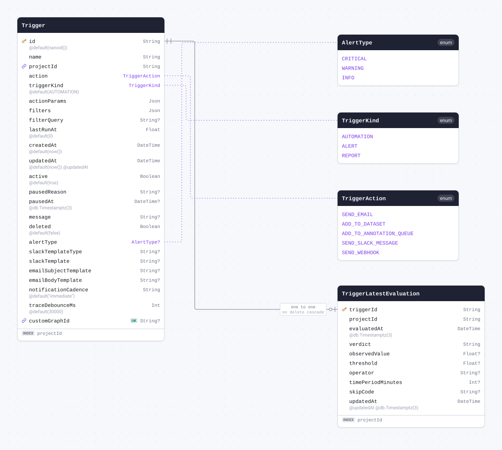

| Field               | Type                            | Constraints                                | Default      | Description |
| ------------------- | ------------------------------- | ------------------------------------------ | ------------ | ----------- |
| `triggerId`         | `String`                        | PK NOT NULL → [Trigger.id](#model-Trigger) |              |             |
| `projectId`         | `String`                        | NOT NULL                                   |              |             |
| `evaluatedAt`       | `DateTime` `@db.Timestamptz(3)` | NOT NULL                                   |              |             |
| `verdict`           | `String`                        | NOT NULL                                   |              |             |
| `observedValue`     | `Float`                         | NULL                                       |              |             |
| `threshold`         | `Float`                         | NULL                                       |              |             |
| `operator`          | `String`                        | NULL                                       |              |             |
| `timePeriodMinutes` | `Int`                           | NULL                                       |              |             |
| `skipCode`          | `String`                        | NULL                                       |              |             |
| `updatedAt`         | `DateTime` `@db.Timestamptz(3)` | NOT NULL                                   | `@updatedAt` |             |

#### Indexes

- `@@index([projectId])`

#### References

- `triggerId` → [Trigger.id](#model-Trigger) (one-to-one, on delete Cascade)

#### Definition

```sql
CREATE TABLE "TriggerLatestEvaluation" (
    "triggerId" TEXT NOT NULL,
    "projectId" TEXT NOT NULL,
    "evaluatedAt" TIMESTAMPTZ(3) NOT NULL,
    "verdict" TEXT NOT NULL,
    "observedValue" DOUBLE PRECISION,
    "threshold" DOUBLE PRECISION,
    "operator" TEXT,
    "timePeriodMinutes" INTEGER,
    "skipCode" TEXT,
    "updatedAt" TIMESTAMPTZ(3) NOT NULL,

    CONSTRAINT "TriggerLatestEvaluation_pkey" PRIMARY KEY ("triggerId")
);

CREATE INDEX "TriggerLatestEvaluation_projectId_idx" ON "TriggerLatestEvaluation"("projectId");
```

<details>
<summary>Queries and their SQL</summary>

**findMany**: Every row

```ts
await prisma.triggerLatestEvaluation.findMany();
```

```sql
SELECT
  "public"."TriggerLatestEvaluation"."triggerId",
  "public"."TriggerLatestEvaluation"."projectId",
  "public"."TriggerLatestEvaluation"."evaluatedAt",
  "public"."TriggerLatestEvaluation"."verdict",
  "public"."TriggerLatestEvaluation"."observedValue",
  "public"."TriggerLatestEvaluation"."threshold",
  "public"."TriggerLatestEvaluation"."operator",
  "public"."TriggerLatestEvaluation"."timePeriodMinutes",
  "public"."TriggerLatestEvaluation"."skipCode",
  "public"."TriggerLatestEvaluation"."updatedAt"
FROM
  "public"."TriggerLatestEvaluation"
WHERE
  1 = 1
OFFSET
  $1
-- params: ["0"]
```

**count**: How many rows there are

```ts
await prisma.triggerLatestEvaluation.count();
```

```sql
SELECT
  COUNT(*) AS "_count$_all"
FROM
  (
    SELECT
      "public"."TriggerLatestEvaluation"."triggerId"
    FROM
      "public"."TriggerLatestEvaluation"
    WHERE
      1 = 1
    OFFSET
      $1
  ) AS "sub"
-- params: ["0"]
```

**findMany**: Every row with its relations

```ts
await prisma.triggerLatestEvaluation.findMany({ include: { trigger: true } });
```

```sql
SELECT
  "public"."TriggerLatestEvaluation"."triggerId",
  "public"."TriggerLatestEvaluation"."projectId",
  "public"."TriggerLatestEvaluation"."evaluatedAt",
  "public"."TriggerLatestEvaluation"."verdict",
  "public"."TriggerLatestEvaluation"."observedValue",
  "public"."TriggerLatestEvaluation"."threshold",
  "public"."TriggerLatestEvaluation"."operator",
  "public"."TriggerLatestEvaluation"."timePeriodMinutes",
  "public"."TriggerLatestEvaluation"."skipCode",
  "public"."TriggerLatestEvaluation"."updatedAt"
FROM
  "public"."TriggerLatestEvaluation"
WHERE
  1 = 1
OFFSET
  $1
-- params: ["0"]

SELECT
  "public"."Trigger"."id",
  "public"."Trigger"."name",
  "public"."Trigger"."projectId",
  "public"."Trigger"."action"::text,
  "public"."Trigger"."triggerKind"::text,
  "public"."Trigger"."actionParams",
  "public"."Trigger"."filters",
  "public"."Trigger"."filterQuery",
  "public"."Trigger"."lastRunAt",
  "public"."Trigger"."createdAt",
  "public"."Trigger"."updatedAt",
  "public"."Trigger"."active",
  "public"."Trigger"."pausedReason",
  "public"."Trigger"."pausedAt",
  "public"."Trigger"."message",
  "public"."Trigger"."deleted",
  "public"."Trigger"."alertType"::text,
  "public"."Trigger"."slackTemplateType",
  "public"."Trigger"."slackTemplate",
  "public"."Trigger"."emailSubjectTemplate",
  "public"."Trigger"."emailBodyTemplate",
  "public"."Trigger"."notificationCadence",
  "public"."Trigger"."traceDebounceMs",
  "public"."Trigger"."customGraphId"
FROM
  "public"."Trigger"
WHERE
  "public"."Trigger"."id" IN ($1)
OFFSET
  $2
-- params: ["<triggerId of the rows above>","0"]
```

**findUnique**: One row by what is unique to it

```ts
await prisma.triggerLatestEvaluation.findUnique({ where: { triggerId: "example" } });
```

```sql
SELECT
  "public"."TriggerLatestEvaluation"."triggerId",
  "public"."TriggerLatestEvaluation"."projectId",
  "public"."TriggerLatestEvaluation"."evaluatedAt",
  "public"."TriggerLatestEvaluation"."verdict",
  "public"."TriggerLatestEvaluation"."observedValue",
  "public"."TriggerLatestEvaluation"."threshold",
  "public"."TriggerLatestEvaluation"."operator",
  "public"."TriggerLatestEvaluation"."timePeriodMinutes",
  "public"."TriggerLatestEvaluation"."skipCode",
  "public"."TriggerLatestEvaluation"."updatedAt"
FROM
  "public"."TriggerLatestEvaluation"
WHERE
  (
    "public"."TriggerLatestEvaluation"."triggerId" = $1
    AND 1 = 1
  )
LIMIT
  $2
OFFSET
  $3
-- params: ["example","1","0"]
```

**create**: Create a row

```ts
await prisma.triggerLatestEvaluation.create({
  data: {
    triggerId: "example",
    projectId: "example",
    evaluatedAt: new Date("2026-01-01T00:00:00.000Z"),
    verdict: "example",
  },
});
```

```sql
INSERT INTO
  "public"."TriggerLatestEvaluation" (
    "triggerId",
    "projectId",
    "evaluatedAt",
    "verdict",
    "updatedAt"
  )
VALUES
  ($1, $2, $3, $4, $5)
RETURNING
  "public"."TriggerLatestEvaluation"."triggerId",
  "public"."TriggerLatestEvaluation"."projectId",
  "public"."TriggerLatestEvaluation"."evaluatedAt",
  "public"."TriggerLatestEvaluation"."verdict",
  "public"."TriggerLatestEvaluation"."observedValue",
  "public"."TriggerLatestEvaluation"."threshold",
  "public"."TriggerLatestEvaluation"."operator",
  "public"."TriggerLatestEvaluation"."timePeriodMinutes",
  "public"."TriggerLatestEvaluation"."skipCode",
  "public"."TriggerLatestEvaluation"."updatedAt"
-- params: ["example","example","2026-01-01T00:00:00.000Z","example","<now()>"]
```

**update**: Update a row

```ts
await prisma.triggerLatestEvaluation.update({
  where: { triggerId: "example" },
  data: { projectId: "example" },
});
```

```sql
SELECT
  "public"."TriggerLatestEvaluation"."triggerId"
FROM
  "public"."TriggerLatestEvaluation"
WHERE
  (
    "public"."TriggerLatestEvaluation"."triggerId" = $1
    AND 1 = 1
  )
LIMIT
  $2
OFFSET
  $3
-- params: ["example","1","0"]

UPDATE "public"."TriggerLatestEvaluation"
SET
  "projectId" = $1,
  "updatedAt" = $2
WHERE
  (
    "public"."TriggerLatestEvaluation"."triggerId" IN ($3)
    AND (
      "public"."TriggerLatestEvaluation"."triggerId" = $4
      AND 1 = 1
    )
  )
RETURNING
  "public"."TriggerLatestEvaluation"."triggerId",
  "public"."TriggerLatestEvaluation"."projectId",
  "public"."TriggerLatestEvaluation"."evaluatedAt",
  "public"."TriggerLatestEvaluation"."verdict",
  "public"."TriggerLatestEvaluation"."observedValue",
  "public"."TriggerLatestEvaluation"."threshold",
  "public"."TriggerLatestEvaluation"."operator",
  "public"."TriggerLatestEvaluation"."timePeriodMinutes",
  "public"."TriggerLatestEvaluation"."skipCode",
  "public"."TriggerLatestEvaluation"."updatedAt"
-- params: ["example",{"prisma__type":"generatorCall","prisma__value":{"name":"now","args":[],"returnType":{"type":"DateTime"}}},"<triggerId of the rows above>","example"]
```

**delete**: Delete a row

```ts
await prisma.triggerLatestEvaluation.delete({ where: { triggerId: "example" } });
```

```sql
DELETE FROM "public"."TriggerLatestEvaluation"
WHERE
  (
    "public"."TriggerLatestEvaluation"."triggerId" = $1
    AND 1 = 1
  )
RETURNING
  "public"."TriggerLatestEvaluation"."triggerId",
  "public"."TriggerLatestEvaluation"."projectId",
  "public"."TriggerLatestEvaluation"."evaluatedAt",
  "public"."TriggerLatestEvaluation"."verdict",
  "public"."TriggerLatestEvaluation"."observedValue",
  "public"."TriggerLatestEvaluation"."threshold",
  "public"."TriggerLatestEvaluation"."operator",
  "public"."TriggerLatestEvaluation"."timePeriodMinutes",
  "public"."TriggerLatestEvaluation"."skipCode",
  "public"."TriggerLatestEvaluation"."updatedAt"
-- params: ["example"]
```

</details>

<a id="model-EmailSuppression"></a>

### EmailSuppression

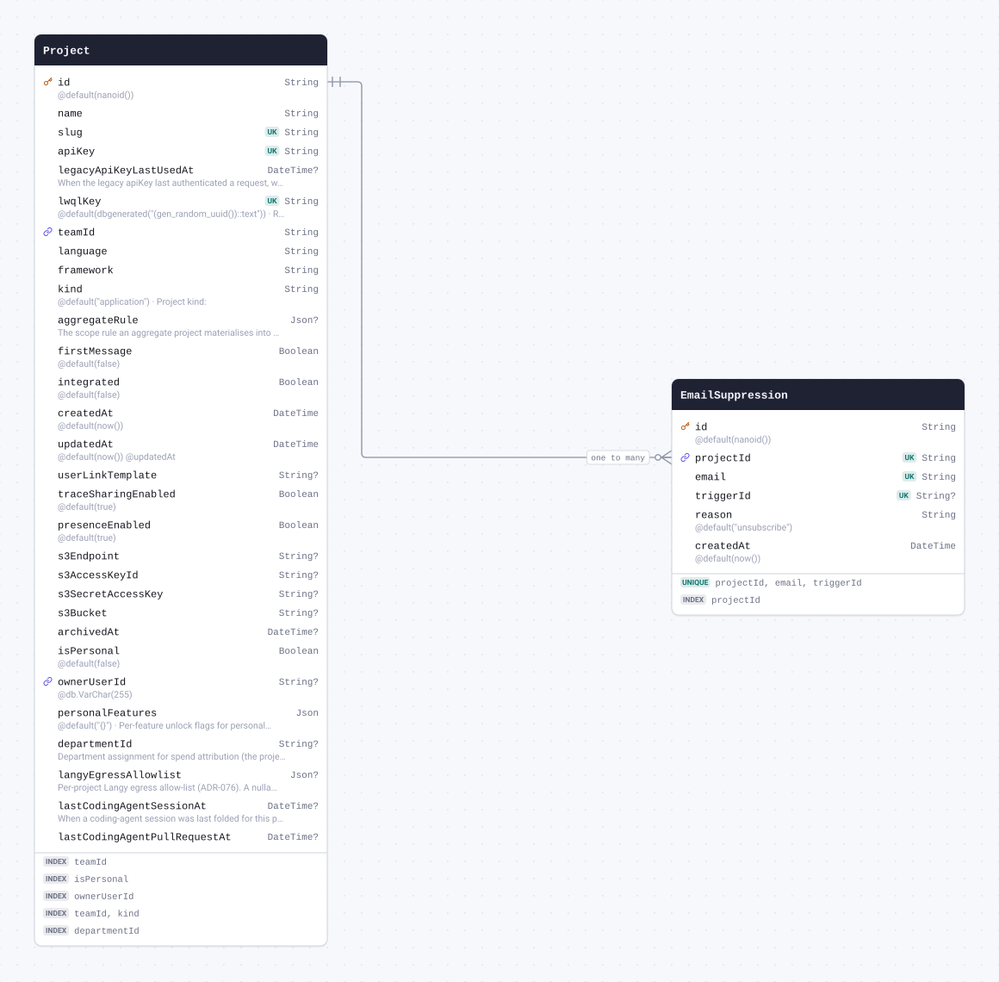

| Field       | Type       | Constraints                             | Default         | Description |
| ----------- | ---------- | --------------------------------------- | --------------- | ----------- |
| `id`        | `String`   | PK NOT NULL                             | `nanoid()`      |             |
| `projectId` | `String`   | NOT NULL → [Project.id](#model-Project) |                 |             |
| `email`     | `String`   | NOT NULL                                |                 |             |
| `triggerId` | `String`   | NULL                                    |                 |             |
| `reason`    | `String`   | NOT NULL                                | `"unsubscribe"` |             |
| `createdAt` | `DateTime` | NOT NULL                                | `now()`         |             |

#### Indexes

- `@@index([projectId])`
- `@@unique([projectId, email, triggerId])`

#### References

- `projectId` → [Project.id](#model-Project) (many-to-one)

#### Definition

```sql
CREATE TABLE "EmailSuppression" (
    "id" TEXT NOT NULL,
    "projectId" TEXT NOT NULL,
    "email" TEXT NOT NULL,
    "triggerId" TEXT,
    "reason" TEXT NOT NULL DEFAULT 'unsubscribe',
    "createdAt" TIMESTAMP(3) NOT NULL DEFAULT CURRENT_TIMESTAMP,

    CONSTRAINT "EmailSuppression_pkey" PRIMARY KEY ("id")
);

CREATE INDEX "EmailSuppression_projectId_idx" ON "EmailSuppression"("projectId");

CREATE UNIQUE INDEX "EmailSuppression_projectId_email_triggerId_key" ON "EmailSuppression"("projectId", "email", "triggerId");
```

<details>
<summary>Queries and their SQL</summary>

**findMany**: Every row

```ts
await prisma.emailSuppression.findMany();
```

```sql
SELECT
  "public"."EmailSuppression"."id",
  "public"."EmailSuppression"."projectId",
  "public"."EmailSuppression"."email",
  "public"."EmailSuppression"."triggerId",
  "public"."EmailSuppression"."reason",
  "public"."EmailSuppression"."createdAt"
FROM
  "public"."EmailSuppression"
WHERE
  1 = 1
OFFSET
  $1
-- params: ["0"]
```

**count**: How many rows there are

```ts
await prisma.emailSuppression.count();
```

```sql
SELECT
  COUNT(*) AS "_count$_all"
FROM
  (
    SELECT
      "public"."EmailSuppression"."id"
    FROM
      "public"."EmailSuppression"
    WHERE
      1 = 1
    OFFSET
      $1
  ) AS "sub"
-- params: ["0"]
```

**findMany**: Every row with its relations

```ts
await prisma.emailSuppression.findMany({ include: { project: true } });
```

```sql
SELECT
  "public"."EmailSuppression"."id",
  "public"."EmailSuppression"."projectId",
  "public"."EmailSuppression"."email",
  "public"."EmailSuppression"."triggerId",
  "public"."EmailSuppression"."reason",
  "public"."EmailSuppression"."createdAt"
FROM
  "public"."EmailSuppression"
WHERE
  1 = 1
OFFSET
  $1
-- params: ["0"]

SELECT
  "public"."Project"."id",
  "public"."Project"."name",
  "public"."Project"."slug",
  "public"."Project"."apiKey",
  "public"."Project"."legacyApiKeyLastUsedAt",
  "public"."Project"."lwqlKey",
  "public"."Project"."teamId",
  "public"."Project"."language",
  "public"."Project"."framework",
  "public"."Project"."kind",
  "public"."Project"."aggregateRule",
  "public"."Project"."firstMessage",
  "public"."Project"."integrated",
  "public"."Project"."createdAt",
  "public"."Project"."updatedAt",
  "public"."Project"."userLinkTemplate",
  "public"."Project"."traceSharingEnabled",
  "public"."Project"."presenceEnabled",
  "public"."Project"."s3Endpoint",
  "public"."Project"."s3AccessKeyId",
  "public"."Project"."s3SecretAccessKey",
  "public"."Project"."s3Bucket",
  "public"."Project"."archivedAt",
  "public"."Project"."isPersonal",
  "public"."Project"."ownerUserId",
  "public"."Project"."personalFeatures",
  "public"."Project"."departmentId",
  "public"."Project"."langyEgressAllowlist",
  "public"."Project"."lastCodingAgentSessionAt",
  "public"."Project"."lastCodingAgentPullRequestAt"
FROM
  "public"."Project"
WHERE
  "public"."Project"."id" IN ($1)
OFFSET
  $2
-- params: ["<projectId of the rows above>","0"]
```

**findUnique**: One row by what is unique to it

```ts
await prisma.emailSuppression.findUnique({ where: { id: "example" } });
```

```sql
SELECT
  "public"."EmailSuppression"."id",
  "public"."EmailSuppression"."projectId",
  "public"."EmailSuppression"."email",
  "public"."EmailSuppression"."triggerId",
  "public"."EmailSuppression"."reason",
  "public"."EmailSuppression"."createdAt"
FROM
  "public"."EmailSuppression"
WHERE
  (
    "public"."EmailSuppression"."id" = $1
    AND 1 = 1
  )
LIMIT
  $2
OFFSET
  $3
-- params: ["example","1","0"]
```

**create**: Create a row

```ts
await prisma.emailSuppression.create({ data: { projectId: "example", email: "example" } });
```

```sql
INSERT INTO
  "public"."EmailSuppression" ("id", "projectId", "email", "reason", "createdAt")
VALUES
  ($1, $2, $3, $4, $5)
RETURNING
  "public"."EmailSuppression"."id",
  "public"."EmailSuppression"."projectId",
  "public"."EmailSuppression"."email",
  "public"."EmailSuppression"."triggerId",
  "public"."EmailSuppression"."reason",
  "public"."EmailSuppression"."createdAt"
-- params: ["<nanoid()>","example","example","unsubscribe","<now()>"]
```

**update**: Update a row

```ts
await prisma.emailSuppression.update({ where: { id: "example" }, data: { email: "example" } });
```

```sql
SELECT
  "public"."EmailSuppression"."id"
FROM
  "public"."EmailSuppression"
WHERE
  (
    "public"."EmailSuppression"."id" = $1
    AND 1 = 1
  )
LIMIT
  $2
OFFSET
  $3
-- params: ["example","1","0"]

UPDATE "public"."EmailSuppression"
SET
  "email" = $1
WHERE
  (
    "public"."EmailSuppression"."id" IN ($2)
    AND (
      "public"."EmailSuppression"."id" = $3
      AND 1 = 1
    )
  )
RETURNING
  "public"."EmailSuppression"."id",
  "public"."EmailSuppression"."projectId",
  "public"."EmailSuppression"."email",
  "public"."EmailSuppression"."triggerId",
  "public"."EmailSuppression"."reason",
  "public"."EmailSuppression"."createdAt"
-- params: ["example","<id of the rows above>","example"]
```

**delete**: Delete a row

```ts
await prisma.emailSuppression.delete({ where: { id: "example" } });
```

```sql
DELETE FROM "public"."EmailSuppression"
WHERE
  (
    "public"."EmailSuppression"."id" = $1
    AND 1 = 1
  )
RETURNING
  "public"."EmailSuppression"."id",
  "public"."EmailSuppression"."projectId",
  "public"."EmailSuppression"."email",
  "public"."EmailSuppression"."triggerId",
  "public"."EmailSuppression"."reason",
  "public"."EmailSuppression"."createdAt"
-- params: ["example"]
```

</details>

<a id="model-AnnotationScore"></a>

### AnnotationScore

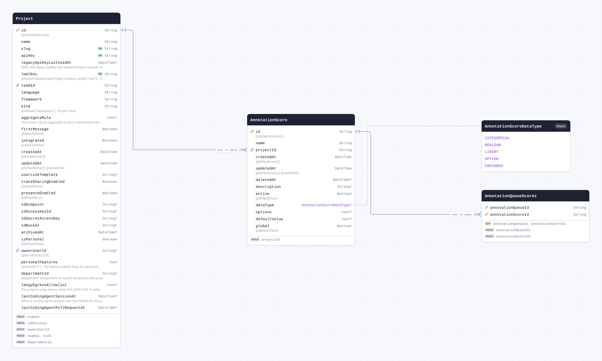

| Field          | Type                                                       | Constraints                             | Default              | Description |
| -------------- | ---------------------------------------------------------- | --------------------------------------- | -------------------- | ----------- |
| `id`           | `String`                                                   | PK NOT NULL                             | `nanoid()`           |             |
| `name`         | `String`                                                   | NOT NULL                                |                      |             |
| `projectId`    | `String`                                                   | NOT NULL → [Project.id](#model-Project) |                      |             |
| `createdAt`    | `DateTime`                                                 | NOT NULL                                | `now()`              |             |
| `updatedAt`    | `DateTime`                                                 | NOT NULL                                | `now()` `@updatedAt` |             |
| `deletedAt`    | `DateTime`                                                 | NULL                                    |                      |             |
| `description`  | `String`                                                   | NULL                                    |                      |             |
| `active`       | `Boolean`                                                  | NOT NULL                                | `true`               |             |
| `dataType`     | [`AnnotationScoreDataType`](#enum-AnnotationScoreDataType) | NULL                                    |                      |             |
| `options`      | `Json`                                                     | NULL                                    |                      |             |
| `defaultValue` | `Json`                                                     | NULL                                    |                      |             |
| `global`       | `Boolean`                                                  | NOT NULL                                | `false`              |             |

#### Indexes

- `@@index([projectId])`

#### References

- `projectId` → [Project.id](#model-Project) (many-to-one)

#### Referenced by

- `id` ← [AnnotationQueueScores.annotationScoreId](#model-AnnotationQueueScores) (one-to-many)

#### Definition

```sql
CREATE TABLE "AnnotationScore" (
    "id" TEXT NOT NULL,
    "name" TEXT NOT NULL,
    "projectId" TEXT NOT NULL,
    "createdAt" TIMESTAMP(3) NOT NULL DEFAULT CURRENT_TIMESTAMP,
    "updatedAt" TIMESTAMP(3) NOT NULL DEFAULT CURRENT_TIMESTAMP,
    "deletedAt" TIMESTAMP(3),
    "description" TEXT,
    "active" BOOLEAN NOT NULL DEFAULT true,
    "dataType" "AnnotationScoreDataType",
    "options" JSONB,
    "defaultValue" JSONB,
    "global" BOOLEAN NOT NULL DEFAULT false,

    CONSTRAINT "AnnotationScore_pkey" PRIMARY KEY ("id")
);

CREATE INDEX "AnnotationScore_projectId_idx" ON "AnnotationScore"("projectId");
```

<details>
<summary>Queries and their SQL</summary>

**findMany**: Every row

```ts
await prisma.annotationScore.findMany();
```

```sql
SELECT
  "public"."AnnotationScore"."id",
  "public"."AnnotationScore"."name",
  "public"."AnnotationScore"."projectId",
  "public"."AnnotationScore"."createdAt",
  "public"."AnnotationScore"."updatedAt",
  "public"."AnnotationScore"."deletedAt",
  "public"."AnnotationScore"."description",
  "public"."AnnotationScore"."active",
  "public"."AnnotationScore"."dataType"::text,
  "public"."AnnotationScore"."options",
  "public"."AnnotationScore"."defaultValue",
  "public"."AnnotationScore"."global"
FROM
  "public"."AnnotationScore"
WHERE
  1 = 1
OFFSET
  $1
-- params: ["0"]
```

**count**: How many rows there are

```ts
await prisma.annotationScore.count();
```

```sql
SELECT
  COUNT(*) AS "_count$_all"
FROM
  (
    SELECT
      "public"."AnnotationScore"."id"
    FROM
      "public"."AnnotationScore"
    WHERE
      1 = 1
    OFFSET
      $1
  ) AS "sub"
-- params: ["0"]
```

**findMany**: Every row with its relations

```ts
await prisma.annotationScore.findMany({ include: { project: true, AnnotationQueueScores: true } });
```

```sql
SELECT
  "public"."AnnotationScore"."id",
  "public"."AnnotationScore"."name",
  "public"."AnnotationScore"."projectId",
  "public"."AnnotationScore"."createdAt",
  "public"."AnnotationScore"."updatedAt",
  "public"."AnnotationScore"."deletedAt",
  "public"."AnnotationScore"."description",
  "public"."AnnotationScore"."active",
  "public"."AnnotationScore"."dataType"::text,
  "public"."AnnotationScore"."options",
  "public"."AnnotationScore"."defaultValue",
  "public"."AnnotationScore"."global"
FROM
  "public"."AnnotationScore"
WHERE
  1 = 1
OFFSET
  $1
-- params: ["0"]

SELECT
  "public"."Project"."id",
  "public"."Project"."name",
  "public"."Project"."slug",
  "public"."Project"."apiKey",
  "public"."Project"."legacyApiKeyLastUsedAt",
  "public"."Project"."lwqlKey",
  "public"."Project"."teamId",
  "public"."Project"."language",
  "public"."Project"."framework",
  "public"."Project"."kind",
  "public"."Project"."aggregateRule",
  "public"."Project"."firstMessage",
  "public"."Project"."integrated",
  "public"."Project"."createdAt",
  "public"."Project"."updatedAt",
  "public"."Project"."userLinkTemplate",
  "public"."Project"."traceSharingEnabled",
  "public"."Project"."presenceEnabled",
  "public"."Project"."s3Endpoint",
  "public"."Project"."s3AccessKeyId",
  "public"."Project"."s3SecretAccessKey",
  "public"."Project"."s3Bucket",
  "public"."Project"."archivedAt",
  "public"."Project"."isPersonal",
  "public"."Project"."ownerUserId",
  "public"."Project"."personalFeatures",
  "public"."Project"."departmentId",
  "public"."Project"."langyEgressAllowlist",
  "public"."Project"."lastCodingAgentSessionAt",
  "public"."Project"."lastCodingAgentPullRequestAt"
FROM
  "public"."Project"
WHERE
  "public"."Project"."id" IN ($1)
OFFSET
  $2
-- params: ["<projectId of the rows above>","0"]

SELECT
  "public"."AnnotationQueueScores"."annotationQueueId",
  "public"."AnnotationQueueScores"."annotationScoreId"
FROM
  "public"."AnnotationQueueScores"
WHERE
  "public"."AnnotationQueueScores"."annotationScoreId" IN ($1)
OFFSET
  $2
-- params: ["<id of the rows above>","0"]
```

**findUnique**: One row by what is unique to it

```ts
await prisma.annotationScore.findUnique({ where: { id: "example" } });
```

```sql
SELECT
  "public"."AnnotationScore"."id",
  "public"."AnnotationScore"."name",
  "public"."AnnotationScore"."projectId",
  "public"."AnnotationScore"."createdAt",
  "public"."AnnotationScore"."updatedAt",
  "public"."AnnotationScore"."deletedAt",
  "public"."AnnotationScore"."description",
  "public"."AnnotationScore"."active",
  "public"."AnnotationScore"."dataType"::text,
  "public"."AnnotationScore"."options",
  "public"."AnnotationScore"."defaultValue",
  "public"."AnnotationScore"."global"
FROM
  "public"."AnnotationScore"
WHERE
  (
    "public"."AnnotationScore"."id" = $1
    AND 1 = 1
  )
LIMIT
  $2
OFFSET
  $3
-- params: ["example","1","0"]
```

**create**: Create a row

```ts
await prisma.annotationScore.create({ data: { name: "example", projectId: "example" } });
```

```sql
INSERT INTO
  "public"."AnnotationScore" (
    "id",
    "name",
    "projectId",
    "createdAt",
    "updatedAt",
    "active",
    "global"
  )
VALUES
  ($1, $2, $3, $4, $5, $6, $7)
RETURNING
  "public"."AnnotationScore"."id",
  "public"."AnnotationScore"."name",
  "public"."AnnotationScore"."projectId",
  "public"."AnnotationScore"."createdAt",
  "public"."AnnotationScore"."updatedAt",
  "public"."AnnotationScore"."deletedAt",
  "public"."AnnotationScore"."description",
  "public"."AnnotationScore"."active",
  "public"."AnnotationScore"."dataType"::text,
  "public"."AnnotationScore"."options",
  "public"."AnnotationScore"."defaultValue",
  "public"."AnnotationScore"."global"
-- params: ["<nanoid()>","example","example","<now()>","<now()>",true,false]
```

**update**: Update a row

```ts
await prisma.annotationScore.update({ where: { id: "example" }, data: { name: "example" } });
```

```sql
SELECT
  "public"."AnnotationScore"."id"
FROM
  "public"."AnnotationScore"
WHERE
  (
    "public"."AnnotationScore"."id" = $1
    AND 1 = 1
  )
LIMIT
  $2
OFFSET
  $3
-- params: ["example","1","0"]

UPDATE "public"."AnnotationScore"
SET
  "name" = $1,
  "updatedAt" = $2
WHERE
  (
    "public"."AnnotationScore"."id" IN ($3)
    AND (
      "public"."AnnotationScore"."id" = $4
      AND 1 = 1
    )
  )
RETURNING
  "public"."AnnotationScore"."id",
  "public"."AnnotationScore"."name",
  "public"."AnnotationScore"."projectId",
  "public"."AnnotationScore"."createdAt",
  "public"."AnnotationScore"."updatedAt",
  "public"."AnnotationScore"."deletedAt",
  "public"."AnnotationScore"."description",
  "public"."AnnotationScore"."active",
  "public"."AnnotationScore"."dataType"::text,
  "public"."AnnotationScore"."options",
  "public"."AnnotationScore"."defaultValue",
  "public"."AnnotationScore"."global"
-- params: ["example",{"prisma__type":"generatorCall","prisma__value":{"name":"now","args":[],"returnType":{"type":"DateTime"}}},"<id of the rows above>","example"]
```

**delete**: Delete a row

```ts
await prisma.annotationScore.delete({ where: { id: "example" } });
```

```sql
DELETE FROM "public"."AnnotationScore"
WHERE
  (
    "public"."AnnotationScore"."id" = $1
    AND 1 = 1
  )
RETURNING
  "public"."AnnotationScore"."id",
  "public"."AnnotationScore"."name",
  "public"."AnnotationScore"."projectId",
  "public"."AnnotationScore"."createdAt",
  "public"."AnnotationScore"."updatedAt",
  "public"."AnnotationScore"."deletedAt",
  "public"."AnnotationScore"."description",
  "public"."AnnotationScore"."active",
  "public"."AnnotationScore"."dataType"::text,
  "public"."AnnotationScore"."options",
  "public"."AnnotationScore"."defaultValue",
  "public"."AnnotationScore"."global"
-- params: ["example"]

SELECT
  "public"."AnnotationQueueScores"."annotationQueueId",
  "public"."AnnotationQueueScores"."annotationScoreId"
FROM
  "public"."AnnotationQueueScores"
WHERE
  (
    1 = 1
    AND "public"."AnnotationQueueScores"."annotationScoreId" IN ($1)
  )
OFFSET
  $2
-- params: ["<id of the rows above>","0"]
```

</details>

<a id="model-AnnotationQueue"></a>

### AnnotationQueue

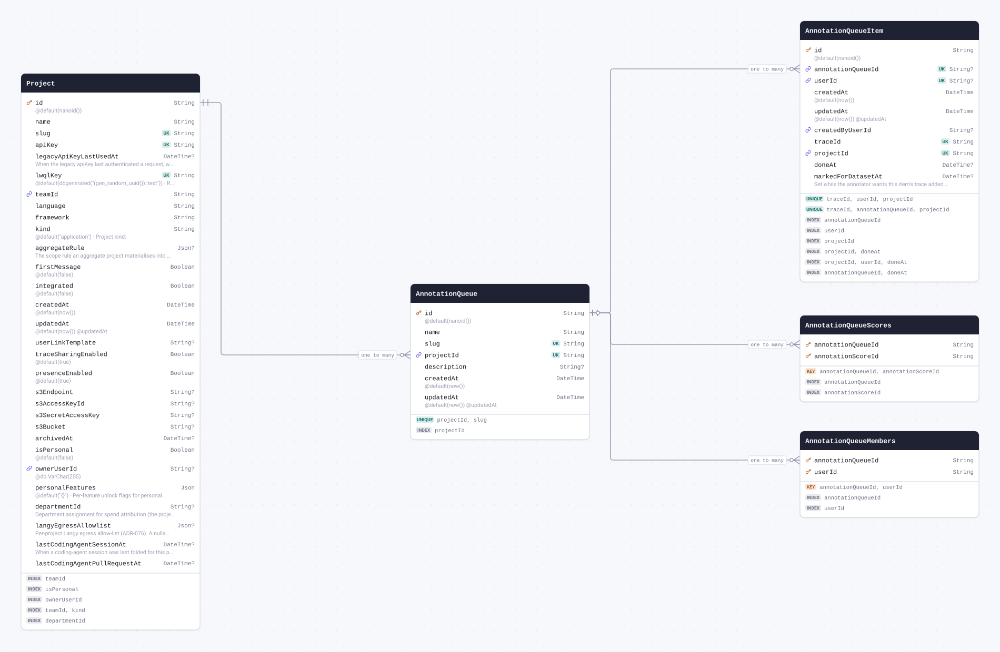

| Field         | Type       | Constraints                             | Default              | Description |
| ------------- | ---------- | --------------------------------------- | -------------------- | ----------- |
| `id`          | `String`   | PK NOT NULL                             | `nanoid()`           |             |
| `name`        | `String`   | NOT NULL                                |                      |             |
| `slug`        | `String`   | NOT NULL                                |                      |             |
| `projectId`   | `String`   | NOT NULL → [Project.id](#model-Project) |                      |             |
| `description` | `String`   | NULL                                    |                      |             |
| `createdAt`   | `DateTime` | NOT NULL                                | `now()`              |             |
| `updatedAt`   | `DateTime` | NOT NULL                                | `now()` `@updatedAt` |             |

#### Indexes

- `@@index([projectId])`
- `@@unique([projectId, slug])`

#### References

- `projectId` → [Project.id](#model-Project) (many-to-one)

#### Referenced by

- `id` ← [AnnotationQueueMembers.annotationQueueId](#model-AnnotationQueueMembers) (one-to-many)
- `id` ← [AnnotationQueueScores.annotationQueueId](#model-AnnotationQueueScores) (one-to-many)
- `id` ← [AnnotationQueueItem.annotationQueueId](#model-AnnotationQueueItem) (one-to-many)

#### Definition

```sql
CREATE TABLE "AnnotationQueue" (
    "id" TEXT NOT NULL,
    "name" TEXT NOT NULL,
    "slug" TEXT NOT NULL,
    "projectId" TEXT NOT NULL,
    "description" TEXT,
    "createdAt" TIMESTAMP(3) NOT NULL DEFAULT CURRENT_TIMESTAMP,
    "updatedAt" TIMESTAMP(3) NOT NULL DEFAULT CURRENT_TIMESTAMP,

    CONSTRAINT "AnnotationQueue_pkey" PRIMARY KEY ("id")
);

CREATE INDEX "AnnotationQueue_projectId_idx" ON "AnnotationQueue"("projectId");

CREATE UNIQUE INDEX "AnnotationQueue_projectId_slug_key" ON "AnnotationQueue"("projectId", "slug");
```

<details>
<summary>Queries and their SQL</summary>

**findMany**: Every row

```ts
await prisma.annotationQueue.findMany();
```

```sql
SELECT
  "public"."AnnotationQueue"."id",
  "public"."AnnotationQueue"."name",
  "public"."AnnotationQueue"."slug",
  "public"."AnnotationQueue"."projectId",
  "public"."AnnotationQueue"."description",
  "public"."AnnotationQueue"."createdAt",
  "public"."AnnotationQueue"."updatedAt"
FROM
  "public"."AnnotationQueue"
WHERE
  1 = 1
OFFSET
  $1
-- params: ["0"]
```

**count**: How many rows there are

```ts
await prisma.annotationQueue.count();
```

```sql
SELECT
  COUNT(*) AS "_count$_all"
FROM
  (
    SELECT
      "public"."AnnotationQueue"."id"
    FROM
      "public"."AnnotationQueue"
    WHERE
      1 = 1
    OFFSET
      $1
  ) AS "sub"
-- params: ["0"]
```

**findMany**: Every row with its relations

```ts
await prisma.annotationQueue.findMany({
  include: {
    project: true,
    members: true,
    AnnotationQueueScores: true,
    AnnotationQueueItems: true,
  },
});
```

```sql
SELECT
  "public"."AnnotationQueue"."id",
  "public"."AnnotationQueue"."name",
  "public"."AnnotationQueue"."slug",
  "public"."AnnotationQueue"."projectId",
  "public"."AnnotationQueue"."description",
  "public"."AnnotationQueue"."createdAt",
  "public"."AnnotationQueue"."updatedAt"
FROM
  "public"."AnnotationQueue"
WHERE
  1 = 1
OFFSET
  $1
-- params: ["0"]

SELECT
  "public"."Project"."id",
  "public"."Project"."name",
  "public"."Project"."slug",
  "public"."Project"."apiKey",
  "public"."Project"."legacyApiKeyLastUsedAt",
  "public"."Project"."lwqlKey",
  "public"."Project"."teamId",
  "public"."Project"."language",
  "public"."Project"."framework",
  "public"."Project"."kind",
  "public"."Project"."aggregateRule",
  "public"."Project"."firstMessage",
  "public"."Project"."integrated",
  "public"."Project"."createdAt",
  "public"."Project"."updatedAt",
  "public"."Project"."userLinkTemplate",
  "public"."Project"."traceSharingEnabled",
  "public"."Project"."presenceEnabled",
  "public"."Project"."s3Endpoint",
  "public"."Project"."s3AccessKeyId",
  "public"."Project"."s3SecretAccessKey",
  "public"."Project"."s3Bucket",
  "public"."Project"."archivedAt",
  "public"."Project"."isPersonal",
  "public"."Project"."ownerUserId",
  "public"."Project"."personalFeatures",
  "public"."Project"."departmentId",
  "public"."Project"."langyEgressAllowlist",
  "public"."Project"."lastCodingAgentSessionAt",
  "public"."Project"."lastCodingAgentPullRequestAt"
FROM
  "public"."Project"
WHERE
  "public"."Project"."id" IN ($1)
OFFSET
  $2
-- params: ["<projectId of the rows above>","0"]

SELECT
  "public"."AnnotationQueueMembers"."annotationQueueId",
  "public"."AnnotationQueueMembers"."userId"
FROM
  "public"."AnnotationQueueMembers"
WHERE
  "public"."AnnotationQueueMembers"."annotationQueueId" IN ($1)
OFFSET
  $2
-- params: ["<id of the rows above>","0"]

SELECT
  "public"."AnnotationQueueScores"."annotationQueueId",
  "public"."AnnotationQueueScores"."annotationScoreId"
FROM
  "public"."AnnotationQueueScores"
WHERE
  "public"."AnnotationQueueScores"."annotationQueueId" IN ($1)
OFFSET
  $2
-- params: ["<id of the rows above>","0"]

SELECT
  "public"."AnnotationQueueItem"."id",
  "public"."AnnotationQueueItem"."annotationQueueId",
  "public"."AnnotationQueueItem"."userId",
  "public"."AnnotationQueueItem"."createdAt",
  "public"."AnnotationQueueItem"."updatedAt",
  "public"."AnnotationQueueItem"."createdByUserId",
  "public"."AnnotationQueueItem"."traceId",
  "public"."AnnotationQueueItem"."projectId",
  "public"."AnnotationQueueItem"."doneAt",
  "public"."AnnotationQueueItem"."markedForDatasetAt"
FROM
  "public"."AnnotationQueueItem"
WHERE
  "public"."AnnotationQueueItem"."annotationQueueId" IN ($1)
OFFSET
  $2
-- params: ["<id of the rows above>","0"]
```

**findUnique**: One row by what is unique to it

```ts
await prisma.annotationQueue.findUnique({ where: { id: "example" } });
```

```sql
SELECT
  "public"."AnnotationQueue"."id",
  "public"."AnnotationQueue"."name",
  "public"."AnnotationQueue"."slug",
  "public"."AnnotationQueue"."projectId",
  "public"."AnnotationQueue"."description",
  "public"."AnnotationQueue"."createdAt",
  "public"."AnnotationQueue"."updatedAt"
FROM
  "public"."AnnotationQueue"
WHERE
  (
    "public"."AnnotationQueue"."id" = $1
    AND 1 = 1
  )
LIMIT
  $2
OFFSET
  $3
-- params: ["example","1","0"]
```

**create**: Create a row

```ts
await prisma.annotationQueue.create({
  data: { name: "example", slug: "example", projectId: "example" },
});
```

```sql
INSERT INTO
  "public"."AnnotationQueue" (
    "id",
    "name",
    "slug",
    "projectId",
    "createdAt",
    "updatedAt"
  )
VALUES
  ($1, $2, $3, $4, $5, $6)
RETURNING
  "public"."AnnotationQueue"."id",
  "public"."AnnotationQueue"."name",
  "public"."AnnotationQueue"."slug",
  "public"."AnnotationQueue"."projectId",
  "public"."AnnotationQueue"."description",
  "public"."AnnotationQueue"."createdAt",
  "public"."AnnotationQueue"."updatedAt"
-- params: ["<nanoid()>","example","example","example","<now()>","<now()>"]
```

**update**: Update a row

```ts
await prisma.annotationQueue.update({ where: { id: "example" }, data: { name: "example" } });
```

```sql
SELECT
  "public"."AnnotationQueue"."id"
FROM
  "public"."AnnotationQueue"
WHERE
  (
    "public"."AnnotationQueue"."id" = $1
    AND 1 = 1
  )
LIMIT
  $2
OFFSET
  $3
-- params: ["example","1","0"]

UPDATE "public"."AnnotationQueue"
SET
  "name" = $1,
  "updatedAt" = $2
WHERE
  (
    "public"."AnnotationQueue"."id" IN ($3)
    AND (
      "public"."AnnotationQueue"."id" = $4
      AND 1 = 1
    )
  )
RETURNING
  "public"."AnnotationQueue"."id",
  "public"."AnnotationQueue"."name",
  "public"."AnnotationQueue"."slug",
  "public"."AnnotationQueue"."projectId",
  "public"."AnnotationQueue"."description",
  "public"."AnnotationQueue"."createdAt",
  "public"."AnnotationQueue"."updatedAt"
-- params: ["example",{"prisma__type":"generatorCall","prisma__value":{"name":"now","args":[],"returnType":{"type":"DateTime"}}},"<id of the rows above>","example"]
```

**delete**: Delete a row

```ts
await prisma.annotationQueue.delete({ where: { id: "example" } });
```

```sql
DELETE FROM "public"."AnnotationQueue"
WHERE
  (
    "public"."AnnotationQueue"."id" = $1
    AND 1 = 1
  )
RETURNING
  "public"."AnnotationQueue"."id",
  "public"."AnnotationQueue"."name",
  "public"."AnnotationQueue"."slug",
  "public"."AnnotationQueue"."projectId",
  "public"."AnnotationQueue"."description",
  "public"."AnnotationQueue"."createdAt",
  "public"."AnnotationQueue"."updatedAt"
-- params: ["example"]

SELECT
  "public"."AnnotationQueueMembers"."annotationQueueId",
  "public"."AnnotationQueueMembers"."userId"
FROM
  "public"."AnnotationQueueMembers"
WHERE
  (
    1 = 1
    AND "public"."AnnotationQueueMembers"."annotationQueueId" IN ($1)
  )
OFFSET
  $2
-- params: ["<id of the rows above>","0"]

SELECT
  "public"."AnnotationQueueScores"."annotationQueueId",
  "public"."AnnotationQueueScores"."annotationScoreId"
FROM
  "public"."AnnotationQueueScores"
WHERE
  (
    1 = 1
    AND "public"."AnnotationQueueScores"."annotationQueueId" IN ($1)
  )
OFFSET
  $2
-- params: ["<id of the rows above>","0"]

SELECT
  "public"."AnnotationQueueItem"."id",
  "public"."AnnotationQueueItem"."annotationQueueId"
FROM
  "public"."AnnotationQueueItem"
WHERE
  (
    1 = 1
    AND "public"."AnnotationQueueItem"."annotationQueueId" IN ($1)
  )
OFFSET
  $2
-- params: ["<id of the rows above>","0"]

UPDATE "public"."AnnotationQueueItem"
SET
  "annotationQueueId" = $1
WHERE
  (
    "public"."AnnotationQueueItem"."id" IN ($2)
    AND 1 = 1
  )
-- params: [null,"<id of the rows above>"]
```

</details>

<a id="model-AnnotationQueueMembers"></a>

### AnnotationQueueMembers

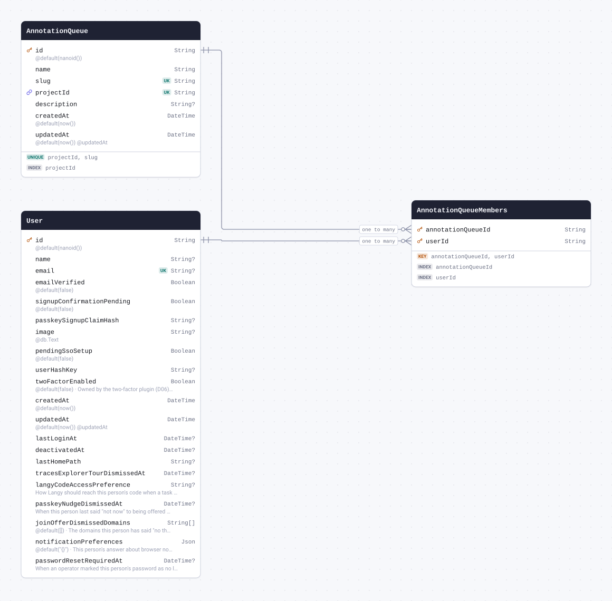

| Field               | Type     | Constraints                                                | Default | Description |
| ------------------- | -------- | ---------------------------------------------------------- | ------- | ----------- |
| `annotationQueueId` | `String` | PK NOT NULL → [AnnotationQueue.id](#model-AnnotationQueue) |         |             |
| `userId`            | `String` | PK NOT NULL → [User.id](#model-User)                       |         |             |

#### Indexes

- `@@id([annotationQueueId, userId])`
- `@@index([annotationQueueId])`
- `@@index([userId])`

#### References

- `userId` → [User.id](#model-User) (many-to-one)
- `annotationQueueId` → [AnnotationQueue.id](#model-AnnotationQueue) (many-to-one)

#### Definition

```sql
CREATE TABLE "AnnotationQueueMembers" (
    "annotationQueueId" TEXT NOT NULL,
    "userId" TEXT NOT NULL,

    CONSTRAINT "AnnotationQueueMembers_pkey" PRIMARY KEY ("annotationQueueId","userId")
);

CREATE INDEX "AnnotationQueueMembers_annotationQueueId_idx" ON "AnnotationQueueMembers"("annotationQueueId");

CREATE INDEX "AnnotationQueueMembers_userId_idx" ON "AnnotationQueueMembers"("userId");
```

<details>
<summary>Queries and their SQL</summary>

**findMany**: Every row

```ts
await prisma.annotationQueueMembers.findMany();
```

```sql
SELECT
  "public"."AnnotationQueueMembers"."annotationQueueId",
  "public"."AnnotationQueueMembers"."userId"
FROM
  "public"."AnnotationQueueMembers"
WHERE
  1 = 1
OFFSET
  $1
-- params: ["0"]
```

**count**: How many rows there are

```ts
await prisma.annotationQueueMembers.count();
```

```sql
SELECT
  COUNT(*) AS "_count$_all"
FROM
  (
    SELECT
      "public"."AnnotationQueueMembers"."annotationQueueId",
      "public"."AnnotationQueueMembers"."userId"
    FROM
      "public"."AnnotationQueueMembers"
    WHERE
      1 = 1
    OFFSET
      $1
  ) AS "sub"
-- params: ["0"]
```

**findMany**: Every row with its relations

```ts
await prisma.annotationQueueMembers.findMany({ include: { user: true, annotationQueue: true } });
```

```sql
SELECT
  "public"."AnnotationQueueMembers"."annotationQueueId",
  "public"."AnnotationQueueMembers"."userId"
FROM
  "public"."AnnotationQueueMembers"
WHERE
  1 = 1
OFFSET
  $1
-- params: ["0"]

SELECT
  "public"."User"."id",
  "public"."User"."name",
  "public"."User"."email",
  "public"."User"."emailVerified",
  "public"."User"."signupConfirmationPending",
  "public"."User"."passkeySignupClaimHash",
  "public"."User"."image",
  "public"."User"."pendingSsoSetup",
  "public"."User"."userHashKey",
  "public"."User"."twoFactorEnabled",
  "public"."User"."createdAt",
  "public"."User"."updatedAt",
  "public"."User"."lastLoginAt",
  "public"."User"."deactivatedAt",
  "public"."User"."lastHomePath",
  "public"."User"."tracesExplorerTourDismissedAt",
  "public"."User"."langyCodeAccessPreference",
  "public"."User"."passkeyNudgeDismissedAt",
  "public"."User"."joinOfferDismissedDomains",
  "public"."User"."notificationPreferences",
  "public"."User"."passwordResetRequiredAt"
FROM
  "public"."User"
WHERE
  "public"."User"."id" IN ($1)
OFFSET
  $2
-- params: ["<userId of the rows above>","0"]

SELECT
  "public"."AnnotationQueue"."id",
  "public"."AnnotationQueue"."name",
  "public"."AnnotationQueue"."slug",
  "public"."AnnotationQueue"."projectId",
  "public"."AnnotationQueue"."description",
  "public"."AnnotationQueue"."createdAt",
  "public"."AnnotationQueue"."updatedAt"
FROM
  "public"."AnnotationQueue"
WHERE
  "public"."AnnotationQueue"."id" IN ($1)
OFFSET
  $2
-- params: ["<annotationQueueId of the rows above>","0"]
```

**findUnique**: One row by what is unique to it

```ts
await prisma.annotationQueueMembers.findUnique({
  where: { annotationQueueId_userId: { annotationQueueId: "example", userId: "example" } },
});
```

```sql
SELECT
  "public"."AnnotationQueueMembers"."annotationQueueId",
  "public"."AnnotationQueueMembers"."userId"
FROM
  "public"."AnnotationQueueMembers"
WHERE
  (
    (
      "public"."AnnotationQueueMembers"."annotationQueueId" = $1
      AND "public"."AnnotationQueueMembers"."userId" = $2
    )
    AND 1 = 1
  )
LIMIT
  $3
OFFSET
  $4
-- params: ["example","example","1","0"]
```

**create**: Create a row

```ts
await prisma.annotationQueueMembers.create({
  data: { annotationQueueId: "example", userId: "example" },
});
```

```sql
INSERT INTO
  "public"."AnnotationQueueMembers" ("annotationQueueId", "userId")
VALUES
  ($1, $2)
RETURNING
  "public"."AnnotationQueueMembers"."annotationQueueId",
  "public"."AnnotationQueueMembers"."userId"
-- params: ["example","example"]
```

**delete**: Delete a row

```ts
await prisma.annotationQueueMembers.delete({
  where: { annotationQueueId_userId: { annotationQueueId: "example", userId: "example" } },
});
```

```sql
DELETE FROM "public"."AnnotationQueueMembers"
WHERE
  (
    (
      "public"."AnnotationQueueMembers"."annotationQueueId" = $1
      AND "public"."AnnotationQueueMembers"."userId" = $2
    )
    AND 1 = 1
  )
RETURNING
  "public"."AnnotationQueueMembers"."annotationQueueId",
  "public"."AnnotationQueueMembers"."userId"
-- params: ["example","example"]
```

</details>

<a id="model-AnnotationQueueScores"></a>

### AnnotationQueueScores

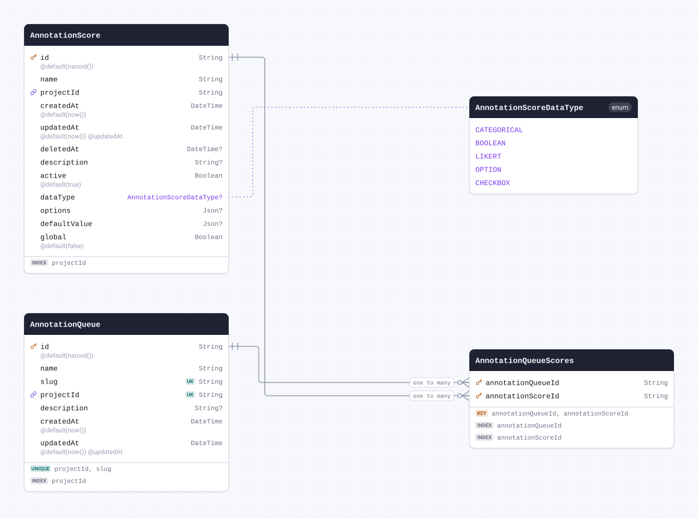

| Field               | Type     | Constraints                                                | Default | Description |
| ------------------- | -------- | ---------------------------------------------------------- | ------- | ----------- |
| `annotationQueueId` | `String` | PK NOT NULL → [AnnotationQueue.id](#model-AnnotationQueue) |         |             |
| `annotationScoreId` | `String` | PK NOT NULL → [AnnotationScore.id](#model-AnnotationScore) |         |             |

#### Indexes

- `@@id([annotationQueueId, annotationScoreId])`
- `@@index([annotationQueueId])`
- `@@index([annotationScoreId])`

#### References

- `annotationScoreId` → [AnnotationScore.id](#model-AnnotationScore) (many-to-one)
- `annotationQueueId` → [AnnotationQueue.id](#model-AnnotationQueue) (many-to-one)

#### Definition

```sql
CREATE TABLE "AnnotationQueueScores" (
    "annotationQueueId" TEXT NOT NULL,
    "annotationScoreId" TEXT NOT NULL,

    CONSTRAINT "AnnotationQueueScores_pkey" PRIMARY KEY ("annotationQueueId","annotationScoreId")
);

CREATE INDEX "AnnotationQueueScores_annotationQueueId_idx" ON "AnnotationQueueScores"("annotationQueueId");

CREATE INDEX "AnnotationQueueScores_annotationScoreId_idx" ON "AnnotationQueueScores"("annotationScoreId");
```

<details>
<summary>Queries and their SQL</summary>

**findMany**: Every row

```ts
await prisma.annotationQueueScores.findMany();
```

```sql
SELECT
  "public"."AnnotationQueueScores"."annotationQueueId",
  "public"."AnnotationQueueScores"."annotationScoreId"
FROM
  "public"."AnnotationQueueScores"
WHERE
  1 = 1
OFFSET
  $1
-- params: ["0"]
```

**count**: How many rows there are

```ts
await prisma.annotationQueueScores.count();
```

```sql
SELECT
  COUNT(*) AS "_count$_all"
FROM
  (
    SELECT
      "public"."AnnotationQueueScores"."annotationQueueId",
      "public"."AnnotationQueueScores"."annotationScoreId"
    FROM
      "public"."AnnotationQueueScores"
    WHERE
      1 = 1
    OFFSET
      $1
  ) AS "sub"
-- params: ["0"]
```

**findMany**: Every row with its relations

```ts
await prisma.annotationQueueScores.findMany({
  include: { annotationScore: true, annotationQueue: true },
});
```

```sql
SELECT
  "public"."AnnotationQueueScores"."annotationQueueId",
  "public"."AnnotationQueueScores"."annotationScoreId"
FROM
  "public"."AnnotationQueueScores"
WHERE
  1 = 1
OFFSET
  $1
-- params: ["0"]

SELECT
  "public"."AnnotationScore"."id",
  "public"."AnnotationScore"."name",
  "public"."AnnotationScore"."projectId",
  "public"."AnnotationScore"."createdAt",
  "public"."AnnotationScore"."updatedAt",
  "public"."AnnotationScore"."deletedAt",
  "public"."AnnotationScore"."description",
  "public"."AnnotationScore"."active",
  "public"."AnnotationScore"."dataType"::text,
  "public"."AnnotationScore"."options",
  "public"."AnnotationScore"."defaultValue",
  "public"."AnnotationScore"."global"
FROM
  "public"."AnnotationScore"
WHERE
  "public"."AnnotationScore"."id" IN ($1)
OFFSET
  $2
-- params: ["<annotationScoreId of the rows above>","0"]

SELECT
  "public"."AnnotationQueue"."id",
  "public"."AnnotationQueue"."name",
  "public"."AnnotationQueue"."slug",
  "public"."AnnotationQueue"."projectId",
  "public"."AnnotationQueue"."description",
  "public"."AnnotationQueue"."createdAt",
  "public"."AnnotationQueue"."updatedAt"
FROM
  "public"."AnnotationQueue"
WHERE
  "public"."AnnotationQueue"."id" IN ($1)
OFFSET
  $2
-- params: ["<annotationQueueId of the rows above>","0"]
```

**findUnique**: One row by what is unique to it

```ts
await prisma.annotationQueueScores.findUnique({
  where: {
    annotationQueueId_annotationScoreId: {
      annotationQueueId: "example",
      annotationScoreId: "example",
    },
  },
});
```

```sql
SELECT
  "public"."AnnotationQueueScores"."annotationQueueId",
  "public"."AnnotationQueueScores"."annotationScoreId"
FROM
  "public"."AnnotationQueueScores"
WHERE
  (
    (
      "public"."AnnotationQueueScores"."annotationQueueId" = $1
      AND "public"."AnnotationQueueScores"."annotationScoreId" = $2
    )
    AND 1 = 1
  )
LIMIT
  $3
OFFSET
  $4
-- params: ["example","example","1","0"]
```

**create**: Create a row

```ts
await prisma.annotationQueueScores.create({
  data: { annotationQueueId: "example", annotationScoreId: "example" },
});
```

```sql
INSERT INTO
  "public"."AnnotationQueueScores" ("annotationQueueId", "annotationScoreId")
VALUES
  ($1, $2)
RETURNING
  "public"."AnnotationQueueScores"."annotationQueueId",
  "public"."AnnotationQueueScores"."annotationScoreId"
-- params: ["example","example"]
```

**delete**: Delete a row

```ts
await prisma.annotationQueueScores.delete({
  where: {
    annotationQueueId_annotationScoreId: {
      annotationQueueId: "example",
      annotationScoreId: "example",
    },
  },
});
```

```sql
DELETE FROM "public"."AnnotationQueueScores"
WHERE
  (
    (
      "public"."AnnotationQueueScores"."annotationQueueId" = $1
      AND "public"."AnnotationQueueScores"."annotationScoreId" = $2
    )
    AND 1 = 1
  )
RETURNING
  "public"."AnnotationQueueScores"."annotationQueueId",
  "public"."AnnotationQueueScores"."annotationScoreId"
-- params: ["example","example"]
```

</details>

<a id="model-AnnotationQueueItem"></a>

### AnnotationQueueItem

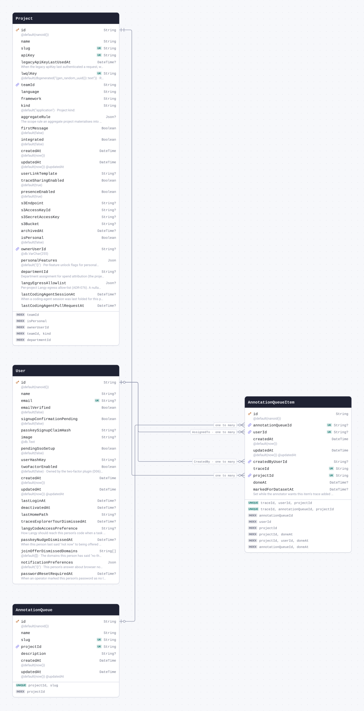

| Field                | Type       | Constraints                                         | Default              | Description                                                                                                                                                                                                       |
| -------------------- | ---------- | --------------------------------------------------- | -------------------- | ----------------------------------------------------------------------------------------------------------------------------------------------------------------------------------------------------------------- |
| `id`                 | `String`   | PK NOT NULL                                         | `nanoid()`           |                                                                                                                                                                                                                   |
| `annotationQueueId`  | `String`   | NULL → [AnnotationQueue.id](#model-AnnotationQueue) |                      |                                                                                                                                                                                                                   |
| `userId`             | `String`   | NULL → [User.id](#model-User)                       |                      |                                                                                                                                                                                                                   |
| `createdAt`          | `DateTime` | NOT NULL                                            | `now()`              |                                                                                                                                                                                                                   |
| `updatedAt`          | `DateTime` | NOT NULL                                            | `now()` `@updatedAt` |                                                                                                                                                                                                                   |
| `createdByUserId`    | `String`   | NULL → [User.id](#model-User)                       |                      |                                                                                                                                                                                                                   |
| `traceId`            | `String`   | NOT NULL                                            |                      |                                                                                                                                                                                                                   |
| `projectId`          | `String`   | NOT NULL → [Project.id](#model-Project)             |                      |                                                                                                                                                                                                                   |
| `doneAt`             | `DateTime` | NULL                                                |                      |                                                                                                                                                                                                                   |
| `markedForDatasetAt` | `DateTime` | NULL                                                |                      | Set while the annotator wants this item's trace added to a dataset once the queue walk is finished. Persisted rather than kept in the browser so the selection survives a refresh and stays visible to teammates. |

#### Indexes

- `@@index([annotationQueueId])`
- `@@index([userId])`
- `@@index([projectId])`
- `@@index([projectId, doneAt])`
- `@@index([projectId, userId, doneAt])`
- `@@index([annotationQueueId, doneAt])`
- `@@unique([traceId, userId, projectId])`
- `@@unique([traceId, annotationQueueId, projectId])`

#### References

- `annotationQueueId` → [AnnotationQueue.id](#model-AnnotationQueue) (many-to-one)
- `userId` → [User.id](#model-User) (many-to-one)
- `createdByUserId` → [User.id](#model-User) (many-to-one)
- `projectId` → [Project.id](#model-Project) (many-to-one)

#### Definition

```sql
CREATE TABLE "AnnotationQueueItem" (
    "id" TEXT NOT NULL,
    "annotationQueueId" TEXT,
    "userId" TEXT,
    "createdAt" TIMESTAMP(3) NOT NULL DEFAULT CURRENT_TIMESTAMP,
    "updatedAt" TIMESTAMP(3) NOT NULL DEFAULT CURRENT_TIMESTAMP,
    "createdByUserId" TEXT,
    "traceId" TEXT NOT NULL,
    "projectId" TEXT NOT NULL,
    "doneAt" TIMESTAMP(3),
    "markedForDatasetAt" TIMESTAMP(3),

    CONSTRAINT "AnnotationQueueItem_pkey" PRIMARY KEY ("id")
);

CREATE INDEX "AnnotationQueueItem_annotationQueueId_idx" ON "AnnotationQueueItem"("annotationQueueId");

CREATE INDEX "AnnotationQueueItem_userId_idx" ON "AnnotationQueueItem"("userId");

CREATE INDEX "AnnotationQueueItem_projectId_idx" ON "AnnotationQueueItem"("projectId");

CREATE INDEX "AnnotationQueueItem_projectId_doneAt_idx" ON "AnnotationQueueItem"("projectId", "doneAt");

CREATE INDEX "AnnotationQueueItem_projectId_userId_doneAt_idx" ON "AnnotationQueueItem"("projectId", "userId", "doneAt");

CREATE INDEX "AnnotationQueueItem_annotationQueueId_doneAt_idx" ON "AnnotationQueueItem"("annotationQueueId", "doneAt");

CREATE UNIQUE INDEX "AnnotationQueueItem_traceId_userId_projectId_key" ON "AnnotationQueueItem"("traceId", "userId", "projectId");

CREATE UNIQUE INDEX "AnnotationQueueItem_traceId_annotationQueueId_projectId_key" ON "AnnotationQueueItem"("traceId", "annotationQueueId", "projectId");
```

<details>
<summary>Queries and their SQL</summary>

**findMany**: Every row

```ts
await prisma.annotationQueueItem.findMany();
```

```sql
SELECT
  "public"."AnnotationQueueItem"."id",
  "public"."AnnotationQueueItem"."annotationQueueId",
  "public"."AnnotationQueueItem"."userId",
  "public"."AnnotationQueueItem"."createdAt",
  "public"."AnnotationQueueItem"."updatedAt",
  "public"."AnnotationQueueItem"."createdByUserId",
  "public"."AnnotationQueueItem"."traceId",
  "public"."AnnotationQueueItem"."projectId",
  "public"."AnnotationQueueItem"."doneAt",
  "public"."AnnotationQueueItem"."markedForDatasetAt"
FROM
  "public"."AnnotationQueueItem"
WHERE
  1 = 1
OFFSET
  $1
-- params: ["0"]
```

**count**: How many rows there are

```ts
await prisma.annotationQueueItem.count();
```

```sql
SELECT
  COUNT(*) AS "_count$_all"
FROM
  (
    SELECT
      "public"."AnnotationQueueItem"."id"
    FROM
      "public"."AnnotationQueueItem"
    WHERE
      1 = 1
    OFFSET
      $1
  ) AS "sub"
-- params: ["0"]
```

**findMany**: Every row with its relations

```ts
await prisma.annotationQueueItem.findMany({
  include: { annotationQueue: true, user: true, createdByUser: true, project: true },
});
```

```sql
SELECT
  "public"."AnnotationQueueItem"."id",
  "public"."AnnotationQueueItem"."annotationQueueId",
  "public"."AnnotationQueueItem"."userId",
  "public"."AnnotationQueueItem"."createdAt",
  "public"."AnnotationQueueItem"."updatedAt",
  "public"."AnnotationQueueItem"."createdByUserId",
  "public"."AnnotationQueueItem"."traceId",
  "public"."AnnotationQueueItem"."projectId",
  "public"."AnnotationQueueItem"."doneAt",
  "public"."AnnotationQueueItem"."markedForDatasetAt"
FROM
  "public"."AnnotationQueueItem"
WHERE
  1 = 1
OFFSET
  $1
-- params: ["0"]

SELECT
  "public"."AnnotationQueue"."id",
  "public"."AnnotationQueue"."name",
  "public"."AnnotationQueue"."slug",
  "public"."AnnotationQueue"."projectId",
  "public"."AnnotationQueue"."description",
  "public"."AnnotationQueue"."createdAt",
  "public"."AnnotationQueue"."updatedAt"
FROM
  "public"."AnnotationQueue"
WHERE
  "public"."AnnotationQueue"."id" IN ($1)
OFFSET
  $2
-- params: ["<annotationQueueId of the rows above>","0"]

SELECT
  "public"."User"."id",
  "public"."User"."name",
  "public"."User"."email",
  "public"."User"."emailVerified",
  "public"."User"."signupConfirmationPending",
  "public"."User"."passkeySignupClaimHash",
  "public"."User"."image",
  "public"."User"."pendingSsoSetup",
  "public"."User"."userHashKey",
  "public"."User"."twoFactorEnabled",
  "public"."User"."createdAt",
  "public"."User"."updatedAt",
  "public"."User"."lastLoginAt",
  "public"."User"."deactivatedAt",
  "public"."User"."lastHomePath",
  "public"."User"."tracesExplorerTourDismissedAt",
  "public"."User"."langyCodeAccessPreference",
  "public"."User"."passkeyNudgeDismissedAt",
  "public"."User"."joinOfferDismissedDomains",
  "public"."User"."notificationPreferences",
  "public"."User"."passwordResetRequiredAt"
FROM
  "public"."User"
WHERE
  "public"."User"."id" IN ($1)
OFFSET
  $2
-- params: ["<userId of the rows above>","0"]

SELECT
  "public"."User"."id",
  "public"."User"."name",
  "public"."User"."email",
  "public"."User"."emailVerified",
  "public"."User"."signupConfirmationPending",
  "public"."User"."passkeySignupClaimHash",
  "public"."User"."image",
  "public"."User"."pendingSsoSetup",
  "public"."User"."userHashKey",
  "public"."User"."twoFactorEnabled",
  "public"."User"."createdAt",
  "public"."User"."updatedAt",
  "public"."User"."lastLoginAt",
  "public"."User"."deactivatedAt",
  "public"."User"."lastHomePath",
  "public"."User"."tracesExplorerTourDismissedAt",
  "public"."User"."langyCodeAccessPreference",
  "public"."User"."passkeyNudgeDismissedAt",
  "public"."User"."joinOfferDismissedDomains",
  "public"."User"."notificationPreferences",
  "public"."User"."passwordResetRequiredAt"
FROM
  "public"."User"
WHERE
  "public"."User"."id" IN ($1)
OFFSET
  $2
-- params: ["<createdByUserId of the rows above>","0"]

SELECT
  "public"."Project"."id",
  "public"."Project"."name",
  "public"."Project"."slug",
  "public"."Project"."apiKey",
  "public"."Project"."legacyApiKeyLastUsedAt",
  "public"."Project"."lwqlKey",
  "public"."Project"."teamId",
  "public"."Project"."language",
  "public"."Project"."framework",
  "public"."Project"."kind",
  "public"."Project"."aggregateRule",
  "public"."Project"."firstMessage",
  "public"."Project"."integrated",
  "public"."Project"."createdAt",
  "public"."Project"."updatedAt",
  "public"."Project"."userLinkTemplate",
  "public"."Project"."traceSharingEnabled",
  "public"."Project"."presenceEnabled",
  "public"."Project"."s3Endpoint",
  "public"."Project"."s3AccessKeyId",
  "public"."Project"."s3SecretAccessKey",
  "public"."Project"."s3Bucket",
  "public"."Project"."archivedAt",
  "public"."Project"."isPersonal",
  "public"."Project"."ownerUserId",
  "public"."Project"."personalFeatures",
  "public"."Project"."departmentId",
  "public"."Project"."langyEgressAllowlist",
  "public"."Project"."lastCodingAgentSessionAt",
  "public"."Project"."lastCodingAgentPullRequestAt"
FROM
  "public"."Project"
WHERE
  "public"."Project"."id" IN ($1)
OFFSET
  $2
-- params: ["<projectId of the rows above>","0"]
```

**findUnique**: One row by what is unique to it

```ts
await prisma.annotationQueueItem.findUnique({ where: { id: "example" } });
```

```sql
SELECT
  "public"."AnnotationQueueItem"."id",
  "public"."AnnotationQueueItem"."annotationQueueId",
  "public"."AnnotationQueueItem"."userId",
  "public"."AnnotationQueueItem"."createdAt",
  "public"."AnnotationQueueItem"."updatedAt",
  "public"."AnnotationQueueItem"."createdByUserId",
  "public"."AnnotationQueueItem"."traceId",
  "public"."AnnotationQueueItem"."projectId",
  "public"."AnnotationQueueItem"."doneAt",
  "public"."AnnotationQueueItem"."markedForDatasetAt"
FROM
  "public"."AnnotationQueueItem"
WHERE
  (
    "public"."AnnotationQueueItem"."id" = $1
    AND 1 = 1
  )
LIMIT
  $2
OFFSET
  $3
-- params: ["example","1","0"]
```

**create**: Create a row

```ts
await prisma.annotationQueueItem.create({ data: { traceId: "example", projectId: "example" } });
```

```sql
INSERT INTO
  "public"."AnnotationQueueItem" (
    "id",
    "createdAt",
    "updatedAt",
    "traceId",
    "projectId"
  )
VALUES
  ($1, $2, $3, $4, $5)
RETURNING
  "public"."AnnotationQueueItem"."id",
  "public"."AnnotationQueueItem"."annotationQueueId",
  "public"."AnnotationQueueItem"."userId",
  "public"."AnnotationQueueItem"."createdAt",
  "public"."AnnotationQueueItem"."updatedAt",
  "public"."AnnotationQueueItem"."createdByUserId",
  "public"."AnnotationQueueItem"."traceId",
  "public"."AnnotationQueueItem"."projectId",
  "public"."AnnotationQueueItem"."doneAt",
  "public"."AnnotationQueueItem"."markedForDatasetAt"
-- params: ["<nanoid()>","<now()>","<now()>","example","example"]
```

**update**: Update a row

```ts
await prisma.annotationQueueItem.update({
  where: { id: "example" },
  data: { createdAt: new Date("2026-01-01T00:00:00.000Z") },
});
```

```sql
SELECT
  "public"."AnnotationQueueItem"."id"
FROM
  "public"."AnnotationQueueItem"
WHERE
  (
    "public"."AnnotationQueueItem"."id" = $1
    AND 1 = 1
  )
LIMIT
  $2
OFFSET
  $3
-- params: ["example","1","0"]

UPDATE "public"."AnnotationQueueItem"
SET
  "createdAt" = $1,
  "updatedAt" = $2
WHERE
  (
    "public"."AnnotationQueueItem"."id" IN ($3)
    AND (
      "public"."AnnotationQueueItem"."id" = $4
      AND 1 = 1
    )
  )
RETURNING
  "public"."AnnotationQueueItem"."id",
  "public"."AnnotationQueueItem"."annotationQueueId",
  "public"."AnnotationQueueItem"."userId",
  "public"."AnnotationQueueItem"."createdAt",
  "public"."AnnotationQueueItem"."updatedAt",
  "public"."AnnotationQueueItem"."createdByUserId",
  "public"."AnnotationQueueItem"."traceId",
  "public"."AnnotationQueueItem"."projectId",
  "public"."AnnotationQueueItem"."doneAt",
  "public"."AnnotationQueueItem"."markedForDatasetAt"
-- params: ["2026-01-01T00:00:00.000Z",{"prisma__type":"generatorCall","prisma__value":{"name":"now","args":[],"returnType":{"type":"DateTime"}}},"<id of the rows above>","example"]
```

**delete**: Delete a row

```ts
await prisma.annotationQueueItem.delete({ where: { id: "example" } });
```

```sql
DELETE FROM "public"."AnnotationQueueItem"
WHERE
  (
    "public"."AnnotationQueueItem"."id" = $1
    AND 1 = 1
  )
RETURNING
  "public"."AnnotationQueueItem"."id",
  "public"."AnnotationQueueItem"."annotationQueueId",
  "public"."AnnotationQueueItem"."userId",
  "public"."AnnotationQueueItem"."createdAt",
  "public"."AnnotationQueueItem"."updatedAt",
  "public"."AnnotationQueueItem"."createdByUserId",
  "public"."AnnotationQueueItem"."traceId",
  "public"."AnnotationQueueItem"."projectId",
  "public"."AnnotationQueueItem"."doneAt",
  "public"."AnnotationQueueItem"."markedForDatasetAt"
-- params: ["example"]
```

</details>

<a id="model-ShareLink"></a>

### ShareLink

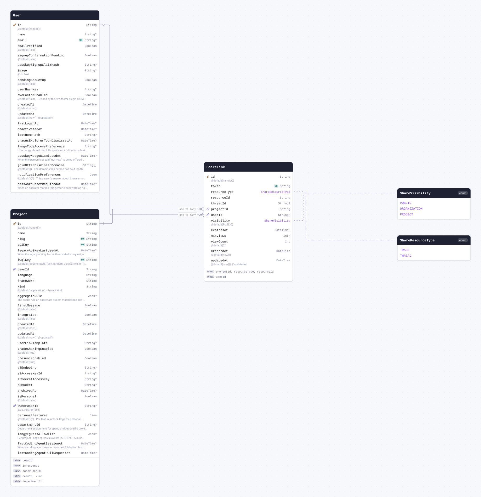

| Field          | Type                                           | Constraints                             | Default              | Description |
| -------------- | ---------------------------------------------- | --------------------------------------- | -------------------- | ----------- |
| `id`           | `String`                                       | PK NOT NULL                             | `nanoid()`           |             |
| `token`        | `String`                                       | UNIQUE NOT NULL                         |                      |             |
| `resourceType` | [`ShareResourceType`](#enum-ShareResourceType) | NOT NULL                                |                      |             |
| `resourceId`   | `String`                                       | NOT NULL                                |                      |             |
| `threadId`     | `String`                                       | NULL                                    |                      |             |
| `projectId`    | `String`                                       | NOT NULL → [Project.id](#model-Project) |                      |             |
| `userId`       | `String`                                       | NULL → [User.id](#model-User)           |                      |             |
| `visibility`   | [`ShareVisibility`](#enum-ShareVisibility)     | NOT NULL                                | `PUBLIC`             |             |
| `expiresAt`    | `DateTime`                                     | NULL                                    |                      |             |
| `maxViews`     | `Int`                                          | NULL                                    |                      |             |
| `viewCount`    | `Int`                                          | NOT NULL                                | `0`                  |             |
| `createdAt`    | `DateTime`                                     | NOT NULL                                | `now()`              |             |
| `updatedAt`    | `DateTime`                                     | NOT NULL                                | `now()` `@updatedAt` |             |

#### Indexes

- `@@index([projectId, resourceType, resourceId])`
- `@@index([userId])`

#### References

- `projectId` → [Project.id](#model-Project) (many-to-one)
- `userId` → [User.id](#model-User) (many-to-one)

#### Definition

```sql
CREATE TABLE "ShareLink" (
    "id" TEXT NOT NULL,
    "token" TEXT NOT NULL,
    "resourceType" "ShareResourceType" NOT NULL,
    "resourceId" TEXT NOT NULL,
    "threadId" TEXT,
    "projectId" TEXT NOT NULL,
    "userId" TEXT,
    "visibility" "ShareVisibility" NOT NULL DEFAULT 'PUBLIC',
    "expiresAt" TIMESTAMP(3),
    "maxViews" INTEGER,
    "viewCount" INTEGER NOT NULL DEFAULT 0,
    "createdAt" TIMESTAMP(3) NOT NULL DEFAULT CURRENT_TIMESTAMP,
    "updatedAt" TIMESTAMP(3) NOT NULL DEFAULT CURRENT_TIMESTAMP,

    CONSTRAINT "ShareLink_pkey" PRIMARY KEY ("id")
);

CREATE UNIQUE INDEX "ShareLink_token_key" ON "ShareLink"("token");

CREATE INDEX "ShareLink_projectId_resourceType_resourceId_idx" ON "ShareLink"("projectId", "resourceType", "resourceId");

CREATE INDEX "ShareLink_userId_idx" ON "ShareLink"("userId");
```

<details>
<summary>Queries and their SQL</summary>

**findMany**: Every row

```ts
await prisma.shareLink.findMany();
```

```sql
SELECT
  "public"."ShareLink"."id",
  "public"."ShareLink"."token",
  "public"."ShareLink"."resourceType"::text,
  "public"."ShareLink"."resourceId",
  "public"."ShareLink"."threadId",
  "public"."ShareLink"."projectId",
  "public"."ShareLink"."userId",
  "public"."ShareLink"."visibility"::text,
  "public"."ShareLink"."expiresAt",
  "public"."ShareLink"."maxViews",
  "public"."ShareLink"."viewCount",
  "public"."ShareLink"."createdAt",
  "public"."ShareLink"."updatedAt"
FROM
  "public"."ShareLink"
WHERE
  1 = 1
OFFSET
  $1
-- params: ["0"]
```

**count**: How many rows there are

```ts
await prisma.shareLink.count();
```

```sql
SELECT
  COUNT(*) AS "_count$_all"
FROM
  (
    SELECT
      "public"."ShareLink"."id"
    FROM
      "public"."ShareLink"
    WHERE
      1 = 1
    OFFSET
      $1
  ) AS "sub"
-- params: ["0"]
```

**findMany**: Every row with its relations

```ts
await prisma.shareLink.findMany({ include: { project: true, user: true } });
```

```sql
SELECT
  "public"."ShareLink"."id",
  "public"."ShareLink"."token",
  "public"."ShareLink"."resourceType"::text,
  "public"."ShareLink"."resourceId",
  "public"."ShareLink"."threadId",
  "public"."ShareLink"."projectId",
  "public"."ShareLink"."userId",
  "public"."ShareLink"."visibility"::text,
  "public"."ShareLink"."expiresAt",
  "public"."ShareLink"."maxViews",
  "public"."ShareLink"."viewCount",
  "public"."ShareLink"."createdAt",
  "public"."ShareLink"."updatedAt"
FROM
  "public"."ShareLink"
WHERE
  1 = 1
OFFSET
  $1
-- params: ["0"]

SELECT
  "public"."Project"."id",
  "public"."Project"."name",
  "public"."Project"."slug",
  "public"."Project"."apiKey",
  "public"."Project"."legacyApiKeyLastUsedAt",
  "public"."Project"."lwqlKey",
  "public"."Project"."teamId",
  "public"."Project"."language",
  "public"."Project"."framework",
  "public"."Project"."kind",
  "public"."Project"."aggregateRule",
  "public"."Project"."firstMessage",
  "public"."Project"."integrated",
  "public"."Project"."createdAt",
  "public"."Project"."updatedAt",
  "public"."Project"."userLinkTemplate",
  "public"."Project"."traceSharingEnabled",
  "public"."Project"."presenceEnabled",
  "public"."Project"."s3Endpoint",
  "public"."Project"."s3AccessKeyId",
  "public"."Project"."s3SecretAccessKey",
  "public"."Project"."s3Bucket",
  "public"."Project"."archivedAt",
  "public"."Project"."isPersonal",
  "public"."Project"."ownerUserId",
  "public"."Project"."personalFeatures",
  "public"."Project"."departmentId",
  "public"."Project"."langyEgressAllowlist",
  "public"."Project"."lastCodingAgentSessionAt",
  "public"."Project"."lastCodingAgentPullRequestAt"
FROM
  "public"."Project"
WHERE
  "public"."Project"."id" IN ($1)
OFFSET
  $2
-- params: ["<projectId of the rows above>","0"]

SELECT
  "public"."User"."id",
  "public"."User"."name",
  "public"."User"."email",
  "public"."User"."emailVerified",
  "public"."User"."signupConfirmationPending",
  "public"."User"."passkeySignupClaimHash",
  "public"."User"."image",
  "public"."User"."pendingSsoSetup",
  "public"."User"."userHashKey",
  "public"."User"."twoFactorEnabled",
  "public"."User"."createdAt",
  "public"."User"."updatedAt",
  "public"."User"."lastLoginAt",
  "public"."User"."deactivatedAt",
  "public"."User"."lastHomePath",
  "public"."User"."tracesExplorerTourDismissedAt",
  "public"."User"."langyCodeAccessPreference",
  "public"."User"."passkeyNudgeDismissedAt",
  "public"."User"."joinOfferDismissedDomains",
  "public"."User"."notificationPreferences",
  "public"."User"."passwordResetRequiredAt"
FROM
  "public"."User"
WHERE
  "public"."User"."id" IN ($1)
OFFSET
  $2
-- params: ["<userId of the rows above>","0"]
```

**findUnique**: One row by what is unique to it

```ts
await prisma.shareLink.findUnique({ where: { id: "example" } });
```

```sql
SELECT
  "public"."ShareLink"."id",
  "public"."ShareLink"."token",
  "public"."ShareLink"."resourceType"::text,
  "public"."ShareLink"."resourceId",
  "public"."ShareLink"."threadId",
  "public"."ShareLink"."projectId",
  "public"."ShareLink"."userId",
  "public"."ShareLink"."visibility"::text,
  "public"."ShareLink"."expiresAt",
  "public"."ShareLink"."maxViews",
  "public"."ShareLink"."viewCount",
  "public"."ShareLink"."createdAt",
  "public"."ShareLink"."updatedAt"
FROM
  "public"."ShareLink"
WHERE
  (
    "public"."ShareLink"."id" = $1
    AND 1 = 1
  )
LIMIT
  $2
OFFSET
  $3
-- params: ["example","1","0"]
```

**create**: Create a row

```ts
await prisma.shareLink.create({
  data: { token: "example", resourceType: "TRACE", resourceId: "example", projectId: "example" },
});
```

```sql
INSERT INTO
  "public"."ShareLink" (
    "id",
    "token",
    "resourceType",
    "resourceId",
    "projectId",
    "visibility",
    "viewCount",
    "createdAt",
    "updatedAt"
  )
VALUES
  (
    $1,
    $2,
    CAST($3::text AS "public"."ShareResourceType"),
    $4,
    $5,
    CAST($6::text AS "public"."ShareVisibility"),
    $7,
    $8,
    $9
  )
RETURNING
  "public"."ShareLink"."id",
  "public"."ShareLink"."token",
  "public"."ShareLink"."resourceType"::text,
  "public"."ShareLink"."resourceId",
  "public"."ShareLink"."threadId",
  "public"."ShareLink"."projectId",
  "public"."ShareLink"."userId",
  "public"."ShareLink"."visibility"::text,
  "public"."ShareLink"."expiresAt",
  "public"."ShareLink"."maxViews",
  "public"."ShareLink"."viewCount",
  "public"."ShareLink"."createdAt",
  "public"."ShareLink"."updatedAt"
-- params: ["<nanoid()>","example","TRACE","example","example","PUBLIC","0","<now()>","<now()>"]
```

**update**: Update a row

```ts
await prisma.shareLink.update({ where: { id: "example" }, data: { token: "example" } });
```

```sql
SELECT
  "public"."ShareLink"."id"
FROM
  "public"."ShareLink"
WHERE
  (
    "public"."ShareLink"."id" = $1
    AND 1 = 1
  )
LIMIT
  $2
OFFSET
  $3
-- params: ["example","1","0"]

UPDATE "public"."ShareLink"
SET
  "token" = $1,
  "updatedAt" = $2
WHERE
  (
    "public"."ShareLink"."id" IN ($3)
    AND (
      "public"."ShareLink"."id" = $4
      AND 1 = 1
    )
  )
RETURNING
  "public"."ShareLink"."id",
  "public"."ShareLink"."token",
  "public"."ShareLink"."resourceType"::text,
  "public"."ShareLink"."resourceId",
  "public"."ShareLink"."threadId",
  "public"."ShareLink"."projectId",
  "public"."ShareLink"."userId",
  "public"."ShareLink"."visibility"::text,
  "public"."ShareLink"."expiresAt",
  "public"."ShareLink"."maxViews",
  "public"."ShareLink"."viewCount",
  "public"."ShareLink"."createdAt",
  "public"."ShareLink"."updatedAt"
-- params: ["example",{"prisma__type":"generatorCall","prisma__value":{"name":"now","args":[],"returnType":{"type":"DateTime"}}},"<id of the rows above>","example"]
```

**delete**: Delete a row

```ts
await prisma.shareLink.delete({ where: { id: "example" } });
```

```sql
DELETE FROM "public"."ShareLink"
WHERE
  (
    "public"."ShareLink"."id" = $1
    AND 1 = 1
  )
RETURNING
  "public"."ShareLink"."id",
  "public"."ShareLink"."token",
  "public"."ShareLink"."resourceType"::text,
  "public"."ShareLink"."resourceId",
  "public"."ShareLink"."threadId",
  "public"."ShareLink"."projectId",
  "public"."ShareLink"."userId",
  "public"."ShareLink"."visibility"::text,
  "public"."ShareLink"."expiresAt",
  "public"."ShareLink"."maxViews",
  "public"."ShareLink"."viewCount",
  "public"."ShareLink"."createdAt",
  "public"."ShareLink"."updatedAt"
-- params: ["example"]
```

</details>

<a id="model-PinnedTrace"></a>

### PinnedTrace

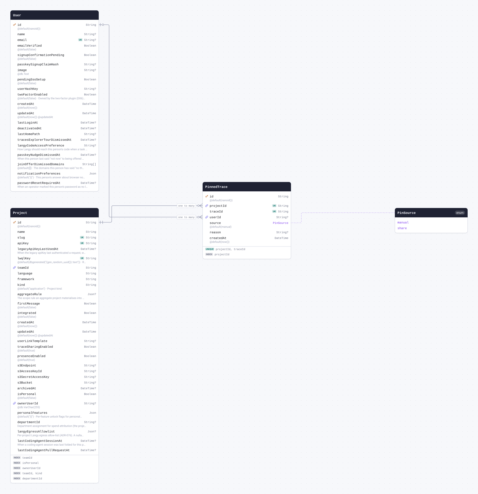

| Field       | Type                           | Constraints                             | Default    | Description |
| ----------- | ------------------------------ | --------------------------------------- | ---------- | ----------- |
| `id`        | `String`                       | PK NOT NULL                             | `nanoid()` |             |
| `projectId` | `String`                       | NOT NULL → [Project.id](#model-Project) |            |             |
| `traceId`   | `String`                       | NOT NULL                                |            |             |
| `userId`    | `String`                       | NULL → [User.id](#model-User)           |            |             |
| `source`    | [`PinSource`](#enum-PinSource) | NOT NULL                                | `manual`   |             |
| `reason`    | `String`                       | NULL                                    |            |             |
| `createdAt` | `DateTime`                     | NOT NULL                                | `now()`    |             |

#### Indexes

- `@@index([projectId])`
- `@@unique([projectId, traceId])`

#### References

- `projectId` → [Project.id](#model-Project) (many-to-one)
- `userId` → [User.id](#model-User) (many-to-one)

#### Definition

```sql
CREATE TABLE "PinnedTrace" (
    "id" TEXT NOT NULL,
    "projectId" TEXT NOT NULL,
    "traceId" TEXT NOT NULL,
    "userId" TEXT,
    "source" "PinSource" NOT NULL DEFAULT 'manual',
    "reason" TEXT,
    "createdAt" TIMESTAMP(3) NOT NULL DEFAULT CURRENT_TIMESTAMP,

    CONSTRAINT "PinnedTrace_pkey" PRIMARY KEY ("id")
);

CREATE INDEX "PinnedTrace_projectId_idx" ON "PinnedTrace"("projectId");

CREATE UNIQUE INDEX "PinnedTrace_projectId_traceId_key" ON "PinnedTrace"("projectId", "traceId");
```

<details>
<summary>Queries and their SQL</summary>

**findMany**: Every row

```ts
await prisma.pinnedTrace.findMany();
```

```sql
SELECT
  "public"."PinnedTrace"."id",
  "public"."PinnedTrace"."projectId",
  "public"."PinnedTrace"."traceId",
  "public"."PinnedTrace"."userId",
  "public"."PinnedTrace"."source"::text,
  "public"."PinnedTrace"."reason",
  "public"."PinnedTrace"."createdAt"
FROM
  "public"."PinnedTrace"
WHERE
  1 = 1
OFFSET
  $1
-- params: ["0"]
```

**count**: How many rows there are

```ts
await prisma.pinnedTrace.count();
```

```sql
SELECT
  COUNT(*) AS "_count$_all"
FROM
  (
    SELECT
      "public"."PinnedTrace"."id"
    FROM
      "public"."PinnedTrace"
    WHERE
      1 = 1
    OFFSET
      $1
  ) AS "sub"
-- params: ["0"]
```

**findMany**: Every row with its relations

```ts
await prisma.pinnedTrace.findMany({ include: { project: true, user: true } });
```

```sql
SELECT
  "public"."PinnedTrace"."id",
  "public"."PinnedTrace"."projectId",
  "public"."PinnedTrace"."traceId",
  "public"."PinnedTrace"."userId",
  "public"."PinnedTrace"."source"::text,
  "public"."PinnedTrace"."reason",
  "public"."PinnedTrace"."createdAt"
FROM
  "public"."PinnedTrace"
WHERE
  1 = 1
OFFSET
  $1
-- params: ["0"]

SELECT
  "public"."Project"."id",
  "public"."Project"."name",
  "public"."Project"."slug",
  "public"."Project"."apiKey",
  "public"."Project"."legacyApiKeyLastUsedAt",
  "public"."Project"."lwqlKey",
  "public"."Project"."teamId",
  "public"."Project"."language",
  "public"."Project"."framework",
  "public"."Project"."kind",
  "public"."Project"."aggregateRule",
  "public"."Project"."firstMessage",
  "public"."Project"."integrated",
  "public"."Project"."createdAt",
  "public"."Project"."updatedAt",
  "public"."Project"."userLinkTemplate",
  "public"."Project"."traceSharingEnabled",
  "public"."Project"."presenceEnabled",
  "public"."Project"."s3Endpoint",
  "public"."Project"."s3AccessKeyId",
  "public"."Project"."s3SecretAccessKey",
  "public"."Project"."s3Bucket",
  "public"."Project"."archivedAt",
  "public"."Project"."isPersonal",
  "public"."Project"."ownerUserId",
  "public"."Project"."personalFeatures",
  "public"."Project"."departmentId",
  "public"."Project"."langyEgressAllowlist",
  "public"."Project"."lastCodingAgentSessionAt",
  "public"."Project"."lastCodingAgentPullRequestAt"
FROM
  "public"."Project"
WHERE
  "public"."Project"."id" IN ($1)
OFFSET
  $2
-- params: ["<projectId of the rows above>","0"]

SELECT
  "public"."User"."id",
  "public"."User"."name",
  "public"."User"."email",
  "public"."User"."emailVerified",
  "public"."User"."signupConfirmationPending",
  "public"."User"."passkeySignupClaimHash",
  "public"."User"."image",
  "public"."User"."pendingSsoSetup",
  "public"."User"."userHashKey",
  "public"."User"."twoFactorEnabled",
  "public"."User"."createdAt",
  "public"."User"."updatedAt",
  "public"."User"."lastLoginAt",
  "public"."User"."deactivatedAt",
  "public"."User"."lastHomePath",
  "public"."User"."tracesExplorerTourDismissedAt",
  "public"."User"."langyCodeAccessPreference",
  "public"."User"."passkeyNudgeDismissedAt",
  "public"."User"."joinOfferDismissedDomains",
  "public"."User"."notificationPreferences",
  "public"."User"."passwordResetRequiredAt"
FROM
  "public"."User"
WHERE
  "public"."User"."id" IN ($1)
OFFSET
  $2
-- params: ["<userId of the rows above>","0"]
```

**findUnique**: One row by what is unique to it

```ts
await prisma.pinnedTrace.findUnique({ where: { id: "example" } });
```

```sql
SELECT
  "public"."PinnedTrace"."id",
  "public"."PinnedTrace"."projectId",
  "public"."PinnedTrace"."traceId",
  "public"."PinnedTrace"."userId",
  "public"."PinnedTrace"."source"::text,
  "public"."PinnedTrace"."reason",
  "public"."PinnedTrace"."createdAt"
FROM
  "public"."PinnedTrace"
WHERE
  (
    "public"."PinnedTrace"."id" = $1
    AND 1 = 1
  )
LIMIT
  $2
OFFSET
  $3
-- params: ["example","1","0"]
```

**create**: Create a row

```ts
await prisma.pinnedTrace.create({ data: { projectId: "example", traceId: "example" } });
```

```sql
INSERT INTO
  "public"."PinnedTrace" (
    "id",
    "projectId",
    "traceId",
    "source",
    "createdAt"
  )
VALUES
  (
    $1,
    $2,
    $3,
    CAST($4::text AS "public"."PinSource"),
    $5
  )
RETURNING
  "public"."PinnedTrace"."id",
  "public"."PinnedTrace"."projectId",
  "public"."PinnedTrace"."traceId",
  "public"."PinnedTrace"."userId",
  "public"."PinnedTrace"."source"::text,
  "public"."PinnedTrace"."reason",
  "public"."PinnedTrace"."createdAt"
-- params: ["<nanoid()>","example","example","manual","<now()>"]
```

**update**: Update a row

```ts
await prisma.pinnedTrace.update({ where: { id: "example" }, data: { traceId: "example" } });
```

```sql
SELECT
  "public"."PinnedTrace"."id"
FROM
  "public"."PinnedTrace"
WHERE
  (
    "public"."PinnedTrace"."id" = $1
    AND 1 = 1
  )
LIMIT
  $2
OFFSET
  $3
-- params: ["example","1","0"]

UPDATE "public"."PinnedTrace"
SET
  "traceId" = $1
WHERE
  (
    "public"."PinnedTrace"."id" IN ($2)
    AND (
      "public"."PinnedTrace"."id" = $3
      AND 1 = 1
    )
  )
RETURNING
  "public"."PinnedTrace"."id",
  "public"."PinnedTrace"."projectId",
  "public"."PinnedTrace"."traceId",
  "public"."PinnedTrace"."userId",
  "public"."PinnedTrace"."source"::text,
  "public"."PinnedTrace"."reason",
  "public"."PinnedTrace"."createdAt"
-- params: ["example","<id of the rows above>","example"]
```

**delete**: Delete a row

```ts
await prisma.pinnedTrace.delete({ where: { id: "example" } });
```

```sql
DELETE FROM "public"."PinnedTrace"
WHERE
  (
    "public"."PinnedTrace"."id" = $1
    AND 1 = 1
  )
RETURNING
  "public"."PinnedTrace"."id",
  "public"."PinnedTrace"."projectId",
  "public"."PinnedTrace"."traceId",
  "public"."PinnedTrace"."userId",
  "public"."PinnedTrace"."source"::text,
  "public"."PinnedTrace"."reason",
  "public"."PinnedTrace"."createdAt"
-- params: ["example"]
```

</details>

<a id="model-TraceEditOverlay"></a>

### TraceEditOverlay

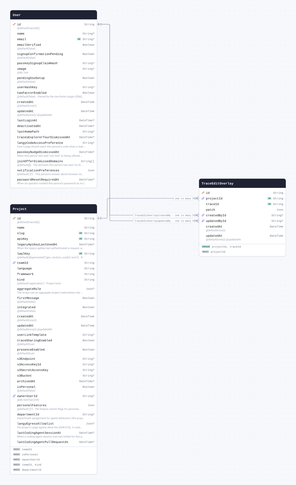

| Field         | Type       | Constraints                             | Default              | Description |
| ------------- | ---------- | --------------------------------------- | -------------------- | ----------- |
| `id`          | `String`   | PK NOT NULL                             |                      |             |
| `projectId`   | `String`   | NOT NULL → [Project.id](#model-Project) |                      |             |
| `traceId`     | `String`   | NOT NULL                                |                      |             |
| `patch`       | `Json`     | NOT NULL                                |                      |             |
| `createdById` | `String`   | NULL → [User.id](#model-User)           |                      |             |
| `updatedById` | `String`   | NULL → [User.id](#model-User)           |                      |             |
| `createdAt`   | `DateTime` | NOT NULL                                | `now()`              |             |
| `updatedAt`   | `DateTime` | NOT NULL                                | `now()` `@updatedAt` |             |

#### Indexes

- `@@index([projectId])`
- `@@unique([projectId, traceId])`

#### References

- `projectId` → [Project.id](#model-Project) (many-to-one)
- `createdById` → [User.id](#model-User) (many-to-one)
- `updatedById` → [User.id](#model-User) (many-to-one)

#### Definition

```sql
CREATE TABLE "TraceEditOverlay" (
    "id" TEXT NOT NULL,
    "projectId" TEXT NOT NULL,
    "traceId" TEXT NOT NULL,
    "patch" JSONB NOT NULL,
    "createdById" TEXT,
    "updatedById" TEXT,
    "createdAt" TIMESTAMP(3) NOT NULL DEFAULT CURRENT_TIMESTAMP,
    "updatedAt" TIMESTAMP(3) NOT NULL DEFAULT CURRENT_TIMESTAMP,

    CONSTRAINT "TraceEditOverlay_pkey" PRIMARY KEY ("id")
);

CREATE INDEX "TraceEditOverlay_projectId_idx" ON "TraceEditOverlay"("projectId");

CREATE UNIQUE INDEX "TraceEditOverlay_projectId_traceId_key" ON "TraceEditOverlay"("projectId", "traceId");
```

<details>
<summary>Queries and their SQL</summary>

**findMany**: Every row

```ts
await prisma.traceEditOverlay.findMany();
```

```sql
SELECT
  "public"."TraceEditOverlay"."id",
  "public"."TraceEditOverlay"."projectId",
  "public"."TraceEditOverlay"."traceId",
  "public"."TraceEditOverlay"."patch",
  "public"."TraceEditOverlay"."createdById",
  "public"."TraceEditOverlay"."updatedById",
  "public"."TraceEditOverlay"."createdAt",
  "public"."TraceEditOverlay"."updatedAt"
FROM
  "public"."TraceEditOverlay"
WHERE
  1 = 1
OFFSET
  $1
-- params: ["0"]
```

**count**: How many rows there are

```ts
await prisma.traceEditOverlay.count();
```

```sql
SELECT
  COUNT(*) AS "_count$_all"
FROM
  (
    SELECT
      "public"."TraceEditOverlay"."id"
    FROM
      "public"."TraceEditOverlay"
    WHERE
      1 = 1
    OFFSET
      $1
  ) AS "sub"
-- params: ["0"]
```

**findMany**: Every row with its relations

```ts
await prisma.traceEditOverlay.findMany({
  include: { project: true, createdBy: true, updatedBy: true },
});
```

```sql
SELECT
  "public"."TraceEditOverlay"."id",
  "public"."TraceEditOverlay"."projectId",
  "public"."TraceEditOverlay"."traceId",
  "public"."TraceEditOverlay"."patch",
  "public"."TraceEditOverlay"."createdById",
  "public"."TraceEditOverlay"."updatedById",
  "public"."TraceEditOverlay"."createdAt",
  "public"."TraceEditOverlay"."updatedAt"
FROM
  "public"."TraceEditOverlay"
WHERE
  1 = 1
OFFSET
  $1
-- params: ["0"]

SELECT
  "public"."Project"."id",
  "public"."Project"."name",
  "public"."Project"."slug",
  "public"."Project"."apiKey",
  "public"."Project"."legacyApiKeyLastUsedAt",
  "public"."Project"."lwqlKey",
  "public"."Project"."teamId",
  "public"."Project"."language",
  "public"."Project"."framework",
  "public"."Project"."kind",
  "public"."Project"."aggregateRule",
  "public"."Project"."firstMessage",
  "public"."Project"."integrated",
  "public"."Project"."createdAt",
  "public"."Project"."updatedAt",
  "public"."Project"."userLinkTemplate",
  "public"."Project"."traceSharingEnabled",
  "public"."Project"."presenceEnabled",
  "public"."Project"."s3Endpoint",
  "public"."Project"."s3AccessKeyId",
  "public"."Project"."s3SecretAccessKey",
  "public"."Project"."s3Bucket",
  "public"."Project"."archivedAt",
  "public"."Project"."isPersonal",
  "public"."Project"."ownerUserId",
  "public"."Project"."personalFeatures",
  "public"."Project"."departmentId",
  "public"."Project"."langyEgressAllowlist",
  "public"."Project"."lastCodingAgentSessionAt",
  "public"."Project"."lastCodingAgentPullRequestAt"
FROM
  "public"."Project"
WHERE
  "public"."Project"."id" IN ($1)
OFFSET
  $2
-- params: ["<projectId of the rows above>","0"]

SELECT
  "public"."User"."id",
  "public"."User"."name",
  "public"."User"."email",
  "public"."User"."emailVerified",
  "public"."User"."signupConfirmationPending",
  "public"."User"."passkeySignupClaimHash",
  "public"."User"."image",
  "public"."User"."pendingSsoSetup",
  "public"."User"."userHashKey",
  "public"."User"."twoFactorEnabled",
  "public"."User"."createdAt",
  "public"."User"."updatedAt",
  "public"."User"."lastLoginAt",
  "public"."User"."deactivatedAt",
  "public"."User"."lastHomePath",
  "public"."User"."tracesExplorerTourDismissedAt",
  "public"."User"."langyCodeAccessPreference",
  "public"."User"."passkeyNudgeDismissedAt",
  "public"."User"."joinOfferDismissedDomains",
  "public"."User"."notificationPreferences",
  "public"."User"."passwordResetRequiredAt"
FROM
  "public"."User"
WHERE
  "public"."User"."id" IN ($1)
OFFSET
  $2
-- params: ["<createdById of the rows above>","0"]

SELECT
  "public"."User"."id",
  "public"."User"."name",
  "public"."User"."email",
  "public"."User"."emailVerified",
  "public"."User"."signupConfirmationPending",
  "public"."User"."passkeySignupClaimHash",
  "public"."User"."image",
  "public"."User"."pendingSsoSetup",
  "public"."User"."userHashKey",
  "public"."User"."twoFactorEnabled",
  "public"."User"."createdAt",
  "public"."User"."updatedAt",
  "public"."User"."lastLoginAt",
  "public"."User"."deactivatedAt",
  "public"."User"."lastHomePath",
  "public"."User"."tracesExplorerTourDismissedAt",
  "public"."User"."langyCodeAccessPreference",
  "public"."User"."passkeyNudgeDismissedAt",
  "public"."User"."joinOfferDismissedDomains",
  "public"."User"."notificationPreferences",
  "public"."User"."passwordResetRequiredAt"
FROM
  "public"."User"
WHERE
  "public"."User"."id" IN ($1)
OFFSET
  $2
-- params: ["<updatedById of the rows above>","0"]
```

**findUnique**: One row by what is unique to it

```ts
await prisma.traceEditOverlay.findUnique({ where: { id: "example" } });
```

```sql
SELECT
  "public"."TraceEditOverlay"."id",
  "public"."TraceEditOverlay"."projectId",
  "public"."TraceEditOverlay"."traceId",
  "public"."TraceEditOverlay"."patch",
  "public"."TraceEditOverlay"."createdById",
  "public"."TraceEditOverlay"."updatedById",
  "public"."TraceEditOverlay"."createdAt",
  "public"."TraceEditOverlay"."updatedAt"
FROM
  "public"."TraceEditOverlay"
WHERE
  (
    "public"."TraceEditOverlay"."id" = $1
    AND 1 = 1
  )
LIMIT
  $2
OFFSET
  $3
-- params: ["example","1","0"]
```

**create**: Create a row

```ts
await prisma.traceEditOverlay.create({
  data: { id: "example", projectId: "example", traceId: "example", patch: {} },
});
```

```sql
INSERT INTO
  "public"."TraceEditOverlay" (
    "id",
    "projectId",
    "traceId",
    "patch",
    "createdAt",
    "updatedAt"
  )
VALUES
  ($1, $2, $3, $4, $5, $6)
RETURNING
  "public"."TraceEditOverlay"."id",
  "public"."TraceEditOverlay"."projectId",
  "public"."TraceEditOverlay"."traceId",
  "public"."TraceEditOverlay"."patch",
  "public"."TraceEditOverlay"."createdById",
  "public"."TraceEditOverlay"."updatedById",
  "public"."TraceEditOverlay"."createdAt",
  "public"."TraceEditOverlay"."updatedAt"
-- params: ["example","example","example","{}","<now()>","<now()>"]
```

**update**: Update a row

```ts
await prisma.traceEditOverlay.update({ where: { id: "example" }, data: { traceId: "example" } });
```

```sql
SELECT
  "public"."TraceEditOverlay"."id"
FROM
  "public"."TraceEditOverlay"
WHERE
  (
    "public"."TraceEditOverlay"."id" = $1
    AND 1 = 1
  )
LIMIT
  $2
OFFSET
  $3
-- params: ["example","1","0"]

UPDATE "public"."TraceEditOverlay"
SET
  "traceId" = $1,
  "updatedAt" = $2
WHERE
  (
    "public"."TraceEditOverlay"."id" IN ($3)
    AND (
      "public"."TraceEditOverlay"."id" = $4
      AND 1 = 1
    )
  )
RETURNING
  "public"."TraceEditOverlay"."id",
  "public"."TraceEditOverlay"."projectId",
  "public"."TraceEditOverlay"."traceId",
  "public"."TraceEditOverlay"."patch",
  "public"."TraceEditOverlay"."createdById",
  "public"."TraceEditOverlay"."updatedById",
  "public"."TraceEditOverlay"."createdAt",
  "public"."TraceEditOverlay"."updatedAt"
-- params: ["example",{"prisma__type":"generatorCall","prisma__value":{"name":"now","args":[],"returnType":{"type":"DateTime"}}},"<id of the rows above>","example"]
```

**delete**: Delete a row

```ts
await prisma.traceEditOverlay.delete({ where: { id: "example" } });
```

```sql
DELETE FROM "public"."TraceEditOverlay"
WHERE
  (
    "public"."TraceEditOverlay"."id" = $1
    AND 1 = 1
  )
RETURNING
  "public"."TraceEditOverlay"."id",
  "public"."TraceEditOverlay"."projectId",
  "public"."TraceEditOverlay"."traceId",
  "public"."TraceEditOverlay"."patch",
  "public"."TraceEditOverlay"."createdById",
  "public"."TraceEditOverlay"."updatedById",
  "public"."TraceEditOverlay"."createdAt",
  "public"."TraceEditOverlay"."updatedAt"
-- params: ["example"]
```

</details>

<a id="model-TraceIngestSourceBilling"></a>

### TraceIngestSourceBilling

| Field            | Type       | Constraints | Default      | Description |
| ---------------- | ---------- | ----------- | ------------ | ----------- |
| `organizationId` | `String`   | PK NOT NULL |              |             |
| `sourceType`     | `String`   | PK NOT NULL |              |             |
| `billed`         | `Boolean`  | NOT NULL    |              |             |
| `recordedAt`     | `DateTime` | NOT NULL    |              |             |
| `updatedAt`      | `DateTime` | NOT NULL    | `@updatedAt` |             |

#### Indexes

- `@@id([organizationId, sourceType])`

#### Definition

```sql
CREATE TABLE "TraceIngestSourceBilling" (
    "organizationId" TEXT NOT NULL,
    "sourceType" TEXT NOT NULL,
    "billed" BOOLEAN NOT NULL,
    "recordedAt" TIMESTAMP(3) NOT NULL,
    "updatedAt" TIMESTAMP(3) NOT NULL,

    CONSTRAINT "TraceIngestSourceBilling_pkey" PRIMARY KEY ("organizationId","sourceType")
);
```

<details>
<summary>Queries and their SQL</summary>

**findMany**: Every row

```ts
await prisma.traceIngestSourceBilling.findMany();
```

```sql
SELECT
  "public"."TraceIngestSourceBilling"."organizationId",
  "public"."TraceIngestSourceBilling"."sourceType",
  "public"."TraceIngestSourceBilling"."billed",
  "public"."TraceIngestSourceBilling"."recordedAt",
  "public"."TraceIngestSourceBilling"."updatedAt"
FROM
  "public"."TraceIngestSourceBilling"
WHERE
  1 = 1
OFFSET
  $1
-- params: ["0"]
```

**count**: How many rows there are

```ts
await prisma.traceIngestSourceBilling.count();
```

```sql
SELECT
  COUNT(*) AS "_count$_all"
FROM
  (
    SELECT
      "public"."TraceIngestSourceBilling"."organizationId",
      "public"."TraceIngestSourceBilling"."sourceType"
    FROM
      "public"."TraceIngestSourceBilling"
    WHERE
      1 = 1
    OFFSET
      $1
  ) AS "sub"
-- params: ["0"]
```

**findUnique**: One row by what is unique to it

```ts
await prisma.traceIngestSourceBilling.findUnique({
  where: { organizationId_sourceType: { organizationId: "example", sourceType: "example" } },
});
```

```sql
SELECT
  "public"."TraceIngestSourceBilling"."organizationId",
  "public"."TraceIngestSourceBilling"."sourceType",
  "public"."TraceIngestSourceBilling"."billed",
  "public"."TraceIngestSourceBilling"."recordedAt",
  "public"."TraceIngestSourceBilling"."updatedAt"
FROM
  "public"."TraceIngestSourceBilling"
WHERE
  (
    (
      "public"."TraceIngestSourceBilling"."organizationId" = $1
      AND "public"."TraceIngestSourceBilling"."sourceType" = $2
    )
    AND 1 = 1
  )
LIMIT
  $3
OFFSET
  $4
-- params: ["example","example","1","0"]
```

**create**: Create a row

```ts
await prisma.traceIngestSourceBilling.create({
  data: {
    organizationId: "example",
    sourceType: "example",
    billed: true,
    recordedAt: new Date("2026-01-01T00:00:00.000Z"),
  },
});
```

```sql
INSERT INTO
  "public"."TraceIngestSourceBilling" (
    "organizationId",
    "sourceType",
    "billed",
    "recordedAt",
    "updatedAt"
  )
VALUES
  ($1, $2, $3, $4, $5)
RETURNING
  "public"."TraceIngestSourceBilling"."organizationId",
  "public"."TraceIngestSourceBilling"."sourceType",
  "public"."TraceIngestSourceBilling"."billed",
  "public"."TraceIngestSourceBilling"."recordedAt",
  "public"."TraceIngestSourceBilling"."updatedAt"
-- params: ["example","example",true,"2026-01-01T00:00:00.000Z","<now()>"]
```

**update**: Update a row

```ts
await prisma.traceIngestSourceBilling.update({
  where: { organizationId_sourceType: { organizationId: "example", sourceType: "example" } },
  data: { billed: true },
});
```

```sql
SELECT
  "public"."TraceIngestSourceBilling"."organizationId",
  "public"."TraceIngestSourceBilling"."sourceType"
FROM
  "public"."TraceIngestSourceBilling"
WHERE
  (
    (
      "public"."TraceIngestSourceBilling"."organizationId" = $1
      AND "public"."TraceIngestSourceBilling"."sourceType" = $2
    )
    AND 1 = 1
  )
LIMIT
  $3
OFFSET
  $4
-- params: ["example","example","1","0"]

UPDATE "public"."TraceIngestSourceBilling"
SET
  "billed" = $1,
  "updatedAt" = $2
WHERE
  (
    (
      "public"."TraceIngestSourceBilling"."organizationId" IN ($3)
      AND "public"."TraceIngestSourceBilling"."sourceType" IN ($4)
    )
    AND (
      (
        "public"."TraceIngestSourceBilling"."organizationId" = $5
        AND "public"."TraceIngestSourceBilling"."sourceType" = $6
      )
      AND 1 = 1
    )
  )
RETURNING
  "public"."TraceIngestSourceBilling"."organizationId",
  "public"."TraceIngestSourceBilling"."sourceType",
  "public"."TraceIngestSourceBilling"."billed",
  "public"."TraceIngestSourceBilling"."recordedAt",
  "public"."TraceIngestSourceBilling"."updatedAt"
-- params: [true,{"prisma__type":"generatorCall","prisma__value":{"name":"now","args":[],"returnType":{"type":"DateTime"}}},"<organizationId of the rows above>","<sourceType of the rows above>","example","example"]
```

**delete**: Delete a row

```ts
await prisma.traceIngestSourceBilling.delete({
  where: { organizationId_sourceType: { organizationId: "example", sourceType: "example" } },
});
```

```sql
DELETE FROM "public"."TraceIngestSourceBilling"
WHERE
  (
    (
      "public"."TraceIngestSourceBilling"."organizationId" = $1
      AND "public"."TraceIngestSourceBilling"."sourceType" = $2
    )
    AND 1 = 1
  )
RETURNING
  "public"."TraceIngestSourceBilling"."organizationId",
  "public"."TraceIngestSourceBilling"."sourceType",
  "public"."TraceIngestSourceBilling"."billed",
  "public"."TraceIngestSourceBilling"."recordedAt",
  "public"."TraceIngestSourceBilling"."updatedAt"
-- params: ["example","example"]
```

</details>

<a id="model-RetentionPolicy"></a>

### RetentionPolicy

| Field            | Type                                                         | Constraints | Default              | Description |
| ---------------- | ------------------------------------------------------------ | ----------- | -------------------- | ----------- |
| `id`             | `String`                                                     | PK NOT NULL | `nanoid()`           |             |
| `organizationId` | `String`                                                     | NOT NULL    |                      |             |
| `scopeType`      | [`RetentionPolicyScopeType`](#enum-RetentionPolicyScopeType) | NOT NULL    |                      |             |
| `scopeId`        | `String`                                                     | NOT NULL    |                      |             |
| `category`       | `String`                                                     | NOT NULL    |                      |             |
| `retentionDays`  | `Int`                                                        | NOT NULL    |                      |             |
| `createdAt`      | `DateTime`                                                   | NOT NULL    | `now()`              |             |
| `updatedAt`      | `DateTime`                                                   | NOT NULL    | `now()` `@updatedAt` |             |

#### Indexes

- `@@index([organizationId])`
- `@@index([scopeType, scopeId])`
- `@@unique([scopeType, scopeId, category])`

#### Definition

```sql
CREATE TABLE "RetentionPolicy" (
    "id" TEXT NOT NULL,
    "organizationId" TEXT NOT NULL,
    "scopeType" "RetentionPolicyScopeType" NOT NULL,
    "scopeId" TEXT NOT NULL,
    "category" TEXT NOT NULL,
    "retentionDays" INTEGER NOT NULL,
    "createdAt" TIMESTAMP(3) NOT NULL DEFAULT CURRENT_TIMESTAMP,
    "updatedAt" TIMESTAMP(3) NOT NULL DEFAULT CURRENT_TIMESTAMP,

    CONSTRAINT "RetentionPolicy_pkey" PRIMARY KEY ("id")
);

CREATE INDEX "RetentionPolicy_organizationId_idx" ON "RetentionPolicy"("organizationId");

CREATE INDEX "RetentionPolicy_scopeType_scopeId_idx" ON "RetentionPolicy"("scopeType", "scopeId");

CREATE UNIQUE INDEX "RetentionPolicy_scopeType_scopeId_category_key" ON "RetentionPolicy"("scopeType", "scopeId", "category");
```

<details>
<summary>Queries and their SQL</summary>

**findMany**: Every row

```ts
await prisma.retentionPolicy.findMany();
```

```sql
SELECT
  "public"."RetentionPolicy"."id",
  "public"."RetentionPolicy"."organizationId",
  "public"."RetentionPolicy"."scopeType"::text,
  "public"."RetentionPolicy"."scopeId",
  "public"."RetentionPolicy"."category",
  "public"."RetentionPolicy"."retentionDays",
  "public"."RetentionPolicy"."createdAt",
  "public"."RetentionPolicy"."updatedAt"
FROM
  "public"."RetentionPolicy"
WHERE
  1 = 1
OFFSET
  $1
-- params: ["0"]
```

**count**: How many rows there are

```ts
await prisma.retentionPolicy.count();
```

```sql
SELECT
  COUNT(*) AS "_count$_all"
FROM
  (
    SELECT
      "public"."RetentionPolicy"."id"
    FROM
      "public"."RetentionPolicy"
    WHERE
      1 = 1
    OFFSET
      $1
  ) AS "sub"
-- params: ["0"]
```

**findUnique**: One row by what is unique to it

```ts
await prisma.retentionPolicy.findUnique({ where: { id: "example" } });
```

```sql
SELECT
  "public"."RetentionPolicy"."id",
  "public"."RetentionPolicy"."organizationId",
  "public"."RetentionPolicy"."scopeType"::text,
  "public"."RetentionPolicy"."scopeId",
  "public"."RetentionPolicy"."category",
  "public"."RetentionPolicy"."retentionDays",
  "public"."RetentionPolicy"."createdAt",
  "public"."RetentionPolicy"."updatedAt"
FROM
  "public"."RetentionPolicy"
WHERE
  (
    "public"."RetentionPolicy"."id" = $1
    AND 1 = 1
  )
LIMIT
  $2
OFFSET
  $3
-- params: ["example","1","0"]
```

**create**: Create a row

```ts
await prisma.retentionPolicy.create({
  data: {
    organizationId: "example",
    scopeType: "ORGANIZATION",
    scopeId: "example",
    category: "example",
    retentionDays: 1,
  },
});
```

```sql
INSERT INTO
  "public"."RetentionPolicy" (
    "id",
    "organizationId",
    "scopeType",
    "scopeId",
    "category",
    "retentionDays",
    "createdAt",
    "updatedAt"
  )
VALUES
  (
    $1,
    $2,
    CAST($3::text AS "public"."RetentionPolicyScopeType"),
    $4,
    $5,
    $6,
    $7,
    $8
  )
RETURNING
  "public"."RetentionPolicy"."id",
  "public"."RetentionPolicy"."organizationId",
  "public"."RetentionPolicy"."scopeType"::text,
  "public"."RetentionPolicy"."scopeId",
  "public"."RetentionPolicy"."category",
  "public"."RetentionPolicy"."retentionDays",
  "public"."RetentionPolicy"."createdAt",
  "public"."RetentionPolicy"."updatedAt"
-- params: ["<nanoid()>","example","ORGANIZATION","example","example","1","<now()>","<now()>"]
```

**update**: Update a row

```ts
await prisma.retentionPolicy.update({
  where: { id: "example" },
  data: { organizationId: "example" },
});
```

```sql
SELECT
  "public"."RetentionPolicy"."id"
FROM
  "public"."RetentionPolicy"
WHERE
  (
    "public"."RetentionPolicy"."id" = $1
    AND 1 = 1
  )
LIMIT
  $2
OFFSET
  $3
-- params: ["example","1","0"]

UPDATE "public"."RetentionPolicy"
SET
  "organizationId" = $1,
  "updatedAt" = $2
WHERE
  (
    "public"."RetentionPolicy"."id" IN ($3)
    AND (
      "public"."RetentionPolicy"."id" = $4
      AND 1 = 1
    )
  )
RETURNING
  "public"."RetentionPolicy"."id",
  "public"."RetentionPolicy"."organizationId",
  "public"."RetentionPolicy"."scopeType"::text,
  "public"."RetentionPolicy"."scopeId",
  "public"."RetentionPolicy"."category",
  "public"."RetentionPolicy"."retentionDays",
  "public"."RetentionPolicy"."createdAt",
  "public"."RetentionPolicy"."updatedAt"
-- params: ["example",{"prisma__type":"generatorCall","prisma__value":{"name":"now","args":[],"returnType":{"type":"DateTime"}}},"<id of the rows above>","example"]
```

**delete**: Delete a row

```ts
await prisma.retentionPolicy.delete({ where: { id: "example" } });
```

```sql
DELETE FROM "public"."RetentionPolicy"
WHERE
  (
    "public"."RetentionPolicy"."id" = $1
    AND 1 = 1
  )
RETURNING
  "public"."RetentionPolicy"."id",
  "public"."RetentionPolicy"."organizationId",
  "public"."RetentionPolicy"."scopeType"::text,
  "public"."RetentionPolicy"."scopeId",
  "public"."RetentionPolicy"."category",
  "public"."RetentionPolicy"."retentionDays",
  "public"."RetentionPolicy"."createdAt",
  "public"."RetentionPolicy"."updatedAt"
-- params: ["example"]
```

</details>

<a id="model-DataPrivacyPolicy"></a>

### DataPrivacyPolicy

| Field            | Type                                                 | Constraints | Default              | Description |
| ---------------- | ---------------------------------------------------- | ----------- | -------------------- | ----------- |
| `id`             | `String`                                             | PK NOT NULL | `nanoid()`           |             |
| `organizationId` | `String`                                             | NOT NULL    |                      |             |
| `scopeType`      | [`DataPrivacyScopeType`](#enum-DataPrivacyScopeType) | NOT NULL    |                      |             |
| `scopeId`        | `String`                                             | NOT NULL    |                      |             |
| `personalOnly`   | `Boolean`                                            | NOT NULL    | `false`              |             |
| `config`         | `Json`                                               | NOT NULL    |                      |             |
| `createdAt`      | `DateTime`                                           | NOT NULL    | `now()`              |             |
| `updatedAt`      | `DateTime`                                           | NOT NULL    | `now()` `@updatedAt` |             |

#### Indexes

- `@@index([organizationId])`
- `@@index([scopeType, scopeId])`
- `@@unique([scopeType, scopeId, personalOnly])`

#### Definition

```sql
CREATE TABLE "DataPrivacyPolicy" (
    "id" TEXT NOT NULL,
    "organizationId" TEXT NOT NULL,
    "scopeType" "DataPrivacyScopeType" NOT NULL,
    "scopeId" TEXT NOT NULL,
    "personalOnly" BOOLEAN NOT NULL DEFAULT false,
    "config" JSONB NOT NULL,
    "createdAt" TIMESTAMP(3) NOT NULL DEFAULT CURRENT_TIMESTAMP,
    "updatedAt" TIMESTAMP(3) NOT NULL DEFAULT CURRENT_TIMESTAMP,

    CONSTRAINT "DataPrivacyPolicy_pkey" PRIMARY KEY ("id")
);

CREATE INDEX "DataPrivacyPolicy_organizationId_idx" ON "DataPrivacyPolicy"("organizationId");

CREATE INDEX "DataPrivacyPolicy_scopeType_scopeId_idx" ON "DataPrivacyPolicy"("scopeType", "scopeId");

CREATE UNIQUE INDEX "DataPrivacyPolicy_scopeType_scopeId_personalOnly_key" ON "DataPrivacyPolicy"("scopeType", "scopeId", "personalOnly");
```

<details>
<summary>Queries and their SQL</summary>

**findMany**: Every row

```ts
await prisma.dataPrivacyPolicy.findMany();
```

```sql
SELECT
  "public"."DataPrivacyPolicy"."id",
  "public"."DataPrivacyPolicy"."organizationId",
  "public"."DataPrivacyPolicy"."scopeType"::text,
  "public"."DataPrivacyPolicy"."scopeId",
  "public"."DataPrivacyPolicy"."personalOnly",
  "public"."DataPrivacyPolicy"."config",
  "public"."DataPrivacyPolicy"."createdAt",
  "public"."DataPrivacyPolicy"."updatedAt"
FROM
  "public"."DataPrivacyPolicy"
WHERE
  1 = 1
OFFSET
  $1
-- params: ["0"]
```

**count**: How many rows there are

```ts
await prisma.dataPrivacyPolicy.count();
```

```sql
SELECT
  COUNT(*) AS "_count$_all"
FROM
  (
    SELECT
      "public"."DataPrivacyPolicy"."id"
    FROM
      "public"."DataPrivacyPolicy"
    WHERE
      1 = 1
    OFFSET
      $1
  ) AS "sub"
-- params: ["0"]
```

**findUnique**: One row by what is unique to it

```ts
await prisma.dataPrivacyPolicy.findUnique({ where: { id: "example" } });
```

```sql
SELECT
  "public"."DataPrivacyPolicy"."id",
  "public"."DataPrivacyPolicy"."organizationId",
  "public"."DataPrivacyPolicy"."scopeType"::text,
  "public"."DataPrivacyPolicy"."scopeId",
  "public"."DataPrivacyPolicy"."personalOnly",
  "public"."DataPrivacyPolicy"."config",
  "public"."DataPrivacyPolicy"."createdAt",
  "public"."DataPrivacyPolicy"."updatedAt"
FROM
  "public"."DataPrivacyPolicy"
WHERE
  (
    "public"."DataPrivacyPolicy"."id" = $1
    AND 1 = 1
  )
LIMIT
  $2
OFFSET
  $3
-- params: ["example","1","0"]
```

**create**: Create a row

```ts
await prisma.dataPrivacyPolicy.create({
  data: { organizationId: "example", scopeType: "ORGANIZATION", scopeId: "example", config: {} },
});
```

```sql
INSERT INTO
  "public"."DataPrivacyPolicy" (
    "id",
    "organizationId",
    "scopeType",
    "scopeId",
    "personalOnly",
    "config",
    "createdAt",
    "updatedAt"
  )
VALUES
  (
    $1,
    $2,
    CAST($3::text AS "public"."DataPrivacyScopeType"),
    $4,
    $5,
    $6,
    $7,
    $8
  )
RETURNING
  "public"."DataPrivacyPolicy"."id",
  "public"."DataPrivacyPolicy"."organizationId",
  "public"."DataPrivacyPolicy"."scopeType"::text,
  "public"."DataPrivacyPolicy"."scopeId",
  "public"."DataPrivacyPolicy"."personalOnly",
  "public"."DataPrivacyPolicy"."config",
  "public"."DataPrivacyPolicy"."createdAt",
  "public"."DataPrivacyPolicy"."updatedAt"
-- params: ["<nanoid()>","example","ORGANIZATION","example",false,"{}","<now()>","<now()>"]
```

**update**: Update a row

```ts
await prisma.dataPrivacyPolicy.update({
  where: { id: "example" },
  data: { organizationId: "example" },
});
```

```sql
SELECT
  "public"."DataPrivacyPolicy"."id"
FROM
  "public"."DataPrivacyPolicy"
WHERE
  (
    "public"."DataPrivacyPolicy"."id" = $1
    AND 1 = 1
  )
LIMIT
  $2
OFFSET
  $3
-- params: ["example","1","0"]

UPDATE "public"."DataPrivacyPolicy"
SET
  "organizationId" = $1,
  "updatedAt" = $2
WHERE
  (
    "public"."DataPrivacyPolicy"."id" IN ($3)
    AND (
      "public"."DataPrivacyPolicy"."id" = $4
      AND 1 = 1
    )
  )
RETURNING
  "public"."DataPrivacyPolicy"."id",
  "public"."DataPrivacyPolicy"."organizationId",
  "public"."DataPrivacyPolicy"."scopeType"::text,
  "public"."DataPrivacyPolicy"."scopeId",
  "public"."DataPrivacyPolicy"."personalOnly",
  "public"."DataPrivacyPolicy"."config",
  "public"."DataPrivacyPolicy"."createdAt",
  "public"."DataPrivacyPolicy"."updatedAt"
-- params: ["example",{"prisma__type":"generatorCall","prisma__value":{"name":"now","args":[],"returnType":{"type":"DateTime"}}},"<id of the rows above>","example"]
```

**delete**: Delete a row

```ts
await prisma.dataPrivacyPolicy.delete({ where: { id: "example" } });
```

```sql
DELETE FROM "public"."DataPrivacyPolicy"
WHERE
  (
    "public"."DataPrivacyPolicy"."id" = $1
    AND 1 = 1
  )
RETURNING
  "public"."DataPrivacyPolicy"."id",
  "public"."DataPrivacyPolicy"."organizationId",
  "public"."DataPrivacyPolicy"."scopeType"::text,
  "public"."DataPrivacyPolicy"."scopeId",
  "public"."DataPrivacyPolicy"."personalOnly",
  "public"."DataPrivacyPolicy"."config",
  "public"."DataPrivacyPolicy"."createdAt",
  "public"."DataPrivacyPolicy"."updatedAt"
-- params: ["example"]
```

</details>

<a id="model-InstantEvalJudgeProject"></a>

### InstantEvalJudgeProject

| Field            | Type       | Constraints | Default | Description |
| ---------------- | ---------- | ----------- | ------- | ----------- |
| `projectId`      | `String`   | PK NOT NULL |         |             |
| `organizationId` | `String`   | NOT NULL    |         |             |
| `createdAt`      | `DateTime` | NOT NULL    |         |             |

#### Definition

```sql
CREATE TABLE "InstantEvalJudgeProject" (
    "projectId" TEXT NOT NULL,
    "organizationId" TEXT NOT NULL,
    "createdAt" TIMESTAMP(3) NOT NULL,

    CONSTRAINT "InstantEvalJudgeProject_pkey" PRIMARY KEY ("projectId")
);
```

<details>
<summary>Queries and their SQL</summary>

**findMany**: Every row

```ts
await prisma.instantEvalJudgeProject.findMany();
```

```sql
SELECT
  "public"."InstantEvalJudgeProject"."projectId",
  "public"."InstantEvalJudgeProject"."organizationId",
  "public"."InstantEvalJudgeProject"."createdAt"
FROM
  "public"."InstantEvalJudgeProject"
WHERE
  1 = 1
OFFSET
  $1
-- params: ["0"]
```

**count**: How many rows there are

```ts
await prisma.instantEvalJudgeProject.count();
```

```sql
SELECT
  COUNT(*) AS "_count$_all"
FROM
  (
    SELECT
      "public"."InstantEvalJudgeProject"."projectId"
    FROM
      "public"."InstantEvalJudgeProject"
    WHERE
      1 = 1
    OFFSET
      $1
  ) AS "sub"
-- params: ["0"]
```

**findUnique**: One row by what is unique to it

```ts
await prisma.instantEvalJudgeProject.findUnique({ where: { projectId: "example" } });
```

```sql
SELECT
  "public"."InstantEvalJudgeProject"."projectId",
  "public"."InstantEvalJudgeProject"."organizationId",
  "public"."InstantEvalJudgeProject"."createdAt"
FROM
  "public"."InstantEvalJudgeProject"
WHERE
  (
    "public"."InstantEvalJudgeProject"."projectId" = $1
    AND 1 = 1
  )
LIMIT
  $2
OFFSET
  $3
-- params: ["example","1","0"]
```

**create**: Create a row

```ts
await prisma.instantEvalJudgeProject.create({
  data: {
    projectId: "example",
    organizationId: "example",
    createdAt: new Date("2026-01-01T00:00:00.000Z"),
  },
});
```

```sql
INSERT INTO
  "public"."InstantEvalJudgeProject" ("projectId", "organizationId", "createdAt")
VALUES
  ($1, $2, $3)
RETURNING
  "public"."InstantEvalJudgeProject"."projectId",
  "public"."InstantEvalJudgeProject"."organizationId",
  "public"."InstantEvalJudgeProject"."createdAt"
-- params: ["example","example","2026-01-01T00:00:00.000Z"]
```

**update**: Update a row

```ts
await prisma.instantEvalJudgeProject.update({
  where: { projectId: "example" },
  data: { organizationId: "example" },
});
```

```sql
SELECT
  "public"."InstantEvalJudgeProject"."projectId"
FROM
  "public"."InstantEvalJudgeProject"
WHERE
  (
    "public"."InstantEvalJudgeProject"."projectId" = $1
    AND 1 = 1
  )
LIMIT
  $2
OFFSET
  $3
-- params: ["example","1","0"]

UPDATE "public"."InstantEvalJudgeProject"
SET
  "organizationId" = $1
WHERE
  (
    "public"."InstantEvalJudgeProject"."projectId" IN ($2)
    AND (
      "public"."InstantEvalJudgeProject"."projectId" = $3
      AND 1 = 1
    )
  )
RETURNING
  "public"."InstantEvalJudgeProject"."projectId",
  "public"."InstantEvalJudgeProject"."organizationId",
  "public"."InstantEvalJudgeProject"."createdAt"
-- params: ["example","<projectId of the rows above>","example"]
```

**delete**: Delete a row

```ts
await prisma.instantEvalJudgeProject.delete({ where: { projectId: "example" } });
```

```sql
DELETE FROM "public"."InstantEvalJudgeProject"
WHERE
  (
    "public"."InstantEvalJudgeProject"."projectId" = $1
    AND 1 = 1
  )
RETURNING
  "public"."InstantEvalJudgeProject"."projectId",
  "public"."InstantEvalJudgeProject"."organizationId",
  "public"."InstantEvalJudgeProject"."createdAt"
-- params: ["example"]
```

</details>

<a id="model-InstantEvalJudgeUsageBilling"></a>

### InstantEvalJudgeUsageBilling

| Field            | Type       | Constraints | Default | Description |
| ---------------- | ---------- | ----------- | ------- | ----------- |
| `organizationId` | `String`   | PK NOT NULL |         |             |
| `usageBilled`    | `Boolean`  | NOT NULL    |         |             |
| `occurredAt`     | `DateTime` | NOT NULL    |         |             |
| `fromCatchUp`    | `Boolean`  | NOT NULL    |         |             |

#### Definition

```sql
CREATE TABLE "InstantEvalJudgeUsageBilling" (
    "organizationId" TEXT NOT NULL,
    "usageBilled" BOOLEAN NOT NULL,
    "occurredAt" TIMESTAMP(3) NOT NULL,
    "fromCatchUp" BOOLEAN NOT NULL,

    CONSTRAINT "InstantEvalJudgeUsageBilling_pkey" PRIMARY KEY ("organizationId")
);
```

<details>
<summary>Queries and their SQL</summary>

**findMany**: Every row

```ts
await prisma.instantEvalJudgeUsageBilling.findMany();
```

```sql
SELECT
  "public"."InstantEvalJudgeUsageBilling"."organizationId",
  "public"."InstantEvalJudgeUsageBilling"."usageBilled",
  "public"."InstantEvalJudgeUsageBilling"."occurredAt",
  "public"."InstantEvalJudgeUsageBilling"."fromCatchUp"
FROM
  "public"."InstantEvalJudgeUsageBilling"
WHERE
  1 = 1
OFFSET
  $1
-- params: ["0"]
```

**count**: How many rows there are

```ts
await prisma.instantEvalJudgeUsageBilling.count();
```

```sql
SELECT
  COUNT(*) AS "_count$_all"
FROM
  (
    SELECT
      "public"."InstantEvalJudgeUsageBilling"."organizationId"
    FROM
      "public"."InstantEvalJudgeUsageBilling"
    WHERE
      1 = 1
    OFFSET
      $1
  ) AS "sub"
-- params: ["0"]
```

**findUnique**: One row by what is unique to it

```ts
await prisma.instantEvalJudgeUsageBilling.findUnique({ where: { organizationId: "example" } });
```

```sql
SELECT
  "public"."InstantEvalJudgeUsageBilling"."organizationId",
  "public"."InstantEvalJudgeUsageBilling"."usageBilled",
  "public"."InstantEvalJudgeUsageBilling"."occurredAt",
  "public"."InstantEvalJudgeUsageBilling"."fromCatchUp"
FROM
  "public"."InstantEvalJudgeUsageBilling"
WHERE
  (
    "public"."InstantEvalJudgeUsageBilling"."organizationId" = $1
    AND 1 = 1
  )
LIMIT
  $2
OFFSET
  $3
-- params: ["example","1","0"]
```

**create**: Create a row

```ts
await prisma.instantEvalJudgeUsageBilling.create({
  data: {
    organizationId: "example",
    usageBilled: true,
    occurredAt: new Date("2026-01-01T00:00:00.000Z"),
    fromCatchUp: true,
  },
});
```

```sql
INSERT INTO
  "public"."InstantEvalJudgeUsageBilling" (
    "organizationId",
    "usageBilled",
    "occurredAt",
    "fromCatchUp"
  )
VALUES
  ($1, $2, $3, $4)
RETURNING
  "public"."InstantEvalJudgeUsageBilling"."organizationId",
  "public"."InstantEvalJudgeUsageBilling"."usageBilled",
  "public"."InstantEvalJudgeUsageBilling"."occurredAt",
  "public"."InstantEvalJudgeUsageBilling"."fromCatchUp"
-- params: ["example",true,"2026-01-01T00:00:00.000Z",true]
```

**update**: Update a row

```ts
await prisma.instantEvalJudgeUsageBilling.update({
  where: { organizationId: "example" },
  data: { usageBilled: true },
});
```

```sql
SELECT
  "public"."InstantEvalJudgeUsageBilling"."organizationId"
FROM
  "public"."InstantEvalJudgeUsageBilling"
WHERE
  (
    "public"."InstantEvalJudgeUsageBilling"."organizationId" = $1
    AND 1 = 1
  )
LIMIT
  $2
OFFSET
  $3
-- params: ["example","1","0"]

UPDATE "public"."InstantEvalJudgeUsageBilling"
SET
  "usageBilled" = $1
WHERE
  (
    "public"."InstantEvalJudgeUsageBilling"."organizationId" IN ($2)
    AND (
      "public"."InstantEvalJudgeUsageBilling"."organizationId" = $3
      AND 1 = 1
    )
  )
RETURNING
  "public"."InstantEvalJudgeUsageBilling"."organizationId",
  "public"."InstantEvalJudgeUsageBilling"."usageBilled",
  "public"."InstantEvalJudgeUsageBilling"."occurredAt",
  "public"."InstantEvalJudgeUsageBilling"."fromCatchUp"
-- params: [true,"<organizationId of the rows above>","example"]
```

**delete**: Delete a row

```ts
await prisma.instantEvalJudgeUsageBilling.delete({ where: { organizationId: "example" } });
```

```sql
DELETE FROM "public"."InstantEvalJudgeUsageBilling"
WHERE
  (
    "public"."InstantEvalJudgeUsageBilling"."organizationId" = $1
    AND 1 = 1
  )
RETURNING
  "public"."InstantEvalJudgeUsageBilling"."organizationId",
  "public"."InstantEvalJudgeUsageBilling"."usageBilled",
  "public"."InstantEvalJudgeUsageBilling"."occurredAt",
  "public"."InstantEvalJudgeUsageBilling"."fromCatchUp"
-- params: ["example"]
```

</details>

<a id="model-InstantEvalJudgeSpend"></a>

### InstantEvalJudgeSpend

| Field            | Type       | Constraints | Default | Description |
| ---------------- | ---------- | ----------- | ------- | ----------- |
| `organizationId` | `String`   | PK NOT NULL |         |             |
| `requestId`      | `String`   | PK NOT NULL |         |             |
| `spendNanoUsd`   | `BigInt`   | NOT NULL    |         |             |
| `occurredAt`     | `DateTime` | NOT NULL    |         |             |

#### Indexes

- `@@id([organizationId, requestId])`

#### Definition

```sql
CREATE TABLE "InstantEvalJudgeSpend" (
    "organizationId" TEXT NOT NULL,
    "requestId" TEXT NOT NULL,
    "spendNanoUsd" BIGINT NOT NULL,
    "occurredAt" TIMESTAMP(3) NOT NULL,

    CONSTRAINT "InstantEvalJudgeSpend_pkey" PRIMARY KEY ("organizationId","requestId")
);
```

<details>
<summary>Queries and their SQL</summary>

**findMany**: Every row

```ts
await prisma.instantEvalJudgeSpend.findMany();
```

```sql
SELECT
  "public"."InstantEvalJudgeSpend"."organizationId",
  "public"."InstantEvalJudgeSpend"."requestId",
  "public"."InstantEvalJudgeSpend"."spendNanoUsd",
  "public"."InstantEvalJudgeSpend"."occurredAt"
FROM
  "public"."InstantEvalJudgeSpend"
WHERE
  1 = 1
OFFSET
  $1
-- params: ["0"]
```

**count**: How many rows there are

```ts
await prisma.instantEvalJudgeSpend.count();
```

```sql
SELECT
  COUNT(*) AS "_count$_all"
FROM
  (
    SELECT
      "public"."InstantEvalJudgeSpend"."organizationId",
      "public"."InstantEvalJudgeSpend"."requestId"
    FROM
      "public"."InstantEvalJudgeSpend"
    WHERE
      1 = 1
    OFFSET
      $1
  ) AS "sub"
-- params: ["0"]
```

**findUnique**: One row by what is unique to it

```ts
await prisma.instantEvalJudgeSpend.findUnique({
  where: { organizationId_requestId: { organizationId: "example", requestId: "example" } },
});
```

```sql
SELECT
  "public"."InstantEvalJudgeSpend"."organizationId",
  "public"."InstantEvalJudgeSpend"."requestId",
  "public"."InstantEvalJudgeSpend"."spendNanoUsd",
  "public"."InstantEvalJudgeSpend"."occurredAt"
FROM
  "public"."InstantEvalJudgeSpend"
WHERE
  (
    (
      "public"."InstantEvalJudgeSpend"."organizationId" = $1
      AND "public"."InstantEvalJudgeSpend"."requestId" = $2
    )
    AND 1 = 1
  )
LIMIT
  $3
OFFSET
  $4
-- params: ["example","example","1","0"]
```

**create**: Create a row

```ts
await prisma.instantEvalJudgeSpend.create({
  data: {
    organizationId: "example",
    requestId: "example",
    spendNanoUsd: 1n,
    occurredAt: new Date("2026-01-01T00:00:00.000Z"),
  },
});
```

```sql
INSERT INTO
  "public"."InstantEvalJudgeSpend" (
    "organizationId",
    "requestId",
    "spendNanoUsd",
    "occurredAt"
  )
VALUES
  ($1, $2, $3, $4)
RETURNING
  "public"."InstantEvalJudgeSpend"."organizationId",
  "public"."InstantEvalJudgeSpend"."requestId",
  "public"."InstantEvalJudgeSpend"."spendNanoUsd",
  "public"."InstantEvalJudgeSpend"."occurredAt"
-- params: ["example","example","1","2026-01-01T00:00:00.000Z"]
```

**update**: Update a row

```ts
await prisma.instantEvalJudgeSpend.update({
  where: { organizationId_requestId: { organizationId: "example", requestId: "example" } },
  data: { spendNanoUsd: 1n },
});
```

```sql
SELECT
  "public"."InstantEvalJudgeSpend"."organizationId",
  "public"."InstantEvalJudgeSpend"."requestId"
FROM
  "public"."InstantEvalJudgeSpend"
WHERE
  (
    (
      "public"."InstantEvalJudgeSpend"."organizationId" = $1
      AND "public"."InstantEvalJudgeSpend"."requestId" = $2
    )
    AND 1 = 1
  )
LIMIT
  $3
OFFSET
  $4
-- params: ["example","example","1","0"]

UPDATE "public"."InstantEvalJudgeSpend"
SET
  "spendNanoUsd" = $1
WHERE
  (
    (
      "public"."InstantEvalJudgeSpend"."organizationId" IN ($2)
      AND "public"."InstantEvalJudgeSpend"."requestId" IN ($3)
    )
    AND (
      (
        "public"."InstantEvalJudgeSpend"."organizationId" = $4
        AND "public"."InstantEvalJudgeSpend"."requestId" = $5
      )
      AND 1 = 1
    )
  )
RETURNING
  "public"."InstantEvalJudgeSpend"."organizationId",
  "public"."InstantEvalJudgeSpend"."requestId",
  "public"."InstantEvalJudgeSpend"."spendNanoUsd",
  "public"."InstantEvalJudgeSpend"."occurredAt"
-- params: ["1","<organizationId of the rows above>","<requestId of the rows above>","example","example"]
```

**delete**: Delete a row

```ts
await prisma.instantEvalJudgeSpend.delete({
  where: { organizationId_requestId: { organizationId: "example", requestId: "example" } },
});
```

```sql
DELETE FROM "public"."InstantEvalJudgeSpend"
WHERE
  (
    (
      "public"."InstantEvalJudgeSpend"."organizationId" = $1
      AND "public"."InstantEvalJudgeSpend"."requestId" = $2
    )
    AND 1 = 1
  )
RETURNING
  "public"."InstantEvalJudgeSpend"."organizationId",
  "public"."InstantEvalJudgeSpend"."requestId",
  "public"."InstantEvalJudgeSpend"."spendNanoUsd",
  "public"."InstantEvalJudgeSpend"."occurredAt"
-- params: ["example","example"]
```

</details>

<a id="model-CustomLLMModelCost"></a>

### CustomLLMModelCost

| Field                         | Type                                                               | Constraints | Default              | Description |
| ----------------------------- | ------------------------------------------------------------------ | ----------- | -------------------- | ----------- |
| `id`                          | `String`                                                           | PK NOT NULL | `nanoid()`           |             |
| `organizationId`              | `String`                                                           | NOT NULL    |                      |             |
| `scopeType`                   | [`CustomLLMModelCostScopeType`](#enum-CustomLLMModelCostScopeType) | NOT NULL    | `PROJECT`            |             |
| `scopeId`                     | `String`                                                           | NOT NULL    |                      |             |
| `projectId`                   | `String`                                                           | NULL        |                      |             |
| `model`                       | `String`                                                           | NOT NULL    |                      |             |
| `regex`                       | `String`                                                           | NOT NULL    |                      |             |
| `inputCostPerToken`           | `Float`                                                            | NULL        |                      |             |
| `outputCostPerToken`          | `Float`                                                            | NULL        |                      |             |
| `cacheReadCostPerToken`       | `Float`                                                            | NULL        |                      |             |
| `cacheCreationCostPerToken`   | `Float`                                                            | NULL        |                      |             |
| `cacheCreation1hCostPerToken` | `Float`                                                            | NULL        |                      |             |
| `createdAt`                   | `DateTime`                                                         | NOT NULL    | `now()`              |             |
| `updatedAt`                   | `DateTime`                                                         | NOT NULL    | `now()` `@updatedAt` |             |

#### Indexes

- `@@index([organizationId])`
- `@@index([scopeType, scopeId])`
- `@@index([projectId])`

#### Definition

```sql
CREATE TABLE "CustomLLMModelCost" (
    "id" TEXT NOT NULL,
    "organizationId" TEXT NOT NULL,
    "scopeType" "CustomLLMModelCostScopeType" NOT NULL DEFAULT 'PROJECT',
    "scopeId" TEXT NOT NULL,
    "projectId" TEXT,
    "model" TEXT NOT NULL,
    "regex" TEXT NOT NULL,
    "inputCostPerToken" DOUBLE PRECISION,
    "outputCostPerToken" DOUBLE PRECISION,
    "cacheReadCostPerToken" DOUBLE PRECISION,
    "cacheCreationCostPerToken" DOUBLE PRECISION,
    "cacheCreation1hCostPerToken" DOUBLE PRECISION,
    "createdAt" TIMESTAMP(3) NOT NULL DEFAULT CURRENT_TIMESTAMP,
    "updatedAt" TIMESTAMP(3) NOT NULL DEFAULT CURRENT_TIMESTAMP,

    CONSTRAINT "CustomLLMModelCost_pkey" PRIMARY KEY ("id")
);

CREATE INDEX "CustomLLMModelCost_organizationId_idx" ON "CustomLLMModelCost"("organizationId");

CREATE INDEX "CustomLLMModelCost_scopeType_scopeId_idx" ON "CustomLLMModelCost"("scopeType", "scopeId");

CREATE INDEX "CustomLLMModelCost_projectId_idx" ON "CustomLLMModelCost"("projectId");
```

<details>
<summary>Queries and their SQL</summary>

**findMany**: Every row

```ts
await prisma.customLLMModelCost.findMany();
```

```sql
SELECT
  "public"."CustomLLMModelCost"."id",
  "public"."CustomLLMModelCost"."organizationId",
  "public"."CustomLLMModelCost"."scopeType"::text,
  "public"."CustomLLMModelCost"."scopeId",
  "public"."CustomLLMModelCost"."projectId",
  "public"."CustomLLMModelCost"."model",
  "public"."CustomLLMModelCost"."regex",
  "public"."CustomLLMModelCost"."inputCostPerToken",
  "public"."CustomLLMModelCost"."outputCostPerToken",
  "public"."CustomLLMModelCost"."cacheReadCostPerToken",
  "public"."CustomLLMModelCost"."cacheCreationCostPerToken",
  "public"."CustomLLMModelCost"."cacheCreation1hCostPerToken",
  "public"."CustomLLMModelCost"."createdAt",
  "public"."CustomLLMModelCost"."updatedAt"
FROM
  "public"."CustomLLMModelCost"
WHERE
  1 = 1
OFFSET
  $1
-- params: ["0"]
```

**count**: How many rows there are

```ts
await prisma.customLLMModelCost.count();
```

```sql
SELECT
  COUNT(*) AS "_count$_all"
FROM
  (
    SELECT
      "public"."CustomLLMModelCost"."id"
    FROM
      "public"."CustomLLMModelCost"
    WHERE
      1 = 1
    OFFSET
      $1
  ) AS "sub"
-- params: ["0"]
```

**findUnique**: One row by what is unique to it

```ts
await prisma.customLLMModelCost.findUnique({ where: { id: "example" } });
```

```sql
SELECT
  "public"."CustomLLMModelCost"."id",
  "public"."CustomLLMModelCost"."organizationId",
  "public"."CustomLLMModelCost"."scopeType"::text,
  "public"."CustomLLMModelCost"."scopeId",
  "public"."CustomLLMModelCost"."projectId",
  "public"."CustomLLMModelCost"."model",
  "public"."CustomLLMModelCost"."regex",
  "public"."CustomLLMModelCost"."inputCostPerToken",
  "public"."CustomLLMModelCost"."outputCostPerToken",
  "public"."CustomLLMModelCost"."cacheReadCostPerToken",
  "public"."CustomLLMModelCost"."cacheCreationCostPerToken",
  "public"."CustomLLMModelCost"."cacheCreation1hCostPerToken",
  "public"."CustomLLMModelCost"."createdAt",
  "public"."CustomLLMModelCost"."updatedAt"
FROM
  "public"."CustomLLMModelCost"
WHERE
  (
    "public"."CustomLLMModelCost"."id" = $1
    AND 1 = 1
  )
LIMIT
  $2
OFFSET
  $3
-- params: ["example","1","0"]
```

**create**: Create a row

```ts
await prisma.customLLMModelCost.create({
  data: { organizationId: "example", scopeId: "example", model: "example", regex: "example" },
});
```

```sql
INSERT INTO
  "public"."CustomLLMModelCost" (
    "id",
    "organizationId",
    "scopeType",
    "scopeId",
    "model",
    "regex",
    "createdAt",
    "updatedAt"
  )
VALUES
  (
    $1,
    $2,
    CAST(
      $3::text AS "public"."CustomLLMModelCostScopeType"
    ),
    $4,
    $5,
    $6,
    $7,
    $8
  )
RETURNING
  "public"."CustomLLMModelCost"."id",
  "public"."CustomLLMModelCost"."organizationId",
  "public"."CustomLLMModelCost"."scopeType"::text,
  "public"."CustomLLMModelCost"."scopeId",
  "public"."CustomLLMModelCost"."projectId",
  "public"."CustomLLMModelCost"."model",
  "public"."CustomLLMModelCost"."regex",
  "public"."CustomLLMModelCost"."inputCostPerToken",
  "public"."CustomLLMModelCost"."outputCostPerToken",
  "public"."CustomLLMModelCost"."cacheReadCostPerToken",
  "public"."CustomLLMModelCost"."cacheCreationCostPerToken",
  "public"."CustomLLMModelCost"."cacheCreation1hCostPerToken",
  "public"."CustomLLMModelCost"."createdAt",
  "public"."CustomLLMModelCost"."updatedAt"
-- params: ["<nanoid()>","example","PROJECT","example","example","example","<now()>","<now()>"]
```

**update**: Update a row

```ts
await prisma.customLLMModelCost.update({
  where: { id: "example" },
  data: { organizationId: "example" },
});
```

```sql
SELECT
  "public"."CustomLLMModelCost"."id"
FROM
  "public"."CustomLLMModelCost"
WHERE
  (
    "public"."CustomLLMModelCost"."id" = $1
    AND 1 = 1
  )
LIMIT
  $2
OFFSET
  $3
-- params: ["example","1","0"]

UPDATE "public"."CustomLLMModelCost"
SET
  "organizationId" = $1,
  "updatedAt" = $2
WHERE
  (
    "public"."CustomLLMModelCost"."id" IN ($3)
    AND (
      "public"."CustomLLMModelCost"."id" = $4
      AND 1 = 1
    )
  )
RETURNING
  "public"."CustomLLMModelCost"."id",
  "public"."CustomLLMModelCost"."organizationId",
  "public"."CustomLLMModelCost"."scopeType"::text,
  "public"."CustomLLMModelCost"."scopeId",
  "public"."CustomLLMModelCost"."projectId",
  "public"."CustomLLMModelCost"."model",
  "public"."CustomLLMModelCost"."regex",
  "public"."CustomLLMModelCost"."inputCostPerToken",
  "public"."CustomLLMModelCost"."outputCostPerToken",
  "public"."CustomLLMModelCost"."cacheReadCostPerToken",
  "public"."CustomLLMModelCost"."cacheCreationCostPerToken",
  "public"."CustomLLMModelCost"."cacheCreation1hCostPerToken",
  "public"."CustomLLMModelCost"."createdAt",
  "public"."CustomLLMModelCost"."updatedAt"
-- params: ["example",{"prisma__type":"generatorCall","prisma__value":{"name":"now","args":[],"returnType":{"type":"DateTime"}}},"<id of the rows above>","example"]
```

**delete**: Delete a row

```ts
await prisma.customLLMModelCost.delete({ where: { id: "example" } });
```

```sql
DELETE FROM "public"."CustomLLMModelCost"
WHERE
  (
    "public"."CustomLLMModelCost"."id" = $1
    AND 1 = 1
  )
RETURNING
  "public"."CustomLLMModelCost"."id",
  "public"."CustomLLMModelCost"."organizationId",
  "public"."CustomLLMModelCost"."scopeType"::text,
  "public"."CustomLLMModelCost"."scopeId",
  "public"."CustomLLMModelCost"."projectId",
  "public"."CustomLLMModelCost"."model",
  "public"."CustomLLMModelCost"."regex",
  "public"."CustomLLMModelCost"."inputCostPerToken",
  "public"."CustomLLMModelCost"."outputCostPerToken",
  "public"."CustomLLMModelCost"."cacheReadCostPerToken",
  "public"."CustomLLMModelCost"."cacheCreationCostPerToken",
  "public"."CustomLLMModelCost"."cacheCreation1hCostPerToken",
  "public"."CustomLLMModelCost"."createdAt",
  "public"."CustomLLMModelCost"."updatedAt"
-- params: ["example"]
```

</details>

<a id="model-Workflow"></a>

### Workflow

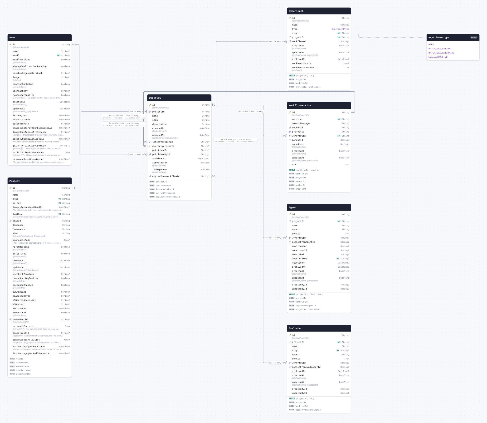

| Field                  | Type       | Constraints                                         | Default              | Description |
| ---------------------- | ---------- | --------------------------------------------------- | -------------------- | ----------- |
| `id`                   | `String`   | PK NOT NULL                                         | `nanoid()`           |             |
| `projectId`            | `String`   | NOT NULL → [Project.id](#model-Project)             |                      |             |
| `name`                 | `String`   | NOT NULL                                            |                      |             |
| `icon`                 | `String`   | NOT NULL                                            |                      |             |
| `description`          | `String`   | NOT NULL                                            |                      |             |
| `createdAt`            | `DateTime` | NOT NULL                                            | `now()`              |             |
| `updatedAt`            | `DateTime` | NOT NULL                                            | `now()` `@updatedAt` |             |
| `latestVersionId`      | `String`   | NULL → [WorkflowVersion.id](#model-WorkflowVersion) |                      |             |
| `currentVersionId`     | `String`   | NULL → [WorkflowVersion.id](#model-WorkflowVersion) |                      |             |
| `publishedId`          | `String`   | NULL                                                |                      |             |
| `publishedById`        | `String`   | NULL → [User.id](#model-User)                       |                      |             |
| `archivedAt`           | `DateTime` | NULL                                                |                      |             |
| `isEvaluator`          | `Boolean`  | NOT NULL                                            | `false`              |             |
| `isComponent`          | `Boolean`  | NOT NULL                                            | `false`              |             |
| `copiedFromWorkflowId` | `String`   | NULL → [Workflow.id](#model-Workflow)               |                      |             |

#### Indexes

- `@@index([projectId])`
- `@@index([publishedById])`
- `@@index([latestVersionId])`
- `@@index([currentVersionId])`
- `@@index([copiedFromWorkflowId])`

#### References

- `projectId` → [Project.id](#model-Project) (many-to-one)
- `latestVersionId` → [WorkflowVersion.id](#model-WorkflowVersion) (many-to-one, on delete Restrict, on update Restrict)
- `currentVersionId` → [WorkflowVersion.id](#model-WorkflowVersion) (many-to-one, on delete Restrict, on update Restrict)
- `publishedById` → [User.id](#model-User) (many-to-one)
- `copiedFromWorkflowId` → [Workflow.id](#model-Workflow) (many-to-one, on delete Restrict, on update Restrict)

#### Referenced by

- `id` ← [Experiment.workflowId](#model-Experiment) (one-to-many)
- `id` ← [Workflow.copiedFromWorkflowId](#model-Workflow) (one-to-many, on delete Restrict, on update Restrict)
- `id` ← [WorkflowVersion.workflowId](#model-WorkflowVersion) (one-to-many)
- `id` ← [Agent.workflowId](#model-Agent) (one-to-many)
- `id` ← [Evaluator.workflowId](#model-Evaluator) (one-to-many)

#### Definition

```sql
CREATE TABLE "Workflow" (
    "id" TEXT NOT NULL,
    "projectId" TEXT NOT NULL,
    "name" TEXT NOT NULL,
    "icon" TEXT NOT NULL,
    "description" TEXT NOT NULL,
    "createdAt" TIMESTAMP(3) NOT NULL DEFAULT CURRENT_TIMESTAMP,
    "updatedAt" TIMESTAMP(3) NOT NULL DEFAULT CURRENT_TIMESTAMP,
    "latestVersionId" TEXT,
    "currentVersionId" TEXT,
    "publishedId" TEXT,
    "publishedById" TEXT,
    "archivedAt" TIMESTAMP(3),
    "isEvaluator" BOOLEAN NOT NULL DEFAULT false,
    "isComponent" BOOLEAN NOT NULL DEFAULT false,
    "copiedFromWorkflowId" TEXT,

    CONSTRAINT "Workflow_pkey" PRIMARY KEY ("id")
);

CREATE INDEX "Workflow_projectId_idx" ON "Workflow"("projectId");

CREATE INDEX "Workflow_publishedById_idx" ON "Workflow"("publishedById");

CREATE INDEX "Workflow_latestVersionId_idx" ON "Workflow"("latestVersionId");

CREATE INDEX "Workflow_currentVersionId_idx" ON "Workflow"("currentVersionId");

CREATE INDEX "Workflow_copiedFromWorkflowId_idx" ON "Workflow"("copiedFromWorkflowId");
```

<details>
<summary>Queries and their SQL</summary>

**findMany**: Every row

```ts
await prisma.workflow.findMany();
```

```sql
SELECT
  "public"."Workflow"."id",
  "public"."Workflow"."projectId",
  "public"."Workflow"."name",
  "public"."Workflow"."icon",
  "public"."Workflow"."description",
  "public"."Workflow"."createdAt",
  "public"."Workflow"."updatedAt",
  "public"."Workflow"."latestVersionId",
  "public"."Workflow"."currentVersionId",
  "public"."Workflow"."publishedId",
  "public"."Workflow"."publishedById",
  "public"."Workflow"."archivedAt",
  "public"."Workflow"."isEvaluator",
  "public"."Workflow"."isComponent",
  "public"."Workflow"."copiedFromWorkflowId"
FROM
  "public"."Workflow"
WHERE
  1 = 1
OFFSET
  $1
-- params: ["0"]
```

**count**: How many rows there are

```ts
await prisma.workflow.count();
```

```sql
SELECT
  COUNT(*) AS "_count$_all"
FROM
  (
    SELECT
      "public"."Workflow"."id"
    FROM
      "public"."Workflow"
    WHERE
      1 = 1
    OFFSET
      $1
  ) AS "sub"
-- params: ["0"]
```

**findMany**: Every row with its relations

```ts
await prisma.workflow.findMany({
  include: {
    project: true,
    latestVersion: true,
    currentVersion: true,
    versions: true,
    publishedBy: true,
    experiments: true,
    copiedFrom: true,
    copiedWorkflows: true,
    agents: true,
    evaluators: true,
  },
});
```

```sql
SELECT
  "public"."Workflow"."id",
  "public"."Workflow"."projectId",
  "public"."Workflow"."name",
  "public"."Workflow"."icon",
  "public"."Workflow"."description",
  "public"."Workflow"."createdAt",
  "public"."Workflow"."updatedAt",
  "public"."Workflow"."latestVersionId",
  "public"."Workflow"."currentVersionId",
  "public"."Workflow"."publishedId",
  "public"."Workflow"."publishedById",
  "public"."Workflow"."archivedAt",
  "public"."Workflow"."isEvaluator",
  "public"."Workflow"."isComponent",
  "public"."Workflow"."copiedFromWorkflowId"
FROM
  "public"."Workflow"
WHERE
  1 = 1
OFFSET
  $1
-- params: ["0"]

SELECT
  "public"."Project"."id",
  "public"."Project"."name",
  "public"."Project"."slug",
  "public"."Project"."apiKey",
  "public"."Project"."legacyApiKeyLastUsedAt",
  "public"."Project"."lwqlKey",
  "public"."Project"."teamId",
  "public"."Project"."language",
  "public"."Project"."framework",
  "public"."Project"."kind",
  "public"."Project"."aggregateRule",
  "public"."Project"."firstMessage",
  "public"."Project"."integrated",
  "public"."Project"."createdAt",
  "public"."Project"."updatedAt",
  "public"."Project"."userLinkTemplate",
  "public"."Project"."traceSharingEnabled",
  "public"."Project"."presenceEnabled",
  "public"."Project"."s3Endpoint",
  "public"."Project"."s3AccessKeyId",
  "public"."Project"."s3SecretAccessKey",
  "public"."Project"."s3Bucket",
  "public"."Project"."archivedAt",
  "public"."Project"."isPersonal",
  "public"."Project"."ownerUserId",
  "public"."Project"."personalFeatures",
  "public"."Project"."departmentId",
  "public"."Project"."langyEgressAllowlist",
  "public"."Project"."lastCodingAgentSessionAt",
  "public"."Project"."lastCodingAgentPullRequestAt"
FROM
  "public"."Project"
WHERE
  "public"."Project"."id" IN ($1)
OFFSET
  $2
-- params: ["<projectId of the rows above>","0"]

SELECT
  "public"."WorkflowVersion"."id",
  "public"."WorkflowVersion"."version",
  "public"."WorkflowVersion"."commitMessage",
  "public"."WorkflowVersion"."authorId",
  "public"."WorkflowVersion"."projectId",
  "public"."WorkflowVersion"."workflowId",
  "public"."WorkflowVersion"."parentId",
  "public"."WorkflowVersion"."autoSaved",
  "public"."WorkflowVersion"."createdAt",
  "public"."WorkflowVersion"."updatedAt",
  "public"."WorkflowVersion"."dsl"
FROM
  "public"."WorkflowVersion"
WHERE
  "public"."WorkflowVersion"."id" IN ($1)
OFFSET
  $2
-- params: ["<latestVersionId of the rows above>","0"]

SELECT
  "public"."WorkflowVersion"."id",
  "public"."WorkflowVersion"."version",
  "public"."WorkflowVersion"."commitMessage",
  "public"."WorkflowVersion"."authorId",
  "public"."WorkflowVersion"."projectId",
  "public"."WorkflowVersion"."workflowId",
  "public"."WorkflowVersion"."parentId",
  "public"."WorkflowVersion"."autoSaved",
  "public"."WorkflowVersion"."createdAt",
  "public"."WorkflowVersion"."updatedAt",
  "public"."WorkflowVersion"."dsl"
FROM
  "public"."WorkflowVersion"
WHERE
  "public"."WorkflowVersion"."id" IN ($1)
OFFSET
  $2
-- params: ["<currentVersionId of the rows above>","0"]

SELECT
  "public"."WorkflowVersion"."id",
  "public"."WorkflowVersion"."version",
  "public"."WorkflowVersion"."commitMessage",
  "public"."WorkflowVersion"."authorId",
  "public"."WorkflowVersion"."projectId",
  "public"."WorkflowVersion"."workflowId",
  "public"."WorkflowVersion"."parentId",
  "public"."WorkflowVersion"."autoSaved",
  "public"."WorkflowVersion"."createdAt",
  "public"."WorkflowVersion"."updatedAt",
  "public"."WorkflowVersion"."dsl"
FROM
  "public"."WorkflowVersion"
WHERE
  "public"."WorkflowVersion"."workflowId" IN ($1)
OFFSET
  $2
-- params: ["<id of the rows above>","0"]

SELECT
  "public"."User"."id",
  "public"."User"."name",
  "public"."User"."email",
  "public"."User"."emailVerified",
  "public"."User"."signupConfirmationPending",
  "public"."User"."passkeySignupClaimHash",
  "public"."User"."image",
  "public"."User"."pendingSsoSetup",
  "public"."User"."userHashKey",
  "public"."User"."twoFactorEnabled",
  "public"."User"."createdAt",
  "public"."User"."updatedAt",
  "public"."User"."lastLoginAt",
  "public"."User"."deactivatedAt",
  "public"."User"."lastHomePath",
  "public"."User"."tracesExplorerTourDismissedAt",
  "public"."User"."langyCodeAccessPreference",
  "public"."User"."passkeyNudgeDismissedAt",
  "public"."User"."joinOfferDismissedDomains",
  "public"."User"."notificationPreferences",
  "public"."User"."passwordResetRequiredAt"
FROM
  "public"."User"
WHERE
  "public"."User"."id" IN ($1)
OFFSET
  $2
-- params: ["<publishedById of the rows above>","0"]

SELECT
  "public"."Experiment"."id",
  "public"."Experiment"."name",
  "public"."Experiment"."type"::text,
  "public"."Experiment"."slug",
  "public"."Experiment"."projectId",
  "public"."Experiment"."workflowId",
  "public"."Experiment"."createdAt",
  "public"."Experiment"."updatedAt",
  "public"."Experiment"."archivedAt",
  "public"."Experiment"."workbenchState",
  "public"."Experiment"."workbenchVersion"
FROM
  "public"."Experiment"
WHERE
  "public"."Experiment"."workflowId" IN ($1)
OFFSET
  $2
-- params: ["<id of the rows above>","0"]

SELECT
  "public"."Workflow"."id",
  "public"."Workflow"."projectId",
  "public"."Workflow"."name",
  "public"."Workflow"."icon",
  "public"."Workflow"."description",
  "public"."Workflow"."createdAt",
  "public"."Workflow"."updatedAt",
  "public"."Workflow"."latestVersionId",
  "public"."Workflow"."currentVersionId",
  "public"."Workflow"."publishedId",
  "public"."Workflow"."publishedById",
  "public"."Workflow"."archivedAt",
  "public"."Workflow"."isEvaluator",
  "public"."Workflow"."isComponent",
  "public"."Workflow"."copiedFromWorkflowId"
FROM
  "public"."Workflow"
WHERE
  "public"."Workflow"."id" IN ($1)
OFFSET
  $2
-- params: ["<copiedFromWorkflowId of the rows above>","0"]

SELECT
  "public"."Workflow"."id",
  "public"."Workflow"."projectId",
  "public"."Workflow"."name",
  "public"."Workflow"."icon",
  "public"."Workflow"."description",
  "public"."Workflow"."createdAt",
  "public"."Workflow"."updatedAt",
  "public"."Workflow"."latestVersionId",
  "public"."Workflow"."currentVersionId",
  "public"."Workflow"."publishedId",
  "public"."Workflow"."publishedById",
  "public"."Workflow"."archivedAt",
  "public"."Workflow"."isEvaluator",
  "public"."Workflow"."isComponent",
  "public"."Workflow"."copiedFromWorkflowId"
FROM
  "public"."Workflow"
WHERE
  "public"."Workflow"."copiedFromWorkflowId" IN ($1)
OFFSET
  $2
-- params: ["<id of the rows above>","0"]

SELECT
  "public"."Agent"."id",
  "public"."Agent"."projectId",
  "public"."Agent"."name",
  "public"."Agent"."type",
  "public"."Agent"."config",
  "public"."Agent"."workflowId",
  "public"."Agent"."copiedFromAgentId",
  "public"."Agent"."environment",
  "public"."Agent"."ownerUserId",
  "public"."Agent"."hostLabel",
  "public"."Agent"."identityKey",
  "public"."Agent"."lastSeenAt",
  "public"."Agent"."archivedAt",
  "public"."Agent"."createdAt",
  "public"."Agent"."updatedAt",
  "public"."Agent"."createdById",
  "public"."Agent"."updatedById"
FROM
  "public"."Agent"
WHERE
  "public"."Agent"."workflowId" IN ($1)
OFFSET
  $2
-- params: ["<id of the rows above>","0"]

SELECT
  "public"."Evaluator"."id",
  "public"."Evaluator"."projectId",
  "public"."Evaluator"."name",
  "public"."Evaluator"."slug",
  "public"."Evaluator"."type",
  "public"."Evaluator"."config",
  "public"."Evaluator"."workflowId",
  "public"."Evaluator"."copiedFromEvaluatorId",
  "public"."Evaluator"."archivedAt",
  "public"."Evaluator"."createdAt",
  "public"."Evaluator"."updatedAt",
  "public"."Evaluator"."createdById",
  "public"."Evaluator"."updatedById"
FROM
  "public"."Evaluator"
WHERE
  "public"."Evaluator"."workflowId" IN ($1)
OFFSET
  $2
-- params: ["<id of the rows above>","0"]
```

**findUnique**: One row by what is unique to it

```ts
await prisma.workflow.findUnique({ where: { id: "example" } });
```

```sql
SELECT
  "public"."Workflow"."id",
  "public"."Workflow"."projectId",
  "public"."Workflow"."name",
  "public"."Workflow"."icon",
  "public"."Workflow"."description",
  "public"."Workflow"."createdAt",
  "public"."Workflow"."updatedAt",
  "public"."Workflow"."latestVersionId",
  "public"."Workflow"."currentVersionId",
  "public"."Workflow"."publishedId",
  "public"."Workflow"."publishedById",
  "public"."Workflow"."archivedAt",
  "public"."Workflow"."isEvaluator",
  "public"."Workflow"."isComponent",
  "public"."Workflow"."copiedFromWorkflowId"
FROM
  "public"."Workflow"
WHERE
  (
    "public"."Workflow"."id" = $1
    AND 1 = 1
  )
LIMIT
  $2
OFFSET
  $3
-- params: ["example","1","0"]
```

**create**: Create a row

```ts
await prisma.workflow.create({
  data: { projectId: "example", name: "example", icon: "example", description: "example" },
});
```

```sql
INSERT INTO
  "public"."Workflow" (
    "id",
    "projectId",
    "name",
    "icon",
    "description",
    "createdAt",
    "updatedAt",
    "isEvaluator",
    "isComponent"
  )
VALUES
  ($1, $2, $3, $4, $5, $6, $7, $8, $9)
RETURNING
  "public"."Workflow"."id",
  "public"."Workflow"."projectId",
  "public"."Workflow"."name",
  "public"."Workflow"."icon",
  "public"."Workflow"."description",
  "public"."Workflow"."createdAt",
  "public"."Workflow"."updatedAt",
  "public"."Workflow"."latestVersionId",
  "public"."Workflow"."currentVersionId",
  "public"."Workflow"."publishedId",
  "public"."Workflow"."publishedById",
  "public"."Workflow"."archivedAt",
  "public"."Workflow"."isEvaluator",
  "public"."Workflow"."isComponent",
  "public"."Workflow"."copiedFromWorkflowId"
-- params: ["<nanoid()>","example","example","example","example","<now()>","<now()>",false,false]
```

**update**: Update a row

```ts
await prisma.workflow.update({ where: { id: "example" }, data: { name: "example" } });
```

```sql
SELECT
  "public"."Workflow"."id"
FROM
  "public"."Workflow"
WHERE
  (
    "public"."Workflow"."id" = $1
    AND 1 = 1
  )
LIMIT
  $2
OFFSET
  $3
-- params: ["example","1","0"]

SELECT
  "public"."Workflow"."id",
  "public"."Workflow"."copiedFromWorkflowId"
FROM
  "public"."Workflow"
WHERE
  (
    1 = 1
    AND "public"."Workflow"."copiedFromWorkflowId" IN ($1)
  )
OFFSET
  $2
-- params: ["<id of the rows above>","0"]

UPDATE "public"."Workflow"
SET
  "name" = $1,
  "updatedAt" = $2
WHERE
  (
    "public"."Workflow"."id" IN ($3)
    AND (
      "public"."Workflow"."id" = $4
      AND 1 = 1
    )
  )
RETURNING
  "public"."Workflow"."id",
  "public"."Workflow"."projectId",
  "public"."Workflow"."name",
  "public"."Workflow"."icon",
  "public"."Workflow"."description",
  "public"."Workflow"."createdAt",
  "public"."Workflow"."updatedAt",
  "public"."Workflow"."latestVersionId",
  "public"."Workflow"."currentVersionId",
  "public"."Workflow"."publishedId",
  "public"."Workflow"."publishedById",
  "public"."Workflow"."archivedAt",
  "public"."Workflow"."isEvaluator",
  "public"."Workflow"."isComponent",
  "public"."Workflow"."copiedFromWorkflowId"
-- params: ["example",{"prisma__type":"generatorCall","prisma__value":{"name":"now","args":[],"returnType":{"type":"DateTime"}}},"<id of the rows above>","example"]
```

**delete**: Delete a row

```ts
await prisma.workflow.delete({ where: { id: "example" } });
```

```sql
DELETE FROM "public"."Workflow"
WHERE
  (
    "public"."Workflow"."id" = $1
    AND 1 = 1
  )
RETURNING
  "public"."Workflow"."id",
  "public"."Workflow"."projectId",
  "public"."Workflow"."name",
  "public"."Workflow"."icon",
  "public"."Workflow"."description",
  "public"."Workflow"."createdAt",
  "public"."Workflow"."updatedAt",
  "public"."Workflow"."latestVersionId",
  "public"."Workflow"."currentVersionId",
  "public"."Workflow"."publishedId",
  "public"."Workflow"."publishedById",
  "public"."Workflow"."archivedAt",
  "public"."Workflow"."isEvaluator",
  "public"."Workflow"."isComponent",
  "public"."Workflow"."copiedFromWorkflowId"
-- params: ["example"]

SELECT
  "public"."Experiment"."id",
  "public"."Experiment"."workflowId"
FROM
  "public"."Experiment"
WHERE
  (
    1 = 1
    AND "public"."Experiment"."workflowId" IN ($1)
  )
OFFSET
  $2
-- params: ["<id of the rows above>","0"]

UPDATE "public"."Experiment"
SET
  "workflowId" = $1
WHERE
  (
    "public"."Experiment"."id" IN ($2)
    AND 1 = 1
  )
-- params: [null,"<id of the rows above>"]

SELECT
  "public"."Workflow"."id",
  "public"."Workflow"."copiedFromWorkflowId"
FROM
  "public"."Workflow"
WHERE
  (
    1 = 1
    AND "public"."Workflow"."copiedFromWorkflowId" IN ($1)
  )
OFFSET
  $2
-- params: ["<id of the rows above>","0"]

SELECT
  "public"."WorkflowVersion"."id",
  "public"."WorkflowVersion"."workflowId"
FROM
  "public"."WorkflowVersion"
WHERE
  (
    1 = 1
    AND "public"."WorkflowVersion"."workflowId" IN ($1)
  )
OFFSET
  $2
-- params: ["<id of the rows above>","0"]

SELECT
  "public"."Agent"."id",
  "public"."Agent"."workflowId"
FROM
  "public"."Agent"
WHERE
  (
    1 = 1
    AND "public"."Agent"."workflowId" IN ($1)
  )
OFFSET
  $2
-- params: ["<id of the rows above>","0"]

UPDATE "public"."Agent"
SET
  "workflowId" = $1
WHERE
  (
    "public"."Agent"."id" IN ($2)
    AND 1 = 1
  )
-- params: [null,"<id of the rows above>"]

SELECT
  "public"."Evaluator"."id",
  "public"."Evaluator"."workflowId"
FROM
  "public"."Evaluator"
WHERE
  (
    1 = 1
    AND "public"."Evaluator"."workflowId" IN ($1)
  )
OFFSET
  $2
-- params: ["<id of the rows above>","0"]

UPDATE "public"."Evaluator"
SET
  "workflowId" = $1
WHERE
  (
    "public"."Evaluator"."id" IN ($2)
    AND 1 = 1
  )
-- params: [null,"<id of the rows above>"]
```

</details>

<a id="model-WorkflowVersion"></a>

### WorkflowVersion


| Field           | Type       | Constraints                                         | Default              | Description |
| --------------- | ---------- | --------------------------------------------------- | -------------------- | ----------- |
| `id`            | `String`   | PK NOT NULL                                         | `nanoid()`           |             |
| `version`       | `String`   | NOT NULL                                            |                      |             |
| `commitMessage` | `String`   | NOT NULL                                            |                      |             |
| `authorId`      | `String`   | NOT NULL → [User.id](#model-User)                   |                      |             |
| `projectId`     | `String`   | NOT NULL → [Project.id](#model-Project)             |                      |             |
| `workflowId`    | `String`   | NOT NULL → [Workflow.id](#model-Workflow)           |                      |             |
| `parentId`      | `String`   | NULL → [WorkflowVersion.id](#model-WorkflowVersion) |                      |             |
| `autoSaved`     | `Boolean`  | NOT NULL                                            | `false`              |             |
| `createdAt`     | `DateTime` | NOT NULL                                            | `now()`              |             |
| `updatedAt`     | `DateTime` | NOT NULL                                            | `now()` `@updatedAt` |             |
| `dsl`           | `Json`     | NOT NULL                                            |                      |             |

#### Indexes

- `@@index([workflowId])`
- `@@index([projectId])`
- `@@index([parentId])`
- `@@index([authorId])`
- `@@index([createdAt])`
- `@@unique([workflowId, version])`

#### References

- `authorId` → [User.id](#model-User) (many-to-one)
- `projectId` → [Project.id](#model-Project) (many-to-one)
- `workflowId` → [Workflow.id](#model-Workflow) (many-to-one)
- `parentId` → [WorkflowVersion.id](#model-WorkflowVersion) (many-to-one, on delete Restrict, on update Restrict)

#### Referenced by

- `id` ← [Workflow.latestVersionId](#model-Workflow) (one-to-many, on delete Restrict, on update Restrict)
- `id` ← [Workflow.currentVersionId](#model-Workflow) (one-to-many, on delete Restrict, on update Restrict)
- `id` ← [WorkflowVersion.parentId](#model-WorkflowVersion) (one-to-many, on delete Restrict, on update Restrict)

#### Definition

```sql
CREATE TABLE "WorkflowVersion" (
    "id" TEXT NOT NULL,
    "version" TEXT NOT NULL,
    "commitMessage" TEXT NOT NULL,
    "authorId" TEXT NOT NULL,
    "projectId" TEXT NOT NULL,
    "workflowId" TEXT NOT NULL,
    "parentId" TEXT,
    "autoSaved" BOOLEAN NOT NULL DEFAULT false,
    "createdAt" TIMESTAMP(3) NOT NULL DEFAULT CURRENT_TIMESTAMP,
    "updatedAt" TIMESTAMP(3) NOT NULL DEFAULT CURRENT_TIMESTAMP,
    "dsl" JSONB NOT NULL,

    CONSTRAINT "WorkflowVersion_pkey" PRIMARY KEY ("id")
);

CREATE INDEX "WorkflowVersion_workflowId_idx" ON "WorkflowVersion"("workflowId");

CREATE INDEX "WorkflowVersion_projectId_idx" ON "WorkflowVersion"("projectId");

CREATE INDEX "WorkflowVersion_parentId_idx" ON "WorkflowVersion"("parentId");

CREATE INDEX "WorkflowVersion_authorId_idx" ON "WorkflowVersion"("authorId");

CREATE INDEX "WorkflowVersion_createdAt_idx" ON "WorkflowVersion"("createdAt");

CREATE UNIQUE INDEX "WorkflowVersion_workflowId_version_key" ON "WorkflowVersion"("workflowId", "version");
```

<details>
<summary>Queries and their SQL</summary>

**findMany**: Every row

```ts
await prisma.workflowVersion.findMany();
```

```sql
SELECT
  "public"."WorkflowVersion"."id",
  "public"."WorkflowVersion"."version",
  "public"."WorkflowVersion"."commitMessage",
  "public"."WorkflowVersion"."authorId",
  "public"."WorkflowVersion"."projectId",
  "public"."WorkflowVersion"."workflowId",
  "public"."WorkflowVersion"."parentId",
  "public"."WorkflowVersion"."autoSaved",
  "public"."WorkflowVersion"."createdAt",
  "public"."WorkflowVersion"."updatedAt",
  "public"."WorkflowVersion"."dsl"
FROM
  "public"."WorkflowVersion"
WHERE
  1 = 1
OFFSET
  $1
-- params: ["0"]
```

**count**: How many rows there are

```ts
await prisma.workflowVersion.count();
```

```sql
SELECT
  COUNT(*) AS "_count$_all"
FROM
  (
    SELECT
      "public"."WorkflowVersion"."id"
    FROM
      "public"."WorkflowVersion"
    WHERE
      1 = 1
    OFFSET
      $1
  ) AS "sub"
-- params: ["0"]
```

**findMany**: Every row with its relations

```ts
await prisma.workflowVersion.findMany({
  include: {
    author: true,
    project: true,
    workflow: true,
    parent: true,
    children: true,
    WorkflowAsLatestVersion: true,
    WorkflowAsCurrentVersion: true,
  },
});
```

```sql
SELECT
  "public"."WorkflowVersion"."id",
  "public"."WorkflowVersion"."version",
  "public"."WorkflowVersion"."commitMessage",
  "public"."WorkflowVersion"."authorId",
  "public"."WorkflowVersion"."projectId",
  "public"."WorkflowVersion"."workflowId",
  "public"."WorkflowVersion"."parentId",
  "public"."WorkflowVersion"."autoSaved",
  "public"."WorkflowVersion"."createdAt",
  "public"."WorkflowVersion"."updatedAt",
  "public"."WorkflowVersion"."dsl"
FROM
  "public"."WorkflowVersion"
WHERE
  1 = 1
OFFSET
  $1
-- params: ["0"]

SELECT
  "public"."User"."id",
  "public"."User"."name",
  "public"."User"."email",
  "public"."User"."emailVerified",
  "public"."User"."signupConfirmationPending",
  "public"."User"."passkeySignupClaimHash",
  "public"."User"."image",
  "public"."User"."pendingSsoSetup",
  "public"."User"."userHashKey",
  "public"."User"."twoFactorEnabled",
  "public"."User"."createdAt",
  "public"."User"."updatedAt",
  "public"."User"."lastLoginAt",
  "public"."User"."deactivatedAt",
  "public"."User"."lastHomePath",
  "public"."User"."tracesExplorerTourDismissedAt",
  "public"."User"."langyCodeAccessPreference",
  "public"."User"."passkeyNudgeDismissedAt",
  "public"."User"."joinOfferDismissedDomains",
  "public"."User"."notificationPreferences",
  "public"."User"."passwordResetRequiredAt"
FROM
  "public"."User"
WHERE
  "public"."User"."id" IN ($1)
OFFSET
  $2
-- params: ["<authorId of the rows above>","0"]

SELECT
  "public"."Project"."id",
  "public"."Project"."name",
  "public"."Project"."slug",
  "public"."Project"."apiKey",
  "public"."Project"."legacyApiKeyLastUsedAt",
  "public"."Project"."lwqlKey",
  "public"."Project"."teamId",
  "public"."Project"."language",
  "public"."Project"."framework",
  "public"."Project"."kind",
  "public"."Project"."aggregateRule",
  "public"."Project"."firstMessage",
  "public"."Project"."integrated",
  "public"."Project"."createdAt",
  "public"."Project"."updatedAt",
  "public"."Project"."userLinkTemplate",
  "public"."Project"."traceSharingEnabled",
  "public"."Project"."presenceEnabled",
  "public"."Project"."s3Endpoint",
  "public"."Project"."s3AccessKeyId",
  "public"."Project"."s3SecretAccessKey",
  "public"."Project"."s3Bucket",
  "public"."Project"."archivedAt",
  "public"."Project"."isPersonal",
  "public"."Project"."ownerUserId",
  "public"."Project"."personalFeatures",
  "public"."Project"."departmentId",
  "public"."Project"."langyEgressAllowlist",
  "public"."Project"."lastCodingAgentSessionAt",
  "public"."Project"."lastCodingAgentPullRequestAt"
FROM
  "public"."Project"
WHERE
  "public"."Project"."id" IN ($1)
OFFSET
  $2
-- params: ["<projectId of the rows above>","0"]

SELECT
  "public"."Workflow"."id",
  "public"."Workflow"."projectId",
  "public"."Workflow"."name",
  "public"."Workflow"."icon",
  "public"."Workflow"."description",
  "public"."Workflow"."createdAt",
  "public"."Workflow"."updatedAt",
  "public"."Workflow"."latestVersionId",
  "public"."Workflow"."currentVersionId",
  "public"."Workflow"."publishedId",
  "public"."Workflow"."publishedById",
  "public"."Workflow"."archivedAt",
  "public"."Workflow"."isEvaluator",
  "public"."Workflow"."isComponent",
  "public"."Workflow"."copiedFromWorkflowId"
FROM
  "public"."Workflow"
WHERE
  "public"."Workflow"."id" IN ($1)
OFFSET
  $2
-- params: ["<workflowId of the rows above>","0"]

SELECT
  "public"."WorkflowVersion"."id",
  "public"."WorkflowVersion"."version",
  "public"."WorkflowVersion"."commitMessage",
  "public"."WorkflowVersion"."authorId",
  "public"."WorkflowVersion"."projectId",
  "public"."WorkflowVersion"."workflowId",
  "public"."WorkflowVersion"."parentId",
  "public"."WorkflowVersion"."autoSaved",
  "public"."WorkflowVersion"."createdAt",
  "public"."WorkflowVersion"."updatedAt",
  "public"."WorkflowVersion"."dsl"
FROM
  "public"."WorkflowVersion"
WHERE
  "public"."WorkflowVersion"."id" IN ($1)
OFFSET
  $2
-- params: ["<parentId of the rows above>","0"]

SELECT
  "public"."WorkflowVersion"."id",
  "public"."WorkflowVersion"."version",
  "public"."WorkflowVersion"."commitMessage",
  "public"."WorkflowVersion"."authorId",
  "public"."WorkflowVersion"."projectId",
  "public"."WorkflowVersion"."workflowId",
  "public"."WorkflowVersion"."parentId",
  "public"."WorkflowVersion"."autoSaved",
  "public"."WorkflowVersion"."createdAt",
  "public"."WorkflowVersion"."updatedAt",
  "public"."WorkflowVersion"."dsl"
FROM
  "public"."WorkflowVersion"
WHERE
  "public"."WorkflowVersion"."parentId" IN ($1)
OFFSET
  $2
-- params: ["<id of the rows above>","0"]

SELECT
  "public"."Workflow"."id",
  "public"."Workflow"."projectId",
  "public"."Workflow"."name",
  "public"."Workflow"."icon",
  "public"."Workflow"."description",
  "public"."Workflow"."createdAt",
  "public"."Workflow"."updatedAt",
  "public"."Workflow"."latestVersionId",
  "public"."Workflow"."currentVersionId",
  "public"."Workflow"."publishedId",
  "public"."Workflow"."publishedById",
  "public"."Workflow"."archivedAt",
  "public"."Workflow"."isEvaluator",
  "public"."Workflow"."isComponent",
  "public"."Workflow"."copiedFromWorkflowId"
FROM
  "public"."Workflow"
WHERE
  "public"."Workflow"."latestVersionId" IN ($1)
OFFSET
  $2
-- params: ["<id of the rows above>","0"]

SELECT
  "public"."Workflow"."id",
  "public"."Workflow"."projectId",
  "public"."Workflow"."name",
  "public"."Workflow"."icon",
  "public"."Workflow"."description",
  "public"."Workflow"."createdAt",
  "public"."Workflow"."updatedAt",
  "public"."Workflow"."latestVersionId",
  "public"."Workflow"."currentVersionId",
  "public"."Workflow"."publishedId",
  "public"."Workflow"."publishedById",
  "public"."Workflow"."archivedAt",
  "public"."Workflow"."isEvaluator",
  "public"."Workflow"."isComponent",
  "public"."Workflow"."copiedFromWorkflowId"
FROM
  "public"."Workflow"
WHERE
  "public"."Workflow"."currentVersionId" IN ($1)
OFFSET
  $2
-- params: ["<id of the rows above>","0"]
```

**findUnique**: One row by what is unique to it

```ts
await prisma.workflowVersion.findUnique({ where: { id: "example" } });
```

```sql
SELECT
  "public"."WorkflowVersion"."id",
  "public"."WorkflowVersion"."version",
  "public"."WorkflowVersion"."commitMessage",
  "public"."WorkflowVersion"."authorId",
  "public"."WorkflowVersion"."projectId",
  "public"."WorkflowVersion"."workflowId",
  "public"."WorkflowVersion"."parentId",
  "public"."WorkflowVersion"."autoSaved",
  "public"."WorkflowVersion"."createdAt",
  "public"."WorkflowVersion"."updatedAt",
  "public"."WorkflowVersion"."dsl"
FROM
  "public"."WorkflowVersion"
WHERE
  (
    "public"."WorkflowVersion"."id" = $1
    AND 1 = 1
  )
LIMIT
  $2
OFFSET
  $3
-- params: ["example","1","0"]
```

**create**: Create a row

```ts
await prisma.workflowVersion.create({
  data: {
    version: "example",
    commitMessage: "example",
    authorId: "example",
    projectId: "example",
    workflowId: "example",
    dsl: {},
  },
});
```

```sql
INSERT INTO
  "public"."WorkflowVersion" (
    "id",
    "version",
    "commitMessage",
    "authorId",
    "projectId",
    "workflowId",
    "autoSaved",
    "createdAt",
    "updatedAt",
    "dsl"
  )
VALUES
  ($1, $2, $3, $4, $5, $6, $7, $8, $9, $10)
RETURNING
  "public"."WorkflowVersion"."id",
  "public"."WorkflowVersion"."version",
  "public"."WorkflowVersion"."commitMessage",
  "public"."WorkflowVersion"."authorId",
  "public"."WorkflowVersion"."projectId",
  "public"."WorkflowVersion"."workflowId",
  "public"."WorkflowVersion"."parentId",
  "public"."WorkflowVersion"."autoSaved",
  "public"."WorkflowVersion"."createdAt",
  "public"."WorkflowVersion"."updatedAt",
  "public"."WorkflowVersion"."dsl"
-- params: ["<nanoid()>","example","example","example","example","example",false,"<now()>","<now()>","{}"]
```

**update**: Update a row

```ts
await prisma.workflowVersion.update({ where: { id: "example" }, data: { version: "example" } });
```

```sql
SELECT
  "public"."WorkflowVersion"."id"
FROM
  "public"."WorkflowVersion"
WHERE
  (
    "public"."WorkflowVersion"."id" = $1
    AND 1 = 1
  )
LIMIT
  $2
OFFSET
  $3
-- params: ["example","1","0"]

SELECT
  "public"."WorkflowVersion"."id",
  "public"."WorkflowVersion"."parentId"
FROM
  "public"."WorkflowVersion"
WHERE
  (
    1 = 1
    AND "public"."WorkflowVersion"."parentId" IN ($1)
  )
OFFSET
  $2
-- params: ["<id of the rows above>","0"]

SELECT
  "public"."Workflow"."id",
  "public"."Workflow"."currentVersionId"
FROM
  "public"."Workflow"
WHERE
  (
    1 = 1
    AND "public"."Workflow"."currentVersionId" IN ($1)
  )
OFFSET
  $2
-- params: ["<id of the rows above>","0"]

SELECT
  "public"."Workflow"."id",
  "public"."Workflow"."latestVersionId"
FROM
  "public"."Workflow"
WHERE
  (
    1 = 1
    AND "public"."Workflow"."latestVersionId" IN ($1)
  )
OFFSET
  $2
-- params: ["<id of the rows above>","0"]

UPDATE "public"."WorkflowVersion"
SET
  "version" = $1,
  "updatedAt" = $2
WHERE
  (
    "public"."WorkflowVersion"."id" IN ($3)
    AND (
      "public"."WorkflowVersion"."id" = $4
      AND 1 = 1
    )
  )
RETURNING
  "public"."WorkflowVersion"."id",
  "public"."WorkflowVersion"."version",
  "public"."WorkflowVersion"."commitMessage",
  "public"."WorkflowVersion"."authorId",
  "public"."WorkflowVersion"."projectId",
  "public"."WorkflowVersion"."workflowId",
  "public"."WorkflowVersion"."parentId",
  "public"."WorkflowVersion"."autoSaved",
  "public"."WorkflowVersion"."createdAt",
  "public"."WorkflowVersion"."updatedAt",
  "public"."WorkflowVersion"."dsl"
-- params: ["example",{"prisma__type":"generatorCall","prisma__value":{"name":"now","args":[],"returnType":{"type":"DateTime"}}},"<id of the rows above>","example"]
```

**delete**: Delete a row

```ts
await prisma.workflowVersion.delete({ where: { id: "example" } });
```

```sql
DELETE FROM "public"."WorkflowVersion"
WHERE
  (
    "public"."WorkflowVersion"."id" = $1
    AND 1 = 1
  )
RETURNING
  "public"."WorkflowVersion"."id",
  "public"."WorkflowVersion"."version",
  "public"."WorkflowVersion"."commitMessage",
  "public"."WorkflowVersion"."authorId",
  "public"."WorkflowVersion"."projectId",
  "public"."WorkflowVersion"."workflowId",
  "public"."WorkflowVersion"."parentId",
  "public"."WorkflowVersion"."autoSaved",
  "public"."WorkflowVersion"."createdAt",
  "public"."WorkflowVersion"."updatedAt",
  "public"."WorkflowVersion"."dsl"
-- params: ["example"]

SELECT
  "public"."Workflow"."id",
  "public"."Workflow"."latestVersionId"
FROM
  "public"."Workflow"
WHERE
  (
    1 = 1
    AND "public"."Workflow"."latestVersionId" IN ($1)
  )
OFFSET
  $2
-- params: ["<id of the rows above>","0"]

SELECT
  "public"."Workflow"."id",
  "public"."Workflow"."currentVersionId"
FROM
  "public"."Workflow"
WHERE
  (
    1 = 1
    AND "public"."Workflow"."currentVersionId" IN ($1)
  )
OFFSET
  $2
-- params: ["<id of the rows above>","0"]

SELECT
  "public"."WorkflowVersion"."id",
  "public"."WorkflowVersion"."parentId"
FROM
  "public"."WorkflowVersion"
WHERE
  (
    1 = 1
    AND "public"."WorkflowVersion"."parentId" IN ($1)
  )
OFFSET
  $2
-- params: ["<id of the rows above>","0"]
```

</details>

<a id="model-AuditLog"></a>

### AuditLog

| Field            | Type       | Constraints | Default   | Description                                                                                                                                                                                                                                                                                                                                                                                                                                                                                                                        |
| ---------------- | ---------- | ----------- | --------- | ---------------------------------------------------------------------------------------------------------------------------------------------------------------------------------------------------------------------------------------------------------------------------------------------------------------------------------------------------------------------------------------------------------------------------------------------------------------------------------------------------------------------------------- |
| `id`             | `String`   | PK NOT NULL | `cuid(1)` |                                                                                                                                                                                                                                                                                                                                                                                                                                                                                                                                    |
| `createdAt`      | `DateTime` | NOT NULL    | `now()`   |                                                                                                                                                                                                                                                                                                                                                                                                                                                                                                                                    |
| `userId`         | `String`   | NULL        |           |                                                                                                                                                                                                                                                                                                                                                                                                                                                                                                                                    |
| `projectId`      | `String`   | NULL        |           |                                                                                                                                                                                                                                                                                                                                                                                                                                                                                                                                    |
| `organizationId` | `String`   | NULL        |           |                                                                                                                                                                                                                                                                                                                                                                                                                                                                                                                                    |
| `action`         | `String`   | NOT NULL    |           |                                                                                                                                                                                                                                                                                                                                                                                                                                                                                                                                    |
| `args`           | `Json`     | NULL        |           |                                                                                                                                                                                                                                                                                                                                                                                                                                                                                                                                    |
| `error`          | `String`   | NULL        |           |                                                                                                                                                                                                                                                                                                                                                                                                                                                                                                                                    |
| `ipAddress`      | `String`   | NULL        |           |                                                                                                                                                                                                                                                                                                                                                                                                                                                                                                                                    |
| `userAgent`      | `String`   | NULL        |           |                                                                                                                                                                                                                                                                                                                                                                                                                                                                                                                                    |
| `metadata`       | `Json`     | NULL        |           |                                                                                                                                                                                                                                                                                                                                                                                                                                                                                                                                    |
| `actorUserId`    | `String`   | NULL        |           | WHO REALLY DID IT, when that is not `userId`. Under an impersonation the session's `user.id` is the SUBJECT — the customer whose access an operator is borrowing — so a row naming only `userId` filed the operator's act against the customer. An operator granting a permanent way into somebody's organization appeared, in the only durable record of it, to be that somebody. Null on an ordinary request, where the two would be the same person and saying so twice adds nothing. ADR-118 / D06: every decision names both. |
| `targetKind`     | `String`   | NULL        |           |                                                                                                                                                                                                                                                                                                                                                                                                                                                                                                                                    |
| `targetId`       | `String`   | NULL        |           |                                                                                                                                                                                                                                                                                                                                                                                                                                                                                                                                    |
| `before`         | `Json`     | NULL        |           |                                                                                                                                                                                                                                                                                                                                                                                                                                                                                                                                    |
| `after`          | `Json`     | NULL        |           |                                                                                                                                                                                                                                                                                                                                                                                                                                                                                                                                    |
| `idempotencyKey` | `String`   | UNIQUE NULL |           | A producer's outbox key: a redelivered audit intent finds its row here (Alex, audit R2).                                                                                                                                                                                                                                                                                                                                                                                                                                           |

#### Indexes

- `@@index([createdAt])`
- `@@index([userId])`
- `@@index([actorUserId])`
- `@@index([projectId])`
- `@@index([action])`
- `@@index([ipAddress])`
- `@@index([organizationId, createdAt])`
- `@@index([targetKind, targetId])`

#### Definition

```sql
CREATE TABLE "AuditLog" (
    "id" TEXT NOT NULL,
    "createdAt" TIMESTAMP(3) NOT NULL DEFAULT CURRENT_TIMESTAMP,
    "userId" TEXT,
    "projectId" TEXT,
    "organizationId" TEXT,
    "action" TEXT NOT NULL,
    "args" JSONB,
    "error" TEXT,
    "ipAddress" TEXT,
    "userAgent" TEXT,
    "metadata" JSONB,
    "actorUserId" TEXT,
    "targetKind" TEXT,
    "targetId" TEXT,
    "before" JSONB,
    "after" JSONB,
    "idempotencyKey" TEXT,

    CONSTRAINT "AuditLog_pkey" PRIMARY KEY ("id")
);

CREATE UNIQUE INDEX "AuditLog_idempotencyKey_key" ON "AuditLog"("idempotencyKey");

CREATE INDEX "AuditLog_createdAt_idx" ON "AuditLog"("createdAt");

CREATE INDEX "AuditLog_userId_idx" ON "AuditLog"("userId");

CREATE INDEX "AuditLog_actorUserId_idx" ON "AuditLog"("actorUserId");

CREATE INDEX "AuditLog_projectId_idx" ON "AuditLog"("projectId");

CREATE INDEX "AuditLog_action_idx" ON "AuditLog"("action");

CREATE INDEX "AuditLog_ipAddress_idx" ON "AuditLog"("ipAddress");

CREATE INDEX "AuditLog_organizationId_createdAt_idx" ON "AuditLog"("organizationId", "createdAt");

CREATE INDEX "AuditLog_targetKind_targetId_idx" ON "AuditLog"("targetKind", "targetId");
```

<details>
<summary>Queries and their SQL</summary>

**findMany**: Every row

```ts
await prisma.auditLog.findMany();
```

```sql
SELECT
  "public"."AuditLog"."id",
  "public"."AuditLog"."createdAt",
  "public"."AuditLog"."userId",
  "public"."AuditLog"."projectId",
  "public"."AuditLog"."organizationId",
  "public"."AuditLog"."action",
  "public"."AuditLog"."args",
  "public"."AuditLog"."error",
  "public"."AuditLog"."ipAddress",
  "public"."AuditLog"."userAgent",
  "public"."AuditLog"."metadata",
  "public"."AuditLog"."actorUserId",
  "public"."AuditLog"."targetKind",
  "public"."AuditLog"."targetId",
  "public"."AuditLog"."before",
  "public"."AuditLog"."after",
  "public"."AuditLog"."idempotencyKey"
FROM
  "public"."AuditLog"
WHERE
  1 = 1
OFFSET
  $1
-- params: ["0"]
```

**count**: How many rows there are

```ts
await prisma.auditLog.count();
```

```sql
SELECT
  COUNT(*) AS "_count$_all"
FROM
  (
    SELECT
      "public"."AuditLog"."id"
    FROM
      "public"."AuditLog"
    WHERE
      1 = 1
    OFFSET
      $1
  ) AS "sub"
-- params: ["0"]
```

**findUnique**: One row by what is unique to it

```ts
await prisma.auditLog.findUnique({ where: { id: "example" } });
```

```sql
SELECT
  "public"."AuditLog"."id",
  "public"."AuditLog"."createdAt",
  "public"."AuditLog"."userId",
  "public"."AuditLog"."projectId",
  "public"."AuditLog"."organizationId",
  "public"."AuditLog"."action",
  "public"."AuditLog"."args",
  "public"."AuditLog"."error",
  "public"."AuditLog"."ipAddress",
  "public"."AuditLog"."userAgent",
  "public"."AuditLog"."metadata",
  "public"."AuditLog"."actorUserId",
  "public"."AuditLog"."targetKind",
  "public"."AuditLog"."targetId",
  "public"."AuditLog"."before",
  "public"."AuditLog"."after",
  "public"."AuditLog"."idempotencyKey"
FROM
  "public"."AuditLog"
WHERE
  (
    "public"."AuditLog"."id" = $1
    AND 1 = 1
  )
LIMIT
  $2
OFFSET
  $3
-- params: ["example","1","0"]
```

**create**: Create a row

```ts
await prisma.auditLog.create({ data: { action: "example" } });
```

```sql
INSERT INTO
  "public"."AuditLog" ("id", "createdAt", "action")
VALUES
  ($1, $2, $3)
RETURNING
  "public"."AuditLog"."id",
  "public"."AuditLog"."createdAt",
  "public"."AuditLog"."userId",
  "public"."AuditLog"."projectId",
  "public"."AuditLog"."organizationId",
  "public"."AuditLog"."action",
  "public"."AuditLog"."args",
  "public"."AuditLog"."error",
  "public"."AuditLog"."ipAddress",
  "public"."AuditLog"."userAgent",
  "public"."AuditLog"."metadata",
  "public"."AuditLog"."actorUserId",
  "public"."AuditLog"."targetKind",
  "public"."AuditLog"."targetId",
  "public"."AuditLog"."before",
  "public"."AuditLog"."after",
  "public"."AuditLog"."idempotencyKey"
-- params: ["<cuid(1)>","<now()>","example"]
```

**update**: Update a row

```ts
await prisma.auditLog.update({
  where: { id: "example" },
  data: { createdAt: new Date("2026-01-01T00:00:00.000Z") },
});
```

```sql
SELECT
  "public"."AuditLog"."id"
FROM
  "public"."AuditLog"
WHERE
  (
    "public"."AuditLog"."id" = $1
    AND 1 = 1
  )
LIMIT
  $2
OFFSET
  $3
-- params: ["example","1","0"]

UPDATE "public"."AuditLog"
SET
  "createdAt" = $1
WHERE
  (
    "public"."AuditLog"."id" IN ($2)
    AND (
      "public"."AuditLog"."id" = $3
      AND 1 = 1
    )
  )
RETURNING
  "public"."AuditLog"."id",
  "public"."AuditLog"."createdAt",
  "public"."AuditLog"."userId",
  "public"."AuditLog"."projectId",
  "public"."AuditLog"."organizationId",
  "public"."AuditLog"."action",
  "public"."AuditLog"."args",
  "public"."AuditLog"."error",
  "public"."AuditLog"."ipAddress",
  "public"."AuditLog"."userAgent",
  "public"."AuditLog"."metadata",
  "public"."AuditLog"."actorUserId",
  "public"."AuditLog"."targetKind",
  "public"."AuditLog"."targetId",
  "public"."AuditLog"."before",
  "public"."AuditLog"."after",
  "public"."AuditLog"."idempotencyKey"
-- params: ["2026-01-01T00:00:00.000Z","<id of the rows above>","example"]
```

**delete**: Delete a row

```ts
await prisma.auditLog.delete({ where: { id: "example" } });
```

```sql
DELETE FROM "public"."AuditLog"
WHERE
  (
    "public"."AuditLog"."id" = $1
    AND 1 = 1
  )
RETURNING
  "public"."AuditLog"."id",
  "public"."AuditLog"."createdAt",
  "public"."AuditLog"."userId",
  "public"."AuditLog"."projectId",
  "public"."AuditLog"."organizationId",
  "public"."AuditLog"."action",
  "public"."AuditLog"."args",
  "public"."AuditLog"."error",
  "public"."AuditLog"."ipAddress",
  "public"."AuditLog"."userAgent",
  "public"."AuditLog"."metadata",
  "public"."AuditLog"."actorUserId",
  "public"."AuditLog"."targetKind",
  "public"."AuditLog"."targetId",
  "public"."AuditLog"."before",
  "public"."AuditLog"."after",
  "public"."AuditLog"."idempotencyKey"
-- params: ["example"]
```

</details>

<a id="model-LlmPromptConfig"></a>

### LlmPromptConfig


| Field                | Type                               | Constraints                                         | Default              | Description |
| -------------------- | ---------------------------------- | --------------------------------------------------- | -------------------- | ----------- |
| `id`                 | `String`                           | PK NOT NULL                                         | `nanoid()`           |             |
| `handle`             | `String`                           | UNIQUE NULL                                         |                      |             |
| `name`               | `String`                           | NOT NULL                                            |                      |             |
| `projectId`          | `String`                           | NOT NULL → [Project.id](#model-Project)             |                      |             |
| `createdAt`          | `DateTime`                         | NOT NULL                                            | `now()`              |             |
| `updatedAt`          | `DateTime`                         | NOT NULL                                            | `now()` `@updatedAt` |             |
| `deletedAt`          | `DateTime`                         | NULL                                                |                      |             |
| `organizationId`     | `String`                           | NOT NULL                                            |                      |             |
| `scope`              | [`PromptScope`](#enum-PromptScope) | NOT NULL                                            | `PROJECT`            |             |
| `copiedFromPromptId` | `String`                           | NULL → [LlmPromptConfig.id](#model-LlmPromptConfig) |                      |             |

#### Indexes

- `@@index([projectId])`
- `@@index([organizationId, scope])`
- `@@index([copiedFromPromptId])`
- `@@unique([handle], map: "LlmPromptConfig_handle_key")`

#### References

- `projectId` → [Project.id](#model-Project) (many-to-one)
- `copiedFromPromptId` → [LlmPromptConfig.id](#model-LlmPromptConfig) (many-to-one, on delete Restrict, on update Restrict)

#### Referenced by

- `id` ← [LlmPromptConfig.copiedFromPromptId](#model-LlmPromptConfig) (one-to-many, on delete Restrict, on update Restrict)
- `id` ← [LlmPromptConfigVersion.configId](#model-LlmPromptConfigVersion) (one-to-many, on delete Cascade)
- `id` ← [PromptTagAssignment.configId](#model-PromptTagAssignment) (one-to-many, on delete Cascade)

#### Definition

```sql
CREATE TABLE "LlmPromptConfig" (
    "id" TEXT NOT NULL,
    "handle" TEXT,
    "name" TEXT NOT NULL,
    "projectId" TEXT NOT NULL,
    "createdAt" TIMESTAMP(3) NOT NULL DEFAULT CURRENT_TIMESTAMP,
    "updatedAt" TIMESTAMP(3) NOT NULL DEFAULT CURRENT_TIMESTAMP,
    "deletedAt" TIMESTAMP(3),
    "organizationId" TEXT NOT NULL,
    "scope" "PromptScope" NOT NULL DEFAULT 'PROJECT',
    "copiedFromPromptId" TEXT,

    CONSTRAINT "LlmPromptConfig_pkey" PRIMARY KEY ("id")
);

CREATE INDEX "LlmPromptConfig_projectId_idx" ON "LlmPromptConfig"("projectId");

CREATE INDEX "LlmPromptConfig_organizationId_scope_idx" ON "LlmPromptConfig"("organizationId", "scope");

CREATE INDEX "LlmPromptConfig_copiedFromPromptId_idx" ON "LlmPromptConfig"("copiedFromPromptId");

CREATE UNIQUE INDEX "LlmPromptConfig_handle_key" ON "LlmPromptConfig"("handle");
```

<details>
<summary>Queries and their SQL</summary>

**findMany**: Every row

```ts
await prisma.llmPromptConfig.findMany();
```

```sql
SELECT
  "public"."LlmPromptConfig"."id",
  "public"."LlmPromptConfig"."handle",
  "public"."LlmPromptConfig"."name",
  "public"."LlmPromptConfig"."projectId",
  "public"."LlmPromptConfig"."createdAt",
  "public"."LlmPromptConfig"."updatedAt",
  "public"."LlmPromptConfig"."deletedAt",
  "public"."LlmPromptConfig"."organizationId",
  "public"."LlmPromptConfig"."scope"::text,
  "public"."LlmPromptConfig"."copiedFromPromptId"
FROM
  "public"."LlmPromptConfig"
WHERE
  1 = 1
OFFSET
  $1
-- params: ["0"]
```

**count**: How many rows there are

```ts
await prisma.llmPromptConfig.count();
```

```sql
SELECT
  COUNT(*) AS "_count$_all"
FROM
  (
    SELECT
      "public"."LlmPromptConfig"."id"
    FROM
      "public"."LlmPromptConfig"
    WHERE
      1 = 1
    OFFSET
      $1
  ) AS "sub"
-- params: ["0"]
```

**findMany**: Every row with its relations

```ts
await prisma.llmPromptConfig.findMany({
  include: {
    project: true,
    copiedFrom: true,
    copiedPrompts: true,
    versions: true,
    versionTags: true,
  },
});
```

```sql
SELECT
  "public"."LlmPromptConfig"."id",
  "public"."LlmPromptConfig"."handle",
  "public"."LlmPromptConfig"."name",
  "public"."LlmPromptConfig"."projectId",
  "public"."LlmPromptConfig"."createdAt",
  "public"."LlmPromptConfig"."updatedAt",
  "public"."LlmPromptConfig"."deletedAt",
  "public"."LlmPromptConfig"."organizationId",
  "public"."LlmPromptConfig"."scope"::text,
  "public"."LlmPromptConfig"."copiedFromPromptId"
FROM
  "public"."LlmPromptConfig"
WHERE
  1 = 1
OFFSET
  $1
-- params: ["0"]

SELECT
  "public"."Project"."id",
  "public"."Project"."name",
  "public"."Project"."slug",
  "public"."Project"."apiKey",
  "public"."Project"."legacyApiKeyLastUsedAt",
  "public"."Project"."lwqlKey",
  "public"."Project"."teamId",
  "public"."Project"."language",
  "public"."Project"."framework",
  "public"."Project"."kind",
  "public"."Project"."aggregateRule",
  "public"."Project"."firstMessage",
  "public"."Project"."integrated",
  "public"."Project"."createdAt",
  "public"."Project"."updatedAt",
  "public"."Project"."userLinkTemplate",
  "public"."Project"."traceSharingEnabled",
  "public"."Project"."presenceEnabled",
  "public"."Project"."s3Endpoint",
  "public"."Project"."s3AccessKeyId",
  "public"."Project"."s3SecretAccessKey",
  "public"."Project"."s3Bucket",
  "public"."Project"."archivedAt",
  "public"."Project"."isPersonal",
  "public"."Project"."ownerUserId",
  "public"."Project"."personalFeatures",
  "public"."Project"."departmentId",
  "public"."Project"."langyEgressAllowlist",
  "public"."Project"."lastCodingAgentSessionAt",
  "public"."Project"."lastCodingAgentPullRequestAt"
FROM
  "public"."Project"
WHERE
  "public"."Project"."id" IN ($1)
OFFSET
  $2
-- params: ["<projectId of the rows above>","0"]

SELECT
  "public"."LlmPromptConfig"."id",
  "public"."LlmPromptConfig"."handle",
  "public"."LlmPromptConfig"."name",
  "public"."LlmPromptConfig"."projectId",
  "public"."LlmPromptConfig"."createdAt",
  "public"."LlmPromptConfig"."updatedAt",
  "public"."LlmPromptConfig"."deletedAt",
  "public"."LlmPromptConfig"."organizationId",
  "public"."LlmPromptConfig"."scope"::text,
  "public"."LlmPromptConfig"."copiedFromPromptId"
FROM
  "public"."LlmPromptConfig"
WHERE
  "public"."LlmPromptConfig"."id" IN ($1)
OFFSET
  $2
-- params: ["<copiedFromPromptId of the rows above>","0"]

SELECT
  "public"."LlmPromptConfig"."id",
  "public"."LlmPromptConfig"."handle",
  "public"."LlmPromptConfig"."name",
  "public"."LlmPromptConfig"."projectId",
  "public"."LlmPromptConfig"."createdAt",
  "public"."LlmPromptConfig"."updatedAt",
  "public"."LlmPromptConfig"."deletedAt",
  "public"."LlmPromptConfig"."organizationId",
  "public"."LlmPromptConfig"."scope"::text,
  "public"."LlmPromptConfig"."copiedFromPromptId"
FROM
  "public"."LlmPromptConfig"
WHERE
  "public"."LlmPromptConfig"."copiedFromPromptId" IN ($1)
OFFSET
  $2
-- params: ["<id of the rows above>","0"]

SELECT
  "public"."LlmPromptConfigVersion"."id",
  "public"."LlmPromptConfigVersion"."version",
  "public"."LlmPromptConfigVersion"."commitMessage",
  "public"."LlmPromptConfigVersion"."authorId",
  "public"."LlmPromptConfigVersion"."configId",
  "public"."LlmPromptConfigVersion"."config",
  "public"."LlmPromptConfigVersion"."schemaVersion",
  "public"."LlmPromptConfigVersion"."runtimeParameters",
  "public"."LlmPromptConfigVersion"."createdAt",
  "public"."LlmPromptConfigVersion"."projectId"
FROM
  "public"."LlmPromptConfigVersion"
WHERE
  "public"."LlmPromptConfigVersion"."configId" IN ($1)
OFFSET
  $2
-- params: ["<id of the rows above>","0"]

SELECT
  "public"."PromptTagAssignment"."id",
  "public"."PromptTagAssignment"."configId",
  "public"."PromptTagAssignment"."versionId",
  "public"."PromptTagAssignment"."tagId",
  "public"."PromptTagAssignment"."projectId",
  "public"."PromptTagAssignment"."createdAt",
  "public"."PromptTagAssignment"."updatedAt",
  "public"."PromptTagAssignment"."createdById",
  "public"."PromptTagAssignment"."updatedById"
FROM
  "public"."PromptTagAssignment"
WHERE
  "public"."PromptTagAssignment"."configId" IN ($1)
OFFSET
  $2
-- params: ["<id of the rows above>","0"]
```

**findUnique**: One row by what is unique to it

```ts
await prisma.llmPromptConfig.findUnique({ where: { id: "example" } });
```

```sql
SELECT
  "public"."LlmPromptConfig"."id",
  "public"."LlmPromptConfig"."handle",
  "public"."LlmPromptConfig"."name",
  "public"."LlmPromptConfig"."projectId",
  "public"."LlmPromptConfig"."createdAt",
  "public"."LlmPromptConfig"."updatedAt",
  "public"."LlmPromptConfig"."deletedAt",
  "public"."LlmPromptConfig"."organizationId",
  "public"."LlmPromptConfig"."scope"::text,
  "public"."LlmPromptConfig"."copiedFromPromptId"
FROM
  "public"."LlmPromptConfig"
WHERE
  (
    "public"."LlmPromptConfig"."id" = $1
    AND 1 = 1
  )
LIMIT
  $2
OFFSET
  $3
-- params: ["example","1","0"]
```

**create**: Create a row

```ts
await prisma.llmPromptConfig.create({
  data: { name: "example", projectId: "example", organizationId: "example" },
});
```

```sql
INSERT INTO
  "public"."LlmPromptConfig" (
    "id",
    "name",
    "projectId",
    "createdAt",
    "updatedAt",
    "organizationId",
    "scope"
  )
VALUES
  (
    $1,
    $2,
    $3,
    $4,
    $5,
    $6,
    CAST($7::text AS "public"."PromptScope")
  )
RETURNING
  "public"."LlmPromptConfig"."id",
  "public"."LlmPromptConfig"."handle",
  "public"."LlmPromptConfig"."name",
  "public"."LlmPromptConfig"."projectId",
  "public"."LlmPromptConfig"."createdAt",
  "public"."LlmPromptConfig"."updatedAt",
  "public"."LlmPromptConfig"."deletedAt",
  "public"."LlmPromptConfig"."organizationId",
  "public"."LlmPromptConfig"."scope"::text,
  "public"."LlmPromptConfig"."copiedFromPromptId"
-- params: ["<nanoid()>","example","example","<now()>","<now()>","example","PROJECT"]
```

**update**: Update a row

```ts
await prisma.llmPromptConfig.update({ where: { id: "example" }, data: { handle: "example" } });
```

```sql
SELECT
  "public"."LlmPromptConfig"."id"
FROM
  "public"."LlmPromptConfig"
WHERE
  (
    "public"."LlmPromptConfig"."id" = $1
    AND 1 = 1
  )
LIMIT
  $2
OFFSET
  $3
-- params: ["example","1","0"]

SELECT
  "public"."LlmPromptConfig"."id",
  "public"."LlmPromptConfig"."copiedFromPromptId"
FROM
  "public"."LlmPromptConfig"
WHERE
  (
    1 = 1
    AND "public"."LlmPromptConfig"."copiedFromPromptId" IN ($1)
  )
OFFSET
  $2
-- params: ["<id of the rows above>","0"]

UPDATE "public"."LlmPromptConfig"
SET
  "handle" = $1,
  "updatedAt" = $2
WHERE
  (
    "public"."LlmPromptConfig"."id" IN ($3)
    AND (
      "public"."LlmPromptConfig"."id" = $4
      AND 1 = 1
    )
  )
RETURNING
  "public"."LlmPromptConfig"."id",
  "public"."LlmPromptConfig"."handle",
  "public"."LlmPromptConfig"."name",
  "public"."LlmPromptConfig"."projectId",
  "public"."LlmPromptConfig"."createdAt",
  "public"."LlmPromptConfig"."updatedAt",
  "public"."LlmPromptConfig"."deletedAt",
  "public"."LlmPromptConfig"."organizationId",
  "public"."LlmPromptConfig"."scope"::text,
  "public"."LlmPromptConfig"."copiedFromPromptId"
-- params: ["example",{"prisma__type":"generatorCall","prisma__value":{"name":"now","args":[],"returnType":{"type":"DateTime"}}},"<id of the rows above>","example"]
```

**delete**: Delete a row

```ts
await prisma.llmPromptConfig.delete({ where: { id: "example" } });
```

```sql
DELETE FROM "public"."LlmPromptConfig"
WHERE
  (
    "public"."LlmPromptConfig"."id" = $1
    AND 1 = 1
  )
RETURNING
  "public"."LlmPromptConfig"."id",
  "public"."LlmPromptConfig"."handle",
  "public"."LlmPromptConfig"."name",
  "public"."LlmPromptConfig"."projectId",
  "public"."LlmPromptConfig"."createdAt",
  "public"."LlmPromptConfig"."updatedAt",
  "public"."LlmPromptConfig"."deletedAt",
  "public"."LlmPromptConfig"."organizationId",
  "public"."LlmPromptConfig"."scope"::text,
  "public"."LlmPromptConfig"."copiedFromPromptId"
-- params: ["example"]

SELECT
  "public"."LlmPromptConfig"."id",
  "public"."LlmPromptConfig"."copiedFromPromptId"
FROM
  "public"."LlmPromptConfig"
WHERE
  (
    1 = 1
    AND "public"."LlmPromptConfig"."copiedFromPromptId" IN ($1)
  )
OFFSET
  $2
-- params: ["<id of the rows above>","0"]

SELECT
  "public"."LlmPromptConfigVersion"."id",
  "public"."LlmPromptConfigVersion"."configId"
FROM
  "public"."LlmPromptConfigVersion"
WHERE
  (
    1 = 1
    AND "public"."LlmPromptConfigVersion"."configId" IN ($1)
  )
OFFSET
  $2
-- params: ["<id of the rows above>","0"]

SELECT
  "public"."PromptTagAssignment"."id",
  "public"."PromptTagAssignment"."versionId"
FROM
  "public"."PromptTagAssignment"
WHERE
  (
    1 = 1
    AND "public"."PromptTagAssignment"."versionId" IN ($1)
  )
OFFSET
  $2
-- params: ["<id of the rows above>","0"]

DELETE FROM "public"."PromptTagAssignment"
WHERE
  (
    "public"."PromptTagAssignment"."id" IN ($1)
    AND 1 = 1
  )
-- params: ["<id of the rows above>"]

DELETE FROM "public"."LlmPromptConfigVersion"
WHERE
  (
    "public"."LlmPromptConfigVersion"."id" IN ($1)
    AND 1 = 1
  )
-- params: ["<id of the rows above>"]

SELECT
  "public"."PromptTagAssignment"."id",
  "public"."PromptTagAssignment"."configId"
FROM
  "public"."PromptTagAssignment"
WHERE
  (
    1 = 1
    AND "public"."PromptTagAssignment"."configId" IN ($1)
  )
OFFSET
  $2
-- params: ["<id of the rows above>","0"]

DELETE FROM "public"."PromptTagAssignment"
WHERE
  (
    "public"."PromptTagAssignment"."id" IN ($1)
    AND 1 = 1
  )
-- params: ["<id of the rows above>"]
```

</details>

<a id="model-LlmPromptConfigVersion"></a>

### LlmPromptConfigVersion


| Field                   | Type       | Constraints                                             | Default    | Description |
| ----------------------- | ---------- | ------------------------------------------------------- | ---------- | ----------- |
| `id`                    | `String`   | PK NOT NULL                                             | `nanoid()` |             |
| `version`               | `Int`      | NOT NULL                                                |            |             |
| `commitMessage`         | `String`   | NULL                                                    |            |             |
| `authorId`              | `String`   | NULL → [User.id](#model-User)                           |            |             |
| `configId`              | `String`   | NOT NULL → [LlmPromptConfig.id](#model-LlmPromptConfig) |            |             |
| `configData` (`config`) | `Json`     | NOT NULL                                                |            |             |
| `schemaVersion`         | `String`   | NOT NULL                                                |            |             |
| `runtimeParameters`     | `Json`     | NOT NULL                                                | `"{}"`     |             |
| `createdAt`             | `DateTime` | NOT NULL                                                | `now()`    |             |
| `projectId`             | `String`   | NOT NULL                                                |            |             |

#### Indexes

- `@@index([configId])`
- `@@index([authorId])`
- `@@index([createdAt])`
- `@@unique([configId, version])`

#### References

- `authorId` → [User.id](#model-User) (many-to-one)
- `configId` → [LlmPromptConfig.id](#model-LlmPromptConfig) (many-to-one, on delete Cascade)

#### Referenced by

- `id` ← [PromptTagAssignment.versionId](#model-PromptTagAssignment) (one-to-many, on delete Cascade)

#### Definition

```sql
CREATE TABLE "LlmPromptConfigVersion" (
    "id" TEXT NOT NULL,
    "version" INTEGER NOT NULL,
    "commitMessage" TEXT,
    "authorId" TEXT,
    "configId" TEXT NOT NULL,
    "config" JSONB NOT NULL,
    "schemaVersion" TEXT NOT NULL,
    "runtimeParameters" JSONB NOT NULL DEFAULT '{}',
    "createdAt" TIMESTAMP(3) NOT NULL DEFAULT CURRENT_TIMESTAMP,
    "projectId" TEXT NOT NULL,

    CONSTRAINT "LlmPromptConfigVersion_pkey" PRIMARY KEY ("id")
);

CREATE INDEX "LlmPromptConfigVersion_configId_idx" ON "LlmPromptConfigVersion"("configId");

CREATE INDEX "LlmPromptConfigVersion_authorId_idx" ON "LlmPromptConfigVersion"("authorId");

CREATE INDEX "LlmPromptConfigVersion_createdAt_idx" ON "LlmPromptConfigVersion"("createdAt");

CREATE UNIQUE INDEX "LlmPromptConfigVersion_configId_version_key" ON "LlmPromptConfigVersion"("configId", "version");
```

<details>
<summary>Queries and their SQL</summary>

**findMany**: Every row

```ts
await prisma.llmPromptConfigVersion.findMany();
```

```sql
SELECT
  "public"."LlmPromptConfigVersion"."id",
  "public"."LlmPromptConfigVersion"."version",
  "public"."LlmPromptConfigVersion"."commitMessage",
  "public"."LlmPromptConfigVersion"."authorId",
  "public"."LlmPromptConfigVersion"."configId",
  "public"."LlmPromptConfigVersion"."config",
  "public"."LlmPromptConfigVersion"."schemaVersion",
  "public"."LlmPromptConfigVersion"."runtimeParameters",
  "public"."LlmPromptConfigVersion"."createdAt",
  "public"."LlmPromptConfigVersion"."projectId"
FROM
  "public"."LlmPromptConfigVersion"
WHERE
  1 = 1
OFFSET
  $1
-- params: ["0"]
```

**count**: How many rows there are

```ts
await prisma.llmPromptConfigVersion.count();
```

```sql
SELECT
  COUNT(*) AS "_count$_all"
FROM
  (
    SELECT
      "public"."LlmPromptConfigVersion"."id"
    FROM
      "public"."LlmPromptConfigVersion"
    WHERE
      1 = 1
    OFFSET
      $1
  ) AS "sub"
-- params: ["0"]
```

**findMany**: Every row with its relations

```ts
await prisma.llmPromptConfigVersion.findMany({
  include: { author: true, config: true, versionTags: true },
});
```

```sql
SELECT
  "public"."LlmPromptConfigVersion"."id",
  "public"."LlmPromptConfigVersion"."version",
  "public"."LlmPromptConfigVersion"."commitMessage",
  "public"."LlmPromptConfigVersion"."authorId",
  "public"."LlmPromptConfigVersion"."configId",
  "public"."LlmPromptConfigVersion"."config",
  "public"."LlmPromptConfigVersion"."schemaVersion",
  "public"."LlmPromptConfigVersion"."runtimeParameters",
  "public"."LlmPromptConfigVersion"."createdAt",
  "public"."LlmPromptConfigVersion"."projectId"
FROM
  "public"."LlmPromptConfigVersion"
WHERE
  1 = 1
OFFSET
  $1
-- params: ["0"]

SELECT
  "public"."User"."id",
  "public"."User"."name",
  "public"."User"."email",
  "public"."User"."emailVerified",
  "public"."User"."signupConfirmationPending",
  "public"."User"."passkeySignupClaimHash",
  "public"."User"."image",
  "public"."User"."pendingSsoSetup",
  "public"."User"."userHashKey",
  "public"."User"."twoFactorEnabled",
  "public"."User"."createdAt",
  "public"."User"."updatedAt",
  "public"."User"."lastLoginAt",
  "public"."User"."deactivatedAt",
  "public"."User"."lastHomePath",
  "public"."User"."tracesExplorerTourDismissedAt",
  "public"."User"."langyCodeAccessPreference",
  "public"."User"."passkeyNudgeDismissedAt",
  "public"."User"."joinOfferDismissedDomains",
  "public"."User"."notificationPreferences",
  "public"."User"."passwordResetRequiredAt"
FROM
  "public"."User"
WHERE
  "public"."User"."id" IN ($1)
OFFSET
  $2
-- params: ["<authorId of the rows above>","0"]

SELECT
  "public"."LlmPromptConfig"."id",
  "public"."LlmPromptConfig"."handle",
  "public"."LlmPromptConfig"."name",
  "public"."LlmPromptConfig"."projectId",
  "public"."LlmPromptConfig"."createdAt",
  "public"."LlmPromptConfig"."updatedAt",
  "public"."LlmPromptConfig"."deletedAt",
  "public"."LlmPromptConfig"."organizationId",
  "public"."LlmPromptConfig"."scope"::text,
  "public"."LlmPromptConfig"."copiedFromPromptId"
FROM
  "public"."LlmPromptConfig"
WHERE
  "public"."LlmPromptConfig"."id" IN ($1)
OFFSET
  $2
-- params: ["<configId of the rows above>","0"]

SELECT
  "public"."PromptTagAssignment"."id",
  "public"."PromptTagAssignment"."configId",
  "public"."PromptTagAssignment"."versionId",
  "public"."PromptTagAssignment"."tagId",
  "public"."PromptTagAssignment"."projectId",
  "public"."PromptTagAssignment"."createdAt",
  "public"."PromptTagAssignment"."updatedAt",
  "public"."PromptTagAssignment"."createdById",
  "public"."PromptTagAssignment"."updatedById"
FROM
  "public"."PromptTagAssignment"
WHERE
  "public"."PromptTagAssignment"."versionId" IN ($1)
OFFSET
  $2
-- params: ["<id of the rows above>","0"]
```

**findUnique**: One row by what is unique to it

```ts
await prisma.llmPromptConfigVersion.findUnique({ where: { id: "example" } });
```

```sql
SELECT
  "public"."LlmPromptConfigVersion"."id",
  "public"."LlmPromptConfigVersion"."version",
  "public"."LlmPromptConfigVersion"."commitMessage",
  "public"."LlmPromptConfigVersion"."authorId",
  "public"."LlmPromptConfigVersion"."configId",
  "public"."LlmPromptConfigVersion"."config",
  "public"."LlmPromptConfigVersion"."schemaVersion",
  "public"."LlmPromptConfigVersion"."runtimeParameters",
  "public"."LlmPromptConfigVersion"."createdAt",
  "public"."LlmPromptConfigVersion"."projectId"
FROM
  "public"."LlmPromptConfigVersion"
WHERE
  (
    "public"."LlmPromptConfigVersion"."id" = $1
    AND 1 = 1
  )
LIMIT
  $2
OFFSET
  $3
-- params: ["example","1","0"]
```

**create**: Create a row

```ts
await prisma.llmPromptConfigVersion.create({
  data: {
    version: 1,
    configId: "example",
    configData: {},
    schemaVersion: "example",
    projectId: "example",
  },
});
```

```sql
INSERT INTO
  "public"."LlmPromptConfigVersion" (
    "id",
    "version",
    "configId",
    "config",
    "schemaVersion",
    "runtimeParameters",
    "createdAt",
    "projectId"
  )
VALUES
  ($1, $2, $3, $4, $5, $6, $7, $8)
RETURNING
  "public"."LlmPromptConfigVersion"."id",
  "public"."LlmPromptConfigVersion"."version",
  "public"."LlmPromptConfigVersion"."commitMessage",
  "public"."LlmPromptConfigVersion"."authorId",
  "public"."LlmPromptConfigVersion"."configId",
  "public"."LlmPromptConfigVersion"."config",
  "public"."LlmPromptConfigVersion"."schemaVersion",
  "public"."LlmPromptConfigVersion"."runtimeParameters",
  "public"."LlmPromptConfigVersion"."createdAt",
  "public"."LlmPromptConfigVersion"."projectId"
-- params: ["<nanoid()>","1","example","{}","example","{}","<now()>","example"]
```

**update**: Update a row

```ts
await prisma.llmPromptConfigVersion.update({ where: { id: "example" }, data: { version: 1 } });
```

```sql
SELECT
  "public"."LlmPromptConfigVersion"."id"
FROM
  "public"."LlmPromptConfigVersion"
WHERE
  (
    "public"."LlmPromptConfigVersion"."id" = $1
    AND 1 = 1
  )
LIMIT
  $2
OFFSET
  $3
-- params: ["example","1","0"]

UPDATE "public"."LlmPromptConfigVersion"
SET
  "version" = $1
WHERE
  (
    "public"."LlmPromptConfigVersion"."id" IN ($2)
    AND (
      "public"."LlmPromptConfigVersion"."id" = $3
      AND 1 = 1
    )
  )
RETURNING
  "public"."LlmPromptConfigVersion"."id",
  "public"."LlmPromptConfigVersion"."version",
  "public"."LlmPromptConfigVersion"."commitMessage",
  "public"."LlmPromptConfigVersion"."authorId",
  "public"."LlmPromptConfigVersion"."configId",
  "public"."LlmPromptConfigVersion"."config",
  "public"."LlmPromptConfigVersion"."schemaVersion",
  "public"."LlmPromptConfigVersion"."runtimeParameters",
  "public"."LlmPromptConfigVersion"."createdAt",
  "public"."LlmPromptConfigVersion"."projectId"
-- params: ["1","<id of the rows above>","example"]
```

**delete**: Delete a row

```ts
await prisma.llmPromptConfigVersion.delete({ where: { id: "example" } });
```

```sql
DELETE FROM "public"."LlmPromptConfigVersion"
WHERE
  (
    "public"."LlmPromptConfigVersion"."id" = $1
    AND 1 = 1
  )
RETURNING
  "public"."LlmPromptConfigVersion"."id",
  "public"."LlmPromptConfigVersion"."version",
  "public"."LlmPromptConfigVersion"."commitMessage",
  "public"."LlmPromptConfigVersion"."authorId",
  "public"."LlmPromptConfigVersion"."configId",
  "public"."LlmPromptConfigVersion"."config",
  "public"."LlmPromptConfigVersion"."schemaVersion",
  "public"."LlmPromptConfigVersion"."runtimeParameters",
  "public"."LlmPromptConfigVersion"."createdAt",
  "public"."LlmPromptConfigVersion"."projectId"
-- params: ["example"]

SELECT
  "public"."PromptTagAssignment"."id",
  "public"."PromptTagAssignment"."versionId"
FROM
  "public"."PromptTagAssignment"
WHERE
  (
    1 = 1
    AND "public"."PromptTagAssignment"."versionId" IN ($1)
  )
OFFSET
  $2
-- params: ["<id of the rows above>","0"]

DELETE FROM "public"."PromptTagAssignment"
WHERE
  (
    "public"."PromptTagAssignment"."id" IN ($1)
    AND 1 = 1
  )
-- params: ["<id of the rows above>"]
```

</details>

<a id="model-PromptTagAssignment"></a>

### PromptTagAssignment


| Field         | Type       | Constraints                                                           | Default              | Description |
| ------------- | ---------- | --------------------------------------------------------------------- | -------------------- | ----------- |
| `id`          | `String`   | PK NOT NULL                                                           | `nanoid()`           |             |
| `configId`    | `String`   | NOT NULL → [LlmPromptConfig.id](#model-LlmPromptConfig)               |                      |             |
| `versionId`   | `String`   | NOT NULL → [LlmPromptConfigVersion.id](#model-LlmPromptConfigVersion) |                      |             |
| `tagId`       | `String`   | NOT NULL → [PromptTag.id](#model-PromptTag)                           |                      |             |
| `projectId`   | `String`   | NOT NULL                                                              |                      |             |
| `createdAt`   | `DateTime` | NOT NULL                                                              | `now()`              |             |
| `updatedAt`   | `DateTime` | NOT NULL                                                              | `now()` `@updatedAt` |             |
| `createdById` | `String`   | NULL → [User.id](#model-User)                                         |                      |             |
| `updatedById` | `String`   | NULL → [User.id](#model-User)                                         |                      |             |

#### Indexes

- `@@index([configId])`
- `@@index([versionId])`
- `@@index([projectId])`
- `@@index([tagId])`
- `@@unique([configId, tagId])`

#### References

- `configId` → [LlmPromptConfig.id](#model-LlmPromptConfig) (many-to-one, on delete Cascade)
- `versionId` → [LlmPromptConfigVersion.id](#model-LlmPromptConfigVersion) (many-to-one, on delete Cascade)
- `tagId` → [PromptTag.id](#model-PromptTag) (many-to-one, on delete Cascade)
- `createdById` → [User.id](#model-User) (many-to-one)
- `updatedById` → [User.id](#model-User) (many-to-one)

#### Definition

```sql
CREATE TABLE "PromptTagAssignment" (
    "id" TEXT NOT NULL,
    "configId" TEXT NOT NULL,
    "versionId" TEXT NOT NULL,
    "tagId" TEXT NOT NULL,
    "projectId" TEXT NOT NULL,
    "createdAt" TIMESTAMP(3) NOT NULL DEFAULT CURRENT_TIMESTAMP,
    "updatedAt" TIMESTAMP(3) NOT NULL DEFAULT CURRENT_TIMESTAMP,
    "createdById" TEXT,
    "updatedById" TEXT,

    CONSTRAINT "PromptTagAssignment_pkey" PRIMARY KEY ("id")
);

CREATE INDEX "PromptTagAssignment_configId_idx" ON "PromptTagAssignment"("configId");

CREATE INDEX "PromptTagAssignment_versionId_idx" ON "PromptTagAssignment"("versionId");

CREATE INDEX "PromptTagAssignment_projectId_idx" ON "PromptTagAssignment"("projectId");

CREATE INDEX "PromptTagAssignment_tagId_idx" ON "PromptTagAssignment"("tagId");

CREATE UNIQUE INDEX "PromptTagAssignment_configId_tagId_key" ON "PromptTagAssignment"("configId", "tagId");
```

<details>
<summary>Queries and their SQL</summary>

**findMany**: Every row

```ts
await prisma.promptTagAssignment.findMany();
```

```sql
SELECT
  "public"."PromptTagAssignment"."id",
  "public"."PromptTagAssignment"."configId",
  "public"."PromptTagAssignment"."versionId",
  "public"."PromptTagAssignment"."tagId",
  "public"."PromptTagAssignment"."projectId",
  "public"."PromptTagAssignment"."createdAt",
  "public"."PromptTagAssignment"."updatedAt",
  "public"."PromptTagAssignment"."createdById",
  "public"."PromptTagAssignment"."updatedById"
FROM
  "public"."PromptTagAssignment"
WHERE
  1 = 1
OFFSET
  $1
-- params: ["0"]
```

**count**: How many rows there are

```ts
await prisma.promptTagAssignment.count();
```

```sql
SELECT
  COUNT(*) AS "_count$_all"
FROM
  (
    SELECT
      "public"."PromptTagAssignment"."id"
    FROM
      "public"."PromptTagAssignment"
    WHERE
      1 = 1
    OFFSET
      $1
  ) AS "sub"
-- params: ["0"]
```

**findMany**: Every row with its relations

```ts
await prisma.promptTagAssignment.findMany({
  include: { config: true, version: true, promptTag: true, createdBy: true, updatedBy: true },
});
```

```sql
SELECT
  "public"."PromptTagAssignment"."id",
  "public"."PromptTagAssignment"."configId",
  "public"."PromptTagAssignment"."versionId",
  "public"."PromptTagAssignment"."tagId",
  "public"."PromptTagAssignment"."projectId",
  "public"."PromptTagAssignment"."createdAt",
  "public"."PromptTagAssignment"."updatedAt",
  "public"."PromptTagAssignment"."createdById",
  "public"."PromptTagAssignment"."updatedById"
FROM
  "public"."PromptTagAssignment"
WHERE
  1 = 1
OFFSET
  $1
-- params: ["0"]

SELECT
  "public"."LlmPromptConfig"."id",
  "public"."LlmPromptConfig"."handle",
  "public"."LlmPromptConfig"."name",
  "public"."LlmPromptConfig"."projectId",
  "public"."LlmPromptConfig"."createdAt",
  "public"."LlmPromptConfig"."updatedAt",
  "public"."LlmPromptConfig"."deletedAt",
  "public"."LlmPromptConfig"."organizationId",
  "public"."LlmPromptConfig"."scope"::text,
  "public"."LlmPromptConfig"."copiedFromPromptId"
FROM
  "public"."LlmPromptConfig"
WHERE
  "public"."LlmPromptConfig"."id" IN ($1)
OFFSET
  $2
-- params: ["<configId of the rows above>","0"]

SELECT
  "public"."LlmPromptConfigVersion"."id",
  "public"."LlmPromptConfigVersion"."version",
  "public"."LlmPromptConfigVersion"."commitMessage",
  "public"."LlmPromptConfigVersion"."authorId",
  "public"."LlmPromptConfigVersion"."configId",
  "public"."LlmPromptConfigVersion"."config",
  "public"."LlmPromptConfigVersion"."schemaVersion",
  "public"."LlmPromptConfigVersion"."runtimeParameters",
  "public"."LlmPromptConfigVersion"."createdAt",
  "public"."LlmPromptConfigVersion"."projectId"
FROM
  "public"."LlmPromptConfigVersion"
WHERE
  "public"."LlmPromptConfigVersion"."id" IN ($1)
OFFSET
  $2
-- params: ["<versionId of the rows above>","0"]

SELECT
  "public"."PromptTag"."id",
  "public"."PromptTag"."organizationId",
  "public"."PromptTag"."name",
  "public"."PromptTag"."createdAt",
  "public"."PromptTag"."updatedAt",
  "public"."PromptTag"."createdById",
  "public"."PromptTag"."updatedById"
FROM
  "public"."PromptTag"
WHERE
  "public"."PromptTag"."id" IN ($1)
OFFSET
  $2
-- params: ["<tagId of the rows above>","0"]

SELECT
  "public"."User"."id",
  "public"."User"."name",
  "public"."User"."email",
  "public"."User"."emailVerified",
  "public"."User"."signupConfirmationPending",
  "public"."User"."passkeySignupClaimHash",
  "public"."User"."image",
  "public"."User"."pendingSsoSetup",
  "public"."User"."userHashKey",
  "public"."User"."twoFactorEnabled",
  "public"."User"."createdAt",
  "public"."User"."updatedAt",
  "public"."User"."lastLoginAt",
  "public"."User"."deactivatedAt",
  "public"."User"."lastHomePath",
  "public"."User"."tracesExplorerTourDismissedAt",
  "public"."User"."langyCodeAccessPreference",
  "public"."User"."passkeyNudgeDismissedAt",
  "public"."User"."joinOfferDismissedDomains",
  "public"."User"."notificationPreferences",
  "public"."User"."passwordResetRequiredAt"
FROM
  "public"."User"
WHERE
  "public"."User"."id" IN ($1)
OFFSET
  $2
-- params: ["<createdById of the rows above>","0"]

SELECT
  "public"."User"."id",
  "public"."User"."name",
  "public"."User"."email",
  "public"."User"."emailVerified",
  "public"."User"."signupConfirmationPending",
  "public"."User"."passkeySignupClaimHash",
  "public"."User"."image",
  "public"."User"."pendingSsoSetup",
  "public"."User"."userHashKey",
  "public"."User"."twoFactorEnabled",
  "public"."User"."createdAt",
  "public"."User"."updatedAt",
  "public"."User"."lastLoginAt",
  "public"."User"."deactivatedAt",
  "public"."User"."lastHomePath",
  "public"."User"."tracesExplorerTourDismissedAt",
  "public"."User"."langyCodeAccessPreference",
  "public"."User"."passkeyNudgeDismissedAt",
  "public"."User"."joinOfferDismissedDomains",
  "public"."User"."notificationPreferences",
  "public"."User"."passwordResetRequiredAt"
FROM
  "public"."User"
WHERE
  "public"."User"."id" IN ($1)
OFFSET
  $2
-- params: ["<updatedById of the rows above>","0"]
```

**findUnique**: One row by what is unique to it

```ts
await prisma.promptTagAssignment.findUnique({ where: { id: "example" } });
```

```sql
SELECT
  "public"."PromptTagAssignment"."id",
  "public"."PromptTagAssignment"."configId",
  "public"."PromptTagAssignment"."versionId",
  "public"."PromptTagAssignment"."tagId",
  "public"."PromptTagAssignment"."projectId",
  "public"."PromptTagAssignment"."createdAt",
  "public"."PromptTagAssignment"."updatedAt",
  "public"."PromptTagAssignment"."createdById",
  "public"."PromptTagAssignment"."updatedById"
FROM
  "public"."PromptTagAssignment"
WHERE
  (
    "public"."PromptTagAssignment"."id" = $1
    AND 1 = 1
  )
LIMIT
  $2
OFFSET
  $3
-- params: ["example","1","0"]
```

**create**: Create a row

```ts
await prisma.promptTagAssignment.create({
  data: { configId: "example", versionId: "example", tagId: "example", projectId: "example" },
});
```

```sql
INSERT INTO
  "public"."PromptTagAssignment" (
    "id",
    "configId",
    "versionId",
    "tagId",
    "projectId",
    "createdAt",
    "updatedAt"
  )
VALUES
  ($1, $2, $3, $4, $5, $6, $7)
RETURNING
  "public"."PromptTagAssignment"."id",
  "public"."PromptTagAssignment"."configId",
  "public"."PromptTagAssignment"."versionId",
  "public"."PromptTagAssignment"."tagId",
  "public"."PromptTagAssignment"."projectId",
  "public"."PromptTagAssignment"."createdAt",
  "public"."PromptTagAssignment"."updatedAt",
  "public"."PromptTagAssignment"."createdById",
  "public"."PromptTagAssignment"."updatedById"
-- params: ["<nanoid()>","example","example","example","example","<now()>","<now()>"]
```

**update**: Update a row

```ts
await prisma.promptTagAssignment.update({
  where: { id: "example" },
  data: { projectId: "example" },
});
```

```sql
SELECT
  "public"."PromptTagAssignment"."id"
FROM
  "public"."PromptTagAssignment"
WHERE
  (
    "public"."PromptTagAssignment"."id" = $1
    AND 1 = 1
  )
LIMIT
  $2
OFFSET
  $3
-- params: ["example","1","0"]

UPDATE "public"."PromptTagAssignment"
SET
  "projectId" = $1,
  "updatedAt" = $2
WHERE
  (
    "public"."PromptTagAssignment"."id" IN ($3)
    AND (
      "public"."PromptTagAssignment"."id" = $4
      AND 1 = 1
    )
  )
RETURNING
  "public"."PromptTagAssignment"."id",
  "public"."PromptTagAssignment"."configId",
  "public"."PromptTagAssignment"."versionId",
  "public"."PromptTagAssignment"."tagId",
  "public"."PromptTagAssignment"."projectId",
  "public"."PromptTagAssignment"."createdAt",
  "public"."PromptTagAssignment"."updatedAt",
  "public"."PromptTagAssignment"."createdById",
  "public"."PromptTagAssignment"."updatedById"
-- params: ["example",{"prisma__type":"generatorCall","prisma__value":{"name":"now","args":[],"returnType":{"type":"DateTime"}}},"<id of the rows above>","example"]
```

**delete**: Delete a row

```ts
await prisma.promptTagAssignment.delete({ where: { id: "example" } });
```

```sql
DELETE FROM "public"."PromptTagAssignment"
WHERE
  (
    "public"."PromptTagAssignment"."id" = $1
    AND 1 = 1
  )
RETURNING
  "public"."PromptTagAssignment"."id",
  "public"."PromptTagAssignment"."configId",
  "public"."PromptTagAssignment"."versionId",
  "public"."PromptTagAssignment"."tagId",
  "public"."PromptTagAssignment"."projectId",
  "public"."PromptTagAssignment"."createdAt",
  "public"."PromptTagAssignment"."updatedAt",
  "public"."PromptTagAssignment"."createdById",
  "public"."PromptTagAssignment"."updatedById"
-- params: ["example"]
```

</details>

<a id="model-PromptTag"></a>

### PromptTag


| Field            | Type       | Constraints                                       | Default              | Description |
| ---------------- | ---------- | ------------------------------------------------- | -------------------- | ----------- |
| `id`             | `String`   | PK NOT NULL                                       | `nanoid()`           |             |
| `organizationId` | `String`   | NOT NULL → [Organization.id](#model-Organization) |                      |             |
| `name`           | `String`   | NOT NULL                                          |                      |             |
| `createdAt`      | `DateTime` | NOT NULL                                          | `now()`              |             |
| `updatedAt`      | `DateTime` | NOT NULL                                          | `now()` `@updatedAt` |             |
| `createdById`    | `String`   | NULL → [User.id](#model-User)                     |                      |             |
| `updatedById`    | `String`   | NULL → [User.id](#model-User)                     |                      |             |

#### Indexes

- `@@index([organizationId])`
- `@@unique([organizationId, name])`

#### References

- `organizationId` → [Organization.id](#model-Organization) (many-to-one, on delete Cascade)
- `createdById` → [User.id](#model-User) (many-to-one)
- `updatedById` → [User.id](#model-User) (many-to-one)

#### Referenced by

- `id` ← [PromptTagAssignment.tagId](#model-PromptTagAssignment) (one-to-many, on delete Cascade)

#### Definition

```sql
CREATE TABLE "PromptTag" (
    "id" TEXT NOT NULL,
    "organizationId" TEXT NOT NULL,
    "name" TEXT NOT NULL,
    "createdAt" TIMESTAMP(3) NOT NULL DEFAULT CURRENT_TIMESTAMP,
    "updatedAt" TIMESTAMP(3) NOT NULL DEFAULT CURRENT_TIMESTAMP,
    "createdById" TEXT,
    "updatedById" TEXT,

    CONSTRAINT "PromptTag_pkey" PRIMARY KEY ("id")
);

CREATE INDEX "PromptTag_organizationId_idx" ON "PromptTag"("organizationId");

CREATE UNIQUE INDEX "PromptTag_organizationId_name_key" ON "PromptTag"("organizationId", "name");
```

<details>
<summary>Queries and their SQL</summary>

**findMany**: Every row

```ts
await prisma.promptTag.findMany();
```

```sql
SELECT
  "public"."PromptTag"."id",
  "public"."PromptTag"."organizationId",
  "public"."PromptTag"."name",
  "public"."PromptTag"."createdAt",
  "public"."PromptTag"."updatedAt",
  "public"."PromptTag"."createdById",
  "public"."PromptTag"."updatedById"
FROM
  "public"."PromptTag"
WHERE
  1 = 1
OFFSET
  $1
-- params: ["0"]
```

**count**: How many rows there are

```ts
await prisma.promptTag.count();
```

```sql
SELECT
  COUNT(*) AS "_count$_all"
FROM
  (
    SELECT
      "public"."PromptTag"."id"
    FROM
      "public"."PromptTag"
    WHERE
      1 = 1
    OFFSET
      $1
  ) AS "sub"
-- params: ["0"]
```

**findMany**: Every row with its relations

```ts
await prisma.promptTag.findMany({
  include: { organization: true, assignments: true, createdBy: true, updatedBy: true },
});
```

```sql
SELECT
  "public"."PromptTag"."id",
  "public"."PromptTag"."organizationId",
  "public"."PromptTag"."name",
  "public"."PromptTag"."createdAt",
  "public"."PromptTag"."updatedAt",
  "public"."PromptTag"."createdById",
  "public"."PromptTag"."updatedById"
FROM
  "public"."PromptTag"
WHERE
  1 = 1
OFFSET
  $1
-- params: ["0"]

SELECT
  "public"."Organization"."id",
  "public"."Organization"."name",
  "public"."Organization"."kind",
  "public"."Organization"."phoneNumber",
  "public"."Organization"."slug",
  "public"."Organization"."createdAt",
  "public"."Organization"."updatedAt",
  "public"."Organization"."usageSpendingMaxLimit",
  "public"."Organization"."datasetAttachmentMaxMb",
  "public"."Organization"."privateClickHouseLabel",
  "public"."Organization"."privateS3Label",
  "public"."Organization"."privateDataplaneSeenAt",
  "public"."Organization"."maxSessionDurationDays",
  "public"."Organization"."mfaRequired",
  "public"."Organization"."lockoutAfterFailedAttempts",
  "public"."Organization"."lockoutMinutes",
  "public"."Organization"."sessionIdleTimeoutMinutes",
  "public"."Organization"."sessionMaxLifetimeMinutes",
  "public"."Organization"."signupData",
  "public"."Organization"."signedDPA",
  "public"."Organization"."elasticsearchNodeUrl",
  "public"."Organization"."elasticsearchApiKey",
  "public"."Organization"."useCustomElasticsearch",
  "public"."Organization"."s3Endpoint",
  "public"."Organization"."s3AccessKeyId",
  "public"."Organization"."s3SecretAccessKey",
  "public"."Organization"."s3Bucket",
  "public"."Organization"."useCustomS3",
  "public"."Organization"."sentPlanLimitAlert",
  "public"."Organization"."ssoDomain",
  "public"."Organization"."ssoProvider",
  "public"."Organization"."domainJoin",
  "public"."Organization"."joinerRole"::text,
  "public"."Organization"."joinDomains",
  "public"."Organization"."presenceEnabled",
  "public"."Organization"."traceSharingEnabled",
  "public"."Organization"."supportContact",
  "public"."Organization"."primaryIntent"::text,
  "public"."Organization"."promoCode",
  "public"."Organization"."stripeCustomerId",
  "public"."Organization"."currency"::text,
  "public"."Organization"."pricingModel"::text,
  "public"."Organization"."license",
  "public"."Organization"."licenseExpiresAt",
  "public"."Organization"."licenseLastValidatedAt",
  "public"."Organization"."selfHostedCustomer",
  "public"."Organization"."connectServicesDisabled",
  "public"."Organization"."instantEvalsEnabledAt",
  "public"."Organization"."instantEvalsEnabledByUserId",
  "public"."Organization"."connectLastSyncAt",
  "public"."Organization"."connectLastSyncError"
FROM
  "public"."Organization"
WHERE
  "public"."Organization"."id" IN ($1)
OFFSET
  $2
-- params: ["<organizationId of the rows above>","0"]

SELECT
  "public"."PromptTagAssignment"."id",
  "public"."PromptTagAssignment"."configId",
  "public"."PromptTagAssignment"."versionId",
  "public"."PromptTagAssignment"."tagId",
  "public"."PromptTagAssignment"."projectId",
  "public"."PromptTagAssignment"."createdAt",
  "public"."PromptTagAssignment"."updatedAt",
  "public"."PromptTagAssignment"."createdById",
  "public"."PromptTagAssignment"."updatedById"
FROM
  "public"."PromptTagAssignment"
WHERE
  "public"."PromptTagAssignment"."tagId" IN ($1)
OFFSET
  $2
-- params: ["<id of the rows above>","0"]

SELECT
  "public"."User"."id",
  "public"."User"."name",
  "public"."User"."email",
  "public"."User"."emailVerified",
  "public"."User"."signupConfirmationPending",
  "public"."User"."passkeySignupClaimHash",
  "public"."User"."image",
  "public"."User"."pendingSsoSetup",
  "public"."User"."userHashKey",
  "public"."User"."twoFactorEnabled",
  "public"."User"."createdAt",
  "public"."User"."updatedAt",
  "public"."User"."lastLoginAt",
  "public"."User"."deactivatedAt",
  "public"."User"."lastHomePath",
  "public"."User"."tracesExplorerTourDismissedAt",
  "public"."User"."langyCodeAccessPreference",
  "public"."User"."passkeyNudgeDismissedAt",
  "public"."User"."joinOfferDismissedDomains",
  "public"."User"."notificationPreferences",
  "public"."User"."passwordResetRequiredAt"
FROM
  "public"."User"
WHERE
  "public"."User"."id" IN ($1)
OFFSET
  $2
-- params: ["<createdById of the rows above>","0"]

SELECT
  "public"."User"."id",
  "public"."User"."name",
  "public"."User"."email",
  "public"."User"."emailVerified",
  "public"."User"."signupConfirmationPending",
  "public"."User"."passkeySignupClaimHash",
  "public"."User"."image",
  "public"."User"."pendingSsoSetup",
  "public"."User"."userHashKey",
  "public"."User"."twoFactorEnabled",
  "public"."User"."createdAt",
  "public"."User"."updatedAt",
  "public"."User"."lastLoginAt",
  "public"."User"."deactivatedAt",
  "public"."User"."lastHomePath",
  "public"."User"."tracesExplorerTourDismissedAt",
  "public"."User"."langyCodeAccessPreference",
  "public"."User"."passkeyNudgeDismissedAt",
  "public"."User"."joinOfferDismissedDomains",
  "public"."User"."notificationPreferences",
  "public"."User"."passwordResetRequiredAt"
FROM
  "public"."User"
WHERE
  "public"."User"."id" IN ($1)
OFFSET
  $2
-- params: ["<updatedById of the rows above>","0"]
```

**findUnique**: One row by what is unique to it

```ts
await prisma.promptTag.findUnique({ where: { id: "example" } });
```

```sql
SELECT
  "public"."PromptTag"."id",
  "public"."PromptTag"."organizationId",
  "public"."PromptTag"."name",
  "public"."PromptTag"."createdAt",
  "public"."PromptTag"."updatedAt",
  "public"."PromptTag"."createdById",
  "public"."PromptTag"."updatedById"
FROM
  "public"."PromptTag"
WHERE
  (
    "public"."PromptTag"."id" = $1
    AND 1 = 1
  )
LIMIT
  $2
OFFSET
  $3
-- params: ["example","1","0"]
```

**create**: Create a row

```ts
await prisma.promptTag.create({ data: { organizationId: "example", name: "example" } });
```

```sql
INSERT INTO
  "public"."PromptTag" (
    "id",
    "organizationId",
    "name",
    "createdAt",
    "updatedAt"
  )
VALUES
  ($1, $2, $3, $4, $5)
RETURNING
  "public"."PromptTag"."id",
  "public"."PromptTag"."organizationId",
  "public"."PromptTag"."name",
  "public"."PromptTag"."createdAt",
  "public"."PromptTag"."updatedAt",
  "public"."PromptTag"."createdById",
  "public"."PromptTag"."updatedById"
-- params: ["<nanoid()>","example","example","<now()>","<now()>"]
```

**update**: Update a row

```ts
await prisma.promptTag.update({ where: { id: "example" }, data: { name: "example" } });
```

```sql
SELECT
  "public"."PromptTag"."id"
FROM
  "public"."PromptTag"
WHERE
  (
    "public"."PromptTag"."id" = $1
    AND 1 = 1
  )
LIMIT
  $2
OFFSET
  $3
-- params: ["example","1","0"]

UPDATE "public"."PromptTag"
SET
  "name" = $1,
  "updatedAt" = $2
WHERE
  (
    "public"."PromptTag"."id" IN ($3)
    AND (
      "public"."PromptTag"."id" = $4
      AND 1 = 1
    )
  )
RETURNING
  "public"."PromptTag"."id",
  "public"."PromptTag"."organizationId",
  "public"."PromptTag"."name",
  "public"."PromptTag"."createdAt",
  "public"."PromptTag"."updatedAt",
  "public"."PromptTag"."createdById",
  "public"."PromptTag"."updatedById"
-- params: ["example",{"prisma__type":"generatorCall","prisma__value":{"name":"now","args":[],"returnType":{"type":"DateTime"}}},"<id of the rows above>","example"]
```

**delete**: Delete a row

```ts
await prisma.promptTag.delete({ where: { id: "example" } });
```

```sql
DELETE FROM "public"."PromptTag"
WHERE
  (
    "public"."PromptTag"."id" = $1
    AND 1 = 1
  )
RETURNING
  "public"."PromptTag"."id",
  "public"."PromptTag"."organizationId",
  "public"."PromptTag"."name",
  "public"."PromptTag"."createdAt",
  "public"."PromptTag"."updatedAt",
  "public"."PromptTag"."createdById",
  "public"."PromptTag"."updatedById"
-- params: ["example"]

SELECT
  "public"."PromptTagAssignment"."id",
  "public"."PromptTagAssignment"."tagId"
FROM
  "public"."PromptTagAssignment"
WHERE
  (
    1 = 1
    AND "public"."PromptTagAssignment"."tagId" IN ($1)
  )
OFFSET
  $2
-- params: ["<id of the rows above>","0"]

DELETE FROM "public"."PromptTagAssignment"
WHERE
  (
    "public"."PromptTagAssignment"."id" IN ($1)
    AND 1 = 1
  )
-- params: ["<id of the rows above>"]
```

</details>

<a id="model-Analytics"></a>

### Analytics


| Field          | Type       | Constraints                             | Default    | Description |
| -------------- | ---------- | --------------------------------------- | ---------- | ----------- |
| `id`           | `String`   | PK NOT NULL                             | `nanoid()` |             |
| `projectId`    | `String`   | NOT NULL → [Project.id](#model-Project) |            |             |
| `key`          | `String`   | NOT NULL                                |            |             |
| `value`        | `Json`     | NULL                                    |            |             |
| `numericValue` | `Float`    | NULL                                    |            |             |
| `stringValue`  | `String`   | NULL                                    |            |             |
| `boolValue`    | `Boolean`  | NULL                                    |            |             |
| `createdAt`    | `DateTime` | NOT NULL                                | `now()`    |             |

#### Indexes

- `@@index([createdAt, key, projectId, numericValue])`
- `@@index([projectId])`

#### References

- `projectId` → [Project.id](#model-Project) (many-to-one)

#### Definition

```sql
CREATE TABLE "Analytics" (
    "id" TEXT NOT NULL,
    "projectId" TEXT NOT NULL,
    "key" TEXT NOT NULL,
    "value" JSONB,
    "numericValue" DOUBLE PRECISION,
    "stringValue" TEXT,
    "boolValue" BOOLEAN,
    "createdAt" TIMESTAMP(3) NOT NULL DEFAULT CURRENT_TIMESTAMP,

    CONSTRAINT "Analytics_pkey" PRIMARY KEY ("id")
);

CREATE INDEX "Analytics_createdAt_key_projectId_numericValue_idx" ON "Analytics"("createdAt", "key", "projectId", "numericValue");

CREATE INDEX "Analytics_projectId_idx" ON "Analytics"("projectId");
```

<details>
<summary>Queries and their SQL</summary>

**findMany**: Every row

```ts
await prisma.analytics.findMany();
```

```sql
SELECT
  "public"."Analytics"."id",
  "public"."Analytics"."projectId",
  "public"."Analytics"."key",
  "public"."Analytics"."value",
  "public"."Analytics"."numericValue",
  "public"."Analytics"."stringValue",
  "public"."Analytics"."boolValue",
  "public"."Analytics"."createdAt"
FROM
  "public"."Analytics"
WHERE
  1 = 1
OFFSET
  $1
-- params: ["0"]
```

**count**: How many rows there are

```ts
await prisma.analytics.count();
```

```sql
SELECT
  COUNT(*) AS "_count$_all"
FROM
  (
    SELECT
      "public"."Analytics"."id"
    FROM
      "public"."Analytics"
    WHERE
      1 = 1
    OFFSET
      $1
  ) AS "sub"
-- params: ["0"]
```

**findMany**: Every row with its relations

```ts
await prisma.analytics.findMany({ include: { project: true } });
```

```sql
SELECT
  "public"."Analytics"."id",
  "public"."Analytics"."projectId",
  "public"."Analytics"."key",
  "public"."Analytics"."value",
  "public"."Analytics"."numericValue",
  "public"."Analytics"."stringValue",
  "public"."Analytics"."boolValue",
  "public"."Analytics"."createdAt"
FROM
  "public"."Analytics"
WHERE
  1 = 1
OFFSET
  $1
-- params: ["0"]

SELECT
  "public"."Project"."id",
  "public"."Project"."name",
  "public"."Project"."slug",
  "public"."Project"."apiKey",
  "public"."Project"."legacyApiKeyLastUsedAt",
  "public"."Project"."lwqlKey",
  "public"."Project"."teamId",
  "public"."Project"."language",
  "public"."Project"."framework",
  "public"."Project"."kind",
  "public"."Project"."aggregateRule",
  "public"."Project"."firstMessage",
  "public"."Project"."integrated",
  "public"."Project"."createdAt",
  "public"."Project"."updatedAt",
  "public"."Project"."userLinkTemplate",
  "public"."Project"."traceSharingEnabled",
  "public"."Project"."presenceEnabled",
  "public"."Project"."s3Endpoint",
  "public"."Project"."s3AccessKeyId",
  "public"."Project"."s3SecretAccessKey",
  "public"."Project"."s3Bucket",
  "public"."Project"."archivedAt",
  "public"."Project"."isPersonal",
  "public"."Project"."ownerUserId",
  "public"."Project"."personalFeatures",
  "public"."Project"."departmentId",
  "public"."Project"."langyEgressAllowlist",
  "public"."Project"."lastCodingAgentSessionAt",
  "public"."Project"."lastCodingAgentPullRequestAt"
FROM
  "public"."Project"
WHERE
  "public"."Project"."id" IN ($1)
OFFSET
  $2
-- params: ["<projectId of the rows above>","0"]
```

**findUnique**: One row by what is unique to it

```ts
await prisma.analytics.findUnique({ where: { id: "example" } });
```

```sql
SELECT
  "public"."Analytics"."id",
  "public"."Analytics"."projectId",
  "public"."Analytics"."key",
  "public"."Analytics"."value",
  "public"."Analytics"."numericValue",
  "public"."Analytics"."stringValue",
  "public"."Analytics"."boolValue",
  "public"."Analytics"."createdAt"
FROM
  "public"."Analytics"
WHERE
  (
    "public"."Analytics"."id" = $1
    AND 1 = 1
  )
LIMIT
  $2
OFFSET
  $3
-- params: ["example","1","0"]
```

**create**: Create a row

```ts
await prisma.analytics.create({ data: { projectId: "example", key: "example" } });
```

```sql
INSERT INTO
  "public"."Analytics" ("id", "projectId", "key", "createdAt")
VALUES
  ($1, $2, $3, $4)
RETURNING
  "public"."Analytics"."id",
  "public"."Analytics"."projectId",
  "public"."Analytics"."key",
  "public"."Analytics"."value",
  "public"."Analytics"."numericValue",
  "public"."Analytics"."stringValue",
  "public"."Analytics"."boolValue",
  "public"."Analytics"."createdAt"
-- params: ["<nanoid()>","example","example","<now()>"]
```

**update**: Update a row

```ts
await prisma.analytics.update({ where: { id: "example" }, data: { key: "example" } });
```

```sql
SELECT
  "public"."Analytics"."id"
FROM
  "public"."Analytics"
WHERE
  (
    "public"."Analytics"."id" = $1
    AND 1 = 1
  )
LIMIT
  $2
OFFSET
  $3
-- params: ["example","1","0"]

UPDATE "public"."Analytics"
SET
  "key" = $1
WHERE
  (
    "public"."Analytics"."id" IN ($2)
    AND (
      "public"."Analytics"."id" = $3
      AND 1 = 1
    )
  )
RETURNING
  "public"."Analytics"."id",
  "public"."Analytics"."projectId",
  "public"."Analytics"."key",
  "public"."Analytics"."value",
  "public"."Analytics"."numericValue",
  "public"."Analytics"."stringValue",
  "public"."Analytics"."boolValue",
  "public"."Analytics"."createdAt"
-- params: ["example","<id of the rows above>","example"]
```

**delete**: Delete a row

```ts
await prisma.analytics.delete({ where: { id: "example" } });
```

```sql
DELETE FROM "public"."Analytics"
WHERE
  (
    "public"."Analytics"."id" = $1
    AND 1 = 1
  )
RETURNING
  "public"."Analytics"."id",
  "public"."Analytics"."projectId",
  "public"."Analytics"."key",
  "public"."Analytics"."value",
  "public"."Analytics"."numericValue",
  "public"."Analytics"."stringValue",
  "public"."Analytics"."boolValue",
  "public"."Analytics"."createdAt"
-- params: ["example"]
```

</details>

<a id="model-CustomRole"></a>

### CustomRole


| Field            | Type       | Constraints                                       | Default              | Description |
| ---------------- | ---------- | ------------------------------------------------- | -------------------- | ----------- |
| `id`             | `String`   | PK NOT NULL                                       | `nanoid()`           |             |
| `organizationId` | `String`   | NOT NULL → [Organization.id](#model-Organization) |                      |             |
| `name`           | `String`   | NOT NULL                                          |                      |             |
| `description`    | `String`   | NULL                                              |                      |             |
| `permissions`    | `Json`     | NOT NULL                                          |                      |             |
| `kind`           | `String`   | NOT NULL                                          | `"custom"`           |             |
| `createdAt`      | `DateTime` | NOT NULL                                          | `now()`              |             |
| `updatedAt`      | `DateTime` | NOT NULL                                          | `now()` `@updatedAt` |             |

#### Indexes

- `@@index([organizationId])`
- `@@unique([organizationId, name])`

#### References

- `organizationId` → [Organization.id](#model-Organization) (many-to-one)

#### Referenced by

- `id` ← [TeamUser.assignedRoleId](#model-TeamUser) (one-to-many)
- `id` ← [RoleBinding.customRoleId](#model-RoleBinding) (one-to-many)

#### Definition

```sql
CREATE TABLE "CustomRole" (
    "id" TEXT NOT NULL,
    "organizationId" TEXT NOT NULL,
    "name" TEXT NOT NULL,
    "description" TEXT,
    "permissions" JSONB NOT NULL,
    "kind" TEXT NOT NULL DEFAULT 'custom',
    "createdAt" TIMESTAMP(3) NOT NULL DEFAULT CURRENT_TIMESTAMP,
    "updatedAt" TIMESTAMP(3) NOT NULL DEFAULT CURRENT_TIMESTAMP,

    CONSTRAINT "CustomRole_pkey" PRIMARY KEY ("id")
);

CREATE INDEX "CustomRole_organizationId_idx" ON "CustomRole"("organizationId");

CREATE UNIQUE INDEX "CustomRole_organizationId_name_key" ON "CustomRole"("organizationId", "name");
```

<details>
<summary>Queries and their SQL</summary>

**findMany**: Every row

```ts
await prisma.customRole.findMany();
```

```sql
SELECT
  "public"."CustomRole"."id",
  "public"."CustomRole"."organizationId",
  "public"."CustomRole"."name",
  "public"."CustomRole"."description",
  "public"."CustomRole"."permissions",
  "public"."CustomRole"."kind",
  "public"."CustomRole"."createdAt",
  "public"."CustomRole"."updatedAt"
FROM
  "public"."CustomRole"
WHERE
  1 = 1
OFFSET
  $1
-- params: ["0"]
```

**count**: How many rows there are

```ts
await prisma.customRole.count();
```

```sql
SELECT
  COUNT(*) AS "_count$_all"
FROM
  (
    SELECT
      "public"."CustomRole"."id"
    FROM
      "public"."CustomRole"
    WHERE
      1 = 1
    OFFSET
      $1
  ) AS "sub"
-- params: ["0"]
```

**findMany**: Every row with its relations

```ts
await prisma.customRole.findMany({
  include: { organization: true, assignedUsers: true, roleBindings: true },
});
```

```sql
SELECT
  "public"."CustomRole"."id",
  "public"."CustomRole"."organizationId",
  "public"."CustomRole"."name",
  "public"."CustomRole"."description",
  "public"."CustomRole"."permissions",
  "public"."CustomRole"."kind",
  "public"."CustomRole"."createdAt",
  "public"."CustomRole"."updatedAt"
FROM
  "public"."CustomRole"
WHERE
  1 = 1
OFFSET
  $1
-- params: ["0"]

SELECT
  "public"."Organization"."id",
  "public"."Organization"."name",
  "public"."Organization"."kind",
  "public"."Organization"."phoneNumber",
  "public"."Organization"."slug",
  "public"."Organization"."createdAt",
  "public"."Organization"."updatedAt",
  "public"."Organization"."usageSpendingMaxLimit",
  "public"."Organization"."datasetAttachmentMaxMb",
  "public"."Organization"."privateClickHouseLabel",
  "public"."Organization"."privateS3Label",
  "public"."Organization"."privateDataplaneSeenAt",
  "public"."Organization"."maxSessionDurationDays",
  "public"."Organization"."mfaRequired",
  "public"."Organization"."lockoutAfterFailedAttempts",
  "public"."Organization"."lockoutMinutes",
  "public"."Organization"."sessionIdleTimeoutMinutes",
  "public"."Organization"."sessionMaxLifetimeMinutes",
  "public"."Organization"."signupData",
  "public"."Organization"."signedDPA",
  "public"."Organization"."elasticsearchNodeUrl",
  "public"."Organization"."elasticsearchApiKey",
  "public"."Organization"."useCustomElasticsearch",
  "public"."Organization"."s3Endpoint",
  "public"."Organization"."s3AccessKeyId",
  "public"."Organization"."s3SecretAccessKey",
  "public"."Organization"."s3Bucket",
  "public"."Organization"."useCustomS3",
  "public"."Organization"."sentPlanLimitAlert",
  "public"."Organization"."ssoDomain",
  "public"."Organization"."ssoProvider",
  "public"."Organization"."domainJoin",
  "public"."Organization"."joinerRole"::text,
  "public"."Organization"."joinDomains",
  "public"."Organization"."presenceEnabled",
  "public"."Organization"."traceSharingEnabled",
  "public"."Organization"."supportContact",
  "public"."Organization"."primaryIntent"::text,
  "public"."Organization"."promoCode",
  "public"."Organization"."stripeCustomerId",
  "public"."Organization"."currency"::text,
  "public"."Organization"."pricingModel"::text,
  "public"."Organization"."license",
  "public"."Organization"."licenseExpiresAt",
  "public"."Organization"."licenseLastValidatedAt",
  "public"."Organization"."selfHostedCustomer",
  "public"."Organization"."connectServicesDisabled",
  "public"."Organization"."instantEvalsEnabledAt",
  "public"."Organization"."instantEvalsEnabledByUserId",
  "public"."Organization"."connectLastSyncAt",
  "public"."Organization"."connectLastSyncError"
FROM
  "public"."Organization"
WHERE
  "public"."Organization"."id" IN ($1)
OFFSET
  $2
-- params: ["<organizationId of the rows above>","0"]

SELECT
  "public"."TeamUser"."userId",
  "public"."TeamUser"."teamId",
  "public"."TeamUser"."role"::text,
  "public"."TeamUser"."assignedRoleId",
  "public"."TeamUser"."createdAt",
  "public"."TeamUser"."updatedAt"
FROM
  "public"."TeamUser"
WHERE
  "public"."TeamUser"."assignedRoleId" IN ($1)
OFFSET
  $2
-- params: ["<id of the rows above>","0"]

SELECT
  "public"."RoleBinding"."id",
  "public"."RoleBinding"."organizationId",
  "public"."RoleBinding"."userId",
  "public"."RoleBinding"."groupId",
  "public"."RoleBinding"."apiKeyId",
  "public"."RoleBinding"."role"::text,
  "public"."RoleBinding"."customRoleId",
  "public"."RoleBinding"."scopeType"::text,
  "public"."RoleBinding"."scopeId",
  "public"."RoleBinding"."createdAt",
  "public"."RoleBinding"."updatedAt"
FROM
  "public"."RoleBinding"
WHERE
  "public"."RoleBinding"."customRoleId" IN ($1)
OFFSET
  $2
-- params: ["<id of the rows above>","0"]
```

**findUnique**: One row by what is unique to it

```ts
await prisma.customRole.findUnique({ where: { id: "example" } });
```

```sql
SELECT
  "public"."CustomRole"."id",
  "public"."CustomRole"."organizationId",
  "public"."CustomRole"."name",
  "public"."CustomRole"."description",
  "public"."CustomRole"."permissions",
  "public"."CustomRole"."kind",
  "public"."CustomRole"."createdAt",
  "public"."CustomRole"."updatedAt"
FROM
  "public"."CustomRole"
WHERE
  (
    "public"."CustomRole"."id" = $1
    AND 1 = 1
  )
LIMIT
  $2
OFFSET
  $3
-- params: ["example","1","0"]
```

**create**: Create a row

```ts
await prisma.customRole.create({
  data: { organizationId: "example", name: "example", permissions: {} },
});
```

```sql
INSERT INTO
  "public"."CustomRole" (
    "id",
    "organizationId",
    "name",
    "permissions",
    "kind",
    "createdAt",
    "updatedAt"
  )
VALUES
  ($1, $2, $3, $4, $5, $6, $7)
RETURNING
  "public"."CustomRole"."id",
  "public"."CustomRole"."organizationId",
  "public"."CustomRole"."name",
  "public"."CustomRole"."description",
  "public"."CustomRole"."permissions",
  "public"."CustomRole"."kind",
  "public"."CustomRole"."createdAt",
  "public"."CustomRole"."updatedAt"
-- params: ["<nanoid()>","example","example","{}","custom","<now()>","<now()>"]
```

**update**: Update a row

```ts
await prisma.customRole.update({ where: { id: "example" }, data: { name: "example" } });
```

```sql
SELECT
  "public"."CustomRole"."id"
FROM
  "public"."CustomRole"
WHERE
  (
    "public"."CustomRole"."id" = $1
    AND 1 = 1
  )
LIMIT
  $2
OFFSET
  $3
-- params: ["example","1","0"]

UPDATE "public"."CustomRole"
SET
  "name" = $1,
  "updatedAt" = $2
WHERE
  (
    "public"."CustomRole"."id" IN ($3)
    AND (
      "public"."CustomRole"."id" = $4
      AND 1 = 1
    )
  )
RETURNING
  "public"."CustomRole"."id",
  "public"."CustomRole"."organizationId",
  "public"."CustomRole"."name",
  "public"."CustomRole"."description",
  "public"."CustomRole"."permissions",
  "public"."CustomRole"."kind",
  "public"."CustomRole"."createdAt",
  "public"."CustomRole"."updatedAt"
-- params: ["example",{"prisma__type":"generatorCall","prisma__value":{"name":"now","args":[],"returnType":{"type":"DateTime"}}},"<id of the rows above>","example"]
```

**delete**: Delete a row

```ts
await prisma.customRole.delete({ where: { id: "example" } });
```

```sql
DELETE FROM "public"."CustomRole"
WHERE
  (
    "public"."CustomRole"."id" = $1
    AND 1 = 1
  )
RETURNING
  "public"."CustomRole"."id",
  "public"."CustomRole"."organizationId",
  "public"."CustomRole"."name",
  "public"."CustomRole"."description",
  "public"."CustomRole"."permissions",
  "public"."CustomRole"."kind",
  "public"."CustomRole"."createdAt",
  "public"."CustomRole"."updatedAt"
-- params: ["example"]

SELECT
  "public"."TeamUser"."userId",
  "public"."TeamUser"."teamId",
  "public"."TeamUser"."assignedRoleId"
FROM
  "public"."TeamUser"
WHERE
  (
    1 = 1
    AND "public"."TeamUser"."assignedRoleId" IN ($1)
  )
OFFSET
  $2
-- params: ["<id of the rows above>","0"]

UPDATE "public"."TeamUser"
SET
  "assignedRoleId" = $1
WHERE
  (
    "public"."TeamUser"."userId" IN ($2)
    AND "public"."TeamUser"."teamId" IN ($3)
    AND 1 = 1
  )
-- params: [null,"<userId of the rows above>","<teamId of the rows above>"]

SELECT
  "public"."RoleBinding"."id",
  "public"."RoleBinding"."customRoleId"
FROM
  "public"."RoleBinding"
WHERE
  (
    1 = 1
    AND "public"."RoleBinding"."customRoleId" IN ($1)
  )
OFFSET
  $2
-- params: ["<id of the rows above>","0"]

UPDATE "public"."RoleBinding"
SET
  "customRoleId" = $1
WHERE
  (
    "public"."RoleBinding"."id" IN ($2)
    AND 1 = 1
  )
-- params: [null,"<id of the rows above>"]
```

</details>

<a id="model-Notification"></a>

### Notification


| Field            | Type       | Constraints                                   | Default              | Description |
| ---------------- | ---------- | --------------------------------------------- | -------------------- | ----------- |
| `id`             | `String`   | PK NOT NULL                                   | `nanoid()`           |             |
| `organizationId` | `String`   | NULL → [Organization.id](#model-Organization) |                      |             |
| `projectId`      | `String`   | NULL → [Project.id](#model-Project)           |                      |             |
| `metadata`       | `Json`     | NOT NULL                                      |                      |             |
| `createdAt`      | `DateTime` | NOT NULL                                      | `now()`              |             |
| `updatedAt`      | `DateTime` | NOT NULL                                      | `now()` `@updatedAt` |             |
| `sentAt`         | `DateTime` | NOT NULL                                      |                      |             |

#### Indexes

- `@@index([organizationId])`
- `@@index([projectId])`
- `@@index([createdAt])`
- `@@index([sentAt])`

#### References

- `organizationId` → [Organization.id](#model-Organization) (many-to-one, on delete Cascade)
- `projectId` → [Project.id](#model-Project) (many-to-one, on delete Cascade)

#### Definition

```sql
CREATE TABLE "Notification" (
    "id" TEXT NOT NULL,
    "organizationId" TEXT,
    "projectId" TEXT,
    "metadata" JSONB NOT NULL,
    "createdAt" TIMESTAMP(3) NOT NULL DEFAULT CURRENT_TIMESTAMP,
    "updatedAt" TIMESTAMP(3) NOT NULL DEFAULT CURRENT_TIMESTAMP,
    "sentAt" TIMESTAMP(3) NOT NULL,

    CONSTRAINT "Notification_pkey" PRIMARY KEY ("id")
);

CREATE INDEX "Notification_organizationId_idx" ON "Notification"("organizationId");

CREATE INDEX "Notification_projectId_idx" ON "Notification"("projectId");

CREATE INDEX "Notification_createdAt_idx" ON "Notification"("createdAt");

CREATE INDEX "Notification_sentAt_idx" ON "Notification"("sentAt");
```

<details>
<summary>Queries and their SQL</summary>

**findMany**: Every row

```ts
await prisma.notification.findMany();
```

```sql
SELECT
  "public"."Notification"."id",
  "public"."Notification"."organizationId",
  "public"."Notification"."projectId",
  "public"."Notification"."metadata",
  "public"."Notification"."createdAt",
  "public"."Notification"."updatedAt",
  "public"."Notification"."sentAt"
FROM
  "public"."Notification"
WHERE
  1 = 1
OFFSET
  $1
-- params: ["0"]
```

**count**: How many rows there are

```ts
await prisma.notification.count();
```

```sql
SELECT
  COUNT(*) AS "_count$_all"
FROM
  (
    SELECT
      "public"."Notification"."id"
    FROM
      "public"."Notification"
    WHERE
      1 = 1
    OFFSET
      $1
  ) AS "sub"
-- params: ["0"]
```

**findMany**: Every row with its relations

```ts
await prisma.notification.findMany({ include: { organization: true, project: true } });
```

```sql
SELECT
  "public"."Notification"."id",
  "public"."Notification"."organizationId",
  "public"."Notification"."projectId",
  "public"."Notification"."metadata",
  "public"."Notification"."createdAt",
  "public"."Notification"."updatedAt",
  "public"."Notification"."sentAt"
FROM
  "public"."Notification"
WHERE
  1 = 1
OFFSET
  $1
-- params: ["0"]

SELECT
  "public"."Organization"."id",
  "public"."Organization"."name",
  "public"."Organization"."kind",
  "public"."Organization"."phoneNumber",
  "public"."Organization"."slug",
  "public"."Organization"."createdAt",
  "public"."Organization"."updatedAt",
  "public"."Organization"."usageSpendingMaxLimit",
  "public"."Organization"."datasetAttachmentMaxMb",
  "public"."Organization"."privateClickHouseLabel",
  "public"."Organization"."privateS3Label",
  "public"."Organization"."privateDataplaneSeenAt",
  "public"."Organization"."maxSessionDurationDays",
  "public"."Organization"."mfaRequired",
  "public"."Organization"."lockoutAfterFailedAttempts",
  "public"."Organization"."lockoutMinutes",
  "public"."Organization"."sessionIdleTimeoutMinutes",
  "public"."Organization"."sessionMaxLifetimeMinutes",
  "public"."Organization"."signupData",
  "public"."Organization"."signedDPA",
  "public"."Organization"."elasticsearchNodeUrl",
  "public"."Organization"."elasticsearchApiKey",
  "public"."Organization"."useCustomElasticsearch",
  "public"."Organization"."s3Endpoint",
  "public"."Organization"."s3AccessKeyId",
  "public"."Organization"."s3SecretAccessKey",
  "public"."Organization"."s3Bucket",
  "public"."Organization"."useCustomS3",
  "public"."Organization"."sentPlanLimitAlert",
  "public"."Organization"."ssoDomain",
  "public"."Organization"."ssoProvider",
  "public"."Organization"."domainJoin",
  "public"."Organization"."joinerRole"::text,
  "public"."Organization"."joinDomains",
  "public"."Organization"."presenceEnabled",
  "public"."Organization"."traceSharingEnabled",
  "public"."Organization"."supportContact",
  "public"."Organization"."primaryIntent"::text,
  "public"."Organization"."promoCode",
  "public"."Organization"."stripeCustomerId",
  "public"."Organization"."currency"::text,
  "public"."Organization"."pricingModel"::text,
  "public"."Organization"."license",
  "public"."Organization"."licenseExpiresAt",
  "public"."Organization"."licenseLastValidatedAt",
  "public"."Organization"."selfHostedCustomer",
  "public"."Organization"."connectServicesDisabled",
  "public"."Organization"."instantEvalsEnabledAt",
  "public"."Organization"."instantEvalsEnabledByUserId",
  "public"."Organization"."connectLastSyncAt",
  "public"."Organization"."connectLastSyncError"
FROM
  "public"."Organization"
WHERE
  "public"."Organization"."id" IN ($1)
OFFSET
  $2
-- params: ["<organizationId of the rows above>","0"]

SELECT
  "public"."Project"."id",
  "public"."Project"."name",
  "public"."Project"."slug",
  "public"."Project"."apiKey",
  "public"."Project"."legacyApiKeyLastUsedAt",
  "public"."Project"."lwqlKey",
  "public"."Project"."teamId",
  "public"."Project"."language",
  "public"."Project"."framework",
  "public"."Project"."kind",
  "public"."Project"."aggregateRule",
  "public"."Project"."firstMessage",
  "public"."Project"."integrated",
  "public"."Project"."createdAt",
  "public"."Project"."updatedAt",
  "public"."Project"."userLinkTemplate",
  "public"."Project"."traceSharingEnabled",
  "public"."Project"."presenceEnabled",
  "public"."Project"."s3Endpoint",
  "public"."Project"."s3AccessKeyId",
  "public"."Project"."s3SecretAccessKey",
  "public"."Project"."s3Bucket",
  "public"."Project"."archivedAt",
  "public"."Project"."isPersonal",
  "public"."Project"."ownerUserId",
  "public"."Project"."personalFeatures",
  "public"."Project"."departmentId",
  "public"."Project"."langyEgressAllowlist",
  "public"."Project"."lastCodingAgentSessionAt",
  "public"."Project"."lastCodingAgentPullRequestAt"
FROM
  "public"."Project"
WHERE
  "public"."Project"."id" IN ($1)
OFFSET
  $2
-- params: ["<projectId of the rows above>","0"]
```

**findUnique**: One row by what is unique to it

```ts
await prisma.notification.findUnique({ where: { id: "example" } });
```

```sql
SELECT
  "public"."Notification"."id",
  "public"."Notification"."organizationId",
  "public"."Notification"."projectId",
  "public"."Notification"."metadata",
  "public"."Notification"."createdAt",
  "public"."Notification"."updatedAt",
  "public"."Notification"."sentAt"
FROM
  "public"."Notification"
WHERE
  (
    "public"."Notification"."id" = $1
    AND 1 = 1
  )
LIMIT
  $2
OFFSET
  $3
-- params: ["example","1","0"]
```

**create**: Create a row

```ts
await prisma.notification.create({
  data: { metadata: {}, sentAt: new Date("2026-01-01T00:00:00.000Z") },
});
```

```sql
INSERT INTO
  "public"."Notification" (
    "id",
    "metadata",
    "createdAt",
    "updatedAt",
    "sentAt"
  )
VALUES
  ($1, $2, $3, $4, $5)
RETURNING
  "public"."Notification"."id",
  "public"."Notification"."organizationId",
  "public"."Notification"."projectId",
  "public"."Notification"."metadata",
  "public"."Notification"."createdAt",
  "public"."Notification"."updatedAt",
  "public"."Notification"."sentAt"
-- params: ["<nanoid()>","{}","<now()>","<now()>","2026-01-01T00:00:00.000Z"]
```

**update**: Update a row

```ts
await prisma.notification.update({ where: { id: "example" }, data: { metadata: {} } });
```

```sql
SELECT
  "public"."Notification"."id"
FROM
  "public"."Notification"
WHERE
  (
    "public"."Notification"."id" = $1
    AND 1 = 1
  )
LIMIT
  $2
OFFSET
  $3
-- params: ["example","1","0"]

UPDATE "public"."Notification"
SET
  "metadata" = $1,
  "updatedAt" = $2
WHERE
  (
    "public"."Notification"."id" IN ($3)
    AND (
      "public"."Notification"."id" = $4
      AND 1 = 1
    )
  )
RETURNING
  "public"."Notification"."id",
  "public"."Notification"."organizationId",
  "public"."Notification"."projectId",
  "public"."Notification"."metadata",
  "public"."Notification"."createdAt",
  "public"."Notification"."updatedAt",
  "public"."Notification"."sentAt"
-- params: ["{}",{"prisma__type":"generatorCall","prisma__value":{"name":"now","args":[],"returnType":{"type":"DateTime"}}},"<id of the rows above>","example"]
```

**delete**: Delete a row

```ts
await prisma.notification.delete({ where: { id: "example" } });
```

```sql
DELETE FROM "public"."Notification"
WHERE
  (
    "public"."Notification"."id" = $1
    AND 1 = 1
  )
RETURNING
  "public"."Notification"."id",
  "public"."Notification"."organizationId",
  "public"."Notification"."projectId",
  "public"."Notification"."metadata",
  "public"."Notification"."createdAt",
  "public"."Notification"."updatedAt",
  "public"."Notification"."sentAt"
-- params: ["example"]
```

</details>

<a id="model-Agent"></a>

### Agent


| Field               | Type       | Constraints                             | Default              | Description |
| ------------------- | ---------- | --------------------------------------- | -------------------- | ----------- |
| `id`                | `String`   | PK NOT NULL                             | `nanoid()`           |             |
| `projectId`         | `String`   | NOT NULL → [Project.id](#model-Project) |                      |             |
| `name`              | `String`   | NOT NULL                                |                      |             |
| `type`              | `String`   | NOT NULL                                |                      |             |
| `config`            | `Json`     | NOT NULL                                |                      |             |
| `workflowId`        | `String`   | NULL → [Workflow.id](#model-Workflow)   |                      |             |
| `copiedFromAgentId` | `String`   | NULL → [Agent.id](#model-Agent)         |                      |             |
| `environment`       | `String`   | NULL                                    |                      |             |
| `ownerUserId`       | `String`   | NULL                                    |                      |             |
| `hostLabel`         | `String`   | NULL                                    |                      |             |
| `identityKey`       | `String`   | NULL                                    |                      |             |
| `lastSeenAt`        | `DateTime` | NULL                                    |                      |             |
| `archivedAt`        | `DateTime` | NULL                                    |                      |             |
| `createdAt`         | `DateTime` | NOT NULL                                | `now()`              |             |
| `updatedAt`         | `DateTime` | NOT NULL                                | `now()` `@updatedAt` |             |
| `createdById`       | `String`   | NULL                                    |                      |             |
| `updatedById`       | `String`   | NULL                                    |                      |             |

#### Indexes

- `@@index([projectId])`
- `@@index([workflowId])`
- `@@index([copiedFromAgentId])`
- `@@index([projectId, lastSeenAt])`
- `@@unique([projectId, identityKey])`

#### References

- `projectId` → [Project.id](#model-Project) (many-to-one)
- `workflowId` → [Workflow.id](#model-Workflow) (many-to-one)
- `copiedFromAgentId` → [Agent.id](#model-Agent) (many-to-one, on delete Restrict, on update Restrict)

#### Referenced by

- `id` ← [Agent.copiedFromAgentId](#model-Agent) (one-to-many, on delete Restrict, on update Restrict)

#### Definition

```sql
CREATE TABLE "Agent" (
    "id" TEXT NOT NULL,
    "projectId" TEXT NOT NULL,
    "name" TEXT NOT NULL,
    "type" TEXT NOT NULL,
    "config" JSONB NOT NULL,
    "workflowId" TEXT,
    "copiedFromAgentId" TEXT,
    "environment" TEXT,
    "ownerUserId" TEXT,
    "hostLabel" TEXT,
    "identityKey" TEXT,
    "lastSeenAt" TIMESTAMP(3),
    "archivedAt" TIMESTAMP(3),
    "createdAt" TIMESTAMP(3) NOT NULL DEFAULT CURRENT_TIMESTAMP,
    "updatedAt" TIMESTAMP(3) NOT NULL DEFAULT CURRENT_TIMESTAMP,
    "createdById" TEXT,
    "updatedById" TEXT,

    CONSTRAINT "Agent_pkey" PRIMARY KEY ("id")
);

CREATE INDEX "Agent_projectId_idx" ON "Agent"("projectId");

CREATE INDEX "Agent_workflowId_idx" ON "Agent"("workflowId");

CREATE INDEX "Agent_copiedFromAgentId_idx" ON "Agent"("copiedFromAgentId");

CREATE INDEX "Agent_projectId_lastSeenAt_idx" ON "Agent"("projectId", "lastSeenAt");

CREATE UNIQUE INDEX "Agent_projectId_identityKey_key" ON "Agent"("projectId", "identityKey");
```

<details>
<summary>Queries and their SQL</summary>

**findMany**: Every row

```ts
await prisma.agent.findMany();
```

```sql
SELECT
  "public"."Agent"."id",
  "public"."Agent"."projectId",
  "public"."Agent"."name",
  "public"."Agent"."type",
  "public"."Agent"."config",
  "public"."Agent"."workflowId",
  "public"."Agent"."copiedFromAgentId",
  "public"."Agent"."environment",
  "public"."Agent"."ownerUserId",
  "public"."Agent"."hostLabel",
  "public"."Agent"."identityKey",
  "public"."Agent"."lastSeenAt",
  "public"."Agent"."archivedAt",
  "public"."Agent"."createdAt",
  "public"."Agent"."updatedAt",
  "public"."Agent"."createdById",
  "public"."Agent"."updatedById"
FROM
  "public"."Agent"
WHERE
  1 = 1
OFFSET
  $1
-- params: ["0"]
```

**count**: How many rows there are

```ts
await prisma.agent.count();
```

```sql
SELECT
  COUNT(*) AS "_count$_all"
FROM
  (
    SELECT
      "public"."Agent"."id"
    FROM
      "public"."Agent"
    WHERE
      1 = 1
    OFFSET
      $1
  ) AS "sub"
-- params: ["0"]
```

**findMany**: Every row with its relations

```ts
await prisma.agent.findMany({
  include: { project: true, workflow: true, copiedFrom: true, copiedAgents: true },
});
```

```sql
SELECT
  "public"."Agent"."id",
  "public"."Agent"."projectId",
  "public"."Agent"."name",
  "public"."Agent"."type",
  "public"."Agent"."config",
  "public"."Agent"."workflowId",
  "public"."Agent"."copiedFromAgentId",
  "public"."Agent"."environment",
  "public"."Agent"."ownerUserId",
  "public"."Agent"."hostLabel",
  "public"."Agent"."identityKey",
  "public"."Agent"."lastSeenAt",
  "public"."Agent"."archivedAt",
  "public"."Agent"."createdAt",
  "public"."Agent"."updatedAt",
  "public"."Agent"."createdById",
  "public"."Agent"."updatedById"
FROM
  "public"."Agent"
WHERE
  1 = 1
OFFSET
  $1
-- params: ["0"]

SELECT
  "public"."Project"."id",
  "public"."Project"."name",
  "public"."Project"."slug",
  "public"."Project"."apiKey",
  "public"."Project"."legacyApiKeyLastUsedAt",
  "public"."Project"."lwqlKey",
  "public"."Project"."teamId",
  "public"."Project"."language",
  "public"."Project"."framework",
  "public"."Project"."kind",
  "public"."Project"."aggregateRule",
  "public"."Project"."firstMessage",
  "public"."Project"."integrated",
  "public"."Project"."createdAt",
  "public"."Project"."updatedAt",
  "public"."Project"."userLinkTemplate",
  "public"."Project"."traceSharingEnabled",
  "public"."Project"."presenceEnabled",
  "public"."Project"."s3Endpoint",
  "public"."Project"."s3AccessKeyId",
  "public"."Project"."s3SecretAccessKey",
  "public"."Project"."s3Bucket",
  "public"."Project"."archivedAt",
  "public"."Project"."isPersonal",
  "public"."Project"."ownerUserId",
  "public"."Project"."personalFeatures",
  "public"."Project"."departmentId",
  "public"."Project"."langyEgressAllowlist",
  "public"."Project"."lastCodingAgentSessionAt",
  "public"."Project"."lastCodingAgentPullRequestAt"
FROM
  "public"."Project"
WHERE
  "public"."Project"."id" IN ($1)
OFFSET
  $2
-- params: ["<projectId of the rows above>","0"]

SELECT
  "public"."Workflow"."id",
  "public"."Workflow"."projectId",
  "public"."Workflow"."name",
  "public"."Workflow"."icon",
  "public"."Workflow"."description",
  "public"."Workflow"."createdAt",
  "public"."Workflow"."updatedAt",
  "public"."Workflow"."latestVersionId",
  "public"."Workflow"."currentVersionId",
  "public"."Workflow"."publishedId",
  "public"."Workflow"."publishedById",
  "public"."Workflow"."archivedAt",
  "public"."Workflow"."isEvaluator",
  "public"."Workflow"."isComponent",
  "public"."Workflow"."copiedFromWorkflowId"
FROM
  "public"."Workflow"
WHERE
  "public"."Workflow"."id" IN ($1)
OFFSET
  $2
-- params: ["<workflowId of the rows above>","0"]

SELECT
  "public"."Agent"."id",
  "public"."Agent"."projectId",
  "public"."Agent"."name",
  "public"."Agent"."type",
  "public"."Agent"."config",
  "public"."Agent"."workflowId",
  "public"."Agent"."copiedFromAgentId",
  "public"."Agent"."environment",
  "public"."Agent"."ownerUserId",
  "public"."Agent"."hostLabel",
  "public"."Agent"."identityKey",
  "public"."Agent"."lastSeenAt",
  "public"."Agent"."archivedAt",
  "public"."Agent"."createdAt",
  "public"."Agent"."updatedAt",
  "public"."Agent"."createdById",
  "public"."Agent"."updatedById"
FROM
  "public"."Agent"
WHERE
  "public"."Agent"."id" IN ($1)
OFFSET
  $2
-- params: ["<copiedFromAgentId of the rows above>","0"]

SELECT
  "public"."Agent"."id",
  "public"."Agent"."projectId",
  "public"."Agent"."name",
  "public"."Agent"."type",
  "public"."Agent"."config",
  "public"."Agent"."workflowId",
  "public"."Agent"."copiedFromAgentId",
  "public"."Agent"."environment",
  "public"."Agent"."ownerUserId",
  "public"."Agent"."hostLabel",
  "public"."Agent"."identityKey",
  "public"."Agent"."lastSeenAt",
  "public"."Agent"."archivedAt",
  "public"."Agent"."createdAt",
  "public"."Agent"."updatedAt",
  "public"."Agent"."createdById",
  "public"."Agent"."updatedById"
FROM
  "public"."Agent"
WHERE
  "public"."Agent"."copiedFromAgentId" IN ($1)
OFFSET
  $2
-- params: ["<id of the rows above>","0"]
```

**findUnique**: One row by what is unique to it

```ts
await prisma.agent.findUnique({ where: { id: "example" } });
```

```sql
SELECT
  "public"."Agent"."id",
  "public"."Agent"."projectId",
  "public"."Agent"."name",
  "public"."Agent"."type",
  "public"."Agent"."config",
  "public"."Agent"."workflowId",
  "public"."Agent"."copiedFromAgentId",
  "public"."Agent"."environment",
  "public"."Agent"."ownerUserId",
  "public"."Agent"."hostLabel",
  "public"."Agent"."identityKey",
  "public"."Agent"."lastSeenAt",
  "public"."Agent"."archivedAt",
  "public"."Agent"."createdAt",
  "public"."Agent"."updatedAt",
  "public"."Agent"."createdById",
  "public"."Agent"."updatedById"
FROM
  "public"."Agent"
WHERE
  (
    "public"."Agent"."id" = $1
    AND 1 = 1
  )
LIMIT
  $2
OFFSET
  $3
-- params: ["example","1","0"]
```

**create**: Create a row

```ts
await prisma.agent.create({
  data: { projectId: "example", name: "example", type: "example", config: {} },
});
```

```sql
INSERT INTO
  "public"."Agent" (
    "id",
    "projectId",
    "name",
    "type",
    "config",
    "createdAt",
    "updatedAt"
  )
VALUES
  ($1, $2, $3, $4, $5, $6, $7)
RETURNING
  "public"."Agent"."id",
  "public"."Agent"."projectId",
  "public"."Agent"."name",
  "public"."Agent"."type",
  "public"."Agent"."config",
  "public"."Agent"."workflowId",
  "public"."Agent"."copiedFromAgentId",
  "public"."Agent"."environment",
  "public"."Agent"."ownerUserId",
  "public"."Agent"."hostLabel",
  "public"."Agent"."identityKey",
  "public"."Agent"."lastSeenAt",
  "public"."Agent"."archivedAt",
  "public"."Agent"."createdAt",
  "public"."Agent"."updatedAt",
  "public"."Agent"."createdById",
  "public"."Agent"."updatedById"
-- params: ["<nanoid()>","example","example","example","{}","<now()>","<now()>"]
```

**update**: Update a row

```ts
await prisma.agent.update({ where: { id: "example" }, data: { name: "example" } });
```

```sql
SELECT
  "public"."Agent"."id"
FROM
  "public"."Agent"
WHERE
  (
    "public"."Agent"."id" = $1
    AND 1 = 1
  )
LIMIT
  $2
OFFSET
  $3
-- params: ["example","1","0"]

SELECT
  "public"."Agent"."id",
  "public"."Agent"."copiedFromAgentId"
FROM
  "public"."Agent"
WHERE
  (
    1 = 1
    AND "public"."Agent"."copiedFromAgentId" IN ($1)
  )
OFFSET
  $2
-- params: ["<id of the rows above>","0"]

UPDATE "public"."Agent"
SET
  "name" = $1,
  "updatedAt" = $2
WHERE
  (
    "public"."Agent"."id" IN ($3)
    AND (
      "public"."Agent"."id" = $4
      AND 1 = 1
    )
  )
RETURNING
  "public"."Agent"."id",
  "public"."Agent"."projectId",
  "public"."Agent"."name",
  "public"."Agent"."type",
  "public"."Agent"."config",
  "public"."Agent"."workflowId",
  "public"."Agent"."copiedFromAgentId",
  "public"."Agent"."environment",
  "public"."Agent"."ownerUserId",
  "public"."Agent"."hostLabel",
  "public"."Agent"."identityKey",
  "public"."Agent"."lastSeenAt",
  "public"."Agent"."archivedAt",
  "public"."Agent"."createdAt",
  "public"."Agent"."updatedAt",
  "public"."Agent"."createdById",
  "public"."Agent"."updatedById"
-- params: ["example",{"prisma__type":"generatorCall","prisma__value":{"name":"now","args":[],"returnType":{"type":"DateTime"}}},"<id of the rows above>","example"]
```

**delete**: Delete a row

```ts
await prisma.agent.delete({ where: { id: "example" } });
```

```sql
DELETE FROM "public"."Agent"
WHERE
  (
    "public"."Agent"."id" = $1
    AND 1 = 1
  )
RETURNING
  "public"."Agent"."id",
  "public"."Agent"."projectId",
  "public"."Agent"."name",
  "public"."Agent"."type",
  "public"."Agent"."config",
  "public"."Agent"."workflowId",
  "public"."Agent"."copiedFromAgentId",
  "public"."Agent"."environment",
  "public"."Agent"."ownerUserId",
  "public"."Agent"."hostLabel",
  "public"."Agent"."identityKey",
  "public"."Agent"."lastSeenAt",
  "public"."Agent"."archivedAt",
  "public"."Agent"."createdAt",
  "public"."Agent"."updatedAt",
  "public"."Agent"."createdById",
  "public"."Agent"."updatedById"
-- params: ["example"]

SELECT
  "public"."Agent"."id",
  "public"."Agent"."copiedFromAgentId"
FROM
  "public"."Agent"
WHERE
  (
    1 = 1
    AND "public"."Agent"."copiedFromAgentId" IN ($1)
  )
OFFSET
  $2
-- params: ["<id of the rows above>","0"]
```

</details>

<a id="model-AgentVersion"></a>

### AgentVersion

One immutable snapshot of an agent; the Agent row is always the latest.

| Field           | Type       | Constraints | Default | Description                                                                 |
| --------------- | ---------- | ----------- | ------- | --------------------------------------------------------------------------- |
| `id`            | `String`   | PK NOT NULL |         |                                                                             |
| `projectId`     | `String`   | NOT NULL    |         |                                                                             |
| `agentId`       | `String`   | NOT NULL    |         |                                                                             |
| `version`       | `Int`      | NOT NULL    |         |                                                                             |
| `name`          | `String`   | NOT NULL    |         |                                                                             |
| `type`          | `String`   | NOT NULL    |         |                                                                             |
| `config`        | `Json`     | NOT NULL    |         |                                                                             |
| `workflowId`    | `String`   | NULL        |         |                                                                             |
| `commitMessage` | `String`   | NULL        |         |                                                                             |
| `authorId`      | `String`   | NULL        |         |                                                                             |
| `authorKind`    | `String`   | NULL        |         | "user", "api_key" or "system": who wrote the version when authorId is null. |
| `createdAt`     | `DateTime` | NOT NULL    | `now()` |                                                                             |

#### Indexes

- `@@index([projectId])`
- `@@unique([agentId, version])`

#### Definition

```sql
CREATE TABLE "AgentVersion" (
    "id" TEXT NOT NULL,
    "projectId" TEXT NOT NULL,
    "agentId" TEXT NOT NULL,
    "version" INTEGER NOT NULL,
    "name" TEXT NOT NULL,
    "type" TEXT NOT NULL,
    "config" JSONB NOT NULL,
    "workflowId" TEXT,
    "commitMessage" TEXT,
    "authorId" TEXT,
    "authorKind" TEXT,
    "createdAt" TIMESTAMP(3) NOT NULL DEFAULT CURRENT_TIMESTAMP,

    CONSTRAINT "AgentVersion_pkey" PRIMARY KEY ("id")
);

CREATE INDEX "AgentVersion_projectId_idx" ON "AgentVersion"("projectId");

CREATE UNIQUE INDEX "AgentVersion_agentId_version_key" ON "AgentVersion"("agentId", "version");
```

<details>
<summary>Queries and their SQL</summary>

**findMany**: Every row

```ts
await prisma.agentVersion.findMany();
```

```sql
SELECT
  "public"."AgentVersion"."id",
  "public"."AgentVersion"."projectId",
  "public"."AgentVersion"."agentId",
  "public"."AgentVersion"."version",
  "public"."AgentVersion"."name",
  "public"."AgentVersion"."type",
  "public"."AgentVersion"."config",
  "public"."AgentVersion"."workflowId",
  "public"."AgentVersion"."commitMessage",
  "public"."AgentVersion"."authorId",
  "public"."AgentVersion"."authorKind",
  "public"."AgentVersion"."createdAt"
FROM
  "public"."AgentVersion"
WHERE
  1 = 1
OFFSET
  $1
-- params: ["0"]
```

**count**: How many rows there are

```ts
await prisma.agentVersion.count();
```

```sql
SELECT
  COUNT(*) AS "_count$_all"
FROM
  (
    SELECT
      "public"."AgentVersion"."id"
    FROM
      "public"."AgentVersion"
    WHERE
      1 = 1
    OFFSET
      $1
  ) AS "sub"
-- params: ["0"]
```

**findUnique**: One row by what is unique to it

```ts
await prisma.agentVersion.findUnique({ where: { id: "example" } });
```

```sql
SELECT
  "public"."AgentVersion"."id",
  "public"."AgentVersion"."projectId",
  "public"."AgentVersion"."agentId",
  "public"."AgentVersion"."version",
  "public"."AgentVersion"."name",
  "public"."AgentVersion"."type",
  "public"."AgentVersion"."config",
  "public"."AgentVersion"."workflowId",
  "public"."AgentVersion"."commitMessage",
  "public"."AgentVersion"."authorId",
  "public"."AgentVersion"."authorKind",
  "public"."AgentVersion"."createdAt"
FROM
  "public"."AgentVersion"
WHERE
  (
    "public"."AgentVersion"."id" = $1
    AND 1 = 1
  )
LIMIT
  $2
OFFSET
  $3
-- params: ["example","1","0"]
```

**create**: Create a row

```ts
await prisma.agentVersion.create({
  data: {
    id: "example",
    projectId: "example",
    agentId: "example",
    version: 1,
    name: "example",
    type: "example",
    config: {},
  },
});
```

```sql
INSERT INTO
  "public"."AgentVersion" (
    "id",
    "projectId",
    "agentId",
    "version",
    "name",
    "type",
    "config",
    "createdAt"
  )
VALUES
  ($1, $2, $3, $4, $5, $6, $7, $8)
RETURNING
  "public"."AgentVersion"."id",
  "public"."AgentVersion"."projectId",
  "public"."AgentVersion"."agentId",
  "public"."AgentVersion"."version",
  "public"."AgentVersion"."name",
  "public"."AgentVersion"."type",
  "public"."AgentVersion"."config",
  "public"."AgentVersion"."workflowId",
  "public"."AgentVersion"."commitMessage",
  "public"."AgentVersion"."authorId",
  "public"."AgentVersion"."authorKind",
  "public"."AgentVersion"."createdAt"
-- params: ["example","example","example","1","example","example","{}","<now()>"]
```

**update**: Update a row

```ts
await prisma.agentVersion.update({ where: { id: "example" }, data: { projectId: "example" } });
```

```sql
SELECT
  "public"."AgentVersion"."id"
FROM
  "public"."AgentVersion"
WHERE
  (
    "public"."AgentVersion"."id" = $1
    AND 1 = 1
  )
LIMIT
  $2
OFFSET
  $3
-- params: ["example","1","0"]

UPDATE "public"."AgentVersion"
SET
  "projectId" = $1
WHERE
  (
    "public"."AgentVersion"."id" IN ($2)
    AND (
      "public"."AgentVersion"."id" = $3
      AND 1 = 1
    )
  )
RETURNING
  "public"."AgentVersion"."id",
  "public"."AgentVersion"."projectId",
  "public"."AgentVersion"."agentId",
  "public"."AgentVersion"."version",
  "public"."AgentVersion"."name",
  "public"."AgentVersion"."type",
  "public"."AgentVersion"."config",
  "public"."AgentVersion"."workflowId",
  "public"."AgentVersion"."commitMessage",
  "public"."AgentVersion"."authorId",
  "public"."AgentVersion"."authorKind",
  "public"."AgentVersion"."createdAt"
-- params: ["example","<id of the rows above>","example"]
```

**delete**: Delete a row

```ts
await prisma.agentVersion.delete({ where: { id: "example" } });
```

```sql
DELETE FROM "public"."AgentVersion"
WHERE
  (
    "public"."AgentVersion"."id" = $1
    AND 1 = 1
  )
RETURNING
  "public"."AgentVersion"."id",
  "public"."AgentVersion"."projectId",
  "public"."AgentVersion"."agentId",
  "public"."AgentVersion"."version",
  "public"."AgentVersion"."name",
  "public"."AgentVersion"."type",
  "public"."AgentVersion"."config",
  "public"."AgentVersion"."workflowId",
  "public"."AgentVersion"."commitMessage",
  "public"."AgentVersion"."authorId",
  "public"."AgentVersion"."authorKind",
  "public"."AgentVersion"."createdAt"
-- params: ["example"]
```

</details>

<a id="model-AgentVersionLabel"></a>

### AgentVersionLabel

A deploy label ("production", "staging") pointing at one version of an agent.

| Field         | Type       | Constraints | Default              | Description |
| ------------- | ---------- | ----------- | -------------------- | ----------- |
| `id`          | `String`   | PK NOT NULL |                      |             |
| `projectId`   | `String`   | NOT NULL    |                      |             |
| `agentId`     | `String`   | NOT NULL    |                      |             |
| `label`       | `String`   | NOT NULL    |                      |             |
| `versionId`   | `String`   | NOT NULL    |                      |             |
| `createdById` | `String`   | NULL        |                      |             |
| `updatedById` | `String`   | NULL        |                      |             |
| `createdAt`   | `DateTime` | NOT NULL    | `now()`              |             |
| `updatedAt`   | `DateTime` | NOT NULL    | `now()` `@updatedAt` |             |

#### Indexes

- `@@index([projectId])`
- `@@index([versionId])`
- `@@unique([agentId, label])`

#### Definition

```sql
CREATE TABLE "AgentVersionLabel" (
    "id" TEXT NOT NULL,
    "projectId" TEXT NOT NULL,
    "agentId" TEXT NOT NULL,
    "label" TEXT NOT NULL,
    "versionId" TEXT NOT NULL,
    "createdById" TEXT,
    "updatedById" TEXT,
    "createdAt" TIMESTAMP(3) NOT NULL DEFAULT CURRENT_TIMESTAMP,
    "updatedAt" TIMESTAMP(3) NOT NULL DEFAULT CURRENT_TIMESTAMP,

    CONSTRAINT "AgentVersionLabel_pkey" PRIMARY KEY ("id")
);

CREATE INDEX "AgentVersionLabel_projectId_idx" ON "AgentVersionLabel"("projectId");

CREATE INDEX "AgentVersionLabel_versionId_idx" ON "AgentVersionLabel"("versionId");

CREATE UNIQUE INDEX "AgentVersionLabel_agentId_label_key" ON "AgentVersionLabel"("agentId", "label");
```

<details>
<summary>Queries and their SQL</summary>

**findMany**: Every row

```ts
await prisma.agentVersionLabel.findMany();
```

```sql
SELECT
  "public"."AgentVersionLabel"."id",
  "public"."AgentVersionLabel"."projectId",
  "public"."AgentVersionLabel"."agentId",
  "public"."AgentVersionLabel"."label",
  "public"."AgentVersionLabel"."versionId",
  "public"."AgentVersionLabel"."createdById",
  "public"."AgentVersionLabel"."updatedById",
  "public"."AgentVersionLabel"."createdAt",
  "public"."AgentVersionLabel"."updatedAt"
FROM
  "public"."AgentVersionLabel"
WHERE
  1 = 1
OFFSET
  $1
-- params: ["0"]
```

**count**: How many rows there are

```ts
await prisma.agentVersionLabel.count();
```

```sql
SELECT
  COUNT(*) AS "_count$_all"
FROM
  (
    SELECT
      "public"."AgentVersionLabel"."id"
    FROM
      "public"."AgentVersionLabel"
    WHERE
      1 = 1
    OFFSET
      $1
  ) AS "sub"
-- params: ["0"]
```

**findUnique**: One row by what is unique to it

```ts
await prisma.agentVersionLabel.findUnique({ where: { id: "example" } });
```

```sql
SELECT
  "public"."AgentVersionLabel"."id",
  "public"."AgentVersionLabel"."projectId",
  "public"."AgentVersionLabel"."agentId",
  "public"."AgentVersionLabel"."label",
  "public"."AgentVersionLabel"."versionId",
  "public"."AgentVersionLabel"."createdById",
  "public"."AgentVersionLabel"."updatedById",
  "public"."AgentVersionLabel"."createdAt",
  "public"."AgentVersionLabel"."updatedAt"
FROM
  "public"."AgentVersionLabel"
WHERE
  (
    "public"."AgentVersionLabel"."id" = $1
    AND 1 = 1
  )
LIMIT
  $2
OFFSET
  $3
-- params: ["example","1","0"]
```

**create**: Create a row

```ts
await prisma.agentVersionLabel.create({
  data: {
    id: "example",
    projectId: "example",
    agentId: "example",
    label: "example",
    versionId: "example",
  },
});
```

```sql
INSERT INTO
  "public"."AgentVersionLabel" (
    "id",
    "projectId",
    "agentId",
    "label",
    "versionId",
    "createdAt",
    "updatedAt"
  )
VALUES
  ($1, $2, $3, $4, $5, $6, $7)
RETURNING
  "public"."AgentVersionLabel"."id",
  "public"."AgentVersionLabel"."projectId",
  "public"."AgentVersionLabel"."agentId",
  "public"."AgentVersionLabel"."label",
  "public"."AgentVersionLabel"."versionId",
  "public"."AgentVersionLabel"."createdById",
  "public"."AgentVersionLabel"."updatedById",
  "public"."AgentVersionLabel"."createdAt",
  "public"."AgentVersionLabel"."updatedAt"
-- params: ["example","example","example","example","example","<now()>","<now()>"]
```

**update**: Update a row

```ts
await prisma.agentVersionLabel.update({ where: { id: "example" }, data: { projectId: "example" } });
```

```sql
SELECT
  "public"."AgentVersionLabel"."id"
FROM
  "public"."AgentVersionLabel"
WHERE
  (
    "public"."AgentVersionLabel"."id" = $1
    AND 1 = 1
  )
LIMIT
  $2
OFFSET
  $3
-- params: ["example","1","0"]

UPDATE "public"."AgentVersionLabel"
SET
  "projectId" = $1,
  "updatedAt" = $2
WHERE
  (
    "public"."AgentVersionLabel"."id" IN ($3)
    AND (
      "public"."AgentVersionLabel"."id" = $4
      AND 1 = 1
    )
  )
RETURNING
  "public"."AgentVersionLabel"."id",
  "public"."AgentVersionLabel"."projectId",
  "public"."AgentVersionLabel"."agentId",
  "public"."AgentVersionLabel"."label",
  "public"."AgentVersionLabel"."versionId",
  "public"."AgentVersionLabel"."createdById",
  "public"."AgentVersionLabel"."updatedById",
  "public"."AgentVersionLabel"."createdAt",
  "public"."AgentVersionLabel"."updatedAt"
-- params: ["example",{"prisma__type":"generatorCall","prisma__value":{"name":"now","args":[],"returnType":{"type":"DateTime"}}},"<id of the rows above>","example"]
```

**delete**: Delete a row

```ts
await prisma.agentVersionLabel.delete({ where: { id: "example" } });
```

```sql
DELETE FROM "public"."AgentVersionLabel"
WHERE
  (
    "public"."AgentVersionLabel"."id" = $1
    AND 1 = 1
  )
RETURNING
  "public"."AgentVersionLabel"."id",
  "public"."AgentVersionLabel"."projectId",
  "public"."AgentVersionLabel"."agentId",
  "public"."AgentVersionLabel"."label",
  "public"."AgentVersionLabel"."versionId",
  "public"."AgentVersionLabel"."createdById",
  "public"."AgentVersionLabel"."updatedById",
  "public"."AgentVersionLabel"."createdAt",
  "public"."AgentVersionLabel"."updatedAt"
-- params: ["example"]
```

</details>

<a id="model-Evaluator"></a>

### Evaluator


| Field                   | Type       | Constraints                             | Default              | Description |
| ----------------------- | ---------- | --------------------------------------- | -------------------- | ----------- |
| `id`                    | `String`   | PK NOT NULL                             | `nanoid()`           |             |
| `projectId`             | `String`   | NOT NULL → [Project.id](#model-Project) |                      |             |
| `name`                  | `String`   | NOT NULL                                |                      |             |
| `slug`                  | `String`   | NULL                                    |                      |             |
| `type`                  | `String`   | NOT NULL                                |                      |             |
| `config`                | `Json`     | NOT NULL                                |                      |             |
| `workflowId`            | `String`   | NULL → [Workflow.id](#model-Workflow)   |                      |             |
| `copiedFromEvaluatorId` | `String`   | NULL → [Evaluator.id](#model-Evaluator) |                      |             |
| `archivedAt`            | `DateTime` | NULL                                    |                      |             |
| `createdAt`             | `DateTime` | NOT NULL                                | `now()`              |             |
| `updatedAt`             | `DateTime` | NOT NULL                                | `now()` `@updatedAt` |             |
| `createdById`           | `String`   | NULL                                    |                      |             |
| `updatedById`           | `String`   | NULL                                    |                      |             |

#### Indexes

- `@@index([projectId])`
- `@@index([workflowId])`
- `@@index([copiedFromEvaluatorId])`
- `@@unique([projectId, slug])`

#### References

- `projectId` → [Project.id](#model-Project) (many-to-one)
- `workflowId` → [Workflow.id](#model-Workflow) (many-to-one)
- `copiedFromEvaluatorId` → [Evaluator.id](#model-Evaluator) (many-to-one, on delete Restrict, on update Restrict)

#### Referenced by

- `id` ← [Monitor.evaluatorId](#model-Monitor) (one-to-many)
- `id` ← [Evaluator.copiedFromEvaluatorId](#model-Evaluator) (one-to-many, on delete Restrict, on update Restrict)
- `id` ← [GatewayGuardrail.evaluatorId](#model-GatewayGuardrail) (one-to-many, on delete Restrict)

#### Definition

```sql
CREATE TABLE "Evaluator" (
    "id" TEXT NOT NULL,
    "projectId" TEXT NOT NULL,
    "name" TEXT NOT NULL,
    "slug" TEXT,
    "type" TEXT NOT NULL,
    "config" JSONB NOT NULL,
    "workflowId" TEXT,
    "copiedFromEvaluatorId" TEXT,
    "archivedAt" TIMESTAMP(3),
    "createdAt" TIMESTAMP(3) NOT NULL DEFAULT CURRENT_TIMESTAMP,
    "updatedAt" TIMESTAMP(3) NOT NULL DEFAULT CURRENT_TIMESTAMP,
    "createdById" TEXT,
    "updatedById" TEXT,

    CONSTRAINT "Evaluator_pkey" PRIMARY KEY ("id")
);

CREATE INDEX "Evaluator_projectId_idx" ON "Evaluator"("projectId");

CREATE INDEX "Evaluator_workflowId_idx" ON "Evaluator"("workflowId");

CREATE INDEX "Evaluator_copiedFromEvaluatorId_idx" ON "Evaluator"("copiedFromEvaluatorId");

CREATE UNIQUE INDEX "Evaluator_projectId_slug_key" ON "Evaluator"("projectId", "slug");
```

<details>
<summary>Queries and their SQL</summary>

**findMany**: Every row

```ts
await prisma.evaluator.findMany();
```

```sql
SELECT
  "public"."Evaluator"."id",
  "public"."Evaluator"."projectId",
  "public"."Evaluator"."name",
  "public"."Evaluator"."slug",
  "public"."Evaluator"."type",
  "public"."Evaluator"."config",
  "public"."Evaluator"."workflowId",
  "public"."Evaluator"."copiedFromEvaluatorId",
  "public"."Evaluator"."archivedAt",
  "public"."Evaluator"."createdAt",
  "public"."Evaluator"."updatedAt",
  "public"."Evaluator"."createdById",
  "public"."Evaluator"."updatedById"
FROM
  "public"."Evaluator"
WHERE
  1 = 1
OFFSET
  $1
-- params: ["0"]
```

**count**: How many rows there are

```ts
await prisma.evaluator.count();
```

```sql
SELECT
  COUNT(*) AS "_count$_all"
FROM
  (
    SELECT
      "public"."Evaluator"."id"
    FROM
      "public"."Evaluator"
    WHERE
      1 = 1
    OFFSET
      $1
  ) AS "sub"
-- params: ["0"]
```

**findMany**: Every row with its relations

```ts
await prisma.evaluator.findMany({
  include: {
    project: true,
    workflow: true,
    copiedFrom: true,
    copiedEvaluators: true,
    monitors: true,
    gatewayGuardrails: true,
  },
});
```

```sql
SELECT
  "public"."Evaluator"."id",
  "public"."Evaluator"."projectId",
  "public"."Evaluator"."name",
  "public"."Evaluator"."slug",
  "public"."Evaluator"."type",
  "public"."Evaluator"."config",
  "public"."Evaluator"."workflowId",
  "public"."Evaluator"."copiedFromEvaluatorId",
  "public"."Evaluator"."archivedAt",
  "public"."Evaluator"."createdAt",
  "public"."Evaluator"."updatedAt",
  "public"."Evaluator"."createdById",
  "public"."Evaluator"."updatedById"
FROM
  "public"."Evaluator"
WHERE
  1 = 1
OFFSET
  $1
-- params: ["0"]

SELECT
  "public"."Project"."id",
  "public"."Project"."name",
  "public"."Project"."slug",
  "public"."Project"."apiKey",
  "public"."Project"."legacyApiKeyLastUsedAt",
  "public"."Project"."lwqlKey",
  "public"."Project"."teamId",
  "public"."Project"."language",
  "public"."Project"."framework",
  "public"."Project"."kind",
  "public"."Project"."aggregateRule",
  "public"."Project"."firstMessage",
  "public"."Project"."integrated",
  "public"."Project"."createdAt",
  "public"."Project"."updatedAt",
  "public"."Project"."userLinkTemplate",
  "public"."Project"."traceSharingEnabled",
  "public"."Project"."presenceEnabled",
  "public"."Project"."s3Endpoint",
  "public"."Project"."s3AccessKeyId",
  "public"."Project"."s3SecretAccessKey",
  "public"."Project"."s3Bucket",
  "public"."Project"."archivedAt",
  "public"."Project"."isPersonal",
  "public"."Project"."ownerUserId",
  "public"."Project"."personalFeatures",
  "public"."Project"."departmentId",
  "public"."Project"."langyEgressAllowlist",
  "public"."Project"."lastCodingAgentSessionAt",
  "public"."Project"."lastCodingAgentPullRequestAt"
FROM
  "public"."Project"
WHERE
  "public"."Project"."id" IN ($1)
OFFSET
  $2
-- params: ["<projectId of the rows above>","0"]

SELECT
  "public"."Workflow"."id",
  "public"."Workflow"."projectId",
  "public"."Workflow"."name",
  "public"."Workflow"."icon",
  "public"."Workflow"."description",
  "public"."Workflow"."createdAt",
  "public"."Workflow"."updatedAt",
  "public"."Workflow"."latestVersionId",
  "public"."Workflow"."currentVersionId",
  "public"."Workflow"."publishedId",
  "public"."Workflow"."publishedById",
  "public"."Workflow"."archivedAt",
  "public"."Workflow"."isEvaluator",
  "public"."Workflow"."isComponent",
  "public"."Workflow"."copiedFromWorkflowId"
FROM
  "public"."Workflow"
WHERE
  "public"."Workflow"."id" IN ($1)
OFFSET
  $2
-- params: ["<workflowId of the rows above>","0"]

SELECT
  "public"."Evaluator"."id",
  "public"."Evaluator"."projectId",
  "public"."Evaluator"."name",
  "public"."Evaluator"."slug",
  "public"."Evaluator"."type",
  "public"."Evaluator"."config",
  "public"."Evaluator"."workflowId",
  "public"."Evaluator"."copiedFromEvaluatorId",
  "public"."Evaluator"."archivedAt",
  "public"."Evaluator"."createdAt",
  "public"."Evaluator"."updatedAt",
  "public"."Evaluator"."createdById",
  "public"."Evaluator"."updatedById"
FROM
  "public"."Evaluator"
WHERE
  "public"."Evaluator"."id" IN ($1)
OFFSET
  $2
-- params: ["<copiedFromEvaluatorId of the rows above>","0"]

SELECT
  "public"."Evaluator"."id",
  "public"."Evaluator"."projectId",
  "public"."Evaluator"."name",
  "public"."Evaluator"."slug",
  "public"."Evaluator"."type",
  "public"."Evaluator"."config",
  "public"."Evaluator"."workflowId",
  "public"."Evaluator"."copiedFromEvaluatorId",
  "public"."Evaluator"."archivedAt",
  "public"."Evaluator"."createdAt",
  "public"."Evaluator"."updatedAt",
  "public"."Evaluator"."createdById",
  "public"."Evaluator"."updatedById"
FROM
  "public"."Evaluator"
WHERE
  "public"."Evaluator"."copiedFromEvaluatorId" IN ($1)
OFFSET
  $2
-- params: ["<id of the rows above>","0"]

SELECT
  "public"."Monitor"."id",
  "public"."Monitor"."projectId",
  "public"."Monitor"."experimentId",
  "public"."Monitor"."evaluatorId",
  "public"."Monitor"."checkType",
  "public"."Monitor"."name",
  "public"."Monitor"."slug",
  "public"."Monitor"."executionMode"::text,
  "public"."Monitor"."enabled",
  "public"."Monitor"."preconditions",
  "public"."Monitor"."parameters",
  "public"."Monitor"."mappings",
  "public"."Monitor"."sample",
  "public"."Monitor"."level",
  "public"."Monitor"."threadIdleTimeout",
  "public"."Monitor"."createdAt",
  "public"."Monitor"."updatedAt",
  "public"."Monitor"."autoPausedAt",
  "public"."Monitor"."autoPausedReason",
  "public"."Monitor"."evaluatorLabel",
  "public"."Monitor"."createdById",
  "public"."Monitor"."updatedById"
FROM
  "public"."Monitor"
WHERE
  "public"."Monitor"."evaluatorId" IN ($1)
OFFSET
  $2
-- params: ["<id of the rows above>","0"]

SELECT
  "public"."GatewayGuardrail"."id",
  "public"."GatewayGuardrail"."projectId",
  "public"."GatewayGuardrail"."name",
  "public"."GatewayGuardrail"."description",
  "public"."GatewayGuardrail"."evaluatorId",
  "public"."GatewayGuardrail"."direction"::text,
  "public"."GatewayGuardrail"."failureMode"::text,
  "public"."GatewayGuardrail"."archivedAt",
  "public"."GatewayGuardrail"."createdAt",
  "public"."GatewayGuardrail"."updatedAt",
  "public"."GatewayGuardrail"."createdById",
  "public"."GatewayGuardrail"."updatedById"
FROM
  "public"."GatewayGuardrail"
WHERE
  "public"."GatewayGuardrail"."evaluatorId" IN ($1)
OFFSET
  $2
-- params: ["<id of the rows above>","0"]
```

**findUnique**: One row by what is unique to it

```ts
await prisma.evaluator.findUnique({ where: { id: "example" } });
```

```sql
SELECT
  "public"."Evaluator"."id",
  "public"."Evaluator"."projectId",
  "public"."Evaluator"."name",
  "public"."Evaluator"."slug",
  "public"."Evaluator"."type",
  "public"."Evaluator"."config",
  "public"."Evaluator"."workflowId",
  "public"."Evaluator"."copiedFromEvaluatorId",
  "public"."Evaluator"."archivedAt",
  "public"."Evaluator"."createdAt",
  "public"."Evaluator"."updatedAt",
  "public"."Evaluator"."createdById",
  "public"."Evaluator"."updatedById"
FROM
  "public"."Evaluator"
WHERE
  (
    "public"."Evaluator"."id" = $1
    AND 1 = 1
  )
LIMIT
  $2
OFFSET
  $3
-- params: ["example","1","0"]
```

**create**: Create a row

```ts
await prisma.evaluator.create({
  data: { projectId: "example", name: "example", type: "example", config: {} },
});
```

```sql
INSERT INTO
  "public"."Evaluator" (
    "id",
    "projectId",
    "name",
    "type",
    "config",
    "createdAt",
    "updatedAt"
  )
VALUES
  ($1, $2, $3, $4, $5, $6, $7)
RETURNING
  "public"."Evaluator"."id",
  "public"."Evaluator"."projectId",
  "public"."Evaluator"."name",
  "public"."Evaluator"."slug",
  "public"."Evaluator"."type",
  "public"."Evaluator"."config",
  "public"."Evaluator"."workflowId",
  "public"."Evaluator"."copiedFromEvaluatorId",
  "public"."Evaluator"."archivedAt",
  "public"."Evaluator"."createdAt",
  "public"."Evaluator"."updatedAt",
  "public"."Evaluator"."createdById",
  "public"."Evaluator"."updatedById"
-- params: ["<nanoid()>","example","example","example","{}","<now()>","<now()>"]
```

**update**: Update a row

```ts
await prisma.evaluator.update({ where: { id: "example" }, data: { name: "example" } });
```

```sql
SELECT
  "public"."Evaluator"."id"
FROM
  "public"."Evaluator"
WHERE
  (
    "public"."Evaluator"."id" = $1
    AND 1 = 1
  )
LIMIT
  $2
OFFSET
  $3
-- params: ["example","1","0"]

SELECT
  "public"."Evaluator"."id",
  "public"."Evaluator"."copiedFromEvaluatorId"
FROM
  "public"."Evaluator"
WHERE
  (
    1 = 1
    AND "public"."Evaluator"."copiedFromEvaluatorId" IN ($1)
  )
OFFSET
  $2
-- params: ["<id of the rows above>","0"]

UPDATE "public"."Evaluator"
SET
  "name" = $1,
  "updatedAt" = $2
WHERE
  (
    "public"."Evaluator"."id" IN ($3)
    AND (
      "public"."Evaluator"."id" = $4
      AND 1 = 1
    )
  )
RETURNING
  "public"."Evaluator"."id",
  "public"."Evaluator"."projectId",
  "public"."Evaluator"."name",
  "public"."Evaluator"."slug",
  "public"."Evaluator"."type",
  "public"."Evaluator"."config",
  "public"."Evaluator"."workflowId",
  "public"."Evaluator"."copiedFromEvaluatorId",
  "public"."Evaluator"."archivedAt",
  "public"."Evaluator"."createdAt",
  "public"."Evaluator"."updatedAt",
  "public"."Evaluator"."createdById",
  "public"."Evaluator"."updatedById"
-- params: ["example",{"prisma__type":"generatorCall","prisma__value":{"name":"now","args":[],"returnType":{"type":"DateTime"}}},"<id of the rows above>","example"]
```

**delete**: Delete a row

```ts
await prisma.evaluator.delete({ where: { id: "example" } });
```

```sql
DELETE FROM "public"."Evaluator"
WHERE
  (
    "public"."Evaluator"."id" = $1
    AND 1 = 1
  )
RETURNING
  "public"."Evaluator"."id",
  "public"."Evaluator"."projectId",
  "public"."Evaluator"."name",
  "public"."Evaluator"."slug",
  "public"."Evaluator"."type",
  "public"."Evaluator"."config",
  "public"."Evaluator"."workflowId",
  "public"."Evaluator"."copiedFromEvaluatorId",
  "public"."Evaluator"."archivedAt",
  "public"."Evaluator"."createdAt",
  "public"."Evaluator"."updatedAt",
  "public"."Evaluator"."createdById",
  "public"."Evaluator"."updatedById"
-- params: ["example"]

SELECT
  "public"."Monitor"."id",
  "public"."Monitor"."evaluatorId"
FROM
  "public"."Monitor"
WHERE
  (
    1 = 1
    AND "public"."Monitor"."evaluatorId" IN ($1)
  )
OFFSET
  $2
-- params: ["<id of the rows above>","0"]

UPDATE "public"."Monitor"
SET
  "evaluatorId" = $1
WHERE
  (
    "public"."Monitor"."id" IN ($2)
    AND 1 = 1
  )
-- params: [null,"<id of the rows above>"]

SELECT
  "public"."Evaluator"."id",
  "public"."Evaluator"."copiedFromEvaluatorId"
FROM
  "public"."Evaluator"
WHERE
  (
    1 = 1
    AND "public"."Evaluator"."copiedFromEvaluatorId" IN ($1)
  )
OFFSET
  $2
-- params: ["<id of the rows above>","0"]

SELECT
  "public"."GatewayGuardrail"."id",
  "public"."GatewayGuardrail"."evaluatorId"
FROM
  "public"."GatewayGuardrail"
WHERE
  (
    1 = 1
    AND "public"."GatewayGuardrail"."evaluatorId" IN ($1)
  )
OFFSET
  $2
-- params: ["<id of the rows above>","0"]
```

</details>

<a id="model-EvaluatorVersion"></a>

### EvaluatorVersion

One immutable snapshot of an evaluator; the Evaluator row is always the latest.

| Field           | Type       | Constraints | Default | Description                                                                 |
| --------------- | ---------- | ----------- | ------- | --------------------------------------------------------------------------- |
| `id`            | `String`   | PK NOT NULL |         |                                                                             |
| `projectId`     | `String`   | NOT NULL    |         |                                                                             |
| `evaluatorId`   | `String`   | NOT NULL    |         |                                                                             |
| `version`       | `Int`      | NOT NULL    |         |                                                                             |
| `name`          | `String`   | NOT NULL    |         |                                                                             |
| `type`          | `String`   | NOT NULL    |         |                                                                             |
| `config`        | `Json`     | NOT NULL    |         |                                                                             |
| `workflowId`    | `String`   | NULL        |         |                                                                             |
| `commitMessage` | `String`   | NULL        |         |                                                                             |
| `authorId`      | `String`   | NULL        |         |                                                                             |
| `authorKind`    | `String`   | NULL        |         | "user", "api_key" or "system": who wrote the version when authorId is null. |
| `createdAt`     | `DateTime` | NOT NULL    | `now()` |                                                                             |

#### Indexes

- `@@index([projectId])`
- `@@unique([evaluatorId, version])`

#### Definition

```sql
CREATE TABLE "EvaluatorVersion" (
    "id" TEXT NOT NULL,
    "projectId" TEXT NOT NULL,
    "evaluatorId" TEXT NOT NULL,
    "version" INTEGER NOT NULL,
    "name" TEXT NOT NULL,
    "type" TEXT NOT NULL,
    "config" JSONB NOT NULL,
    "workflowId" TEXT,
    "commitMessage" TEXT,
    "authorId" TEXT,
    "authorKind" TEXT,
    "createdAt" TIMESTAMP(3) NOT NULL DEFAULT CURRENT_TIMESTAMP,

    CONSTRAINT "EvaluatorVersion_pkey" PRIMARY KEY ("id")
);

CREATE INDEX "EvaluatorVersion_projectId_idx" ON "EvaluatorVersion"("projectId");

CREATE UNIQUE INDEX "EvaluatorVersion_evaluatorId_version_key" ON "EvaluatorVersion"("evaluatorId", "version");
```

<details>
<summary>Queries and their SQL</summary>

**findMany**: Every row

```ts
await prisma.evaluatorVersion.findMany();
```

```sql
SELECT
  "public"."EvaluatorVersion"."id",
  "public"."EvaluatorVersion"."projectId",
  "public"."EvaluatorVersion"."evaluatorId",
  "public"."EvaluatorVersion"."version",
  "public"."EvaluatorVersion"."name",
  "public"."EvaluatorVersion"."type",
  "public"."EvaluatorVersion"."config",
  "public"."EvaluatorVersion"."workflowId",
  "public"."EvaluatorVersion"."commitMessage",
  "public"."EvaluatorVersion"."authorId",
  "public"."EvaluatorVersion"."authorKind",
  "public"."EvaluatorVersion"."createdAt"
FROM
  "public"."EvaluatorVersion"
WHERE
  1 = 1
OFFSET
  $1
-- params: ["0"]
```

**count**: How many rows there are

```ts
await prisma.evaluatorVersion.count();
```

```sql
SELECT
  COUNT(*) AS "_count$_all"
FROM
  (
    SELECT
      "public"."EvaluatorVersion"."id"
    FROM
      "public"."EvaluatorVersion"
    WHERE
      1 = 1
    OFFSET
      $1
  ) AS "sub"
-- params: ["0"]
```

**findUnique**: One row by what is unique to it

```ts
await prisma.evaluatorVersion.findUnique({ where: { id: "example" } });
```

```sql
SELECT
  "public"."EvaluatorVersion"."id",
  "public"."EvaluatorVersion"."projectId",
  "public"."EvaluatorVersion"."evaluatorId",
  "public"."EvaluatorVersion"."version",
  "public"."EvaluatorVersion"."name",
  "public"."EvaluatorVersion"."type",
  "public"."EvaluatorVersion"."config",
  "public"."EvaluatorVersion"."workflowId",
  "public"."EvaluatorVersion"."commitMessage",
  "public"."EvaluatorVersion"."authorId",
  "public"."EvaluatorVersion"."authorKind",
  "public"."EvaluatorVersion"."createdAt"
FROM
  "public"."EvaluatorVersion"
WHERE
  (
    "public"."EvaluatorVersion"."id" = $1
    AND 1 = 1
  )
LIMIT
  $2
OFFSET
  $3
-- params: ["example","1","0"]
```

**create**: Create a row

```ts
await prisma.evaluatorVersion.create({
  data: {
    id: "example",
    projectId: "example",
    evaluatorId: "example",
    version: 1,
    name: "example",
    type: "example",
    config: {},
  },
});
```

```sql
INSERT INTO
  "public"."EvaluatorVersion" (
    "id",
    "projectId",
    "evaluatorId",
    "version",
    "name",
    "type",
    "config",
    "createdAt"
  )
VALUES
  ($1, $2, $3, $4, $5, $6, $7, $8)
RETURNING
  "public"."EvaluatorVersion"."id",
  "public"."EvaluatorVersion"."projectId",
  "public"."EvaluatorVersion"."evaluatorId",
  "public"."EvaluatorVersion"."version",
  "public"."EvaluatorVersion"."name",
  "public"."EvaluatorVersion"."type",
  "public"."EvaluatorVersion"."config",
  "public"."EvaluatorVersion"."workflowId",
  "public"."EvaluatorVersion"."commitMessage",
  "public"."EvaluatorVersion"."authorId",
  "public"."EvaluatorVersion"."authorKind",
  "public"."EvaluatorVersion"."createdAt"
-- params: ["example","example","example","1","example","example","{}","<now()>"]
```

**update**: Update a row

```ts
await prisma.evaluatorVersion.update({ where: { id: "example" }, data: { projectId: "example" } });
```

```sql
SELECT
  "public"."EvaluatorVersion"."id"
FROM
  "public"."EvaluatorVersion"
WHERE
  (
    "public"."EvaluatorVersion"."id" = $1
    AND 1 = 1
  )
LIMIT
  $2
OFFSET
  $3
-- params: ["example","1","0"]

UPDATE "public"."EvaluatorVersion"
SET
  "projectId" = $1
WHERE
  (
    "public"."EvaluatorVersion"."id" IN ($2)
    AND (
      "public"."EvaluatorVersion"."id" = $3
      AND 1 = 1
    )
  )
RETURNING
  "public"."EvaluatorVersion"."id",
  "public"."EvaluatorVersion"."projectId",
  "public"."EvaluatorVersion"."evaluatorId",
  "public"."EvaluatorVersion"."version",
  "public"."EvaluatorVersion"."name",
  "public"."EvaluatorVersion"."type",
  "public"."EvaluatorVersion"."config",
  "public"."EvaluatorVersion"."workflowId",
  "public"."EvaluatorVersion"."commitMessage",
  "public"."EvaluatorVersion"."authorId",
  "public"."EvaluatorVersion"."authorKind",
  "public"."EvaluatorVersion"."createdAt"
-- params: ["example","<id of the rows above>","example"]
```

**delete**: Delete a row

```ts
await prisma.evaluatorVersion.delete({ where: { id: "example" } });
```

```sql
DELETE FROM "public"."EvaluatorVersion"
WHERE
  (
    "public"."EvaluatorVersion"."id" = $1
    AND 1 = 1
  )
RETURNING
  "public"."EvaluatorVersion"."id",
  "public"."EvaluatorVersion"."projectId",
  "public"."EvaluatorVersion"."evaluatorId",
  "public"."EvaluatorVersion"."version",
  "public"."EvaluatorVersion"."name",
  "public"."EvaluatorVersion"."type",
  "public"."EvaluatorVersion"."config",
  "public"."EvaluatorVersion"."workflowId",
  "public"."EvaluatorVersion"."commitMessage",
  "public"."EvaluatorVersion"."authorId",
  "public"."EvaluatorVersion"."authorKind",
  "public"."EvaluatorVersion"."createdAt"
-- params: ["example"]
```

</details>

<a id="model-EvaluatorVersionLabel"></a>

### EvaluatorVersionLabel

A deploy label ("production", "staging") pointing at one version of an evaluator.

| Field         | Type       | Constraints | Default              | Description |
| ------------- | ---------- | ----------- | -------------------- | ----------- |
| `id`          | `String`   | PK NOT NULL |                      |             |
| `projectId`   | `String`   | NOT NULL    |                      |             |
| `evaluatorId` | `String`   | NOT NULL    |                      |             |
| `label`       | `String`   | NOT NULL    |                      |             |
| `versionId`   | `String`   | NOT NULL    |                      |             |
| `createdById` | `String`   | NULL        |                      |             |
| `updatedById` | `String`   | NULL        |                      |             |
| `createdAt`   | `DateTime` | NOT NULL    | `now()`              |             |
| `updatedAt`   | `DateTime` | NOT NULL    | `now()` `@updatedAt` |             |

#### Indexes

- `@@index([projectId])`
- `@@index([versionId])`
- `@@unique([evaluatorId, label])`

#### Definition

```sql
CREATE TABLE "EvaluatorVersionLabel" (
    "id" TEXT NOT NULL,
    "projectId" TEXT NOT NULL,
    "evaluatorId" TEXT NOT NULL,
    "label" TEXT NOT NULL,
    "versionId" TEXT NOT NULL,
    "createdById" TEXT,
    "updatedById" TEXT,
    "createdAt" TIMESTAMP(3) NOT NULL DEFAULT CURRENT_TIMESTAMP,
    "updatedAt" TIMESTAMP(3) NOT NULL DEFAULT CURRENT_TIMESTAMP,

    CONSTRAINT "EvaluatorVersionLabel_pkey" PRIMARY KEY ("id")
);

CREATE INDEX "EvaluatorVersionLabel_projectId_idx" ON "EvaluatorVersionLabel"("projectId");

CREATE INDEX "EvaluatorVersionLabel_versionId_idx" ON "EvaluatorVersionLabel"("versionId");

CREATE UNIQUE INDEX "EvaluatorVersionLabel_evaluatorId_label_key" ON "EvaluatorVersionLabel"("evaluatorId", "label");
```

<details>
<summary>Queries and their SQL</summary>

**findMany**: Every row

```ts
await prisma.evaluatorVersionLabel.findMany();
```

```sql
SELECT
  "public"."EvaluatorVersionLabel"."id",
  "public"."EvaluatorVersionLabel"."projectId",
  "public"."EvaluatorVersionLabel"."evaluatorId",
  "public"."EvaluatorVersionLabel"."label",
  "public"."EvaluatorVersionLabel"."versionId",
  "public"."EvaluatorVersionLabel"."createdById",
  "public"."EvaluatorVersionLabel"."updatedById",
  "public"."EvaluatorVersionLabel"."createdAt",
  "public"."EvaluatorVersionLabel"."updatedAt"
FROM
  "public"."EvaluatorVersionLabel"
WHERE
  1 = 1
OFFSET
  $1
-- params: ["0"]
```

**count**: How many rows there are

```ts
await prisma.evaluatorVersionLabel.count();
```

```sql
SELECT
  COUNT(*) AS "_count$_all"
FROM
  (
    SELECT
      "public"."EvaluatorVersionLabel"."id"
    FROM
      "public"."EvaluatorVersionLabel"
    WHERE
      1 = 1
    OFFSET
      $1
  ) AS "sub"
-- params: ["0"]
```

**findUnique**: One row by what is unique to it

```ts
await prisma.evaluatorVersionLabel.findUnique({ where: { id: "example" } });
```

```sql
SELECT
  "public"."EvaluatorVersionLabel"."id",
  "public"."EvaluatorVersionLabel"."projectId",
  "public"."EvaluatorVersionLabel"."evaluatorId",
  "public"."EvaluatorVersionLabel"."label",
  "public"."EvaluatorVersionLabel"."versionId",
  "public"."EvaluatorVersionLabel"."createdById",
  "public"."EvaluatorVersionLabel"."updatedById",
  "public"."EvaluatorVersionLabel"."createdAt",
  "public"."EvaluatorVersionLabel"."updatedAt"
FROM
  "public"."EvaluatorVersionLabel"
WHERE
  (
    "public"."EvaluatorVersionLabel"."id" = $1
    AND 1 = 1
  )
LIMIT
  $2
OFFSET
  $3
-- params: ["example","1","0"]
```

**create**: Create a row

```ts
await prisma.evaluatorVersionLabel.create({
  data: {
    id: "example",
    projectId: "example",
    evaluatorId: "example",
    label: "example",
    versionId: "example",
  },
});
```

```sql
INSERT INTO
  "public"."EvaluatorVersionLabel" (
    "id",
    "projectId",
    "evaluatorId",
    "label",
    "versionId",
    "createdAt",
    "updatedAt"
  )
VALUES
  ($1, $2, $3, $4, $5, $6, $7)
RETURNING
  "public"."EvaluatorVersionLabel"."id",
  "public"."EvaluatorVersionLabel"."projectId",
  "public"."EvaluatorVersionLabel"."evaluatorId",
  "public"."EvaluatorVersionLabel"."label",
  "public"."EvaluatorVersionLabel"."versionId",
  "public"."EvaluatorVersionLabel"."createdById",
  "public"."EvaluatorVersionLabel"."updatedById",
  "public"."EvaluatorVersionLabel"."createdAt",
  "public"."EvaluatorVersionLabel"."updatedAt"
-- params: ["example","example","example","example","example","<now()>","<now()>"]
```

**update**: Update a row

```ts
await prisma.evaluatorVersionLabel.update({
  where: { id: "example" },
  data: { projectId: "example" },
});
```

```sql
SELECT
  "public"."EvaluatorVersionLabel"."id"
FROM
  "public"."EvaluatorVersionLabel"
WHERE
  (
    "public"."EvaluatorVersionLabel"."id" = $1
    AND 1 = 1
  )
LIMIT
  $2
OFFSET
  $3
-- params: ["example","1","0"]

UPDATE "public"."EvaluatorVersionLabel"
SET
  "projectId" = $1,
  "updatedAt" = $2
WHERE
  (
    "public"."EvaluatorVersionLabel"."id" IN ($3)
    AND (
      "public"."EvaluatorVersionLabel"."id" = $4
      AND 1 = 1
    )
  )
RETURNING
  "public"."EvaluatorVersionLabel"."id",
  "public"."EvaluatorVersionLabel"."projectId",
  "public"."EvaluatorVersionLabel"."evaluatorId",
  "public"."EvaluatorVersionLabel"."label",
  "public"."EvaluatorVersionLabel"."versionId",
  "public"."EvaluatorVersionLabel"."createdById",
  "public"."EvaluatorVersionLabel"."updatedById",
  "public"."EvaluatorVersionLabel"."createdAt",
  "public"."EvaluatorVersionLabel"."updatedAt"
-- params: ["example",{"prisma__type":"generatorCall","prisma__value":{"name":"now","args":[],"returnType":{"type":"DateTime"}}},"<id of the rows above>","example"]
```

**delete**: Delete a row

```ts
await prisma.evaluatorVersionLabel.delete({ where: { id: "example" } });
```

```sql
DELETE FROM "public"."EvaluatorVersionLabel"
WHERE
  (
    "public"."EvaluatorVersionLabel"."id" = $1
    AND 1 = 1
  )
RETURNING
  "public"."EvaluatorVersionLabel"."id",
  "public"."EvaluatorVersionLabel"."projectId",
  "public"."EvaluatorVersionLabel"."evaluatorId",
  "public"."EvaluatorVersionLabel"."label",
  "public"."EvaluatorVersionLabel"."versionId",
  "public"."EvaluatorVersionLabel"."createdById",
  "public"."EvaluatorVersionLabel"."updatedById",
  "public"."EvaluatorVersionLabel"."createdAt",
  "public"."EvaluatorVersionLabel"."updatedAt"
-- params: ["example"]
```

</details>

<a id="model-Scenario"></a>

### Scenario


| Field             | Type       | Constraints                                         | Default              | Description |
| ----------------- | ---------- | --------------------------------------------------- | -------------------- | ----------- |
| `id`              | `String`   | PK NOT NULL                                         | `nanoid()`           |             |
| `projectId`       | `String`   | NOT NULL → [Project.id](#model-Project)             |                      |             |
| `name`            | `String`   | NOT NULL                                            |                      |             |
| `situation`       | `String`   | NOT NULL                                            |                      |             |
| `criteria`        | `String[]` | NOT NULL                                            |                      |             |
| `labels`          | `String[]` | NOT NULL                                            |                      |             |
| `parameters`      | `Json`     | NULL                                                |                      |             |
| `simulatorModel`  | `String`   | NULL                                                |                      |             |
| `judgeModel`      | `String`   | NULL                                                |                      |             |
| `maxTurns`        | `Int`      | NULL                                                |                      |             |
| `minTurns`        | `Int`      | NULL                                                |                      |             |
| `fields`          | `Json`     | NULL                                                |                      |             |
| `callerVoice`     | `Json`     | NULL                                                |                      |             |
| `testSuiteId`     | `String`   | NULL → [SimulationSuite.id](#model-SimulationSuite) |                      |             |
| `version`         | `Int`      | NOT NULL                                            | `1`                  |             |
| `lastUpdatedById` | `String`   | NULL → [User.id](#model-User)                       |                      |             |
| `archivedAt`      | `DateTime` | NULL                                                |                      |             |
| `createdAt`       | `DateTime` | NOT NULL                                            | `now()`              |             |
| `updatedAt`       | `DateTime` | NOT NULL                                            | `now()` `@updatedAt` |             |

#### Indexes

- `@@index([projectId])`
- `@@index([projectId, testSuiteId])`

#### References

- `projectId` → [Project.id](#model-Project) (many-to-one)
- `testSuiteId` → [SimulationSuite.id](#model-SimulationSuite) (many-to-one, on delete SetNull)
- `lastUpdatedById` → [User.id](#model-User) (many-to-one)

#### Referenced by

- `id` ← [ScenarioVersion.scenarioId](#model-ScenarioVersion) (one-to-many, on delete Cascade)

#### Definition

```sql
CREATE TABLE "Scenario" (
    "id" TEXT NOT NULL,
    "projectId" TEXT NOT NULL,
    "name" TEXT NOT NULL,
    "situation" TEXT NOT NULL,
    "criteria" TEXT[],
    "labels" TEXT[],
    "parameters" JSONB,
    "simulatorModel" TEXT,
    "judgeModel" TEXT,
    "maxTurns" INTEGER,
    "minTurns" INTEGER,
    "fields" JSONB,
    "callerVoice" JSONB,
    "testSuiteId" TEXT,
    "version" INTEGER NOT NULL DEFAULT 1,
    "lastUpdatedById" TEXT,
    "archivedAt" TIMESTAMP(3),
    "createdAt" TIMESTAMP(3) NOT NULL DEFAULT CURRENT_TIMESTAMP,
    "updatedAt" TIMESTAMP(3) NOT NULL DEFAULT CURRENT_TIMESTAMP,

    CONSTRAINT "Scenario_pkey" PRIMARY KEY ("id")
);

CREATE INDEX "Scenario_projectId_idx" ON "Scenario"("projectId");

CREATE INDEX "Scenario_projectId_testSuiteId_idx" ON "Scenario"("projectId", "testSuiteId");
```

<details>
<summary>Queries and their SQL</summary>

**findMany**: Every row

```ts
await prisma.scenario.findMany();
```

```sql
SELECT
  "public"."Scenario"."id",
  "public"."Scenario"."projectId",
  "public"."Scenario"."name",
  "public"."Scenario"."situation",
  "public"."Scenario"."criteria",
  "public"."Scenario"."labels",
  "public"."Scenario"."parameters",
  "public"."Scenario"."simulatorModel",
  "public"."Scenario"."judgeModel",
  "public"."Scenario"."maxTurns",
  "public"."Scenario"."minTurns",
  "public"."Scenario"."fields",
  "public"."Scenario"."callerVoice",
  "public"."Scenario"."testSuiteId",
  "public"."Scenario"."version",
  "public"."Scenario"."lastUpdatedById",
  "public"."Scenario"."archivedAt",
  "public"."Scenario"."createdAt",
  "public"."Scenario"."updatedAt"
FROM
  "public"."Scenario"
WHERE
  1 = 1
OFFSET
  $1
-- params: ["0"]
```

**count**: How many rows there are

```ts
await prisma.scenario.count();
```

```sql
SELECT
  COUNT(*) AS "_count$_all"
FROM
  (
    SELECT
      "public"."Scenario"."id"
    FROM
      "public"."Scenario"
    WHERE
      1 = 1
    OFFSET
      $1
  ) AS "sub"
-- params: ["0"]
```

**findMany**: Every row with its relations

```ts
await prisma.scenario.findMany({
  include: { project: true, testSuite: true, versions: true, lastUpdatedBy: true },
});
```

```sql
SELECT
  "public"."Scenario"."id",
  "public"."Scenario"."projectId",
  "public"."Scenario"."name",
  "public"."Scenario"."situation",
  "public"."Scenario"."criteria",
  "public"."Scenario"."labels",
  "public"."Scenario"."parameters",
  "public"."Scenario"."simulatorModel",
  "public"."Scenario"."judgeModel",
  "public"."Scenario"."maxTurns",
  "public"."Scenario"."minTurns",
  "public"."Scenario"."fields",
  "public"."Scenario"."callerVoice",
  "public"."Scenario"."testSuiteId",
  "public"."Scenario"."version",
  "public"."Scenario"."lastUpdatedById",
  "public"."Scenario"."archivedAt",
  "public"."Scenario"."createdAt",
  "public"."Scenario"."updatedAt"
FROM
  "public"."Scenario"
WHERE
  1 = 1
OFFSET
  $1
-- params: ["0"]

SELECT
  "public"."Project"."id",
  "public"."Project"."name",
  "public"."Project"."slug",
  "public"."Project"."apiKey",
  "public"."Project"."legacyApiKeyLastUsedAt",
  "public"."Project"."lwqlKey",
  "public"."Project"."teamId",
  "public"."Project"."language",
  "public"."Project"."framework",
  "public"."Project"."kind",
  "public"."Project"."aggregateRule",
  "public"."Project"."firstMessage",
  "public"."Project"."integrated",
  "public"."Project"."createdAt",
  "public"."Project"."updatedAt",
  "public"."Project"."userLinkTemplate",
  "public"."Project"."traceSharingEnabled",
  "public"."Project"."presenceEnabled",
  "public"."Project"."s3Endpoint",
  "public"."Project"."s3AccessKeyId",
  "public"."Project"."s3SecretAccessKey",
  "public"."Project"."s3Bucket",
  "public"."Project"."archivedAt",
  "public"."Project"."isPersonal",
  "public"."Project"."ownerUserId",
  "public"."Project"."personalFeatures",
  "public"."Project"."departmentId",
  "public"."Project"."langyEgressAllowlist",
  "public"."Project"."lastCodingAgentSessionAt",
  "public"."Project"."lastCodingAgentPullRequestAt"
FROM
  "public"."Project"
WHERE
  "public"."Project"."id" IN ($1)
OFFSET
  $2
-- params: ["<projectId of the rows above>","0"]

SELECT
  "public"."SimulationSuite"."id",
  "public"."SimulationSuite"."projectId",
  "public"."SimulationSuite"."name",
  "public"."SimulationSuite"."slug",
  "public"."SimulationSuite"."description",
  "public"."SimulationSuite"."scenarioIds",
  "public"."SimulationSuite"."targets",
  "public"."SimulationSuite"."repeatCount",
  "public"."SimulationSuite"."labels",
  "public"."SimulationSuite"."simulatorModel",
  "public"."SimulationSuite"."judgeModel",
  "public"."SimulationSuite"."kind",
  "public"."SimulationSuite"."scope",
  "public"."SimulationSuite"."fields",
  "public"."SimulationSuite"."evaluators",
  "public"."SimulationSuite"."archivedAt",
  "public"."SimulationSuite"."createdAt",
  "public"."SimulationSuite"."updatedAt"
FROM
  "public"."SimulationSuite"
WHERE
  "public"."SimulationSuite"."id" IN ($1)
OFFSET
  $2
-- params: ["<testSuiteId of the rows above>","0"]

SELECT
  "public"."ScenarioVersion"."id",
  "public"."ScenarioVersion"."scenarioId",
  "public"."ScenarioVersion"."projectId",
  "public"."ScenarioVersion"."version",
  "public"."ScenarioVersion"."authorId",
  "public"."ScenarioVersion"."authorLabel",
  "public"."ScenarioVersion"."changeDescription",
  "public"."ScenarioVersion"."snapshot",
  "public"."ScenarioVersion"."schemaVersion",
  "public"."ScenarioVersion"."createdAt"
FROM
  "public"."ScenarioVersion"
WHERE
  "public"."ScenarioVersion"."scenarioId" IN ($1)
OFFSET
  $2
-- params: ["<id of the rows above>","0"]

SELECT
  "public"."User"."id",
  "public"."User"."name",
  "public"."User"."email",
  "public"."User"."emailVerified",
  "public"."User"."signupConfirmationPending",
  "public"."User"."passkeySignupClaimHash",
  "public"."User"."image",
  "public"."User"."pendingSsoSetup",
  "public"."User"."userHashKey",
  "public"."User"."twoFactorEnabled",
  "public"."User"."createdAt",
  "public"."User"."updatedAt",
  "public"."User"."lastLoginAt",
  "public"."User"."deactivatedAt",
  "public"."User"."lastHomePath",
  "public"."User"."tracesExplorerTourDismissedAt",
  "public"."User"."langyCodeAccessPreference",
  "public"."User"."passkeyNudgeDismissedAt",
  "public"."User"."joinOfferDismissedDomains",
  "public"."User"."notificationPreferences",
  "public"."User"."passwordResetRequiredAt"
FROM
  "public"."User"
WHERE
  "public"."User"."id" IN ($1)
OFFSET
  $2
-- params: ["<lastUpdatedById of the rows above>","0"]
```

**findUnique**: One row by what is unique to it

```ts
await prisma.scenario.findUnique({ where: { id: "example" } });
```

```sql
SELECT
  "public"."Scenario"."id",
  "public"."Scenario"."projectId",
  "public"."Scenario"."name",
  "public"."Scenario"."situation",
  "public"."Scenario"."criteria",
  "public"."Scenario"."labels",
  "public"."Scenario"."parameters",
  "public"."Scenario"."simulatorModel",
  "public"."Scenario"."judgeModel",
  "public"."Scenario"."maxTurns",
  "public"."Scenario"."minTurns",
  "public"."Scenario"."fields",
  "public"."Scenario"."callerVoice",
  "public"."Scenario"."testSuiteId",
  "public"."Scenario"."version",
  "public"."Scenario"."lastUpdatedById",
  "public"."Scenario"."archivedAt",
  "public"."Scenario"."createdAt",
  "public"."Scenario"."updatedAt"
FROM
  "public"."Scenario"
WHERE
  (
    "public"."Scenario"."id" = $1
    AND 1 = 1
  )
LIMIT
  $2
OFFSET
  $3
-- params: ["example","1","0"]
```

**create**: Create a row

```ts
await prisma.scenario.create({
  data: {
    projectId: "example",
    name: "example",
    situation: "example",
    criteria: ["example"],
    labels: ["example"],
  },
});
```

```sql
INSERT INTO
  "public"."Scenario" (
    "id",
    "projectId",
    "name",
    "situation",
    "criteria",
    "labels",
    "version",
    "createdAt",
    "updatedAt"
  )
VALUES
  ($1, $2, $3, $4, $5, $6, $7, $8, $9)
RETURNING
  "public"."Scenario"."id",
  "public"."Scenario"."projectId",
  "public"."Scenario"."name",
  "public"."Scenario"."situation",
  "public"."Scenario"."criteria",
  "public"."Scenario"."labels",
  "public"."Scenario"."parameters",
  "public"."Scenario"."simulatorModel",
  "public"."Scenario"."judgeModel",
  "public"."Scenario"."maxTurns",
  "public"."Scenario"."minTurns",
  "public"."Scenario"."fields",
  "public"."Scenario"."callerVoice",
  "public"."Scenario"."testSuiteId",
  "public"."Scenario"."version",
  "public"."Scenario"."lastUpdatedById",
  "public"."Scenario"."archivedAt",
  "public"."Scenario"."createdAt",
  "public"."Scenario"."updatedAt"
-- params: ["<nanoid()>","example","example","example",["example"],["example"],"1","<now()>","<now()>"]
```

**update**: Update a row

```ts
await prisma.scenario.update({ where: { id: "example" }, data: { name: "example" } });
```

```sql
SELECT
  "public"."Scenario"."id"
FROM
  "public"."Scenario"
WHERE
  (
    "public"."Scenario"."id" = $1
    AND 1 = 1
  )
LIMIT
  $2
OFFSET
  $3
-- params: ["example","1","0"]

UPDATE "public"."Scenario"
SET
  "name" = $1,
  "updatedAt" = $2
WHERE
  (
    "public"."Scenario"."id" IN ($3)
    AND (
      "public"."Scenario"."id" = $4
      AND 1 = 1
    )
  )
RETURNING
  "public"."Scenario"."id",
  "public"."Scenario"."projectId",
  "public"."Scenario"."name",
  "public"."Scenario"."situation",
  "public"."Scenario"."criteria",
  "public"."Scenario"."labels",
  "public"."Scenario"."parameters",
  "public"."Scenario"."simulatorModel",
  "public"."Scenario"."judgeModel",
  "public"."Scenario"."maxTurns",
  "public"."Scenario"."minTurns",
  "public"."Scenario"."fields",
  "public"."Scenario"."callerVoice",
  "public"."Scenario"."testSuiteId",
  "public"."Scenario"."version",
  "public"."Scenario"."lastUpdatedById",
  "public"."Scenario"."archivedAt",
  "public"."Scenario"."createdAt",
  "public"."Scenario"."updatedAt"
-- params: ["example",{"prisma__type":"generatorCall","prisma__value":{"name":"now","args":[],"returnType":{"type":"DateTime"}}},"<id of the rows above>","example"]
```

**delete**: Delete a row

```ts
await prisma.scenario.delete({ where: { id: "example" } });
```

```sql
DELETE FROM "public"."Scenario"
WHERE
  (
    "public"."Scenario"."id" = $1
    AND 1 = 1
  )
RETURNING
  "public"."Scenario"."id",
  "public"."Scenario"."projectId",
  "public"."Scenario"."name",
  "public"."Scenario"."situation",
  "public"."Scenario"."criteria",
  "public"."Scenario"."labels",
  "public"."Scenario"."parameters",
  "public"."Scenario"."simulatorModel",
  "public"."Scenario"."judgeModel",
  "public"."Scenario"."maxTurns",
  "public"."Scenario"."minTurns",
  "public"."Scenario"."fields",
  "public"."Scenario"."callerVoice",
  "public"."Scenario"."testSuiteId",
  "public"."Scenario"."version",
  "public"."Scenario"."lastUpdatedById",
  "public"."Scenario"."archivedAt",
  "public"."Scenario"."createdAt",
  "public"."Scenario"."updatedAt"
-- params: ["example"]

SELECT
  "public"."ScenarioVersion"."id",
  "public"."ScenarioVersion"."scenarioId"
FROM
  "public"."ScenarioVersion"
WHERE
  (
    1 = 1
    AND "public"."ScenarioVersion"."scenarioId" IN ($1)
  )
OFFSET
  $2
-- params: ["<id of the rows above>","0"]

DELETE FROM "public"."ScenarioVersion"
WHERE
  (
    "public"."ScenarioVersion"."id" IN ($1)
    AND 1 = 1
  )
-- params: ["<id of the rows above>"]
```

</details>

<a id="model-ScenarioVersion"></a>

### ScenarioVersion


| Field               | Type       | Constraints                               | Default    | Description                                                                                                                                                                                        |
| ------------------- | ---------- | ----------------------------------------- | ---------- | -------------------------------------------------------------------------------------------------------------------------------------------------------------------------------------------------- |
| `id`                | `String`   | PK NOT NULL                               | `nanoid()` |                                                                                                                                                                                                    |
| `scenarioId`        | `String`   | NOT NULL → [Scenario.id](#model-Scenario) |            |                                                                                                                                                                                                    |
| `projectId`         | `String`   | NOT NULL                                  |            | The project of the parent case, carried here so every read filters by tenant without a join. The service is what keeps the pair honest: no composite foreign key can, under relationMode="prisma". |
| `version`           | `Int`      | NOT NULL                                  |            |                                                                                                                                                                                                    |
| `authorId`          | `String`   | NULL                                      |            |                                                                                                                                                                                                    |
| `authorLabel`       | `String`   | NOT NULL                                  |            | Who wrote this version: "user", "api", "cli" or "langy".                                                                                                                                           |
| `changeDescription` | `String`   | NULL                                      |            |                                                                                                                                                                                                    |
| `snapshot`          | `Json`     | NOT NULL                                  |            | Envelope { schemaVersion, fields, changedFields } holding the editable field set as saved and the names of the fields this save changed.                                                           |
| `schemaVersion`     | `Int`      | NOT NULL                                  | `1`        | Schema version of `snapshot`, so a later shape change can be read forward.                                                                                                                         |
| `createdAt`         | `DateTime` | NOT NULL                                  | `now()`    |                                                                                                                                                                                                    |

#### Indexes

- `@@index([projectId, scenarioId, version])`
- `@@index([createdAt])`
- `@@unique([scenarioId, version])`

#### References

- `scenarioId` → [Scenario.id](#model-Scenario) (many-to-one, on delete Cascade)

#### Definition

```sql
CREATE TABLE "ScenarioVersion" (
    "id" TEXT NOT NULL,
    "scenarioId" TEXT NOT NULL,
    "projectId" TEXT NOT NULL,
    "version" INTEGER NOT NULL,
    "authorId" TEXT,
    "authorLabel" TEXT NOT NULL,
    "changeDescription" TEXT,
    "snapshot" JSONB NOT NULL,
    "schemaVersion" INTEGER NOT NULL DEFAULT 1,
    "createdAt" TIMESTAMP(3) NOT NULL DEFAULT CURRENT_TIMESTAMP,

    CONSTRAINT "ScenarioVersion_pkey" PRIMARY KEY ("id")
);

CREATE INDEX "ScenarioVersion_projectId_scenarioId_version_idx" ON "ScenarioVersion"("projectId", "scenarioId", "version");

CREATE INDEX "ScenarioVersion_createdAt_idx" ON "ScenarioVersion"("createdAt");

CREATE UNIQUE INDEX "ScenarioVersion_scenarioId_version_key" ON "ScenarioVersion"("scenarioId", "version");
```

<details>
<summary>Queries and their SQL</summary>

**findMany**: Every row

```ts
await prisma.scenarioVersion.findMany();
```

```sql
SELECT
  "public"."ScenarioVersion"."id",
  "public"."ScenarioVersion"."scenarioId",
  "public"."ScenarioVersion"."projectId",
  "public"."ScenarioVersion"."version",
  "public"."ScenarioVersion"."authorId",
  "public"."ScenarioVersion"."authorLabel",
  "public"."ScenarioVersion"."changeDescription",
  "public"."ScenarioVersion"."snapshot",
  "public"."ScenarioVersion"."schemaVersion",
  "public"."ScenarioVersion"."createdAt"
FROM
  "public"."ScenarioVersion"
WHERE
  1 = 1
OFFSET
  $1
-- params: ["0"]
```

**count**: How many rows there are

```ts
await prisma.scenarioVersion.count();
```

```sql
SELECT
  COUNT(*) AS "_count$_all"
FROM
  (
    SELECT
      "public"."ScenarioVersion"."id"
    FROM
      "public"."ScenarioVersion"
    WHERE
      1 = 1
    OFFSET
      $1
  ) AS "sub"
-- params: ["0"]
```

**findMany**: Every row with its relations

```ts
await prisma.scenarioVersion.findMany({ include: { scenario: true } });
```

```sql
SELECT
  "public"."ScenarioVersion"."id",
  "public"."ScenarioVersion"."scenarioId",
  "public"."ScenarioVersion"."projectId",
  "public"."ScenarioVersion"."version",
  "public"."ScenarioVersion"."authorId",
  "public"."ScenarioVersion"."authorLabel",
  "public"."ScenarioVersion"."changeDescription",
  "public"."ScenarioVersion"."snapshot",
  "public"."ScenarioVersion"."schemaVersion",
  "public"."ScenarioVersion"."createdAt"
FROM
  "public"."ScenarioVersion"
WHERE
  1 = 1
OFFSET
  $1
-- params: ["0"]

SELECT
  "public"."Scenario"."id",
  "public"."Scenario"."projectId",
  "public"."Scenario"."name",
  "public"."Scenario"."situation",
  "public"."Scenario"."criteria",
  "public"."Scenario"."labels",
  "public"."Scenario"."parameters",
  "public"."Scenario"."simulatorModel",
  "public"."Scenario"."judgeModel",
  "public"."Scenario"."maxTurns",
  "public"."Scenario"."minTurns",
  "public"."Scenario"."fields",
  "public"."Scenario"."callerVoice",
  "public"."Scenario"."testSuiteId",
  "public"."Scenario"."version",
  "public"."Scenario"."lastUpdatedById",
  "public"."Scenario"."archivedAt",
  "public"."Scenario"."createdAt",
  "public"."Scenario"."updatedAt"
FROM
  "public"."Scenario"
WHERE
  "public"."Scenario"."id" IN ($1)
OFFSET
  $2
-- params: ["<scenarioId of the rows above>","0"]
```

**findUnique**: One row by what is unique to it

```ts
await prisma.scenarioVersion.findUnique({ where: { id: "example" } });
```

```sql
SELECT
  "public"."ScenarioVersion"."id",
  "public"."ScenarioVersion"."scenarioId",
  "public"."ScenarioVersion"."projectId",
  "public"."ScenarioVersion"."version",
  "public"."ScenarioVersion"."authorId",
  "public"."ScenarioVersion"."authorLabel",
  "public"."ScenarioVersion"."changeDescription",
  "public"."ScenarioVersion"."snapshot",
  "public"."ScenarioVersion"."schemaVersion",
  "public"."ScenarioVersion"."createdAt"
FROM
  "public"."ScenarioVersion"
WHERE
  (
    "public"."ScenarioVersion"."id" = $1
    AND 1 = 1
  )
LIMIT
  $2
OFFSET
  $3
-- params: ["example","1","0"]
```

**create**: Create a row

```ts
await prisma.scenarioVersion.create({
  data: {
    scenarioId: "example",
    projectId: "example",
    version: 1,
    authorLabel: "example",
    snapshot: {},
  },
});
```

```sql
INSERT INTO
  "public"."ScenarioVersion" (
    "id",
    "scenarioId",
    "projectId",
    "version",
    "authorLabel",
    "snapshot",
    "schemaVersion",
    "createdAt"
  )
VALUES
  ($1, $2, $3, $4, $5, $6, $7, $8)
RETURNING
  "public"."ScenarioVersion"."id",
  "public"."ScenarioVersion"."scenarioId",
  "public"."ScenarioVersion"."projectId",
  "public"."ScenarioVersion"."version",
  "public"."ScenarioVersion"."authorId",
  "public"."ScenarioVersion"."authorLabel",
  "public"."ScenarioVersion"."changeDescription",
  "public"."ScenarioVersion"."snapshot",
  "public"."ScenarioVersion"."schemaVersion",
  "public"."ScenarioVersion"."createdAt"
-- params: ["<nanoid()>","example","example","1","example","{}","1","<now()>"]
```

**update**: Update a row

```ts
await prisma.scenarioVersion.update({ where: { id: "example" }, data: { projectId: "example" } });
```

```sql
SELECT
  "public"."ScenarioVersion"."id"
FROM
  "public"."ScenarioVersion"
WHERE
  (
    "public"."ScenarioVersion"."id" = $1
    AND 1 = 1
  )
LIMIT
  $2
OFFSET
  $3
-- params: ["example","1","0"]

UPDATE "public"."ScenarioVersion"
SET
  "projectId" = $1
WHERE
  (
    "public"."ScenarioVersion"."id" IN ($2)
    AND (
      "public"."ScenarioVersion"."id" = $3
      AND 1 = 1
    )
  )
RETURNING
  "public"."ScenarioVersion"."id",
  "public"."ScenarioVersion"."scenarioId",
  "public"."ScenarioVersion"."projectId",
  "public"."ScenarioVersion"."version",
  "public"."ScenarioVersion"."authorId",
  "public"."ScenarioVersion"."authorLabel",
  "public"."ScenarioVersion"."changeDescription",
  "public"."ScenarioVersion"."snapshot",
  "public"."ScenarioVersion"."schemaVersion",
  "public"."ScenarioVersion"."createdAt"
-- params: ["example","<id of the rows above>","example"]
```

**delete**: Delete a row

```ts
await prisma.scenarioVersion.delete({ where: { id: "example" } });
```

```sql
DELETE FROM "public"."ScenarioVersion"
WHERE
  (
    "public"."ScenarioVersion"."id" = $1
    AND 1 = 1
  )
RETURNING
  "public"."ScenarioVersion"."id",
  "public"."ScenarioVersion"."scenarioId",
  "public"."ScenarioVersion"."projectId",
  "public"."ScenarioVersion"."version",
  "public"."ScenarioVersion"."authorId",
  "public"."ScenarioVersion"."authorLabel",
  "public"."ScenarioVersion"."changeDescription",
  "public"."ScenarioVersion"."snapshot",
  "public"."ScenarioVersion"."schemaVersion",
  "public"."ScenarioVersion"."createdAt"
-- params: ["example"]
```

</details>

<a id="model-SimulationSuite"></a>

### SimulationSuite


| Field            | Type       | Constraints                             | Default              | Description |
| ---------------- | ---------- | --------------------------------------- | -------------------- | ----------- |
| `id`             | `String`   | PK NOT NULL                             | `nanoid()`           |             |
| `projectId`      | `String`   | NOT NULL → [Project.id](#model-Project) |                      |             |
| `name`           | `String`   | NOT NULL                                |                      |             |
| `slug`           | `String`   | NOT NULL                                |                      |             |
| `description`    | `String`   | NULL                                    |                      |             |
| `scenarioIds`    | `String[]` | NOT NULL                                |                      |             |
| `targets`        | `Json`     | NOT NULL                                |                      |             |
| `repeatCount`    | `Int`      | NOT NULL                                | `1`                  |             |
| `labels`         | `String[]` | NOT NULL                                |                      |             |
| `simulatorModel` | `String`   | NULL                                    |                      |             |
| `judgeModel`     | `String`   | NULL                                    |                      |             |
| `kind`           | `String`   | NOT NULL                                | `"run_plan"`         |             |
| `scope`          | `Json`     | NULL                                    |                      |             |
| `fields`         | `Json`     | NULL                                    |                      |             |
| `evaluators`     | `Json`     | NULL                                    |                      |             |
| `archivedAt`     | `DateTime` | NULL                                    |                      |             |
| `createdAt`      | `DateTime` | NOT NULL                                | `now()`              |             |
| `updatedAt`      | `DateTime` | NOT NULL                                | `now()` `@updatedAt` |             |

#### Indexes

- `@@index([projectId])`
- `@@index([projectId, kind])`
- `@@unique([projectId, slug])`

#### References

- `projectId` → [Project.id](#model-Project) (many-to-one)

#### Referenced by

- `id` ← [Scenario.testSuiteId](#model-Scenario) (one-to-many, on delete SetNull)

#### Definition

```sql
CREATE TABLE "SimulationSuite" (
    "id" TEXT NOT NULL,
    "projectId" TEXT NOT NULL,
    "name" TEXT NOT NULL,
    "slug" TEXT NOT NULL,
    "description" TEXT,
    "scenarioIds" TEXT[],
    "targets" JSONB NOT NULL,
    "repeatCount" INTEGER NOT NULL DEFAULT 1,
    "labels" TEXT[],
    "simulatorModel" TEXT,
    "judgeModel" TEXT,
    "kind" TEXT NOT NULL DEFAULT 'run_plan',
    "scope" JSONB,
    "fields" JSONB,
    "evaluators" JSONB,
    "archivedAt" TIMESTAMP(3),
    "createdAt" TIMESTAMP(3) NOT NULL DEFAULT CURRENT_TIMESTAMP,
    "updatedAt" TIMESTAMP(3) NOT NULL DEFAULT CURRENT_TIMESTAMP,

    CONSTRAINT "SimulationSuite_pkey" PRIMARY KEY ("id")
);

CREATE INDEX "SimulationSuite_projectId_idx" ON "SimulationSuite"("projectId");

CREATE INDEX "SimulationSuite_projectId_kind_idx" ON "SimulationSuite"("projectId", "kind");

CREATE UNIQUE INDEX "SimulationSuite_projectId_slug_key" ON "SimulationSuite"("projectId", "slug");
```

<details>
<summary>Queries and their SQL</summary>

**findMany**: Every row

```ts
await prisma.simulationSuite.findMany();
```

```sql
SELECT
  "public"."SimulationSuite"."id",
  "public"."SimulationSuite"."projectId",
  "public"."SimulationSuite"."name",
  "public"."SimulationSuite"."slug",
  "public"."SimulationSuite"."description",
  "public"."SimulationSuite"."scenarioIds",
  "public"."SimulationSuite"."targets",
  "public"."SimulationSuite"."repeatCount",
  "public"."SimulationSuite"."labels",
  "public"."SimulationSuite"."simulatorModel",
  "public"."SimulationSuite"."judgeModel",
  "public"."SimulationSuite"."kind",
  "public"."SimulationSuite"."scope",
  "public"."SimulationSuite"."fields",
  "public"."SimulationSuite"."evaluators",
  "public"."SimulationSuite"."archivedAt",
  "public"."SimulationSuite"."createdAt",
  "public"."SimulationSuite"."updatedAt"
FROM
  "public"."SimulationSuite"
WHERE
  1 = 1
OFFSET
  $1
-- params: ["0"]
```

**count**: How many rows there are

```ts
await prisma.simulationSuite.count();
```

```sql
SELECT
  COUNT(*) AS "_count$_all"
FROM
  (
    SELECT
      "public"."SimulationSuite"."id"
    FROM
      "public"."SimulationSuite"
    WHERE
      1 = 1
    OFFSET
      $1
  ) AS "sub"
-- params: ["0"]
```

**findMany**: Every row with its relations

```ts
await prisma.simulationSuite.findMany({ include: { project: true, testSuiteScenarios: true } });
```

```sql
SELECT
  "public"."SimulationSuite"."id",
  "public"."SimulationSuite"."projectId",
  "public"."SimulationSuite"."name",
  "public"."SimulationSuite"."slug",
  "public"."SimulationSuite"."description",
  "public"."SimulationSuite"."scenarioIds",
  "public"."SimulationSuite"."targets",
  "public"."SimulationSuite"."repeatCount",
  "public"."SimulationSuite"."labels",
  "public"."SimulationSuite"."simulatorModel",
  "public"."SimulationSuite"."judgeModel",
  "public"."SimulationSuite"."kind",
  "public"."SimulationSuite"."scope",
  "public"."SimulationSuite"."fields",
  "public"."SimulationSuite"."evaluators",
  "public"."SimulationSuite"."archivedAt",
  "public"."SimulationSuite"."createdAt",
  "public"."SimulationSuite"."updatedAt"
FROM
  "public"."SimulationSuite"
WHERE
  1 = 1
OFFSET
  $1
-- params: ["0"]

SELECT
  "public"."Project"."id",
  "public"."Project"."name",
  "public"."Project"."slug",
  "public"."Project"."apiKey",
  "public"."Project"."legacyApiKeyLastUsedAt",
  "public"."Project"."lwqlKey",
  "public"."Project"."teamId",
  "public"."Project"."language",
  "public"."Project"."framework",
  "public"."Project"."kind",
  "public"."Project"."aggregateRule",
  "public"."Project"."firstMessage",
  "public"."Project"."integrated",
  "public"."Project"."createdAt",
  "public"."Project"."updatedAt",
  "public"."Project"."userLinkTemplate",
  "public"."Project"."traceSharingEnabled",
  "public"."Project"."presenceEnabled",
  "public"."Project"."s3Endpoint",
  "public"."Project"."s3AccessKeyId",
  "public"."Project"."s3SecretAccessKey",
  "public"."Project"."s3Bucket",
  "public"."Project"."archivedAt",
  "public"."Project"."isPersonal",
  "public"."Project"."ownerUserId",
  "public"."Project"."personalFeatures",
  "public"."Project"."departmentId",
  "public"."Project"."langyEgressAllowlist",
  "public"."Project"."lastCodingAgentSessionAt",
  "public"."Project"."lastCodingAgentPullRequestAt"
FROM
  "public"."Project"
WHERE
  "public"."Project"."id" IN ($1)
OFFSET
  $2
-- params: ["<projectId of the rows above>","0"]

SELECT
  "public"."Scenario"."id",
  "public"."Scenario"."projectId",
  "public"."Scenario"."name",
  "public"."Scenario"."situation",
  "public"."Scenario"."criteria",
  "public"."Scenario"."labels",
  "public"."Scenario"."parameters",
  "public"."Scenario"."simulatorModel",
  "public"."Scenario"."judgeModel",
  "public"."Scenario"."maxTurns",
  "public"."Scenario"."minTurns",
  "public"."Scenario"."fields",
  "public"."Scenario"."callerVoice",
  "public"."Scenario"."testSuiteId",
  "public"."Scenario"."version",
  "public"."Scenario"."lastUpdatedById",
  "public"."Scenario"."archivedAt",
  "public"."Scenario"."createdAt",
  "public"."Scenario"."updatedAt"
FROM
  "public"."Scenario"
WHERE
  "public"."Scenario"."testSuiteId" IN ($1)
OFFSET
  $2
-- params: ["<id of the rows above>","0"]
```

**findUnique**: One row by what is unique to it

```ts
await prisma.simulationSuite.findUnique({ where: { id: "example" } });
```

```sql
SELECT
  "public"."SimulationSuite"."id",
  "public"."SimulationSuite"."projectId",
  "public"."SimulationSuite"."name",
  "public"."SimulationSuite"."slug",
  "public"."SimulationSuite"."description",
  "public"."SimulationSuite"."scenarioIds",
  "public"."SimulationSuite"."targets",
  "public"."SimulationSuite"."repeatCount",
  "public"."SimulationSuite"."labels",
  "public"."SimulationSuite"."simulatorModel",
  "public"."SimulationSuite"."judgeModel",
  "public"."SimulationSuite"."kind",
  "public"."SimulationSuite"."scope",
  "public"."SimulationSuite"."fields",
  "public"."SimulationSuite"."evaluators",
  "public"."SimulationSuite"."archivedAt",
  "public"."SimulationSuite"."createdAt",
  "public"."SimulationSuite"."updatedAt"
FROM
  "public"."SimulationSuite"
WHERE
  (
    "public"."SimulationSuite"."id" = $1
    AND 1 = 1
  )
LIMIT
  $2
OFFSET
  $3
-- params: ["example","1","0"]
```

**create**: Create a row

```ts
await prisma.simulationSuite.create({
  data: {
    projectId: "example",
    name: "example",
    slug: "example",
    scenarioIds: ["example"],
    targets: {},
    labels: ["example"],
  },
});
```

```sql
INSERT INTO
  "public"."SimulationSuite" (
    "id",
    "projectId",
    "name",
    "slug",
    "scenarioIds",
    "targets",
    "repeatCount",
    "labels",
    "kind",
    "createdAt",
    "updatedAt"
  )
VALUES
  ($1, $2, $3, $4, $5, $6, $7, $8, $9, $10, $11)
RETURNING
  "public"."SimulationSuite"."id",
  "public"."SimulationSuite"."projectId",
  "public"."SimulationSuite"."name",
  "public"."SimulationSuite"."slug",
  "public"."SimulationSuite"."description",
  "public"."SimulationSuite"."scenarioIds",
  "public"."SimulationSuite"."targets",
  "public"."SimulationSuite"."repeatCount",
  "public"."SimulationSuite"."labels",
  "public"."SimulationSuite"."simulatorModel",
  "public"."SimulationSuite"."judgeModel",
  "public"."SimulationSuite"."kind",
  "public"."SimulationSuite"."scope",
  "public"."SimulationSuite"."fields",
  "public"."SimulationSuite"."evaluators",
  "public"."SimulationSuite"."archivedAt",
  "public"."SimulationSuite"."createdAt",
  "public"."SimulationSuite"."updatedAt"
-- params: ["<nanoid()>","example","example","example",["example"],"{}","1",["example"],"run_plan","<now()>","<now()>"]
```

**update**: Update a row

```ts
await prisma.simulationSuite.update({ where: { id: "example" }, data: { name: "example" } });
```

```sql
SELECT
  "public"."SimulationSuite"."id"
FROM
  "public"."SimulationSuite"
WHERE
  (
    "public"."SimulationSuite"."id" = $1
    AND 1 = 1
  )
LIMIT
  $2
OFFSET
  $3
-- params: ["example","1","0"]

UPDATE "public"."SimulationSuite"
SET
  "name" = $1,
  "updatedAt" = $2
WHERE
  (
    "public"."SimulationSuite"."id" IN ($3)
    AND (
      "public"."SimulationSuite"."id" = $4
      AND 1 = 1
    )
  )
RETURNING
  "public"."SimulationSuite"."id",
  "public"."SimulationSuite"."projectId",
  "public"."SimulationSuite"."name",
  "public"."SimulationSuite"."slug",
  "public"."SimulationSuite"."description",
  "public"."SimulationSuite"."scenarioIds",
  "public"."SimulationSuite"."targets",
  "public"."SimulationSuite"."repeatCount",
  "public"."SimulationSuite"."labels",
  "public"."SimulationSuite"."simulatorModel",
  "public"."SimulationSuite"."judgeModel",
  "public"."SimulationSuite"."kind",
  "public"."SimulationSuite"."scope",
  "public"."SimulationSuite"."fields",
  "public"."SimulationSuite"."evaluators",
  "public"."SimulationSuite"."archivedAt",
  "public"."SimulationSuite"."createdAt",
  "public"."SimulationSuite"."updatedAt"
-- params: ["example",{"prisma__type":"generatorCall","prisma__value":{"name":"now","args":[],"returnType":{"type":"DateTime"}}},"<id of the rows above>","example"]
```

**delete**: Delete a row

```ts
await prisma.simulationSuite.delete({ where: { id: "example" } });
```

```sql
DELETE FROM "public"."SimulationSuite"
WHERE
  (
    "public"."SimulationSuite"."id" = $1
    AND 1 = 1
  )
RETURNING
  "public"."SimulationSuite"."id",
  "public"."SimulationSuite"."projectId",
  "public"."SimulationSuite"."name",
  "public"."SimulationSuite"."slug",
  "public"."SimulationSuite"."description",
  "public"."SimulationSuite"."scenarioIds",
  "public"."SimulationSuite"."targets",
  "public"."SimulationSuite"."repeatCount",
  "public"."SimulationSuite"."labels",
  "public"."SimulationSuite"."simulatorModel",
  "public"."SimulationSuite"."judgeModel",
  "public"."SimulationSuite"."kind",
  "public"."SimulationSuite"."scope",
  "public"."SimulationSuite"."fields",
  "public"."SimulationSuite"."evaluators",
  "public"."SimulationSuite"."archivedAt",
  "public"."SimulationSuite"."createdAt",
  "public"."SimulationSuite"."updatedAt"
-- params: ["example"]

SELECT
  "public"."Scenario"."id",
  "public"."Scenario"."testSuiteId"
FROM
  "public"."Scenario"
WHERE
  (
    1 = 1
    AND "public"."Scenario"."testSuiteId" IN ($1)
  )
OFFSET
  $2
-- params: ["<id of the rows above>","0"]

UPDATE "public"."Scenario"
SET
  "testSuiteId" = $1
WHERE
  (
    "public"."Scenario"."id" IN ($2)
    AND 1 = 1
  )
-- params: [null,"<id of the rows above>"]
```

</details>

<a id="model-Subscription"></a>

### Subscription


| Field                      | Type                                             | Constraints                                       | Default              | Description                                                                                                                                                                                                                       |
| -------------------------- | ------------------------------------------------ | ------------------------------------------------- | -------------------- | --------------------------------------------------------------------------------------------------------------------------------------------------------------------------------------------------------------------------------- |
| `id`                       | `String`                                         | PK NOT NULL                                       | `nanoid()`           |                                                                                                                                                                                                                                   |
| `organizationId`           | `String`                                         | NOT NULL → [Organization.id](#model-Organization) |                      |                                                                                                                                                                                                                                   |
| `plan`                     | [`PlanTypes`](#enum-PlanTypes)                   | NOT NULL                                          |                      |                                                                                                                                                                                                                                   |
| `stripeSubscriptionId`     | `String`                                         | UNIQUE NULL                                       |                      |                                                                                                                                                                                                                                   |
| `status`                   | [`SubscriptionStatus`](#enum-SubscriptionStatus) | NOT NULL                                          |                      |                                                                                                                                                                                                                                   |
| `startDate`                | `DateTime`                                       | NULL                                              |                      |                                                                                                                                                                                                                                   |
| `endDate`                  | `DateTime`                                       | NULL                                              |                      |                                                                                                                                                                                                                                   |
| `lastPaymentFailedDate`    | `DateTime`                                       | NULL                                              |                      |                                                                                                                                                                                                                                   |
| `createdAt`                | `DateTime`                                       | NOT NULL                                          | `now()`              |                                                                                                                                                                                                                                   |
| `updatedAt`                | `DateTime`                                       | NOT NULL                                          | `now()` `@updatedAt` |                                                                                                                                                                                                                                   |
| `maxMembers`               | `Int`                                            | NULL                                              |                      |                                                                                                                                                                                                                                   |
| `maxProjects`              | `Int`                                            | NULL                                              |                      |                                                                                                                                                                                                                                   |
| `maxMessagesPerMonth`      | `Int`                                            | NULL                                              |                      |                                                                                                                                                                                                                                   |
| `maxWorkflows`             | `Int`                                            | NULL                                              |                      |                                                                                                                                                                                                                                   |
| `maxRetentionDays`         | `Int`                                            | NULL                                              |                      |                                                                                                                                                                                                                                   |
| `maxMembersLite`           | `Int`                                            | NULL                                              |                      |                                                                                                                                                                                                                                   |
| `maxMembersDeveloper`      | `Int`                                            | NULL                                              |                      | Developer seats the organization pays for; null falls to the plan's own cap.                                                                                                                                                      |
| `maxTeams`                 | `Int`                                            | NULL                                              |                      |                                                                                                                                                                                                                                   |
| `maxPrompts`               | `Int`                                            | NULL                                              |                      |                                                                                                                                                                                                                                   |
| `maxEvaluators`            | `Int`                                            | NULL                                              |                      |                                                                                                                                                                                                                                   |
| `maxScenarios`             | `Int`                                            | NULL                                              |                      |                                                                                                                                                                                                                                   |
| `maxAgents`                | `Int`                                            | NULL                                              |                      |                                                                                                                                                                                                                                   |
| `maxExperiments`           | `Int`                                            | NULL                                              |                      |                                                                                                                                                                                                                                   |
| `maxOnlineEvaluations`     | `Int`                                            | NULL                                              |                      |                                                                                                                                                                                                                                   |
| `maxDatasets`              | `Int`                                            | NULL                                              |                      |                                                                                                                                                                                                                                   |
| `maxDashboards`            | `Int`                                            | NULL                                              |                      |                                                                                                                                                                                                                                   |
| `maxCustomGraphs`          | `Int`                                            | NULL                                              |                      |                                                                                                                                                                                                                                   |
| `maxAutomations`           | `Int`                                            | NULL                                              |                      |                                                                                                                                                                                                                                   |
| `seatsKept`                | `Int`                                            | NULL                                              |                      | Seats paid for this period that stay usable after a seat decrease, until seatsKeptUntil.                                                                                                                                          |
| `seatsKeptUntil`           | `DateTime`                                       | NULL                                              |                      |                                                                                                                                                                                                                                   |
| `seatLineQuantity`         | `Int`                                            | NULL                                              |                      | The seat quantity the last finished seat change set the seat line to; provider events never write it.                                                                                                                             |
| `seatLineQuantityAt`       | `DateTime`                                       | NULL                                              |                      |                                                                                                                                                                                                                                   |
| `seatLineWriteQuantities`  | `Int[]`                                          | NOT NULL                                          | `[]`                 | A Stripe seat line write recorded before it is sent and cleared once it is known to have finished under the lease; one left behind is settled by the seat line repair. Every seat quantity written while this record was pending. |
| `seatLineWriteSince`       | `DateTime`                                       | NULL                                              |                      | The first write still pending; a later holder's write keeps it.                                                                                                                                                                   |
| `seatLineWriteAt`          | `DateTime`                                       | NULL                                              |                      | The latest write sent; the repair waits a grace window after it.                                                                                                                                                                  |
| `seatLineWriteAttempts`    | `Int`                                            | NULL                                              |                      |                                                                                                                                                                                                                                   |
| `seatLineWriteFlaggedAt`   | `DateTime`                                       | NULL                                              |                      |                                                                                                                                                                                                                                   |
| `seatRepairQuantity`       | `Int`                                            | NULL                                              |                      | The seat quantity Stripe should bill if a seat change stops after lifting the seat line; null once settled.                                                                                                                       |
| `seatRepairLiftedQuantity` | `Int`                                            | NULL                                              |                      | The quantity the change lifted the line to; the repair moves the line back only while Stripe still bills it.                                                                                                                      |
| `seatRepairSince`          | `DateTime`                                       | NULL                                              |                      |                                                                                                                                                                                                                                   |
| `seatRepairAttempts`       | `Int`                                            | NULL                                              |                      |                                                                                                                                                                                                                                   |
| `seatRepairFlaggedAt`      | `DateTime`                                       | NULL                                              |                      | Set once the seat line repair has failed often enough that Ops should look at it.                                                                                                                                                 |
| `seatLineLeaseToken`       | `String`                                         | NULL                                              |                      | The lease a seat change or seat line repair holds while it reads and moves the seat line.                                                                                                                                         |
| `seatLineLeaseUntil`       | `DateTime`                                       | NULL                                              |                      |                                                                                                                                                                                                                                   |

#### Indexes

- `@@index([organizationId])`

#### References

- `organizationId` → [Organization.id](#model-Organization) (many-to-one)

#### Referenced by

- `id` ← [Invoice.subscriptionId](#model-Invoice) (one-to-many)

#### Definition

```sql
CREATE TABLE "Subscription" (
    "id" TEXT NOT NULL,
    "organizationId" TEXT NOT NULL,
    "plan" "PlanTypes" NOT NULL,
    "stripeSubscriptionId" TEXT,
    "status" "SubscriptionStatus" NOT NULL,
    "startDate" TIMESTAMP(3),
    "endDate" TIMESTAMP(3),
    "lastPaymentFailedDate" TIMESTAMP(3),
    "createdAt" TIMESTAMP(3) NOT NULL DEFAULT CURRENT_TIMESTAMP,
    "updatedAt" TIMESTAMP(3) NOT NULL DEFAULT CURRENT_TIMESTAMP,
    "maxMembers" INTEGER,
    "maxProjects" INTEGER,
    "maxMessagesPerMonth" INTEGER,
    "maxWorkflows" INTEGER,
    "maxRetentionDays" INTEGER,
    "maxMembersLite" INTEGER,
    "maxMembersDeveloper" INTEGER,
    "maxTeams" INTEGER,
    "maxPrompts" INTEGER,
    "maxEvaluators" INTEGER,
    "maxScenarios" INTEGER,
    "maxAgents" INTEGER,
    "maxExperiments" INTEGER,
    "maxOnlineEvaluations" INTEGER,
    "maxDatasets" INTEGER,
    "maxDashboards" INTEGER,
    "maxCustomGraphs" INTEGER,
    "maxAutomations" INTEGER,
    "seatsKept" INTEGER,
    "seatsKeptUntil" TIMESTAMP(3),
    "seatLineQuantity" INTEGER,
    "seatLineQuantityAt" TIMESTAMP(3),
    "seatLineWriteQuantities" INTEGER[] DEFAULT ARRAY[]::INTEGER[],
    "seatLineWriteSince" TIMESTAMP(3),
    "seatLineWriteAt" TIMESTAMP(3),
    "seatLineWriteAttempts" INTEGER,
    "seatLineWriteFlaggedAt" TIMESTAMP(3),
    "seatRepairQuantity" INTEGER,
    "seatRepairLiftedQuantity" INTEGER,
    "seatRepairSince" TIMESTAMP(3),
    "seatRepairAttempts" INTEGER,
    "seatRepairFlaggedAt" TIMESTAMP(3),
    "seatLineLeaseToken" TEXT,
    "seatLineLeaseUntil" TIMESTAMP(3),

    CONSTRAINT "Subscription_pkey" PRIMARY KEY ("id")
);

CREATE UNIQUE INDEX "Subscription_stripeSubscriptionId_key" ON "Subscription"("stripeSubscriptionId");

CREATE INDEX "Subscription_organizationId_idx" ON "Subscription"("organizationId");
```

<details>
<summary>Queries and their SQL</summary>

**findMany**: Every row

```ts
await prisma.subscription.findMany();
```

```sql
SELECT
  "public"."Subscription"."id",
  "public"."Subscription"."organizationId",
  "public"."Subscription"."plan"::text,
  "public"."Subscription"."stripeSubscriptionId",
  "public"."Subscription"."status"::text,
  "public"."Subscription"."startDate",
  "public"."Subscription"."endDate",
  "public"."Subscription"."lastPaymentFailedDate",
  "public"."Subscription"."createdAt",
  "public"."Subscription"."updatedAt",
  "public"."Subscription"."maxMembers",
  "public"."Subscription"."maxProjects",
  "public"."Subscription"."maxMessagesPerMonth",
  "public"."Subscription"."maxWorkflows",
  "public"."Subscription"."maxRetentionDays",
  "public"."Subscription"."maxMembersLite",
  "public"."Subscription"."maxMembersDeveloper",
  "public"."Subscription"."maxTeams",
  "public"."Subscription"."maxPrompts",
  "public"."Subscription"."maxEvaluators",
  "public"."Subscription"."maxScenarios",
  "public"."Subscription"."maxAgents",
  "public"."Subscription"."maxExperiments",
  "public"."Subscription"."maxOnlineEvaluations",
  "public"."Subscription"."maxDatasets",
  "public"."Subscription"."maxDashboards",
  "public"."Subscription"."maxCustomGraphs",
  "public"."Subscription"."maxAutomations",
  "public"."Subscription"."seatsKept",
  "public"."Subscription"."seatsKeptUntil",
  "public"."Subscription"."seatLineQuantity",
  "public"."Subscription"."seatLineQuantityAt",
  "public"."Subscription"."seatLineWriteQuantities",
  "public"."Subscription"."seatLineWriteSince",
  "public"."Subscription"."seatLineWriteAt",
  "public"."Subscription"."seatLineWriteAttempts",
  "public"."Subscription"."seatLineWriteFlaggedAt",
  "public"."Subscription"."seatRepairQuantity",
  "public"."Subscription"."seatRepairLiftedQuantity",
  "public"."Subscription"."seatRepairSince",
  "public"."Subscription"."seatRepairAttempts",
  "public"."Subscription"."seatRepairFlaggedAt",
  "public"."Subscription"."seatLineLeaseToken",
  "public"."Subscription"."seatLineLeaseUntil"
FROM
  "public"."Subscription"
WHERE
  1 = 1
OFFSET
  $1
-- params: ["0"]
```

**count**: How many rows there are

```ts
await prisma.subscription.count();
```

```sql
SELECT
  COUNT(*) AS "_count$_all"
FROM
  (
    SELECT
      "public"."Subscription"."id"
    FROM
      "public"."Subscription"
    WHERE
      1 = 1
    OFFSET
      $1
  ) AS "sub"
-- params: ["0"]
```

**findMany**: Every row with its relations

```ts
await prisma.subscription.findMany({ include: { organization: true, invoices: true } });
```

```sql
SELECT
  "public"."Subscription"."id",
  "public"."Subscription"."organizationId",
  "public"."Subscription"."plan"::text,
  "public"."Subscription"."stripeSubscriptionId",
  "public"."Subscription"."status"::text,
  "public"."Subscription"."startDate",
  "public"."Subscription"."endDate",
  "public"."Subscription"."lastPaymentFailedDate",
  "public"."Subscription"."createdAt",
  "public"."Subscription"."updatedAt",
  "public"."Subscription"."maxMembers",
  "public"."Subscription"."maxProjects",
  "public"."Subscription"."maxMessagesPerMonth",
  "public"."Subscription"."maxWorkflows",
  "public"."Subscription"."maxRetentionDays",
  "public"."Subscription"."maxMembersLite",
  "public"."Subscription"."maxMembersDeveloper",
  "public"."Subscription"."maxTeams",
  "public"."Subscription"."maxPrompts",
  "public"."Subscription"."maxEvaluators",
  "public"."Subscription"."maxScenarios",
  "public"."Subscription"."maxAgents",
  "public"."Subscription"."maxExperiments",
  "public"."Subscription"."maxOnlineEvaluations",
  "public"."Subscription"."maxDatasets",
  "public"."Subscription"."maxDashboards",
  "public"."Subscription"."maxCustomGraphs",
  "public"."Subscription"."maxAutomations",
  "public"."Subscription"."seatsKept",
  "public"."Subscription"."seatsKeptUntil",
  "public"."Subscription"."seatLineQuantity",
  "public"."Subscription"."seatLineQuantityAt",
  "public"."Subscription"."seatLineWriteQuantities",
  "public"."Subscription"."seatLineWriteSince",
  "public"."Subscription"."seatLineWriteAt",
  "public"."Subscription"."seatLineWriteAttempts",
  "public"."Subscription"."seatLineWriteFlaggedAt",
  "public"."Subscription"."seatRepairQuantity",
  "public"."Subscription"."seatRepairLiftedQuantity",
  "public"."Subscription"."seatRepairSince",
  "public"."Subscription"."seatRepairAttempts",
  "public"."Subscription"."seatRepairFlaggedAt",
  "public"."Subscription"."seatLineLeaseToken",
  "public"."Subscription"."seatLineLeaseUntil"
FROM
  "public"."Subscription"
WHERE
  1 = 1
OFFSET
  $1
-- params: ["0"]

SELECT
  "public"."Organization"."id",
  "public"."Organization"."name",
  "public"."Organization"."kind",
  "public"."Organization"."phoneNumber",
  "public"."Organization"."slug",
  "public"."Organization"."createdAt",
  "public"."Organization"."updatedAt",
  "public"."Organization"."usageSpendingMaxLimit",
  "public"."Organization"."datasetAttachmentMaxMb",
  "public"."Organization"."privateClickHouseLabel",
  "public"."Organization"."privateS3Label",
  "public"."Organization"."privateDataplaneSeenAt",
  "public"."Organization"."maxSessionDurationDays",
  "public"."Organization"."mfaRequired",
  "public"."Organization"."lockoutAfterFailedAttempts",
  "public"."Organization"."lockoutMinutes",
  "public"."Organization"."sessionIdleTimeoutMinutes",
  "public"."Organization"."sessionMaxLifetimeMinutes",
  "public"."Organization"."signupData",
  "public"."Organization"."signedDPA",
  "public"."Organization"."elasticsearchNodeUrl",
  "public"."Organization"."elasticsearchApiKey",
  "public"."Organization"."useCustomElasticsearch",
  "public"."Organization"."s3Endpoint",
  "public"."Organization"."s3AccessKeyId",
  "public"."Organization"."s3SecretAccessKey",
  "public"."Organization"."s3Bucket",
  "public"."Organization"."useCustomS3",
  "public"."Organization"."sentPlanLimitAlert",
  "public"."Organization"."ssoDomain",
  "public"."Organization"."ssoProvider",
  "public"."Organization"."domainJoin",
  "public"."Organization"."joinerRole"::text,
  "public"."Organization"."joinDomains",
  "public"."Organization"."presenceEnabled",
  "public"."Organization"."traceSharingEnabled",
  "public"."Organization"."supportContact",
  "public"."Organization"."primaryIntent"::text,
  "public"."Organization"."promoCode",
  "public"."Organization"."stripeCustomerId",
  "public"."Organization"."currency"::text,
  "public"."Organization"."pricingModel"::text,
  "public"."Organization"."license",
  "public"."Organization"."licenseExpiresAt",
  "public"."Organization"."licenseLastValidatedAt",
  "public"."Organization"."selfHostedCustomer",
  "public"."Organization"."connectServicesDisabled",
  "public"."Organization"."instantEvalsEnabledAt",
  "public"."Organization"."instantEvalsEnabledByUserId",
  "public"."Organization"."connectLastSyncAt",
  "public"."Organization"."connectLastSyncError"
FROM
  "public"."Organization"
WHERE
  "public"."Organization"."id" IN ($1)
OFFSET
  $2
-- params: ["<organizationId of the rows above>","0"]

SELECT
  "public"."Invoice"."id",
  "public"."Invoice"."subscriptionId",
  "public"."Invoice"."totalAmount",
  "public"."Invoice"."currency",
  "public"."Invoice"."dueDate",
  "public"."Invoice"."paid",
  "public"."Invoice"."createdAt",
  "public"."Invoice"."updatedAt"
FROM
  "public"."Invoice"
WHERE
  "public"."Invoice"."subscriptionId" IN ($1)
OFFSET
  $2
-- params: ["<id of the rows above>","0"]
```

**findUnique**: One row by what is unique to it

```ts
await prisma.subscription.findUnique({ where: { id: "example" } });
```

```sql
SELECT
  "public"."Subscription"."id",
  "public"."Subscription"."organizationId",
  "public"."Subscription"."plan"::text,
  "public"."Subscription"."stripeSubscriptionId",
  "public"."Subscription"."status"::text,
  "public"."Subscription"."startDate",
  "public"."Subscription"."endDate",
  "public"."Subscription"."lastPaymentFailedDate",
  "public"."Subscription"."createdAt",
  "public"."Subscription"."updatedAt",
  "public"."Subscription"."maxMembers",
  "public"."Subscription"."maxProjects",
  "public"."Subscription"."maxMessagesPerMonth",
  "public"."Subscription"."maxWorkflows",
  "public"."Subscription"."maxRetentionDays",
  "public"."Subscription"."maxMembersLite",
  "public"."Subscription"."maxMembersDeveloper",
  "public"."Subscription"."maxTeams",
  "public"."Subscription"."maxPrompts",
  "public"."Subscription"."maxEvaluators",
  "public"."Subscription"."maxScenarios",
  "public"."Subscription"."maxAgents",
  "public"."Subscription"."maxExperiments",
  "public"."Subscription"."maxOnlineEvaluations",
  "public"."Subscription"."maxDatasets",
  "public"."Subscription"."maxDashboards",
  "public"."Subscription"."maxCustomGraphs",
  "public"."Subscription"."maxAutomations",
  "public"."Subscription"."seatsKept",
  "public"."Subscription"."seatsKeptUntil",
  "public"."Subscription"."seatLineQuantity",
  "public"."Subscription"."seatLineQuantityAt",
  "public"."Subscription"."seatLineWriteQuantities",
  "public"."Subscription"."seatLineWriteSince",
  "public"."Subscription"."seatLineWriteAt",
  "public"."Subscription"."seatLineWriteAttempts",
  "public"."Subscription"."seatLineWriteFlaggedAt",
  "public"."Subscription"."seatRepairQuantity",
  "public"."Subscription"."seatRepairLiftedQuantity",
  "public"."Subscription"."seatRepairSince",
  "public"."Subscription"."seatRepairAttempts",
  "public"."Subscription"."seatRepairFlaggedAt",
  "public"."Subscription"."seatLineLeaseToken",
  "public"."Subscription"."seatLineLeaseUntil"
FROM
  "public"."Subscription"
WHERE
  (
    "public"."Subscription"."id" = $1
    AND 1 = 1
  )
LIMIT
  $2
OFFSET
  $3
-- params: ["example","1","0"]
```

**create**: Create a row

```ts
await prisma.subscription.create({
  data: { organizationId: "example", plan: "FREE", status: "PENDING" },
});
```

```sql
INSERT INTO
  "public"."Subscription" (
    "id",
    "organizationId",
    "plan",
    "status",
    "createdAt",
    "updatedAt",
    "seatLineWriteQuantities"
  )
VALUES
  (
    $1,
    $2,
    CAST($3::text AS "public"."PlanTypes"),
    CAST($4::text AS "public"."SubscriptionStatus"),
    $5,
    $6,
    $7
  )
RETURNING
  "public"."Subscription"."id",
  "public"."Subscription"."organizationId",
  "public"."Subscription"."plan"::text,
  "public"."Subscription"."stripeSubscriptionId",
  "public"."Subscription"."status"::text,
  "public"."Subscription"."startDate",
  "public"."Subscription"."endDate",
  "public"."Subscription"."lastPaymentFailedDate",
  "public"."Subscription"."createdAt",
  "public"."Subscription"."updatedAt",
  "public"."Subscription"."maxMembers",
  "public"."Subscription"."maxProjects",
  "public"."Subscription"."maxMessagesPerMonth",
  "public"."Subscription"."maxWorkflows",
  "public"."Subscription"."maxRetentionDays",
  "public"."Subscription"."maxMembersLite",
  "public"."Subscription"."maxMembersDeveloper",
  "public"."Subscription"."maxTeams",
  "public"."Subscription"."maxPrompts",
  "public"."Subscription"."maxEvaluators",
  "public"."Subscription"."maxScenarios",
  "public"."Subscription"."maxAgents",
  "public"."Subscription"."maxExperiments",
  "public"."Subscription"."maxOnlineEvaluations",
  "public"."Subscription"."maxDatasets",
  "public"."Subscription"."maxDashboards",
  "public"."Subscription"."maxCustomGraphs",
  "public"."Subscription"."maxAutomations",
  "public"."Subscription"."seatsKept",
  "public"."Subscription"."seatsKeptUntil",
  "public"."Subscription"."seatLineQuantity",
  "public"."Subscription"."seatLineQuantityAt",
  "public"."Subscription"."seatLineWriteQuantities",
  "public"."Subscription"."seatLineWriteSince",
  "public"."Subscription"."seatLineWriteAt",
  "public"."Subscription"."seatLineWriteAttempts",
  "public"."Subscription"."seatLineWriteFlaggedAt",
  "public"."Subscription"."seatRepairQuantity",
  "public"."Subscription"."seatRepairLiftedQuantity",
  "public"."Subscription"."seatRepairSince",
  "public"."Subscription"."seatRepairAttempts",
  "public"."Subscription"."seatRepairFlaggedAt",
  "public"."Subscription"."seatLineLeaseToken",
  "public"."Subscription"."seatLineLeaseUntil"
-- params: ["<nanoid()>","example","FREE","PENDING","<now()>","<now()>",[]]
```

**update**: Update a row

```ts
await prisma.subscription.update({ where: { id: "example" }, data: { plan: "FREE" } });
```

```sql
SELECT
  "public"."Subscription"."id"
FROM
  "public"."Subscription"
WHERE
  (
    "public"."Subscription"."id" = $1
    AND 1 = 1
  )
LIMIT
  $2
OFFSET
  $3
-- params: ["example","1","0"]

UPDATE "public"."Subscription"
SET
  "plan" = CAST($1::text AS "public"."PlanTypes"),
  "updatedAt" = $2
WHERE
  (
    "public"."Subscription"."id" IN ($3)
    AND (
      "public"."Subscription"."id" = $4
      AND 1 = 1
    )
  )
RETURNING
  "public"."Subscription"."id",
  "public"."Subscription"."organizationId",
  "public"."Subscription"."plan"::text,
  "public"."Subscription"."stripeSubscriptionId",
  "public"."Subscription"."status"::text,
  "public"."Subscription"."startDate",
  "public"."Subscription"."endDate",
  "public"."Subscription"."lastPaymentFailedDate",
  "public"."Subscription"."createdAt",
  "public"."Subscription"."updatedAt",
  "public"."Subscription"."maxMembers",
  "public"."Subscription"."maxProjects",
  "public"."Subscription"."maxMessagesPerMonth",
  "public"."Subscription"."maxWorkflows",
  "public"."Subscription"."maxRetentionDays",
  "public"."Subscription"."maxMembersLite",
  "public"."Subscription"."maxMembersDeveloper",
  "public"."Subscription"."maxTeams",
  "public"."Subscription"."maxPrompts",
  "public"."Subscription"."maxEvaluators",
  "public"."Subscription"."maxScenarios",
  "public"."Subscription"."maxAgents",
  "public"."Subscription"."maxExperiments",
  "public"."Subscription"."maxOnlineEvaluations",
  "public"."Subscription"."maxDatasets",
  "public"."Subscription"."maxDashboards",
  "public"."Subscription"."maxCustomGraphs",
  "public"."Subscription"."maxAutomations",
  "public"."Subscription"."seatsKept",
  "public"."Subscription"."seatsKeptUntil",
  "public"."Subscription"."seatLineQuantity",
  "public"."Subscription"."seatLineQuantityAt",
  "public"."Subscription"."seatLineWriteQuantities",
  "public"."Subscription"."seatLineWriteSince",
  "public"."Subscription"."seatLineWriteAt",
  "public"."Subscription"."seatLineWriteAttempts",
  "public"."Subscription"."seatLineWriteFlaggedAt",
  "public"."Subscription"."seatRepairQuantity",
  "public"."Subscription"."seatRepairLiftedQuantity",
  "public"."Subscription"."seatRepairSince",
  "public"."Subscription"."seatRepairAttempts",
  "public"."Subscription"."seatRepairFlaggedAt",
  "public"."Subscription"."seatLineLeaseToken",
  "public"."Subscription"."seatLineLeaseUntil"
-- params: ["FREE",{"prisma__type":"generatorCall","prisma__value":{"name":"now","args":[],"returnType":{"type":"DateTime"}}},"<id of the rows above>","example"]
```

**delete**: Delete a row

```ts
await prisma.subscription.delete({ where: { id: "example" } });
```

```sql
DELETE FROM "public"."Subscription"
WHERE
  (
    "public"."Subscription"."id" = $1
    AND 1 = 1
  )
RETURNING
  "public"."Subscription"."id",
  "public"."Subscription"."organizationId",
  "public"."Subscription"."plan"::text,
  "public"."Subscription"."stripeSubscriptionId",
  "public"."Subscription"."status"::text,
  "public"."Subscription"."startDate",
  "public"."Subscription"."endDate",
  "public"."Subscription"."lastPaymentFailedDate",
  "public"."Subscription"."createdAt",
  "public"."Subscription"."updatedAt",
  "public"."Subscription"."maxMembers",
  "public"."Subscription"."maxProjects",
  "public"."Subscription"."maxMessagesPerMonth",
  "public"."Subscription"."maxWorkflows",
  "public"."Subscription"."maxRetentionDays",
  "public"."Subscription"."maxMembersLite",
  "public"."Subscription"."maxMembersDeveloper",
  "public"."Subscription"."maxTeams",
  "public"."Subscription"."maxPrompts",
  "public"."Subscription"."maxEvaluators",
  "public"."Subscription"."maxScenarios",
  "public"."Subscription"."maxAgents",
  "public"."Subscription"."maxExperiments",
  "public"."Subscription"."maxOnlineEvaluations",
  "public"."Subscription"."maxDatasets",
  "public"."Subscription"."maxDashboards",
  "public"."Subscription"."maxCustomGraphs",
  "public"."Subscription"."maxAutomations",
  "public"."Subscription"."seatsKept",
  "public"."Subscription"."seatsKeptUntil",
  "public"."Subscription"."seatLineQuantity",
  "public"."Subscription"."seatLineQuantityAt",
  "public"."Subscription"."seatLineWriteQuantities",
  "public"."Subscription"."seatLineWriteSince",
  "public"."Subscription"."seatLineWriteAt",
  "public"."Subscription"."seatLineWriteAttempts",
  "public"."Subscription"."seatLineWriteFlaggedAt",
  "public"."Subscription"."seatRepairQuantity",
  "public"."Subscription"."seatRepairLiftedQuantity",
  "public"."Subscription"."seatRepairSince",
  "public"."Subscription"."seatRepairAttempts",
  "public"."Subscription"."seatRepairFlaggedAt",
  "public"."Subscription"."seatLineLeaseToken",
  "public"."Subscription"."seatLineLeaseUntil"
-- params: ["example"]

SELECT
  "public"."Invoice"."id",
  "public"."Invoice"."subscriptionId"
FROM
  "public"."Invoice"
WHERE
  (
    1 = 1
    AND "public"."Invoice"."subscriptionId" IN ($1)
  )
OFFSET
  $2
-- params: ["<id of the rows above>","0"]
```

</details>

<a id="model-Invoice"></a>

### Invoice


| Field            | Type       | Constraints                                       | Default              | Description |
| ---------------- | ---------- | ------------------------------------------------- | -------------------- | ----------- |
| `id`             | `String`   | PK NOT NULL                                       | `nanoid()`           |             |
| `subscriptionId` | `String`   | NOT NULL → [Subscription.id](#model-Subscription) |                      |             |
| `totalAmount`    | `Float`    | NOT NULL                                          |                      |             |
| `currency`       | `String`   | NOT NULL                                          |                      |             |
| `dueDate`        | `DateTime` | NOT NULL                                          |                      |             |
| `paid`           | `Boolean`  | NOT NULL                                          | `false`              |             |
| `createdAt`      | `DateTime` | NOT NULL                                          | `now()`              |             |
| `updatedAt`      | `DateTime` | NOT NULL                                          | `now()` `@updatedAt` |             |

#### Indexes

- `@@index([subscriptionId])`

#### References

- `subscriptionId` → [Subscription.id](#model-Subscription) (many-to-one)

#### Referenced by

- `id` ← [InvoiceItem.invoiceId](#model-InvoiceItem) (one-to-many)

#### Definition

```sql
CREATE TABLE "Invoice" (
    "id" TEXT NOT NULL,
    "subscriptionId" TEXT NOT NULL,
    "totalAmount" DOUBLE PRECISION NOT NULL,
    "currency" TEXT NOT NULL,
    "dueDate" TIMESTAMP(3) NOT NULL,
    "paid" BOOLEAN NOT NULL DEFAULT false,
    "createdAt" TIMESTAMP(3) NOT NULL DEFAULT CURRENT_TIMESTAMP,
    "updatedAt" TIMESTAMP(3) NOT NULL DEFAULT CURRENT_TIMESTAMP,

    CONSTRAINT "Invoice_pkey" PRIMARY KEY ("id")
);

CREATE INDEX "Invoice_subscriptionId_idx" ON "Invoice"("subscriptionId");
```

<details>
<summary>Queries and their SQL</summary>

**findMany**: Every row

```ts
await prisma.invoice.findMany();
```

```sql
SELECT
  "public"."Invoice"."id",
  "public"."Invoice"."subscriptionId",
  "public"."Invoice"."totalAmount",
  "public"."Invoice"."currency",
  "public"."Invoice"."dueDate",
  "public"."Invoice"."paid",
  "public"."Invoice"."createdAt",
  "public"."Invoice"."updatedAt"
FROM
  "public"."Invoice"
WHERE
  1 = 1
OFFSET
  $1
-- params: ["0"]
```

**count**: How many rows there are

```ts
await prisma.invoice.count();
```

```sql
SELECT
  COUNT(*) AS "_count$_all"
FROM
  (
    SELECT
      "public"."Invoice"."id"
    FROM
      "public"."Invoice"
    WHERE
      1 = 1
    OFFSET
      $1
  ) AS "sub"
-- params: ["0"]
```

**findMany**: Every row with its relations

```ts
await prisma.invoice.findMany({ include: { subscription: true, lineItems: true } });
```

```sql
SELECT
  "public"."Invoice"."id",
  "public"."Invoice"."subscriptionId",
  "public"."Invoice"."totalAmount",
  "public"."Invoice"."currency",
  "public"."Invoice"."dueDate",
  "public"."Invoice"."paid",
  "public"."Invoice"."createdAt",
  "public"."Invoice"."updatedAt"
FROM
  "public"."Invoice"
WHERE
  1 = 1
OFFSET
  $1
-- params: ["0"]

SELECT
  "public"."Subscription"."id",
  "public"."Subscription"."organizationId",
  "public"."Subscription"."plan"::text,
  "public"."Subscription"."stripeSubscriptionId",
  "public"."Subscription"."status"::text,
  "public"."Subscription"."startDate",
  "public"."Subscription"."endDate",
  "public"."Subscription"."lastPaymentFailedDate",
  "public"."Subscription"."createdAt",
  "public"."Subscription"."updatedAt",
  "public"."Subscription"."maxMembers",
  "public"."Subscription"."maxProjects",
  "public"."Subscription"."maxMessagesPerMonth",
  "public"."Subscription"."maxWorkflows",
  "public"."Subscription"."maxRetentionDays",
  "public"."Subscription"."maxMembersLite",
  "public"."Subscription"."maxMembersDeveloper",
  "public"."Subscription"."maxTeams",
  "public"."Subscription"."maxPrompts",
  "public"."Subscription"."maxEvaluators",
  "public"."Subscription"."maxScenarios",
  "public"."Subscription"."maxAgents",
  "public"."Subscription"."maxExperiments",
  "public"."Subscription"."maxOnlineEvaluations",
  "public"."Subscription"."maxDatasets",
  "public"."Subscription"."maxDashboards",
  "public"."Subscription"."maxCustomGraphs",
  "public"."Subscription"."maxAutomations",
  "public"."Subscription"."seatsKept",
  "public"."Subscription"."seatsKeptUntil",
  "public"."Subscription"."seatLineQuantity",
  "public"."Subscription"."seatLineQuantityAt",
  "public"."Subscription"."seatLineWriteQuantities",
  "public"."Subscription"."seatLineWriteSince",
  "public"."Subscription"."seatLineWriteAt",
  "public"."Subscription"."seatLineWriteAttempts",
  "public"."Subscription"."seatLineWriteFlaggedAt",
  "public"."Subscription"."seatRepairQuantity",
  "public"."Subscription"."seatRepairLiftedQuantity",
  "public"."Subscription"."seatRepairSince",
  "public"."Subscription"."seatRepairAttempts",
  "public"."Subscription"."seatRepairFlaggedAt",
  "public"."Subscription"."seatLineLeaseToken",
  "public"."Subscription"."seatLineLeaseUntil"
FROM
  "public"."Subscription"
WHERE
  "public"."Subscription"."id" IN ($1)
OFFSET
  $2
-- params: ["<subscriptionId of the rows above>","0"]

SELECT
  "public"."InvoiceItem"."id",
  "public"."InvoiceItem"."invoiceId",
  "public"."InvoiceItem"."description",
  "public"."InvoiceItem"."amount",
  "public"."InvoiceItem"."createdAt",
  "public"."InvoiceItem"."updatedAt"
FROM
  "public"."InvoiceItem"
WHERE
  "public"."InvoiceItem"."invoiceId" IN ($1)
OFFSET
  $2
-- params: ["<id of the rows above>","0"]
```

**findUnique**: One row by what is unique to it

```ts
await prisma.invoice.findUnique({ where: { id: "example" } });
```

```sql
SELECT
  "public"."Invoice"."id",
  "public"."Invoice"."subscriptionId",
  "public"."Invoice"."totalAmount",
  "public"."Invoice"."currency",
  "public"."Invoice"."dueDate",
  "public"."Invoice"."paid",
  "public"."Invoice"."createdAt",
  "public"."Invoice"."updatedAt"
FROM
  "public"."Invoice"
WHERE
  (
    "public"."Invoice"."id" = $1
    AND 1 = 1
  )
LIMIT
  $2
OFFSET
  $3
-- params: ["example","1","0"]
```

**create**: Create a row

```ts
await prisma.invoice.create({
  data: {
    subscriptionId: "example",
    totalAmount: 1.5,
    currency: "example",
    dueDate: new Date("2026-01-01T00:00:00.000Z"),
  },
});
```

```sql
INSERT INTO
  "public"."Invoice" (
    "id",
    "subscriptionId",
    "totalAmount",
    "currency",
    "dueDate",
    "paid",
    "createdAt",
    "updatedAt"
  )
VALUES
  ($1, $2, $3, $4, $5, $6, $7, $8)
RETURNING
  "public"."Invoice"."id",
  "public"."Invoice"."subscriptionId",
  "public"."Invoice"."totalAmount",
  "public"."Invoice"."currency",
  "public"."Invoice"."dueDate",
  "public"."Invoice"."paid",
  "public"."Invoice"."createdAt",
  "public"."Invoice"."updatedAt"
-- params: ["<nanoid()>","example","1.5","example","2026-01-01T00:00:00.000Z",false,"<now()>","<now()>"]
```

**update**: Update a row

```ts
await prisma.invoice.update({ where: { id: "example" }, data: { totalAmount: 1.5 } });
```

```sql
SELECT
  "public"."Invoice"."id"
FROM
  "public"."Invoice"
WHERE
  (
    "public"."Invoice"."id" = $1
    AND 1 = 1
  )
LIMIT
  $2
OFFSET
  $3
-- params: ["example","1","0"]

UPDATE "public"."Invoice"
SET
  "totalAmount" = $1,
  "updatedAt" = $2
WHERE
  (
    "public"."Invoice"."id" IN ($3)
    AND (
      "public"."Invoice"."id" = $4
      AND 1 = 1
    )
  )
RETURNING
  "public"."Invoice"."id",
  "public"."Invoice"."subscriptionId",
  "public"."Invoice"."totalAmount",
  "public"."Invoice"."currency",
  "public"."Invoice"."dueDate",
  "public"."Invoice"."paid",
  "public"."Invoice"."createdAt",
  "public"."Invoice"."updatedAt"
-- params: ["1.5",{"prisma__type":"generatorCall","prisma__value":{"name":"now","args":[],"returnType":{"type":"DateTime"}}},"<id of the rows above>","example"]
```

**delete**: Delete a row

```ts
await prisma.invoice.delete({ where: { id: "example" } });
```

```sql
DELETE FROM "public"."Invoice"
WHERE
  (
    "public"."Invoice"."id" = $1
    AND 1 = 1
  )
RETURNING
  "public"."Invoice"."id",
  "public"."Invoice"."subscriptionId",
  "public"."Invoice"."totalAmount",
  "public"."Invoice"."currency",
  "public"."Invoice"."dueDate",
  "public"."Invoice"."paid",
  "public"."Invoice"."createdAt",
  "public"."Invoice"."updatedAt"
-- params: ["example"]

SELECT
  "public"."InvoiceItem"."id",
  "public"."InvoiceItem"."invoiceId"
FROM
  "public"."InvoiceItem"
WHERE
  (
    1 = 1
    AND "public"."InvoiceItem"."invoiceId" IN ($1)
  )
OFFSET
  $2
-- params: ["<id of the rows above>","0"]
```

</details>

<a id="model-InvoiceItem"></a>

### InvoiceItem


| Field         | Type       | Constraints                             | Default              | Description |
| ------------- | ---------- | --------------------------------------- | -------------------- | ----------- |
| `id`          | `String`   | PK NOT NULL                             | `nanoid()`           |             |
| `invoiceId`   | `String`   | NOT NULL → [Invoice.id](#model-Invoice) |                      |             |
| `description` | `String`   | NOT NULL                                |                      |             |
| `amount`      | `Float`    | NOT NULL                                |                      |             |
| `createdAt`   | `DateTime` | NOT NULL                                | `now()`              |             |
| `updatedAt`   | `DateTime` | NOT NULL                                | `now()` `@updatedAt` |             |

#### Indexes

- `@@index([invoiceId])`

#### References

- `invoiceId` → [Invoice.id](#model-Invoice) (many-to-one)

#### Definition

```sql
CREATE TABLE "InvoiceItem" (
    "id" TEXT NOT NULL,
    "invoiceId" TEXT NOT NULL,
    "description" TEXT NOT NULL,
    "amount" DOUBLE PRECISION NOT NULL,
    "createdAt" TIMESTAMP(3) NOT NULL DEFAULT CURRENT_TIMESTAMP,
    "updatedAt" TIMESTAMP(3) NOT NULL DEFAULT CURRENT_TIMESTAMP,

    CONSTRAINT "InvoiceItem_pkey" PRIMARY KEY ("id")
);

CREATE INDEX "InvoiceItem_invoiceId_idx" ON "InvoiceItem"("invoiceId");
```

<details>
<summary>Queries and their SQL</summary>

**findMany**: Every row

```ts
await prisma.invoiceItem.findMany();
```

```sql
SELECT
  "public"."InvoiceItem"."id",
  "public"."InvoiceItem"."invoiceId",
  "public"."InvoiceItem"."description",
  "public"."InvoiceItem"."amount",
  "public"."InvoiceItem"."createdAt",
  "public"."InvoiceItem"."updatedAt"
FROM
  "public"."InvoiceItem"
WHERE
  1 = 1
OFFSET
  $1
-- params: ["0"]
```

**count**: How many rows there are

```ts
await prisma.invoiceItem.count();
```

```sql
SELECT
  COUNT(*) AS "_count$_all"
FROM
  (
    SELECT
      "public"."InvoiceItem"."id"
    FROM
      "public"."InvoiceItem"
    WHERE
      1 = 1
    OFFSET
      $1
  ) AS "sub"
-- params: ["0"]
```

**findMany**: Every row with its relations

```ts
await prisma.invoiceItem.findMany({ include: { invoice: true } });
```

```sql
SELECT
  "public"."InvoiceItem"."id",
  "public"."InvoiceItem"."invoiceId",
  "public"."InvoiceItem"."description",
  "public"."InvoiceItem"."amount",
  "public"."InvoiceItem"."createdAt",
  "public"."InvoiceItem"."updatedAt"
FROM
  "public"."InvoiceItem"
WHERE
  1 = 1
OFFSET
  $1
-- params: ["0"]

SELECT
  "public"."Invoice"."id",
  "public"."Invoice"."subscriptionId",
  "public"."Invoice"."totalAmount",
  "public"."Invoice"."currency",
  "public"."Invoice"."dueDate",
  "public"."Invoice"."paid",
  "public"."Invoice"."createdAt",
  "public"."Invoice"."updatedAt"
FROM
  "public"."Invoice"
WHERE
  "public"."Invoice"."id" IN ($1)
OFFSET
  $2
-- params: ["<invoiceId of the rows above>","0"]
```

**findUnique**: One row by what is unique to it

```ts
await prisma.invoiceItem.findUnique({ where: { id: "example" } });
```

```sql
SELECT
  "public"."InvoiceItem"."id",
  "public"."InvoiceItem"."invoiceId",
  "public"."InvoiceItem"."description",
  "public"."InvoiceItem"."amount",
  "public"."InvoiceItem"."createdAt",
  "public"."InvoiceItem"."updatedAt"
FROM
  "public"."InvoiceItem"
WHERE
  (
    "public"."InvoiceItem"."id" = $1
    AND 1 = 1
  )
LIMIT
  $2
OFFSET
  $3
-- params: ["example","1","0"]
```

**create**: Create a row

```ts
await prisma.invoiceItem.create({
  data: { invoiceId: "example", description: "example", amount: 1.5 },
});
```

```sql
INSERT INTO
  "public"."InvoiceItem" (
    "id",
    "invoiceId",
    "description",
    "amount",
    "createdAt",
    "updatedAt"
  )
VALUES
  ($1, $2, $3, $4, $5, $6)
RETURNING
  "public"."InvoiceItem"."id",
  "public"."InvoiceItem"."invoiceId",
  "public"."InvoiceItem"."description",
  "public"."InvoiceItem"."amount",
  "public"."InvoiceItem"."createdAt",
  "public"."InvoiceItem"."updatedAt"
-- params: ["<nanoid()>","example","example","1.5","<now()>","<now()>"]
```

**update**: Update a row

```ts
await prisma.invoiceItem.update({ where: { id: "example" }, data: { description: "example" } });
```

```sql
SELECT
  "public"."InvoiceItem"."id"
FROM
  "public"."InvoiceItem"
WHERE
  (
    "public"."InvoiceItem"."id" = $1
    AND 1 = 1
  )
LIMIT
  $2
OFFSET
  $3
-- params: ["example","1","0"]

UPDATE "public"."InvoiceItem"
SET
  "description" = $1,
  "updatedAt" = $2
WHERE
  (
    "public"."InvoiceItem"."id" IN ($3)
    AND (
      "public"."InvoiceItem"."id" = $4
      AND 1 = 1
    )
  )
RETURNING
  "public"."InvoiceItem"."id",
  "public"."InvoiceItem"."invoiceId",
  "public"."InvoiceItem"."description",
  "public"."InvoiceItem"."amount",
  "public"."InvoiceItem"."createdAt",
  "public"."InvoiceItem"."updatedAt"
-- params: ["example",{"prisma__type":"generatorCall","prisma__value":{"name":"now","args":[],"returnType":{"type":"DateTime"}}},"<id of the rows above>","example"]
```

**delete**: Delete a row

```ts
await prisma.invoiceItem.delete({ where: { id: "example" } });
```

```sql
DELETE FROM "public"."InvoiceItem"
WHERE
  (
    "public"."InvoiceItem"."id" = $1
    AND 1 = 1
  )
RETURNING
  "public"."InvoiceItem"."id",
  "public"."InvoiceItem"."invoiceId",
  "public"."InvoiceItem"."description",
  "public"."InvoiceItem"."amount",
  "public"."InvoiceItem"."createdAt",
  "public"."InvoiceItem"."updatedAt"
-- params: ["example"]
```

</details>

<a id="model-Group"></a>

### Group


| Field              | Type       | Constraints                                       | Default              | Description                                                                                                                                 |
| ------------------ | ---------- | ------------------------------------------------- | -------------------- | ------------------------------------------------------------------------------------------------------------------------------------------- |
| `id`               | `String`   | PK NOT NULL                                       | `nanoid()`           |                                                                                                                                             |
| `organizationId`   | `String`   | NOT NULL → [Organization.id](#model-Organization) |                      |                                                                                                                                             |
| `name`             | `String`   | NOT NULL                                          |                      |                                                                                                                                             |
| `slug`             | `String`   | NOT NULL                                          |                      |                                                                                                                                             |
| `externalId`       | `String`   | NULL                                              |                      |                                                                                                                                             |
| `scimSource`       | `String`   | NULL                                              |                      |                                                                                                                                             |
| `scimConnectionId` | `String`   | NULL                                              |                      | D08: which SSO connection provisioned this group. Null for manually created groups and for the SCIM groups that predate connection scoping. |
| `createdAt`        | `DateTime` | NOT NULL                                          | `now()`              |                                                                                                                                             |
| `updatedAt`        | `DateTime` | NOT NULL                                          | `now()` `@updatedAt` |                                                                                                                                             |

#### Indexes

- `@@index([organizationId])`
- `@@index([scimConnectionId])`
- `@@unique([organizationId, slug])`
- `@@unique([scimConnectionId, externalId])`

#### References

- `organizationId` → [Organization.id](#model-Organization) (many-to-one, on delete Cascade)

#### Referenced by

- `id` ← [GroupMembership.groupId](#model-GroupMembership) (one-to-many, on delete Cascade)
- `id` ← [RoleBinding.groupId](#model-RoleBinding) (one-to-many, on delete Cascade)

#### Definition

```sql
CREATE TABLE "Group" (
    "id" TEXT NOT NULL,
    "organizationId" TEXT NOT NULL,
    "name" TEXT NOT NULL,
    "slug" TEXT NOT NULL,
    "externalId" TEXT,
    "scimSource" TEXT,
    "scimConnectionId" TEXT,
    "createdAt" TIMESTAMP(3) NOT NULL DEFAULT CURRENT_TIMESTAMP,
    "updatedAt" TIMESTAMP(3) NOT NULL DEFAULT CURRENT_TIMESTAMP,

    CONSTRAINT "Group_pkey" PRIMARY KEY ("id")
);

CREATE INDEX "Group_organizationId_idx" ON "Group"("organizationId");

CREATE INDEX "Group_scimConnectionId_idx" ON "Group"("scimConnectionId");

CREATE UNIQUE INDEX "Group_organizationId_slug_key" ON "Group"("organizationId", "slug");

CREATE UNIQUE INDEX "Group_scimConnectionId_externalId_key" ON "Group"("scimConnectionId", "externalId");
```

<details>
<summary>Queries and their SQL</summary>

**findMany**: Every row

```ts
await prisma.group.findMany();
```

```sql
SELECT
  "public"."Group"."id",
  "public"."Group"."organizationId",
  "public"."Group"."name",
  "public"."Group"."slug",
  "public"."Group"."externalId",
  "public"."Group"."scimSource",
  "public"."Group"."scimConnectionId",
  "public"."Group"."createdAt",
  "public"."Group"."updatedAt"
FROM
  "public"."Group"
WHERE
  1 = 1
OFFSET
  $1
-- params: ["0"]
```

**count**: How many rows there are

```ts
await prisma.group.count();
```

```sql
SELECT
  COUNT(*) AS "_count$_all"
FROM
  (
    SELECT
      "public"."Group"."id"
    FROM
      "public"."Group"
    WHERE
      1 = 1
    OFFSET
      $1
  ) AS "sub"
-- params: ["0"]
```

**findMany**: Every row with its relations

```ts
await prisma.group.findMany({ include: { organization: true, members: true, roleBindings: true } });
```

```sql
SELECT
  "public"."Group"."id",
  "public"."Group"."organizationId",
  "public"."Group"."name",
  "public"."Group"."slug",
  "public"."Group"."externalId",
  "public"."Group"."scimSource",
  "public"."Group"."scimConnectionId",
  "public"."Group"."createdAt",
  "public"."Group"."updatedAt"
FROM
  "public"."Group"
WHERE
  1 = 1
OFFSET
  $1
-- params: ["0"]

SELECT
  "public"."Organization"."id",
  "public"."Organization"."name",
  "public"."Organization"."kind",
  "public"."Organization"."phoneNumber",
  "public"."Organization"."slug",
  "public"."Organization"."createdAt",
  "public"."Organization"."updatedAt",
  "public"."Organization"."usageSpendingMaxLimit",
  "public"."Organization"."datasetAttachmentMaxMb",
  "public"."Organization"."privateClickHouseLabel",
  "public"."Organization"."privateS3Label",
  "public"."Organization"."privateDataplaneSeenAt",
  "public"."Organization"."maxSessionDurationDays",
  "public"."Organization"."mfaRequired",
  "public"."Organization"."lockoutAfterFailedAttempts",
  "public"."Organization"."lockoutMinutes",
  "public"."Organization"."sessionIdleTimeoutMinutes",
  "public"."Organization"."sessionMaxLifetimeMinutes",
  "public"."Organization"."signupData",
  "public"."Organization"."signedDPA",
  "public"."Organization"."elasticsearchNodeUrl",
  "public"."Organization"."elasticsearchApiKey",
  "public"."Organization"."useCustomElasticsearch",
  "public"."Organization"."s3Endpoint",
  "public"."Organization"."s3AccessKeyId",
  "public"."Organization"."s3SecretAccessKey",
  "public"."Organization"."s3Bucket",
  "public"."Organization"."useCustomS3",
  "public"."Organization"."sentPlanLimitAlert",
  "public"."Organization"."ssoDomain",
  "public"."Organization"."ssoProvider",
  "public"."Organization"."domainJoin",
  "public"."Organization"."joinerRole"::text,
  "public"."Organization"."joinDomains",
  "public"."Organization"."presenceEnabled",
  "public"."Organization"."traceSharingEnabled",
  "public"."Organization"."supportContact",
  "public"."Organization"."primaryIntent"::text,
  "public"."Organization"."promoCode",
  "public"."Organization"."stripeCustomerId",
  "public"."Organization"."currency"::text,
  "public"."Organization"."pricingModel"::text,
  "public"."Organization"."license",
  "public"."Organization"."licenseExpiresAt",
  "public"."Organization"."licenseLastValidatedAt",
  "public"."Organization"."selfHostedCustomer",
  "public"."Organization"."connectServicesDisabled",
  "public"."Organization"."instantEvalsEnabledAt",
  "public"."Organization"."instantEvalsEnabledByUserId",
  "public"."Organization"."connectLastSyncAt",
  "public"."Organization"."connectLastSyncError"
FROM
  "public"."Organization"
WHERE
  "public"."Organization"."id" IN ($1)
OFFSET
  $2
-- params: ["<organizationId of the rows above>","0"]

SELECT
  "public"."GroupMembership"."userId",
  "public"."GroupMembership"."groupId",
  "public"."GroupMembership"."createdAt"
FROM
  "public"."GroupMembership"
WHERE
  "public"."GroupMembership"."groupId" IN ($1)
OFFSET
  $2
-- params: ["<id of the rows above>","0"]

SELECT
  "public"."RoleBinding"."id",
  "public"."RoleBinding"."organizationId",
  "public"."RoleBinding"."userId",
  "public"."RoleBinding"."groupId",
  "public"."RoleBinding"."apiKeyId",
  "public"."RoleBinding"."role"::text,
  "public"."RoleBinding"."customRoleId",
  "public"."RoleBinding"."scopeType"::text,
  "public"."RoleBinding"."scopeId",
  "public"."RoleBinding"."createdAt",
  "public"."RoleBinding"."updatedAt"
FROM
  "public"."RoleBinding"
WHERE
  "public"."RoleBinding"."groupId" IN ($1)
OFFSET
  $2
-- params: ["<id of the rows above>","0"]
```

**findUnique**: One row by what is unique to it

```ts
await prisma.group.findUnique({ where: { id: "example" } });
```

```sql
SELECT
  "public"."Group"."id",
  "public"."Group"."organizationId",
  "public"."Group"."name",
  "public"."Group"."slug",
  "public"."Group"."externalId",
  "public"."Group"."scimSource",
  "public"."Group"."scimConnectionId",
  "public"."Group"."createdAt",
  "public"."Group"."updatedAt"
FROM
  "public"."Group"
WHERE
  (
    "public"."Group"."id" = $1
    AND 1 = 1
  )
LIMIT
  $2
OFFSET
  $3
-- params: ["example","1","0"]
```

**create**: Create a row

```ts
await prisma.group.create({
  data: { organizationId: "example", name: "example", slug: "example" },
});
```

```sql
INSERT INTO
  "public"."Group" (
    "id",
    "organizationId",
    "name",
    "slug",
    "createdAt",
    "updatedAt"
  )
VALUES
  ($1, $2, $3, $4, $5, $6)
RETURNING
  "public"."Group"."id",
  "public"."Group"."organizationId",
  "public"."Group"."name",
  "public"."Group"."slug",
  "public"."Group"."externalId",
  "public"."Group"."scimSource",
  "public"."Group"."scimConnectionId",
  "public"."Group"."createdAt",
  "public"."Group"."updatedAt"
-- params: ["<nanoid()>","example","example","example","<now()>","<now()>"]
```

**update**: Update a row

```ts
await prisma.group.update({ where: { id: "example" }, data: { name: "example" } });
```

```sql
SELECT
  "public"."Group"."id"
FROM
  "public"."Group"
WHERE
  (
    "public"."Group"."id" = $1
    AND 1 = 1
  )
LIMIT
  $2
OFFSET
  $3
-- params: ["example","1","0"]

UPDATE "public"."Group"
SET
  "name" = $1,
  "updatedAt" = $2
WHERE
  (
    "public"."Group"."id" IN ($3)
    AND (
      "public"."Group"."id" = $4
      AND 1 = 1
    )
  )
RETURNING
  "public"."Group"."id",
  "public"."Group"."organizationId",
  "public"."Group"."name",
  "public"."Group"."slug",
  "public"."Group"."externalId",
  "public"."Group"."scimSource",
  "public"."Group"."scimConnectionId",
  "public"."Group"."createdAt",
  "public"."Group"."updatedAt"
-- params: ["example",{"prisma__type":"generatorCall","prisma__value":{"name":"now","args":[],"returnType":{"type":"DateTime"}}},"<id of the rows above>","example"]
```

**delete**: Delete a row

```ts
await prisma.group.delete({ where: { id: "example" } });
```

```sql
DELETE FROM "public"."Group"
WHERE
  (
    "public"."Group"."id" = $1
    AND 1 = 1
  )
RETURNING
  "public"."Group"."id",
  "public"."Group"."organizationId",
  "public"."Group"."name",
  "public"."Group"."slug",
  "public"."Group"."externalId",
  "public"."Group"."scimSource",
  "public"."Group"."scimConnectionId",
  "public"."Group"."createdAt",
  "public"."Group"."updatedAt"
-- params: ["example"]

SELECT
  "public"."GroupMembership"."userId",
  "public"."GroupMembership"."groupId"
FROM
  "public"."GroupMembership"
WHERE
  (
    1 = 1
    AND "public"."GroupMembership"."groupId" IN ($1)
  )
OFFSET
  $2
-- params: ["<id of the rows above>","0"]

DELETE FROM "public"."GroupMembership"
WHERE
  (
    "public"."GroupMembership"."userId" IN ($1)
    AND "public"."GroupMembership"."groupId" IN ($2)
    AND 1 = 1
  )
-- params: ["<userId of the rows above>","<groupId of the rows above>"]

SELECT
  "public"."RoleBinding"."id",
  "public"."RoleBinding"."groupId"
FROM
  "public"."RoleBinding"
WHERE
  (
    1 = 1
    AND "public"."RoleBinding"."groupId" IN ($1)
  )
OFFSET
  $2
-- params: ["<id of the rows above>","0"]

DELETE FROM "public"."RoleBinding"
WHERE
  (
    "public"."RoleBinding"."id" IN ($1)
    AND 1 = 1
  )
-- params: ["<id of the rows above>"]
```

</details>

<a id="model-GroupMembership"></a>

### GroupMembership


| Field       | Type       | Constraints                            | Default | Description |
| ----------- | ---------- | -------------------------------------- | ------- | ----------- |
| `userId`    | `String`   | PK NOT NULL → [User.id](#model-User)   |         |             |
| `groupId`   | `String`   | PK NOT NULL → [Group.id](#model-Group) |         |             |
| `createdAt` | `DateTime` | NOT NULL                               | `now()` |             |

#### Indexes

- `@@id([userId, groupId])`
- `@@index([userId])`
- `@@index([groupId])`

#### References

- `userId` → [User.id](#model-User) (many-to-one, on delete Cascade)
- `groupId` → [Group.id](#model-Group) (many-to-one, on delete Cascade)

#### Definition

```sql
CREATE TABLE "GroupMembership" (
    "userId" TEXT NOT NULL,
    "groupId" TEXT NOT NULL,
    "createdAt" TIMESTAMP(3) NOT NULL DEFAULT CURRENT_TIMESTAMP,

    CONSTRAINT "GroupMembership_pkey" PRIMARY KEY ("userId","groupId")
);

CREATE INDEX "GroupMembership_userId_idx" ON "GroupMembership"("userId");

CREATE INDEX "GroupMembership_groupId_idx" ON "GroupMembership"("groupId");
```

<details>
<summary>Queries and their SQL</summary>

**findMany**: Every row

```ts
await prisma.groupMembership.findMany();
```

```sql
SELECT
  "public"."GroupMembership"."userId",
  "public"."GroupMembership"."groupId",
  "public"."GroupMembership"."createdAt"
FROM
  "public"."GroupMembership"
WHERE
  1 = 1
OFFSET
  $1
-- params: ["0"]
```

**count**: How many rows there are

```ts
await prisma.groupMembership.count();
```

```sql
SELECT
  COUNT(*) AS "_count$_all"
FROM
  (
    SELECT
      "public"."GroupMembership"."userId",
      "public"."GroupMembership"."groupId"
    FROM
      "public"."GroupMembership"
    WHERE
      1 = 1
    OFFSET
      $1
  ) AS "sub"
-- params: ["0"]
```

**findMany**: Every row with its relations

```ts
await prisma.groupMembership.findMany({ include: { user: true, group: true } });
```

```sql
SELECT
  "public"."GroupMembership"."userId",
  "public"."GroupMembership"."groupId",
  "public"."GroupMembership"."createdAt"
FROM
  "public"."GroupMembership"
WHERE
  1 = 1
OFFSET
  $1
-- params: ["0"]

SELECT
  "public"."User"."id",
  "public"."User"."name",
  "public"."User"."email",
  "public"."User"."emailVerified",
  "public"."User"."signupConfirmationPending",
  "public"."User"."passkeySignupClaimHash",
  "public"."User"."image",
  "public"."User"."pendingSsoSetup",
  "public"."User"."userHashKey",
  "public"."User"."twoFactorEnabled",
  "public"."User"."createdAt",
  "public"."User"."updatedAt",
  "public"."User"."lastLoginAt",
  "public"."User"."deactivatedAt",
  "public"."User"."lastHomePath",
  "public"."User"."tracesExplorerTourDismissedAt",
  "public"."User"."langyCodeAccessPreference",
  "public"."User"."passkeyNudgeDismissedAt",
  "public"."User"."joinOfferDismissedDomains",
  "public"."User"."notificationPreferences",
  "public"."User"."passwordResetRequiredAt"
FROM
  "public"."User"
WHERE
  "public"."User"."id" IN ($1)
OFFSET
  $2
-- params: ["<userId of the rows above>","0"]

SELECT
  "public"."Group"."id",
  "public"."Group"."organizationId",
  "public"."Group"."name",
  "public"."Group"."slug",
  "public"."Group"."externalId",
  "public"."Group"."scimSource",
  "public"."Group"."scimConnectionId",
  "public"."Group"."createdAt",
  "public"."Group"."updatedAt"
FROM
  "public"."Group"
WHERE
  "public"."Group"."id" IN ($1)
OFFSET
  $2
-- params: ["<groupId of the rows above>","0"]
```

**findUnique**: One row by what is unique to it

```ts
await prisma.groupMembership.findUnique({
  where: { userId_groupId: { userId: "example", groupId: "example" } },
});
```

```sql
SELECT
  "public"."GroupMembership"."userId",
  "public"."GroupMembership"."groupId",
  "public"."GroupMembership"."createdAt"
FROM
  "public"."GroupMembership"
WHERE
  (
    (
      "public"."GroupMembership"."userId" = $1
      AND "public"."GroupMembership"."groupId" = $2
    )
    AND 1 = 1
  )
LIMIT
  $3
OFFSET
  $4
-- params: ["example","example","1","0"]
```

**create**: Create a row

```ts
await prisma.groupMembership.create({ data: { userId: "example", groupId: "example" } });
```

```sql
INSERT INTO
  "public"."GroupMembership" ("userId", "groupId", "createdAt")
VALUES
  ($1, $2, $3)
RETURNING
  "public"."GroupMembership"."userId",
  "public"."GroupMembership"."groupId",
  "public"."GroupMembership"."createdAt"
-- params: ["example","example","<now()>"]
```

**update**: Update a row

```ts
await prisma.groupMembership.update({
  where: { userId_groupId: { userId: "example", groupId: "example" } },
  data: { createdAt: new Date("2026-01-01T00:00:00.000Z") },
});
```

```sql
SELECT
  "public"."GroupMembership"."userId",
  "public"."GroupMembership"."groupId"
FROM
  "public"."GroupMembership"
WHERE
  (
    (
      "public"."GroupMembership"."userId" = $1
      AND "public"."GroupMembership"."groupId" = $2
    )
    AND 1 = 1
  )
LIMIT
  $3
OFFSET
  $4
-- params: ["example","example","1","0"]

UPDATE "public"."GroupMembership"
SET
  "createdAt" = $1
WHERE
  (
    (
      "public"."GroupMembership"."userId" IN ($2)
      AND "public"."GroupMembership"."groupId" IN ($3)
    )
    AND (
      (
        "public"."GroupMembership"."userId" = $4
        AND "public"."GroupMembership"."groupId" = $5
      )
      AND 1 = 1
    )
  )
RETURNING
  "public"."GroupMembership"."userId",
  "public"."GroupMembership"."groupId",
  "public"."GroupMembership"."createdAt"
-- params: ["2026-01-01T00:00:00.000Z","<userId of the rows above>","<groupId of the rows above>","example","example"]
```

**delete**: Delete a row

```ts
await prisma.groupMembership.delete({
  where: { userId_groupId: { userId: "example", groupId: "example" } },
});
```

```sql
DELETE FROM "public"."GroupMembership"
WHERE
  (
    (
      "public"."GroupMembership"."userId" = $1
      AND "public"."GroupMembership"."groupId" = $2
    )
    AND 1 = 1
  )
RETURNING
  "public"."GroupMembership"."userId",
  "public"."GroupMembership"."groupId",
  "public"."GroupMembership"."createdAt"
-- params: ["example","example"]
```

</details>

<a id="model-AuthzUserStanding"></a>

### AuthzUserStanding

Who authz treats as gone, from user's and identity's facts; authz never reads User (ARCHITECTURE.md, "Platform operators are a grant").

| Field               | Type       | Constraints | Default | Description |
| ------------------- | ---------- | ----------- | ------- | ----------- |
| `userId`            | `String`   | PK NOT NULL |         |             |
| `deactivatedAt`     | `DateTime` | NULL        |         |             |
| `erasedAt`          | `DateTime` | NULL        |         |             |
| `standingChangedAt` | `DateTime` | NOT NULL    |         |             |

#### Definition

```sql
CREATE TABLE "AuthzUserStanding" (
    "userId" TEXT NOT NULL,
    "deactivatedAt" TIMESTAMP(3),
    "erasedAt" TIMESTAMP(3),
    "standingChangedAt" TIMESTAMP(3) NOT NULL,

    CONSTRAINT "AuthzUserStanding_pkey" PRIMARY KEY ("userId")
);
```

<details>
<summary>Queries and their SQL</summary>

**findMany**: Every row

```ts
await prisma.authzUserStanding.findMany();
```

```sql
SELECT
  "public"."AuthzUserStanding"."userId",
  "public"."AuthzUserStanding"."deactivatedAt",
  "public"."AuthzUserStanding"."erasedAt",
  "public"."AuthzUserStanding"."standingChangedAt"
FROM
  "public"."AuthzUserStanding"
WHERE
  1 = 1
OFFSET
  $1
-- params: ["0"]
```

**count**: How many rows there are

```ts
await prisma.authzUserStanding.count();
```

```sql
SELECT
  COUNT(*) AS "_count$_all"
FROM
  (
    SELECT
      "public"."AuthzUserStanding"."userId"
    FROM
      "public"."AuthzUserStanding"
    WHERE
      1 = 1
    OFFSET
      $1
  ) AS "sub"
-- params: ["0"]
```

**findUnique**: One row by what is unique to it

```ts
await prisma.authzUserStanding.findUnique({ where: { userId: "example" } });
```

```sql
SELECT
  "public"."AuthzUserStanding"."userId",
  "public"."AuthzUserStanding"."deactivatedAt",
  "public"."AuthzUserStanding"."erasedAt",
  "public"."AuthzUserStanding"."standingChangedAt"
FROM
  "public"."AuthzUserStanding"
WHERE
  (
    "public"."AuthzUserStanding"."userId" = $1
    AND 1 = 1
  )
LIMIT
  $2
OFFSET
  $3
-- params: ["example","1","0"]
```

**create**: Create a row

```ts
await prisma.authzUserStanding.create({
  data: { userId: "example", standingChangedAt: new Date("2026-01-01T00:00:00.000Z") },
});
```

```sql
INSERT INTO
  "public"."AuthzUserStanding" ("userId", "standingChangedAt")
VALUES
  ($1, $2)
RETURNING
  "public"."AuthzUserStanding"."userId",
  "public"."AuthzUserStanding"."deactivatedAt",
  "public"."AuthzUserStanding"."erasedAt",
  "public"."AuthzUserStanding"."standingChangedAt"
-- params: ["example","2026-01-01T00:00:00.000Z"]
```

**update**: Update a row

```ts
await prisma.authzUserStanding.update({
  where: { userId: "example" },
  data: { deactivatedAt: new Date("2026-01-01T00:00:00.000Z") },
});
```

```sql
SELECT
  "public"."AuthzUserStanding"."userId"
FROM
  "public"."AuthzUserStanding"
WHERE
  (
    "public"."AuthzUserStanding"."userId" = $1
    AND 1 = 1
  )
LIMIT
  $2
OFFSET
  $3
-- params: ["example","1","0"]

UPDATE "public"."AuthzUserStanding"
SET
  "deactivatedAt" = $1
WHERE
  (
    "public"."AuthzUserStanding"."userId" IN ($2)
    AND (
      "public"."AuthzUserStanding"."userId" = $3
      AND 1 = 1
    )
  )
RETURNING
  "public"."AuthzUserStanding"."userId",
  "public"."AuthzUserStanding"."deactivatedAt",
  "public"."AuthzUserStanding"."erasedAt",
  "public"."AuthzUserStanding"."standingChangedAt"
-- params: ["2026-01-01T00:00:00.000Z","<userId of the rows above>","example"]
```

**delete**: Delete a row

```ts
await prisma.authzUserStanding.delete({ where: { userId: "example" } });
```

```sql
DELETE FROM "public"."AuthzUserStanding"
WHERE
  (
    "public"."AuthzUserStanding"."userId" = $1
    AND 1 = 1
  )
RETURNING
  "public"."AuthzUserStanding"."userId",
  "public"."AuthzUserStanding"."deactivatedAt",
  "public"."AuthzUserStanding"."erasedAt",
  "public"."AuthzUserStanding"."standingChangedAt"
-- params: ["example"]
```

</details>

<a id="model-AuthzEngineSwitch"></a>

### AuthzEngineSwitch

Whether an organization's permission checks run on the authorization engine: authz's own
switch, set when the engine migration proves the organization and pinned off by an operator's
rollback. No row is the legacy path. Spec: modules/authz/specs/engine-switch.feature.

| Field                | Type       | Constraints | Default              | Description |
| -------------------- | ---------- | ----------- | -------------------- | ----------- |
| `organizationId`     | `String`   | PK NOT NULL |                      |             |
| `onEngine`           | `Boolean`  | NOT NULL    |                      |             |
| `pinned`             | `Boolean`  | NOT NULL    | `false`              |             |
| `switchedAt`         | `DateTime` | NOT NULL    |                      |             |
| `lastAppliedEventId` | `String`   | NULL        |                      |             |
| `updatedAt`          | `DateTime` | NOT NULL    | `now()` `@updatedAt` |             |

#### Definition

```sql
CREATE TABLE "AuthzEngineSwitch" (
    "organizationId" TEXT NOT NULL,
    "onEngine" BOOLEAN NOT NULL,
    "pinned" BOOLEAN NOT NULL DEFAULT false,
    "switchedAt" TIMESTAMP(3) NOT NULL,
    "lastAppliedEventId" TEXT,
    "updatedAt" TIMESTAMP(3) NOT NULL DEFAULT CURRENT_TIMESTAMP,

    CONSTRAINT "AuthzEngineSwitch_pkey" PRIMARY KEY ("organizationId")
);
```

<details>
<summary>Queries and their SQL</summary>

**findMany**: Every row

```ts
await prisma.authzEngineSwitch.findMany();
```

```sql
SELECT
  "public"."AuthzEngineSwitch"."organizationId",
  "public"."AuthzEngineSwitch"."onEngine",
  "public"."AuthzEngineSwitch"."pinned",
  "public"."AuthzEngineSwitch"."switchedAt",
  "public"."AuthzEngineSwitch"."lastAppliedEventId",
  "public"."AuthzEngineSwitch"."updatedAt"
FROM
  "public"."AuthzEngineSwitch"
WHERE
  1 = 1
OFFSET
  $1
-- params: ["0"]
```

**count**: How many rows there are

```ts
await prisma.authzEngineSwitch.count();
```

```sql
SELECT
  COUNT(*) AS "_count$_all"
FROM
  (
    SELECT
      "public"."AuthzEngineSwitch"."organizationId"
    FROM
      "public"."AuthzEngineSwitch"
    WHERE
      1 = 1
    OFFSET
      $1
  ) AS "sub"
-- params: ["0"]
```

**findUnique**: One row by what is unique to it

```ts
await prisma.authzEngineSwitch.findUnique({ where: { organizationId: "example" } });
```

```sql
SELECT
  "public"."AuthzEngineSwitch"."organizationId",
  "public"."AuthzEngineSwitch"."onEngine",
  "public"."AuthzEngineSwitch"."pinned",
  "public"."AuthzEngineSwitch"."switchedAt",
  "public"."AuthzEngineSwitch"."lastAppliedEventId",
  "public"."AuthzEngineSwitch"."updatedAt"
FROM
  "public"."AuthzEngineSwitch"
WHERE
  (
    "public"."AuthzEngineSwitch"."organizationId" = $1
    AND 1 = 1
  )
LIMIT
  $2
OFFSET
  $3
-- params: ["example","1","0"]
```

**create**: Create a row

```ts
await prisma.authzEngineSwitch.create({
  data: {
    organizationId: "example",
    onEngine: true,
    switchedAt: new Date("2026-01-01T00:00:00.000Z"),
  },
});
```

```sql
INSERT INTO
  "public"."AuthzEngineSwitch" (
    "organizationId",
    "onEngine",
    "pinned",
    "switchedAt",
    "updatedAt"
  )
VALUES
  ($1, $2, $3, $4, $5)
RETURNING
  "public"."AuthzEngineSwitch"."organizationId",
  "public"."AuthzEngineSwitch"."onEngine",
  "public"."AuthzEngineSwitch"."pinned",
  "public"."AuthzEngineSwitch"."switchedAt",
  "public"."AuthzEngineSwitch"."lastAppliedEventId",
  "public"."AuthzEngineSwitch"."updatedAt"
-- params: ["example",true,false,"2026-01-01T00:00:00.000Z","<now()>"]
```

**update**: Update a row

```ts
await prisma.authzEngineSwitch.update({
  where: { organizationId: "example" },
  data: { onEngine: true },
});
```

```sql
SELECT
  "public"."AuthzEngineSwitch"."organizationId"
FROM
  "public"."AuthzEngineSwitch"
WHERE
  (
    "public"."AuthzEngineSwitch"."organizationId" = $1
    AND 1 = 1
  )
LIMIT
  $2
OFFSET
  $3
-- params: ["example","1","0"]

UPDATE "public"."AuthzEngineSwitch"
SET
  "onEngine" = $1,
  "updatedAt" = $2
WHERE
  (
    "public"."AuthzEngineSwitch"."organizationId" IN ($3)
    AND (
      "public"."AuthzEngineSwitch"."organizationId" = $4
      AND 1 = 1
    )
  )
RETURNING
  "public"."AuthzEngineSwitch"."organizationId",
  "public"."AuthzEngineSwitch"."onEngine",
  "public"."AuthzEngineSwitch"."pinned",
  "public"."AuthzEngineSwitch"."switchedAt",
  "public"."AuthzEngineSwitch"."lastAppliedEventId",
  "public"."AuthzEngineSwitch"."updatedAt"
-- params: [true,{"prisma__type":"generatorCall","prisma__value":{"name":"now","args":[],"returnType":{"type":"DateTime"}}},"<organizationId of the rows above>","example"]
```

**delete**: Delete a row

```ts
await prisma.authzEngineSwitch.delete({ where: { organizationId: "example" } });
```

```sql
DELETE FROM "public"."AuthzEngineSwitch"
WHERE
  (
    "public"."AuthzEngineSwitch"."organizationId" = $1
    AND 1 = 1
  )
RETURNING
  "public"."AuthzEngineSwitch"."organizationId",
  "public"."AuthzEngineSwitch"."onEngine",
  "public"."AuthzEngineSwitch"."pinned",
  "public"."AuthzEngineSwitch"."switchedAt",
  "public"."AuthzEngineSwitch"."lastAppliedEventId",
  "public"."AuthzEngineSwitch"."updatedAt"
-- params: ["example"]
```

</details>

<a id="model-AuthzOrganizationPolicy"></a>

### AuthzOrganizationPolicy

ADR-201: an organisation's braid setting. Owned by authz; read into the organisation's snapshot.

| Field                          | Type       | Constraints | Default      | Description |
| ------------------------------ | ---------- | ----------- | ------------ | ----------- |
| `organizationId`               | `String`   | PK NOT NULL |              |             |
| `braidsOrganizationAdminsOnly` | `Boolean`  | NOT NULL    | `false`      |             |
| `updatedByUserId`              | `String`   | NOT NULL    |              |             |
| `updatedAt`                    | `DateTime` | NOT NULL    | `@updatedAt` |             |

#### Definition

```sql
CREATE TABLE "AuthzOrganizationPolicy" (
    "organizationId" TEXT NOT NULL,
    "braidsOrganizationAdminsOnly" BOOLEAN NOT NULL DEFAULT false,
    "updatedByUserId" TEXT NOT NULL,
    "updatedAt" TIMESTAMP(3) NOT NULL,

    CONSTRAINT "AuthzOrganizationPolicy_pkey" PRIMARY KEY ("organizationId")
);
```

<details>
<summary>Queries and their SQL</summary>

**findMany**: Every row

```ts
await prisma.authzOrganizationPolicy.findMany();
```

```sql
SELECT
  "public"."AuthzOrganizationPolicy"."organizationId",
  "public"."AuthzOrganizationPolicy"."braidsOrganizationAdminsOnly",
  "public"."AuthzOrganizationPolicy"."updatedByUserId",
  "public"."AuthzOrganizationPolicy"."updatedAt"
FROM
  "public"."AuthzOrganizationPolicy"
WHERE
  1 = 1
OFFSET
  $1
-- params: ["0"]
```

**count**: How many rows there are

```ts
await prisma.authzOrganizationPolicy.count();
```

```sql
SELECT
  COUNT(*) AS "_count$_all"
FROM
  (
    SELECT
      "public"."AuthzOrganizationPolicy"."organizationId"
    FROM
      "public"."AuthzOrganizationPolicy"
    WHERE
      1 = 1
    OFFSET
      $1
  ) AS "sub"
-- params: ["0"]
```

**findUnique**: One row by what is unique to it

```ts
await prisma.authzOrganizationPolicy.findUnique({ where: { organizationId: "example" } });
```

```sql
SELECT
  "public"."AuthzOrganizationPolicy"."organizationId",
  "public"."AuthzOrganizationPolicy"."braidsOrganizationAdminsOnly",
  "public"."AuthzOrganizationPolicy"."updatedByUserId",
  "public"."AuthzOrganizationPolicy"."updatedAt"
FROM
  "public"."AuthzOrganizationPolicy"
WHERE
  (
    "public"."AuthzOrganizationPolicy"."organizationId" = $1
    AND 1 = 1
  )
LIMIT
  $2
OFFSET
  $3
-- params: ["example","1","0"]
```

**create**: Create a row

```ts
await prisma.authzOrganizationPolicy.create({
  data: { organizationId: "example", updatedByUserId: "example" },
});
```

```sql
INSERT INTO
  "public"."AuthzOrganizationPolicy" (
    "organizationId",
    "braidsOrganizationAdminsOnly",
    "updatedByUserId",
    "updatedAt"
  )
VALUES
  ($1, $2, $3, $4)
RETURNING
  "public"."AuthzOrganizationPolicy"."organizationId",
  "public"."AuthzOrganizationPolicy"."braidsOrganizationAdminsOnly",
  "public"."AuthzOrganizationPolicy"."updatedByUserId",
  "public"."AuthzOrganizationPolicy"."updatedAt"
-- params: ["example",false,"example","<now()>"]
```

**update**: Update a row

```ts
await prisma.authzOrganizationPolicy.update({
  where: { organizationId: "example" },
  data: { braidsOrganizationAdminsOnly: true },
});
```

```sql
SELECT
  "public"."AuthzOrganizationPolicy"."organizationId"
FROM
  "public"."AuthzOrganizationPolicy"
WHERE
  (
    "public"."AuthzOrganizationPolicy"."organizationId" = $1
    AND 1 = 1
  )
LIMIT
  $2
OFFSET
  $3
-- params: ["example","1","0"]

UPDATE "public"."AuthzOrganizationPolicy"
SET
  "braidsOrganizationAdminsOnly" = $1,
  "updatedAt" = $2
WHERE
  (
    "public"."AuthzOrganizationPolicy"."organizationId" IN ($3)
    AND (
      "public"."AuthzOrganizationPolicy"."organizationId" = $4
      AND 1 = 1
    )
  )
RETURNING
  "public"."AuthzOrganizationPolicy"."organizationId",
  "public"."AuthzOrganizationPolicy"."braidsOrganizationAdminsOnly",
  "public"."AuthzOrganizationPolicy"."updatedByUserId",
  "public"."AuthzOrganizationPolicy"."updatedAt"
-- params: [true,{"prisma__type":"generatorCall","prisma__value":{"name":"now","args":[],"returnType":{"type":"DateTime"}}},"<organizationId of the rows above>","example"]
```

**delete**: Delete a row

```ts
await prisma.authzOrganizationPolicy.delete({ where: { organizationId: "example" } });
```

```sql
DELETE FROM "public"."AuthzOrganizationPolicy"
WHERE
  (
    "public"."AuthzOrganizationPolicy"."organizationId" = $1
    AND 1 = 1
  )
RETURNING
  "public"."AuthzOrganizationPolicy"."organizationId",
  "public"."AuthzOrganizationPolicy"."braidsOrganizationAdminsOnly",
  "public"."AuthzOrganizationPolicy"."updatedByUserId",
  "public"."AuthzOrganizationPolicy"."updatedAt"
-- params: ["example"]
```

</details>

<a id="model-RoleBinding"></a>

### RoleBinding


| Field            | Type                                                 | Constraints                                       | Default              | Description |
| ---------------- | ---------------------------------------------------- | ------------------------------------------------- | -------------------- | ----------- |
| `id`             | `String`                                             | PK NOT NULL                                       | `nanoid()`           |             |
| `organizationId` | `String`                                             | NOT NULL → [Organization.id](#model-Organization) |                      |             |
| `userId`         | `String`                                             | NULL → [User.id](#model-User)                     |                      |             |
| `groupId`        | `String`                                             | NULL → [Group.id](#model-Group)                   |                      |             |
| `apiKeyId`       | `String`                                             | NULL → [ApiKey.id](#model-ApiKey)                 |                      |             |
| `role`           | [`TeamUserRole`](#enum-TeamUserRole)                 | NOT NULL                                          |                      |             |
| `customRoleId`   | `String`                                             | NULL → [CustomRole.id](#model-CustomRole)         |                      |             |
| `scopeType`      | [`RoleBindingScopeType`](#enum-RoleBindingScopeType) | NOT NULL                                          |                      |             |
| `scopeId`        | `String`                                             | NOT NULL                                          |                      |             |
| `createdAt`      | `DateTime`                                           | NOT NULL                                          | `now()`              |             |
| `updatedAt`      | `DateTime`                                           | NOT NULL                                          | `now()` `@updatedAt` |             |

#### Indexes

- `@@index([organizationId])`
- `@@index([userId])`
- `@@index([groupId])`
- `@@index([apiKeyId])`
- `@@index([scopeType, scopeId])`

#### References

- `organizationId` → [Organization.id](#model-Organization) (many-to-one, on delete Cascade)
- `userId` → [User.id](#model-User) (many-to-one, on delete Cascade)
- `groupId` → [Group.id](#model-Group) (many-to-one, on delete Cascade)
- `apiKeyId` → [ApiKey.id](#model-ApiKey) (many-to-one, on delete Restrict)
- `customRoleId` → [CustomRole.id](#model-CustomRole) (many-to-one)

#### Definition

```sql
CREATE TABLE "RoleBinding" (
    "id" TEXT NOT NULL,
    "organizationId" TEXT NOT NULL,
    "userId" TEXT,
    "groupId" TEXT,
    "apiKeyId" TEXT,
    "role" "TeamUserRole" NOT NULL,
    "customRoleId" TEXT,
    "scopeType" "RoleBindingScopeType" NOT NULL,
    "scopeId" TEXT NOT NULL,
    "createdAt" TIMESTAMP(3) NOT NULL DEFAULT CURRENT_TIMESTAMP,
    "updatedAt" TIMESTAMP(3) NOT NULL DEFAULT CURRENT_TIMESTAMP,

    CONSTRAINT "RoleBinding_pkey" PRIMARY KEY ("id")
);

CREATE INDEX "RoleBinding_organizationId_idx" ON "RoleBinding"("organizationId");

CREATE INDEX "RoleBinding_userId_idx" ON "RoleBinding"("userId");

CREATE INDEX "RoleBinding_groupId_idx" ON "RoleBinding"("groupId");

CREATE INDEX "RoleBinding_apiKeyId_idx" ON "RoleBinding"("apiKeyId");

CREATE INDEX "RoleBinding_scopeType_scopeId_idx" ON "RoleBinding"("scopeType", "scopeId");
```

<details>
<summary>Queries and their SQL</summary>

**findMany**: Every row

```ts
await prisma.roleBinding.findMany();
```

```sql
SELECT
  "public"."RoleBinding"."id",
  "public"."RoleBinding"."organizationId",
  "public"."RoleBinding"."userId",
  "public"."RoleBinding"."groupId",
  "public"."RoleBinding"."apiKeyId",
  "public"."RoleBinding"."role"::text,
  "public"."RoleBinding"."customRoleId",
  "public"."RoleBinding"."scopeType"::text,
  "public"."RoleBinding"."scopeId",
  "public"."RoleBinding"."createdAt",
  "public"."RoleBinding"."updatedAt"
FROM
  "public"."RoleBinding"
WHERE
  1 = 1
OFFSET
  $1
-- params: ["0"]
```

**count**: How many rows there are

```ts
await prisma.roleBinding.count();
```

```sql
SELECT
  COUNT(*) AS "_count$_all"
FROM
  (
    SELECT
      "public"."RoleBinding"."id"
    FROM
      "public"."RoleBinding"
    WHERE
      1 = 1
    OFFSET
      $1
  ) AS "sub"
-- params: ["0"]
```

**findMany**: Every row with its relations

```ts
await prisma.roleBinding.findMany({
  include: { organization: true, user: true, group: true, apiKey: true, customRole: true },
});
```

```sql
SELECT
  "public"."RoleBinding"."id",
  "public"."RoleBinding"."organizationId",
  "public"."RoleBinding"."userId",
  "public"."RoleBinding"."groupId",
  "public"."RoleBinding"."apiKeyId",
  "public"."RoleBinding"."role"::text,
  "public"."RoleBinding"."customRoleId",
  "public"."RoleBinding"."scopeType"::text,
  "public"."RoleBinding"."scopeId",
  "public"."RoleBinding"."createdAt",
  "public"."RoleBinding"."updatedAt"
FROM
  "public"."RoleBinding"
WHERE
  1 = 1
OFFSET
  $1
-- params: ["0"]

SELECT
  "public"."Organization"."id",
  "public"."Organization"."name",
  "public"."Organization"."kind",
  "public"."Organization"."phoneNumber",
  "public"."Organization"."slug",
  "public"."Organization"."createdAt",
  "public"."Organization"."updatedAt",
  "public"."Organization"."usageSpendingMaxLimit",
  "public"."Organization"."datasetAttachmentMaxMb",
  "public"."Organization"."privateClickHouseLabel",
  "public"."Organization"."privateS3Label",
  "public"."Organization"."privateDataplaneSeenAt",
  "public"."Organization"."maxSessionDurationDays",
  "public"."Organization"."mfaRequired",
  "public"."Organization"."lockoutAfterFailedAttempts",
  "public"."Organization"."lockoutMinutes",
  "public"."Organization"."sessionIdleTimeoutMinutes",
  "public"."Organization"."sessionMaxLifetimeMinutes",
  "public"."Organization"."signupData",
  "public"."Organization"."signedDPA",
  "public"."Organization"."elasticsearchNodeUrl",
  "public"."Organization"."elasticsearchApiKey",
  "public"."Organization"."useCustomElasticsearch",
  "public"."Organization"."s3Endpoint",
  "public"."Organization"."s3AccessKeyId",
  "public"."Organization"."s3SecretAccessKey",
  "public"."Organization"."s3Bucket",
  "public"."Organization"."useCustomS3",
  "public"."Organization"."sentPlanLimitAlert",
  "public"."Organization"."ssoDomain",
  "public"."Organization"."ssoProvider",
  "public"."Organization"."domainJoin",
  "public"."Organization"."joinerRole"::text,
  "public"."Organization"."joinDomains",
  "public"."Organization"."presenceEnabled",
  "public"."Organization"."traceSharingEnabled",
  "public"."Organization"."supportContact",
  "public"."Organization"."primaryIntent"::text,
  "public"."Organization"."promoCode",
  "public"."Organization"."stripeCustomerId",
  "public"."Organization"."currency"::text,
  "public"."Organization"."pricingModel"::text,
  "public"."Organization"."license",
  "public"."Organization"."licenseExpiresAt",
  "public"."Organization"."licenseLastValidatedAt",
  "public"."Organization"."selfHostedCustomer",
  "public"."Organization"."connectServicesDisabled",
  "public"."Organization"."instantEvalsEnabledAt",
  "public"."Organization"."instantEvalsEnabledByUserId",
  "public"."Organization"."connectLastSyncAt",
  "public"."Organization"."connectLastSyncError"
FROM
  "public"."Organization"
WHERE
  "public"."Organization"."id" IN ($1)
OFFSET
  $2
-- params: ["<organizationId of the rows above>","0"]

SELECT
  "public"."User"."id",
  "public"."User"."name",
  "public"."User"."email",
  "public"."User"."emailVerified",
  "public"."User"."signupConfirmationPending",
  "public"."User"."passkeySignupClaimHash",
  "public"."User"."image",
  "public"."User"."pendingSsoSetup",
  "public"."User"."userHashKey",
  "public"."User"."twoFactorEnabled",
  "public"."User"."createdAt",
  "public"."User"."updatedAt",
  "public"."User"."lastLoginAt",
  "public"."User"."deactivatedAt",
  "public"."User"."lastHomePath",
  "public"."User"."tracesExplorerTourDismissedAt",
  "public"."User"."langyCodeAccessPreference",
  "public"."User"."passkeyNudgeDismissedAt",
  "public"."User"."joinOfferDismissedDomains",
  "public"."User"."notificationPreferences",
  "public"."User"."passwordResetRequiredAt"
FROM
  "public"."User"
WHERE
  "public"."User"."id" IN ($1)
OFFSET
  $2
-- params: ["<userId of the rows above>","0"]

SELECT
  "public"."Group"."id",
  "public"."Group"."organizationId",
  "public"."Group"."name",
  "public"."Group"."slug",
  "public"."Group"."externalId",
  "public"."Group"."scimSource",
  "public"."Group"."scimConnectionId",
  "public"."Group"."createdAt",
  "public"."Group"."updatedAt"
FROM
  "public"."Group"
WHERE
  "public"."Group"."id" IN ($1)
OFFSET
  $2
-- params: ["<groupId of the rows above>","0"]

SELECT
  "public"."ApiKey"."id",
  "public"."ApiKey"."name",
  "public"."ApiKey"."description",
  "public"."ApiKey"."lookupId",
  "public"."ApiKey"."hashedSecret",
  "public"."ApiKey"."permissionMode",
  "public"."ApiKey"."userId",
  "public"."ApiKey"."createdByUserId",
  "public"."ApiKey"."organizationId",
  "public"."ApiKey"."expiresAt",
  "public"."ApiKey"."lastUsedAt",
  "public"."ApiKey"."revokedAt",
  "public"."ApiKey"."revocationCause",
  "public"."ApiKey"."parentApiKeyId",
  "public"."ApiKey"."ingestSourceType",
  "public"."ApiKey"."ingestionTemplateId",
  "public"."ApiKey"."createdByDeviceLabel",
  "public"."ApiKey"."isSystemManaged",
  "public"."ApiKey"."createdByBrowserSessionId",
  "public"."ApiKey"."createdAt",
  "public"."ApiKey"."updatedAt"
FROM
  "public"."ApiKey"
WHERE
  "public"."ApiKey"."id" IN ($1)
OFFSET
  $2
-- params: ["<apiKeyId of the rows above>","0"]

SELECT
  "public"."CustomRole"."id",
  "public"."CustomRole"."organizationId",
  "public"."CustomRole"."name",
  "public"."CustomRole"."description",
  "public"."CustomRole"."permissions",
  "public"."CustomRole"."kind",
  "public"."CustomRole"."createdAt",
  "public"."CustomRole"."updatedAt"
FROM
  "public"."CustomRole"
WHERE
  "public"."CustomRole"."id" IN ($1)
OFFSET
  $2
-- params: ["<customRoleId of the rows above>","0"]
```

**findUnique**: One row by what is unique to it

```ts
await prisma.roleBinding.findUnique({ where: { id: "example" } });
```

```sql
SELECT
  "public"."RoleBinding"."id",
  "public"."RoleBinding"."organizationId",
  "public"."RoleBinding"."userId",
  "public"."RoleBinding"."groupId",
  "public"."RoleBinding"."apiKeyId",
  "public"."RoleBinding"."role"::text,
  "public"."RoleBinding"."customRoleId",
  "public"."RoleBinding"."scopeType"::text,
  "public"."RoleBinding"."scopeId",
  "public"."RoleBinding"."createdAt",
  "public"."RoleBinding"."updatedAt"
FROM
  "public"."RoleBinding"
WHERE
  (
    "public"."RoleBinding"."id" = $1
    AND 1 = 1
  )
LIMIT
  $2
OFFSET
  $3
-- params: ["example","1","0"]
```

**create**: Create a row

```ts
await prisma.roleBinding.create({
  data: { organizationId: "example", role: "ADMIN", scopeType: "ORGANIZATION", scopeId: "example" },
});
```

```sql
INSERT INTO
  "public"."RoleBinding" (
    "id",
    "organizationId",
    "role",
    "scopeType",
    "scopeId",
    "createdAt",
    "updatedAt"
  )
VALUES
  (
    $1,
    $2,
    CAST($3::text AS "public"."TeamUserRole"),
    CAST($4::text AS "public"."RoleBindingScopeType"),
    $5,
    $6,
    $7
  )
RETURNING
  "public"."RoleBinding"."id",
  "public"."RoleBinding"."organizationId",
  "public"."RoleBinding"."userId",
  "public"."RoleBinding"."groupId",
  "public"."RoleBinding"."apiKeyId",
  "public"."RoleBinding"."role"::text,
  "public"."RoleBinding"."customRoleId",
  "public"."RoleBinding"."scopeType"::text,
  "public"."RoleBinding"."scopeId",
  "public"."RoleBinding"."createdAt",
  "public"."RoleBinding"."updatedAt"
-- params: ["<nanoid()>","example","ADMIN","ORGANIZATION","example","<now()>","<now()>"]
```

**update**: Update a row

```ts
await prisma.roleBinding.update({ where: { id: "example" }, data: { role: "ADMIN" } });
```

```sql
SELECT
  "public"."RoleBinding"."id"
FROM
  "public"."RoleBinding"
WHERE
  (
    "public"."RoleBinding"."id" = $1
    AND 1 = 1
  )
LIMIT
  $2
OFFSET
  $3
-- params: ["example","1","0"]

UPDATE "public"."RoleBinding"
SET
  "role" = CAST($1::text AS "public"."TeamUserRole"),
  "updatedAt" = $2
WHERE
  (
    "public"."RoleBinding"."id" IN ($3)
    AND (
      "public"."RoleBinding"."id" = $4
      AND 1 = 1
    )
  )
RETURNING
  "public"."RoleBinding"."id",
  "public"."RoleBinding"."organizationId",
  "public"."RoleBinding"."userId",
  "public"."RoleBinding"."groupId",
  "public"."RoleBinding"."apiKeyId",
  "public"."RoleBinding"."role"::text,
  "public"."RoleBinding"."customRoleId",
  "public"."RoleBinding"."scopeType"::text,
  "public"."RoleBinding"."scopeId",
  "public"."RoleBinding"."createdAt",
  "public"."RoleBinding"."updatedAt"
-- params: ["ADMIN",{"prisma__type":"generatorCall","prisma__value":{"name":"now","args":[],"returnType":{"type":"DateTime"}}},"<id of the rows above>","example"]
```

**delete**: Delete a row

```ts
await prisma.roleBinding.delete({ where: { id: "example" } });
```

```sql
DELETE FROM "public"."RoleBinding"
WHERE
  (
    "public"."RoleBinding"."id" = $1
    AND 1 = 1
  )
RETURNING
  "public"."RoleBinding"."id",
  "public"."RoleBinding"."organizationId",
  "public"."RoleBinding"."userId",
  "public"."RoleBinding"."groupId",
  "public"."RoleBinding"."apiKeyId",
  "public"."RoleBinding"."role"::text,
  "public"."RoleBinding"."customRoleId",
  "public"."RoleBinding"."scopeType"::text,
  "public"."RoleBinding"."scopeId",
  "public"."RoleBinding"."createdAt",
  "public"."RoleBinding"."updatedAt"
-- params: ["example"]
```

</details>

<a id="model-Grant"></a>

### Grant

| Field             | Type                                             | Constraints | Default              | Description |
| ----------------- | ------------------------------------------------ | ----------- | -------------------- | ----------- |
| `id`              | `String`                                         | PK NOT NULL |                      |             |
| `organizationId`  | `String`                                         | NOT NULL    |                      |             |
| `principalType`   | [`GrantPrincipalType`](#enum-GrantPrincipalType) | NOT NULL    |                      |             |
| `principalId`     | `String`                                         | NULL        |                      |             |
| `roleKey`         | `String`                                         | NULL        |                      |             |
| `legacyRole`      | `String`                                         | NULL        |                      |             |
| `source`          | `String`                                         | NOT NULL    |                      |             |
| `scopeType`       | [`GrantScopeType`](#enum-GrantScopeType)         | NOT NULL    |                      |             |
| `scopeId`         | `String`                                         | NOT NULL    |                      |             |
| `token`           | `String`                                         | UNIQUE NULL |                      |             |
| `permission`      | `String`                                         | NULL        |                      |             |
| `resourceKind`    | `String`                                         | NULL        |                      |             |
| `projectId`       | `String`                                         | NULL        |                      |             |
| `createdByUserId` | `String`                                         | NULL        |                      |             |
| `expiresAt`       | `DateTime`                                       | NULL        |                      |             |
| `maxViews`        | `Int`                                            | NULL        |                      |             |
| `condition`       | `Json`                                           | NULL        |                      |             |
| `replacesGrantId` | `String`                                         | NULL        |                      |             |
| `occurredAt`      | `DateTime`                                       | NOT NULL    |                      |             |
| `createdAt`       | `DateTime`                                       | NOT NULL    | `now()`              |             |
| `updatedAt`       | `DateTime`                                       | NOT NULL    | `now()` `@updatedAt` |             |
| `revokedAt`       | `DateTime`                                       | NULL        |                      |             |
| `revokedReason`   | `String`                                         | NULL        |                      |             |

#### Indexes

- `@@index([organizationId, scopeType, scopeId])`
- `@@index([projectId, resourceKind, scopeId])`

#### Definition

```sql
CREATE TABLE "Grant" (
    "id" TEXT NOT NULL,
    "organizationId" TEXT NOT NULL,
    "principalType" "GrantPrincipalType" NOT NULL,
    "principalId" TEXT,
    "roleKey" TEXT,
    "legacyRole" TEXT,
    "source" TEXT NOT NULL,
    "scopeType" "GrantScopeType" NOT NULL,
    "scopeId" TEXT NOT NULL,
    "token" TEXT,
    "permission" TEXT,
    "resourceKind" TEXT,
    "projectId" TEXT,
    "createdByUserId" TEXT,
    "expiresAt" TIMESTAMP(3),
    "maxViews" INTEGER,
    "condition" JSONB,
    "replacesGrantId" TEXT,
    "occurredAt" TIMESTAMP(3) NOT NULL,
    "createdAt" TIMESTAMP(3) NOT NULL DEFAULT CURRENT_TIMESTAMP,
    "updatedAt" TIMESTAMP(3) NOT NULL DEFAULT CURRENT_TIMESTAMP,
    "revokedAt" TIMESTAMP(3),
    "revokedReason" TEXT,

    CONSTRAINT "Grant_pkey" PRIMARY KEY ("id")
);

CREATE UNIQUE INDEX "Grant_token_key" ON "Grant"("token");

CREATE INDEX "Grant_organizationId_scopeType_scopeId_idx" ON "Grant"("organizationId", "scopeType", "scopeId");

CREATE INDEX "Grant_projectId_resourceKind_scopeId_idx" ON "Grant"("projectId", "resourceKind", "scopeId");
```

<details>
<summary>Queries and their SQL</summary>

**findMany**: Every row

```ts
await prisma.grant.findMany();
```

```sql
SELECT
  "public"."Grant"."id",
  "public"."Grant"."organizationId",
  "public"."Grant"."principalType"::text,
  "public"."Grant"."principalId",
  "public"."Grant"."roleKey",
  "public"."Grant"."legacyRole",
  "public"."Grant"."source",
  "public"."Grant"."scopeType"::text,
  "public"."Grant"."scopeId",
  "public"."Grant"."token",
  "public"."Grant"."permission",
  "public"."Grant"."resourceKind",
  "public"."Grant"."projectId",
  "public"."Grant"."createdByUserId",
  "public"."Grant"."expiresAt",
  "public"."Grant"."maxViews",
  "public"."Grant"."condition",
  "public"."Grant"."replacesGrantId",
  "public"."Grant"."occurredAt",
  "public"."Grant"."createdAt",
  "public"."Grant"."updatedAt",
  "public"."Grant"."revokedAt",
  "public"."Grant"."revokedReason"
FROM
  "public"."Grant"
WHERE
  1 = 1
OFFSET
  $1
-- params: ["0"]
```

**count**: How many rows there are

```ts
await prisma.grant.count();
```

```sql
SELECT
  COUNT(*) AS "_count$_all"
FROM
  (
    SELECT
      "public"."Grant"."id"
    FROM
      "public"."Grant"
    WHERE
      1 = 1
    OFFSET
      $1
  ) AS "sub"
-- params: ["0"]
```

**findUnique**: One row by what is unique to it

```ts
await prisma.grant.findUnique({ where: { id: "example" } });
```

```sql
SELECT
  "public"."Grant"."id",
  "public"."Grant"."organizationId",
  "public"."Grant"."principalType"::text,
  "public"."Grant"."principalId",
  "public"."Grant"."roleKey",
  "public"."Grant"."legacyRole",
  "public"."Grant"."source",
  "public"."Grant"."scopeType"::text,
  "public"."Grant"."scopeId",
  "public"."Grant"."token",
  "public"."Grant"."permission",
  "public"."Grant"."resourceKind",
  "public"."Grant"."projectId",
  "public"."Grant"."createdByUserId",
  "public"."Grant"."expiresAt",
  "public"."Grant"."maxViews",
  "public"."Grant"."condition",
  "public"."Grant"."replacesGrantId",
  "public"."Grant"."occurredAt",
  "public"."Grant"."createdAt",
  "public"."Grant"."updatedAt",
  "public"."Grant"."revokedAt",
  "public"."Grant"."revokedReason"
FROM
  "public"."Grant"
WHERE
  (
    "public"."Grant"."id" = $1
    AND 1 = 1
  )
LIMIT
  $2
OFFSET
  $3
-- params: ["example","1","0"]
```

**create**: Create a row

```ts
await prisma.grant.create({
  data: {
    id: "example",
    organizationId: "example",
    principalType: "USER",
    source: "example",
    scopeType: "ORGANIZATION",
    scopeId: "example",
    occurredAt: new Date("2026-01-01T00:00:00.000Z"),
  },
});
```

```sql
INSERT INTO
  "public"."Grant" (
    "id",
    "organizationId",
    "principalType",
    "source",
    "scopeType",
    "scopeId",
    "occurredAt",
    "createdAt",
    "updatedAt"
  )
VALUES
  (
    $1,
    $2,
    CAST($3::text AS "public"."GrantPrincipalType"),
    $4,
    CAST($5::text AS "public"."GrantScopeType"),
    $6,
    $7,
    $8,
    $9
  )
RETURNING
  "public"."Grant"."id",
  "public"."Grant"."organizationId",
  "public"."Grant"."principalType"::text,
  "public"."Grant"."principalId",
  "public"."Grant"."roleKey",
  "public"."Grant"."legacyRole",
  "public"."Grant"."source",
  "public"."Grant"."scopeType"::text,
  "public"."Grant"."scopeId",
  "public"."Grant"."token",
  "public"."Grant"."permission",
  "public"."Grant"."resourceKind",
  "public"."Grant"."projectId",
  "public"."Grant"."createdByUserId",
  "public"."Grant"."expiresAt",
  "public"."Grant"."maxViews",
  "public"."Grant"."condition",
  "public"."Grant"."replacesGrantId",
  "public"."Grant"."occurredAt",
  "public"."Grant"."createdAt",
  "public"."Grant"."updatedAt",
  "public"."Grant"."revokedAt",
  "public"."Grant"."revokedReason"
-- params: ["example","example","USER","example","ORGANIZATION","example","2026-01-01T00:00:00.000Z","<now()>","<now()>"]
```

**update**: Update a row

```ts
await prisma.grant.update({ where: { id: "example" }, data: { organizationId: "example" } });
```

```sql
SELECT
  "public"."Grant"."id"
FROM
  "public"."Grant"
WHERE
  (
    "public"."Grant"."id" = $1
    AND 1 = 1
  )
LIMIT
  $2
OFFSET
  $3
-- params: ["example","1","0"]

UPDATE "public"."Grant"
SET
  "organizationId" = $1,
  "updatedAt" = $2
WHERE
  (
    "public"."Grant"."id" IN ($3)
    AND (
      "public"."Grant"."id" = $4
      AND 1 = 1
    )
  )
RETURNING
  "public"."Grant"."id",
  "public"."Grant"."organizationId",
  "public"."Grant"."principalType"::text,
  "public"."Grant"."principalId",
  "public"."Grant"."roleKey",
  "public"."Grant"."legacyRole",
  "public"."Grant"."source",
  "public"."Grant"."scopeType"::text,
  "public"."Grant"."scopeId",
  "public"."Grant"."token",
  "public"."Grant"."permission",
  "public"."Grant"."resourceKind",
  "public"."Grant"."projectId",
  "public"."Grant"."createdByUserId",
  "public"."Grant"."expiresAt",
  "public"."Grant"."maxViews",
  "public"."Grant"."condition",
  "public"."Grant"."replacesGrantId",
  "public"."Grant"."occurredAt",
  "public"."Grant"."createdAt",
  "public"."Grant"."updatedAt",
  "public"."Grant"."revokedAt",
  "public"."Grant"."revokedReason"
-- params: ["example",{"prisma__type":"generatorCall","prisma__value":{"name":"now","args":[],"returnType":{"type":"DateTime"}}},"<id of the rows above>","example"]
```

**delete**: Delete a row

```ts
await prisma.grant.delete({ where: { id: "example" } });
```

```sql
DELETE FROM "public"."Grant"
WHERE
  (
    "public"."Grant"."id" = $1
    AND 1 = 1
  )
RETURNING
  "public"."Grant"."id",
  "public"."Grant"."organizationId",
  "public"."Grant"."principalType"::text,
  "public"."Grant"."principalId",
  "public"."Grant"."roleKey",
  "public"."Grant"."legacyRole",
  "public"."Grant"."source",
  "public"."Grant"."scopeType"::text,
  "public"."Grant"."scopeId",
  "public"."Grant"."token",
  "public"."Grant"."permission",
  "public"."Grant"."resourceKind",
  "public"."Grant"."projectId",
  "public"."Grant"."createdByUserId",
  "public"."Grant"."expiresAt",
  "public"."Grant"."maxViews",
  "public"."Grant"."condition",
  "public"."Grant"."replacesGrantId",
  "public"."Grant"."occurredAt",
  "public"."Grant"."createdAt",
  "public"."Grant"."updatedAt",
  "public"."Grant"."revokedAt",
  "public"."Grant"."revokedReason"
-- params: ["example"]
```

</details>

<a id="model-GrantUsage"></a>

### GrantUsage

| Field            | Type       | Constraints | Default              | Description |
| ---------------- | ---------- | ----------- | -------------------- | ----------- |
| `grantId`        | `String`   | PK NOT NULL |                      |             |
| `organizationId` | `String`   | NOT NULL    |                      |             |
| `projectId`      | `String`   | NOT NULL    |                      |             |
| `viewCount`      | `Int`      | NOT NULL    | `0`                  |             |
| `lastViewedAt`   | `DateTime` | NULL        |                      |             |
| `createdAt`      | `DateTime` | NOT NULL    | `now()`              |             |
| `updatedAt`      | `DateTime` | NOT NULL    | `now()` `@updatedAt` |             |

#### Indexes

- `@@index([organizationId])`
- `@@index([projectId])`

#### Definition

```sql
CREATE TABLE "GrantUsage" (
    "grantId" TEXT NOT NULL,
    "organizationId" TEXT NOT NULL,
    "projectId" TEXT NOT NULL,
    "viewCount" INTEGER NOT NULL DEFAULT 0,
    "lastViewedAt" TIMESTAMP(3),
    "createdAt" TIMESTAMP(3) NOT NULL DEFAULT CURRENT_TIMESTAMP,
    "updatedAt" TIMESTAMP(3) NOT NULL DEFAULT CURRENT_TIMESTAMP,

    CONSTRAINT "GrantUsage_pkey" PRIMARY KEY ("grantId")
);

CREATE INDEX "GrantUsage_organizationId_idx" ON "GrantUsage"("organizationId");

CREATE INDEX "GrantUsage_projectId_idx" ON "GrantUsage"("projectId");
```

<details>
<summary>Queries and their SQL</summary>

**findMany**: Every row

```ts
await prisma.grantUsage.findMany();
```

```sql
SELECT
  "public"."GrantUsage"."grantId",
  "public"."GrantUsage"."organizationId",
  "public"."GrantUsage"."projectId",
  "public"."GrantUsage"."viewCount",
  "public"."GrantUsage"."lastViewedAt",
  "public"."GrantUsage"."createdAt",
  "public"."GrantUsage"."updatedAt"
FROM
  "public"."GrantUsage"
WHERE
  1 = 1
OFFSET
  $1
-- params: ["0"]
```

**count**: How many rows there are

```ts
await prisma.grantUsage.count();
```

```sql
SELECT
  COUNT(*) AS "_count$_all"
FROM
  (
    SELECT
      "public"."GrantUsage"."grantId"
    FROM
      "public"."GrantUsage"
    WHERE
      1 = 1
    OFFSET
      $1
  ) AS "sub"
-- params: ["0"]
```

**findUnique**: One row by what is unique to it

```ts
await prisma.grantUsage.findUnique({ where: { grantId: "example" } });
```

```sql
SELECT
  "public"."GrantUsage"."grantId",
  "public"."GrantUsage"."organizationId",
  "public"."GrantUsage"."projectId",
  "public"."GrantUsage"."viewCount",
  "public"."GrantUsage"."lastViewedAt",
  "public"."GrantUsage"."createdAt",
  "public"."GrantUsage"."updatedAt"
FROM
  "public"."GrantUsage"
WHERE
  (
    "public"."GrantUsage"."grantId" = $1
    AND 1 = 1
  )
LIMIT
  $2
OFFSET
  $3
-- params: ["example","1","0"]
```

**create**: Create a row

```ts
await prisma.grantUsage.create({
  data: { grantId: "example", organizationId: "example", projectId: "example" },
});
```

```sql
INSERT INTO
  "public"."GrantUsage" (
    "grantId",
    "organizationId",
    "projectId",
    "viewCount",
    "createdAt",
    "updatedAt"
  )
VALUES
  ($1, $2, $3, $4, $5, $6)
RETURNING
  "public"."GrantUsage"."grantId",
  "public"."GrantUsage"."organizationId",
  "public"."GrantUsage"."projectId",
  "public"."GrantUsage"."viewCount",
  "public"."GrantUsage"."lastViewedAt",
  "public"."GrantUsage"."createdAt",
  "public"."GrantUsage"."updatedAt"
-- params: ["example","example","example","0","<now()>","<now()>"]
```

**update**: Update a row

```ts
await prisma.grantUsage.update({
  where: { grantId: "example" },
  data: { organizationId: "example" },
});
```

```sql
SELECT
  "public"."GrantUsage"."grantId"
FROM
  "public"."GrantUsage"
WHERE
  (
    "public"."GrantUsage"."grantId" = $1
    AND 1 = 1
  )
LIMIT
  $2
OFFSET
  $3
-- params: ["example","1","0"]

UPDATE "public"."GrantUsage"
SET
  "organizationId" = $1,
  "updatedAt" = $2
WHERE
  (
    "public"."GrantUsage"."grantId" IN ($3)
    AND (
      "public"."GrantUsage"."grantId" = $4
      AND 1 = 1
    )
  )
RETURNING
  "public"."GrantUsage"."grantId",
  "public"."GrantUsage"."organizationId",
  "public"."GrantUsage"."projectId",
  "public"."GrantUsage"."viewCount",
  "public"."GrantUsage"."lastViewedAt",
  "public"."GrantUsage"."createdAt",
  "public"."GrantUsage"."updatedAt"
-- params: ["example",{"prisma__type":"generatorCall","prisma__value":{"name":"now","args":[],"returnType":{"type":"DateTime"}}},"<grantId of the rows above>","example"]
```

**delete**: Delete a row

```ts
await prisma.grantUsage.delete({ where: { grantId: "example" } });
```

```sql
DELETE FROM "public"."GrantUsage"
WHERE
  (
    "public"."GrantUsage"."grantId" = $1
    AND 1 = 1
  )
RETURNING
  "public"."GrantUsage"."grantId",
  "public"."GrantUsage"."organizationId",
  "public"."GrantUsage"."projectId",
  "public"."GrantUsage"."viewCount",
  "public"."GrantUsage"."lastViewedAt",
  "public"."GrantUsage"."createdAt",
  "public"."GrantUsage"."updatedAt"
-- params: ["example"]
```

</details>

<a id="model-Role"></a>

### Role

| Field            | Type       | Constraints | Default              | Description |
| ---------------- | ---------- | ----------- | -------------------- | ----------- |
| `id`             | `String`   | PK NOT NULL |                      |             |
| `organizationId` | `String`   | NOT NULL    |                      |             |
| `name`           | `String`   | NOT NULL    |                      |             |
| `description`    | `String`   | NULL        |                      |             |
| `permissions`    | `Json`     | NOT NULL    |                      |             |
| `kind`           | `String`   | NOT NULL    | `"custom"`           |             |
| `occurredAt`     | `DateTime` | NOT NULL    |                      |             |
| `createdAt`      | `DateTime` | NOT NULL    | `now()`              |             |
| `updatedAt`      | `DateTime` | NOT NULL    | `now()` `@updatedAt` |             |
| `deletedAt`      | `DateTime` | NULL        |                      |             |

#### Indexes

- `@@index([organizationId])`

#### Definition

```sql
CREATE TABLE "Role" (
    "id" TEXT NOT NULL,
    "organizationId" TEXT NOT NULL,
    "name" TEXT NOT NULL,
    "description" TEXT,
    "permissions" JSONB NOT NULL,
    "kind" TEXT NOT NULL DEFAULT 'custom',
    "occurredAt" TIMESTAMP(3) NOT NULL,
    "createdAt" TIMESTAMP(3) NOT NULL DEFAULT CURRENT_TIMESTAMP,
    "updatedAt" TIMESTAMP(3) NOT NULL DEFAULT CURRENT_TIMESTAMP,
    "deletedAt" TIMESTAMP(3),

    CONSTRAINT "Role_pkey" PRIMARY KEY ("id")
);

CREATE INDEX "Role_organizationId_idx" ON "Role"("organizationId");
```

<details>
<summary>Queries and their SQL</summary>

**findMany**: Every row

```ts
await prisma.role.findMany();
```

```sql
SELECT
  "public"."Role"."id",
  "public"."Role"."organizationId",
  "public"."Role"."name",
  "public"."Role"."description",
  "public"."Role"."permissions",
  "public"."Role"."kind",
  "public"."Role"."occurredAt",
  "public"."Role"."createdAt",
  "public"."Role"."updatedAt",
  "public"."Role"."deletedAt"
FROM
  "public"."Role"
WHERE
  1 = 1
OFFSET
  $1
-- params: ["0"]
```

**count**: How many rows there are

```ts
await prisma.role.count();
```

```sql
SELECT
  COUNT(*) AS "_count$_all"
FROM
  (
    SELECT
      "public"."Role"."id"
    FROM
      "public"."Role"
    WHERE
      1 = 1
    OFFSET
      $1
  ) AS "sub"
-- params: ["0"]
```

**findUnique**: One row by what is unique to it

```ts
await prisma.role.findUnique({ where: { id: "example" } });
```

```sql
SELECT
  "public"."Role"."id",
  "public"."Role"."organizationId",
  "public"."Role"."name",
  "public"."Role"."description",
  "public"."Role"."permissions",
  "public"."Role"."kind",
  "public"."Role"."occurredAt",
  "public"."Role"."createdAt",
  "public"."Role"."updatedAt",
  "public"."Role"."deletedAt"
FROM
  "public"."Role"
WHERE
  (
    "public"."Role"."id" = $1
    AND 1 = 1
  )
LIMIT
  $2
OFFSET
  $3
-- params: ["example","1","0"]
```

**create**: Create a row

```ts
await prisma.role.create({
  data: {
    id: "example",
    organizationId: "example",
    name: "example",
    permissions: {},
    occurredAt: new Date("2026-01-01T00:00:00.000Z"),
  },
});
```

```sql
INSERT INTO
  "public"."Role" (
    "id",
    "organizationId",
    "name",
    "permissions",
    "kind",
    "occurredAt",
    "createdAt",
    "updatedAt"
  )
VALUES
  ($1, $2, $3, $4, $5, $6, $7, $8)
RETURNING
  "public"."Role"."id",
  "public"."Role"."organizationId",
  "public"."Role"."name",
  "public"."Role"."description",
  "public"."Role"."permissions",
  "public"."Role"."kind",
  "public"."Role"."occurredAt",
  "public"."Role"."createdAt",
  "public"."Role"."updatedAt",
  "public"."Role"."deletedAt"
-- params: ["example","example","example","{}","custom","2026-01-01T00:00:00.000Z","<now()>","<now()>"]
```

**update**: Update a row

```ts
await prisma.role.update({ where: { id: "example" }, data: { organizationId: "example" } });
```

```sql
SELECT
  "public"."Role"."id"
FROM
  "public"."Role"
WHERE
  (
    "public"."Role"."id" = $1
    AND 1 = 1
  )
LIMIT
  $2
OFFSET
  $3
-- params: ["example","1","0"]

UPDATE "public"."Role"
SET
  "organizationId" = $1,
  "updatedAt" = $2
WHERE
  (
    "public"."Role"."id" IN ($3)
    AND (
      "public"."Role"."id" = $4
      AND 1 = 1
    )
  )
RETURNING
  "public"."Role"."id",
  "public"."Role"."organizationId",
  "public"."Role"."name",
  "public"."Role"."description",
  "public"."Role"."permissions",
  "public"."Role"."kind",
  "public"."Role"."occurredAt",
  "public"."Role"."createdAt",
  "public"."Role"."updatedAt",
  "public"."Role"."deletedAt"
-- params: ["example",{"prisma__type":"generatorCall","prisma__value":{"name":"now","args":[],"returnType":{"type":"DateTime"}}},"<id of the rows above>","example"]
```

**delete**: Delete a row

```ts
await prisma.role.delete({ where: { id: "example" } });
```

```sql
DELETE FROM "public"."Role"
WHERE
  (
    "public"."Role"."id" = $1
    AND 1 = 1
  )
RETURNING
  "public"."Role"."id",
  "public"."Role"."organizationId",
  "public"."Role"."name",
  "public"."Role"."description",
  "public"."Role"."permissions",
  "public"."Role"."kind",
  "public"."Role"."occurredAt",
  "public"."Role"."createdAt",
  "public"."Role"."updatedAt",
  "public"."Role"."deletedAt"
-- params: ["example"]
```

</details>

<a id="model-ApiKey"></a>

### ApiKey


| Field                       | Type       | Constraints                                       | Default              | Description                                                                                                                                                                                                                                                                                                                                                                                                                                                                                                                                                                                 |
| --------------------------- | ---------- | ------------------------------------------------- | -------------------- | ------------------------------------------------------------------------------------------------------------------------------------------------------------------------------------------------------------------------------------------------------------------------------------------------------------------------------------------------------------------------------------------------------------------------------------------------------------------------------------------------------------------------------------------------------------------------------------------- |
| `id`                        | `String`   | PK NOT NULL                                       | `nanoid()`           |                                                                                                                                                                                                                                                                                                                                                                                                                                                                                                                                                                                             |
| `name`                      | `String`   | NOT NULL                                          |                      |                                                                                                                                                                                                                                                                                                                                                                                                                                                                                                                                                                                             |
| `description`               | `String`   | NULL                                              |                      |                                                                                                                                                                                                                                                                                                                                                                                                                                                                                                                                                                                             |
| `lookupId`                  | `String`   | UNIQUE NOT NULL                                   |                      |                                                                                                                                                                                                                                                                                                                                                                                                                                                                                                                                                                                             |
| `hashedSecret`              | `String`   | NOT NULL                                          |                      |                                                                                                                                                                                                                                                                                                                                                                                                                                                                                                                                                                                             |
| `permissionMode`            | `String`   | NOT NULL                                          | `"all"`              |                                                                                                                                                                                                                                                                                                                                                                                                                                                                                                                                                                                             |
| `userId`                    | `String`   | NULL → [User.id](#model-User)                     |                      |                                                                                                                                                                                                                                                                                                                                                                                                                                                                                                                                                                                             |
| `createdByUserId`           | `String`   | NULL                                              |                      |                                                                                                                                                                                                                                                                                                                                                                                                                                                                                                                                                                                             |
| `organizationId`            | `String`   | NOT NULL → [Organization.id](#model-Organization) |                      |                                                                                                                                                                                                                                                                                                                                                                                                                                                                                                                                                                                             |
| `expiresAt`                 | `DateTime` | NULL                                              |                      |                                                                                                                                                                                                                                                                                                                                                                                                                                                                                                                                                                                             |
| `lastUsedAt`                | `DateTime` | NULL                                              |                      |                                                                                                                                                                                                                                                                                                                                                                                                                                                                                                                                                                                             |
| `revokedAt`                 | `DateTime` | NULL                                              |                      |                                                                                                                                                                                                                                                                                                                                                                                                                                                                                                                                                                                             |
| `revocationCause`           | `String`   | NULL                                              |                      | Why the key was revoked, set with `revokedAt`: "user" when a person revoked it (the API-keys page, the REST API, the devices tab), "rotation" when a mint replaced it, "session" when the CLI login key it was parented to was revoked, "expired" when that session ran out, "offboarded" when the person's membership of the organization ended. "cap" survives on rows the retired per-tool cap revoked. The CLI reads it to decide whether a dead ingest key may be re-minted: a key a person revoked stays dead. NULL for live keys and for keys revoked before the cause was recorded. |
| `parentApiKeyId`            | `String`   | NULL                                              |                      | The CLI login key of the device session that minted this ingestion key. Set by the CLI's personal mint, NULL for every other key. Revoking the parent (logout, the devices tab, a re-login from the same device, session expiry) revokes the children with it. Column ref only, no FK and no index: lookups filter by the indexed `userId` first and match the parent in memory over a person's few live ingest keys.                                                                                                                                                                       |
| `ingestSourceType`          | `String`   | NULL                                              |                      | Non-null marks this key as an "ingestion key": a project-scoped, ingest-only ApiKey the unified `langwatch <tool>` CLI (and template installs) mint for OTLP Path B. The slug (claude_code / codex / gemini / opencode / claude_cowork) is stamped as `langwatch.source` provenance on every span the key authorizes. NULL for normal API / service keys.                                                                                                                                                                                                                                   |
| `ingestionTemplateId`       | `String`   | NULL                                              |                      | Set only for ingestion keys derived from an admin IngestionTemplate (e.g. claude_cowork). Drives receiver OTTL application + the `langwatch.template.id` provenance stamp. NULL for unified-CLI tools (which have no template) and for normal keys. Column ref only (no FK, per the app-layer-integrity convention); resolved by the ingest-key service.                                                                                                                                                                                                                                    |
| `createdByDeviceLabel`      | `String`   | NULL                                              |                      | Human label of the CLI device session that minted this ingestion key (e.g. "Rogerio's MacBook Pro"), snapshotted at mint time from the device flow's `client_info`. Denormalized so the org-wide API-keys settings page can show which device a key came from without resolving another user's Redis-stored sessions. NULL for non-ingestion keys and for keys minted by a CLI old enough to predate device metadata.                                                                                                                                                                       |
| `isSystemManaged`           | `Boolean`  | NOT NULL                                          | `false`              | True for a key LangWatch minted for itself (a run, the gateway's trace export, a Langy session). Hides it from listings, refuses customer edits and revokes, and lets an ownerless run key act as the system. Never set by a customer create; rows before the column stay false.                                                                                                                                                                                                                                                                                                            |
| `createdByBrowserSessionId` | `String`   | NULL                                              |                      | The browser session that minted a docs session key (ADR-185), so signing out of that session revokes it. NULL for every other key. Unindexed: sign-out filters by the indexed `userId` first.                                                                                                                                                                                                                                                                                                                                                                                               |
| `createdAt`                 | `DateTime` | NOT NULL                                          | `now()`              |                                                                                                                                                                                                                                                                                                                                                                                                                                                                                                                                                                                             |
| `updatedAt`                 | `DateTime` | NOT NULL                                          | `now()` `@updatedAt` |                                                                                                                                                                                                                                                                                                                                                                                                                                                                                                                                                                                             |

#### Indexes

- `@@index([userId])`
- `@@index([organizationId])`
- `@@index([lookupId])`
- `@@index([ingestSourceType])`
- `@@index([ingestionTemplateId])`

#### References

- `userId` → [User.id](#model-User) (many-to-one, on delete Restrict)
- `organizationId` → [Organization.id](#model-Organization) (many-to-one, on delete Restrict)

#### Referenced by

- `id` ← [RoleBinding.apiKeyId](#model-RoleBinding) (one-to-many, on delete Restrict)

#### Definition

```sql
CREATE TABLE "ApiKey" (
    "id" TEXT NOT NULL,
    "name" TEXT NOT NULL,
    "description" TEXT,
    "lookupId" TEXT NOT NULL,
    "hashedSecret" TEXT NOT NULL,
    "permissionMode" TEXT NOT NULL DEFAULT 'all',
    "userId" TEXT,
    "createdByUserId" TEXT,
    "organizationId" TEXT NOT NULL,
    "expiresAt" TIMESTAMP(3),
    "lastUsedAt" TIMESTAMP(3),
    "revokedAt" TIMESTAMP(3),
    "revocationCause" TEXT,
    "parentApiKeyId" TEXT,
    "ingestSourceType" TEXT,
    "ingestionTemplateId" TEXT,
    "createdByDeviceLabel" TEXT,
    "isSystemManaged" BOOLEAN NOT NULL DEFAULT false,
    "createdByBrowserSessionId" TEXT,
    "createdAt" TIMESTAMP(3) NOT NULL DEFAULT CURRENT_TIMESTAMP,
    "updatedAt" TIMESTAMP(3) NOT NULL DEFAULT CURRENT_TIMESTAMP,

    CONSTRAINT "ApiKey_pkey" PRIMARY KEY ("id")
);

CREATE UNIQUE INDEX "ApiKey_lookupId_key" ON "ApiKey"("lookupId");

CREATE INDEX "ApiKey_userId_idx" ON "ApiKey"("userId");

CREATE INDEX "ApiKey_organizationId_idx" ON "ApiKey"("organizationId");

CREATE INDEX "ApiKey_lookupId_idx" ON "ApiKey"("lookupId");

CREATE INDEX "ApiKey_ingestSourceType_idx" ON "ApiKey"("ingestSourceType");

CREATE INDEX "ApiKey_ingestionTemplateId_idx" ON "ApiKey"("ingestionTemplateId");
```

<details>
<summary>Queries and their SQL</summary>

**findMany**: Every row

```ts
await prisma.apiKey.findMany();
```

```sql
SELECT
  "public"."ApiKey"."id",
  "public"."ApiKey"."name",
  "public"."ApiKey"."description",
  "public"."ApiKey"."lookupId",
  "public"."ApiKey"."hashedSecret",
  "public"."ApiKey"."permissionMode",
  "public"."ApiKey"."userId",
  "public"."ApiKey"."createdByUserId",
  "public"."ApiKey"."organizationId",
  "public"."ApiKey"."expiresAt",
  "public"."ApiKey"."lastUsedAt",
  "public"."ApiKey"."revokedAt",
  "public"."ApiKey"."revocationCause",
  "public"."ApiKey"."parentApiKeyId",
  "public"."ApiKey"."ingestSourceType",
  "public"."ApiKey"."ingestionTemplateId",
  "public"."ApiKey"."createdByDeviceLabel",
  "public"."ApiKey"."isSystemManaged",
  "public"."ApiKey"."createdByBrowserSessionId",
  "public"."ApiKey"."createdAt",
  "public"."ApiKey"."updatedAt"
FROM
  "public"."ApiKey"
WHERE
  1 = 1
OFFSET
  $1
-- params: ["0"]
```

**count**: How many rows there are

```ts
await prisma.apiKey.count();
```

```sql
SELECT
  COUNT(*) AS "_count$_all"
FROM
  (
    SELECT
      "public"."ApiKey"."id"
    FROM
      "public"."ApiKey"
    WHERE
      1 = 1
    OFFSET
      $1
  ) AS "sub"
-- params: ["0"]
```

**findMany**: Every row with its relations

```ts
await prisma.apiKey.findMany({ include: { user: true, organization: true, roleBindings: true } });
```

```sql
SELECT
  "public"."ApiKey"."id",
  "public"."ApiKey"."name",
  "public"."ApiKey"."description",
  "public"."ApiKey"."lookupId",
  "public"."ApiKey"."hashedSecret",
  "public"."ApiKey"."permissionMode",
  "public"."ApiKey"."userId",
  "public"."ApiKey"."createdByUserId",
  "public"."ApiKey"."organizationId",
  "public"."ApiKey"."expiresAt",
  "public"."ApiKey"."lastUsedAt",
  "public"."ApiKey"."revokedAt",
  "public"."ApiKey"."revocationCause",
  "public"."ApiKey"."parentApiKeyId",
  "public"."ApiKey"."ingestSourceType",
  "public"."ApiKey"."ingestionTemplateId",
  "public"."ApiKey"."createdByDeviceLabel",
  "public"."ApiKey"."isSystemManaged",
  "public"."ApiKey"."createdByBrowserSessionId",
  "public"."ApiKey"."createdAt",
  "public"."ApiKey"."updatedAt"
FROM
  "public"."ApiKey"
WHERE
  1 = 1
OFFSET
  $1
-- params: ["0"]

SELECT
  "public"."User"."id",
  "public"."User"."name",
  "public"."User"."email",
  "public"."User"."emailVerified",
  "public"."User"."signupConfirmationPending",
  "public"."User"."passkeySignupClaimHash",
  "public"."User"."image",
  "public"."User"."pendingSsoSetup",
  "public"."User"."userHashKey",
  "public"."User"."twoFactorEnabled",
  "public"."User"."createdAt",
  "public"."User"."updatedAt",
  "public"."User"."lastLoginAt",
  "public"."User"."deactivatedAt",
  "public"."User"."lastHomePath",
  "public"."User"."tracesExplorerTourDismissedAt",
  "public"."User"."langyCodeAccessPreference",
  "public"."User"."passkeyNudgeDismissedAt",
  "public"."User"."joinOfferDismissedDomains",
  "public"."User"."notificationPreferences",
  "public"."User"."passwordResetRequiredAt"
FROM
  "public"."User"
WHERE
  "public"."User"."id" IN ($1)
OFFSET
  $2
-- params: ["<userId of the rows above>","0"]

SELECT
  "public"."Organization"."id",
  "public"."Organization"."name",
  "public"."Organization"."kind",
  "public"."Organization"."phoneNumber",
  "public"."Organization"."slug",
  "public"."Organization"."createdAt",
  "public"."Organization"."updatedAt",
  "public"."Organization"."usageSpendingMaxLimit",
  "public"."Organization"."datasetAttachmentMaxMb",
  "public"."Organization"."privateClickHouseLabel",
  "public"."Organization"."privateS3Label",
  "public"."Organization"."privateDataplaneSeenAt",
  "public"."Organization"."maxSessionDurationDays",
  "public"."Organization"."mfaRequired",
  "public"."Organization"."lockoutAfterFailedAttempts",
  "public"."Organization"."lockoutMinutes",
  "public"."Organization"."sessionIdleTimeoutMinutes",
  "public"."Organization"."sessionMaxLifetimeMinutes",
  "public"."Organization"."signupData",
  "public"."Organization"."signedDPA",
  "public"."Organization"."elasticsearchNodeUrl",
  "public"."Organization"."elasticsearchApiKey",
  "public"."Organization"."useCustomElasticsearch",
  "public"."Organization"."s3Endpoint",
  "public"."Organization"."s3AccessKeyId",
  "public"."Organization"."s3SecretAccessKey",
  "public"."Organization"."s3Bucket",
  "public"."Organization"."useCustomS3",
  "public"."Organization"."sentPlanLimitAlert",
  "public"."Organization"."ssoDomain",
  "public"."Organization"."ssoProvider",
  "public"."Organization"."domainJoin",
  "public"."Organization"."joinerRole"::text,
  "public"."Organization"."joinDomains",
  "public"."Organization"."presenceEnabled",
  "public"."Organization"."traceSharingEnabled",
  "public"."Organization"."supportContact",
  "public"."Organization"."primaryIntent"::text,
  "public"."Organization"."promoCode",
  "public"."Organization"."stripeCustomerId",
  "public"."Organization"."currency"::text,
  "public"."Organization"."pricingModel"::text,
  "public"."Organization"."license",
  "public"."Organization"."licenseExpiresAt",
  "public"."Organization"."licenseLastValidatedAt",
  "public"."Organization"."selfHostedCustomer",
  "public"."Organization"."connectServicesDisabled",
  "public"."Organization"."instantEvalsEnabledAt",
  "public"."Organization"."instantEvalsEnabledByUserId",
  "public"."Organization"."connectLastSyncAt",
  "public"."Organization"."connectLastSyncError"
FROM
  "public"."Organization"
WHERE
  "public"."Organization"."id" IN ($1)
OFFSET
  $2
-- params: ["<organizationId of the rows above>","0"]

SELECT
  "public"."RoleBinding"."id",
  "public"."RoleBinding"."organizationId",
  "public"."RoleBinding"."userId",
  "public"."RoleBinding"."groupId",
  "public"."RoleBinding"."apiKeyId",
  "public"."RoleBinding"."role"::text,
  "public"."RoleBinding"."customRoleId",
  "public"."RoleBinding"."scopeType"::text,
  "public"."RoleBinding"."scopeId",
  "public"."RoleBinding"."createdAt",
  "public"."RoleBinding"."updatedAt"
FROM
  "public"."RoleBinding"
WHERE
  "public"."RoleBinding"."apiKeyId" IN ($1)
OFFSET
  $2
-- params: ["<id of the rows above>","0"]
```

**findUnique**: One row by what is unique to it

```ts
await prisma.apiKey.findUnique({ where: { id: "example" } });
```

```sql
SELECT
  "public"."ApiKey"."id",
  "public"."ApiKey"."name",
  "public"."ApiKey"."description",
  "public"."ApiKey"."lookupId",
  "public"."ApiKey"."hashedSecret",
  "public"."ApiKey"."permissionMode",
  "public"."ApiKey"."userId",
  "public"."ApiKey"."createdByUserId",
  "public"."ApiKey"."organizationId",
  "public"."ApiKey"."expiresAt",
  "public"."ApiKey"."lastUsedAt",
  "public"."ApiKey"."revokedAt",
  "public"."ApiKey"."revocationCause",
  "public"."ApiKey"."parentApiKeyId",
  "public"."ApiKey"."ingestSourceType",
  "public"."ApiKey"."ingestionTemplateId",
  "public"."ApiKey"."createdByDeviceLabel",
  "public"."ApiKey"."isSystemManaged",
  "public"."ApiKey"."createdByBrowserSessionId",
  "public"."ApiKey"."createdAt",
  "public"."ApiKey"."updatedAt"
FROM
  "public"."ApiKey"
WHERE
  (
    "public"."ApiKey"."id" = $1
    AND 1 = 1
  )
LIMIT
  $2
OFFSET
  $3
-- params: ["example","1","0"]
```

**create**: Create a row

```ts
await prisma.apiKey.create({
  data: {
    name: "example",
    lookupId: "example",
    hashedSecret: "example",
    organizationId: "example",
  },
});
```

```sql
INSERT INTO
  "public"."ApiKey" (
    "id",
    "name",
    "lookupId",
    "hashedSecret",
    "permissionMode",
    "organizationId",
    "isSystemManaged",
    "createdAt",
    "updatedAt"
  )
VALUES
  ($1, $2, $3, $4, $5, $6, $7, $8, $9)
RETURNING
  "public"."ApiKey"."id",
  "public"."ApiKey"."name",
  "public"."ApiKey"."description",
  "public"."ApiKey"."lookupId",
  "public"."ApiKey"."hashedSecret",
  "public"."ApiKey"."permissionMode",
  "public"."ApiKey"."userId",
  "public"."ApiKey"."createdByUserId",
  "public"."ApiKey"."organizationId",
  "public"."ApiKey"."expiresAt",
  "public"."ApiKey"."lastUsedAt",
  "public"."ApiKey"."revokedAt",
  "public"."ApiKey"."revocationCause",
  "public"."ApiKey"."parentApiKeyId",
  "public"."ApiKey"."ingestSourceType",
  "public"."ApiKey"."ingestionTemplateId",
  "public"."ApiKey"."createdByDeviceLabel",
  "public"."ApiKey"."isSystemManaged",
  "public"."ApiKey"."createdByBrowserSessionId",
  "public"."ApiKey"."createdAt",
  "public"."ApiKey"."updatedAt"
-- params: ["<nanoid()>","example","example","example","all","example",false,"<now()>","<now()>"]
```

**update**: Update a row

```ts
await prisma.apiKey.update({ where: { id: "example" }, data: { name: "example" } });
```

```sql
SELECT
  "public"."ApiKey"."id"
FROM
  "public"."ApiKey"
WHERE
  (
    "public"."ApiKey"."id" = $1
    AND 1 = 1
  )
LIMIT
  $2
OFFSET
  $3
-- params: ["example","1","0"]

UPDATE "public"."ApiKey"
SET
  "name" = $1,
  "updatedAt" = $2
WHERE
  (
    "public"."ApiKey"."id" IN ($3)
    AND (
      "public"."ApiKey"."id" = $4
      AND 1 = 1
    )
  )
RETURNING
  "public"."ApiKey"."id",
  "public"."ApiKey"."name",
  "public"."ApiKey"."description",
  "public"."ApiKey"."lookupId",
  "public"."ApiKey"."hashedSecret",
  "public"."ApiKey"."permissionMode",
  "public"."ApiKey"."userId",
  "public"."ApiKey"."createdByUserId",
  "public"."ApiKey"."organizationId",
  "public"."ApiKey"."expiresAt",
  "public"."ApiKey"."lastUsedAt",
  "public"."ApiKey"."revokedAt",
  "public"."ApiKey"."revocationCause",
  "public"."ApiKey"."parentApiKeyId",
  "public"."ApiKey"."ingestSourceType",
  "public"."ApiKey"."ingestionTemplateId",
  "public"."ApiKey"."createdByDeviceLabel",
  "public"."ApiKey"."isSystemManaged",
  "public"."ApiKey"."createdByBrowserSessionId",
  "public"."ApiKey"."createdAt",
  "public"."ApiKey"."updatedAt"
-- params: ["example",{"prisma__type":"generatorCall","prisma__value":{"name":"now","args":[],"returnType":{"type":"DateTime"}}},"<id of the rows above>","example"]
```

**delete**: Delete a row

```ts
await prisma.apiKey.delete({ where: { id: "example" } });
```

```sql
DELETE FROM "public"."ApiKey"
WHERE
  (
    "public"."ApiKey"."id" = $1
    AND 1 = 1
  )
RETURNING
  "public"."ApiKey"."id",
  "public"."ApiKey"."name",
  "public"."ApiKey"."description",
  "public"."ApiKey"."lookupId",
  "public"."ApiKey"."hashedSecret",
  "public"."ApiKey"."permissionMode",
  "public"."ApiKey"."userId",
  "public"."ApiKey"."createdByUserId",
  "public"."ApiKey"."organizationId",
  "public"."ApiKey"."expiresAt",
  "public"."ApiKey"."lastUsedAt",
  "public"."ApiKey"."revokedAt",
  "public"."ApiKey"."revocationCause",
  "public"."ApiKey"."parentApiKeyId",
  "public"."ApiKey"."ingestSourceType",
  "public"."ApiKey"."ingestionTemplateId",
  "public"."ApiKey"."createdByDeviceLabel",
  "public"."ApiKey"."isSystemManaged",
  "public"."ApiKey"."createdByBrowserSessionId",
  "public"."ApiKey"."createdAt",
  "public"."ApiKey"."updatedAt"
-- params: ["example"]

SELECT
  "public"."RoleBinding"."id",
  "public"."RoleBinding"."apiKeyId"
FROM
  "public"."RoleBinding"
WHERE
  (
    1 = 1
    AND "public"."RoleBinding"."apiKeyId" IN ($1)
  )
OFFSET
  $2
-- params: ["<id of the rows above>","0"]
```

</details>

<a id="model-SigningKey"></a>

### SigningKey

ADR-201: a project's key for signing the tags on its calls. Owned by the API key module.

| Field              | Type       | Constraints     | Default | Description |
| ------------------ | ---------- | --------------- | ------- | ----------- |
| `id`               | `String`   | PK NOT NULL     |         |             |
| `organizationId`   | `String`   | NOT NULL        |         |             |
| `projectId`        | `String`   | NOT NULL        |         |             |
| `name`             | `String`   | NOT NULL        |         |             |
| `publicId`         | `String`   | UNIQUE NOT NULL |         |             |
| `secretCiphertext` | `String`   | NOT NULL        |         |             |
| `createdByUserId`  | `String`   | NOT NULL        |         |             |
| `createdAt`        | `DateTime` | NOT NULL        | `now()` |             |
| `rotatedAt`        | `DateTime` | NULL            |         |             |
| `verifiesUntil`    | `DateTime` | NULL            |         |             |
| `revokedAt`        | `DateTime` | NULL            |         |             |
| `lastUsedAt`       | `DateTime` | NULL            |         |             |

#### Indexes

- `@@index([projectId])`
- `@@index([organizationId])`

#### Definition

```sql
CREATE TABLE "SigningKey" (
    "id" TEXT NOT NULL,
    "organizationId" TEXT NOT NULL,
    "projectId" TEXT NOT NULL,
    "name" TEXT NOT NULL,
    "publicId" TEXT NOT NULL,
    "secretCiphertext" TEXT NOT NULL,
    "createdByUserId" TEXT NOT NULL,
    "createdAt" TIMESTAMP(3) NOT NULL DEFAULT CURRENT_TIMESTAMP,
    "rotatedAt" TIMESTAMP(3),
    "verifiesUntil" TIMESTAMP(3),
    "revokedAt" TIMESTAMP(3),
    "lastUsedAt" TIMESTAMP(3),

    CONSTRAINT "SigningKey_pkey" PRIMARY KEY ("id")
);

CREATE UNIQUE INDEX "SigningKey_publicId_key" ON "SigningKey"("publicId");

CREATE INDEX "SigningKey_projectId_idx" ON "SigningKey"("projectId");

CREATE INDEX "SigningKey_organizationId_idx" ON "SigningKey"("organizationId");
```

<details>
<summary>Queries and their SQL</summary>

**findMany**: Every row

```ts
await prisma.signingKey.findMany();
```

```sql
SELECT
  "public"."SigningKey"."id",
  "public"."SigningKey"."organizationId",
  "public"."SigningKey"."projectId",
  "public"."SigningKey"."name",
  "public"."SigningKey"."publicId",
  "public"."SigningKey"."secretCiphertext",
  "public"."SigningKey"."createdByUserId",
  "public"."SigningKey"."createdAt",
  "public"."SigningKey"."rotatedAt",
  "public"."SigningKey"."verifiesUntil",
  "public"."SigningKey"."revokedAt",
  "public"."SigningKey"."lastUsedAt"
FROM
  "public"."SigningKey"
WHERE
  1 = 1
OFFSET
  $1
-- params: ["0"]
```

**count**: How many rows there are

```ts
await prisma.signingKey.count();
```

```sql
SELECT
  COUNT(*) AS "_count$_all"
FROM
  (
    SELECT
      "public"."SigningKey"."id"
    FROM
      "public"."SigningKey"
    WHERE
      1 = 1
    OFFSET
      $1
  ) AS "sub"
-- params: ["0"]
```

**findUnique**: One row by what is unique to it

```ts
await prisma.signingKey.findUnique({ where: { id: "example" } });
```

```sql
SELECT
  "public"."SigningKey"."id",
  "public"."SigningKey"."organizationId",
  "public"."SigningKey"."projectId",
  "public"."SigningKey"."name",
  "public"."SigningKey"."publicId",
  "public"."SigningKey"."secretCiphertext",
  "public"."SigningKey"."createdByUserId",
  "public"."SigningKey"."createdAt",
  "public"."SigningKey"."rotatedAt",
  "public"."SigningKey"."verifiesUntil",
  "public"."SigningKey"."revokedAt",
  "public"."SigningKey"."lastUsedAt"
FROM
  "public"."SigningKey"
WHERE
  (
    "public"."SigningKey"."id" = $1
    AND 1 = 1
  )
LIMIT
  $2
OFFSET
  $3
-- params: ["example","1","0"]
```

**create**: Create a row

```ts
await prisma.signingKey.create({
  data: {
    id: "example",
    organizationId: "example",
    projectId: "example",
    name: "example",
    publicId: "example",
    secretCiphertext: "example",
    createdByUserId: "example",
  },
});
```

```sql
INSERT INTO
  "public"."SigningKey" (
    "id",
    "organizationId",
    "projectId",
    "name",
    "publicId",
    "secretCiphertext",
    "createdByUserId",
    "createdAt"
  )
VALUES
  ($1, $2, $3, $4, $5, $6, $7, $8)
RETURNING
  "public"."SigningKey"."id",
  "public"."SigningKey"."organizationId",
  "public"."SigningKey"."projectId",
  "public"."SigningKey"."name",
  "public"."SigningKey"."publicId",
  "public"."SigningKey"."secretCiphertext",
  "public"."SigningKey"."createdByUserId",
  "public"."SigningKey"."createdAt",
  "public"."SigningKey"."rotatedAt",
  "public"."SigningKey"."verifiesUntil",
  "public"."SigningKey"."revokedAt",
  "public"."SigningKey"."lastUsedAt"
-- params: ["example","example","example","example","example","example","example","<now()>"]
```

**update**: Update a row

```ts
await prisma.signingKey.update({ where: { id: "example" }, data: { organizationId: "example" } });
```

```sql
SELECT
  "public"."SigningKey"."id"
FROM
  "public"."SigningKey"
WHERE
  (
    "public"."SigningKey"."id" = $1
    AND 1 = 1
  )
LIMIT
  $2
OFFSET
  $3
-- params: ["example","1","0"]

UPDATE "public"."SigningKey"
SET
  "organizationId" = $1
WHERE
  (
    "public"."SigningKey"."id" IN ($2)
    AND (
      "public"."SigningKey"."id" = $3
      AND 1 = 1
    )
  )
RETURNING
  "public"."SigningKey"."id",
  "public"."SigningKey"."organizationId",
  "public"."SigningKey"."projectId",
  "public"."SigningKey"."name",
  "public"."SigningKey"."publicId",
  "public"."SigningKey"."secretCiphertext",
  "public"."SigningKey"."createdByUserId",
  "public"."SigningKey"."createdAt",
  "public"."SigningKey"."rotatedAt",
  "public"."SigningKey"."verifiesUntil",
  "public"."SigningKey"."revokedAt",
  "public"."SigningKey"."lastUsedAt"
-- params: ["example","<id of the rows above>","example"]
```

**delete**: Delete a row

```ts
await prisma.signingKey.delete({ where: { id: "example" } });
```

```sql
DELETE FROM "public"."SigningKey"
WHERE
  (
    "public"."SigningKey"."id" = $1
    AND 1 = 1
  )
RETURNING
  "public"."SigningKey"."id",
  "public"."SigningKey"."organizationId",
  "public"."SigningKey"."projectId",
  "public"."SigningKey"."name",
  "public"."SigningKey"."publicId",
  "public"."SigningKey"."secretCiphertext",
  "public"."SigningKey"."createdByUserId",
  "public"."SigningKey"."createdAt",
  "public"."SigningKey"."rotatedAt",
  "public"."SigningKey"."verifiesUntil",
  "public"."SigningKey"."revokedAt",
  "public"."SigningKey"."lastUsedAt"
-- params: ["example"]
```

</details>

<a id="model-ProjectActiveDay"></a>

### ProjectActiveDay

| Field       | Type       | Constraints | Default   | Description |
| ----------- | ---------- | ----------- | --------- | ----------- |
| `id`        | `String`   | PK NOT NULL | `cuid(1)` |             |
| `projectId` | `String`   | NOT NULL    |           |             |
| `day`       | `String`   | NOT NULL    |           |             |
| `createdAt` | `DateTime` | NOT NULL    | `now()`   |             |

#### Indexes

- `@@unique([projectId, day])`

#### Definition

```sql
CREATE TABLE "ProjectActiveDay" (
    "id" TEXT NOT NULL,
    "projectId" TEXT NOT NULL,
    "day" TEXT NOT NULL,
    "createdAt" TIMESTAMP(3) NOT NULL DEFAULT CURRENT_TIMESTAMP,

    CONSTRAINT "ProjectActiveDay_pkey" PRIMARY KEY ("id")
);

CREATE UNIQUE INDEX "ProjectActiveDay_projectId_day_key" ON "ProjectActiveDay"("projectId", "day");
```

<details>
<summary>Queries and their SQL</summary>

**findMany**: Every row

```ts
await prisma.projectActiveDay.findMany();
```

```sql
SELECT
  "public"."ProjectActiveDay"."id",
  "public"."ProjectActiveDay"."projectId",
  "public"."ProjectActiveDay"."day",
  "public"."ProjectActiveDay"."createdAt"
FROM
  "public"."ProjectActiveDay"
WHERE
  1 = 1
OFFSET
  $1
-- params: ["0"]
```

**count**: How many rows there are

```ts
await prisma.projectActiveDay.count();
```

```sql
SELECT
  COUNT(*) AS "_count$_all"
FROM
  (
    SELECT
      "public"."ProjectActiveDay"."id"
    FROM
      "public"."ProjectActiveDay"
    WHERE
      1 = 1
    OFFSET
      $1
  ) AS "sub"
-- params: ["0"]
```

**findUnique**: One row by what is unique to it

```ts
await prisma.projectActiveDay.findUnique({ where: { id: "example" } });
```

```sql
SELECT
  "public"."ProjectActiveDay"."id",
  "public"."ProjectActiveDay"."projectId",
  "public"."ProjectActiveDay"."day",
  "public"."ProjectActiveDay"."createdAt"
FROM
  "public"."ProjectActiveDay"
WHERE
  (
    "public"."ProjectActiveDay"."id" = $1
    AND 1 = 1
  )
LIMIT
  $2
OFFSET
  $3
-- params: ["example","1","0"]
```

**create**: Create a row

```ts
await prisma.projectActiveDay.create({ data: { projectId: "example", day: "example" } });
```

```sql
INSERT INTO
  "public"."ProjectActiveDay" ("id", "projectId", "day", "createdAt")
VALUES
  ($1, $2, $3, $4)
RETURNING
  "public"."ProjectActiveDay"."id",
  "public"."ProjectActiveDay"."projectId",
  "public"."ProjectActiveDay"."day",
  "public"."ProjectActiveDay"."createdAt"
-- params: ["<cuid(1)>","example","example","<now()>"]
```

**update**: Update a row

```ts
await prisma.projectActiveDay.update({ where: { id: "example" }, data: { projectId: "example" } });
```

```sql
SELECT
  "public"."ProjectActiveDay"."id"
FROM
  "public"."ProjectActiveDay"
WHERE
  (
    "public"."ProjectActiveDay"."id" = $1
    AND 1 = 1
  )
LIMIT
  $2
OFFSET
  $3
-- params: ["example","1","0"]

UPDATE "public"."ProjectActiveDay"
SET
  "projectId" = $1
WHERE
  (
    "public"."ProjectActiveDay"."id" IN ($2)
    AND (
      "public"."ProjectActiveDay"."id" = $3
      AND 1 = 1
    )
  )
RETURNING
  "public"."ProjectActiveDay"."id",
  "public"."ProjectActiveDay"."projectId",
  "public"."ProjectActiveDay"."day",
  "public"."ProjectActiveDay"."createdAt"
-- params: ["example","<id of the rows above>","example"]
```

**delete**: Delete a row

```ts
await prisma.projectActiveDay.delete({ where: { id: "example" } });
```

```sql
DELETE FROM "public"."ProjectActiveDay"
WHERE
  (
    "public"."ProjectActiveDay"."id" = $1
    AND 1 = 1
  )
RETURNING
  "public"."ProjectActiveDay"."id",
  "public"."ProjectActiveDay"."projectId",
  "public"."ProjectActiveDay"."day",
  "public"."ProjectActiveDay"."createdAt"
-- params: ["example"]
```

</details>

<a id="model-NurturingProject"></a>

### NurturingProject

Nurturing's read model: which organization a project belongs to, from project's created event.
The per-email usage places a project and lists an organization's projects from these rows only.

| Field            | Type     | Constraints | Default | Description |
| ---------------- | -------- | ----------- | ------- | ----------- |
| `projectId`      | `String` | PK NOT NULL |         |             |
| `organizationId` | `String` | NOT NULL    |         |             |

#### Indexes

- `@@index([organizationId])`

#### Definition

```sql
CREATE TABLE "NurturingProject" (
    "projectId" TEXT NOT NULL,
    "organizationId" TEXT NOT NULL,

    CONSTRAINT "NurturingProject_pkey" PRIMARY KEY ("projectId")
);

CREATE INDEX "NurturingProject_organizationId_idx" ON "NurturingProject"("organizationId");
```

<details>
<summary>Queries and their SQL</summary>

**findMany**: Every row

```ts
await prisma.nurturingProject.findMany();
```

```sql
SELECT
  "public"."NurturingProject"."projectId",
  "public"."NurturingProject"."organizationId"
FROM
  "public"."NurturingProject"
WHERE
  1 = 1
OFFSET
  $1
-- params: ["0"]
```

**count**: How many rows there are

```ts
await prisma.nurturingProject.count();
```

```sql
SELECT
  COUNT(*) AS "_count$_all"
FROM
  (
    SELECT
      "public"."NurturingProject"."projectId"
    FROM
      "public"."NurturingProject"
    WHERE
      1 = 1
    OFFSET
      $1
  ) AS "sub"
-- params: ["0"]
```

**findUnique**: One row by what is unique to it

```ts
await prisma.nurturingProject.findUnique({ where: { projectId: "example" } });
```

```sql
SELECT
  "public"."NurturingProject"."projectId",
  "public"."NurturingProject"."organizationId"
FROM
  "public"."NurturingProject"
WHERE
  (
    "public"."NurturingProject"."projectId" = $1
    AND 1 = 1
  )
LIMIT
  $2
OFFSET
  $3
-- params: ["example","1","0"]
```

**create**: Create a row

```ts
await prisma.nurturingProject.create({ data: { projectId: "example", organizationId: "example" } });
```

```sql
INSERT INTO
  "public"."NurturingProject" ("projectId", "organizationId")
VALUES
  ($1, $2)
RETURNING
  "public"."NurturingProject"."projectId",
  "public"."NurturingProject"."organizationId"
-- params: ["example","example"]
```

**update**: Update a row

```ts
await prisma.nurturingProject.update({
  where: { projectId: "example" },
  data: { organizationId: "example" },
});
```

```sql
SELECT
  "public"."NurturingProject"."projectId"
FROM
  "public"."NurturingProject"
WHERE
  (
    "public"."NurturingProject"."projectId" = $1
    AND 1 = 1
  )
LIMIT
  $2
OFFSET
  $3
-- params: ["example","1","0"]

UPDATE "public"."NurturingProject"
SET
  "organizationId" = $1
WHERE
  (
    "public"."NurturingProject"."projectId" IN ($2)
    AND (
      "public"."NurturingProject"."projectId" = $3
      AND 1 = 1
    )
  )
RETURNING
  "public"."NurturingProject"."projectId",
  "public"."NurturingProject"."organizationId"
-- params: ["example","<projectId of the rows above>","example"]
```

**delete**: Delete a row

```ts
await prisma.nurturingProject.delete({ where: { projectId: "example" } });
```

```sql
DELETE FROM "public"."NurturingProject"
WHERE
  (
    "public"."NurturingProject"."projectId" = $1
    AND 1 = 1
  )
RETURNING
  "public"."NurturingProject"."projectId",
  "public"."NurturingProject"."organizationId"
-- params: ["example"]
```

</details>

<a id="model-NurturingUncopiedProject"></a>

### NurturingUncopiedProject

A project nurturing saw traces of with no placement copy, and when it first did: every worker
retries its trace batches only within one window from then, across restarts. Deleted when the
copy lands.

| Field         | Type       | Constraints | Default | Description |
| ------------- | ---------- | ----------- | ------- | ----------- |
| `projectId`   | `String`   | PK NOT NULL |         |             |
| `firstSeenAt` | `DateTime` | NOT NULL    | `now()` |             |

#### Definition

```sql
CREATE TABLE "NurturingUncopiedProject" (
    "projectId" TEXT NOT NULL,
    "firstSeenAt" TIMESTAMP(3) NOT NULL DEFAULT CURRENT_TIMESTAMP,

    CONSTRAINT "NurturingUncopiedProject_pkey" PRIMARY KEY ("projectId")
);
```

<details>
<summary>Queries and their SQL</summary>

**findMany**: Every row

```ts
await prisma.nurturingUncopiedProject.findMany();
```

```sql
SELECT
  "public"."NurturingUncopiedProject"."projectId",
  "public"."NurturingUncopiedProject"."firstSeenAt"
FROM
  "public"."NurturingUncopiedProject"
WHERE
  1 = 1
OFFSET
  $1
-- params: ["0"]
```

**count**: How many rows there are

```ts
await prisma.nurturingUncopiedProject.count();
```

```sql
SELECT
  COUNT(*) AS "_count$_all"
FROM
  (
    SELECT
      "public"."NurturingUncopiedProject"."projectId"
    FROM
      "public"."NurturingUncopiedProject"
    WHERE
      1 = 1
    OFFSET
      $1
  ) AS "sub"
-- params: ["0"]
```

**findUnique**: One row by what is unique to it

```ts
await prisma.nurturingUncopiedProject.findUnique({ where: { projectId: "example" } });
```

```sql
SELECT
  "public"."NurturingUncopiedProject"."projectId",
  "public"."NurturingUncopiedProject"."firstSeenAt"
FROM
  "public"."NurturingUncopiedProject"
WHERE
  (
    "public"."NurturingUncopiedProject"."projectId" = $1
    AND 1 = 1
  )
LIMIT
  $2
OFFSET
  $3
-- params: ["example","1","0"]
```

**create**: Create a row

```ts
await prisma.nurturingUncopiedProject.create({ data: { projectId: "example" } });
```

```sql
INSERT INTO
  "public"."NurturingUncopiedProject" ("projectId", "firstSeenAt")
VALUES
  ($1, $2)
RETURNING
  "public"."NurturingUncopiedProject"."projectId",
  "public"."NurturingUncopiedProject"."firstSeenAt"
-- params: ["example","<now()>"]
```

**update**: Update a row

```ts
await prisma.nurturingUncopiedProject.update({
  where: { projectId: "example" },
  data: { firstSeenAt: new Date("2026-01-01T00:00:00.000Z") },
});
```

```sql
SELECT
  "public"."NurturingUncopiedProject"."projectId"
FROM
  "public"."NurturingUncopiedProject"
WHERE
  (
    "public"."NurturingUncopiedProject"."projectId" = $1
    AND 1 = 1
  )
LIMIT
  $2
OFFSET
  $3
-- params: ["example","1","0"]

UPDATE "public"."NurturingUncopiedProject"
SET
  "firstSeenAt" = $1
WHERE
  (
    "public"."NurturingUncopiedProject"."projectId" IN ($2)
    AND (
      "public"."NurturingUncopiedProject"."projectId" = $3
      AND 1 = 1
    )
  )
RETURNING
  "public"."NurturingUncopiedProject"."projectId",
  "public"."NurturingUncopiedProject"."firstSeenAt"
-- params: ["2026-01-01T00:00:00.000Z","<projectId of the rows above>","example"]
```

**delete**: Delete a row

```ts
await prisma.nurturingUncopiedProject.delete({ where: { projectId: "example" } });
```

```sql
DELETE FROM "public"."NurturingUncopiedProject"
WHERE
  (
    "public"."NurturingUncopiedProject"."projectId" = $1
    AND 1 = 1
  )
RETURNING
  "public"."NurturingUncopiedProject"."projectId",
  "public"."NurturingUncopiedProject"."firstSeenAt"
-- params: ["example"]
```

</details>

<a id="model-NurturingOrganizationMember"></a>

### NurturingOrganizationMember

Nurturing's own copy of each organization's members, from the owners' member facts (§9):
organization's signed_up and invite_accepted and auth's sso_auto_added join, member_removed
and member_disabled leave, member_enabled returns. Each column keeps its latest time.

| Field            | Type       | Constraints | Default | Description |
| ---------------- | ---------- | ----------- | ------- | ----------- |
| `organizationId` | `String`   | PK NOT NULL |         |             |
| `userId`         | `String`   | PK NOT NULL |         |             |
| `joinedAt`       | `DateTime` | NULL        |         |             |
| `leftAt`         | `DateTime` | NULL        |         |             |
| `returnedAt`     | `DateTime` | NULL        |         |             |

#### Indexes

- `@@id([organizationId, userId])`
- `@@index([userId])`

#### Definition

```sql
CREATE TABLE "NurturingOrganizationMember" (
    "organizationId" TEXT NOT NULL,
    "userId" TEXT NOT NULL,
    "joinedAt" TIMESTAMP(3),
    "leftAt" TIMESTAMP(3),
    "returnedAt" TIMESTAMP(3),

    CONSTRAINT "NurturingOrganizationMember_pkey" PRIMARY KEY ("organizationId","userId")
);

CREATE INDEX "NurturingOrganizationMember_userId_idx" ON "NurturingOrganizationMember"("userId");
```

<details>
<summary>Queries and their SQL</summary>

**findMany**: Every row

```ts
await prisma.nurturingOrganizationMember.findMany();
```

```sql
SELECT
  "public"."NurturingOrganizationMember"."organizationId",
  "public"."NurturingOrganizationMember"."userId",
  "public"."NurturingOrganizationMember"."joinedAt",
  "public"."NurturingOrganizationMember"."leftAt",
  "public"."NurturingOrganizationMember"."returnedAt"
FROM
  "public"."NurturingOrganizationMember"
WHERE
  1 = 1
OFFSET
  $1
-- params: ["0"]
```

**count**: How many rows there are

```ts
await prisma.nurturingOrganizationMember.count();
```

```sql
SELECT
  COUNT(*) AS "_count$_all"
FROM
  (
    SELECT
      "public"."NurturingOrganizationMember"."organizationId",
      "public"."NurturingOrganizationMember"."userId"
    FROM
      "public"."NurturingOrganizationMember"
    WHERE
      1 = 1
    OFFSET
      $1
  ) AS "sub"
-- params: ["0"]
```

**findUnique**: One row by what is unique to it

```ts
await prisma.nurturingOrganizationMember.findUnique({
  where: { organizationId_userId: { organizationId: "example", userId: "example" } },
});
```

```sql
SELECT
  "public"."NurturingOrganizationMember"."organizationId",
  "public"."NurturingOrganizationMember"."userId",
  "public"."NurturingOrganizationMember"."joinedAt",
  "public"."NurturingOrganizationMember"."leftAt",
  "public"."NurturingOrganizationMember"."returnedAt"
FROM
  "public"."NurturingOrganizationMember"
WHERE
  (
    (
      "public"."NurturingOrganizationMember"."organizationId" = $1
      AND "public"."NurturingOrganizationMember"."userId" = $2
    )
    AND 1 = 1
  )
LIMIT
  $3
OFFSET
  $4
-- params: ["example","example","1","0"]
```

**create**: Create a row

```ts
await prisma.nurturingOrganizationMember.create({
  data: { organizationId: "example", userId: "example" },
});
```

```sql
INSERT INTO
  "public"."NurturingOrganizationMember" ("organizationId", "userId")
VALUES
  ($1, $2)
RETURNING
  "public"."NurturingOrganizationMember"."organizationId",
  "public"."NurturingOrganizationMember"."userId",
  "public"."NurturingOrganizationMember"."joinedAt",
  "public"."NurturingOrganizationMember"."leftAt",
  "public"."NurturingOrganizationMember"."returnedAt"
-- params: ["example","example"]
```

**update**: Update a row

```ts
await prisma.nurturingOrganizationMember.update({
  where: { organizationId_userId: { organizationId: "example", userId: "example" } },
  data: { joinedAt: new Date("2026-01-01T00:00:00.000Z") },
});
```

```sql
SELECT
  "public"."NurturingOrganizationMember"."organizationId",
  "public"."NurturingOrganizationMember"."userId"
FROM
  "public"."NurturingOrganizationMember"
WHERE
  (
    (
      "public"."NurturingOrganizationMember"."organizationId" = $1
      AND "public"."NurturingOrganizationMember"."userId" = $2
    )
    AND 1 = 1
  )
LIMIT
  $3
OFFSET
  $4
-- params: ["example","example","1","0"]

UPDATE "public"."NurturingOrganizationMember"
SET
  "joinedAt" = $1
WHERE
  (
    (
      "public"."NurturingOrganizationMember"."organizationId" IN ($2)
      AND "public"."NurturingOrganizationMember"."userId" IN ($3)
    )
    AND (
      (
        "public"."NurturingOrganizationMember"."organizationId" = $4
        AND "public"."NurturingOrganizationMember"."userId" = $5
      )
      AND 1 = 1
    )
  )
RETURNING
  "public"."NurturingOrganizationMember"."organizationId",
  "public"."NurturingOrganizationMember"."userId",
  "public"."NurturingOrganizationMember"."joinedAt",
  "public"."NurturingOrganizationMember"."leftAt",
  "public"."NurturingOrganizationMember"."returnedAt"
-- params: ["2026-01-01T00:00:00.000Z","<organizationId of the rows above>","<userId of the rows above>","example","example"]
```

**delete**: Delete a row

```ts
await prisma.nurturingOrganizationMember.delete({
  where: { organizationId_userId: { organizationId: "example", userId: "example" } },
});
```

```sql
DELETE FROM "public"."NurturingOrganizationMember"
WHERE
  (
    (
      "public"."NurturingOrganizationMember"."organizationId" = $1
      AND "public"."NurturingOrganizationMember"."userId" = $2
    )
    AND 1 = 1
  )
RETURNING
  "public"."NurturingOrganizationMember"."organizationId",
  "public"."NurturingOrganizationMember"."userId",
  "public"."NurturingOrganizationMember"."joinedAt",
  "public"."NurturingOrganizationMember"."leftAt",
  "public"."NurturingOrganizationMember"."returnedAt"
-- params: ["example","example"]
```

</details>

<a id="model-NurturingOrganizationCreated"></a>

### NurturingOrganizationCreated

When an organization was created, from organization's created event: nurturing's own copy for
the per-email usage's day offsets. Its own table, so an early creation never adds an unseeded
NurturingOrganization row.

| Field            | Type       | Constraints | Default | Description |
| ---------------- | ---------- | ----------- | ------- | ----------- |
| `organizationId` | `String`   | PK NOT NULL |         |             |
| `createdAt`      | `DateTime` | NOT NULL    |         |             |

#### Indexes

- `@@index([createdAt])`

#### Definition

```sql
CREATE TABLE "NurturingOrganizationCreated" (
    "organizationId" TEXT NOT NULL,
    "createdAt" TIMESTAMP(3) NOT NULL,

    CONSTRAINT "NurturingOrganizationCreated_pkey" PRIMARY KEY ("organizationId")
);

CREATE INDEX "NurturingOrganizationCreated_createdAt_idx" ON "NurturingOrganizationCreated"("createdAt");
```

<details>
<summary>Queries and their SQL</summary>

**findMany**: Every row

```ts
await prisma.nurturingOrganizationCreated.findMany();
```

```sql
SELECT
  "public"."NurturingOrganizationCreated"."organizationId",
  "public"."NurturingOrganizationCreated"."createdAt"
FROM
  "public"."NurturingOrganizationCreated"
WHERE
  1 = 1
OFFSET
  $1
-- params: ["0"]
```

**count**: How many rows there are

```ts
await prisma.nurturingOrganizationCreated.count();
```

```sql
SELECT
  COUNT(*) AS "_count$_all"
FROM
  (
    SELECT
      "public"."NurturingOrganizationCreated"."organizationId"
    FROM
      "public"."NurturingOrganizationCreated"
    WHERE
      1 = 1
    OFFSET
      $1
  ) AS "sub"
-- params: ["0"]
```

**findUnique**: One row by what is unique to it

```ts
await prisma.nurturingOrganizationCreated.findUnique({ where: { organizationId: "example" } });
```

```sql
SELECT
  "public"."NurturingOrganizationCreated"."organizationId",
  "public"."NurturingOrganizationCreated"."createdAt"
FROM
  "public"."NurturingOrganizationCreated"
WHERE
  (
    "public"."NurturingOrganizationCreated"."organizationId" = $1
    AND 1 = 1
  )
LIMIT
  $2
OFFSET
  $3
-- params: ["example","1","0"]
```

**create**: Create a row

```ts
await prisma.nurturingOrganizationCreated.create({
  data: { organizationId: "example", createdAt: new Date("2026-01-01T00:00:00.000Z") },
});
```

```sql
INSERT INTO
  "public"."NurturingOrganizationCreated" ("organizationId", "createdAt")
VALUES
  ($1, $2)
RETURNING
  "public"."NurturingOrganizationCreated"."organizationId",
  "public"."NurturingOrganizationCreated"."createdAt"
-- params: ["example","2026-01-01T00:00:00.000Z"]
```

**update**: Update a row

```ts
await prisma.nurturingOrganizationCreated.update({
  where: { organizationId: "example" },
  data: { createdAt: new Date("2026-01-01T00:00:00.000Z") },
});
```

```sql
SELECT
  "public"."NurturingOrganizationCreated"."organizationId"
FROM
  "public"."NurturingOrganizationCreated"
WHERE
  (
    "public"."NurturingOrganizationCreated"."organizationId" = $1
    AND 1 = 1
  )
LIMIT
  $2
OFFSET
  $3
-- params: ["example","1","0"]

UPDATE "public"."NurturingOrganizationCreated"
SET
  "createdAt" = $1
WHERE
  (
    "public"."NurturingOrganizationCreated"."organizationId" IN ($2)
    AND (
      "public"."NurturingOrganizationCreated"."organizationId" = $3
      AND 1 = 1
    )
  )
RETURNING
  "public"."NurturingOrganizationCreated"."organizationId",
  "public"."NurturingOrganizationCreated"."createdAt"
-- params: ["2026-01-01T00:00:00.000Z","<organizationId of the rows above>","example"]
```

**delete**: Delete a row

```ts
await prisma.nurturingOrganizationCreated.delete({ where: { organizationId: "example" } });
```

```sql
DELETE FROM "public"."NurturingOrganizationCreated"
WHERE
  (
    "public"."NurturingOrganizationCreated"."organizationId" = $1
    AND 1 = 1
  )
RETURNING
  "public"."NurturingOrganizationCreated"."organizationId",
  "public"."NurturingOrganizationCreated"."createdAt"
-- params: ["example"]
```

</details>

<a id="model-NurturingOrganization"></a>

### NurturingOrganization

Nurturing's read model per organization: its admin and its milestone counts.
`seeded` marks an organization learned from the project backfill: its first_* already happened.

| Field                  | Type       | Constraints | Default      | Description |
| ---------------------- | ---------- | ----------- | ------------ | ----------- |
| `organizationId`       | `String`   | PK NOT NULL |              |             |
| `adminUserId`          | `String`   | NULL        |              |             |
| `seeded`               | `Boolean`  | NOT NULL    | `false`      |             |
| `evaluationCount`      | `Int`      | NOT NULL    | `0`          |             |
| `simulationRunCount`   | `Int`      | NOT NULL    | `0`          |             |
| `codingFirstSessionAt` | `DateTime` | NULL        |              |             |
| `codingAgentTypes`     | `String[]` | NOT NULL    | `[]`         |             |
| `codingActiveDays`     | `Int`      | NOT NULL    | `0`          |             |
| `codingLastActiveDay`  | `String`   | NULL        |              |             |
| `codingTerminalTypes`  | `String[]` | NOT NULL    | `[]`         |             |
| `codingRepositoryKeys` | `String[]` | NOT NULL    | `[]`         |             |
| `codingFirstDays`      | `Int[]`    | NOT NULL    | `[]`         |             |
| `lastTraceAt`          | `DateTime` | NULL        |              |             |
| `updatedAt`            | `DateTime` | NOT NULL    | `@updatedAt` |             |

#### Definition

```sql
CREATE TABLE "NurturingOrganization" (
    "organizationId" TEXT NOT NULL,
    "adminUserId" TEXT,
    "seeded" BOOLEAN NOT NULL DEFAULT false,
    "evaluationCount" INTEGER NOT NULL DEFAULT 0,
    "simulationRunCount" INTEGER NOT NULL DEFAULT 0,
    "codingFirstSessionAt" TIMESTAMP(3),
    "codingAgentTypes" TEXT[] DEFAULT ARRAY[]::TEXT[],
    "codingActiveDays" INTEGER NOT NULL DEFAULT 0,
    "codingLastActiveDay" TEXT,
    "codingTerminalTypes" TEXT[] DEFAULT ARRAY[]::TEXT[],
    "codingRepositoryKeys" TEXT[] DEFAULT ARRAY[]::TEXT[],
    "codingFirstDays" INTEGER[] DEFAULT ARRAY[]::INTEGER[],
    "lastTraceAt" TIMESTAMP(3),
    "updatedAt" TIMESTAMP(3) NOT NULL,

    CONSTRAINT "NurturingOrganization_pkey" PRIMARY KEY ("organizationId")
);
```

<details>
<summary>Queries and their SQL</summary>

**findMany**: Every row

```ts
await prisma.nurturingOrganization.findMany();
```

```sql
SELECT
  "public"."NurturingOrganization"."organizationId",
  "public"."NurturingOrganization"."adminUserId",
  "public"."NurturingOrganization"."seeded",
  "public"."NurturingOrganization"."evaluationCount",
  "public"."NurturingOrganization"."simulationRunCount",
  "public"."NurturingOrganization"."codingFirstSessionAt",
  "public"."NurturingOrganization"."codingAgentTypes",
  "public"."NurturingOrganization"."codingActiveDays",
  "public"."NurturingOrganization"."codingLastActiveDay",
  "public"."NurturingOrganization"."codingTerminalTypes",
  "public"."NurturingOrganization"."codingRepositoryKeys",
  "public"."NurturingOrganization"."codingFirstDays",
  "public"."NurturingOrganization"."lastTraceAt",
  "public"."NurturingOrganization"."updatedAt"
FROM
  "public"."NurturingOrganization"
WHERE
  1 = 1
OFFSET
  $1
-- params: ["0"]
```

**count**: How many rows there are

```ts
await prisma.nurturingOrganization.count();
```

```sql
SELECT
  COUNT(*) AS "_count$_all"
FROM
  (
    SELECT
      "public"."NurturingOrganization"."organizationId"
    FROM
      "public"."NurturingOrganization"
    WHERE
      1 = 1
    OFFSET
      $1
  ) AS "sub"
-- params: ["0"]
```

**findUnique**: One row by what is unique to it

```ts
await prisma.nurturingOrganization.findUnique({ where: { organizationId: "example" } });
```

```sql
SELECT
  "public"."NurturingOrganization"."organizationId",
  "public"."NurturingOrganization"."adminUserId",
  "public"."NurturingOrganization"."seeded",
  "public"."NurturingOrganization"."evaluationCount",
  "public"."NurturingOrganization"."simulationRunCount",
  "public"."NurturingOrganization"."codingFirstSessionAt",
  "public"."NurturingOrganization"."codingAgentTypes",
  "public"."NurturingOrganization"."codingActiveDays",
  "public"."NurturingOrganization"."codingLastActiveDay",
  "public"."NurturingOrganization"."codingTerminalTypes",
  "public"."NurturingOrganization"."codingRepositoryKeys",
  "public"."NurturingOrganization"."codingFirstDays",
  "public"."NurturingOrganization"."lastTraceAt",
  "public"."NurturingOrganization"."updatedAt"
FROM
  "public"."NurturingOrganization"
WHERE
  (
    "public"."NurturingOrganization"."organizationId" = $1
    AND 1 = 1
  )
LIMIT
  $2
OFFSET
  $3
-- params: ["example","1","0"]
```

**create**: Create a row

```ts
await prisma.nurturingOrganization.create({ data: { organizationId: "example" } });
```

```sql
INSERT INTO
  "public"."NurturingOrganization" (
    "organizationId",
    "seeded",
    "evaluationCount",
    "simulationRunCount",
    "codingAgentTypes",
    "codingActiveDays",
    "codingTerminalTypes",
    "codingRepositoryKeys",
    "codingFirstDays",
    "updatedAt"
  )
VALUES
  ($1, $2, $3, $4, $5, $6, $7, $8, $9, $10)
RETURNING
  "public"."NurturingOrganization"."organizationId",
  "public"."NurturingOrganization"."adminUserId",
  "public"."NurturingOrganization"."seeded",
  "public"."NurturingOrganization"."evaluationCount",
  "public"."NurturingOrganization"."simulationRunCount",
  "public"."NurturingOrganization"."codingFirstSessionAt",
  "public"."NurturingOrganization"."codingAgentTypes",
  "public"."NurturingOrganization"."codingActiveDays",
  "public"."NurturingOrganization"."codingLastActiveDay",
  "public"."NurturingOrganization"."codingTerminalTypes",
  "public"."NurturingOrganization"."codingRepositoryKeys",
  "public"."NurturingOrganization"."codingFirstDays",
  "public"."NurturingOrganization"."lastTraceAt",
  "public"."NurturingOrganization"."updatedAt"
-- params: ["example",false,"0","0",[],"0",[],[],[],"<now()>"]
```

**update**: Update a row

```ts
await prisma.nurturingOrganization.update({
  where: { organizationId: "example" },
  data: { adminUserId: "example" },
});
```

```sql
SELECT
  "public"."NurturingOrganization"."organizationId"
FROM
  "public"."NurturingOrganization"
WHERE
  (
    "public"."NurturingOrganization"."organizationId" = $1
    AND 1 = 1
  )
LIMIT
  $2
OFFSET
  $3
-- params: ["example","1","0"]

UPDATE "public"."NurturingOrganization"
SET
  "adminUserId" = $1,
  "updatedAt" = $2
WHERE
  (
    "public"."NurturingOrganization"."organizationId" IN ($3)
    AND (
      "public"."NurturingOrganization"."organizationId" = $4
      AND 1 = 1
    )
  )
RETURNING
  "public"."NurturingOrganization"."organizationId",
  "public"."NurturingOrganization"."adminUserId",
  "public"."NurturingOrganization"."seeded",
  "public"."NurturingOrganization"."evaluationCount",
  "public"."NurturingOrganization"."simulationRunCount",
  "public"."NurturingOrganization"."codingFirstSessionAt",
  "public"."NurturingOrganization"."codingAgentTypes",
  "public"."NurturingOrganization"."codingActiveDays",
  "public"."NurturingOrganization"."codingLastActiveDay",
  "public"."NurturingOrganization"."codingTerminalTypes",
  "public"."NurturingOrganization"."codingRepositoryKeys",
  "public"."NurturingOrganization"."codingFirstDays",
  "public"."NurturingOrganization"."lastTraceAt",
  "public"."NurturingOrganization"."updatedAt"
-- params: ["example",{"prisma__type":"generatorCall","prisma__value":{"name":"now","args":[],"returnType":{"type":"DateTime"}}},"<organizationId of the rows above>","example"]
```

**delete**: Delete a row

```ts
await prisma.nurturingOrganization.delete({ where: { organizationId: "example" } });
```

```sql
DELETE FROM "public"."NurturingOrganization"
WHERE
  (
    "public"."NurturingOrganization"."organizationId" = $1
    AND 1 = 1
  )
RETURNING
  "public"."NurturingOrganization"."organizationId",
  "public"."NurturingOrganization"."adminUserId",
  "public"."NurturingOrganization"."seeded",
  "public"."NurturingOrganization"."evaluationCount",
  "public"."NurturingOrganization"."simulationRunCount",
  "public"."NurturingOrganization"."codingFirstSessionAt",
  "public"."NurturingOrganization"."codingAgentTypes",
  "public"."NurturingOrganization"."codingActiveDays",
  "public"."NurturingOrganization"."codingLastActiveDay",
  "public"."NurturingOrganization"."codingTerminalTypes",
  "public"."NurturingOrganization"."codingRepositoryKeys",
  "public"."NurturingOrganization"."codingFirstDays",
  "public"."NurturingOrganization"."lastTraceAt",
  "public"."NurturingOrganization"."updatedAt"
-- params: ["example"]
```

</details>

<a id="model-NurturingProjectUsageView"></a>

### NurturingProjectUsageView

Nurturing's own per-project usage: a peer fold over the owners' prompt, evaluator, scenario
and simulation-run events (ARCHITECTURE §9), one peer fold per owner pipeline, summed per
organization for the per-email traits. Traces are counted in NurturingProjectTraceDay.

| Field               | Type       | Constraints | Default | Description                                                                                                                                                                              |
| ------------------- | ---------- | ----------- | ------- | ---------------------------------------------------------------------------------------------------------------------------------------------------------------------------------------- |
| `projectId`         | `String`   | PK NOT NULL |         |                                                                                                                                                                                          |
| `owner`             | `String`   | PK NOT NULL |         | The owner pipeline whose peer fold wrote the row (prompt, evaluator, scenario, simulation), or `evaluation`: the project's evaluation days, written by a subscriber, at most once a day. |
| `folded`            | `Json`     | NOT NULL    |         | The project's usage as the fold folded it (NurturingProjectUsageState).                                                                                                                  |
| `appliedEventIds`   | `String[]` | NOT NULL    | `[]`    | The event ids of the last delivery folded in, so a redelivery folds once.                                                                                                                |
| `projectionVersion` | `String`   | NOT NULL    |         | A row of another version reads as undecodable and is re-folded from the log.                                                                                                             |
| `updatedAt`         | `DateTime` | NOT NULL    |         | Event-derived, so a replayed row equals the row it rebuilds.                                                                                                                             |

#### Indexes

- `@@id([projectId, owner])`

#### Definition

```sql
CREATE TABLE "NurturingProjectUsageView" (
    "projectId" TEXT NOT NULL,
    "owner" TEXT NOT NULL,
    "folded" JSONB NOT NULL,
    "appliedEventIds" TEXT[] DEFAULT ARRAY[]::TEXT[],
    "projectionVersion" TEXT NOT NULL,
    "updatedAt" TIMESTAMP(3) NOT NULL,

    CONSTRAINT "NurturingProjectUsageView_pkey" PRIMARY KEY ("projectId","owner")
);
```

<details>
<summary>Queries and their SQL</summary>

**findMany**: Every row

```ts
await prisma.nurturingProjectUsageView.findMany();
```

```sql
SELECT
  "public"."NurturingProjectUsageView"."projectId",
  "public"."NurturingProjectUsageView"."owner",
  "public"."NurturingProjectUsageView"."folded",
  "public"."NurturingProjectUsageView"."appliedEventIds",
  "public"."NurturingProjectUsageView"."projectionVersion",
  "public"."NurturingProjectUsageView"."updatedAt"
FROM
  "public"."NurturingProjectUsageView"
WHERE
  1 = 1
OFFSET
  $1
-- params: ["0"]
```

**count**: How many rows there are

```ts
await prisma.nurturingProjectUsageView.count();
```

```sql
SELECT
  COUNT(*) AS "_count$_all"
FROM
  (
    SELECT
      "public"."NurturingProjectUsageView"."projectId",
      "public"."NurturingProjectUsageView"."owner"
    FROM
      "public"."NurturingProjectUsageView"
    WHERE
      1 = 1
    OFFSET
      $1
  ) AS "sub"
-- params: ["0"]
```

**findUnique**: One row by what is unique to it

```ts
await prisma.nurturingProjectUsageView.findUnique({
  where: { projectId_owner: { projectId: "example", owner: "example" } },
});
```

```sql
SELECT
  "public"."NurturingProjectUsageView"."projectId",
  "public"."NurturingProjectUsageView"."owner",
  "public"."NurturingProjectUsageView"."folded",
  "public"."NurturingProjectUsageView"."appliedEventIds",
  "public"."NurturingProjectUsageView"."projectionVersion",
  "public"."NurturingProjectUsageView"."updatedAt"
FROM
  "public"."NurturingProjectUsageView"
WHERE
  (
    (
      "public"."NurturingProjectUsageView"."projectId" = $1
      AND "public"."NurturingProjectUsageView"."owner" = $2
    )
    AND 1 = 1
  )
LIMIT
  $3
OFFSET
  $4
-- params: ["example","example","1","0"]
```

**create**: Create a row

```ts
await prisma.nurturingProjectUsageView.create({
  data: {
    projectId: "example",
    owner: "example",
    folded: {},
    projectionVersion: "example",
    updatedAt: new Date("2026-01-01T00:00:00.000Z"),
  },
});
```

```sql
INSERT INTO
  "public"."NurturingProjectUsageView" (
    "projectId",
    "owner",
    "folded",
    "appliedEventIds",
    "projectionVersion",
    "updatedAt"
  )
VALUES
  ($1, $2, $3, $4, $5, $6)
RETURNING
  "public"."NurturingProjectUsageView"."projectId",
  "public"."NurturingProjectUsageView"."owner",
  "public"."NurturingProjectUsageView"."folded",
  "public"."NurturingProjectUsageView"."appliedEventIds",
  "public"."NurturingProjectUsageView"."projectionVersion",
  "public"."NurturingProjectUsageView"."updatedAt"
-- params: ["example","example","{}",[],"example","2026-01-01T00:00:00.000Z"]
```

**update**: Update a row

```ts
await prisma.nurturingProjectUsageView.update({
  where: { projectId_owner: { projectId: "example", owner: "example" } },
  data: { folded: {} },
});
```

```sql
SELECT
  "public"."NurturingProjectUsageView"."projectId",
  "public"."NurturingProjectUsageView"."owner"
FROM
  "public"."NurturingProjectUsageView"
WHERE
  (
    (
      "public"."NurturingProjectUsageView"."projectId" = $1
      AND "public"."NurturingProjectUsageView"."owner" = $2
    )
    AND 1 = 1
  )
LIMIT
  $3
OFFSET
  $4
-- params: ["example","example","1","0"]

UPDATE "public"."NurturingProjectUsageView"
SET
  "folded" = $1
WHERE
  (
    (
      "public"."NurturingProjectUsageView"."projectId" IN ($2)
      AND "public"."NurturingProjectUsageView"."owner" IN ($3)
    )
    AND (
      (
        "public"."NurturingProjectUsageView"."projectId" = $4
        AND "public"."NurturingProjectUsageView"."owner" = $5
      )
      AND 1 = 1
    )
  )
RETURNING
  "public"."NurturingProjectUsageView"."projectId",
  "public"."NurturingProjectUsageView"."owner",
  "public"."NurturingProjectUsageView"."folded",
  "public"."NurturingProjectUsageView"."appliedEventIds",
  "public"."NurturingProjectUsageView"."projectionVersion",
  "public"."NurturingProjectUsageView"."updatedAt"
-- params: ["{}","<projectId of the rows above>","<owner of the rows above>","example","example"]
```

**delete**: Delete a row

```ts
await prisma.nurturingProjectUsageView.delete({
  where: { projectId_owner: { projectId: "example", owner: "example" } },
});
```

```sql
DELETE FROM "public"."NurturingProjectUsageView"
WHERE
  (
    (
      "public"."NurturingProjectUsageView"."projectId" = $1
      AND "public"."NurturingProjectUsageView"."owner" = $2
    )
    AND 1 = 1
  )
RETURNING
  "public"."NurturingProjectUsageView"."projectId",
  "public"."NurturingProjectUsageView"."owner",
  "public"."NurturingProjectUsageView"."folded",
  "public"."NurturingProjectUsageView"."appliedEventIds",
  "public"."NurturingProjectUsageView"."projectionVersion",
  "public"."NurturingProjectUsageView"."updatedAt"
-- params: ["example","example"]
```

</details>

<a id="model-NurturingProjectTraceDay"></a>

### NurturingProjectTraceDay

Nurturing's own trace counts from trace's span_received and trace_failed (ARCHITECTURE §9), a
root span being one trace, one row per project and UTC day of append time, incremented in place
by each batch. A redelivered batch can count a trace twice; accepted (issue 9378). Kept 30 days.

| Field               | Type       | Constraints | Default | Description                                           |
| ------------------- | ---------- | ----------- | ------- | ----------------------------------------------------- |
| `projectId`         | `String`   | PK NOT NULL |         |                                                       |
| `day`               | `String`   | PK NOT NULL |         | UTC `YYYY-MM-DD` of the root spans' append time.      |
| `traceCount`        | `Int`      | NOT NULL    | `0`     |                                                       |
| `errorCount`        | `Int`      | NOT NULL    | `0`     | Traces trace recorded failed (lw.trace.trace_failed). |
| `lastTraceAt`       | `DateTime` | NULL        |         | Append time of the newest root span.                  |
| `lastFailedTraceAt` | `DateTime` | NULL        |         | Append time of the newest trace_failed.               |

#### Indexes

- `@@id([projectId, day])`

#### Definition

```sql
CREATE TABLE "NurturingProjectTraceDay" (
    "projectId" TEXT NOT NULL,
    "day" TEXT NOT NULL,
    "traceCount" INTEGER NOT NULL DEFAULT 0,
    "errorCount" INTEGER NOT NULL DEFAULT 0,
    "lastTraceAt" TIMESTAMP(3),
    "lastFailedTraceAt" TIMESTAMP(3),

    CONSTRAINT "NurturingProjectTraceDay_pkey" PRIMARY KEY ("projectId","day")
);
```

<details>
<summary>Queries and their SQL</summary>

**findMany**: Every row

```ts
await prisma.nurturingProjectTraceDay.findMany();
```

```sql
SELECT
  "public"."NurturingProjectTraceDay"."projectId",
  "public"."NurturingProjectTraceDay"."day",
  "public"."NurturingProjectTraceDay"."traceCount",
  "public"."NurturingProjectTraceDay"."errorCount",
  "public"."NurturingProjectTraceDay"."lastTraceAt",
  "public"."NurturingProjectTraceDay"."lastFailedTraceAt"
FROM
  "public"."NurturingProjectTraceDay"
WHERE
  1 = 1
OFFSET
  $1
-- params: ["0"]
```

**count**: How many rows there are

```ts
await prisma.nurturingProjectTraceDay.count();
```

```sql
SELECT
  COUNT(*) AS "_count$_all"
FROM
  (
    SELECT
      "public"."NurturingProjectTraceDay"."projectId",
      "public"."NurturingProjectTraceDay"."day"
    FROM
      "public"."NurturingProjectTraceDay"
    WHERE
      1 = 1
    OFFSET
      $1
  ) AS "sub"
-- params: ["0"]
```

**findUnique**: One row by what is unique to it

```ts
await prisma.nurturingProjectTraceDay.findUnique({
  where: { projectId_day: { projectId: "example", day: "example" } },
});
```

```sql
SELECT
  "public"."NurturingProjectTraceDay"."projectId",
  "public"."NurturingProjectTraceDay"."day",
  "public"."NurturingProjectTraceDay"."traceCount",
  "public"."NurturingProjectTraceDay"."errorCount",
  "public"."NurturingProjectTraceDay"."lastTraceAt",
  "public"."NurturingProjectTraceDay"."lastFailedTraceAt"
FROM
  "public"."NurturingProjectTraceDay"
WHERE
  (
    (
      "public"."NurturingProjectTraceDay"."projectId" = $1
      AND "public"."NurturingProjectTraceDay"."day" = $2
    )
    AND 1 = 1
  )
LIMIT
  $3
OFFSET
  $4
-- params: ["example","example","1","0"]
```

**create**: Create a row

```ts
await prisma.nurturingProjectTraceDay.create({ data: { projectId: "example", day: "example" } });
```

```sql
INSERT INTO
  "public"."NurturingProjectTraceDay" ("projectId", "day", "traceCount", "errorCount")
VALUES
  ($1, $2, $3, $4)
RETURNING
  "public"."NurturingProjectTraceDay"."projectId",
  "public"."NurturingProjectTraceDay"."day",
  "public"."NurturingProjectTraceDay"."traceCount",
  "public"."NurturingProjectTraceDay"."errorCount",
  "public"."NurturingProjectTraceDay"."lastTraceAt",
  "public"."NurturingProjectTraceDay"."lastFailedTraceAt"
-- params: ["example","example","0","0"]
```

**update**: Update a row

```ts
await prisma.nurturingProjectTraceDay.update({
  where: { projectId_day: { projectId: "example", day: "example" } },
  data: { traceCount: 1 },
});
```

```sql
SELECT
  "public"."NurturingProjectTraceDay"."projectId",
  "public"."NurturingProjectTraceDay"."day"
FROM
  "public"."NurturingProjectTraceDay"
WHERE
  (
    (
      "public"."NurturingProjectTraceDay"."projectId" = $1
      AND "public"."NurturingProjectTraceDay"."day" = $2
    )
    AND 1 = 1
  )
LIMIT
  $3
OFFSET
  $4
-- params: ["example","example","1","0"]

UPDATE "public"."NurturingProjectTraceDay"
SET
  "traceCount" = $1
WHERE
  (
    (
      "public"."NurturingProjectTraceDay"."projectId" IN ($2)
      AND "public"."NurturingProjectTraceDay"."day" IN ($3)
    )
    AND (
      (
        "public"."NurturingProjectTraceDay"."projectId" = $4
        AND "public"."NurturingProjectTraceDay"."day" = $5
      )
      AND 1 = 1
    )
  )
RETURNING
  "public"."NurturingProjectTraceDay"."projectId",
  "public"."NurturingProjectTraceDay"."day",
  "public"."NurturingProjectTraceDay"."traceCount",
  "public"."NurturingProjectTraceDay"."errorCount",
  "public"."NurturingProjectTraceDay"."lastTraceAt",
  "public"."NurturingProjectTraceDay"."lastFailedTraceAt"
-- params: ["1","<projectId of the rows above>","<day of the rows above>","example","example"]
```

**delete**: Delete a row

```ts
await prisma.nurturingProjectTraceDay.delete({
  where: { projectId_day: { projectId: "example", day: "example" } },
});
```

```sql
DELETE FROM "public"."NurturingProjectTraceDay"
WHERE
  (
    (
      "public"."NurturingProjectTraceDay"."projectId" = $1
      AND "public"."NurturingProjectTraceDay"."day" = $2
    )
    AND 1 = 1
  )
RETURNING
  "public"."NurturingProjectTraceDay"."projectId",
  "public"."NurturingProjectTraceDay"."day",
  "public"."NurturingProjectTraceDay"."traceCount",
  "public"."NurturingProjectTraceDay"."errorCount",
  "public"."NurturingProjectTraceDay"."lastTraceAt",
  "public"."NurturingProjectTraceDay"."lastFailedTraceAt"
-- params: ["example","example"]
```

</details>

<a id="model-NurturingPersonalProject"></a>

### NurturingPersonalProject

Nurturing's copy of each personal project's owner, from organization's and project's facts.
The first owner recorded stays: a personal project's owner never changes.

| Field            | Type     | Constraints | Default | Description |
| ---------------- | -------- | ----------- | ------- | ----------- |
| `projectId`      | `String` | PK NOT NULL |         |             |
| `organizationId` | `String` | NOT NULL    |         |             |
| `ownerUserId`    | `String` | NOT NULL    |         |             |

#### Definition

```sql
CREATE TABLE "NurturingPersonalProject" (
    "projectId" TEXT NOT NULL,
    "organizationId" TEXT NOT NULL,
    "ownerUserId" TEXT NOT NULL,

    CONSTRAINT "NurturingPersonalProject_pkey" PRIMARY KEY ("projectId")
);
```

<details>
<summary>Queries and their SQL</summary>

**findMany**: Every row

```ts
await prisma.nurturingPersonalProject.findMany();
```

```sql
SELECT
  "public"."NurturingPersonalProject"."projectId",
  "public"."NurturingPersonalProject"."organizationId",
  "public"."NurturingPersonalProject"."ownerUserId"
FROM
  "public"."NurturingPersonalProject"
WHERE
  1 = 1
OFFSET
  $1
-- params: ["0"]
```

**count**: How many rows there are

```ts
await prisma.nurturingPersonalProject.count();
```

```sql
SELECT
  COUNT(*) AS "_count$_all"
FROM
  (
    SELECT
      "public"."NurturingPersonalProject"."projectId"
    FROM
      "public"."NurturingPersonalProject"
    WHERE
      1 = 1
    OFFSET
      $1
  ) AS "sub"
-- params: ["0"]
```

**findUnique**: One row by what is unique to it

```ts
await prisma.nurturingPersonalProject.findUnique({ where: { projectId: "example" } });
```

```sql
SELECT
  "public"."NurturingPersonalProject"."projectId",
  "public"."NurturingPersonalProject"."organizationId",
  "public"."NurturingPersonalProject"."ownerUserId"
FROM
  "public"."NurturingPersonalProject"
WHERE
  (
    "public"."NurturingPersonalProject"."projectId" = $1
    AND 1 = 1
  )
LIMIT
  $2
OFFSET
  $3
-- params: ["example","1","0"]
```

**create**: Create a row

```ts
await prisma.nurturingPersonalProject.create({
  data: { projectId: "example", organizationId: "example", ownerUserId: "example" },
});
```

```sql
INSERT INTO
  "public"."NurturingPersonalProject" ("projectId", "organizationId", "ownerUserId")
VALUES
  ($1, $2, $3)
RETURNING
  "public"."NurturingPersonalProject"."projectId",
  "public"."NurturingPersonalProject"."organizationId",
  "public"."NurturingPersonalProject"."ownerUserId"
-- params: ["example","example","example"]
```

**update**: Update a row

```ts
await prisma.nurturingPersonalProject.update({
  where: { projectId: "example" },
  data: { organizationId: "example" },
});
```

```sql
SELECT
  "public"."NurturingPersonalProject"."projectId"
FROM
  "public"."NurturingPersonalProject"
WHERE
  (
    "public"."NurturingPersonalProject"."projectId" = $1
    AND 1 = 1
  )
LIMIT
  $2
OFFSET
  $3
-- params: ["example","1","0"]

UPDATE "public"."NurturingPersonalProject"
SET
  "organizationId" = $1
WHERE
  (
    "public"."NurturingPersonalProject"."projectId" IN ($2)
    AND (
      "public"."NurturingPersonalProject"."projectId" = $3
      AND 1 = 1
    )
  )
RETURNING
  "public"."NurturingPersonalProject"."projectId",
  "public"."NurturingPersonalProject"."organizationId",
  "public"."NurturingPersonalProject"."ownerUserId"
-- params: ["example","<projectId of the rows above>","example"]
```

**delete**: Delete a row

```ts
await prisma.nurturingPersonalProject.delete({ where: { projectId: "example" } });
```

```sql
DELETE FROM "public"."NurturingPersonalProject"
WHERE
  (
    "public"."NurturingPersonalProject"."projectId" = $1
    AND 1 = 1
  )
RETURNING
  "public"."NurturingPersonalProject"."projectId",
  "public"."NurturingPersonalProject"."organizationId",
  "public"."NurturingPersonalProject"."ownerUserId"
-- params: ["example"]
```

</details>

<a id="model-NurturingTracedProject"></a>

### NurturingTracedProject

Nurturing's copy of each project that received a real trace, from trace's and project's facts.

| Field            | Type     | Constraints | Default | Description |
| ---------------- | -------- | ----------- | ------- | ----------- |
| `projectId`      | `String` | PK NOT NULL |         |             |
| `organizationId` | `String` | NOT NULL    |         |             |

#### Indexes

- `@@index([organizationId])`

#### Definition

```sql
CREATE TABLE "NurturingTracedProject" (
    "projectId" TEXT NOT NULL,
    "organizationId" TEXT NOT NULL,

    CONSTRAINT "NurturingTracedProject_pkey" PRIMARY KEY ("projectId")
);

CREATE INDEX "NurturingTracedProject_organizationId_idx" ON "NurturingTracedProject"("organizationId");
```

<details>
<summary>Queries and their SQL</summary>

**findMany**: Every row

```ts
await prisma.nurturingTracedProject.findMany();
```

```sql
SELECT
  "public"."NurturingTracedProject"."projectId",
  "public"."NurturingTracedProject"."organizationId"
FROM
  "public"."NurturingTracedProject"
WHERE
  1 = 1
OFFSET
  $1
-- params: ["0"]
```

**count**: How many rows there are

```ts
await prisma.nurturingTracedProject.count();
```

```sql
SELECT
  COUNT(*) AS "_count$_all"
FROM
  (
    SELECT
      "public"."NurturingTracedProject"."projectId"
    FROM
      "public"."NurturingTracedProject"
    WHERE
      1 = 1
    OFFSET
      $1
  ) AS "sub"
-- params: ["0"]
```

**findUnique**: One row by what is unique to it

```ts
await prisma.nurturingTracedProject.findUnique({ where: { projectId: "example" } });
```

```sql
SELECT
  "public"."NurturingTracedProject"."projectId",
  "public"."NurturingTracedProject"."organizationId"
FROM
  "public"."NurturingTracedProject"
WHERE
  (
    "public"."NurturingTracedProject"."projectId" = $1
    AND 1 = 1
  )
LIMIT
  $2
OFFSET
  $3
-- params: ["example","1","0"]
```

**create**: Create a row

```ts
await prisma.nurturingTracedProject.create({
  data: { projectId: "example", organizationId: "example" },
});
```

```sql
INSERT INTO
  "public"."NurturingTracedProject" ("projectId", "organizationId")
VALUES
  ($1, $2)
RETURNING
  "public"."NurturingTracedProject"."projectId",
  "public"."NurturingTracedProject"."organizationId"
-- params: ["example","example"]
```

**update**: Update a row

```ts
await prisma.nurturingTracedProject.update({
  where: { projectId: "example" },
  data: { organizationId: "example" },
});
```

```sql
SELECT
  "public"."NurturingTracedProject"."projectId"
FROM
  "public"."NurturingTracedProject"
WHERE
  (
    "public"."NurturingTracedProject"."projectId" = $1
    AND 1 = 1
  )
LIMIT
  $2
OFFSET
  $3
-- params: ["example","1","0"]

UPDATE "public"."NurturingTracedProject"
SET
  "organizationId" = $1
WHERE
  (
    "public"."NurturingTracedProject"."projectId" IN ($2)
    AND (
      "public"."NurturingTracedProject"."projectId" = $3
      AND 1 = 1
    )
  )
RETURNING
  "public"."NurturingTracedProject"."projectId",
  "public"."NurturingTracedProject"."organizationId"
-- params: ["example","<projectId of the rows above>","example"]
```

**delete**: Delete a row

```ts
await prisma.nurturingTracedProject.delete({ where: { projectId: "example" } });
```

```sql
DELETE FROM "public"."NurturingTracedProject"
WHERE
  (
    "public"."NurturingTracedProject"."projectId" = $1
    AND 1 = 1
  )
RETURNING
  "public"."NurturingTracedProject"."projectId",
  "public"."NurturingTracedProject"."organizationId"
-- params: ["example"]
```

</details>

<a id="model-BillingMeterCheckpoint"></a>

### BillingMeterCheckpoint

| Field                  | Type       | Constraints | Default                       | Description |
| ---------------------- | ---------- | ----------- | ----------------------------- | ----------- |
| `id`                   | `String`   | PK NOT NULL | `cuid(1)`                     |             |
| `organizationId`       | `String`   | NOT NULL    |                               |             |
| `billingMonth`         | `String`   | NOT NULL    |                               |             |
| `meter`                | `String`   | NOT NULL    | `"langwatch_billable_events"` |             |
| `lastReportedTotal`    | `Int`      | NOT NULL    | `0`                           |             |
| `pendingReportedTotal` | `Int`      | NULL        |                               |             |
| `consecutiveFailures`  | `Int`      | NOT NULL    | `0`                           |             |
| `lastCountedEventId`   | `String`   | NULL        |                               |             |
| `updatedAt`            | `DateTime` | NOT NULL    | `@updatedAt`                  |             |

#### Indexes

- `@@unique([organizationId, billingMonth, meter])`

#### Definition

```sql
CREATE TABLE "BillingMeterCheckpoint" (
    "id" TEXT NOT NULL,
    "organizationId" TEXT NOT NULL,
    "billingMonth" TEXT NOT NULL,
    "meter" TEXT NOT NULL DEFAULT 'langwatch_billable_events',
    "lastReportedTotal" INTEGER NOT NULL DEFAULT 0,
    "pendingReportedTotal" INTEGER,
    "consecutiveFailures" INTEGER NOT NULL DEFAULT 0,
    "lastCountedEventId" TEXT,
    "updatedAt" TIMESTAMP(3) NOT NULL,

    CONSTRAINT "BillingMeterCheckpoint_pkey" PRIMARY KEY ("id")
);

CREATE UNIQUE INDEX "BillingMeterCheckpoint_organizationId_billingMonth_meter_key" ON "BillingMeterCheckpoint"("organizationId", "billingMonth", "meter");
```

<details>
<summary>Queries and their SQL</summary>

**findMany**: Every row

```ts
await prisma.billingMeterCheckpoint.findMany();
```

```sql
SELECT
  "public"."BillingMeterCheckpoint"."id",
  "public"."BillingMeterCheckpoint"."organizationId",
  "public"."BillingMeterCheckpoint"."billingMonth",
  "public"."BillingMeterCheckpoint"."meter",
  "public"."BillingMeterCheckpoint"."lastReportedTotal",
  "public"."BillingMeterCheckpoint"."pendingReportedTotal",
  "public"."BillingMeterCheckpoint"."consecutiveFailures",
  "public"."BillingMeterCheckpoint"."lastCountedEventId",
  "public"."BillingMeterCheckpoint"."updatedAt"
FROM
  "public"."BillingMeterCheckpoint"
WHERE
  1 = 1
OFFSET
  $1
-- params: ["0"]
```

**count**: How many rows there are

```ts
await prisma.billingMeterCheckpoint.count();
```

```sql
SELECT
  COUNT(*) AS "_count$_all"
FROM
  (
    SELECT
      "public"."BillingMeterCheckpoint"."id"
    FROM
      "public"."BillingMeterCheckpoint"
    WHERE
      1 = 1
    OFFSET
      $1
  ) AS "sub"
-- params: ["0"]
```

**findUnique**: One row by what is unique to it

```ts
await prisma.billingMeterCheckpoint.findUnique({ where: { id: "example" } });
```

```sql
SELECT
  "public"."BillingMeterCheckpoint"."id",
  "public"."BillingMeterCheckpoint"."organizationId",
  "public"."BillingMeterCheckpoint"."billingMonth",
  "public"."BillingMeterCheckpoint"."meter",
  "public"."BillingMeterCheckpoint"."lastReportedTotal",
  "public"."BillingMeterCheckpoint"."pendingReportedTotal",
  "public"."BillingMeterCheckpoint"."consecutiveFailures",
  "public"."BillingMeterCheckpoint"."lastCountedEventId",
  "public"."BillingMeterCheckpoint"."updatedAt"
FROM
  "public"."BillingMeterCheckpoint"
WHERE
  (
    "public"."BillingMeterCheckpoint"."id" = $1
    AND 1 = 1
  )
LIMIT
  $2
OFFSET
  $3
-- params: ["example","1","0"]
```

**create**: Create a row

```ts
await prisma.billingMeterCheckpoint.create({
  data: { organizationId: "example", billingMonth: "example" },
});
```

```sql
INSERT INTO
  "public"."BillingMeterCheckpoint" (
    "id",
    "organizationId",
    "billingMonth",
    "meter",
    "lastReportedTotal",
    "consecutiveFailures",
    "updatedAt"
  )
VALUES
  ($1, $2, $3, $4, $5, $6, $7)
RETURNING
  "public"."BillingMeterCheckpoint"."id",
  "public"."BillingMeterCheckpoint"."organizationId",
  "public"."BillingMeterCheckpoint"."billingMonth",
  "public"."BillingMeterCheckpoint"."meter",
  "public"."BillingMeterCheckpoint"."lastReportedTotal",
  "public"."BillingMeterCheckpoint"."pendingReportedTotal",
  "public"."BillingMeterCheckpoint"."consecutiveFailures",
  "public"."BillingMeterCheckpoint"."lastCountedEventId",
  "public"."BillingMeterCheckpoint"."updatedAt"
-- params: ["<cuid(1)>","example","example","langwatch_billable_events","0","0","<now()>"]
```

**update**: Update a row

```ts
await prisma.billingMeterCheckpoint.update({
  where: { id: "example" },
  data: { organizationId: "example" },
});
```

```sql
SELECT
  "public"."BillingMeterCheckpoint"."id"
FROM
  "public"."BillingMeterCheckpoint"
WHERE
  (
    "public"."BillingMeterCheckpoint"."id" = $1
    AND 1 = 1
  )
LIMIT
  $2
OFFSET
  $3
-- params: ["example","1","0"]

UPDATE "public"."BillingMeterCheckpoint"
SET
  "organizationId" = $1,
  "updatedAt" = $2
WHERE
  (
    "public"."BillingMeterCheckpoint"."id" IN ($3)
    AND (
      "public"."BillingMeterCheckpoint"."id" = $4
      AND 1 = 1
    )
  )
RETURNING
  "public"."BillingMeterCheckpoint"."id",
  "public"."BillingMeterCheckpoint"."organizationId",
  "public"."BillingMeterCheckpoint"."billingMonth",
  "public"."BillingMeterCheckpoint"."meter",
  "public"."BillingMeterCheckpoint"."lastReportedTotal",
  "public"."BillingMeterCheckpoint"."pendingReportedTotal",
  "public"."BillingMeterCheckpoint"."consecutiveFailures",
  "public"."BillingMeterCheckpoint"."lastCountedEventId",
  "public"."BillingMeterCheckpoint"."updatedAt"
-- params: ["example",{"prisma__type":"generatorCall","prisma__value":{"name":"now","args":[],"returnType":{"type":"DateTime"}}},"<id of the rows above>","example"]
```

**delete**: Delete a row

```ts
await prisma.billingMeterCheckpoint.delete({ where: { id: "example" } });
```

```sql
DELETE FROM "public"."BillingMeterCheckpoint"
WHERE
  (
    "public"."BillingMeterCheckpoint"."id" = $1
    AND 1 = 1
  )
RETURNING
  "public"."BillingMeterCheckpoint"."id",
  "public"."BillingMeterCheckpoint"."organizationId",
  "public"."BillingMeterCheckpoint"."billingMonth",
  "public"."BillingMeterCheckpoint"."meter",
  "public"."BillingMeterCheckpoint"."lastReportedTotal",
  "public"."BillingMeterCheckpoint"."pendingReportedTotal",
  "public"."BillingMeterCheckpoint"."consecutiveFailures",
  "public"."BillingMeterCheckpoint"."lastCountedEventId",
  "public"."BillingMeterCheckpoint"."updatedAt"
-- params: ["example"]
```

</details>

<a id="model-VirtualKey"></a>

### VirtualKey


| Field                      | Type                                                   | Constraints                                     | Default              | Description |
| -------------------------- | ------------------------------------------------------ | ----------------------------------------------- | -------------------- | ----------- |
| `id`                       | `String`                                               | PK NOT NULL                                     | `nanoid()`           |             |
| `organizationId`           | `String`                                               | NOT NULL                                        |                      |             |
| `name`                     | `String`                                               | NOT NULL                                        |                      |             |
| `description`              | `String`                                               | NULL                                            |                      |             |
| `status`                   | [`VirtualKeyStatus`](#enum-VirtualKeyStatus)           | NOT NULL                                        | `ACTIVE`             |             |
| `purpose`                  | [`VirtualKeyPurpose`](#enum-VirtualKeyPurpose)         | NOT NULL                                        | `USER`               |             |
| `externalId`               | `String`                                               | NULL                                            |                      |             |
| `metadata`                 | `Json`                                                 | NOT NULL                                        | `"{}"`               |             |
| `disabledAt`               | `DateTime`                                             | NULL                                            |                      |             |
| `disabledReason`           | `String`                                               | NULL                                            |                      |             |
| `expiresAt`                | `DateTime`                                             | NULL                                            |                      |             |
| `hashedSecret`             | `String`                                               | UNIQUE NOT NULL                                 |                      |             |
| `displayPrefix`            | `String`                                               | NOT NULL                                        |                      |             |
| `principalUserId`          | `String`                                               | NULL → [User.id](#model-User)                   |                      |             |
| `traceProjectId`           | `String`                                               | NULL                                            |                      |             |
| `config`                   | `Json`                                                 | NOT NULL                                        | `"{}"`               |             |
| `revision`                 | `BigInt`                                               | NOT NULL                                        | `"0"`                |             |
| `previousHashedSecret`     | `String`                                               | NULL                                            |                      |             |
| `previousSecretValidUntil` | `DateTime`                                             | NULL                                            |                      |             |
| `revokedAt`                | `DateTime`                                             | NULL                                            |                      |             |
| `revokedById`              | `String`                                               | NULL                                            |                      |             |
| `createdAt`                | `DateTime`                                             | NOT NULL                                        | `now()`              |             |
| `updatedAt`                | `DateTime`                                             | NOT NULL                                        | `now()` `@updatedAt` |             |
| `createdById`              | `String`                                               | NOT NULL                                        |                      |             |
| `lastUsedAt`               | `DateTime`                                             | NULL                                            |                      |             |
| `routingPolicyId`          | `String`                                               | NULL → [RoutingPolicy.id](#model-RoutingPolicy) |                      |             |
| `routingMode`              | [`VirtualKeyRoutingMode`](#enum-VirtualKeyRoutingMode) | NOT NULL                                        | `NONE`               |             |
| `connectServices`          | `String[]`                                             | NOT NULL                                        | `[]`                 |             |
| `licenseTokenHash`         | `String`                                               | UNIQUE NULL                                     |                      |             |
| `licenseInstanceId`        | `String`                                               | NULL                                            |                      |             |
| `licenseExpiresAt`         | `DateTime`                                             | NULL                                            |                      |             |
| `licenseId`                | `String`                                               | NULL                                            |                      |             |

#### Indexes

- `@@index([organizationId])`
- `@@index([displayPrefix])`
- `@@index([status])`
- `@@index([principalUserId])`
- `@@index([revision])`
- `@@index([routingPolicyId])`
- `@@index([organizationId, purpose])`
- `@@unique([hashedSecret])`
- `@@unique([organizationId, externalId])`

#### References

- `principalUserId` → [User.id](#model-User) (many-to-one, on delete SetNull)
- `routingPolicyId` → [RoutingPolicy.id](#model-RoutingPolicy) (many-to-one, on delete SetNull)

#### Referenced by

- `id` ← [VirtualKeyScope.virtualKeyId](#model-VirtualKeyScope) (one-to-many, on delete Cascade)
- `id` ← [GatewayBudgetLedger.virtualKeyId](#model-GatewayBudgetLedger) (one-to-many, on delete Cascade)

#### Definition

```sql
CREATE TABLE "VirtualKey" (
    "id" TEXT NOT NULL,
    "organizationId" TEXT NOT NULL,
    "name" TEXT NOT NULL,
    "description" TEXT,
    "status" "VirtualKeyStatus" NOT NULL DEFAULT 'ACTIVE',
    "purpose" "VirtualKeyPurpose" NOT NULL DEFAULT 'USER',
    "externalId" TEXT,
    "metadata" JSONB NOT NULL DEFAULT '{}',
    "disabledAt" TIMESTAMP(3),
    "disabledReason" TEXT,
    "expiresAt" TIMESTAMP(3),
    "hashedSecret" TEXT NOT NULL,
    "displayPrefix" TEXT NOT NULL,
    "principalUserId" TEXT,
    "traceProjectId" TEXT,
    "config" JSONB NOT NULL DEFAULT '{}',
    "revision" BIGINT NOT NULL DEFAULT 0,
    "previousHashedSecret" TEXT,
    "previousSecretValidUntil" TIMESTAMP(3),
    "revokedAt" TIMESTAMP(3),
    "revokedById" TEXT,
    "createdAt" TIMESTAMP(3) NOT NULL DEFAULT CURRENT_TIMESTAMP,
    "updatedAt" TIMESTAMP(3) NOT NULL DEFAULT CURRENT_TIMESTAMP,
    "createdById" TEXT NOT NULL,
    "lastUsedAt" TIMESTAMP(3),
    "routingPolicyId" TEXT,
    "routingMode" "VirtualKeyRoutingMode" NOT NULL DEFAULT 'NONE',
    "connectServices" TEXT[] DEFAULT ARRAY[]::TEXT[],
    "licenseTokenHash" TEXT,
    "licenseInstanceId" TEXT,
    "licenseExpiresAt" TIMESTAMP(3),
    "licenseId" TEXT,

    CONSTRAINT "VirtualKey_pkey" PRIMARY KEY ("id")
);

CREATE UNIQUE INDEX "VirtualKey_licenseTokenHash_key" ON "VirtualKey"("licenseTokenHash");

CREATE INDEX "VirtualKey_organizationId_idx" ON "VirtualKey"("organizationId");

CREATE INDEX "VirtualKey_displayPrefix_idx" ON "VirtualKey"("displayPrefix");

CREATE INDEX "VirtualKey_status_idx" ON "VirtualKey"("status");

CREATE INDEX "VirtualKey_principalUserId_idx" ON "VirtualKey"("principalUserId");

CREATE INDEX "VirtualKey_revision_idx" ON "VirtualKey"("revision");

CREATE INDEX "VirtualKey_routingPolicyId_idx" ON "VirtualKey"("routingPolicyId");

CREATE INDEX "VirtualKey_organizationId_purpose_idx" ON "VirtualKey"("organizationId", "purpose");

CREATE UNIQUE INDEX "VirtualKey_hashedSecret_key" ON "VirtualKey"("hashedSecret");

CREATE UNIQUE INDEX "VirtualKey_organizationId_externalId_key" ON "VirtualKey"("organizationId", "externalId");
```

<details>
<summary>Queries and their SQL</summary>

**findMany**: Every row

```ts
await prisma.virtualKey.findMany();
```

```sql
SELECT
  "public"."VirtualKey"."id",
  "public"."VirtualKey"."organizationId",
  "public"."VirtualKey"."name",
  "public"."VirtualKey"."description",
  "public"."VirtualKey"."status"::text,
  "public"."VirtualKey"."purpose"::text,
  "public"."VirtualKey"."externalId",
  "public"."VirtualKey"."metadata",
  "public"."VirtualKey"."disabledAt",
  "public"."VirtualKey"."disabledReason",
  "public"."VirtualKey"."expiresAt",
  "public"."VirtualKey"."hashedSecret",
  "public"."VirtualKey"."displayPrefix",
  "public"."VirtualKey"."principalUserId",
  "public"."VirtualKey"."traceProjectId",
  "public"."VirtualKey"."config",
  "public"."VirtualKey"."revision",
  "public"."VirtualKey"."previousHashedSecret",
  "public"."VirtualKey"."previousSecretValidUntil",
  "public"."VirtualKey"."revokedAt",
  "public"."VirtualKey"."revokedById",
  "public"."VirtualKey"."createdAt",
  "public"."VirtualKey"."updatedAt",
  "public"."VirtualKey"."createdById",
  "public"."VirtualKey"."lastUsedAt",
  "public"."VirtualKey"."routingPolicyId",
  "public"."VirtualKey"."routingMode"::text,
  "public"."VirtualKey"."connectServices",
  "public"."VirtualKey"."licenseTokenHash",
  "public"."VirtualKey"."licenseInstanceId",
  "public"."VirtualKey"."licenseExpiresAt",
  "public"."VirtualKey"."licenseId"
FROM
  "public"."VirtualKey"
WHERE
  1 = 1
OFFSET
  $1
-- params: ["0"]
```

**count**: How many rows there are

```ts
await prisma.virtualKey.count();
```

```sql
SELECT
  COUNT(*) AS "_count$_all"
FROM
  (
    SELECT
      "public"."VirtualKey"."id"
    FROM
      "public"."VirtualKey"
    WHERE
      1 = 1
    OFFSET
      $1
  ) AS "sub"
-- params: ["0"]
```

**findMany**: Every row with its relations

```ts
await prisma.virtualKey.findMany({
  include: { principalUser: true, scopes: true, ledgerEntries: true, routingPolicy: true },
});
```

```sql
SELECT
  "public"."VirtualKey"."id",
  "public"."VirtualKey"."organizationId",
  "public"."VirtualKey"."name",
  "public"."VirtualKey"."description",
  "public"."VirtualKey"."status"::text,
  "public"."VirtualKey"."purpose"::text,
  "public"."VirtualKey"."externalId",
  "public"."VirtualKey"."metadata",
  "public"."VirtualKey"."disabledAt",
  "public"."VirtualKey"."disabledReason",
  "public"."VirtualKey"."expiresAt",
  "public"."VirtualKey"."hashedSecret",
  "public"."VirtualKey"."displayPrefix",
  "public"."VirtualKey"."principalUserId",
  "public"."VirtualKey"."traceProjectId",
  "public"."VirtualKey"."config",
  "public"."VirtualKey"."revision",
  "public"."VirtualKey"."previousHashedSecret",
  "public"."VirtualKey"."previousSecretValidUntil",
  "public"."VirtualKey"."revokedAt",
  "public"."VirtualKey"."revokedById",
  "public"."VirtualKey"."createdAt",
  "public"."VirtualKey"."updatedAt",
  "public"."VirtualKey"."createdById",
  "public"."VirtualKey"."lastUsedAt",
  "public"."VirtualKey"."routingPolicyId",
  "public"."VirtualKey"."routingMode"::text,
  "public"."VirtualKey"."connectServices",
  "public"."VirtualKey"."licenseTokenHash",
  "public"."VirtualKey"."licenseInstanceId",
  "public"."VirtualKey"."licenseExpiresAt",
  "public"."VirtualKey"."licenseId"
FROM
  "public"."VirtualKey"
WHERE
  1 = 1
OFFSET
  $1
-- params: ["0"]

SELECT
  "public"."User"."id",
  "public"."User"."name",
  "public"."User"."email",
  "public"."User"."emailVerified",
  "public"."User"."signupConfirmationPending",
  "public"."User"."passkeySignupClaimHash",
  "public"."User"."image",
  "public"."User"."pendingSsoSetup",
  "public"."User"."userHashKey",
  "public"."User"."twoFactorEnabled",
  "public"."User"."createdAt",
  "public"."User"."updatedAt",
  "public"."User"."lastLoginAt",
  "public"."User"."deactivatedAt",
  "public"."User"."lastHomePath",
  "public"."User"."tracesExplorerTourDismissedAt",
  "public"."User"."langyCodeAccessPreference",
  "public"."User"."passkeyNudgeDismissedAt",
  "public"."User"."joinOfferDismissedDomains",
  "public"."User"."notificationPreferences",
  "public"."User"."passwordResetRequiredAt"
FROM
  "public"."User"
WHERE
  "public"."User"."id" IN ($1)
OFFSET
  $2
-- params: ["<principalUserId of the rows above>","0"]

SELECT
  "public"."VirtualKeyScope"."id",
  "public"."VirtualKeyScope"."virtualKeyId",
  "public"."VirtualKeyScope"."scopeType"::text,
  "public"."VirtualKeyScope"."scopeId",
  "public"."VirtualKeyScope"."createdAt"
FROM
  "public"."VirtualKeyScope"
WHERE
  "public"."VirtualKeyScope"."virtualKeyId" IN ($1)
OFFSET
  $2
-- params: ["<id of the rows above>","0"]

SELECT
  "public"."GatewayBudgetLedger"."id",
  "public"."GatewayBudgetLedger"."budgetId",
  "public"."GatewayBudgetLedger"."virtualKeyId",
  "public"."GatewayBudgetLedger"."modelProviderId",
  "public"."GatewayBudgetLedger"."providerKey",
  "public"."GatewayBudgetLedger"."gatewayRequestId",
  "public"."GatewayBudgetLedger"."amountUsd",
  "public"."GatewayBudgetLedger"."tokensInput",
  "public"."GatewayBudgetLedger"."tokensOutput",
  "public"."GatewayBudgetLedger"."tokensCacheRead",
  "public"."GatewayBudgetLedger"."tokensCacheWrite",
  "public"."GatewayBudgetLedger"."model",
  "public"."GatewayBudgetLedger"."durationMs",
  "public"."GatewayBudgetLedger"."status"::text,
  "public"."GatewayBudgetLedger"."occurredAt"
FROM
  "public"."GatewayBudgetLedger"
WHERE
  "public"."GatewayBudgetLedger"."virtualKeyId" IN ($1)
OFFSET
  $2
-- params: ["<id of the rows above>","0"]

SELECT
  "public"."RoutingPolicy"."id",
  "public"."RoutingPolicy"."organizationId",
  "public"."RoutingPolicy"."name",
  "public"."RoutingPolicy"."description",
  "public"."RoutingPolicy"."modelProviderIds",
  "public"."RoutingPolicy"."modelAliases",
  "public"."RoutingPolicy"."defaultModel",
  "public"."RoutingPolicy"."policyRules",
  "public"."RoutingPolicy"."isDefault",
  "public"."RoutingPolicy"."createdAt",
  "public"."RoutingPolicy"."updatedAt",
  "public"."RoutingPolicy"."createdById",
  "public"."RoutingPolicy"."updatedById"
FROM
  "public"."RoutingPolicy"
WHERE
  "public"."RoutingPolicy"."id" IN ($1)
OFFSET
  $2
-- params: ["<routingPolicyId of the rows above>","0"]
```

**findUnique**: One row by what is unique to it

```ts
await prisma.virtualKey.findUnique({ where: { id: "example" } });
```

```sql
SELECT
  "public"."VirtualKey"."id",
  "public"."VirtualKey"."organizationId",
  "public"."VirtualKey"."name",
  "public"."VirtualKey"."description",
  "public"."VirtualKey"."status"::text,
  "public"."VirtualKey"."purpose"::text,
  "public"."VirtualKey"."externalId",
  "public"."VirtualKey"."metadata",
  "public"."VirtualKey"."disabledAt",
  "public"."VirtualKey"."disabledReason",
  "public"."VirtualKey"."expiresAt",
  "public"."VirtualKey"."hashedSecret",
  "public"."VirtualKey"."displayPrefix",
  "public"."VirtualKey"."principalUserId",
  "public"."VirtualKey"."traceProjectId",
  "public"."VirtualKey"."config",
  "public"."VirtualKey"."revision",
  "public"."VirtualKey"."previousHashedSecret",
  "public"."VirtualKey"."previousSecretValidUntil",
  "public"."VirtualKey"."revokedAt",
  "public"."VirtualKey"."revokedById",
  "public"."VirtualKey"."createdAt",
  "public"."VirtualKey"."updatedAt",
  "public"."VirtualKey"."createdById",
  "public"."VirtualKey"."lastUsedAt",
  "public"."VirtualKey"."routingPolicyId",
  "public"."VirtualKey"."routingMode"::text,
  "public"."VirtualKey"."connectServices",
  "public"."VirtualKey"."licenseTokenHash",
  "public"."VirtualKey"."licenseInstanceId",
  "public"."VirtualKey"."licenseExpiresAt",
  "public"."VirtualKey"."licenseId"
FROM
  "public"."VirtualKey"
WHERE
  (
    "public"."VirtualKey"."id" = $1
    AND 1 = 1
  )
LIMIT
  $2
OFFSET
  $3
-- params: ["example","1","0"]
```

**create**: Create a row

```ts
await prisma.virtualKey.create({
  data: {
    organizationId: "example",
    name: "example",
    hashedSecret: "example",
    displayPrefix: "example",
    createdById: "example",
  },
});
```

```sql
INSERT INTO
  "public"."VirtualKey" (
    "id",
    "organizationId",
    "name",
    "status",
    "purpose",
    "metadata",
    "hashedSecret",
    "displayPrefix",
    "config",
    "revision",
    "createdAt",
    "updatedAt",
    "createdById",
    "routingMode",
    "connectServices"
  )
VALUES
  (
    $1,
    $2,
    $3,
    CAST($4::text AS "public"."VirtualKeyStatus"),
    CAST($5::text AS "public"."VirtualKeyPurpose"),
    $6,
    $7,
    $8,
    $9,
    $10,
    $11,
    $12,
    $13,
    CAST($14::text AS "public"."VirtualKeyRoutingMode"),
    $15
  )
RETURNING
  "public"."VirtualKey"."id",
  "public"."VirtualKey"."organizationId",
  "public"."VirtualKey"."name",
  "public"."VirtualKey"."description",
  "public"."VirtualKey"."status"::text,
  "public"."VirtualKey"."purpose"::text,
  "public"."VirtualKey"."externalId",
  "public"."VirtualKey"."metadata",
  "public"."VirtualKey"."disabledAt",
  "public"."VirtualKey"."disabledReason",
  "public"."VirtualKey"."expiresAt",
  "public"."VirtualKey"."hashedSecret",
  "public"."VirtualKey"."displayPrefix",
  "public"."VirtualKey"."principalUserId",
  "public"."VirtualKey"."traceProjectId",
  "public"."VirtualKey"."config",
  "public"."VirtualKey"."revision",
  "public"."VirtualKey"."previousHashedSecret",
  "public"."VirtualKey"."previousSecretValidUntil",
  "public"."VirtualKey"."revokedAt",
  "public"."VirtualKey"."revokedById",
  "public"."VirtualKey"."createdAt",
  "public"."VirtualKey"."updatedAt",
  "public"."VirtualKey"."createdById",
  "public"."VirtualKey"."lastUsedAt",
  "public"."VirtualKey"."routingPolicyId",
  "public"."VirtualKey"."routingMode"::text,
  "public"."VirtualKey"."connectServices",
  "public"."VirtualKey"."licenseTokenHash",
  "public"."VirtualKey"."licenseInstanceId",
  "public"."VirtualKey"."licenseExpiresAt",
  "public"."VirtualKey"."licenseId"
-- params: ["<nanoid()>","example","example","ACTIVE","USER","{}","example","example","{}","0","<now()>","<now()>","example","NONE",[]]
```

**update**: Update a row

```ts
await prisma.virtualKey.update({ where: { id: "example" }, data: { organizationId: "example" } });
```

```sql
SELECT
  "public"."VirtualKey"."id"
FROM
  "public"."VirtualKey"
WHERE
  (
    "public"."VirtualKey"."id" = $1
    AND 1 = 1
  )
LIMIT
  $2
OFFSET
  $3
-- params: ["example","1","0"]

UPDATE "public"."VirtualKey"
SET
  "organizationId" = $1,
  "updatedAt" = $2
WHERE
  (
    "public"."VirtualKey"."id" IN ($3)
    AND (
      "public"."VirtualKey"."id" = $4
      AND 1 = 1
    )
  )
RETURNING
  "public"."VirtualKey"."id",
  "public"."VirtualKey"."organizationId",
  "public"."VirtualKey"."name",
  "public"."VirtualKey"."description",
  "public"."VirtualKey"."status"::text,
  "public"."VirtualKey"."purpose"::text,
  "public"."VirtualKey"."externalId",
  "public"."VirtualKey"."metadata",
  "public"."VirtualKey"."disabledAt",
  "public"."VirtualKey"."disabledReason",
  "public"."VirtualKey"."expiresAt",
  "public"."VirtualKey"."hashedSecret",
  "public"."VirtualKey"."displayPrefix",
  "public"."VirtualKey"."principalUserId",
  "public"."VirtualKey"."traceProjectId",
  "public"."VirtualKey"."config",
  "public"."VirtualKey"."revision",
  "public"."VirtualKey"."previousHashedSecret",
  "public"."VirtualKey"."previousSecretValidUntil",
  "public"."VirtualKey"."revokedAt",
  "public"."VirtualKey"."revokedById",
  "public"."VirtualKey"."createdAt",
  "public"."VirtualKey"."updatedAt",
  "public"."VirtualKey"."createdById",
  "public"."VirtualKey"."lastUsedAt",
  "public"."VirtualKey"."routingPolicyId",
  "public"."VirtualKey"."routingMode"::text,
  "public"."VirtualKey"."connectServices",
  "public"."VirtualKey"."licenseTokenHash",
  "public"."VirtualKey"."licenseInstanceId",
  "public"."VirtualKey"."licenseExpiresAt",
  "public"."VirtualKey"."licenseId"
-- params: ["example",{"prisma__type":"generatorCall","prisma__value":{"name":"now","args":[],"returnType":{"type":"DateTime"}}},"<id of the rows above>","example"]
```

**delete**: Delete a row

```ts
await prisma.virtualKey.delete({ where: { id: "example" } });
```

```sql
DELETE FROM "public"."VirtualKey"
WHERE
  (
    "public"."VirtualKey"."id" = $1
    AND 1 = 1
  )
RETURNING
  "public"."VirtualKey"."id",
  "public"."VirtualKey"."organizationId",
  "public"."VirtualKey"."name",
  "public"."VirtualKey"."description",
  "public"."VirtualKey"."status"::text,
  "public"."VirtualKey"."purpose"::text,
  "public"."VirtualKey"."externalId",
  "public"."VirtualKey"."metadata",
  "public"."VirtualKey"."disabledAt",
  "public"."VirtualKey"."disabledReason",
  "public"."VirtualKey"."expiresAt",
  "public"."VirtualKey"."hashedSecret",
  "public"."VirtualKey"."displayPrefix",
  "public"."VirtualKey"."principalUserId",
  "public"."VirtualKey"."traceProjectId",
  "public"."VirtualKey"."config",
  "public"."VirtualKey"."revision",
  "public"."VirtualKey"."previousHashedSecret",
  "public"."VirtualKey"."previousSecretValidUntil",
  "public"."VirtualKey"."revokedAt",
  "public"."VirtualKey"."revokedById",
  "public"."VirtualKey"."createdAt",
  "public"."VirtualKey"."updatedAt",
  "public"."VirtualKey"."createdById",
  "public"."VirtualKey"."lastUsedAt",
  "public"."VirtualKey"."routingPolicyId",
  "public"."VirtualKey"."routingMode"::text,
  "public"."VirtualKey"."connectServices",
  "public"."VirtualKey"."licenseTokenHash",
  "public"."VirtualKey"."licenseInstanceId",
  "public"."VirtualKey"."licenseExpiresAt",
  "public"."VirtualKey"."licenseId"
-- params: ["example"]

SELECT
  "public"."VirtualKeyScope"."id",
  "public"."VirtualKeyScope"."virtualKeyId"
FROM
  "public"."VirtualKeyScope"
WHERE
  (
    1 = 1
    AND "public"."VirtualKeyScope"."virtualKeyId" IN ($1)
  )
OFFSET
  $2
-- params: ["<id of the rows above>","0"]

DELETE FROM "public"."VirtualKeyScope"
WHERE
  (
    "public"."VirtualKeyScope"."id" IN ($1)
    AND 1 = 1
  )
-- params: ["<id of the rows above>"]

SELECT
  "public"."GatewayBudgetLedger"."id",
  "public"."GatewayBudgetLedger"."virtualKeyId"
FROM
  "public"."GatewayBudgetLedger"
WHERE
  (
    1 = 1
    AND "public"."GatewayBudgetLedger"."virtualKeyId" IN ($1)
  )
OFFSET
  $2
-- params: ["<id of the rows above>","0"]

DELETE FROM "public"."GatewayBudgetLedger"
WHERE
  (
    "public"."GatewayBudgetLedger"."id" IN ($1)
    AND 1 = 1
  )
-- params: ["<id of the rows above>"]
```

</details>

<a id="model-VirtualKeyScope"></a>

### VirtualKeyScope


| Field          | Type                                               | Constraints                                   | Default    | Description |
| -------------- | -------------------------------------------------- | --------------------------------------------- | ---------- | ----------- |
| `id`           | `String`                                           | PK NOT NULL                                   | `nanoid()` |             |
| `virtualKeyId` | `String`                                           | NOT NULL → [VirtualKey.id](#model-VirtualKey) |            |             |
| `scopeType`    | [`VirtualKeyScopeType`](#enum-VirtualKeyScopeType) | NOT NULL                                      |            |             |
| `scopeId`      | `String`                                           | NOT NULL                                      |            |             |
| `createdAt`    | `DateTime`                                         | NOT NULL                                      | `now()`    |             |

#### Indexes

- `@@index([scopeType, scopeId])`
- `@@index([virtualKeyId])`
- `@@unique([virtualKeyId, scopeType, scopeId])`

#### References

- `virtualKeyId` → [VirtualKey.id](#model-VirtualKey) (many-to-one, on delete Cascade)

#### Definition

```sql
CREATE TABLE "VirtualKeyScope" (
    "id" TEXT NOT NULL,
    "virtualKeyId" TEXT NOT NULL,
    "scopeType" "VirtualKeyScopeType" NOT NULL,
    "scopeId" TEXT NOT NULL,
    "createdAt" TIMESTAMP(3) NOT NULL DEFAULT CURRENT_TIMESTAMP,

    CONSTRAINT "VirtualKeyScope_pkey" PRIMARY KEY ("id")
);

CREATE INDEX "VirtualKeyScope_scopeType_scopeId_idx" ON "VirtualKeyScope"("scopeType", "scopeId");

CREATE INDEX "VirtualKeyScope_virtualKeyId_idx" ON "VirtualKeyScope"("virtualKeyId");

CREATE UNIQUE INDEX "VirtualKeyScope_virtualKeyId_scopeType_scopeId_key" ON "VirtualKeyScope"("virtualKeyId", "scopeType", "scopeId");
```

<details>
<summary>Queries and their SQL</summary>

**findMany**: Every row

```ts
await prisma.virtualKeyScope.findMany();
```

```sql
SELECT
  "public"."VirtualKeyScope"."id",
  "public"."VirtualKeyScope"."virtualKeyId",
  "public"."VirtualKeyScope"."scopeType"::text,
  "public"."VirtualKeyScope"."scopeId",
  "public"."VirtualKeyScope"."createdAt"
FROM
  "public"."VirtualKeyScope"
WHERE
  1 = 1
OFFSET
  $1
-- params: ["0"]
```

**count**: How many rows there are

```ts
await prisma.virtualKeyScope.count();
```

```sql
SELECT
  COUNT(*) AS "_count$_all"
FROM
  (
    SELECT
      "public"."VirtualKeyScope"."id"
    FROM
      "public"."VirtualKeyScope"
    WHERE
      1 = 1
    OFFSET
      $1
  ) AS "sub"
-- params: ["0"]
```

**findMany**: Every row with its relations

```ts
await prisma.virtualKeyScope.findMany({ include: { virtualKey: true } });
```

```sql
SELECT
  "public"."VirtualKeyScope"."id",
  "public"."VirtualKeyScope"."virtualKeyId",
  "public"."VirtualKeyScope"."scopeType"::text,
  "public"."VirtualKeyScope"."scopeId",
  "public"."VirtualKeyScope"."createdAt"
FROM
  "public"."VirtualKeyScope"
WHERE
  1 = 1
OFFSET
  $1
-- params: ["0"]

SELECT
  "public"."VirtualKey"."id",
  "public"."VirtualKey"."organizationId",
  "public"."VirtualKey"."name",
  "public"."VirtualKey"."description",
  "public"."VirtualKey"."status"::text,
  "public"."VirtualKey"."purpose"::text,
  "public"."VirtualKey"."externalId",
  "public"."VirtualKey"."metadata",
  "public"."VirtualKey"."disabledAt",
  "public"."VirtualKey"."disabledReason",
  "public"."VirtualKey"."expiresAt",
  "public"."VirtualKey"."hashedSecret",
  "public"."VirtualKey"."displayPrefix",
  "public"."VirtualKey"."principalUserId",
  "public"."VirtualKey"."traceProjectId",
  "public"."VirtualKey"."config",
  "public"."VirtualKey"."revision",
  "public"."VirtualKey"."previousHashedSecret",
  "public"."VirtualKey"."previousSecretValidUntil",
  "public"."VirtualKey"."revokedAt",
  "public"."VirtualKey"."revokedById",
  "public"."VirtualKey"."createdAt",
  "public"."VirtualKey"."updatedAt",
  "public"."VirtualKey"."createdById",
  "public"."VirtualKey"."lastUsedAt",
  "public"."VirtualKey"."routingPolicyId",
  "public"."VirtualKey"."routingMode"::text,
  "public"."VirtualKey"."connectServices",
  "public"."VirtualKey"."licenseTokenHash",
  "public"."VirtualKey"."licenseInstanceId",
  "public"."VirtualKey"."licenseExpiresAt",
  "public"."VirtualKey"."licenseId"
FROM
  "public"."VirtualKey"
WHERE
  "public"."VirtualKey"."id" IN ($1)
OFFSET
  $2
-- params: ["<virtualKeyId of the rows above>","0"]
```

**findUnique**: One row by what is unique to it

```ts
await prisma.virtualKeyScope.findUnique({ where: { id: "example" } });
```

```sql
SELECT
  "public"."VirtualKeyScope"."id",
  "public"."VirtualKeyScope"."virtualKeyId",
  "public"."VirtualKeyScope"."scopeType"::text,
  "public"."VirtualKeyScope"."scopeId",
  "public"."VirtualKeyScope"."createdAt"
FROM
  "public"."VirtualKeyScope"
WHERE
  (
    "public"."VirtualKeyScope"."id" = $1
    AND 1 = 1
  )
LIMIT
  $2
OFFSET
  $3
-- params: ["example","1","0"]
```

**create**: Create a row

```ts
await prisma.virtualKeyScope.create({
  data: { virtualKeyId: "example", scopeType: "ORGANIZATION", scopeId: "example" },
});
```

```sql
INSERT INTO
  "public"."VirtualKeyScope" (
    "id",
    "virtualKeyId",
    "scopeType",
    "scopeId",
    "createdAt"
  )
VALUES
  (
    $1,
    $2,
    CAST($3::text AS "public"."VirtualKeyScopeType"),
    $4,
    $5
  )
RETURNING
  "public"."VirtualKeyScope"."id",
  "public"."VirtualKeyScope"."virtualKeyId",
  "public"."VirtualKeyScope"."scopeType"::text,
  "public"."VirtualKeyScope"."scopeId",
  "public"."VirtualKeyScope"."createdAt"
-- params: ["<nanoid()>","example","ORGANIZATION","example","<now()>"]
```

**update**: Update a row

```ts
await prisma.virtualKeyScope.update({
  where: { id: "example" },
  data: { scopeType: "ORGANIZATION" },
});
```

```sql
SELECT
  "public"."VirtualKeyScope"."id"
FROM
  "public"."VirtualKeyScope"
WHERE
  (
    "public"."VirtualKeyScope"."id" = $1
    AND 1 = 1
  )
LIMIT
  $2
OFFSET
  $3
-- params: ["example","1","0"]

UPDATE "public"."VirtualKeyScope"
SET
  "scopeType" = CAST($1::text AS "public"."VirtualKeyScopeType")
WHERE
  (
    "public"."VirtualKeyScope"."id" IN ($2)
    AND (
      "public"."VirtualKeyScope"."id" = $3
      AND 1 = 1
    )
  )
RETURNING
  "public"."VirtualKeyScope"."id",
  "public"."VirtualKeyScope"."virtualKeyId",
  "public"."VirtualKeyScope"."scopeType"::text,
  "public"."VirtualKeyScope"."scopeId",
  "public"."VirtualKeyScope"."createdAt"
-- params: ["ORGANIZATION","<id of the rows above>","example"]
```

**delete**: Delete a row

```ts
await prisma.virtualKeyScope.delete({ where: { id: "example" } });
```

```sql
DELETE FROM "public"."VirtualKeyScope"
WHERE
  (
    "public"."VirtualKeyScope"."id" = $1
    AND 1 = 1
  )
RETURNING
  "public"."VirtualKeyScope"."id",
  "public"."VirtualKeyScope"."virtualKeyId",
  "public"."VirtualKeyScope"."scopeType"::text,
  "public"."VirtualKeyScope"."scopeId",
  "public"."VirtualKeyScope"."createdAt"
-- params: ["example"]
```

</details>

<a id="model-RoutingPolicy"></a>

### RoutingPolicy


| Field              | Type       | Constraints                                       | Default              | Description |
| ------------------ | ---------- | ------------------------------------------------- | -------------------- | ----------- |
| `id`               | `String`   | PK NOT NULL                                       | `nanoid()`           |             |
| `organizationId`   | `String`   | NOT NULL → [Organization.id](#model-Organization) |                      |             |
| `name`             | `String`   | NOT NULL                                          |                      |             |
| `description`      | `String`   | NULL                                              |                      |             |
| `modelProviderIds` | `Json`     | NOT NULL                                          | `"[]"`               |             |
| `modelAliases`     | `Json`     | NOT NULL                                          | `"{}"`               |             |
| `defaultModel`     | `String`   | NULL                                              |                      |             |
| `policyRules`      | `Json`     | NOT NULL                                          | `"{}"`               |             |
| `isDefault`        | `Boolean`  | NOT NULL                                          | `false`              |             |
| `createdAt`        | `DateTime` | NOT NULL                                          | `now()`              |             |
| `updatedAt`        | `DateTime` | NOT NULL                                          | `now()` `@updatedAt` |             |
| `createdById`      | `String`   | NULL → [User.id](#model-User)                     |                      |             |
| `updatedById`      | `String`   | NULL → [User.id](#model-User)                     |                      |             |

#### Indexes

- `@@index([organizationId])`

#### References

- `organizationId` → [Organization.id](#model-Organization) (many-to-one, on delete Cascade)
- `createdById` → [User.id](#model-User) (many-to-one, on delete SetNull)
- `updatedById` → [User.id](#model-User) (many-to-one, on delete SetNull)

#### Referenced by

- `id` ← [VirtualKey.routingPolicyId](#model-VirtualKey) (one-to-many, on delete SetNull)
- `id` ← [RoutingPolicyScope.routingPolicyId](#model-RoutingPolicyScope) (one-to-many, on delete Cascade)

#### Definition

```sql
CREATE TABLE "RoutingPolicy" (
    "id" TEXT NOT NULL,
    "organizationId" TEXT NOT NULL,
    "name" TEXT NOT NULL,
    "description" TEXT,
    "modelProviderIds" JSONB NOT NULL DEFAULT '[]',
    "modelAliases" JSONB NOT NULL DEFAULT '{}',
    "defaultModel" TEXT,
    "policyRules" JSONB NOT NULL DEFAULT '{}',
    "isDefault" BOOLEAN NOT NULL DEFAULT false,
    "createdAt" TIMESTAMP(3) NOT NULL DEFAULT CURRENT_TIMESTAMP,
    "updatedAt" TIMESTAMP(3) NOT NULL DEFAULT CURRENT_TIMESTAMP,
    "createdById" TEXT,
    "updatedById" TEXT,

    CONSTRAINT "RoutingPolicy_pkey" PRIMARY KEY ("id")
);

CREATE INDEX "RoutingPolicy_organizationId_idx" ON "RoutingPolicy"("organizationId");
```

<details>
<summary>Queries and their SQL</summary>

**findMany**: Every row

```ts
await prisma.routingPolicy.findMany();
```

```sql
SELECT
  "public"."RoutingPolicy"."id",
  "public"."RoutingPolicy"."organizationId",
  "public"."RoutingPolicy"."name",
  "public"."RoutingPolicy"."description",
  "public"."RoutingPolicy"."modelProviderIds",
  "public"."RoutingPolicy"."modelAliases",
  "public"."RoutingPolicy"."defaultModel",
  "public"."RoutingPolicy"."policyRules",
  "public"."RoutingPolicy"."isDefault",
  "public"."RoutingPolicy"."createdAt",
  "public"."RoutingPolicy"."updatedAt",
  "public"."RoutingPolicy"."createdById",
  "public"."RoutingPolicy"."updatedById"
FROM
  "public"."RoutingPolicy"
WHERE
  1 = 1
OFFSET
  $1
-- params: ["0"]
```

**count**: How many rows there are

```ts
await prisma.routingPolicy.count();
```

```sql
SELECT
  COUNT(*) AS "_count$_all"
FROM
  (
    SELECT
      "public"."RoutingPolicy"."id"
    FROM
      "public"."RoutingPolicy"
    WHERE
      1 = 1
    OFFSET
      $1
  ) AS "sub"
-- params: ["0"]
```

**findMany**: Every row with its relations

```ts
await prisma.routingPolicy.findMany({
  include: {
    organization: true,
    createdBy: true,
    updatedBy: true,
    virtualKeys: true,
    scopes: true,
  },
});
```

```sql
SELECT
  "public"."RoutingPolicy"."id",
  "public"."RoutingPolicy"."organizationId",
  "public"."RoutingPolicy"."name",
  "public"."RoutingPolicy"."description",
  "public"."RoutingPolicy"."modelProviderIds",
  "public"."RoutingPolicy"."modelAliases",
  "public"."RoutingPolicy"."defaultModel",
  "public"."RoutingPolicy"."policyRules",
  "public"."RoutingPolicy"."isDefault",
  "public"."RoutingPolicy"."createdAt",
  "public"."RoutingPolicy"."updatedAt",
  "public"."RoutingPolicy"."createdById",
  "public"."RoutingPolicy"."updatedById"
FROM
  "public"."RoutingPolicy"
WHERE
  1 = 1
OFFSET
  $1
-- params: ["0"]

SELECT
  "public"."Organization"."id",
  "public"."Organization"."name",
  "public"."Organization"."kind",
  "public"."Organization"."phoneNumber",
  "public"."Organization"."slug",
  "public"."Organization"."createdAt",
  "public"."Organization"."updatedAt",
  "public"."Organization"."usageSpendingMaxLimit",
  "public"."Organization"."datasetAttachmentMaxMb",
  "public"."Organization"."privateClickHouseLabel",
  "public"."Organization"."privateS3Label",
  "public"."Organization"."privateDataplaneSeenAt",
  "public"."Organization"."maxSessionDurationDays",
  "public"."Organization"."mfaRequired",
  "public"."Organization"."lockoutAfterFailedAttempts",
  "public"."Organization"."lockoutMinutes",
  "public"."Organization"."sessionIdleTimeoutMinutes",
  "public"."Organization"."sessionMaxLifetimeMinutes",
  "public"."Organization"."signupData",
  "public"."Organization"."signedDPA",
  "public"."Organization"."elasticsearchNodeUrl",
  "public"."Organization"."elasticsearchApiKey",
  "public"."Organization"."useCustomElasticsearch",
  "public"."Organization"."s3Endpoint",
  "public"."Organization"."s3AccessKeyId",
  "public"."Organization"."s3SecretAccessKey",
  "public"."Organization"."s3Bucket",
  "public"."Organization"."useCustomS3",
  "public"."Organization"."sentPlanLimitAlert",
  "public"."Organization"."ssoDomain",
  "public"."Organization"."ssoProvider",
  "public"."Organization"."domainJoin",
  "public"."Organization"."joinerRole"::text,
  "public"."Organization"."joinDomains",
  "public"."Organization"."presenceEnabled",
  "public"."Organization"."traceSharingEnabled",
  "public"."Organization"."supportContact",
  "public"."Organization"."primaryIntent"::text,
  "public"."Organization"."promoCode",
  "public"."Organization"."stripeCustomerId",
  "public"."Organization"."currency"::text,
  "public"."Organization"."pricingModel"::text,
  "public"."Organization"."license",
  "public"."Organization"."licenseExpiresAt",
  "public"."Organization"."licenseLastValidatedAt",
  "public"."Organization"."selfHostedCustomer",
  "public"."Organization"."connectServicesDisabled",
  "public"."Organization"."instantEvalsEnabledAt",
  "public"."Organization"."instantEvalsEnabledByUserId",
  "public"."Organization"."connectLastSyncAt",
  "public"."Organization"."connectLastSyncError"
FROM
  "public"."Organization"
WHERE
  "public"."Organization"."id" IN ($1)
OFFSET
  $2
-- params: ["<organizationId of the rows above>","0"]

SELECT
  "public"."User"."id",
  "public"."User"."name",
  "public"."User"."email",
  "public"."User"."emailVerified",
  "public"."User"."signupConfirmationPending",
  "public"."User"."passkeySignupClaimHash",
  "public"."User"."image",
  "public"."User"."pendingSsoSetup",
  "public"."User"."userHashKey",
  "public"."User"."twoFactorEnabled",
  "public"."User"."createdAt",
  "public"."User"."updatedAt",
  "public"."User"."lastLoginAt",
  "public"."User"."deactivatedAt",
  "public"."User"."lastHomePath",
  "public"."User"."tracesExplorerTourDismissedAt",
  "public"."User"."langyCodeAccessPreference",
  "public"."User"."passkeyNudgeDismissedAt",
  "public"."User"."joinOfferDismissedDomains",
  "public"."User"."notificationPreferences",
  "public"."User"."passwordResetRequiredAt"
FROM
  "public"."User"
WHERE
  "public"."User"."id" IN ($1)
OFFSET
  $2
-- params: ["<createdById of the rows above>","0"]

SELECT
  "public"."User"."id",
  "public"."User"."name",
  "public"."User"."email",
  "public"."User"."emailVerified",
  "public"."User"."signupConfirmationPending",
  "public"."User"."passkeySignupClaimHash",
  "public"."User"."image",
  "public"."User"."pendingSsoSetup",
  "public"."User"."userHashKey",
  "public"."User"."twoFactorEnabled",
  "public"."User"."createdAt",
  "public"."User"."updatedAt",
  "public"."User"."lastLoginAt",
  "public"."User"."deactivatedAt",
  "public"."User"."lastHomePath",
  "public"."User"."tracesExplorerTourDismissedAt",
  "public"."User"."langyCodeAccessPreference",
  "public"."User"."passkeyNudgeDismissedAt",
  "public"."User"."joinOfferDismissedDomains",
  "public"."User"."notificationPreferences",
  "public"."User"."passwordResetRequiredAt"
FROM
  "public"."User"
WHERE
  "public"."User"."id" IN ($1)
OFFSET
  $2
-- params: ["<updatedById of the rows above>","0"]

SELECT
  "public"."VirtualKey"."id",
  "public"."VirtualKey"."organizationId",
  "public"."VirtualKey"."name",
  "public"."VirtualKey"."description",
  "public"."VirtualKey"."status"::text,
  "public"."VirtualKey"."purpose"::text,
  "public"."VirtualKey"."externalId",
  "public"."VirtualKey"."metadata",
  "public"."VirtualKey"."disabledAt",
  "public"."VirtualKey"."disabledReason",
  "public"."VirtualKey"."expiresAt",
  "public"."VirtualKey"."hashedSecret",
  "public"."VirtualKey"."displayPrefix",
  "public"."VirtualKey"."principalUserId",
  "public"."VirtualKey"."traceProjectId",
  "public"."VirtualKey"."config",
  "public"."VirtualKey"."revision",
  "public"."VirtualKey"."previousHashedSecret",
  "public"."VirtualKey"."previousSecretValidUntil",
  "public"."VirtualKey"."revokedAt",
  "public"."VirtualKey"."revokedById",
  "public"."VirtualKey"."createdAt",
  "public"."VirtualKey"."updatedAt",
  "public"."VirtualKey"."createdById",
  "public"."VirtualKey"."lastUsedAt",
  "public"."VirtualKey"."routingPolicyId",
  "public"."VirtualKey"."routingMode"::text,
  "public"."VirtualKey"."connectServices",
  "public"."VirtualKey"."licenseTokenHash",
  "public"."VirtualKey"."licenseInstanceId",
  "public"."VirtualKey"."licenseExpiresAt",
  "public"."VirtualKey"."licenseId"
FROM
  "public"."VirtualKey"
WHERE
  "public"."VirtualKey"."routingPolicyId" IN ($1)
OFFSET
  $2
-- params: ["<id of the rows above>","0"]

SELECT
  "public"."RoutingPolicyScope"."id",
  "public"."RoutingPolicyScope"."routingPolicyId",
  "public"."RoutingPolicyScope"."scopeType"::text,
  "public"."RoutingPolicyScope"."scopeId",
  "public"."RoutingPolicyScope"."createdAt"
FROM
  "public"."RoutingPolicyScope"
WHERE
  "public"."RoutingPolicyScope"."routingPolicyId" IN ($1)
OFFSET
  $2
-- params: ["<id of the rows above>","0"]
```

**findUnique**: One row by what is unique to it

```ts
await prisma.routingPolicy.findUnique({ where: { id: "example" } });
```

```sql
SELECT
  "public"."RoutingPolicy"."id",
  "public"."RoutingPolicy"."organizationId",
  "public"."RoutingPolicy"."name",
  "public"."RoutingPolicy"."description",
  "public"."RoutingPolicy"."modelProviderIds",
  "public"."RoutingPolicy"."modelAliases",
  "public"."RoutingPolicy"."defaultModel",
  "public"."RoutingPolicy"."policyRules",
  "public"."RoutingPolicy"."isDefault",
  "public"."RoutingPolicy"."createdAt",
  "public"."RoutingPolicy"."updatedAt",
  "public"."RoutingPolicy"."createdById",
  "public"."RoutingPolicy"."updatedById"
FROM
  "public"."RoutingPolicy"
WHERE
  (
    "public"."RoutingPolicy"."id" = $1
    AND 1 = 1
  )
LIMIT
  $2
OFFSET
  $3
-- params: ["example","1","0"]
```

**create**: Create a row

```ts
await prisma.routingPolicy.create({ data: { organizationId: "example", name: "example" } });
```

```sql
INSERT INTO
  "public"."RoutingPolicy" (
    "id",
    "organizationId",
    "name",
    "modelProviderIds",
    "modelAliases",
    "policyRules",
    "isDefault",
    "createdAt",
    "updatedAt"
  )
VALUES
  ($1, $2, $3, $4, $5, $6, $7, $8, $9)
RETURNING
  "public"."RoutingPolicy"."id",
  "public"."RoutingPolicy"."organizationId",
  "public"."RoutingPolicy"."name",
  "public"."RoutingPolicy"."description",
  "public"."RoutingPolicy"."modelProviderIds",
  "public"."RoutingPolicy"."modelAliases",
  "public"."RoutingPolicy"."defaultModel",
  "public"."RoutingPolicy"."policyRules",
  "public"."RoutingPolicy"."isDefault",
  "public"."RoutingPolicy"."createdAt",
  "public"."RoutingPolicy"."updatedAt",
  "public"."RoutingPolicy"."createdById",
  "public"."RoutingPolicy"."updatedById"
-- params: ["<nanoid()>","example","example","[]","{}","{}",false,"<now()>","<now()>"]
```

**update**: Update a row

```ts
await prisma.routingPolicy.update({ where: { id: "example" }, data: { name: "example" } });
```

```sql
SELECT
  "public"."RoutingPolicy"."id"
FROM
  "public"."RoutingPolicy"
WHERE
  (
    "public"."RoutingPolicy"."id" = $1
    AND 1 = 1
  )
LIMIT
  $2
OFFSET
  $3
-- params: ["example","1","0"]

UPDATE "public"."RoutingPolicy"
SET
  "name" = $1,
  "updatedAt" = $2
WHERE
  (
    "public"."RoutingPolicy"."id" IN ($3)
    AND (
      "public"."RoutingPolicy"."id" = $4
      AND 1 = 1
    )
  )
RETURNING
  "public"."RoutingPolicy"."id",
  "public"."RoutingPolicy"."organizationId",
  "public"."RoutingPolicy"."name",
  "public"."RoutingPolicy"."description",
  "public"."RoutingPolicy"."modelProviderIds",
  "public"."RoutingPolicy"."modelAliases",
  "public"."RoutingPolicy"."defaultModel",
  "public"."RoutingPolicy"."policyRules",
  "public"."RoutingPolicy"."isDefault",
  "public"."RoutingPolicy"."createdAt",
  "public"."RoutingPolicy"."updatedAt",
  "public"."RoutingPolicy"."createdById",
  "public"."RoutingPolicy"."updatedById"
-- params: ["example",{"prisma__type":"generatorCall","prisma__value":{"name":"now","args":[],"returnType":{"type":"DateTime"}}},"<id of the rows above>","example"]
```

**delete**: Delete a row

```ts
await prisma.routingPolicy.delete({ where: { id: "example" } });
```

```sql
DELETE FROM "public"."RoutingPolicy"
WHERE
  (
    "public"."RoutingPolicy"."id" = $1
    AND 1 = 1
  )
RETURNING
  "public"."RoutingPolicy"."id",
  "public"."RoutingPolicy"."organizationId",
  "public"."RoutingPolicy"."name",
  "public"."RoutingPolicy"."description",
  "public"."RoutingPolicy"."modelProviderIds",
  "public"."RoutingPolicy"."modelAliases",
  "public"."RoutingPolicy"."defaultModel",
  "public"."RoutingPolicy"."policyRules",
  "public"."RoutingPolicy"."isDefault",
  "public"."RoutingPolicy"."createdAt",
  "public"."RoutingPolicy"."updatedAt",
  "public"."RoutingPolicy"."createdById",
  "public"."RoutingPolicy"."updatedById"
-- params: ["example"]

SELECT
  "public"."VirtualKey"."id",
  "public"."VirtualKey"."routingPolicyId"
FROM
  "public"."VirtualKey"
WHERE
  (
    1 = 1
    AND "public"."VirtualKey"."routingPolicyId" IN ($1)
  )
OFFSET
  $2
-- params: ["<id of the rows above>","0"]

UPDATE "public"."VirtualKey"
SET
  "routingPolicyId" = $1
WHERE
  (
    "public"."VirtualKey"."id" IN ($2)
    AND 1 = 1
  )
-- params: [null,"<id of the rows above>"]

SELECT
  "public"."RoutingPolicyScope"."id",
  "public"."RoutingPolicyScope"."routingPolicyId"
FROM
  "public"."RoutingPolicyScope"
WHERE
  (
    1 = 1
    AND "public"."RoutingPolicyScope"."routingPolicyId" IN ($1)
  )
OFFSET
  $2
-- params: ["<id of the rows above>","0"]

DELETE FROM "public"."RoutingPolicyScope"
WHERE
  (
    "public"."RoutingPolicyScope"."id" IN ($1)
    AND 1 = 1
  )
-- params: ["<id of the rows above>"]
```

</details>

<a id="model-RoutingPolicyScope"></a>

### RoutingPolicyScope


| Field             | Type                                                     | Constraints                                         | Default    | Description |
| ----------------- | -------------------------------------------------------- | --------------------------------------------------- | ---------- | ----------- |
| `id`              | `String`                                                 | PK NOT NULL                                         | `nanoid()` |             |
| `routingPolicyId` | `String`                                                 | NOT NULL → [RoutingPolicy.id](#model-RoutingPolicy) |            |             |
| `scopeType`       | [`RoutingPolicyScopeType`](#enum-RoutingPolicyScopeType) | NOT NULL                                            |            |             |
| `scopeId`         | `String`                                                 | NOT NULL                                            |            |             |
| `createdAt`       | `DateTime`                                               | NOT NULL                                            | `now()`    |             |

#### Indexes

- `@@index([scopeType, scopeId])`
- `@@index([routingPolicyId])`
- `@@unique([routingPolicyId, scopeType, scopeId])`

#### References

- `routingPolicyId` → [RoutingPolicy.id](#model-RoutingPolicy) (many-to-one, on delete Cascade)

#### Definition

```sql
CREATE TABLE "RoutingPolicyScope" (
    "id" TEXT NOT NULL,
    "routingPolicyId" TEXT NOT NULL,
    "scopeType" "RoutingPolicyScopeType" NOT NULL,
    "scopeId" TEXT NOT NULL,
    "createdAt" TIMESTAMP(3) NOT NULL DEFAULT CURRENT_TIMESTAMP,

    CONSTRAINT "RoutingPolicyScope_pkey" PRIMARY KEY ("id")
);

CREATE INDEX "RoutingPolicyScope_scopeType_scopeId_idx" ON "RoutingPolicyScope"("scopeType", "scopeId");

CREATE INDEX "RoutingPolicyScope_routingPolicyId_idx" ON "RoutingPolicyScope"("routingPolicyId");

CREATE UNIQUE INDEX "RoutingPolicyScope_routingPolicyId_scopeType_scopeId_key" ON "RoutingPolicyScope"("routingPolicyId", "scopeType", "scopeId");
```

<details>
<summary>Queries and their SQL</summary>

**findMany**: Every row

```ts
await prisma.routingPolicyScope.findMany();
```

```sql
SELECT
  "public"."RoutingPolicyScope"."id",
  "public"."RoutingPolicyScope"."routingPolicyId",
  "public"."RoutingPolicyScope"."scopeType"::text,
  "public"."RoutingPolicyScope"."scopeId",
  "public"."RoutingPolicyScope"."createdAt"
FROM
  "public"."RoutingPolicyScope"
WHERE
  1 = 1
OFFSET
  $1
-- params: ["0"]
```

**count**: How many rows there are

```ts
await prisma.routingPolicyScope.count();
```

```sql
SELECT
  COUNT(*) AS "_count$_all"
FROM
  (
    SELECT
      "public"."RoutingPolicyScope"."id"
    FROM
      "public"."RoutingPolicyScope"
    WHERE
      1 = 1
    OFFSET
      $1
  ) AS "sub"
-- params: ["0"]
```

**findMany**: Every row with its relations

```ts
await prisma.routingPolicyScope.findMany({ include: { routingPolicy: true } });
```

```sql
SELECT
  "public"."RoutingPolicyScope"."id",
  "public"."RoutingPolicyScope"."routingPolicyId",
  "public"."RoutingPolicyScope"."scopeType"::text,
  "public"."RoutingPolicyScope"."scopeId",
  "public"."RoutingPolicyScope"."createdAt"
FROM
  "public"."RoutingPolicyScope"
WHERE
  1 = 1
OFFSET
  $1
-- params: ["0"]

SELECT
  "public"."RoutingPolicy"."id",
  "public"."RoutingPolicy"."organizationId",
  "public"."RoutingPolicy"."name",
  "public"."RoutingPolicy"."description",
  "public"."RoutingPolicy"."modelProviderIds",
  "public"."RoutingPolicy"."modelAliases",
  "public"."RoutingPolicy"."defaultModel",
  "public"."RoutingPolicy"."policyRules",
  "public"."RoutingPolicy"."isDefault",
  "public"."RoutingPolicy"."createdAt",
  "public"."RoutingPolicy"."updatedAt",
  "public"."RoutingPolicy"."createdById",
  "public"."RoutingPolicy"."updatedById"
FROM
  "public"."RoutingPolicy"
WHERE
  "public"."RoutingPolicy"."id" IN ($1)
OFFSET
  $2
-- params: ["<routingPolicyId of the rows above>","0"]
```

**findUnique**: One row by what is unique to it

```ts
await prisma.routingPolicyScope.findUnique({ where: { id: "example" } });
```

```sql
SELECT
  "public"."RoutingPolicyScope"."id",
  "public"."RoutingPolicyScope"."routingPolicyId",
  "public"."RoutingPolicyScope"."scopeType"::text,
  "public"."RoutingPolicyScope"."scopeId",
  "public"."RoutingPolicyScope"."createdAt"
FROM
  "public"."RoutingPolicyScope"
WHERE
  (
    "public"."RoutingPolicyScope"."id" = $1
    AND 1 = 1
  )
LIMIT
  $2
OFFSET
  $3
-- params: ["example","1","0"]
```

**create**: Create a row

```ts
await prisma.routingPolicyScope.create({
  data: { routingPolicyId: "example", scopeType: "ORGANIZATION", scopeId: "example" },
});
```

```sql
INSERT INTO
  "public"."RoutingPolicyScope" (
    "id",
    "routingPolicyId",
    "scopeType",
    "scopeId",
    "createdAt"
  )
VALUES
  (
    $1,
    $2,
    CAST($3::text AS "public"."RoutingPolicyScopeType"),
    $4,
    $5
  )
RETURNING
  "public"."RoutingPolicyScope"."id",
  "public"."RoutingPolicyScope"."routingPolicyId",
  "public"."RoutingPolicyScope"."scopeType"::text,
  "public"."RoutingPolicyScope"."scopeId",
  "public"."RoutingPolicyScope"."createdAt"
-- params: ["<nanoid()>","example","ORGANIZATION","example","<now()>"]
```

**update**: Update a row

```ts
await prisma.routingPolicyScope.update({
  where: { id: "example" },
  data: { scopeType: "ORGANIZATION" },
});
```

```sql
SELECT
  "public"."RoutingPolicyScope"."id"
FROM
  "public"."RoutingPolicyScope"
WHERE
  (
    "public"."RoutingPolicyScope"."id" = $1
    AND 1 = 1
  )
LIMIT
  $2
OFFSET
  $3
-- params: ["example","1","0"]

UPDATE "public"."RoutingPolicyScope"
SET
  "scopeType" = CAST($1::text AS "public"."RoutingPolicyScopeType")
WHERE
  (
    "public"."RoutingPolicyScope"."id" IN ($2)
    AND (
      "public"."RoutingPolicyScope"."id" = $3
      AND 1 = 1
    )
  )
RETURNING
  "public"."RoutingPolicyScope"."id",
  "public"."RoutingPolicyScope"."routingPolicyId",
  "public"."RoutingPolicyScope"."scopeType"::text,
  "public"."RoutingPolicyScope"."scopeId",
  "public"."RoutingPolicyScope"."createdAt"
-- params: ["ORGANIZATION","<id of the rows above>","example"]
```

**delete**: Delete a row

```ts
await prisma.routingPolicyScope.delete({ where: { id: "example" } });
```

```sql
DELETE FROM "public"."RoutingPolicyScope"
WHERE
  (
    "public"."RoutingPolicyScope"."id" = $1
    AND 1 = 1
  )
RETURNING
  "public"."RoutingPolicyScope"."id",
  "public"."RoutingPolicyScope"."routingPolicyId",
  "public"."RoutingPolicyScope"."scopeType"::text,
  "public"."RoutingPolicyScope"."scopeId",
  "public"."RoutingPolicyScope"."createdAt"
-- params: ["example"]
```

</details>

<a id="model-GatewayGuardrail"></a>

### GatewayGuardrail


| Field         | Type                                                               | Constraints                                 | Default              | Description |
| ------------- | ------------------------------------------------------------------ | ------------------------------------------- | -------------------- | ----------- |
| `id`          | `String`                                                           | PK NOT NULL                                 | `nanoid()`           |             |
| `projectId`   | `String`                                                           | NOT NULL → [Project.id](#model-Project)     |                      |             |
| `name`        | `String`                                                           | NOT NULL                                    |                      |             |
| `description` | `String`                                                           | NULL                                        |                      |             |
| `evaluatorId` | `String`                                                           | NOT NULL → [Evaluator.id](#model-Evaluator) |                      |             |
| `direction`   | [`GatewayGuardrailDirection`](#enum-GatewayGuardrailDirection)     | NOT NULL                                    |                      |             |
| `failureMode` | [`GatewayGuardrailFailureMode`](#enum-GatewayGuardrailFailureMode) | NOT NULL                                    | `FAIL_CLOSED`        |             |
| `archivedAt`  | `DateTime`                                                         | NULL                                        |                      |             |
| `createdAt`   | `DateTime`                                                         | NOT NULL                                    | `now()`              |             |
| `updatedAt`   | `DateTime`                                                         | NOT NULL                                    | `now()` `@updatedAt` |             |
| `createdById` | `String`                                                           | NULL → [User.id](#model-User)               |                      |             |
| `updatedById` | `String`                                                           | NULL → [User.id](#model-User)               |                      |             |

#### Indexes

- `@@index([projectId])`
- `@@index([evaluatorId])`
- `@@index([projectId, archivedAt])`

#### References

- `projectId` → [Project.id](#model-Project) (many-to-one, on delete Cascade)
- `evaluatorId` → [Evaluator.id](#model-Evaluator) (many-to-one, on delete Restrict)
- `createdById` → [User.id](#model-User) (many-to-one, on delete SetNull)
- `updatedById` → [User.id](#model-User) (many-to-one, on delete SetNull)

#### Definition

```sql
CREATE TABLE "GatewayGuardrail" (
    "id" TEXT NOT NULL,
    "projectId" TEXT NOT NULL,
    "name" TEXT NOT NULL,
    "description" TEXT,
    "evaluatorId" TEXT NOT NULL,
    "direction" "GatewayGuardrailDirection" NOT NULL,
    "failureMode" "GatewayGuardrailFailureMode" NOT NULL DEFAULT 'FAIL_CLOSED',
    "archivedAt" TIMESTAMP(3),
    "createdAt" TIMESTAMP(3) NOT NULL DEFAULT CURRENT_TIMESTAMP,
    "updatedAt" TIMESTAMP(3) NOT NULL DEFAULT CURRENT_TIMESTAMP,
    "createdById" TEXT,
    "updatedById" TEXT,

    CONSTRAINT "GatewayGuardrail_pkey" PRIMARY KEY ("id")
);

CREATE INDEX "GatewayGuardrail_projectId_idx" ON "GatewayGuardrail"("projectId");

CREATE INDEX "GatewayGuardrail_evaluatorId_idx" ON "GatewayGuardrail"("evaluatorId");

CREATE INDEX "GatewayGuardrail_projectId_archivedAt_idx" ON "GatewayGuardrail"("projectId", "archivedAt");
```

<details>
<summary>Queries and their SQL</summary>

**findMany**: Every row

```ts
await prisma.gatewayGuardrail.findMany();
```

```sql
SELECT
  "public"."GatewayGuardrail"."id",
  "public"."GatewayGuardrail"."projectId",
  "public"."GatewayGuardrail"."name",
  "public"."GatewayGuardrail"."description",
  "public"."GatewayGuardrail"."evaluatorId",
  "public"."GatewayGuardrail"."direction"::text,
  "public"."GatewayGuardrail"."failureMode"::text,
  "public"."GatewayGuardrail"."archivedAt",
  "public"."GatewayGuardrail"."createdAt",
  "public"."GatewayGuardrail"."updatedAt",
  "public"."GatewayGuardrail"."createdById",
  "public"."GatewayGuardrail"."updatedById"
FROM
  "public"."GatewayGuardrail"
WHERE
  1 = 1
OFFSET
  $1
-- params: ["0"]
```

**count**: How many rows there are

```ts
await prisma.gatewayGuardrail.count();
```

```sql
SELECT
  COUNT(*) AS "_count$_all"
FROM
  (
    SELECT
      "public"."GatewayGuardrail"."id"
    FROM
      "public"."GatewayGuardrail"
    WHERE
      1 = 1
    OFFSET
      $1
  ) AS "sub"
-- params: ["0"]
```

**findMany**: Every row with its relations

```ts
await prisma.gatewayGuardrail.findMany({
  include: { project: true, evaluator: true, createdBy: true, updatedBy: true },
});
```

```sql
SELECT
  "public"."GatewayGuardrail"."id",
  "public"."GatewayGuardrail"."projectId",
  "public"."GatewayGuardrail"."name",
  "public"."GatewayGuardrail"."description",
  "public"."GatewayGuardrail"."evaluatorId",
  "public"."GatewayGuardrail"."direction"::text,
  "public"."GatewayGuardrail"."failureMode"::text,
  "public"."GatewayGuardrail"."archivedAt",
  "public"."GatewayGuardrail"."createdAt",
  "public"."GatewayGuardrail"."updatedAt",
  "public"."GatewayGuardrail"."createdById",
  "public"."GatewayGuardrail"."updatedById"
FROM
  "public"."GatewayGuardrail"
WHERE
  1 = 1
OFFSET
  $1
-- params: ["0"]

SELECT
  "public"."Project"."id",
  "public"."Project"."name",
  "public"."Project"."slug",
  "public"."Project"."apiKey",
  "public"."Project"."legacyApiKeyLastUsedAt",
  "public"."Project"."lwqlKey",
  "public"."Project"."teamId",
  "public"."Project"."language",
  "public"."Project"."framework",
  "public"."Project"."kind",
  "public"."Project"."aggregateRule",
  "public"."Project"."firstMessage",
  "public"."Project"."integrated",
  "public"."Project"."createdAt",
  "public"."Project"."updatedAt",
  "public"."Project"."userLinkTemplate",
  "public"."Project"."traceSharingEnabled",
  "public"."Project"."presenceEnabled",
  "public"."Project"."s3Endpoint",
  "public"."Project"."s3AccessKeyId",
  "public"."Project"."s3SecretAccessKey",
  "public"."Project"."s3Bucket",
  "public"."Project"."archivedAt",
  "public"."Project"."isPersonal",
  "public"."Project"."ownerUserId",
  "public"."Project"."personalFeatures",
  "public"."Project"."departmentId",
  "public"."Project"."langyEgressAllowlist",
  "public"."Project"."lastCodingAgentSessionAt",
  "public"."Project"."lastCodingAgentPullRequestAt"
FROM
  "public"."Project"
WHERE
  "public"."Project"."id" IN ($1)
OFFSET
  $2
-- params: ["<projectId of the rows above>","0"]

SELECT
  "public"."Evaluator"."id",
  "public"."Evaluator"."projectId",
  "public"."Evaluator"."name",
  "public"."Evaluator"."slug",
  "public"."Evaluator"."type",
  "public"."Evaluator"."config",
  "public"."Evaluator"."workflowId",
  "public"."Evaluator"."copiedFromEvaluatorId",
  "public"."Evaluator"."archivedAt",
  "public"."Evaluator"."createdAt",
  "public"."Evaluator"."updatedAt",
  "public"."Evaluator"."createdById",
  "public"."Evaluator"."updatedById"
FROM
  "public"."Evaluator"
WHERE
  "public"."Evaluator"."id" IN ($1)
OFFSET
  $2
-- params: ["<evaluatorId of the rows above>","0"]

SELECT
  "public"."User"."id",
  "public"."User"."name",
  "public"."User"."email",
  "public"."User"."emailVerified",
  "public"."User"."signupConfirmationPending",
  "public"."User"."passkeySignupClaimHash",
  "public"."User"."image",
  "public"."User"."pendingSsoSetup",
  "public"."User"."userHashKey",
  "public"."User"."twoFactorEnabled",
  "public"."User"."createdAt",
  "public"."User"."updatedAt",
  "public"."User"."lastLoginAt",
  "public"."User"."deactivatedAt",
  "public"."User"."lastHomePath",
  "public"."User"."tracesExplorerTourDismissedAt",
  "public"."User"."langyCodeAccessPreference",
  "public"."User"."passkeyNudgeDismissedAt",
  "public"."User"."joinOfferDismissedDomains",
  "public"."User"."notificationPreferences",
  "public"."User"."passwordResetRequiredAt"
FROM
  "public"."User"
WHERE
  "public"."User"."id" IN ($1)
OFFSET
  $2
-- params: ["<createdById of the rows above>","0"]

SELECT
  "public"."User"."id",
  "public"."User"."name",
  "public"."User"."email",
  "public"."User"."emailVerified",
  "public"."User"."signupConfirmationPending",
  "public"."User"."passkeySignupClaimHash",
  "public"."User"."image",
  "public"."User"."pendingSsoSetup",
  "public"."User"."userHashKey",
  "public"."User"."twoFactorEnabled",
  "public"."User"."createdAt",
  "public"."User"."updatedAt",
  "public"."User"."lastLoginAt",
  "public"."User"."deactivatedAt",
  "public"."User"."lastHomePath",
  "public"."User"."tracesExplorerTourDismissedAt",
  "public"."User"."langyCodeAccessPreference",
  "public"."User"."passkeyNudgeDismissedAt",
  "public"."User"."joinOfferDismissedDomains",
  "public"."User"."notificationPreferences",
  "public"."User"."passwordResetRequiredAt"
FROM
  "public"."User"
WHERE
  "public"."User"."id" IN ($1)
OFFSET
  $2
-- params: ["<updatedById of the rows above>","0"]
```

**findUnique**: One row by what is unique to it

```ts
await prisma.gatewayGuardrail.findUnique({ where: { id: "example" } });
```

```sql
SELECT
  "public"."GatewayGuardrail"."id",
  "public"."GatewayGuardrail"."projectId",
  "public"."GatewayGuardrail"."name",
  "public"."GatewayGuardrail"."description",
  "public"."GatewayGuardrail"."evaluatorId",
  "public"."GatewayGuardrail"."direction"::text,
  "public"."GatewayGuardrail"."failureMode"::text,
  "public"."GatewayGuardrail"."archivedAt",
  "public"."GatewayGuardrail"."createdAt",
  "public"."GatewayGuardrail"."updatedAt",
  "public"."GatewayGuardrail"."createdById",
  "public"."GatewayGuardrail"."updatedById"
FROM
  "public"."GatewayGuardrail"
WHERE
  (
    "public"."GatewayGuardrail"."id" = $1
    AND 1 = 1
  )
LIMIT
  $2
OFFSET
  $3
-- params: ["example","1","0"]
```

**create**: Create a row

```ts
await prisma.gatewayGuardrail.create({
  data: { projectId: "example", name: "example", evaluatorId: "example", direction: "PRE" },
});
```

```sql
INSERT INTO
  "public"."GatewayGuardrail" (
    "id",
    "projectId",
    "name",
    "evaluatorId",
    "direction",
    "failureMode",
    "createdAt",
    "updatedAt"
  )
VALUES
  (
    $1,
    $2,
    $3,
    $4,
    CAST($5::text AS "public"."GatewayGuardrailDirection"),
    CAST(
      $6::text AS "public"."GatewayGuardrailFailureMode"
    ),
    $7,
    $8
  )
RETURNING
  "public"."GatewayGuardrail"."id",
  "public"."GatewayGuardrail"."projectId",
  "public"."GatewayGuardrail"."name",
  "public"."GatewayGuardrail"."description",
  "public"."GatewayGuardrail"."evaluatorId",
  "public"."GatewayGuardrail"."direction"::text,
  "public"."GatewayGuardrail"."failureMode"::text,
  "public"."GatewayGuardrail"."archivedAt",
  "public"."GatewayGuardrail"."createdAt",
  "public"."GatewayGuardrail"."updatedAt",
  "public"."GatewayGuardrail"."createdById",
  "public"."GatewayGuardrail"."updatedById"
-- params: ["<nanoid()>","example","example","example","PRE","FAIL_CLOSED","<now()>","<now()>"]
```

**update**: Update a row

```ts
await prisma.gatewayGuardrail.update({ where: { id: "example" }, data: { name: "example" } });
```

```sql
SELECT
  "public"."GatewayGuardrail"."id"
FROM
  "public"."GatewayGuardrail"
WHERE
  (
    "public"."GatewayGuardrail"."id" = $1
    AND 1 = 1
  )
LIMIT
  $2
OFFSET
  $3
-- params: ["example","1","0"]

UPDATE "public"."GatewayGuardrail"
SET
  "name" = $1,
  "updatedAt" = $2
WHERE
  (
    "public"."GatewayGuardrail"."id" IN ($3)
    AND (
      "public"."GatewayGuardrail"."id" = $4
      AND 1 = 1
    )
  )
RETURNING
  "public"."GatewayGuardrail"."id",
  "public"."GatewayGuardrail"."projectId",
  "public"."GatewayGuardrail"."name",
  "public"."GatewayGuardrail"."description",
  "public"."GatewayGuardrail"."evaluatorId",
  "public"."GatewayGuardrail"."direction"::text,
  "public"."GatewayGuardrail"."failureMode"::text,
  "public"."GatewayGuardrail"."archivedAt",
  "public"."GatewayGuardrail"."createdAt",
  "public"."GatewayGuardrail"."updatedAt",
  "public"."GatewayGuardrail"."createdById",
  "public"."GatewayGuardrail"."updatedById"
-- params: ["example",{"prisma__type":"generatorCall","prisma__value":{"name":"now","args":[],"returnType":{"type":"DateTime"}}},"<id of the rows above>","example"]
```

**delete**: Delete a row

```ts
await prisma.gatewayGuardrail.delete({ where: { id: "example" } });
```

```sql
DELETE FROM "public"."GatewayGuardrail"
WHERE
  (
    "public"."GatewayGuardrail"."id" = $1
    AND 1 = 1
  )
RETURNING
  "public"."GatewayGuardrail"."id",
  "public"."GatewayGuardrail"."projectId",
  "public"."GatewayGuardrail"."name",
  "public"."GatewayGuardrail"."description",
  "public"."GatewayGuardrail"."evaluatorId",
  "public"."GatewayGuardrail"."direction"::text,
  "public"."GatewayGuardrail"."failureMode"::text,
  "public"."GatewayGuardrail"."archivedAt",
  "public"."GatewayGuardrail"."createdAt",
  "public"."GatewayGuardrail"."updatedAt",
  "public"."GatewayGuardrail"."createdById",
  "public"."GatewayGuardrail"."updatedById"
-- params: ["example"]
```

</details>

<a id="model-IngestionSource"></a>

### IngestionSource

Per-platform fleet configuration that connects a closed SaaS
product's audit / OTel / S3 stream to LangWatch's Activity
Monitor (cf. specs/ai-gateway/governance/activity-monitor.feature

- ingestion-sources.feature, docs/ai-gateway/governance/architecture.md).

One IngestionSource = one upstream fleet (e.g. "Miro Cowork",
"Acme Workato production"). The runtime ingests events on whatever
cadence the source supports - push for OTel/webhook/S3 (Tier C/D),
pull for poll-based admin APIs (Tier C). Per-source-type adapters
normalise platform-specific shapes into OCSF + AOS before they
land in trace_summaries with SourceType + SourceId tags.


| Field                  | Type       | Constraints                                       | Default                  | Description                                                                                                                                                                                                                                                                                                                                                                                                                                                                                                                                                                                                                                                                                                                                                                                                                                                                                                                      |
| ---------------------- | ---------- | ------------------------------------------------- | ------------------------ | -------------------------------------------------------------------------------------------------------------------------------------------------------------------------------------------------------------------------------------------------------------------------------------------------------------------------------------------------------------------------------------------------------------------------------------------------------------------------------------------------------------------------------------------------------------------------------------------------------------------------------------------------------------------------------------------------------------------------------------------------------------------------------------------------------------------------------------------------------------------------------------------------------------------------------- |
| `id`                   | `String`   | PK NOT NULL                                       | `nanoid()`               |                                                                                                                                                                                                                                                                                                                                                                                                                                                                                                                                                                                                                                                                                                                                                                                                                                                                                                                                  |
| `organizationId`       | `String`   | NOT NULL → [Organization.id](#model-Organization) |                          |                                                                                                                                                                                                                                                                                                                                                                                                                                                                                                                                                                                                                                                                                                                                                                                                                                                                                                                                  |
| `teamId`               | `String`   | NULL → [Team.id](#model-Team)                     |                          | Optional team-scope. null = org-wide.                                                                                                                                                                                                                                                                                                                                                                                                                                                                                                                                                                                                                                                                                                                                                                                                                                                                                            |
| `sourceType`           | `String`   | NOT NULL                                          |                          | 'otel_generic' \| 'claude_cowork' \| 'workato' \| 'copilot_studio' \| 'openai_compliance' \| 'claude_compliance' \| 's3_custom' (extensible). String not enum so adapters can be added without migrations - the supported set lives in code (activity-monitor adapter registry).                                                                                                                                                                                                                                                                                                                                                                                                                                                                                                                                                                                                                                                 |
| `name`                 | `String`   | NOT NULL                                          |                          | Human-friendly label for the admin UI. Unique per-org so two "Cowork" sources can coexist with different names.                                                                                                                                                                                                                                                                                                                                                                                                                                                                                                                                                                                                                                                                                                                                                                                                                  |
| `description`          | `String`   | NULL                                              |                          |                                                                                                                                                                                                                                                                                                                                                                                                                                                                                                                                                                                                                                                                                                                                                                                                                                                                                                                                  |
| `ingestSecretHash`     | `String`   | NOT NULL                                          |                          | HMAC bearer token the upstream operator pastes into the platform (or LangWatch sends in pull mode). Stored encrypted at rest via the same pepper-derived KEK as VirtualKey secrets. Auto-generated on create, rotatable via the admin UI with a 24h grace window.                                                                                                                                                                                                                                                                                                                                                                                                                                                                                                                                                                                                                                                                |
| `parserConfig`         | `Json`     | NOT NULL                                          | `"{}"`                   | Per-source-type configuration. Shape is platform-specific: - otel_generic: { allowedSourceTypeLabel?: string } - claude_cowork: { workspaceId: string } - workato: { sharedSecretLastFour: string } - copilot_studio: { tenantId, clientId, clientSecretHash, pollEverySec } - openai_compliance: { bucket, prefix, roleArn, pollEverySec } - claude_compliance: { workspaceApiKeyHash, pollEverySec } - s3_custom: { bucket, prefix, roleArn, parserDsl, pollEverySec }                                                                                                                                                                                                                                                                                                                                                                                                                                                         |
| `pollerCursor`         | `Json`     | NULL                                              |                          | For pull-based sources, persisted between polls so the next poll resumes where the last left off (timestamp / cursor / file marker).                                                                                                                                                                                                                                                                                                                                                                                                                                                                                                                                                                                                                                                                                                                                                                                             |
| `errorCount`           | `Int`      | NOT NULL                                          | `0`                      | Phase 10 - number of consecutive errors observed by the puller worker. Reset to 0 on a successful run. Drives admin-UI banners ("Microsoft authentication failed - re-authorize") + back-off scheduling when the source has been broken for a while. Spec: specs/ai-governance/puller-framework/puller-adapter-contract.feature                                                                                                                                                                                                                                                                                                                                                                                                                                                                                                                                                                                                  |
| `pullSchedule`         | `String`   | NULL                                              |                          | Phase 10 - cron schedule for pull-mode sources. Validated by the adapter's pullConfig schema; mirrored here for fast worker dispatch. Null for push-mode sources.                                                                                                                                                                                                                                                                                                                                                                                                                                                                                                                                                                                                                                                                                                                                                                |
| `status`               | `String`   | NOT NULL                                          | `"awaiting_first_event"` | Status flag. 'active' (default), 'disabled' (admin paused), or 'awaiting_first_event' (created but never received).                                                                                                                                                                                                                                                                                                                                                                                                                                                                                                                                                                                                                                                                                                                                                                                                              |
| `traceProjectId`       | `String`   | NULL                                              |                          | ADR-088 v7: optional trace DESTINATION for conversation-bearing pulls (Databricks Genie). Null = don't route. Same shape as VirtualKey.traceProjectId: a destination is NOT a scope row and grants no access to the source; it only decides where routed conversation traces land. Must be a project of this org (validated at write time). Freely editable; already-routed history stays where it landed. NOT the deferred cost-attribution projectId (ADR-088 Decision 4).                                                                                                                                                                                                                                                                                                                                                                                                                                                     |
| `providerAccountId`    | `String`   | NULL                                              |                          | The account the provider itself named when this connection was saved - an OpenAI or Anthropic organization id, read once per save and compared so a second connection cannot read one account's spend twice. NOT derived from the administrator key: nothing worked out from a customer credential is stored here or anywhere else, because the account id is not a secret and cannot be turned back into a key. Nullable because every connection that predates the guard has none, and because Azure and Power Platform name what they read in parserConfig instead. "Unknown account" has to be a storable state. Spec: specs/ai-gateway/governance/ingestion-sources.feature                                                                                                                                                                                                                                                 |
| `lastEventAt`          | `DateTime` | NULL                                              |                          | Last event timestamp observed (any direction). Surfaces in the admin UI as "last event 2 minutes ago".                                                                                                                                                                                                                                                                                                                                                                                                                                                                                                                                                                                                                                                                                                                                                                                                                           |
| `lastSuccessAt`        | `DateTime` | NULL                                              |                          | ADR-128 - when a pull run last reached the provider without erroring, mirrored from the ingestionPullRunStatus projection. Deliberately NOT lastEventAt: an empty period is a working puller, and a run that delivered data and then failed is not. Drives the health badge and the "no data since" cut-off, below which a day's spend is unknown rather than zero. Spec: specs/governance/ingestion-source-health.feature                                                                                                                                                                                                                                                                                                                                                                                                                                                                                                       |
| `lastReadThroughAt`    | `DateTime` | NULL                                              |                          | ADR-128 - how far the last run actually read, and whether it reached the end. Mirrored from the ingestionPullRunStatus projection, in the same way and for the same reason as lastSuccessAt above: every reader of this surface selects from this row, and two of them render a LIST of sources, so reaching a per-run projection would be one query per row on a screen built to show many at once. These two are the only evidence separating a source that truncated once and then finished from one that is stuck. A stuck source's run clock advances on every attempt, so the clock cannot be that evidence and is deliberately not stored here - only the point the run REACHED. Completeness is "complete" or "truncated". Null on both is unknown, which is what every row written before this existed reads as, and unknown must never render as either answer. Spec: specs/governance/ingestion-source-health.feature |
| `lastRunCompleteness`  | `String`   | NULL                                              |                          |                                                                                                                                                                                                                                                                                                                                                                                                                                                                                                                                                                                                                                                                                                                                                                                                                                                                                                                                  |
| `unpricedUsageSince`   | `DateTime` | NULL                                              |                          | ADR-088 - the window this source read while pulled cost recording was off for the organization, so its spend was dropped rather than priced. Both null = nothing dropped. The pull cursor advances whether or not the money path is live (audit-only is a supported mode), so without this the loss is unrecoverable AND invisible: those days read as no spend rather than as unknown. Widened by any run that drops a priced item, cleared only when a later run re-reads back across the whole window. Spec: specs/governance/pulled-usage-cost-gap.feature                                                                                                                                                                                                                                                                                                                                                                   |
| `unpricedUsageThrough` | `DateTime` | NULL                                              |                          |                                                                                                                                                                                                                                                                                                                                                                                                                                                                                                                                                                                                                                                                                                                                                                                                                                                                                                                                  |
| `archivedAt`           | `DateTime` | NULL                                              |                          |                                                                                                                                                                                                                                                                                                                                                                                                                                                                                                                                                                                                                                                                                                                                                                                                                                                                                                                                  |
| `createdAt`            | `DateTime` | NOT NULL                                          | `now()`                  |                                                                                                                                                                                                                                                                                                                                                                                                                                                                                                                                                                                                                                                                                                                                                                                                                                                                                                                                  |
| `updatedAt`            | `DateTime` | NOT NULL                                          | `now()` `@updatedAt`     |                                                                                                                                                                                                                                                                                                                                                                                                                                                                                                                                                                                                                                                                                                                                                                                                                                                                                                                                  |
| `createdById`          | `String`   | NULL → [User.id](#model-User)                     |                          |                                                                                                                                                                                                                                                                                                                                                                                                                                                                                                                                                                                                                                                                                                                                                                                                                                                                                                                                  |

#### Indexes

- `@@index([organizationId])`
- `@@index([teamId])`
- `@@index([sourceType])`
- `@@unique([organizationId, name])`

#### References

- `organizationId` → [Organization.id](#model-Organization) (many-to-one, on delete Cascade)
- `teamId` → [Team.id](#model-Team) (many-to-one, on delete SetNull)
- `createdById` → [User.id](#model-User) (many-to-one, on delete SetNull)

#### Definition

```sql
CREATE TABLE "IngestionSource" (
    "id" TEXT NOT NULL,
    "organizationId" TEXT NOT NULL,
    "teamId" TEXT,
    "sourceType" TEXT NOT NULL,
    "name" TEXT NOT NULL,
    "description" TEXT,
    "ingestSecretHash" TEXT NOT NULL,
    "parserConfig" JSONB NOT NULL DEFAULT '{}',
    "pollerCursor" JSONB,
    "errorCount" INTEGER NOT NULL DEFAULT 0,
    "pullSchedule" TEXT,
    "status" TEXT NOT NULL DEFAULT 'awaiting_first_event',
    "traceProjectId" TEXT,
    "providerAccountId" TEXT,
    "lastEventAt" TIMESTAMP(3),
    "lastSuccessAt" TIMESTAMP(3),
    "lastReadThroughAt" TIMESTAMP(3),
    "lastRunCompleteness" TEXT,
    "unpricedUsageSince" TIMESTAMP(3),
    "unpricedUsageThrough" TIMESTAMP(3),
    "archivedAt" TIMESTAMP(3),
    "createdAt" TIMESTAMP(3) NOT NULL DEFAULT CURRENT_TIMESTAMP,
    "updatedAt" TIMESTAMP(3) NOT NULL DEFAULT CURRENT_TIMESTAMP,
    "createdById" TEXT,

    CONSTRAINT "IngestionSource_pkey" PRIMARY KEY ("id")
);

CREATE INDEX "IngestionSource_organizationId_idx" ON "IngestionSource"("organizationId");

CREATE INDEX "IngestionSource_teamId_idx" ON "IngestionSource"("teamId");

CREATE INDEX "IngestionSource_sourceType_idx" ON "IngestionSource"("sourceType");

CREATE UNIQUE INDEX "IngestionSource_organizationId_name_key" ON "IngestionSource"("organizationId", "name");
```

<details>
<summary>Queries and their SQL</summary>

**findMany**: Every row

```ts
await prisma.ingestionSource.findMany();
```

```sql
SELECT
  "public"."IngestionSource"."id",
  "public"."IngestionSource"."organizationId",
  "public"."IngestionSource"."teamId",
  "public"."IngestionSource"."sourceType",
  "public"."IngestionSource"."name",
  "public"."IngestionSource"."description",
  "public"."IngestionSource"."ingestSecretHash",
  "public"."IngestionSource"."parserConfig",
  "public"."IngestionSource"."pollerCursor",
  "public"."IngestionSource"."errorCount",
  "public"."IngestionSource"."pullSchedule",
  "public"."IngestionSource"."status",
  "public"."IngestionSource"."traceProjectId",
  "public"."IngestionSource"."providerAccountId",
  "public"."IngestionSource"."lastEventAt",
  "public"."IngestionSource"."lastSuccessAt",
  "public"."IngestionSource"."lastReadThroughAt",
  "public"."IngestionSource"."lastRunCompleteness",
  "public"."IngestionSource"."unpricedUsageSince",
  "public"."IngestionSource"."unpricedUsageThrough",
  "public"."IngestionSource"."archivedAt",
  "public"."IngestionSource"."createdAt",
  "public"."IngestionSource"."updatedAt",
  "public"."IngestionSource"."createdById"
FROM
  "public"."IngestionSource"
WHERE
  1 = 1
OFFSET
  $1
-- params: ["0"]
```

**count**: How many rows there are

```ts
await prisma.ingestionSource.count();
```

```sql
SELECT
  COUNT(*) AS "_count$_all"
FROM
  (
    SELECT
      "public"."IngestionSource"."id"
    FROM
      "public"."IngestionSource"
    WHERE
      1 = 1
    OFFSET
      $1
  ) AS "sub"
-- params: ["0"]
```

**findMany**: Every row with its relations

```ts
await prisma.ingestionSource.findMany({
  include: { organization: true, team: true, createdBy: true },
});
```

```sql
SELECT
  "public"."IngestionSource"."id",
  "public"."IngestionSource"."organizationId",
  "public"."IngestionSource"."teamId",
  "public"."IngestionSource"."sourceType",
  "public"."IngestionSource"."name",
  "public"."IngestionSource"."description",
  "public"."IngestionSource"."ingestSecretHash",
  "public"."IngestionSource"."parserConfig",
  "public"."IngestionSource"."pollerCursor",
  "public"."IngestionSource"."errorCount",
  "public"."IngestionSource"."pullSchedule",
  "public"."IngestionSource"."status",
  "public"."IngestionSource"."traceProjectId",
  "public"."IngestionSource"."providerAccountId",
  "public"."IngestionSource"."lastEventAt",
  "public"."IngestionSource"."lastSuccessAt",
  "public"."IngestionSource"."lastReadThroughAt",
  "public"."IngestionSource"."lastRunCompleteness",
  "public"."IngestionSource"."unpricedUsageSince",
  "public"."IngestionSource"."unpricedUsageThrough",
  "public"."IngestionSource"."archivedAt",
  "public"."IngestionSource"."createdAt",
  "public"."IngestionSource"."updatedAt",
  "public"."IngestionSource"."createdById"
FROM
  "public"."IngestionSource"
WHERE
  1 = 1
OFFSET
  $1
-- params: ["0"]

SELECT
  "public"."Organization"."id",
  "public"."Organization"."name",
  "public"."Organization"."kind",
  "public"."Organization"."phoneNumber",
  "public"."Organization"."slug",
  "public"."Organization"."createdAt",
  "public"."Organization"."updatedAt",
  "public"."Organization"."usageSpendingMaxLimit",
  "public"."Organization"."datasetAttachmentMaxMb",
  "public"."Organization"."privateClickHouseLabel",
  "public"."Organization"."privateS3Label",
  "public"."Organization"."privateDataplaneSeenAt",
  "public"."Organization"."maxSessionDurationDays",
  "public"."Organization"."mfaRequired",
  "public"."Organization"."lockoutAfterFailedAttempts",
  "public"."Organization"."lockoutMinutes",
  "public"."Organization"."sessionIdleTimeoutMinutes",
  "public"."Organization"."sessionMaxLifetimeMinutes",
  "public"."Organization"."signupData",
  "public"."Organization"."signedDPA",
  "public"."Organization"."elasticsearchNodeUrl",
  "public"."Organization"."elasticsearchApiKey",
  "public"."Organization"."useCustomElasticsearch",
  "public"."Organization"."s3Endpoint",
  "public"."Organization"."s3AccessKeyId",
  "public"."Organization"."s3SecretAccessKey",
  "public"."Organization"."s3Bucket",
  "public"."Organization"."useCustomS3",
  "public"."Organization"."sentPlanLimitAlert",
  "public"."Organization"."ssoDomain",
  "public"."Organization"."ssoProvider",
  "public"."Organization"."domainJoin",
  "public"."Organization"."joinerRole"::text,
  "public"."Organization"."joinDomains",
  "public"."Organization"."presenceEnabled",
  "public"."Organization"."traceSharingEnabled",
  "public"."Organization"."supportContact",
  "public"."Organization"."primaryIntent"::text,
  "public"."Organization"."promoCode",
  "public"."Organization"."stripeCustomerId",
  "public"."Organization"."currency"::text,
  "public"."Organization"."pricingModel"::text,
  "public"."Organization"."license",
  "public"."Organization"."licenseExpiresAt",
  "public"."Organization"."licenseLastValidatedAt",
  "public"."Organization"."selfHostedCustomer",
  "public"."Organization"."connectServicesDisabled",
  "public"."Organization"."instantEvalsEnabledAt",
  "public"."Organization"."instantEvalsEnabledByUserId",
  "public"."Organization"."connectLastSyncAt",
  "public"."Organization"."connectLastSyncError"
FROM
  "public"."Organization"
WHERE
  "public"."Organization"."id" IN ($1)
OFFSET
  $2
-- params: ["<organizationId of the rows above>","0"]

SELECT
  "public"."Team"."id",
  "public"."Team"."name",
  "public"."Team"."slug",
  "public"."Team"."organizationId",
  "public"."Team"."createdAt",
  "public"."Team"."updatedAt",
  "public"."Team"."archivedAt",
  "public"."Team"."isPersonal",
  "public"."Team"."ownerUserId",
  "public"."Team"."departmentId"
FROM
  "public"."Team"
WHERE
  "public"."Team"."id" IN ($1)
OFFSET
  $2
-- params: ["<teamId of the rows above>","0"]

SELECT
  "public"."User"."id",
  "public"."User"."name",
  "public"."User"."email",
  "public"."User"."emailVerified",
  "public"."User"."signupConfirmationPending",
  "public"."User"."passkeySignupClaimHash",
  "public"."User"."image",
  "public"."User"."pendingSsoSetup",
  "public"."User"."userHashKey",
  "public"."User"."twoFactorEnabled",
  "public"."User"."createdAt",
  "public"."User"."updatedAt",
  "public"."User"."lastLoginAt",
  "public"."User"."deactivatedAt",
  "public"."User"."lastHomePath",
  "public"."User"."tracesExplorerTourDismissedAt",
  "public"."User"."langyCodeAccessPreference",
  "public"."User"."passkeyNudgeDismissedAt",
  "public"."User"."joinOfferDismissedDomains",
  "public"."User"."notificationPreferences",
  "public"."User"."passwordResetRequiredAt"
FROM
  "public"."User"
WHERE
  "public"."User"."id" IN ($1)
OFFSET
  $2
-- params: ["<createdById of the rows above>","0"]
```

**findUnique**: One row by what is unique to it

```ts
await prisma.ingestionSource.findUnique({ where: { id: "example" } });
```

```sql
SELECT
  "public"."IngestionSource"."id",
  "public"."IngestionSource"."organizationId",
  "public"."IngestionSource"."teamId",
  "public"."IngestionSource"."sourceType",
  "public"."IngestionSource"."name",
  "public"."IngestionSource"."description",
  "public"."IngestionSource"."ingestSecretHash",
  "public"."IngestionSource"."parserConfig",
  "public"."IngestionSource"."pollerCursor",
  "public"."IngestionSource"."errorCount",
  "public"."IngestionSource"."pullSchedule",
  "public"."IngestionSource"."status",
  "public"."IngestionSource"."traceProjectId",
  "public"."IngestionSource"."providerAccountId",
  "public"."IngestionSource"."lastEventAt",
  "public"."IngestionSource"."lastSuccessAt",
  "public"."IngestionSource"."lastReadThroughAt",
  "public"."IngestionSource"."lastRunCompleteness",
  "public"."IngestionSource"."unpricedUsageSince",
  "public"."IngestionSource"."unpricedUsageThrough",
  "public"."IngestionSource"."archivedAt",
  "public"."IngestionSource"."createdAt",
  "public"."IngestionSource"."updatedAt",
  "public"."IngestionSource"."createdById"
FROM
  "public"."IngestionSource"
WHERE
  (
    "public"."IngestionSource"."id" = $1
    AND 1 = 1
  )
LIMIT
  $2
OFFSET
  $3
-- params: ["example","1","0"]
```

**create**: Create a row

```ts
await prisma.ingestionSource.create({
  data: {
    organizationId: "example",
    sourceType: "example",
    name: "example",
    ingestSecretHash: "example",
  },
});
```

```sql
INSERT INTO
  "public"."IngestionSource" (
    "id",
    "organizationId",
    "sourceType",
    "name",
    "ingestSecretHash",
    "parserConfig",
    "errorCount",
    "status",
    "createdAt",
    "updatedAt"
  )
VALUES
  ($1, $2, $3, $4, $5, $6, $7, $8, $9, $10)
RETURNING
  "public"."IngestionSource"."id",
  "public"."IngestionSource"."organizationId",
  "public"."IngestionSource"."teamId",
  "public"."IngestionSource"."sourceType",
  "public"."IngestionSource"."name",
  "public"."IngestionSource"."description",
  "public"."IngestionSource"."ingestSecretHash",
  "public"."IngestionSource"."parserConfig",
  "public"."IngestionSource"."pollerCursor",
  "public"."IngestionSource"."errorCount",
  "public"."IngestionSource"."pullSchedule",
  "public"."IngestionSource"."status",
  "public"."IngestionSource"."traceProjectId",
  "public"."IngestionSource"."providerAccountId",
  "public"."IngestionSource"."lastEventAt",
  "public"."IngestionSource"."lastSuccessAt",
  "public"."IngestionSource"."lastReadThroughAt",
  "public"."IngestionSource"."lastRunCompleteness",
  "public"."IngestionSource"."unpricedUsageSince",
  "public"."IngestionSource"."unpricedUsageThrough",
  "public"."IngestionSource"."archivedAt",
  "public"."IngestionSource"."createdAt",
  "public"."IngestionSource"."updatedAt",
  "public"."IngestionSource"."createdById"
-- params: ["<nanoid()>","example","example","example","example","{}","0","awaiting_first_event","<now()>","<now()>"]
```

**update**: Update a row

```ts
await prisma.ingestionSource.update({ where: { id: "example" }, data: { sourceType: "example" } });
```

```sql
SELECT
  "public"."IngestionSource"."id"
FROM
  "public"."IngestionSource"
WHERE
  (
    "public"."IngestionSource"."id" = $1
    AND 1 = 1
  )
LIMIT
  $2
OFFSET
  $3
-- params: ["example","1","0"]

UPDATE "public"."IngestionSource"
SET
  "sourceType" = $1,
  "updatedAt" = $2
WHERE
  (
    "public"."IngestionSource"."id" IN ($3)
    AND (
      "public"."IngestionSource"."id" = $4
      AND 1 = 1
    )
  )
RETURNING
  "public"."IngestionSource"."id",
  "public"."IngestionSource"."organizationId",
  "public"."IngestionSource"."teamId",
  "public"."IngestionSource"."sourceType",
  "public"."IngestionSource"."name",
  "public"."IngestionSource"."description",
  "public"."IngestionSource"."ingestSecretHash",
  "public"."IngestionSource"."parserConfig",
  "public"."IngestionSource"."pollerCursor",
  "public"."IngestionSource"."errorCount",
  "public"."IngestionSource"."pullSchedule",
  "public"."IngestionSource"."status",
  "public"."IngestionSource"."traceProjectId",
  "public"."IngestionSource"."providerAccountId",
  "public"."IngestionSource"."lastEventAt",
  "public"."IngestionSource"."lastSuccessAt",
  "public"."IngestionSource"."lastReadThroughAt",
  "public"."IngestionSource"."lastRunCompleteness",
  "public"."IngestionSource"."unpricedUsageSince",
  "public"."IngestionSource"."unpricedUsageThrough",
  "public"."IngestionSource"."archivedAt",
  "public"."IngestionSource"."createdAt",
  "public"."IngestionSource"."updatedAt",
  "public"."IngestionSource"."createdById"
-- params: ["example",{"prisma__type":"generatorCall","prisma__value":{"name":"now","args":[],"returnType":{"type":"DateTime"}}},"<id of the rows above>","example"]
```

**delete**: Delete a row

```ts
await prisma.ingestionSource.delete({ where: { id: "example" } });
```

```sql
DELETE FROM "public"."IngestionSource"
WHERE
  (
    "public"."IngestionSource"."id" = $1
    AND 1 = 1
  )
RETURNING
  "public"."IngestionSource"."id",
  "public"."IngestionSource"."organizationId",
  "public"."IngestionSource"."teamId",
  "public"."IngestionSource"."sourceType",
  "public"."IngestionSource"."name",
  "public"."IngestionSource"."description",
  "public"."IngestionSource"."ingestSecretHash",
  "public"."IngestionSource"."parserConfig",
  "public"."IngestionSource"."pollerCursor",
  "public"."IngestionSource"."errorCount",
  "public"."IngestionSource"."pullSchedule",
  "public"."IngestionSource"."status",
  "public"."IngestionSource"."traceProjectId",
  "public"."IngestionSource"."providerAccountId",
  "public"."IngestionSource"."lastEventAt",
  "public"."IngestionSource"."lastSuccessAt",
  "public"."IngestionSource"."lastReadThroughAt",
  "public"."IngestionSource"."lastRunCompleteness",
  "public"."IngestionSource"."unpricedUsageSince",
  "public"."IngestionSource"."unpricedUsageThrough",
  "public"."IngestionSource"."archivedAt",
  "public"."IngestionSource"."createdAt",
  "public"."IngestionSource"."updatedAt",
  "public"."IngestionSource"."createdById"
-- params: ["example"]
```

</details>

<a id="model-AnomalyRule"></a>

### AnomalyRule

Admin-defined anomaly detection rule. Evaluated server-side at
ingest time (Option C - not in this slice yet) against
gateway_activity_events. When triggered, an alert is dispatched
to the destinations configured on the rule (Slack / SIEM / webhook
/ PagerDuty / email).

This is a configuration entity - the actual rule evaluation +
alert state lives in a future ClickHouse table
(gateway_anomaly_alerts) and a server-side worker. Spec:
specs/ai-gateway/governance/anomaly-rules.feature
(Alexis lane B C-UI; mocked-v0 today, real persistence is THIS slice).


| Field               | Type       | Constraints                                       | Default              | Description                                                                                                                                                                                                                                               |
| ------------------- | ---------- | ------------------------------------------------- | -------------------- | --------------------------------------------------------------------------------------------------------------------------------------------------------------------------------------------------------------------------------------------------------- |
| `id`                | `String`   | PK NOT NULL                                       | `nanoid()`           |                                                                                                                                                                                                                                                           |
| `organizationId`    | `String`   | NOT NULL → [Organization.id](#model-Organization) |                      |                                                                                                                                                                                                                                                           |
| `scope`             | `String`   | NOT NULL                                          |                      | 'organization' \| 'team' \| 'project' \| 'source_type' \| 'source'. String not enum so new scopes ship without migrations.                                                                                                                                |
| `scopeId`           | `String`   | NOT NULL                                          |                      | Org id / team id / project id / source-type string / source id - narrows what the rule applies to.                                                                                                                                                        |
| `name`              | `String`   | NOT NULL                                          |                      |                                                                                                                                                                                                                                                           |
| `description`       | `String`   | NULL                                              |                      |                                                                                                                                                                                                                                                           |
| `severity`          | `String`   | NOT NULL                                          |                      | 'critical' \| 'warning' \| 'info'. Drives default destination routing (e.g. critical → PagerDuty, warning → Slack only).                                                                                                                                  |
| `ruleType`          | `String`   | NOT NULL                                          |                      | Extensible rule taxonomy: 'spend_spike' \| 'rate_limit' \| 'tool_mismatch' \| 'after_hours' \| 'unusual_model' \| 'pii_leak' \| 'custom'. New types ship without migrations - evaluator picks a per-type implementation from a code registry.             |
| `thresholdConfig`   | `Json`     | NOT NULL                                          | `"{}"`               | Per-rule-type threshold shape. Examples: spend_spike: { windowSec, ratioVsBaseline, minBaselineUsd } rate_limit: { windowSec, requestsThreshold } after_hours: { startHour, endHour, timezone, requestsThreshold }                                        |
| `destinationConfig` | `Json`     | NOT NULL                                          | `"{}"`               | Alert routing per destination. Shape: { slack?: { channelId }, siem?: { endpointUrl, authHeader }, webhook?: { url, authHeader }, pagerduty?: { routingKey }, email?: { to: string[] } } Empty map = use org defaults (when defaults exist; today no-op). |
| `status`            | `String`   | NOT NULL                                          | `"active"`           | 'active' (default - evaluator picks it up) \| 'disabled' (admin paused; rule rows kept for audit). 'archived' uses archivedAt timestamp instead so we can filter `archivedAt IS NULL` cheaply.                                                            |
| `archivedAt`        | `DateTime` | NULL                                              |                      |                                                                                                                                                                                                                                                           |
| `createdAt`         | `DateTime` | NOT NULL                                          | `now()`              |                                                                                                                                                                                                                                                           |
| `updatedAt`         | `DateTime` | NOT NULL                                          | `now()` `@updatedAt` |                                                                                                                                                                                                                                                           |
| `createdById`       | `String`   | NULL → [User.id](#model-User)                     |                      |                                                                                                                                                                                                                                                           |

#### Indexes

- `@@index([organizationId])`
- `@@index([scope, scopeId])`
- `@@index([ruleType])`
- `@@index([status])`
- `@@unique([organizationId, name])`

#### References

- `organizationId` → [Organization.id](#model-Organization) (many-to-one, on delete Cascade)
- `createdById` → [User.id](#model-User) (many-to-one, on delete SetNull)

#### Referenced by

- `id` ← [AnomalyAlert.ruleId](#model-AnomalyAlert) (one-to-many, on delete Cascade)

#### Definition

```sql
CREATE TABLE "AnomalyRule" (
    "id" TEXT NOT NULL,
    "organizationId" TEXT NOT NULL,
    "scope" TEXT NOT NULL,
    "scopeId" TEXT NOT NULL,
    "name" TEXT NOT NULL,
    "description" TEXT,
    "severity" TEXT NOT NULL,
    "ruleType" TEXT NOT NULL,
    "thresholdConfig" JSONB NOT NULL DEFAULT '{}',
    "destinationConfig" JSONB NOT NULL DEFAULT '{}',
    "status" TEXT NOT NULL DEFAULT 'active',
    "archivedAt" TIMESTAMP(3),
    "createdAt" TIMESTAMP(3) NOT NULL DEFAULT CURRENT_TIMESTAMP,
    "updatedAt" TIMESTAMP(3) NOT NULL DEFAULT CURRENT_TIMESTAMP,
    "createdById" TEXT,

    CONSTRAINT "AnomalyRule_pkey" PRIMARY KEY ("id")
);

CREATE INDEX "AnomalyRule_organizationId_idx" ON "AnomalyRule"("organizationId");

CREATE INDEX "AnomalyRule_scope_scopeId_idx" ON "AnomalyRule"("scope", "scopeId");

CREATE INDEX "AnomalyRule_ruleType_idx" ON "AnomalyRule"("ruleType");

CREATE INDEX "AnomalyRule_status_idx" ON "AnomalyRule"("status");

CREATE UNIQUE INDEX "AnomalyRule_organizationId_name_key" ON "AnomalyRule"("organizationId", "name");
```

<details>
<summary>Queries and their SQL</summary>

**findMany**: Every row

```ts
await prisma.anomalyRule.findMany();
```

```sql
SELECT
  "public"."AnomalyRule"."id",
  "public"."AnomalyRule"."organizationId",
  "public"."AnomalyRule"."scope",
  "public"."AnomalyRule"."scopeId",
  "public"."AnomalyRule"."name",
  "public"."AnomalyRule"."description",
  "public"."AnomalyRule"."severity",
  "public"."AnomalyRule"."ruleType",
  "public"."AnomalyRule"."thresholdConfig",
  "public"."AnomalyRule"."destinationConfig",
  "public"."AnomalyRule"."status",
  "public"."AnomalyRule"."archivedAt",
  "public"."AnomalyRule"."createdAt",
  "public"."AnomalyRule"."updatedAt",
  "public"."AnomalyRule"."createdById"
FROM
  "public"."AnomalyRule"
WHERE
  1 = 1
OFFSET
  $1
-- params: ["0"]
```

**count**: How many rows there are

```ts
await prisma.anomalyRule.count();
```

```sql
SELECT
  COUNT(*) AS "_count$_all"
FROM
  (
    SELECT
      "public"."AnomalyRule"."id"
    FROM
      "public"."AnomalyRule"
    WHERE
      1 = 1
    OFFSET
      $1
  ) AS "sub"
-- params: ["0"]
```

**findMany**: Every row with its relations

```ts
await prisma.anomalyRule.findMany({
  include: { organization: true, createdBy: true, alerts: true },
});
```

```sql
SELECT
  "public"."AnomalyRule"."id",
  "public"."AnomalyRule"."organizationId",
  "public"."AnomalyRule"."scope",
  "public"."AnomalyRule"."scopeId",
  "public"."AnomalyRule"."name",
  "public"."AnomalyRule"."description",
  "public"."AnomalyRule"."severity",
  "public"."AnomalyRule"."ruleType",
  "public"."AnomalyRule"."thresholdConfig",
  "public"."AnomalyRule"."destinationConfig",
  "public"."AnomalyRule"."status",
  "public"."AnomalyRule"."archivedAt",
  "public"."AnomalyRule"."createdAt",
  "public"."AnomalyRule"."updatedAt",
  "public"."AnomalyRule"."createdById"
FROM
  "public"."AnomalyRule"
WHERE
  1 = 1
OFFSET
  $1
-- params: ["0"]

SELECT
  "public"."Organization"."id",
  "public"."Organization"."name",
  "public"."Organization"."kind",
  "public"."Organization"."phoneNumber",
  "public"."Organization"."slug",
  "public"."Organization"."createdAt",
  "public"."Organization"."updatedAt",
  "public"."Organization"."usageSpendingMaxLimit",
  "public"."Organization"."datasetAttachmentMaxMb",
  "public"."Organization"."privateClickHouseLabel",
  "public"."Organization"."privateS3Label",
  "public"."Organization"."privateDataplaneSeenAt",
  "public"."Organization"."maxSessionDurationDays",
  "public"."Organization"."mfaRequired",
  "public"."Organization"."lockoutAfterFailedAttempts",
  "public"."Organization"."lockoutMinutes",
  "public"."Organization"."sessionIdleTimeoutMinutes",
  "public"."Organization"."sessionMaxLifetimeMinutes",
  "public"."Organization"."signupData",
  "public"."Organization"."signedDPA",
  "public"."Organization"."elasticsearchNodeUrl",
  "public"."Organization"."elasticsearchApiKey",
  "public"."Organization"."useCustomElasticsearch",
  "public"."Organization"."s3Endpoint",
  "public"."Organization"."s3AccessKeyId",
  "public"."Organization"."s3SecretAccessKey",
  "public"."Organization"."s3Bucket",
  "public"."Organization"."useCustomS3",
  "public"."Organization"."sentPlanLimitAlert",
  "public"."Organization"."ssoDomain",
  "public"."Organization"."ssoProvider",
  "public"."Organization"."domainJoin",
  "public"."Organization"."joinerRole"::text,
  "public"."Organization"."joinDomains",
  "public"."Organization"."presenceEnabled",
  "public"."Organization"."traceSharingEnabled",
  "public"."Organization"."supportContact",
  "public"."Organization"."primaryIntent"::text,
  "public"."Organization"."promoCode",
  "public"."Organization"."stripeCustomerId",
  "public"."Organization"."currency"::text,
  "public"."Organization"."pricingModel"::text,
  "public"."Organization"."license",
  "public"."Organization"."licenseExpiresAt",
  "public"."Organization"."licenseLastValidatedAt",
  "public"."Organization"."selfHostedCustomer",
  "public"."Organization"."connectServicesDisabled",
  "public"."Organization"."instantEvalsEnabledAt",
  "public"."Organization"."instantEvalsEnabledByUserId",
  "public"."Organization"."connectLastSyncAt",
  "public"."Organization"."connectLastSyncError"
FROM
  "public"."Organization"
WHERE
  "public"."Organization"."id" IN ($1)
OFFSET
  $2
-- params: ["<organizationId of the rows above>","0"]

SELECT
  "public"."User"."id",
  "public"."User"."name",
  "public"."User"."email",
  "public"."User"."emailVerified",
  "public"."User"."signupConfirmationPending",
  "public"."User"."passkeySignupClaimHash",
  "public"."User"."image",
  "public"."User"."pendingSsoSetup",
  "public"."User"."userHashKey",
  "public"."User"."twoFactorEnabled",
  "public"."User"."createdAt",
  "public"."User"."updatedAt",
  "public"."User"."lastLoginAt",
  "public"."User"."deactivatedAt",
  "public"."User"."lastHomePath",
  "public"."User"."tracesExplorerTourDismissedAt",
  "public"."User"."langyCodeAccessPreference",
  "public"."User"."passkeyNudgeDismissedAt",
  "public"."User"."joinOfferDismissedDomains",
  "public"."User"."notificationPreferences",
  "public"."User"."passwordResetRequiredAt"
FROM
  "public"."User"
WHERE
  "public"."User"."id" IN ($1)
OFFSET
  $2
-- params: ["<createdById of the rows above>","0"]

SELECT
  "public"."AnomalyAlert"."id",
  "public"."AnomalyAlert"."organizationId",
  "public"."AnomalyAlert"."ruleId",
  "public"."AnomalyAlert"."severity",
  "public"."AnomalyAlert"."ruleName",
  "public"."AnomalyAlert"."ruleType",
  "public"."AnomalyAlert"."triggerWindowStart",
  "public"."AnomalyAlert"."triggerWindowEnd",
  "public"."AnomalyAlert"."triggerSpendUsd",
  "public"."AnomalyAlert"."triggerEventCount",
  "public"."AnomalyAlert"."detail",
  "public"."AnomalyAlert"."state",
  "public"."AnomalyAlert"."destinationStatus",
  "public"."AnomalyAlert"."detectedAt",
  "public"."AnomalyAlert"."acknowledgedAt",
  "public"."AnomalyAlert"."resolvedAt"
FROM
  "public"."AnomalyAlert"
WHERE
  "public"."AnomalyAlert"."ruleId" IN ($1)
OFFSET
  $2
-- params: ["<id of the rows above>","0"]
```

**findUnique**: One row by what is unique to it

```ts
await prisma.anomalyRule.findUnique({ where: { id: "example" } });
```

```sql
SELECT
  "public"."AnomalyRule"."id",
  "public"."AnomalyRule"."organizationId",
  "public"."AnomalyRule"."scope",
  "public"."AnomalyRule"."scopeId",
  "public"."AnomalyRule"."name",
  "public"."AnomalyRule"."description",
  "public"."AnomalyRule"."severity",
  "public"."AnomalyRule"."ruleType",
  "public"."AnomalyRule"."thresholdConfig",
  "public"."AnomalyRule"."destinationConfig",
  "public"."AnomalyRule"."status",
  "public"."AnomalyRule"."archivedAt",
  "public"."AnomalyRule"."createdAt",
  "public"."AnomalyRule"."updatedAt",
  "public"."AnomalyRule"."createdById"
FROM
  "public"."AnomalyRule"
WHERE
  (
    "public"."AnomalyRule"."id" = $1
    AND 1 = 1
  )
LIMIT
  $2
OFFSET
  $3
-- params: ["example","1","0"]
```

**create**: Create a row

```ts
await prisma.anomalyRule.create({
  data: {
    organizationId: "example",
    scope: "example",
    scopeId: "example",
    name: "example",
    severity: "example",
    ruleType: "example",
  },
});
```

```sql
INSERT INTO
  "public"."AnomalyRule" (
    "id",
    "organizationId",
    "scope",
    "scopeId",
    "name",
    "severity",
    "ruleType",
    "thresholdConfig",
    "destinationConfig",
    "status",
    "createdAt",
    "updatedAt"
  )
VALUES
  ($1, $2, $3, $4, $5, $6, $7, $8, $9, $10, $11, $12)
RETURNING
  "public"."AnomalyRule"."id",
  "public"."AnomalyRule"."organizationId",
  "public"."AnomalyRule"."scope",
  "public"."AnomalyRule"."scopeId",
  "public"."AnomalyRule"."name",
  "public"."AnomalyRule"."description",
  "public"."AnomalyRule"."severity",
  "public"."AnomalyRule"."ruleType",
  "public"."AnomalyRule"."thresholdConfig",
  "public"."AnomalyRule"."destinationConfig",
  "public"."AnomalyRule"."status",
  "public"."AnomalyRule"."archivedAt",
  "public"."AnomalyRule"."createdAt",
  "public"."AnomalyRule"."updatedAt",
  "public"."AnomalyRule"."createdById"
-- params: ["<nanoid()>","example","example","example","example","example","example","{}","{}","active","<now()>","<now()>"]
```

**update**: Update a row

```ts
await prisma.anomalyRule.update({ where: { id: "example" }, data: { scope: "example" } });
```

```sql
SELECT
  "public"."AnomalyRule"."id"
FROM
  "public"."AnomalyRule"
WHERE
  (
    "public"."AnomalyRule"."id" = $1
    AND 1 = 1
  )
LIMIT
  $2
OFFSET
  $3
-- params: ["example","1","0"]

UPDATE "public"."AnomalyRule"
SET
  "scope" = $1,
  "updatedAt" = $2
WHERE
  (
    "public"."AnomalyRule"."id" IN ($3)
    AND (
      "public"."AnomalyRule"."id" = $4
      AND 1 = 1
    )
  )
RETURNING
  "public"."AnomalyRule"."id",
  "public"."AnomalyRule"."organizationId",
  "public"."AnomalyRule"."scope",
  "public"."AnomalyRule"."scopeId",
  "public"."AnomalyRule"."name",
  "public"."AnomalyRule"."description",
  "public"."AnomalyRule"."severity",
  "public"."AnomalyRule"."ruleType",
  "public"."AnomalyRule"."thresholdConfig",
  "public"."AnomalyRule"."destinationConfig",
  "public"."AnomalyRule"."status",
  "public"."AnomalyRule"."archivedAt",
  "public"."AnomalyRule"."createdAt",
  "public"."AnomalyRule"."updatedAt",
  "public"."AnomalyRule"."createdById"
-- params: ["example",{"prisma__type":"generatorCall","prisma__value":{"name":"now","args":[],"returnType":{"type":"DateTime"}}},"<id of the rows above>","example"]
```

**delete**: Delete a row

```ts
await prisma.anomalyRule.delete({ where: { id: "example" } });
```

```sql
DELETE FROM "public"."AnomalyRule"
WHERE
  (
    "public"."AnomalyRule"."id" = $1
    AND 1 = 1
  )
RETURNING
  "public"."AnomalyRule"."id",
  "public"."AnomalyRule"."organizationId",
  "public"."AnomalyRule"."scope",
  "public"."AnomalyRule"."scopeId",
  "public"."AnomalyRule"."name",
  "public"."AnomalyRule"."description",
  "public"."AnomalyRule"."severity",
  "public"."AnomalyRule"."ruleType",
  "public"."AnomalyRule"."thresholdConfig",
  "public"."AnomalyRule"."destinationConfig",
  "public"."AnomalyRule"."status",
  "public"."AnomalyRule"."archivedAt",
  "public"."AnomalyRule"."createdAt",
  "public"."AnomalyRule"."updatedAt",
  "public"."AnomalyRule"."createdById"
-- params: ["example"]

SELECT
  "public"."AnomalyAlert"."id",
  "public"."AnomalyAlert"."ruleId"
FROM
  "public"."AnomalyAlert"
WHERE
  (
    1 = 1
    AND "public"."AnomalyAlert"."ruleId" IN ($1)
  )
OFFSET
  $2
-- params: ["<id of the rows above>","0"]

DELETE FROM "public"."AnomalyAlert"
WHERE
  (
    "public"."AnomalyAlert"."id" IN ($1)
    AND 1 = 1
  )
-- params: ["<id of the rows above>"]
```

</details>

<a id="model-AnomalyAlert"></a>

### AnomalyAlert

Persisted anomaly detection. Inserted by the anomaly-detection
reactor (event-sourcing pipeline; modeled on PR #3351's
alertTrigger pattern) when a rule's threshold trips while
processing a freshly-arrived ActivityEventReceived event.
Read by api.activityMonitor.recentAnomalies for the admin dashboard.

Dedup: (ruleId, triggerWindowStart) - re-evaluating the same
window updates the existing row rather than creating a duplicate.
Acknowledgement / resolution are admin actions on the row.

Spec: specs/ai-gateway/governance/anomaly-detection.feature


| Field                | Type                           | Constraints                                       | Default    | Description                                                                                                                                                 |
| -------------------- | ------------------------------ | ------------------------------------------------- | ---------- | ----------------------------------------------------------------------------------------------------------------------------------------------------------- |
| `id`                 | `String`                       | PK NOT NULL                                       | `nanoid()` |                                                                                                                                                             |
| `organizationId`     | `String`                       | NOT NULL → [Organization.id](#model-Organization) |            |                                                                                                                                                             |
| `ruleId`             | `String`                       | NOT NULL → [AnomalyRule.id](#model-AnomalyRule)   |            |                                                                                                                                                             |
| `severity`           | `String`                       | NOT NULL                                          |            | Denormalised from rule for fast WHERE filtering on the dashboard query (no join needed for the common path).                                                |
| `ruleName`           | `String`                       | NOT NULL                                          |            |                                                                                                                                                             |
| `ruleType`           | `String`                       | NOT NULL                                          |            |                                                                                                                                                             |
| `triggerWindowStart` | `DateTime`                     | NOT NULL                                          |            | Window the trigger refers to (UTC).                                                                                                                         |
| `triggerWindowEnd`   | `DateTime`                     | NOT NULL                                          |            |                                                                                                                                                             |
| `triggerSpendUsd`    | `Decimal` `@db.Decimal(18, 6)` | NULL                                              |            | Numeric trigger context. Per-rule-type detail in `detail` JSONB.                                                                                            |
| `triggerEventCount`  | `Int`                          | NULL                                              |            |                                                                                                                                                             |
| `detail`             | `Json`                         | NOT NULL                                          | `"{}"`     | Per-rule-type extra context: {topActors: [...], baseline: ..., observed: ..., timezone: ..., etc}.                                                          |
| `state`              | `String`                       | NOT NULL                                          | `"open"`   | 'open' \| 'acknowledged' \| 'resolved'.                                                                                                                     |
| `destinationStatus`  | `Json`                         | NOT NULL                                          | `"{}"`     | Per-destination dispatch outcome: { webhook: { lastAttemptIso, lastError?, attemptCount, statusCode? }, slack: ..., pagerduty: ..., siem: ..., email: ... } |
| `detectedAt`         | `DateTime`                     | NOT NULL                                          | `now()`    |                                                                                                                                                             |
| `acknowledgedAt`     | `DateTime`                     | NULL                                              |            |                                                                                                                                                             |
| `resolvedAt`         | `DateTime`                     | NULL                                              |            |                                                                                                                                                             |

#### Indexes

- `@@index([organizationId, detectedAt])`
- `@@index([ruleId])`
- `@@index([state])`
- `@@unique([ruleId, triggerWindowStart])`

#### References

- `organizationId` → [Organization.id](#model-Organization) (many-to-one, on delete Cascade)
- `ruleId` → [AnomalyRule.id](#model-AnomalyRule) (many-to-one, on delete Cascade)

#### Definition

```sql
CREATE TABLE "AnomalyAlert" (
    "id" TEXT NOT NULL,
    "organizationId" TEXT NOT NULL,
    "ruleId" TEXT NOT NULL,
    "severity" TEXT NOT NULL,
    "ruleName" TEXT NOT NULL,
    "ruleType" TEXT NOT NULL,
    "triggerWindowStart" TIMESTAMP(3) NOT NULL,
    "triggerWindowEnd" TIMESTAMP(3) NOT NULL,
    "triggerSpendUsd" DECIMAL(18,6),
    "triggerEventCount" INTEGER,
    "detail" JSONB NOT NULL DEFAULT '{}',
    "state" TEXT NOT NULL DEFAULT 'open',
    "destinationStatus" JSONB NOT NULL DEFAULT '{}',
    "detectedAt" TIMESTAMP(3) NOT NULL DEFAULT CURRENT_TIMESTAMP,
    "acknowledgedAt" TIMESTAMP(3),
    "resolvedAt" TIMESTAMP(3),

    CONSTRAINT "AnomalyAlert_pkey" PRIMARY KEY ("id")
);

CREATE INDEX "AnomalyAlert_organizationId_detectedAt_idx" ON "AnomalyAlert"("organizationId", "detectedAt");

CREATE INDEX "AnomalyAlert_ruleId_idx" ON "AnomalyAlert"("ruleId");

CREATE INDEX "AnomalyAlert_state_idx" ON "AnomalyAlert"("state");

CREATE UNIQUE INDEX "AnomalyAlert_ruleId_triggerWindowStart_key" ON "AnomalyAlert"("ruleId", "triggerWindowStart");
```

<details>
<summary>Queries and their SQL</summary>

**findMany**: Every row

```ts
await prisma.anomalyAlert.findMany();
```

```sql
SELECT
  "public"."AnomalyAlert"."id",
  "public"."AnomalyAlert"."organizationId",
  "public"."AnomalyAlert"."ruleId",
  "public"."AnomalyAlert"."severity",
  "public"."AnomalyAlert"."ruleName",
  "public"."AnomalyAlert"."ruleType",
  "public"."AnomalyAlert"."triggerWindowStart",
  "public"."AnomalyAlert"."triggerWindowEnd",
  "public"."AnomalyAlert"."triggerSpendUsd",
  "public"."AnomalyAlert"."triggerEventCount",
  "public"."AnomalyAlert"."detail",
  "public"."AnomalyAlert"."state",
  "public"."AnomalyAlert"."destinationStatus",
  "public"."AnomalyAlert"."detectedAt",
  "public"."AnomalyAlert"."acknowledgedAt",
  "public"."AnomalyAlert"."resolvedAt"
FROM
  "public"."AnomalyAlert"
WHERE
  1 = 1
OFFSET
  $1
-- params: ["0"]
```

**count**: How many rows there are

```ts
await prisma.anomalyAlert.count();
```

```sql
SELECT
  COUNT(*) AS "_count$_all"
FROM
  (
    SELECT
      "public"."AnomalyAlert"."id"
    FROM
      "public"."AnomalyAlert"
    WHERE
      1 = 1
    OFFSET
      $1
  ) AS "sub"
-- params: ["0"]
```

**findMany**: Every row with its relations

```ts
await prisma.anomalyAlert.findMany({ include: { organization: true, rule: true } });
```

```sql
SELECT
  "public"."AnomalyAlert"."id",
  "public"."AnomalyAlert"."organizationId",
  "public"."AnomalyAlert"."ruleId",
  "public"."AnomalyAlert"."severity",
  "public"."AnomalyAlert"."ruleName",
  "public"."AnomalyAlert"."ruleType",
  "public"."AnomalyAlert"."triggerWindowStart",
  "public"."AnomalyAlert"."triggerWindowEnd",
  "public"."AnomalyAlert"."triggerSpendUsd",
  "public"."AnomalyAlert"."triggerEventCount",
  "public"."AnomalyAlert"."detail",
  "public"."AnomalyAlert"."state",
  "public"."AnomalyAlert"."destinationStatus",
  "public"."AnomalyAlert"."detectedAt",
  "public"."AnomalyAlert"."acknowledgedAt",
  "public"."AnomalyAlert"."resolvedAt"
FROM
  "public"."AnomalyAlert"
WHERE
  1 = 1
OFFSET
  $1
-- params: ["0"]

SELECT
  "public"."Organization"."id",
  "public"."Organization"."name",
  "public"."Organization"."kind",
  "public"."Organization"."phoneNumber",
  "public"."Organization"."slug",
  "public"."Organization"."createdAt",
  "public"."Organization"."updatedAt",
  "public"."Organization"."usageSpendingMaxLimit",
  "public"."Organization"."datasetAttachmentMaxMb",
  "public"."Organization"."privateClickHouseLabel",
  "public"."Organization"."privateS3Label",
  "public"."Organization"."privateDataplaneSeenAt",
  "public"."Organization"."maxSessionDurationDays",
  "public"."Organization"."mfaRequired",
  "public"."Organization"."lockoutAfterFailedAttempts",
  "public"."Organization"."lockoutMinutes",
  "public"."Organization"."sessionIdleTimeoutMinutes",
  "public"."Organization"."sessionMaxLifetimeMinutes",
  "public"."Organization"."signupData",
  "public"."Organization"."signedDPA",
  "public"."Organization"."elasticsearchNodeUrl",
  "public"."Organization"."elasticsearchApiKey",
  "public"."Organization"."useCustomElasticsearch",
  "public"."Organization"."s3Endpoint",
  "public"."Organization"."s3AccessKeyId",
  "public"."Organization"."s3SecretAccessKey",
  "public"."Organization"."s3Bucket",
  "public"."Organization"."useCustomS3",
  "public"."Organization"."sentPlanLimitAlert",
  "public"."Organization"."ssoDomain",
  "public"."Organization"."ssoProvider",
  "public"."Organization"."domainJoin",
  "public"."Organization"."joinerRole"::text,
  "public"."Organization"."joinDomains",
  "public"."Organization"."presenceEnabled",
  "public"."Organization"."traceSharingEnabled",
  "public"."Organization"."supportContact",
  "public"."Organization"."primaryIntent"::text,
  "public"."Organization"."promoCode",
  "public"."Organization"."stripeCustomerId",
  "public"."Organization"."currency"::text,
  "public"."Organization"."pricingModel"::text,
  "public"."Organization"."license",
  "public"."Organization"."licenseExpiresAt",
  "public"."Organization"."licenseLastValidatedAt",
  "public"."Organization"."selfHostedCustomer",
  "public"."Organization"."connectServicesDisabled",
  "public"."Organization"."instantEvalsEnabledAt",
  "public"."Organization"."instantEvalsEnabledByUserId",
  "public"."Organization"."connectLastSyncAt",
  "public"."Organization"."connectLastSyncError"
FROM
  "public"."Organization"
WHERE
  "public"."Organization"."id" IN ($1)
OFFSET
  $2
-- params: ["<organizationId of the rows above>","0"]

SELECT
  "public"."AnomalyRule"."id",
  "public"."AnomalyRule"."organizationId",
  "public"."AnomalyRule"."scope",
  "public"."AnomalyRule"."scopeId",
  "public"."AnomalyRule"."name",
  "public"."AnomalyRule"."description",
  "public"."AnomalyRule"."severity",
  "public"."AnomalyRule"."ruleType",
  "public"."AnomalyRule"."thresholdConfig",
  "public"."AnomalyRule"."destinationConfig",
  "public"."AnomalyRule"."status",
  "public"."AnomalyRule"."archivedAt",
  "public"."AnomalyRule"."createdAt",
  "public"."AnomalyRule"."updatedAt",
  "public"."AnomalyRule"."createdById"
FROM
  "public"."AnomalyRule"
WHERE
  "public"."AnomalyRule"."id" IN ($1)
OFFSET
  $2
-- params: ["<ruleId of the rows above>","0"]
```

**findUnique**: One row by what is unique to it

```ts
await prisma.anomalyAlert.findUnique({ where: { id: "example" } });
```

```sql
SELECT
  "public"."AnomalyAlert"."id",
  "public"."AnomalyAlert"."organizationId",
  "public"."AnomalyAlert"."ruleId",
  "public"."AnomalyAlert"."severity",
  "public"."AnomalyAlert"."ruleName",
  "public"."AnomalyAlert"."ruleType",
  "public"."AnomalyAlert"."triggerWindowStart",
  "public"."AnomalyAlert"."triggerWindowEnd",
  "public"."AnomalyAlert"."triggerSpendUsd",
  "public"."AnomalyAlert"."triggerEventCount",
  "public"."AnomalyAlert"."detail",
  "public"."AnomalyAlert"."state",
  "public"."AnomalyAlert"."destinationStatus",
  "public"."AnomalyAlert"."detectedAt",
  "public"."AnomalyAlert"."acknowledgedAt",
  "public"."AnomalyAlert"."resolvedAt"
FROM
  "public"."AnomalyAlert"
WHERE
  (
    "public"."AnomalyAlert"."id" = $1
    AND 1 = 1
  )
LIMIT
  $2
OFFSET
  $3
-- params: ["example","1","0"]
```

**create**: Create a row

```ts
await prisma.anomalyAlert.create({
  data: {
    organizationId: "example",
    ruleId: "example",
    severity: "example",
    ruleName: "example",
    ruleType: "example",
    triggerWindowStart: new Date("2026-01-01T00:00:00.000Z"),
    triggerWindowEnd: new Date("2026-01-01T00:00:00.000Z"),
  },
});
```

```sql
INSERT INTO
  "public"."AnomalyAlert" (
    "id",
    "organizationId",
    "ruleId",
    "severity",
    "ruleName",
    "ruleType",
    "triggerWindowStart",
    "triggerWindowEnd",
    "detail",
    "state",
    "destinationStatus",
    "detectedAt"
  )
VALUES
  ($1, $2, $3, $4, $5, $6, $7, $8, $9, $10, $11, $12)
RETURNING
  "public"."AnomalyAlert"."id",
  "public"."AnomalyAlert"."organizationId",
  "public"."AnomalyAlert"."ruleId",
  "public"."AnomalyAlert"."severity",
  "public"."AnomalyAlert"."ruleName",
  "public"."AnomalyAlert"."ruleType",
  "public"."AnomalyAlert"."triggerWindowStart",
  "public"."AnomalyAlert"."triggerWindowEnd",
  "public"."AnomalyAlert"."triggerSpendUsd",
  "public"."AnomalyAlert"."triggerEventCount",
  "public"."AnomalyAlert"."detail",
  "public"."AnomalyAlert"."state",
  "public"."AnomalyAlert"."destinationStatus",
  "public"."AnomalyAlert"."detectedAt",
  "public"."AnomalyAlert"."acknowledgedAt",
  "public"."AnomalyAlert"."resolvedAt"
-- params: ["<nanoid()>","example","example","example","example","example","2026-01-01T00:00:00.000Z","2026-01-01T00:00:00.000Z","{}","open","{}","<now()>"]
```

**update**: Update a row

```ts
await prisma.anomalyAlert.update({ where: { id: "example" }, data: { severity: "example" } });
```

```sql
SELECT
  "public"."AnomalyAlert"."id"
FROM
  "public"."AnomalyAlert"
WHERE
  (
    "public"."AnomalyAlert"."id" = $1
    AND 1 = 1
  )
LIMIT
  $2
OFFSET
  $3
-- params: ["example","1","0"]

UPDATE "public"."AnomalyAlert"
SET
  "severity" = $1
WHERE
  (
    "public"."AnomalyAlert"."id" IN ($2)
    AND (
      "public"."AnomalyAlert"."id" = $3
      AND 1 = 1
    )
  )
RETURNING
  "public"."AnomalyAlert"."id",
  "public"."AnomalyAlert"."organizationId",
  "public"."AnomalyAlert"."ruleId",
  "public"."AnomalyAlert"."severity",
  "public"."AnomalyAlert"."ruleName",
  "public"."AnomalyAlert"."ruleType",
  "public"."AnomalyAlert"."triggerWindowStart",
  "public"."AnomalyAlert"."triggerWindowEnd",
  "public"."AnomalyAlert"."triggerSpendUsd",
  "public"."AnomalyAlert"."triggerEventCount",
  "public"."AnomalyAlert"."detail",
  "public"."AnomalyAlert"."state",
  "public"."AnomalyAlert"."destinationStatus",
  "public"."AnomalyAlert"."detectedAt",
  "public"."AnomalyAlert"."acknowledgedAt",
  "public"."AnomalyAlert"."resolvedAt"
-- params: ["example","<id of the rows above>","example"]
```

**delete**: Delete a row

```ts
await prisma.anomalyAlert.delete({ where: { id: "example" } });
```

```sql
DELETE FROM "public"."AnomalyAlert"
WHERE
  (
    "public"."AnomalyAlert"."id" = $1
    AND 1 = 1
  )
RETURNING
  "public"."AnomalyAlert"."id",
  "public"."AnomalyAlert"."organizationId",
  "public"."AnomalyAlert"."ruleId",
  "public"."AnomalyAlert"."severity",
  "public"."AnomalyAlert"."ruleName",
  "public"."AnomalyAlert"."ruleType",
  "public"."AnomalyAlert"."triggerWindowStart",
  "public"."AnomalyAlert"."triggerWindowEnd",
  "public"."AnomalyAlert"."triggerSpendUsd",
  "public"."AnomalyAlert"."triggerEventCount",
  "public"."AnomalyAlert"."detail",
  "public"."AnomalyAlert"."state",
  "public"."AnomalyAlert"."destinationStatus",
  "public"."AnomalyAlert"."detectedAt",
  "public"."AnomalyAlert"."acknowledgedAt",
  "public"."AnomalyAlert"."resolvedAt"
-- params: ["example"]
```

</details>

<a id="model-AiToolEntry"></a>

### AiToolEntry

Org-scoped catalog of AI tools surfaced on the personal home portal
(/me) and managed by org admins at /governance/tool-catalog.

Three first-class tile types via `type` discriminator:

- "coding_assistant" - click expands to setup helper (e.g. `langwatch claude`)
- "model_provider" - click expands to inline personal-VK creation
- "external_tool" - click expands to admin-attached markdown + external link

Scoping: organization-default entries can be OVERRIDDEN at the team
tier (same `slug` + `scope=team` + matching `scopeId`) so admins can
hide or re-skin a globally-listed tool for a specific team. The
user-facing `list` endpoint resolves this hierarchy at read time.

`config` is a discriminated JSON union per `type`:
coding_assistant: { setupCommand, setupDocsUrl, helperText? }
model_provider: { providerKey, suggestedRoutingPolicyId?, defaultLabel?, projectSuggestionText? }
external_tool: { descriptionMarkdown, linkUrl, ctaLabel? }

Spec: specs/ai-governance/personal-portal/tool-catalog-*.feature


| Field            | Type                | Constraints                                       | Default              | Description                                                                                                                                                                                                                                           |
| ---------------- | ------------------- | ------------------------------------------------- | -------------------- | ----------------------------------------------------------------------------------------------------------------------------------------------------------------------------------------------------------------------------------------------------- |
| `id`             | `String`            | PK NOT NULL                                       | `nanoid()`           |                                                                                                                                                                                                                                                       |
| `organizationId` | `String`            | NOT NULL → [Organization.id](#model-Organization) |                      |                                                                                                                                                                                                                                                       |
| `scope`          | `String`            | NOT NULL                                          |                      | "organization" \| "team". String not enum so new scopes ship without migrations.                                                                                                                                                                      |
| `scopeId`        | `String`            | NOT NULL                                          |                      | organizationId or teamId, narrowing what scope this entry applies to. Always equals organizationId when scope=organization.                                                                                                                           |
| `type`           | `String`            | NOT NULL                                          |                      | "coding_assistant" \| "model_provider" \| "external_tool". Discriminator drives the per-tile UX shape and validates the `config` JSON column at the app layer.                                                                                        |
| `displayName`    | `String`            | NOT NULL                                          |                      |                                                                                                                                                                                                                                                       |
| `slug`           | `String`            | NOT NULL                                          |                      | Stable slug for team-overrides-org resolution (a team-scoped entry with the same slug as an org-scoped one hides the org default for users in that team). Server-owned: generated from displayName + nanoid(6) on create, immutable on update.        |
| `iconKey`        | `String`            | NULL                                              |                      | @deprecated Use `iconAsset` instead. Kept for back-compat with pre-refactor rows; new writes should populate iconAsset.                                                                                                                               |
| `iconAsset`      | `String` `@db.Text` | NULL                                              |                      | Icon source - single column, prefix-discriminated: "preset:claude_code" / "preset:codex" / ... (built-in) "data:image/svg+xml;base64,..." (admin-uploaded) null → fall back to type-default in UI                                                     |
| `order`          | `Int`               | NOT NULL                                          | `0`                  | Admin-curated sort within the user-facing portal grid.                                                                                                                                                                                                |
| `enabled`        | `Boolean`           | NOT NULL                                          | `true`               | When false the entry is hidden from the user-facing list but remains in the admin list (so admins can re-enable without losing per-entry config). Disabled is "soft-hide", archived is "soft-delete" (preserves audit trail + scope binding history). |
| `config`         | `Json`              | NOT NULL                                          | `"{}"`               | Per-type config JSON. Validated via zod discriminated union at the service layer (see AiToolEntryService).                                                                                                                                            |
| `archivedAt`     | `DateTime`          | NULL                                              |                      |                                                                                                                                                                                                                                                       |
| `createdAt`      | `DateTime`          | NOT NULL                                          | `now()`              |                                                                                                                                                                                                                                                       |
| `updatedAt`      | `DateTime`          | NOT NULL                                          | `now()` `@updatedAt` |                                                                                                                                                                                                                                                       |
| `createdById`    | `String`            | NULL                                              |                      |                                                                                                                                                                                                                                                       |
| `updatedById`    | `String`            | NULL                                              |                      |                                                                                                                                                                                                                                                       |

#### Indexes

- `@@index([organizationId, scope, scopeId])`
- `@@index([organizationId, enabled, archivedAt])`
- `@@index([organizationId, type])`

#### References

- `organizationId` → [Organization.id](#model-Organization) (many-to-one, on delete Cascade)

#### Referenced by

- `id` ← [AiToolEntryTeam.entryId](#model-AiToolEntryTeam) (one-to-many, on delete Cascade)
- `id` ← [AiToolEntryDepartment.entryId](#model-AiToolEntryDepartment) (one-to-many, on delete Cascade)

#### Definition

```sql
CREATE TABLE "AiToolEntry" (
    "id" TEXT NOT NULL,
    "organizationId" TEXT NOT NULL,
    "scope" TEXT NOT NULL,
    "scopeId" TEXT NOT NULL,
    "type" TEXT NOT NULL,
    "displayName" TEXT NOT NULL,
    "slug" TEXT NOT NULL,
    "iconKey" TEXT,
    "iconAsset" TEXT,
    "order" INTEGER NOT NULL DEFAULT 0,
    "enabled" BOOLEAN NOT NULL DEFAULT true,
    "config" JSONB NOT NULL DEFAULT '{}',
    "archivedAt" TIMESTAMP(3),
    "createdAt" TIMESTAMP(3) NOT NULL DEFAULT CURRENT_TIMESTAMP,
    "updatedAt" TIMESTAMP(3) NOT NULL DEFAULT CURRENT_TIMESTAMP,
    "createdById" TEXT,
    "updatedById" TEXT,

    CONSTRAINT "AiToolEntry_pkey" PRIMARY KEY ("id")
);

CREATE INDEX "AiToolEntry_organizationId_scope_scopeId_idx" ON "AiToolEntry"("organizationId", "scope", "scopeId");

CREATE INDEX "AiToolEntry_organizationId_enabled_archivedAt_idx" ON "AiToolEntry"("organizationId", "enabled", "archivedAt");

CREATE INDEX "AiToolEntry_organizationId_type_idx" ON "AiToolEntry"("organizationId", "type");
```

<details>
<summary>Queries and their SQL</summary>

**findMany**: Every row

```ts
await prisma.aiToolEntry.findMany();
```

```sql
SELECT
  "public"."AiToolEntry"."id",
  "public"."AiToolEntry"."organizationId",
  "public"."AiToolEntry"."scope",
  "public"."AiToolEntry"."scopeId",
  "public"."AiToolEntry"."type",
  "public"."AiToolEntry"."displayName",
  "public"."AiToolEntry"."slug",
  "public"."AiToolEntry"."iconKey",
  "public"."AiToolEntry"."iconAsset",
  "public"."AiToolEntry"."order",
  "public"."AiToolEntry"."enabled",
  "public"."AiToolEntry"."config",
  "public"."AiToolEntry"."archivedAt",
  "public"."AiToolEntry"."createdAt",
  "public"."AiToolEntry"."updatedAt",
  "public"."AiToolEntry"."createdById",
  "public"."AiToolEntry"."updatedById"
FROM
  "public"."AiToolEntry"
WHERE
  1 = 1
OFFSET
  $1
-- params: ["0"]
```

**count**: How many rows there are

```ts
await prisma.aiToolEntry.count();
```

```sql
SELECT
  COUNT(*) AS "_count$_all"
FROM
  (
    SELECT
      "public"."AiToolEntry"."id"
    FROM
      "public"."AiToolEntry"
    WHERE
      1 = 1
    OFFSET
      $1
  ) AS "sub"
-- params: ["0"]
```

**findMany**: Every row with its relations

```ts
await prisma.aiToolEntry.findMany({
  include: { organization: true, teams: true, departments: true },
});
```

```sql
SELECT
  "public"."AiToolEntry"."id",
  "public"."AiToolEntry"."organizationId",
  "public"."AiToolEntry"."scope",
  "public"."AiToolEntry"."scopeId",
  "public"."AiToolEntry"."type",
  "public"."AiToolEntry"."displayName",
  "public"."AiToolEntry"."slug",
  "public"."AiToolEntry"."iconKey",
  "public"."AiToolEntry"."iconAsset",
  "public"."AiToolEntry"."order",
  "public"."AiToolEntry"."enabled",
  "public"."AiToolEntry"."config",
  "public"."AiToolEntry"."archivedAt",
  "public"."AiToolEntry"."createdAt",
  "public"."AiToolEntry"."updatedAt",
  "public"."AiToolEntry"."createdById",
  "public"."AiToolEntry"."updatedById"
FROM
  "public"."AiToolEntry"
WHERE
  1 = 1
OFFSET
  $1
-- params: ["0"]

SELECT
  "public"."Organization"."id",
  "public"."Organization"."name",
  "public"."Organization"."kind",
  "public"."Organization"."phoneNumber",
  "public"."Organization"."slug",
  "public"."Organization"."createdAt",
  "public"."Organization"."updatedAt",
  "public"."Organization"."usageSpendingMaxLimit",
  "public"."Organization"."datasetAttachmentMaxMb",
  "public"."Organization"."privateClickHouseLabel",
  "public"."Organization"."privateS3Label",
  "public"."Organization"."privateDataplaneSeenAt",
  "public"."Organization"."maxSessionDurationDays",
  "public"."Organization"."mfaRequired",
  "public"."Organization"."lockoutAfterFailedAttempts",
  "public"."Organization"."lockoutMinutes",
  "public"."Organization"."sessionIdleTimeoutMinutes",
  "public"."Organization"."sessionMaxLifetimeMinutes",
  "public"."Organization"."signupData",
  "public"."Organization"."signedDPA",
  "public"."Organization"."elasticsearchNodeUrl",
  "public"."Organization"."elasticsearchApiKey",
  "public"."Organization"."useCustomElasticsearch",
  "public"."Organization"."s3Endpoint",
  "public"."Organization"."s3AccessKeyId",
  "public"."Organization"."s3SecretAccessKey",
  "public"."Organization"."s3Bucket",
  "public"."Organization"."useCustomS3",
  "public"."Organization"."sentPlanLimitAlert",
  "public"."Organization"."ssoDomain",
  "public"."Organization"."ssoProvider",
  "public"."Organization"."domainJoin",
  "public"."Organization"."joinerRole"::text,
  "public"."Organization"."joinDomains",
  "public"."Organization"."presenceEnabled",
  "public"."Organization"."traceSharingEnabled",
  "public"."Organization"."supportContact",
  "public"."Organization"."primaryIntent"::text,
  "public"."Organization"."promoCode",
  "public"."Organization"."stripeCustomerId",
  "public"."Organization"."currency"::text,
  "public"."Organization"."pricingModel"::text,
  "public"."Organization"."license",
  "public"."Organization"."licenseExpiresAt",
  "public"."Organization"."licenseLastValidatedAt",
  "public"."Organization"."selfHostedCustomer",
  "public"."Organization"."connectServicesDisabled",
  "public"."Organization"."instantEvalsEnabledAt",
  "public"."Organization"."instantEvalsEnabledByUserId",
  "public"."Organization"."connectLastSyncAt",
  "public"."Organization"."connectLastSyncError"
FROM
  "public"."Organization"
WHERE
  "public"."Organization"."id" IN ($1)
OFFSET
  $2
-- params: ["<organizationId of the rows above>","0"]

SELECT
  "public"."AiToolEntryTeam"."id",
  "public"."AiToolEntryTeam"."entryId",
  "public"."AiToolEntryTeam"."teamId"
FROM
  "public"."AiToolEntryTeam"
WHERE
  "public"."AiToolEntryTeam"."entryId" IN ($1)
OFFSET
  $2
-- params: ["<id of the rows above>","0"]

SELECT
  "public"."AiToolEntryDepartment"."id",
  "public"."AiToolEntryDepartment"."entryId",
  "public"."AiToolEntryDepartment"."departmentId"
FROM
  "public"."AiToolEntryDepartment"
WHERE
  "public"."AiToolEntryDepartment"."entryId" IN ($1)
OFFSET
  $2
-- params: ["<id of the rows above>","0"]
```

**findUnique**: One row by what is unique to it

```ts
await prisma.aiToolEntry.findUnique({ where: { id: "example" } });
```

```sql
SELECT
  "public"."AiToolEntry"."id",
  "public"."AiToolEntry"."organizationId",
  "public"."AiToolEntry"."scope",
  "public"."AiToolEntry"."scopeId",
  "public"."AiToolEntry"."type",
  "public"."AiToolEntry"."displayName",
  "public"."AiToolEntry"."slug",
  "public"."AiToolEntry"."iconKey",
  "public"."AiToolEntry"."iconAsset",
  "public"."AiToolEntry"."order",
  "public"."AiToolEntry"."enabled",
  "public"."AiToolEntry"."config",
  "public"."AiToolEntry"."archivedAt",
  "public"."AiToolEntry"."createdAt",
  "public"."AiToolEntry"."updatedAt",
  "public"."AiToolEntry"."createdById",
  "public"."AiToolEntry"."updatedById"
FROM
  "public"."AiToolEntry"
WHERE
  (
    "public"."AiToolEntry"."id" = $1
    AND 1 = 1
  )
LIMIT
  $2
OFFSET
  $3
-- params: ["example","1","0"]
```

**create**: Create a row

```ts
await prisma.aiToolEntry.create({
  data: {
    organizationId: "example",
    scope: "example",
    scopeId: "example",
    type: "example",
    displayName: "example",
    slug: "example",
  },
});
```

```sql
INSERT INTO
  "public"."AiToolEntry" (
    "id",
    "organizationId",
    "scope",
    "scopeId",
    "type",
    "displayName",
    "slug",
    "order",
    "enabled",
    "config",
    "createdAt",
    "updatedAt"
  )
VALUES
  ($1, $2, $3, $4, $5, $6, $7, $8, $9, $10, $11, $12)
RETURNING
  "public"."AiToolEntry"."id",
  "public"."AiToolEntry"."organizationId",
  "public"."AiToolEntry"."scope",
  "public"."AiToolEntry"."scopeId",
  "public"."AiToolEntry"."type",
  "public"."AiToolEntry"."displayName",
  "public"."AiToolEntry"."slug",
  "public"."AiToolEntry"."iconKey",
  "public"."AiToolEntry"."iconAsset",
  "public"."AiToolEntry"."order",
  "public"."AiToolEntry"."enabled",
  "public"."AiToolEntry"."config",
  "public"."AiToolEntry"."archivedAt",
  "public"."AiToolEntry"."createdAt",
  "public"."AiToolEntry"."updatedAt",
  "public"."AiToolEntry"."createdById",
  "public"."AiToolEntry"."updatedById"
-- params: ["<nanoid()>","example","example","example","example","example","example","0",true,"{}","<now()>","<now()>"]
```

**update**: Update a row

```ts
await prisma.aiToolEntry.update({ where: { id: "example" }, data: { scope: "example" } });
```

```sql
SELECT
  "public"."AiToolEntry"."id"
FROM
  "public"."AiToolEntry"
WHERE
  (
    "public"."AiToolEntry"."id" = $1
    AND 1 = 1
  )
LIMIT
  $2
OFFSET
  $3
-- params: ["example","1","0"]

UPDATE "public"."AiToolEntry"
SET
  "scope" = $1,
  "updatedAt" = $2
WHERE
  (
    "public"."AiToolEntry"."id" IN ($3)
    AND (
      "public"."AiToolEntry"."id" = $4
      AND 1 = 1
    )
  )
RETURNING
  "public"."AiToolEntry"."id",
  "public"."AiToolEntry"."organizationId",
  "public"."AiToolEntry"."scope",
  "public"."AiToolEntry"."scopeId",
  "public"."AiToolEntry"."type",
  "public"."AiToolEntry"."displayName",
  "public"."AiToolEntry"."slug",
  "public"."AiToolEntry"."iconKey",
  "public"."AiToolEntry"."iconAsset",
  "public"."AiToolEntry"."order",
  "public"."AiToolEntry"."enabled",
  "public"."AiToolEntry"."config",
  "public"."AiToolEntry"."archivedAt",
  "public"."AiToolEntry"."createdAt",
  "public"."AiToolEntry"."updatedAt",
  "public"."AiToolEntry"."createdById",
  "public"."AiToolEntry"."updatedById"
-- params: ["example",{"prisma__type":"generatorCall","prisma__value":{"name":"now","args":[],"returnType":{"type":"DateTime"}}},"<id of the rows above>","example"]
```

**delete**: Delete a row

```ts
await prisma.aiToolEntry.delete({ where: { id: "example" } });
```

```sql
DELETE FROM "public"."AiToolEntry"
WHERE
  (
    "public"."AiToolEntry"."id" = $1
    AND 1 = 1
  )
RETURNING
  "public"."AiToolEntry"."id",
  "public"."AiToolEntry"."organizationId",
  "public"."AiToolEntry"."scope",
  "public"."AiToolEntry"."scopeId",
  "public"."AiToolEntry"."type",
  "public"."AiToolEntry"."displayName",
  "public"."AiToolEntry"."slug",
  "public"."AiToolEntry"."iconKey",
  "public"."AiToolEntry"."iconAsset",
  "public"."AiToolEntry"."order",
  "public"."AiToolEntry"."enabled",
  "public"."AiToolEntry"."config",
  "public"."AiToolEntry"."archivedAt",
  "public"."AiToolEntry"."createdAt",
  "public"."AiToolEntry"."updatedAt",
  "public"."AiToolEntry"."createdById",
  "public"."AiToolEntry"."updatedById"
-- params: ["example"]

SELECT
  "public"."AiToolEntryTeam"."id",
  "public"."AiToolEntryTeam"."entryId"
FROM
  "public"."AiToolEntryTeam"
WHERE
  (
    1 = 1
    AND "public"."AiToolEntryTeam"."entryId" IN ($1)
  )
OFFSET
  $2
-- params: ["<id of the rows above>","0"]

DELETE FROM "public"."AiToolEntryTeam"
WHERE
  (
    "public"."AiToolEntryTeam"."id" IN ($1)
    AND 1 = 1
  )
-- params: ["<id of the rows above>"]

SELECT
  "public"."AiToolEntryDepartment"."id",
  "public"."AiToolEntryDepartment"."entryId"
FROM
  "public"."AiToolEntryDepartment"
WHERE
  (
    1 = 1
    AND "public"."AiToolEntryDepartment"."entryId" IN ($1)
  )
OFFSET
  $2
-- params: ["<id of the rows above>","0"]

DELETE FROM "public"."AiToolEntryDepartment"
WHERE
  (
    "public"."AiToolEntryDepartment"."id" IN ($1)
    AND 1 = 1
  )
-- params: ["<id of the rows above>"]
```

</details>

<a id="model-AiToolEntryTeam"></a>

### AiToolEntryTeam

@deprecated Per-team scope binding for AiToolEntry. Superseded by
AiToolEntryDepartment; kept so the rename migration is non-destructive.
No new rows are written here.


| Field     | Type     | Constraints                                     | Default    | Description |
| --------- | -------- | ----------------------------------------------- | ---------- | ----------- |
| `id`      | `String` | PK NOT NULL                                     | `nanoid()` |             |
| `entryId` | `String` | NOT NULL → [AiToolEntry.id](#model-AiToolEntry) |            |             |
| `teamId`  | `String` | NOT NULL → [Team.id](#model-Team)               |            |             |

#### Indexes

- `@@index([teamId])`
- `@@unique([entryId, teamId])`

#### References

- `entryId` → [AiToolEntry.id](#model-AiToolEntry) (many-to-one, on delete Cascade)
- `teamId` → [Team.id](#model-Team) (many-to-one, on delete Cascade)

#### Definition

```sql
CREATE TABLE "AiToolEntryTeam" (
    "id" TEXT NOT NULL,
    "entryId" TEXT NOT NULL,
    "teamId" TEXT NOT NULL,

    CONSTRAINT "AiToolEntryTeam_pkey" PRIMARY KEY ("id")
);

CREATE INDEX "AiToolEntryTeam_teamId_idx" ON "AiToolEntryTeam"("teamId");

CREATE UNIQUE INDEX "AiToolEntryTeam_entryId_teamId_key" ON "AiToolEntryTeam"("entryId", "teamId");
```

<details>
<summary>Queries and their SQL</summary>

**findMany**: Every row

```ts
await prisma.aiToolEntryTeam.findMany();
```

```sql
SELECT
  "public"."AiToolEntryTeam"."id",
  "public"."AiToolEntryTeam"."entryId",
  "public"."AiToolEntryTeam"."teamId"
FROM
  "public"."AiToolEntryTeam"
WHERE
  1 = 1
OFFSET
  $1
-- params: ["0"]
```

**count**: How many rows there are

```ts
await prisma.aiToolEntryTeam.count();
```

```sql
SELECT
  COUNT(*) AS "_count$_all"
FROM
  (
    SELECT
      "public"."AiToolEntryTeam"."id"
    FROM
      "public"."AiToolEntryTeam"
    WHERE
      1 = 1
    OFFSET
      $1
  ) AS "sub"
-- params: ["0"]
```

**findMany**: Every row with its relations

```ts
await prisma.aiToolEntryTeam.findMany({ include: { entry: true, team: true } });
```

```sql
SELECT
  "public"."AiToolEntryTeam"."id",
  "public"."AiToolEntryTeam"."entryId",
  "public"."AiToolEntryTeam"."teamId"
FROM
  "public"."AiToolEntryTeam"
WHERE
  1 = 1
OFFSET
  $1
-- params: ["0"]

SELECT
  "public"."AiToolEntry"."id",
  "public"."AiToolEntry"."organizationId",
  "public"."AiToolEntry"."scope",
  "public"."AiToolEntry"."scopeId",
  "public"."AiToolEntry"."type",
  "public"."AiToolEntry"."displayName",
  "public"."AiToolEntry"."slug",
  "public"."AiToolEntry"."iconKey",
  "public"."AiToolEntry"."iconAsset",
  "public"."AiToolEntry"."order",
  "public"."AiToolEntry"."enabled",
  "public"."AiToolEntry"."config",
  "public"."AiToolEntry"."archivedAt",
  "public"."AiToolEntry"."createdAt",
  "public"."AiToolEntry"."updatedAt",
  "public"."AiToolEntry"."createdById",
  "public"."AiToolEntry"."updatedById"
FROM
  "public"."AiToolEntry"
WHERE
  "public"."AiToolEntry"."id" IN ($1)
OFFSET
  $2
-- params: ["<entryId of the rows above>","0"]

SELECT
  "public"."Team"."id",
  "public"."Team"."name",
  "public"."Team"."slug",
  "public"."Team"."organizationId",
  "public"."Team"."createdAt",
  "public"."Team"."updatedAt",
  "public"."Team"."archivedAt",
  "public"."Team"."isPersonal",
  "public"."Team"."ownerUserId",
  "public"."Team"."departmentId"
FROM
  "public"."Team"
WHERE
  "public"."Team"."id" IN ($1)
OFFSET
  $2
-- params: ["<teamId of the rows above>","0"]
```

**findUnique**: One row by what is unique to it

```ts
await prisma.aiToolEntryTeam.findUnique({ where: { id: "example" } });
```

```sql
SELECT
  "public"."AiToolEntryTeam"."id",
  "public"."AiToolEntryTeam"."entryId",
  "public"."AiToolEntryTeam"."teamId"
FROM
  "public"."AiToolEntryTeam"
WHERE
  (
    "public"."AiToolEntryTeam"."id" = $1
    AND 1 = 1
  )
LIMIT
  $2
OFFSET
  $3
-- params: ["example","1","0"]
```

**create**: Create a row

```ts
await prisma.aiToolEntryTeam.create({ data: { entryId: "example", teamId: "example" } });
```

```sql
INSERT INTO
  "public"."AiToolEntryTeam" ("id", "entryId", "teamId")
VALUES
  ($1, $2, $3)
RETURNING
  "public"."AiToolEntryTeam"."id",
  "public"."AiToolEntryTeam"."entryId",
  "public"."AiToolEntryTeam"."teamId"
-- params: ["<nanoid()>","example","example"]
```

**delete**: Delete a row

```ts
await prisma.aiToolEntryTeam.delete({ where: { id: "example" } });
```

```sql
DELETE FROM "public"."AiToolEntryTeam"
WHERE
  (
    "public"."AiToolEntryTeam"."id" = $1
    AND 1 = 1
  )
RETURNING
  "public"."AiToolEntryTeam"."id",
  "public"."AiToolEntryTeam"."entryId",
  "public"."AiToolEntryTeam"."teamId"
-- params: ["example"]
```

</details>

<a id="model-AiToolEntryDepartment"></a>

### AiToolEntryDepartment

Per-department scope binding for AiToolEntry. Empty set = org-wide.
Non-empty = entry visible only to members of those departments (an
OrganizationUser whose `departmentId` is in the set). Mirrors
AiToolEntryTeam's shape. `departmentId` is a plain column ref
(relationMode="prisma"), matching how Department is referenced
elsewhere; the service validates the id belongs to the org.


| Field          | Type     | Constraints                                     | Default    | Description |
| -------------- | -------- | ----------------------------------------------- | ---------- | ----------- |
| `id`           | `String` | PK NOT NULL                                     | `nanoid()` |             |
| `entryId`      | `String` | NOT NULL → [AiToolEntry.id](#model-AiToolEntry) |            |             |
| `departmentId` | `String` | NOT NULL                                        |            |             |

#### Indexes

- `@@index([departmentId])`
- `@@unique([entryId, departmentId])`

#### References

- `entryId` → [AiToolEntry.id](#model-AiToolEntry) (many-to-one, on delete Cascade)

#### Definition

```sql
CREATE TABLE "AiToolEntryDepartment" (
    "id" TEXT NOT NULL,
    "entryId" TEXT NOT NULL,
    "departmentId" TEXT NOT NULL,

    CONSTRAINT "AiToolEntryDepartment_pkey" PRIMARY KEY ("id")
);

CREATE INDEX "AiToolEntryDepartment_departmentId_idx" ON "AiToolEntryDepartment"("departmentId");

CREATE UNIQUE INDEX "AiToolEntryDepartment_entryId_departmentId_key" ON "AiToolEntryDepartment"("entryId", "departmentId");
```

<details>
<summary>Queries and their SQL</summary>

**findMany**: Every row

```ts
await prisma.aiToolEntryDepartment.findMany();
```

```sql
SELECT
  "public"."AiToolEntryDepartment"."id",
  "public"."AiToolEntryDepartment"."entryId",
  "public"."AiToolEntryDepartment"."departmentId"
FROM
  "public"."AiToolEntryDepartment"
WHERE
  1 = 1
OFFSET
  $1
-- params: ["0"]
```

**count**: How many rows there are

```ts
await prisma.aiToolEntryDepartment.count();
```

```sql
SELECT
  COUNT(*) AS "_count$_all"
FROM
  (
    SELECT
      "public"."AiToolEntryDepartment"."id"
    FROM
      "public"."AiToolEntryDepartment"
    WHERE
      1 = 1
    OFFSET
      $1
  ) AS "sub"
-- params: ["0"]
```

**findMany**: Every row with its relations

```ts
await prisma.aiToolEntryDepartment.findMany({ include: { entry: true } });
```

```sql
SELECT
  "public"."AiToolEntryDepartment"."id",
  "public"."AiToolEntryDepartment"."entryId",
  "public"."AiToolEntryDepartment"."departmentId"
FROM
  "public"."AiToolEntryDepartment"
WHERE
  1 = 1
OFFSET
  $1
-- params: ["0"]

SELECT
  "public"."AiToolEntry"."id",
  "public"."AiToolEntry"."organizationId",
  "public"."AiToolEntry"."scope",
  "public"."AiToolEntry"."scopeId",
  "public"."AiToolEntry"."type",
  "public"."AiToolEntry"."displayName",
  "public"."AiToolEntry"."slug",
  "public"."AiToolEntry"."iconKey",
  "public"."AiToolEntry"."iconAsset",
  "public"."AiToolEntry"."order",
  "public"."AiToolEntry"."enabled",
  "public"."AiToolEntry"."config",
  "public"."AiToolEntry"."archivedAt",
  "public"."AiToolEntry"."createdAt",
  "public"."AiToolEntry"."updatedAt",
  "public"."AiToolEntry"."createdById",
  "public"."AiToolEntry"."updatedById"
FROM
  "public"."AiToolEntry"
WHERE
  "public"."AiToolEntry"."id" IN ($1)
OFFSET
  $2
-- params: ["<entryId of the rows above>","0"]
```

**findUnique**: One row by what is unique to it

```ts
await prisma.aiToolEntryDepartment.findUnique({ where: { id: "example" } });
```

```sql
SELECT
  "public"."AiToolEntryDepartment"."id",
  "public"."AiToolEntryDepartment"."entryId",
  "public"."AiToolEntryDepartment"."departmentId"
FROM
  "public"."AiToolEntryDepartment"
WHERE
  (
    "public"."AiToolEntryDepartment"."id" = $1
    AND 1 = 1
  )
LIMIT
  $2
OFFSET
  $3
-- params: ["example","1","0"]
```

**create**: Create a row

```ts
await prisma.aiToolEntryDepartment.create({
  data: { entryId: "example", departmentId: "example" },
});
```

```sql
INSERT INTO
  "public"."AiToolEntryDepartment" ("id", "entryId", "departmentId")
VALUES
  ($1, $2, $3)
RETURNING
  "public"."AiToolEntryDepartment"."id",
  "public"."AiToolEntryDepartment"."entryId",
  "public"."AiToolEntryDepartment"."departmentId"
-- params: ["<nanoid()>","example","example"]
```

**update**: Update a row

```ts
await prisma.aiToolEntryDepartment.update({
  where: { id: "example" },
  data: { departmentId: "example" },
});
```

```sql
SELECT
  "public"."AiToolEntryDepartment"."id"
FROM
  "public"."AiToolEntryDepartment"
WHERE
  (
    "public"."AiToolEntryDepartment"."id" = $1
    AND 1 = 1
  )
LIMIT
  $2
OFFSET
  $3
-- params: ["example","1","0"]

UPDATE "public"."AiToolEntryDepartment"
SET
  "departmentId" = $1
WHERE
  (
    "public"."AiToolEntryDepartment"."id" IN ($2)
    AND (
      "public"."AiToolEntryDepartment"."id" = $3
      AND 1 = 1
    )
  )
RETURNING
  "public"."AiToolEntryDepartment"."id",
  "public"."AiToolEntryDepartment"."entryId",
  "public"."AiToolEntryDepartment"."departmentId"
-- params: ["example","<id of the rows above>","example"]
```

**delete**: Delete a row

```ts
await prisma.aiToolEntryDepartment.delete({ where: { id: "example" } });
```

```sql
DELETE FROM "public"."AiToolEntryDepartment"
WHERE
  (
    "public"."AiToolEntryDepartment"."id" = $1
    AND 1 = 1
  )
RETURNING
  "public"."AiToolEntryDepartment"."id",
  "public"."AiToolEntryDepartment"."entryId",
  "public"."AiToolEntryDepartment"."departmentId"
-- params: ["example"]
```

</details>

<a id="model-IngestionTemplate"></a>

### IngestionTemplate

Admin/platform-curated catalog row for upstream OTLP normalization.
Owns the OTTL transform that reshapes a specific upstream tool's
span shape into canonical gen_ai conventions. Users connect via an
ingestion key (an ingest-only ApiKey carrying ingestionTemplateId) to
land traces in their personal project.

`organizationId` NULL = platform-published default (always-visible
across every org). NOT NULL = org-authored (visible only within
that org). v1 ships only platform-published; org-authored authoring
UI lands v2 (the column ships now to avoid a future migration).

Spec: specs/ai-gateway/governance/ingestion-templates-catalog.feature


| Field               | Type                | Constraints                                   | Default              | Description                                                                                                                                                                                                                                                                                                                                                                                                      |
| ------------------- | ------------------- | --------------------------------------------- | -------------------- | ---------------------------------------------------------------------------------------------------------------------------------------------------------------------------------------------------------------------------------------------------------------------------------------------------------------------------------------------------------------------------------------------------------------- |
| `id`                | `String`            | PK NOT NULL                                   | `nanoid()`           |                                                                                                                                                                                                                                                                                                                                                                                                                  |
| `organizationId`    | `String`            | NULL → [Organization.id](#model-Organization) |                      |                                                                                                                                                                                                                                                                                                                                                                                                                  |
| `slug`              | `String`            | NOT NULL                                      |                      | Stable slug - unique within (organizationId, slug) scope. Generated from displayName + nanoid(6) on create for org-authored; canonical values for platform-published (`claude_code` / `cursor` / `claude_cowork` / `raw_otlp_advanced`).                                                                                                                                                                         |
| `sourceType`        | `String`            | NOT NULL                                      |                      | Mirrors the slug for v1 platform-published rows. Kept as a separate column so a future v2 may publish two templates that share an upstream sourceType (e.g. claude_code-personal vs claude_code-team) without a migration. String not enum - extensibility.                                                                                                                                                      |
| `displayName`       | `String`            | NOT NULL                                      |                      |                                                                                                                                                                                                                                                                                                                                                                                                                  |
| `description`       | `String` `@db.Text` | NULL                                          |                      |                                                                                                                                                                                                                                                                                                                                                                                                                  |
| `iconAsset`         | `String` `@db.Text` | NULL                                          |                      | Icon source - single column, prefix-discriminated, mirrors AiToolEntry.iconAsset: `preset:<kind>` (built-in slot) `data:image/svg+xml;base64,…` (admin-uploaded for org-authored) null → fall back to slug-default in UI                                                                                                                                                                                         |
| `credentialSchema`  | `String`            | NULL                                          |                      | Discriminator for what (if any) extra credential metadata the install drawer captures from the user: null → otlp_token-only (drawer auto-issues the ingestion key, no input form) `static_api_key` → drawer captures the user's upstream tool API key `agent_id` → drawer captures an agent identifier (e.g. Cursor agentId) String not enum so v2 shapes (oauth_redirect / s3_bucket) ship without a migration. |
| `ottlRules`         | `String` `@db.Text` | NOT NULL                                      | `""`                 | Admin/platform-authored OTTL statements. Applied at receive time AFTER the receiver re-stamps the binding's authoritative principal + provenance keys (see `protectedTemplateAttributeKeys` 19-key closed list). Templates write canonical OTTL outputs (gen_ai.*, cost.usd, response.model) - they CANNOT write attribution or provenance keys; the receiver guard restores those post-OTTL.                    |
| `platformPublished` | `Boolean`           | NOT NULL                                      | `false`              | True for the v1 platform-published default templates (organizationId IS NULL). Future org-authored rows write false. Drives the admin UI "READ-ONLY view + Request a custom template" surface - admins consume + opt-out only in v1.                                                                                                                                                                             |
| `enabled`           | `Boolean`           | NOT NULL                                      | `true`               | Admin/platform enable. False = hidden from /me catalog. Existing ingestion keys continue to land traces; new installs are blocked.                                                                                                                                                                                                                                                                               |
| `archivedAt`        | `DateTime`          | NULL                                          |                      |                                                                                                                                                                                                                                                                                                                                                                                                                  |
| `createdAt`         | `DateTime`          | NOT NULL                                      | `now()`              |                                                                                                                                                                                                                                                                                                                                                                                                                  |
| `updatedAt`         | `DateTime`          | NOT NULL                                      | `now()` `@updatedAt` |                                                                                                                                                                                                                                                                                                                                                                                                                  |
| `createdById`       | `String`            | NULL                                          |                      |                                                                                                                                                                                                                                                                                                                                                                                                                  |
| `updatedById`       | `String`            | NULL                                          |                      |                                                                                                                                                                                                                                                                                                                                                                                                                  |

#### Indexes

- `@@index([organizationId, archivedAt])`
- `@@index([sourceType])`
- `@@unique([organizationId, slug])`

#### References

- `organizationId` → [Organization.id](#model-Organization) (many-to-one, on delete Cascade)

#### Definition

```sql
CREATE TABLE "IngestionTemplate" (
    "id" TEXT NOT NULL,
    "organizationId" TEXT,
    "slug" TEXT NOT NULL,
    "sourceType" TEXT NOT NULL,
    "displayName" TEXT NOT NULL,
    "description" TEXT,
    "iconAsset" TEXT,
    "credentialSchema" TEXT,
    "ottlRules" TEXT NOT NULL DEFAULT '',
    "platformPublished" BOOLEAN NOT NULL DEFAULT false,
    "enabled" BOOLEAN NOT NULL DEFAULT true,
    "archivedAt" TIMESTAMP(3),
    "createdAt" TIMESTAMP(3) NOT NULL DEFAULT CURRENT_TIMESTAMP,
    "updatedAt" TIMESTAMP(3) NOT NULL DEFAULT CURRENT_TIMESTAMP,
    "createdById" TEXT,
    "updatedById" TEXT,

    CONSTRAINT "IngestionTemplate_pkey" PRIMARY KEY ("id")
);

CREATE INDEX "IngestionTemplate_organizationId_archivedAt_idx" ON "IngestionTemplate"("organizationId", "archivedAt");

CREATE INDEX "IngestionTemplate_sourceType_idx" ON "IngestionTemplate"("sourceType");

CREATE UNIQUE INDEX "IngestionTemplate_organizationId_slug_key" ON "IngestionTemplate"("organizationId", "slug");
```

<details>
<summary>Queries and their SQL</summary>

**findMany**: Every row

```ts
await prisma.ingestionTemplate.findMany();
```

```sql
SELECT
  "public"."IngestionTemplate"."id",
  "public"."IngestionTemplate"."organizationId",
  "public"."IngestionTemplate"."slug",
  "public"."IngestionTemplate"."sourceType",
  "public"."IngestionTemplate"."displayName",
  "public"."IngestionTemplate"."description",
  "public"."IngestionTemplate"."iconAsset",
  "public"."IngestionTemplate"."credentialSchema",
  "public"."IngestionTemplate"."ottlRules",
  "public"."IngestionTemplate"."platformPublished",
  "public"."IngestionTemplate"."enabled",
  "public"."IngestionTemplate"."archivedAt",
  "public"."IngestionTemplate"."createdAt",
  "public"."IngestionTemplate"."updatedAt",
  "public"."IngestionTemplate"."createdById",
  "public"."IngestionTemplate"."updatedById"
FROM
  "public"."IngestionTemplate"
WHERE
  1 = 1
OFFSET
  $1
-- params: ["0"]
```

**count**: How many rows there are

```ts
await prisma.ingestionTemplate.count();
```

```sql
SELECT
  COUNT(*) AS "_count$_all"
FROM
  (
    SELECT
      "public"."IngestionTemplate"."id"
    FROM
      "public"."IngestionTemplate"
    WHERE
      1 = 1
    OFFSET
      $1
  ) AS "sub"
-- params: ["0"]
```

**findMany**: Every row with its relations

```ts
await prisma.ingestionTemplate.findMany({ include: { organization: true } });
```

```sql
SELECT
  "public"."IngestionTemplate"."id",
  "public"."IngestionTemplate"."organizationId",
  "public"."IngestionTemplate"."slug",
  "public"."IngestionTemplate"."sourceType",
  "public"."IngestionTemplate"."displayName",
  "public"."IngestionTemplate"."description",
  "public"."IngestionTemplate"."iconAsset",
  "public"."IngestionTemplate"."credentialSchema",
  "public"."IngestionTemplate"."ottlRules",
  "public"."IngestionTemplate"."platformPublished",
  "public"."IngestionTemplate"."enabled",
  "public"."IngestionTemplate"."archivedAt",
  "public"."IngestionTemplate"."createdAt",
  "public"."IngestionTemplate"."updatedAt",
  "public"."IngestionTemplate"."createdById",
  "public"."IngestionTemplate"."updatedById"
FROM
  "public"."IngestionTemplate"
WHERE
  1 = 1
OFFSET
  $1
-- params: ["0"]

SELECT
  "public"."Organization"."id",
  "public"."Organization"."name",
  "public"."Organization"."kind",
  "public"."Organization"."phoneNumber",
  "public"."Organization"."slug",
  "public"."Organization"."createdAt",
  "public"."Organization"."updatedAt",
  "public"."Organization"."usageSpendingMaxLimit",
  "public"."Organization"."datasetAttachmentMaxMb",
  "public"."Organization"."privateClickHouseLabel",
  "public"."Organization"."privateS3Label",
  "public"."Organization"."privateDataplaneSeenAt",
  "public"."Organization"."maxSessionDurationDays",
  "public"."Organization"."mfaRequired",
  "public"."Organization"."lockoutAfterFailedAttempts",
  "public"."Organization"."lockoutMinutes",
  "public"."Organization"."sessionIdleTimeoutMinutes",
  "public"."Organization"."sessionMaxLifetimeMinutes",
  "public"."Organization"."signupData",
  "public"."Organization"."signedDPA",
  "public"."Organization"."elasticsearchNodeUrl",
  "public"."Organization"."elasticsearchApiKey",
  "public"."Organization"."useCustomElasticsearch",
  "public"."Organization"."s3Endpoint",
  "public"."Organization"."s3AccessKeyId",
  "public"."Organization"."s3SecretAccessKey",
  "public"."Organization"."s3Bucket",
  "public"."Organization"."useCustomS3",
  "public"."Organization"."sentPlanLimitAlert",
  "public"."Organization"."ssoDomain",
  "public"."Organization"."ssoProvider",
  "public"."Organization"."domainJoin",
  "public"."Organization"."joinerRole"::text,
  "public"."Organization"."joinDomains",
  "public"."Organization"."presenceEnabled",
  "public"."Organization"."traceSharingEnabled",
  "public"."Organization"."supportContact",
  "public"."Organization"."primaryIntent"::text,
  "public"."Organization"."promoCode",
  "public"."Organization"."stripeCustomerId",
  "public"."Organization"."currency"::text,
  "public"."Organization"."pricingModel"::text,
  "public"."Organization"."license",
  "public"."Organization"."licenseExpiresAt",
  "public"."Organization"."licenseLastValidatedAt",
  "public"."Organization"."selfHostedCustomer",
  "public"."Organization"."connectServicesDisabled",
  "public"."Organization"."instantEvalsEnabledAt",
  "public"."Organization"."instantEvalsEnabledByUserId",
  "public"."Organization"."connectLastSyncAt",
  "public"."Organization"."connectLastSyncError"
FROM
  "public"."Organization"
WHERE
  "public"."Organization"."id" IN ($1)
OFFSET
  $2
-- params: ["<organizationId of the rows above>","0"]
```

**findUnique**: One row by what is unique to it

```ts
await prisma.ingestionTemplate.findUnique({ where: { id: "example" } });
```

```sql
SELECT
  "public"."IngestionTemplate"."id",
  "public"."IngestionTemplate"."organizationId",
  "public"."IngestionTemplate"."slug",
  "public"."IngestionTemplate"."sourceType",
  "public"."IngestionTemplate"."displayName",
  "public"."IngestionTemplate"."description",
  "public"."IngestionTemplate"."iconAsset",
  "public"."IngestionTemplate"."credentialSchema",
  "public"."IngestionTemplate"."ottlRules",
  "public"."IngestionTemplate"."platformPublished",
  "public"."IngestionTemplate"."enabled",
  "public"."IngestionTemplate"."archivedAt",
  "public"."IngestionTemplate"."createdAt",
  "public"."IngestionTemplate"."updatedAt",
  "public"."IngestionTemplate"."createdById",
  "public"."IngestionTemplate"."updatedById"
FROM
  "public"."IngestionTemplate"
WHERE
  (
    "public"."IngestionTemplate"."id" = $1
    AND 1 = 1
  )
LIMIT
  $2
OFFSET
  $3
-- params: ["example","1","0"]
```

**create**: Create a row

```ts
await prisma.ingestionTemplate.create({
  data: { slug: "example", sourceType: "example", displayName: "example" },
});
```

```sql
INSERT INTO
  "public"."IngestionTemplate" (
    "id",
    "slug",
    "sourceType",
    "displayName",
    "ottlRules",
    "platformPublished",
    "enabled",
    "createdAt",
    "updatedAt"
  )
VALUES
  ($1, $2, $3, $4, $5, $6, $7, $8, $9)
RETURNING
  "public"."IngestionTemplate"."id",
  "public"."IngestionTemplate"."organizationId",
  "public"."IngestionTemplate"."slug",
  "public"."IngestionTemplate"."sourceType",
  "public"."IngestionTemplate"."displayName",
  "public"."IngestionTemplate"."description",
  "public"."IngestionTemplate"."iconAsset",
  "public"."IngestionTemplate"."credentialSchema",
  "public"."IngestionTemplate"."ottlRules",
  "public"."IngestionTemplate"."platformPublished",
  "public"."IngestionTemplate"."enabled",
  "public"."IngestionTemplate"."archivedAt",
  "public"."IngestionTemplate"."createdAt",
  "public"."IngestionTemplate"."updatedAt",
  "public"."IngestionTemplate"."createdById",
  "public"."IngestionTemplate"."updatedById"
-- params: ["<nanoid()>","example","example","example","",false,true,"<now()>","<now()>"]
```

**update**: Update a row

```ts
await prisma.ingestionTemplate.update({ where: { id: "example" }, data: { slug: "example" } });
```

```sql
SELECT
  "public"."IngestionTemplate"."id"
FROM
  "public"."IngestionTemplate"
WHERE
  (
    "public"."IngestionTemplate"."id" = $1
    AND 1 = 1
  )
LIMIT
  $2
OFFSET
  $3
-- params: ["example","1","0"]

UPDATE "public"."IngestionTemplate"
SET
  "slug" = $1,
  "updatedAt" = $2
WHERE
  (
    "public"."IngestionTemplate"."id" IN ($3)
    AND (
      "public"."IngestionTemplate"."id" = $4
      AND 1 = 1
    )
  )
RETURNING
  "public"."IngestionTemplate"."id",
  "public"."IngestionTemplate"."organizationId",
  "public"."IngestionTemplate"."slug",
  "public"."IngestionTemplate"."sourceType",
  "public"."IngestionTemplate"."displayName",
  "public"."IngestionTemplate"."description",
  "public"."IngestionTemplate"."iconAsset",
  "public"."IngestionTemplate"."credentialSchema",
  "public"."IngestionTemplate"."ottlRules",
  "public"."IngestionTemplate"."platformPublished",
  "public"."IngestionTemplate"."enabled",
  "public"."IngestionTemplate"."archivedAt",
  "public"."IngestionTemplate"."createdAt",
  "public"."IngestionTemplate"."updatedAt",
  "public"."IngestionTemplate"."createdById",
  "public"."IngestionTemplate"."updatedById"
-- params: ["example",{"prisma__type":"generatorCall","prisma__value":{"name":"now","args":[],"returnType":{"type":"DateTime"}}},"<id of the rows above>","example"]
```

**delete**: Delete a row

```ts
await prisma.ingestionTemplate.delete({ where: { id: "example" } });
```

```sql
DELETE FROM "public"."IngestionTemplate"
WHERE
  (
    "public"."IngestionTemplate"."id" = $1
    AND 1 = 1
  )
RETURNING
  "public"."IngestionTemplate"."id",
  "public"."IngestionTemplate"."organizationId",
  "public"."IngestionTemplate"."slug",
  "public"."IngestionTemplate"."sourceType",
  "public"."IngestionTemplate"."displayName",
  "public"."IngestionTemplate"."description",
  "public"."IngestionTemplate"."iconAsset",
  "public"."IngestionTemplate"."credentialSchema",
  "public"."IngestionTemplate"."ottlRules",
  "public"."IngestionTemplate"."platformPublished",
  "public"."IngestionTemplate"."enabled",
  "public"."IngestionTemplate"."archivedAt",
  "public"."IngestionTemplate"."createdAt",
  "public"."IngestionTemplate"."updatedAt",
  "public"."IngestionTemplate"."createdById",
  "public"."IngestionTemplate"."updatedById"
-- params: ["example"]
```

</details>

<a id="model-GatewayConnectUpstream"></a>

### GatewayConnectUpstream

| Field            | Type       | Constraints | Default      | Description |
| ---------------- | ---------- | ----------- | ------------ | ----------- |
| `organizationId` | `String`   | PK NOT NULL |              |             |
| `baseUrl`        | `String`   | NOT NULL    |              |             |
| `encryptedToken` | `String`   | NOT NULL    |              |             |
| `instanceId`     | `String`   | NOT NULL    |              |             |
| `updatedAt`      | `DateTime` | NOT NULL    | `@updatedAt` |             |

#### Definition

```sql
CREATE TABLE "GatewayConnectUpstream" (
    "organizationId" TEXT NOT NULL,
    "baseUrl" TEXT NOT NULL,
    "encryptedToken" TEXT NOT NULL,
    "instanceId" TEXT NOT NULL,
    "updatedAt" TIMESTAMP(3) NOT NULL,

    CONSTRAINT "GatewayConnectUpstream_pkey" PRIMARY KEY ("organizationId")
);
```

<details>
<summary>Queries and their SQL</summary>

**findMany**: Every row

```ts
await prisma.gatewayConnectUpstream.findMany();
```

```sql
SELECT
  "public"."GatewayConnectUpstream"."organizationId",
  "public"."GatewayConnectUpstream"."baseUrl",
  "public"."GatewayConnectUpstream"."encryptedToken",
  "public"."GatewayConnectUpstream"."instanceId",
  "public"."GatewayConnectUpstream"."updatedAt"
FROM
  "public"."GatewayConnectUpstream"
WHERE
  1 = 1
OFFSET
  $1
-- params: ["0"]
```

**count**: How many rows there are

```ts
await prisma.gatewayConnectUpstream.count();
```

```sql
SELECT
  COUNT(*) AS "_count$_all"
FROM
  (
    SELECT
      "public"."GatewayConnectUpstream"."organizationId"
    FROM
      "public"."GatewayConnectUpstream"
    WHERE
      1 = 1
    OFFSET
      $1
  ) AS "sub"
-- params: ["0"]
```

**findUnique**: One row by what is unique to it

```ts
await prisma.gatewayConnectUpstream.findUnique({ where: { organizationId: "example" } });
```

```sql
SELECT
  "public"."GatewayConnectUpstream"."organizationId",
  "public"."GatewayConnectUpstream"."baseUrl",
  "public"."GatewayConnectUpstream"."encryptedToken",
  "public"."GatewayConnectUpstream"."instanceId",
  "public"."GatewayConnectUpstream"."updatedAt"
FROM
  "public"."GatewayConnectUpstream"
WHERE
  (
    "public"."GatewayConnectUpstream"."organizationId" = $1
    AND 1 = 1
  )
LIMIT
  $2
OFFSET
  $3
-- params: ["example","1","0"]
```

**create**: Create a row

```ts
await prisma.gatewayConnectUpstream.create({
  data: {
    organizationId: "example",
    baseUrl: "example",
    encryptedToken: "example",
    instanceId: "example",
  },
});
```

```sql
INSERT INTO
  "public"."GatewayConnectUpstream" (
    "organizationId",
    "baseUrl",
    "encryptedToken",
    "instanceId",
    "updatedAt"
  )
VALUES
  ($1, $2, $3, $4, $5)
RETURNING
  "public"."GatewayConnectUpstream"."organizationId",
  "public"."GatewayConnectUpstream"."baseUrl",
  "public"."GatewayConnectUpstream"."encryptedToken",
  "public"."GatewayConnectUpstream"."instanceId",
  "public"."GatewayConnectUpstream"."updatedAt"
-- params: ["example","example","example","example","<now()>"]
```

**update**: Update a row

```ts
await prisma.gatewayConnectUpstream.update({
  where: { organizationId: "example" },
  data: { baseUrl: "example" },
});
```

```sql
SELECT
  "public"."GatewayConnectUpstream"."organizationId"
FROM
  "public"."GatewayConnectUpstream"
WHERE
  (
    "public"."GatewayConnectUpstream"."organizationId" = $1
    AND 1 = 1
  )
LIMIT
  $2
OFFSET
  $3
-- params: ["example","1","0"]

UPDATE "public"."GatewayConnectUpstream"
SET
  "baseUrl" = $1,
  "updatedAt" = $2
WHERE
  (
    "public"."GatewayConnectUpstream"."organizationId" IN ($3)
    AND (
      "public"."GatewayConnectUpstream"."organizationId" = $4
      AND 1 = 1
    )
  )
RETURNING
  "public"."GatewayConnectUpstream"."organizationId",
  "public"."GatewayConnectUpstream"."baseUrl",
  "public"."GatewayConnectUpstream"."encryptedToken",
  "public"."GatewayConnectUpstream"."instanceId",
  "public"."GatewayConnectUpstream"."updatedAt"
-- params: ["example",{"prisma__type":"generatorCall","prisma__value":{"name":"now","args":[],"returnType":{"type":"DateTime"}}},"<organizationId of the rows above>","example"]
```

**delete**: Delete a row

```ts
await prisma.gatewayConnectUpstream.delete({ where: { organizationId: "example" } });
```

```sql
DELETE FROM "public"."GatewayConnectUpstream"
WHERE
  (
    "public"."GatewayConnectUpstream"."organizationId" = $1
    AND 1 = 1
  )
RETURNING
  "public"."GatewayConnectUpstream"."organizationId",
  "public"."GatewayConnectUpstream"."baseUrl",
  "public"."GatewayConnectUpstream"."encryptedToken",
  "public"."GatewayConnectUpstream"."instanceId",
  "public"."GatewayConnectUpstream"."updatedAt"
-- params: ["example"]
```

</details>

<a id="model-GatewayTraceExportKey"></a>

### GatewayTraceExportKey

| Field            | Type       | Constraints | Default | Description |
| ---------------- | ---------- | ----------- | ------- | ----------- |
| `projectId`      | `String`   | PK NOT NULL |         |             |
| `apiKeyId`       | `String`   | NOT NULL    |         |             |
| `encryptedToken` | `String`   | NOT NULL    |         |             |
| `createdAt`      | `DateTime` | NOT NULL    | `now()` |             |

#### Definition

```sql
CREATE TABLE "GatewayTraceExportKey" (
    "projectId" TEXT NOT NULL,
    "apiKeyId" TEXT NOT NULL,
    "encryptedToken" TEXT NOT NULL,
    "createdAt" TIMESTAMP(3) NOT NULL DEFAULT CURRENT_TIMESTAMP,

    CONSTRAINT "GatewayTraceExportKey_pkey" PRIMARY KEY ("projectId")
);
```

<details>
<summary>Queries and their SQL</summary>

**findMany**: Every row

```ts
await prisma.gatewayTraceExportKey.findMany();
```

```sql
SELECT
  "public"."GatewayTraceExportKey"."projectId",
  "public"."GatewayTraceExportKey"."apiKeyId",
  "public"."GatewayTraceExportKey"."encryptedToken",
  "public"."GatewayTraceExportKey"."createdAt"
FROM
  "public"."GatewayTraceExportKey"
WHERE
  1 = 1
OFFSET
  $1
-- params: ["0"]
```

**count**: How many rows there are

```ts
await prisma.gatewayTraceExportKey.count();
```

```sql
SELECT
  COUNT(*) AS "_count$_all"
FROM
  (
    SELECT
      "public"."GatewayTraceExportKey"."projectId"
    FROM
      "public"."GatewayTraceExportKey"
    WHERE
      1 = 1
    OFFSET
      $1
  ) AS "sub"
-- params: ["0"]
```

**findUnique**: One row by what is unique to it

```ts
await prisma.gatewayTraceExportKey.findUnique({ where: { projectId: "example" } });
```

```sql
SELECT
  "public"."GatewayTraceExportKey"."projectId",
  "public"."GatewayTraceExportKey"."apiKeyId",
  "public"."GatewayTraceExportKey"."encryptedToken",
  "public"."GatewayTraceExportKey"."createdAt"
FROM
  "public"."GatewayTraceExportKey"
WHERE
  (
    "public"."GatewayTraceExportKey"."projectId" = $1
    AND 1 = 1
  )
LIMIT
  $2
OFFSET
  $3
-- params: ["example","1","0"]
```

**create**: Create a row

```ts
await prisma.gatewayTraceExportKey.create({
  data: { projectId: "example", apiKeyId: "example", encryptedToken: "example" },
});
```

```sql
INSERT INTO
  "public"."GatewayTraceExportKey" (
    "projectId",
    "apiKeyId",
    "encryptedToken",
    "createdAt"
  )
VALUES
  ($1, $2, $3, $4)
RETURNING
  "public"."GatewayTraceExportKey"."projectId",
  "public"."GatewayTraceExportKey"."apiKeyId",
  "public"."GatewayTraceExportKey"."encryptedToken",
  "public"."GatewayTraceExportKey"."createdAt"
-- params: ["example","example","example","<now()>"]
```

**update**: Update a row

```ts
await prisma.gatewayTraceExportKey.update({
  where: { projectId: "example" },
  data: { apiKeyId: "example" },
});
```

```sql
SELECT
  "public"."GatewayTraceExportKey"."projectId"
FROM
  "public"."GatewayTraceExportKey"
WHERE
  (
    "public"."GatewayTraceExportKey"."projectId" = $1
    AND 1 = 1
  )
LIMIT
  $2
OFFSET
  $3
-- params: ["example","1","0"]

UPDATE "public"."GatewayTraceExportKey"
SET
  "apiKeyId" = $1
WHERE
  (
    "public"."GatewayTraceExportKey"."projectId" IN ($2)
    AND (
      "public"."GatewayTraceExportKey"."projectId" = $3
      AND 1 = 1
    )
  )
RETURNING
  "public"."GatewayTraceExportKey"."projectId",
  "public"."GatewayTraceExportKey"."apiKeyId",
  "public"."GatewayTraceExportKey"."encryptedToken",
  "public"."GatewayTraceExportKey"."createdAt"
-- params: ["example","<projectId of the rows above>","example"]
```

**delete**: Delete a row

```ts
await prisma.gatewayTraceExportKey.delete({ where: { projectId: "example" } });
```

```sql
DELETE FROM "public"."GatewayTraceExportKey"
WHERE
  (
    "public"."GatewayTraceExportKey"."projectId" = $1
    AND 1 = 1
  )
RETURNING
  "public"."GatewayTraceExportKey"."projectId",
  "public"."GatewayTraceExportKey"."apiKeyId",
  "public"."GatewayTraceExportKey"."encryptedToken",
  "public"."GatewayTraceExportKey"."createdAt"
-- params: ["example"]
```

</details>

<a id="model-GatewayBudget"></a>

### GatewayBudget


| Field                    | Type                                                           | Constraints                       | Default              | Description |
| ------------------------ | -------------------------------------------------------------- | --------------------------------- | -------------------- | ----------- |
| `id`                     | `String`                                                       | PK NOT NULL                       | `nanoid()`           |             |
| `organizationId`         | `String`                                                       | NOT NULL                          |                      |             |
| `scopeType`              | [`GatewayBudgetScopeType`](#enum-GatewayBudgetScopeType)       | NOT NULL                          |                      |             |
| `scopeId`                | `String`                                                       | NOT NULL                          |                      |             |
| `providerKey`            | `String`                                                       | NULL                              |                      |             |
| `name`                   | `String`                                                       | NOT NULL                          |                      |             |
| `description`            | `String`                                                       | NULL                              |                      |             |
| `window`                 | [`GatewayBudgetWindow`](#enum-GatewayBudgetWindow)             | NOT NULL                          |                      |             |
| `limitUsd`               | `Decimal` `@db.Decimal(18, 6)`                                 | NOT NULL                          |                      |             |
| `onBreach`               | [`GatewayBudgetBreachAction`](#enum-GatewayBudgetBreachAction) | NOT NULL                          | `BLOCK`              |             |
| `timezone`               | `String`                                                       | NULL                              |                      |             |
| `externalId`             | `String`                                                       | NULL                              |                      |             |
| `metadata`               | `Json`                                                         | NOT NULL                          | `"{}"`               |             |
| `spentUsd`               | `Decimal` `@db.Decimal(18, 6)`                                 | NOT NULL                          | `0`                  |             |
| `currentPeriodStartedAt` | `DateTime`                                                     | NOT NULL                          | `now()`              |             |
| `resetsAt`               | `DateTime`                                                     | NOT NULL                          |                      |             |
| `lastResetAt`            | `DateTime`                                                     | NULL                              |                      |             |
| `cycleAnchorAt`          | `DateTime`                                                     | NULL                              |                      |             |
| `archivedAt`             | `DateTime`                                                     | NULL                              |                      |             |
| `createdAt`              | `DateTime`                                                     | NOT NULL                          | `now()`              |             |
| `updatedAt`              | `DateTime`                                                     | NOT NULL                          | `now()` `@updatedAt` |             |
| `createdById`            | `String`                                                       | NOT NULL → [User.id](#model-User) |                      |             |
| `managedByVirtualKeyId`  | `String`                                                       | NULL                              |                      |             |

#### Indexes

- `@@index([organizationId])`
- `@@index([scopeType, scopeId, providerKey])`
- `@@index([managedByVirtualKeyId])`
- `@@index([resetsAt])`
- `@@unique([organizationId, externalId])`

#### References

- `createdById` → [User.id](#model-User) (many-to-one)

#### Referenced by

- `id` ← [GatewayBudgetBucketBoundary.budgetId](#model-GatewayBudgetBucketBoundary) (one-to-many, on delete Cascade)
- `id` ← [GatewayBudgetLedger.budgetId](#model-GatewayBudgetLedger) (one-to-many, on delete Cascade)

#### Definition

```sql
CREATE TABLE "GatewayBudget" (
    "id" TEXT NOT NULL,
    "organizationId" TEXT NOT NULL,
    "scopeType" "GatewayBudgetScopeType" NOT NULL,
    "scopeId" TEXT NOT NULL,
    "providerKey" TEXT,
    "name" TEXT NOT NULL,
    "description" TEXT,
    "window" "GatewayBudgetWindow" NOT NULL,
    "limitUsd" DECIMAL(18,6) NOT NULL,
    "onBreach" "GatewayBudgetBreachAction" NOT NULL DEFAULT 'BLOCK',
    "timezone" TEXT,
    "externalId" TEXT,
    "metadata" JSONB NOT NULL DEFAULT '{}',
    "spentUsd" DECIMAL(18,6) NOT NULL DEFAULT 0,
    "currentPeriodStartedAt" TIMESTAMP(3) NOT NULL DEFAULT CURRENT_TIMESTAMP,
    "resetsAt" TIMESTAMP(3) NOT NULL,
    "lastResetAt" TIMESTAMP(3),
    "cycleAnchorAt" TIMESTAMP(3),
    "archivedAt" TIMESTAMP(3),
    "createdAt" TIMESTAMP(3) NOT NULL DEFAULT CURRENT_TIMESTAMP,
    "updatedAt" TIMESTAMP(3) NOT NULL DEFAULT CURRENT_TIMESTAMP,
    "createdById" TEXT NOT NULL,
    "managedByVirtualKeyId" TEXT,

    CONSTRAINT "GatewayBudget_pkey" PRIMARY KEY ("id")
);

CREATE INDEX "GatewayBudget_organizationId_idx" ON "GatewayBudget"("organizationId");

CREATE INDEX "GatewayBudget_scopeType_scopeId_providerKey_idx" ON "GatewayBudget"("scopeType", "scopeId", "providerKey");

CREATE INDEX "GatewayBudget_managedByVirtualKeyId_idx" ON "GatewayBudget"("managedByVirtualKeyId");

CREATE INDEX "GatewayBudget_resetsAt_idx" ON "GatewayBudget"("resetsAt");

CREATE UNIQUE INDEX "GatewayBudget_organizationId_externalId_key" ON "GatewayBudget"("organizationId", "externalId");
```

<details>
<summary>Queries and their SQL</summary>

**findMany**: Every row

```ts
await prisma.gatewayBudget.findMany();
```

```sql
SELECT
  "public"."GatewayBudget"."id",
  "public"."GatewayBudget"."organizationId",
  "public"."GatewayBudget"."scopeType"::text,
  "public"."GatewayBudget"."scopeId",
  "public"."GatewayBudget"."providerKey",
  "public"."GatewayBudget"."name",
  "public"."GatewayBudget"."description",
  "public"."GatewayBudget"."window"::text,
  "public"."GatewayBudget"."limitUsd",
  "public"."GatewayBudget"."onBreach"::text,
  "public"."GatewayBudget"."timezone",
  "public"."GatewayBudget"."externalId",
  "public"."GatewayBudget"."metadata",
  "public"."GatewayBudget"."spentUsd",
  "public"."GatewayBudget"."currentPeriodStartedAt",
  "public"."GatewayBudget"."resetsAt",
  "public"."GatewayBudget"."lastResetAt",
  "public"."GatewayBudget"."cycleAnchorAt",
  "public"."GatewayBudget"."archivedAt",
  "public"."GatewayBudget"."createdAt",
  "public"."GatewayBudget"."updatedAt",
  "public"."GatewayBudget"."createdById",
  "public"."GatewayBudget"."managedByVirtualKeyId"
FROM
  "public"."GatewayBudget"
WHERE
  1 = 1
OFFSET
  $1
-- params: ["0"]
```

**count**: How many rows there are

```ts
await prisma.gatewayBudget.count();
```

```sql
SELECT
  COUNT(*) AS "_count$_all"
FROM
  (
    SELECT
      "public"."GatewayBudget"."id"
    FROM
      "public"."GatewayBudget"
    WHERE
      1 = 1
    OFFSET
      $1
  ) AS "sub"
-- params: ["0"]
```

**findMany**: Every row with its relations

```ts
await prisma.gatewayBudget.findMany({
  include: { createdBy: true, ledgerEntries: true, bucketBoundaries: true },
});
```

```sql
SELECT
  "public"."GatewayBudget"."id",
  "public"."GatewayBudget"."organizationId",
  "public"."GatewayBudget"."scopeType"::text,
  "public"."GatewayBudget"."scopeId",
  "public"."GatewayBudget"."providerKey",
  "public"."GatewayBudget"."name",
  "public"."GatewayBudget"."description",
  "public"."GatewayBudget"."window"::text,
  "public"."GatewayBudget"."limitUsd",
  "public"."GatewayBudget"."onBreach"::text,
  "public"."GatewayBudget"."timezone",
  "public"."GatewayBudget"."externalId",
  "public"."GatewayBudget"."metadata",
  "public"."GatewayBudget"."spentUsd",
  "public"."GatewayBudget"."currentPeriodStartedAt",
  "public"."GatewayBudget"."resetsAt",
  "public"."GatewayBudget"."lastResetAt",
  "public"."GatewayBudget"."cycleAnchorAt",
  "public"."GatewayBudget"."archivedAt",
  "public"."GatewayBudget"."createdAt",
  "public"."GatewayBudget"."updatedAt",
  "public"."GatewayBudget"."createdById",
  "public"."GatewayBudget"."managedByVirtualKeyId"
FROM
  "public"."GatewayBudget"
WHERE
  1 = 1
OFFSET
  $1
-- params: ["0"]

SELECT
  "public"."User"."id",
  "public"."User"."name",
  "public"."User"."email",
  "public"."User"."emailVerified",
  "public"."User"."signupConfirmationPending",
  "public"."User"."passkeySignupClaimHash",
  "public"."User"."image",
  "public"."User"."pendingSsoSetup",
  "public"."User"."userHashKey",
  "public"."User"."twoFactorEnabled",
  "public"."User"."createdAt",
  "public"."User"."updatedAt",
  "public"."User"."lastLoginAt",
  "public"."User"."deactivatedAt",
  "public"."User"."lastHomePath",
  "public"."User"."tracesExplorerTourDismissedAt",
  "public"."User"."langyCodeAccessPreference",
  "public"."User"."passkeyNudgeDismissedAt",
  "public"."User"."joinOfferDismissedDomains",
  "public"."User"."notificationPreferences",
  "public"."User"."passwordResetRequiredAt"
FROM
  "public"."User"
WHERE
  "public"."User"."id" IN ($1)
OFFSET
  $2
-- params: ["<createdById of the rows above>","0"]

SELECT
  "public"."GatewayBudgetLedger"."id",
  "public"."GatewayBudgetLedger"."budgetId",
  "public"."GatewayBudgetLedger"."virtualKeyId",
  "public"."GatewayBudgetLedger"."modelProviderId",
  "public"."GatewayBudgetLedger"."providerKey",
  "public"."GatewayBudgetLedger"."gatewayRequestId",
  "public"."GatewayBudgetLedger"."amountUsd",
  "public"."GatewayBudgetLedger"."tokensInput",
  "public"."GatewayBudgetLedger"."tokensOutput",
  "public"."GatewayBudgetLedger"."tokensCacheRead",
  "public"."GatewayBudgetLedger"."tokensCacheWrite",
  "public"."GatewayBudgetLedger"."model",
  "public"."GatewayBudgetLedger"."durationMs",
  "public"."GatewayBudgetLedger"."status"::text,
  "public"."GatewayBudgetLedger"."occurredAt"
FROM
  "public"."GatewayBudgetLedger"
WHERE
  "public"."GatewayBudgetLedger"."budgetId" IN ($1)
OFFSET
  $2
-- params: ["<id of the rows above>","0"]

SELECT
  "public"."GatewayBudgetBucketBoundary"."id",
  "public"."GatewayBudgetBucketBoundary"."organizationId",
  "public"."GatewayBudgetBucketBoundary"."budgetId",
  "public"."GatewayBudgetBucketBoundary"."bucketScopeId",
  "public"."GatewayBudgetBucketBoundary"."periodStartedAt",
  "public"."GatewayBudgetBucketBoundary"."createdAt",
  "public"."GatewayBudgetBucketBoundary"."updatedAt"
FROM
  "public"."GatewayBudgetBucketBoundary"
WHERE
  "public"."GatewayBudgetBucketBoundary"."budgetId" IN ($1)
OFFSET
  $2
-- params: ["<id of the rows above>","0"]
```

**findUnique**: One row by what is unique to it

```ts
await prisma.gatewayBudget.findUnique({ where: { id: "example" } });
```

```sql
SELECT
  "public"."GatewayBudget"."id",
  "public"."GatewayBudget"."organizationId",
  "public"."GatewayBudget"."scopeType"::text,
  "public"."GatewayBudget"."scopeId",
  "public"."GatewayBudget"."providerKey",
  "public"."GatewayBudget"."name",
  "public"."GatewayBudget"."description",
  "public"."GatewayBudget"."window"::text,
  "public"."GatewayBudget"."limitUsd",
  "public"."GatewayBudget"."onBreach"::text,
  "public"."GatewayBudget"."timezone",
  "public"."GatewayBudget"."externalId",
  "public"."GatewayBudget"."metadata",
  "public"."GatewayBudget"."spentUsd",
  "public"."GatewayBudget"."currentPeriodStartedAt",
  "public"."GatewayBudget"."resetsAt",
  "public"."GatewayBudget"."lastResetAt",
  "public"."GatewayBudget"."cycleAnchorAt",
  "public"."GatewayBudget"."archivedAt",
  "public"."GatewayBudget"."createdAt",
  "public"."GatewayBudget"."updatedAt",
  "public"."GatewayBudget"."createdById",
  "public"."GatewayBudget"."managedByVirtualKeyId"
FROM
  "public"."GatewayBudget"
WHERE
  (
    "public"."GatewayBudget"."id" = $1
    AND 1 = 1
  )
LIMIT
  $2
OFFSET
  $3
-- params: ["example","1","0"]
```

**create**: Create a row

```ts
await prisma.gatewayBudget.create({
  data: {
    organizationId: "example",
    scopeType: "ORGANIZATION",
    scopeId: "example",
    name: "example",
    window: "MINUTE",
    limitUsd: "9.99",
    resetsAt: new Date("2026-01-01T00:00:00.000Z"),
    createdById: "example",
  },
});
```

```sql
INSERT INTO
  "public"."GatewayBudget" (
    "id",
    "organizationId",
    "scopeType",
    "scopeId",
    "name",
    "window",
    "limitUsd",
    "onBreach",
    "metadata",
    "spentUsd",
    "currentPeriodStartedAt",
    "resetsAt",
    "createdAt",
    "updatedAt",
    "createdById"
  )
VALUES
  (
    $1,
    $2,
    CAST($3::text AS "public"."GatewayBudgetScopeType"),
    $4,
    $5,
    CAST($6::text AS "public"."GatewayBudgetWindow"),
    $7,
    CAST($8::text AS "public"."GatewayBudgetBreachAction"),
    $9,
    $10,
    $11,
    $12,
    $13,
    $14,
    $15
  )
RETURNING
  "public"."GatewayBudget"."id",
  "public"."GatewayBudget"."organizationId",
  "public"."GatewayBudget"."scopeType"::text,
  "public"."GatewayBudget"."scopeId",
  "public"."GatewayBudget"."providerKey",
  "public"."GatewayBudget"."name",
  "public"."GatewayBudget"."description",
  "public"."GatewayBudget"."window"::text,
  "public"."GatewayBudget"."limitUsd",
  "public"."GatewayBudget"."onBreach"::text,
  "public"."GatewayBudget"."timezone",
  "public"."GatewayBudget"."externalId",
  "public"."GatewayBudget"."metadata",
  "public"."GatewayBudget"."spentUsd",
  "public"."GatewayBudget"."currentPeriodStartedAt",
  "public"."GatewayBudget"."resetsAt",
  "public"."GatewayBudget"."lastResetAt",
  "public"."GatewayBudget"."cycleAnchorAt",
  "public"."GatewayBudget"."archivedAt",
  "public"."GatewayBudget"."createdAt",
  "public"."GatewayBudget"."updatedAt",
  "public"."GatewayBudget"."createdById",
  "public"."GatewayBudget"."managedByVirtualKeyId"
-- params: ["<nanoid()>","example","ORGANIZATION","example","example","MINUTE","9.99","BLOCK","{}","0","<now()>","2026-01-01T00:00:00.000Z","<now()>","<now()>","example"]
```

**update**: Update a row

```ts
await prisma.gatewayBudget.update({
  where: { id: "example" },
  data: { organizationId: "example" },
});
```

```sql
SELECT
  "public"."GatewayBudget"."id"
FROM
  "public"."GatewayBudget"
WHERE
  (
    "public"."GatewayBudget"."id" = $1
    AND 1 = 1
  )
LIMIT
  $2
OFFSET
  $3
-- params: ["example","1","0"]

UPDATE "public"."GatewayBudget"
SET
  "organizationId" = $1,
  "updatedAt" = $2
WHERE
  (
    "public"."GatewayBudget"."id" IN ($3)
    AND (
      "public"."GatewayBudget"."id" = $4
      AND 1 = 1
    )
  )
RETURNING
  "public"."GatewayBudget"."id",
  "public"."GatewayBudget"."organizationId",
  "public"."GatewayBudget"."scopeType"::text,
  "public"."GatewayBudget"."scopeId",
  "public"."GatewayBudget"."providerKey",
  "public"."GatewayBudget"."name",
  "public"."GatewayBudget"."description",
  "public"."GatewayBudget"."window"::text,
  "public"."GatewayBudget"."limitUsd",
  "public"."GatewayBudget"."onBreach"::text,
  "public"."GatewayBudget"."timezone",
  "public"."GatewayBudget"."externalId",
  "public"."GatewayBudget"."metadata",
  "public"."GatewayBudget"."spentUsd",
  "public"."GatewayBudget"."currentPeriodStartedAt",
  "public"."GatewayBudget"."resetsAt",
  "public"."GatewayBudget"."lastResetAt",
  "public"."GatewayBudget"."cycleAnchorAt",
  "public"."GatewayBudget"."archivedAt",
  "public"."GatewayBudget"."createdAt",
  "public"."GatewayBudget"."updatedAt",
  "public"."GatewayBudget"."createdById",
  "public"."GatewayBudget"."managedByVirtualKeyId"
-- params: ["example",{"prisma__type":"generatorCall","prisma__value":{"name":"now","args":[],"returnType":{"type":"DateTime"}}},"<id of the rows above>","example"]
```

**delete**: Delete a row

```ts
await prisma.gatewayBudget.delete({ where: { id: "example" } });
```

```sql
DELETE FROM "public"."GatewayBudget"
WHERE
  (
    "public"."GatewayBudget"."id" = $1
    AND 1 = 1
  )
RETURNING
  "public"."GatewayBudget"."id",
  "public"."GatewayBudget"."organizationId",
  "public"."GatewayBudget"."scopeType"::text,
  "public"."GatewayBudget"."scopeId",
  "public"."GatewayBudget"."providerKey",
  "public"."GatewayBudget"."name",
  "public"."GatewayBudget"."description",
  "public"."GatewayBudget"."window"::text,
  "public"."GatewayBudget"."limitUsd",
  "public"."GatewayBudget"."onBreach"::text,
  "public"."GatewayBudget"."timezone",
  "public"."GatewayBudget"."externalId",
  "public"."GatewayBudget"."metadata",
  "public"."GatewayBudget"."spentUsd",
  "public"."GatewayBudget"."currentPeriodStartedAt",
  "public"."GatewayBudget"."resetsAt",
  "public"."GatewayBudget"."lastResetAt",
  "public"."GatewayBudget"."cycleAnchorAt",
  "public"."GatewayBudget"."archivedAt",
  "public"."GatewayBudget"."createdAt",
  "public"."GatewayBudget"."updatedAt",
  "public"."GatewayBudget"."createdById",
  "public"."GatewayBudget"."managedByVirtualKeyId"
-- params: ["example"]

SELECT
  "public"."GatewayBudgetBucketBoundary"."id",
  "public"."GatewayBudgetBucketBoundary"."budgetId"
FROM
  "public"."GatewayBudgetBucketBoundary"
WHERE
  (
    1 = 1
    AND "public"."GatewayBudgetBucketBoundary"."budgetId" IN ($1)
  )
OFFSET
  $2
-- params: ["<id of the rows above>","0"]

DELETE FROM "public"."GatewayBudgetBucketBoundary"
WHERE
  (
    "public"."GatewayBudgetBucketBoundary"."id" IN ($1)
    AND 1 = 1
  )
-- params: ["<id of the rows above>"]

SELECT
  "public"."GatewayBudgetLedger"."id",
  "public"."GatewayBudgetLedger"."budgetId"
FROM
  "public"."GatewayBudgetLedger"
WHERE
  (
    1 = 1
    AND "public"."GatewayBudgetLedger"."budgetId" IN ($1)
  )
OFFSET
  $2
-- params: ["<id of the rows above>","0"]

DELETE FROM "public"."GatewayBudgetLedger"
WHERE
  (
    "public"."GatewayBudgetLedger"."id" IN ($1)
    AND 1 = 1
  )
-- params: ["<id of the rows above>"]
```

</details>

<a id="model-GatewayBudgetBucketBoundary"></a>

### GatewayBudgetBucketBoundary


| Field             | Type       | Constraints                                         | Default              | Description |
| ----------------- | ---------- | --------------------------------------------------- | -------------------- | ----------- |
| `id`              | `String`   | PK NOT NULL                                         | `nanoid()`           |             |
| `organizationId`  | `String`   | NOT NULL                                            |                      |             |
| `budgetId`        | `String`   | NOT NULL → [GatewayBudget.id](#model-GatewayBudget) |                      |             |
| `bucketScopeId`   | `String`   | NOT NULL                                            |                      |             |
| `periodStartedAt` | `DateTime` | NOT NULL                                            |                      |             |
| `createdAt`       | `DateTime` | NOT NULL                                            | `now()`              |             |
| `updatedAt`       | `DateTime` | NOT NULL                                            | `now()` `@updatedAt` |             |

#### Indexes

- `@@index([organizationId])`
- `@@unique([budgetId, bucketScopeId])`

#### References

- `budgetId` → [GatewayBudget.id](#model-GatewayBudget) (many-to-one, on delete Cascade)

#### Definition

```sql
CREATE TABLE "GatewayBudgetBucketBoundary" (
    "id" TEXT NOT NULL,
    "organizationId" TEXT NOT NULL,
    "budgetId" TEXT NOT NULL,
    "bucketScopeId" TEXT NOT NULL,
    "periodStartedAt" TIMESTAMP(3) NOT NULL,
    "createdAt" TIMESTAMP(3) NOT NULL DEFAULT CURRENT_TIMESTAMP,
    "updatedAt" TIMESTAMP(3) NOT NULL DEFAULT CURRENT_TIMESTAMP,

    CONSTRAINT "GatewayBudgetBucketBoundary_pkey" PRIMARY KEY ("id")
);

CREATE INDEX "GatewayBudgetBucketBoundary_organizationId_idx" ON "GatewayBudgetBucketBoundary"("organizationId");

CREATE UNIQUE INDEX "GatewayBudgetBucketBoundary_budgetId_bucketScopeId_key" ON "GatewayBudgetBucketBoundary"("budgetId", "bucketScopeId");
```

<details>
<summary>Queries and their SQL</summary>

**findMany**: Every row

```ts
await prisma.gatewayBudgetBucketBoundary.findMany();
```

```sql
SELECT
  "public"."GatewayBudgetBucketBoundary"."id",
  "public"."GatewayBudgetBucketBoundary"."organizationId",
  "public"."GatewayBudgetBucketBoundary"."budgetId",
  "public"."GatewayBudgetBucketBoundary"."bucketScopeId",
  "public"."GatewayBudgetBucketBoundary"."periodStartedAt",
  "public"."GatewayBudgetBucketBoundary"."createdAt",
  "public"."GatewayBudgetBucketBoundary"."updatedAt"
FROM
  "public"."GatewayBudgetBucketBoundary"
WHERE
  1 = 1
OFFSET
  $1
-- params: ["0"]
```

**count**: How many rows there are

```ts
await prisma.gatewayBudgetBucketBoundary.count();
```

```sql
SELECT
  COUNT(*) AS "_count$_all"
FROM
  (
    SELECT
      "public"."GatewayBudgetBucketBoundary"."id"
    FROM
      "public"."GatewayBudgetBucketBoundary"
    WHERE
      1 = 1
    OFFSET
      $1
  ) AS "sub"
-- params: ["0"]
```

**findMany**: Every row with its relations

```ts
await prisma.gatewayBudgetBucketBoundary.findMany({ include: { budget: true } });
```

```sql
SELECT
  "public"."GatewayBudgetBucketBoundary"."id",
  "public"."GatewayBudgetBucketBoundary"."organizationId",
  "public"."GatewayBudgetBucketBoundary"."budgetId",
  "public"."GatewayBudgetBucketBoundary"."bucketScopeId",
  "public"."GatewayBudgetBucketBoundary"."periodStartedAt",
  "public"."GatewayBudgetBucketBoundary"."createdAt",
  "public"."GatewayBudgetBucketBoundary"."updatedAt"
FROM
  "public"."GatewayBudgetBucketBoundary"
WHERE
  1 = 1
OFFSET
  $1
-- params: ["0"]

SELECT
  "public"."GatewayBudget"."id",
  "public"."GatewayBudget"."organizationId",
  "public"."GatewayBudget"."scopeType"::text,
  "public"."GatewayBudget"."scopeId",
  "public"."GatewayBudget"."providerKey",
  "public"."GatewayBudget"."name",
  "public"."GatewayBudget"."description",
  "public"."GatewayBudget"."window"::text,
  "public"."GatewayBudget"."limitUsd",
  "public"."GatewayBudget"."onBreach"::text,
  "public"."GatewayBudget"."timezone",
  "public"."GatewayBudget"."externalId",
  "public"."GatewayBudget"."metadata",
  "public"."GatewayBudget"."spentUsd",
  "public"."GatewayBudget"."currentPeriodStartedAt",
  "public"."GatewayBudget"."resetsAt",
  "public"."GatewayBudget"."lastResetAt",
  "public"."GatewayBudget"."cycleAnchorAt",
  "public"."GatewayBudget"."archivedAt",
  "public"."GatewayBudget"."createdAt",
  "public"."GatewayBudget"."updatedAt",
  "public"."GatewayBudget"."createdById",
  "public"."GatewayBudget"."managedByVirtualKeyId"
FROM
  "public"."GatewayBudget"
WHERE
  "public"."GatewayBudget"."id" IN ($1)
OFFSET
  $2
-- params: ["<budgetId of the rows above>","0"]
```

**findUnique**: One row by what is unique to it

```ts
await prisma.gatewayBudgetBucketBoundary.findUnique({ where: { id: "example" } });
```

```sql
SELECT
  "public"."GatewayBudgetBucketBoundary"."id",
  "public"."GatewayBudgetBucketBoundary"."organizationId",
  "public"."GatewayBudgetBucketBoundary"."budgetId",
  "public"."GatewayBudgetBucketBoundary"."bucketScopeId",
  "public"."GatewayBudgetBucketBoundary"."periodStartedAt",
  "public"."GatewayBudgetBucketBoundary"."createdAt",
  "public"."GatewayBudgetBucketBoundary"."updatedAt"
FROM
  "public"."GatewayBudgetBucketBoundary"
WHERE
  (
    "public"."GatewayBudgetBucketBoundary"."id" = $1
    AND 1 = 1
  )
LIMIT
  $2
OFFSET
  $3
-- params: ["example","1","0"]
```

**create**: Create a row

```ts
await prisma.gatewayBudgetBucketBoundary.create({
  data: {
    organizationId: "example",
    budgetId: "example",
    bucketScopeId: "example",
    periodStartedAt: new Date("2026-01-01T00:00:00.000Z"),
  },
});
```

```sql
INSERT INTO
  "public"."GatewayBudgetBucketBoundary" (
    "id",
    "organizationId",
    "budgetId",
    "bucketScopeId",
    "periodStartedAt",
    "createdAt",
    "updatedAt"
  )
VALUES
  ($1, $2, $3, $4, $5, $6, $7)
RETURNING
  "public"."GatewayBudgetBucketBoundary"."id",
  "public"."GatewayBudgetBucketBoundary"."organizationId",
  "public"."GatewayBudgetBucketBoundary"."budgetId",
  "public"."GatewayBudgetBucketBoundary"."bucketScopeId",
  "public"."GatewayBudgetBucketBoundary"."periodStartedAt",
  "public"."GatewayBudgetBucketBoundary"."createdAt",
  "public"."GatewayBudgetBucketBoundary"."updatedAt"
-- params: ["<nanoid()>","example","example","example","2026-01-01T00:00:00.000Z","<now()>","<now()>"]
```

**update**: Update a row

```ts
await prisma.gatewayBudgetBucketBoundary.update({
  where: { id: "example" },
  data: { organizationId: "example" },
});
```

```sql
SELECT
  "public"."GatewayBudgetBucketBoundary"."id"
FROM
  "public"."GatewayBudgetBucketBoundary"
WHERE
  (
    "public"."GatewayBudgetBucketBoundary"."id" = $1
    AND 1 = 1
  )
LIMIT
  $2
OFFSET
  $3
-- params: ["example","1","0"]

UPDATE "public"."GatewayBudgetBucketBoundary"
SET
  "organizationId" = $1,
  "updatedAt" = $2
WHERE
  (
    "public"."GatewayBudgetBucketBoundary"."id" IN ($3)
    AND (
      "public"."GatewayBudgetBucketBoundary"."id" = $4
      AND 1 = 1
    )
  )
RETURNING
  "public"."GatewayBudgetBucketBoundary"."id",
  "public"."GatewayBudgetBucketBoundary"."organizationId",
  "public"."GatewayBudgetBucketBoundary"."budgetId",
  "public"."GatewayBudgetBucketBoundary"."bucketScopeId",
  "public"."GatewayBudgetBucketBoundary"."periodStartedAt",
  "public"."GatewayBudgetBucketBoundary"."createdAt",
  "public"."GatewayBudgetBucketBoundary"."updatedAt"
-- params: ["example",{"prisma__type":"generatorCall","prisma__value":{"name":"now","args":[],"returnType":{"type":"DateTime"}}},"<id of the rows above>","example"]
```

**delete**: Delete a row

```ts
await prisma.gatewayBudgetBucketBoundary.delete({ where: { id: "example" } });
```

```sql
DELETE FROM "public"."GatewayBudgetBucketBoundary"
WHERE
  (
    "public"."GatewayBudgetBucketBoundary"."id" = $1
    AND 1 = 1
  )
RETURNING
  "public"."GatewayBudgetBucketBoundary"."id",
  "public"."GatewayBudgetBucketBoundary"."organizationId",
  "public"."GatewayBudgetBucketBoundary"."budgetId",
  "public"."GatewayBudgetBucketBoundary"."bucketScopeId",
  "public"."GatewayBudgetBucketBoundary"."periodStartedAt",
  "public"."GatewayBudgetBucketBoundary"."createdAt",
  "public"."GatewayBudgetBucketBoundary"."updatedAt"
-- params: ["example"]
```

</details>

<a id="model-GatewayBudgetLedger"></a>

### GatewayBudgetLedger


| Field              | Type                                                           | Constraints                                         | Default    | Description |
| ------------------ | -------------------------------------------------------------- | --------------------------------------------------- | ---------- | ----------- |
| `id`               | `String`                                                       | PK NOT NULL                                         | `nanoid()` |             |
| `budgetId`         | `String`                                                       | NOT NULL → [GatewayBudget.id](#model-GatewayBudget) |            |             |
| `virtualKeyId`     | `String`                                                       | NOT NULL → [VirtualKey.id](#model-VirtualKey)       |            |             |
| `modelProviderId`  | `String`                                                       | NULL                                                |            |             |
| `providerKey`      | `String`                                                       | NULL                                                |            |             |
| `gatewayRequestId` | `String`                                                       | NOT NULL                                            |            |             |
| `amountUsd`        | `Decimal` `@db.Decimal(18, 6)`                                 | NOT NULL                                            |            |             |
| `tokensInput`      | `Int`                                                          | NOT NULL                                            | `0`        |             |
| `tokensOutput`     | `Int`                                                          | NOT NULL                                            | `0`        |             |
| `tokensCacheRead`  | `Int`                                                          | NOT NULL                                            | `0`        |             |
| `tokensCacheWrite` | `Int`                                                          | NOT NULL                                            | `0`        |             |
| `model`            | `String`                                                       | NOT NULL                                            |            |             |
| `durationMs`       | `Int`                                                          | NULL                                                |            |             |
| `status`           | [`GatewayBudgetLedgerStatus`](#enum-GatewayBudgetLedgerStatus) | NOT NULL                                            | `SUCCESS`  |             |
| `occurredAt`       | `DateTime`                                                     | NOT NULL                                            | `now()`    |             |

#### Indexes

- `@@index([virtualKeyId])`
- `@@index([gatewayRequestId])`
- `@@index([occurredAt])`
- `@@unique([budgetId, gatewayRequestId])`

#### References

- `budgetId` → [GatewayBudget.id](#model-GatewayBudget) (many-to-one, on delete Cascade)
- `virtualKeyId` → [VirtualKey.id](#model-VirtualKey) (many-to-one, on delete Cascade)

#### Definition

```sql
CREATE TABLE "GatewayBudgetLedger" (
    "id" TEXT NOT NULL,
    "budgetId" TEXT NOT NULL,
    "virtualKeyId" TEXT NOT NULL,
    "modelProviderId" TEXT,
    "providerKey" TEXT,
    "gatewayRequestId" TEXT NOT NULL,
    "amountUsd" DECIMAL(18,6) NOT NULL,
    "tokensInput" INTEGER NOT NULL DEFAULT 0,
    "tokensOutput" INTEGER NOT NULL DEFAULT 0,
    "tokensCacheRead" INTEGER NOT NULL DEFAULT 0,
    "tokensCacheWrite" INTEGER NOT NULL DEFAULT 0,
    "model" TEXT NOT NULL,
    "durationMs" INTEGER,
    "status" "GatewayBudgetLedgerStatus" NOT NULL DEFAULT 'SUCCESS',
    "occurredAt" TIMESTAMP(3) NOT NULL DEFAULT CURRENT_TIMESTAMP,

    CONSTRAINT "GatewayBudgetLedger_pkey" PRIMARY KEY ("id")
);

CREATE INDEX "GatewayBudgetLedger_virtualKeyId_idx" ON "GatewayBudgetLedger"("virtualKeyId");

CREATE INDEX "GatewayBudgetLedger_gatewayRequestId_idx" ON "GatewayBudgetLedger"("gatewayRequestId");

CREATE INDEX "GatewayBudgetLedger_occurredAt_idx" ON "GatewayBudgetLedger"("occurredAt");

CREATE UNIQUE INDEX "GatewayBudgetLedger_budgetId_gatewayRequestId_key" ON "GatewayBudgetLedger"("budgetId", "gatewayRequestId");
```

<details>
<summary>Queries and their SQL</summary>

**findMany**: Every row

```ts
await prisma.gatewayBudgetLedger.findMany();
```

```sql
SELECT
  "public"."GatewayBudgetLedger"."id",
  "public"."GatewayBudgetLedger"."budgetId",
  "public"."GatewayBudgetLedger"."virtualKeyId",
  "public"."GatewayBudgetLedger"."modelProviderId",
  "public"."GatewayBudgetLedger"."providerKey",
  "public"."GatewayBudgetLedger"."gatewayRequestId",
  "public"."GatewayBudgetLedger"."amountUsd",
  "public"."GatewayBudgetLedger"."tokensInput",
  "public"."GatewayBudgetLedger"."tokensOutput",
  "public"."GatewayBudgetLedger"."tokensCacheRead",
  "public"."GatewayBudgetLedger"."tokensCacheWrite",
  "public"."GatewayBudgetLedger"."model",
  "public"."GatewayBudgetLedger"."durationMs",
  "public"."GatewayBudgetLedger"."status"::text,
  "public"."GatewayBudgetLedger"."occurredAt"
FROM
  "public"."GatewayBudgetLedger"
WHERE
  1 = 1
OFFSET
  $1
-- params: ["0"]
```

**count**: How many rows there are

```ts
await prisma.gatewayBudgetLedger.count();
```

```sql
SELECT
  COUNT(*) AS "_count$_all"
FROM
  (
    SELECT
      "public"."GatewayBudgetLedger"."id"
    FROM
      "public"."GatewayBudgetLedger"
    WHERE
      1 = 1
    OFFSET
      $1
  ) AS "sub"
-- params: ["0"]
```

**findMany**: Every row with its relations

```ts
await prisma.gatewayBudgetLedger.findMany({ include: { budget: true, virtualKey: true } });
```

```sql
SELECT
  "public"."GatewayBudgetLedger"."id",
  "public"."GatewayBudgetLedger"."budgetId",
  "public"."GatewayBudgetLedger"."virtualKeyId",
  "public"."GatewayBudgetLedger"."modelProviderId",
  "public"."GatewayBudgetLedger"."providerKey",
  "public"."GatewayBudgetLedger"."gatewayRequestId",
  "public"."GatewayBudgetLedger"."amountUsd",
  "public"."GatewayBudgetLedger"."tokensInput",
  "public"."GatewayBudgetLedger"."tokensOutput",
  "public"."GatewayBudgetLedger"."tokensCacheRead",
  "public"."GatewayBudgetLedger"."tokensCacheWrite",
  "public"."GatewayBudgetLedger"."model",
  "public"."GatewayBudgetLedger"."durationMs",
  "public"."GatewayBudgetLedger"."status"::text,
  "public"."GatewayBudgetLedger"."occurredAt"
FROM
  "public"."GatewayBudgetLedger"
WHERE
  1 = 1
OFFSET
  $1
-- params: ["0"]

SELECT
  "public"."GatewayBudget"."id",
  "public"."GatewayBudget"."organizationId",
  "public"."GatewayBudget"."scopeType"::text,
  "public"."GatewayBudget"."scopeId",
  "public"."GatewayBudget"."providerKey",
  "public"."GatewayBudget"."name",
  "public"."GatewayBudget"."description",
  "public"."GatewayBudget"."window"::text,
  "public"."GatewayBudget"."limitUsd",
  "public"."GatewayBudget"."onBreach"::text,
  "public"."GatewayBudget"."timezone",
  "public"."GatewayBudget"."externalId",
  "public"."GatewayBudget"."metadata",
  "public"."GatewayBudget"."spentUsd",
  "public"."GatewayBudget"."currentPeriodStartedAt",
  "public"."GatewayBudget"."resetsAt",
  "public"."GatewayBudget"."lastResetAt",
  "public"."GatewayBudget"."cycleAnchorAt",
  "public"."GatewayBudget"."archivedAt",
  "public"."GatewayBudget"."createdAt",
  "public"."GatewayBudget"."updatedAt",
  "public"."GatewayBudget"."createdById",
  "public"."GatewayBudget"."managedByVirtualKeyId"
FROM
  "public"."GatewayBudget"
WHERE
  "public"."GatewayBudget"."id" IN ($1)
OFFSET
  $2
-- params: ["<budgetId of the rows above>","0"]

SELECT
  "public"."VirtualKey"."id",
  "public"."VirtualKey"."organizationId",
  "public"."VirtualKey"."name",
  "public"."VirtualKey"."description",
  "public"."VirtualKey"."status"::text,
  "public"."VirtualKey"."purpose"::text,
  "public"."VirtualKey"."externalId",
  "public"."VirtualKey"."metadata",
  "public"."VirtualKey"."disabledAt",
  "public"."VirtualKey"."disabledReason",
  "public"."VirtualKey"."expiresAt",
  "public"."VirtualKey"."hashedSecret",
  "public"."VirtualKey"."displayPrefix",
  "public"."VirtualKey"."principalUserId",
  "public"."VirtualKey"."traceProjectId",
  "public"."VirtualKey"."config",
  "public"."VirtualKey"."revision",
  "public"."VirtualKey"."previousHashedSecret",
  "public"."VirtualKey"."previousSecretValidUntil",
  "public"."VirtualKey"."revokedAt",
  "public"."VirtualKey"."revokedById",
  "public"."VirtualKey"."createdAt",
  "public"."VirtualKey"."updatedAt",
  "public"."VirtualKey"."createdById",
  "public"."VirtualKey"."lastUsedAt",
  "public"."VirtualKey"."routingPolicyId",
  "public"."VirtualKey"."routingMode"::text,
  "public"."VirtualKey"."connectServices",
  "public"."VirtualKey"."licenseTokenHash",
  "public"."VirtualKey"."licenseInstanceId",
  "public"."VirtualKey"."licenseExpiresAt",
  "public"."VirtualKey"."licenseId"
FROM
  "public"."VirtualKey"
WHERE
  "public"."VirtualKey"."id" IN ($1)
OFFSET
  $2
-- params: ["<virtualKeyId of the rows above>","0"]
```

**findUnique**: One row by what is unique to it

```ts
await prisma.gatewayBudgetLedger.findUnique({ where: { id: "example" } });
```

```sql
SELECT
  "public"."GatewayBudgetLedger"."id",
  "public"."GatewayBudgetLedger"."budgetId",
  "public"."GatewayBudgetLedger"."virtualKeyId",
  "public"."GatewayBudgetLedger"."modelProviderId",
  "public"."GatewayBudgetLedger"."providerKey",
  "public"."GatewayBudgetLedger"."gatewayRequestId",
  "public"."GatewayBudgetLedger"."amountUsd",
  "public"."GatewayBudgetLedger"."tokensInput",
  "public"."GatewayBudgetLedger"."tokensOutput",
  "public"."GatewayBudgetLedger"."tokensCacheRead",
  "public"."GatewayBudgetLedger"."tokensCacheWrite",
  "public"."GatewayBudgetLedger"."model",
  "public"."GatewayBudgetLedger"."durationMs",
  "public"."GatewayBudgetLedger"."status"::text,
  "public"."GatewayBudgetLedger"."occurredAt"
FROM
  "public"."GatewayBudgetLedger"
WHERE
  (
    "public"."GatewayBudgetLedger"."id" = $1
    AND 1 = 1
  )
LIMIT
  $2
OFFSET
  $3
-- params: ["example","1","0"]
```

**create**: Create a row

```ts
await prisma.gatewayBudgetLedger.create({
  data: {
    budgetId: "example",
    virtualKeyId: "example",
    gatewayRequestId: "example",
    amountUsd: "9.99",
    model: "example",
  },
});
```

```sql
INSERT INTO
  "public"."GatewayBudgetLedger" (
    "id",
    "budgetId",
    "virtualKeyId",
    "gatewayRequestId",
    "amountUsd",
    "tokensInput",
    "tokensOutput",
    "tokensCacheRead",
    "tokensCacheWrite",
    "model",
    "status",
    "occurredAt"
  )
VALUES
  (
    $1,
    $2,
    $3,
    $4,
    $5,
    $6,
    $7,
    $8,
    $9,
    $10,
    CAST($11::text AS "public"."GatewayBudgetLedgerStatus"),
    $12
  )
RETURNING
  "public"."GatewayBudgetLedger"."id",
  "public"."GatewayBudgetLedger"."budgetId",
  "public"."GatewayBudgetLedger"."virtualKeyId",
  "public"."GatewayBudgetLedger"."modelProviderId",
  "public"."GatewayBudgetLedger"."providerKey",
  "public"."GatewayBudgetLedger"."gatewayRequestId",
  "public"."GatewayBudgetLedger"."amountUsd",
  "public"."GatewayBudgetLedger"."tokensInput",
  "public"."GatewayBudgetLedger"."tokensOutput",
  "public"."GatewayBudgetLedger"."tokensCacheRead",
  "public"."GatewayBudgetLedger"."tokensCacheWrite",
  "public"."GatewayBudgetLedger"."model",
  "public"."GatewayBudgetLedger"."durationMs",
  "public"."GatewayBudgetLedger"."status"::text,
  "public"."GatewayBudgetLedger"."occurredAt"
-- params: ["<nanoid()>","example","example","example","9.99","0","0","0","0","example","SUCCESS","<now()>"]
```

**update**: Update a row

```ts
await prisma.gatewayBudgetLedger.update({
  where: { id: "example" },
  data: { modelProviderId: "example" },
});
```

```sql
SELECT
  "public"."GatewayBudgetLedger"."id"
FROM
  "public"."GatewayBudgetLedger"
WHERE
  (
    "public"."GatewayBudgetLedger"."id" = $1
    AND 1 = 1
  )
LIMIT
  $2
OFFSET
  $3
-- params: ["example","1","0"]

UPDATE "public"."GatewayBudgetLedger"
SET
  "modelProviderId" = $1
WHERE
  (
    "public"."GatewayBudgetLedger"."id" IN ($2)
    AND (
      "public"."GatewayBudgetLedger"."id" = $3
      AND 1 = 1
    )
  )
RETURNING
  "public"."GatewayBudgetLedger"."id",
  "public"."GatewayBudgetLedger"."budgetId",
  "public"."GatewayBudgetLedger"."virtualKeyId",
  "public"."GatewayBudgetLedger"."modelProviderId",
  "public"."GatewayBudgetLedger"."providerKey",
  "public"."GatewayBudgetLedger"."gatewayRequestId",
  "public"."GatewayBudgetLedger"."amountUsd",
  "public"."GatewayBudgetLedger"."tokensInput",
  "public"."GatewayBudgetLedger"."tokensOutput",
  "public"."GatewayBudgetLedger"."tokensCacheRead",
  "public"."GatewayBudgetLedger"."tokensCacheWrite",
  "public"."GatewayBudgetLedger"."model",
  "public"."GatewayBudgetLedger"."durationMs",
  "public"."GatewayBudgetLedger"."status"::text,
  "public"."GatewayBudgetLedger"."occurredAt"
-- params: ["example","<id of the rows above>","example"]
```

**delete**: Delete a row

```ts
await prisma.gatewayBudgetLedger.delete({ where: { id: "example" } });
```

```sql
DELETE FROM "public"."GatewayBudgetLedger"
WHERE
  (
    "public"."GatewayBudgetLedger"."id" = $1
    AND 1 = 1
  )
RETURNING
  "public"."GatewayBudgetLedger"."id",
  "public"."GatewayBudgetLedger"."budgetId",
  "public"."GatewayBudgetLedger"."virtualKeyId",
  "public"."GatewayBudgetLedger"."modelProviderId",
  "public"."GatewayBudgetLedger"."providerKey",
  "public"."GatewayBudgetLedger"."gatewayRequestId",
  "public"."GatewayBudgetLedger"."amountUsd",
  "public"."GatewayBudgetLedger"."tokensInput",
  "public"."GatewayBudgetLedger"."tokensOutput",
  "public"."GatewayBudgetLedger"."tokensCacheRead",
  "public"."GatewayBudgetLedger"."tokensCacheWrite",
  "public"."GatewayBudgetLedger"."model",
  "public"."GatewayBudgetLedger"."durationMs",
  "public"."GatewayBudgetLedger"."status"::text,
  "public"."GatewayBudgetLedger"."occurredAt"
-- params: ["example"]
```

</details>

<a id="model-GatewayChangeEvent"></a>

### GatewayChangeEvent


| Field             | Type                                                     | Constraints                                       | Default           | Description |
| ----------------- | -------------------------------------------------------- | ------------------------------------------------- | ----------------- | ----------- |
| `revision`        | `BigInt`                                                 | PK NOT NULL                                       | `autoincrement()` |             |
| `organizationId`  | `String`                                                 | NOT NULL → [Organization.id](#model-Organization) |                   |             |
| `kind`            | [`GatewayChangeEventKind`](#enum-GatewayChangeEventKind) | NOT NULL                                          |                   |             |
| `virtualKeyId`    | `String`                                                 | NULL                                              |                   |             |
| `budgetId`        | `String`                                                 | NULL                                              |                   |             |
| `modelProviderId` | `String`                                                 | NULL                                              |                   |             |
| `projectId`       | `String`                                                 | NULL → [Project.id](#model-Project)               |                   |             |
| `payload`         | `Json`                                                   | NULL                                              |                   |             |
| `createdAt`       | `DateTime`                                               | NOT NULL                                          | `now()`           |             |

#### Indexes

- `@@index([organizationId, revision])`
- `@@index([projectId, revision])`
- `@@index([virtualKeyId])`
- `@@index([budgetId])`

#### References

- `organizationId` → [Organization.id](#model-Organization) (many-to-one, on delete Cascade)
- `projectId` → [Project.id](#model-Project) (many-to-one, on delete SetNull)

#### Definition

```sql
CREATE TABLE "GatewayChangeEvent" (
    "revision" BIGSERIAL NOT NULL,
    "organizationId" TEXT NOT NULL,
    "kind" "GatewayChangeEventKind" NOT NULL,
    "virtualKeyId" TEXT,
    "budgetId" TEXT,
    "modelProviderId" TEXT,
    "projectId" TEXT,
    "payload" JSONB,
    "createdAt" TIMESTAMP(3) NOT NULL DEFAULT CURRENT_TIMESTAMP,

    CONSTRAINT "GatewayChangeEvent_pkey" PRIMARY KEY ("revision")
);

CREATE INDEX "GatewayChangeEvent_organizationId_revision_idx" ON "GatewayChangeEvent"("organizationId", "revision");

CREATE INDEX "GatewayChangeEvent_projectId_revision_idx" ON "GatewayChangeEvent"("projectId", "revision");

CREATE INDEX "GatewayChangeEvent_virtualKeyId_idx" ON "GatewayChangeEvent"("virtualKeyId");

CREATE INDEX "GatewayChangeEvent_budgetId_idx" ON "GatewayChangeEvent"("budgetId");
```

<details>
<summary>Queries and their SQL</summary>

**findMany**: Every row

```ts
await prisma.gatewayChangeEvent.findMany();
```

```sql
SELECT
  "public"."GatewayChangeEvent"."revision",
  "public"."GatewayChangeEvent"."organizationId",
  "public"."GatewayChangeEvent"."kind"::text,
  "public"."GatewayChangeEvent"."virtualKeyId",
  "public"."GatewayChangeEvent"."budgetId",
  "public"."GatewayChangeEvent"."modelProviderId",
  "public"."GatewayChangeEvent"."projectId",
  "public"."GatewayChangeEvent"."payload",
  "public"."GatewayChangeEvent"."createdAt"
FROM
  "public"."GatewayChangeEvent"
WHERE
  1 = 1
OFFSET
  $1
-- params: ["0"]
```

**count**: How many rows there are

```ts
await prisma.gatewayChangeEvent.count();
```

```sql
SELECT
  COUNT(*) AS "_count$_all"
FROM
  (
    SELECT
      "public"."GatewayChangeEvent"."revision"
    FROM
      "public"."GatewayChangeEvent"
    WHERE
      1 = 1
    OFFSET
      $1
  ) AS "sub"
-- params: ["0"]
```

**findMany**: Every row with its relations

```ts
await prisma.gatewayChangeEvent.findMany({ include: { organization: true, project: true } });
```

```sql
SELECT
  "public"."GatewayChangeEvent"."revision",
  "public"."GatewayChangeEvent"."organizationId",
  "public"."GatewayChangeEvent"."kind"::text,
  "public"."GatewayChangeEvent"."virtualKeyId",
  "public"."GatewayChangeEvent"."budgetId",
  "public"."GatewayChangeEvent"."modelProviderId",
  "public"."GatewayChangeEvent"."projectId",
  "public"."GatewayChangeEvent"."payload",
  "public"."GatewayChangeEvent"."createdAt"
FROM
  "public"."GatewayChangeEvent"
WHERE
  1 = 1
OFFSET
  $1
-- params: ["0"]

SELECT
  "public"."Organization"."id",
  "public"."Organization"."name",
  "public"."Organization"."kind",
  "public"."Organization"."phoneNumber",
  "public"."Organization"."slug",
  "public"."Organization"."createdAt",
  "public"."Organization"."updatedAt",
  "public"."Organization"."usageSpendingMaxLimit",
  "public"."Organization"."datasetAttachmentMaxMb",
  "public"."Organization"."privateClickHouseLabel",
  "public"."Organization"."privateS3Label",
  "public"."Organization"."privateDataplaneSeenAt",
  "public"."Organization"."maxSessionDurationDays",
  "public"."Organization"."mfaRequired",
  "public"."Organization"."lockoutAfterFailedAttempts",
  "public"."Organization"."lockoutMinutes",
  "public"."Organization"."sessionIdleTimeoutMinutes",
  "public"."Organization"."sessionMaxLifetimeMinutes",
  "public"."Organization"."signupData",
  "public"."Organization"."signedDPA",
  "public"."Organization"."elasticsearchNodeUrl",
  "public"."Organization"."elasticsearchApiKey",
  "public"."Organization"."useCustomElasticsearch",
  "public"."Organization"."s3Endpoint",
  "public"."Organization"."s3AccessKeyId",
  "public"."Organization"."s3SecretAccessKey",
  "public"."Organization"."s3Bucket",
  "public"."Organization"."useCustomS3",
  "public"."Organization"."sentPlanLimitAlert",
  "public"."Organization"."ssoDomain",
  "public"."Organization"."ssoProvider",
  "public"."Organization"."domainJoin",
  "public"."Organization"."joinerRole"::text,
  "public"."Organization"."joinDomains",
  "public"."Organization"."presenceEnabled",
  "public"."Organization"."traceSharingEnabled",
  "public"."Organization"."supportContact",
  "public"."Organization"."primaryIntent"::text,
  "public"."Organization"."promoCode",
  "public"."Organization"."stripeCustomerId",
  "public"."Organization"."currency"::text,
  "public"."Organization"."pricingModel"::text,
  "public"."Organization"."license",
  "public"."Organization"."licenseExpiresAt",
  "public"."Organization"."licenseLastValidatedAt",
  "public"."Organization"."selfHostedCustomer",
  "public"."Organization"."connectServicesDisabled",
  "public"."Organization"."instantEvalsEnabledAt",
  "public"."Organization"."instantEvalsEnabledByUserId",
  "public"."Organization"."connectLastSyncAt",
  "public"."Organization"."connectLastSyncError"
FROM
  "public"."Organization"
WHERE
  "public"."Organization"."id" IN ($1)
OFFSET
  $2
-- params: ["<organizationId of the rows above>","0"]

SELECT
  "public"."Project"."id",
  "public"."Project"."name",
  "public"."Project"."slug",
  "public"."Project"."apiKey",
  "public"."Project"."legacyApiKeyLastUsedAt",
  "public"."Project"."lwqlKey",
  "public"."Project"."teamId",
  "public"."Project"."language",
  "public"."Project"."framework",
  "public"."Project"."kind",
  "public"."Project"."aggregateRule",
  "public"."Project"."firstMessage",
  "public"."Project"."integrated",
  "public"."Project"."createdAt",
  "public"."Project"."updatedAt",
  "public"."Project"."userLinkTemplate",
  "public"."Project"."traceSharingEnabled",
  "public"."Project"."presenceEnabled",
  "public"."Project"."s3Endpoint",
  "public"."Project"."s3AccessKeyId",
  "public"."Project"."s3SecretAccessKey",
  "public"."Project"."s3Bucket",
  "public"."Project"."archivedAt",
  "public"."Project"."isPersonal",
  "public"."Project"."ownerUserId",
  "public"."Project"."personalFeatures",
  "public"."Project"."departmentId",
  "public"."Project"."langyEgressAllowlist",
  "public"."Project"."lastCodingAgentSessionAt",
  "public"."Project"."lastCodingAgentPullRequestAt"
FROM
  "public"."Project"
WHERE
  "public"."Project"."id" IN ($1)
OFFSET
  $2
-- params: ["<projectId of the rows above>","0"]
```

**findUnique**: One row by what is unique to it

```ts
await prisma.gatewayChangeEvent.findUnique({ where: { revision: 1n } });
```

```sql
SELECT
  "public"."GatewayChangeEvent"."revision",
  "public"."GatewayChangeEvent"."organizationId",
  "public"."GatewayChangeEvent"."kind"::text,
  "public"."GatewayChangeEvent"."virtualKeyId",
  "public"."GatewayChangeEvent"."budgetId",
  "public"."GatewayChangeEvent"."modelProviderId",
  "public"."GatewayChangeEvent"."projectId",
  "public"."GatewayChangeEvent"."payload",
  "public"."GatewayChangeEvent"."createdAt"
FROM
  "public"."GatewayChangeEvent"
WHERE
  (
    "public"."GatewayChangeEvent"."revision" = $1
    AND 1 = 1
  )
LIMIT
  $2
OFFSET
  $3
-- params: ["1","1","0"]
```

**create**: Create a row

```ts
await prisma.gatewayChangeEvent.create({ data: { organizationId: "example", kind: "VK_CREATED" } });
```

```sql
INSERT INTO
  "public"."GatewayChangeEvent" ("organizationId", "kind", "createdAt")
VALUES
  (
    $1,
    CAST($2::text AS "public"."GatewayChangeEventKind"),
    $3
  )
RETURNING
  "public"."GatewayChangeEvent"."revision",
  "public"."GatewayChangeEvent"."organizationId",
  "public"."GatewayChangeEvent"."kind"::text,
  "public"."GatewayChangeEvent"."virtualKeyId",
  "public"."GatewayChangeEvent"."budgetId",
  "public"."GatewayChangeEvent"."modelProviderId",
  "public"."GatewayChangeEvent"."projectId",
  "public"."GatewayChangeEvent"."payload",
  "public"."GatewayChangeEvent"."createdAt"
-- params: ["example","VK_CREATED","<now()>"]
```

**update**: Update a row

```ts
await prisma.gatewayChangeEvent.update({ where: { revision: 1n }, data: { kind: "VK_CREATED" } });
```

```sql
SELECT
  "public"."GatewayChangeEvent"."revision"
FROM
  "public"."GatewayChangeEvent"
WHERE
  (
    "public"."GatewayChangeEvent"."revision" = $1
    AND 1 = 1
  )
LIMIT
  $2
OFFSET
  $3
-- params: ["1","1","0"]

UPDATE "public"."GatewayChangeEvent"
SET
  "kind" = CAST($1::text AS "public"."GatewayChangeEventKind")
WHERE
  (
    "public"."GatewayChangeEvent"."revision" IN ($2)
    AND (
      "public"."GatewayChangeEvent"."revision" = $3
      AND 1 = 1
    )
  )
RETURNING
  "public"."GatewayChangeEvent"."revision",
  "public"."GatewayChangeEvent"."organizationId",
  "public"."GatewayChangeEvent"."kind"::text,
  "public"."GatewayChangeEvent"."virtualKeyId",
  "public"."GatewayChangeEvent"."budgetId",
  "public"."GatewayChangeEvent"."modelProviderId",
  "public"."GatewayChangeEvent"."projectId",
  "public"."GatewayChangeEvent"."payload",
  "public"."GatewayChangeEvent"."createdAt"
-- params: ["VK_CREATED","<revision of the rows above>","1"]
```

**delete**: Delete a row

```ts
await prisma.gatewayChangeEvent.delete({ where: { revision: 1n } });
```

```sql
DELETE FROM "public"."GatewayChangeEvent"
WHERE
  (
    "public"."GatewayChangeEvent"."revision" = $1
    AND 1 = 1
  )
RETURNING
  "public"."GatewayChangeEvent"."revision",
  "public"."GatewayChangeEvent"."organizationId",
  "public"."GatewayChangeEvent"."kind"::text,
  "public"."GatewayChangeEvent"."virtualKeyId",
  "public"."GatewayChangeEvent"."budgetId",
  "public"."GatewayChangeEvent"."modelProviderId",
  "public"."GatewayChangeEvent"."projectId",
  "public"."GatewayChangeEvent"."payload",
  "public"."GatewayChangeEvent"."createdAt"
-- params: ["1"]
```

</details>

<a id="model-GatewayCacheRule"></a>

### GatewayCacheRule

| Field            | Type                                                 | Constraints | Default              | Description |
| ---------------- | ---------------------------------------------------- | ----------- | -------------------- | ----------- |
| `id`             | `String`                                             | PK NOT NULL | `nanoid()`           |             |
| `organizationId` | `String`                                             | NOT NULL    |                      |             |
| `name`           | `String`                                             | NOT NULL    |                      |             |
| `description`    | `String`                                             | NULL        |                      |             |
| `priority`       | `Int`                                                | NOT NULL    | `100`                |             |
| `enabled`        | `Boolean`                                            | NOT NULL    | `true`               |             |
| `matchers`       | `Json`                                               | NOT NULL    |                      |             |
| `action`         | `Json`                                               | NOT NULL    |                      |             |
| `modeEnum`       | [`GatewayCacheRuleMode`](#enum-GatewayCacheRuleMode) | NOT NULL    |                      |             |
| `archivedAt`     | `DateTime`                                           | NULL        |                      |             |
| `createdAt`      | `DateTime`                                           | NOT NULL    | `now()`              |             |
| `updatedAt`      | `DateTime`                                           | NOT NULL    | `now()` `@updatedAt` |             |
| `createdById`    | `String`                                             | NOT NULL    |                      |             |

#### Indexes

- `@@index([organizationId, archivedAt, priority])`
- `@@index([organizationId, enabled, priority])`

#### Definition

```sql
CREATE TABLE "GatewayCacheRule" (
    "id" TEXT NOT NULL,
    "organizationId" TEXT NOT NULL,
    "name" TEXT NOT NULL,
    "description" TEXT,
    "priority" INTEGER NOT NULL DEFAULT 100,
    "enabled" BOOLEAN NOT NULL DEFAULT true,
    "matchers" JSONB NOT NULL,
    "action" JSONB NOT NULL,
    "modeEnum" "GatewayCacheRuleMode" NOT NULL,
    "archivedAt" TIMESTAMP(3),
    "createdAt" TIMESTAMP(3) NOT NULL DEFAULT CURRENT_TIMESTAMP,
    "updatedAt" TIMESTAMP(3) NOT NULL DEFAULT CURRENT_TIMESTAMP,
    "createdById" TEXT NOT NULL,

    CONSTRAINT "GatewayCacheRule_pkey" PRIMARY KEY ("id")
);

CREATE INDEX "GatewayCacheRule_organizationId_archivedAt_priority_idx" ON "GatewayCacheRule"("organizationId", "archivedAt", "priority");

CREATE INDEX "GatewayCacheRule_organizationId_enabled_priority_idx" ON "GatewayCacheRule"("organizationId", "enabled", "priority");
```

<details>
<summary>Queries and their SQL</summary>

**findMany**: Every row

```ts
await prisma.gatewayCacheRule.findMany();
```

```sql
SELECT
  "public"."GatewayCacheRule"."id",
  "public"."GatewayCacheRule"."organizationId",
  "public"."GatewayCacheRule"."name",
  "public"."GatewayCacheRule"."description",
  "public"."GatewayCacheRule"."priority",
  "public"."GatewayCacheRule"."enabled",
  "public"."GatewayCacheRule"."matchers",
  "public"."GatewayCacheRule"."action",
  "public"."GatewayCacheRule"."modeEnum"::text,
  "public"."GatewayCacheRule"."archivedAt",
  "public"."GatewayCacheRule"."createdAt",
  "public"."GatewayCacheRule"."updatedAt",
  "public"."GatewayCacheRule"."createdById"
FROM
  "public"."GatewayCacheRule"
WHERE
  1 = 1
OFFSET
  $1
-- params: ["0"]
```

**count**: How many rows there are

```ts
await prisma.gatewayCacheRule.count();
```

```sql
SELECT
  COUNT(*) AS "_count$_all"
FROM
  (
    SELECT
      "public"."GatewayCacheRule"."id"
    FROM
      "public"."GatewayCacheRule"
    WHERE
      1 = 1
    OFFSET
      $1
  ) AS "sub"
-- params: ["0"]
```

**findUnique**: One row by what is unique to it

```ts
await prisma.gatewayCacheRule.findUnique({ where: { id: "example" } });
```

```sql
SELECT
  "public"."GatewayCacheRule"."id",
  "public"."GatewayCacheRule"."organizationId",
  "public"."GatewayCacheRule"."name",
  "public"."GatewayCacheRule"."description",
  "public"."GatewayCacheRule"."priority",
  "public"."GatewayCacheRule"."enabled",
  "public"."GatewayCacheRule"."matchers",
  "public"."GatewayCacheRule"."action",
  "public"."GatewayCacheRule"."modeEnum"::text,
  "public"."GatewayCacheRule"."archivedAt",
  "public"."GatewayCacheRule"."createdAt",
  "public"."GatewayCacheRule"."updatedAt",
  "public"."GatewayCacheRule"."createdById"
FROM
  "public"."GatewayCacheRule"
WHERE
  (
    "public"."GatewayCacheRule"."id" = $1
    AND 1 = 1
  )
LIMIT
  $2
OFFSET
  $3
-- params: ["example","1","0"]
```

**create**: Create a row

```ts
await prisma.gatewayCacheRule.create({
  data: {
    organizationId: "example",
    name: "example",
    matchers: {},
    action: {},
    modeEnum: "RESPECT",
    createdById: "example",
  },
});
```

```sql
INSERT INTO
  "public"."GatewayCacheRule" (
    "id",
    "organizationId",
    "name",
    "priority",
    "enabled",
    "matchers",
    "action",
    "modeEnum",
    "createdAt",
    "updatedAt",
    "createdById"
  )
VALUES
  (
    $1,
    $2,
    $3,
    $4,
    $5,
    $6,
    $7,
    CAST($8::text AS "public"."GatewayCacheRuleMode"),
    $9,
    $10,
    $11
  )
RETURNING
  "public"."GatewayCacheRule"."id",
  "public"."GatewayCacheRule"."organizationId",
  "public"."GatewayCacheRule"."name",
  "public"."GatewayCacheRule"."description",
  "public"."GatewayCacheRule"."priority",
  "public"."GatewayCacheRule"."enabled",
  "public"."GatewayCacheRule"."matchers",
  "public"."GatewayCacheRule"."action",
  "public"."GatewayCacheRule"."modeEnum"::text,
  "public"."GatewayCacheRule"."archivedAt",
  "public"."GatewayCacheRule"."createdAt",
  "public"."GatewayCacheRule"."updatedAt",
  "public"."GatewayCacheRule"."createdById"
-- params: ["<nanoid()>","example","example","100",true,"{}","{}","RESPECT","<now()>","<now()>","example"]
```

**update**: Update a row

```ts
await prisma.gatewayCacheRule.update({
  where: { id: "example" },
  data: { organizationId: "example" },
});
```

```sql
SELECT
  "public"."GatewayCacheRule"."id"
FROM
  "public"."GatewayCacheRule"
WHERE
  (
    "public"."GatewayCacheRule"."id" = $1
    AND 1 = 1
  )
LIMIT
  $2
OFFSET
  $3
-- params: ["example","1","0"]

UPDATE "public"."GatewayCacheRule"
SET
  "organizationId" = $1,
  "updatedAt" = $2
WHERE
  (
    "public"."GatewayCacheRule"."id" IN ($3)
    AND (
      "public"."GatewayCacheRule"."id" = $4
      AND 1 = 1
    )
  )
RETURNING
  "public"."GatewayCacheRule"."id",
  "public"."GatewayCacheRule"."organizationId",
  "public"."GatewayCacheRule"."name",
  "public"."GatewayCacheRule"."description",
  "public"."GatewayCacheRule"."priority",
  "public"."GatewayCacheRule"."enabled",
  "public"."GatewayCacheRule"."matchers",
  "public"."GatewayCacheRule"."action",
  "public"."GatewayCacheRule"."modeEnum"::text,
  "public"."GatewayCacheRule"."archivedAt",
  "public"."GatewayCacheRule"."createdAt",
  "public"."GatewayCacheRule"."updatedAt",
  "public"."GatewayCacheRule"."createdById"
-- params: ["example",{"prisma__type":"generatorCall","prisma__value":{"name":"now","args":[],"returnType":{"type":"DateTime"}}},"<id of the rows above>","example"]
```

**delete**: Delete a row

```ts
await prisma.gatewayCacheRule.delete({ where: { id: "example" } });
```

```sql
DELETE FROM "public"."GatewayCacheRule"
WHERE
  (
    "public"."GatewayCacheRule"."id" = $1
    AND 1 = 1
  )
RETURNING
  "public"."GatewayCacheRule"."id",
  "public"."GatewayCacheRule"."organizationId",
  "public"."GatewayCacheRule"."name",
  "public"."GatewayCacheRule"."description",
  "public"."GatewayCacheRule"."priority",
  "public"."GatewayCacheRule"."enabled",
  "public"."GatewayCacheRule"."matchers",
  "public"."GatewayCacheRule"."action",
  "public"."GatewayCacheRule"."modeEnum"::text,
  "public"."GatewayCacheRule"."archivedAt",
  "public"."GatewayCacheRule"."createdAt",
  "public"."GatewayCacheRule"."updatedAt",
  "public"."GatewayCacheRule"."createdById"
-- params: ["example"]
```

</details>

<a id="model-FeatureFlag"></a>

### FeatureFlag

| Field          | Type       | Constraints | Default              | Description |
| -------------- | ---------- | ----------- | -------------------- | ----------- |
| `key`          | `String`   | PK NOT NULL |                      |             |
| `enabled`      | `Boolean`  | NOT NULL    |                      |             |
| `rules`        | `Json`     | NULL        |                      |             |
| `lastEditedBy` | `String`   | NULL        |                      |             |
| `createdAt`    | `DateTime` | NOT NULL    | `now()`              |             |
| `updatedAt`    | `DateTime` | NOT NULL    | `now()` `@updatedAt` |             |

#### Definition

```sql
CREATE TABLE "FeatureFlag" (
    "key" TEXT NOT NULL,
    "enabled" BOOLEAN NOT NULL,
    "rules" JSONB,
    "lastEditedBy" TEXT,
    "createdAt" TIMESTAMP(3) NOT NULL DEFAULT CURRENT_TIMESTAMP,
    "updatedAt" TIMESTAMP(3) NOT NULL DEFAULT CURRENT_TIMESTAMP,

    CONSTRAINT "FeatureFlag_pkey" PRIMARY KEY ("key")
);
```

<details>
<summary>Queries and their SQL</summary>

**findMany**: Every row

```ts
await prisma.featureFlag.findMany();
```

```sql
SELECT
  "public"."FeatureFlag"."key",
  "public"."FeatureFlag"."enabled",
  "public"."FeatureFlag"."rules",
  "public"."FeatureFlag"."lastEditedBy",
  "public"."FeatureFlag"."createdAt",
  "public"."FeatureFlag"."updatedAt"
FROM
  "public"."FeatureFlag"
WHERE
  1 = 1
OFFSET
  $1
-- params: ["0"]
```

**count**: How many rows there are

```ts
await prisma.featureFlag.count();
```

```sql
SELECT
  COUNT(*) AS "_count$_all"
FROM
  (
    SELECT
      "public"."FeatureFlag"."key"
    FROM
      "public"."FeatureFlag"
    WHERE
      1 = 1
    OFFSET
      $1
  ) AS "sub"
-- params: ["0"]
```

**findUnique**: One row by what is unique to it

```ts
await prisma.featureFlag.findUnique({ where: { key: "example" } });
```

```sql
SELECT
  "public"."FeatureFlag"."key",
  "public"."FeatureFlag"."enabled",
  "public"."FeatureFlag"."rules",
  "public"."FeatureFlag"."lastEditedBy",
  "public"."FeatureFlag"."createdAt",
  "public"."FeatureFlag"."updatedAt"
FROM
  "public"."FeatureFlag"
WHERE
  (
    "public"."FeatureFlag"."key" = $1
    AND 1 = 1
  )
LIMIT
  $2
OFFSET
  $3
-- params: ["example","1","0"]
```

**create**: Create a row

```ts
await prisma.featureFlag.create({ data: { key: "example", enabled: true } });
```

```sql
INSERT INTO
  "public"."FeatureFlag" ("key", "enabled", "createdAt", "updatedAt")
VALUES
  ($1, $2, $3, $4)
RETURNING
  "public"."FeatureFlag"."key",
  "public"."FeatureFlag"."enabled",
  "public"."FeatureFlag"."rules",
  "public"."FeatureFlag"."lastEditedBy",
  "public"."FeatureFlag"."createdAt",
  "public"."FeatureFlag"."updatedAt"
-- params: ["example",true,"<now()>","<now()>"]
```

**update**: Update a row

```ts
await prisma.featureFlag.update({ where: { key: "example" }, data: { enabled: true } });
```

```sql
SELECT
  "public"."FeatureFlag"."key"
FROM
  "public"."FeatureFlag"
WHERE
  (
    "public"."FeatureFlag"."key" = $1
    AND 1 = 1
  )
LIMIT
  $2
OFFSET
  $3
-- params: ["example","1","0"]

UPDATE "public"."FeatureFlag"
SET
  "enabled" = $1,
  "updatedAt" = $2
WHERE
  (
    "public"."FeatureFlag"."key" IN ($3)
    AND (
      "public"."FeatureFlag"."key" = $4
      AND 1 = 1
    )
  )
RETURNING
  "public"."FeatureFlag"."key",
  "public"."FeatureFlag"."enabled",
  "public"."FeatureFlag"."rules",
  "public"."FeatureFlag"."lastEditedBy",
  "public"."FeatureFlag"."createdAt",
  "public"."FeatureFlag"."updatedAt"
-- params: [true,{"prisma__type":"generatorCall","prisma__value":{"name":"now","args":[],"returnType":{"type":"DateTime"}}},"<key of the rows above>","example"]
```

**delete**: Delete a row

```ts
await prisma.featureFlag.delete({ where: { key: "example" } });
```

```sql
DELETE FROM "public"."FeatureFlag"
WHERE
  (
    "public"."FeatureFlag"."key" = $1
    AND 1 = 1
  )
RETURNING
  "public"."FeatureFlag"."key",
  "public"."FeatureFlag"."enabled",
  "public"."FeatureFlag"."rules",
  "public"."FeatureFlag"."lastEditedBy",
  "public"."FeatureFlag"."createdAt",
  "public"."FeatureFlag"."updatedAt"
-- params: ["example"]
```

</details>

<a id="model-FeatureFlagExperimentSetting"></a>

### FeatureFlagExperimentSetting

One experiment setting per (flag, subject). A USER row is that person's
own opt-in; an ORGANIZATION or PROJECT row is an owner's explicit policy
for that exact scope. No row means inherit.

| Field             | Type                                                                         | Constraints | Default              | Description |
| ----------------- | ---------------------------------------------------------------------------- | ----------- | -------------------- | ----------- |
| `flagKey`         | `String`                                                                     | PK NOT NULL |                      |             |
| `subjectType`     | [`FeatureFlagExperimentSubjectType`](#enum-FeatureFlagExperimentSubjectType) | PK NOT NULL |                      |             |
| `subjectId`       | `String`                                                                     | PK NOT NULL |                      |             |
| `enabled`         | `Boolean`                                                                    | NOT NULL    |                      |             |
| `changedByUserId` | `String`                                                                     | NULL        |                      |             |
| `createdAt`       | `DateTime`                                                                   | NOT NULL    | `now()`              |             |
| `updatedAt`       | `DateTime`                                                                   | NOT NULL    | `now()` `@updatedAt` |             |

#### Indexes

- `@@id([flagKey, subjectType, subjectId])`
- `@@index([subjectType, subjectId])`

#### Definition

```sql
CREATE TABLE "FeatureFlagExperimentSetting" (
    "flagKey" TEXT NOT NULL,
    "subjectType" "FeatureFlagExperimentSubjectType" NOT NULL,
    "subjectId" TEXT NOT NULL,
    "enabled" BOOLEAN NOT NULL,
    "changedByUserId" TEXT,
    "createdAt" TIMESTAMP(3) NOT NULL DEFAULT CURRENT_TIMESTAMP,
    "updatedAt" TIMESTAMP(3) NOT NULL DEFAULT CURRENT_TIMESTAMP,

    CONSTRAINT "FeatureFlagExperimentSetting_pkey" PRIMARY KEY ("flagKey","subjectType","subjectId")
);

CREATE INDEX "FeatureFlagExperimentSetting_subjectType_subjectId_idx" ON "FeatureFlagExperimentSetting"("subjectType", "subjectId");
```

<details>
<summary>Queries and their SQL</summary>

**findMany**: Every row

```ts
await prisma.featureFlagExperimentSetting.findMany();
```

```sql
SELECT
  "public"."FeatureFlagExperimentSetting"."flagKey",
  "public"."FeatureFlagExperimentSetting"."subjectType"::text,
  "public"."FeatureFlagExperimentSetting"."subjectId",
  "public"."FeatureFlagExperimentSetting"."enabled",
  "public"."FeatureFlagExperimentSetting"."changedByUserId",
  "public"."FeatureFlagExperimentSetting"."createdAt",
  "public"."FeatureFlagExperimentSetting"."updatedAt"
FROM
  "public"."FeatureFlagExperimentSetting"
WHERE
  1 = 1
OFFSET
  $1
-- params: ["0"]
```

**count**: How many rows there are

```ts
await prisma.featureFlagExperimentSetting.count();
```

```sql
SELECT
  COUNT(*) AS "_count$_all"
FROM
  (
    SELECT
      "public"."FeatureFlagExperimentSetting"."flagKey",
      "public"."FeatureFlagExperimentSetting"."subjectType",
      "public"."FeatureFlagExperimentSetting"."subjectId"
    FROM
      "public"."FeatureFlagExperimentSetting"
    WHERE
      1 = 1
    OFFSET
      $1
  ) AS "sub"
-- params: ["0"]
```

**findUnique**: One row by what is unique to it

```ts
await prisma.featureFlagExperimentSetting.findUnique({
  where: {
    flagKey_subjectType_subjectId: {
      flagKey: "example",
      subjectType: "USER",
      subjectId: "example",
    },
  },
});
```

```sql
SELECT
  "public"."FeatureFlagExperimentSetting"."flagKey",
  "public"."FeatureFlagExperimentSetting"."subjectType"::text,
  "public"."FeatureFlagExperimentSetting"."subjectId",
  "public"."FeatureFlagExperimentSetting"."enabled",
  "public"."FeatureFlagExperimentSetting"."changedByUserId",
  "public"."FeatureFlagExperimentSetting"."createdAt",
  "public"."FeatureFlagExperimentSetting"."updatedAt"
FROM
  "public"."FeatureFlagExperimentSetting"
WHERE
  (
    (
      "public"."FeatureFlagExperimentSetting"."flagKey" = $1
      AND "public"."FeatureFlagExperimentSetting"."subjectType" = CAST(
        $2::text AS "public"."FeatureFlagExperimentSubjectType"
      )
      AND "public"."FeatureFlagExperimentSetting"."subjectId" = $3
    )
    AND 1 = 1
  )
LIMIT
  $4
OFFSET
  $5
-- params: ["example","USER","example","1","0"]
```

**create**: Create a row

```ts
await prisma.featureFlagExperimentSetting.create({
  data: { flagKey: "example", subjectType: "USER", subjectId: "example", enabled: true },
});
```

```sql
INSERT INTO
  "public"."FeatureFlagExperimentSetting" (
    "flagKey",
    "subjectType",
    "subjectId",
    "enabled",
    "createdAt",
    "updatedAt"
  )
VALUES
  (
    $1,
    CAST(
      $2::text AS "public"."FeatureFlagExperimentSubjectType"
    ),
    $3,
    $4,
    $5,
    $6
  )
RETURNING
  "public"."FeatureFlagExperimentSetting"."flagKey",
  "public"."FeatureFlagExperimentSetting"."subjectType"::text,
  "public"."FeatureFlagExperimentSetting"."subjectId",
  "public"."FeatureFlagExperimentSetting"."enabled",
  "public"."FeatureFlagExperimentSetting"."changedByUserId",
  "public"."FeatureFlagExperimentSetting"."createdAt",
  "public"."FeatureFlagExperimentSetting"."updatedAt"
-- params: ["example","USER","example",true,"<now()>","<now()>"]
```

**update**: Update a row

```ts
await prisma.featureFlagExperimentSetting.update({
  where: {
    flagKey_subjectType_subjectId: {
      flagKey: "example",
      subjectType: "USER",
      subjectId: "example",
    },
  },
  data: { enabled: true },
});
```

```sql
SELECT
  "public"."FeatureFlagExperimentSetting"."flagKey",
  "public"."FeatureFlagExperimentSetting"."subjectType"::text,
  "public"."FeatureFlagExperimentSetting"."subjectId"
FROM
  "public"."FeatureFlagExperimentSetting"
WHERE
  (
    (
      "public"."FeatureFlagExperimentSetting"."flagKey" = $1
      AND "public"."FeatureFlagExperimentSetting"."subjectType" = CAST(
        $2::text AS "public"."FeatureFlagExperimentSubjectType"
      )
      AND "public"."FeatureFlagExperimentSetting"."subjectId" = $3
    )
    AND 1 = 1
  )
LIMIT
  $4
OFFSET
  $5
-- params: ["example","USER","example","1","0"]

UPDATE "public"."FeatureFlagExperimentSetting"
SET
  "enabled" = $1,
  "updatedAt" = $2
WHERE
  (
    (
      "public"."FeatureFlagExperimentSetting"."flagKey" IN ($3)
      AND "public"."FeatureFlagExperimentSetting"."subjectType" IN ($4)
      AND "public"."FeatureFlagExperimentSetting"."subjectId" IN ($5)
    )
    AND (
      (
        "public"."FeatureFlagExperimentSetting"."flagKey" = $6
        AND "public"."FeatureFlagExperimentSetting"."subjectType" = CAST(
          $7::text AS "public"."FeatureFlagExperimentSubjectType"
        )
        AND "public"."FeatureFlagExperimentSetting"."subjectId" = $8
      )
      AND 1 = 1
    )
  )
RETURNING
  "public"."FeatureFlagExperimentSetting"."flagKey",
  "public"."FeatureFlagExperimentSetting"."subjectType"::text,
  "public"."FeatureFlagExperimentSetting"."subjectId",
  "public"."FeatureFlagExperimentSetting"."enabled",
  "public"."FeatureFlagExperimentSetting"."changedByUserId",
  "public"."FeatureFlagExperimentSetting"."createdAt",
  "public"."FeatureFlagExperimentSetting"."updatedAt"
-- params: [true,{"prisma__type":"generatorCall","prisma__value":{"name":"now","args":[],"returnType":{"type":"DateTime"}}},"<flagKey of the rows above>","<subjectType of the rows above>","<subjectId of the rows above>","example","USER","example"]
```

**delete**: Delete a row

```ts
await prisma.featureFlagExperimentSetting.delete({
  where: {
    flagKey_subjectType_subjectId: {
      flagKey: "example",
      subjectType: "USER",
      subjectId: "example",
    },
  },
});
```

```sql
DELETE FROM "public"."FeatureFlagExperimentSetting"
WHERE
  (
    (
      "public"."FeatureFlagExperimentSetting"."flagKey" = $1
      AND "public"."FeatureFlagExperimentSetting"."subjectType" = CAST(
        $2::text AS "public"."FeatureFlagExperimentSubjectType"
      )
      AND "public"."FeatureFlagExperimentSetting"."subjectId" = $3
    )
    AND 1 = 1
  )
RETURNING
  "public"."FeatureFlagExperimentSetting"."flagKey",
  "public"."FeatureFlagExperimentSetting"."subjectType"::text,
  "public"."FeatureFlagExperimentSetting"."subjectId",
  "public"."FeatureFlagExperimentSetting"."enabled",
  "public"."FeatureFlagExperimentSetting"."changedByUserId",
  "public"."FeatureFlagExperimentSetting"."createdAt",
  "public"."FeatureFlagExperimentSetting"."updatedAt"
-- params: ["example","USER","example"]
```

</details>

<a id="model-ProcessManagerInstance"></a>

### ProcessManagerInstance

Durable state for a long-running event-sourced process.

| Field         | Type                            | Constraints | Default    | Description |
| ------------- | ------------------------------- | ----------- | ---------- | ----------- |
| `id`          | `String`                        | PK NOT NULL | `nanoid()` |             |
| `processName` | `String`                        | NOT NULL    |            |             |
| `projectId`   | `String`                        | NOT NULL    |            |             |
| `processKey`  | `String`                        | NOT NULL    |            |             |
| `tenantId`    | `String`                        | NOT NULL    |            |             |
| `userId`      | `String`                        | NULL        |            |             |
| `state`       | `Json`                          | NOT NULL    |            |             |
| `revision`    | `Int`                           | NOT NULL    |            |             |
| `nextWakeAt`  | `DateTime` `@db.Timestamptz(3)` | NULL        |            |             |
| `updatedAt`   | `DateTime` `@db.Timestamptz(3)` | NOT NULL    |            |             |

#### Indexes

- `@@index([nextWakeAt])`
- `@@unique([processName, projectId, processKey])`

#### Definition

```sql
CREATE TABLE "ProcessManagerInstance" (
    "id" TEXT NOT NULL,
    "processName" TEXT NOT NULL,
    "projectId" TEXT NOT NULL,
    "processKey" TEXT NOT NULL,
    "tenantId" TEXT NOT NULL,
    "userId" TEXT,
    "state" JSONB NOT NULL,
    "revision" INTEGER NOT NULL,
    "nextWakeAt" TIMESTAMPTZ(3),
    "updatedAt" TIMESTAMPTZ(3) NOT NULL,

    CONSTRAINT "ProcessManagerInstance_pkey" PRIMARY KEY ("id")
);

CREATE INDEX "ProcessManagerInstance_nextWakeAt_idx" ON "ProcessManagerInstance"("nextWakeAt");

CREATE UNIQUE INDEX "ProcessManagerInstance_processName_projectId_processKey_key" ON "ProcessManagerInstance"("processName", "projectId", "processKey");
```

<details>
<summary>Queries and their SQL</summary>

**findMany**: Every row

```ts
await prisma.processManagerInstance.findMany();
```

```sql
SELECT
  "public"."ProcessManagerInstance"."id",
  "public"."ProcessManagerInstance"."processName",
  "public"."ProcessManagerInstance"."projectId",
  "public"."ProcessManagerInstance"."processKey",
  "public"."ProcessManagerInstance"."tenantId",
  "public"."ProcessManagerInstance"."userId",
  "public"."ProcessManagerInstance"."state",
  "public"."ProcessManagerInstance"."revision",
  "public"."ProcessManagerInstance"."nextWakeAt",
  "public"."ProcessManagerInstance"."updatedAt"
FROM
  "public"."ProcessManagerInstance"
WHERE
  1 = 1
OFFSET
  $1
-- params: ["0"]
```

**count**: How many rows there are

```ts
await prisma.processManagerInstance.count();
```

```sql
SELECT
  COUNT(*) AS "_count$_all"
FROM
  (
    SELECT
      "public"."ProcessManagerInstance"."id"
    FROM
      "public"."ProcessManagerInstance"
    WHERE
      1 = 1
    OFFSET
      $1
  ) AS "sub"
-- params: ["0"]
```

**findUnique**: One row by what is unique to it

```ts
await prisma.processManagerInstance.findUnique({ where: { id: "example" } });
```

```sql
SELECT
  "public"."ProcessManagerInstance"."id",
  "public"."ProcessManagerInstance"."processName",
  "public"."ProcessManagerInstance"."projectId",
  "public"."ProcessManagerInstance"."processKey",
  "public"."ProcessManagerInstance"."tenantId",
  "public"."ProcessManagerInstance"."userId",
  "public"."ProcessManagerInstance"."state",
  "public"."ProcessManagerInstance"."revision",
  "public"."ProcessManagerInstance"."nextWakeAt",
  "public"."ProcessManagerInstance"."updatedAt"
FROM
  "public"."ProcessManagerInstance"
WHERE
  (
    "public"."ProcessManagerInstance"."id" = $1
    AND 1 = 1
  )
LIMIT
  $2
OFFSET
  $3
-- params: ["example","1","0"]
```

**create**: Create a row

```ts
await prisma.processManagerInstance.create({
  data: {
    processName: "example",
    projectId: "example",
    processKey: "example",
    tenantId: "example",
    state: {},
    revision: 1,
    updatedAt: new Date("2026-01-01T00:00:00.000Z"),
  },
});
```

```sql
INSERT INTO
  "public"."ProcessManagerInstance" (
    "id",
    "processName",
    "projectId",
    "processKey",
    "tenantId",
    "state",
    "revision",
    "updatedAt"
  )
VALUES
  ($1, $2, $3, $4, $5, $6, $7, $8)
RETURNING
  "public"."ProcessManagerInstance"."id",
  "public"."ProcessManagerInstance"."processName",
  "public"."ProcessManagerInstance"."projectId",
  "public"."ProcessManagerInstance"."processKey",
  "public"."ProcessManagerInstance"."tenantId",
  "public"."ProcessManagerInstance"."userId",
  "public"."ProcessManagerInstance"."state",
  "public"."ProcessManagerInstance"."revision",
  "public"."ProcessManagerInstance"."nextWakeAt",
  "public"."ProcessManagerInstance"."updatedAt"
-- params: ["<nanoid()>","example","example","example","example","{}","1","2026-01-01T00:00:00.000Z"]
```

**update**: Update a row

```ts
await prisma.processManagerInstance.update({
  where: { id: "example" },
  data: { processName: "example" },
});
```

```sql
SELECT
  "public"."ProcessManagerInstance"."id"
FROM
  "public"."ProcessManagerInstance"
WHERE
  (
    "public"."ProcessManagerInstance"."id" = $1
    AND 1 = 1
  )
LIMIT
  $2
OFFSET
  $3
-- params: ["example","1","0"]

UPDATE "public"."ProcessManagerInstance"
SET
  "processName" = $1
WHERE
  (
    "public"."ProcessManagerInstance"."id" IN ($2)
    AND (
      "public"."ProcessManagerInstance"."id" = $3
      AND 1 = 1
    )
  )
RETURNING
  "public"."ProcessManagerInstance"."id",
  "public"."ProcessManagerInstance"."processName",
  "public"."ProcessManagerInstance"."projectId",
  "public"."ProcessManagerInstance"."processKey",
  "public"."ProcessManagerInstance"."tenantId",
  "public"."ProcessManagerInstance"."userId",
  "public"."ProcessManagerInstance"."state",
  "public"."ProcessManagerInstance"."revision",
  "public"."ProcessManagerInstance"."nextWakeAt",
  "public"."ProcessManagerInstance"."updatedAt"
-- params: ["example","<id of the rows above>","example"]
```

**delete**: Delete a row

```ts
await prisma.processManagerInstance.delete({ where: { id: "example" } });
```

```sql
DELETE FROM "public"."ProcessManagerInstance"
WHERE
  (
    "public"."ProcessManagerInstance"."id" = $1
    AND 1 = 1
  )
RETURNING
  "public"."ProcessManagerInstance"."id",
  "public"."ProcessManagerInstance"."processName",
  "public"."ProcessManagerInstance"."projectId",
  "public"."ProcessManagerInstance"."processKey",
  "public"."ProcessManagerInstance"."tenantId",
  "public"."ProcessManagerInstance"."userId",
  "public"."ProcessManagerInstance"."state",
  "public"."ProcessManagerInstance"."revision",
  "public"."ProcessManagerInstance"."nextWakeAt",
  "public"."ProcessManagerInstance"."updatedAt"
-- params: ["example"]
```

</details>

<a id="model-ProcessManagerInbox"></a>

### ProcessManagerInbox

Idempotency marker for a source event consumed by a process definition.

| Field            | Type                            | Constraints | Default    | Description                                                                                                                                                                                                                                                                                                                                                                                                                                                                                                                                                                                                                                                                                                                                                                                                                                                                                                                     |
| ---------------- | ------------------------------- | ----------- | ---------- | ------------------------------------------------------------------------------------------------------------------------------------------------------------------------------------------------------------------------------------------------------------------------------------------------------------------------------------------------------------------------------------------------------------------------------------------------------------------------------------------------------------------------------------------------------------------------------------------------------------------------------------------------------------------------------------------------------------------------------------------------------------------------------------------------------------------------------------------------------------------------------------------------------------------------------- |
| `id`             | `String`                        | PK NOT NULL | `nanoid()` |                                                                                                                                                                                                                                                                                                                                                                                                                                                                                                                                                                                                                                                                                                                                                                                                                                                                                                                                 |
| `processName`    | `String`                        | NOT NULL    |            |                                                                                                                                                                                                                                                                                                                                                                                                                                                                                                                                                                                                                                                                                                                                                                                                                                                                                                                                 |
| `projectId`      | `String`                        | NOT NULL    |            |                                                                                                                                                                                                                                                                                                                                                                                                                                                                                                                                                                                                                                                                                                                                                                                                                                                                                                                                 |
| `processKey`     | `String`                        | NOT NULL    |            |                                                                                                                                                                                                                                                                                                                                                                                                                                                                                                                                                                                                                                                                                                                                                                                                                                                                                                                                 |
| `tenantId`       | `String`                        | NOT NULL    |            |                                                                                                                                                                                                                                                                                                                                                                                                                                                                                                                                                                                                                                                                                                                                                                                                                                                                                                                                 |
| `sourceEventId`  | `String`                        | NOT NULL    |            | The raw source event id, kept UNINDEXED for diagnostics. A caller composes this and its length is that domain's business, so it must never carry a btree constraint — see `sourceEventKey`.                                                                                                                                                                                                                                                                                                                                                                                                                                                                                                                                                                                                                                                                                                                                     |
| `sourceEventKey` | `String`                        | NULL        |            | The fixed-width digest of `sourceEventId` the uniqueness is enforced on, derived by the store (`stores/inboxKey.ts`). Postgres cannot index a btree row past ~2704 bytes; keying on a digest makes the constraint the same width no matter what any pipeline concatenates into an idempotency key. Nullable ONLY for the rolling deploy that introduces it — pods running the previous build write rows without it, and a NOT NULL would fail their commits outright. The store always supplies it. The trade, stated plainly: a NULL is not constrained by the unique index (btree treats NULLs as distinct), so while an old writer is serving, the one case that loses its guard is the same source event reaching two different process keys at once — the store's own read-check plus its per-processKey advisory lock cover everything else. A follow-up migration adds NOT NULL once the fleet has cycled and closes it. |
| `consumedAt`     | `DateTime` `@db.Timestamptz(3)` | NOT NULL    |            |                                                                                                                                                                                                                                                                                                                                                                                                                                                                                                                                                                                                                                                                                                                                                                                                                                                                                                                                 |

#### Indexes

- `@@index([processName, projectId, processKey, consumedAt])`
- `@@index([consumedAt])`
- `@@unique([processName, projectId, sourceEventKey])`

#### Definition

```sql
CREATE TABLE "ProcessManagerInbox" (
    "id" TEXT NOT NULL,
    "processName" TEXT NOT NULL,
    "projectId" TEXT NOT NULL,
    "processKey" TEXT NOT NULL,
    "tenantId" TEXT NOT NULL,
    "sourceEventId" TEXT NOT NULL,
    "sourceEventKey" TEXT,
    "consumedAt" TIMESTAMPTZ(3) NOT NULL,

    CONSTRAINT "ProcessManagerInbox_pkey" PRIMARY KEY ("id")
);

CREATE INDEX "ProcessManagerInbox_processName_projectId_processKey_consum_idx" ON "ProcessManagerInbox"("processName", "projectId", "processKey", "consumedAt");

CREATE INDEX "ProcessManagerInbox_consumedAt_idx" ON "ProcessManagerInbox"("consumedAt");

CREATE UNIQUE INDEX "ProcessManagerInbox_processName_projectId_sourceEventKey_key" ON "ProcessManagerInbox"("processName", "projectId", "sourceEventKey");
```

<details>
<summary>Queries and their SQL</summary>

**findMany**: Every row

```ts
await prisma.processManagerInbox.findMany();
```

```sql
SELECT
  "public"."ProcessManagerInbox"."id",
  "public"."ProcessManagerInbox"."processName",
  "public"."ProcessManagerInbox"."projectId",
  "public"."ProcessManagerInbox"."processKey",
  "public"."ProcessManagerInbox"."tenantId",
  "public"."ProcessManagerInbox"."sourceEventId",
  "public"."ProcessManagerInbox"."sourceEventKey",
  "public"."ProcessManagerInbox"."consumedAt"
FROM
  "public"."ProcessManagerInbox"
WHERE
  1 = 1
OFFSET
  $1
-- params: ["0"]
```

**count**: How many rows there are

```ts
await prisma.processManagerInbox.count();
```

```sql
SELECT
  COUNT(*) AS "_count$_all"
FROM
  (
    SELECT
      "public"."ProcessManagerInbox"."id"
    FROM
      "public"."ProcessManagerInbox"
    WHERE
      1 = 1
    OFFSET
      $1
  ) AS "sub"
-- params: ["0"]
```

**findUnique**: One row by what is unique to it

```ts
await prisma.processManagerInbox.findUnique({ where: { id: "example" } });
```

```sql
SELECT
  "public"."ProcessManagerInbox"."id",
  "public"."ProcessManagerInbox"."processName",
  "public"."ProcessManagerInbox"."projectId",
  "public"."ProcessManagerInbox"."processKey",
  "public"."ProcessManagerInbox"."tenantId",
  "public"."ProcessManagerInbox"."sourceEventId",
  "public"."ProcessManagerInbox"."sourceEventKey",
  "public"."ProcessManagerInbox"."consumedAt"
FROM
  "public"."ProcessManagerInbox"
WHERE
  (
    "public"."ProcessManagerInbox"."id" = $1
    AND 1 = 1
  )
LIMIT
  $2
OFFSET
  $3
-- params: ["example","1","0"]
```

**create**: Create a row

```ts
await prisma.processManagerInbox.create({
  data: {
    processName: "example",
    projectId: "example",
    processKey: "example",
    tenantId: "example",
    sourceEventId: "example",
    consumedAt: new Date("2026-01-01T00:00:00.000Z"),
  },
});
```

```sql
INSERT INTO
  "public"."ProcessManagerInbox" (
    "id",
    "processName",
    "projectId",
    "processKey",
    "tenantId",
    "sourceEventId",
    "consumedAt"
  )
VALUES
  ($1, $2, $3, $4, $5, $6, $7)
RETURNING
  "public"."ProcessManagerInbox"."id",
  "public"."ProcessManagerInbox"."processName",
  "public"."ProcessManagerInbox"."projectId",
  "public"."ProcessManagerInbox"."processKey",
  "public"."ProcessManagerInbox"."tenantId",
  "public"."ProcessManagerInbox"."sourceEventId",
  "public"."ProcessManagerInbox"."sourceEventKey",
  "public"."ProcessManagerInbox"."consumedAt"
-- params: ["<nanoid()>","example","example","example","example","example","2026-01-01T00:00:00.000Z"]
```

**update**: Update a row

```ts
await prisma.processManagerInbox.update({
  where: { id: "example" },
  data: { processName: "example" },
});
```

```sql
SELECT
  "public"."ProcessManagerInbox"."id"
FROM
  "public"."ProcessManagerInbox"
WHERE
  (
    "public"."ProcessManagerInbox"."id" = $1
    AND 1 = 1
  )
LIMIT
  $2
OFFSET
  $3
-- params: ["example","1","0"]

UPDATE "public"."ProcessManagerInbox"
SET
  "processName" = $1
WHERE
  (
    "public"."ProcessManagerInbox"."id" IN ($2)
    AND (
      "public"."ProcessManagerInbox"."id" = $3
      AND 1 = 1
    )
  )
RETURNING
  "public"."ProcessManagerInbox"."id",
  "public"."ProcessManagerInbox"."processName",
  "public"."ProcessManagerInbox"."projectId",
  "public"."ProcessManagerInbox"."processKey",
  "public"."ProcessManagerInbox"."tenantId",
  "public"."ProcessManagerInbox"."sourceEventId",
  "public"."ProcessManagerInbox"."sourceEventKey",
  "public"."ProcessManagerInbox"."consumedAt"
-- params: ["example","<id of the rows above>","example"]
```

**delete**: Delete a row

```ts
await prisma.processManagerInbox.delete({ where: { id: "example" } });
```

```sql
DELETE FROM "public"."ProcessManagerInbox"
WHERE
  (
    "public"."ProcessManagerInbox"."id" = $1
    AND 1 = 1
  )
RETURNING
  "public"."ProcessManagerInbox"."id",
  "public"."ProcessManagerInbox"."processName",
  "public"."ProcessManagerInbox"."projectId",
  "public"."ProcessManagerInbox"."processKey",
  "public"."ProcessManagerInbox"."tenantId",
  "public"."ProcessManagerInbox"."sourceEventId",
  "public"."ProcessManagerInbox"."sourceEventKey",
  "public"."ProcessManagerInbox"."consumedAt"
-- params: ["example"]
```

</details>

<a id="model-ProcessManagerOutbox"></a>

### ProcessManagerOutbox

Transactional intents emitted by a durable process transition.


| Field           | Type                                                             | Constraints | Default    | Description |
| --------------- | ---------------------------------------------------------------- | ----------- | ---------- | ----------- |
| `id`            | `String`                                                         | PK NOT NULL | `nanoid()` |             |
| `processName`   | `String`                                                         | NOT NULL    |            |             |
| `projectId`     | `String`                                                         | NOT NULL    |            |             |
| `processKey`    | `String`                                                         | NOT NULL    |            |             |
| `tenantId`      | `String`                                                         | NOT NULL    |            |             |
| `userId`        | `String`                                                         | NULL        |            |             |
| `messageKey`    | `String`                                                         | NOT NULL    |            |             |
| `intentType`    | `String`                                                         | NOT NULL    |            |             |
| `payload`       | `Json`                                                           | NOT NULL    |            |             |
| `traceCarrier`  | `Json`                                                           | NOT NULL    |            |             |
| `sourceEventId` | `String`                                                         | NULL        |            |             |
| `status`        | [`ProcessManagerOutboxStatus`](#enum-ProcessManagerOutboxStatus) | NOT NULL    | `pending`  |             |
| `attempts`      | `Int`                                                            | NOT NULL    | `0`        |             |
| `nextAttemptAt` | `DateTime` `@db.Timestamptz(3)`                                  | NOT NULL    |            |             |
| `leasedUntil`   | `DateTime` `@db.Timestamptz(3)`                                  | NULL        |            |             |
| `leaseToken`    | `String`                                                         | UNIQUE NULL |            |             |
| `dispatchedAt`  | `DateTime` `@db.Timestamptz(3)`                                  | NULL        |            |             |
| `createdAt`     | `DateTime` `@db.Timestamptz(3)`                                  | NOT NULL    |            |             |
| `updatedAt`     | `DateTime` `@db.Timestamptz(3)`                                  | NOT NULL    |            |             |

#### Indexes

- `@@index([processName, projectId, processKey, createdAt])`
- `@@index([status, nextAttemptAt, leasedUntil])`
- `@@index([status, processName, nextAttemptAt])`
- `@@unique([processName, projectId, messageKey])`

#### Referenced by

- `id` ← [ProcessManagerOutboxAttempt.outboxId](#model-ProcessManagerOutboxAttempt) (one-to-many, on delete Cascade)

#### Definition

```sql
CREATE TABLE "ProcessManagerOutbox" (
    "id" TEXT NOT NULL,
    "processName" TEXT NOT NULL,
    "projectId" TEXT NOT NULL,
    "processKey" TEXT NOT NULL,
    "tenantId" TEXT NOT NULL,
    "userId" TEXT,
    "messageKey" TEXT NOT NULL,
    "intentType" TEXT NOT NULL,
    "payload" JSONB NOT NULL,
    "traceCarrier" JSONB NOT NULL,
    "sourceEventId" TEXT,
    "status" "ProcessManagerOutboxStatus" NOT NULL DEFAULT 'pending',
    "attempts" INTEGER NOT NULL DEFAULT 0,
    "nextAttemptAt" TIMESTAMPTZ(3) NOT NULL,
    "leasedUntil" TIMESTAMPTZ(3),
    "leaseToken" TEXT,
    "dispatchedAt" TIMESTAMPTZ(3),
    "createdAt" TIMESTAMPTZ(3) NOT NULL,
    "updatedAt" TIMESTAMPTZ(3) NOT NULL,

    CONSTRAINT "ProcessManagerOutbox_pkey" PRIMARY KEY ("id")
);

CREATE UNIQUE INDEX "ProcessManagerOutbox_leaseToken_key" ON "ProcessManagerOutbox"("leaseToken");

CREATE INDEX "ProcessManagerOutbox_processName_projectId_processKey_creat_idx" ON "ProcessManagerOutbox"("processName", "projectId", "processKey", "createdAt");

CREATE INDEX "ProcessManagerOutbox_status_nextAttemptAt_leasedUntil_idx" ON "ProcessManagerOutbox"("status", "nextAttemptAt", "leasedUntil");

CREATE INDEX "ProcessManagerOutbox_status_processName_nextAttemptAt_idx" ON "ProcessManagerOutbox"("status", "processName", "nextAttemptAt");

CREATE UNIQUE INDEX "ProcessManagerOutbox_processName_projectId_messageKey_key" ON "ProcessManagerOutbox"("processName", "projectId", "messageKey");
```

<details>
<summary>Queries and their SQL</summary>

**findMany**: Every row

```ts
await prisma.processManagerOutbox.findMany();
```

```sql
SELECT
  "public"."ProcessManagerOutbox"."id",
  "public"."ProcessManagerOutbox"."processName",
  "public"."ProcessManagerOutbox"."projectId",
  "public"."ProcessManagerOutbox"."processKey",
  "public"."ProcessManagerOutbox"."tenantId",
  "public"."ProcessManagerOutbox"."userId",
  "public"."ProcessManagerOutbox"."messageKey",
  "public"."ProcessManagerOutbox"."intentType",
  "public"."ProcessManagerOutbox"."payload",
  "public"."ProcessManagerOutbox"."traceCarrier",
  "public"."ProcessManagerOutbox"."sourceEventId",
  "public"."ProcessManagerOutbox"."status"::text,
  "public"."ProcessManagerOutbox"."attempts",
  "public"."ProcessManagerOutbox"."nextAttemptAt",
  "public"."ProcessManagerOutbox"."leasedUntil",
  "public"."ProcessManagerOutbox"."leaseToken",
  "public"."ProcessManagerOutbox"."dispatchedAt",
  "public"."ProcessManagerOutbox"."createdAt",
  "public"."ProcessManagerOutbox"."updatedAt"
FROM
  "public"."ProcessManagerOutbox"
WHERE
  1 = 1
OFFSET
  $1
-- params: ["0"]
```

**count**: How many rows there are

```ts
await prisma.processManagerOutbox.count();
```

```sql
SELECT
  COUNT(*) AS "_count$_all"
FROM
  (
    SELECT
      "public"."ProcessManagerOutbox"."id"
    FROM
      "public"."ProcessManagerOutbox"
    WHERE
      1 = 1
    OFFSET
      $1
  ) AS "sub"
-- params: ["0"]
```

**findMany**: Every row with its relations

```ts
await prisma.processManagerOutbox.findMany({ include: { attemptLog: true } });
```

```sql
SELECT
  "public"."ProcessManagerOutbox"."id",
  "public"."ProcessManagerOutbox"."processName",
  "public"."ProcessManagerOutbox"."projectId",
  "public"."ProcessManagerOutbox"."processKey",
  "public"."ProcessManagerOutbox"."tenantId",
  "public"."ProcessManagerOutbox"."userId",
  "public"."ProcessManagerOutbox"."messageKey",
  "public"."ProcessManagerOutbox"."intentType",
  "public"."ProcessManagerOutbox"."payload",
  "public"."ProcessManagerOutbox"."traceCarrier",
  "public"."ProcessManagerOutbox"."sourceEventId",
  "public"."ProcessManagerOutbox"."status"::text,
  "public"."ProcessManagerOutbox"."attempts",
  "public"."ProcessManagerOutbox"."nextAttemptAt",
  "public"."ProcessManagerOutbox"."leasedUntil",
  "public"."ProcessManagerOutbox"."leaseToken",
  "public"."ProcessManagerOutbox"."dispatchedAt",
  "public"."ProcessManagerOutbox"."createdAt",
  "public"."ProcessManagerOutbox"."updatedAt"
FROM
  "public"."ProcessManagerOutbox"
WHERE
  1 = 1
OFFSET
  $1
-- params: ["0"]

SELECT
  "public"."ProcessManagerOutboxAttempt"."id",
  "public"."ProcessManagerOutboxAttempt"."outboxId",
  "public"."ProcessManagerOutboxAttempt"."projectId",
  "public"."ProcessManagerOutboxAttempt"."attempt",
  "public"."ProcessManagerOutboxAttempt"."occurredAt",
  "public"."ProcessManagerOutboxAttempt"."outcome"::text,
  "public"."ProcessManagerOutboxAttempt"."errorType",
  "public"."ProcessManagerOutboxAttempt"."errorMessage",
  "public"."ProcessManagerOutboxAttempt"."retryAfterMs"
FROM
  "public"."ProcessManagerOutboxAttempt"
WHERE
  "public"."ProcessManagerOutboxAttempt"."outboxId" IN ($1)
OFFSET
  $2
-- params: ["<id of the rows above>","0"]
```

**findUnique**: One row by what is unique to it

```ts
await prisma.processManagerOutbox.findUnique({ where: { id: "example" } });
```

```sql
SELECT
  "public"."ProcessManagerOutbox"."id",
  "public"."ProcessManagerOutbox"."processName",
  "public"."ProcessManagerOutbox"."projectId",
  "public"."ProcessManagerOutbox"."processKey",
  "public"."ProcessManagerOutbox"."tenantId",
  "public"."ProcessManagerOutbox"."userId",
  "public"."ProcessManagerOutbox"."messageKey",
  "public"."ProcessManagerOutbox"."intentType",
  "public"."ProcessManagerOutbox"."payload",
  "public"."ProcessManagerOutbox"."traceCarrier",
  "public"."ProcessManagerOutbox"."sourceEventId",
  "public"."ProcessManagerOutbox"."status"::text,
  "public"."ProcessManagerOutbox"."attempts",
  "public"."ProcessManagerOutbox"."nextAttemptAt",
  "public"."ProcessManagerOutbox"."leasedUntil",
  "public"."ProcessManagerOutbox"."leaseToken",
  "public"."ProcessManagerOutbox"."dispatchedAt",
  "public"."ProcessManagerOutbox"."createdAt",
  "public"."ProcessManagerOutbox"."updatedAt"
FROM
  "public"."ProcessManagerOutbox"
WHERE
  (
    "public"."ProcessManagerOutbox"."id" = $1
    AND 1 = 1
  )
LIMIT
  $2
OFFSET
  $3
-- params: ["example","1","0"]
```

**create**: Create a row

```ts
await prisma.processManagerOutbox.create({
  data: {
    processName: "example",
    projectId: "example",
    processKey: "example",
    tenantId: "example",
    messageKey: "example",
    intentType: "example",
    payload: {},
    traceCarrier: {},
    nextAttemptAt: new Date("2026-01-01T00:00:00.000Z"),
    createdAt: new Date("2026-01-01T00:00:00.000Z"),
    updatedAt: new Date("2026-01-01T00:00:00.000Z"),
  },
});
```

```sql
INSERT INTO
  "public"."ProcessManagerOutbox" (
    "id",
    "processName",
    "projectId",
    "processKey",
    "tenantId",
    "messageKey",
    "intentType",
    "payload",
    "traceCarrier",
    "status",
    "attempts",
    "nextAttemptAt",
    "createdAt",
    "updatedAt"
  )
VALUES
  (
    $1,
    $2,
    $3,
    $4,
    $5,
    $6,
    $7,
    $8,
    $9,
    CAST(
      $10::text AS "public"."ProcessManagerOutboxStatus"
    ),
    $11,
    $12,
    $13,
    $14
  )
RETURNING
  "public"."ProcessManagerOutbox"."id",
  "public"."ProcessManagerOutbox"."processName",
  "public"."ProcessManagerOutbox"."projectId",
  "public"."ProcessManagerOutbox"."processKey",
  "public"."ProcessManagerOutbox"."tenantId",
  "public"."ProcessManagerOutbox"."userId",
  "public"."ProcessManagerOutbox"."messageKey",
  "public"."ProcessManagerOutbox"."intentType",
  "public"."ProcessManagerOutbox"."payload",
  "public"."ProcessManagerOutbox"."traceCarrier",
  "public"."ProcessManagerOutbox"."sourceEventId",
  "public"."ProcessManagerOutbox"."status"::text,
  "public"."ProcessManagerOutbox"."attempts",
  "public"."ProcessManagerOutbox"."nextAttemptAt",
  "public"."ProcessManagerOutbox"."leasedUntil",
  "public"."ProcessManagerOutbox"."leaseToken",
  "public"."ProcessManagerOutbox"."dispatchedAt",
  "public"."ProcessManagerOutbox"."createdAt",
  "public"."ProcessManagerOutbox"."updatedAt"
-- params: ["<nanoid()>","example","example","example","example","example","example","{}","{}","pending","0","2026-01-01T00:00:00.000Z","2026-01-01T00:00:00.000Z","2026-01-01T00:00:00.000Z"]
```

**update**: Update a row

```ts
await prisma.processManagerOutbox.update({
  where: { id: "example" },
  data: { processName: "example" },
});
```

```sql
SELECT
  "public"."ProcessManagerOutbox"."id"
FROM
  "public"."ProcessManagerOutbox"
WHERE
  (
    "public"."ProcessManagerOutbox"."id" = $1
    AND 1 = 1
  )
LIMIT
  $2
OFFSET
  $3
-- params: ["example","1","0"]

UPDATE "public"."ProcessManagerOutbox"
SET
  "processName" = $1
WHERE
  (
    "public"."ProcessManagerOutbox"."id" IN ($2)
    AND (
      "public"."ProcessManagerOutbox"."id" = $3
      AND 1 = 1
    )
  )
RETURNING
  "public"."ProcessManagerOutbox"."id",
  "public"."ProcessManagerOutbox"."processName",
  "public"."ProcessManagerOutbox"."projectId",
  "public"."ProcessManagerOutbox"."processKey",
  "public"."ProcessManagerOutbox"."tenantId",
  "public"."ProcessManagerOutbox"."userId",
  "public"."ProcessManagerOutbox"."messageKey",
  "public"."ProcessManagerOutbox"."intentType",
  "public"."ProcessManagerOutbox"."payload",
  "public"."ProcessManagerOutbox"."traceCarrier",
  "public"."ProcessManagerOutbox"."sourceEventId",
  "public"."ProcessManagerOutbox"."status"::text,
  "public"."ProcessManagerOutbox"."attempts",
  "public"."ProcessManagerOutbox"."nextAttemptAt",
  "public"."ProcessManagerOutbox"."leasedUntil",
  "public"."ProcessManagerOutbox"."leaseToken",
  "public"."ProcessManagerOutbox"."dispatchedAt",
  "public"."ProcessManagerOutbox"."createdAt",
  "public"."ProcessManagerOutbox"."updatedAt"
-- params: ["example","<id of the rows above>","example"]
```

**delete**: Delete a row

```ts
await prisma.processManagerOutbox.delete({ where: { id: "example" } });
```

```sql
DELETE FROM "public"."ProcessManagerOutbox"
WHERE
  (
    "public"."ProcessManagerOutbox"."id" = $1
    AND 1 = 1
  )
RETURNING
  "public"."ProcessManagerOutbox"."id",
  "public"."ProcessManagerOutbox"."processName",
  "public"."ProcessManagerOutbox"."projectId",
  "public"."ProcessManagerOutbox"."processKey",
  "public"."ProcessManagerOutbox"."tenantId",
  "public"."ProcessManagerOutbox"."userId",
  "public"."ProcessManagerOutbox"."messageKey",
  "public"."ProcessManagerOutbox"."intentType",
  "public"."ProcessManagerOutbox"."payload",
  "public"."ProcessManagerOutbox"."traceCarrier",
  "public"."ProcessManagerOutbox"."sourceEventId",
  "public"."ProcessManagerOutbox"."status"::text,
  "public"."ProcessManagerOutbox"."attempts",
  "public"."ProcessManagerOutbox"."nextAttemptAt",
  "public"."ProcessManagerOutbox"."leasedUntil",
  "public"."ProcessManagerOutbox"."leaseToken",
  "public"."ProcessManagerOutbox"."dispatchedAt",
  "public"."ProcessManagerOutbox"."createdAt",
  "public"."ProcessManagerOutbox"."updatedAt"
-- params: ["example"]

SELECT
  "public"."ProcessManagerOutboxAttempt"."id",
  "public"."ProcessManagerOutboxAttempt"."outboxId"
FROM
  "public"."ProcessManagerOutboxAttempt"
WHERE
  (
    1 = 1
    AND "public"."ProcessManagerOutboxAttempt"."outboxId" IN ($1)
  )
OFFSET
  $2
-- params: ["<id of the rows above>","0"]

DELETE FROM "public"."ProcessManagerOutboxAttempt"
WHERE
  (
    "public"."ProcessManagerOutboxAttempt"."id" IN ($1)
    AND 1 = 1
  )
-- params: ["<id of the rows above>"]
```

</details>

<a id="model-ProcessManagerOutboxAttempt"></a>

### ProcessManagerOutboxAttempt

Why an outbox delivery failed, one row per FAILED attempt
(specs/ops/dead-letter-recovery.feature). Successes write nothing, so the
table grows with trouble, not with traffic. Rows die with their message:
the cascade delete is the retention story, riding the existing sweep.


| Field          | Type                                                                             | Constraints                                                       | Default    | Description                                                                                           |
| -------------- | -------------------------------------------------------------------------------- | ----------------------------------------------------------------- | ---------- | ----------------------------------------------------------------------------------------------------- |
| `id`           | `String`                                                                         | PK NOT NULL                                                       | `nanoid()` |                                                                                                       |
| `outboxId`     | `String`                                                                         | NOT NULL → [ProcessManagerOutbox.id](#model-ProcessManagerOutbox) |            |                                                                                                       |
| `projectId`    | `String`                                                                         | NOT NULL                                                          |            |                                                                                                       |
| `attempt`      | `Int`                                                                            | NOT NULL                                                          |            | 1-based attempt number, as the dispatcher counts it.                                                  |
| `occurredAt`   | `DateTime` `@db.Timestamptz(3)`                                                  | NOT NULL                                                          |            |                                                                                                       |
| `outcome`      | [`ProcessManagerOutboxAttemptOutcome`](#enum-ProcessManagerOutboxAttemptOutcome) | NOT NULL                                                          |            |                                                                                                       |
| `errorType`    | `String`                                                                         | NOT NULL                                                          |            |                                                                                                       |
| `errorMessage` | `String`                                                                         | NOT NULL                                                          |            | The safe failure diagnostic the dispatcher already computes for its span — never a raw provider body. |
| `retryAfterMs` | `Int`                                                                            | NULL                                                              |            |                                                                                                       |

#### Indexes

- `@@index([outboxId, attempt])`

#### References

- `outboxId` → [ProcessManagerOutbox.id](#model-ProcessManagerOutbox) (many-to-one, on delete Cascade)

#### Definition

```sql
CREATE TABLE "ProcessManagerOutboxAttempt" (
    "id" TEXT NOT NULL,
    "outboxId" TEXT NOT NULL,
    "projectId" TEXT NOT NULL,
    "attempt" INTEGER NOT NULL,
    "occurredAt" TIMESTAMPTZ(3) NOT NULL,
    "outcome" "ProcessManagerOutboxAttemptOutcome" NOT NULL,
    "errorType" TEXT NOT NULL,
    "errorMessage" TEXT NOT NULL,
    "retryAfterMs" INTEGER,

    CONSTRAINT "ProcessManagerOutboxAttempt_pkey" PRIMARY KEY ("id")
);

CREATE INDEX "ProcessManagerOutboxAttempt_outboxId_attempt_idx" ON "ProcessManagerOutboxAttempt"("outboxId", "attempt");
```

<details>
<summary>Queries and their SQL</summary>

**findMany**: Every row

```ts
await prisma.processManagerOutboxAttempt.findMany();
```

```sql
SELECT
  "public"."ProcessManagerOutboxAttempt"."id",
  "public"."ProcessManagerOutboxAttempt"."outboxId",
  "public"."ProcessManagerOutboxAttempt"."projectId",
  "public"."ProcessManagerOutboxAttempt"."attempt",
  "public"."ProcessManagerOutboxAttempt"."occurredAt",
  "public"."ProcessManagerOutboxAttempt"."outcome"::text,
  "public"."ProcessManagerOutboxAttempt"."errorType",
  "public"."ProcessManagerOutboxAttempt"."errorMessage",
  "public"."ProcessManagerOutboxAttempt"."retryAfterMs"
FROM
  "public"."ProcessManagerOutboxAttempt"
WHERE
  1 = 1
OFFSET
  $1
-- params: ["0"]
```

**count**: How many rows there are

```ts
await prisma.processManagerOutboxAttempt.count();
```

```sql
SELECT
  COUNT(*) AS "_count$_all"
FROM
  (
    SELECT
      "public"."ProcessManagerOutboxAttempt"."id"
    FROM
      "public"."ProcessManagerOutboxAttempt"
    WHERE
      1 = 1
    OFFSET
      $1
  ) AS "sub"
-- params: ["0"]
```

**findMany**: Every row with its relations

```ts
await prisma.processManagerOutboxAttempt.findMany({ include: { outbox: true } });
```

```sql
SELECT
  "public"."ProcessManagerOutboxAttempt"."id",
  "public"."ProcessManagerOutboxAttempt"."outboxId",
  "public"."ProcessManagerOutboxAttempt"."projectId",
  "public"."ProcessManagerOutboxAttempt"."attempt",
  "public"."ProcessManagerOutboxAttempt"."occurredAt",
  "public"."ProcessManagerOutboxAttempt"."outcome"::text,
  "public"."ProcessManagerOutboxAttempt"."errorType",
  "public"."ProcessManagerOutboxAttempt"."errorMessage",
  "public"."ProcessManagerOutboxAttempt"."retryAfterMs"
FROM
  "public"."ProcessManagerOutboxAttempt"
WHERE
  1 = 1
OFFSET
  $1
-- params: ["0"]

SELECT
  "public"."ProcessManagerOutbox"."id",
  "public"."ProcessManagerOutbox"."processName",
  "public"."ProcessManagerOutbox"."projectId",
  "public"."ProcessManagerOutbox"."processKey",
  "public"."ProcessManagerOutbox"."tenantId",
  "public"."ProcessManagerOutbox"."userId",
  "public"."ProcessManagerOutbox"."messageKey",
  "public"."ProcessManagerOutbox"."intentType",
  "public"."ProcessManagerOutbox"."payload",
  "public"."ProcessManagerOutbox"."traceCarrier",
  "public"."ProcessManagerOutbox"."sourceEventId",
  "public"."ProcessManagerOutbox"."status"::text,
  "public"."ProcessManagerOutbox"."attempts",
  "public"."ProcessManagerOutbox"."nextAttemptAt",
  "public"."ProcessManagerOutbox"."leasedUntil",
  "public"."ProcessManagerOutbox"."leaseToken",
  "public"."ProcessManagerOutbox"."dispatchedAt",
  "public"."ProcessManagerOutbox"."createdAt",
  "public"."ProcessManagerOutbox"."updatedAt"
FROM
  "public"."ProcessManagerOutbox"
WHERE
  "public"."ProcessManagerOutbox"."id" IN ($1)
OFFSET
  $2
-- params: ["<outboxId of the rows above>","0"]
```

**findUnique**: One row by what is unique to it

```ts
await prisma.processManagerOutboxAttempt.findUnique({ where: { id: "example" } });
```

```sql
SELECT
  "public"."ProcessManagerOutboxAttempt"."id",
  "public"."ProcessManagerOutboxAttempt"."outboxId",
  "public"."ProcessManagerOutboxAttempt"."projectId",
  "public"."ProcessManagerOutboxAttempt"."attempt",
  "public"."ProcessManagerOutboxAttempt"."occurredAt",
  "public"."ProcessManagerOutboxAttempt"."outcome"::text,
  "public"."ProcessManagerOutboxAttempt"."errorType",
  "public"."ProcessManagerOutboxAttempt"."errorMessage",
  "public"."ProcessManagerOutboxAttempt"."retryAfterMs"
FROM
  "public"."ProcessManagerOutboxAttempt"
WHERE
  (
    "public"."ProcessManagerOutboxAttempt"."id" = $1
    AND 1 = 1
  )
LIMIT
  $2
OFFSET
  $3
-- params: ["example","1","0"]
```

**create**: Create a row

```ts
await prisma.processManagerOutboxAttempt.create({
  data: {
    outboxId: "example",
    projectId: "example",
    attempt: 1,
    occurredAt: new Date("2026-01-01T00:00:00.000Z"),
    outcome: "retry_scheduled",
    errorType: "example",
    errorMessage: "example",
  },
});
```

```sql
INSERT INTO
  "public"."ProcessManagerOutboxAttempt" (
    "id",
    "outboxId",
    "projectId",
    "attempt",
    "occurredAt",
    "outcome",
    "errorType",
    "errorMessage"
  )
VALUES
  (
    $1,
    $2,
    $3,
    $4,
    $5,
    CAST(
      $6::text AS "public"."ProcessManagerOutboxAttemptOutcome"
    ),
    $7,
    $8
  )
RETURNING
  "public"."ProcessManagerOutboxAttempt"."id",
  "public"."ProcessManagerOutboxAttempt"."outboxId",
  "public"."ProcessManagerOutboxAttempt"."projectId",
  "public"."ProcessManagerOutboxAttempt"."attempt",
  "public"."ProcessManagerOutboxAttempt"."occurredAt",
  "public"."ProcessManagerOutboxAttempt"."outcome"::text,
  "public"."ProcessManagerOutboxAttempt"."errorType",
  "public"."ProcessManagerOutboxAttempt"."errorMessage",
  "public"."ProcessManagerOutboxAttempt"."retryAfterMs"
-- params: ["<nanoid()>","example","example","1","2026-01-01T00:00:00.000Z","retry_scheduled","example","example"]
```

**update**: Update a row

```ts
await prisma.processManagerOutboxAttempt.update({
  where: { id: "example" },
  data: { projectId: "example" },
});
```

```sql
SELECT
  "public"."ProcessManagerOutboxAttempt"."id"
FROM
  "public"."ProcessManagerOutboxAttempt"
WHERE
  (
    "public"."ProcessManagerOutboxAttempt"."id" = $1
    AND 1 = 1
  )
LIMIT
  $2
OFFSET
  $3
-- params: ["example","1","0"]

UPDATE "public"."ProcessManagerOutboxAttempt"
SET
  "projectId" = $1
WHERE
  (
    "public"."ProcessManagerOutboxAttempt"."id" IN ($2)
    AND (
      "public"."ProcessManagerOutboxAttempt"."id" = $3
      AND 1 = 1
    )
  )
RETURNING
  "public"."ProcessManagerOutboxAttempt"."id",
  "public"."ProcessManagerOutboxAttempt"."outboxId",
  "public"."ProcessManagerOutboxAttempt"."projectId",
  "public"."ProcessManagerOutboxAttempt"."attempt",
  "public"."ProcessManagerOutboxAttempt"."occurredAt",
  "public"."ProcessManagerOutboxAttempt"."outcome"::text,
  "public"."ProcessManagerOutboxAttempt"."errorType",
  "public"."ProcessManagerOutboxAttempt"."errorMessage",
  "public"."ProcessManagerOutboxAttempt"."retryAfterMs"
-- params: ["example","<id of the rows above>","example"]
```

**delete**: Delete a row

```ts
await prisma.processManagerOutboxAttempt.delete({ where: { id: "example" } });
```

```sql
DELETE FROM "public"."ProcessManagerOutboxAttempt"
WHERE
  (
    "public"."ProcessManagerOutboxAttempt"."id" = $1
    AND 1 = 1
  )
RETURNING
  "public"."ProcessManagerOutboxAttempt"."id",
  "public"."ProcessManagerOutboxAttempt"."outboxId",
  "public"."ProcessManagerOutboxAttempt"."projectId",
  "public"."ProcessManagerOutboxAttempt"."attempt",
  "public"."ProcessManagerOutboxAttempt"."occurredAt",
  "public"."ProcessManagerOutboxAttempt"."outcome"::text,
  "public"."ProcessManagerOutboxAttempt"."errorType",
  "public"."ProcessManagerOutboxAttempt"."errorMessage",
  "public"."ProcessManagerOutboxAttempt"."retryAfterMs"
-- params: ["example"]
```

</details>

<a id="model-TopicClusteringRunProjection"></a>

### TopicClusteringRunProjection

Per-project topic clustering run status (ADR-051): the rebuildable
operational read model behind the settings page. One row per project;
folded from run_completed/run_failed events, never written directly.

| Field                                                       | Type      | Constraints     | Default | Description                                                                                                                                |
| ----------------------------------------------------------- | --------- | --------------- | ------- | ------------------------------------------------------------------------------------------------------------------------------------------ |
| `id`                                                        | `String`  | PK NOT NULL     |         | KSUID (`topicrun_…`), generated by the repository on first upsert.                                                                         |
| `projectId`                                                 | `String`  | UNIQUE NOT NULL |         |                                                                                                                                            |
| `LastRequestedAt` (`lastRequestedAt`)                       | `Float`   | NULL            |         |                                                                                                                                            |
| `LastRequestTrigger` (`lastRequestTrigger`)                 | `String`  | NULL            |         |                                                                                                                                            |
| `LastRunAt` (`lastRunAt`)                                   | `Float`   | NULL            |         |                                                                                                                                            |
| `LastRunOutcome` (`lastRunOutcome`)                         | `String`  | NULL            |         | completed \| skipped \| failed                                                                                                             |
| `LastRunMode` (`lastRunMode`)                               | `String`  | NULL            |         |                                                                                                                                            |
| `LastRunSkippedReason` (`lastRunSkippedReason`)             | `String`  | NULL            |         |                                                                                                                                            |
| `LastRunError` (`lastRunError`)                             | `String`  | NULL            |         |                                                                                                                                            |
| `LastRunErrorCode` (`lastRunErrorCode`)                     | `String`  | NULL            |         |                                                                                                                                            |
| `LastRunErrorUserActionable` (`lastRunErrorUserActionable`) | `Boolean` | NOT NULL        | `false` | True when the customer can resolve the failure (credentials, quota).                                                                       |
| `LastRunTracesProcessed` (`lastRunTracesProcessed`)         | `Int`     | NOT NULL        | `0`     |                                                                                                                                            |
| `LastRunTopicsCount` (`lastRunTopicsCount`)                 | `Int`     | NOT NULL        | `0`     |                                                                                                                                            |
| `LastRunSubtopicsCount` (`lastRunSubtopicsCount`)           | `Int`     | NOT NULL        | `0`     |                                                                                                                                            |
| `LastRunPages` (`lastRunPages`)                             | `Int`     | NOT NULL        | `0`     |                                                                                                                                            |
| `InProgressRunId` (`inProgressRunId`)                       | `String`  | NULL            |         |                                                                                                                                            |
| `InProgressTraces` (`inProgressTraces`)                     | `Int`     | NOT NULL        | `0`     |                                                                                                                                            |
| `InProgressPages` (`inProgressPages`)                       | `Int`     | NOT NULL        | `0`     |                                                                                                                                            |
| `InProgressStartedAt` (`inProgressStartedAt`)               | `Float`   | NULL            |         | Business time the in-progress run opened; bounds how long the read model may report it as running (mirrors the process's stale-run guard). |
| `CreatedAt` (`createdAt`)                                   | `Float`   | NOT NULL        |         |                                                                                                                                            |
| `UpdatedAt` (`updatedAt`)                                   | `Float`   | NOT NULL        |         |                                                                                                                                            |
| `OccurredAt` (`occurredAt`)                                 | `Float`   | NOT NULL        |         | Business time of the latest applied event.                                                                                                 |
| `AcceptedAt` (`acceptedAt`)                                 | `Float`   | NOT NULL        |         | Event-log acceptance time. Together with lastEventId this is the cursor.                                                                   |
| `LastEventId` (`lastEventId`)                               | `String`  | NOT NULL        |         |                                                                                                                                            |
| `ProjectionVersion` (`projectionVersion`)                   | `String`  | NOT NULL        |         |                                                                                                                                            |

#### Indexes

- `@@unique([projectId])`

#### Definition

```sql
CREATE TABLE "TopicClusteringRunProjection" (
    "id" TEXT NOT NULL,
    "projectId" TEXT NOT NULL,
    "lastRequestedAt" DOUBLE PRECISION,
    "lastRequestTrigger" TEXT,
    "lastRunAt" DOUBLE PRECISION,
    "lastRunOutcome" TEXT,
    "lastRunMode" TEXT,
    "lastRunSkippedReason" TEXT,
    "lastRunError" TEXT,
    "lastRunErrorCode" TEXT,
    "lastRunErrorUserActionable" BOOLEAN NOT NULL DEFAULT false,
    "lastRunTracesProcessed" INTEGER NOT NULL DEFAULT 0,
    "lastRunTopicsCount" INTEGER NOT NULL DEFAULT 0,
    "lastRunSubtopicsCount" INTEGER NOT NULL DEFAULT 0,
    "lastRunPages" INTEGER NOT NULL DEFAULT 0,
    "inProgressRunId" TEXT,
    "inProgressTraces" INTEGER NOT NULL DEFAULT 0,
    "inProgressPages" INTEGER NOT NULL DEFAULT 0,
    "inProgressStartedAt" DOUBLE PRECISION,
    "createdAt" DOUBLE PRECISION NOT NULL,
    "updatedAt" DOUBLE PRECISION NOT NULL,
    "occurredAt" DOUBLE PRECISION NOT NULL,
    "acceptedAt" DOUBLE PRECISION NOT NULL,
    "lastEventId" TEXT NOT NULL,
    "projectionVersion" TEXT NOT NULL,

    CONSTRAINT "TopicClusteringRunProjection_pkey" PRIMARY KEY ("id")
);

CREATE UNIQUE INDEX "TopicClusteringRunProjection_projectId_key" ON "TopicClusteringRunProjection"("projectId");
```

<details>
<summary>Queries and their SQL</summary>

**findMany**: Every row

```ts
await prisma.topicClusteringRunProjection.findMany();
```

```sql
SELECT
  "public"."TopicClusteringRunProjection"."id",
  "public"."TopicClusteringRunProjection"."projectId",
  "public"."TopicClusteringRunProjection"."lastRequestedAt",
  "public"."TopicClusteringRunProjection"."lastRequestTrigger",
  "public"."TopicClusteringRunProjection"."lastRunAt",
  "public"."TopicClusteringRunProjection"."lastRunOutcome",
  "public"."TopicClusteringRunProjection"."lastRunMode",
  "public"."TopicClusteringRunProjection"."lastRunSkippedReason",
  "public"."TopicClusteringRunProjection"."lastRunError",
  "public"."TopicClusteringRunProjection"."lastRunErrorCode",
  "public"."TopicClusteringRunProjection"."lastRunErrorUserActionable",
  "public"."TopicClusteringRunProjection"."lastRunTracesProcessed",
  "public"."TopicClusteringRunProjection"."lastRunTopicsCount",
  "public"."TopicClusteringRunProjection"."lastRunSubtopicsCount",
  "public"."TopicClusteringRunProjection"."lastRunPages",
  "public"."TopicClusteringRunProjection"."inProgressRunId",
  "public"."TopicClusteringRunProjection"."inProgressTraces",
  "public"."TopicClusteringRunProjection"."inProgressPages",
  "public"."TopicClusteringRunProjection"."inProgressStartedAt",
  "public"."TopicClusteringRunProjection"."createdAt",
  "public"."TopicClusteringRunProjection"."updatedAt",
  "public"."TopicClusteringRunProjection"."occurredAt",
  "public"."TopicClusteringRunProjection"."acceptedAt",
  "public"."TopicClusteringRunProjection"."lastEventId",
  "public"."TopicClusteringRunProjection"."projectionVersion"
FROM
  "public"."TopicClusteringRunProjection"
WHERE
  1 = 1
OFFSET
  $1
-- params: ["0"]
```

**count**: How many rows there are

```ts
await prisma.topicClusteringRunProjection.count();
```

```sql
SELECT
  COUNT(*) AS "_count$_all"
FROM
  (
    SELECT
      "public"."TopicClusteringRunProjection"."id"
    FROM
      "public"."TopicClusteringRunProjection"
    WHERE
      1 = 1
    OFFSET
      $1
  ) AS "sub"
-- params: ["0"]
```

**findUnique**: One row by what is unique to it

```ts
await prisma.topicClusteringRunProjection.findUnique({ where: { id: "example" } });
```

```sql
SELECT
  "public"."TopicClusteringRunProjection"."id",
  "public"."TopicClusteringRunProjection"."projectId",
  "public"."TopicClusteringRunProjection"."lastRequestedAt",
  "public"."TopicClusteringRunProjection"."lastRequestTrigger",
  "public"."TopicClusteringRunProjection"."lastRunAt",
  "public"."TopicClusteringRunProjection"."lastRunOutcome",
  "public"."TopicClusteringRunProjection"."lastRunMode",
  "public"."TopicClusteringRunProjection"."lastRunSkippedReason",
  "public"."TopicClusteringRunProjection"."lastRunError",
  "public"."TopicClusteringRunProjection"."lastRunErrorCode",
  "public"."TopicClusteringRunProjection"."lastRunErrorUserActionable",
  "public"."TopicClusteringRunProjection"."lastRunTracesProcessed",
  "public"."TopicClusteringRunProjection"."lastRunTopicsCount",
  "public"."TopicClusteringRunProjection"."lastRunSubtopicsCount",
  "public"."TopicClusteringRunProjection"."lastRunPages",
  "public"."TopicClusteringRunProjection"."inProgressRunId",
  "public"."TopicClusteringRunProjection"."inProgressTraces",
  "public"."TopicClusteringRunProjection"."inProgressPages",
  "public"."TopicClusteringRunProjection"."inProgressStartedAt",
  "public"."TopicClusteringRunProjection"."createdAt",
  "public"."TopicClusteringRunProjection"."updatedAt",
  "public"."TopicClusteringRunProjection"."occurredAt",
  "public"."TopicClusteringRunProjection"."acceptedAt",
  "public"."TopicClusteringRunProjection"."lastEventId",
  "public"."TopicClusteringRunProjection"."projectionVersion"
FROM
  "public"."TopicClusteringRunProjection"
WHERE
  (
    "public"."TopicClusteringRunProjection"."id" = $1
    AND 1 = 1
  )
LIMIT
  $2
OFFSET
  $3
-- params: ["example","1","0"]
```

**create**: Create a row

```ts
await prisma.topicClusteringRunProjection.create({
  data: {
    id: "example",
    projectId: "example",
    CreatedAt: 1.5,
    UpdatedAt: 1.5,
    OccurredAt: 1.5,
    AcceptedAt: 1.5,
    LastEventId: "example",
    ProjectionVersion: "example",
  },
});
```

```sql
INSERT INTO
  "public"."TopicClusteringRunProjection" (
    "id",
    "projectId",
    "lastRunErrorUserActionable",
    "lastRunTracesProcessed",
    "lastRunTopicsCount",
    "lastRunSubtopicsCount",
    "lastRunPages",
    "inProgressTraces",
    "inProgressPages",
    "createdAt",
    "updatedAt",
    "occurredAt",
    "acceptedAt",
    "lastEventId",
    "projectionVersion"
  )
VALUES
  (
    $1,
    $2,
    $3,
    $4,
    $5,
    $6,
    $7,
    $8,
    $9,
    $10,
    $11,
    $12,
    $13,
    $14,
    $15
  )
RETURNING
  "public"."TopicClusteringRunProjection"."id",
  "public"."TopicClusteringRunProjection"."projectId",
  "public"."TopicClusteringRunProjection"."lastRequestedAt",
  "public"."TopicClusteringRunProjection"."lastRequestTrigger",
  "public"."TopicClusteringRunProjection"."lastRunAt",
  "public"."TopicClusteringRunProjection"."lastRunOutcome",
  "public"."TopicClusteringRunProjection"."lastRunMode",
  "public"."TopicClusteringRunProjection"."lastRunSkippedReason",
  "public"."TopicClusteringRunProjection"."lastRunError",
  "public"."TopicClusteringRunProjection"."lastRunErrorCode",
  "public"."TopicClusteringRunProjection"."lastRunErrorUserActionable",
  "public"."TopicClusteringRunProjection"."lastRunTracesProcessed",
  "public"."TopicClusteringRunProjection"."lastRunTopicsCount",
  "public"."TopicClusteringRunProjection"."lastRunSubtopicsCount",
  "public"."TopicClusteringRunProjection"."lastRunPages",
  "public"."TopicClusteringRunProjection"."inProgressRunId",
  "public"."TopicClusteringRunProjection"."inProgressTraces",
  "public"."TopicClusteringRunProjection"."inProgressPages",
  "public"."TopicClusteringRunProjection"."inProgressStartedAt",
  "public"."TopicClusteringRunProjection"."createdAt",
  "public"."TopicClusteringRunProjection"."updatedAt",
  "public"."TopicClusteringRunProjection"."occurredAt",
  "public"."TopicClusteringRunProjection"."acceptedAt",
  "public"."TopicClusteringRunProjection"."lastEventId",
  "public"."TopicClusteringRunProjection"."projectionVersion"
-- params: ["example","example",false,"0","0","0","0","0","0","1.5","1.5","1.5","1.5","example","example"]
```

**update**: Update a row

```ts
await prisma.topicClusteringRunProjection.update({
  where: { id: "example" },
  data: { projectId: "example" },
});
```

```sql
SELECT
  "public"."TopicClusteringRunProjection"."id"
FROM
  "public"."TopicClusteringRunProjection"
WHERE
  (
    "public"."TopicClusteringRunProjection"."id" = $1
    AND 1 = 1
  )
LIMIT
  $2
OFFSET
  $3
-- params: ["example","1","0"]

UPDATE "public"."TopicClusteringRunProjection"
SET
  "projectId" = $1
WHERE
  (
    "public"."TopicClusteringRunProjection"."id" IN ($2)
    AND (
      "public"."TopicClusteringRunProjection"."id" = $3
      AND 1 = 1
    )
  )
RETURNING
  "public"."TopicClusteringRunProjection"."id",
  "public"."TopicClusteringRunProjection"."projectId",
  "public"."TopicClusteringRunProjection"."lastRequestedAt",
  "public"."TopicClusteringRunProjection"."lastRequestTrigger",
  "public"."TopicClusteringRunProjection"."lastRunAt",
  "public"."TopicClusteringRunProjection"."lastRunOutcome",
  "public"."TopicClusteringRunProjection"."lastRunMode",
  "public"."TopicClusteringRunProjection"."lastRunSkippedReason",
  "public"."TopicClusteringRunProjection"."lastRunError",
  "public"."TopicClusteringRunProjection"."lastRunErrorCode",
  "public"."TopicClusteringRunProjection"."lastRunErrorUserActionable",
  "public"."TopicClusteringRunProjection"."lastRunTracesProcessed",
  "public"."TopicClusteringRunProjection"."lastRunTopicsCount",
  "public"."TopicClusteringRunProjection"."lastRunSubtopicsCount",
  "public"."TopicClusteringRunProjection"."lastRunPages",
  "public"."TopicClusteringRunProjection"."inProgressRunId",
  "public"."TopicClusteringRunProjection"."inProgressTraces",
  "public"."TopicClusteringRunProjection"."inProgressPages",
  "public"."TopicClusteringRunProjection"."inProgressStartedAt",
  "public"."TopicClusteringRunProjection"."createdAt",
  "public"."TopicClusteringRunProjection"."updatedAt",
  "public"."TopicClusteringRunProjection"."occurredAt",
  "public"."TopicClusteringRunProjection"."acceptedAt",
  "public"."TopicClusteringRunProjection"."lastEventId",
  "public"."TopicClusteringRunProjection"."projectionVersion"
-- params: ["example","<id of the rows above>","example"]
```

**delete**: Delete a row

```ts
await prisma.topicClusteringRunProjection.delete({ where: { id: "example" } });
```

```sql
DELETE FROM "public"."TopicClusteringRunProjection"
WHERE
  (
    "public"."TopicClusteringRunProjection"."id" = $1
    AND 1 = 1
  )
RETURNING
  "public"."TopicClusteringRunProjection"."id",
  "public"."TopicClusteringRunProjection"."projectId",
  "public"."TopicClusteringRunProjection"."lastRequestedAt",
  "public"."TopicClusteringRunProjection"."lastRequestTrigger",
  "public"."TopicClusteringRunProjection"."lastRunAt",
  "public"."TopicClusteringRunProjection"."lastRunOutcome",
  "public"."TopicClusteringRunProjection"."lastRunMode",
  "public"."TopicClusteringRunProjection"."lastRunSkippedReason",
  "public"."TopicClusteringRunProjection"."lastRunError",
  "public"."TopicClusteringRunProjection"."lastRunErrorCode",
  "public"."TopicClusteringRunProjection"."lastRunErrorUserActionable",
  "public"."TopicClusteringRunProjection"."lastRunTracesProcessed",
  "public"."TopicClusteringRunProjection"."lastRunTopicsCount",
  "public"."TopicClusteringRunProjection"."lastRunSubtopicsCount",
  "public"."TopicClusteringRunProjection"."lastRunPages",
  "public"."TopicClusteringRunProjection"."inProgressRunId",
  "public"."TopicClusteringRunProjection"."inProgressTraces",
  "public"."TopicClusteringRunProjection"."inProgressPages",
  "public"."TopicClusteringRunProjection"."inProgressStartedAt",
  "public"."TopicClusteringRunProjection"."createdAt",
  "public"."TopicClusteringRunProjection"."updatedAt",
  "public"."TopicClusteringRunProjection"."occurredAt",
  "public"."TopicClusteringRunProjection"."acceptedAt",
  "public"."TopicClusteringRunProjection"."lastEventId",
  "public"."TopicClusteringRunProjection"."projectionVersion"
-- params: ["example"]
```

</details>

<a id="model-TopicModelProjection"></a>

### TopicModelProjection

Cursor row for the topic-model projection (ADR-051). The model itself is
the `Topic` table, written through by the projection; this row only
records how far the fold has applied the event log.

| Field                                     | Type     | Constraints     | Default | Description                                                              |
| ----------------------------------------- | -------- | --------------- | ------- | ------------------------------------------------------------------------ |
| `id`                                      | `String` | PK NOT NULL     |         | KSUID (`topicmodel_…`), generated by the repository on first upsert.     |
| `projectId`                               | `String` | UNIQUE NOT NULL |         |                                                                          |
| `CreatedAt` (`createdAt`)                 | `Float`  | NOT NULL        |         |                                                                          |
| `UpdatedAt` (`updatedAt`)                 | `Float`  | NOT NULL        |         |                                                                          |
| `OccurredAt` (`occurredAt`)               | `Float`  | NOT NULL        |         | Business time of the latest applied event.                               |
| `AcceptedAt` (`acceptedAt`)               | `Float`  | NOT NULL        |         | Event-log acceptance time. Together with lastEventId this is the cursor. |
| `LastEventId` (`lastEventId`)             | `String` | NOT NULL        |         |                                                                          |
| `ProjectionVersion` (`projectionVersion`) | `String` | NOT NULL        |         |                                                                          |

#### Indexes

- `@@unique([projectId])`

#### Definition

```sql
CREATE TABLE "TopicModelProjection" (
    "id" TEXT NOT NULL,
    "projectId" TEXT NOT NULL,
    "createdAt" DOUBLE PRECISION NOT NULL,
    "updatedAt" DOUBLE PRECISION NOT NULL,
    "occurredAt" DOUBLE PRECISION NOT NULL,
    "acceptedAt" DOUBLE PRECISION NOT NULL,
    "lastEventId" TEXT NOT NULL,
    "projectionVersion" TEXT NOT NULL,

    CONSTRAINT "TopicModelProjection_pkey" PRIMARY KEY ("id")
);

CREATE UNIQUE INDEX "TopicModelProjection_projectId_key" ON "TopicModelProjection"("projectId");
```

<details>
<summary>Queries and their SQL</summary>

**findMany**: Every row

```ts
await prisma.topicModelProjection.findMany();
```

```sql
SELECT
  "public"."TopicModelProjection"."id",
  "public"."TopicModelProjection"."projectId",
  "public"."TopicModelProjection"."createdAt",
  "public"."TopicModelProjection"."updatedAt",
  "public"."TopicModelProjection"."occurredAt",
  "public"."TopicModelProjection"."acceptedAt",
  "public"."TopicModelProjection"."lastEventId",
  "public"."TopicModelProjection"."projectionVersion"
FROM
  "public"."TopicModelProjection"
WHERE
  1 = 1
OFFSET
  $1
-- params: ["0"]
```

**count**: How many rows there are

```ts
await prisma.topicModelProjection.count();
```

```sql
SELECT
  COUNT(*) AS "_count$_all"
FROM
  (
    SELECT
      "public"."TopicModelProjection"."id"
    FROM
      "public"."TopicModelProjection"
    WHERE
      1 = 1
    OFFSET
      $1
  ) AS "sub"
-- params: ["0"]
```

**findUnique**: One row by what is unique to it

```ts
await prisma.topicModelProjection.findUnique({ where: { id: "example" } });
```

```sql
SELECT
  "public"."TopicModelProjection"."id",
  "public"."TopicModelProjection"."projectId",
  "public"."TopicModelProjection"."createdAt",
  "public"."TopicModelProjection"."updatedAt",
  "public"."TopicModelProjection"."occurredAt",
  "public"."TopicModelProjection"."acceptedAt",
  "public"."TopicModelProjection"."lastEventId",
  "public"."TopicModelProjection"."projectionVersion"
FROM
  "public"."TopicModelProjection"
WHERE
  (
    "public"."TopicModelProjection"."id" = $1
    AND 1 = 1
  )
LIMIT
  $2
OFFSET
  $3
-- params: ["example","1","0"]
```

**create**: Create a row

```ts
await prisma.topicModelProjection.create({
  data: {
    id: "example",
    projectId: "example",
    CreatedAt: 1.5,
    UpdatedAt: 1.5,
    OccurredAt: 1.5,
    AcceptedAt: 1.5,
    LastEventId: "example",
    ProjectionVersion: "example",
  },
});
```

```sql
INSERT INTO
  "public"."TopicModelProjection" (
    "id",
    "projectId",
    "createdAt",
    "updatedAt",
    "occurredAt",
    "acceptedAt",
    "lastEventId",
    "projectionVersion"
  )
VALUES
  ($1, $2, $3, $4, $5, $6, $7, $8)
RETURNING
  "public"."TopicModelProjection"."id",
  "public"."TopicModelProjection"."projectId",
  "public"."TopicModelProjection"."createdAt",
  "public"."TopicModelProjection"."updatedAt",
  "public"."TopicModelProjection"."occurredAt",
  "public"."TopicModelProjection"."acceptedAt",
  "public"."TopicModelProjection"."lastEventId",
  "public"."TopicModelProjection"."projectionVersion"
-- params: ["example","example","1.5","1.5","1.5","1.5","example","example"]
```

**update**: Update a row

```ts
await prisma.topicModelProjection.update({
  where: { id: "example" },
  data: { projectId: "example" },
});
```

```sql
SELECT
  "public"."TopicModelProjection"."id"
FROM
  "public"."TopicModelProjection"
WHERE
  (
    "public"."TopicModelProjection"."id" = $1
    AND 1 = 1
  )
LIMIT
  $2
OFFSET
  $3
-- params: ["example","1","0"]

UPDATE "public"."TopicModelProjection"
SET
  "projectId" = $1
WHERE
  (
    "public"."TopicModelProjection"."id" IN ($2)
    AND (
      "public"."TopicModelProjection"."id" = $3
      AND 1 = 1
    )
  )
RETURNING
  "public"."TopicModelProjection"."id",
  "public"."TopicModelProjection"."projectId",
  "public"."TopicModelProjection"."createdAt",
  "public"."TopicModelProjection"."updatedAt",
  "public"."TopicModelProjection"."occurredAt",
  "public"."TopicModelProjection"."acceptedAt",
  "public"."TopicModelProjection"."lastEventId",
  "public"."TopicModelProjection"."projectionVersion"
-- params: ["example","<id of the rows above>","example"]
```

**delete**: Delete a row

```ts
await prisma.topicModelProjection.delete({ where: { id: "example" } });
```

```sql
DELETE FROM "public"."TopicModelProjection"
WHERE
  (
    "public"."TopicModelProjection"."id" = $1
    AND 1 = 1
  )
RETURNING
  "public"."TopicModelProjection"."id",
  "public"."TopicModelProjection"."projectId",
  "public"."TopicModelProjection"."createdAt",
  "public"."TopicModelProjection"."updatedAt",
  "public"."TopicModelProjection"."occurredAt",
  "public"."TopicModelProjection"."acceptedAt",
  "public"."TopicModelProjection"."lastEventId",
  "public"."TopicModelProjection"."projectionVersion"
-- params: ["example"]
```

</details>

<a id="model-TopicClusteringRunHistoryProjection"></a>

### TopicClusteringRunHistoryProjection

Per-project topic clustering run history (audit read model, ADR-051).
One row per project; `runs` is the bounded newest-first entry list.
Rebuildable by replaying the event log.

| Field                                     | Type     | Constraints     | Default | Description                                                              |
| ----------------------------------------- | -------- | --------------- | ------- | ------------------------------------------------------------------------ |
| `id`                                      | `String` | PK NOT NULL     |         | KSUID (`topicrunhist_…`), generated by the repository on first upsert.   |
| `projectId`                               | `String` | UNIQUE NOT NULL |         |                                                                          |
| `Runs` (`runs`)                           | `Json`   | NOT NULL        |         |                                                                          |
| `CreatedAt` (`createdAt`)                 | `Float`  | NOT NULL        |         |                                                                          |
| `UpdatedAt` (`updatedAt`)                 | `Float`  | NOT NULL        |         |                                                                          |
| `OccurredAt` (`occurredAt`)               | `Float`  | NOT NULL        |         | Business time of the latest applied event.                               |
| `AcceptedAt` (`acceptedAt`)               | `Float`  | NOT NULL        |         | Event-log acceptance time. Together with lastEventId this is the cursor. |
| `LastEventId` (`lastEventId`)             | `String` | NOT NULL        |         |                                                                          |
| `ProjectionVersion` (`projectionVersion`) | `String` | NOT NULL        |         |                                                                          |

#### Indexes

- `@@unique([projectId])`

#### Definition

```sql
CREATE TABLE "TopicClusteringRunHistoryProjection" (
    "id" TEXT NOT NULL,
    "projectId" TEXT NOT NULL,
    "runs" JSONB NOT NULL,
    "createdAt" DOUBLE PRECISION NOT NULL,
    "updatedAt" DOUBLE PRECISION NOT NULL,
    "occurredAt" DOUBLE PRECISION NOT NULL,
    "acceptedAt" DOUBLE PRECISION NOT NULL,
    "lastEventId" TEXT NOT NULL,
    "projectionVersion" TEXT NOT NULL,

    CONSTRAINT "TopicClusteringRunHistoryProjection_pkey" PRIMARY KEY ("id")
);

CREATE UNIQUE INDEX "TopicClusteringRunHistoryProjection_projectId_key" ON "TopicClusteringRunHistoryProjection"("projectId");
```

<details>
<summary>Queries and their SQL</summary>

**findMany**: Every row

```ts
await prisma.topicClusteringRunHistoryProjection.findMany();
```

```sql
SELECT
  "public"."TopicClusteringRunHistoryProjection"."id",
  "public"."TopicClusteringRunHistoryProjection"."projectId",
  "public"."TopicClusteringRunHistoryProjection"."runs",
  "public"."TopicClusteringRunHistoryProjection"."createdAt",
  "public"."TopicClusteringRunHistoryProjection"."updatedAt",
  "public"."TopicClusteringRunHistoryProjection"."occurredAt",
  "public"."TopicClusteringRunHistoryProjection"."acceptedAt",
  "public"."TopicClusteringRunHistoryProjection"."lastEventId",
  "public"."TopicClusteringRunHistoryProjection"."projectionVersion"
FROM
  "public"."TopicClusteringRunHistoryProjection"
WHERE
  1 = 1
OFFSET
  $1
-- params: ["0"]
```

**count**: How many rows there are

```ts
await prisma.topicClusteringRunHistoryProjection.count();
```

```sql
SELECT
  COUNT(*) AS "_count$_all"
FROM
  (
    SELECT
      "public"."TopicClusteringRunHistoryProjection"."id"
    FROM
      "public"."TopicClusteringRunHistoryProjection"
    WHERE
      1 = 1
    OFFSET
      $1
  ) AS "sub"
-- params: ["0"]
```

**findUnique**: One row by what is unique to it

```ts
await prisma.topicClusteringRunHistoryProjection.findUnique({ where: { id: "example" } });
```

```sql
SELECT
  "public"."TopicClusteringRunHistoryProjection"."id",
  "public"."TopicClusteringRunHistoryProjection"."projectId",
  "public"."TopicClusteringRunHistoryProjection"."runs",
  "public"."TopicClusteringRunHistoryProjection"."createdAt",
  "public"."TopicClusteringRunHistoryProjection"."updatedAt",
  "public"."TopicClusteringRunHistoryProjection"."occurredAt",
  "public"."TopicClusteringRunHistoryProjection"."acceptedAt",
  "public"."TopicClusteringRunHistoryProjection"."lastEventId",
  "public"."TopicClusteringRunHistoryProjection"."projectionVersion"
FROM
  "public"."TopicClusteringRunHistoryProjection"
WHERE
  (
    "public"."TopicClusteringRunHistoryProjection"."id" = $1
    AND 1 = 1
  )
LIMIT
  $2
OFFSET
  $3
-- params: ["example","1","0"]
```

**create**: Create a row

```ts
await prisma.topicClusteringRunHistoryProjection.create({
  data: {
    id: "example",
    projectId: "example",
    Runs: {},
    CreatedAt: 1.5,
    UpdatedAt: 1.5,
    OccurredAt: 1.5,
    AcceptedAt: 1.5,
    LastEventId: "example",
    ProjectionVersion: "example",
  },
});
```

```sql
INSERT INTO
  "public"."TopicClusteringRunHistoryProjection" (
    "id",
    "projectId",
    "runs",
    "createdAt",
    "updatedAt",
    "occurredAt",
    "acceptedAt",
    "lastEventId",
    "projectionVersion"
  )
VALUES
  ($1, $2, $3, $4, $5, $6, $7, $8, $9)
RETURNING
  "public"."TopicClusteringRunHistoryProjection"."id",
  "public"."TopicClusteringRunHistoryProjection"."projectId",
  "public"."TopicClusteringRunHistoryProjection"."runs",
  "public"."TopicClusteringRunHistoryProjection"."createdAt",
  "public"."TopicClusteringRunHistoryProjection"."updatedAt",
  "public"."TopicClusteringRunHistoryProjection"."occurredAt",
  "public"."TopicClusteringRunHistoryProjection"."acceptedAt",
  "public"."TopicClusteringRunHistoryProjection"."lastEventId",
  "public"."TopicClusteringRunHistoryProjection"."projectionVersion"
-- params: ["example","example","{}","1.5","1.5","1.5","1.5","example","example"]
```

**update**: Update a row

```ts
await prisma.topicClusteringRunHistoryProjection.update({
  where: { id: "example" },
  data: { projectId: "example" },
});
```

```sql
SELECT
  "public"."TopicClusteringRunHistoryProjection"."id"
FROM
  "public"."TopicClusteringRunHistoryProjection"
WHERE
  (
    "public"."TopicClusteringRunHistoryProjection"."id" = $1
    AND 1 = 1
  )
LIMIT
  $2
OFFSET
  $3
-- params: ["example","1","0"]

UPDATE "public"."TopicClusteringRunHistoryProjection"
SET
  "projectId" = $1
WHERE
  (
    "public"."TopicClusteringRunHistoryProjection"."id" IN ($2)
    AND (
      "public"."TopicClusteringRunHistoryProjection"."id" = $3
      AND 1 = 1
    )
  )
RETURNING
  "public"."TopicClusteringRunHistoryProjection"."id",
  "public"."TopicClusteringRunHistoryProjection"."projectId",
  "public"."TopicClusteringRunHistoryProjection"."runs",
  "public"."TopicClusteringRunHistoryProjection"."createdAt",
  "public"."TopicClusteringRunHistoryProjection"."updatedAt",
  "public"."TopicClusteringRunHistoryProjection"."occurredAt",
  "public"."TopicClusteringRunHistoryProjection"."acceptedAt",
  "public"."TopicClusteringRunHistoryProjection"."lastEventId",
  "public"."TopicClusteringRunHistoryProjection"."projectionVersion"
-- params: ["example","<id of the rows above>","example"]
```

**delete**: Delete a row

```ts
await prisma.topicClusteringRunHistoryProjection.delete({ where: { id: "example" } });
```

```sql
DELETE FROM "public"."TopicClusteringRunHistoryProjection"
WHERE
  (
    "public"."TopicClusteringRunHistoryProjection"."id" = $1
    AND 1 = 1
  )
RETURNING
  "public"."TopicClusteringRunHistoryProjection"."id",
  "public"."TopicClusteringRunHistoryProjection"."projectId",
  "public"."TopicClusteringRunHistoryProjection"."runs",
  "public"."TopicClusteringRunHistoryProjection"."createdAt",
  "public"."TopicClusteringRunHistoryProjection"."updatedAt",
  "public"."TopicClusteringRunHistoryProjection"."occurredAt",
  "public"."TopicClusteringRunHistoryProjection"."acceptedAt",
  "public"."TopicClusteringRunHistoryProjection"."lastEventId",
  "public"."TopicClusteringRunHistoryProjection"."projectionVersion"
-- params: ["example"]
```

</details>

<a id="model-IngestionPullRunProjection"></a>

### IngestionPullRunProjection

Rebuildable per-source pull checkpoint and operator-facing run status.

| Field                                                   | Type      | Constraints     | Default | Description                                                                                                                                                                                                                                                                                                                                                                                                                                                                                                                                                                                                                                                                                                                                                                                                                                                                                                                                                                                                                                                                                                                                                                                                                   |
| ------------------------------------------------------- | --------- | --------------- | ------- | ----------------------------------------------------------------------------------------------------------------------------------------------------------------------------------------------------------------------------------------------------------------------------------------------------------------------------------------------------------------------------------------------------------------------------------------------------------------------------------------------------------------------------------------------------------------------------------------------------------------------------------------------------------------------------------------------------------------------------------------------------------------------------------------------------------------------------------------------------------------------------------------------------------------------------------------------------------------------------------------------------------------------------------------------------------------------------------------------------------------------------------------------------------------------------------------------------------------------------- |
| `id`                                                    | `String`  | PK NOT NULL     |         |                                                                                                                                                                                                                                                                                                                                                                                                                                                                                                                                                                                                                                                                                                                                                                                                                                                                                                                                                                                                                                                                                                                                                                                                                               |
| `sourceId`                                              | `String`  | UNIQUE NOT NULL |         |                                                                                                                                                                                                                                                                                                                                                                                                                                                                                                                                                                                                                                                                                                                                                                                                                                                                                                                                                                                                                                                                                                                                                                                                                               |
| `projectId`                                             | `String`  | NOT NULL        |         |                                                                                                                                                                                                                                                                                                                                                                                                                                                                                                                                                                                                                                                                                                                                                                                                                                                                                                                                                                                                                                                                                                                                                                                                                               |
| `Enabled` (`enabled`)                                   | `Boolean` | NOT NULL        | `false` |                                                                                                                                                                                                                                                                                                                                                                                                                                                                                                                                                                                                                                                                                                                                                                                                                                                                                                                                                                                                                                                                                                                                                                                                                               |
| `Cron` (`cron`)                                         | `String`  | NULL            |         |                                                                                                                                                                                                                                                                                                                                                                                                                                                                                                                                                                                                                                                                                                                                                                                                                                                                                                                                                                                                                                                                                                                                                                                                                               |
| `Cursor` (`cursor`)                                     | `String`  | NULL            |         |                                                                                                                                                                                                                                                                                                                                                                                                                                                                                                                                                                                                                                                                                                                                                                                                                                                                                                                                                                                                                                                                                                                                                                                                                               |
| `LastRunAt` (`lastRunAt`)                               | `Float`   | NULL            |         |                                                                                                                                                                                                                                                                                                                                                                                                                                                                                                                                                                                                                                                                                                                                                                                                                                                                                                                                                                                                                                                                                                                                                                                                                               |
| `LastRunOutcome` (`lastRunOutcome`)                     | `String`  | NULL            |         |                                                                                                                                                                                                                                                                                                                                                                                                                                                                                                                                                                                                                                                                                                                                                                                                                                                                                                                                                                                                                                                                                                                                                                                                                               |
| `LastRunEventCount` (`lastRunEventCount`)               | `Int`     | NOT NULL        | `0`     |                                                                                                                                                                                                                                                                                                                                                                                                                                                                                                                                                                                                                                                                                                                                                                                                                                                                                                                                                                                                                                                                                                                                                                                                                               |
| `LastRunError` (`lastRunError`)                         | `String`  | NULL            |         |                                                                                                                                                                                                                                                                                                                                                                                                                                                                                                                                                                                                                                                                                                                                                                                                                                                                                                                                                                                                                                                                                                                                                                                                                               |
| `LastRunErrorCode` (`lastRunErrorCode`)                 | `String`  | NULL            |         |                                                                                                                                                                                                                                                                                                                                                                                                                                                                                                                                                                                                                                                                                                                                                                                                                                                                                                                                                                                                                                                                                                                                                                                                                               |
| `ConsecutiveErrors` (`consecutiveErrors`)               | `Int`     | NOT NULL        | `0`     |                                                                                                                                                                                                                                                                                                                                                                                                                                                                                                                                                                                                                                                                                                                                                                                                                                                                                                                                                                                                                                                                                                                                                                                                                               |
| `LastSuccessAt` (`lastSuccessAt`)                       | `Float`   | NULL            |         | When a run last completed without erroring. Backfilled by replay, which is why the projection version moved with this column.                                                                                                                                                                                                                                                                                                                                                                                                                                                                                                                                                                                                                                                                                                                                                                                                                                                                                                                                                                                                                                                                                                 |
| `LastRunScheduledFor` (`lastRunScheduledFor`)           | `Float`   | NULL            |         | Identity of the run whose outcome this row reflects. Outcomes from a superseded run arrive with a smaller value and are ignored, so a late completion cannot regress Cursor or the status fields.                                                                                                                                                                                                                                                                                                                                                                                                                                                                                                                                                                                                                                                                                                                                                                                                                                                                                                                                                                                                                             |
| `LastReadThroughAt` (`lastReadThroughAt`)               | `Float`   | NULL            |         | ADR-128 - how far the last run read, in epoch milliseconds, and whether it reached the end. The fold writes both; the IngestionSource row mirrors them for the screens. Null read-through means no run has reported one. Null completeness reads as unknown, never as either answer, which is what every row written before this existed holds. Nullable on purpose, so replay is not required to make this migration safe: a row that has never seen a run carrying these stays null and every reader already handles unknown. Spec: specs/governance/ingestion-source-health.feature                                                                                                                                                                                                                                                                                                                                                                                                                                                                                                                                                                                                                                        |
| `LastRunCompleteness` (`lastRunCompleteness`)           | `String`  | NULL            |         |                                                                                                                                                                                                                                                                                                                                                                                                                                                                                                                                                                                                                                                                                                                                                                                                                                                                                                                                                                                                                                                                                                                                                                                                                               |
| `LastAgentsListingAt` (`lastAgentsListingAt`)           | `Float`   | NULL            |         | The last time somebody asked this source to enumerate its agents, and how that ask ended. A listing is a different scope on the same connection as the pull above: a credential that cannot enumerate a directory still pulls cost perfectly, so no health, coverage or completeness reader may treat a refusal here as the source failing to pull. Count is set ONLY when the outcome is listed, and stays null on a refusal. Zero is a real answer meaning the provider returned an empty list, so a zero default would manufacture that answer for a source that refused. Reason is set only on a refusal and is a plain string, never an enum and never a foreign key, because the log outlives the vocabulary. Status is nullable even when refused, because a refusal we generated ourselves has no HTTP status, and it is never rendered to a customer. The two `...ListingAt` columns hold the instant the ASK was accepted, not the instant its answer was recorded, and the fold orders outcomes by them so a superseded listing cannot overwrite the one that replaced it. The name predates that job and is kept because renaming a column is a migration; the fold's own field docs are the statement of record. |
| `LastAgentsListingOutcome` (`lastAgentsListingOutcome`) | `String`  | NULL            |         |                                                                                                                                                                                                                                                                                                                                                                                                                                                                                                                                                                                                                                                                                                                                                                                                                                                                                                                                                                                                                                                                                                                                                                                                                               |
| `LastAgentsListingCount` (`lastAgentsListingCount`)     | `Int`     | NULL            |         |                                                                                                                                                                                                                                                                                                                                                                                                                                                                                                                                                                                                                                                                                                                                                                                                                                                                                                                                                                                                                                                                                                                                                                                                                               |
| `LastAgentsListingReason` (`lastAgentsListingReason`)   | `String`  | NULL            |         |                                                                                                                                                                                                                                                                                                                                                                                                                                                                                                                                                                                                                                                                                                                                                                                                                                                                                                                                                                                                                                                                                                                                                                                                                               |
| `LastAgentsListingStatus` (`lastAgentsListingStatus`)   | `Int`     | NULL            |         |                                                                                                                                                                                                                                                                                                                                                                                                                                                                                                                                                                                                                                                                                                                                                                                                                                                                                                                                                                                                                                                                                                                                                                                                                               |
| `LastPeopleListingAt` (`lastPeopleListingAt`)           | `Float`   | NULL            |         | The same for people, in its own set of columns rather than sharing the agents set with a kind discriminator. A source can be refused for people and fine for agents, and one shared set holds only the most recent listing of either kind, so syncing people would erase an agents refusal and the agents page would go back to not knowing after briefly knowing. LastPeopleDirectoryCount is everyone the provider's directory named. LastPeopleWithheldCount is how many of those this deployment does not hold because erasure suppression removed them: a SUBSET of the directory count, never an addition to it. Adding the two counts the same people twice. Subtracting is the valid arithmetic, and the surviving total is that subtraction rather than a third column that could disagree. The withheld count is safe to show as a CURRENT figure and never as a series: it moving from zero to one at a known moment says an erasure happened then, which on a small tenant identifies the person as surely as a name would. So no trend line, no history drawer, no per-run export, and never beside a per-person list.                                                                                           |
| `LastPeopleListingOutcome` (`lastPeopleListingOutcome`) | `String`  | NULL            |         |                                                                                                                                                                                                                                                                                                                                                                                                                                                                                                                                                                                                                                                                                                                                                                                                                                                                                                                                                                                                                                                                                                                                                                                                                               |
| `LastPeopleDirectoryCount` (`lastPeopleDirectoryCount`) | `Int`     | NULL            |         |                                                                                                                                                                                                                                                                                                                                                                                                                                                                                                                                                                                                                                                                                                                                                                                                                                                                                                                                                                                                                                                                                                                                                                                                                               |
| `LastPeopleWithheldCount` (`lastPeopleWithheldCount`)   | `Int`     | NULL            |         |                                                                                                                                                                                                                                                                                                                                                                                                                                                                                                                                                                                                                                                                                                                                                                                                                                                                                                                                                                                                                                                                                                                                                                                                                               |
| `LastPeopleListingReason` (`lastPeopleListingReason`)   | `String`  | NULL            |         |                                                                                                                                                                                                                                                                                                                                                                                                                                                                                                                                                                                                                                                                                                                                                                                                                                                                                                                                                                                                                                                                                                                                                                                                                               |
| `LastPeopleListingStatus` (`lastPeopleListingStatus`)   | `Int`     | NULL            |         |                                                                                                                                                                                                                                                                                                                                                                                                                                                                                                                                                                                                                                                                                                                                                                                                                                                                                                                                                                                                                                                                                                                                                                                                                               |
| `CreatedAt` (`createdAt`)                               | `Float`   | NOT NULL        |         |                                                                                                                                                                                                                                                                                                                                                                                                                                                                                                                                                                                                                                                                                                                                                                                                                                                                                                                                                                                                                                                                                                                                                                                                                               |
| `UpdatedAt` (`updatedAt`)                               | `Float`   | NOT NULL        |         |                                                                                                                                                                                                                                                                                                                                                                                                                                                                                                                                                                                                                                                                                                                                                                                                                                                                                                                                                                                                                                                                                                                                                                                                                               |
| `OccurredAt` (`occurredAt`)                             | `Float`   | NOT NULL        |         |                                                                                                                                                                                                                                                                                                                                                                                                                                                                                                                                                                                                                                                                                                                                                                                                                                                                                                                                                                                                                                                                                                                                                                                                                               |
| `AcceptedAt` (`acceptedAt`)                             | `Float`   | NOT NULL        |         |                                                                                                                                                                                                                                                                                                                                                                                                                                                                                                                                                                                                                                                                                                                                                                                                                                                                                                                                                                                                                                                                                                                                                                                                                               |
| `LastEventId` (`lastEventId`)                           | `String`  | NOT NULL        |         |                                                                                                                                                                                                                                                                                                                                                                                                                                                                                                                                                                                                                                                                                                                                                                                                                                                                                                                                                                                                                                                                                                                                                                                                                               |
| `ProjectionVersion` (`projectionVersion`)               | `String`  | NOT NULL        |         |                                                                                                                                                                                                                                                                                                                                                                                                                                                                                                                                                                                                                                                                                                                                                                                                                                                                                                                                                                                                                                                                                                                                                                                                                               |

#### Indexes

- `@@index([projectId])`

#### Definition

```sql
CREATE TABLE "IngestionPullRunProjection" (
    "id" TEXT NOT NULL,
    "sourceId" TEXT NOT NULL,
    "projectId" TEXT NOT NULL,
    "enabled" BOOLEAN NOT NULL DEFAULT false,
    "cron" TEXT,
    "cursor" TEXT,
    "lastRunAt" DOUBLE PRECISION,
    "lastRunOutcome" TEXT,
    "lastRunEventCount" INTEGER NOT NULL DEFAULT 0,
    "lastRunError" TEXT,
    "lastRunErrorCode" TEXT,
    "consecutiveErrors" INTEGER NOT NULL DEFAULT 0,
    "lastSuccessAt" DOUBLE PRECISION,
    "lastRunScheduledFor" DOUBLE PRECISION,
    "lastReadThroughAt" DOUBLE PRECISION,
    "lastRunCompleteness" TEXT,
    "lastAgentsListingAt" DOUBLE PRECISION,
    "lastAgentsListingOutcome" TEXT,
    "lastAgentsListingCount" INTEGER,
    "lastAgentsListingReason" TEXT,
    "lastAgentsListingStatus" INTEGER,
    "lastPeopleListingAt" DOUBLE PRECISION,
    "lastPeopleListingOutcome" TEXT,
    "lastPeopleDirectoryCount" INTEGER,
    "lastPeopleWithheldCount" INTEGER,
    "lastPeopleListingReason" TEXT,
    "lastPeopleListingStatus" INTEGER,
    "createdAt" DOUBLE PRECISION NOT NULL,
    "updatedAt" DOUBLE PRECISION NOT NULL,
    "occurredAt" DOUBLE PRECISION NOT NULL,
    "acceptedAt" DOUBLE PRECISION NOT NULL,
    "lastEventId" TEXT NOT NULL,
    "projectionVersion" TEXT NOT NULL,

    CONSTRAINT "IngestionPullRunProjection_pkey" PRIMARY KEY ("id")
);

CREATE UNIQUE INDEX "IngestionPullRunProjection_sourceId_key" ON "IngestionPullRunProjection"("sourceId");

CREATE INDEX "IngestionPullRunProjection_projectId_idx" ON "IngestionPullRunProjection"("projectId");
```

<details>
<summary>Queries and their SQL</summary>

**findMany**: Every row

```ts
await prisma.ingestionPullRunProjection.findMany();
```

```sql
SELECT
  "public"."IngestionPullRunProjection"."id",
  "public"."IngestionPullRunProjection"."sourceId",
  "public"."IngestionPullRunProjection"."projectId",
  "public"."IngestionPullRunProjection"."enabled",
  "public"."IngestionPullRunProjection"."cron",
  "public"."IngestionPullRunProjection"."cursor",
  "public"."IngestionPullRunProjection"."lastRunAt",
  "public"."IngestionPullRunProjection"."lastRunOutcome",
  "public"."IngestionPullRunProjection"."lastRunEventCount",
  "public"."IngestionPullRunProjection"."lastRunError",
  "public"."IngestionPullRunProjection"."lastRunErrorCode",
  "public"."IngestionPullRunProjection"."consecutiveErrors",
  "public"."IngestionPullRunProjection"."lastSuccessAt",
  "public"."IngestionPullRunProjection"."lastRunScheduledFor",
  "public"."IngestionPullRunProjection"."lastReadThroughAt",
  "public"."IngestionPullRunProjection"."lastRunCompleteness",
  "public"."IngestionPullRunProjection"."lastAgentsListingAt",
  "public"."IngestionPullRunProjection"."lastAgentsListingOutcome",
  "public"."IngestionPullRunProjection"."lastAgentsListingCount",
  "public"."IngestionPullRunProjection"."lastAgentsListingReason",
  "public"."IngestionPullRunProjection"."lastAgentsListingStatus",
  "public"."IngestionPullRunProjection"."lastPeopleListingAt",
  "public"."IngestionPullRunProjection"."lastPeopleListingOutcome",
  "public"."IngestionPullRunProjection"."lastPeopleDirectoryCount",
  "public"."IngestionPullRunProjection"."lastPeopleWithheldCount",
  "public"."IngestionPullRunProjection"."lastPeopleListingReason",
  "public"."IngestionPullRunProjection"."lastPeopleListingStatus",
  "public"."IngestionPullRunProjection"."createdAt",
  "public"."IngestionPullRunProjection"."updatedAt",
  "public"."IngestionPullRunProjection"."occurredAt",
  "public"."IngestionPullRunProjection"."acceptedAt",
  "public"."IngestionPullRunProjection"."lastEventId",
  "public"."IngestionPullRunProjection"."projectionVersion"
FROM
  "public"."IngestionPullRunProjection"
WHERE
  1 = 1
OFFSET
  $1
-- params: ["0"]
```

**count**: How many rows there are

```ts
await prisma.ingestionPullRunProjection.count();
```

```sql
SELECT
  COUNT(*) AS "_count$_all"
FROM
  (
    SELECT
      "public"."IngestionPullRunProjection"."id"
    FROM
      "public"."IngestionPullRunProjection"
    WHERE
      1 = 1
    OFFSET
      $1
  ) AS "sub"
-- params: ["0"]
```

**findUnique**: One row by what is unique to it

```ts
await prisma.ingestionPullRunProjection.findUnique({ where: { id: "example" } });
```

```sql
SELECT
  "public"."IngestionPullRunProjection"."id",
  "public"."IngestionPullRunProjection"."sourceId",
  "public"."IngestionPullRunProjection"."projectId",
  "public"."IngestionPullRunProjection"."enabled",
  "public"."IngestionPullRunProjection"."cron",
  "public"."IngestionPullRunProjection"."cursor",
  "public"."IngestionPullRunProjection"."lastRunAt",
  "public"."IngestionPullRunProjection"."lastRunOutcome",
  "public"."IngestionPullRunProjection"."lastRunEventCount",
  "public"."IngestionPullRunProjection"."lastRunError",
  "public"."IngestionPullRunProjection"."lastRunErrorCode",
  "public"."IngestionPullRunProjection"."consecutiveErrors",
  "public"."IngestionPullRunProjection"."lastSuccessAt",
  "public"."IngestionPullRunProjection"."lastRunScheduledFor",
  "public"."IngestionPullRunProjection"."lastReadThroughAt",
  "public"."IngestionPullRunProjection"."lastRunCompleteness",
  "public"."IngestionPullRunProjection"."lastAgentsListingAt",
  "public"."IngestionPullRunProjection"."lastAgentsListingOutcome",
  "public"."IngestionPullRunProjection"."lastAgentsListingCount",
  "public"."IngestionPullRunProjection"."lastAgentsListingReason",
  "public"."IngestionPullRunProjection"."lastAgentsListingStatus",
  "public"."IngestionPullRunProjection"."lastPeopleListingAt",
  "public"."IngestionPullRunProjection"."lastPeopleListingOutcome",
  "public"."IngestionPullRunProjection"."lastPeopleDirectoryCount",
  "public"."IngestionPullRunProjection"."lastPeopleWithheldCount",
  "public"."IngestionPullRunProjection"."lastPeopleListingReason",
  "public"."IngestionPullRunProjection"."lastPeopleListingStatus",
  "public"."IngestionPullRunProjection"."createdAt",
  "public"."IngestionPullRunProjection"."updatedAt",
  "public"."IngestionPullRunProjection"."occurredAt",
  "public"."IngestionPullRunProjection"."acceptedAt",
  "public"."IngestionPullRunProjection"."lastEventId",
  "public"."IngestionPullRunProjection"."projectionVersion"
FROM
  "public"."IngestionPullRunProjection"
WHERE
  (
    "public"."IngestionPullRunProjection"."id" = $1
    AND 1 = 1
  )
LIMIT
  $2
OFFSET
  $3
-- params: ["example","1","0"]
```

**create**: Create a row

```ts
await prisma.ingestionPullRunProjection.create({
  data: {
    id: "example",
    sourceId: "example",
    projectId: "example",
    CreatedAt: 1.5,
    UpdatedAt: 1.5,
    OccurredAt: 1.5,
    AcceptedAt: 1.5,
    LastEventId: "example",
    ProjectionVersion: "example",
  },
});
```

```sql
INSERT INTO
  "public"."IngestionPullRunProjection" (
    "id",
    "sourceId",
    "projectId",
    "enabled",
    "lastRunEventCount",
    "consecutiveErrors",
    "createdAt",
    "updatedAt",
    "occurredAt",
    "acceptedAt",
    "lastEventId",
    "projectionVersion"
  )
VALUES
  ($1, $2, $3, $4, $5, $6, $7, $8, $9, $10, $11, $12)
RETURNING
  "public"."IngestionPullRunProjection"."id",
  "public"."IngestionPullRunProjection"."sourceId",
  "public"."IngestionPullRunProjection"."projectId",
  "public"."IngestionPullRunProjection"."enabled",
  "public"."IngestionPullRunProjection"."cron",
  "public"."IngestionPullRunProjection"."cursor",
  "public"."IngestionPullRunProjection"."lastRunAt",
  "public"."IngestionPullRunProjection"."lastRunOutcome",
  "public"."IngestionPullRunProjection"."lastRunEventCount",
  "public"."IngestionPullRunProjection"."lastRunError",
  "public"."IngestionPullRunProjection"."lastRunErrorCode",
  "public"."IngestionPullRunProjection"."consecutiveErrors",
  "public"."IngestionPullRunProjection"."lastSuccessAt",
  "public"."IngestionPullRunProjection"."lastRunScheduledFor",
  "public"."IngestionPullRunProjection"."lastReadThroughAt",
  "public"."IngestionPullRunProjection"."lastRunCompleteness",
  "public"."IngestionPullRunProjection"."lastAgentsListingAt",
  "public"."IngestionPullRunProjection"."lastAgentsListingOutcome",
  "public"."IngestionPullRunProjection"."lastAgentsListingCount",
  "public"."IngestionPullRunProjection"."lastAgentsListingReason",
  "public"."IngestionPullRunProjection"."lastAgentsListingStatus",
  "public"."IngestionPullRunProjection"."lastPeopleListingAt",
  "public"."IngestionPullRunProjection"."lastPeopleListingOutcome",
  "public"."IngestionPullRunProjection"."lastPeopleDirectoryCount",
  "public"."IngestionPullRunProjection"."lastPeopleWithheldCount",
  "public"."IngestionPullRunProjection"."lastPeopleListingReason",
  "public"."IngestionPullRunProjection"."lastPeopleListingStatus",
  "public"."IngestionPullRunProjection"."createdAt",
  "public"."IngestionPullRunProjection"."updatedAt",
  "public"."IngestionPullRunProjection"."occurredAt",
  "public"."IngestionPullRunProjection"."acceptedAt",
  "public"."IngestionPullRunProjection"."lastEventId",
  "public"."IngestionPullRunProjection"."projectionVersion"
-- params: ["example","example","example",false,"0","0","1.5","1.5","1.5","1.5","example","example"]
```

**update**: Update a row

```ts
await prisma.ingestionPullRunProjection.update({
  where: { id: "example" },
  data: { sourceId: "example" },
});
```

```sql
SELECT
  "public"."IngestionPullRunProjection"."id"
FROM
  "public"."IngestionPullRunProjection"
WHERE
  (
    "public"."IngestionPullRunProjection"."id" = $1
    AND 1 = 1
  )
LIMIT
  $2
OFFSET
  $3
-- params: ["example","1","0"]

UPDATE "public"."IngestionPullRunProjection"
SET
  "sourceId" = $1
WHERE
  (
    "public"."IngestionPullRunProjection"."id" IN ($2)
    AND (
      "public"."IngestionPullRunProjection"."id" = $3
      AND 1 = 1
    )
  )
RETURNING
  "public"."IngestionPullRunProjection"."id",
  "public"."IngestionPullRunProjection"."sourceId",
  "public"."IngestionPullRunProjection"."projectId",
  "public"."IngestionPullRunProjection"."enabled",
  "public"."IngestionPullRunProjection"."cron",
  "public"."IngestionPullRunProjection"."cursor",
  "public"."IngestionPullRunProjection"."lastRunAt",
  "public"."IngestionPullRunProjection"."lastRunOutcome",
  "public"."IngestionPullRunProjection"."lastRunEventCount",
  "public"."IngestionPullRunProjection"."lastRunError",
  "public"."IngestionPullRunProjection"."lastRunErrorCode",
  "public"."IngestionPullRunProjection"."consecutiveErrors",
  "public"."IngestionPullRunProjection"."lastSuccessAt",
  "public"."IngestionPullRunProjection"."lastRunScheduledFor",
  "public"."IngestionPullRunProjection"."lastReadThroughAt",
  "public"."IngestionPullRunProjection"."lastRunCompleteness",
  "public"."IngestionPullRunProjection"."lastAgentsListingAt",
  "public"."IngestionPullRunProjection"."lastAgentsListingOutcome",
  "public"."IngestionPullRunProjection"."lastAgentsListingCount",
  "public"."IngestionPullRunProjection"."lastAgentsListingReason",
  "public"."IngestionPullRunProjection"."lastAgentsListingStatus",
  "public"."IngestionPullRunProjection"."lastPeopleListingAt",
  "public"."IngestionPullRunProjection"."lastPeopleListingOutcome",
  "public"."IngestionPullRunProjection"."lastPeopleDirectoryCount",
  "public"."IngestionPullRunProjection"."lastPeopleWithheldCount",
  "public"."IngestionPullRunProjection"."lastPeopleListingReason",
  "public"."IngestionPullRunProjection"."lastPeopleListingStatus",
  "public"."IngestionPullRunProjection"."createdAt",
  "public"."IngestionPullRunProjection"."updatedAt",
  "public"."IngestionPullRunProjection"."occurredAt",
  "public"."IngestionPullRunProjection"."acceptedAt",
  "public"."IngestionPullRunProjection"."lastEventId",
  "public"."IngestionPullRunProjection"."projectionVersion"
-- params: ["example","<id of the rows above>","example"]
```

**delete**: Delete a row

```ts
await prisma.ingestionPullRunProjection.delete({ where: { id: "example" } });
```

```sql
DELETE FROM "public"."IngestionPullRunProjection"
WHERE
  (
    "public"."IngestionPullRunProjection"."id" = $1
    AND 1 = 1
  )
RETURNING
  "public"."IngestionPullRunProjection"."id",
  "public"."IngestionPullRunProjection"."sourceId",
  "public"."IngestionPullRunProjection"."projectId",
  "public"."IngestionPullRunProjection"."enabled",
  "public"."IngestionPullRunProjection"."cron",
  "public"."IngestionPullRunProjection"."cursor",
  "public"."IngestionPullRunProjection"."lastRunAt",
  "public"."IngestionPullRunProjection"."lastRunOutcome",
  "public"."IngestionPullRunProjection"."lastRunEventCount",
  "public"."IngestionPullRunProjection"."lastRunError",
  "public"."IngestionPullRunProjection"."lastRunErrorCode",
  "public"."IngestionPullRunProjection"."consecutiveErrors",
  "public"."IngestionPullRunProjection"."lastSuccessAt",
  "public"."IngestionPullRunProjection"."lastRunScheduledFor",
  "public"."IngestionPullRunProjection"."lastReadThroughAt",
  "public"."IngestionPullRunProjection"."lastRunCompleteness",
  "public"."IngestionPullRunProjection"."lastAgentsListingAt",
  "public"."IngestionPullRunProjection"."lastAgentsListingOutcome",
  "public"."IngestionPullRunProjection"."lastAgentsListingCount",
  "public"."IngestionPullRunProjection"."lastAgentsListingReason",
  "public"."IngestionPullRunProjection"."lastAgentsListingStatus",
  "public"."IngestionPullRunProjection"."lastPeopleListingAt",
  "public"."IngestionPullRunProjection"."lastPeopleListingOutcome",
  "public"."IngestionPullRunProjection"."lastPeopleDirectoryCount",
  "public"."IngestionPullRunProjection"."lastPeopleWithheldCount",
  "public"."IngestionPullRunProjection"."lastPeopleListingReason",
  "public"."IngestionPullRunProjection"."lastPeopleListingStatus",
  "public"."IngestionPullRunProjection"."createdAt",
  "public"."IngestionPullRunProjection"."updatedAt",
  "public"."IngestionPullRunProjection"."occurredAt",
  "public"."IngestionPullRunProjection"."acceptedAt",
  "public"."IngestionPullRunProjection"."lastEventId",
  "public"."IngestionPullRunProjection"."projectionVersion"
-- params: ["example"]
```

</details>

<a id="model-ScheduledJob"></a>

### ScheduledJob

| Field         | Type       | Constraints | Default              | Description |
| ------------- | ---------- | ----------- | -------------------- | ----------- |
| `id`          | `String`   | PK NOT NULL | `nanoid()`           |             |
| `projectId`   | `String`   | NOT NULL    |                      |             |
| `targetType`  | `String`   | NOT NULL    |                      |             |
| `targetId`    | `String`   | NOT NULL    |                      |             |
| `cron`        | `String`   | NOT NULL    |                      |             |
| `timezone`    | `String`   | NOT NULL    |                      |             |
| `nextRunAt`   | `DateTime` | NOT NULL    |                      |             |
| `lastSlot`    | `DateTime` | NULL        |                      |             |
| `currentSlot` | `DateTime` | NULL        |                      |             |
| `attempts`    | `Int`      | NOT NULL    | `0`                  |             |
| `lastError`   | `String`   | NULL        |                      |             |
| `active`      | `Boolean`  | NOT NULL    | `true`               |             |
| `createdAt`   | `DateTime` | NOT NULL    | `now()`              |             |
| `updatedAt`   | `DateTime` | NOT NULL    | `now()` `@updatedAt` |             |

#### Indexes

- `@@index([active, nextRunAt])`
- `@@index([projectId])`
- `@@unique([targetType, targetId])`

#### Definition

```sql
CREATE TABLE "ScheduledJob" (
    "id" TEXT NOT NULL,
    "projectId" TEXT NOT NULL,
    "targetType" TEXT NOT NULL,
    "targetId" TEXT NOT NULL,
    "cron" TEXT NOT NULL,
    "timezone" TEXT NOT NULL,
    "nextRunAt" TIMESTAMP(3) NOT NULL,
    "lastSlot" TIMESTAMP(3),
    "currentSlot" TIMESTAMP(3),
    "attempts" INTEGER NOT NULL DEFAULT 0,
    "lastError" TEXT,
    "active" BOOLEAN NOT NULL DEFAULT true,
    "createdAt" TIMESTAMP(3) NOT NULL DEFAULT CURRENT_TIMESTAMP,
    "updatedAt" TIMESTAMP(3) NOT NULL DEFAULT CURRENT_TIMESTAMP,

    CONSTRAINT "ScheduledJob_pkey" PRIMARY KEY ("id")
);

CREATE INDEX "ScheduledJob_active_nextRunAt_idx" ON "ScheduledJob"("active", "nextRunAt");

CREATE INDEX "ScheduledJob_projectId_idx" ON "ScheduledJob"("projectId");

CREATE UNIQUE INDEX "ScheduledJob_targetType_targetId_key" ON "ScheduledJob"("targetType", "targetId");
```

<details>
<summary>Queries and their SQL</summary>

**findMany**: Every row

```ts
await prisma.scheduledJob.findMany();
```

```sql
SELECT
  "public"."ScheduledJob"."id",
  "public"."ScheduledJob"."projectId",
  "public"."ScheduledJob"."targetType",
  "public"."ScheduledJob"."targetId",
  "public"."ScheduledJob"."cron",
  "public"."ScheduledJob"."timezone",
  "public"."ScheduledJob"."nextRunAt",
  "public"."ScheduledJob"."lastSlot",
  "public"."ScheduledJob"."currentSlot",
  "public"."ScheduledJob"."attempts",
  "public"."ScheduledJob"."lastError",
  "public"."ScheduledJob"."active",
  "public"."ScheduledJob"."createdAt",
  "public"."ScheduledJob"."updatedAt"
FROM
  "public"."ScheduledJob"
WHERE
  1 = 1
OFFSET
  $1
-- params: ["0"]
```

**count**: How many rows there are

```ts
await prisma.scheduledJob.count();
```

```sql
SELECT
  COUNT(*) AS "_count$_all"
FROM
  (
    SELECT
      "public"."ScheduledJob"."id"
    FROM
      "public"."ScheduledJob"
    WHERE
      1 = 1
    OFFSET
      $1
  ) AS "sub"
-- params: ["0"]
```

**findUnique**: One row by what is unique to it

```ts
await prisma.scheduledJob.findUnique({ where: { id: "example" } });
```

```sql
SELECT
  "public"."ScheduledJob"."id",
  "public"."ScheduledJob"."projectId",
  "public"."ScheduledJob"."targetType",
  "public"."ScheduledJob"."targetId",
  "public"."ScheduledJob"."cron",
  "public"."ScheduledJob"."timezone",
  "public"."ScheduledJob"."nextRunAt",
  "public"."ScheduledJob"."lastSlot",
  "public"."ScheduledJob"."currentSlot",
  "public"."ScheduledJob"."attempts",
  "public"."ScheduledJob"."lastError",
  "public"."ScheduledJob"."active",
  "public"."ScheduledJob"."createdAt",
  "public"."ScheduledJob"."updatedAt"
FROM
  "public"."ScheduledJob"
WHERE
  (
    "public"."ScheduledJob"."id" = $1
    AND 1 = 1
  )
LIMIT
  $2
OFFSET
  $3
-- params: ["example","1","0"]
```

**create**: Create a row

```ts
await prisma.scheduledJob.create({
  data: {
    projectId: "example",
    targetType: "example",
    targetId: "example",
    cron: "example",
    timezone: "example",
    nextRunAt: new Date("2026-01-01T00:00:00.000Z"),
  },
});
```

```sql
INSERT INTO
  "public"."ScheduledJob" (
    "id",
    "projectId",
    "targetType",
    "targetId",
    "cron",
    "timezone",
    "nextRunAt",
    "attempts",
    "active",
    "createdAt",
    "updatedAt"
  )
VALUES
  ($1, $2, $3, $4, $5, $6, $7, $8, $9, $10, $11)
RETURNING
  "public"."ScheduledJob"."id",
  "public"."ScheduledJob"."projectId",
  "public"."ScheduledJob"."targetType",
  "public"."ScheduledJob"."targetId",
  "public"."ScheduledJob"."cron",
  "public"."ScheduledJob"."timezone",
  "public"."ScheduledJob"."nextRunAt",
  "public"."ScheduledJob"."lastSlot",
  "public"."ScheduledJob"."currentSlot",
  "public"."ScheduledJob"."attempts",
  "public"."ScheduledJob"."lastError",
  "public"."ScheduledJob"."active",
  "public"."ScheduledJob"."createdAt",
  "public"."ScheduledJob"."updatedAt"
-- params: ["<nanoid()>","example","example","example","example","example","2026-01-01T00:00:00.000Z","0",true,"<now()>","<now()>"]
```

**update**: Update a row

```ts
await prisma.scheduledJob.update({ where: { id: "example" }, data: { projectId: "example" } });
```

```sql
SELECT
  "public"."ScheduledJob"."id"
FROM
  "public"."ScheduledJob"
WHERE
  (
    "public"."ScheduledJob"."id" = $1
    AND 1 = 1
  )
LIMIT
  $2
OFFSET
  $3
-- params: ["example","1","0"]

UPDATE "public"."ScheduledJob"
SET
  "projectId" = $1,
  "updatedAt" = $2
WHERE
  (
    "public"."ScheduledJob"."id" IN ($3)
    AND (
      "public"."ScheduledJob"."id" = $4
      AND 1 = 1
    )
  )
RETURNING
  "public"."ScheduledJob"."id",
  "public"."ScheduledJob"."projectId",
  "public"."ScheduledJob"."targetType",
  "public"."ScheduledJob"."targetId",
  "public"."ScheduledJob"."cron",
  "public"."ScheduledJob"."timezone",
  "public"."ScheduledJob"."nextRunAt",
  "public"."ScheduledJob"."lastSlot",
  "public"."ScheduledJob"."currentSlot",
  "public"."ScheduledJob"."attempts",
  "public"."ScheduledJob"."lastError",
  "public"."ScheduledJob"."active",
  "public"."ScheduledJob"."createdAt",
  "public"."ScheduledJob"."updatedAt"
-- params: ["example",{"prisma__type":"generatorCall","prisma__value":{"name":"now","args":[],"returnType":{"type":"DateTime"}}},"<id of the rows above>","example"]
```

**delete**: Delete a row

```ts
await prisma.scheduledJob.delete({ where: { id: "example" } });
```

```sql
DELETE FROM "public"."ScheduledJob"
WHERE
  (
    "public"."ScheduledJob"."id" = $1
    AND 1 = 1
  )
RETURNING
  "public"."ScheduledJob"."id",
  "public"."ScheduledJob"."projectId",
  "public"."ScheduledJob"."targetType",
  "public"."ScheduledJob"."targetId",
  "public"."ScheduledJob"."cron",
  "public"."ScheduledJob"."timezone",
  "public"."ScheduledJob"."nextRunAt",
  "public"."ScheduledJob"."lastSlot",
  "public"."ScheduledJob"."currentSlot",
  "public"."ScheduledJob"."attempts",
  "public"."ScheduledJob"."lastError",
  "public"."ScheduledJob"."active",
  "public"."ScheduledJob"."createdAt",
  "public"."ScheduledJob"."updatedAt"
-- params: ["example"]
```

</details>

<a id="model-BugReport"></a>

### BugReport

| Field              | Type                            | Constraints | Default    | Description |
| ------------------ | ------------------------------- | ----------- | ---------- | ----------- |
| `id`               | `String`                        | PK NOT NULL | `nanoid()` |             |
| `createdAt`        | `DateTime` `@db.Timestamptz(3)` | NOT NULL    | `now()`    |             |
| `source`           | `String`                        | NOT NULL    |            |             |
| `kind`             | `String`                        | NOT NULL    |            |             |
| `title`            | `String`                        | NOT NULL    |            |             |
| `summary`          | `String`                        | NULL        |            |             |
| `sessionData`      | `String`                        | NULL        |            |             |
| `sessionTruncated` | `Boolean`                       | NOT NULL    | `false`    |             |
| `agent`            | `String`                        | NULL        |            |             |
| `contactEmail`     | `String`                        | NULL        |            |             |
| `cliVersion`       | `String`                        | NULL        |            |             |
| `linkedProjectId`  | `String`                        | NULL        |            |             |
| `metadata`         | `Json`                          | NULL        |            |             |

#### Indexes

- `@@index([createdAt])`

#### Definition

```sql
CREATE TABLE "BugReport" (
    "id" TEXT NOT NULL,
    "createdAt" TIMESTAMPTZ(3) NOT NULL DEFAULT CURRENT_TIMESTAMP,
    "source" TEXT NOT NULL,
    "kind" TEXT NOT NULL,
    "title" TEXT NOT NULL,
    "summary" TEXT,
    "sessionData" TEXT,
    "sessionTruncated" BOOLEAN NOT NULL DEFAULT false,
    "agent" TEXT,
    "contactEmail" TEXT,
    "cliVersion" TEXT,
    "linkedProjectId" TEXT,
    "metadata" JSONB,

    CONSTRAINT "BugReport_pkey" PRIMARY KEY ("id")
);

CREATE INDEX "BugReport_createdAt_idx" ON "BugReport"("createdAt");
```

<details>
<summary>Queries and their SQL</summary>

**findMany**: Every row

```ts
await prisma.bugReport.findMany();
```

```sql
SELECT
  "public"."BugReport"."id",
  "public"."BugReport"."createdAt",
  "public"."BugReport"."source",
  "public"."BugReport"."kind",
  "public"."BugReport"."title",
  "public"."BugReport"."summary",
  "public"."BugReport"."sessionData",
  "public"."BugReport"."sessionTruncated",
  "public"."BugReport"."agent",
  "public"."BugReport"."contactEmail",
  "public"."BugReport"."cliVersion",
  "public"."BugReport"."linkedProjectId",
  "public"."BugReport"."metadata"
FROM
  "public"."BugReport"
WHERE
  1 = 1
OFFSET
  $1
-- params: ["0"]
```

**count**: How many rows there are

```ts
await prisma.bugReport.count();
```

```sql
SELECT
  COUNT(*) AS "_count$_all"
FROM
  (
    SELECT
      "public"."BugReport"."id"
    FROM
      "public"."BugReport"
    WHERE
      1 = 1
    OFFSET
      $1
  ) AS "sub"
-- params: ["0"]
```

**findUnique**: One row by what is unique to it

```ts
await prisma.bugReport.findUnique({ where: { id: "example" } });
```

```sql
SELECT
  "public"."BugReport"."id",
  "public"."BugReport"."createdAt",
  "public"."BugReport"."source",
  "public"."BugReport"."kind",
  "public"."BugReport"."title",
  "public"."BugReport"."summary",
  "public"."BugReport"."sessionData",
  "public"."BugReport"."sessionTruncated",
  "public"."BugReport"."agent",
  "public"."BugReport"."contactEmail",
  "public"."BugReport"."cliVersion",
  "public"."BugReport"."linkedProjectId",
  "public"."BugReport"."metadata"
FROM
  "public"."BugReport"
WHERE
  (
    "public"."BugReport"."id" = $1
    AND 1 = 1
  )
LIMIT
  $2
OFFSET
  $3
-- params: ["example","1","0"]
```

**create**: Create a row

```ts
await prisma.bugReport.create({ data: { source: "example", kind: "example", title: "example" } });
```

```sql
INSERT INTO
  "public"."BugReport" (
    "id",
    "createdAt",
    "source",
    "kind",
    "title",
    "sessionTruncated"
  )
VALUES
  ($1, $2, $3, $4, $5, $6)
RETURNING
  "public"."BugReport"."id",
  "public"."BugReport"."createdAt",
  "public"."BugReport"."source",
  "public"."BugReport"."kind",
  "public"."BugReport"."title",
  "public"."BugReport"."summary",
  "public"."BugReport"."sessionData",
  "public"."BugReport"."sessionTruncated",
  "public"."BugReport"."agent",
  "public"."BugReport"."contactEmail",
  "public"."BugReport"."cliVersion",
  "public"."BugReport"."linkedProjectId",
  "public"."BugReport"."metadata"
-- params: ["<nanoid()>","<now()>","example","example","example",false]
```

**update**: Update a row

```ts
await prisma.bugReport.update({
  where: { id: "example" },
  data: { createdAt: new Date("2026-01-01T00:00:00.000Z") },
});
```

```sql
SELECT
  "public"."BugReport"."id"
FROM
  "public"."BugReport"
WHERE
  (
    "public"."BugReport"."id" = $1
    AND 1 = 1
  )
LIMIT
  $2
OFFSET
  $3
-- params: ["example","1","0"]

UPDATE "public"."BugReport"
SET
  "createdAt" = $1
WHERE
  (
    "public"."BugReport"."id" IN ($2)
    AND (
      "public"."BugReport"."id" = $3
      AND 1 = 1
    )
  )
RETURNING
  "public"."BugReport"."id",
  "public"."BugReport"."createdAt",
  "public"."BugReport"."source",
  "public"."BugReport"."kind",
  "public"."BugReport"."title",
  "public"."BugReport"."summary",
  "public"."BugReport"."sessionData",
  "public"."BugReport"."sessionTruncated",
  "public"."BugReport"."agent",
  "public"."BugReport"."contactEmail",
  "public"."BugReport"."cliVersion",
  "public"."BugReport"."linkedProjectId",
  "public"."BugReport"."metadata"
-- params: ["2026-01-01T00:00:00.000Z","<id of the rows above>","example"]
```

**delete**: Delete a row

```ts
await prisma.bugReport.delete({ where: { id: "example" } });
```

```sql
DELETE FROM "public"."BugReport"
WHERE
  (
    "public"."BugReport"."id" = $1
    AND 1 = 1
  )
RETURNING
  "public"."BugReport"."id",
  "public"."BugReport"."createdAt",
  "public"."BugReport"."source",
  "public"."BugReport"."kind",
  "public"."BugReport"."title",
  "public"."BugReport"."summary",
  "public"."BugReport"."sessionData",
  "public"."BugReport"."sessionTruncated",
  "public"."BugReport"."agent",
  "public"."BugReport"."contactEmail",
  "public"."BugReport"."cliVersion",
  "public"."BugReport"."linkedProjectId",
  "public"."BugReport"."metadata"
-- params: ["example"]
```

</details>

<a id="model-IdempotencyReceipt"></a>

### IdempotencyReceipt

| Field                | Type                | Constraints | Default    | Description |
| -------------------- | ------------------- | ----------- | ---------- | ----------- |
| `id`                 | `String`            | PK NOT NULL | `nanoid()` |             |
| `scopeId`            | `String`            | NOT NULL    |            |             |
| `key`                | `String`            | NOT NULL    |            |             |
| `claimId`            | `String`            | NOT NULL    |            |             |
| `requestFingerprint` | `String`            | NOT NULL    |            |             |
| `responseStatus`     | `Int`               | NULL        |            |             |
| `responseBody`       | `String` `@db.Text` | NULL        |            |             |
| `createdAt`          | `DateTime`          | NOT NULL    | `now()`    |             |
| `heartbeatAt`        | `DateTime`          | NOT NULL    |            |             |
| `expiresAt`          | `DateTime`          | NOT NULL    |            |             |

#### Indexes

- `@@index([expiresAt])`
- `@@unique([scopeId, key])`

#### Definition

```sql
CREATE TABLE "IdempotencyReceipt" (
    "id" TEXT NOT NULL,
    "scopeId" TEXT NOT NULL,
    "key" TEXT NOT NULL,
    "claimId" TEXT NOT NULL,
    "requestFingerprint" TEXT NOT NULL,
    "responseStatus" INTEGER,
    "responseBody" TEXT,
    "createdAt" TIMESTAMP(3) NOT NULL DEFAULT CURRENT_TIMESTAMP,
    "heartbeatAt" TIMESTAMP(3) NOT NULL,
    "expiresAt" TIMESTAMP(3) NOT NULL,

    CONSTRAINT "IdempotencyReceipt_pkey" PRIMARY KEY ("id")
);

CREATE INDEX "IdempotencyReceipt_expiresAt_idx" ON "IdempotencyReceipt"("expiresAt");

CREATE UNIQUE INDEX "IdempotencyReceipt_scopeId_key_key" ON "IdempotencyReceipt"("scopeId", "key");
```

<details>
<summary>Queries and their SQL</summary>

**findMany**: Every row

```ts
await prisma.idempotencyReceipt.findMany();
```

```sql
SELECT
  "public"."IdempotencyReceipt"."id",
  "public"."IdempotencyReceipt"."scopeId",
  "public"."IdempotencyReceipt"."key",
  "public"."IdempotencyReceipt"."claimId",
  "public"."IdempotencyReceipt"."requestFingerprint",
  "public"."IdempotencyReceipt"."responseStatus",
  "public"."IdempotencyReceipt"."responseBody",
  "public"."IdempotencyReceipt"."createdAt",
  "public"."IdempotencyReceipt"."heartbeatAt",
  "public"."IdempotencyReceipt"."expiresAt"
FROM
  "public"."IdempotencyReceipt"
WHERE
  1 = 1
OFFSET
  $1
-- params: ["0"]
```

**count**: How many rows there are

```ts
await prisma.idempotencyReceipt.count();
```

```sql
SELECT
  COUNT(*) AS "_count$_all"
FROM
  (
    SELECT
      "public"."IdempotencyReceipt"."id"
    FROM
      "public"."IdempotencyReceipt"
    WHERE
      1 = 1
    OFFSET
      $1
  ) AS "sub"
-- params: ["0"]
```

**findUnique**: One row by what is unique to it

```ts
await prisma.idempotencyReceipt.findUnique({ where: { id: "example" } });
```

```sql
SELECT
  "public"."IdempotencyReceipt"."id",
  "public"."IdempotencyReceipt"."scopeId",
  "public"."IdempotencyReceipt"."key",
  "public"."IdempotencyReceipt"."claimId",
  "public"."IdempotencyReceipt"."requestFingerprint",
  "public"."IdempotencyReceipt"."responseStatus",
  "public"."IdempotencyReceipt"."responseBody",
  "public"."IdempotencyReceipt"."createdAt",
  "public"."IdempotencyReceipt"."heartbeatAt",
  "public"."IdempotencyReceipt"."expiresAt"
FROM
  "public"."IdempotencyReceipt"
WHERE
  (
    "public"."IdempotencyReceipt"."id" = $1
    AND 1 = 1
  )
LIMIT
  $2
OFFSET
  $3
-- params: ["example","1","0"]
```

**create**: Create a row

```ts
await prisma.idempotencyReceipt.create({
  data: {
    scopeId: "example",
    key: "example",
    claimId: "example",
    requestFingerprint: "example",
    heartbeatAt: new Date("2026-01-01T00:00:00.000Z"),
    expiresAt: new Date("2026-01-01T00:00:00.000Z"),
  },
});
```

```sql
INSERT INTO
  "public"."IdempotencyReceipt" (
    "id",
    "scopeId",
    "key",
    "claimId",
    "requestFingerprint",
    "createdAt",
    "heartbeatAt",
    "expiresAt"
  )
VALUES
  ($1, $2, $3, $4, $5, $6, $7, $8)
RETURNING
  "public"."IdempotencyReceipt"."id",
  "public"."IdempotencyReceipt"."scopeId",
  "public"."IdempotencyReceipt"."key",
  "public"."IdempotencyReceipt"."claimId",
  "public"."IdempotencyReceipt"."requestFingerprint",
  "public"."IdempotencyReceipt"."responseStatus",
  "public"."IdempotencyReceipt"."responseBody",
  "public"."IdempotencyReceipt"."createdAt",
  "public"."IdempotencyReceipt"."heartbeatAt",
  "public"."IdempotencyReceipt"."expiresAt"
-- params: ["<nanoid()>","example","example","example","example","<now()>","2026-01-01T00:00:00.000Z","2026-01-01T00:00:00.000Z"]
```

**update**: Update a row

```ts
await prisma.idempotencyReceipt.update({ where: { id: "example" }, data: { scopeId: "example" } });
```

```sql
SELECT
  "public"."IdempotencyReceipt"."id"
FROM
  "public"."IdempotencyReceipt"
WHERE
  (
    "public"."IdempotencyReceipt"."id" = $1
    AND 1 = 1
  )
LIMIT
  $2
OFFSET
  $3
-- params: ["example","1","0"]

UPDATE "public"."IdempotencyReceipt"
SET
  "scopeId" = $1
WHERE
  (
    "public"."IdempotencyReceipt"."id" IN ($2)
    AND (
      "public"."IdempotencyReceipt"."id" = $3
      AND 1 = 1
    )
  )
RETURNING
  "public"."IdempotencyReceipt"."id",
  "public"."IdempotencyReceipt"."scopeId",
  "public"."IdempotencyReceipt"."key",
  "public"."IdempotencyReceipt"."claimId",
  "public"."IdempotencyReceipt"."requestFingerprint",
  "public"."IdempotencyReceipt"."responseStatus",
  "public"."IdempotencyReceipt"."responseBody",
  "public"."IdempotencyReceipt"."createdAt",
  "public"."IdempotencyReceipt"."heartbeatAt",
  "public"."IdempotencyReceipt"."expiresAt"
-- params: ["example","<id of the rows above>","example"]
```

**delete**: Delete a row

```ts
await prisma.idempotencyReceipt.delete({ where: { id: "example" } });
```

```sql
DELETE FROM "public"."IdempotencyReceipt"
WHERE
  (
    "public"."IdempotencyReceipt"."id" = $1
    AND 1 = 1
  )
RETURNING
  "public"."IdempotencyReceipt"."id",
  "public"."IdempotencyReceipt"."scopeId",
  "public"."IdempotencyReceipt"."key",
  "public"."IdempotencyReceipt"."claimId",
  "public"."IdempotencyReceipt"."requestFingerprint",
  "public"."IdempotencyReceipt"."responseStatus",
  "public"."IdempotencyReceipt"."responseBody",
  "public"."IdempotencyReceipt"."createdAt",
  "public"."IdempotencyReceipt"."heartbeatAt",
  "public"."IdempotencyReceipt"."expiresAt"
-- params: ["example"]
```

</details>

<a id="model-GatewayRealtimeSession"></a>

### GatewayRealtimeSession

| Field                  | Type                                                                 | Constraints | Default              | Description |
| ---------------------- | -------------------------------------------------------------------- | ----------- | -------------------- | ----------- |
| `id`                   | `String`                                                             | PK NOT NULL |                      |             |
| `projectId`            | `String`                                                             | NOT NULL    |                      |             |
| `organizationId`       | `String`                                                             | NOT NULL    |                      |             |
| `virtualKeyId`         | `String`                                                             | NOT NULL    |                      |             |
| `modelProviderId`      | `String`                                                             | NOT NULL    |                      |             |
| `vendor`               | `String`                                                             | NOT NULL    |                      |             |
| `agentId`              | `String`                                                             | NULL        |                      |             |
| `model`                | `String`                                                             | NOT NULL    |                      |             |
| `requestedModel`       | `String`                                                             | NULL        |                      |             |
| `vendorConversationId` | `String`                                                             | NULL        |                      |             |
| `status`               | [`GatewayRealtimeSessionStatus`](#enum-GatewayRealtimeSessionStatus) | NOT NULL    | `OPEN`               |             |
| `mintedAt`             | `DateTime`                                                           | NOT NULL    | `now()`              |             |
| `closedAt`             | `DateTime`                                                           | NULL        |                      |             |
| `closeReason`          | `String`                                                             | NULL        |                      |             |
| `traceId`              | `String`                                                             | NULL        |                      |             |
| `vendorCostRaw`        | `Json`                                                               | NULL        |                      |             |
| `kind`                 | `String`                                                             | NULL        |                      |             |
| `metering`             | `String`                                                             | NULL        |                      |             |
| `credentialExpiresAt`  | `DateTime`                                                           | NULL        |                      |             |
| `transcriptionModel`   | `String`                                                             | NULL        |                      |             |
| `endUserId`            | `String`                                                             | NULL        |                      |             |
| `lastReportAt`         | `DateTime`                                                           | NULL        |                      |             |
| `reportedCostNanoUsd`  | `BigInt`                                                             | NOT NULL    | `"0"`                |             |
| `reportCount`          | `Int`                                                                | NOT NULL    | `0`                  |             |
| `createdAt`            | `DateTime`                                                           | NOT NULL    | `now()`              |             |
| `updatedAt`            | `DateTime`                                                           | NOT NULL    | `now()` `@updatedAt` |             |

#### Indexes

- `@@index([virtualKeyId, status, mintedAt])`
- `@@index([projectId, status, mintedAt])`
- `@@index([status, metering, mintedAt])`
- `@@unique([vendor, vendorConversationId])`

#### Definition

```sql
CREATE TABLE "GatewayRealtimeSession" (
    "id" TEXT NOT NULL,
    "projectId" TEXT NOT NULL,
    "organizationId" TEXT NOT NULL,
    "virtualKeyId" TEXT NOT NULL,
    "modelProviderId" TEXT NOT NULL,
    "vendor" TEXT NOT NULL,
    "agentId" TEXT,
    "model" TEXT NOT NULL,
    "requestedModel" TEXT,
    "vendorConversationId" TEXT,
    "status" "GatewayRealtimeSessionStatus" NOT NULL DEFAULT 'OPEN',
    "mintedAt" TIMESTAMP(3) NOT NULL DEFAULT CURRENT_TIMESTAMP,
    "closedAt" TIMESTAMP(3),
    "closeReason" TEXT,
    "traceId" TEXT,
    "vendorCostRaw" JSONB,
    "kind" TEXT,
    "metering" TEXT,
    "credentialExpiresAt" TIMESTAMP(3),
    "transcriptionModel" TEXT,
    "endUserId" TEXT,
    "lastReportAt" TIMESTAMP(3),
    "reportedCostNanoUsd" BIGINT NOT NULL DEFAULT 0,
    "reportCount" INTEGER NOT NULL DEFAULT 0,
    "createdAt" TIMESTAMP(3) NOT NULL DEFAULT CURRENT_TIMESTAMP,
    "updatedAt" TIMESTAMP(3) NOT NULL DEFAULT CURRENT_TIMESTAMP,

    CONSTRAINT "GatewayRealtimeSession_pkey" PRIMARY KEY ("id")
);

CREATE INDEX "GatewayRealtimeSession_virtualKeyId_status_mintedAt_idx" ON "GatewayRealtimeSession"("virtualKeyId", "status", "mintedAt");

CREATE INDEX "GatewayRealtimeSession_projectId_status_mintedAt_idx" ON "GatewayRealtimeSession"("projectId", "status", "mintedAt");

CREATE INDEX "GatewayRealtimeSession_status_metering_mintedAt_idx" ON "GatewayRealtimeSession"("status", "metering", "mintedAt");

CREATE UNIQUE INDEX "GatewayRealtimeSession_vendor_vendorConversationId_key" ON "GatewayRealtimeSession"("vendor", "vendorConversationId");
```

<details>
<summary>Queries and their SQL</summary>

**findMany**: Every row

```ts
await prisma.gatewayRealtimeSession.findMany();
```

```sql
SELECT
  "public"."GatewayRealtimeSession"."id",
  "public"."GatewayRealtimeSession"."projectId",
  "public"."GatewayRealtimeSession"."organizationId",
  "public"."GatewayRealtimeSession"."virtualKeyId",
  "public"."GatewayRealtimeSession"."modelProviderId",
  "public"."GatewayRealtimeSession"."vendor",
  "public"."GatewayRealtimeSession"."agentId",
  "public"."GatewayRealtimeSession"."model",
  "public"."GatewayRealtimeSession"."requestedModel",
  "public"."GatewayRealtimeSession"."vendorConversationId",
  "public"."GatewayRealtimeSession"."status"::text,
  "public"."GatewayRealtimeSession"."mintedAt",
  "public"."GatewayRealtimeSession"."closedAt",
  "public"."GatewayRealtimeSession"."closeReason",
  "public"."GatewayRealtimeSession"."traceId",
  "public"."GatewayRealtimeSession"."vendorCostRaw",
  "public"."GatewayRealtimeSession"."kind",
  "public"."GatewayRealtimeSession"."metering",
  "public"."GatewayRealtimeSession"."credentialExpiresAt",
  "public"."GatewayRealtimeSession"."transcriptionModel",
  "public"."GatewayRealtimeSession"."endUserId",
  "public"."GatewayRealtimeSession"."lastReportAt",
  "public"."GatewayRealtimeSession"."reportedCostNanoUsd",
  "public"."GatewayRealtimeSession"."reportCount",
  "public"."GatewayRealtimeSession"."createdAt",
  "public"."GatewayRealtimeSession"."updatedAt"
FROM
  "public"."GatewayRealtimeSession"
WHERE
  1 = 1
OFFSET
  $1
-- params: ["0"]
```

**count**: How many rows there are

```ts
await prisma.gatewayRealtimeSession.count();
```

```sql
SELECT
  COUNT(*) AS "_count$_all"
FROM
  (
    SELECT
      "public"."GatewayRealtimeSession"."id"
    FROM
      "public"."GatewayRealtimeSession"
    WHERE
      1 = 1
    OFFSET
      $1
  ) AS "sub"
-- params: ["0"]
```

**findUnique**: One row by what is unique to it

```ts
await prisma.gatewayRealtimeSession.findUnique({ where: { id: "example" } });
```

```sql
SELECT
  "public"."GatewayRealtimeSession"."id",
  "public"."GatewayRealtimeSession"."projectId",
  "public"."GatewayRealtimeSession"."organizationId",
  "public"."GatewayRealtimeSession"."virtualKeyId",
  "public"."GatewayRealtimeSession"."modelProviderId",
  "public"."GatewayRealtimeSession"."vendor",
  "public"."GatewayRealtimeSession"."agentId",
  "public"."GatewayRealtimeSession"."model",
  "public"."GatewayRealtimeSession"."requestedModel",
  "public"."GatewayRealtimeSession"."vendorConversationId",
  "public"."GatewayRealtimeSession"."status"::text,
  "public"."GatewayRealtimeSession"."mintedAt",
  "public"."GatewayRealtimeSession"."closedAt",
  "public"."GatewayRealtimeSession"."closeReason",
  "public"."GatewayRealtimeSession"."traceId",
  "public"."GatewayRealtimeSession"."vendorCostRaw",
  "public"."GatewayRealtimeSession"."kind",
  "public"."GatewayRealtimeSession"."metering",
  "public"."GatewayRealtimeSession"."credentialExpiresAt",
  "public"."GatewayRealtimeSession"."transcriptionModel",
  "public"."GatewayRealtimeSession"."endUserId",
  "public"."GatewayRealtimeSession"."lastReportAt",
  "public"."GatewayRealtimeSession"."reportedCostNanoUsd",
  "public"."GatewayRealtimeSession"."reportCount",
  "public"."GatewayRealtimeSession"."createdAt",
  "public"."GatewayRealtimeSession"."updatedAt"
FROM
  "public"."GatewayRealtimeSession"
WHERE
  (
    "public"."GatewayRealtimeSession"."id" = $1
    AND 1 = 1
  )
LIMIT
  $2
OFFSET
  $3
-- params: ["example","1","0"]
```

**create**: Create a row

```ts
await prisma.gatewayRealtimeSession.create({
  data: {
    id: "example",
    projectId: "example",
    organizationId: "example",
    virtualKeyId: "example",
    modelProviderId: "example",
    vendor: "example",
    model: "example",
  },
});
```

```sql
INSERT INTO
  "public"."GatewayRealtimeSession" (
    "id",
    "projectId",
    "organizationId",
    "virtualKeyId",
    "modelProviderId",
    "vendor",
    "model",
    "status",
    "mintedAt",
    "reportedCostNanoUsd",
    "reportCount",
    "createdAt",
    "updatedAt"
  )
VALUES
  (
    $1,
    $2,
    $3,
    $4,
    $5,
    $6,
    $7,
    CAST(
      $8::text AS "public"."GatewayRealtimeSessionStatus"
    ),
    $9,
    $10,
    $11,
    $12,
    $13
  )
RETURNING
  "public"."GatewayRealtimeSession"."id",
  "public"."GatewayRealtimeSession"."projectId",
  "public"."GatewayRealtimeSession"."organizationId",
  "public"."GatewayRealtimeSession"."virtualKeyId",
  "public"."GatewayRealtimeSession"."modelProviderId",
  "public"."GatewayRealtimeSession"."vendor",
  "public"."GatewayRealtimeSession"."agentId",
  "public"."GatewayRealtimeSession"."model",
  "public"."GatewayRealtimeSession"."requestedModel",
  "public"."GatewayRealtimeSession"."vendorConversationId",
  "public"."GatewayRealtimeSession"."status"::text,
  "public"."GatewayRealtimeSession"."mintedAt",
  "public"."GatewayRealtimeSession"."closedAt",
  "public"."GatewayRealtimeSession"."closeReason",
  "public"."GatewayRealtimeSession"."traceId",
  "public"."GatewayRealtimeSession"."vendorCostRaw",
  "public"."GatewayRealtimeSession"."kind",
  "public"."GatewayRealtimeSession"."metering",
  "public"."GatewayRealtimeSession"."credentialExpiresAt",
  "public"."GatewayRealtimeSession"."transcriptionModel",
  "public"."GatewayRealtimeSession"."endUserId",
  "public"."GatewayRealtimeSession"."lastReportAt",
  "public"."GatewayRealtimeSession"."reportedCostNanoUsd",
  "public"."GatewayRealtimeSession"."reportCount",
  "public"."GatewayRealtimeSession"."createdAt",
  "public"."GatewayRealtimeSession"."updatedAt"
-- params: ["example","example","example","example","example","example","example","OPEN","<now()>","0","0","<now()>","<now()>"]
```

**update**: Update a row

```ts
await prisma.gatewayRealtimeSession.update({
  where: { id: "example" },
  data: { projectId: "example" },
});
```

```sql
SELECT
  "public"."GatewayRealtimeSession"."id"
FROM
  "public"."GatewayRealtimeSession"
WHERE
  (
    "public"."GatewayRealtimeSession"."id" = $1
    AND 1 = 1
  )
LIMIT
  $2
OFFSET
  $3
-- params: ["example","1","0"]

UPDATE "public"."GatewayRealtimeSession"
SET
  "projectId" = $1,
  "updatedAt" = $2
WHERE
  (
    "public"."GatewayRealtimeSession"."id" IN ($3)
    AND (
      "public"."GatewayRealtimeSession"."id" = $4
      AND 1 = 1
    )
  )
RETURNING
  "public"."GatewayRealtimeSession"."id",
  "public"."GatewayRealtimeSession"."projectId",
  "public"."GatewayRealtimeSession"."organizationId",
  "public"."GatewayRealtimeSession"."virtualKeyId",
  "public"."GatewayRealtimeSession"."modelProviderId",
  "public"."GatewayRealtimeSession"."vendor",
  "public"."GatewayRealtimeSession"."agentId",
  "public"."GatewayRealtimeSession"."model",
  "public"."GatewayRealtimeSession"."requestedModel",
  "public"."GatewayRealtimeSession"."vendorConversationId",
  "public"."GatewayRealtimeSession"."status"::text,
  "public"."GatewayRealtimeSession"."mintedAt",
  "public"."GatewayRealtimeSession"."closedAt",
  "public"."GatewayRealtimeSession"."closeReason",
  "public"."GatewayRealtimeSession"."traceId",
  "public"."GatewayRealtimeSession"."vendorCostRaw",
  "public"."GatewayRealtimeSession"."kind",
  "public"."GatewayRealtimeSession"."metering",
  "public"."GatewayRealtimeSession"."credentialExpiresAt",
  "public"."GatewayRealtimeSession"."transcriptionModel",
  "public"."GatewayRealtimeSession"."endUserId",
  "public"."GatewayRealtimeSession"."lastReportAt",
  "public"."GatewayRealtimeSession"."reportedCostNanoUsd",
  "public"."GatewayRealtimeSession"."reportCount",
  "public"."GatewayRealtimeSession"."createdAt",
  "public"."GatewayRealtimeSession"."updatedAt"
-- params: ["example",{"prisma__type":"generatorCall","prisma__value":{"name":"now","args":[],"returnType":{"type":"DateTime"}}},"<id of the rows above>","example"]
```

**delete**: Delete a row

```ts
await prisma.gatewayRealtimeSession.delete({ where: { id: "example" } });
```

```sql
DELETE FROM "public"."GatewayRealtimeSession"
WHERE
  (
    "public"."GatewayRealtimeSession"."id" = $1
    AND 1 = 1
  )
RETURNING
  "public"."GatewayRealtimeSession"."id",
  "public"."GatewayRealtimeSession"."projectId",
  "public"."GatewayRealtimeSession"."organizationId",
  "public"."GatewayRealtimeSession"."virtualKeyId",
  "public"."GatewayRealtimeSession"."modelProviderId",
  "public"."GatewayRealtimeSession"."vendor",
  "public"."GatewayRealtimeSession"."agentId",
  "public"."GatewayRealtimeSession"."model",
  "public"."GatewayRealtimeSession"."requestedModel",
  "public"."GatewayRealtimeSession"."vendorConversationId",
  "public"."GatewayRealtimeSession"."status"::text,
  "public"."GatewayRealtimeSession"."mintedAt",
  "public"."GatewayRealtimeSession"."closedAt",
  "public"."GatewayRealtimeSession"."closeReason",
  "public"."GatewayRealtimeSession"."traceId",
  "public"."GatewayRealtimeSession"."vendorCostRaw",
  "public"."GatewayRealtimeSession"."kind",
  "public"."GatewayRealtimeSession"."metering",
  "public"."GatewayRealtimeSession"."credentialExpiresAt",
  "public"."GatewayRealtimeSession"."transcriptionModel",
  "public"."GatewayRealtimeSession"."endUserId",
  "public"."GatewayRealtimeSession"."lastReportAt",
  "public"."GatewayRealtimeSession"."reportedCostNanoUsd",
  "public"."GatewayRealtimeSession"."reportCount",
  "public"."GatewayRealtimeSession"."createdAt",
  "public"."GatewayRealtimeSession"."updatedAt"
-- params: ["example"]
```

</details>

<a id="model-GatewayRealtimeSessionReport"></a>

### GatewayRealtimeSessionReport

| Field         | Type       | Constraints | Default    | Description |
| ------------- | ---------- | ----------- | ---------- | ----------- |
| `id`          | `String`   | PK NOT NULL | `nanoid()` |             |
| `sessionId`   | `String`   | NOT NULL    |            |             |
| `reportKey`   | `String`   | NOT NULL    |            |             |
| `projectId`   | `String`   | NOT NULL    |            |             |
| `model`       | `String`   | NOT NULL    |            |             |
| `usage`       | `Json`     | NOT NULL    |            |             |
| `costNanoUsd` | `BigInt`   | NOT NULL    |            |             |
| `createdAt`   | `DateTime` | NOT NULL    | `now()`    |             |

#### Indexes

- `@@index([projectId])`
- `@@unique([sessionId, reportKey])`

#### Definition

```sql
CREATE TABLE "GatewayRealtimeSessionReport" (
    "id" TEXT NOT NULL,
    "sessionId" TEXT NOT NULL,
    "reportKey" TEXT NOT NULL,
    "projectId" TEXT NOT NULL,
    "model" TEXT NOT NULL,
    "usage" JSONB NOT NULL,
    "costNanoUsd" BIGINT NOT NULL,
    "createdAt" TIMESTAMP(3) NOT NULL DEFAULT CURRENT_TIMESTAMP,

    CONSTRAINT "GatewayRealtimeSessionReport_pkey" PRIMARY KEY ("id")
);

CREATE INDEX "GatewayRealtimeSessionReport_projectId_idx" ON "GatewayRealtimeSessionReport"("projectId");

CREATE UNIQUE INDEX "GatewayRealtimeSessionReport_sessionId_reportKey_key" ON "GatewayRealtimeSessionReport"("sessionId", "reportKey");
```

<details>
<summary>Queries and their SQL</summary>

**findMany**: Every row

```ts
await prisma.gatewayRealtimeSessionReport.findMany();
```

```sql
SELECT
  "public"."GatewayRealtimeSessionReport"."id",
  "public"."GatewayRealtimeSessionReport"."sessionId",
  "public"."GatewayRealtimeSessionReport"."reportKey",
  "public"."GatewayRealtimeSessionReport"."projectId",
  "public"."GatewayRealtimeSessionReport"."model",
  "public"."GatewayRealtimeSessionReport"."usage",
  "public"."GatewayRealtimeSessionReport"."costNanoUsd",
  "public"."GatewayRealtimeSessionReport"."createdAt"
FROM
  "public"."GatewayRealtimeSessionReport"
WHERE
  1 = 1
OFFSET
  $1
-- params: ["0"]
```

**count**: How many rows there are

```ts
await prisma.gatewayRealtimeSessionReport.count();
```

```sql
SELECT
  COUNT(*) AS "_count$_all"
FROM
  (
    SELECT
      "public"."GatewayRealtimeSessionReport"."id"
    FROM
      "public"."GatewayRealtimeSessionReport"
    WHERE
      1 = 1
    OFFSET
      $1
  ) AS "sub"
-- params: ["0"]
```

**findUnique**: One row by what is unique to it

```ts
await prisma.gatewayRealtimeSessionReport.findUnique({ where: { id: "example" } });
```

```sql
SELECT
  "public"."GatewayRealtimeSessionReport"."id",
  "public"."GatewayRealtimeSessionReport"."sessionId",
  "public"."GatewayRealtimeSessionReport"."reportKey",
  "public"."GatewayRealtimeSessionReport"."projectId",
  "public"."GatewayRealtimeSessionReport"."model",
  "public"."GatewayRealtimeSessionReport"."usage",
  "public"."GatewayRealtimeSessionReport"."costNanoUsd",
  "public"."GatewayRealtimeSessionReport"."createdAt"
FROM
  "public"."GatewayRealtimeSessionReport"
WHERE
  (
    "public"."GatewayRealtimeSessionReport"."id" = $1
    AND 1 = 1
  )
LIMIT
  $2
OFFSET
  $3
-- params: ["example","1","0"]
```

**create**: Create a row

```ts
await prisma.gatewayRealtimeSessionReport.create({
  data: {
    sessionId: "example",
    reportKey: "example",
    projectId: "example",
    model: "example",
    usage: {},
    costNanoUsd: 1n,
  },
});
```

```sql
INSERT INTO
  "public"."GatewayRealtimeSessionReport" (
    "id",
    "sessionId",
    "reportKey",
    "projectId",
    "model",
    "usage",
    "costNanoUsd",
    "createdAt"
  )
VALUES
  ($1, $2, $3, $4, $5, $6, $7, $8)
RETURNING
  "public"."GatewayRealtimeSessionReport"."id",
  "public"."GatewayRealtimeSessionReport"."sessionId",
  "public"."GatewayRealtimeSessionReport"."reportKey",
  "public"."GatewayRealtimeSessionReport"."projectId",
  "public"."GatewayRealtimeSessionReport"."model",
  "public"."GatewayRealtimeSessionReport"."usage",
  "public"."GatewayRealtimeSessionReport"."costNanoUsd",
  "public"."GatewayRealtimeSessionReport"."createdAt"
-- params: ["<nanoid()>","example","example","example","example","{}","1","<now()>"]
```

**update**: Update a row

```ts
await prisma.gatewayRealtimeSessionReport.update({
  where: { id: "example" },
  data: { sessionId: "example" },
});
```

```sql
SELECT
  "public"."GatewayRealtimeSessionReport"."id"
FROM
  "public"."GatewayRealtimeSessionReport"
WHERE
  (
    "public"."GatewayRealtimeSessionReport"."id" = $1
    AND 1 = 1
  )
LIMIT
  $2
OFFSET
  $3
-- params: ["example","1","0"]

UPDATE "public"."GatewayRealtimeSessionReport"
SET
  "sessionId" = $1
WHERE
  (
    "public"."GatewayRealtimeSessionReport"."id" IN ($2)
    AND (
      "public"."GatewayRealtimeSessionReport"."id" = $3
      AND 1 = 1
    )
  )
RETURNING
  "public"."GatewayRealtimeSessionReport"."id",
  "public"."GatewayRealtimeSessionReport"."sessionId",
  "public"."GatewayRealtimeSessionReport"."reportKey",
  "public"."GatewayRealtimeSessionReport"."projectId",
  "public"."GatewayRealtimeSessionReport"."model",
  "public"."GatewayRealtimeSessionReport"."usage",
  "public"."GatewayRealtimeSessionReport"."costNanoUsd",
  "public"."GatewayRealtimeSessionReport"."createdAt"
-- params: ["example","<id of the rows above>","example"]
```

**delete**: Delete a row

```ts
await prisma.gatewayRealtimeSessionReport.delete({ where: { id: "example" } });
```

```sql
DELETE FROM "public"."GatewayRealtimeSessionReport"
WHERE
  (
    "public"."GatewayRealtimeSessionReport"."id" = $1
    AND 1 = 1
  )
RETURNING
  "public"."GatewayRealtimeSessionReport"."id",
  "public"."GatewayRealtimeSessionReport"."sessionId",
  "public"."GatewayRealtimeSessionReport"."reportKey",
  "public"."GatewayRealtimeSessionReport"."projectId",
  "public"."GatewayRealtimeSessionReport"."model",
  "public"."GatewayRealtimeSessionReport"."usage",
  "public"."GatewayRealtimeSessionReport"."costNanoUsd",
  "public"."GatewayRealtimeSessionReport"."createdAt"
-- params: ["example"]
```

</details>

<a id="model-SystemMigrationTenantState"></a>

### SystemMigrationTenantState

| Field           | Type       | Constraints | Default              | Description |
| --------------- | ---------- | ----------- | -------------------- | ----------- |
| `migrationName` | `String`   | PK NOT NULL |                      |             |
| `tenantId`      | `String`   | PK NOT NULL |                      |             |
| `status`        | `String`   | NOT NULL    |                      |             |
| `report`        | `Json`     | NULL        |                      |             |
| `occurredAt`    | `DateTime` | NOT NULL    | `now()`              |             |
| `createdAt`     | `DateTime` | NOT NULL    | `now()`              |             |
| `updatedAt`     | `DateTime` | NOT NULL    | `now()` `@updatedAt` |             |

#### Indexes

- `@@id([migrationName, tenantId])`
- `@@index([migrationName, status])`

#### Definition

```sql
CREATE TABLE "SystemMigrationTenantState" (
    "migrationName" TEXT NOT NULL,
    "tenantId" TEXT NOT NULL,
    "status" TEXT NOT NULL,
    "report" JSONB,
    "occurredAt" TIMESTAMP(3) NOT NULL DEFAULT CURRENT_TIMESTAMP,
    "createdAt" TIMESTAMP(3) NOT NULL DEFAULT CURRENT_TIMESTAMP,
    "updatedAt" TIMESTAMP(3) NOT NULL DEFAULT CURRENT_TIMESTAMP,

    CONSTRAINT "SystemMigrationTenantState_pkey" PRIMARY KEY ("migrationName","tenantId")
);

CREATE INDEX "SystemMigrationTenantState_migrationName_status_idx" ON "SystemMigrationTenantState"("migrationName", "status");
```

<details>
<summary>Queries and their SQL</summary>

**findMany**: Every row

```ts
await prisma.systemMigrationTenantState.findMany();
```

```sql
SELECT
  "public"."SystemMigrationTenantState"."migrationName",
  "public"."SystemMigrationTenantState"."tenantId",
  "public"."SystemMigrationTenantState"."status",
  "public"."SystemMigrationTenantState"."report",
  "public"."SystemMigrationTenantState"."occurredAt",
  "public"."SystemMigrationTenantState"."createdAt",
  "public"."SystemMigrationTenantState"."updatedAt"
FROM
  "public"."SystemMigrationTenantState"
WHERE
  1 = 1
OFFSET
  $1
-- params: ["0"]
```

**count**: How many rows there are

```ts
await prisma.systemMigrationTenantState.count();
```

```sql
SELECT
  COUNT(*) AS "_count$_all"
FROM
  (
    SELECT
      "public"."SystemMigrationTenantState"."migrationName",
      "public"."SystemMigrationTenantState"."tenantId"
    FROM
      "public"."SystemMigrationTenantState"
    WHERE
      1 = 1
    OFFSET
      $1
  ) AS "sub"
-- params: ["0"]
```

**findUnique**: One row by what is unique to it

```ts
await prisma.systemMigrationTenantState.findUnique({
  where: { migrationName_tenantId: { migrationName: "example", tenantId: "example" } },
});
```

```sql
SELECT
  "public"."SystemMigrationTenantState"."migrationName",
  "public"."SystemMigrationTenantState"."tenantId",
  "public"."SystemMigrationTenantState"."status",
  "public"."SystemMigrationTenantState"."report",
  "public"."SystemMigrationTenantState"."occurredAt",
  "public"."SystemMigrationTenantState"."createdAt",
  "public"."SystemMigrationTenantState"."updatedAt"
FROM
  "public"."SystemMigrationTenantState"
WHERE
  (
    (
      "public"."SystemMigrationTenantState"."migrationName" = $1
      AND "public"."SystemMigrationTenantState"."tenantId" = $2
    )
    AND 1 = 1
  )
LIMIT
  $3
OFFSET
  $4
-- params: ["example","example","1","0"]
```

**create**: Create a row

```ts
await prisma.systemMigrationTenantState.create({
  data: { migrationName: "example", tenantId: "example", status: "example" },
});
```

```sql
INSERT INTO
  "public"."SystemMigrationTenantState" (
    "migrationName",
    "tenantId",
    "status",
    "occurredAt",
    "createdAt",
    "updatedAt"
  )
VALUES
  ($1, $2, $3, $4, $5, $6)
RETURNING
  "public"."SystemMigrationTenantState"."migrationName",
  "public"."SystemMigrationTenantState"."tenantId",
  "public"."SystemMigrationTenantState"."status",
  "public"."SystemMigrationTenantState"."report",
  "public"."SystemMigrationTenantState"."occurredAt",
  "public"."SystemMigrationTenantState"."createdAt",
  "public"."SystemMigrationTenantState"."updatedAt"
-- params: ["example","example","example","<now()>","<now()>","<now()>"]
```

**update**: Update a row

```ts
await prisma.systemMigrationTenantState.update({
  where: { migrationName_tenantId: { migrationName: "example", tenantId: "example" } },
  data: { status: "example" },
});
```

```sql
SELECT
  "public"."SystemMigrationTenantState"."migrationName",
  "public"."SystemMigrationTenantState"."tenantId"
FROM
  "public"."SystemMigrationTenantState"
WHERE
  (
    (
      "public"."SystemMigrationTenantState"."migrationName" = $1
      AND "public"."SystemMigrationTenantState"."tenantId" = $2
    )
    AND 1 = 1
  )
LIMIT
  $3
OFFSET
  $4
-- params: ["example","example","1","0"]

UPDATE "public"."SystemMigrationTenantState"
SET
  "status" = $1,
  "updatedAt" = $2
WHERE
  (
    (
      "public"."SystemMigrationTenantState"."migrationName" IN ($3)
      AND "public"."SystemMigrationTenantState"."tenantId" IN ($4)
    )
    AND (
      (
        "public"."SystemMigrationTenantState"."migrationName" = $5
        AND "public"."SystemMigrationTenantState"."tenantId" = $6
      )
      AND 1 = 1
    )
  )
RETURNING
  "public"."SystemMigrationTenantState"."migrationName",
  "public"."SystemMigrationTenantState"."tenantId",
  "public"."SystemMigrationTenantState"."status",
  "public"."SystemMigrationTenantState"."report",
  "public"."SystemMigrationTenantState"."occurredAt",
  "public"."SystemMigrationTenantState"."createdAt",
  "public"."SystemMigrationTenantState"."updatedAt"
-- params: ["example",{"prisma__type":"generatorCall","prisma__value":{"name":"now","args":[],"returnType":{"type":"DateTime"}}},"<migrationName of the rows above>","<tenantId of the rows above>","example","example"]
```

**delete**: Delete a row

```ts
await prisma.systemMigrationTenantState.delete({
  where: { migrationName_tenantId: { migrationName: "example", tenantId: "example" } },
});
```

```sql
DELETE FROM "public"."SystemMigrationTenantState"
WHERE
  (
    (
      "public"."SystemMigrationTenantState"."migrationName" = $1
      AND "public"."SystemMigrationTenantState"."tenantId" = $2
    )
    AND 1 = 1
  )
RETURNING
  "public"."SystemMigrationTenantState"."migrationName",
  "public"."SystemMigrationTenantState"."tenantId",
  "public"."SystemMigrationTenantState"."status",
  "public"."SystemMigrationTenantState"."report",
  "public"."SystemMigrationTenantState"."occurredAt",
  "public"."SystemMigrationTenantState"."createdAt",
  "public"."SystemMigrationTenantState"."updatedAt"
-- params: ["example","example"]
```

</details>

<a id="model-SystemMigrationEnrollment"></a>

### SystemMigrationEnrollment

| Field              | Type       | Constraints | Default | Description |
| ------------------ | ---------- | ----------- | ------- | ----------- |
| `organizationId`   | `String`   | PK NOT NULL |         |             |
| `migrationName`    | `String`   | PK NOT NULL |         |             |
| `enrolledByUserId` | `String`   | NOT NULL    |         |             |
| `createdAt`        | `DateTime` | NOT NULL    | `now()` |             |

#### Indexes

- `@@id([organizationId, migrationName])`
- `@@index([migrationName])`

#### Definition

```sql
CREATE TABLE "SystemMigrationEnrollment" (
    "organizationId" TEXT NOT NULL,
    "migrationName" TEXT NOT NULL,
    "enrolledByUserId" TEXT NOT NULL,
    "createdAt" TIMESTAMP(3) NOT NULL DEFAULT CURRENT_TIMESTAMP,

    CONSTRAINT "SystemMigrationEnrollment_pkey" PRIMARY KEY ("organizationId","migrationName")
);

CREATE INDEX "SystemMigrationEnrollment_migrationName_idx" ON "SystemMigrationEnrollment"("migrationName");
```

<details>
<summary>Queries and their SQL</summary>

**findMany**: Every row

```ts
await prisma.systemMigrationEnrollment.findMany();
```

```sql
SELECT
  "public"."SystemMigrationEnrollment"."organizationId",
  "public"."SystemMigrationEnrollment"."migrationName",
  "public"."SystemMigrationEnrollment"."enrolledByUserId",
  "public"."SystemMigrationEnrollment"."createdAt"
FROM
  "public"."SystemMigrationEnrollment"
WHERE
  1 = 1
OFFSET
  $1
-- params: ["0"]
```

**count**: How many rows there are

```ts
await prisma.systemMigrationEnrollment.count();
```

```sql
SELECT
  COUNT(*) AS "_count$_all"
FROM
  (
    SELECT
      "public"."SystemMigrationEnrollment"."organizationId",
      "public"."SystemMigrationEnrollment"."migrationName"
    FROM
      "public"."SystemMigrationEnrollment"
    WHERE
      1 = 1
    OFFSET
      $1
  ) AS "sub"
-- params: ["0"]
```

**findUnique**: One row by what is unique to it

```ts
await prisma.systemMigrationEnrollment.findUnique({
  where: { organizationId_migrationName: { organizationId: "example", migrationName: "example" } },
});
```

```sql
SELECT
  "public"."SystemMigrationEnrollment"."organizationId",
  "public"."SystemMigrationEnrollment"."migrationName",
  "public"."SystemMigrationEnrollment"."enrolledByUserId",
  "public"."SystemMigrationEnrollment"."createdAt"
FROM
  "public"."SystemMigrationEnrollment"
WHERE
  (
    (
      "public"."SystemMigrationEnrollment"."organizationId" = $1
      AND "public"."SystemMigrationEnrollment"."migrationName" = $2
    )
    AND 1 = 1
  )
LIMIT
  $3
OFFSET
  $4
-- params: ["example","example","1","0"]
```

**create**: Create a row

```ts
await prisma.systemMigrationEnrollment.create({
  data: { organizationId: "example", migrationName: "example", enrolledByUserId: "example" },
});
```

```sql
INSERT INTO
  "public"."SystemMigrationEnrollment" (
    "organizationId",
    "migrationName",
    "enrolledByUserId",
    "createdAt"
  )
VALUES
  ($1, $2, $3, $4)
RETURNING
  "public"."SystemMigrationEnrollment"."organizationId",
  "public"."SystemMigrationEnrollment"."migrationName",
  "public"."SystemMigrationEnrollment"."enrolledByUserId",
  "public"."SystemMigrationEnrollment"."createdAt"
-- params: ["example","example","example","<now()>"]
```

**update**: Update a row

```ts
await prisma.systemMigrationEnrollment.update({
  where: { organizationId_migrationName: { organizationId: "example", migrationName: "example" } },
  data: { enrolledByUserId: "example" },
});
```

```sql
SELECT
  "public"."SystemMigrationEnrollment"."organizationId",
  "public"."SystemMigrationEnrollment"."migrationName"
FROM
  "public"."SystemMigrationEnrollment"
WHERE
  (
    (
      "public"."SystemMigrationEnrollment"."organizationId" = $1
      AND "public"."SystemMigrationEnrollment"."migrationName" = $2
    )
    AND 1 = 1
  )
LIMIT
  $3
OFFSET
  $4
-- params: ["example","example","1","0"]

UPDATE "public"."SystemMigrationEnrollment"
SET
  "enrolledByUserId" = $1
WHERE
  (
    (
      "public"."SystemMigrationEnrollment"."organizationId" IN ($2)
      AND "public"."SystemMigrationEnrollment"."migrationName" IN ($3)
    )
    AND (
      (
        "public"."SystemMigrationEnrollment"."organizationId" = $4
        AND "public"."SystemMigrationEnrollment"."migrationName" = $5
      )
      AND 1 = 1
    )
  )
RETURNING
  "public"."SystemMigrationEnrollment"."organizationId",
  "public"."SystemMigrationEnrollment"."migrationName",
  "public"."SystemMigrationEnrollment"."enrolledByUserId",
  "public"."SystemMigrationEnrollment"."createdAt"
-- params: ["example","<organizationId of the rows above>","<migrationName of the rows above>","example","example"]
```

**delete**: Delete a row

```ts
await prisma.systemMigrationEnrollment.delete({
  where: { organizationId_migrationName: { organizationId: "example", migrationName: "example" } },
});
```

```sql
DELETE FROM "public"."SystemMigrationEnrollment"
WHERE
  (
    (
      "public"."SystemMigrationEnrollment"."organizationId" = $1
      AND "public"."SystemMigrationEnrollment"."migrationName" = $2
    )
    AND 1 = 1
  )
RETURNING
  "public"."SystemMigrationEnrollment"."organizationId",
  "public"."SystemMigrationEnrollment"."migrationName",
  "public"."SystemMigrationEnrollment"."enrolledByUserId",
  "public"."SystemMigrationEnrollment"."createdAt"
-- params: ["example","example"]
```

</details>

<a id="model-StoredObject"></a>

### StoredObject

| Field                       | Type                | Constraints | Default              | Description |
| --------------------------- | ------------------- | ----------- | -------------------- | ----------- |
| `tenantId`                  | `String`            | PK NOT NULL |                      |             |
| `id`                        | `String`            | PK NOT NULL |                      |             |
| `status`                    | `String`            | NOT NULL    |                      |             |
| `purpose`                   | `String`            | NOT NULL    |                      |             |
| `ownerKind`                 | `String`            | NOT NULL    |                      |             |
| `ownerId`                   | `String`            | NOT NULL    |                      |             |
| `filename`                  | `String`            | NOT NULL    |                      |             |
| `sha256`                    | `String`            | NOT NULL    |                      |             |
| `sizeBytes`                 | `BigInt`            | NOT NULL    |                      |             |
| `mediaType`                 | `String`            | NOT NULL    |                      |             |
| `mediaTypeVerified`         | `Boolean`           | NOT NULL    | `false`              |             |
| `storageProvider`           | `String`            | NULL        |                      |             |
| `storageDestinationId`      | `String`            | NULL        |                      |             |
| `storageProviderRelativeId` | `String` `@db.Text` | NULL        |                      |             |
| `generation`                | `Int`               | NOT NULL    | `0`                  |             |
| `audiences`                 | `Json`              | NOT NULL    |                      |             |
| `expiresAt`                 | `DateTime`          | NULL        |                      |             |
| `availableAt`               | `DateTime`          | NULL        |                      |             |
| `deletedAt`                 | `DateTime`          | NULL        |                      |             |
| `source`                    | `String`            | NOT NULL    |                      |             |
| `legacyFingerprint`         | `String`            | NULL        |                      |             |
| `createdAt`                 | `DateTime`          | NOT NULL    |                      |             |
| `updatedAt`                 | `DateTime`          | NOT NULL    | `now()` `@updatedAt` |             |

#### Indexes

- `@@id([tenantId, id])`
- `@@index([tenantId, status, id])`
- `@@index([ownerKind, ownerId, status])`
- `@@index([status, expiresAt])`

#### Definition

```sql
CREATE TABLE "StoredObject" (
    "tenantId" TEXT NOT NULL,
    "id" TEXT NOT NULL,
    "status" TEXT NOT NULL,
    "purpose" TEXT NOT NULL,
    "ownerKind" TEXT NOT NULL,
    "ownerId" TEXT NOT NULL,
    "filename" TEXT NOT NULL,
    "sha256" TEXT NOT NULL,
    "sizeBytes" BIGINT NOT NULL,
    "mediaType" TEXT NOT NULL,
    "mediaTypeVerified" BOOLEAN NOT NULL DEFAULT false,
    "storageProvider" TEXT,
    "storageDestinationId" TEXT,
    "storageProviderRelativeId" TEXT,
    "generation" INTEGER NOT NULL DEFAULT 0,
    "audiences" JSONB NOT NULL,
    "expiresAt" TIMESTAMP(3),
    "availableAt" TIMESTAMP(3),
    "deletedAt" TIMESTAMP(3),
    "source" TEXT NOT NULL,
    "legacyFingerprint" TEXT,
    "createdAt" TIMESTAMP(3) NOT NULL,
    "updatedAt" TIMESTAMP(3) NOT NULL DEFAULT CURRENT_TIMESTAMP,

    CONSTRAINT "StoredObject_pkey" PRIMARY KEY ("tenantId","id")
);

CREATE INDEX "StoredObject_tenantId_status_id_idx" ON "StoredObject"("tenantId", "status", "id");

CREATE INDEX "StoredObject_ownerKind_ownerId_status_idx" ON "StoredObject"("ownerKind", "ownerId", "status");

CREATE INDEX "StoredObject_status_expiresAt_idx" ON "StoredObject"("status", "expiresAt");
```

<details>
<summary>Queries and their SQL</summary>

**findMany**: Every row

```ts
await prisma.storedObject.findMany();
```

```sql
SELECT
  "public"."StoredObject"."tenantId",
  "public"."StoredObject"."id",
  "public"."StoredObject"."status",
  "public"."StoredObject"."purpose",
  "public"."StoredObject"."ownerKind",
  "public"."StoredObject"."ownerId",
  "public"."StoredObject"."filename",
  "public"."StoredObject"."sha256",
  "public"."StoredObject"."sizeBytes",
  "public"."StoredObject"."mediaType",
  "public"."StoredObject"."mediaTypeVerified",
  "public"."StoredObject"."storageProvider",
  "public"."StoredObject"."storageDestinationId",
  "public"."StoredObject"."storageProviderRelativeId",
  "public"."StoredObject"."generation",
  "public"."StoredObject"."audiences",
  "public"."StoredObject"."expiresAt",
  "public"."StoredObject"."availableAt",
  "public"."StoredObject"."deletedAt",
  "public"."StoredObject"."source",
  "public"."StoredObject"."legacyFingerprint",
  "public"."StoredObject"."createdAt",
  "public"."StoredObject"."updatedAt"
FROM
  "public"."StoredObject"
WHERE
  1 = 1
OFFSET
  $1
-- params: ["0"]
```

**count**: How many rows there are

```ts
await prisma.storedObject.count();
```

```sql
SELECT
  COUNT(*) AS "_count$_all"
FROM
  (
    SELECT
      "public"."StoredObject"."tenantId",
      "public"."StoredObject"."id"
    FROM
      "public"."StoredObject"
    WHERE
      1 = 1
    OFFSET
      $1
  ) AS "sub"
-- params: ["0"]
```

**findUnique**: One row by what is unique to it

```ts
await prisma.storedObject.findUnique({
  where: { tenantId_id: { tenantId: "example", id: "example" } },
});
```

```sql
SELECT
  "public"."StoredObject"."tenantId",
  "public"."StoredObject"."id",
  "public"."StoredObject"."status",
  "public"."StoredObject"."purpose",
  "public"."StoredObject"."ownerKind",
  "public"."StoredObject"."ownerId",
  "public"."StoredObject"."filename",
  "public"."StoredObject"."sha256",
  "public"."StoredObject"."sizeBytes",
  "public"."StoredObject"."mediaType",
  "public"."StoredObject"."mediaTypeVerified",
  "public"."StoredObject"."storageProvider",
  "public"."StoredObject"."storageDestinationId",
  "public"."StoredObject"."storageProviderRelativeId",
  "public"."StoredObject"."generation",
  "public"."StoredObject"."audiences",
  "public"."StoredObject"."expiresAt",
  "public"."StoredObject"."availableAt",
  "public"."StoredObject"."deletedAt",
  "public"."StoredObject"."source",
  "public"."StoredObject"."legacyFingerprint",
  "public"."StoredObject"."createdAt",
  "public"."StoredObject"."updatedAt"
FROM
  "public"."StoredObject"
WHERE
  (
    (
      "public"."StoredObject"."tenantId" = $1
      AND "public"."StoredObject"."id" = $2
    )
    AND 1 = 1
  )
LIMIT
  $3
OFFSET
  $4
-- params: ["example","example","1","0"]
```

**create**: Create a row

```ts
await prisma.storedObject.create({
  data: {
    tenantId: "example",
    id: "example",
    status: "example",
    purpose: "example",
    ownerKind: "example",
    ownerId: "example",
    filename: "example",
    sha256: "example",
    sizeBytes: 1n,
    mediaType: "example",
    audiences: {},
    source: "example",
    createdAt: new Date("2026-01-01T00:00:00.000Z"),
  },
});
```

```sql
INSERT INTO
  "public"."StoredObject" (
    "tenantId",
    "id",
    "status",
    "purpose",
    "ownerKind",
    "ownerId",
    "filename",
    "sha256",
    "sizeBytes",
    "mediaType",
    "mediaTypeVerified",
    "generation",
    "audiences",
    "source",
    "createdAt",
    "updatedAt"
  )
VALUES
  (
    $1,
    $2,
    $3,
    $4,
    $5,
    $6,
    $7,
    $8,
    $9,
    $10,
    $11,
    $12,
    $13,
    $14,
    $15,
    $16
  )
RETURNING
  "public"."StoredObject"."tenantId",
  "public"."StoredObject"."id",
  "public"."StoredObject"."status",
  "public"."StoredObject"."purpose",
  "public"."StoredObject"."ownerKind",
  "public"."StoredObject"."ownerId",
  "public"."StoredObject"."filename",
  "public"."StoredObject"."sha256",
  "public"."StoredObject"."sizeBytes",
  "public"."StoredObject"."mediaType",
  "public"."StoredObject"."mediaTypeVerified",
  "public"."StoredObject"."storageProvider",
  "public"."StoredObject"."storageDestinationId",
  "public"."StoredObject"."storageProviderRelativeId",
  "public"."StoredObject"."generation",
  "public"."StoredObject"."audiences",
  "public"."StoredObject"."expiresAt",
  "public"."StoredObject"."availableAt",
  "public"."StoredObject"."deletedAt",
  "public"."StoredObject"."source",
  "public"."StoredObject"."legacyFingerprint",
  "public"."StoredObject"."createdAt",
  "public"."StoredObject"."updatedAt"
-- params: ["example","example","example","example","example","example","example","example","1","example",false,"0","{}","example","2026-01-01T00:00:00.000Z","<now()>"]
```

**update**: Update a row

```ts
await prisma.storedObject.update({
  where: { tenantId_id: { tenantId: "example", id: "example" } },
  data: { status: "example" },
});
```

```sql
SELECT
  "public"."StoredObject"."tenantId",
  "public"."StoredObject"."id"
FROM
  "public"."StoredObject"
WHERE
  (
    (
      "public"."StoredObject"."tenantId" = $1
      AND "public"."StoredObject"."id" = $2
    )
    AND 1 = 1
  )
LIMIT
  $3
OFFSET
  $4
-- params: ["example","example","1","0"]

UPDATE "public"."StoredObject"
SET
  "status" = $1,
  "updatedAt" = $2
WHERE
  (
    (
      "public"."StoredObject"."tenantId" IN ($3)
      AND "public"."StoredObject"."id" IN ($4)
    )
    AND (
      (
        "public"."StoredObject"."tenantId" = $5
        AND "public"."StoredObject"."id" = $6
      )
      AND 1 = 1
    )
  )
RETURNING
  "public"."StoredObject"."tenantId",
  "public"."StoredObject"."id",
  "public"."StoredObject"."status",
  "public"."StoredObject"."purpose",
  "public"."StoredObject"."ownerKind",
  "public"."StoredObject"."ownerId",
  "public"."StoredObject"."filename",
  "public"."StoredObject"."sha256",
  "public"."StoredObject"."sizeBytes",
  "public"."StoredObject"."mediaType",
  "public"."StoredObject"."mediaTypeVerified",
  "public"."StoredObject"."storageProvider",
  "public"."StoredObject"."storageDestinationId",
  "public"."StoredObject"."storageProviderRelativeId",
  "public"."StoredObject"."generation",
  "public"."StoredObject"."audiences",
  "public"."StoredObject"."expiresAt",
  "public"."StoredObject"."availableAt",
  "public"."StoredObject"."deletedAt",
  "public"."StoredObject"."source",
  "public"."StoredObject"."legacyFingerprint",
  "public"."StoredObject"."createdAt",
  "public"."StoredObject"."updatedAt"
-- params: ["example",{"prisma__type":"generatorCall","prisma__value":{"name":"now","args":[],"returnType":{"type":"DateTime"}}},"<tenantId of the rows above>","<id of the rows above>","example","example"]
```

**delete**: Delete a row

```ts
await prisma.storedObject.delete({
  where: { tenantId_id: { tenantId: "example", id: "example" } },
});
```

```sql
DELETE FROM "public"."StoredObject"
WHERE
  (
    (
      "public"."StoredObject"."tenantId" = $1
      AND "public"."StoredObject"."id" = $2
    )
    AND 1 = 1
  )
RETURNING
  "public"."StoredObject"."tenantId",
  "public"."StoredObject"."id",
  "public"."StoredObject"."status",
  "public"."StoredObject"."purpose",
  "public"."StoredObject"."ownerKind",
  "public"."StoredObject"."ownerId",
  "public"."StoredObject"."filename",
  "public"."StoredObject"."sha256",
  "public"."StoredObject"."sizeBytes",
  "public"."StoredObject"."mediaType",
  "public"."StoredObject"."mediaTypeVerified",
  "public"."StoredObject"."storageProvider",
  "public"."StoredObject"."storageDestinationId",
  "public"."StoredObject"."storageProviderRelativeId",
  "public"."StoredObject"."generation",
  "public"."StoredObject"."audiences",
  "public"."StoredObject"."expiresAt",
  "public"."StoredObject"."availableAt",
  "public"."StoredObject"."deletedAt",
  "public"."StoredObject"."source",
  "public"."StoredObject"."legacyFingerprint",
  "public"."StoredObject"."createdAt",
  "public"."StoredObject"."updatedAt"
-- params: ["example","example"]
```

</details>

<a id="model-DiscoveredPerson"></a>

### DiscoveredPerson

A name-text seen on a provider's cost or audit rows: "the provider told us
someone called m.silva exists". One row per provider-scoped identity.

This is the unit of GDPR erasure (ADR-128 §9), and deliberately so: most of
these people have no LangWatch login at all - contractors, seat holders who
never signed in, anyone whose email a provider put on a cost row - so there
is no platform user to key on and a user-deletion event can never fire for
them.

| Field                | Type       | Constraints | Default              | Description                                                                                                                                                                                                                                                                                                                                                                                                                                                                                                                                              |
| -------------------- | ---------- | ----------- | -------------------- | -------------------------------------------------------------------------------------------------------------------------------------------------------------------------------------------------------------------------------------------------------------------------------------------------------------------------------------------------------------------------------------------------------------------------------------------------------------------------------------------------------------------------------------------------------- |
| `id`                 | `String`   | PK NOT NULL | `nanoid()`           |                                                                                                                                                                                                                                                                                                                                                                                                                                                                                                                                                          |
| `organizationId`     | `String`   | NOT NULL    |                      |                                                                                                                                                                                                                                                                                                                                                                                                                                                                                                                                                          |
| `provider`           | `String`   | NOT NULL    |                      | "anthropic" \| "openai" \| "databricks" \| ... - the provider that named them.                                                                                                                                                                                                                                                                                                                                                                                                                                                                           |
| `rawActorId`         | `String`   | NOT NULL    |                      | What the provider calls them, verbatim. The join key onto the money rows' RawActorId. Replaced by a deterministic pseudonym on erasure, which keeps the row addressable for spend attribution without keeping the identifier.                                                                                                                                                                                                                                                                                                                            |
| `displayText`        | `String`   | NOT NULL    |                      | Name or email text as seen. Pseudonymized alongside rawActorId on erasure.                                                                                                                                                                                                                                                                                                                                                                                                                                                                               |
| `kind`               | `String`   | NOT NULL    |                      | person \| service_account - determined deterministically per ADR-128 §10 (a bare UUID in Databricks `executed_by` is a service account, never an agent), never guessed from the shape of a name.                                                                                                                                                                                                                                                                                                                                                         |
| `department`         | `String`   | NULL        |                      | The department the provider's directory filed this person under, verbatim. An OBSERVATION, not the `Department` entity: it is free text a tenant owns on their side, it exists for people who hold no LangWatch account, and nothing rolls spend up by it. Spend attribution stays on `Department`, via the membership the match engine proves (directoryDepartmentSync.service). Null means no directory has named one - never "no department", because a blank field in the tenant's directory and a person no directory lists are the same null here. |
| `firstSeenAt`        | `DateTime` | NOT NULL    |                      |                                                                                                                                                                                                                                                                                                                                                                                                                                                                                                                                                          |
| `lastSeenAt`         | `DateTime` | NOT NULL    |                      |                                                                                                                                                                                                                                                                                                                                                                                                                                                                                                                                                          |
| `erasedAt`           | `DateTime` | NULL        |                      | Set when this row's identity has been erased. The row survives so its spend stays attributable to _someone_; the identifier does not.                                                                                                                                                                                                                                                                                                                                                                                                                    |
| `moneyRowsPendingAt` | `DateTime` | NULL        |                      | Set alongside `erasedAt` and cleared once the daily cost rows have been removed and their rebuild requested. Non-null means the ClickHouse half of the erasure did not finish — a crash between the delete and the replay leaves days short by the erased amount, and without this marker a re-run reads `erasedAt`, short-circuits, and reports a clean erasure that did no work. The re-run resumes at that step instead.                                                                                                                              |
| `moneyRebuildSince`  | `String`   | NULL        |                      | The earliest day to rebuild from, recorded BEFORE the rows are deleted. Once they are gone there is nothing left to ask which days they were on, so a resume with no record of this could only replay everything or nothing. Null means nothing was rebuildable — either no day carried the identifier, or every one of them is older than the event log keeps.                                                                                                                                                                                          |
| `suspendedAt`        | `DateTime` | NULL        |                      | ADR-128 §12 conflict rule: automatic linking has stopped for this identity because evidence pointed at two candidates, or contradicted an existing link. Stored HERE rather than on the suggestion rows, because a halt on auto-linking that a recompute or a restart clears is not a halt.                                                                                                                                                                                                                                                              |
| `suspendedReason`    | `String`   | NULL        |                      | What tripped the suspension, for the human who reviews it.                                                                                                                                                                                                                                                                                                                                                                                                                                                                                               |
| `createdAt`          | `DateTime` | NOT NULL    | `now()`              |                                                                                                                                                                                                                                                                                                                                                                                                                                                                                                                                                          |
| `updatedAt`          | `DateTime` | NOT NULL    | `now()` `@updatedAt` |                                                                                                                                                                                                                                                                                                                                                                                                                                                                                                                                                          |

#### Indexes

- `@@index([organizationId, lastSeenAt])`
- `@@unique([organizationId, provider, rawActorId])`

#### Definition

```sql
CREATE TABLE "DiscoveredPerson" (
    "id" TEXT NOT NULL,
    "organizationId" TEXT NOT NULL,
    "provider" TEXT NOT NULL,
    "rawActorId" TEXT NOT NULL,
    "displayText" TEXT NOT NULL,
    "kind" TEXT NOT NULL,
    "department" TEXT,
    "firstSeenAt" TIMESTAMP(3) NOT NULL,
    "lastSeenAt" TIMESTAMP(3) NOT NULL,
    "erasedAt" TIMESTAMP(3),
    "moneyRowsPendingAt" TIMESTAMP(3),
    "moneyRebuildSince" TEXT,
    "suspendedAt" TIMESTAMP(3),
    "suspendedReason" TEXT,
    "createdAt" TIMESTAMP(3) NOT NULL DEFAULT CURRENT_TIMESTAMP,
    "updatedAt" TIMESTAMP(3) NOT NULL DEFAULT CURRENT_TIMESTAMP,

    CONSTRAINT "DiscoveredPerson_pkey" PRIMARY KEY ("id")
);

CREATE INDEX "DiscoveredPerson_organizationId_lastSeenAt_idx" ON "DiscoveredPerson"("organizationId", "lastSeenAt");

CREATE UNIQUE INDEX "DiscoveredPerson_organizationId_provider_rawActorId_key" ON "DiscoveredPerson"("organizationId", "provider", "rawActorId");
```

<details>
<summary>Queries and their SQL</summary>

**findMany**: Every row

```ts
await prisma.discoveredPerson.findMany();
```

```sql
SELECT
  "public"."DiscoveredPerson"."id",
  "public"."DiscoveredPerson"."organizationId",
  "public"."DiscoveredPerson"."provider",
  "public"."DiscoveredPerson"."rawActorId",
  "public"."DiscoveredPerson"."displayText",
  "public"."DiscoveredPerson"."kind",
  "public"."DiscoveredPerson"."department",
  "public"."DiscoveredPerson"."firstSeenAt",
  "public"."DiscoveredPerson"."lastSeenAt",
  "public"."DiscoveredPerson"."erasedAt",
  "public"."DiscoveredPerson"."moneyRowsPendingAt",
  "public"."DiscoveredPerson"."moneyRebuildSince",
  "public"."DiscoveredPerson"."suspendedAt",
  "public"."DiscoveredPerson"."suspendedReason",
  "public"."DiscoveredPerson"."createdAt",
  "public"."DiscoveredPerson"."updatedAt"
FROM
  "public"."DiscoveredPerson"
WHERE
  1 = 1
OFFSET
  $1
-- params: ["0"]
```

**count**: How many rows there are

```ts
await prisma.discoveredPerson.count();
```

```sql
SELECT
  COUNT(*) AS "_count$_all"
FROM
  (
    SELECT
      "public"."DiscoveredPerson"."id"
    FROM
      "public"."DiscoveredPerson"
    WHERE
      1 = 1
    OFFSET
      $1
  ) AS "sub"
-- params: ["0"]
```

**findUnique**: One row by what is unique to it

```ts
await prisma.discoveredPerson.findUnique({ where: { id: "example" } });
```

```sql
SELECT
  "public"."DiscoveredPerson"."id",
  "public"."DiscoveredPerson"."organizationId",
  "public"."DiscoveredPerson"."provider",
  "public"."DiscoveredPerson"."rawActorId",
  "public"."DiscoveredPerson"."displayText",
  "public"."DiscoveredPerson"."kind",
  "public"."DiscoveredPerson"."department",
  "public"."DiscoveredPerson"."firstSeenAt",
  "public"."DiscoveredPerson"."lastSeenAt",
  "public"."DiscoveredPerson"."erasedAt",
  "public"."DiscoveredPerson"."moneyRowsPendingAt",
  "public"."DiscoveredPerson"."moneyRebuildSince",
  "public"."DiscoveredPerson"."suspendedAt",
  "public"."DiscoveredPerson"."suspendedReason",
  "public"."DiscoveredPerson"."createdAt",
  "public"."DiscoveredPerson"."updatedAt"
FROM
  "public"."DiscoveredPerson"
WHERE
  (
    "public"."DiscoveredPerson"."id" = $1
    AND 1 = 1
  )
LIMIT
  $2
OFFSET
  $3
-- params: ["example","1","0"]
```

**create**: Create a row

```ts
await prisma.discoveredPerson.create({
  data: {
    organizationId: "example",
    provider: "example",
    rawActorId: "example",
    displayText: "example",
    kind: "example",
    firstSeenAt: new Date("2026-01-01T00:00:00.000Z"),
    lastSeenAt: new Date("2026-01-01T00:00:00.000Z"),
  },
});
```

```sql
INSERT INTO
  "public"."DiscoveredPerson" (
    "id",
    "organizationId",
    "provider",
    "rawActorId",
    "displayText",
    "kind",
    "firstSeenAt",
    "lastSeenAt",
    "createdAt",
    "updatedAt"
  )
VALUES
  ($1, $2, $3, $4, $5, $6, $7, $8, $9, $10)
RETURNING
  "public"."DiscoveredPerson"."id",
  "public"."DiscoveredPerson"."organizationId",
  "public"."DiscoveredPerson"."provider",
  "public"."DiscoveredPerson"."rawActorId",
  "public"."DiscoveredPerson"."displayText",
  "public"."DiscoveredPerson"."kind",
  "public"."DiscoveredPerson"."department",
  "public"."DiscoveredPerson"."firstSeenAt",
  "public"."DiscoveredPerson"."lastSeenAt",
  "public"."DiscoveredPerson"."erasedAt",
  "public"."DiscoveredPerson"."moneyRowsPendingAt",
  "public"."DiscoveredPerson"."moneyRebuildSince",
  "public"."DiscoveredPerson"."suspendedAt",
  "public"."DiscoveredPerson"."suspendedReason",
  "public"."DiscoveredPerson"."createdAt",
  "public"."DiscoveredPerson"."updatedAt"
-- params: ["<nanoid()>","example","example","example","example","example","2026-01-01T00:00:00.000Z","2026-01-01T00:00:00.000Z","<now()>","<now()>"]
```

**update**: Update a row

```ts
await prisma.discoveredPerson.update({
  where: { id: "example" },
  data: { organizationId: "example" },
});
```

```sql
SELECT
  "public"."DiscoveredPerson"."id"
FROM
  "public"."DiscoveredPerson"
WHERE
  (
    "public"."DiscoveredPerson"."id" = $1
    AND 1 = 1
  )
LIMIT
  $2
OFFSET
  $3
-- params: ["example","1","0"]

UPDATE "public"."DiscoveredPerson"
SET
  "organizationId" = $1,
  "updatedAt" = $2
WHERE
  (
    "public"."DiscoveredPerson"."id" IN ($3)
    AND (
      "public"."DiscoveredPerson"."id" = $4
      AND 1 = 1
    )
  )
RETURNING
  "public"."DiscoveredPerson"."id",
  "public"."DiscoveredPerson"."organizationId",
  "public"."DiscoveredPerson"."provider",
  "public"."DiscoveredPerson"."rawActorId",
  "public"."DiscoveredPerson"."displayText",
  "public"."DiscoveredPerson"."kind",
  "public"."DiscoveredPerson"."department",
  "public"."DiscoveredPerson"."firstSeenAt",
  "public"."DiscoveredPerson"."lastSeenAt",
  "public"."DiscoveredPerson"."erasedAt",
  "public"."DiscoveredPerson"."moneyRowsPendingAt",
  "public"."DiscoveredPerson"."moneyRebuildSince",
  "public"."DiscoveredPerson"."suspendedAt",
  "public"."DiscoveredPerson"."suspendedReason",
  "public"."DiscoveredPerson"."createdAt",
  "public"."DiscoveredPerson"."updatedAt"
-- params: ["example",{"prisma__type":"generatorCall","prisma__value":{"name":"now","args":[],"returnType":{"type":"DateTime"}}},"<id of the rows above>","example"]
```

**delete**: Delete a row

```ts
await prisma.discoveredPerson.delete({ where: { id: "example" } });
```

```sql
DELETE FROM "public"."DiscoveredPerson"
WHERE
  (
    "public"."DiscoveredPerson"."id" = $1
    AND 1 = 1
  )
RETURNING
  "public"."DiscoveredPerson"."id",
  "public"."DiscoveredPerson"."organizationId",
  "public"."DiscoveredPerson"."provider",
  "public"."DiscoveredPerson"."rawActorId",
  "public"."DiscoveredPerson"."displayText",
  "public"."DiscoveredPerson"."kind",
  "public"."DiscoveredPerson"."department",
  "public"."DiscoveredPerson"."firstSeenAt",
  "public"."DiscoveredPerson"."lastSeenAt",
  "public"."DiscoveredPerson"."erasedAt",
  "public"."DiscoveredPerson"."moneyRowsPendingAt",
  "public"."DiscoveredPerson"."moneyRebuildSince",
  "public"."DiscoveredPerson"."suspendedAt",
  "public"."DiscoveredPerson"."suspendedReason",
  "public"."DiscoveredPerson"."createdAt",
  "public"."DiscoveredPerson"."updatedAt"
-- params: ["example"]
```

</details>

<a id="model-DiscoveredAgent"></a>

### DiscoveredAgent

The same shape as DiscoveredPerson for non-human actors - Genie spaces,
Copilot bots, OpenAI projects - plus whatever provider-native metadata the
source published. Discovering an agent grants it nothing either.

| Field            | Type       | Constraints | Default              | Description                                                                                                                                     |
| ---------------- | ---------- | ----------- | -------------------- | ----------------------------------------------------------------------------------------------------------------------------------------------- |
| `id`             | `String`   | PK NOT NULL | `nanoid()`           |                                                                                                                                                 |
| `organizationId` | `String`   | NOT NULL    |                      |                                                                                                                                                 |
| `provider`       | `String`   | NOT NULL    |                      |                                                                                                                                                 |
| `rawAgentId`     | `String`   | NOT NULL    |                      | Genie space / Copilot bot / OpenAI project id, verbatim.                                                                                        |
| `displayText`    | `String`   | NOT NULL    |                      |                                                                                                                                                 |
| `metadata`       | `Json`     | NOT NULL    |                      | Workspace, plan, and kin - provider-native descriptive fields only. Never credentials: this row is read by admin screens, not by any pull path. |
| `firstSeenAt`    | `DateTime` | NOT NULL    |                      |                                                                                                                                                 |
| `lastSeenAt`     | `DateTime` | NOT NULL    |                      |                                                                                                                                                 |
| `createdAt`      | `DateTime` | NOT NULL    | `now()`              |                                                                                                                                                 |
| `updatedAt`      | `DateTime` | NOT NULL    | `now()` `@updatedAt` |                                                                                                                                                 |

#### Indexes

- `@@index([organizationId, lastSeenAt])`
- `@@unique([organizationId, provider, rawAgentId])`

#### Definition

```sql
CREATE TABLE "DiscoveredAgent" (
    "id" TEXT NOT NULL,
    "organizationId" TEXT NOT NULL,
    "provider" TEXT NOT NULL,
    "rawAgentId" TEXT NOT NULL,
    "displayText" TEXT NOT NULL,
    "metadata" JSONB NOT NULL,
    "firstSeenAt" TIMESTAMP(3) NOT NULL,
    "lastSeenAt" TIMESTAMP(3) NOT NULL,
    "createdAt" TIMESTAMP(3) NOT NULL DEFAULT CURRENT_TIMESTAMP,
    "updatedAt" TIMESTAMP(3) NOT NULL DEFAULT CURRENT_TIMESTAMP,

    CONSTRAINT "DiscoveredAgent_pkey" PRIMARY KEY ("id")
);

CREATE INDEX "DiscoveredAgent_organizationId_lastSeenAt_idx" ON "DiscoveredAgent"("organizationId", "lastSeenAt");

CREATE UNIQUE INDEX "DiscoveredAgent_organizationId_provider_rawAgentId_key" ON "DiscoveredAgent"("organizationId", "provider", "rawAgentId");
```

<details>
<summary>Queries and their SQL</summary>

**findMany**: Every row

```ts
await prisma.discoveredAgent.findMany();
```

```sql
SELECT
  "public"."DiscoveredAgent"."id",
  "public"."DiscoveredAgent"."organizationId",
  "public"."DiscoveredAgent"."provider",
  "public"."DiscoveredAgent"."rawAgentId",
  "public"."DiscoveredAgent"."displayText",
  "public"."DiscoveredAgent"."metadata",
  "public"."DiscoveredAgent"."firstSeenAt",
  "public"."DiscoveredAgent"."lastSeenAt",
  "public"."DiscoveredAgent"."createdAt",
  "public"."DiscoveredAgent"."updatedAt"
FROM
  "public"."DiscoveredAgent"
WHERE
  1 = 1
OFFSET
  $1
-- params: ["0"]
```

**count**: How many rows there are

```ts
await prisma.discoveredAgent.count();
```

```sql
SELECT
  COUNT(*) AS "_count$_all"
FROM
  (
    SELECT
      "public"."DiscoveredAgent"."id"
    FROM
      "public"."DiscoveredAgent"
    WHERE
      1 = 1
    OFFSET
      $1
  ) AS "sub"
-- params: ["0"]
```

**findUnique**: One row by what is unique to it

```ts
await prisma.discoveredAgent.findUnique({ where: { id: "example" } });
```

```sql
SELECT
  "public"."DiscoveredAgent"."id",
  "public"."DiscoveredAgent"."organizationId",
  "public"."DiscoveredAgent"."provider",
  "public"."DiscoveredAgent"."rawAgentId",
  "public"."DiscoveredAgent"."displayText",
  "public"."DiscoveredAgent"."metadata",
  "public"."DiscoveredAgent"."firstSeenAt",
  "public"."DiscoveredAgent"."lastSeenAt",
  "public"."DiscoveredAgent"."createdAt",
  "public"."DiscoveredAgent"."updatedAt"
FROM
  "public"."DiscoveredAgent"
WHERE
  (
    "public"."DiscoveredAgent"."id" = $1
    AND 1 = 1
  )
LIMIT
  $2
OFFSET
  $3
-- params: ["example","1","0"]
```

**create**: Create a row

```ts
await prisma.discoveredAgent.create({
  data: {
    organizationId: "example",
    provider: "example",
    rawAgentId: "example",
    displayText: "example",
    metadata: {},
    firstSeenAt: new Date("2026-01-01T00:00:00.000Z"),
    lastSeenAt: new Date("2026-01-01T00:00:00.000Z"),
  },
});
```

```sql
INSERT INTO
  "public"."DiscoveredAgent" (
    "id",
    "organizationId",
    "provider",
    "rawAgentId",
    "displayText",
    "metadata",
    "firstSeenAt",
    "lastSeenAt",
    "createdAt",
    "updatedAt"
  )
VALUES
  ($1, $2, $3, $4, $5, $6, $7, $8, $9, $10)
RETURNING
  "public"."DiscoveredAgent"."id",
  "public"."DiscoveredAgent"."organizationId",
  "public"."DiscoveredAgent"."provider",
  "public"."DiscoveredAgent"."rawAgentId",
  "public"."DiscoveredAgent"."displayText",
  "public"."DiscoveredAgent"."metadata",
  "public"."DiscoveredAgent"."firstSeenAt",
  "public"."DiscoveredAgent"."lastSeenAt",
  "public"."DiscoveredAgent"."createdAt",
  "public"."DiscoveredAgent"."updatedAt"
-- params: ["<nanoid()>","example","example","example","example","{}","2026-01-01T00:00:00.000Z","2026-01-01T00:00:00.000Z","<now()>","<now()>"]
```

**update**: Update a row

```ts
await prisma.discoveredAgent.update({
  where: { id: "example" },
  data: { organizationId: "example" },
});
```

```sql
SELECT
  "public"."DiscoveredAgent"."id"
FROM
  "public"."DiscoveredAgent"
WHERE
  (
    "public"."DiscoveredAgent"."id" = $1
    AND 1 = 1
  )
LIMIT
  $2
OFFSET
  $3
-- params: ["example","1","0"]

UPDATE "public"."DiscoveredAgent"
SET
  "organizationId" = $1,
  "updatedAt" = $2
WHERE
  (
    "public"."DiscoveredAgent"."id" IN ($3)
    AND (
      "public"."DiscoveredAgent"."id" = $4
      AND 1 = 1
    )
  )
RETURNING
  "public"."DiscoveredAgent"."id",
  "public"."DiscoveredAgent"."organizationId",
  "public"."DiscoveredAgent"."provider",
  "public"."DiscoveredAgent"."rawAgentId",
  "public"."DiscoveredAgent"."displayText",
  "public"."DiscoveredAgent"."metadata",
  "public"."DiscoveredAgent"."firstSeenAt",
  "public"."DiscoveredAgent"."lastSeenAt",
  "public"."DiscoveredAgent"."createdAt",
  "public"."DiscoveredAgent"."updatedAt"
-- params: ["example",{"prisma__type":"generatorCall","prisma__value":{"name":"now","args":[],"returnType":{"type":"DateTime"}}},"<id of the rows above>","example"]
```

**delete**: Delete a row

```ts
await prisma.discoveredAgent.delete({ where: { id: "example" } });
```

```sql
DELETE FROM "public"."DiscoveredAgent"
WHERE
  (
    "public"."DiscoveredAgent"."id" = $1
    AND 1 = 1
  )
RETURNING
  "public"."DiscoveredAgent"."id",
  "public"."DiscoveredAgent"."organizationId",
  "public"."DiscoveredAgent"."provider",
  "public"."DiscoveredAgent"."rawAgentId",
  "public"."DiscoveredAgent"."displayText",
  "public"."DiscoveredAgent"."metadata",
  "public"."DiscoveredAgent"."firstSeenAt",
  "public"."DiscoveredAgent"."lastSeenAt",
  "public"."DiscoveredAgent"."createdAt",
  "public"."DiscoveredAgent"."updatedAt"
-- params: ["example"]
```

</details>

<a id="model-IdentityMatch"></a>

### IdentityMatch

The dated match table: "`user_abc123` on Anthropic is platform user #42,
valid from March 3", closed when it stops being true.

Dating is what makes a re-issued email address survivable: the leaver's link
closes at offboarding, the new hire gets a new link, and January's spend
stays with January's person. A correction closes the old row and opens a new
one; nothing is ever silently rewritten.

| Field                | Type       | Constraints | Default    | Description                                                                                                                                                                 |
| -------------------- | ---------- | ----------- | ---------- | --------------------------------------------------------------------------------------------------------------------------------------------------------------------------- |
| `id`                 | `String`   | PK NOT NULL | `nanoid()` |                                                                                                                                                                             |
| `organizationId`     | `String`   | NOT NULL    |            |                                                                                                                                                                             |
| `discoveredPersonId` | `String`   | NOT NULL    |            | The provider-side identity this link is about.                                                                                                                              |
| `userId`             | `String`   | NULL        |            | The platform user. Nullable, and blanked by erasure (ADR-128 §9 step 2) - the row and its dates remain, so the history of the link is not rewritten by the erasure either.  |
| `evidenceKind`       | `String`   | NOT NULL    |            | directory_id \| verified_email \| human_confirmed. Exact verified-email equality is the primary evidence; a directory id corroborates but never stands alone (ADR-128 §12). |
| `validFrom`          | `DateTime` | NOT NULL    |            |                                                                                                                                                                             |
| `validTo`            | `DateTime` | NULL        |            | Null means the link is open. Offboarding and corrections close it.                                                                                                          |
| `createdAt`          | `DateTime` | NOT NULL    | `now()`    |                                                                                                                                                                             |

#### Indexes

- `@@index([organizationId, discoveredPersonId])`
- `@@index([organizationId, userId])`

#### Definition

```sql
CREATE TABLE "IdentityMatch" (
    "id" TEXT NOT NULL,
    "organizationId" TEXT NOT NULL,
    "discoveredPersonId" TEXT NOT NULL,
    "userId" TEXT,
    "evidenceKind" TEXT NOT NULL,
    "validFrom" TIMESTAMP(3) NOT NULL,
    "validTo" TIMESTAMP(3),
    "createdAt" TIMESTAMP(3) NOT NULL DEFAULT CURRENT_TIMESTAMP,

    CONSTRAINT "IdentityMatch_pkey" PRIMARY KEY ("id")
);

CREATE INDEX "IdentityMatch_organizationId_discoveredPersonId_idx" ON "IdentityMatch"("organizationId", "discoveredPersonId");

CREATE INDEX "IdentityMatch_organizationId_userId_idx" ON "IdentityMatch"("organizationId", "userId");
```

<details>
<summary>Queries and their SQL</summary>

**findMany**: Every row

```ts
await prisma.identityMatch.findMany();
```

```sql
SELECT
  "public"."IdentityMatch"."id",
  "public"."IdentityMatch"."organizationId",
  "public"."IdentityMatch"."discoveredPersonId",
  "public"."IdentityMatch"."userId",
  "public"."IdentityMatch"."evidenceKind",
  "public"."IdentityMatch"."validFrom",
  "public"."IdentityMatch"."validTo",
  "public"."IdentityMatch"."createdAt"
FROM
  "public"."IdentityMatch"
WHERE
  1 = 1
OFFSET
  $1
-- params: ["0"]
```

**count**: How many rows there are

```ts
await prisma.identityMatch.count();
```

```sql
SELECT
  COUNT(*) AS "_count$_all"
FROM
  (
    SELECT
      "public"."IdentityMatch"."id"
    FROM
      "public"."IdentityMatch"
    WHERE
      1 = 1
    OFFSET
      $1
  ) AS "sub"
-- params: ["0"]
```

**findUnique**: One row by what is unique to it

```ts
await prisma.identityMatch.findUnique({ where: { id: "example" } });
```

```sql
SELECT
  "public"."IdentityMatch"."id",
  "public"."IdentityMatch"."organizationId",
  "public"."IdentityMatch"."discoveredPersonId",
  "public"."IdentityMatch"."userId",
  "public"."IdentityMatch"."evidenceKind",
  "public"."IdentityMatch"."validFrom",
  "public"."IdentityMatch"."validTo",
  "public"."IdentityMatch"."createdAt"
FROM
  "public"."IdentityMatch"
WHERE
  (
    "public"."IdentityMatch"."id" = $1
    AND 1 = 1
  )
LIMIT
  $2
OFFSET
  $3
-- params: ["example","1","0"]
```

**create**: Create a row

```ts
await prisma.identityMatch.create({
  data: {
    organizationId: "example",
    discoveredPersonId: "example",
    evidenceKind: "example",
    validFrom: new Date("2026-01-01T00:00:00.000Z"),
  },
});
```

```sql
INSERT INTO
  "public"."IdentityMatch" (
    "id",
    "organizationId",
    "discoveredPersonId",
    "evidenceKind",
    "validFrom",
    "createdAt"
  )
VALUES
  ($1, $2, $3, $4, $5, $6)
RETURNING
  "public"."IdentityMatch"."id",
  "public"."IdentityMatch"."organizationId",
  "public"."IdentityMatch"."discoveredPersonId",
  "public"."IdentityMatch"."userId",
  "public"."IdentityMatch"."evidenceKind",
  "public"."IdentityMatch"."validFrom",
  "public"."IdentityMatch"."validTo",
  "public"."IdentityMatch"."createdAt"
-- params: ["<nanoid()>","example","example","example","2026-01-01T00:00:00.000Z","<now()>"]
```

**update**: Update a row

```ts
await prisma.identityMatch.update({
  where: { id: "example" },
  data: { organizationId: "example" },
});
```

```sql
SELECT
  "public"."IdentityMatch"."id"
FROM
  "public"."IdentityMatch"
WHERE
  (
    "public"."IdentityMatch"."id" = $1
    AND 1 = 1
  )
LIMIT
  $2
OFFSET
  $3
-- params: ["example","1","0"]

UPDATE "public"."IdentityMatch"
SET
  "organizationId" = $1
WHERE
  (
    "public"."IdentityMatch"."id" IN ($2)
    AND (
      "public"."IdentityMatch"."id" = $3
      AND 1 = 1
    )
  )
RETURNING
  "public"."IdentityMatch"."id",
  "public"."IdentityMatch"."organizationId",
  "public"."IdentityMatch"."discoveredPersonId",
  "public"."IdentityMatch"."userId",
  "public"."IdentityMatch"."evidenceKind",
  "public"."IdentityMatch"."validFrom",
  "public"."IdentityMatch"."validTo",
  "public"."IdentityMatch"."createdAt"
-- params: ["example","<id of the rows above>","example"]
```

**delete**: Delete a row

```ts
await prisma.identityMatch.delete({ where: { id: "example" } });
```

```sql
DELETE FROM "public"."IdentityMatch"
WHERE
  (
    "public"."IdentityMatch"."id" = $1
    AND 1 = 1
  )
RETURNING
  "public"."IdentityMatch"."id",
  "public"."IdentityMatch"."organizationId",
  "public"."IdentityMatch"."discoveredPersonId",
  "public"."IdentityMatch"."userId",
  "public"."IdentityMatch"."evidenceKind",
  "public"."IdentityMatch"."validFrom",
  "public"."IdentityMatch"."validTo",
  "public"."IdentityMatch"."createdAt"
-- params: ["example"]
```

</details>

<a id="model-GovernanceTenantHistory"></a>

### GovernanceTenantHistory

Every ClickHouse `TenantId` this organization has ever written governance
rows under, appended on first use and never pruned.

The live `resolveGovProjectId` lookup cannot be this translation: it filters
`archivedAt: null` and so returns null forever once someone archives the
governance project, while the write path re-reads the same project by slug
with no such filter and keeps landing rows under the old tenant. The
organization would map to zero tenants on read and one on write - a
permanent split-brain in which the cost screen reports "no governance data"
and an erasure job erases nothing and reports success.

Reads resolve against the whole history; erasure walks all of it, because
personal data does not stop existing in a tenant that stopped being current.

| Field            | Type       | Constraints | Default    | Description                                                              |
| ---------------- | ---------- | ----------- | ---------- | ------------------------------------------------------------------------ |
| `id`             | `String`   | PK NOT NULL | `nanoid()` |                                                                          |
| `organizationId` | `String`   | NOT NULL    |            |                                                                          |
| `tenantId`       | `String`   | NOT NULL    |            | A hidden governance project id this organization has written rows under. |
| `firstUsedAt`    | `DateTime` | NOT NULL    |            |                                                                          |
| `lastUsedAt`     | `DateTime` | NOT NULL    |            |                                                                          |

#### Indexes

- `@@index([organizationId])`
- `@@unique([organizationId, tenantId])`

#### Definition

```sql
CREATE TABLE "GovernanceTenantHistory" (
    "id" TEXT NOT NULL,
    "organizationId" TEXT NOT NULL,
    "tenantId" TEXT NOT NULL,
    "firstUsedAt" TIMESTAMP(3) NOT NULL,
    "lastUsedAt" TIMESTAMP(3) NOT NULL,

    CONSTRAINT "GovernanceTenantHistory_pkey" PRIMARY KEY ("id")
);

CREATE INDEX "GovernanceTenantHistory_organizationId_idx" ON "GovernanceTenantHistory"("organizationId");

CREATE UNIQUE INDEX "GovernanceTenantHistory_organizationId_tenantId_key" ON "GovernanceTenantHistory"("organizationId", "tenantId");
```

<details>
<summary>Queries and their SQL</summary>

**findMany**: Every row

```ts
await prisma.governanceTenantHistory.findMany();
```

```sql
SELECT
  "public"."GovernanceTenantHistory"."id",
  "public"."GovernanceTenantHistory"."organizationId",
  "public"."GovernanceTenantHistory"."tenantId",
  "public"."GovernanceTenantHistory"."firstUsedAt",
  "public"."GovernanceTenantHistory"."lastUsedAt"
FROM
  "public"."GovernanceTenantHistory"
WHERE
  1 = 1
OFFSET
  $1
-- params: ["0"]
```

**count**: How many rows there are

```ts
await prisma.governanceTenantHistory.count();
```

```sql
SELECT
  COUNT(*) AS "_count$_all"
FROM
  (
    SELECT
      "public"."GovernanceTenantHistory"."id"
    FROM
      "public"."GovernanceTenantHistory"
    WHERE
      1 = 1
    OFFSET
      $1
  ) AS "sub"
-- params: ["0"]
```

**findUnique**: One row by what is unique to it

```ts
await prisma.governanceTenantHistory.findUnique({ where: { id: "example" } });
```

```sql
SELECT
  "public"."GovernanceTenantHistory"."id",
  "public"."GovernanceTenantHistory"."organizationId",
  "public"."GovernanceTenantHistory"."tenantId",
  "public"."GovernanceTenantHistory"."firstUsedAt",
  "public"."GovernanceTenantHistory"."lastUsedAt"
FROM
  "public"."GovernanceTenantHistory"
WHERE
  (
    "public"."GovernanceTenantHistory"."id" = $1
    AND 1 = 1
  )
LIMIT
  $2
OFFSET
  $3
-- params: ["example","1","0"]
```

**create**: Create a row

```ts
await prisma.governanceTenantHistory.create({
  data: {
    organizationId: "example",
    tenantId: "example",
    firstUsedAt: new Date("2026-01-01T00:00:00.000Z"),
    lastUsedAt: new Date("2026-01-01T00:00:00.000Z"),
  },
});
```

```sql
INSERT INTO
  "public"."GovernanceTenantHistory" (
    "id",
    "organizationId",
    "tenantId",
    "firstUsedAt",
    "lastUsedAt"
  )
VALUES
  ($1, $2, $3, $4, $5)
RETURNING
  "public"."GovernanceTenantHistory"."id",
  "public"."GovernanceTenantHistory"."organizationId",
  "public"."GovernanceTenantHistory"."tenantId",
  "public"."GovernanceTenantHistory"."firstUsedAt",
  "public"."GovernanceTenantHistory"."lastUsedAt"
-- params: ["<nanoid()>","example","example","2026-01-01T00:00:00.000Z","2026-01-01T00:00:00.000Z"]
```

**update**: Update a row

```ts
await prisma.governanceTenantHistory.update({
  where: { id: "example" },
  data: { organizationId: "example" },
});
```

```sql
SELECT
  "public"."GovernanceTenantHistory"."id"
FROM
  "public"."GovernanceTenantHistory"
WHERE
  (
    "public"."GovernanceTenantHistory"."id" = $1
    AND 1 = 1
  )
LIMIT
  $2
OFFSET
  $3
-- params: ["example","1","0"]

UPDATE "public"."GovernanceTenantHistory"
SET
  "organizationId" = $1
WHERE
  (
    "public"."GovernanceTenantHistory"."id" IN ($2)
    AND (
      "public"."GovernanceTenantHistory"."id" = $3
      AND 1 = 1
    )
  )
RETURNING
  "public"."GovernanceTenantHistory"."id",
  "public"."GovernanceTenantHistory"."organizationId",
  "public"."GovernanceTenantHistory"."tenantId",
  "public"."GovernanceTenantHistory"."firstUsedAt",
  "public"."GovernanceTenantHistory"."lastUsedAt"
-- params: ["example","<id of the rows above>","example"]
```

**delete**: Delete a row

```ts
await prisma.governanceTenantHistory.delete({ where: { id: "example" } });
```

```sql
DELETE FROM "public"."GovernanceTenantHistory"
WHERE
  (
    "public"."GovernanceTenantHistory"."id" = $1
    AND 1 = 1
  )
RETURNING
  "public"."GovernanceTenantHistory"."id",
  "public"."GovernanceTenantHistory"."organizationId",
  "public"."GovernanceTenantHistory"."tenantId",
  "public"."GovernanceTenantHistory"."firstUsedAt",
  "public"."GovernanceTenantHistory"."lastUsedAt"
-- params: ["example"]
```

</details>

<a id="model-ErasedIdentifierSuppression"></a>

### ErasedIdentifierSuppression

Hashes of erased identifiers - the do-not-reimport list.

Without it the erasure is undone by the pipeline that produced it: the
pullers look 30 days back, so the next day's pull re-ingests the same email
and re-writes what we erased. Every write path carrying an identifier
consults this list and drops a suppressed one (ADR-128 §9 step 1).

It stores hashes and never identifiers, so it is not itself a copy of the
data it exists to keep out. The stored `identifierHash` and the pseudonym
written in place of the erased value are the same function of the same
input - HMAC-SHA256(secret, identifier) - so a write path computes that digest
once and uses it twice: as the membership test, and, on a hit, as the
replacement value. That is why no original-to-pseudonym mapping table
exists; one would hold the erased identifier in plaintext forever.

Scoped to the provider as well as the organization: the same string can be a
different person under a different provider.

| Field            | Type       | Constraints | Default    | Description |
| ---------------- | ---------- | ----------- | ---------- | ----------- |
| `id`             | `String`   | PK NOT NULL | `nanoid()` |             |
| `organizationId` | `String`   | NOT NULL    |            |             |
| `provider`       | `String`   | NOT NULL    |            |             |
| `identifierHash` | `String`   | NOT NULL    |            |             |
| `erasedAt`       | `DateTime` | NOT NULL    |            |             |

#### Indexes

- `@@index([organizationId])`
- `@@unique([organizationId, provider, identifierHash])`

#### Definition

```sql
CREATE TABLE "ErasedIdentifierSuppression" (
    "id" TEXT NOT NULL,
    "organizationId" TEXT NOT NULL,
    "provider" TEXT NOT NULL,
    "identifierHash" TEXT NOT NULL,
    "erasedAt" TIMESTAMP(3) NOT NULL,

    CONSTRAINT "ErasedIdentifierSuppression_pkey" PRIMARY KEY ("id")
);

CREATE INDEX "ErasedIdentifierSuppression_organizationId_idx" ON "ErasedIdentifierSuppression"("organizationId");

CREATE UNIQUE INDEX "ErasedIdentifierSuppression_organizationId_provider_identif_key" ON "ErasedIdentifierSuppression"("organizationId", "provider", "identifierHash");
```

<details>
<summary>Queries and their SQL</summary>

**findMany**: Every row

```ts
await prisma.erasedIdentifierSuppression.findMany();
```

```sql
SELECT
  "public"."ErasedIdentifierSuppression"."id",
  "public"."ErasedIdentifierSuppression"."organizationId",
  "public"."ErasedIdentifierSuppression"."provider",
  "public"."ErasedIdentifierSuppression"."identifierHash",
  "public"."ErasedIdentifierSuppression"."erasedAt"
FROM
  "public"."ErasedIdentifierSuppression"
WHERE
  1 = 1
OFFSET
  $1
-- params: ["0"]
```

**count**: How many rows there are

```ts
await prisma.erasedIdentifierSuppression.count();
```

```sql
SELECT
  COUNT(*) AS "_count$_all"
FROM
  (
    SELECT
      "public"."ErasedIdentifierSuppression"."id"
    FROM
      "public"."ErasedIdentifierSuppression"
    WHERE
      1 = 1
    OFFSET
      $1
  ) AS "sub"
-- params: ["0"]
```

**findUnique**: One row by what is unique to it

```ts
await prisma.erasedIdentifierSuppression.findUnique({ where: { id: "example" } });
```

```sql
SELECT
  "public"."ErasedIdentifierSuppression"."id",
  "public"."ErasedIdentifierSuppression"."organizationId",
  "public"."ErasedIdentifierSuppression"."provider",
  "public"."ErasedIdentifierSuppression"."identifierHash",
  "public"."ErasedIdentifierSuppression"."erasedAt"
FROM
  "public"."ErasedIdentifierSuppression"
WHERE
  (
    "public"."ErasedIdentifierSuppression"."id" = $1
    AND 1 = 1
  )
LIMIT
  $2
OFFSET
  $3
-- params: ["example","1","0"]
```

**create**: Create a row

```ts
await prisma.erasedIdentifierSuppression.create({
  data: {
    organizationId: "example",
    provider: "example",
    identifierHash: "example",
    erasedAt: new Date("2026-01-01T00:00:00.000Z"),
  },
});
```

```sql
INSERT INTO
  "public"."ErasedIdentifierSuppression" (
    "id",
    "organizationId",
    "provider",
    "identifierHash",
    "erasedAt"
  )
VALUES
  ($1, $2, $3, $4, $5)
RETURNING
  "public"."ErasedIdentifierSuppression"."id",
  "public"."ErasedIdentifierSuppression"."organizationId",
  "public"."ErasedIdentifierSuppression"."provider",
  "public"."ErasedIdentifierSuppression"."identifierHash",
  "public"."ErasedIdentifierSuppression"."erasedAt"
-- params: ["<nanoid()>","example","example","example","2026-01-01T00:00:00.000Z"]
```

**update**: Update a row

```ts
await prisma.erasedIdentifierSuppression.update({
  where: { id: "example" },
  data: { organizationId: "example" },
});
```

```sql
SELECT
  "public"."ErasedIdentifierSuppression"."id"
FROM
  "public"."ErasedIdentifierSuppression"
WHERE
  (
    "public"."ErasedIdentifierSuppression"."id" = $1
    AND 1 = 1
  )
LIMIT
  $2
OFFSET
  $3
-- params: ["example","1","0"]

UPDATE "public"."ErasedIdentifierSuppression"
SET
  "organizationId" = $1
WHERE
  (
    "public"."ErasedIdentifierSuppression"."id" IN ($2)
    AND (
      "public"."ErasedIdentifierSuppression"."id" = $3
      AND 1 = 1
    )
  )
RETURNING
  "public"."ErasedIdentifierSuppression"."id",
  "public"."ErasedIdentifierSuppression"."organizationId",
  "public"."ErasedIdentifierSuppression"."provider",
  "public"."ErasedIdentifierSuppression"."identifierHash",
  "public"."ErasedIdentifierSuppression"."erasedAt"
-- params: ["example","<id of the rows above>","example"]
```

**delete**: Delete a row

```ts
await prisma.erasedIdentifierSuppression.delete({ where: { id: "example" } });
```

```sql
DELETE FROM "public"."ErasedIdentifierSuppression"
WHERE
  (
    "public"."ErasedIdentifierSuppression"."id" = $1
    AND 1 = 1
  )
RETURNING
  "public"."ErasedIdentifierSuppression"."id",
  "public"."ErasedIdentifierSuppression"."organizationId",
  "public"."ErasedIdentifierSuppression"."provider",
  "public"."ErasedIdentifierSuppression"."identifierHash",
  "public"."ErasedIdentifierSuppression"."erasedAt"
-- params: ["example"]
```

</details>

<a id="model-IdentityMatchSuggestion"></a>

### IdentityMatchSuggestion

Match candidates a background job computed and a human has yet to confirm
(ADR-128 §12).

Stored rather than computed when the review screen asks, and the reason is
measured rather than stylistic: fuzzy matching is quadratic, there is no
database route to it here, and at this document's own example size - 2,000
discovered people against 500 accounts - plain edit distance over the
1,000,000 pairs blocked the event loop for 2.9 seconds. Per page load,
uncached, stalling every other request on the instance. A stored row also
makes a pending count answerable without paying for the whole sweep.

Rows are written only by the job, which prefilters before it scores and
recomputes when its inputs change. Confirming one opens an `IdentityMatch`
and deletes the suggestion.

Suspension deliberately does NOT live here - it is on `DiscoveredPerson`,
because a halt on automatic linking that the next recompute clears is not a
halt.

| Field                | Type       | Constraints | Default    | Description                                                                                                                                                                                                |
| -------------------- | ---------- | ----------- | ---------- | ---------------------------------------------------------------------------------------------------------------------------------------------------------------------------------------------------------- |
| `id`                 | `String`   | PK NOT NULL | `nanoid()` |                                                                                                                                                                                                            |
| `organizationId`     | `String`   | NOT NULL    |            |                                                                                                                                                                                                            |
| `discoveredPersonId` | `String`   | NOT NULL    |            |                                                                                                                                                                                                            |
| `userId`             | `String`   | NOT NULL    |            | The platform user this might be. Not nullable: a suggestion with no candidate is not a suggestion.                                                                                                         |
| `score`              | `Float`    | NOT NULL    |            | Similarity of the two name texts, after the prefilter, in [0, 1]. A display hint and an ordering key - never a threshold anything auto-links on, which is the whole distinction this table exists to hold. |
| `computedAt`         | `DateTime` | NOT NULL    |            |                                                                                                                                                                                                            |

#### Indexes

- `@@index([organizationId, score])`
- `@@unique([organizationId, discoveredPersonId, userId])`

#### Definition

```sql
CREATE TABLE "IdentityMatchSuggestion" (
    "id" TEXT NOT NULL,
    "organizationId" TEXT NOT NULL,
    "discoveredPersonId" TEXT NOT NULL,
    "userId" TEXT NOT NULL,
    "score" DOUBLE PRECISION NOT NULL,
    "computedAt" TIMESTAMP(3) NOT NULL,

    CONSTRAINT "IdentityMatchSuggestion_pkey" PRIMARY KEY ("id")
);

CREATE INDEX "IdentityMatchSuggestion_organizationId_score_idx" ON "IdentityMatchSuggestion"("organizationId", "score");

CREATE UNIQUE INDEX "IdentityMatchSuggestion_organizationId_discoveredPersonId_u_key" ON "IdentityMatchSuggestion"("organizationId", "discoveredPersonId", "userId");
```

<details>
<summary>Queries and their SQL</summary>

**findMany**: Every row

```ts
await prisma.identityMatchSuggestion.findMany();
```

```sql
SELECT
  "public"."IdentityMatchSuggestion"."id",
  "public"."IdentityMatchSuggestion"."organizationId",
  "public"."IdentityMatchSuggestion"."discoveredPersonId",
  "public"."IdentityMatchSuggestion"."userId",
  "public"."IdentityMatchSuggestion"."score",
  "public"."IdentityMatchSuggestion"."computedAt"
FROM
  "public"."IdentityMatchSuggestion"
WHERE
  1 = 1
OFFSET
  $1
-- params: ["0"]
```

**count**: How many rows there are

```ts
await prisma.identityMatchSuggestion.count();
```

```sql
SELECT
  COUNT(*) AS "_count$_all"
FROM
  (
    SELECT
      "public"."IdentityMatchSuggestion"."id"
    FROM
      "public"."IdentityMatchSuggestion"
    WHERE
      1 = 1
    OFFSET
      $1
  ) AS "sub"
-- params: ["0"]
```

**findUnique**: One row by what is unique to it

```ts
await prisma.identityMatchSuggestion.findUnique({ where: { id: "example" } });
```

```sql
SELECT
  "public"."IdentityMatchSuggestion"."id",
  "public"."IdentityMatchSuggestion"."organizationId",
  "public"."IdentityMatchSuggestion"."discoveredPersonId",
  "public"."IdentityMatchSuggestion"."userId",
  "public"."IdentityMatchSuggestion"."score",
  "public"."IdentityMatchSuggestion"."computedAt"
FROM
  "public"."IdentityMatchSuggestion"
WHERE
  (
    "public"."IdentityMatchSuggestion"."id" = $1
    AND 1 = 1
  )
LIMIT
  $2
OFFSET
  $3
-- params: ["example","1","0"]
```

**create**: Create a row

```ts
await prisma.identityMatchSuggestion.create({
  data: {
    organizationId: "example",
    discoveredPersonId: "example",
    userId: "example",
    score: 1.5,
    computedAt: new Date("2026-01-01T00:00:00.000Z"),
  },
});
```

```sql
INSERT INTO
  "public"."IdentityMatchSuggestion" (
    "id",
    "organizationId",
    "discoveredPersonId",
    "userId",
    "score",
    "computedAt"
  )
VALUES
  ($1, $2, $3, $4, $5, $6)
RETURNING
  "public"."IdentityMatchSuggestion"."id",
  "public"."IdentityMatchSuggestion"."organizationId",
  "public"."IdentityMatchSuggestion"."discoveredPersonId",
  "public"."IdentityMatchSuggestion"."userId",
  "public"."IdentityMatchSuggestion"."score",
  "public"."IdentityMatchSuggestion"."computedAt"
-- params: ["<nanoid()>","example","example","example","1.5","2026-01-01T00:00:00.000Z"]
```

**update**: Update a row

```ts
await prisma.identityMatchSuggestion.update({
  where: { id: "example" },
  data: { organizationId: "example" },
});
```

```sql
SELECT
  "public"."IdentityMatchSuggestion"."id"
FROM
  "public"."IdentityMatchSuggestion"
WHERE
  (
    "public"."IdentityMatchSuggestion"."id" = $1
    AND 1 = 1
  )
LIMIT
  $2
OFFSET
  $3
-- params: ["example","1","0"]

UPDATE "public"."IdentityMatchSuggestion"
SET
  "organizationId" = $1
WHERE
  (
    "public"."IdentityMatchSuggestion"."id" IN ($2)
    AND (
      "public"."IdentityMatchSuggestion"."id" = $3
      AND 1 = 1
    )
  )
RETURNING
  "public"."IdentityMatchSuggestion"."id",
  "public"."IdentityMatchSuggestion"."organizationId",
  "public"."IdentityMatchSuggestion"."discoveredPersonId",
  "public"."IdentityMatchSuggestion"."userId",
  "public"."IdentityMatchSuggestion"."score",
  "public"."IdentityMatchSuggestion"."computedAt"
-- params: ["example","<id of the rows above>","example"]
```

**delete**: Delete a row

```ts
await prisma.identityMatchSuggestion.delete({ where: { id: "example" } });
```

```sql
DELETE FROM "public"."IdentityMatchSuggestion"
WHERE
  (
    "public"."IdentityMatchSuggestion"."id" = $1
    AND 1 = 1
  )
RETURNING
  "public"."IdentityMatchSuggestion"."id",
  "public"."IdentityMatchSuggestion"."organizationId",
  "public"."IdentityMatchSuggestion"."discoveredPersonId",
  "public"."IdentityMatchSuggestion"."userId",
  "public"."IdentityMatchSuggestion"."score",
  "public"."IdentityMatchSuggestion"."computedAt"
-- params: ["example"]
```

</details>

<a id="model-ConnectedSeatChange"></a>

### ConnectedSeatChange

What a mid-term seat change of one connected license owes (ADR-141,
section 7): the seats added on the reissued license, invoiced prorated to
the end of the term.

The row is written before the payment provider is called and completed
after it, so a call that failed halfway is retried by the next seat
invoicing pass without inventing a second invoice. One row per reissued license.

| Field             | Type                                                         | Constraints     | Default      | Description                                                                                                                                             |
| ----------------- | ------------------------------------------------------------ | --------------- | ------------ | ------------------------------------------------------------------------------------------------------------------------------------------------------- |
| `id`              | `String`                                                     | PK NOT NULL     | `nanoid()`   |                                                                                                                                                         |
| `licenseId`       | `String`                                                     | UNIQUE NOT NULL |              | The reissued `IssuedLicense` row that carries the new seat count. A plain column ref, like `replacesId`: relationMode="prisma" carries no foreign keys. |
| `accountId`       | `String`                                                     | NULL            |              | The `ConnectedBillingAccount` row the invoice is raised against. Null when the customer had no billing account (`not_onboarded`).                       |
| `organizationId`  | `String`                                                     | NULL            |              | The customer organization the license belongs to.                                                                                                       |
| `changedAt`       | `DateTime`                                                   | NOT NULL        |              | When the seats changed, which is the day the proration counts from.                                                                                     |
| `addedSeats`      | `Int`                                                        | NOT NULL        |              | Seats on the new license above the seats on the one it replaced.                                                                                        |
| `unitAmountCents` | `Int`                                                        | NOT NULL        |              | What one added seat costs for the rest of the term, in cents of `currency`.                                                                             |
| `amountCents`     | `Int`                                                        | NOT NULL        |              | `unitAmountCents` times `addedSeats`. Zero when nothing is owed.                                                                                        |
| `currency`        | [`Currency`](#enum-Currency)                                 | NULL            |              | Null when no billing account named one (`not_onboarded`).                                                                                               |
| `stripeInvoiceId` | `String`                                                     | NULL            |              | The one-off invoice the added seats were billed on.                                                                                                     |
| `state`           | [`ConnectedSeatChangeState`](#enum-ConnectedSeatChangeState) | NOT NULL        |              |                                                                                                                                                         |
| `createdAt`       | `DateTime`                                                   | NOT NULL        | `now()`      |                                                                                                                                                         |
| `updatedAt`       | `DateTime`                                                   | NOT NULL        | `@updatedAt` |                                                                                                                                                         |

#### Indexes

- `@@index([accountId])`
- `@@index([organizationId])`
- `@@index([state])`

#### Definition

```sql
CREATE TABLE "ConnectedSeatChange" (
    "id" TEXT NOT NULL,
    "licenseId" TEXT NOT NULL,
    "accountId" TEXT,
    "organizationId" TEXT,
    "changedAt" TIMESTAMP(3) NOT NULL,
    "addedSeats" INTEGER NOT NULL,
    "unitAmountCents" INTEGER NOT NULL,
    "amountCents" INTEGER NOT NULL,
    "currency" "Currency",
    "stripeInvoiceId" TEXT,
    "state" "ConnectedSeatChangeState" NOT NULL,
    "createdAt" TIMESTAMP(3) NOT NULL DEFAULT CURRENT_TIMESTAMP,
    "updatedAt" TIMESTAMP(3) NOT NULL,

    CONSTRAINT "ConnectedSeatChange_pkey" PRIMARY KEY ("id")
);

CREATE UNIQUE INDEX "ConnectedSeatChange_licenseId_key" ON "ConnectedSeatChange"("licenseId");

CREATE INDEX "ConnectedSeatChange_accountId_idx" ON "ConnectedSeatChange"("accountId");

CREATE INDEX "ConnectedSeatChange_organizationId_idx" ON "ConnectedSeatChange"("organizationId");

CREATE INDEX "ConnectedSeatChange_state_idx" ON "ConnectedSeatChange"("state");
```

<details>
<summary>Queries and their SQL</summary>

**findMany**: Every row

```ts
await prisma.connectedSeatChange.findMany();
```

```sql
SELECT
  "public"."ConnectedSeatChange"."id",
  "public"."ConnectedSeatChange"."licenseId",
  "public"."ConnectedSeatChange"."accountId",
  "public"."ConnectedSeatChange"."organizationId",
  "public"."ConnectedSeatChange"."changedAt",
  "public"."ConnectedSeatChange"."addedSeats",
  "public"."ConnectedSeatChange"."unitAmountCents",
  "public"."ConnectedSeatChange"."amountCents",
  "public"."ConnectedSeatChange"."currency"::text,
  "public"."ConnectedSeatChange"."stripeInvoiceId",
  "public"."ConnectedSeatChange"."state"::text,
  "public"."ConnectedSeatChange"."createdAt",
  "public"."ConnectedSeatChange"."updatedAt"
FROM
  "public"."ConnectedSeatChange"
WHERE
  1 = 1
OFFSET
  $1
-- params: ["0"]
```

**count**: How many rows there are

```ts
await prisma.connectedSeatChange.count();
```

```sql
SELECT
  COUNT(*) AS "_count$_all"
FROM
  (
    SELECT
      "public"."ConnectedSeatChange"."id"
    FROM
      "public"."ConnectedSeatChange"
    WHERE
      1 = 1
    OFFSET
      $1
  ) AS "sub"
-- params: ["0"]
```

**findUnique**: One row by what is unique to it

```ts
await prisma.connectedSeatChange.findUnique({ where: { id: "example" } });
```

```sql
SELECT
  "public"."ConnectedSeatChange"."id",
  "public"."ConnectedSeatChange"."licenseId",
  "public"."ConnectedSeatChange"."accountId",
  "public"."ConnectedSeatChange"."organizationId",
  "public"."ConnectedSeatChange"."changedAt",
  "public"."ConnectedSeatChange"."addedSeats",
  "public"."ConnectedSeatChange"."unitAmountCents",
  "public"."ConnectedSeatChange"."amountCents",
  "public"."ConnectedSeatChange"."currency"::text,
  "public"."ConnectedSeatChange"."stripeInvoiceId",
  "public"."ConnectedSeatChange"."state"::text,
  "public"."ConnectedSeatChange"."createdAt",
  "public"."ConnectedSeatChange"."updatedAt"
FROM
  "public"."ConnectedSeatChange"
WHERE
  (
    "public"."ConnectedSeatChange"."id" = $1
    AND 1 = 1
  )
LIMIT
  $2
OFFSET
  $3
-- params: ["example","1","0"]
```

**create**: Create a row

```ts
await prisma.connectedSeatChange.create({
  data: {
    licenseId: "example",
    changedAt: new Date("2026-01-01T00:00:00.000Z"),
    addedSeats: 1,
    unitAmountCents: 1,
    amountCents: 1,
    state: "intent",
  },
});
```

```sql
INSERT INTO
  "public"."ConnectedSeatChange" (
    "id",
    "licenseId",
    "changedAt",
    "addedSeats",
    "unitAmountCents",
    "amountCents",
    "state",
    "createdAt",
    "updatedAt"
  )
VALUES
  (
    $1,
    $2,
    $3,
    $4,
    $5,
    $6,
    CAST($7::text AS "public"."ConnectedSeatChangeState"),
    $8,
    $9
  )
RETURNING
  "public"."ConnectedSeatChange"."id",
  "public"."ConnectedSeatChange"."licenseId",
  "public"."ConnectedSeatChange"."accountId",
  "public"."ConnectedSeatChange"."organizationId",
  "public"."ConnectedSeatChange"."changedAt",
  "public"."ConnectedSeatChange"."addedSeats",
  "public"."ConnectedSeatChange"."unitAmountCents",
  "public"."ConnectedSeatChange"."amountCents",
  "public"."ConnectedSeatChange"."currency"::text,
  "public"."ConnectedSeatChange"."stripeInvoiceId",
  "public"."ConnectedSeatChange"."state"::text,
  "public"."ConnectedSeatChange"."createdAt",
  "public"."ConnectedSeatChange"."updatedAt"
-- params: ["<nanoid()>","example","2026-01-01T00:00:00.000Z","1","1","1","intent","<now()>","<now()>"]
```

**update**: Update a row

```ts
await prisma.connectedSeatChange.update({
  where: { id: "example" },
  data: { licenseId: "example" },
});
```

```sql
SELECT
  "public"."ConnectedSeatChange"."id"
FROM
  "public"."ConnectedSeatChange"
WHERE
  (
    "public"."ConnectedSeatChange"."id" = $1
    AND 1 = 1
  )
LIMIT
  $2
OFFSET
  $3
-- params: ["example","1","0"]

UPDATE "public"."ConnectedSeatChange"
SET
  "licenseId" = $1,
  "updatedAt" = $2
WHERE
  (
    "public"."ConnectedSeatChange"."id" IN ($3)
    AND (
      "public"."ConnectedSeatChange"."id" = $4
      AND 1 = 1
    )
  )
RETURNING
  "public"."ConnectedSeatChange"."id",
  "public"."ConnectedSeatChange"."licenseId",
  "public"."ConnectedSeatChange"."accountId",
  "public"."ConnectedSeatChange"."organizationId",
  "public"."ConnectedSeatChange"."changedAt",
  "public"."ConnectedSeatChange"."addedSeats",
  "public"."ConnectedSeatChange"."unitAmountCents",
  "public"."ConnectedSeatChange"."amountCents",
  "public"."ConnectedSeatChange"."currency"::text,
  "public"."ConnectedSeatChange"."stripeInvoiceId",
  "public"."ConnectedSeatChange"."state"::text,
  "public"."ConnectedSeatChange"."createdAt",
  "public"."ConnectedSeatChange"."updatedAt"
-- params: ["example",{"prisma__type":"generatorCall","prisma__value":{"name":"now","args":[],"returnType":{"type":"DateTime"}}},"<id of the rows above>","example"]
```

**delete**: Delete a row

```ts
await prisma.connectedSeatChange.delete({ where: { id: "example" } });
```

```sql
DELETE FROM "public"."ConnectedSeatChange"
WHERE
  (
    "public"."ConnectedSeatChange"."id" = $1
    AND 1 = 1
  )
RETURNING
  "public"."ConnectedSeatChange"."id",
  "public"."ConnectedSeatChange"."licenseId",
  "public"."ConnectedSeatChange"."accountId",
  "public"."ConnectedSeatChange"."organizationId",
  "public"."ConnectedSeatChange"."changedAt",
  "public"."ConnectedSeatChange"."addedSeats",
  "public"."ConnectedSeatChange"."unitAmountCents",
  "public"."ConnectedSeatChange"."amountCents",
  "public"."ConnectedSeatChange"."currency"::text,
  "public"."ConnectedSeatChange"."stripeInvoiceId",
  "public"."ConnectedSeatChange"."state"::text,
  "public"."ConnectedSeatChange"."createdAt",
  "public"."ConnectedSeatChange"."updatedAt"
-- params: ["example"]
```

</details>

<a id="model-ConnectedStatement"></a>

### ConnectedStatement

The monthly usage statement one connected customer was sent (ADR-139,
section 7). One row per account per month keeps the statement to one send,
whatever runs the tick.

| Field       | Type       | Constraints | Default    | Description                                            |
| ----------- | ---------- | ----------- | ---------- | ------------------------------------------------------ |
| `id`        | `String`   | PK NOT NULL | `nanoid()` |                                                        |
| `accountId` | `String`   | NOT NULL    |            | The `ConnectedBillingAccount` row. A plain column ref. |
| `month`     | `DateTime` | NOT NULL    |            | First day of the month the statement covers, in UTC.   |
| `sentAt`    | `DateTime` | NOT NULL    |            |                                                        |

#### Indexes

- `@@index([accountId])`
- `@@unique([accountId, month])`

#### Definition

```sql
CREATE TABLE "ConnectedStatement" (
    "id" TEXT NOT NULL,
    "accountId" TEXT NOT NULL,
    "month" TIMESTAMP(3) NOT NULL,
    "sentAt" TIMESTAMP(3) NOT NULL,

    CONSTRAINT "ConnectedStatement_pkey" PRIMARY KEY ("id")
);

CREATE INDEX "ConnectedStatement_accountId_idx" ON "ConnectedStatement"("accountId");

CREATE UNIQUE INDEX "ConnectedStatement_accountId_month_key" ON "ConnectedStatement"("accountId", "month");
```

<details>
<summary>Queries and their SQL</summary>

**findMany**: Every row

```ts
await prisma.connectedStatement.findMany();
```

```sql
SELECT
  "public"."ConnectedStatement"."id",
  "public"."ConnectedStatement"."accountId",
  "public"."ConnectedStatement"."month",
  "public"."ConnectedStatement"."sentAt"
FROM
  "public"."ConnectedStatement"
WHERE
  1 = 1
OFFSET
  $1
-- params: ["0"]
```

**count**: How many rows there are

```ts
await prisma.connectedStatement.count();
```

```sql
SELECT
  COUNT(*) AS "_count$_all"
FROM
  (
    SELECT
      "public"."ConnectedStatement"."id"
    FROM
      "public"."ConnectedStatement"
    WHERE
      1 = 1
    OFFSET
      $1
  ) AS "sub"
-- params: ["0"]
```

**findUnique**: One row by what is unique to it

```ts
await prisma.connectedStatement.findUnique({ where: { id: "example" } });
```

```sql
SELECT
  "public"."ConnectedStatement"."id",
  "public"."ConnectedStatement"."accountId",
  "public"."ConnectedStatement"."month",
  "public"."ConnectedStatement"."sentAt"
FROM
  "public"."ConnectedStatement"
WHERE
  (
    "public"."ConnectedStatement"."id" = $1
    AND 1 = 1
  )
LIMIT
  $2
OFFSET
  $3
-- params: ["example","1","0"]
```

**create**: Create a row

```ts
await prisma.connectedStatement.create({
  data: {
    accountId: "example",
    month: new Date("2026-01-01T00:00:00.000Z"),
    sentAt: new Date("2026-01-01T00:00:00.000Z"),
  },
});
```

```sql
INSERT INTO
  "public"."ConnectedStatement" ("id", "accountId", "month", "sentAt")
VALUES
  ($1, $2, $3, $4)
RETURNING
  "public"."ConnectedStatement"."id",
  "public"."ConnectedStatement"."accountId",
  "public"."ConnectedStatement"."month",
  "public"."ConnectedStatement"."sentAt"
-- params: ["<nanoid()>","example","2026-01-01T00:00:00.000Z","2026-01-01T00:00:00.000Z"]
```

**update**: Update a row

```ts
await prisma.connectedStatement.update({
  where: { id: "example" },
  data: { accountId: "example" },
});
```

```sql
SELECT
  "public"."ConnectedStatement"."id"
FROM
  "public"."ConnectedStatement"
WHERE
  (
    "public"."ConnectedStatement"."id" = $1
    AND 1 = 1
  )
LIMIT
  $2
OFFSET
  $3
-- params: ["example","1","0"]

UPDATE "public"."ConnectedStatement"
SET
  "accountId" = $1
WHERE
  (
    "public"."ConnectedStatement"."id" IN ($2)
    AND (
      "public"."ConnectedStatement"."id" = $3
      AND 1 = 1
    )
  )
RETURNING
  "public"."ConnectedStatement"."id",
  "public"."ConnectedStatement"."accountId",
  "public"."ConnectedStatement"."month",
  "public"."ConnectedStatement"."sentAt"
-- params: ["example","<id of the rows above>","example"]
```

**delete**: Delete a row

```ts
await prisma.connectedStatement.delete({ where: { id: "example" } });
```

```sql
DELETE FROM "public"."ConnectedStatement"
WHERE
  (
    "public"."ConnectedStatement"."id" = $1
    AND 1 = 1
  )
RETURNING
  "public"."ConnectedStatement"."id",
  "public"."ConnectedStatement"."accountId",
  "public"."ConnectedStatement"."month",
  "public"."ConnectedStatement"."sentAt"
-- params: ["example"]
```

</details>

<a id="model-LicenseRenewalClaim"></a>

### LicenseRenewalClaim

One renewed licence per paid Stripe invoice of a self-serve licence
subscription (specs/licensing/self-serving-license-purchase.feature). A
redelivered invoice event finds the row and mints nothing. A claim never
delivered is taken over once `claimedAt` is older than the claim lease.

| Field                  | Type       | Constraints | Default | Description                                                                                                                   |
| ---------------------- | ---------- | ----------- | ------- | ----------------------------------------------------------------------------------------------------------------------------- |
| `stripeInvoiceId`      | `String`   | PK NOT NULL |         |                                                                                                                               |
| `stripeSubscriptionId` | `String`   | NOT NULL    |         |                                                                                                                               |
| `claimToken`           | `String`   | NOT NULL    |         | Fences completion and release to the delivery that holds the claim.                                                           |
| `claimedAt`            | `DateTime` | NOT NULL    |         |                                                                                                                               |
| `issuedLicense`        | `Json`     | NULL        |         | The signed licence between minting and mailing, so a retry mails it again instead of minting another; cleared once delivered. |
| `deliveredAt`          | `DateTime` | NULL        |         |                                                                                                                               |
| `licenseId`            | `String`   | NULL        |         | The `licenseId` inside the delivered licence.                                                                                 |

#### Definition

```sql
CREATE TABLE "LicenseRenewalClaim" (
    "stripeInvoiceId" TEXT NOT NULL,
    "stripeSubscriptionId" TEXT NOT NULL,
    "claimToken" TEXT NOT NULL,
    "claimedAt" TIMESTAMP(3) NOT NULL,
    "issuedLicense" JSONB,
    "deliveredAt" TIMESTAMP(3),
    "licenseId" TEXT,

    CONSTRAINT "LicenseRenewalClaim_pkey" PRIMARY KEY ("stripeInvoiceId")
);
```

<details>
<summary>Queries and their SQL</summary>

**findMany**: Every row

```ts
await prisma.licenseRenewalClaim.findMany();
```

```sql
SELECT
  "public"."LicenseRenewalClaim"."stripeInvoiceId",
  "public"."LicenseRenewalClaim"."stripeSubscriptionId",
  "public"."LicenseRenewalClaim"."claimToken",
  "public"."LicenseRenewalClaim"."claimedAt",
  "public"."LicenseRenewalClaim"."issuedLicense",
  "public"."LicenseRenewalClaim"."deliveredAt",
  "public"."LicenseRenewalClaim"."licenseId"
FROM
  "public"."LicenseRenewalClaim"
WHERE
  1 = 1
OFFSET
  $1
-- params: ["0"]
```

**count**: How many rows there are

```ts
await prisma.licenseRenewalClaim.count();
```

```sql
SELECT
  COUNT(*) AS "_count$_all"
FROM
  (
    SELECT
      "public"."LicenseRenewalClaim"."stripeInvoiceId"
    FROM
      "public"."LicenseRenewalClaim"
    WHERE
      1 = 1
    OFFSET
      $1
  ) AS "sub"
-- params: ["0"]
```

**findUnique**: One row by what is unique to it

```ts
await prisma.licenseRenewalClaim.findUnique({ where: { stripeInvoiceId: "example" } });
```

```sql
SELECT
  "public"."LicenseRenewalClaim"."stripeInvoiceId",
  "public"."LicenseRenewalClaim"."stripeSubscriptionId",
  "public"."LicenseRenewalClaim"."claimToken",
  "public"."LicenseRenewalClaim"."claimedAt",
  "public"."LicenseRenewalClaim"."issuedLicense",
  "public"."LicenseRenewalClaim"."deliveredAt",
  "public"."LicenseRenewalClaim"."licenseId"
FROM
  "public"."LicenseRenewalClaim"
WHERE
  (
    "public"."LicenseRenewalClaim"."stripeInvoiceId" = $1
    AND 1 = 1
  )
LIMIT
  $2
OFFSET
  $3
-- params: ["example","1","0"]
```

**create**: Create a row

```ts
await prisma.licenseRenewalClaim.create({
  data: {
    stripeInvoiceId: "example",
    stripeSubscriptionId: "example",
    claimToken: "example",
    claimedAt: new Date("2026-01-01T00:00:00.000Z"),
  },
});
```

```sql
INSERT INTO
  "public"."LicenseRenewalClaim" (
    "stripeInvoiceId",
    "stripeSubscriptionId",
    "claimToken",
    "claimedAt"
  )
VALUES
  ($1, $2, $3, $4)
RETURNING
  "public"."LicenseRenewalClaim"."stripeInvoiceId",
  "public"."LicenseRenewalClaim"."stripeSubscriptionId",
  "public"."LicenseRenewalClaim"."claimToken",
  "public"."LicenseRenewalClaim"."claimedAt",
  "public"."LicenseRenewalClaim"."issuedLicense",
  "public"."LicenseRenewalClaim"."deliveredAt",
  "public"."LicenseRenewalClaim"."licenseId"
-- params: ["example","example","example","2026-01-01T00:00:00.000Z"]
```

**update**: Update a row

```ts
await prisma.licenseRenewalClaim.update({
  where: { stripeInvoiceId: "example" },
  data: { stripeSubscriptionId: "example" },
});
```

```sql
SELECT
  "public"."LicenseRenewalClaim"."stripeInvoiceId"
FROM
  "public"."LicenseRenewalClaim"
WHERE
  (
    "public"."LicenseRenewalClaim"."stripeInvoiceId" = $1
    AND 1 = 1
  )
LIMIT
  $2
OFFSET
  $3
-- params: ["example","1","0"]

UPDATE "public"."LicenseRenewalClaim"
SET
  "stripeSubscriptionId" = $1
WHERE
  (
    "public"."LicenseRenewalClaim"."stripeInvoiceId" IN ($2)
    AND (
      "public"."LicenseRenewalClaim"."stripeInvoiceId" = $3
      AND 1 = 1
    )
  )
RETURNING
  "public"."LicenseRenewalClaim"."stripeInvoiceId",
  "public"."LicenseRenewalClaim"."stripeSubscriptionId",
  "public"."LicenseRenewalClaim"."claimToken",
  "public"."LicenseRenewalClaim"."claimedAt",
  "public"."LicenseRenewalClaim"."issuedLicense",
  "public"."LicenseRenewalClaim"."deliveredAt",
  "public"."LicenseRenewalClaim"."licenseId"
-- params: ["example","<stripeInvoiceId of the rows above>","example"]
```

**delete**: Delete a row

```ts
await prisma.licenseRenewalClaim.delete({ where: { stripeInvoiceId: "example" } });
```

```sql
DELETE FROM "public"."LicenseRenewalClaim"
WHERE
  (
    "public"."LicenseRenewalClaim"."stripeInvoiceId" = $1
    AND 1 = 1
  )
RETURNING
  "public"."LicenseRenewalClaim"."stripeInvoiceId",
  "public"."LicenseRenewalClaim"."stripeSubscriptionId",
  "public"."LicenseRenewalClaim"."claimToken",
  "public"."LicenseRenewalClaim"."claimedAt",
  "public"."LicenseRenewalClaim"."issuedLicense",
  "public"."LicenseRenewalClaim"."deliveredAt",
  "public"."LicenseRenewalClaim"."licenseId"
-- params: ["example"]
```

</details>

<a id="model-InstanceIdentity"></a>

### InstanceIdentity

The identity this install presents to LangWatch (ADR-139, section 2).

Exactly one row, minted on first use and never rewritten. It survives
restarts, backups and hostname changes, and an install restored into
another database mints another one, which is what the registry refuses as
the wrong instance.

It replaced an identity built from the organization name and id, which
leaked the customer's name in cleartext, named one organization rather than
one install, and could not be joined to a license row without splitting a
string.

| Field                      | Type       | Constraints     | Default  | Description                                                                                                                                                                                                                                                                 |
| -------------------------- | ---------- | --------------- | -------- | --------------------------------------------------------------------------------------------------------------------------------------------------------------------------------------------------------------------------------------------------------------------------- |
| `id`                       | `String`   | PK NOT NULL     | `"self"` | Fixed, so this table holds one row. A second insert loses the race on the primary key and re-reads the winner's id.                                                                                                                                                         |
| `instanceId`               | `String`   | UNIQUE NOT NULL |          | A random UUID. Carries nothing about the customer.                                                                                                                                                                                                                          |
| `createdAt`                | `DateTime` | NOT NULL        | `now()`  |                                                                                                                                                                                                                                                                             |
| `lastReportAt`             | `DateTime` | NULL            |          | When the usage report last reached LangWatch, and why the last attempt did not. Both are what the checkup page reads to say whether reporting works, which nothing recorded before: the sender logged success as soon as `fetch` resolved and never looked at the response. |
| `lastReportError`          | `String`   | NULL            |          |                                                                                                                                                                                                                                                                             |
| `optionalMetricsOptOut`    | `Boolean`  | NOT NULL        | `false`  | The optional category of the usage report, switched off from the checkup page. With it off the report still says which release runs and how many projects the install carries, and says nothing about what anyone does with it (ADR-139, section 10).                       |
| `hostnameOptOut`           | `Boolean`  | NOT NULL        | `false`  | Hostname, which names the customer's own network and so has a switch of its own rather than travelling with its category.                                                                                                                                                   |
| `upgradeDiagnosticsOptOut` | `Boolean`  | NOT NULL        | `false`  | Sending a failed upgrade step's diagnostics to LangWatch on its own, switched off by the operator (upgrade-diagnostics-via-connect, decision 4).                                                                                                                            |

#### Definition

```sql
CREATE TABLE "InstanceIdentity" (
    "id" TEXT NOT NULL DEFAULT 'self',
    "instanceId" TEXT NOT NULL,
    "createdAt" TIMESTAMP(3) NOT NULL DEFAULT CURRENT_TIMESTAMP,
    "lastReportAt" TIMESTAMP(3),
    "lastReportError" TEXT,
    "optionalMetricsOptOut" BOOLEAN NOT NULL DEFAULT false,
    "hostnameOptOut" BOOLEAN NOT NULL DEFAULT false,
    "upgradeDiagnosticsOptOut" BOOLEAN NOT NULL DEFAULT false,

    CONSTRAINT "InstanceIdentity_pkey" PRIMARY KEY ("id")
);

CREATE UNIQUE INDEX "InstanceIdentity_instanceId_key" ON "InstanceIdentity"("instanceId");
```

<details>
<summary>Queries and their SQL</summary>

**findMany**: Every row

```ts
await prisma.instanceIdentity.findMany();
```

```sql
SELECT
  "public"."InstanceIdentity"."id",
  "public"."InstanceIdentity"."instanceId",
  "public"."InstanceIdentity"."createdAt",
  "public"."InstanceIdentity"."lastReportAt",
  "public"."InstanceIdentity"."lastReportError",
  "public"."InstanceIdentity"."optionalMetricsOptOut",
  "public"."InstanceIdentity"."hostnameOptOut",
  "public"."InstanceIdentity"."upgradeDiagnosticsOptOut"
FROM
  "public"."InstanceIdentity"
WHERE
  1 = 1
OFFSET
  $1
-- params: ["0"]
```

**count**: How many rows there are

```ts
await prisma.instanceIdentity.count();
```

```sql
SELECT
  COUNT(*) AS "_count$_all"
FROM
  (
    SELECT
      "public"."InstanceIdentity"."id"
    FROM
      "public"."InstanceIdentity"
    WHERE
      1 = 1
    OFFSET
      $1
  ) AS "sub"
-- params: ["0"]
```

**findUnique**: One row by what is unique to it

```ts
await prisma.instanceIdentity.findUnique({ where: { id: "example" } });
```

```sql
SELECT
  "public"."InstanceIdentity"."id",
  "public"."InstanceIdentity"."instanceId",
  "public"."InstanceIdentity"."createdAt",
  "public"."InstanceIdentity"."lastReportAt",
  "public"."InstanceIdentity"."lastReportError",
  "public"."InstanceIdentity"."optionalMetricsOptOut",
  "public"."InstanceIdentity"."hostnameOptOut",
  "public"."InstanceIdentity"."upgradeDiagnosticsOptOut"
FROM
  "public"."InstanceIdentity"
WHERE
  (
    "public"."InstanceIdentity"."id" = $1
    AND 1 = 1
  )
LIMIT
  $2
OFFSET
  $3
-- params: ["example","1","0"]
```

**create**: Create a row

```ts
await prisma.instanceIdentity.create({ data: { instanceId: "example" } });
```

```sql
INSERT INTO
  "public"."InstanceIdentity" (
    "id",
    "instanceId",
    "createdAt",
    "optionalMetricsOptOut",
    "hostnameOptOut",
    "upgradeDiagnosticsOptOut"
  )
VALUES
  ($1, $2, $3, $4, $5, $6)
RETURNING
  "public"."InstanceIdentity"."id",
  "public"."InstanceIdentity"."instanceId",
  "public"."InstanceIdentity"."createdAt",
  "public"."InstanceIdentity"."lastReportAt",
  "public"."InstanceIdentity"."lastReportError",
  "public"."InstanceIdentity"."optionalMetricsOptOut",
  "public"."InstanceIdentity"."hostnameOptOut",
  "public"."InstanceIdentity"."upgradeDiagnosticsOptOut"
-- params: ["self","example","<now()>",false,false,false]
```

**update**: Update a row

```ts
await prisma.instanceIdentity.update({ where: { id: "example" }, data: { instanceId: "example" } });
```

```sql
SELECT
  "public"."InstanceIdentity"."id"
FROM
  "public"."InstanceIdentity"
WHERE
  (
    "public"."InstanceIdentity"."id" = $1
    AND 1 = 1
  )
LIMIT
  $2
OFFSET
  $3
-- params: ["example","1","0"]

UPDATE "public"."InstanceIdentity"
SET
  "instanceId" = $1
WHERE
  (
    "public"."InstanceIdentity"."id" IN ($2)
    AND (
      "public"."InstanceIdentity"."id" = $3
      AND 1 = 1
    )
  )
RETURNING
  "public"."InstanceIdentity"."id",
  "public"."InstanceIdentity"."instanceId",
  "public"."InstanceIdentity"."createdAt",
  "public"."InstanceIdentity"."lastReportAt",
  "public"."InstanceIdentity"."lastReportError",
  "public"."InstanceIdentity"."optionalMetricsOptOut",
  "public"."InstanceIdentity"."hostnameOptOut",
  "public"."InstanceIdentity"."upgradeDiagnosticsOptOut"
-- params: ["example","<id of the rows above>","example"]
```

**delete**: Delete a row

```ts
await prisma.instanceIdentity.delete({ where: { id: "example" } });
```

```sql
DELETE FROM "public"."InstanceIdentity"
WHERE
  (
    "public"."InstanceIdentity"."id" = $1
    AND 1 = 1
  )
RETURNING
  "public"."InstanceIdentity"."id",
  "public"."InstanceIdentity"."instanceId",
  "public"."InstanceIdentity"."createdAt",
  "public"."InstanceIdentity"."lastReportAt",
  "public"."InstanceIdentity"."lastReportError",
  "public"."InstanceIdentity"."optionalMetricsOptOut",
  "public"."InstanceIdentity"."hostnameOptOut",
  "public"."InstanceIdentity"."upgradeDiagnosticsOptOut"
-- params: ["example"]
```

</details>

<a id="model-SelfHostedInstance"></a>

### SelfHostedInstance

One self-hosted install, as its daily usage report describes it (ADR-139,
section 10). The row is created by the first report that names an instance
id and is updated by every report after that, so the backoffice reads one
row per install rather than folding a history on every page load.

The report carries no credential, so it identifies an install and never a
customer. `organizationId` and `issuedLicenseId` are resolved from the
license bound to this instance, which the install proved by presenting its
token to license sync. A field in the posted body never reaches them.

| Field                     | Type       | Constraints     | Default      | Description                                                                                                                                                                                                                                                   |
| ------------------------- | ---------- | --------------- | ------------ | ------------------------------------------------------------------------------------------------------------------------------------------------------------------------------------------------------------------------------------------------------------- |
| `id`                      | `String`   | PK NOT NULL     | `nanoid()`   |                                                                                                                                                                                                                                                               |
| `instanceId`              | `String`   | UNIQUE NOT NULL |              | The UUID the install minted for itself. The join key for everything else.                                                                                                                                                                                     |
| `firstSeenAt`             | `DateTime` | NOT NULL        | `now()`      |                                                                                                                                                                                                                                                               |
| `lastSeenAt`              | `DateTime` | NOT NULL        |              |                                                                                                                                                                                                                                                               |
| `version`                 | `String`   | NULL            |              | What the install says about itself.                                                                                                                                                                                                                           |
| `installMethod`           | `String`   | NULL            |              |                                                                                                                                                                                                                                                               |
| `chartVersion`            | `String`   | NULL            |              |                                                                                                                                                                                                                                                               |
| `hostname`                | `String`   | NULL            |              | The host it answers on, when the operator left hostname reporting on.                                                                                                                                                                                         |
| `environment`             | `String`   | NULL            |              |                                                                                                                                                                                                                                                               |
| `installedAt`             | `DateTime` | NULL            |              | The day the install itself says it first came up, which predates the first report on an install that switched reporting on later.                                                                                                                             |
| `reportSchemaVersion`     | `Int`      | NULL            |              |                                                                                                                                                                                                                                                               |
| `organizationId`          | `String`   | NULL            |              | The customer, and the license that named them. Plain column refs rather than relations, like `IssuedLicense.replacesId`: relationMode="prisma" carries no foreign keys, and the receiver resolves both from the license registry rather than from the report. |
| `issuedLicenseId`         | `String`   | NULL            |              |                                                                                                                                                                                                                                                               |
| `userEmailDomains`        | `Json`     | NULL            |              | Domains with counts, as `{"acme.test": 14}`. Never an address. Null on an install that switched the optional category off.                                                                                                                                    |
| `userDomains`             | `String[]` | NOT NULL        | `[]`         | The same domains as the keys of `userEmailDomains`, flattened so an operator can search for one. A JSON object's keys are the domains themselves, and no query language addresses a key it does not already know the name of.                                 |
| `latestReport`            | `Json`     | NULL            |              | What the last report carried, so the list and the drawer read one row: the onboarding ladder, the usage counts and the operational block, under the same keys the dictionary declares.                                                                        |
| `optionalMetricsReported` | `Boolean`  | NOT NULL        | `true`       | What the last report said the operator had switched off, read from which categories arrived rather than from a field the install could assert.                                                                                                                |
| `hostnameReported`        | `Boolean`  | NOT NULL        | `true`       |                                                                                                                                                                                                                                                               |
| `reportCount`             | `Int`      | NOT NULL        | `0`          | How many reports have landed, and how many fields the last one carried that this release has no name for. A count above zero says the senders are ahead of the receiver.                                                                                      |
| `lastUnknownFields`       | `Int`      | NOT NULL        | `0`          |                                                                                                                                                                                                                                                               |
| `raisedSignals`           | `String[]` | NOT NULL        | `[]`         | The lead signals already raised for this install. A signal on this list is never raised again, which is what keeps a large install from reporting that it is large every morning.                                                                             |
| `createdAt`               | `DateTime` | NOT NULL        | `now()`      |                                                                                                                                                                                                                                                               |
| `updatedAt`               | `DateTime` | NOT NULL        | `@updatedAt` |                                                                                                                                                                                                                                                               |

#### Indexes

- `@@index([lastSeenAt])`
- `@@index([organizationId])`
- `@@index([issuedLicenseId])`

#### Definition

```sql
CREATE TABLE "SelfHostedInstance" (
    "id" TEXT NOT NULL,
    "instanceId" TEXT NOT NULL,
    "firstSeenAt" TIMESTAMP(3) NOT NULL DEFAULT CURRENT_TIMESTAMP,
    "lastSeenAt" TIMESTAMP(3) NOT NULL,
    "version" TEXT,
    "installMethod" TEXT,
    "chartVersion" TEXT,
    "hostname" TEXT,
    "environment" TEXT,
    "installedAt" TIMESTAMP(3),
    "reportSchemaVersion" INTEGER,
    "organizationId" TEXT,
    "issuedLicenseId" TEXT,
    "userEmailDomains" JSONB,
    "userDomains" TEXT[] DEFAULT ARRAY[]::TEXT[],
    "latestReport" JSONB,
    "optionalMetricsReported" BOOLEAN NOT NULL DEFAULT true,
    "hostnameReported" BOOLEAN NOT NULL DEFAULT true,
    "reportCount" INTEGER NOT NULL DEFAULT 0,
    "lastUnknownFields" INTEGER NOT NULL DEFAULT 0,
    "raisedSignals" TEXT[] DEFAULT ARRAY[]::TEXT[],
    "createdAt" TIMESTAMP(3) NOT NULL DEFAULT CURRENT_TIMESTAMP,
    "updatedAt" TIMESTAMP(3) NOT NULL,

    CONSTRAINT "SelfHostedInstance_pkey" PRIMARY KEY ("id")
);

CREATE UNIQUE INDEX "SelfHostedInstance_instanceId_key" ON "SelfHostedInstance"("instanceId");

CREATE INDEX "SelfHostedInstance_lastSeenAt_idx" ON "SelfHostedInstance"("lastSeenAt");

CREATE INDEX "SelfHostedInstance_organizationId_idx" ON "SelfHostedInstance"("organizationId");

CREATE INDEX "SelfHostedInstance_issuedLicenseId_idx" ON "SelfHostedInstance"("issuedLicenseId");
```

<details>
<summary>Queries and their SQL</summary>

**findMany**: Every row

```ts
await prisma.selfHostedInstance.findMany();
```

```sql
SELECT
  "public"."SelfHostedInstance"."id",
  "public"."SelfHostedInstance"."instanceId",
  "public"."SelfHostedInstance"."firstSeenAt",
  "public"."SelfHostedInstance"."lastSeenAt",
  "public"."SelfHostedInstance"."version",
  "public"."SelfHostedInstance"."installMethod",
  "public"."SelfHostedInstance"."chartVersion",
  "public"."SelfHostedInstance"."hostname",
  "public"."SelfHostedInstance"."environment",
  "public"."SelfHostedInstance"."installedAt",
  "public"."SelfHostedInstance"."reportSchemaVersion",
  "public"."SelfHostedInstance"."organizationId",
  "public"."SelfHostedInstance"."issuedLicenseId",
  "public"."SelfHostedInstance"."userEmailDomains",
  "public"."SelfHostedInstance"."userDomains",
  "public"."SelfHostedInstance"."latestReport",
  "public"."SelfHostedInstance"."optionalMetricsReported",
  "public"."SelfHostedInstance"."hostnameReported",
  "public"."SelfHostedInstance"."reportCount",
  "public"."SelfHostedInstance"."lastUnknownFields",
  "public"."SelfHostedInstance"."raisedSignals",
  "public"."SelfHostedInstance"."createdAt",
  "public"."SelfHostedInstance"."updatedAt"
FROM
  "public"."SelfHostedInstance"
WHERE
  1 = 1
OFFSET
  $1
-- params: ["0"]
```

**count**: How many rows there are

```ts
await prisma.selfHostedInstance.count();
```

```sql
SELECT
  COUNT(*) AS "_count$_all"
FROM
  (
    SELECT
      "public"."SelfHostedInstance"."id"
    FROM
      "public"."SelfHostedInstance"
    WHERE
      1 = 1
    OFFSET
      $1
  ) AS "sub"
-- params: ["0"]
```

**findUnique**: One row by what is unique to it

```ts
await prisma.selfHostedInstance.findUnique({ where: { id: "example" } });
```

```sql
SELECT
  "public"."SelfHostedInstance"."id",
  "public"."SelfHostedInstance"."instanceId",
  "public"."SelfHostedInstance"."firstSeenAt",
  "public"."SelfHostedInstance"."lastSeenAt",
  "public"."SelfHostedInstance"."version",
  "public"."SelfHostedInstance"."installMethod",
  "public"."SelfHostedInstance"."chartVersion",
  "public"."SelfHostedInstance"."hostname",
  "public"."SelfHostedInstance"."environment",
  "public"."SelfHostedInstance"."installedAt",
  "public"."SelfHostedInstance"."reportSchemaVersion",
  "public"."SelfHostedInstance"."organizationId",
  "public"."SelfHostedInstance"."issuedLicenseId",
  "public"."SelfHostedInstance"."userEmailDomains",
  "public"."SelfHostedInstance"."userDomains",
  "public"."SelfHostedInstance"."latestReport",
  "public"."SelfHostedInstance"."optionalMetricsReported",
  "public"."SelfHostedInstance"."hostnameReported",
  "public"."SelfHostedInstance"."reportCount",
  "public"."SelfHostedInstance"."lastUnknownFields",
  "public"."SelfHostedInstance"."raisedSignals",
  "public"."SelfHostedInstance"."createdAt",
  "public"."SelfHostedInstance"."updatedAt"
FROM
  "public"."SelfHostedInstance"
WHERE
  (
    "public"."SelfHostedInstance"."id" = $1
    AND 1 = 1
  )
LIMIT
  $2
OFFSET
  $3
-- params: ["example","1","0"]
```

**create**: Create a row

```ts
await prisma.selfHostedInstance.create({
  data: { instanceId: "example", lastSeenAt: new Date("2026-01-01T00:00:00.000Z") },
});
```

```sql
INSERT INTO
  "public"."SelfHostedInstance" (
    "id",
    "instanceId",
    "firstSeenAt",
    "lastSeenAt",
    "userDomains",
    "optionalMetricsReported",
    "hostnameReported",
    "reportCount",
    "lastUnknownFields",
    "raisedSignals",
    "createdAt",
    "updatedAt"
  )
VALUES
  ($1, $2, $3, $4, $5, $6, $7, $8, $9, $10, $11, $12)
RETURNING
  "public"."SelfHostedInstance"."id",
  "public"."SelfHostedInstance"."instanceId",
  "public"."SelfHostedInstance"."firstSeenAt",
  "public"."SelfHostedInstance"."lastSeenAt",
  "public"."SelfHostedInstance"."version",
  "public"."SelfHostedInstance"."installMethod",
  "public"."SelfHostedInstance"."chartVersion",
  "public"."SelfHostedInstance"."hostname",
  "public"."SelfHostedInstance"."environment",
  "public"."SelfHostedInstance"."installedAt",
  "public"."SelfHostedInstance"."reportSchemaVersion",
  "public"."SelfHostedInstance"."organizationId",
  "public"."SelfHostedInstance"."issuedLicenseId",
  "public"."SelfHostedInstance"."userEmailDomains",
  "public"."SelfHostedInstance"."userDomains",
  "public"."SelfHostedInstance"."latestReport",
  "public"."SelfHostedInstance"."optionalMetricsReported",
  "public"."SelfHostedInstance"."hostnameReported",
  "public"."SelfHostedInstance"."reportCount",
  "public"."SelfHostedInstance"."lastUnknownFields",
  "public"."SelfHostedInstance"."raisedSignals",
  "public"."SelfHostedInstance"."createdAt",
  "public"."SelfHostedInstance"."updatedAt"
-- params: ["<nanoid()>","example","<now()>","2026-01-01T00:00:00.000Z",[],true,true,"0","0",[],"<now()>","<now()>"]
```

**update**: Update a row

```ts
await prisma.selfHostedInstance.update({
  where: { id: "example" },
  data: { instanceId: "example" },
});
```

```sql
SELECT
  "public"."SelfHostedInstance"."id"
FROM
  "public"."SelfHostedInstance"
WHERE
  (
    "public"."SelfHostedInstance"."id" = $1
    AND 1 = 1
  )
LIMIT
  $2
OFFSET
  $3
-- params: ["example","1","0"]

UPDATE "public"."SelfHostedInstance"
SET
  "instanceId" = $1,
  "updatedAt" = $2
WHERE
  (
    "public"."SelfHostedInstance"."id" IN ($3)
    AND (
      "public"."SelfHostedInstance"."id" = $4
      AND 1 = 1
    )
  )
RETURNING
  "public"."SelfHostedInstance"."id",
  "public"."SelfHostedInstance"."instanceId",
  "public"."SelfHostedInstance"."firstSeenAt",
  "public"."SelfHostedInstance"."lastSeenAt",
  "public"."SelfHostedInstance"."version",
  "public"."SelfHostedInstance"."installMethod",
  "public"."SelfHostedInstance"."chartVersion",
  "public"."SelfHostedInstance"."hostname",
  "public"."SelfHostedInstance"."environment",
  "public"."SelfHostedInstance"."installedAt",
  "public"."SelfHostedInstance"."reportSchemaVersion",
  "public"."SelfHostedInstance"."organizationId",
  "public"."SelfHostedInstance"."issuedLicenseId",
  "public"."SelfHostedInstance"."userEmailDomains",
  "public"."SelfHostedInstance"."userDomains",
  "public"."SelfHostedInstance"."latestReport",
  "public"."SelfHostedInstance"."optionalMetricsReported",
  "public"."SelfHostedInstance"."hostnameReported",
  "public"."SelfHostedInstance"."reportCount",
  "public"."SelfHostedInstance"."lastUnknownFields",
  "public"."SelfHostedInstance"."raisedSignals",
  "public"."SelfHostedInstance"."createdAt",
  "public"."SelfHostedInstance"."updatedAt"
-- params: ["example",{"prisma__type":"generatorCall","prisma__value":{"name":"now","args":[],"returnType":{"type":"DateTime"}}},"<id of the rows above>","example"]
```

**delete**: Delete a row

```ts
await prisma.selfHostedInstance.delete({ where: { id: "example" } });
```

```sql
DELETE FROM "public"."SelfHostedInstance"
WHERE
  (
    "public"."SelfHostedInstance"."id" = $1
    AND 1 = 1
  )
RETURNING
  "public"."SelfHostedInstance"."id",
  "public"."SelfHostedInstance"."instanceId",
  "public"."SelfHostedInstance"."firstSeenAt",
  "public"."SelfHostedInstance"."lastSeenAt",
  "public"."SelfHostedInstance"."version",
  "public"."SelfHostedInstance"."installMethod",
  "public"."SelfHostedInstance"."chartVersion",
  "public"."SelfHostedInstance"."hostname",
  "public"."SelfHostedInstance"."environment",
  "public"."SelfHostedInstance"."installedAt",
  "public"."SelfHostedInstance"."reportSchemaVersion",
  "public"."SelfHostedInstance"."organizationId",
  "public"."SelfHostedInstance"."issuedLicenseId",
  "public"."SelfHostedInstance"."userEmailDomains",
  "public"."SelfHostedInstance"."userDomains",
  "public"."SelfHostedInstance"."latestReport",
  "public"."SelfHostedInstance"."optionalMetricsReported",
  "public"."SelfHostedInstance"."hostnameReported",
  "public"."SelfHostedInstance"."reportCount",
  "public"."SelfHostedInstance"."lastUnknownFields",
  "public"."SelfHostedInstance"."raisedSignals",
  "public"."SelfHostedInstance"."createdAt",
  "public"."SelfHostedInstance"."updatedAt"
-- params: ["example"]
```

</details>

<a id="model-SelfHostedInstanceDiagnostic"></a>

### SelfHostedInstanceDiagnostic

One upgrade diagnostics bundle a self-hosted install sent over Connect, on
LangWatch Cloud. The bytes live in object storage under
`upgrade-diagnostics/` and expire at 30 days by a lifecycle rule; this row
points at them and feeds Cloud admin and the Slack signal. Plain column
refs, no relation, as the usage report rows.

| Field              | Type       | Constraints | Default | Description                                                               |
| ------------------ | ---------- | ----------- | ------- | ------------------------------------------------------------------------- |
| `id`               | `String`   | PK NOT NULL |         |                                                                           |
| `instanceId`       | `String`   | NOT NULL    |         | The `SelfHostedInstance.instanceId` the licence caller presented.         |
| `stepId`           | `String`   | NOT NULL    |         |                                                                           |
| `stepDescription`  | `String`   | NULL        |         |                                                                           |
| `release`          | `String`   | NULL        |         |                                                                           |
| `attempt`          | `Int`      | NOT NULL    |         |                                                                           |
| `trigger`          | `String`   | NOT NULL    |         | `operator` or `automatic`.                                                |
| `byteLength`       | `Int`      | NOT NULL    |         |                                                                           |
| `objectKey`        | `String`   | NOT NULL    |         |                                                                           |
| `receivedAt`       | `DateTime` | NOT NULL    | `now()` |                                                                           |
| `expiresAt`        | `DateTime` | NOT NULL    |         | When the lifecycle rule removes the bundle; the row is listed until then. |
| `slackAnnouncedAt` | `DateTime` | NULL        |         | Set on the report that posted this step and release's one Slack message.  |

#### Indexes

- `@@index([instanceId, receivedAt])`

#### Definition

```sql
CREATE TABLE "SelfHostedInstanceDiagnostic" (
    "id" TEXT NOT NULL,
    "instanceId" TEXT NOT NULL,
    "stepId" TEXT NOT NULL,
    "stepDescription" TEXT,
    "release" TEXT,
    "attempt" INTEGER NOT NULL,
    "trigger" TEXT NOT NULL,
    "byteLength" INTEGER NOT NULL,
    "objectKey" TEXT NOT NULL,
    "receivedAt" TIMESTAMP(3) NOT NULL DEFAULT CURRENT_TIMESTAMP,
    "expiresAt" TIMESTAMP(3) NOT NULL,
    "slackAnnouncedAt" TIMESTAMP(3),

    CONSTRAINT "SelfHostedInstanceDiagnostic_pkey" PRIMARY KEY ("id")
);

CREATE INDEX "SelfHostedInstanceDiagnostic_instanceId_receivedAt_idx" ON "SelfHostedInstanceDiagnostic"("instanceId", "receivedAt");
```

<details>
<summary>Queries and their SQL</summary>

**findMany**: Every row

```ts
await prisma.selfHostedInstanceDiagnostic.findMany();
```

```sql
SELECT
  "public"."SelfHostedInstanceDiagnostic"."id",
  "public"."SelfHostedInstanceDiagnostic"."instanceId",
  "public"."SelfHostedInstanceDiagnostic"."stepId",
  "public"."SelfHostedInstanceDiagnostic"."stepDescription",
  "public"."SelfHostedInstanceDiagnostic"."release",
  "public"."SelfHostedInstanceDiagnostic"."attempt",
  "public"."SelfHostedInstanceDiagnostic"."trigger",
  "public"."SelfHostedInstanceDiagnostic"."byteLength",
  "public"."SelfHostedInstanceDiagnostic"."objectKey",
  "public"."SelfHostedInstanceDiagnostic"."receivedAt",
  "public"."SelfHostedInstanceDiagnostic"."expiresAt",
  "public"."SelfHostedInstanceDiagnostic"."slackAnnouncedAt"
FROM
  "public"."SelfHostedInstanceDiagnostic"
WHERE
  1 = 1
OFFSET
  $1
-- params: ["0"]
```

**count**: How many rows there are

```ts
await prisma.selfHostedInstanceDiagnostic.count();
```

```sql
SELECT
  COUNT(*) AS "_count$_all"
FROM
  (
    SELECT
      "public"."SelfHostedInstanceDiagnostic"."id"
    FROM
      "public"."SelfHostedInstanceDiagnostic"
    WHERE
      1 = 1
    OFFSET
      $1
  ) AS "sub"
-- params: ["0"]
```

**findUnique**: One row by what is unique to it

```ts
await prisma.selfHostedInstanceDiagnostic.findUnique({ where: { id: "example" } });
```

```sql
SELECT
  "public"."SelfHostedInstanceDiagnostic"."id",
  "public"."SelfHostedInstanceDiagnostic"."instanceId",
  "public"."SelfHostedInstanceDiagnostic"."stepId",
  "public"."SelfHostedInstanceDiagnostic"."stepDescription",
  "public"."SelfHostedInstanceDiagnostic"."release",
  "public"."SelfHostedInstanceDiagnostic"."attempt",
  "public"."SelfHostedInstanceDiagnostic"."trigger",
  "public"."SelfHostedInstanceDiagnostic"."byteLength",
  "public"."SelfHostedInstanceDiagnostic"."objectKey",
  "public"."SelfHostedInstanceDiagnostic"."receivedAt",
  "public"."SelfHostedInstanceDiagnostic"."expiresAt",
  "public"."SelfHostedInstanceDiagnostic"."slackAnnouncedAt"
FROM
  "public"."SelfHostedInstanceDiagnostic"
WHERE
  (
    "public"."SelfHostedInstanceDiagnostic"."id" = $1
    AND 1 = 1
  )
LIMIT
  $2
OFFSET
  $3
-- params: ["example","1","0"]
```

**create**: Create a row

```ts
await prisma.selfHostedInstanceDiagnostic.create({
  data: {
    id: "example",
    instanceId: "example",
    stepId: "example",
    attempt: 1,
    trigger: "example",
    byteLength: 1,
    objectKey: "example",
    expiresAt: new Date("2026-01-01T00:00:00.000Z"),
  },
});
```

```sql
INSERT INTO
  "public"."SelfHostedInstanceDiagnostic" (
    "id",
    "instanceId",
    "stepId",
    "attempt",
    "trigger",
    "byteLength",
    "objectKey",
    "receivedAt",
    "expiresAt"
  )
VALUES
  ($1, $2, $3, $4, $5, $6, $7, $8, $9)
RETURNING
  "public"."SelfHostedInstanceDiagnostic"."id",
  "public"."SelfHostedInstanceDiagnostic"."instanceId",
  "public"."SelfHostedInstanceDiagnostic"."stepId",
  "public"."SelfHostedInstanceDiagnostic"."stepDescription",
  "public"."SelfHostedInstanceDiagnostic"."release",
  "public"."SelfHostedInstanceDiagnostic"."attempt",
  "public"."SelfHostedInstanceDiagnostic"."trigger",
  "public"."SelfHostedInstanceDiagnostic"."byteLength",
  "public"."SelfHostedInstanceDiagnostic"."objectKey",
  "public"."SelfHostedInstanceDiagnostic"."receivedAt",
  "public"."SelfHostedInstanceDiagnostic"."expiresAt",
  "public"."SelfHostedInstanceDiagnostic"."slackAnnouncedAt"
-- params: ["example","example","example","1","example","1","example","<now()>","2026-01-01T00:00:00.000Z"]
```

**update**: Update a row

```ts
await prisma.selfHostedInstanceDiagnostic.update({
  where: { id: "example" },
  data: { instanceId: "example" },
});
```

```sql
SELECT
  "public"."SelfHostedInstanceDiagnostic"."id"
FROM
  "public"."SelfHostedInstanceDiagnostic"
WHERE
  (
    "public"."SelfHostedInstanceDiagnostic"."id" = $1
    AND 1 = 1
  )
LIMIT
  $2
OFFSET
  $3
-- params: ["example","1","0"]

UPDATE "public"."SelfHostedInstanceDiagnostic"
SET
  "instanceId" = $1
WHERE
  (
    "public"."SelfHostedInstanceDiagnostic"."id" IN ($2)
    AND (
      "public"."SelfHostedInstanceDiagnostic"."id" = $3
      AND 1 = 1
    )
  )
RETURNING
  "public"."SelfHostedInstanceDiagnostic"."id",
  "public"."SelfHostedInstanceDiagnostic"."instanceId",
  "public"."SelfHostedInstanceDiagnostic"."stepId",
  "public"."SelfHostedInstanceDiagnostic"."stepDescription",
  "public"."SelfHostedInstanceDiagnostic"."release",
  "public"."SelfHostedInstanceDiagnostic"."attempt",
  "public"."SelfHostedInstanceDiagnostic"."trigger",
  "public"."SelfHostedInstanceDiagnostic"."byteLength",
  "public"."SelfHostedInstanceDiagnostic"."objectKey",
  "public"."SelfHostedInstanceDiagnostic"."receivedAt",
  "public"."SelfHostedInstanceDiagnostic"."expiresAt",
  "public"."SelfHostedInstanceDiagnostic"."slackAnnouncedAt"
-- params: ["example","<id of the rows above>","example"]
```

**delete**: Delete a row

```ts
await prisma.selfHostedInstanceDiagnostic.delete({ where: { id: "example" } });
```

```sql
DELETE FROM "public"."SelfHostedInstanceDiagnostic"
WHERE
  (
    "public"."SelfHostedInstanceDiagnostic"."id" = $1
    AND 1 = 1
  )
RETURNING
  "public"."SelfHostedInstanceDiagnostic"."id",
  "public"."SelfHostedInstanceDiagnostic"."instanceId",
  "public"."SelfHostedInstanceDiagnostic"."stepId",
  "public"."SelfHostedInstanceDiagnostic"."stepDescription",
  "public"."SelfHostedInstanceDiagnostic"."release",
  "public"."SelfHostedInstanceDiagnostic"."attempt",
  "public"."SelfHostedInstanceDiagnostic"."trigger",
  "public"."SelfHostedInstanceDiagnostic"."byteLength",
  "public"."SelfHostedInstanceDiagnostic"."objectKey",
  "public"."SelfHostedInstanceDiagnostic"."receivedAt",
  "public"."SelfHostedInstanceDiagnostic"."expiresAt",
  "public"."SelfHostedInstanceDiagnostic"."slackAnnouncedAt"
-- params: ["example"]
```

</details>

<a id="model-SelfHostedNotice"></a>

### SelfHostedNotice

A notice LangWatch staff send every self-hosted install in Cloud's reply to its daily usage
report (enterprise/modules/licensing/specs/self-hosted-notices.feature). Cloud only, and no
tenant: every install receives every published notice that has not expired.

| Field         | Type       | Constraints | Default      | Description                                                                                |
| ------------- | ---------- | ----------- | ------------ | ------------------------------------------------------------------------------------------ |
| `id`          | `String`   | PK NOT NULL |              |                                                                                            |
| `severity`    | `String`   | NOT NULL    |              | `info`, `warning` or `security`.                                                           |
| `title`       | `String`   | NOT NULL    |              |                                                                                            |
| `body`        | `String`   | NOT NULL    |              |                                                                                            |
| `url`         | `String`   | NULL        |              | An https link to read more; null where the notice names none.                              |
| `fixedIn`     | `String`   | NULL        |              | The release that fixes what the notice is about; an install on it or newer hides it.       |
| `status`      | `String`   | NOT NULL    |              | `draft`, `published` or `withdrawn`. Only a published notice that has not expired is sent. |
| `expiresAt`   | `DateTime` | NULL        |              |                                                                                            |
| `publishedAt` | `DateTime` | NULL        |              |                                                                                            |
| `publishedBy` | `String`   | NULL        |              | The staff member who published it, by user id.                                             |
| `createdAt`   | `DateTime` | NOT NULL    | `now()`      |                                                                                            |
| `updatedAt`   | `DateTime` | NOT NULL    | `@updatedAt` |                                                                                            |

#### Definition

```sql
CREATE TABLE "SelfHostedNotice" (
    "id" TEXT NOT NULL,
    "severity" TEXT NOT NULL,
    "title" TEXT NOT NULL,
    "body" TEXT NOT NULL,
    "url" TEXT,
    "fixedIn" TEXT,
    "status" TEXT NOT NULL,
    "expiresAt" TIMESTAMP(3),
    "publishedAt" TIMESTAMP(3),
    "publishedBy" TEXT,
    "createdAt" TIMESTAMP(3) NOT NULL DEFAULT CURRENT_TIMESTAMP,
    "updatedAt" TIMESTAMP(3) NOT NULL,

    CONSTRAINT "SelfHostedNotice_pkey" PRIMARY KEY ("id")
);
```

<details>
<summary>Queries and their SQL</summary>

**findMany**: Every row

```ts
await prisma.selfHostedNotice.findMany();
```

```sql
SELECT
  "public"."SelfHostedNotice"."id",
  "public"."SelfHostedNotice"."severity",
  "public"."SelfHostedNotice"."title",
  "public"."SelfHostedNotice"."body",
  "public"."SelfHostedNotice"."url",
  "public"."SelfHostedNotice"."fixedIn",
  "public"."SelfHostedNotice"."status",
  "public"."SelfHostedNotice"."expiresAt",
  "public"."SelfHostedNotice"."publishedAt",
  "public"."SelfHostedNotice"."publishedBy",
  "public"."SelfHostedNotice"."createdAt",
  "public"."SelfHostedNotice"."updatedAt"
FROM
  "public"."SelfHostedNotice"
WHERE
  1 = 1
OFFSET
  $1
-- params: ["0"]
```

**count**: How many rows there are

```ts
await prisma.selfHostedNotice.count();
```

```sql
SELECT
  COUNT(*) AS "_count$_all"
FROM
  (
    SELECT
      "public"."SelfHostedNotice"."id"
    FROM
      "public"."SelfHostedNotice"
    WHERE
      1 = 1
    OFFSET
      $1
  ) AS "sub"
-- params: ["0"]
```

**findUnique**: One row by what is unique to it

```ts
await prisma.selfHostedNotice.findUnique({ where: { id: "example" } });
```

```sql
SELECT
  "public"."SelfHostedNotice"."id",
  "public"."SelfHostedNotice"."severity",
  "public"."SelfHostedNotice"."title",
  "public"."SelfHostedNotice"."body",
  "public"."SelfHostedNotice"."url",
  "public"."SelfHostedNotice"."fixedIn",
  "public"."SelfHostedNotice"."status",
  "public"."SelfHostedNotice"."expiresAt",
  "public"."SelfHostedNotice"."publishedAt",
  "public"."SelfHostedNotice"."publishedBy",
  "public"."SelfHostedNotice"."createdAt",
  "public"."SelfHostedNotice"."updatedAt"
FROM
  "public"."SelfHostedNotice"
WHERE
  (
    "public"."SelfHostedNotice"."id" = $1
    AND 1 = 1
  )
LIMIT
  $2
OFFSET
  $3
-- params: ["example","1","0"]
```

**create**: Create a row

```ts
await prisma.selfHostedNotice.create({
  data: {
    id: "example",
    severity: "example",
    title: "example",
    body: "example",
    status: "example",
  },
});
```

```sql
INSERT INTO
  "public"."SelfHostedNotice" (
    "id",
    "severity",
    "title",
    "body",
    "status",
    "createdAt",
    "updatedAt"
  )
VALUES
  ($1, $2, $3, $4, $5, $6, $7)
RETURNING
  "public"."SelfHostedNotice"."id",
  "public"."SelfHostedNotice"."severity",
  "public"."SelfHostedNotice"."title",
  "public"."SelfHostedNotice"."body",
  "public"."SelfHostedNotice"."url",
  "public"."SelfHostedNotice"."fixedIn",
  "public"."SelfHostedNotice"."status",
  "public"."SelfHostedNotice"."expiresAt",
  "public"."SelfHostedNotice"."publishedAt",
  "public"."SelfHostedNotice"."publishedBy",
  "public"."SelfHostedNotice"."createdAt",
  "public"."SelfHostedNotice"."updatedAt"
-- params: ["example","example","example","example","example","<now()>","<now()>"]
```

**update**: Update a row

```ts
await prisma.selfHostedNotice.update({ where: { id: "example" }, data: { severity: "example" } });
```

```sql
SELECT
  "public"."SelfHostedNotice"."id"
FROM
  "public"."SelfHostedNotice"
WHERE
  (
    "public"."SelfHostedNotice"."id" = $1
    AND 1 = 1
  )
LIMIT
  $2
OFFSET
  $3
-- params: ["example","1","0"]

UPDATE "public"."SelfHostedNotice"
SET
  "severity" = $1,
  "updatedAt" = $2
WHERE
  (
    "public"."SelfHostedNotice"."id" IN ($3)
    AND (
      "public"."SelfHostedNotice"."id" = $4
      AND 1 = 1
    )
  )
RETURNING
  "public"."SelfHostedNotice"."id",
  "public"."SelfHostedNotice"."severity",
  "public"."SelfHostedNotice"."title",
  "public"."SelfHostedNotice"."body",
  "public"."SelfHostedNotice"."url",
  "public"."SelfHostedNotice"."fixedIn",
  "public"."SelfHostedNotice"."status",
  "public"."SelfHostedNotice"."expiresAt",
  "public"."SelfHostedNotice"."publishedAt",
  "public"."SelfHostedNotice"."publishedBy",
  "public"."SelfHostedNotice"."createdAt",
  "public"."SelfHostedNotice"."updatedAt"
-- params: ["example",{"prisma__type":"generatorCall","prisma__value":{"name":"now","args":[],"returnType":{"type":"DateTime"}}},"<id of the rows above>","example"]
```

**delete**: Delete a row

```ts
await prisma.selfHostedNotice.delete({ where: { id: "example" } });
```

```sql
DELETE FROM "public"."SelfHostedNotice"
WHERE
  (
    "public"."SelfHostedNotice"."id" = $1
    AND 1 = 1
  )
RETURNING
  "public"."SelfHostedNotice"."id",
  "public"."SelfHostedNotice"."severity",
  "public"."SelfHostedNotice"."title",
  "public"."SelfHostedNotice"."body",
  "public"."SelfHostedNotice"."url",
  "public"."SelfHostedNotice"."fixedIn",
  "public"."SelfHostedNotice"."status",
  "public"."SelfHostedNotice"."expiresAt",
  "public"."SelfHostedNotice"."publishedAt",
  "public"."SelfHostedNotice"."publishedBy",
  "public"."SelfHostedNotice"."createdAt",
  "public"."SelfHostedNotice"."updatedAt"
-- params: ["example"]
```

</details>

<a id="model-SelfHostedInstanceReport"></a>

### SelfHostedInstanceReport

One usage report, exactly as it arrived. Kept so a number on an install's
row can be traced back to the report that set it, and so a question asked
later can be answered over the history rather than over the latest snapshot.

| Field                 | Type       | Constraints | Default    | Description                                                                                                                    |
| --------------------- | ---------- | ----------- | ---------- | ------------------------------------------------------------------------------------------------------------------------------ |
| `id`                  | `String`   | PK NOT NULL | `nanoid()` |                                                                                                                                |
| `instanceId`          | `String`   | NOT NULL    |            | The `SelfHostedInstance.instanceId` this report came from. A plain column ref for the same reason the instance row's refs are. |
| `receivedAt`          | `DateTime` | NOT NULL    | `now()`    |                                                                                                                                |
| `version`             | `String`   | NULL        |            |                                                                                                                                |
| `reportSchemaVersion` | `Int`      | NULL        |            |                                                                                                                                |
| `unknownFields`       | `Int`      | NOT NULL    | `0`        | Fields this release had no name for. Counted, never stored by name.                                                            |
| `payload`             | `Json`     | NOT NULL    |            | The validated report, with every unknown field already dropped.                                                                |

#### Indexes

- `@@index([instanceId, receivedAt])`
- `@@index([receivedAt])`

#### Definition

```sql
CREATE TABLE "SelfHostedInstanceReport" (
    "id" TEXT NOT NULL,
    "instanceId" TEXT NOT NULL,
    "receivedAt" TIMESTAMP(3) NOT NULL DEFAULT CURRENT_TIMESTAMP,
    "version" TEXT,
    "reportSchemaVersion" INTEGER,
    "unknownFields" INTEGER NOT NULL DEFAULT 0,
    "payload" JSONB NOT NULL,

    CONSTRAINT "SelfHostedInstanceReport_pkey" PRIMARY KEY ("id")
);

CREATE INDEX "SelfHostedInstanceReport_instanceId_receivedAt_idx" ON "SelfHostedInstanceReport"("instanceId", "receivedAt");

CREATE INDEX "SelfHostedInstanceReport_receivedAt_idx" ON "SelfHostedInstanceReport"("receivedAt");
```

<details>
<summary>Queries and their SQL</summary>

**findMany**: Every row

```ts
await prisma.selfHostedInstanceReport.findMany();
```

```sql
SELECT
  "public"."SelfHostedInstanceReport"."id",
  "public"."SelfHostedInstanceReport"."instanceId",
  "public"."SelfHostedInstanceReport"."receivedAt",
  "public"."SelfHostedInstanceReport"."version",
  "public"."SelfHostedInstanceReport"."reportSchemaVersion",
  "public"."SelfHostedInstanceReport"."unknownFields",
  "public"."SelfHostedInstanceReport"."payload"
FROM
  "public"."SelfHostedInstanceReport"
WHERE
  1 = 1
OFFSET
  $1
-- params: ["0"]
```

**count**: How many rows there are

```ts
await prisma.selfHostedInstanceReport.count();
```

```sql
SELECT
  COUNT(*) AS "_count$_all"
FROM
  (
    SELECT
      "public"."SelfHostedInstanceReport"."id"
    FROM
      "public"."SelfHostedInstanceReport"
    WHERE
      1 = 1
    OFFSET
      $1
  ) AS "sub"
-- params: ["0"]
```

**findUnique**: One row by what is unique to it

```ts
await prisma.selfHostedInstanceReport.findUnique({ where: { id: "example" } });
```

```sql
SELECT
  "public"."SelfHostedInstanceReport"."id",
  "public"."SelfHostedInstanceReport"."instanceId",
  "public"."SelfHostedInstanceReport"."receivedAt",
  "public"."SelfHostedInstanceReport"."version",
  "public"."SelfHostedInstanceReport"."reportSchemaVersion",
  "public"."SelfHostedInstanceReport"."unknownFields",
  "public"."SelfHostedInstanceReport"."payload"
FROM
  "public"."SelfHostedInstanceReport"
WHERE
  (
    "public"."SelfHostedInstanceReport"."id" = $1
    AND 1 = 1
  )
LIMIT
  $2
OFFSET
  $3
-- params: ["example","1","0"]
```

**create**: Create a row

```ts
await prisma.selfHostedInstanceReport.create({ data: { instanceId: "example", payload: {} } });
```

```sql
INSERT INTO
  "public"."SelfHostedInstanceReport" (
    "id",
    "instanceId",
    "receivedAt",
    "unknownFields",
    "payload"
  )
VALUES
  ($1, $2, $3, $4, $5)
RETURNING
  "public"."SelfHostedInstanceReport"."id",
  "public"."SelfHostedInstanceReport"."instanceId",
  "public"."SelfHostedInstanceReport"."receivedAt",
  "public"."SelfHostedInstanceReport"."version",
  "public"."SelfHostedInstanceReport"."reportSchemaVersion",
  "public"."SelfHostedInstanceReport"."unknownFields",
  "public"."SelfHostedInstanceReport"."payload"
-- params: ["<nanoid()>","example","<now()>","0","{}"]
```

**update**: Update a row

```ts
await prisma.selfHostedInstanceReport.update({
  where: { id: "example" },
  data: { instanceId: "example" },
});
```

```sql
SELECT
  "public"."SelfHostedInstanceReport"."id"
FROM
  "public"."SelfHostedInstanceReport"
WHERE
  (
    "public"."SelfHostedInstanceReport"."id" = $1
    AND 1 = 1
  )
LIMIT
  $2
OFFSET
  $3
-- params: ["example","1","0"]

UPDATE "public"."SelfHostedInstanceReport"
SET
  "instanceId" = $1
WHERE
  (
    "public"."SelfHostedInstanceReport"."id" IN ($2)
    AND (
      "public"."SelfHostedInstanceReport"."id" = $3
      AND 1 = 1
    )
  )
RETURNING
  "public"."SelfHostedInstanceReport"."id",
  "public"."SelfHostedInstanceReport"."instanceId",
  "public"."SelfHostedInstanceReport"."receivedAt",
  "public"."SelfHostedInstanceReport"."version",
  "public"."SelfHostedInstanceReport"."reportSchemaVersion",
  "public"."SelfHostedInstanceReport"."unknownFields",
  "public"."SelfHostedInstanceReport"."payload"
-- params: ["example","<id of the rows above>","example"]
```

**delete**: Delete a row

```ts
await prisma.selfHostedInstanceReport.delete({ where: { id: "example" } });
```

```sql
DELETE FROM "public"."SelfHostedInstanceReport"
WHERE
  (
    "public"."SelfHostedInstanceReport"."id" = $1
    AND 1 = 1
  )
RETURNING
  "public"."SelfHostedInstanceReport"."id",
  "public"."SelfHostedInstanceReport"."instanceId",
  "public"."SelfHostedInstanceReport"."receivedAt",
  "public"."SelfHostedInstanceReport"."version",
  "public"."SelfHostedInstanceReport"."reportSchemaVersion",
  "public"."SelfHostedInstanceReport"."unknownFields",
  "public"."SelfHostedInstanceReport"."payload"
-- params: ["example"]
```

</details>

<a id="model-WebPushSubscription"></a>

### WebPushSubscription

One browser a person subscribed to Web Push, owned by notification. A
person holds one row per device; the endpoint names the browser, so a
browser that subscribes again replaces its own row.

| Field           | Type       | Constraints     | Default    | Description                                                                                                                                |
| --------------- | ---------- | --------------- | ---------- | ------------------------------------------------------------------------------------------------------------------------------------------ |
| `id`            | `String`   | PK NOT NULL     | `nanoid()` |                                                                                                                                            |
| `userId`        | `String`   | NOT NULL        |            | The person the pushes are for. A plain column: the row leaves with the person through notification's own subscriber on the user lifecycle. |
| `endpoint`      | `String`   | UNIQUE NOT NULL |            | The push service URL the browser handed out. Unique per browser.                                                                           |
| `p256dh`        | `String`   | NOT NULL        |            | The browser's P-256 public key and auth secret, base64url, as the browser reports them. Payloads are encrypted to these.                   |
| `auth`          | `String`   | NOT NULL        |            |                                                                                                                                            |
| `userAgent`     | `String`   | NULL            |            |                                                                                                                                            |
| `createdAt`     | `DateTime` | NOT NULL        | `now()`    |                                                                                                                                            |
| `lastSuccessAt` | `DateTime` | NULL            |            | When the push service last accepted a push for this browser.                                                                               |

#### Indexes

- `@@index([userId])`

#### Definition

```sql
CREATE TABLE "WebPushSubscription" (
    "id" TEXT NOT NULL,
    "userId" TEXT NOT NULL,
    "endpoint" TEXT NOT NULL,
    "p256dh" TEXT NOT NULL,
    "auth" TEXT NOT NULL,
    "userAgent" TEXT,
    "createdAt" TIMESTAMP(3) NOT NULL DEFAULT CURRENT_TIMESTAMP,
    "lastSuccessAt" TIMESTAMP(3),

    CONSTRAINT "WebPushSubscription_pkey" PRIMARY KEY ("id")
);

CREATE UNIQUE INDEX "WebPushSubscription_endpoint_key" ON "WebPushSubscription"("endpoint");

CREATE INDEX "WebPushSubscription_userId_idx" ON "WebPushSubscription"("userId");
```

<details>
<summary>Queries and their SQL</summary>

**findMany**: Every row

```ts
await prisma.webPushSubscription.findMany();
```

```sql
SELECT
  "public"."WebPushSubscription"."id",
  "public"."WebPushSubscription"."userId",
  "public"."WebPushSubscription"."endpoint",
  "public"."WebPushSubscription"."p256dh",
  "public"."WebPushSubscription"."auth",
  "public"."WebPushSubscription"."userAgent",
  "public"."WebPushSubscription"."createdAt",
  "public"."WebPushSubscription"."lastSuccessAt"
FROM
  "public"."WebPushSubscription"
WHERE
  1 = 1
OFFSET
  $1
-- params: ["0"]
```

**count**: How many rows there are

```ts
await prisma.webPushSubscription.count();
```

```sql
SELECT
  COUNT(*) AS "_count$_all"
FROM
  (
    SELECT
      "public"."WebPushSubscription"."id"
    FROM
      "public"."WebPushSubscription"
    WHERE
      1 = 1
    OFFSET
      $1
  ) AS "sub"
-- params: ["0"]
```

**findUnique**: One row by what is unique to it

```ts
await prisma.webPushSubscription.findUnique({ where: { id: "example" } });
```

```sql
SELECT
  "public"."WebPushSubscription"."id",
  "public"."WebPushSubscription"."userId",
  "public"."WebPushSubscription"."endpoint",
  "public"."WebPushSubscription"."p256dh",
  "public"."WebPushSubscription"."auth",
  "public"."WebPushSubscription"."userAgent",
  "public"."WebPushSubscription"."createdAt",
  "public"."WebPushSubscription"."lastSuccessAt"
FROM
  "public"."WebPushSubscription"
WHERE
  (
    "public"."WebPushSubscription"."id" = $1
    AND 1 = 1
  )
LIMIT
  $2
OFFSET
  $3
-- params: ["example","1","0"]
```

**create**: Create a row

```ts
await prisma.webPushSubscription.create({
  data: { userId: "example", endpoint: "example", p256dh: "example", auth: "example" },
});
```

```sql
INSERT INTO
  "public"."WebPushSubscription" (
    "id",
    "userId",
    "endpoint",
    "p256dh",
    "auth",
    "createdAt"
  )
VALUES
  ($1, $2, $3, $4, $5, $6)
RETURNING
  "public"."WebPushSubscription"."id",
  "public"."WebPushSubscription"."userId",
  "public"."WebPushSubscription"."endpoint",
  "public"."WebPushSubscription"."p256dh",
  "public"."WebPushSubscription"."auth",
  "public"."WebPushSubscription"."userAgent",
  "public"."WebPushSubscription"."createdAt",
  "public"."WebPushSubscription"."lastSuccessAt"
-- params: ["<nanoid()>","example","example","example","example","<now()>"]
```

**update**: Update a row

```ts
await prisma.webPushSubscription.update({ where: { id: "example" }, data: { userId: "example" } });
```

```sql
SELECT
  "public"."WebPushSubscription"."id"
FROM
  "public"."WebPushSubscription"
WHERE
  (
    "public"."WebPushSubscription"."id" = $1
    AND 1 = 1
  )
LIMIT
  $2
OFFSET
  $3
-- params: ["example","1","0"]

UPDATE "public"."WebPushSubscription"
SET
  "userId" = $1
WHERE
  (
    "public"."WebPushSubscription"."id" IN ($2)
    AND (
      "public"."WebPushSubscription"."id" = $3
      AND 1 = 1
    )
  )
RETURNING
  "public"."WebPushSubscription"."id",
  "public"."WebPushSubscription"."userId",
  "public"."WebPushSubscription"."endpoint",
  "public"."WebPushSubscription"."p256dh",
  "public"."WebPushSubscription"."auth",
  "public"."WebPushSubscription"."userAgent",
  "public"."WebPushSubscription"."createdAt",
  "public"."WebPushSubscription"."lastSuccessAt"
-- params: ["example","<id of the rows above>","example"]
```

**delete**: Delete a row

```ts
await prisma.webPushSubscription.delete({ where: { id: "example" } });
```

```sql
DELETE FROM "public"."WebPushSubscription"
WHERE
  (
    "public"."WebPushSubscription"."id" = $1
    AND 1 = 1
  )
RETURNING
  "public"."WebPushSubscription"."id",
  "public"."WebPushSubscription"."userId",
  "public"."WebPushSubscription"."endpoint",
  "public"."WebPushSubscription"."p256dh",
  "public"."WebPushSubscription"."auth",
  "public"."WebPushSubscription"."userAgent",
  "public"."WebPushSubscription"."createdAt",
  "public"."WebPushSubscription"."lastSuccessAt"
-- params: ["example"]
```

</details>

<a id="model-WebPushVapidKey"></a>

### WebPushVapidKey

This installation's VAPID key pair, generated on first use so Web Push works
without configuration. Fixed id, so the table holds one row: a second
insert loses the race on the primary key and reads the winner's pair.

| Field                 | Type       | Constraints | Default  | Description                                                                   |
| --------------------- | ---------- | ----------- | -------- | ----------------------------------------------------------------------------- |
| `id`                  | `String`   | PK NOT NULL | `"self"` |                                                                               |
| `publicKey`           | `String`   | NOT NULL    |          | The uncompressed P-256 public key, base64url. The browser subscribes with it. |
| `privateKeyEncrypted` | `String`   | NOT NULL    |          | The private key, base64url, encrypted with the process encryption key.        |
| `createdAt`           | `DateTime` | NOT NULL    | `now()`  |                                                                               |

#### Definition

```sql
CREATE TABLE "WebPushVapidKey" (
    "id" TEXT NOT NULL DEFAULT 'self',
    "publicKey" TEXT NOT NULL,
    "privateKeyEncrypted" TEXT NOT NULL,
    "createdAt" TIMESTAMP(3) NOT NULL DEFAULT CURRENT_TIMESTAMP,

    CONSTRAINT "WebPushVapidKey_pkey" PRIMARY KEY ("id")
);
```

<details>
<summary>Queries and their SQL</summary>

**findMany**: Every row

```ts
await prisma.webPushVapidKey.findMany();
```

```sql
SELECT
  "public"."WebPushVapidKey"."id",
  "public"."WebPushVapidKey"."publicKey",
  "public"."WebPushVapidKey"."privateKeyEncrypted",
  "public"."WebPushVapidKey"."createdAt"
FROM
  "public"."WebPushVapidKey"
WHERE
  1 = 1
OFFSET
  $1
-- params: ["0"]
```

**count**: How many rows there are

```ts
await prisma.webPushVapidKey.count();
```

```sql
SELECT
  COUNT(*) AS "_count$_all"
FROM
  (
    SELECT
      "public"."WebPushVapidKey"."id"
    FROM
      "public"."WebPushVapidKey"
    WHERE
      1 = 1
    OFFSET
      $1
  ) AS "sub"
-- params: ["0"]
```

**findUnique**: One row by what is unique to it

```ts
await prisma.webPushVapidKey.findUnique({ where: { id: "example" } });
```

```sql
SELECT
  "public"."WebPushVapidKey"."id",
  "public"."WebPushVapidKey"."publicKey",
  "public"."WebPushVapidKey"."privateKeyEncrypted",
  "public"."WebPushVapidKey"."createdAt"
FROM
  "public"."WebPushVapidKey"
WHERE
  (
    "public"."WebPushVapidKey"."id" = $1
    AND 1 = 1
  )
LIMIT
  $2
OFFSET
  $3
-- params: ["example","1","0"]
```

**create**: Create a row

```ts
await prisma.webPushVapidKey.create({
  data: { publicKey: "example", privateKeyEncrypted: "example" },
});
```

```sql
INSERT INTO
  "public"."WebPushVapidKey" (
    "id",
    "publicKey",
    "privateKeyEncrypted",
    "createdAt"
  )
VALUES
  ($1, $2, $3, $4)
RETURNING
  "public"."WebPushVapidKey"."id",
  "public"."WebPushVapidKey"."publicKey",
  "public"."WebPushVapidKey"."privateKeyEncrypted",
  "public"."WebPushVapidKey"."createdAt"
-- params: ["self","example","example","<now()>"]
```

**update**: Update a row

```ts
await prisma.webPushVapidKey.update({ where: { id: "example" }, data: { publicKey: "example" } });
```

```sql
SELECT
  "public"."WebPushVapidKey"."id"
FROM
  "public"."WebPushVapidKey"
WHERE
  (
    "public"."WebPushVapidKey"."id" = $1
    AND 1 = 1
  )
LIMIT
  $2
OFFSET
  $3
-- params: ["example","1","0"]

UPDATE "public"."WebPushVapidKey"
SET
  "publicKey" = $1
WHERE
  (
    "public"."WebPushVapidKey"."id" IN ($2)
    AND (
      "public"."WebPushVapidKey"."id" = $3
      AND 1 = 1
    )
  )
RETURNING
  "public"."WebPushVapidKey"."id",
  "public"."WebPushVapidKey"."publicKey",
  "public"."WebPushVapidKey"."privateKeyEncrypted",
  "public"."WebPushVapidKey"."createdAt"
-- params: ["example","<id of the rows above>","example"]
```

**delete**: Delete a row

```ts
await prisma.webPushVapidKey.delete({ where: { id: "example" } });
```

```sql
DELETE FROM "public"."WebPushVapidKey"
WHERE
  (
    "public"."WebPushVapidKey"."id" = $1
    AND 1 = 1
  )
RETURNING
  "public"."WebPushVapidKey"."id",
  "public"."WebPushVapidKey"."publicKey",
  "public"."WebPushVapidKey"."privateKeyEncrypted",
  "public"."WebPushVapidKey"."createdAt"
-- params: ["example"]
```

</details>

<a id="model-SignInProviderMount"></a>

### SignInProviderMount

| Field                | Type       | Constraints | Default              | Description                                                                                    |
| -------------------- | ---------- | ----------- | -------------------- | ---------------------------------------------------------------------------------------------- |
| `id`                 | `String`   | PK NOT NULL | `"self"`             | Fixed, so this table holds one row: licensing's copy of sso's sign-in provider fact (ADR-179). |
| `provider`           | `String`   | NULL        |                      | The configured provider's name; null when the deployment signs in by email.                    |
| `mounted`            | `Boolean`  | NOT NULL    |                      |                                                                                                |
| `lastAppliedEventId` | `String`   | NOT NULL    |                      | The last sso event applied: the row's idempotency guard and its version.                       |
| `updatedAt`          | `DateTime` | NOT NULL    | `now()` `@updatedAt` |                                                                                                |

#### Definition

```sql
CREATE TABLE "SignInProviderMount" (
    "id" TEXT NOT NULL DEFAULT 'self',
    "provider" TEXT,
    "mounted" BOOLEAN NOT NULL,
    "lastAppliedEventId" TEXT NOT NULL,
    "updatedAt" TIMESTAMP(3) NOT NULL DEFAULT CURRENT_TIMESTAMP,

    CONSTRAINT "SignInProviderMount_pkey" PRIMARY KEY ("id")
);
```

<details>
<summary>Queries and their SQL</summary>

**findMany**: Every row

```ts
await prisma.signInProviderMount.findMany();
```

```sql
SELECT
  "public"."SignInProviderMount"."id",
  "public"."SignInProviderMount"."provider",
  "public"."SignInProviderMount"."mounted",
  "public"."SignInProviderMount"."lastAppliedEventId",
  "public"."SignInProviderMount"."updatedAt"
FROM
  "public"."SignInProviderMount"
WHERE
  1 = 1
OFFSET
  $1
-- params: ["0"]
```

**count**: How many rows there are

```ts
await prisma.signInProviderMount.count();
```

```sql
SELECT
  COUNT(*) AS "_count$_all"
FROM
  (
    SELECT
      "public"."SignInProviderMount"."id"
    FROM
      "public"."SignInProviderMount"
    WHERE
      1 = 1
    OFFSET
      $1
  ) AS "sub"
-- params: ["0"]
```

**findUnique**: One row by what is unique to it

```ts
await prisma.signInProviderMount.findUnique({ where: { id: "example" } });
```

```sql
SELECT
  "public"."SignInProviderMount"."id",
  "public"."SignInProviderMount"."provider",
  "public"."SignInProviderMount"."mounted",
  "public"."SignInProviderMount"."lastAppliedEventId",
  "public"."SignInProviderMount"."updatedAt"
FROM
  "public"."SignInProviderMount"
WHERE
  (
    "public"."SignInProviderMount"."id" = $1
    AND 1 = 1
  )
LIMIT
  $2
OFFSET
  $3
-- params: ["example","1","0"]
```

**create**: Create a row

```ts
await prisma.signInProviderMount.create({ data: { mounted: true, lastAppliedEventId: "example" } });
```

```sql
INSERT INTO
  "public"."SignInProviderMount" (
    "id",
    "mounted",
    "lastAppliedEventId",
    "updatedAt"
  )
VALUES
  ($1, $2, $3, $4)
RETURNING
  "public"."SignInProviderMount"."id",
  "public"."SignInProviderMount"."provider",
  "public"."SignInProviderMount"."mounted",
  "public"."SignInProviderMount"."lastAppliedEventId",
  "public"."SignInProviderMount"."updatedAt"
-- params: ["self",true,"example","<now()>"]
```

**update**: Update a row

```ts
await prisma.signInProviderMount.update({
  where: { id: "example" },
  data: { provider: "example" },
});
```

```sql
SELECT
  "public"."SignInProviderMount"."id"
FROM
  "public"."SignInProviderMount"
WHERE
  (
    "public"."SignInProviderMount"."id" = $1
    AND 1 = 1
  )
LIMIT
  $2
OFFSET
  $3
-- params: ["example","1","0"]

UPDATE "public"."SignInProviderMount"
SET
  "provider" = $1,
  "updatedAt" = $2
WHERE
  (
    "public"."SignInProviderMount"."id" IN ($3)
    AND (
      "public"."SignInProviderMount"."id" = $4
      AND 1 = 1
    )
  )
RETURNING
  "public"."SignInProviderMount"."id",
  "public"."SignInProviderMount"."provider",
  "public"."SignInProviderMount"."mounted",
  "public"."SignInProviderMount"."lastAppliedEventId",
  "public"."SignInProviderMount"."updatedAt"
-- params: ["example",{"prisma__type":"generatorCall","prisma__value":{"name":"now","args":[],"returnType":{"type":"DateTime"}}},"<id of the rows above>","example"]
```

**delete**: Delete a row

```ts
await prisma.signInProviderMount.delete({ where: { id: "example" } });
```

```sql
DELETE FROM "public"."SignInProviderMount"
WHERE
  (
    "public"."SignInProviderMount"."id" = $1
    AND 1 = 1
  )
RETURNING
  "public"."SignInProviderMount"."id",
  "public"."SignInProviderMount"."provider",
  "public"."SignInProviderMount"."mounted",
  "public"."SignInProviderMount"."lastAppliedEventId",
  "public"."SignInProviderMount"."updatedAt"
-- params: ["example"]
```

</details>

## Enums

<a id="enum-SsoConnectionMigrationPhase"></a>

### SsoConnectionMigrationPhase

- `SETUP`
- `GRACE_LEGACY`
- `GRACE_DIRECT`
- `FINALIZING`
- `FINALIZED`

#### Definition

```sql
CREATE TYPE "SsoConnectionMigrationPhase" AS ENUM ('SETUP', 'GRACE_LEGACY', 'GRACE_DIRECT', 'FINALIZING', 'FINALIZED');
```

<a id="enum-TeamUserRole"></a>

### TeamUserRole

- `ADMIN`
- `MEMBER`
- `VIEWER`
- `CUSTOM`

#### Definition

```sql
CREATE TYPE "TeamUserRole" AS ENUM ('ADMIN', 'MEMBER', 'VIEWER', 'CUSTOM');
```

<a id="enum-RoleBindingScopeType"></a>

### RoleBindingScopeType

- `ORGANIZATION`
- `TEAM`
- `PROJECT`

#### Definition

```sql
CREATE TYPE "RoleBindingScopeType" AS ENUM ('ORGANIZATION', 'TEAM', 'PROJECT');
```

<a id="enum-GrantScopeType"></a>

### GrantScopeType

- `ORGANIZATION`
- `TEAM`
- `PROJECT`
- `RESOURCE`
- `PLATFORM`

#### Definition

```sql
CREATE TYPE "GrantScopeType" AS ENUM ('ORGANIZATION', 'TEAM', 'PROJECT', 'RESOURCE', 'PLATFORM');
```

<a id="enum-GrantPrincipalType"></a>

### GrantPrincipalType

- `USER`
- `API_KEY`
- `GROUP`
- `TEAM`
- `ORGANIZATION`
- `PROJECT`
- `ANYONE`

#### Definition

```sql
CREATE TYPE "GrantPrincipalType" AS ENUM ('USER', 'API_KEY', 'GROUP', 'TEAM', 'ORGANIZATION', 'PROJECT', 'ANYONE');
```

<a id="enum-OrganizationUserRole"></a>

### OrganizationUserRole

- `ADMIN`
- `MEMBER`
- `EXTERNAL`
- `DEVELOPER`

#### Definition

```sql
CREATE TYPE "OrganizationUserRole" AS ENUM ('ADMIN', 'MEMBER', 'EXTERNAL', 'DEVELOPER');
```

<a id="enum-IssuedLicenseSource"></a>

### IssuedLicenseSource

Where a license in the registry came from.

- `BACKOFFICE`
- `PURCHASE`
- `SCRIPT`
- `LEGACY_IMPORT`

#### Definition

```sql
CREATE TYPE "IssuedLicenseSource" AS ENUM ('BACKOFFICE', 'PURCHASE', 'SCRIPT', 'LEGACY_IMPORT');
```

<a id="enum-ConnectedCreditGrantKind"></a>

### ConnectedCreditGrantKind

Why a credit was granted. The amount is always prepaid, never promotional.

- `commit`
- `added`
- `renewal`

#### Definition

```sql
CREATE TYPE "ConnectedCreditGrantKind" AS ENUM ('commit', 'added', 'renewal');
```

<a id="enum-ConnectedInvoiceKind"></a>

### ConnectedInvoiceKind

What an invoice of a connected customer is for.

- `annual`
- `seat_change`
- `usage`

#### Definition

```sql
CREATE TYPE "ConnectedInvoiceKind" AS ENUM ('annual', 'seat_change', 'usage');
```

<a id="enum-PlanTypes"></a>

### PlanTypes

- `FREE`
- `PRO`
- `GROWTH`
- `GROWTH_SEAT_EUR_MONTHLY`
- `GROWTH_SEAT_EUR_ANNUAL`
- `GROWTH_SEAT_USD_MONTHLY`
- `GROWTH_SEAT_USD_ANNUAL`
- `ENTERPRISE`
- `LAUNCH`
- `ACCELERATE`
- `LAUNCH_ANNUAL`
- `ACCELERATE_ANNUAL`

#### Definition

```sql
CREATE TYPE "PlanTypes" AS ENUM ('FREE', 'PRO', 'GROWTH', 'GROWTH_SEAT_EUR_MONTHLY', 'GROWTH_SEAT_EUR_ANNUAL', 'GROWTH_SEAT_USD_MONTHLY', 'GROWTH_SEAT_USD_ANNUAL', 'ENTERPRISE', 'LAUNCH', 'ACCELERATE', 'LAUNCH_ANNUAL', 'ACCELERATE_ANNUAL');
```

<a id="enum-PricingModel"></a>

### PricingModel

- `TIERED`
- `SEAT_EVENT`

#### Definition

```sql
CREATE TYPE "PricingModel" AS ENUM ('TIERED', 'SEAT_EVENT');
```

<a id="enum-OrganizationIntent"></a>

### OrganizationIntent

Organization signup intent (ADR-038): which product the org came for.

- `AGENT_GOVERNANCE`
- `LLM_OPS`

#### Definition

```sql
CREATE TYPE "OrganizationIntent" AS ENUM ('AGENT_GOVERNANCE', 'LLM_OPS');
```

<a id="enum-SubscriptionStatus"></a>

### SubscriptionStatus

- `PENDING`
- `FAILED`
- `ACTIVE`
- `CANCELLED`

#### Definition

```sql
CREATE TYPE "SubscriptionStatus" AS ENUM ('PENDING', 'FAILED', 'ACTIVE', 'CANCELLED');
```

<a id="enum-Currency"></a>

### Currency

- `USD`
- `EUR`

#### Definition

```sql
CREATE TYPE "Currency" AS ENUM ('USD', 'EUR');
```

<a id="enum-INVITE_STATUS"></a>

### INVITE_STATUS

- `PENDING`
- `ACCEPTED`
- `WAITING_APPROVAL`
- `PAYMENT_PENDING`
- `REVOKED`

#### Definition

```sql
CREATE TYPE "INVITE_STATUS" AS ENUM ('PENDING', 'ACCEPTED', 'WAITING_APPROVAL', 'PAYMENT_PENDING', 'REVOKED');
```

<a id="enum-EvaluationExecutionMode"></a>

### EvaluationExecutionMode

- `ON_MESSAGE`
- `AS_GUARDRAIL`
- `MANUALLY`

#### Definition

```sql
CREATE TYPE "EvaluationExecutionMode" AS ENUM ('ON_MESSAGE', 'AS_GUARDRAIL', 'MANUALLY');
```

<a id="enum-CostType"></a>

### CostType

- `TRACE_CHECK`
- `GUARDRAIL`
- `CLUSTERING`
- `BATCH_EVALUATION`

#### Definition

```sql
CREATE TYPE "CostType" AS ENUM ('TRACE_CHECK', 'GUARDRAIL', 'CLUSTERING', 'BATCH_EVALUATION');
```

<a id="enum-CostReferenceType"></a>

### CostReferenceType

- `CHECK`
- `TRACE`
- `PROJECT`
- `BATCH`

#### Definition

```sql
CREATE TYPE "CostReferenceType" AS ENUM ('CHECK', 'TRACE', 'PROJECT', 'BATCH');
```

<a id="enum-DashboardScope"></a>

### DashboardScope

Who sees a dashboard, named as the prompt scope is, with one more level.

- `PRIVATE`
- `PROJECT`
- `ORGANIZATION`

#### Definition

```sql
CREATE TYPE "DashboardScope" AS ENUM ('PRIVATE', 'PROJECT', 'ORGANIZATION');
```

<a id="enum-TriggerAction"></a>

### TriggerAction

- `SEND_EMAIL`
- `ADD_TO_DATASET`
- `ADD_TO_ANNOTATION_QUEUE`
- `SEND_SLACK_MESSAGE`
- `SEND_WEBHOOK`

#### Definition

```sql
CREATE TYPE "TriggerAction" AS ENUM ('SEND_EMAIL', 'ADD_TO_DATASET', 'ADD_TO_ANNOTATION_QUEUE', 'SEND_SLACK_MESSAGE', 'SEND_WEBHOOK');
```

<a id="enum-TriggerKind"></a>

### TriggerKind

- `AUTOMATION`
- `ALERT`
- `REPORT`

#### Definition

```sql
CREATE TYPE "TriggerKind" AS ENUM ('AUTOMATION', 'ALERT', 'REPORT');
```

<a id="enum-AlertType"></a>

### AlertType

- `CRITICAL`
- `WARNING`
- `INFO`

#### Definition

```sql
CREATE TYPE "AlertType" AS ENUM ('CRITICAL', 'WARNING', 'INFO');
```

<a id="enum-SlackIntegrationScopeType"></a>

### SlackIntegrationScopeType

Who can use a Slack connection (ADR-093 §5a): every project in the
organization, or one project. Chosen per connection.

- `ORGANIZATION`
- `PROJECT`

#### Definition

```sql
CREATE TYPE "SlackIntegrationScopeType" AS ENUM ('ORGANIZATION', 'PROJECT');
```

<a id="enum-SlackIntegrationKind"></a>

### SlackIntegrationKind

How a Slack connection posts: a bot token over the Web API (any channel it
is invited to, every block renders) or an incoming webhook (one channel).

- `BOT`
- `INCOMING_WEBHOOK`

#### Definition

```sql
CREATE TYPE "SlackIntegrationKind" AS ENUM ('BOT', 'INCOMING_WEBHOOK');
```

<a id="enum-WebhookDeliveryOutcome"></a>

### WebhookDeliveryOutcome

- `success`
- `retryable`
- `terminal`
- `pending`

#### Definition

```sql
CREATE TYPE "WebhookDeliveryOutcome" AS ENUM ('success', 'retryable', 'terminal', 'pending');
```

<a id="enum-WebhookDestinationKind"></a>

### WebhookDestinationKind

The last hop a webhook endpoint delivers over. Lowercase because these
values are the wire spelling: the same strings appear in the REST DTO,
both SDKs and the CLI.

- `http`
- `sqs`

#### Definition

```sql
CREATE TYPE "WebhookDestinationKind" AS ENUM ('http', 'sqs');
```

<a id="enum-WebhookEndpointStatus"></a>

### WebhookEndpointStatus

- `ACTIVE`
- `DISABLED`

#### Definition

```sql
CREATE TYPE "WebhookEndpointStatus" AS ENUM ('ACTIVE', 'DISABLED');
```

<a id="enum-WebhookDeliveryChannel"></a>

### WebhookDeliveryChannel

Which webhook pipeline wrote a delivery row, and therefore which columns
carry its tenancy: `platform` rows anchor on organizationId + endpointId,
`automations` rows on projectId + triggerId.

- `platform`
- `automations`

#### Definition

```sql
CREATE TYPE "WebhookDeliveryChannel" AS ENUM ('platform', 'automations');
```

<a id="enum-ExperimentType"></a>

### ExperimentType

- `DSPY`
- `BATCH_EVALUATION`
- `BATCH_EVALUATION_V2`
- `EVALUATIONS_V3`

#### Definition

```sql
CREATE TYPE "ExperimentType" AS ENUM ('DSPY', 'BATCH_EVALUATION', 'BATCH_EVALUATION_V2', 'EVALUATIONS_V3');
```

<a id="enum-ModelProviderScopeType"></a>

### ModelProviderScopeType

- `ORGANIZATION`
- `TEAM`
- `PROJECT`

#### Definition

```sql
CREATE TYPE "ModelProviderScopeType" AS ENUM ('ORGANIZATION', 'TEAM', 'PROJECT');
```

<a id="enum-ModelDefaultScopeType"></a>

### ModelDefaultScopeType

- `ORGANIZATION`
- `TEAM`
- `PROJECT`

#### Definition

```sql
CREATE TYPE "ModelDefaultScopeType" AS ENUM ('ORGANIZATION', 'TEAM', 'PROJECT');
```

<a id="enum-LangyProjectionTitleSource"></a>

### LangyProjectionTitleSource

- `derived`
- `auto`
- `user`

#### Definition

```sql
CREATE TYPE "LangyProjectionTitleSource" AS ENUM ('derived', 'auto', 'user');
```

<a id="enum-AnnotationScoreDataType"></a>

### AnnotationScoreDataType

- `CATEGORICAL`
- `BOOLEAN`
- `LIKERT`
- `OPTION`
- `CHECKBOX`

#### Definition

```sql
CREATE TYPE "AnnotationScoreDataType" AS ENUM ('CATEGORICAL', 'BOOLEAN', 'LIKERT', 'OPTION', 'CHECKBOX');
```

<a id="enum-ShareResourceType"></a>

### ShareResourceType

- `TRACE`
- `THREAD`

#### Definition

```sql
CREATE TYPE "ShareResourceType" AS ENUM ('TRACE', 'THREAD');
```

<a id="enum-ShareVisibility"></a>

### ShareVisibility

- `PUBLIC`
- `ORGANIZATION`
- `PROJECT`

#### Definition

```sql
CREATE TYPE "ShareVisibility" AS ENUM ('PUBLIC', 'ORGANIZATION', 'PROJECT');
```

<a id="enum-PinSource"></a>

### PinSource

- `manual`
- `share`

#### Definition

```sql
CREATE TYPE "PinSource" AS ENUM ('manual', 'share');
```

<a id="enum-RetentionPolicyScopeType"></a>

### RetentionPolicyScopeType

- `ORGANIZATION`
- `TEAM`
- `PROJECT`

#### Definition

```sql
CREATE TYPE "RetentionPolicyScopeType" AS ENUM ('ORGANIZATION', 'TEAM', 'PROJECT');
```

<a id="enum-DataPrivacyScopeType"></a>

### DataPrivacyScopeType

- `ORGANIZATION`
- `DEPARTMENT`
- `TEAM`
- `PROJECT`

#### Definition

```sql
CREATE TYPE "DataPrivacyScopeType" AS ENUM ('ORGANIZATION', 'DEPARTMENT', 'TEAM', 'PROJECT');
```

<a id="enum-CustomLLMModelCostScopeType"></a>

### CustomLLMModelCostScopeType

- `ORGANIZATION`
- `TEAM`
- `PROJECT`

#### Definition

```sql
CREATE TYPE "CustomLLMModelCostScopeType" AS ENUM ('ORGANIZATION', 'TEAM', 'PROJECT');
```

<a id="enum-PromptScope"></a>

### PromptScope

- `ORGANIZATION`
- `PROJECT`

#### Definition

```sql
CREATE TYPE "PromptScope" AS ENUM ('ORGANIZATION', 'PROJECT');
```

<a id="enum-VirtualKeyStatus"></a>

### VirtualKeyStatus

- `ACTIVE`
- `DISABLED`
- `REVOKED`

#### Definition

```sql
CREATE TYPE "VirtualKeyStatus" AS ENUM ('ACTIVE', 'DISABLED', 'REVOKED');
```

<a id="enum-VirtualKeyPurpose"></a>

### VirtualKeyPurpose

- `USER`
- `LANGY`
- `CONNECT`

#### Definition

```sql
CREATE TYPE "VirtualKeyPurpose" AS ENUM ('USER', 'LANGY', 'CONNECT');
```

<a id="enum-GatewayProviderRotationPolicy"></a>

### GatewayProviderRotationPolicy

- `MANUAL`

#### Definition

```sql
CREATE TYPE "GatewayProviderRotationPolicy" AS ENUM ('MANUAL');
```

<a id="enum-GatewayProviderHealthStatus"></a>

### GatewayProviderHealthStatus

- `UNKNOWN`
- `HEALTHY`
- `DEGRADED`
- `CIRCUIT_OPEN`

#### Definition

```sql
CREATE TYPE "GatewayProviderHealthStatus" AS ENUM ('UNKNOWN', 'HEALTHY', 'DEGRADED', 'CIRCUIT_OPEN');
```

<a id="enum-GatewayBudgetScopeType"></a>

### GatewayBudgetScopeType

- `ORGANIZATION`
- `TEAM`
- `PROJECT`
- `VIRTUAL_KEY`
- `PRINCIPAL`
- `GROUP`
- `ATTRIBUTED_USER`

#### Definition

```sql
CREATE TYPE "GatewayBudgetScopeType" AS ENUM ('ORGANIZATION', 'TEAM', 'PROJECT', 'VIRTUAL_KEY', 'PRINCIPAL', 'GROUP', 'ATTRIBUTED_USER');
```

<a id="enum-GatewayBudgetWindow"></a>

### GatewayBudgetWindow

- `MINUTE`
- `HOUR`
- `DAY`
- `WEEK`
- `MONTH`
- `TOTAL`
- `MANUAL`

#### Definition

```sql
CREATE TYPE "GatewayBudgetWindow" AS ENUM ('MINUTE', 'HOUR', 'DAY', 'WEEK', 'MONTH', 'TOTAL', 'MANUAL');
```

<a id="enum-GatewayBudgetBreachAction"></a>

### GatewayBudgetBreachAction

- `BLOCK`
- `WARN`

#### Definition

```sql
CREATE TYPE "GatewayBudgetBreachAction" AS ENUM ('BLOCK', 'WARN');
```

<a id="enum-GatewayBudgetLedgerStatus"></a>

### GatewayBudgetLedgerStatus

- `SUCCESS`
- `PROVIDER_ERROR`
- `BLOCKED_BY_GUARDRAIL`
- `CANCELLED`

#### Definition

```sql
CREATE TYPE "GatewayBudgetLedgerStatus" AS ENUM ('SUCCESS', 'PROVIDER_ERROR', 'BLOCKED_BY_GUARDRAIL', 'CANCELLED');
```

<a id="enum-GatewayChangeEventKind"></a>

### GatewayChangeEventKind

- `VK_CREATED`
- `VK_CONFIG_UPDATED`
- `VK_REVOKED`
- `VK_ROTATED`
- `VK_DISABLED`
- `VK_ENABLED`
- `BUDGET_CREATED`
- `BUDGET_UPDATED`
- `BUDGET_DELETED`
- `MODEL_PROVIDER_UPDATED`
- `CACHE_RULE_CREATED`
- `CACHE_RULE_UPDATED`
- `CACHE_RULE_DELETED`
- `ROUTING_POLICY_UPDATED`
- `ROUTING_POLICY_DELETED`

#### Definition

```sql
CREATE TYPE "GatewayChangeEventKind" AS ENUM ('VK_CREATED', 'VK_CONFIG_UPDATED', 'VK_REVOKED', 'VK_ROTATED', 'VK_DISABLED', 'VK_ENABLED', 'BUDGET_CREATED', 'BUDGET_UPDATED', 'BUDGET_DELETED', 'MODEL_PROVIDER_UPDATED', 'CACHE_RULE_CREATED', 'CACHE_RULE_UPDATED', 'CACHE_RULE_DELETED', 'ROUTING_POLICY_UPDATED', 'ROUTING_POLICY_DELETED');
```

<a id="enum-GatewayCacheRuleMode"></a>

### GatewayCacheRuleMode

- `RESPECT`
- `FORCE`
- `DISABLE`

#### Definition

```sql
CREATE TYPE "GatewayCacheRuleMode" AS ENUM ('RESPECT', 'FORCE', 'DISABLE');
```

<a id="enum-VirtualKeyRoutingMode"></a>

### VirtualKeyRoutingMode

- `NONE`
- `FALLBACK_ALL`
- `POLICY`

#### Definition

```sql
CREATE TYPE "VirtualKeyRoutingMode" AS ENUM ('NONE', 'FALLBACK_ALL', 'POLICY');
```

<a id="enum-VirtualKeyScopeType"></a>

### VirtualKeyScopeType

- `ORGANIZATION`
- `TEAM`
- `PROJECT`

#### Definition

```sql
CREATE TYPE "VirtualKeyScopeType" AS ENUM ('ORGANIZATION', 'TEAM', 'PROJECT');
```

<a id="enum-RoutingPolicyScopeType"></a>

### RoutingPolicyScopeType

- `ORGANIZATION`
- `TEAM`
- `PROJECT`

#### Definition

```sql
CREATE TYPE "RoutingPolicyScopeType" AS ENUM ('ORGANIZATION', 'TEAM', 'PROJECT');
```

<a id="enum-GatewayGuardrailDirection"></a>

### GatewayGuardrailDirection

- `PRE`
- `POST`
- `STREAM_CHUNK`

#### Definition

```sql
CREATE TYPE "GatewayGuardrailDirection" AS ENUM ('PRE', 'POST', 'STREAM_CHUNK');
```

<a id="enum-GatewayGuardrailFailureMode"></a>

### GatewayGuardrailFailureMode

- `FAIL_OPEN`
- `FAIL_CLOSED`

#### Definition

```sql
CREATE TYPE "GatewayGuardrailFailureMode" AS ENUM ('FAIL_OPEN', 'FAIL_CLOSED');
```

<a id="enum-FeatureFlagExperimentSubjectType"></a>

### FeatureFlagExperimentSubjectType

- `USER`
- `ORGANIZATION`
- `PROJECT`

#### Definition

```sql
CREATE TYPE "FeatureFlagExperimentSubjectType" AS ENUM ('USER', 'ORGANIZATION', 'PROJECT');
```

<a id="enum-ProcessManagerOutboxStatus"></a>

### ProcessManagerOutboxStatus

- `pending`
- `dispatched`
- `dead`
- `discarded`

#### Definition

```sql
CREATE TYPE "ProcessManagerOutboxStatus" AS ENUM ('pending', 'dispatched', 'dead', 'discarded');
```

<a id="enum-ProcessManagerOutboxAttemptOutcome"></a>

### ProcessManagerOutboxAttemptOutcome

- `retry_scheduled`
- `dead`

#### Definition

```sql
CREATE TYPE "ProcessManagerOutboxAttemptOutcome" AS ENUM ('retry_scheduled', 'dead');
```

<a id="enum-GatewayRealtimeSessionStatus"></a>

### GatewayRealtimeSessionStatus

- `OPEN`
- `CLOSED`
- `FAILED`
- `EXPIRED`

#### Definition

```sql
CREATE TYPE "GatewayRealtimeSessionStatus" AS ENUM ('OPEN', 'CLOSED', 'FAILED', 'EXPIRED');
```

<a id="enum-ConnectedSeatChangeState"></a>

### ConnectedSeatChangeState

How the invoicing of one seat change ended.

- `intent`
- `invoiced`
- `nothing_to_invoice`
- `not_onboarded`

#### Definition

```sql
CREATE TYPE "ConnectedSeatChangeState" AS ENUM ('intent', 'invoiced', 'nothing_to_invoice', 'not_onboarded');
```
