# Schema docs

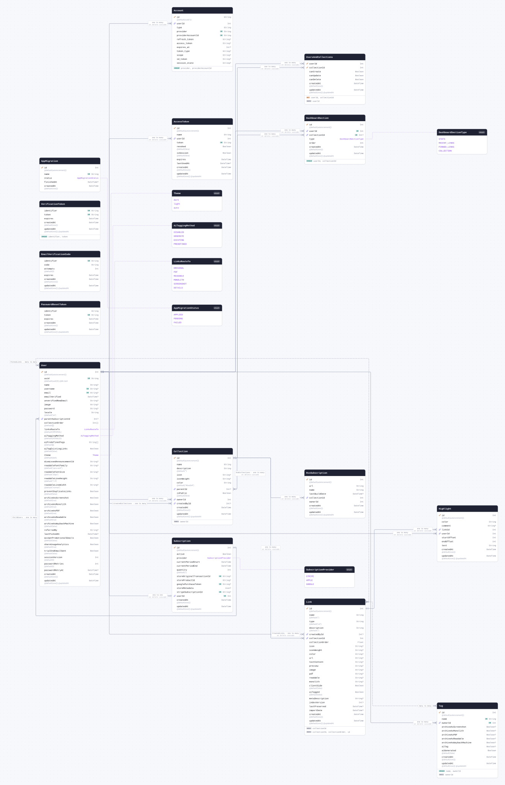

<details>
<summary>The whole schema as SQL</summary>

```sql
CREATE SCHEMA IF NOT EXISTS "public";

CREATE TYPE "Theme" AS ENUM ('dark', 'light', 'auto');

CREATE TYPE "AiTaggingMethod" AS ENUM ('DISABLED', 'GENERATE', 'EXISTING', 'PREDEFINED');

CREATE TYPE "LinksRouteTo" AS ENUM ('ORIGINAL', 'PDF', 'READABLE', 'MONOLITH', 'SCREENSHOT', 'DETAILS');

CREATE TYPE "SubscriptionProvider" AS ENUM ('STRIPE', 'APPLE', 'GOOGLE');

CREATE TYPE "DashboardSectionType" AS ENUM ('STATS', 'RECENT_LINKS', 'PINNED_LINKS', 'COLLECTION');

CREATE TYPE "AppMigrationStatus" AS ENUM ('APPLIED', 'PENDING', 'FAILED');

CREATE TABLE "Account" (
    "id" TEXT NOT NULL,
    "userId" INTEGER NOT NULL,
    "type" TEXT NOT NULL,
    "provider" TEXT NOT NULL,
    "providerAccountId" TEXT NOT NULL,
    "refresh_token" TEXT,
    "access_token" TEXT,
    "expires_at" INTEGER,
    "token_type" TEXT,
    "scope" TEXT,
    "id_token" TEXT,
    "session_state" TEXT,

    CONSTRAINT "Account_pkey" PRIMARY KEY ("id")
);

CREATE TABLE "User" (
    "id" SERIAL NOT NULL,
    "uuid" UUID NOT NULL,
    "name" TEXT,
    "username" TEXT,
    "email" TEXT,
    "emailVerified" TIMESTAMP(3),
    "unverifiedNewEmail" TEXT,
    "image" TEXT,
    "password" TEXT,
    "locale" TEXT NOT NULL DEFAULT 'en',
    "parentSubscriptionId" INTEGER,
    "collectionOrder" INTEGER[] DEFAULT ARRAY[]::INTEGER[],
    "linksRouteTo" "LinksRouteTo" NOT NULL DEFAULT 'ORIGINAL',
    "aiTaggingMethod" "AiTaggingMethod" NOT NULL DEFAULT 'DISABLED',
    "aiPredefinedTags" TEXT[] DEFAULT ARRAY[]::TEXT[],
    "aiTagExistingLinks" BOOLEAN NOT NULL DEFAULT false,
    "theme" "Theme" NOT NULL DEFAULT 'dark',
    "dismissedAnnouncementId" TEXT,
    "readableFontFamily" TEXT DEFAULT 'sans-serif',
    "readableFontSize" TEXT DEFAULT '20px',
    "readableLineHeight" TEXT DEFAULT '1.8',
    "readableLineWidth" TEXT DEFAULT 'normal',
    "preventDuplicateLinks" BOOLEAN NOT NULL DEFAULT false,
    "archiveAsScreenshot" BOOLEAN NOT NULL DEFAULT true,
    "archiveAsMonolith" BOOLEAN NOT NULL DEFAULT true,
    "archiveAsPDF" BOOLEAN NOT NULL DEFAULT true,
    "archiveAsReadable" BOOLEAN NOT NULL DEFAULT true,
    "archiveAsWaybackMachine" BOOLEAN NOT NULL DEFAULT false,
    "referredBy" TEXT,
    "lastPickedAt" TIMESTAMP(3),
    "acceptPromotionalEmails" BOOLEAN NOT NULL DEFAULT false,
    "shareUsageAnalytics" BOOLEAN NOT NULL DEFAULT true,
    "trialEndEmailSent" BOOLEAN NOT NULL DEFAULT false,
    "sessionVersion" INTEGER NOT NULL DEFAULT 0,
    "passwordRetries" INTEGER NOT NULL DEFAULT 0,
    "passwordRetryAt" TIMESTAMP(3),
    "createdAt" TIMESTAMP(3) NOT NULL DEFAULT CURRENT_TIMESTAMP,
    "updatedAt" TIMESTAMP(3) NOT NULL DEFAULT CURRENT_TIMESTAMP,

    CONSTRAINT "User_pkey" PRIMARY KEY ("id")
);

CREATE TABLE "VerificationToken" (
    "identifier" TEXT NOT NULL,
    "token" TEXT NOT NULL,
    "expires" TIMESTAMP(3) NOT NULL,
    "createdAt" TIMESTAMP(3) NOT NULL DEFAULT CURRENT_TIMESTAMP,
    "updatedAt" TIMESTAMP(3) NOT NULL DEFAULT CURRENT_TIMESTAMP
);

CREATE TABLE "EmailVerificationCode" (
    "identifier" TEXT NOT NULL,
    "code" TEXT NOT NULL,
    "attempts" INTEGER NOT NULL DEFAULT 0,
    "expires" TIMESTAMP(3) NOT NULL,
    "createdAt" TIMESTAMP(3) NOT NULL DEFAULT CURRENT_TIMESTAMP,
    "updatedAt" TIMESTAMP(3) NOT NULL DEFAULT CURRENT_TIMESTAMP
);

CREATE TABLE "PasswordResetToken" (
    "identifier" TEXT NOT NULL,
    "token" TEXT NOT NULL,
    "expires" TIMESTAMP(3) NOT NULL,
    "createdAt" TIMESTAMP(3) NOT NULL DEFAULT CURRENT_TIMESTAMP,
    "updatedAt" TIMESTAMP(3) NOT NULL DEFAULT CURRENT_TIMESTAMP
);

CREATE TABLE "Collection" (
    "id" SERIAL NOT NULL,
    "name" TEXT NOT NULL,
    "description" TEXT NOT NULL DEFAULT '',
    "icon" TEXT,
    "iconWeight" TEXT,
    "color" TEXT NOT NULL DEFAULT '#0ea5e9',
    "parentId" INTEGER,
    "isPublic" BOOLEAN NOT NULL DEFAULT false,
    "ownerId" INTEGER NOT NULL,
    "createdById" INTEGER,
    "createdAt" TIMESTAMP(3) NOT NULL DEFAULT CURRENT_TIMESTAMP,
    "updatedAt" TIMESTAMP(3) NOT NULL DEFAULT CURRENT_TIMESTAMP,

    CONSTRAINT "Collection_pkey" PRIMARY KEY ("id")
);

CREATE TABLE "UsersAndCollections" (
    "userId" INTEGER NOT NULL,
    "collectionId" INTEGER NOT NULL,
    "canCreate" BOOLEAN NOT NULL,
    "canUpdate" BOOLEAN NOT NULL,
    "canDelete" BOOLEAN NOT NULL,
    "createdAt" TIMESTAMP(3) NOT NULL DEFAULT CURRENT_TIMESTAMP,
    "updatedAt" TIMESTAMP(3) NOT NULL DEFAULT CURRENT_TIMESTAMP,

    CONSTRAINT "UsersAndCollections_pkey" PRIMARY KEY ("userId","collectionId")
);

CREATE TABLE "Link" (
    "id" SERIAL NOT NULL,
    "name" TEXT NOT NULL DEFAULT '',
    "type" TEXT NOT NULL DEFAULT 'url',
    "description" TEXT NOT NULL DEFAULT '',
    "createdById" INTEGER,
    "collectionId" INTEGER NOT NULL,
    "collectionOrder" DOUBLE PRECISION NOT NULL,
    "icon" TEXT,
    "iconWeight" TEXT,
    "color" TEXT,
    "url" TEXT,
    "textContent" TEXT,
    "preview" TEXT,
    "image" TEXT,
    "pdf" TEXT,
    "readable" TEXT,
    "monolith" TEXT,
    "clientSide" BOOLEAN NOT NULL DEFAULT false,
    "aiTagged" BOOLEAN NOT NULL DEFAULT false,
    "metaDescription" TEXT,
    "indexVersion" INTEGER,
    "lastPreserved" TIMESTAMP(3),
    "importDate" TIMESTAMP(3),
    "createdAt" TIMESTAMP(3) NOT NULL DEFAULT CURRENT_TIMESTAMP,
    "updatedAt" TIMESTAMP(3) NOT NULL DEFAULT CURRENT_TIMESTAMP,

    CONSTRAINT "Link_pkey" PRIMARY KEY ("id")
);

CREATE TABLE "Tag" (
    "id" SERIAL NOT NULL,
    "name" TEXT NOT NULL,
    "ownerId" INTEGER NOT NULL,
    "archiveAsScreenshot" BOOLEAN,
    "archiveAsMonolith" BOOLEAN,
    "archiveAsPDF" BOOLEAN,
    "archiveAsReadable" BOOLEAN,
    "archiveAsWaybackMachine" BOOLEAN,
    "aiTag" BOOLEAN,
    "aiGenerated" BOOLEAN NOT NULL DEFAULT false,
    "createdAt" TIMESTAMP(3) NOT NULL DEFAULT CURRENT_TIMESTAMP,
    "updatedAt" TIMESTAMP(3) NOT NULL DEFAULT CURRENT_TIMESTAMP,

    CONSTRAINT "Tag_pkey" PRIMARY KEY ("id")
);

CREATE TABLE "Subscription" (
    "id" SERIAL NOT NULL,
    "active" BOOLEAN NOT NULL,
    "provider" "SubscriptionProvider" NOT NULL,
    "currentPeriodStart" TIMESTAMP(3) NOT NULL,
    "currentPeriodEnd" TIMESTAMP(3) NOT NULL,
    "quantity" INTEGER NOT NULL DEFAULT 1,
    "storeOriginalTransactionId" TEXT,
    "storeProductId" TEXT,
    "googlePurchaseToken" TEXT,
    "storeMetadata" JSONB,
    "stripeSubscriptionId" TEXT,
    "userId" INTEGER NOT NULL,
    "createdAt" TIMESTAMP(3) NOT NULL DEFAULT CURRENT_TIMESTAMP,
    "updatedAt" TIMESTAMP(3) NOT NULL DEFAULT CURRENT_TIMESTAMP,

    CONSTRAINT "Subscription_pkey" PRIMARY KEY ("id")
);

CREATE TABLE "AccessToken" (
    "id" SERIAL NOT NULL,
    "name" TEXT NOT NULL,
    "userId" INTEGER NOT NULL,
    "token" TEXT NOT NULL,
    "revoked" BOOLEAN NOT NULL DEFAULT false,
    "isSession" BOOLEAN NOT NULL DEFAULT false,
    "expires" TIMESTAMP(3) NOT NULL,
    "lastUsedAt" TIMESTAMP(3),
    "createdAt" TIMESTAMP(3) NOT NULL DEFAULT CURRENT_TIMESTAMP,
    "updatedAt" TIMESTAMP(3) NOT NULL DEFAULT CURRENT_TIMESTAMP,

    CONSTRAINT "AccessToken_pkey" PRIMARY KEY ("id")
);

CREATE TABLE "RssSubscription" (
    "id" SERIAL NOT NULL,
    "url" TEXT NOT NULL,
    "name" TEXT NOT NULL,
    "lastBuildDate" TIMESTAMP(3),
    "collectionId" INTEGER NOT NULL,
    "ownerId" INTEGER NOT NULL,
    "createdAt" TIMESTAMP(3) NOT NULL DEFAULT CURRENT_TIMESTAMP,
    "updatedAt" TIMESTAMP(3) NOT NULL DEFAULT CURRENT_TIMESTAMP,

    CONSTRAINT "RssSubscription_pkey" PRIMARY KEY ("id")
);

CREATE TABLE "Highlight" (
    "id" SERIAL NOT NULL,
    "color" TEXT NOT NULL,
    "comment" TEXT,
    "linkId" INTEGER NOT NULL,
    "userId" INTEGER NOT NULL,
    "startOffset" INTEGER NOT NULL,
    "endOffset" INTEGER NOT NULL,
    "text" TEXT NOT NULL,
    "createdAt" TIMESTAMP(3) NOT NULL DEFAULT CURRENT_TIMESTAMP,
    "updatedAt" TIMESTAMP(3) NOT NULL DEFAULT CURRENT_TIMESTAMP,

    CONSTRAINT "Highlight_pkey" PRIMARY KEY ("id")
);

CREATE TABLE "DashboardSection" (
    "id" SERIAL NOT NULL,
    "userId" INTEGER NOT NULL,
    "collectionId" INTEGER,
    "type" "DashboardSectionType" NOT NULL,
    "order" INTEGER NOT NULL,
    "createdAt" TIMESTAMP(3) NOT NULL DEFAULT CURRENT_TIMESTAMP,
    "updatedAt" TIMESTAMP(3) NOT NULL DEFAULT CURRENT_TIMESTAMP,

    CONSTRAINT "DashboardSection_pkey" PRIMARY KEY ("id")
);

CREATE TABLE "AppMigration" (
    "id" SERIAL NOT NULL,
    "name" TEXT NOT NULL,
    "status" "AppMigrationStatus" NOT NULL,
    "finishedAt" TIMESTAMP(3),
    "createdAt" TIMESTAMP(3) NOT NULL DEFAULT CURRENT_TIMESTAMP,

    CONSTRAINT "AppMigration_pkey" PRIMARY KEY ("id")
);

CREATE TABLE "_PinnedLinks" (
    "A" INTEGER NOT NULL,
    "B" INTEGER NOT NULL,

    CONSTRAINT "_PinnedLinks_AB_pkey" PRIMARY KEY ("A","B")
);

CREATE TABLE "_LinkToTag" (
    "A" INTEGER NOT NULL,
    "B" INTEGER NOT NULL,

    CONSTRAINT "_LinkToTag_AB_pkey" PRIMARY KEY ("A","B")
);

CREATE UNIQUE INDEX "Account_provider_providerAccountId_key" ON "Account"("provider", "providerAccountId");

CREATE UNIQUE INDEX "User_uuid_key" ON "User"("uuid");

CREATE UNIQUE INDEX "User_username_key" ON "User"("username");

CREATE UNIQUE INDEX "User_email_key" ON "User"("email");

CREATE UNIQUE INDEX "VerificationToken_token_key" ON "VerificationToken"("token");

CREATE UNIQUE INDEX "VerificationToken_identifier_token_key" ON "VerificationToken"("identifier", "token");

CREATE UNIQUE INDEX "EmailVerificationCode_identifier_key" ON "EmailVerificationCode"("identifier");

CREATE UNIQUE INDEX "PasswordResetToken_token_key" ON "PasswordResetToken"("token");

CREATE INDEX "Collection_ownerId_idx" ON "Collection"("ownerId");

CREATE INDEX "UsersAndCollections_userId_idx" ON "UsersAndCollections"("userId");

CREATE INDEX "Link_collectionId_idx" ON "Link"("collectionId");

CREATE INDEX "Link_collectionId_collectionOrder_id_idx" ON "Link"("collectionId", "collectionOrder", "id");

CREATE INDEX "Tag_ownerId_idx" ON "Tag"("ownerId");

CREATE UNIQUE INDEX "Tag_name_ownerId_key" ON "Tag"("name", "ownerId");

CREATE UNIQUE INDEX "Subscription_storeOriginalTransactionId_key" ON "Subscription"("storeOriginalTransactionId");

CREATE UNIQUE INDEX "Subscription_googlePurchaseToken_key" ON "Subscription"("googlePurchaseToken");

CREATE UNIQUE INDEX "Subscription_stripeSubscriptionId_key" ON "Subscription"("stripeSubscriptionId");

CREATE UNIQUE INDEX "Subscription_userId_key" ON "Subscription"("userId");

CREATE UNIQUE INDEX "AccessToken_token_key" ON "AccessToken"("token");

CREATE UNIQUE INDEX "DashboardSection_userId_collectionId_key" ON "DashboardSection"("userId", "collectionId");

CREATE UNIQUE INDEX "AppMigration_name_key" ON "AppMigration"("name");

CREATE INDEX "_PinnedLinks_B_index" ON "_PinnedLinks"("B");

CREATE INDEX "_LinkToTag_B_index" ON "_LinkToTag"("B");

ALTER TABLE "Account" ADD CONSTRAINT "Account_userId_fkey" FOREIGN KEY ("userId") REFERENCES "User"("id") ON DELETE CASCADE ON UPDATE CASCADE;

ALTER TABLE "User" ADD CONSTRAINT "User_parentSubscriptionId_fkey" FOREIGN KEY ("parentSubscriptionId") REFERENCES "Subscription"("id") ON DELETE SET NULL ON UPDATE CASCADE;

ALTER TABLE "Collection" ADD CONSTRAINT "Collection_parentId_fkey" FOREIGN KEY ("parentId") REFERENCES "Collection"("id") ON DELETE CASCADE ON UPDATE CASCADE;

ALTER TABLE "Collection" ADD CONSTRAINT "Collection_ownerId_fkey" FOREIGN KEY ("ownerId") REFERENCES "User"("id") ON DELETE CASCADE ON UPDATE CASCADE;

ALTER TABLE "Collection" ADD CONSTRAINT "Collection_createdById_fkey" FOREIGN KEY ("createdById") REFERENCES "User"("id") ON DELETE SET NULL ON UPDATE CASCADE;

ALTER TABLE "UsersAndCollections" ADD CONSTRAINT "UsersAndCollections_userId_fkey" FOREIGN KEY ("userId") REFERENCES "User"("id") ON DELETE CASCADE ON UPDATE CASCADE;

ALTER TABLE "UsersAndCollections" ADD CONSTRAINT "UsersAndCollections_collectionId_fkey" FOREIGN KEY ("collectionId") REFERENCES "Collection"("id") ON DELETE CASCADE ON UPDATE CASCADE;

ALTER TABLE "Link" ADD CONSTRAINT "Link_createdById_fkey" FOREIGN KEY ("createdById") REFERENCES "User"("id") ON DELETE CASCADE ON UPDATE CASCADE;

ALTER TABLE "Link" ADD CONSTRAINT "Link_collectionId_fkey" FOREIGN KEY ("collectionId") REFERENCES "Collection"("id") ON DELETE CASCADE ON UPDATE CASCADE;

ALTER TABLE "Tag" ADD CONSTRAINT "Tag_ownerId_fkey" FOREIGN KEY ("ownerId") REFERENCES "User"("id") ON DELETE CASCADE ON UPDATE CASCADE;

ALTER TABLE "Subscription" ADD CONSTRAINT "Subscription_userId_fkey" FOREIGN KEY ("userId") REFERENCES "User"("id") ON DELETE CASCADE ON UPDATE CASCADE;

ALTER TABLE "AccessToken" ADD CONSTRAINT "AccessToken_userId_fkey" FOREIGN KEY ("userId") REFERENCES "User"("id") ON DELETE CASCADE ON UPDATE CASCADE;

ALTER TABLE "RssSubscription" ADD CONSTRAINT "RssSubscription_collectionId_fkey" FOREIGN KEY ("collectionId") REFERENCES "Collection"("id") ON DELETE CASCADE ON UPDATE CASCADE;

ALTER TABLE "Highlight" ADD CONSTRAINT "Highlight_linkId_fkey" FOREIGN KEY ("linkId") REFERENCES "Link"("id") ON DELETE CASCADE ON UPDATE CASCADE;

ALTER TABLE "Highlight" ADD CONSTRAINT "Highlight_userId_fkey" FOREIGN KEY ("userId") REFERENCES "User"("id") ON DELETE CASCADE ON UPDATE CASCADE;

ALTER TABLE "DashboardSection" ADD CONSTRAINT "DashboardSection_userId_fkey" FOREIGN KEY ("userId") REFERENCES "User"("id") ON DELETE CASCADE ON UPDATE CASCADE;

ALTER TABLE "DashboardSection" ADD CONSTRAINT "DashboardSection_collectionId_fkey" FOREIGN KEY ("collectionId") REFERENCES "Collection"("id") ON DELETE CASCADE ON UPDATE CASCADE;

ALTER TABLE "_PinnedLinks" ADD CONSTRAINT "_PinnedLinks_A_fkey" FOREIGN KEY ("A") REFERENCES "Link"("id") ON DELETE CASCADE ON UPDATE CASCADE;

ALTER TABLE "_PinnedLinks" ADD CONSTRAINT "_PinnedLinks_B_fkey" FOREIGN KEY ("B") REFERENCES "User"("id") ON DELETE CASCADE ON UPDATE CASCADE;

ALTER TABLE "_LinkToTag" ADD CONSTRAINT "_LinkToTag_A_fkey" FOREIGN KEY ("A") REFERENCES "Link"("id") ON DELETE CASCADE ON UPDATE CASCADE;

ALTER TABLE "_LinkToTag" ADD CONSTRAINT "_LinkToTag_B_fkey" FOREIGN KEY ("B") REFERENCES "Tag"("id") ON DELETE CASCADE ON UPDATE CASCADE;
```

</details>

## Contents

| Model                                                 | Table                   | Description |
| ----------------------------------------------------- | ----------------------- | ----------- |
| [Account](#model-Account)                             | `Account`               |             |
| [User](#model-User)                                   | `User`                  |             |
| [VerificationToken](#model-VerificationToken)         | `VerificationToken`     |             |
| [EmailVerificationCode](#model-EmailVerificationCode) | `EmailVerificationCode` |             |
| [PasswordResetToken](#model-PasswordResetToken)       | `PasswordResetToken`    |             |
| [Collection](#model-Collection)                       | `Collection`            |             |
| [UsersAndCollections](#model-UsersAndCollections)     | `UsersAndCollections`   |             |
| [Link](#model-Link)                                   | `Link`                  |             |
| [Tag](#model-Tag)                                     | `Tag`                   |             |
| [Subscription](#model-Subscription)                   | `Subscription`          |             |
| [AccessToken](#model-AccessToken)                     | `AccessToken`           |             |
| [RssSubscription](#model-RssSubscription)             | `RssSubscription`       |             |
| [Highlight](#model-Highlight)                         | `Highlight`             |             |
| [DashboardSection](#model-DashboardSection)           | `DashboardSection`      |             |
| [AppMigration](#model-AppMigration)                   | `AppMigration`          |             |

| Enum                                               | Name in the database   | Description |
| -------------------------------------------------- | ---------------------- | ----------- |
| [Theme](#enum-Theme)                               | `Theme`                |             |
| [AiTaggingMethod](#enum-AiTaggingMethod)           | `AiTaggingMethod`      |             |
| [LinksRouteTo](#enum-LinksRouteTo)                 | `LinksRouteTo`         |             |
| [SubscriptionProvider](#enum-SubscriptionProvider) | `SubscriptionProvider` |             |
| [DashboardSectionType](#enum-DashboardSectionType) | `DashboardSectionType` |             |
| [AppMigrationStatus](#enum-AppMigrationStatus)     | `AppMigrationStatus`   |             |

## Models

<a id="model-Account"></a>

### Account

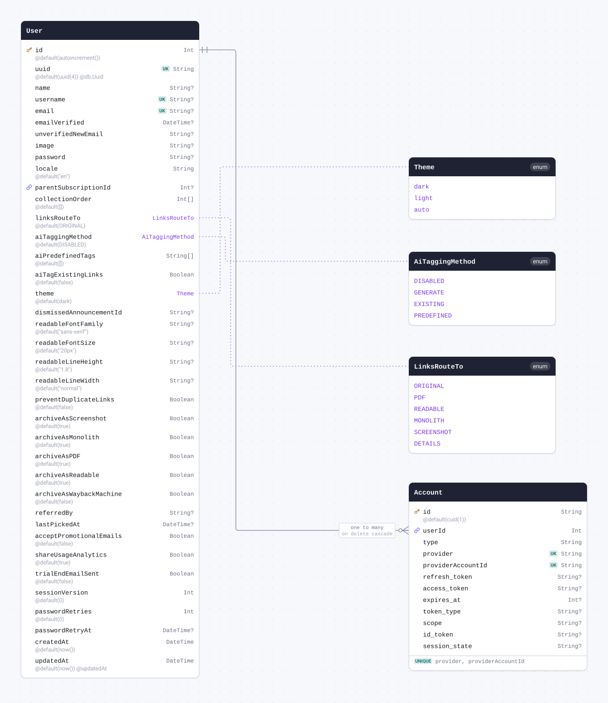

| Field               | Type     | Constraints                       | Default   | Description |
| ------------------- | -------- | --------------------------------- | --------- | ----------- |
| `id`                | `String` | PK NOT NULL                       | `cuid(1)` |             |
| `userId`            | `Int`    | NOT NULL → [User.id](#model-User) |           |             |
| `type`              | `String` | NOT NULL                          |           |             |
| `provider`          | `String` | NOT NULL                          |           |             |
| `providerAccountId` | `String` | NOT NULL                          |           |             |
| `refresh_token`     | `String` | NULL                              |           |             |
| `access_token`      | `String` | NULL                              |           |             |
| `expires_at`        | `Int`    | NULL                              |           |             |
| `token_type`        | `String` | NULL                              |           |             |
| `scope`             | `String` | NULL                              |           |             |
| `id_token`          | `String` | NULL                              |           |             |
| `session_state`     | `String` | NULL                              |           |             |

#### Indexes

- `@@unique([provider, providerAccountId])`

#### References

- `userId` → [User.id](#model-User) (many-to-one, on delete Cascade)

#### Definition

```sql
CREATE TABLE "Account" (
    "id" TEXT NOT NULL,
    "userId" INTEGER NOT NULL,
    "type" TEXT NOT NULL,
    "provider" TEXT NOT NULL,
    "providerAccountId" TEXT NOT NULL,
    "refresh_token" TEXT,
    "access_token" TEXT,
    "expires_at" INTEGER,
    "token_type" TEXT,
    "scope" TEXT,
    "id_token" TEXT,
    "session_state" TEXT,

    CONSTRAINT "Account_pkey" PRIMARY KEY ("id")
);

CREATE UNIQUE INDEX "Account_provider_providerAccountId_key" ON "Account"("provider", "providerAccountId");

ALTER TABLE "Account" ADD CONSTRAINT "Account_userId_fkey" FOREIGN KEY ("userId") REFERENCES "User"("id") ON DELETE CASCADE ON UPDATE CASCADE;
```

<details>
<summary>Queries and their SQL</summary>

**findMany**: Every row

```ts
await prisma.account.findMany();
```

```sql
SELECT
  "public"."Account"."id",
  "public"."Account"."userId",
  "public"."Account"."type",
  "public"."Account"."provider",
  "public"."Account"."providerAccountId",
  "public"."Account"."refresh_token",
  "public"."Account"."access_token",
  "public"."Account"."expires_at",
  "public"."Account"."token_type",
  "public"."Account"."scope",
  "public"."Account"."id_token",
  "public"."Account"."session_state"
FROM
  "public"."Account"
WHERE
  1 = 1
OFFSET
  $1
-- params: ["0"]
```

**count**: How many rows there are

```ts
await prisma.account.count();
```

```sql
SELECT
  COUNT(*) AS "_count$_all"
FROM
  (
    SELECT
      "public"."Account"."id"
    FROM
      "public"."Account"
    WHERE
      1 = 1
    OFFSET
      $1
  ) AS "sub"
-- params: ["0"]
```

**findMany**: Every row with its relations

```ts
await prisma.account.findMany({ include: { user: true } });
```

```sql
SELECT
  "public"."Account"."id",
  "public"."Account"."userId",
  "public"."Account"."type",
  "public"."Account"."provider",
  "public"."Account"."providerAccountId",
  "public"."Account"."refresh_token",
  "public"."Account"."access_token",
  "public"."Account"."expires_at",
  "public"."Account"."token_type",
  "public"."Account"."scope",
  "public"."Account"."id_token",
  "public"."Account"."session_state"
FROM
  "public"."Account"
WHERE
  1 = 1
OFFSET
  $1
-- params: ["0"]

SELECT
  "public"."User"."id",
  "public"."User"."uuid",
  "public"."User"."name",
  "public"."User"."username",
  "public"."User"."email",
  "public"."User"."emailVerified",
  "public"."User"."unverifiedNewEmail",
  "public"."User"."image",
  "public"."User"."password",
  "public"."User"."locale",
  "public"."User"."parentSubscriptionId",
  "public"."User"."collectionOrder",
  "public"."User"."linksRouteTo"::text,
  "public"."User"."aiTaggingMethod"::text,
  "public"."User"."aiPredefinedTags",
  "public"."User"."aiTagExistingLinks",
  "public"."User"."theme"::text,
  "public"."User"."dismissedAnnouncementId",
  "public"."User"."readableFontFamily",
  "public"."User"."readableFontSize",
  "public"."User"."readableLineHeight",
  "public"."User"."readableLineWidth",
  "public"."User"."preventDuplicateLinks",
  "public"."User"."archiveAsScreenshot",
  "public"."User"."archiveAsMonolith",
  "public"."User"."archiveAsPDF",
  "public"."User"."archiveAsReadable",
  "public"."User"."archiveAsWaybackMachine",
  "public"."User"."referredBy",
  "public"."User"."lastPickedAt",
  "public"."User"."acceptPromotionalEmails",
  "public"."User"."shareUsageAnalytics",
  "public"."User"."trialEndEmailSent",
  "public"."User"."sessionVersion",
  "public"."User"."passwordRetries",
  "public"."User"."passwordRetryAt",
  "public"."User"."createdAt",
  "public"."User"."updatedAt"
FROM
  "public"."User"
WHERE
  "public"."User"."id" IN ($1)
OFFSET
  $2
-- params: ["<userId of the rows above>","0"]
```

**findUnique**: One row by what is unique to it

```ts
await prisma.account.findUnique({ where: { id: "example" } });
```

```sql
SELECT
  "public"."Account"."id",
  "public"."Account"."userId",
  "public"."Account"."type",
  "public"."Account"."provider",
  "public"."Account"."providerAccountId",
  "public"."Account"."refresh_token",
  "public"."Account"."access_token",
  "public"."Account"."expires_at",
  "public"."Account"."token_type",
  "public"."Account"."scope",
  "public"."Account"."id_token",
  "public"."Account"."session_state"
FROM
  "public"."Account"
WHERE
  (
    "public"."Account"."id" = $1
    AND 1 = 1
  )
LIMIT
  $2
OFFSET
  $3
-- params: ["example","1","0"]
```

**create**: Create a row

```ts
await prisma.account.create({
  data: { userId: 1, type: "example", provider: "example", providerAccountId: "example" },
});
```

```sql
INSERT INTO
  "public"."Account" (
    "id",
    "userId",
    "type",
    "provider",
    "providerAccountId"
  )
VALUES
  ($1, $2, $3, $4, $5)
RETURNING
  "public"."Account"."id",
  "public"."Account"."userId",
  "public"."Account"."type",
  "public"."Account"."provider",
  "public"."Account"."providerAccountId",
  "public"."Account"."refresh_token",
  "public"."Account"."access_token",
  "public"."Account"."expires_at",
  "public"."Account"."token_type",
  "public"."Account"."scope",
  "public"."Account"."id_token",
  "public"."Account"."session_state"
-- params: ["<cuid(1)>","1","example","example","example"]
```

**update**: Update a row

```ts
await prisma.account.update({ where: { id: "example" }, data: { type: "example" } });
```

```sql
UPDATE "public"."Account"
SET
  "type" = $1
WHERE
  (
    "public"."Account"."id" = $2
    AND 1 = 1
  )
RETURNING
  "public"."Account"."id",
  "public"."Account"."userId",
  "public"."Account"."type",
  "public"."Account"."provider",
  "public"."Account"."providerAccountId",
  "public"."Account"."refresh_token",
  "public"."Account"."access_token",
  "public"."Account"."expires_at",
  "public"."Account"."token_type",
  "public"."Account"."scope",
  "public"."Account"."id_token",
  "public"."Account"."session_state"
-- params: ["example","example"]
```

**delete**: Delete a row

```ts
await prisma.account.delete({ where: { id: "example" } });
```

```sql
DELETE FROM "public"."Account"
WHERE
  (
    "public"."Account"."id" = $1
    AND 1 = 1
  )
RETURNING
  "public"."Account"."id",
  "public"."Account"."userId",
  "public"."Account"."type",
  "public"."Account"."provider",
  "public"."Account"."providerAccountId",
  "public"."Account"."refresh_token",
  "public"."Account"."access_token",
  "public"."Account"."expires_at",
  "public"."Account"."token_type",
  "public"."Account"."scope",
  "public"."Account"."id_token",
  "public"."Account"."session_state"
-- params: ["example"]
```

</details>

<a id="model-User"></a>

### User

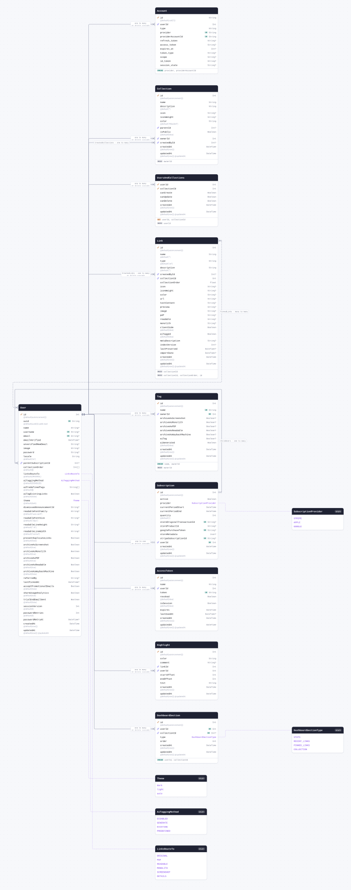

| Field                     | Type                                       | Constraints                                   | Default              | Description |
| ------------------------- | ------------------------------------------ | --------------------------------------------- | -------------------- | ----------- |
| `id`                      | `Int`                                      | PK NOT NULL                                   | `autoincrement()`    |             |
| `uuid`                    | `String` `@db.Uuid`                        | UNIQUE NOT NULL                               | `uuid(4)`            |             |
| `name`                    | `String`                                   | NULL                                          |                      |             |
| `username`                | `String`                                   | UNIQUE NULL                                   |                      |             |
| `email`                   | `String`                                   | UNIQUE NULL                                   |                      |             |
| `emailVerified`           | `DateTime`                                 | NULL                                          |                      |             |
| `unverifiedNewEmail`      | `String`                                   | NULL                                          |                      |             |
| `image`                   | `String`                                   | NULL                                          |                      |             |
| `password`                | `String`                                   | NULL                                          |                      |             |
| `locale`                  | `String`                                   | NOT NULL                                      | `"en"`               |             |
| `parentSubscriptionId`    | `Int`                                      | NULL → [Subscription.id](#model-Subscription) |                      |             |
| `collectionOrder`         | `Int[]`                                    | NOT NULL                                      | `[]`                 |             |
| `linksRouteTo`            | [`LinksRouteTo`](#enum-LinksRouteTo)       | NOT NULL                                      | `ORIGINAL`           |             |
| `aiTaggingMethod`         | [`AiTaggingMethod`](#enum-AiTaggingMethod) | NOT NULL                                      | `DISABLED`           |             |
| `aiPredefinedTags`        | `String[]`                                 | NOT NULL                                      | `[]`                 |             |
| `aiTagExistingLinks`      | `Boolean`                                  | NOT NULL                                      | `false`              |             |
| `theme`                   | [`Theme`](#enum-Theme)                     | NOT NULL                                      | `dark`               |             |
| `dismissedAnnouncementId` | `String`                                   | NULL                                          |                      |             |
| `readableFontFamily`      | `String`                                   | NULL                                          | `"sans-serif"`       |             |
| `readableFontSize`        | `String`                                   | NULL                                          | `"20px"`             |             |
| `readableLineHeight`      | `String`                                   | NULL                                          | `"1.8"`              |             |
| `readableLineWidth`       | `String`                                   | NULL                                          | `"normal"`           |             |
| `preventDuplicateLinks`   | `Boolean`                                  | NOT NULL                                      | `false`              |             |
| `archiveAsScreenshot`     | `Boolean`                                  | NOT NULL                                      | `true`               |             |
| `archiveAsMonolith`       | `Boolean`                                  | NOT NULL                                      | `true`               |             |
| `archiveAsPDF`            | `Boolean`                                  | NOT NULL                                      | `true`               |             |
| `archiveAsReadable`       | `Boolean`                                  | NOT NULL                                      | `true`               |             |
| `archiveAsWaybackMachine` | `Boolean`                                  | NOT NULL                                      | `false`              |             |
| `referredBy`              | `String`                                   | NULL                                          |                      |             |
| `lastPickedAt`            | `DateTime`                                 | NULL                                          |                      |             |
| `acceptPromotionalEmails` | `Boolean`                                  | NOT NULL                                      | `false`              |             |
| `shareUsageAnalytics`     | `Boolean`                                  | NOT NULL                                      | `true`               |             |
| `trialEndEmailSent`       | `Boolean`                                  | NOT NULL                                      | `false`              |             |
| `sessionVersion`          | `Int`                                      | NOT NULL                                      | `0`                  |             |
| `passwordRetries`         | `Int`                                      | NOT NULL                                      | `0`                  |             |
| `passwordRetryAt`         | `DateTime`                                 | NULL                                          |                      |             |
| `createdAt`               | `DateTime`                                 | NOT NULL                                      | `now()`              |             |
| `updatedAt`               | `DateTime`                                 | NOT NULL                                      | `now()` `@updatedAt` |             |

#### References

- `parentSubscriptionId` → [Subscription.id](#model-Subscription) (many-to-one)

#### Referenced by

- `id` ← [Account.userId](#model-Account) (one-to-many, on delete Cascade)
- `id` ← [Collection.ownerId](#model-Collection) (one-to-many, on delete Cascade)
- `id` ← [Collection.createdById](#model-Collection) (one-to-many)
- `id` ← [UsersAndCollections.userId](#model-UsersAndCollections) (one-to-many, on delete Cascade)
- `id` ← [Link.createdById](#model-Link) (one-to-many, on delete Cascade)
- `id` ← [Tag.ownerId](#model-Tag) (one-to-many, on delete Cascade)
- `id` ← [Subscription.userId](#model-Subscription) (one-to-one, on delete Cascade)
- `id` ← [AccessToken.userId](#model-AccessToken) (one-to-many, on delete Cascade)
- `id` ← [Highlight.userId](#model-Highlight) (one-to-many, on delete Cascade)
- `id` ← [DashboardSection.userId](#model-DashboardSection) (one-to-many, on delete Cascade)

#### Many to many

- `pinnedLinks` ↔ [Link.pinnedBy](#model-Link) through `_PinnedLinks`

#### Definition

```sql
CREATE TABLE "User" (
    "id" SERIAL NOT NULL,
    "uuid" UUID NOT NULL,
    "name" TEXT,
    "username" TEXT,
    "email" TEXT,
    "emailVerified" TIMESTAMP(3),
    "unverifiedNewEmail" TEXT,
    "image" TEXT,
    "password" TEXT,
    "locale" TEXT NOT NULL DEFAULT 'en',
    "parentSubscriptionId" INTEGER,
    "collectionOrder" INTEGER[] DEFAULT ARRAY[]::INTEGER[],
    "linksRouteTo" "LinksRouteTo" NOT NULL DEFAULT 'ORIGINAL',
    "aiTaggingMethod" "AiTaggingMethod" NOT NULL DEFAULT 'DISABLED',
    "aiPredefinedTags" TEXT[] DEFAULT ARRAY[]::TEXT[],
    "aiTagExistingLinks" BOOLEAN NOT NULL DEFAULT false,
    "theme" "Theme" NOT NULL DEFAULT 'dark',
    "dismissedAnnouncementId" TEXT,
    "readableFontFamily" TEXT DEFAULT 'sans-serif',
    "readableFontSize" TEXT DEFAULT '20px',
    "readableLineHeight" TEXT DEFAULT '1.8',
    "readableLineWidth" TEXT DEFAULT 'normal',
    "preventDuplicateLinks" BOOLEAN NOT NULL DEFAULT false,
    "archiveAsScreenshot" BOOLEAN NOT NULL DEFAULT true,
    "archiveAsMonolith" BOOLEAN NOT NULL DEFAULT true,
    "archiveAsPDF" BOOLEAN NOT NULL DEFAULT true,
    "archiveAsReadable" BOOLEAN NOT NULL DEFAULT true,
    "archiveAsWaybackMachine" BOOLEAN NOT NULL DEFAULT false,
    "referredBy" TEXT,
    "lastPickedAt" TIMESTAMP(3),
    "acceptPromotionalEmails" BOOLEAN NOT NULL DEFAULT false,
    "shareUsageAnalytics" BOOLEAN NOT NULL DEFAULT true,
    "trialEndEmailSent" BOOLEAN NOT NULL DEFAULT false,
    "sessionVersion" INTEGER NOT NULL DEFAULT 0,
    "passwordRetries" INTEGER NOT NULL DEFAULT 0,
    "passwordRetryAt" TIMESTAMP(3),
    "createdAt" TIMESTAMP(3) NOT NULL DEFAULT CURRENT_TIMESTAMP,
    "updatedAt" TIMESTAMP(3) NOT NULL DEFAULT CURRENT_TIMESTAMP,

    CONSTRAINT "User_pkey" PRIMARY KEY ("id")
);

CREATE UNIQUE INDEX "User_uuid_key" ON "User"("uuid");

CREATE UNIQUE INDEX "User_username_key" ON "User"("username");

CREATE UNIQUE INDEX "User_email_key" ON "User"("email");

ALTER TABLE "User" ADD CONSTRAINT "User_parentSubscriptionId_fkey" FOREIGN KEY ("parentSubscriptionId") REFERENCES "Subscription"("id") ON DELETE SET NULL ON UPDATE CASCADE;
```

<details>
<summary>Queries and their SQL</summary>

**findMany**: Every row

```ts
await prisma.user.findMany();
```

```sql
SELECT
  "public"."User"."id",
  "public"."User"."uuid",
  "public"."User"."name",
  "public"."User"."username",
  "public"."User"."email",
  "public"."User"."emailVerified",
  "public"."User"."unverifiedNewEmail",
  "public"."User"."image",
  "public"."User"."password",
  "public"."User"."locale",
  "public"."User"."parentSubscriptionId",
  "public"."User"."collectionOrder",
  "public"."User"."linksRouteTo"::text,
  "public"."User"."aiTaggingMethod"::text,
  "public"."User"."aiPredefinedTags",
  "public"."User"."aiTagExistingLinks",
  "public"."User"."theme"::text,
  "public"."User"."dismissedAnnouncementId",
  "public"."User"."readableFontFamily",
  "public"."User"."readableFontSize",
  "public"."User"."readableLineHeight",
  "public"."User"."readableLineWidth",
  "public"."User"."preventDuplicateLinks",
  "public"."User"."archiveAsScreenshot",
  "public"."User"."archiveAsMonolith",
  "public"."User"."archiveAsPDF",
  "public"."User"."archiveAsReadable",
  "public"."User"."archiveAsWaybackMachine",
  "public"."User"."referredBy",
  "public"."User"."lastPickedAt",
  "public"."User"."acceptPromotionalEmails",
  "public"."User"."shareUsageAnalytics",
  "public"."User"."trialEndEmailSent",
  "public"."User"."sessionVersion",
  "public"."User"."passwordRetries",
  "public"."User"."passwordRetryAt",
  "public"."User"."createdAt",
  "public"."User"."updatedAt"
FROM
  "public"."User"
WHERE
  1 = 1
OFFSET
  $1
-- params: ["0"]
```

**count**: How many rows there are

```ts
await prisma.user.count();
```

```sql
SELECT
  COUNT(*) AS "_count$_all"
FROM
  (
    SELECT
      "public"."User"."id"
    FROM
      "public"."User"
    WHERE
      1 = 1
    OFFSET
      $1
  ) AS "sub"
-- params: ["0"]
```

**findMany**: Every row with its relations

```ts
await prisma.user.findMany({
  include: {
    parentSubscription: true,
    accounts: true,
    collections: true,
    tags: true,
    pinnedLinks: true,
    createdLinks: true,
    createdCollections: true,
    highlights: true,
    collectionsJoined: true,
    accessTokens: true,
    subscriptions: true,
    dashboardSections: true,
  },
});
```

```sql
SELECT
  "public"."User"."id",
  "public"."User"."uuid",
  "public"."User"."name",
  "public"."User"."username",
  "public"."User"."email",
  "public"."User"."emailVerified",
  "public"."User"."unverifiedNewEmail",
  "public"."User"."image",
  "public"."User"."password",
  "public"."User"."locale",
  "public"."User"."parentSubscriptionId",
  "public"."User"."collectionOrder",
  "public"."User"."linksRouteTo"::text,
  "public"."User"."aiTaggingMethod"::text,
  "public"."User"."aiPredefinedTags",
  "public"."User"."aiTagExistingLinks",
  "public"."User"."theme"::text,
  "public"."User"."dismissedAnnouncementId",
  "public"."User"."readableFontFamily",
  "public"."User"."readableFontSize",
  "public"."User"."readableLineHeight",
  "public"."User"."readableLineWidth",
  "public"."User"."preventDuplicateLinks",
  "public"."User"."archiveAsScreenshot",
  "public"."User"."archiveAsMonolith",
  "public"."User"."archiveAsPDF",
  "public"."User"."archiveAsReadable",
  "public"."User"."archiveAsWaybackMachine",
  "public"."User"."referredBy",
  "public"."User"."lastPickedAt",
  "public"."User"."acceptPromotionalEmails",
  "public"."User"."shareUsageAnalytics",
  "public"."User"."trialEndEmailSent",
  "public"."User"."sessionVersion",
  "public"."User"."passwordRetries",
  "public"."User"."passwordRetryAt",
  "public"."User"."createdAt",
  "public"."User"."updatedAt"
FROM
  "public"."User"
WHERE
  1 = 1
OFFSET
  $1
-- params: ["0"]

SELECT
  "public"."Subscription"."id",
  "public"."Subscription"."active",
  "public"."Subscription"."provider"::text,
  "public"."Subscription"."currentPeriodStart",
  "public"."Subscription"."currentPeriodEnd",
  "public"."Subscription"."quantity",
  "public"."Subscription"."storeOriginalTransactionId",
  "public"."Subscription"."storeProductId",
  "public"."Subscription"."googlePurchaseToken",
  "public"."Subscription"."storeMetadata",
  "public"."Subscription"."stripeSubscriptionId",
  "public"."Subscription"."userId",
  "public"."Subscription"."createdAt",
  "public"."Subscription"."updatedAt"
FROM
  "public"."Subscription"
WHERE
  "public"."Subscription"."id" IN ($1)
OFFSET
  $2
-- params: ["<parentSubscriptionId of the rows above>","0"]

SELECT
  "public"."Account"."id",
  "public"."Account"."userId",
  "public"."Account"."type",
  "public"."Account"."provider",
  "public"."Account"."providerAccountId",
  "public"."Account"."refresh_token",
  "public"."Account"."access_token",
  "public"."Account"."expires_at",
  "public"."Account"."token_type",
  "public"."Account"."scope",
  "public"."Account"."id_token",
  "public"."Account"."session_state"
FROM
  "public"."Account"
WHERE
  "public"."Account"."userId" IN ($1)
OFFSET
  $2
-- params: ["<id of the rows above>","0"]

SELECT
  "public"."Collection"."id",
  "public"."Collection"."name",
  "public"."Collection"."description",
  "public"."Collection"."icon",
  "public"."Collection"."iconWeight",
  "public"."Collection"."color",
  "public"."Collection"."parentId",
  "public"."Collection"."isPublic",
  "public"."Collection"."ownerId",
  "public"."Collection"."createdById",
  "public"."Collection"."createdAt",
  "public"."Collection"."updatedAt"
FROM
  "public"."Collection"
WHERE
  "public"."Collection"."ownerId" IN ($1)
OFFSET
  $2
-- params: ["<id of the rows above>","0"]

SELECT
  "public"."Tag"."id",
  "public"."Tag"."name",
  "public"."Tag"."ownerId",
  "public"."Tag"."archiveAsScreenshot",
  "public"."Tag"."archiveAsMonolith",
  "public"."Tag"."archiveAsPDF",
  "public"."Tag"."archiveAsReadable",
  "public"."Tag"."archiveAsWaybackMachine",
  "public"."Tag"."aiTag",
  "public"."Tag"."aiGenerated",
  "public"."Tag"."createdAt",
  "public"."Tag"."updatedAt"
FROM
  "public"."Tag"
WHERE
  "public"."Tag"."ownerId" IN ($1)
OFFSET
  $2
-- params: ["<id of the rows above>","0"]

SELECT
  "public"."Link"."id",
  "public"."Link"."name",
  "public"."Link"."type",
  "public"."Link"."description",
  "public"."Link"."createdById",
  "public"."Link"."collectionId",
  "public"."Link"."collectionOrder",
  "public"."Link"."icon",
  "public"."Link"."iconWeight",
  "public"."Link"."color",
  "public"."Link"."url",
  "public"."Link"."textContent",
  "public"."Link"."preview",
  "public"."Link"."image",
  "public"."Link"."pdf",
  "public"."Link"."readable",
  "public"."Link"."monolith",
  "public"."Link"."clientSide",
  "public"."Link"."aiTagged",
  "public"."Link"."metaDescription",
  "public"."Link"."indexVersion",
  "public"."Link"."lastPreserved",
  "public"."Link"."importDate",
  "public"."Link"."createdAt",
  "public"."Link"."updatedAt",
  "t0"."B" AS "PinnedLinks@User"
FROM
  "public"."Link"
  INNER JOIN "public"."_PinnedLinks" AS "t0" ON "t0"."A" = "public"."Link"."id"
WHERE
  (
    1 = 1
    AND "t0"."B" IN ($1)
  )
OFFSET
  $2
-- params: ["<id of the rows above>","0"]

SELECT
  "public"."Link"."id",
  "public"."Link"."name",
  "public"."Link"."type",
  "public"."Link"."description",
  "public"."Link"."createdById",
  "public"."Link"."collectionId",
  "public"."Link"."collectionOrder",
  "public"."Link"."icon",
  "public"."Link"."iconWeight",
  "public"."Link"."color",
  "public"."Link"."url",
  "public"."Link"."textContent",
  "public"."Link"."preview",
  "public"."Link"."image",
  "public"."Link"."pdf",
  "public"."Link"."readable",
  "public"."Link"."monolith",
  "public"."Link"."clientSide",
  "public"."Link"."aiTagged",
  "public"."Link"."metaDescription",
  "public"."Link"."indexVersion",
  "public"."Link"."lastPreserved",
  "public"."Link"."importDate",
  "public"."Link"."createdAt",
  "public"."Link"."updatedAt"
FROM
  "public"."Link"
WHERE
  "public"."Link"."createdById" IN ($1)
OFFSET
  $2
-- params: ["<id of the rows above>","0"]

SELECT
  "public"."Collection"."id",
  "public"."Collection"."name",
  "public"."Collection"."description",
  "public"."Collection"."icon",
  "public"."Collection"."iconWeight",
  "public"."Collection"."color",
  "public"."Collection"."parentId",
  "public"."Collection"."isPublic",
  "public"."Collection"."ownerId",
  "public"."Collection"."createdById",
  "public"."Collection"."createdAt",
  "public"."Collection"."updatedAt"
FROM
  "public"."Collection"
WHERE
  "public"."Collection"."createdById" IN ($1)
OFFSET
  $2
-- params: ["<id of the rows above>","0"]

SELECT
  "public"."Highlight"."id",
  "public"."Highlight"."color",
  "public"."Highlight"."comment",
  "public"."Highlight"."linkId",
  "public"."Highlight"."userId",
  "public"."Highlight"."startOffset",
  "public"."Highlight"."endOffset",
  "public"."Highlight"."text",
  "public"."Highlight"."createdAt",
  "public"."Highlight"."updatedAt"
FROM
  "public"."Highlight"
WHERE
  "public"."Highlight"."userId" IN ($1)
OFFSET
  $2
-- params: ["<id of the rows above>","0"]

SELECT
  "public"."UsersAndCollections"."userId",
  "public"."UsersAndCollections"."collectionId",
  "public"."UsersAndCollections"."canCreate",
  "public"."UsersAndCollections"."canUpdate",
  "public"."UsersAndCollections"."canDelete",
  "public"."UsersAndCollections"."createdAt",
  "public"."UsersAndCollections"."updatedAt"
FROM
  "public"."UsersAndCollections"
WHERE
  "public"."UsersAndCollections"."userId" IN ($1)
OFFSET
  $2
-- params: ["<id of the rows above>","0"]

SELECT
  "public"."AccessToken"."id",
  "public"."AccessToken"."name",
  "public"."AccessToken"."userId",
  "public"."AccessToken"."token",
  "public"."AccessToken"."revoked",
  "public"."AccessToken"."isSession",
  "public"."AccessToken"."expires",
  "public"."AccessToken"."lastUsedAt",
  "public"."AccessToken"."createdAt",
  "public"."AccessToken"."updatedAt"
FROM
  "public"."AccessToken"
WHERE
  "public"."AccessToken"."userId" IN ($1)
OFFSET
  $2
-- params: ["<id of the rows above>","0"]

SELECT
  "public"."Subscription"."id",
  "public"."Subscription"."active",
  "public"."Subscription"."provider"::text,
  "public"."Subscription"."currentPeriodStart",
  "public"."Subscription"."currentPeriodEnd",
  "public"."Subscription"."quantity",
  "public"."Subscription"."storeOriginalTransactionId",
  "public"."Subscription"."storeProductId",
  "public"."Subscription"."googlePurchaseToken",
  "public"."Subscription"."storeMetadata",
  "public"."Subscription"."stripeSubscriptionId",
  "public"."Subscription"."userId",
  "public"."Subscription"."createdAt",
  "public"."Subscription"."updatedAt"
FROM
  "public"."Subscription"
WHERE
  "public"."Subscription"."userId" IN ($1)
OFFSET
  $2
-- params: ["<id of the rows above>","0"]

SELECT
  "public"."DashboardSection"."id",
  "public"."DashboardSection"."userId",
  "public"."DashboardSection"."collectionId",
  "public"."DashboardSection"."type"::text,
  "public"."DashboardSection"."order",
  "public"."DashboardSection"."createdAt",
  "public"."DashboardSection"."updatedAt"
FROM
  "public"."DashboardSection"
WHERE
  "public"."DashboardSection"."userId" IN ($1)
OFFSET
  $2
-- params: ["<id of the rows above>","0"]
```

**findUnique**: One row by what is unique to it

```ts
await prisma.user.findUnique({ where: { id: 1 } });
```

```sql
SELECT
  "public"."User"."id",
  "public"."User"."uuid",
  "public"."User"."name",
  "public"."User"."username",
  "public"."User"."email",
  "public"."User"."emailVerified",
  "public"."User"."unverifiedNewEmail",
  "public"."User"."image",
  "public"."User"."password",
  "public"."User"."locale",
  "public"."User"."parentSubscriptionId",
  "public"."User"."collectionOrder",
  "public"."User"."linksRouteTo"::text,
  "public"."User"."aiTaggingMethod"::text,
  "public"."User"."aiPredefinedTags",
  "public"."User"."aiTagExistingLinks",
  "public"."User"."theme"::text,
  "public"."User"."dismissedAnnouncementId",
  "public"."User"."readableFontFamily",
  "public"."User"."readableFontSize",
  "public"."User"."readableLineHeight",
  "public"."User"."readableLineWidth",
  "public"."User"."preventDuplicateLinks",
  "public"."User"."archiveAsScreenshot",
  "public"."User"."archiveAsMonolith",
  "public"."User"."archiveAsPDF",
  "public"."User"."archiveAsReadable",
  "public"."User"."archiveAsWaybackMachine",
  "public"."User"."referredBy",
  "public"."User"."lastPickedAt",
  "public"."User"."acceptPromotionalEmails",
  "public"."User"."shareUsageAnalytics",
  "public"."User"."trialEndEmailSent",
  "public"."User"."sessionVersion",
  "public"."User"."passwordRetries",
  "public"."User"."passwordRetryAt",
  "public"."User"."createdAt",
  "public"."User"."updatedAt"
FROM
  "public"."User"
WHERE
  (
    "public"."User"."id" = $1
    AND 1 = 1
  )
LIMIT
  $2
OFFSET
  $3
-- params: ["1","1","0"]
```

**create**: Create a row

```ts
await prisma.user.create({ data: {} });
```

```sql
INSERT INTO
  "public"."User" (
    "uuid",
    "locale",
    "collectionOrder",
    "linksRouteTo",
    "aiTaggingMethod",
    "aiPredefinedTags",
    "aiTagExistingLinks",
    "theme",
    "readableFontFamily",
    "readableFontSize",
    "readableLineHeight",
    "readableLineWidth",
    "preventDuplicateLinks",
    "archiveAsScreenshot",
    "archiveAsMonolith",
    "archiveAsPDF",
    "archiveAsReadable",
    "archiveAsWaybackMachine",
    "acceptPromotionalEmails",
    "shareUsageAnalytics",
    "trialEndEmailSent",
    "sessionVersion",
    "passwordRetries",
    "createdAt",
    "updatedAt"
  )
VALUES
  (
    $1,
    $2,
    $3,
    CAST($4::text AS "public"."LinksRouteTo"),
    CAST($5::text AS "public"."AiTaggingMethod"),
    $6,
    $7,
    CAST($8::text AS "public"."Theme"),
    $9,
    $10,
    $11,
    $12,
    $13,
    $14,
    $15,
    $16,
    $17,
    $18,
    $19,
    $20,
    $21,
    $22,
    $23,
    $24,
    $25
  )
RETURNING
  "public"."User"."id",
  "public"."User"."uuid",
  "public"."User"."name",
  "public"."User"."username",
  "public"."User"."email",
  "public"."User"."emailVerified",
  "public"."User"."unverifiedNewEmail",
  "public"."User"."image",
  "public"."User"."password",
  "public"."User"."locale",
  "public"."User"."parentSubscriptionId",
  "public"."User"."collectionOrder",
  "public"."User"."linksRouteTo"::text,
  "public"."User"."aiTaggingMethod"::text,
  "public"."User"."aiPredefinedTags",
  "public"."User"."aiTagExistingLinks",
  "public"."User"."theme"::text,
  "public"."User"."dismissedAnnouncementId",
  "public"."User"."readableFontFamily",
  "public"."User"."readableFontSize",
  "public"."User"."readableLineHeight",
  "public"."User"."readableLineWidth",
  "public"."User"."preventDuplicateLinks",
  "public"."User"."archiveAsScreenshot",
  "public"."User"."archiveAsMonolith",
  "public"."User"."archiveAsPDF",
  "public"."User"."archiveAsReadable",
  "public"."User"."archiveAsWaybackMachine",
  "public"."User"."referredBy",
  "public"."User"."lastPickedAt",
  "public"."User"."acceptPromotionalEmails",
  "public"."User"."shareUsageAnalytics",
  "public"."User"."trialEndEmailSent",
  "public"."User"."sessionVersion",
  "public"."User"."passwordRetries",
  "public"."User"."passwordRetryAt",
  "public"."User"."createdAt",
  "public"."User"."updatedAt"
-- params: ["<uuid(4)>","en",[],"ORIGINAL","DISABLED",[],false,"dark","sans-serif","20px","1.8","normal",false,true,true,true,true,false,false,true,false,"0","0","<now()>","<now()>"]
```

**update**: Update a row

```ts
await prisma.user.update({ where: { id: 1 }, data: { uuid: "example" } });
```

```sql
UPDATE "public"."User"
SET
  "uuid" = $1,
  "updatedAt" = $2
WHERE
  (
    "public"."User"."id" = $3
    AND 1 = 1
  )
RETURNING
  "public"."User"."id",
  "public"."User"."uuid",
  "public"."User"."name",
  "public"."User"."username",
  "public"."User"."email",
  "public"."User"."emailVerified",
  "public"."User"."unverifiedNewEmail",
  "public"."User"."image",
  "public"."User"."password",
  "public"."User"."locale",
  "public"."User"."parentSubscriptionId",
  "public"."User"."collectionOrder",
  "public"."User"."linksRouteTo"::text,
  "public"."User"."aiTaggingMethod"::text,
  "public"."User"."aiPredefinedTags",
  "public"."User"."aiTagExistingLinks",
  "public"."User"."theme"::text,
  "public"."User"."dismissedAnnouncementId",
  "public"."User"."readableFontFamily",
  "public"."User"."readableFontSize",
  "public"."User"."readableLineHeight",
  "public"."User"."readableLineWidth",
  "public"."User"."preventDuplicateLinks",
  "public"."User"."archiveAsScreenshot",
  "public"."User"."archiveAsMonolith",
  "public"."User"."archiveAsPDF",
  "public"."User"."archiveAsReadable",
  "public"."User"."archiveAsWaybackMachine",
  "public"."User"."referredBy",
  "public"."User"."lastPickedAt",
  "public"."User"."acceptPromotionalEmails",
  "public"."User"."shareUsageAnalytics",
  "public"."User"."trialEndEmailSent",
  "public"."User"."sessionVersion",
  "public"."User"."passwordRetries",
  "public"."User"."passwordRetryAt",
  "public"."User"."createdAt",
  "public"."User"."updatedAt"
-- params: ["example",{"prisma__type":"generatorCall","prisma__value":{"name":"now","args":[],"returnType":{"type":"DateTime"}}},"1"]
```

**delete**: Delete a row

```ts
await prisma.user.delete({ where: { id: 1 } });
```

```sql
DELETE FROM "public"."User"
WHERE
  (
    "public"."User"."id" = $1
    AND 1 = 1
  )
RETURNING
  "public"."User"."id",
  "public"."User"."uuid",
  "public"."User"."name",
  "public"."User"."username",
  "public"."User"."email",
  "public"."User"."emailVerified",
  "public"."User"."unverifiedNewEmail",
  "public"."User"."image",
  "public"."User"."password",
  "public"."User"."locale",
  "public"."User"."parentSubscriptionId",
  "public"."User"."collectionOrder",
  "public"."User"."linksRouteTo"::text,
  "public"."User"."aiTaggingMethod"::text,
  "public"."User"."aiPredefinedTags",
  "public"."User"."aiTagExistingLinks",
  "public"."User"."theme"::text,
  "public"."User"."dismissedAnnouncementId",
  "public"."User"."readableFontFamily",
  "public"."User"."readableFontSize",
  "public"."User"."readableLineHeight",
  "public"."User"."readableLineWidth",
  "public"."User"."preventDuplicateLinks",
  "public"."User"."archiveAsScreenshot",
  "public"."User"."archiveAsMonolith",
  "public"."User"."archiveAsPDF",
  "public"."User"."archiveAsReadable",
  "public"."User"."archiveAsWaybackMachine",
  "public"."User"."referredBy",
  "public"."User"."lastPickedAt",
  "public"."User"."acceptPromotionalEmails",
  "public"."User"."shareUsageAnalytics",
  "public"."User"."trialEndEmailSent",
  "public"."User"."sessionVersion",
  "public"."User"."passwordRetries",
  "public"."User"."passwordRetryAt",
  "public"."User"."createdAt",
  "public"."User"."updatedAt"
-- params: ["1"]
```

</details>

<a id="model-VerificationToken"></a>

### VerificationToken

| Field        | Type       | Constraints     | Default              | Description |
| ------------ | ---------- | --------------- | -------------------- | ----------- |
| `identifier` | `String`   | NOT NULL        |                      |             |
| `token`      | `String`   | UNIQUE NOT NULL |                      |             |
| `expires`    | `DateTime` | NOT NULL        |                      |             |
| `createdAt`  | `DateTime` | NOT NULL        | `now()`              |             |
| `updatedAt`  | `DateTime` | NOT NULL        | `now()` `@updatedAt` |             |

#### Indexes

- `@@unique([identifier, token])`

#### Definition

```sql
CREATE TABLE "VerificationToken" (
    "identifier" TEXT NOT NULL,
    "token" TEXT NOT NULL,
    "expires" TIMESTAMP(3) NOT NULL,
    "createdAt" TIMESTAMP(3) NOT NULL DEFAULT CURRENT_TIMESTAMP,
    "updatedAt" TIMESTAMP(3) NOT NULL DEFAULT CURRENT_TIMESTAMP
);

CREATE UNIQUE INDEX "VerificationToken_token_key" ON "VerificationToken"("token");

CREATE UNIQUE INDEX "VerificationToken_identifier_token_key" ON "VerificationToken"("identifier", "token");
```

<details>
<summary>Queries and their SQL</summary>

**findMany**: Every row

```ts
await prisma.verificationToken.findMany();
```

```sql
SELECT
  "public"."VerificationToken"."token",
  "public"."VerificationToken"."identifier",
  "public"."VerificationToken"."expires",
  "public"."VerificationToken"."createdAt",
  "public"."VerificationToken"."updatedAt"
FROM
  "public"."VerificationToken"
WHERE
  1 = 1
OFFSET
  $1
-- params: ["0"]
```

**count**: How many rows there are

```ts
await prisma.verificationToken.count();
```

```sql
SELECT
  COUNT(*) AS "_count$_all"
FROM
  (
    SELECT
      "public"."VerificationToken"."token"
    FROM
      "public"."VerificationToken"
    WHERE
      1 = 1
    OFFSET
      $1
  ) AS "sub"
-- params: ["0"]
```

**findUnique**: One row by what is unique to it

```ts
await prisma.verificationToken.findUnique({ where: { token: "example" } });
```

```sql
SELECT
  "public"."VerificationToken"."token",
  "public"."VerificationToken"."identifier",
  "public"."VerificationToken"."expires",
  "public"."VerificationToken"."createdAt",
  "public"."VerificationToken"."updatedAt"
FROM
  "public"."VerificationToken"
WHERE
  (
    "public"."VerificationToken"."token" = $1
    AND 1 = 1
  )
LIMIT
  $2
OFFSET
  $3
-- params: ["example","1","0"]
```

**create**: Create a row

```ts
await prisma.verificationToken.create({
  data: { identifier: "example", token: "example", expires: new Date("2026-01-01T00:00:00.000Z") },
});
```

```sql
INSERT INTO
  "public"."VerificationToken" (
    "identifier",
    "token",
    "expires",
    "createdAt",
    "updatedAt"
  )
VALUES
  ($1, $2, $3, $4, $5)
RETURNING
  "public"."VerificationToken"."token",
  "public"."VerificationToken"."identifier",
  "public"."VerificationToken"."expires",
  "public"."VerificationToken"."createdAt",
  "public"."VerificationToken"."updatedAt"
-- params: ["example","example","2026-01-01T00:00:00.000Z","<now()>","<now()>"]
```

**update**: Update a row

```ts
await prisma.verificationToken.update({
  where: { token: "example" },
  data: { identifier: "example" },
});
```

```sql
UPDATE "public"."VerificationToken"
SET
  "identifier" = $1,
  "updatedAt" = $2
WHERE
  (
    "public"."VerificationToken"."token" = $3
    AND 1 = 1
  )
RETURNING
  "public"."VerificationToken"."token",
  "public"."VerificationToken"."identifier",
  "public"."VerificationToken"."expires",
  "public"."VerificationToken"."createdAt",
  "public"."VerificationToken"."updatedAt"
-- params: ["example",{"prisma__type":"generatorCall","prisma__value":{"name":"now","args":[],"returnType":{"type":"DateTime"}}},"example"]
```

**delete**: Delete a row

```ts
await prisma.verificationToken.delete({ where: { token: "example" } });
```

```sql
DELETE FROM "public"."VerificationToken"
WHERE
  (
    "public"."VerificationToken"."token" = $1
    AND 1 = 1
  )
RETURNING
  "public"."VerificationToken"."token",
  "public"."VerificationToken"."identifier",
  "public"."VerificationToken"."expires",
  "public"."VerificationToken"."createdAt",
  "public"."VerificationToken"."updatedAt"
-- params: ["example"]
```

</details>

<a id="model-EmailVerificationCode"></a>

### EmailVerificationCode

| Field        | Type       | Constraints     | Default              | Description |
| ------------ | ---------- | --------------- | -------------------- | ----------- |
| `identifier` | `String`   | UNIQUE NOT NULL |                      |             |
| `code`       | `String`   | NOT NULL        |                      |             |
| `attempts`   | `Int`      | NOT NULL        | `0`                  |             |
| `expires`    | `DateTime` | NOT NULL        |                      |             |
| `createdAt`  | `DateTime` | NOT NULL        | `now()`              |             |
| `updatedAt`  | `DateTime` | NOT NULL        | `now()` `@updatedAt` |             |

#### Definition

```sql
CREATE TABLE "EmailVerificationCode" (
    "identifier" TEXT NOT NULL,
    "code" TEXT NOT NULL,
    "attempts" INTEGER NOT NULL DEFAULT 0,
    "expires" TIMESTAMP(3) NOT NULL,
    "createdAt" TIMESTAMP(3) NOT NULL DEFAULT CURRENT_TIMESTAMP,
    "updatedAt" TIMESTAMP(3) NOT NULL DEFAULT CURRENT_TIMESTAMP
);

CREATE UNIQUE INDEX "EmailVerificationCode_identifier_key" ON "EmailVerificationCode"("identifier");
```

<details>
<summary>Queries and their SQL</summary>

**findMany**: Every row

```ts
await prisma.emailVerificationCode.findMany();
```

```sql
SELECT
  "public"."EmailVerificationCode"."identifier",
  "public"."EmailVerificationCode"."code",
  "public"."EmailVerificationCode"."attempts",
  "public"."EmailVerificationCode"."expires",
  "public"."EmailVerificationCode"."createdAt",
  "public"."EmailVerificationCode"."updatedAt"
FROM
  "public"."EmailVerificationCode"
WHERE
  1 = 1
OFFSET
  $1
-- params: ["0"]
```

**count**: How many rows there are

```ts
await prisma.emailVerificationCode.count();
```

```sql
SELECT
  COUNT(*) AS "_count$_all"
FROM
  (
    SELECT
      "public"."EmailVerificationCode"."identifier"
    FROM
      "public"."EmailVerificationCode"
    WHERE
      1 = 1
    OFFSET
      $1
  ) AS "sub"
-- params: ["0"]
```

**findUnique**: One row by what is unique to it

```ts
await prisma.emailVerificationCode.findUnique({ where: { identifier: "example" } });
```

```sql
SELECT
  "public"."EmailVerificationCode"."identifier",
  "public"."EmailVerificationCode"."code",
  "public"."EmailVerificationCode"."attempts",
  "public"."EmailVerificationCode"."expires",
  "public"."EmailVerificationCode"."createdAt",
  "public"."EmailVerificationCode"."updatedAt"
FROM
  "public"."EmailVerificationCode"
WHERE
  (
    "public"."EmailVerificationCode"."identifier" = $1
    AND 1 = 1
  )
LIMIT
  $2
OFFSET
  $3
-- params: ["example","1","0"]
```

**create**: Create a row

```ts
await prisma.emailVerificationCode.create({
  data: { identifier: "example", code: "example", expires: new Date("2026-01-01T00:00:00.000Z") },
});
```

```sql
INSERT INTO
  "public"."EmailVerificationCode" (
    "identifier",
    "code",
    "attempts",
    "expires",
    "createdAt",
    "updatedAt"
  )
VALUES
  ($1, $2, $3, $4, $5, $6)
RETURNING
  "public"."EmailVerificationCode"."identifier",
  "public"."EmailVerificationCode"."code",
  "public"."EmailVerificationCode"."attempts",
  "public"."EmailVerificationCode"."expires",
  "public"."EmailVerificationCode"."createdAt",
  "public"."EmailVerificationCode"."updatedAt"
-- params: ["example","example","0","2026-01-01T00:00:00.000Z","<now()>","<now()>"]
```

**update**: Update a row

```ts
await prisma.emailVerificationCode.update({
  where: { identifier: "example" },
  data: { code: "example" },
});
```

```sql
UPDATE "public"."EmailVerificationCode"
SET
  "code" = $1,
  "updatedAt" = $2
WHERE
  (
    "public"."EmailVerificationCode"."identifier" = $3
    AND 1 = 1
  )
RETURNING
  "public"."EmailVerificationCode"."identifier",
  "public"."EmailVerificationCode"."code",
  "public"."EmailVerificationCode"."attempts",
  "public"."EmailVerificationCode"."expires",
  "public"."EmailVerificationCode"."createdAt",
  "public"."EmailVerificationCode"."updatedAt"
-- params: ["example",{"prisma__type":"generatorCall","prisma__value":{"name":"now","args":[],"returnType":{"type":"DateTime"}}},"example"]
```

**delete**: Delete a row

```ts
await prisma.emailVerificationCode.delete({ where: { identifier: "example" } });
```

```sql
DELETE FROM "public"."EmailVerificationCode"
WHERE
  (
    "public"."EmailVerificationCode"."identifier" = $1
    AND 1 = 1
  )
RETURNING
  "public"."EmailVerificationCode"."identifier",
  "public"."EmailVerificationCode"."code",
  "public"."EmailVerificationCode"."attempts",
  "public"."EmailVerificationCode"."expires",
  "public"."EmailVerificationCode"."createdAt",
  "public"."EmailVerificationCode"."updatedAt"
-- params: ["example"]
```

</details>

<a id="model-PasswordResetToken"></a>

### PasswordResetToken

| Field        | Type       | Constraints     | Default              | Description |
| ------------ | ---------- | --------------- | -------------------- | ----------- |
| `identifier` | `String`   | NOT NULL        |                      |             |
| `token`      | `String`   | UNIQUE NOT NULL |                      |             |
| `expires`    | `DateTime` | NOT NULL        |                      |             |
| `createdAt`  | `DateTime` | NOT NULL        | `now()`              |             |
| `updatedAt`  | `DateTime` | NOT NULL        | `now()` `@updatedAt` |             |

#### Definition

```sql
CREATE TABLE "PasswordResetToken" (
    "identifier" TEXT NOT NULL,
    "token" TEXT NOT NULL,
    "expires" TIMESTAMP(3) NOT NULL,
    "createdAt" TIMESTAMP(3) NOT NULL DEFAULT CURRENT_TIMESTAMP,
    "updatedAt" TIMESTAMP(3) NOT NULL DEFAULT CURRENT_TIMESTAMP
);

CREATE UNIQUE INDEX "PasswordResetToken_token_key" ON "PasswordResetToken"("token");
```

<details>
<summary>Queries and their SQL</summary>

**findMany**: Every row

```ts
await prisma.passwordResetToken.findMany();
```

```sql
SELECT
  "public"."PasswordResetToken"."token",
  "public"."PasswordResetToken"."identifier",
  "public"."PasswordResetToken"."expires",
  "public"."PasswordResetToken"."createdAt",
  "public"."PasswordResetToken"."updatedAt"
FROM
  "public"."PasswordResetToken"
WHERE
  1 = 1
OFFSET
  $1
-- params: ["0"]
```

**count**: How many rows there are

```ts
await prisma.passwordResetToken.count();
```

```sql
SELECT
  COUNT(*) AS "_count$_all"
FROM
  (
    SELECT
      "public"."PasswordResetToken"."token"
    FROM
      "public"."PasswordResetToken"
    WHERE
      1 = 1
    OFFSET
      $1
  ) AS "sub"
-- params: ["0"]
```

**findUnique**: One row by what is unique to it

```ts
await prisma.passwordResetToken.findUnique({ where: { token: "example" } });
```

```sql
SELECT
  "public"."PasswordResetToken"."token",
  "public"."PasswordResetToken"."identifier",
  "public"."PasswordResetToken"."expires",
  "public"."PasswordResetToken"."createdAt",
  "public"."PasswordResetToken"."updatedAt"
FROM
  "public"."PasswordResetToken"
WHERE
  (
    "public"."PasswordResetToken"."token" = $1
    AND 1 = 1
  )
LIMIT
  $2
OFFSET
  $3
-- params: ["example","1","0"]
```

**create**: Create a row

```ts
await prisma.passwordResetToken.create({
  data: { identifier: "example", token: "example", expires: new Date("2026-01-01T00:00:00.000Z") },
});
```

```sql
INSERT INTO
  "public"."PasswordResetToken" (
    "identifier",
    "token",
    "expires",
    "createdAt",
    "updatedAt"
  )
VALUES
  ($1, $2, $3, $4, $5)
RETURNING
  "public"."PasswordResetToken"."token",
  "public"."PasswordResetToken"."identifier",
  "public"."PasswordResetToken"."expires",
  "public"."PasswordResetToken"."createdAt",
  "public"."PasswordResetToken"."updatedAt"
-- params: ["example","example","2026-01-01T00:00:00.000Z","<now()>","<now()>"]
```

**update**: Update a row

```ts
await prisma.passwordResetToken.update({
  where: { token: "example" },
  data: { identifier: "example" },
});
```

```sql
UPDATE "public"."PasswordResetToken"
SET
  "identifier" = $1,
  "updatedAt" = $2
WHERE
  (
    "public"."PasswordResetToken"."token" = $3
    AND 1 = 1
  )
RETURNING
  "public"."PasswordResetToken"."token",
  "public"."PasswordResetToken"."identifier",
  "public"."PasswordResetToken"."expires",
  "public"."PasswordResetToken"."createdAt",
  "public"."PasswordResetToken"."updatedAt"
-- params: ["example",{"prisma__type":"generatorCall","prisma__value":{"name":"now","args":[],"returnType":{"type":"DateTime"}}},"example"]
```

**delete**: Delete a row

```ts
await prisma.passwordResetToken.delete({ where: { token: "example" } });
```

```sql
DELETE FROM "public"."PasswordResetToken"
WHERE
  (
    "public"."PasswordResetToken"."token" = $1
    AND 1 = 1
  )
RETURNING
  "public"."PasswordResetToken"."token",
  "public"."PasswordResetToken"."identifier",
  "public"."PasswordResetToken"."expires",
  "public"."PasswordResetToken"."createdAt",
  "public"."PasswordResetToken"."updatedAt"
-- params: ["example"]
```

</details>

<a id="model-Collection"></a>

### Collection

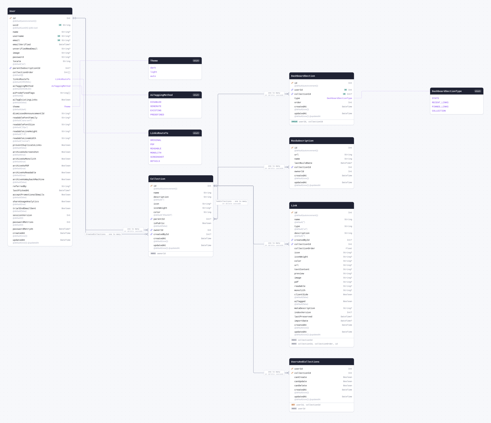

| Field         | Type       | Constraints                               | Default              | Description |
| ------------- | ---------- | ----------------------------------------- | -------------------- | ----------- |
| `id`          | `Int`      | PK NOT NULL                               | `autoincrement()`    |             |
| `name`        | `String`   | NOT NULL                                  |                      |             |
| `description` | `String`   | NOT NULL                                  | `""`                 |             |
| `icon`        | `String`   | NULL                                      |                      |             |
| `iconWeight`  | `String`   | NULL                                      |                      |             |
| `color`       | `String`   | NOT NULL                                  | `"#0ea5e9"`          |             |
| `parentId`    | `Int`      | NULL → [Collection.id](#model-Collection) |                      |             |
| `isPublic`    | `Boolean`  | NOT NULL                                  | `false`              |             |
| `ownerId`     | `Int`      | NOT NULL → [User.id](#model-User)         |                      |             |
| `createdById` | `Int`      | NULL → [User.id](#model-User)             |                      |             |
| `createdAt`   | `DateTime` | NOT NULL                                  | `now()`              |             |
| `updatedAt`   | `DateTime` | NOT NULL                                  | `now()` `@updatedAt` |             |

#### Indexes

- `@@index([ownerId])`

#### References

- `parentId` → [Collection.id](#model-Collection) (many-to-one, on delete Cascade)
- `ownerId` → [User.id](#model-User) (many-to-one, on delete Cascade)
- `createdById` → [User.id](#model-User) (many-to-one)

#### Referenced by

- `id` ← [Collection.parentId](#model-Collection) (one-to-many, on delete Cascade)
- `id` ← [UsersAndCollections.collectionId](#model-UsersAndCollections) (one-to-many, on delete Cascade)
- `id` ← [Link.collectionId](#model-Link) (one-to-many, on delete Cascade)
- `id` ← [RssSubscription.collectionId](#model-RssSubscription) (one-to-many, on delete Cascade)
- `id` ← [DashboardSection.collectionId](#model-DashboardSection) (one-to-many, on delete Cascade)

#### Definition

```sql
CREATE TABLE "Collection" (
    "id" SERIAL NOT NULL,
    "name" TEXT NOT NULL,
    "description" TEXT NOT NULL DEFAULT '',
    "icon" TEXT,
    "iconWeight" TEXT,
    "color" TEXT NOT NULL DEFAULT '#0ea5e9',
    "parentId" INTEGER,
    "isPublic" BOOLEAN NOT NULL DEFAULT false,
    "ownerId" INTEGER NOT NULL,
    "createdById" INTEGER,
    "createdAt" TIMESTAMP(3) NOT NULL DEFAULT CURRENT_TIMESTAMP,
    "updatedAt" TIMESTAMP(3) NOT NULL DEFAULT CURRENT_TIMESTAMP,

    CONSTRAINT "Collection_pkey" PRIMARY KEY ("id")
);

CREATE INDEX "Collection_ownerId_idx" ON "Collection"("ownerId");

ALTER TABLE "Collection" ADD CONSTRAINT "Collection_parentId_fkey" FOREIGN KEY ("parentId") REFERENCES "Collection"("id") ON DELETE CASCADE ON UPDATE CASCADE;

ALTER TABLE "Collection" ADD CONSTRAINT "Collection_ownerId_fkey" FOREIGN KEY ("ownerId") REFERENCES "User"("id") ON DELETE CASCADE ON UPDATE CASCADE;

ALTER TABLE "Collection" ADD CONSTRAINT "Collection_createdById_fkey" FOREIGN KEY ("createdById") REFERENCES "User"("id") ON DELETE SET NULL ON UPDATE CASCADE;
```

<details>
<summary>Queries and their SQL</summary>

**findMany**: Every row

```ts
await prisma.collection.findMany();
```

```sql
SELECT
  "public"."Collection"."id",
  "public"."Collection"."name",
  "public"."Collection"."description",
  "public"."Collection"."icon",
  "public"."Collection"."iconWeight",
  "public"."Collection"."color",
  "public"."Collection"."parentId",
  "public"."Collection"."isPublic",
  "public"."Collection"."ownerId",
  "public"."Collection"."createdById",
  "public"."Collection"."createdAt",
  "public"."Collection"."updatedAt"
FROM
  "public"."Collection"
WHERE
  1 = 1
OFFSET
  $1
-- params: ["0"]
```

**count**: How many rows there are

```ts
await prisma.collection.count();
```

```sql
SELECT
  COUNT(*) AS "_count$_all"
FROM
  (
    SELECT
      "public"."Collection"."id"
    FROM
      "public"."Collection"
    WHERE
      1 = 1
    OFFSET
      $1
  ) AS "sub"
-- params: ["0"]
```

**findMany**: Every row with its relations

```ts
await prisma.collection.findMany({
  include: {
    parent: true,
    subCollections: true,
    owner: true,
    members: true,
    createdBy: true,
    links: true,
    rssSubscriptions: true,
    DashboardSection: true,
  },
});
```

```sql
SELECT
  "public"."Collection"."id",
  "public"."Collection"."name",
  "public"."Collection"."description",
  "public"."Collection"."icon",
  "public"."Collection"."iconWeight",
  "public"."Collection"."color",
  "public"."Collection"."parentId",
  "public"."Collection"."isPublic",
  "public"."Collection"."ownerId",
  "public"."Collection"."createdById",
  "public"."Collection"."createdAt",
  "public"."Collection"."updatedAt"
FROM
  "public"."Collection"
WHERE
  1 = 1
OFFSET
  $1
-- params: ["0"]

SELECT
  "public"."Collection"."id",
  "public"."Collection"."name",
  "public"."Collection"."description",
  "public"."Collection"."icon",
  "public"."Collection"."iconWeight",
  "public"."Collection"."color",
  "public"."Collection"."parentId",
  "public"."Collection"."isPublic",
  "public"."Collection"."ownerId",
  "public"."Collection"."createdById",
  "public"."Collection"."createdAt",
  "public"."Collection"."updatedAt"
FROM
  "public"."Collection"
WHERE
  "public"."Collection"."id" IN ($1)
OFFSET
  $2
-- params: ["<parentId of the rows above>","0"]

SELECT
  "public"."Collection"."id",
  "public"."Collection"."name",
  "public"."Collection"."description",
  "public"."Collection"."icon",
  "public"."Collection"."iconWeight",
  "public"."Collection"."color",
  "public"."Collection"."parentId",
  "public"."Collection"."isPublic",
  "public"."Collection"."ownerId",
  "public"."Collection"."createdById",
  "public"."Collection"."createdAt",
  "public"."Collection"."updatedAt"
FROM
  "public"."Collection"
WHERE
  "public"."Collection"."parentId" IN ($1)
OFFSET
  $2
-- params: ["<id of the rows above>","0"]

SELECT
  "public"."User"."id",
  "public"."User"."uuid",
  "public"."User"."name",
  "public"."User"."username",
  "public"."User"."email",
  "public"."User"."emailVerified",
  "public"."User"."unverifiedNewEmail",
  "public"."User"."image",
  "public"."User"."password",
  "public"."User"."locale",
  "public"."User"."parentSubscriptionId",
  "public"."User"."collectionOrder",
  "public"."User"."linksRouteTo"::text,
  "public"."User"."aiTaggingMethod"::text,
  "public"."User"."aiPredefinedTags",
  "public"."User"."aiTagExistingLinks",
  "public"."User"."theme"::text,
  "public"."User"."dismissedAnnouncementId",
  "public"."User"."readableFontFamily",
  "public"."User"."readableFontSize",
  "public"."User"."readableLineHeight",
  "public"."User"."readableLineWidth",
  "public"."User"."preventDuplicateLinks",
  "public"."User"."archiveAsScreenshot",
  "public"."User"."archiveAsMonolith",
  "public"."User"."archiveAsPDF",
  "public"."User"."archiveAsReadable",
  "public"."User"."archiveAsWaybackMachine",
  "public"."User"."referredBy",
  "public"."User"."lastPickedAt",
  "public"."User"."acceptPromotionalEmails",
  "public"."User"."shareUsageAnalytics",
  "public"."User"."trialEndEmailSent",
  "public"."User"."sessionVersion",
  "public"."User"."passwordRetries",
  "public"."User"."passwordRetryAt",
  "public"."User"."createdAt",
  "public"."User"."updatedAt"
FROM
  "public"."User"
WHERE
  "public"."User"."id" IN ($1)
OFFSET
  $2
-- params: ["<ownerId of the rows above>","0"]

SELECT
  "public"."UsersAndCollections"."userId",
  "public"."UsersAndCollections"."collectionId",
  "public"."UsersAndCollections"."canCreate",
  "public"."UsersAndCollections"."canUpdate",
  "public"."UsersAndCollections"."canDelete",
  "public"."UsersAndCollections"."createdAt",
  "public"."UsersAndCollections"."updatedAt"
FROM
  "public"."UsersAndCollections"
WHERE
  "public"."UsersAndCollections"."collectionId" IN ($1)
OFFSET
  $2
-- params: ["<id of the rows above>","0"]

SELECT
  "public"."User"."id",
  "public"."User"."uuid",
  "public"."User"."name",
  "public"."User"."username",
  "public"."User"."email",
  "public"."User"."emailVerified",
  "public"."User"."unverifiedNewEmail",
  "public"."User"."image",
  "public"."User"."password",
  "public"."User"."locale",
  "public"."User"."parentSubscriptionId",
  "public"."User"."collectionOrder",
  "public"."User"."linksRouteTo"::text,
  "public"."User"."aiTaggingMethod"::text,
  "public"."User"."aiPredefinedTags",
  "public"."User"."aiTagExistingLinks",
  "public"."User"."theme"::text,
  "public"."User"."dismissedAnnouncementId",
  "public"."User"."readableFontFamily",
  "public"."User"."readableFontSize",
  "public"."User"."readableLineHeight",
  "public"."User"."readableLineWidth",
  "public"."User"."preventDuplicateLinks",
  "public"."User"."archiveAsScreenshot",
  "public"."User"."archiveAsMonolith",
  "public"."User"."archiveAsPDF",
  "public"."User"."archiveAsReadable",
  "public"."User"."archiveAsWaybackMachine",
  "public"."User"."referredBy",
  "public"."User"."lastPickedAt",
  "public"."User"."acceptPromotionalEmails",
  "public"."User"."shareUsageAnalytics",
  "public"."User"."trialEndEmailSent",
  "public"."User"."sessionVersion",
  "public"."User"."passwordRetries",
  "public"."User"."passwordRetryAt",
  "public"."User"."createdAt",
  "public"."User"."updatedAt"
FROM
  "public"."User"
WHERE
  "public"."User"."id" IN ($1)
OFFSET
  $2
-- params: ["<createdById of the rows above>","0"]

SELECT
  "public"."Link"."id",
  "public"."Link"."name",
  "public"."Link"."type",
  "public"."Link"."description",
  "public"."Link"."createdById",
  "public"."Link"."collectionId",
  "public"."Link"."collectionOrder",
  "public"."Link"."icon",
  "public"."Link"."iconWeight",
  "public"."Link"."color",
  "public"."Link"."url",
  "public"."Link"."textContent",
  "public"."Link"."preview",
  "public"."Link"."image",
  "public"."Link"."pdf",
  "public"."Link"."readable",
  "public"."Link"."monolith",
  "public"."Link"."clientSide",
  "public"."Link"."aiTagged",
  "public"."Link"."metaDescription",
  "public"."Link"."indexVersion",
  "public"."Link"."lastPreserved",
  "public"."Link"."importDate",
  "public"."Link"."createdAt",
  "public"."Link"."updatedAt"
FROM
  "public"."Link"
WHERE
  "public"."Link"."collectionId" IN ($1)
OFFSET
  $2
-- params: ["<id of the rows above>","0"]

SELECT
  "public"."RssSubscription"."id",
  "public"."RssSubscription"."url",
  "public"."RssSubscription"."name",
  "public"."RssSubscription"."lastBuildDate",
  "public"."RssSubscription"."collectionId",
  "public"."RssSubscription"."ownerId",
  "public"."RssSubscription"."createdAt",
  "public"."RssSubscription"."updatedAt"
FROM
  "public"."RssSubscription"
WHERE
  "public"."RssSubscription"."collectionId" IN ($1)
OFFSET
  $2
-- params: ["<id of the rows above>","0"]

SELECT
  "public"."DashboardSection"."id",
  "public"."DashboardSection"."userId",
  "public"."DashboardSection"."collectionId",
  "public"."DashboardSection"."type"::text,
  "public"."DashboardSection"."order",
  "public"."DashboardSection"."createdAt",
  "public"."DashboardSection"."updatedAt"
FROM
  "public"."DashboardSection"
WHERE
  "public"."DashboardSection"."collectionId" IN ($1)
OFFSET
  $2
-- params: ["<id of the rows above>","0"]
```

**findUnique**: One row by what is unique to it

```ts
await prisma.collection.findUnique({ where: { id: 1 } });
```

```sql
SELECT
  "public"."Collection"."id",
  "public"."Collection"."name",
  "public"."Collection"."description",
  "public"."Collection"."icon",
  "public"."Collection"."iconWeight",
  "public"."Collection"."color",
  "public"."Collection"."parentId",
  "public"."Collection"."isPublic",
  "public"."Collection"."ownerId",
  "public"."Collection"."createdById",
  "public"."Collection"."createdAt",
  "public"."Collection"."updatedAt"
FROM
  "public"."Collection"
WHERE
  (
    "public"."Collection"."id" = $1
    AND 1 = 1
  )
LIMIT
  $2
OFFSET
  $3
-- params: ["1","1","0"]
```

**create**: Create a row

```ts
await prisma.collection.create({ data: { name: "example", ownerId: 1 } });
```

```sql
INSERT INTO
  "public"."Collection" (
    "name",
    "description",
    "color",
    "isPublic",
    "ownerId",
    "createdAt",
    "updatedAt"
  )
VALUES
  ($1, $2, $3, $4, $5, $6, $7)
RETURNING
  "public"."Collection"."id",
  "public"."Collection"."name",
  "public"."Collection"."description",
  "public"."Collection"."icon",
  "public"."Collection"."iconWeight",
  "public"."Collection"."color",
  "public"."Collection"."parentId",
  "public"."Collection"."isPublic",
  "public"."Collection"."ownerId",
  "public"."Collection"."createdById",
  "public"."Collection"."createdAt",
  "public"."Collection"."updatedAt"
-- params: ["example","","#0ea5e9",false,"1","<now()>","<now()>"]
```

**update**: Update a row

```ts
await prisma.collection.update({ where: { id: 1 }, data: { name: "example" } });
```

```sql
UPDATE "public"."Collection"
SET
  "name" = $1,
  "updatedAt" = $2
WHERE
  (
    "public"."Collection"."id" = $3
    AND 1 = 1
  )
RETURNING
  "public"."Collection"."id",
  "public"."Collection"."name",
  "public"."Collection"."description",
  "public"."Collection"."icon",
  "public"."Collection"."iconWeight",
  "public"."Collection"."color",
  "public"."Collection"."parentId",
  "public"."Collection"."isPublic",
  "public"."Collection"."ownerId",
  "public"."Collection"."createdById",
  "public"."Collection"."createdAt",
  "public"."Collection"."updatedAt"
-- params: ["example",{"prisma__type":"generatorCall","prisma__value":{"name":"now","args":[],"returnType":{"type":"DateTime"}}},"1"]
```

**delete**: Delete a row

```ts
await prisma.collection.delete({ where: { id: 1 } });
```

```sql
DELETE FROM "public"."Collection"
WHERE
  (
    "public"."Collection"."id" = $1
    AND 1 = 1
  )
RETURNING
  "public"."Collection"."id",
  "public"."Collection"."name",
  "public"."Collection"."description",
  "public"."Collection"."icon",
  "public"."Collection"."iconWeight",
  "public"."Collection"."color",
  "public"."Collection"."parentId",
  "public"."Collection"."isPublic",
  "public"."Collection"."ownerId",
  "public"."Collection"."createdById",
  "public"."Collection"."createdAt",
  "public"."Collection"."updatedAt"
-- params: ["1"]
```

</details>

<a id="model-UsersAndCollections"></a>

### UsersAndCollections

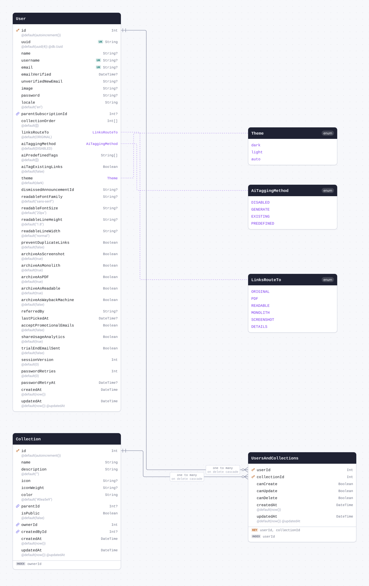

| Field          | Type       | Constraints                                      | Default              | Description |
| -------------- | ---------- | ------------------------------------------------ | -------------------- | ----------- |
| `userId`       | `Int`      | PK NOT NULL → [User.id](#model-User)             |                      |             |
| `collectionId` | `Int`      | PK NOT NULL → [Collection.id](#model-Collection) |                      |             |
| `canCreate`    | `Boolean`  | NOT NULL                                         |                      |             |
| `canUpdate`    | `Boolean`  | NOT NULL                                         |                      |             |
| `canDelete`    | `Boolean`  | NOT NULL                                         |                      |             |
| `createdAt`    | `DateTime` | NOT NULL                                         | `now()`              |             |
| `updatedAt`    | `DateTime` | NOT NULL                                         | `now()` `@updatedAt` |             |

#### Indexes

- `@@id([userId, collectionId])`
- `@@index([userId])`

#### References

- `userId` → [User.id](#model-User) (many-to-one, on delete Cascade)
- `collectionId` → [Collection.id](#model-Collection) (many-to-one, on delete Cascade)

#### Definition

```sql
CREATE TABLE "UsersAndCollections" (
    "userId" INTEGER NOT NULL,
    "collectionId" INTEGER NOT NULL,
    "canCreate" BOOLEAN NOT NULL,
    "canUpdate" BOOLEAN NOT NULL,
    "canDelete" BOOLEAN NOT NULL,
    "createdAt" TIMESTAMP(3) NOT NULL DEFAULT CURRENT_TIMESTAMP,
    "updatedAt" TIMESTAMP(3) NOT NULL DEFAULT CURRENT_TIMESTAMP,

    CONSTRAINT "UsersAndCollections_pkey" PRIMARY KEY ("userId","collectionId")
);

CREATE INDEX "UsersAndCollections_userId_idx" ON "UsersAndCollections"("userId");

ALTER TABLE "UsersAndCollections" ADD CONSTRAINT "UsersAndCollections_userId_fkey" FOREIGN KEY ("userId") REFERENCES "User"("id") ON DELETE CASCADE ON UPDATE CASCADE;

ALTER TABLE "UsersAndCollections" ADD CONSTRAINT "UsersAndCollections_collectionId_fkey" FOREIGN KEY ("collectionId") REFERENCES "Collection"("id") ON DELETE CASCADE ON UPDATE CASCADE;
```

<details>
<summary>Queries and their SQL</summary>

**findMany**: Every row

```ts
await prisma.usersAndCollections.findMany();
```

```sql
SELECT
  "public"."UsersAndCollections"."userId",
  "public"."UsersAndCollections"."collectionId",
  "public"."UsersAndCollections"."canCreate",
  "public"."UsersAndCollections"."canUpdate",
  "public"."UsersAndCollections"."canDelete",
  "public"."UsersAndCollections"."createdAt",
  "public"."UsersAndCollections"."updatedAt"
FROM
  "public"."UsersAndCollections"
WHERE
  1 = 1
OFFSET
  $1
-- params: ["0"]
```

**count**: How many rows there are

```ts
await prisma.usersAndCollections.count();
```

```sql
SELECT
  COUNT(*) AS "_count$_all"
FROM
  (
    SELECT
      "public"."UsersAndCollections"."userId",
      "public"."UsersAndCollections"."collectionId"
    FROM
      "public"."UsersAndCollections"
    WHERE
      1 = 1
    OFFSET
      $1
  ) AS "sub"
-- params: ["0"]
```

**findMany**: Every row with its relations

```ts
await prisma.usersAndCollections.findMany({ include: { user: true, collection: true } });
```

```sql
SELECT
  "public"."UsersAndCollections"."userId",
  "public"."UsersAndCollections"."collectionId",
  "public"."UsersAndCollections"."canCreate",
  "public"."UsersAndCollections"."canUpdate",
  "public"."UsersAndCollections"."canDelete",
  "public"."UsersAndCollections"."createdAt",
  "public"."UsersAndCollections"."updatedAt"
FROM
  "public"."UsersAndCollections"
WHERE
  1 = 1
OFFSET
  $1
-- params: ["0"]

SELECT
  "public"."User"."id",
  "public"."User"."uuid",
  "public"."User"."name",
  "public"."User"."username",
  "public"."User"."email",
  "public"."User"."emailVerified",
  "public"."User"."unverifiedNewEmail",
  "public"."User"."image",
  "public"."User"."password",
  "public"."User"."locale",
  "public"."User"."parentSubscriptionId",
  "public"."User"."collectionOrder",
  "public"."User"."linksRouteTo"::text,
  "public"."User"."aiTaggingMethod"::text,
  "public"."User"."aiPredefinedTags",
  "public"."User"."aiTagExistingLinks",
  "public"."User"."theme"::text,
  "public"."User"."dismissedAnnouncementId",
  "public"."User"."readableFontFamily",
  "public"."User"."readableFontSize",
  "public"."User"."readableLineHeight",
  "public"."User"."readableLineWidth",
  "public"."User"."preventDuplicateLinks",
  "public"."User"."archiveAsScreenshot",
  "public"."User"."archiveAsMonolith",
  "public"."User"."archiveAsPDF",
  "public"."User"."archiveAsReadable",
  "public"."User"."archiveAsWaybackMachine",
  "public"."User"."referredBy",
  "public"."User"."lastPickedAt",
  "public"."User"."acceptPromotionalEmails",
  "public"."User"."shareUsageAnalytics",
  "public"."User"."trialEndEmailSent",
  "public"."User"."sessionVersion",
  "public"."User"."passwordRetries",
  "public"."User"."passwordRetryAt",
  "public"."User"."createdAt",
  "public"."User"."updatedAt"
FROM
  "public"."User"
WHERE
  "public"."User"."id" IN ($1)
OFFSET
  $2
-- params: ["<userId of the rows above>","0"]

SELECT
  "public"."Collection"."id",
  "public"."Collection"."name",
  "public"."Collection"."description",
  "public"."Collection"."icon",
  "public"."Collection"."iconWeight",
  "public"."Collection"."color",
  "public"."Collection"."parentId",
  "public"."Collection"."isPublic",
  "public"."Collection"."ownerId",
  "public"."Collection"."createdById",
  "public"."Collection"."createdAt",
  "public"."Collection"."updatedAt"
FROM
  "public"."Collection"
WHERE
  "public"."Collection"."id" IN ($1)
OFFSET
  $2
-- params: ["<collectionId of the rows above>","0"]
```

**findUnique**: One row by what is unique to it

```ts
await prisma.usersAndCollections.findUnique({
  where: { userId_collectionId: { userId: 1, collectionId: 1 } },
});
```

```sql
SELECT
  "public"."UsersAndCollections"."userId",
  "public"."UsersAndCollections"."collectionId",
  "public"."UsersAndCollections"."canCreate",
  "public"."UsersAndCollections"."canUpdate",
  "public"."UsersAndCollections"."canDelete",
  "public"."UsersAndCollections"."createdAt",
  "public"."UsersAndCollections"."updatedAt"
FROM
  "public"."UsersAndCollections"
WHERE
  (
    (
      "public"."UsersAndCollections"."userId" = $1
      AND "public"."UsersAndCollections"."collectionId" = $2
    )
    AND 1 = 1
  )
LIMIT
  $3
OFFSET
  $4
-- params: ["1","1","1","0"]
```

**create**: Create a row

```ts
await prisma.usersAndCollections.create({
  data: { userId: 1, collectionId: 1, canCreate: true, canUpdate: true, canDelete: true },
});
```

```sql
INSERT INTO
  "public"."UsersAndCollections" (
    "userId",
    "collectionId",
    "canCreate",
    "canUpdate",
    "canDelete",
    "createdAt",
    "updatedAt"
  )
VALUES
  ($1, $2, $3, $4, $5, $6, $7)
RETURNING
  "public"."UsersAndCollections"."userId",
  "public"."UsersAndCollections"."collectionId",
  "public"."UsersAndCollections"."canCreate",
  "public"."UsersAndCollections"."canUpdate",
  "public"."UsersAndCollections"."canDelete",
  "public"."UsersAndCollections"."createdAt",
  "public"."UsersAndCollections"."updatedAt"
-- params: ["1","1",true,true,true,"<now()>","<now()>"]
```

**update**: Update a row

```ts
await prisma.usersAndCollections.update({
  where: { userId_collectionId: { userId: 1, collectionId: 1 } },
  data: { canCreate: true },
});
```

```sql
UPDATE "public"."UsersAndCollections"
SET
  "canCreate" = $1,
  "updatedAt" = $2
WHERE
  (
    (
      "public"."UsersAndCollections"."userId" = $3
      AND "public"."UsersAndCollections"."collectionId" = $4
    )
    AND 1 = 1
  )
RETURNING
  "public"."UsersAndCollections"."userId",
  "public"."UsersAndCollections"."collectionId",
  "public"."UsersAndCollections"."canCreate",
  "public"."UsersAndCollections"."canUpdate",
  "public"."UsersAndCollections"."canDelete",
  "public"."UsersAndCollections"."createdAt",
  "public"."UsersAndCollections"."updatedAt"
-- params: [true,{"prisma__type":"generatorCall","prisma__value":{"name":"now","args":[],"returnType":{"type":"DateTime"}}},"1","1"]
```

**delete**: Delete a row

```ts
await prisma.usersAndCollections.delete({
  where: { userId_collectionId: { userId: 1, collectionId: 1 } },
});
```

```sql
DELETE FROM "public"."UsersAndCollections"
WHERE
  (
    (
      "public"."UsersAndCollections"."userId" = $1
      AND "public"."UsersAndCollections"."collectionId" = $2
    )
    AND 1 = 1
  )
RETURNING
  "public"."UsersAndCollections"."userId",
  "public"."UsersAndCollections"."collectionId",
  "public"."UsersAndCollections"."canCreate",
  "public"."UsersAndCollections"."canUpdate",
  "public"."UsersAndCollections"."canDelete",
  "public"."UsersAndCollections"."createdAt",
  "public"."UsersAndCollections"."updatedAt"
-- params: ["1","1"]
```

</details>

<a id="model-Link"></a>

### Link

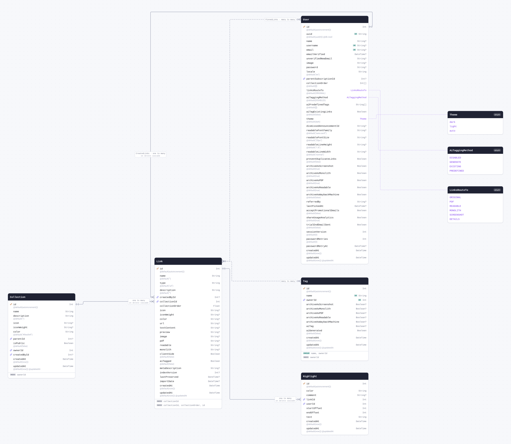

| Field             | Type       | Constraints                                   | Default              | Description |
| ----------------- | ---------- | --------------------------------------------- | -------------------- | ----------- |
| `id`              | `Int`      | PK NOT NULL                                   | `autoincrement()`    |             |
| `name`            | `String`   | NOT NULL                                      | `""`                 |             |
| `type`            | `String`   | NOT NULL                                      | `"url"`              |             |
| `description`     | `String`   | NOT NULL                                      | `""`                 |             |
| `createdById`     | `Int`      | NULL → [User.id](#model-User)                 |                      |             |
| `collectionId`    | `Int`      | NOT NULL → [Collection.id](#model-Collection) |                      |             |
| `collectionOrder` | `Float`    | NOT NULL                                      |                      |             |
| `icon`            | `String`   | NULL                                          |                      |             |
| `iconWeight`      | `String`   | NULL                                          |                      |             |
| `color`           | `String`   | NULL                                          |                      |             |
| `url`             | `String`   | NULL                                          |                      |             |
| `textContent`     | `String`   | NULL                                          |                      |             |
| `preview`         | `String`   | NULL                                          |                      |             |
| `image`           | `String`   | NULL                                          |                      |             |
| `pdf`             | `String`   | NULL                                          |                      |             |
| `readable`        | `String`   | NULL                                          |                      |             |
| `monolith`        | `String`   | NULL                                          |                      |             |
| `clientSide`      | `Boolean`  | NOT NULL                                      | `false`              |             |
| `aiTagged`        | `Boolean`  | NOT NULL                                      | `false`              |             |
| `metaDescription` | `String`   | NULL                                          |                      |             |
| `indexVersion`    | `Int`      | NULL                                          |                      |             |
| `lastPreserved`   | `DateTime` | NULL                                          |                      |             |
| `importDate`      | `DateTime` | NULL                                          |                      |             |
| `createdAt`       | `DateTime` | NOT NULL                                      | `now()`              |             |
| `updatedAt`       | `DateTime` | NOT NULL                                      | `now()` `@updatedAt` |             |

#### Indexes

- `@@index([collectionId])`
- `@@index([collectionId, collectionOrder, id])`

#### References

- `createdById` → [User.id](#model-User) (many-to-one, on delete Cascade)
- `collectionId` → [Collection.id](#model-Collection) (many-to-one, on delete Cascade)

#### Referenced by

- `id` ← [Highlight.linkId](#model-Highlight) (one-to-many, on delete Cascade)

#### Many to many

- `pinnedBy` ↔ [User.pinnedLinks](#model-User) through `_PinnedLinks`
- `tags` ↔ [Tag.links](#model-Tag) through `_LinkToTag`

#### Definition

```sql
CREATE TABLE "Link" (
    "id" SERIAL NOT NULL,
    "name" TEXT NOT NULL DEFAULT '',
    "type" TEXT NOT NULL DEFAULT 'url',
    "description" TEXT NOT NULL DEFAULT '',
    "createdById" INTEGER,
    "collectionId" INTEGER NOT NULL,
    "collectionOrder" DOUBLE PRECISION NOT NULL,
    "icon" TEXT,
    "iconWeight" TEXT,
    "color" TEXT,
    "url" TEXT,
    "textContent" TEXT,
    "preview" TEXT,
    "image" TEXT,
    "pdf" TEXT,
    "readable" TEXT,
    "monolith" TEXT,
    "clientSide" BOOLEAN NOT NULL DEFAULT false,
    "aiTagged" BOOLEAN NOT NULL DEFAULT false,
    "metaDescription" TEXT,
    "indexVersion" INTEGER,
    "lastPreserved" TIMESTAMP(3),
    "importDate" TIMESTAMP(3),
    "createdAt" TIMESTAMP(3) NOT NULL DEFAULT CURRENT_TIMESTAMP,
    "updatedAt" TIMESTAMP(3) NOT NULL DEFAULT CURRENT_TIMESTAMP,

    CONSTRAINT "Link_pkey" PRIMARY KEY ("id")
);

CREATE INDEX "Link_collectionId_idx" ON "Link"("collectionId");

CREATE INDEX "Link_collectionId_collectionOrder_id_idx" ON "Link"("collectionId", "collectionOrder", "id");

ALTER TABLE "Link" ADD CONSTRAINT "Link_createdById_fkey" FOREIGN KEY ("createdById") REFERENCES "User"("id") ON DELETE CASCADE ON UPDATE CASCADE;

ALTER TABLE "Link" ADD CONSTRAINT "Link_collectionId_fkey" FOREIGN KEY ("collectionId") REFERENCES "Collection"("id") ON DELETE CASCADE ON UPDATE CASCADE;
```

<details>
<summary>Queries and their SQL</summary>

**findMany**: Every row

```ts
await prisma.link.findMany();
```

```sql
SELECT
  "public"."Link"."id",
  "public"."Link"."name",
  "public"."Link"."type",
  "public"."Link"."description",
  "public"."Link"."createdById",
  "public"."Link"."collectionId",
  "public"."Link"."collectionOrder",
  "public"."Link"."icon",
  "public"."Link"."iconWeight",
  "public"."Link"."color",
  "public"."Link"."url",
  "public"."Link"."textContent",
  "public"."Link"."preview",
  "public"."Link"."image",
  "public"."Link"."pdf",
  "public"."Link"."readable",
  "public"."Link"."monolith",
  "public"."Link"."clientSide",
  "public"."Link"."aiTagged",
  "public"."Link"."metaDescription",
  "public"."Link"."indexVersion",
  "public"."Link"."lastPreserved",
  "public"."Link"."importDate",
  "public"."Link"."createdAt",
  "public"."Link"."updatedAt"
FROM
  "public"."Link"
WHERE
  1 = 1
OFFSET
  $1
-- params: ["0"]
```

**count**: How many rows there are

```ts
await prisma.link.count();
```

```sql
SELECT
  COUNT(*) AS "_count$_all"
FROM
  (
    SELECT
      "public"."Link"."id"
    FROM
      "public"."Link"
    WHERE
      1 = 1
    OFFSET
      $1
  ) AS "sub"
-- params: ["0"]
```

**findMany**: Every row with its relations

```ts
await prisma.link.findMany({
  include: { highlight: true, pinnedBy: true, createdBy: true, collection: true, tags: true },
});
```

```sql
SELECT
  "public"."Link"."id",
  "public"."Link"."name",
  "public"."Link"."type",
  "public"."Link"."description",
  "public"."Link"."createdById",
  "public"."Link"."collectionId",
  "public"."Link"."collectionOrder",
  "public"."Link"."icon",
  "public"."Link"."iconWeight",
  "public"."Link"."color",
  "public"."Link"."url",
  "public"."Link"."textContent",
  "public"."Link"."preview",
  "public"."Link"."image",
  "public"."Link"."pdf",
  "public"."Link"."readable",
  "public"."Link"."monolith",
  "public"."Link"."clientSide",
  "public"."Link"."aiTagged",
  "public"."Link"."metaDescription",
  "public"."Link"."indexVersion",
  "public"."Link"."lastPreserved",
  "public"."Link"."importDate",
  "public"."Link"."createdAt",
  "public"."Link"."updatedAt"
FROM
  "public"."Link"
WHERE
  1 = 1
OFFSET
  $1
-- params: ["0"]

SELECT
  "public"."Highlight"."id",
  "public"."Highlight"."color",
  "public"."Highlight"."comment",
  "public"."Highlight"."linkId",
  "public"."Highlight"."userId",
  "public"."Highlight"."startOffset",
  "public"."Highlight"."endOffset",
  "public"."Highlight"."text",
  "public"."Highlight"."createdAt",
  "public"."Highlight"."updatedAt"
FROM
  "public"."Highlight"
WHERE
  "public"."Highlight"."linkId" IN ($1)
OFFSET
  $2
-- params: ["<id of the rows above>","0"]

SELECT
  "public"."User"."id",
  "public"."User"."uuid",
  "public"."User"."name",
  "public"."User"."username",
  "public"."User"."email",
  "public"."User"."emailVerified",
  "public"."User"."unverifiedNewEmail",
  "public"."User"."image",
  "public"."User"."password",
  "public"."User"."locale",
  "public"."User"."parentSubscriptionId",
  "public"."User"."collectionOrder",
  "public"."User"."linksRouteTo"::text,
  "public"."User"."aiTaggingMethod"::text,
  "public"."User"."aiPredefinedTags",
  "public"."User"."aiTagExistingLinks",
  "public"."User"."theme"::text,
  "public"."User"."dismissedAnnouncementId",
  "public"."User"."readableFontFamily",
  "public"."User"."readableFontSize",
  "public"."User"."readableLineHeight",
  "public"."User"."readableLineWidth",
  "public"."User"."preventDuplicateLinks",
  "public"."User"."archiveAsScreenshot",
  "public"."User"."archiveAsMonolith",
  "public"."User"."archiveAsPDF",
  "public"."User"."archiveAsReadable",
  "public"."User"."archiveAsWaybackMachine",
  "public"."User"."referredBy",
  "public"."User"."lastPickedAt",
  "public"."User"."acceptPromotionalEmails",
  "public"."User"."shareUsageAnalytics",
  "public"."User"."trialEndEmailSent",
  "public"."User"."sessionVersion",
  "public"."User"."passwordRetries",
  "public"."User"."passwordRetryAt",
  "public"."User"."createdAt",
  "public"."User"."updatedAt",
  "t0"."A" AS "PinnedLinks@Link"
FROM
  "public"."User"
  INNER JOIN "public"."_PinnedLinks" AS "t0" ON "t0"."B" = "public"."User"."id"
WHERE
  (
    1 = 1
    AND "t0"."A" IN ($1)
  )
OFFSET
  $2
-- params: ["<id of the rows above>","0"]

SELECT
  "public"."User"."id",
  "public"."User"."uuid",
  "public"."User"."name",
  "public"."User"."username",
  "public"."User"."email",
  "public"."User"."emailVerified",
  "public"."User"."unverifiedNewEmail",
  "public"."User"."image",
  "public"."User"."password",
  "public"."User"."locale",
  "public"."User"."parentSubscriptionId",
  "public"."User"."collectionOrder",
  "public"."User"."linksRouteTo"::text,
  "public"."User"."aiTaggingMethod"::text,
  "public"."User"."aiPredefinedTags",
  "public"."User"."aiTagExistingLinks",
  "public"."User"."theme"::text,
  "public"."User"."dismissedAnnouncementId",
  "public"."User"."readableFontFamily",
  "public"."User"."readableFontSize",
  "public"."User"."readableLineHeight",
  "public"."User"."readableLineWidth",
  "public"."User"."preventDuplicateLinks",
  "public"."User"."archiveAsScreenshot",
  "public"."User"."archiveAsMonolith",
  "public"."User"."archiveAsPDF",
  "public"."User"."archiveAsReadable",
  "public"."User"."archiveAsWaybackMachine",
  "public"."User"."referredBy",
  "public"."User"."lastPickedAt",
  "public"."User"."acceptPromotionalEmails",
  "public"."User"."shareUsageAnalytics",
  "public"."User"."trialEndEmailSent",
  "public"."User"."sessionVersion",
  "public"."User"."passwordRetries",
  "public"."User"."passwordRetryAt",
  "public"."User"."createdAt",
  "public"."User"."updatedAt"
FROM
  "public"."User"
WHERE
  "public"."User"."id" IN ($1)
OFFSET
  $2
-- params: ["<createdById of the rows above>","0"]

SELECT
  "public"."Collection"."id",
  "public"."Collection"."name",
  "public"."Collection"."description",
  "public"."Collection"."icon",
  "public"."Collection"."iconWeight",
  "public"."Collection"."color",
  "public"."Collection"."parentId",
  "public"."Collection"."isPublic",
  "public"."Collection"."ownerId",
  "public"."Collection"."createdById",
  "public"."Collection"."createdAt",
  "public"."Collection"."updatedAt"
FROM
  "public"."Collection"
WHERE
  "public"."Collection"."id" IN ($1)
OFFSET
  $2
-- params: ["<collectionId of the rows above>","0"]

SELECT
  "public"."Tag"."id",
  "public"."Tag"."name",
  "public"."Tag"."ownerId",
  "public"."Tag"."archiveAsScreenshot",
  "public"."Tag"."archiveAsMonolith",
  "public"."Tag"."archiveAsPDF",
  "public"."Tag"."archiveAsReadable",
  "public"."Tag"."archiveAsWaybackMachine",
  "public"."Tag"."aiTag",
  "public"."Tag"."aiGenerated",
  "public"."Tag"."createdAt",
  "public"."Tag"."updatedAt",
  "t1"."A" AS "LinkToTag@Link"
FROM
  "public"."Tag"
  INNER JOIN "public"."_LinkToTag" AS "t1" ON "t1"."B" = "public"."Tag"."id"
WHERE
  (
    1 = 1
    AND "t1"."A" IN ($1)
  )
OFFSET
  $2
-- params: ["<id of the rows above>","0"]
```

**findUnique**: One row by what is unique to it

```ts
await prisma.link.findUnique({ where: { id: 1 } });
```

```sql
SELECT
  "public"."Link"."id",
  "public"."Link"."name",
  "public"."Link"."type",
  "public"."Link"."description",
  "public"."Link"."createdById",
  "public"."Link"."collectionId",
  "public"."Link"."collectionOrder",
  "public"."Link"."icon",
  "public"."Link"."iconWeight",
  "public"."Link"."color",
  "public"."Link"."url",
  "public"."Link"."textContent",
  "public"."Link"."preview",
  "public"."Link"."image",
  "public"."Link"."pdf",
  "public"."Link"."readable",
  "public"."Link"."monolith",
  "public"."Link"."clientSide",
  "public"."Link"."aiTagged",
  "public"."Link"."metaDescription",
  "public"."Link"."indexVersion",
  "public"."Link"."lastPreserved",
  "public"."Link"."importDate",
  "public"."Link"."createdAt",
  "public"."Link"."updatedAt"
FROM
  "public"."Link"
WHERE
  (
    "public"."Link"."id" = $1
    AND 1 = 1
  )
LIMIT
  $2
OFFSET
  $3
-- params: ["1","1","0"]
```

**create**: Create a row

```ts
await prisma.link.create({ data: { collectionId: 1, collectionOrder: 1.5 } });
```

```sql
INSERT INTO
  "public"."Link" (
    "name",
    "type",
    "description",
    "collectionId",
    "collectionOrder",
    "clientSide",
    "aiTagged",
    "createdAt",
    "updatedAt"
  )
VALUES
  ($1, $2, $3, $4, $5, $6, $7, $8, $9)
RETURNING
  "public"."Link"."id",
  "public"."Link"."name",
  "public"."Link"."type",
  "public"."Link"."description",
  "public"."Link"."createdById",
  "public"."Link"."collectionId",
  "public"."Link"."collectionOrder",
  "public"."Link"."icon",
  "public"."Link"."iconWeight",
  "public"."Link"."color",
  "public"."Link"."url",
  "public"."Link"."textContent",
  "public"."Link"."preview",
  "public"."Link"."image",
  "public"."Link"."pdf",
  "public"."Link"."readable",
  "public"."Link"."monolith",
  "public"."Link"."clientSide",
  "public"."Link"."aiTagged",
  "public"."Link"."metaDescription",
  "public"."Link"."indexVersion",
  "public"."Link"."lastPreserved",
  "public"."Link"."importDate",
  "public"."Link"."createdAt",
  "public"."Link"."updatedAt"
-- params: ["","url","","1","1.5",false,false,"<now()>","<now()>"]
```

**update**: Update a row

```ts
await prisma.link.update({ where: { id: 1 }, data: { name: "example" } });
```

```sql
UPDATE "public"."Link"
SET
  "name" = $1,
  "updatedAt" = $2
WHERE
  (
    "public"."Link"."id" = $3
    AND 1 = 1
  )
RETURNING
  "public"."Link"."id",
  "public"."Link"."name",
  "public"."Link"."type",
  "public"."Link"."description",
  "public"."Link"."createdById",
  "public"."Link"."collectionId",
  "public"."Link"."collectionOrder",
  "public"."Link"."icon",
  "public"."Link"."iconWeight",
  "public"."Link"."color",
  "public"."Link"."url",
  "public"."Link"."textContent",
  "public"."Link"."preview",
  "public"."Link"."image",
  "public"."Link"."pdf",
  "public"."Link"."readable",
  "public"."Link"."monolith",
  "public"."Link"."clientSide",
  "public"."Link"."aiTagged",
  "public"."Link"."metaDescription",
  "public"."Link"."indexVersion",
  "public"."Link"."lastPreserved",
  "public"."Link"."importDate",
  "public"."Link"."createdAt",
  "public"."Link"."updatedAt"
-- params: ["example",{"prisma__type":"generatorCall","prisma__value":{"name":"now","args":[],"returnType":{"type":"DateTime"}}},"1"]
```

**delete**: Delete a row

```ts
await prisma.link.delete({ where: { id: 1 } });
```

```sql
DELETE FROM "public"."Link"
WHERE
  (
    "public"."Link"."id" = $1
    AND 1 = 1
  )
RETURNING
  "public"."Link"."id",
  "public"."Link"."name",
  "public"."Link"."type",
  "public"."Link"."description",
  "public"."Link"."createdById",
  "public"."Link"."collectionId",
  "public"."Link"."collectionOrder",
  "public"."Link"."icon",
  "public"."Link"."iconWeight",
  "public"."Link"."color",
  "public"."Link"."url",
  "public"."Link"."textContent",
  "public"."Link"."preview",
  "public"."Link"."image",
  "public"."Link"."pdf",
  "public"."Link"."readable",
  "public"."Link"."monolith",
  "public"."Link"."clientSide",
  "public"."Link"."aiTagged",
  "public"."Link"."metaDescription",
  "public"."Link"."indexVersion",
  "public"."Link"."lastPreserved",
  "public"."Link"."importDate",
  "public"."Link"."createdAt",
  "public"."Link"."updatedAt"
-- params: ["1"]
```

</details>

<a id="model-Tag"></a>

### Tag

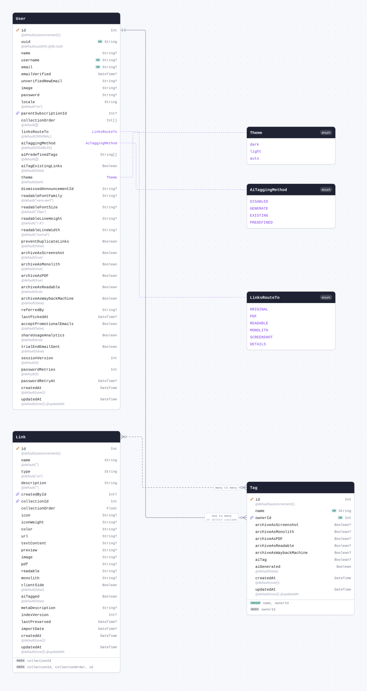

| Field                     | Type       | Constraints                       | Default              | Description |
| ------------------------- | ---------- | --------------------------------- | -------------------- | ----------- |
| `id`                      | `Int`      | PK NOT NULL                       | `autoincrement()`    |             |
| `name`                    | `String`   | NOT NULL                          |                      |             |
| `ownerId`                 | `Int`      | NOT NULL → [User.id](#model-User) |                      |             |
| `archiveAsScreenshot`     | `Boolean`  | NULL                              |                      |             |
| `archiveAsMonolith`       | `Boolean`  | NULL                              |                      |             |
| `archiveAsPDF`            | `Boolean`  | NULL                              |                      |             |
| `archiveAsReadable`       | `Boolean`  | NULL                              |                      |             |
| `archiveAsWaybackMachine` | `Boolean`  | NULL                              |                      |             |
| `aiTag`                   | `Boolean`  | NULL                              |                      |             |
| `aiGenerated`             | `Boolean`  | NOT NULL                          | `false`              |             |
| `createdAt`               | `DateTime` | NOT NULL                          | `now()`              |             |
| `updatedAt`               | `DateTime` | NOT NULL                          | `now()` `@updatedAt` |             |

#### Indexes

- `@@index([ownerId])`
- `@@unique([name, ownerId])`

#### References

- `ownerId` → [User.id](#model-User) (many-to-one, on delete Cascade)

#### Many to many

- `links` ↔ [Link.tags](#model-Link) through `_LinkToTag`

#### Definition

```sql
CREATE TABLE "Tag" (
    "id" SERIAL NOT NULL,
    "name" TEXT NOT NULL,
    "ownerId" INTEGER NOT NULL,
    "archiveAsScreenshot" BOOLEAN,
    "archiveAsMonolith" BOOLEAN,
    "archiveAsPDF" BOOLEAN,
    "archiveAsReadable" BOOLEAN,
    "archiveAsWaybackMachine" BOOLEAN,
    "aiTag" BOOLEAN,
    "aiGenerated" BOOLEAN NOT NULL DEFAULT false,
    "createdAt" TIMESTAMP(3) NOT NULL DEFAULT CURRENT_TIMESTAMP,
    "updatedAt" TIMESTAMP(3) NOT NULL DEFAULT CURRENT_TIMESTAMP,

    CONSTRAINT "Tag_pkey" PRIMARY KEY ("id")
);

CREATE INDEX "Tag_ownerId_idx" ON "Tag"("ownerId");

CREATE UNIQUE INDEX "Tag_name_ownerId_key" ON "Tag"("name", "ownerId");

ALTER TABLE "Tag" ADD CONSTRAINT "Tag_ownerId_fkey" FOREIGN KEY ("ownerId") REFERENCES "User"("id") ON DELETE CASCADE ON UPDATE CASCADE;
```

<details>
<summary>Queries and their SQL</summary>

**findMany**: Every row

```ts
await prisma.tag.findMany();
```

```sql
SELECT
  "public"."Tag"."id",
  "public"."Tag"."name",
  "public"."Tag"."ownerId",
  "public"."Tag"."archiveAsScreenshot",
  "public"."Tag"."archiveAsMonolith",
  "public"."Tag"."archiveAsPDF",
  "public"."Tag"."archiveAsReadable",
  "public"."Tag"."archiveAsWaybackMachine",
  "public"."Tag"."aiTag",
  "public"."Tag"."aiGenerated",
  "public"."Tag"."createdAt",
  "public"."Tag"."updatedAt"
FROM
  "public"."Tag"
WHERE
  1 = 1
OFFSET
  $1
-- params: ["0"]
```

**count**: How many rows there are

```ts
await prisma.tag.count();
```

```sql
SELECT
  COUNT(*) AS "_count$_all"
FROM
  (
    SELECT
      "public"."Tag"."id"
    FROM
      "public"."Tag"
    WHERE
      1 = 1
    OFFSET
      $1
  ) AS "sub"
-- params: ["0"]
```

**findMany**: Every row with its relations

```ts
await prisma.tag.findMany({ include: { links: true, owner: true } });
```

```sql
SELECT
  "public"."Tag"."id",
  "public"."Tag"."name",
  "public"."Tag"."ownerId",
  "public"."Tag"."archiveAsScreenshot",
  "public"."Tag"."archiveAsMonolith",
  "public"."Tag"."archiveAsPDF",
  "public"."Tag"."archiveAsReadable",
  "public"."Tag"."archiveAsWaybackMachine",
  "public"."Tag"."aiTag",
  "public"."Tag"."aiGenerated",
  "public"."Tag"."createdAt",
  "public"."Tag"."updatedAt"
FROM
  "public"."Tag"
WHERE
  1 = 1
OFFSET
  $1
-- params: ["0"]

SELECT
  "public"."Link"."id",
  "public"."Link"."name",
  "public"."Link"."type",
  "public"."Link"."description",
  "public"."Link"."createdById",
  "public"."Link"."collectionId",
  "public"."Link"."collectionOrder",
  "public"."Link"."icon",
  "public"."Link"."iconWeight",
  "public"."Link"."color",
  "public"."Link"."url",
  "public"."Link"."textContent",
  "public"."Link"."preview",
  "public"."Link"."image",
  "public"."Link"."pdf",
  "public"."Link"."readable",
  "public"."Link"."monolith",
  "public"."Link"."clientSide",
  "public"."Link"."aiTagged",
  "public"."Link"."metaDescription",
  "public"."Link"."indexVersion",
  "public"."Link"."lastPreserved",
  "public"."Link"."importDate",
  "public"."Link"."createdAt",
  "public"."Link"."updatedAt",
  "t0"."B" AS "LinkToTag@Tag"
FROM
  "public"."Link"
  INNER JOIN "public"."_LinkToTag" AS "t0" ON "t0"."A" = "public"."Link"."id"
WHERE
  (
    1 = 1
    AND "t0"."B" IN ($1)
  )
OFFSET
  $2
-- params: ["<id of the rows above>","0"]

SELECT
  "public"."User"."id",
  "public"."User"."uuid",
  "public"."User"."name",
  "public"."User"."username",
  "public"."User"."email",
  "public"."User"."emailVerified",
  "public"."User"."unverifiedNewEmail",
  "public"."User"."image",
  "public"."User"."password",
  "public"."User"."locale",
  "public"."User"."parentSubscriptionId",
  "public"."User"."collectionOrder",
  "public"."User"."linksRouteTo"::text,
  "public"."User"."aiTaggingMethod"::text,
  "public"."User"."aiPredefinedTags",
  "public"."User"."aiTagExistingLinks",
  "public"."User"."theme"::text,
  "public"."User"."dismissedAnnouncementId",
  "public"."User"."readableFontFamily",
  "public"."User"."readableFontSize",
  "public"."User"."readableLineHeight",
  "public"."User"."readableLineWidth",
  "public"."User"."preventDuplicateLinks",
  "public"."User"."archiveAsScreenshot",
  "public"."User"."archiveAsMonolith",
  "public"."User"."archiveAsPDF",
  "public"."User"."archiveAsReadable",
  "public"."User"."archiveAsWaybackMachine",
  "public"."User"."referredBy",
  "public"."User"."lastPickedAt",
  "public"."User"."acceptPromotionalEmails",
  "public"."User"."shareUsageAnalytics",
  "public"."User"."trialEndEmailSent",
  "public"."User"."sessionVersion",
  "public"."User"."passwordRetries",
  "public"."User"."passwordRetryAt",
  "public"."User"."createdAt",
  "public"."User"."updatedAt"
FROM
  "public"."User"
WHERE
  "public"."User"."id" IN ($1)
OFFSET
  $2
-- params: ["<ownerId of the rows above>","0"]
```

**findUnique**: One row by what is unique to it

```ts
await prisma.tag.findUnique({ where: { id: 1 } });
```

```sql
SELECT
  "public"."Tag"."id",
  "public"."Tag"."name",
  "public"."Tag"."ownerId",
  "public"."Tag"."archiveAsScreenshot",
  "public"."Tag"."archiveAsMonolith",
  "public"."Tag"."archiveAsPDF",
  "public"."Tag"."archiveAsReadable",
  "public"."Tag"."archiveAsWaybackMachine",
  "public"."Tag"."aiTag",
  "public"."Tag"."aiGenerated",
  "public"."Tag"."createdAt",
  "public"."Tag"."updatedAt"
FROM
  "public"."Tag"
WHERE
  (
    "public"."Tag"."id" = $1
    AND 1 = 1
  )
LIMIT
  $2
OFFSET
  $3
-- params: ["1","1","0"]
```

**create**: Create a row

```ts
await prisma.tag.create({ data: { name: "example", ownerId: 1 } });
```

```sql
INSERT INTO
  "public"."Tag" (
    "name",
    "ownerId",
    "aiGenerated",
    "createdAt",
    "updatedAt"
  )
VALUES
  ($1, $2, $3, $4, $5)
RETURNING
  "public"."Tag"."id",
  "public"."Tag"."name",
  "public"."Tag"."ownerId",
  "public"."Tag"."archiveAsScreenshot",
  "public"."Tag"."archiveAsMonolith",
  "public"."Tag"."archiveAsPDF",
  "public"."Tag"."archiveAsReadable",
  "public"."Tag"."archiveAsWaybackMachine",
  "public"."Tag"."aiTag",
  "public"."Tag"."aiGenerated",
  "public"."Tag"."createdAt",
  "public"."Tag"."updatedAt"
-- params: ["example","1",false,"<now()>","<now()>"]
```

**update**: Update a row

```ts
await prisma.tag.update({ where: { id: 1 }, data: { name: "example" } });
```

```sql
UPDATE "public"."Tag"
SET
  "name" = $1,
  "updatedAt" = $2
WHERE
  (
    "public"."Tag"."id" = $3
    AND 1 = 1
  )
RETURNING
  "public"."Tag"."id",
  "public"."Tag"."name",
  "public"."Tag"."ownerId",
  "public"."Tag"."archiveAsScreenshot",
  "public"."Tag"."archiveAsMonolith",
  "public"."Tag"."archiveAsPDF",
  "public"."Tag"."archiveAsReadable",
  "public"."Tag"."archiveAsWaybackMachine",
  "public"."Tag"."aiTag",
  "public"."Tag"."aiGenerated",
  "public"."Tag"."createdAt",
  "public"."Tag"."updatedAt"
-- params: ["example",{"prisma__type":"generatorCall","prisma__value":{"name":"now","args":[],"returnType":{"type":"DateTime"}}},"1"]
```

**delete**: Delete a row

```ts
await prisma.tag.delete({ where: { id: 1 } });
```

```sql
DELETE FROM "public"."Tag"
WHERE
  (
    "public"."Tag"."id" = $1
    AND 1 = 1
  )
RETURNING
  "public"."Tag"."id",
  "public"."Tag"."name",
  "public"."Tag"."ownerId",
  "public"."Tag"."archiveAsScreenshot",
  "public"."Tag"."archiveAsMonolith",
  "public"."Tag"."archiveAsPDF",
  "public"."Tag"."archiveAsReadable",
  "public"."Tag"."archiveAsWaybackMachine",
  "public"."Tag"."aiTag",
  "public"."Tag"."aiGenerated",
  "public"."Tag"."createdAt",
  "public"."Tag"."updatedAt"
-- params: ["1"]
```

</details>

<a id="model-Subscription"></a>

### Subscription

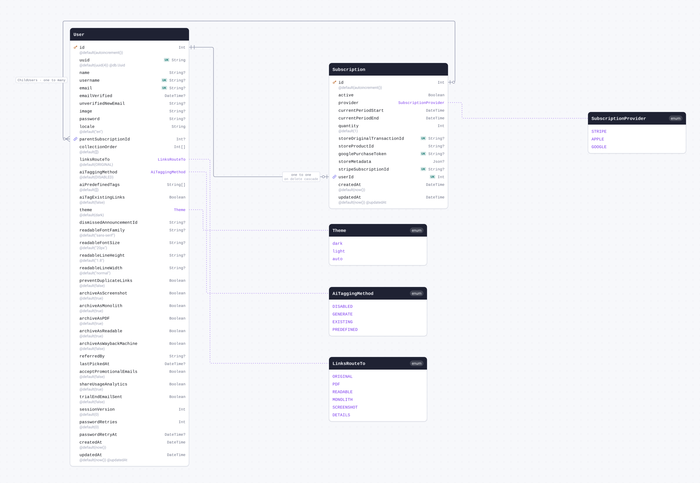

| Field                        | Type                                                 | Constraints                              | Default              | Description |
| ---------------------------- | ---------------------------------------------------- | ---------------------------------------- | -------------------- | ----------- |
| `id`                         | `Int`                                                | PK NOT NULL                              | `autoincrement()`    |             |
| `active`                     | `Boolean`                                            | NOT NULL                                 |                      |             |
| `provider`                   | [`SubscriptionProvider`](#enum-SubscriptionProvider) | NOT NULL                                 |                      |             |
| `currentPeriodStart`         | `DateTime`                                           | NOT NULL                                 |                      |             |
| `currentPeriodEnd`           | `DateTime`                                           | NOT NULL                                 |                      |             |
| `quantity`                   | `Int`                                                | NOT NULL                                 | `1`                  |             |
| `storeOriginalTransactionId` | `String`                                             | UNIQUE NULL                              |                      |             |
| `storeProductId`             | `String`                                             | NULL                                     |                      |             |
| `googlePurchaseToken`        | `String`                                             | UNIQUE NULL                              |                      |             |
| `storeMetadata`              | `Json`                                               | NULL                                     |                      |             |
| `stripeSubscriptionId`       | `String`                                             | UNIQUE NULL                              |                      |             |
| `userId`                     | `Int`                                                | UNIQUE NOT NULL → [User.id](#model-User) |                      |             |
| `createdAt`                  | `DateTime`                                           | NOT NULL                                 | `now()`              |             |
| `updatedAt`                  | `DateTime`                                           | NOT NULL                                 | `now()` `@updatedAt` |             |

#### References

- `userId` → [User.id](#model-User) (one-to-one, on delete Cascade)

#### Referenced by

- `id` ← [User.parentSubscriptionId](#model-User) (one-to-many)

#### Definition

```sql
CREATE TABLE "Subscription" (
    "id" SERIAL NOT NULL,
    "active" BOOLEAN NOT NULL,
    "provider" "SubscriptionProvider" NOT NULL,
    "currentPeriodStart" TIMESTAMP(3) NOT NULL,
    "currentPeriodEnd" TIMESTAMP(3) NOT NULL,
    "quantity" INTEGER NOT NULL DEFAULT 1,
    "storeOriginalTransactionId" TEXT,
    "storeProductId" TEXT,
    "googlePurchaseToken" TEXT,
    "storeMetadata" JSONB,
    "stripeSubscriptionId" TEXT,
    "userId" INTEGER NOT NULL,
    "createdAt" TIMESTAMP(3) NOT NULL DEFAULT CURRENT_TIMESTAMP,
    "updatedAt" TIMESTAMP(3) NOT NULL DEFAULT CURRENT_TIMESTAMP,

    CONSTRAINT "Subscription_pkey" PRIMARY KEY ("id")
);

CREATE UNIQUE INDEX "Subscription_storeOriginalTransactionId_key" ON "Subscription"("storeOriginalTransactionId");

CREATE UNIQUE INDEX "Subscription_googlePurchaseToken_key" ON "Subscription"("googlePurchaseToken");

CREATE UNIQUE INDEX "Subscription_stripeSubscriptionId_key" ON "Subscription"("stripeSubscriptionId");

CREATE UNIQUE INDEX "Subscription_userId_key" ON "Subscription"("userId");

ALTER TABLE "Subscription" ADD CONSTRAINT "Subscription_userId_fkey" FOREIGN KEY ("userId") REFERENCES "User"("id") ON DELETE CASCADE ON UPDATE CASCADE;
```

<details>
<summary>Queries and their SQL</summary>

**findMany**: Every row

```ts
await prisma.subscription.findMany();
```

```sql
SELECT
  "public"."Subscription"."id",
  "public"."Subscription"."active",
  "public"."Subscription"."provider"::text,
  "public"."Subscription"."currentPeriodStart",
  "public"."Subscription"."currentPeriodEnd",
  "public"."Subscription"."quantity",
  "public"."Subscription"."storeOriginalTransactionId",
  "public"."Subscription"."storeProductId",
  "public"."Subscription"."googlePurchaseToken",
  "public"."Subscription"."storeMetadata",
  "public"."Subscription"."stripeSubscriptionId",
  "public"."Subscription"."userId",
  "public"."Subscription"."createdAt",
  "public"."Subscription"."updatedAt"
FROM
  "public"."Subscription"
WHERE
  1 = 1
OFFSET
  $1
-- params: ["0"]
```

**count**: How many rows there are

```ts
await prisma.subscription.count();
```

```sql
SELECT
  COUNT(*) AS "_count$_all"
FROM
  (
    SELECT
      "public"."Subscription"."id"
    FROM
      "public"."Subscription"
    WHERE
      1 = 1
    OFFSET
      $1
  ) AS "sub"
-- params: ["0"]
```

**findMany**: Every row with its relations

```ts
await prisma.subscription.findMany({ include: { user: true, childUsers: true } });
```

```sql
SELECT
  "public"."Subscription"."id",
  "public"."Subscription"."active",
  "public"."Subscription"."provider"::text,
  "public"."Subscription"."currentPeriodStart",
  "public"."Subscription"."currentPeriodEnd",
  "public"."Subscription"."quantity",
  "public"."Subscription"."storeOriginalTransactionId",
  "public"."Subscription"."storeProductId",
  "public"."Subscription"."googlePurchaseToken",
  "public"."Subscription"."storeMetadata",
  "public"."Subscription"."stripeSubscriptionId",
  "public"."Subscription"."userId",
  "public"."Subscription"."createdAt",
  "public"."Subscription"."updatedAt"
FROM
  "public"."Subscription"
WHERE
  1 = 1
OFFSET
  $1
-- params: ["0"]

SELECT
  "public"."User"."id",
  "public"."User"."uuid",
  "public"."User"."name",
  "public"."User"."username",
  "public"."User"."email",
  "public"."User"."emailVerified",
  "public"."User"."unverifiedNewEmail",
  "public"."User"."image",
  "public"."User"."password",
  "public"."User"."locale",
  "public"."User"."parentSubscriptionId",
  "public"."User"."collectionOrder",
  "public"."User"."linksRouteTo"::text,
  "public"."User"."aiTaggingMethod"::text,
  "public"."User"."aiPredefinedTags",
  "public"."User"."aiTagExistingLinks",
  "public"."User"."theme"::text,
  "public"."User"."dismissedAnnouncementId",
  "public"."User"."readableFontFamily",
  "public"."User"."readableFontSize",
  "public"."User"."readableLineHeight",
  "public"."User"."readableLineWidth",
  "public"."User"."preventDuplicateLinks",
  "public"."User"."archiveAsScreenshot",
  "public"."User"."archiveAsMonolith",
  "public"."User"."archiveAsPDF",
  "public"."User"."archiveAsReadable",
  "public"."User"."archiveAsWaybackMachine",
  "public"."User"."referredBy",
  "public"."User"."lastPickedAt",
  "public"."User"."acceptPromotionalEmails",
  "public"."User"."shareUsageAnalytics",
  "public"."User"."trialEndEmailSent",
  "public"."User"."sessionVersion",
  "public"."User"."passwordRetries",
  "public"."User"."passwordRetryAt",
  "public"."User"."createdAt",
  "public"."User"."updatedAt"
FROM
  "public"."User"
WHERE
  "public"."User"."id" IN ($1)
OFFSET
  $2
-- params: ["<userId of the rows above>","0"]

SELECT
  "public"."User"."id",
  "public"."User"."uuid",
  "public"."User"."name",
  "public"."User"."username",
  "public"."User"."email",
  "public"."User"."emailVerified",
  "public"."User"."unverifiedNewEmail",
  "public"."User"."image",
  "public"."User"."password",
  "public"."User"."locale",
  "public"."User"."parentSubscriptionId",
  "public"."User"."collectionOrder",
  "public"."User"."linksRouteTo"::text,
  "public"."User"."aiTaggingMethod"::text,
  "public"."User"."aiPredefinedTags",
  "public"."User"."aiTagExistingLinks",
  "public"."User"."theme"::text,
  "public"."User"."dismissedAnnouncementId",
  "public"."User"."readableFontFamily",
  "public"."User"."readableFontSize",
  "public"."User"."readableLineHeight",
  "public"."User"."readableLineWidth",
  "public"."User"."preventDuplicateLinks",
  "public"."User"."archiveAsScreenshot",
  "public"."User"."archiveAsMonolith",
  "public"."User"."archiveAsPDF",
  "public"."User"."archiveAsReadable",
  "public"."User"."archiveAsWaybackMachine",
  "public"."User"."referredBy",
  "public"."User"."lastPickedAt",
  "public"."User"."acceptPromotionalEmails",
  "public"."User"."shareUsageAnalytics",
  "public"."User"."trialEndEmailSent",
  "public"."User"."sessionVersion",
  "public"."User"."passwordRetries",
  "public"."User"."passwordRetryAt",
  "public"."User"."createdAt",
  "public"."User"."updatedAt"
FROM
  "public"."User"
WHERE
  "public"."User"."parentSubscriptionId" IN ($1)
OFFSET
  $2
-- params: ["<id of the rows above>","0"]
```

**findUnique**: One row by what is unique to it

```ts
await prisma.subscription.findUnique({ where: { id: 1 } });
```

```sql
SELECT
  "public"."Subscription"."id",
  "public"."Subscription"."active",
  "public"."Subscription"."provider"::text,
  "public"."Subscription"."currentPeriodStart",
  "public"."Subscription"."currentPeriodEnd",
  "public"."Subscription"."quantity",
  "public"."Subscription"."storeOriginalTransactionId",
  "public"."Subscription"."storeProductId",
  "public"."Subscription"."googlePurchaseToken",
  "public"."Subscription"."storeMetadata",
  "public"."Subscription"."stripeSubscriptionId",
  "public"."Subscription"."userId",
  "public"."Subscription"."createdAt",
  "public"."Subscription"."updatedAt"
FROM
  "public"."Subscription"
WHERE
  (
    "public"."Subscription"."id" = $1
    AND 1 = 1
  )
LIMIT
  $2
OFFSET
  $3
-- params: ["1","1","0"]
```

**create**: Create a row

```ts
await prisma.subscription.create({
  data: {
    active: true,
    provider: "STRIPE",
    currentPeriodStart: new Date("2026-01-01T00:00:00.000Z"),
    currentPeriodEnd: new Date("2026-01-01T00:00:00.000Z"),
    userId: 1,
  },
});
```

```sql
INSERT INTO
  "public"."Subscription" (
    "active",
    "provider",
    "currentPeriodStart",
    "currentPeriodEnd",
    "quantity",
    "userId",
    "createdAt",
    "updatedAt"
  )
VALUES
  (
    $1,
    CAST($2::text AS "public"."SubscriptionProvider"),
    $3,
    $4,
    $5,
    $6,
    $7,
    $8
  )
RETURNING
  "public"."Subscription"."id",
  "public"."Subscription"."active",
  "public"."Subscription"."provider"::text,
  "public"."Subscription"."currentPeriodStart",
  "public"."Subscription"."currentPeriodEnd",
  "public"."Subscription"."quantity",
  "public"."Subscription"."storeOriginalTransactionId",
  "public"."Subscription"."storeProductId",
  "public"."Subscription"."googlePurchaseToken",
  "public"."Subscription"."storeMetadata",
  "public"."Subscription"."stripeSubscriptionId",
  "public"."Subscription"."userId",
  "public"."Subscription"."createdAt",
  "public"."Subscription"."updatedAt"
-- params: [true,"STRIPE","2026-01-01T00:00:00.000Z","2026-01-01T00:00:00.000Z","1","1","<now()>","<now()>"]
```

**update**: Update a row

```ts
await prisma.subscription.update({ where: { id: 1 }, data: { active: true } });
```

```sql
UPDATE "public"."Subscription"
SET
  "active" = $1,
  "updatedAt" = $2
WHERE
  (
    "public"."Subscription"."id" = $3
    AND 1 = 1
  )
RETURNING
  "public"."Subscription"."id",
  "public"."Subscription"."active",
  "public"."Subscription"."provider"::text,
  "public"."Subscription"."currentPeriodStart",
  "public"."Subscription"."currentPeriodEnd",
  "public"."Subscription"."quantity",
  "public"."Subscription"."storeOriginalTransactionId",
  "public"."Subscription"."storeProductId",
  "public"."Subscription"."googlePurchaseToken",
  "public"."Subscription"."storeMetadata",
  "public"."Subscription"."stripeSubscriptionId",
  "public"."Subscription"."userId",
  "public"."Subscription"."createdAt",
  "public"."Subscription"."updatedAt"
-- params: [true,{"prisma__type":"generatorCall","prisma__value":{"name":"now","args":[],"returnType":{"type":"DateTime"}}},"1"]
```

**delete**: Delete a row

```ts
await prisma.subscription.delete({ where: { id: 1 } });
```

```sql
DELETE FROM "public"."Subscription"
WHERE
  (
    "public"."Subscription"."id" = $1
    AND 1 = 1
  )
RETURNING
  "public"."Subscription"."id",
  "public"."Subscription"."active",
  "public"."Subscription"."provider"::text,
  "public"."Subscription"."currentPeriodStart",
  "public"."Subscription"."currentPeriodEnd",
  "public"."Subscription"."quantity",
  "public"."Subscription"."storeOriginalTransactionId",
  "public"."Subscription"."storeProductId",
  "public"."Subscription"."googlePurchaseToken",
  "public"."Subscription"."storeMetadata",
  "public"."Subscription"."stripeSubscriptionId",
  "public"."Subscription"."userId",
  "public"."Subscription"."createdAt",
  "public"."Subscription"."updatedAt"
-- params: ["1"]
```

</details>

<a id="model-AccessToken"></a>

### AccessToken

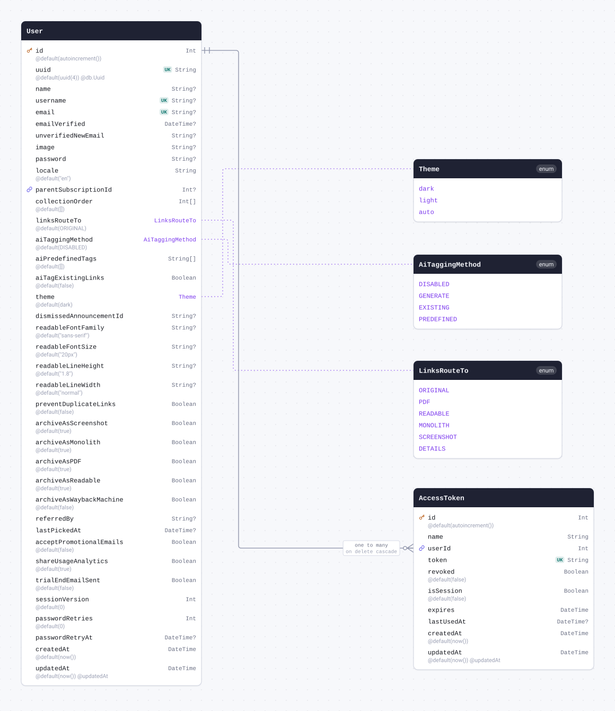

| Field        | Type       | Constraints                       | Default              | Description |
| ------------ | ---------- | --------------------------------- | -------------------- | ----------- |
| `id`         | `Int`      | PK NOT NULL                       | `autoincrement()`    |             |
| `name`       | `String`   | NOT NULL                          |                      |             |
| `userId`     | `Int`      | NOT NULL → [User.id](#model-User) |                      |             |
| `token`      | `String`   | UNIQUE NOT NULL                   |                      |             |
| `revoked`    | `Boolean`  | NOT NULL                          | `false`              |             |
| `isSession`  | `Boolean`  | NOT NULL                          | `false`              |             |
| `expires`    | `DateTime` | NOT NULL                          |                      |             |
| `lastUsedAt` | `DateTime` | NULL                              |                      |             |
| `createdAt`  | `DateTime` | NOT NULL                          | `now()`              |             |
| `updatedAt`  | `DateTime` | NOT NULL                          | `now()` `@updatedAt` |             |

#### References

- `userId` → [User.id](#model-User) (many-to-one, on delete Cascade)

#### Definition

```sql
CREATE TABLE "AccessToken" (
    "id" SERIAL NOT NULL,
    "name" TEXT NOT NULL,
    "userId" INTEGER NOT NULL,
    "token" TEXT NOT NULL,
    "revoked" BOOLEAN NOT NULL DEFAULT false,
    "isSession" BOOLEAN NOT NULL DEFAULT false,
    "expires" TIMESTAMP(3) NOT NULL,
    "lastUsedAt" TIMESTAMP(3),
    "createdAt" TIMESTAMP(3) NOT NULL DEFAULT CURRENT_TIMESTAMP,
    "updatedAt" TIMESTAMP(3) NOT NULL DEFAULT CURRENT_TIMESTAMP,

    CONSTRAINT "AccessToken_pkey" PRIMARY KEY ("id")
);

CREATE UNIQUE INDEX "AccessToken_token_key" ON "AccessToken"("token");

ALTER TABLE "AccessToken" ADD CONSTRAINT "AccessToken_userId_fkey" FOREIGN KEY ("userId") REFERENCES "User"("id") ON DELETE CASCADE ON UPDATE CASCADE;
```

<details>
<summary>Queries and their SQL</summary>

**findMany**: Every row

```ts
await prisma.accessToken.findMany();
```

```sql
SELECT
  "public"."AccessToken"."id",
  "public"."AccessToken"."name",
  "public"."AccessToken"."userId",
  "public"."AccessToken"."token",
  "public"."AccessToken"."revoked",
  "public"."AccessToken"."isSession",
  "public"."AccessToken"."expires",
  "public"."AccessToken"."lastUsedAt",
  "public"."AccessToken"."createdAt",
  "public"."AccessToken"."updatedAt"
FROM
  "public"."AccessToken"
WHERE
  1 = 1
OFFSET
  $1
-- params: ["0"]
```

**count**: How many rows there are

```ts
await prisma.accessToken.count();
```

```sql
SELECT
  COUNT(*) AS "_count$_all"
FROM
  (
    SELECT
      "public"."AccessToken"."id"
    FROM
      "public"."AccessToken"
    WHERE
      1 = 1
    OFFSET
      $1
  ) AS "sub"
-- params: ["0"]
```

**findMany**: Every row with its relations

```ts
await prisma.accessToken.findMany({ include: { user: true } });
```

```sql
SELECT
  "public"."AccessToken"."id",
  "public"."AccessToken"."name",
  "public"."AccessToken"."userId",
  "public"."AccessToken"."token",
  "public"."AccessToken"."revoked",
  "public"."AccessToken"."isSession",
  "public"."AccessToken"."expires",
  "public"."AccessToken"."lastUsedAt",
  "public"."AccessToken"."createdAt",
  "public"."AccessToken"."updatedAt"
FROM
  "public"."AccessToken"
WHERE
  1 = 1
OFFSET
  $1
-- params: ["0"]

SELECT
  "public"."User"."id",
  "public"."User"."uuid",
  "public"."User"."name",
  "public"."User"."username",
  "public"."User"."email",
  "public"."User"."emailVerified",
  "public"."User"."unverifiedNewEmail",
  "public"."User"."image",
  "public"."User"."password",
  "public"."User"."locale",
  "public"."User"."parentSubscriptionId",
  "public"."User"."collectionOrder",
  "public"."User"."linksRouteTo"::text,
  "public"."User"."aiTaggingMethod"::text,
  "public"."User"."aiPredefinedTags",
  "public"."User"."aiTagExistingLinks",
  "public"."User"."theme"::text,
  "public"."User"."dismissedAnnouncementId",
  "public"."User"."readableFontFamily",
  "public"."User"."readableFontSize",
  "public"."User"."readableLineHeight",
  "public"."User"."readableLineWidth",
  "public"."User"."preventDuplicateLinks",
  "public"."User"."archiveAsScreenshot",
  "public"."User"."archiveAsMonolith",
  "public"."User"."archiveAsPDF",
  "public"."User"."archiveAsReadable",
  "public"."User"."archiveAsWaybackMachine",
  "public"."User"."referredBy",
  "public"."User"."lastPickedAt",
  "public"."User"."acceptPromotionalEmails",
  "public"."User"."shareUsageAnalytics",
  "public"."User"."trialEndEmailSent",
  "public"."User"."sessionVersion",
  "public"."User"."passwordRetries",
  "public"."User"."passwordRetryAt",
  "public"."User"."createdAt",
  "public"."User"."updatedAt"
FROM
  "public"."User"
WHERE
  "public"."User"."id" IN ($1)
OFFSET
  $2
-- params: ["<userId of the rows above>","0"]
```

**findUnique**: One row by what is unique to it

```ts
await prisma.accessToken.findUnique({ where: { id: 1 } });
```

```sql
SELECT
  "public"."AccessToken"."id",
  "public"."AccessToken"."name",
  "public"."AccessToken"."userId",
  "public"."AccessToken"."token",
  "public"."AccessToken"."revoked",
  "public"."AccessToken"."isSession",
  "public"."AccessToken"."expires",
  "public"."AccessToken"."lastUsedAt",
  "public"."AccessToken"."createdAt",
  "public"."AccessToken"."updatedAt"
FROM
  "public"."AccessToken"
WHERE
  (
    "public"."AccessToken"."id" = $1
    AND 1 = 1
  )
LIMIT
  $2
OFFSET
  $3
-- params: ["1","1","0"]
```

**create**: Create a row

```ts
await prisma.accessToken.create({
  data: {
    name: "example",
    userId: 1,
    token: "example",
    expires: new Date("2026-01-01T00:00:00.000Z"),
  },
});
```

```sql
INSERT INTO
  "public"."AccessToken" (
    "name",
    "userId",
    "token",
    "revoked",
    "isSession",
    "expires",
    "createdAt",
    "updatedAt"
  )
VALUES
  ($1, $2, $3, $4, $5, $6, $7, $8)
RETURNING
  "public"."AccessToken"."id",
  "public"."AccessToken"."name",
  "public"."AccessToken"."userId",
  "public"."AccessToken"."token",
  "public"."AccessToken"."revoked",
  "public"."AccessToken"."isSession",
  "public"."AccessToken"."expires",
  "public"."AccessToken"."lastUsedAt",
  "public"."AccessToken"."createdAt",
  "public"."AccessToken"."updatedAt"
-- params: ["example","1","example",false,false,"2026-01-01T00:00:00.000Z","<now()>","<now()>"]
```

**update**: Update a row

```ts
await prisma.accessToken.update({ where: { id: 1 }, data: { name: "example" } });
```

```sql
UPDATE "public"."AccessToken"
SET
  "name" = $1,
  "updatedAt" = $2
WHERE
  (
    "public"."AccessToken"."id" = $3
    AND 1 = 1
  )
RETURNING
  "public"."AccessToken"."id",
  "public"."AccessToken"."name",
  "public"."AccessToken"."userId",
  "public"."AccessToken"."token",
  "public"."AccessToken"."revoked",
  "public"."AccessToken"."isSession",
  "public"."AccessToken"."expires",
  "public"."AccessToken"."lastUsedAt",
  "public"."AccessToken"."createdAt",
  "public"."AccessToken"."updatedAt"
-- params: ["example",{"prisma__type":"generatorCall","prisma__value":{"name":"now","args":[],"returnType":{"type":"DateTime"}}},"1"]
```

**delete**: Delete a row

```ts
await prisma.accessToken.delete({ where: { id: 1 } });
```

```sql
DELETE FROM "public"."AccessToken"
WHERE
  (
    "public"."AccessToken"."id" = $1
    AND 1 = 1
  )
RETURNING
  "public"."AccessToken"."id",
  "public"."AccessToken"."name",
  "public"."AccessToken"."userId",
  "public"."AccessToken"."token",
  "public"."AccessToken"."revoked",
  "public"."AccessToken"."isSession",
  "public"."AccessToken"."expires",
  "public"."AccessToken"."lastUsedAt",
  "public"."AccessToken"."createdAt",
  "public"."AccessToken"."updatedAt"
-- params: ["1"]
```

</details>

<a id="model-RssSubscription"></a>

### RssSubscription

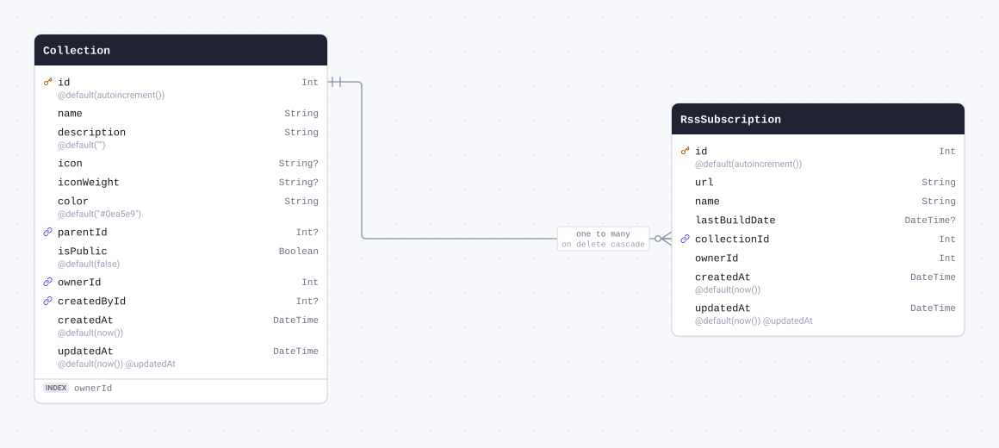

| Field           | Type       | Constraints                                   | Default              | Description |
| --------------- | ---------- | --------------------------------------------- | -------------------- | ----------- |
| `id`            | `Int`      | PK NOT NULL                                   | `autoincrement()`    |             |
| `url`           | `String`   | NOT NULL                                      |                      |             |
| `name`          | `String`   | NOT NULL                                      |                      |             |
| `lastBuildDate` | `DateTime` | NULL                                          |                      |             |
| `collectionId`  | `Int`      | NOT NULL → [Collection.id](#model-Collection) |                      |             |
| `ownerId`       | `Int`      | NOT NULL                                      |                      |             |
| `createdAt`     | `DateTime` | NOT NULL                                      | `now()`              |             |
| `updatedAt`     | `DateTime` | NOT NULL                                      | `now()` `@updatedAt` |             |

#### References

- `collectionId` → [Collection.id](#model-Collection) (many-to-one, on delete Cascade)

#### Definition

```sql
CREATE TABLE "RssSubscription" (
    "id" SERIAL NOT NULL,
    "url" TEXT NOT NULL,
    "name" TEXT NOT NULL,
    "lastBuildDate" TIMESTAMP(3),
    "collectionId" INTEGER NOT NULL,
    "ownerId" INTEGER NOT NULL,
    "createdAt" TIMESTAMP(3) NOT NULL DEFAULT CURRENT_TIMESTAMP,
    "updatedAt" TIMESTAMP(3) NOT NULL DEFAULT CURRENT_TIMESTAMP,

    CONSTRAINT "RssSubscription_pkey" PRIMARY KEY ("id")
);

ALTER TABLE "RssSubscription" ADD CONSTRAINT "RssSubscription_collectionId_fkey" FOREIGN KEY ("collectionId") REFERENCES "Collection"("id") ON DELETE CASCADE ON UPDATE CASCADE;
```

<details>
<summary>Queries and their SQL</summary>

**findMany**: Every row

```ts
await prisma.rssSubscription.findMany();
```

```sql
SELECT
  "public"."RssSubscription"."id",
  "public"."RssSubscription"."url",
  "public"."RssSubscription"."name",
  "public"."RssSubscription"."lastBuildDate",
  "public"."RssSubscription"."collectionId",
  "public"."RssSubscription"."ownerId",
  "public"."RssSubscription"."createdAt",
  "public"."RssSubscription"."updatedAt"
FROM
  "public"."RssSubscription"
WHERE
  1 = 1
OFFSET
  $1
-- params: ["0"]
```

**count**: How many rows there are

```ts
await prisma.rssSubscription.count();
```

```sql
SELECT
  COUNT(*) AS "_count$_all"
FROM
  (
    SELECT
      "public"."RssSubscription"."id"
    FROM
      "public"."RssSubscription"
    WHERE
      1 = 1
    OFFSET
      $1
  ) AS "sub"
-- params: ["0"]
```

**findMany**: Every row with its relations

```ts
await prisma.rssSubscription.findMany({ include: { collection: true } });
```

```sql
SELECT
  "public"."RssSubscription"."id",
  "public"."RssSubscription"."url",
  "public"."RssSubscription"."name",
  "public"."RssSubscription"."lastBuildDate",
  "public"."RssSubscription"."collectionId",
  "public"."RssSubscription"."ownerId",
  "public"."RssSubscription"."createdAt",
  "public"."RssSubscription"."updatedAt"
FROM
  "public"."RssSubscription"
WHERE
  1 = 1
OFFSET
  $1
-- params: ["0"]

SELECT
  "public"."Collection"."id",
  "public"."Collection"."name",
  "public"."Collection"."description",
  "public"."Collection"."icon",
  "public"."Collection"."iconWeight",
  "public"."Collection"."color",
  "public"."Collection"."parentId",
  "public"."Collection"."isPublic",
  "public"."Collection"."ownerId",
  "public"."Collection"."createdById",
  "public"."Collection"."createdAt",
  "public"."Collection"."updatedAt"
FROM
  "public"."Collection"
WHERE
  "public"."Collection"."id" IN ($1)
OFFSET
  $2
-- params: ["<collectionId of the rows above>","0"]
```

**findUnique**: One row by what is unique to it

```ts
await prisma.rssSubscription.findUnique({ where: { id: 1 } });
```

```sql
SELECT
  "public"."RssSubscription"."id",
  "public"."RssSubscription"."url",
  "public"."RssSubscription"."name",
  "public"."RssSubscription"."lastBuildDate",
  "public"."RssSubscription"."collectionId",
  "public"."RssSubscription"."ownerId",
  "public"."RssSubscription"."createdAt",
  "public"."RssSubscription"."updatedAt"
FROM
  "public"."RssSubscription"
WHERE
  (
    "public"."RssSubscription"."id" = $1
    AND 1 = 1
  )
LIMIT
  $2
OFFSET
  $3
-- params: ["1","1","0"]
```

**create**: Create a row

```ts
await prisma.rssSubscription.create({
  data: { url: "example", name: "example", collectionId: 1, ownerId: 1 },
});
```

```sql
INSERT INTO
  "public"."RssSubscription" (
    "url",
    "name",
    "collectionId",
    "ownerId",
    "createdAt",
    "updatedAt"
  )
VALUES
  ($1, $2, $3, $4, $5, $6)
RETURNING
  "public"."RssSubscription"."id",
  "public"."RssSubscription"."url",
  "public"."RssSubscription"."name",
  "public"."RssSubscription"."lastBuildDate",
  "public"."RssSubscription"."collectionId",
  "public"."RssSubscription"."ownerId",
  "public"."RssSubscription"."createdAt",
  "public"."RssSubscription"."updatedAt"
-- params: ["example","example","1","1","<now()>","<now()>"]
```

**update**: Update a row

```ts
await prisma.rssSubscription.update({ where: { id: 1 }, data: { url: "example" } });
```

```sql
UPDATE "public"."RssSubscription"
SET
  "url" = $1,
  "updatedAt" = $2
WHERE
  (
    "public"."RssSubscription"."id" = $3
    AND 1 = 1
  )
RETURNING
  "public"."RssSubscription"."id",
  "public"."RssSubscription"."url",
  "public"."RssSubscription"."name",
  "public"."RssSubscription"."lastBuildDate",
  "public"."RssSubscription"."collectionId",
  "public"."RssSubscription"."ownerId",
  "public"."RssSubscription"."createdAt",
  "public"."RssSubscription"."updatedAt"
-- params: ["example",{"prisma__type":"generatorCall","prisma__value":{"name":"now","args":[],"returnType":{"type":"DateTime"}}},"1"]
```

**delete**: Delete a row

```ts
await prisma.rssSubscription.delete({ where: { id: 1 } });
```

```sql
DELETE FROM "public"."RssSubscription"
WHERE
  (
    "public"."RssSubscription"."id" = $1
    AND 1 = 1
  )
RETURNING
  "public"."RssSubscription"."id",
  "public"."RssSubscription"."url",
  "public"."RssSubscription"."name",
  "public"."RssSubscription"."lastBuildDate",
  "public"."RssSubscription"."collectionId",
  "public"."RssSubscription"."ownerId",
  "public"."RssSubscription"."createdAt",
  "public"."RssSubscription"."updatedAt"
-- params: ["1"]
```

</details>

<a id="model-Highlight"></a>

### Highlight

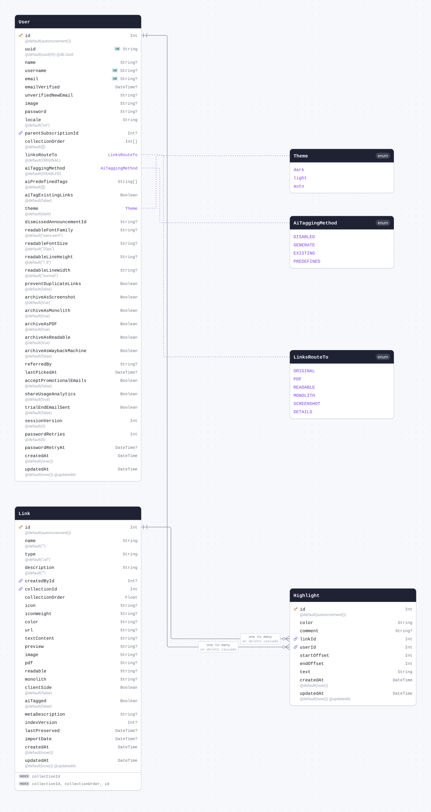

| Field         | Type       | Constraints                       | Default              | Description |
| ------------- | ---------- | --------------------------------- | -------------------- | ----------- |
| `id`          | `Int`      | PK NOT NULL                       | `autoincrement()`    |             |
| `color`       | `String`   | NOT NULL                          |                      |             |
| `comment`     | `String`   | NULL                              |                      |             |
| `linkId`      | `Int`      | NOT NULL → [Link.id](#model-Link) |                      |             |
| `userId`      | `Int`      | NOT NULL → [User.id](#model-User) |                      |             |
| `startOffset` | `Int`      | NOT NULL                          |                      |             |
| `endOffset`   | `Int`      | NOT NULL                          |                      |             |
| `text`        | `String`   | NOT NULL                          |                      |             |
| `createdAt`   | `DateTime` | NOT NULL                          | `now()`              |             |
| `updatedAt`   | `DateTime` | NOT NULL                          | `now()` `@updatedAt` |             |

#### References

- `linkId` → [Link.id](#model-Link) (many-to-one, on delete Cascade)
- `userId` → [User.id](#model-User) (many-to-one, on delete Cascade)

#### Definition

```sql
CREATE TABLE "Highlight" (
    "id" SERIAL NOT NULL,
    "color" TEXT NOT NULL,
    "comment" TEXT,
    "linkId" INTEGER NOT NULL,
    "userId" INTEGER NOT NULL,
    "startOffset" INTEGER NOT NULL,
    "endOffset" INTEGER NOT NULL,
    "text" TEXT NOT NULL,
    "createdAt" TIMESTAMP(3) NOT NULL DEFAULT CURRENT_TIMESTAMP,
    "updatedAt" TIMESTAMP(3) NOT NULL DEFAULT CURRENT_TIMESTAMP,

    CONSTRAINT "Highlight_pkey" PRIMARY KEY ("id")
);

ALTER TABLE "Highlight" ADD CONSTRAINT "Highlight_linkId_fkey" FOREIGN KEY ("linkId") REFERENCES "Link"("id") ON DELETE CASCADE ON UPDATE CASCADE;

ALTER TABLE "Highlight" ADD CONSTRAINT "Highlight_userId_fkey" FOREIGN KEY ("userId") REFERENCES "User"("id") ON DELETE CASCADE ON UPDATE CASCADE;
```

<details>
<summary>Queries and their SQL</summary>

**findMany**: Every row

```ts
await prisma.highlight.findMany();
```

```sql
SELECT
  "public"."Highlight"."id",
  "public"."Highlight"."color",
  "public"."Highlight"."comment",
  "public"."Highlight"."linkId",
  "public"."Highlight"."userId",
  "public"."Highlight"."startOffset",
  "public"."Highlight"."endOffset",
  "public"."Highlight"."text",
  "public"."Highlight"."createdAt",
  "public"."Highlight"."updatedAt"
FROM
  "public"."Highlight"
WHERE
  1 = 1
OFFSET
  $1
-- params: ["0"]
```

**count**: How many rows there are

```ts
await prisma.highlight.count();
```

```sql
SELECT
  COUNT(*) AS "_count$_all"
FROM
  (
    SELECT
      "public"."Highlight"."id"
    FROM
      "public"."Highlight"
    WHERE
      1 = 1
    OFFSET
      $1
  ) AS "sub"
-- params: ["0"]
```

**findMany**: Every row with its relations

```ts
await prisma.highlight.findMany({ include: { link: true, user: true } });
```

```sql
SELECT
  "public"."Highlight"."id",
  "public"."Highlight"."color",
  "public"."Highlight"."comment",
  "public"."Highlight"."linkId",
  "public"."Highlight"."userId",
  "public"."Highlight"."startOffset",
  "public"."Highlight"."endOffset",
  "public"."Highlight"."text",
  "public"."Highlight"."createdAt",
  "public"."Highlight"."updatedAt"
FROM
  "public"."Highlight"
WHERE
  1 = 1
OFFSET
  $1
-- params: ["0"]

SELECT
  "public"."Link"."id",
  "public"."Link"."name",
  "public"."Link"."type",
  "public"."Link"."description",
  "public"."Link"."createdById",
  "public"."Link"."collectionId",
  "public"."Link"."collectionOrder",
  "public"."Link"."icon",
  "public"."Link"."iconWeight",
  "public"."Link"."color",
  "public"."Link"."url",
  "public"."Link"."textContent",
  "public"."Link"."preview",
  "public"."Link"."image",
  "public"."Link"."pdf",
  "public"."Link"."readable",
  "public"."Link"."monolith",
  "public"."Link"."clientSide",
  "public"."Link"."aiTagged",
  "public"."Link"."metaDescription",
  "public"."Link"."indexVersion",
  "public"."Link"."lastPreserved",
  "public"."Link"."importDate",
  "public"."Link"."createdAt",
  "public"."Link"."updatedAt"
FROM
  "public"."Link"
WHERE
  "public"."Link"."id" IN ($1)
OFFSET
  $2
-- params: ["<linkId of the rows above>","0"]

SELECT
  "public"."User"."id",
  "public"."User"."uuid",
  "public"."User"."name",
  "public"."User"."username",
  "public"."User"."email",
  "public"."User"."emailVerified",
  "public"."User"."unverifiedNewEmail",
  "public"."User"."image",
  "public"."User"."password",
  "public"."User"."locale",
  "public"."User"."parentSubscriptionId",
  "public"."User"."collectionOrder",
  "public"."User"."linksRouteTo"::text,
  "public"."User"."aiTaggingMethod"::text,
  "public"."User"."aiPredefinedTags",
  "public"."User"."aiTagExistingLinks",
  "public"."User"."theme"::text,
  "public"."User"."dismissedAnnouncementId",
  "public"."User"."readableFontFamily",
  "public"."User"."readableFontSize",
  "public"."User"."readableLineHeight",
  "public"."User"."readableLineWidth",
  "public"."User"."preventDuplicateLinks",
  "public"."User"."archiveAsScreenshot",
  "public"."User"."archiveAsMonolith",
  "public"."User"."archiveAsPDF",
  "public"."User"."archiveAsReadable",
  "public"."User"."archiveAsWaybackMachine",
  "public"."User"."referredBy",
  "public"."User"."lastPickedAt",
  "public"."User"."acceptPromotionalEmails",
  "public"."User"."shareUsageAnalytics",
  "public"."User"."trialEndEmailSent",
  "public"."User"."sessionVersion",
  "public"."User"."passwordRetries",
  "public"."User"."passwordRetryAt",
  "public"."User"."createdAt",
  "public"."User"."updatedAt"
FROM
  "public"."User"
WHERE
  "public"."User"."id" IN ($1)
OFFSET
  $2
-- params: ["<userId of the rows above>","0"]
```

**findUnique**: One row by what is unique to it

```ts
await prisma.highlight.findUnique({ where: { id: 1 } });
```

```sql
SELECT
  "public"."Highlight"."id",
  "public"."Highlight"."color",
  "public"."Highlight"."comment",
  "public"."Highlight"."linkId",
  "public"."Highlight"."userId",
  "public"."Highlight"."startOffset",
  "public"."Highlight"."endOffset",
  "public"."Highlight"."text",
  "public"."Highlight"."createdAt",
  "public"."Highlight"."updatedAt"
FROM
  "public"."Highlight"
WHERE
  (
    "public"."Highlight"."id" = $1
    AND 1 = 1
  )
LIMIT
  $2
OFFSET
  $3
-- params: ["1","1","0"]
```

**create**: Create a row

```ts
await prisma.highlight.create({
  data: { color: "example", linkId: 1, userId: 1, startOffset: 1, endOffset: 1, text: "example" },
});
```

```sql
INSERT INTO
  "public"."Highlight" (
    "color",
    "linkId",
    "userId",
    "startOffset",
    "endOffset",
    "text",
    "createdAt",
    "updatedAt"
  )
VALUES
  ($1, $2, $3, $4, $5, $6, $7, $8)
RETURNING
  "public"."Highlight"."id",
  "public"."Highlight"."color",
  "public"."Highlight"."comment",
  "public"."Highlight"."linkId",
  "public"."Highlight"."userId",
  "public"."Highlight"."startOffset",
  "public"."Highlight"."endOffset",
  "public"."Highlight"."text",
  "public"."Highlight"."createdAt",
  "public"."Highlight"."updatedAt"
-- params: ["example","1","1","1","1","example","<now()>","<now()>"]
```

**update**: Update a row

```ts
await prisma.highlight.update({ where: { id: 1 }, data: { color: "example" } });
```

```sql
UPDATE "public"."Highlight"
SET
  "color" = $1,
  "updatedAt" = $2
WHERE
  (
    "public"."Highlight"."id" = $3
    AND 1 = 1
  )
RETURNING
  "public"."Highlight"."id",
  "public"."Highlight"."color",
  "public"."Highlight"."comment",
  "public"."Highlight"."linkId",
  "public"."Highlight"."userId",
  "public"."Highlight"."startOffset",
  "public"."Highlight"."endOffset",
  "public"."Highlight"."text",
  "public"."Highlight"."createdAt",
  "public"."Highlight"."updatedAt"
-- params: ["example",{"prisma__type":"generatorCall","prisma__value":{"name":"now","args":[],"returnType":{"type":"DateTime"}}},"1"]
```

**delete**: Delete a row

```ts
await prisma.highlight.delete({ where: { id: 1 } });
```

```sql
DELETE FROM "public"."Highlight"
WHERE
  (
    "public"."Highlight"."id" = $1
    AND 1 = 1
  )
RETURNING
  "public"."Highlight"."id",
  "public"."Highlight"."color",
  "public"."Highlight"."comment",
  "public"."Highlight"."linkId",
  "public"."Highlight"."userId",
  "public"."Highlight"."startOffset",
  "public"."Highlight"."endOffset",
  "public"."Highlight"."text",
  "public"."Highlight"."createdAt",
  "public"."Highlight"."updatedAt"
-- params: ["1"]
```

</details>

<a id="model-DashboardSection"></a>

### DashboardSection

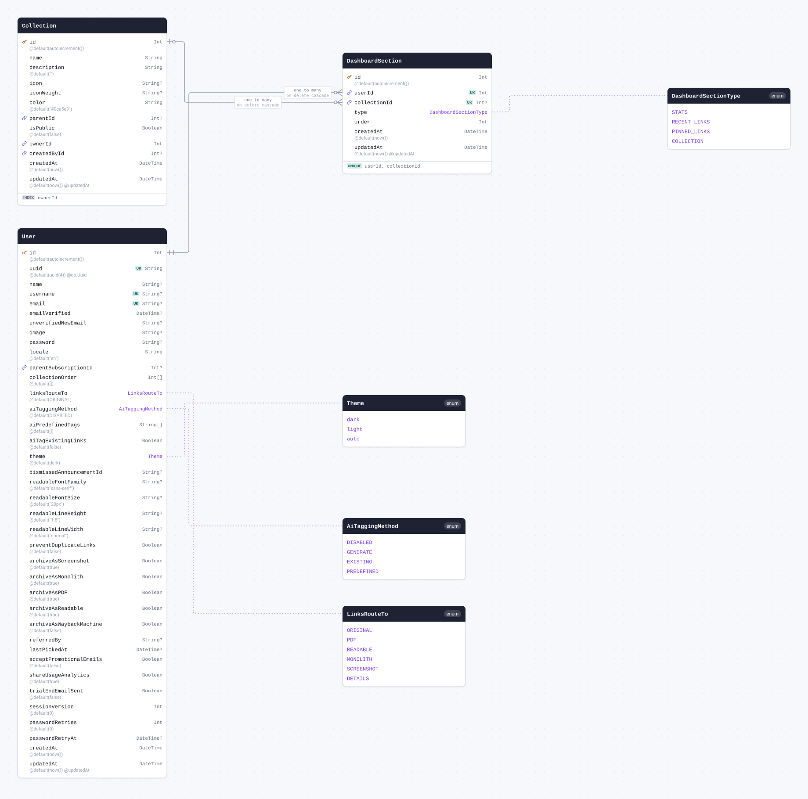

| Field          | Type                                                 | Constraints                               | Default              | Description |
| -------------- | ---------------------------------------------------- | ----------------------------------------- | -------------------- | ----------- |
| `id`           | `Int`                                                | PK NOT NULL                               | `autoincrement()`    |             |
| `userId`       | `Int`                                                | NOT NULL → [User.id](#model-User)         |                      |             |
| `collectionId` | `Int`                                                | NULL → [Collection.id](#model-Collection) |                      |             |
| `type`         | [`DashboardSectionType`](#enum-DashboardSectionType) | NOT NULL                                  |                      |             |
| `order`        | `Int`                                                | NOT NULL                                  |                      |             |
| `createdAt`    | `DateTime`                                           | NOT NULL                                  | `now()`              |             |
| `updatedAt`    | `DateTime`                                           | NOT NULL                                  | `now()` `@updatedAt` |             |

#### Indexes

- `@@unique([userId, collectionId])`

#### References

- `userId` → [User.id](#model-User) (many-to-one, on delete Cascade)
- `collectionId` → [Collection.id](#model-Collection) (many-to-one, on delete Cascade)

#### Definition

```sql
CREATE TABLE "DashboardSection" (
    "id" SERIAL NOT NULL,
    "userId" INTEGER NOT NULL,
    "collectionId" INTEGER,
    "type" "DashboardSectionType" NOT NULL,
    "order" INTEGER NOT NULL,
    "createdAt" TIMESTAMP(3) NOT NULL DEFAULT CURRENT_TIMESTAMP,
    "updatedAt" TIMESTAMP(3) NOT NULL DEFAULT CURRENT_TIMESTAMP,

    CONSTRAINT "DashboardSection_pkey" PRIMARY KEY ("id")
);

CREATE UNIQUE INDEX "DashboardSection_userId_collectionId_key" ON "DashboardSection"("userId", "collectionId");

ALTER TABLE "DashboardSection" ADD CONSTRAINT "DashboardSection_userId_fkey" FOREIGN KEY ("userId") REFERENCES "User"("id") ON DELETE CASCADE ON UPDATE CASCADE;

ALTER TABLE "DashboardSection" ADD CONSTRAINT "DashboardSection_collectionId_fkey" FOREIGN KEY ("collectionId") REFERENCES "Collection"("id") ON DELETE CASCADE ON UPDATE CASCADE;
```

<details>
<summary>Queries and their SQL</summary>

**findMany**: Every row

```ts
await prisma.dashboardSection.findMany();
```

```sql
SELECT
  "public"."DashboardSection"."id",
  "public"."DashboardSection"."userId",
  "public"."DashboardSection"."collectionId",
  "public"."DashboardSection"."type"::text,
  "public"."DashboardSection"."order",
  "public"."DashboardSection"."createdAt",
  "public"."DashboardSection"."updatedAt"
FROM
  "public"."DashboardSection"
WHERE
  1 = 1
OFFSET
  $1
-- params: ["0"]
```

**count**: How many rows there are

```ts
await prisma.dashboardSection.count();
```

```sql
SELECT
  COUNT(*) AS "_count$_all"
FROM
  (
    SELECT
      "public"."DashboardSection"."id"
    FROM
      "public"."DashboardSection"
    WHERE
      1 = 1
    OFFSET
      $1
  ) AS "sub"
-- params: ["0"]
```

**findMany**: Every row with its relations

```ts
await prisma.dashboardSection.findMany({ include: { user: true, collection: true } });
```

```sql
SELECT
  "public"."DashboardSection"."id",
  "public"."DashboardSection"."userId",
  "public"."DashboardSection"."collectionId",
  "public"."DashboardSection"."type"::text,
  "public"."DashboardSection"."order",
  "public"."DashboardSection"."createdAt",
  "public"."DashboardSection"."updatedAt"
FROM
  "public"."DashboardSection"
WHERE
  1 = 1
OFFSET
  $1
-- params: ["0"]

SELECT
  "public"."User"."id",
  "public"."User"."uuid",
  "public"."User"."name",
  "public"."User"."username",
  "public"."User"."email",
  "public"."User"."emailVerified",
  "public"."User"."unverifiedNewEmail",
  "public"."User"."image",
  "public"."User"."password",
  "public"."User"."locale",
  "public"."User"."parentSubscriptionId",
  "public"."User"."collectionOrder",
  "public"."User"."linksRouteTo"::text,
  "public"."User"."aiTaggingMethod"::text,
  "public"."User"."aiPredefinedTags",
  "public"."User"."aiTagExistingLinks",
  "public"."User"."theme"::text,
  "public"."User"."dismissedAnnouncementId",
  "public"."User"."readableFontFamily",
  "public"."User"."readableFontSize",
  "public"."User"."readableLineHeight",
  "public"."User"."readableLineWidth",
  "public"."User"."preventDuplicateLinks",
  "public"."User"."archiveAsScreenshot",
  "public"."User"."archiveAsMonolith",
  "public"."User"."archiveAsPDF",
  "public"."User"."archiveAsReadable",
  "public"."User"."archiveAsWaybackMachine",
  "public"."User"."referredBy",
  "public"."User"."lastPickedAt",
  "public"."User"."acceptPromotionalEmails",
  "public"."User"."shareUsageAnalytics",
  "public"."User"."trialEndEmailSent",
  "public"."User"."sessionVersion",
  "public"."User"."passwordRetries",
  "public"."User"."passwordRetryAt",
  "public"."User"."createdAt",
  "public"."User"."updatedAt"
FROM
  "public"."User"
WHERE
  "public"."User"."id" IN ($1)
OFFSET
  $2
-- params: ["<userId of the rows above>","0"]

SELECT
  "public"."Collection"."id",
  "public"."Collection"."name",
  "public"."Collection"."description",
  "public"."Collection"."icon",
  "public"."Collection"."iconWeight",
  "public"."Collection"."color",
  "public"."Collection"."parentId",
  "public"."Collection"."isPublic",
  "public"."Collection"."ownerId",
  "public"."Collection"."createdById",
  "public"."Collection"."createdAt",
  "public"."Collection"."updatedAt"
FROM
  "public"."Collection"
WHERE
  "public"."Collection"."id" IN ($1)
OFFSET
  $2
-- params: ["<collectionId of the rows above>","0"]
```

**findUnique**: One row by what is unique to it

```ts
await prisma.dashboardSection.findUnique({ where: { id: 1 } });
```

```sql
SELECT
  "public"."DashboardSection"."id",
  "public"."DashboardSection"."userId",
  "public"."DashboardSection"."collectionId",
  "public"."DashboardSection"."type"::text,
  "public"."DashboardSection"."order",
  "public"."DashboardSection"."createdAt",
  "public"."DashboardSection"."updatedAt"
FROM
  "public"."DashboardSection"
WHERE
  (
    "public"."DashboardSection"."id" = $1
    AND 1 = 1
  )
LIMIT
  $2
OFFSET
  $3
-- params: ["1","1","0"]
```

**create**: Create a row

```ts
await prisma.dashboardSection.create({ data: { userId: 1, type: "STATS", order: 1 } });
```

```sql
INSERT INTO
  "public"."DashboardSection" (
    "userId",
    "type",
    "order",
    "createdAt",
    "updatedAt"
  )
VALUES
  (
    $1,
    CAST($2::text AS "public"."DashboardSectionType"),
    $3,
    $4,
    $5
  )
RETURNING
  "public"."DashboardSection"."id",
  "public"."DashboardSection"."userId",
  "public"."DashboardSection"."collectionId",
  "public"."DashboardSection"."type"::text,
  "public"."DashboardSection"."order",
  "public"."DashboardSection"."createdAt",
  "public"."DashboardSection"."updatedAt"
-- params: ["1","STATS","1","<now()>","<now()>"]
```

**update**: Update a row

```ts
await prisma.dashboardSection.update({ where: { id: 1 }, data: { type: "STATS" } });
```

```sql
UPDATE "public"."DashboardSection"
SET
  "type" = CAST($1::text AS "public"."DashboardSectionType"),
  "updatedAt" = $2
WHERE
  (
    "public"."DashboardSection"."id" = $3
    AND 1 = 1
  )
RETURNING
  "public"."DashboardSection"."id",
  "public"."DashboardSection"."userId",
  "public"."DashboardSection"."collectionId",
  "public"."DashboardSection"."type"::text,
  "public"."DashboardSection"."order",
  "public"."DashboardSection"."createdAt",
  "public"."DashboardSection"."updatedAt"
-- params: ["STATS",{"prisma__type":"generatorCall","prisma__value":{"name":"now","args":[],"returnType":{"type":"DateTime"}}},"1"]
```

**delete**: Delete a row

```ts
await prisma.dashboardSection.delete({ where: { id: 1 } });
```

```sql
DELETE FROM "public"."DashboardSection"
WHERE
  (
    "public"."DashboardSection"."id" = $1
    AND 1 = 1
  )
RETURNING
  "public"."DashboardSection"."id",
  "public"."DashboardSection"."userId",
  "public"."DashboardSection"."collectionId",
  "public"."DashboardSection"."type"::text,
  "public"."DashboardSection"."order",
  "public"."DashboardSection"."createdAt",
  "public"."DashboardSection"."updatedAt"
-- params: ["1"]
```

</details>

<a id="model-AppMigration"></a>

### AppMigration

| Field        | Type                                             | Constraints     | Default           | Description |
| ------------ | ------------------------------------------------ | --------------- | ----------------- | ----------- |
| `id`         | `Int`                                            | PK NOT NULL     | `autoincrement()` |             |
| `name`       | `String`                                         | UNIQUE NOT NULL |                   |             |
| `status`     | [`AppMigrationStatus`](#enum-AppMigrationStatus) | NOT NULL        |                   |             |
| `finishedAt` | `DateTime`                                       | NULL            |                   |             |
| `createdAt`  | `DateTime`                                       | NOT NULL        | `now()`           |             |

#### Definition

```sql
CREATE TABLE "AppMigration" (
    "id" SERIAL NOT NULL,
    "name" TEXT NOT NULL,
    "status" "AppMigrationStatus" NOT NULL,
    "finishedAt" TIMESTAMP(3),
    "createdAt" TIMESTAMP(3) NOT NULL DEFAULT CURRENT_TIMESTAMP,

    CONSTRAINT "AppMigration_pkey" PRIMARY KEY ("id")
);

CREATE UNIQUE INDEX "AppMigration_name_key" ON "AppMigration"("name");
```

<details>
<summary>Queries and their SQL</summary>

**findMany**: Every row

```ts
await prisma.appMigration.findMany();
```

```sql
SELECT
  "public"."AppMigration"."id",
  "public"."AppMigration"."name",
  "public"."AppMigration"."status"::text,
  "public"."AppMigration"."finishedAt",
  "public"."AppMigration"."createdAt"
FROM
  "public"."AppMigration"
WHERE
  1 = 1
OFFSET
  $1
-- params: ["0"]
```

**count**: How many rows there are

```ts
await prisma.appMigration.count();
```

```sql
SELECT
  COUNT(*) AS "_count$_all"
FROM
  (
    SELECT
      "public"."AppMigration"."id"
    FROM
      "public"."AppMigration"
    WHERE
      1 = 1
    OFFSET
      $1
  ) AS "sub"
-- params: ["0"]
```

**findUnique**: One row by what is unique to it

```ts
await prisma.appMigration.findUnique({ where: { id: 1 } });
```

```sql
SELECT
  "public"."AppMigration"."id",
  "public"."AppMigration"."name",
  "public"."AppMigration"."status"::text,
  "public"."AppMigration"."finishedAt",
  "public"."AppMigration"."createdAt"
FROM
  "public"."AppMigration"
WHERE
  (
    "public"."AppMigration"."id" = $1
    AND 1 = 1
  )
LIMIT
  $2
OFFSET
  $3
-- params: ["1","1","0"]
```

**create**: Create a row

```ts
await prisma.appMigration.create({ data: { name: "example", status: "APPLIED" } });
```

```sql
INSERT INTO
  "public"."AppMigration" ("name", "status", "createdAt")
VALUES
  (
    $1,
    CAST($2::text AS "public"."AppMigrationStatus"),
    $3
  )
RETURNING
  "public"."AppMigration"."id",
  "public"."AppMigration"."name",
  "public"."AppMigration"."status"::text,
  "public"."AppMigration"."finishedAt",
  "public"."AppMigration"."createdAt"
-- params: ["example","APPLIED","<now()>"]
```

**update**: Update a row

```ts
await prisma.appMigration.update({ where: { id: 1 }, data: { name: "example" } });
```

```sql
UPDATE "public"."AppMigration"
SET
  "name" = $1
WHERE
  (
    "public"."AppMigration"."id" = $2
    AND 1 = 1
  )
RETURNING
  "public"."AppMigration"."id",
  "public"."AppMigration"."name",
  "public"."AppMigration"."status"::text,
  "public"."AppMigration"."finishedAt",
  "public"."AppMigration"."createdAt"
-- params: ["example","1"]
```

**delete**: Delete a row

```ts
await prisma.appMigration.delete({ where: { id: 1 } });
```

```sql
DELETE FROM "public"."AppMigration"
WHERE
  (
    "public"."AppMigration"."id" = $1
    AND 1 = 1
  )
RETURNING
  "public"."AppMigration"."id",
  "public"."AppMigration"."name",
  "public"."AppMigration"."status"::text,
  "public"."AppMigration"."finishedAt",
  "public"."AppMigration"."createdAt"
-- params: ["1"]
```

</details>

## Enums

<a id="enum-Theme"></a>

### Theme

- `dark`
- `light`
- `auto`

#### Definition

```sql
CREATE TYPE "Theme" AS ENUM ('dark', 'light', 'auto');
```

<a id="enum-AiTaggingMethod"></a>

### AiTaggingMethod

- `DISABLED`
- `GENERATE`
- `EXISTING`
- `PREDEFINED`

#### Definition

```sql
CREATE TYPE "AiTaggingMethod" AS ENUM ('DISABLED', 'GENERATE', 'EXISTING', 'PREDEFINED');
```

<a id="enum-LinksRouteTo"></a>

### LinksRouteTo

- `ORIGINAL`
- `PDF`
- `READABLE`
- `MONOLITH`
- `SCREENSHOT`
- `DETAILS`

#### Definition

```sql
CREATE TYPE "LinksRouteTo" AS ENUM ('ORIGINAL', 'PDF', 'READABLE', 'MONOLITH', 'SCREENSHOT', 'DETAILS');
```

<a id="enum-SubscriptionProvider"></a>

### SubscriptionProvider

- `STRIPE`
- `APPLE`
- `GOOGLE`

#### Definition

```sql
CREATE TYPE "SubscriptionProvider" AS ENUM ('STRIPE', 'APPLE', 'GOOGLE');
```

<a id="enum-DashboardSectionType"></a>

### DashboardSectionType

- `STATS`
- `RECENT_LINKS`
- `PINNED_LINKS`
- `COLLECTION`

#### Definition

```sql
CREATE TYPE "DashboardSectionType" AS ENUM ('STATS', 'RECENT_LINKS', 'PINNED_LINKS', 'COLLECTION');
```

<a id="enum-AppMigrationStatus"></a>

### AppMigrationStatus

- `APPLIED`
- `PENDING`
- `FAILED`

#### Definition

```sql
CREATE TYPE "AppMigrationStatus" AS ENUM ('APPLIED', 'PENDING', 'FAILED');
```
