# Schema docs

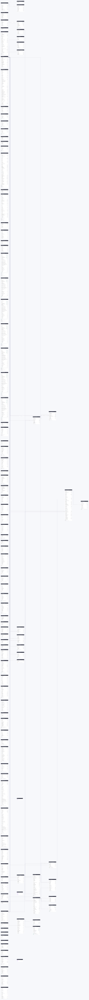

<details>
<summary>The whole schema as SQL</summary>

```sql
CREATE SCHEMA IF NOT EXISTS "public";

CREATE TYPE "JobStatus" AS ENUM ('ACTIVE', 'INACTIVE');

CREATE TYPE "ScheduledJobRunStatus" AS ENUM ('PENDING', 'RUNNING', 'SUCCEEDED', 'FAILED', 'CANCELLED');

CREATE TYPE "AccountingDeliveryState" AS ENUM ('pending', 'applied', 'parked');

CREATE TABLE "LiteLLM_BudgetTable" (
    "budget_id" TEXT NOT NULL,
    "max_budget" DOUBLE PRECISION,
    "soft_budget" DOUBLE PRECISION,
    "max_parallel_requests" INTEGER,
    "tpm_limit" BIGINT,
    "rpm_limit" BIGINT,
    "tpd_limit" BIGINT,
    "model_max_budget" JSONB,
    "model_tpm_limit" JSONB,
    "model_rpm_limit" JSONB,
    "budget_duration" TEXT,
    "budget_reset_at" TIMESTAMP(3),
    "allowed_models" TEXT[] DEFAULT ARRAY[]::TEXT[],
    "temp_budget_increase" DOUBLE PRECISION,
    "temp_budget_expiry" TIMESTAMP(3),
    "created_at" TIMESTAMP(3) NOT NULL DEFAULT CURRENT_TIMESTAMP,
    "created_by" TEXT NOT NULL,
    "updated_at" TIMESTAMP(3) NOT NULL DEFAULT CURRENT_TIMESTAMP,
    "updated_by" TEXT NOT NULL,

    CONSTRAINT "LiteLLM_BudgetTable_pkey" PRIMARY KEY ("budget_id")
);

CREATE TABLE "LiteLLM_CustomerOrganizationTable" (
    "spend" DOUBLE PRECISION NOT NULL DEFAULT 0.0,
    "budget_reset_at" TIMESTAMP(3),
    "budget_ids" TEXT[] DEFAULT ARRAY[]::TEXT[],
    "budget_names" JSONB NOT NULL DEFAULT '{}',
    "budget_id" TEXT,
    "customer_org_id" TEXT NOT NULL,
    "alias" TEXT,
    "default_budget_id" TEXT,
    "created_at" TIMESTAMP(3) NOT NULL DEFAULT CURRENT_TIMESTAMP,
    "created_by" TEXT NOT NULL,
    "updated_at" TIMESTAMP(3) NOT NULL DEFAULT CURRENT_TIMESTAMP,
    "updated_by" TEXT NOT NULL,

    CONSTRAINT "LiteLLM_CustomerOrganizationTable_pkey" PRIMARY KEY ("customer_org_id")
);

CREATE TABLE "LiteLLM_CustomerTeamTable" (
    "spend" DOUBLE PRECISION NOT NULL DEFAULT 0.0,
    "budget_reset_at" TIMESTAMP(3),
    "customer_team_id" TEXT NOT NULL,
    "alias" TEXT,
    "parent_org_id" TEXT NOT NULL,
    "budget_id" TEXT,
    "created_at" TIMESTAMP(3) NOT NULL DEFAULT CURRENT_TIMESTAMP,
    "created_by" TEXT NOT NULL,
    "updated_at" TIMESTAMP(3) NOT NULL DEFAULT CURRENT_TIMESTAMP,
    "updated_by" TEXT NOT NULL,

    CONSTRAINT "LiteLLM_CustomerTeamTable_pkey" PRIMARY KEY ("customer_team_id")
);

CREATE TABLE "LiteLLM_CustomerMemberTable" (
    "spend" DOUBLE PRECISION NOT NULL DEFAULT 0.0,
    "budget_reset_at" TIMESTAMP(3),
    "customer_member_id" TEXT NOT NULL,
    "alias" TEXT,
    "parent_team_id" TEXT NOT NULL,
    "budget_id" TEXT,
    "budget_template_id" TEXT,
    "budget_override_expires_at" TIMESTAMP(3),
    "created_at" TIMESTAMP(3) NOT NULL DEFAULT CURRENT_TIMESTAMP,
    "created_by" TEXT NOT NULL,
    "updated_at" TIMESTAMP(3) NOT NULL DEFAULT CURRENT_TIMESTAMP,
    "updated_by" TEXT NOT NULL,

    CONSTRAINT "LiteLLM_CustomerMemberTable_pkey" PRIMARY KEY ("customer_member_id")
);

CREATE TABLE "LiteLLM_CredentialsTable" (
    "credential_id" TEXT NOT NULL,
    "credential_name" TEXT NOT NULL,
    "display_name" TEXT,
    "credential_values" JSONB NOT NULL,
    "credential_info" JSONB,
    "created_at" TIMESTAMP(3) NOT NULL DEFAULT CURRENT_TIMESTAMP,
    "created_by" TEXT NOT NULL,
    "updated_at" TIMESTAMP(3) NOT NULL DEFAULT CURRENT_TIMESTAMP,
    "updated_by" TEXT NOT NULL,

    CONSTRAINT "LiteLLM_CredentialsTable_pkey" PRIMARY KEY ("credential_id")
);

CREATE TABLE "LiteLLM_ProxyModelTable" (
    "model_id" TEXT NOT NULL,
    "model_name" TEXT NOT NULL,
    "litellm_params" JSONB NOT NULL,
    "model_info" JSONB,
    "blocked" BOOLEAN NOT NULL DEFAULT false,
    "created_at" TIMESTAMP(3) NOT NULL DEFAULT CURRENT_TIMESTAMP,
    "created_by" TEXT NOT NULL,
    "updated_at" TIMESTAMP(3) NOT NULL DEFAULT CURRENT_TIMESTAMP,
    "updated_by" TEXT NOT NULL,

    CONSTRAINT "LiteLLM_ProxyModelTable_pkey" PRIMARY KEY ("model_id")
);

CREATE TABLE "LiteLLM_AgentsTable" (
    "agent_id" TEXT NOT NULL,
    "agent_name" TEXT NOT NULL,
    "litellm_params" JSONB,
    "agent_card_params" JSONB NOT NULL,
    "static_headers" JSONB DEFAULT '{}',
    "extra_headers" TEXT[] DEFAULT ARRAY[]::TEXT[],
    "kill_switch" JSONB,
    "agent_access_groups" TEXT[] DEFAULT ARRAY[]::TEXT[],
    "access_group_ids" TEXT[] DEFAULT ARRAY[]::TEXT[],
    "object_permission_id" TEXT,
    "spend" DOUBLE PRECISION NOT NULL DEFAULT 0.0,
    "identity_managed" BOOLEAN NOT NULL DEFAULT false,
    "enabled" BOOLEAN NOT NULL DEFAULT true,
    "execution_mode" TEXT NOT NULL DEFAULT 'autonomous',
    "tpm_limit" INTEGER,
    "rpm_limit" INTEGER,
    "session_tpm_limit" INTEGER,
    "session_rpm_limit" INTEGER,
    "created_at" TIMESTAMP(3) NOT NULL DEFAULT CURRENT_TIMESTAMP,
    "created_by" TEXT NOT NULL,
    "updated_at" TIMESTAMP(3) NOT NULL DEFAULT CURRENT_TIMESTAMP,
    "updated_by" TEXT NOT NULL,

    CONSTRAINT "LiteLLM_AgentsTable_pkey" PRIMARY KEY ("agent_id")
);

CREATE TABLE "LiteLLM_AgentIdentity" (
    "agent_id" TEXT NOT NULL,
    "active" BOOLEAN NOT NULL DEFAULT true,
    "provider" TEXT NOT NULL,
    "issuer" TEXT NOT NULL,
    "tenant_id" TEXT NOT NULL,
    "client_id" TEXT NOT NULL,
    "service_principal_id" TEXT,
    "required_roles" TEXT[] DEFAULT ARRAY[]::TEXT[],
    "required_scopes" TEXT[] DEFAULT ARRAY['user_impersonation']::TEXT[],
    "revision" TEXT NOT NULL,
    "last_authenticated_at" TIMESTAMP(3),

    CONSTRAINT "LiteLLM_AgentIdentity_pkey" PRIMARY KEY ("agent_id")
);

CREATE TABLE "LiteLLM_RetiredAgentIdentity" (
    "binding_id" TEXT NOT NULL,
    "agent_id" TEXT,
    "provider" TEXT NOT NULL,
    "issuer" TEXT NOT NULL,
    "tenant_id" TEXT NOT NULL,
    "client_id" TEXT NOT NULL,

    CONSTRAINT "LiteLLM_RetiredAgentIdentity_pkey" PRIMARY KEY ("binding_id")
);

CREATE TABLE "LiteLLM_RetiredAgent" (
    "original_agent_id" TEXT NOT NULL,
    "retired_at" TIMESTAMP(3) NOT NULL DEFAULT CURRENT_TIMESTAMP,

    CONSTRAINT "LiteLLM_RetiredAgent_pkey" PRIMARY KEY ("original_agent_id")
);

CREATE TABLE "LiteLLM_VerifiedSubject" (
    "subject_id" TEXT NOT NULL,
    "issuer" TEXT NOT NULL,
    "tenant_id" TEXT NOT NULL,
    "oid" TEXT NOT NULL,
    "kind" TEXT NOT NULL DEFAULT 'human',
    "user_id" TEXT,
    "verified_via" TEXT NOT NULL DEFAULT 'sso_interactive',
    "verified_at" TIMESTAMP(3) NOT NULL DEFAULT CURRENT_TIMESTAMP,

    CONSTRAINT "LiteLLM_VerifiedSubject_pkey" PRIMARY KEY ("subject_id")
);

CREATE TABLE "LiteLLM_OrganizationTable" (
    "organization_id" TEXT NOT NULL,
    "organization_alias" TEXT NOT NULL,
    "budget_id" TEXT NOT NULL,
    "metadata" JSONB NOT NULL DEFAULT '{}',
    "models" TEXT[],
    "spend" DOUBLE PRECISION NOT NULL DEFAULT 0.0,
    "model_spend" JSONB NOT NULL DEFAULT '{}',
    "object_permission_id" TEXT,
    "created_at" TIMESTAMP(3) NOT NULL DEFAULT CURRENT_TIMESTAMP,
    "created_by" TEXT NOT NULL,
    "updated_at" TIMESTAMP(3) NOT NULL DEFAULT CURRENT_TIMESTAMP,
    "updated_by" TEXT NOT NULL,

    CONSTRAINT "LiteLLM_OrganizationTable_pkey" PRIMARY KEY ("organization_id")
);

CREATE TABLE "LiteLLM_ModelTable" (
    "id" SERIAL NOT NULL,
    "aliases" JSONB,
    "created_at" TIMESTAMP(3) NOT NULL DEFAULT CURRENT_TIMESTAMP,
    "created_by" TEXT NOT NULL,
    "updated_at" TIMESTAMP(3) NOT NULL DEFAULT CURRENT_TIMESTAMP,
    "updated_by" TEXT NOT NULL,

    CONSTRAINT "LiteLLM_ModelTable_pkey" PRIMARY KEY ("id")
);

CREATE TABLE "LiteLLM_TeamTable" (
    "team_id" TEXT NOT NULL,
    "team_alias" TEXT,
    "organization_id" TEXT,
    "object_permission_id" TEXT,
    "admins" TEXT[],
    "members" TEXT[],
    "members_with_roles" JSONB NOT NULL DEFAULT '{}',
    "metadata" JSONB NOT NULL DEFAULT '{}',
    "max_budget" DOUBLE PRECISION,
    "soft_budget" DOUBLE PRECISION,
    "spend" DOUBLE PRECISION NOT NULL DEFAULT 0.0,
    "models" TEXT[],
    "max_parallel_requests" INTEGER,
    "tpm_limit" BIGINT,
    "rpm_limit" BIGINT,
    "tpd_limit" BIGINT,
    "budget_duration" TEXT,
    "budget_reset_at" TIMESTAMP(3),
    "blocked" BOOLEAN NOT NULL DEFAULT false,
    "created_at" TIMESTAMP(3) NOT NULL DEFAULT CURRENT_TIMESTAMP,
    "updated_at" TIMESTAMP(3) NOT NULL DEFAULT CURRENT_TIMESTAMP,
    "model_spend" JSONB NOT NULL DEFAULT '{}',
    "model_max_budget" JSONB NOT NULL DEFAULT '{}',
    "router_settings" JSONB DEFAULT '{}',
    "team_member_permissions" TEXT[] DEFAULT ARRAY[]::TEXT[],
    "access_group_ids" TEXT[] DEFAULT ARRAY[]::TEXT[],
    "policies" TEXT[] DEFAULT ARRAY[]::TEXT[],
    "default_team_member_models" TEXT[] DEFAULT ARRAY[]::TEXT[],
    "budget_limits" JSONB,
    "model_id" INTEGER,
    "allow_team_guardrail_config" BOOLEAN NOT NULL DEFAULT false,

    CONSTRAINT "LiteLLM_TeamTable_pkey" PRIMARY KEY ("team_id")
);

CREATE TABLE "LiteLLM_ProjectTable" (
    "project_id" TEXT NOT NULL,
    "project_alias" TEXT,
    "description" TEXT,
    "team_id" TEXT,
    "budget_id" TEXT,
    "metadata" JSONB NOT NULL DEFAULT '{}',
    "models" TEXT[],
    "spend" DOUBLE PRECISION NOT NULL DEFAULT 0.0,
    "model_spend" JSONB NOT NULL DEFAULT '{}',
    "model_rpm_limit" JSONB NOT NULL DEFAULT '{}',
    "model_tpm_limit" JSONB NOT NULL DEFAULT '{}',
    "blocked" BOOLEAN NOT NULL DEFAULT false,
    "object_permission_id" TEXT,
    "created_at" TIMESTAMP(3) NOT NULL DEFAULT CURRENT_TIMESTAMP,
    "created_by" TEXT NOT NULL,
    "updated_at" TIMESTAMP(3) NOT NULL DEFAULT CURRENT_TIMESTAMP,
    "updated_by" TEXT NOT NULL,

    CONSTRAINT "LiteLLM_ProjectTable_pkey" PRIMARY KEY ("project_id")
);

CREATE TABLE "LiteLLM_DeletedTeamTable" (
    "id" TEXT NOT NULL,
    "team_id" TEXT NOT NULL,
    "team_alias" TEXT,
    "organization_id" TEXT,
    "object_permission_id" TEXT,
    "admins" TEXT[],
    "members" TEXT[],
    "members_with_roles" JSONB NOT NULL DEFAULT '{}',
    "metadata" JSONB NOT NULL DEFAULT '{}',
    "max_budget" DOUBLE PRECISION,
    "soft_budget" DOUBLE PRECISION,
    "spend" DOUBLE PRECISION NOT NULL DEFAULT 0.0,
    "models" TEXT[],
    "max_parallel_requests" INTEGER,
    "tpm_limit" BIGINT,
    "rpm_limit" BIGINT,
    "tpd_limit" BIGINT,
    "budget_duration" TEXT,
    "budget_reset_at" TIMESTAMP(3),
    "blocked" BOOLEAN NOT NULL DEFAULT false,
    "model_spend" JSONB NOT NULL DEFAULT '{}',
    "model_max_budget" JSONB NOT NULL DEFAULT '{}',
    "router_settings" JSONB DEFAULT '{}',
    "team_member_permissions" TEXT[] DEFAULT ARRAY[]::TEXT[],
    "access_group_ids" TEXT[] DEFAULT ARRAY[]::TEXT[],
    "policies" TEXT[] DEFAULT ARRAY[]::TEXT[],
    "model_id" INTEGER,
    "allow_team_guardrail_config" BOOLEAN NOT NULL DEFAULT false,
    "created_at" TIMESTAMP(3),
    "updated_at" TIMESTAMP(3),
    "deleted_at" TIMESTAMP(3) NOT NULL DEFAULT CURRENT_TIMESTAMP,
    "deleted_by" TEXT,
    "deleted_by_api_key" TEXT,
    "litellm_changed_by" TEXT,

    CONSTRAINT "LiteLLM_DeletedTeamTable_pkey" PRIMARY KEY ("id")
);

CREATE TABLE "LiteLLM_UserTable" (
    "user_id" TEXT NOT NULL,
    "user_alias" TEXT,
    "team_id" TEXT,
    "sso_user_id" TEXT,
    "organization_id" TEXT,
    "object_permission_id" TEXT,
    "password" TEXT,
    "password_reset_required" BOOLEAN,
    "last_breach_check_at" TIMESTAMP(3),
    "teams" TEXT[] DEFAULT ARRAY[]::TEXT[],
    "user_role" TEXT,
    "max_budget" DOUBLE PRECISION,
    "spend" DOUBLE PRECISION NOT NULL DEFAULT 0.0,
    "user_email" TEXT,
    "models" TEXT[],
    "metadata" JSONB NOT NULL DEFAULT '{}',
    "max_parallel_requests" INTEGER,
    "tpm_limit" BIGINT,
    "rpm_limit" BIGINT,
    "budget_duration" TEXT,
    "budget_reset_at" TIMESTAMP(3),
    "allowed_cache_controls" TEXT[] DEFAULT ARRAY[]::TEXT[],
    "policies" TEXT[] DEFAULT ARRAY[]::TEXT[],
    "model_spend" JSONB NOT NULL DEFAULT '{}',
    "model_max_budget" JSONB NOT NULL DEFAULT '{}',
    "created_at" TIMESTAMP(3) DEFAULT CURRENT_TIMESTAMP,
    "updated_at" TIMESTAMP(3) DEFAULT CURRENT_TIMESTAMP,

    CONSTRAINT "LiteLLM_UserTable_pkey" PRIMARY KEY ("user_id")
);

CREATE TABLE "LiteLLM_ObjectPermissionTable" (
    "object_permission_id" TEXT NOT NULL,
    "mcp_servers" TEXT[] DEFAULT ARRAY[]::TEXT[],
    "mcp_access_groups" TEXT[] DEFAULT ARRAY[]::TEXT[],
    "mcp_tool_permissions" JSONB,
    "vector_stores" TEXT[] DEFAULT ARRAY[]::TEXT[],
    "agents" TEXT[] DEFAULT ARRAY[]::TEXT[],
    "agent_access_groups" TEXT[] DEFAULT ARRAY[]::TEXT[],
    "models" TEXT[] DEFAULT ARRAY[]::TEXT[],
    "blocked_tools" TEXT[] DEFAULT ARRAY[]::TEXT[],
    "mcp_toolsets" TEXT[] DEFAULT ARRAY[]::TEXT[],
    "search_tools" TEXT[] DEFAULT ARRAY[]::TEXT[],
    "mcp_tool_search_enabled" BOOLEAN,
    "skills" TEXT[] DEFAULT ARRAY[]::TEXT[],

    CONSTRAINT "LiteLLM_ObjectPermissionTable_pkey" PRIMARY KEY ("object_permission_id")
);

CREATE TABLE "LiteLLM_MCPServerTable" (
    "server_id" TEXT NOT NULL,
    "server_name" TEXT,
    "alias" TEXT,
    "description" TEXT,
    "instructions" TEXT,
    "url" TEXT,
    "spec_path" TEXT,
    "transport" TEXT NOT NULL DEFAULT 'sse',
    "auth_type" TEXT,
    "credentials" JSONB DEFAULT '{}',
    "created_at" TIMESTAMP(3) DEFAULT CURRENT_TIMESTAMP,
    "created_by" TEXT,
    "updated_at" TIMESTAMP(3) DEFAULT CURRENT_TIMESTAMP,
    "updated_by" TEXT,
    "mcp_info" JSONB DEFAULT '{}',
    "mcp_access_groups" TEXT[],
    "allowed_tools" TEXT[] DEFAULT ARRAY[]::TEXT[],
    "tool_name_to_display_name" JSONB DEFAULT '{}',
    "tool_name_to_description" JSONB DEFAULT '{}',
    "pinned_tools" JSONB DEFAULT '{}',
    "extra_headers" TEXT[] DEFAULT ARRAY[]::TEXT[],
    "static_headers" JSONB DEFAULT '{}',
    "env_vars" JSONB DEFAULT '[]',
    "status" TEXT DEFAULT 'unknown',
    "last_health_check" TIMESTAMP(3),
    "health_check_error" TEXT,
    "command" TEXT,
    "args" TEXT[] DEFAULT ARRAY[]::TEXT[],
    "env" JSONB DEFAULT '{}',
    "issuer" TEXT,
    "authorization_url" TEXT,
    "token_url" TEXT,
    "registration_url" TEXT,
    "oauth2_flow" TEXT,
    "token_exchange_endpoint" TEXT,
    "audience" TEXT,
    "subject_token_type" TEXT,
    "token_exchange_profile" TEXT,
    "allow_all_keys" BOOLEAN NOT NULL DEFAULT false,
    "available_on_public_internet" BOOLEAN NOT NULL DEFAULT true,
    "delegate_auth_to_upstream" BOOLEAN NOT NULL DEFAULT false,
    "oauth_passthrough" BOOLEAN NOT NULL DEFAULT false,
    "dcr_bridge" BOOLEAN,
    "per_server_oauth_discovery" BOOLEAN NOT NULL DEFAULT false,
    "is_byok" BOOLEAN NOT NULL DEFAULT false,
    "byok_description" TEXT[] DEFAULT ARRAY[]::TEXT[],
    "byok_api_key_help_url" TEXT,
    "source_url" TEXT,
    "timeout" DOUBLE PRECISION,
    "max_concurrent_requests" INTEGER,
    "rpm" INTEGER,
    "approval_status" TEXT DEFAULT 'active',
    "submitted_by" TEXT,
    "submitted_at" TIMESTAMP(3),
    "reviewed_at" TIMESTAMP(3),
    "review_notes" TEXT,

    CONSTRAINT "LiteLLM_MCPServerTable_pkey" PRIMARY KEY ("server_id")
);

CREATE TABLE "LiteLLM_MCPToolsetTable" (
    "toolset_id" TEXT NOT NULL,
    "toolset_name" TEXT NOT NULL,
    "description" TEXT,
    "tools" JSONB NOT NULL DEFAULT '[]',
    "created_at" TIMESTAMP(3) NOT NULL DEFAULT CURRENT_TIMESTAMP,
    "created_by" TEXT,
    "updated_at" TIMESTAMP(3) NOT NULL DEFAULT CURRENT_TIMESTAMP,
    "updated_by" TEXT,

    CONSTRAINT "LiteLLM_MCPToolsetTable_pkey" PRIMARY KEY ("toolset_id")
);

CREATE TABLE "LiteLLM_MCPUserCredentials" (
    "id" TEXT NOT NULL,
    "user_id" TEXT NOT NULL,
    "server_id" TEXT NOT NULL,
    "credential_b64" TEXT NOT NULL,
    "created_at" TIMESTAMP(3) NOT NULL DEFAULT CURRENT_TIMESTAMP,
    "updated_at" TIMESTAMP(3) NOT NULL DEFAULT CURRENT_TIMESTAMP,

    CONSTRAINT "LiteLLM_MCPUserCredentials_pkey" PRIMARY KEY ("id")
);

CREATE TABLE "LiteLLM_UserProviderCredentials" (
    "id" TEXT NOT NULL,
    "user_id" TEXT NOT NULL,
    "credential_name" TEXT NOT NULL,
    "provider" TEXT NOT NULL,
    "credential_b64" TEXT NOT NULL,
    "created_at" TIMESTAMP(3) NOT NULL DEFAULT CURRENT_TIMESTAMP,
    "updated_at" TIMESTAMP(3) NOT NULL DEFAULT CURRENT_TIMESTAMP,

    CONSTRAINT "LiteLLM_UserProviderCredentials_pkey" PRIMARY KEY ("id")
);

CREATE TABLE "LiteLLM_MCPUserEnvVars" (
    "id" TEXT NOT NULL,
    "user_id" TEXT NOT NULL,
    "server_id" TEXT NOT NULL,
    "values_b64" TEXT NOT NULL,
    "created_at" TIMESTAMP(3) NOT NULL DEFAULT CURRENT_TIMESTAMP,
    "updated_at" TIMESTAMP(3) NOT NULL DEFAULT CURRENT_TIMESTAMP,

    CONSTRAINT "LiteLLM_MCPUserEnvVars_pkey" PRIMARY KEY ("id")
);

CREATE TABLE "LiteLLM_MCPServerOAuthClient" (
    "server_id" TEXT NOT NULL,
    "credentials" JSONB,
    "created_at" TIMESTAMP(3) NOT NULL DEFAULT CURRENT_TIMESTAMP,
    "updated_at" TIMESTAMP(3) NOT NULL DEFAULT CURRENT_TIMESTAMP,

    CONSTRAINT "LiteLLM_MCPServerOAuthClient_pkey" PRIMARY KEY ("server_id")
);

CREATE TABLE "LiteLLM_SSOIdentityAssertion" (
    "user_id" TEXT NOT NULL,
    "assertion_b64" TEXT NOT NULL,
    "created_at" TIMESTAMP(3) NOT NULL DEFAULT CURRENT_TIMESTAMP,
    "updated_at" TIMESTAMP(3) NOT NULL DEFAULT CURRENT_TIMESTAMP,

    CONSTRAINT "LiteLLM_SSOIdentityAssertion_pkey" PRIMARY KEY ("user_id")
);

CREATE TABLE "LiteLLM_VerificationToken" (
    "token" TEXT NOT NULL,
    "key_name" TEXT,
    "key_alias" TEXT,
    "soft_budget_cooldown" BOOLEAN NOT NULL DEFAULT false,
    "spend" DOUBLE PRECISION NOT NULL DEFAULT 0.0,
    "total_spend" DOUBLE PRECISION NOT NULL DEFAULT 0.0,
    "expires" TIMESTAMP(3),
    "models" TEXT[],
    "aliases" JSONB NOT NULL DEFAULT '{}',
    "config" JSONB NOT NULL DEFAULT '{}',
    "router_settings" JSONB DEFAULT '{}',
    "user_id" TEXT,
    "team_id" TEXT,
    "agent_id" TEXT,
    "project_id" TEXT,
    "permissions" JSONB NOT NULL DEFAULT '{}',
    "max_parallel_requests" INTEGER,
    "metadata" JSONB NOT NULL DEFAULT '{}',
    "blocked" BOOLEAN,
    "tpm_limit" BIGINT,
    "rpm_limit" BIGINT,
    "tpd_limit" BIGINT,
    "max_budget" DOUBLE PRECISION,
    "budget_duration" TEXT,
    "budget_reset_at" TIMESTAMP(3),
    "allowed_cache_controls" TEXT[] DEFAULT ARRAY[]::TEXT[],
    "allowed_routes" TEXT[] DEFAULT ARRAY[]::TEXT[],
    "key_type" TEXT,
    "policies" TEXT[] DEFAULT ARRAY[]::TEXT[],
    "access_group_ids" TEXT[] DEFAULT ARRAY[]::TEXT[],
    "model_spend" JSONB NOT NULL DEFAULT '{}',
    "model_max_budget" JSONB NOT NULL DEFAULT '{}',
    "budget_fallbacks" JSONB NOT NULL DEFAULT '{}',
    "budget_id" TEXT,
    "organization_id" TEXT,
    "object_permission_id" TEXT,
    "created_at" TIMESTAMP(3) DEFAULT CURRENT_TIMESTAMP,
    "created_by" TEXT,
    "updated_at" TIMESTAMP(3) DEFAULT CURRENT_TIMESTAMP,
    "updated_by" TEXT,
    "settings_updated_at" TIMESTAMP(3),
    "last_active" TIMESTAMP(3),
    "rotation_count" INTEGER DEFAULT 0,
    "auto_rotate" BOOLEAN DEFAULT false,
    "rotation_interval" TEXT,
    "last_rotation_at" TIMESTAMP(3),
    "key_rotation_at" TIMESTAMP(3),
    "budget_limits" JSONB,

    CONSTRAINT "LiteLLM_VerificationToken_pkey" PRIMARY KEY ("token")
);

CREATE TABLE "LiteLLM_JWTKeyMapping" (
    "id" TEXT NOT NULL,
    "jwt_issuer" TEXT NOT NULL DEFAULT '',
    "jwt_claim_name" TEXT NOT NULL,
    "jwt_claim_value" TEXT NOT NULL,
    "token" TEXT NOT NULL,
    "description" TEXT,
    "is_active" BOOLEAN NOT NULL DEFAULT true,
    "created_at" TIMESTAMP(3) NOT NULL DEFAULT CURRENT_TIMESTAMP,
    "created_by" TEXT,
    "updated_at" TIMESTAMP(3) NOT NULL DEFAULT CURRENT_TIMESTAMP,
    "updated_by" TEXT,

    CONSTRAINT "LiteLLM_JWTKeyMapping_pkey" PRIMARY KEY ("id")
);

CREATE TABLE "LiteLLM_DeprecatedVerificationToken" (
    "id" TEXT NOT NULL,
    "token" TEXT NOT NULL,
    "active_token_id" TEXT NOT NULL,
    "revoke_at" TIMESTAMP(3) NOT NULL,
    "created_at" TIMESTAMP(3) NOT NULL DEFAULT CURRENT_TIMESTAMP,

    CONSTRAINT "LiteLLM_DeprecatedVerificationToken_pkey" PRIMARY KEY ("id")
);

CREATE TABLE "LiteLLM_DeletedVerificationToken" (
    "id" TEXT NOT NULL,
    "token" TEXT NOT NULL,
    "key_name" TEXT,
    "key_alias" TEXT,
    "soft_budget_cooldown" BOOLEAN NOT NULL DEFAULT false,
    "spend" DOUBLE PRECISION NOT NULL DEFAULT 0.0,
    "total_spend" DOUBLE PRECISION NOT NULL DEFAULT 0.0,
    "expires" TIMESTAMP(3),
    "models" TEXT[],
    "aliases" JSONB NOT NULL DEFAULT '{}',
    "config" JSONB NOT NULL DEFAULT '{}',
    "user_id" TEXT,
    "team_id" TEXT,
    "agent_id" TEXT,
    "project_id" TEXT,
    "permissions" JSONB NOT NULL DEFAULT '{}',
    "max_parallel_requests" INTEGER,
    "metadata" JSONB NOT NULL DEFAULT '{}',
    "blocked" BOOLEAN,
    "tpm_limit" BIGINT,
    "rpm_limit" BIGINT,
    "tpd_limit" BIGINT,
    "max_budget" DOUBLE PRECISION,
    "budget_duration" TEXT,
    "budget_reset_at" TIMESTAMP(3),
    "allowed_cache_controls" TEXT[] DEFAULT ARRAY[]::TEXT[],
    "allowed_routes" TEXT[] DEFAULT ARRAY[]::TEXT[],
    "key_type" TEXT,
    "policies" TEXT[] DEFAULT ARRAY[]::TEXT[],
    "access_group_ids" TEXT[] DEFAULT ARRAY[]::TEXT[],
    "model_spend" JSONB NOT NULL DEFAULT '{}',
    "model_max_budget" JSONB NOT NULL DEFAULT '{}',
    "budget_fallbacks" JSONB NOT NULL DEFAULT '{}',
    "router_settings" JSONB DEFAULT '{}',
    "budget_id" TEXT,
    "organization_id" TEXT,
    "object_permission_id" TEXT,
    "created_at" TIMESTAMP(3),
    "created_by" TEXT,
    "updated_at" TIMESTAMP(3),
    "updated_by" TEXT,
    "settings_updated_at" TIMESTAMP(3),
    "last_active" TIMESTAMP(3),
    "rotation_count" INTEGER DEFAULT 0,
    "auto_rotate" BOOLEAN DEFAULT false,
    "rotation_interval" TEXT,
    "last_rotation_at" TIMESTAMP(3),
    "key_rotation_at" TIMESTAMP(3),
    "deleted_at" TIMESTAMP(3) NOT NULL DEFAULT CURRENT_TIMESTAMP,
    "deleted_by" TEXT,
    "deleted_by_api_key" TEXT,
    "litellm_changed_by" TEXT,

    CONSTRAINT "LiteLLM_DeletedVerificationToken_pkey" PRIMARY KEY ("id")
);

CREATE TABLE "LiteLLM_EndUserTable" (
    "user_id" TEXT NOT NULL,
    "alias" TEXT,
    "spend" DOUBLE PRECISION NOT NULL DEFAULT 0.0,
    "allowed_model_region" TEXT,
    "default_model" TEXT,
    "models" TEXT[] DEFAULT ARRAY[]::TEXT[],
    "budget_id" TEXT,
    "object_permission_id" TEXT,
    "blocked" BOOLEAN NOT NULL DEFAULT false,

    CONSTRAINT "LiteLLM_EndUserTable_pkey" PRIMARY KEY ("user_id")
);

CREATE TABLE "LiteLLM_ModelAccessGroupBudgetTable" (
    "access_group_name" TEXT NOT NULL,
    "spend" DOUBLE PRECISION NOT NULL DEFAULT 0.0,
    "budget_id" TEXT,
    "created_at" TIMESTAMP(3) NOT NULL DEFAULT CURRENT_TIMESTAMP,
    "created_by" TEXT,
    "updated_at" TIMESTAMP(3) NOT NULL DEFAULT CURRENT_TIMESTAMP,
    "updated_by" TEXT,

    CONSTRAINT "LiteLLM_ModelAccessGroupBudgetTable_pkey" PRIMARY KEY ("access_group_name")
);

CREATE TABLE "LiteLLM_TagTable" (
    "tag_name" TEXT NOT NULL,
    "description" TEXT,
    "models" TEXT[],
    "model_info" JSONB,
    "spend" DOUBLE PRECISION NOT NULL DEFAULT 0.0,
    "budget_id" TEXT,
    "created_at" TIMESTAMP(3) NOT NULL DEFAULT CURRENT_TIMESTAMP,
    "created_by" TEXT,
    "updated_at" TIMESTAMP(3) NOT NULL DEFAULT CURRENT_TIMESTAMP,

    CONSTRAINT "LiteLLM_TagTable_pkey" PRIMARY KEY ("tag_name")
);

CREATE TABLE "LiteLLM_Config" (
    "param_name" TEXT NOT NULL,
    "param_value" JSONB,
    "last_run_at" TIMESTAMP(3),
    "reload_revision" BIGINT NOT NULL DEFAULT 0,

    CONSTRAINT "LiteLLM_Config_pkey" PRIMARY KEY ("param_name")
);

CREATE TABLE "LiteLLM_SpendLogs" (
    "request_id" TEXT NOT NULL,
    "call_type" TEXT NOT NULL,
    "api_key" TEXT NOT NULL DEFAULT '',
    "spend" DOUBLE PRECISION NOT NULL DEFAULT 0.0,
    "total_tokens" INTEGER NOT NULL DEFAULT 0,
    "prompt_tokens" INTEGER NOT NULL DEFAULT 0,
    "completion_tokens" INTEGER NOT NULL DEFAULT 0,
    "startTime" TIMESTAMP(3) NOT NULL,
    "endTime" TIMESTAMP(3) NOT NULL,
    "request_duration_ms" INTEGER,
    "completionStartTime" TIMESTAMP(3),
    "model" TEXT NOT NULL DEFAULT '',
    "model_id" TEXT DEFAULT '',
    "model_group" TEXT DEFAULT '',
    "custom_llm_provider" TEXT DEFAULT '',
    "api_base" TEXT DEFAULT '',
    "user" TEXT DEFAULT '',
    "metadata" JSONB DEFAULT '{}',
    "cache_hit" TEXT DEFAULT '',
    "cache_key" TEXT DEFAULT '',
    "request_tags" JSONB DEFAULT '[]',
    "team_id" TEXT,
    "organization_id" TEXT,
    "end_user" TEXT,
    "requester_ip_address" TEXT,
    "messages" JSONB DEFAULT '{}',
    "response" JSONB DEFAULT '{}',
    "session_id" TEXT,
    "status" TEXT,
    "mcp_namespaced_tool_name" TEXT,
    "billing_agent_id" TEXT,
    "agent_id" TEXT,
    "proxy_server_request" JSONB DEFAULT '{}',
    "litellm_call_id" TEXT,
    "created_at" TIMESTAMP(3) NOT NULL DEFAULT CURRENT_TIMESTAMP,
    "updated_at" TIMESTAMP(3) NOT NULL DEFAULT CURRENT_TIMESTAMP,

    CONSTRAINT "LiteLLM_SpendLogs_pkey" PRIMARY KEY ("request_id")
);

CREATE TABLE "LiteLLM_BudgetWindowSpend" (
    "entity_type" TEXT NOT NULL,
    "entity_id" TEXT NOT NULL,
    "window_duration" TEXT NOT NULL,
    "window_start" TIMESTAMP(3) NOT NULL,
    "spend" DOUBLE PRECISION NOT NULL DEFAULT 0.0,
    "created_at" TIMESTAMP(3) NOT NULL DEFAULT CURRENT_TIMESTAMP,
    "updated_at" TIMESTAMP(3) NOT NULL,

    CONSTRAINT "LiteLLM_BudgetWindowSpend_pkey" PRIMARY KEY ("entity_type","entity_id","window_duration")
);

CREATE TABLE "LiteLLM_ErrorLogs" (
    "request_id" TEXT NOT NULL,
    "startTime" TIMESTAMP(3) NOT NULL,
    "endTime" TIMESTAMP(3) NOT NULL,
    "api_base" TEXT NOT NULL DEFAULT '',
    "model_group" TEXT NOT NULL DEFAULT '',
    "litellm_model_name" TEXT NOT NULL DEFAULT '',
    "model_id" TEXT NOT NULL DEFAULT '',
    "request_kwargs" JSONB NOT NULL DEFAULT '{}',
    "exception_type" TEXT NOT NULL DEFAULT '',
    "exception_string" TEXT NOT NULL DEFAULT '',
    "status_code" TEXT NOT NULL DEFAULT '',

    CONSTRAINT "LiteLLM_ErrorLogs_pkey" PRIMARY KEY ("request_id")
);

CREATE TABLE "LiteLLM_UserNotifications" (
    "request_id" TEXT NOT NULL,
    "user_id" TEXT NOT NULL,
    "models" TEXT[],
    "justification" TEXT NOT NULL,
    "status" TEXT NOT NULL,

    CONSTRAINT "LiteLLM_UserNotifications_pkey" PRIMARY KEY ("request_id")
);

CREATE TABLE "LiteLLM_TeamMembership" (
    "user_id" TEXT NOT NULL,
    "team_id" TEXT NOT NULL,
    "spend" DOUBLE PRECISION NOT NULL DEFAULT 0.0,
    "total_spend" DOUBLE PRECISION NOT NULL DEFAULT 0.0,
    "budget_id" TEXT,

    CONSTRAINT "LiteLLM_TeamMembership_pkey" PRIMARY KEY ("user_id","team_id")
);

CREATE TABLE "LiteLLM_OrganizationMembership" (
    "user_id" TEXT NOT NULL,
    "organization_id" TEXT NOT NULL,
    "user_role" TEXT,
    "spend" DOUBLE PRECISION DEFAULT 0.0,
    "budget_id" TEXT,
    "created_at" TIMESTAMP(3) DEFAULT CURRENT_TIMESTAMP,
    "updated_at" TIMESTAMP(3) DEFAULT CURRENT_TIMESTAMP,

    CONSTRAINT "LiteLLM_OrganizationMembership_pkey" PRIMARY KEY ("user_id","organization_id")
);

CREATE TABLE "LiteLLM_InvitationLink" (
    "id" TEXT NOT NULL,
    "user_id" TEXT NOT NULL,
    "is_accepted" BOOLEAN NOT NULL DEFAULT false,
    "accepted_at" TIMESTAMP(3),
    "expires_at" TIMESTAMP(3) NOT NULL,
    "created_at" TIMESTAMP(3) NOT NULL,
    "created_by" TEXT NOT NULL,
    "updated_at" TIMESTAMP(3) NOT NULL,
    "updated_by" TEXT NOT NULL,

    CONSTRAINT "LiteLLM_InvitationLink_pkey" PRIMARY KEY ("id")
);

CREATE TABLE "LiteLLM_AuditLog" (
    "id" TEXT NOT NULL,
    "updated_at" TIMESTAMP(3) NOT NULL DEFAULT CURRENT_TIMESTAMP,
    "changed_by" TEXT NOT NULL DEFAULT '',
    "changed_by_api_key" TEXT NOT NULL DEFAULT '',
    "action" TEXT NOT NULL,
    "table_name" TEXT NOT NULL,
    "object_id" TEXT NOT NULL,
    "before_value" JSONB,
    "updated_values" JSONB,

    CONSTRAINT "LiteLLM_AuditLog_pkey" PRIMARY KEY ("id")
);

CREATE TABLE "LiteLLM_DailyUserSpend" (
    "id" TEXT NOT NULL,
    "user_id" TEXT,
    "date" TEXT NOT NULL,
    "api_key" TEXT NOT NULL,
    "model" TEXT,
    "model_group" TEXT,
    "custom_llm_provider" TEXT,
    "mcp_namespaced_tool_name" TEXT,
    "endpoint" TEXT,
    "prompt_tokens" BIGINT NOT NULL DEFAULT 0,
    "completion_tokens" BIGINT NOT NULL DEFAULT 0,
    "cache_read_input_tokens" BIGINT NOT NULL DEFAULT 0,
    "cache_creation_input_tokens" BIGINT NOT NULL DEFAULT 0,
    "compression_saved_tokens" BIGINT NOT NULL DEFAULT 0,
    "compression_savings_spend" DOUBLE PRECISION NOT NULL DEFAULT 0.0,
    "prompt_caching_savings_spend" DOUBLE PRECISION NOT NULL DEFAULT 0.0,
    "gateway_injected_caching_savings_spend" DOUBLE PRECISION NOT NULL DEFAULT 0.0,
    "autorouter_savings_spend" DOUBLE PRECISION NOT NULL DEFAULT 0.0,
    "guardrail_spend" DOUBLE PRECISION NOT NULL DEFAULT 0.0,
    "spend" DOUBLE PRECISION NOT NULL DEFAULT 0.0,
    "api_requests" BIGINT NOT NULL DEFAULT 0,
    "successful_requests" BIGINT NOT NULL DEFAULT 0,
    "failed_requests" BIGINT NOT NULL DEFAULT 0,
    "total_response_time_ms" BIGINT NOT NULL DEFAULT 0,
    "timed_requests" BIGINT NOT NULL DEFAULT 0,
    "created_at" TIMESTAMP(3) NOT NULL DEFAULT CURRENT_TIMESTAMP,
    "updated_at" TIMESTAMP(3) NOT NULL,

    CONSTRAINT "LiteLLM_DailyUserSpend_pkey" PRIMARY KEY ("id")
);

CREATE TABLE "LiteLLM_DailyGlobalSpend" (
    "id" TEXT NOT NULL,
    "date" TEXT NOT NULL,
    "model" TEXT,
    "model_group" TEXT,
    "custom_llm_provider" TEXT,
    "mcp_namespaced_tool_name" TEXT,
    "endpoint" TEXT,
    "prompt_tokens" BIGINT NOT NULL DEFAULT 0,
    "completion_tokens" BIGINT NOT NULL DEFAULT 0,
    "cache_read_input_tokens" BIGINT NOT NULL DEFAULT 0,
    "cache_creation_input_tokens" BIGINT NOT NULL DEFAULT 0,
    "compression_saved_tokens" BIGINT NOT NULL DEFAULT 0,
    "compression_savings_spend" DOUBLE PRECISION NOT NULL DEFAULT 0.0,
    "prompt_caching_savings_spend" DOUBLE PRECISION NOT NULL DEFAULT 0.0,
    "gateway_injected_caching_savings_spend" DOUBLE PRECISION NOT NULL DEFAULT 0.0,
    "autorouter_savings_spend" DOUBLE PRECISION NOT NULL DEFAULT 0.0,
    "guardrail_spend" DOUBLE PRECISION NOT NULL DEFAULT 0.0,
    "spend" DOUBLE PRECISION NOT NULL DEFAULT 0.0,
    "api_requests" BIGINT NOT NULL DEFAULT 0,
    "successful_requests" BIGINT NOT NULL DEFAULT 0,
    "failed_requests" BIGINT NOT NULL DEFAULT 0,
    "total_response_time_ms" BIGINT NOT NULL DEFAULT 0,
    "timed_requests" BIGINT NOT NULL DEFAULT 0,
    "created_at" TIMESTAMP(3) NOT NULL DEFAULT CURRENT_TIMESTAMP,
    "updated_at" TIMESTAMP(3) NOT NULL,

    CONSTRAINT "LiteLLM_DailyGlobalSpend_pkey" PRIMARY KEY ("id")
);

CREATE TABLE "LiteLLM_DailyOrganizationSpend" (
    "id" TEXT NOT NULL,
    "organization_id" TEXT,
    "date" TEXT NOT NULL,
    "api_key" TEXT NOT NULL,
    "model" TEXT,
    "model_group" TEXT,
    "custom_llm_provider" TEXT,
    "mcp_namespaced_tool_name" TEXT,
    "endpoint" TEXT,
    "prompt_tokens" BIGINT NOT NULL DEFAULT 0,
    "completion_tokens" BIGINT NOT NULL DEFAULT 0,
    "cache_read_input_tokens" BIGINT NOT NULL DEFAULT 0,
    "cache_creation_input_tokens" BIGINT NOT NULL DEFAULT 0,
    "compression_saved_tokens" BIGINT NOT NULL DEFAULT 0,
    "compression_savings_spend" DOUBLE PRECISION NOT NULL DEFAULT 0.0,
    "prompt_caching_savings_spend" DOUBLE PRECISION NOT NULL DEFAULT 0.0,
    "gateway_injected_caching_savings_spend" DOUBLE PRECISION NOT NULL DEFAULT 0.0,
    "autorouter_savings_spend" DOUBLE PRECISION NOT NULL DEFAULT 0.0,
    "guardrail_spend" DOUBLE PRECISION NOT NULL DEFAULT 0.0,
    "spend" DOUBLE PRECISION NOT NULL DEFAULT 0.0,
    "api_requests" BIGINT NOT NULL DEFAULT 0,
    "successful_requests" BIGINT NOT NULL DEFAULT 0,
    "failed_requests" BIGINT NOT NULL DEFAULT 0,
    "total_response_time_ms" BIGINT NOT NULL DEFAULT 0,
    "timed_requests" BIGINT NOT NULL DEFAULT 0,
    "created_at" TIMESTAMP(3) NOT NULL DEFAULT CURRENT_TIMESTAMP,
    "updated_at" TIMESTAMP(3) NOT NULL,

    CONSTRAINT "LiteLLM_DailyOrganizationSpend_pkey" PRIMARY KEY ("id")
);

CREATE TABLE "LiteLLM_DailyEndUserSpend" (
    "id" TEXT NOT NULL,
    "end_user_id" TEXT,
    "date" TEXT NOT NULL,
    "api_key" TEXT NOT NULL,
    "model" TEXT,
    "model_group" TEXT,
    "custom_llm_provider" TEXT,
    "mcp_namespaced_tool_name" TEXT,
    "endpoint" TEXT,
    "prompt_tokens" BIGINT NOT NULL DEFAULT 0,
    "completion_tokens" BIGINT NOT NULL DEFAULT 0,
    "cache_read_input_tokens" BIGINT NOT NULL DEFAULT 0,
    "cache_creation_input_tokens" BIGINT NOT NULL DEFAULT 0,
    "compression_saved_tokens" BIGINT NOT NULL DEFAULT 0,
    "compression_savings_spend" DOUBLE PRECISION NOT NULL DEFAULT 0.0,
    "prompt_caching_savings_spend" DOUBLE PRECISION NOT NULL DEFAULT 0.0,
    "gateway_injected_caching_savings_spend" DOUBLE PRECISION NOT NULL DEFAULT 0.0,
    "autorouter_savings_spend" DOUBLE PRECISION NOT NULL DEFAULT 0.0,
    "guardrail_spend" DOUBLE PRECISION NOT NULL DEFAULT 0.0,
    "spend" DOUBLE PRECISION NOT NULL DEFAULT 0.0,
    "api_requests" BIGINT NOT NULL DEFAULT 0,
    "successful_requests" BIGINT NOT NULL DEFAULT 0,
    "failed_requests" BIGINT NOT NULL DEFAULT 0,
    "total_response_time_ms" BIGINT NOT NULL DEFAULT 0,
    "timed_requests" BIGINT NOT NULL DEFAULT 0,
    "created_at" TIMESTAMP(3) NOT NULL DEFAULT CURRENT_TIMESTAMP,
    "updated_at" TIMESTAMP(3) NOT NULL,

    CONSTRAINT "LiteLLM_DailyEndUserSpend_pkey" PRIMARY KEY ("id")
);

CREATE TABLE "LiteLLM_DailyAgentSpend" (
    "id" TEXT NOT NULL,
    "agent_id" TEXT,
    "date" TEXT NOT NULL,
    "api_key" TEXT NOT NULL,
    "model" TEXT,
    "model_group" TEXT,
    "custom_llm_provider" TEXT,
    "mcp_namespaced_tool_name" TEXT,
    "endpoint" TEXT,
    "prompt_tokens" BIGINT NOT NULL DEFAULT 0,
    "completion_tokens" BIGINT NOT NULL DEFAULT 0,
    "cache_read_input_tokens" BIGINT NOT NULL DEFAULT 0,
    "cache_creation_input_tokens" BIGINT NOT NULL DEFAULT 0,
    "compression_saved_tokens" BIGINT NOT NULL DEFAULT 0,
    "compression_savings_spend" DOUBLE PRECISION NOT NULL DEFAULT 0.0,
    "prompt_caching_savings_spend" DOUBLE PRECISION NOT NULL DEFAULT 0.0,
    "gateway_injected_caching_savings_spend" DOUBLE PRECISION NOT NULL DEFAULT 0.0,
    "autorouter_savings_spend" DOUBLE PRECISION NOT NULL DEFAULT 0.0,
    "guardrail_spend" DOUBLE PRECISION NOT NULL DEFAULT 0.0,
    "spend" DOUBLE PRECISION NOT NULL DEFAULT 0.0,
    "api_requests" BIGINT NOT NULL DEFAULT 0,
    "successful_requests" BIGINT NOT NULL DEFAULT 0,
    "failed_requests" BIGINT NOT NULL DEFAULT 0,
    "total_response_time_ms" BIGINT NOT NULL DEFAULT 0,
    "timed_requests" BIGINT NOT NULL DEFAULT 0,
    "created_at" TIMESTAMP(3) NOT NULL DEFAULT CURRENT_TIMESTAMP,
    "updated_at" TIMESTAMP(3) NOT NULL,

    CONSTRAINT "LiteLLM_DailyAgentSpend_pkey" PRIMARY KEY ("id")
);

CREATE TABLE "LiteLLM_DailyTeamSpend" (
    "id" TEXT NOT NULL,
    "team_id" TEXT,
    "date" TEXT NOT NULL,
    "api_key" TEXT NOT NULL,
    "model" TEXT,
    "model_group" TEXT,
    "custom_llm_provider" TEXT,
    "mcp_namespaced_tool_name" TEXT,
    "endpoint" TEXT,
    "prompt_tokens" BIGINT NOT NULL DEFAULT 0,
    "completion_tokens" BIGINT NOT NULL DEFAULT 0,
    "cache_read_input_tokens" BIGINT NOT NULL DEFAULT 0,
    "cache_creation_input_tokens" BIGINT NOT NULL DEFAULT 0,
    "compression_saved_tokens" BIGINT NOT NULL DEFAULT 0,
    "compression_savings_spend" DOUBLE PRECISION NOT NULL DEFAULT 0.0,
    "prompt_caching_savings_spend" DOUBLE PRECISION NOT NULL DEFAULT 0.0,
    "gateway_injected_caching_savings_spend" DOUBLE PRECISION NOT NULL DEFAULT 0.0,
    "autorouter_savings_spend" DOUBLE PRECISION NOT NULL DEFAULT 0.0,
    "guardrail_spend" DOUBLE PRECISION NOT NULL DEFAULT 0.0,
    "spend" DOUBLE PRECISION NOT NULL DEFAULT 0.0,
    "api_requests" BIGINT NOT NULL DEFAULT 0,
    "successful_requests" BIGINT NOT NULL DEFAULT 0,
    "failed_requests" BIGINT NOT NULL DEFAULT 0,
    "total_response_time_ms" BIGINT NOT NULL DEFAULT 0,
    "timed_requests" BIGINT NOT NULL DEFAULT 0,
    "ptu_flat_cost" DOUBLE PRECISION NOT NULL DEFAULT 0.0,
    "created_at" TIMESTAMP(3) NOT NULL DEFAULT CURRENT_TIMESTAMP,
    "updated_at" TIMESTAMP(3) NOT NULL,

    CONSTRAINT "LiteLLM_DailyTeamSpend_pkey" PRIMARY KEY ("id")
);

CREATE TABLE "LiteLLM_DailyTagSpend" (
    "id" TEXT NOT NULL,
    "request_id" TEXT,
    "tag" TEXT,
    "date" TEXT NOT NULL,
    "api_key" TEXT NOT NULL,
    "model" TEXT,
    "model_group" TEXT,
    "custom_llm_provider" TEXT,
    "mcp_namespaced_tool_name" TEXT,
    "endpoint" TEXT,
    "prompt_tokens" BIGINT NOT NULL DEFAULT 0,
    "completion_tokens" BIGINT NOT NULL DEFAULT 0,
    "cache_read_input_tokens" BIGINT NOT NULL DEFAULT 0,
    "cache_creation_input_tokens" BIGINT NOT NULL DEFAULT 0,
    "compression_saved_tokens" BIGINT NOT NULL DEFAULT 0,
    "compression_savings_spend" DOUBLE PRECISION NOT NULL DEFAULT 0.0,
    "prompt_caching_savings_spend" DOUBLE PRECISION NOT NULL DEFAULT 0.0,
    "gateway_injected_caching_savings_spend" DOUBLE PRECISION NOT NULL DEFAULT 0.0,
    "autorouter_savings_spend" DOUBLE PRECISION NOT NULL DEFAULT 0.0,
    "guardrail_spend" DOUBLE PRECISION NOT NULL DEFAULT 0.0,
    "spend" DOUBLE PRECISION NOT NULL DEFAULT 0.0,
    "api_requests" BIGINT NOT NULL DEFAULT 0,
    "successful_requests" BIGINT NOT NULL DEFAULT 0,
    "failed_requests" BIGINT NOT NULL DEFAULT 0,
    "total_response_time_ms" BIGINT NOT NULL DEFAULT 0,
    "timed_requests" BIGINT NOT NULL DEFAULT 0,
    "created_at" TIMESTAMP(3) NOT NULL DEFAULT CURRENT_TIMESTAMP,
    "updated_at" TIMESTAMP(3) NOT NULL,

    CONSTRAINT "LiteLLM_DailyTagSpend_pkey" PRIMARY KEY ("id")
);

CREATE TABLE "LiteLLM_ProxyWorkerHeartbeat" (
    "worker_id" TEXT NOT NULL,
    "hostname" TEXT NOT NULL,
    "started_at" TIMESTAMP(3) NOT NULL DEFAULT CURRENT_TIMESTAMP,
    "last_heartbeat_at" TIMESTAMP(3) NOT NULL DEFAULT CURRENT_TIMESTAMP,

    CONSTRAINT "LiteLLM_ProxyWorkerHeartbeat_pkey" PRIMARY KEY ("worker_id")
);

CREATE TABLE "LiteLLM_CronJob" (
    "cronjob_id" TEXT NOT NULL,
    "pod_id" TEXT NOT NULL,
    "status" "JobStatus" NOT NULL DEFAULT 'INACTIVE',
    "last_updated" TIMESTAMP(3) NOT NULL DEFAULT CURRENT_TIMESTAMP,
    "ttl" TIMESTAMP(3) NOT NULL,

    CONSTRAINT "LiteLLM_CronJob_pkey" PRIMARY KEY ("cronjob_id")
);

CREATE TABLE "LiteLLM_ScheduledJobRun" (
    "id" TEXT NOT NULL,
    "job_name" TEXT NOT NULL,
    "lock_group" TEXT NOT NULL,
    "schedule" TEXT NOT NULL,
    "scheduled_for" TIMESTAMPTZ(3) NOT NULL,
    "status" "ScheduledJobRunStatus" NOT NULL DEFAULT 'PENDING',
    "claimed_by" TEXT,
    "claimed_at" TIMESTAMPTZ(3),
    "lease_expires_at" TIMESTAMPTZ(3),
    "finished_at" TIMESTAMPTZ(3),
    "created_at" TIMESTAMPTZ(3) NOT NULL DEFAULT CURRENT_TIMESTAMP,

    CONSTRAINT "LiteLLM_ScheduledJobRun_pkey" PRIMARY KEY ("id")
);

CREATE TABLE "LiteLLM_ManagedFileTable" (
    "id" TEXT NOT NULL,
    "unified_file_id" TEXT NOT NULL,
    "file_object" JSONB,
    "model_mappings" JSONB NOT NULL,
    "flat_model_file_ids" TEXT[] DEFAULT ARRAY[]::TEXT[],
    "storage_backend" TEXT,
    "storage_url" TEXT,
    "created_at" TIMESTAMP(3) NOT NULL DEFAULT CURRENT_TIMESTAMP,
    "created_by" TEXT,
    "team_id" TEXT,
    "updated_at" TIMESTAMP(3) NOT NULL,
    "updated_by" TEXT,

    CONSTRAINT "LiteLLM_ManagedFileTable_pkey" PRIMARY KEY ("id")
);

CREATE TABLE "LiteLLM_ManagedObjectTable" (
    "id" TEXT NOT NULL,
    "unified_object_id" TEXT NOT NULL,
    "model_object_id" TEXT NOT NULL,
    "file_object" JSONB NOT NULL,
    "file_purpose" TEXT NOT NULL,
    "status" TEXT,
    "batch_processed" BOOLEAN NOT NULL DEFAULT false,
    "created_at" TIMESTAMP(3) NOT NULL DEFAULT CURRENT_TIMESTAMP,
    "created_by" TEXT,
    "team_id" TEXT,
    "org_id" TEXT,
    "api_key" TEXT,
    "request_tags" JSONB DEFAULT '[]',
    "end_user_id" TEXT,
    "updated_at" TIMESTAMP(3) NOT NULL,
    "updated_by" TEXT,

    CONSTRAINT "LiteLLM_ManagedObjectTable_pkey" PRIMARY KEY ("id")
);

CREATE TABLE "LiteLLM_ManagedFileContentTable" (
    "id" TEXT NOT NULL,
    "content" BYTEA NOT NULL,
    "created_at" TIMESTAMP(3) NOT NULL DEFAULT CURRENT_TIMESTAMP,

    CONSTRAINT "LiteLLM_ManagedFileContentTable_pkey" PRIMARY KEY ("id")
);

CREATE TABLE "LiteLLM_ManagedVectorStoreTable" (
    "id" TEXT NOT NULL,
    "unified_resource_id" TEXT NOT NULL,
    "resource_object" JSONB,
    "model_mappings" JSONB NOT NULL,
    "flat_model_resource_ids" TEXT[] DEFAULT ARRAY[]::TEXT[],
    "storage_backend" TEXT,
    "storage_url" TEXT,
    "created_at" TIMESTAMP(3) NOT NULL DEFAULT CURRENT_TIMESTAMP,
    "created_by" TEXT,
    "team_id" TEXT,
    "updated_at" TIMESTAMP(3) NOT NULL,
    "updated_by" TEXT,

    CONSTRAINT "LiteLLM_ManagedVectorStoreTable_pkey" PRIMARY KEY ("id")
);

CREATE TABLE "LiteLLM_ManagedVectorStoresTable" (
    "vector_store_id" TEXT NOT NULL,
    "custom_llm_provider" TEXT NOT NULL,
    "vector_store_name" TEXT,
    "vector_store_description" TEXT,
    "vector_store_metadata" JSONB,
    "created_at" TIMESTAMP(3) NOT NULL DEFAULT CURRENT_TIMESTAMP,
    "updated_at" TIMESTAMP(3) NOT NULL,
    "litellm_credential_name" TEXT,
    "litellm_params" JSONB,
    "team_id" TEXT,
    "user_id" TEXT,

    CONSTRAINT "LiteLLM_ManagedVectorStoresTable_pkey" PRIMARY KEY ("vector_store_id")
);

CREATE TABLE "LiteLLM_GuardrailsTable" (
    "guardrail_id" TEXT NOT NULL,
    "guardrail_name" TEXT NOT NULL,
    "litellm_params" JSONB NOT NULL,
    "guardrail_info" JSONB,
    "team_id" TEXT,
    "created_at" TIMESTAMP(3) NOT NULL DEFAULT CURRENT_TIMESTAMP,
    "updated_at" TIMESTAMP(3) NOT NULL,
    "status" TEXT NOT NULL DEFAULT 'active',
    "submitted_at" TIMESTAMP(3),
    "reviewed_at" TIMESTAMP(3),

    CONSTRAINT "LiteLLM_GuardrailsTable_pkey" PRIMARY KEY ("guardrail_id")
);

CREATE TABLE "LiteLLM_DailyGuardrailMetrics" (
    "guardrail_id" TEXT NOT NULL,
    "date" TEXT NOT NULL,
    "requests_evaluated" BIGINT NOT NULL DEFAULT 0,
    "passed_count" BIGINT NOT NULL DEFAULT 0,
    "blocked_count" BIGINT NOT NULL DEFAULT 0,
    "flagged_count" BIGINT NOT NULL DEFAULT 0,
    "avg_score" DOUBLE PRECISION,
    "avg_latency_ms" DOUBLE PRECISION,
    "created_at" TIMESTAMP(3) NOT NULL DEFAULT CURRENT_TIMESTAMP,
    "updated_at" TIMESTAMP(3) NOT NULL,

    CONSTRAINT "LiteLLM_DailyGuardrailMetrics_pkey" PRIMARY KEY ("guardrail_id","date")
);

CREATE TABLE "LiteLLM_DailyGuardrailUsageUnits" (
    "guardrail_id" TEXT NOT NULL,
    "date" TEXT NOT NULL,
    "team_id" TEXT NOT NULL,
    "api_key" TEXT NOT NULL,
    "usage_unit" TEXT NOT NULL,
    "units" BIGINT NOT NULL DEFAULT 0,
    "cost" DOUBLE PRECISION,
    "untracked_units" BIGINT NOT NULL DEFAULT 0,
    "created_at" TIMESTAMP(3) NOT NULL DEFAULT CURRENT_TIMESTAMP,
    "updated_at" TIMESTAMP(3) NOT NULL,

    CONSTRAINT "LiteLLM_DailyGuardrailUsageUnits_pkey" PRIMARY KEY ("guardrail_id","date","team_id","api_key","usage_unit")
);

CREATE TABLE "LiteLLM_DailyPolicyMetrics" (
    "policy_id" TEXT NOT NULL,
    "date" TEXT NOT NULL,
    "requests_evaluated" BIGINT NOT NULL DEFAULT 0,
    "passed_count" BIGINT NOT NULL DEFAULT 0,
    "blocked_count" BIGINT NOT NULL DEFAULT 0,
    "flagged_count" BIGINT NOT NULL DEFAULT 0,
    "avg_score" DOUBLE PRECISION,
    "avg_latency_ms" DOUBLE PRECISION,
    "created_at" TIMESTAMP(3) NOT NULL DEFAULT CURRENT_TIMESTAMP,
    "updated_at" TIMESTAMP(3) NOT NULL,

    CONSTRAINT "LiteLLM_DailyPolicyMetrics_pkey" PRIMARY KEY ("policy_id","date")
);

CREATE TABLE "LiteLLM_SpendLogGuardrailIndex" (
    "request_id" TEXT NOT NULL,
    "guardrail_id" TEXT NOT NULL,
    "policy_id" TEXT,
    "start_time" TIMESTAMP(3) NOT NULL,

    CONSTRAINT "LiteLLM_SpendLogGuardrailIndex_pkey" PRIMARY KEY ("request_id","guardrail_id")
);

CREATE TABLE "LiteLLM_SpendLogToolIndex" (
    "request_id" TEXT NOT NULL,
    "tool_name" TEXT NOT NULL,
    "start_time" TIMESTAMP(3) NOT NULL,

    CONSTRAINT "LiteLLM_SpendLogToolIndex_pkey" PRIMARY KEY ("request_id","tool_name")
);

CREATE TABLE "LiteLLM_DailyToolSpend" (
    "date" TEXT NOT NULL,
    "tool_name" TEXT NOT NULL,
    "spend" DOUBLE PRECISION NOT NULL DEFAULT 0.0,
    "total_tokens" BIGINT NOT NULL DEFAULT 0,
    "request_count" BIGINT NOT NULL DEFAULT 0,
    "created_at" TIMESTAMP(3) NOT NULL DEFAULT CURRENT_TIMESTAMP,
    "updated_at" TIMESTAMP(3) NOT NULL,

    CONSTRAINT "LiteLLM_DailyToolSpend_pkey" PRIMARY KEY ("date","tool_name")
);

CREATE TABLE "LiteLLM_DailyModelUsage" (
    "date" TEXT NOT NULL,
    "model_group" TEXT NOT NULL,
    "model" TEXT NOT NULL,
    "custom_llm_provider" TEXT NOT NULL,
    "task_type" TEXT NOT NULL,
    "spend" DOUBLE PRECISION NOT NULL DEFAULT 0.0,
    "prompt_tokens" BIGINT NOT NULL DEFAULT 0,
    "completion_tokens" BIGINT NOT NULL DEFAULT 0,
    "request_count" BIGINT NOT NULL DEFAULT 0,
    "successful_requests" BIGINT NOT NULL DEFAULT 0,
    "failed_requests" BIGINT NOT NULL DEFAULT 0,
    "total_response_time_ms" BIGINT NOT NULL DEFAULT 0,
    "timed_requests" BIGINT NOT NULL DEFAULT 0,
    "created_at" TIMESTAMP(3) NOT NULL DEFAULT CURRENT_TIMESTAMP,
    "updated_at" TIMESTAMP(3) NOT NULL,

    CONSTRAINT "LiteLLM_DailyModelUsage_pkey" PRIMARY KEY ("date","model_group","model","custom_llm_provider","task_type")
);

CREATE TABLE "LiteLLM_DailyGatewayRequests" (
    "date" TEXT NOT NULL,
    "category" TEXT NOT NULL,
    "route" TEXT NOT NULL,
    "successful_requests" BIGINT NOT NULL DEFAULT 0,
    "failed_requests" BIGINT NOT NULL DEFAULT 0,
    "created_at" TIMESTAMP(3) NOT NULL DEFAULT CURRENT_TIMESTAMP,
    "updated_at" TIMESTAMP(3) NOT NULL,

    CONSTRAINT "LiteLLM_DailyGatewayRequests_pkey" PRIMARY KEY ("date","category","route")
);

CREATE TABLE "LiteLLM_DailyGatewayFailedRequests" (
    "date" TEXT NOT NULL,
    "category" TEXT NOT NULL,
    "route" TEXT NOT NULL,
    "status_code" INTEGER NOT NULL,
    "failed_requests" BIGINT NOT NULL DEFAULT 0,
    "created_at" TIMESTAMP(3) NOT NULL DEFAULT CURRENT_TIMESTAMP,
    "updated_at" TIMESTAMP(3) NOT NULL,

    CONSTRAINT "LiteLLM_DailyGatewayFailedRequests_pkey" PRIMARY KEY ("date","category","route","status_code")
);

CREATE TABLE "LiteLLM_DailyRequestErrors" (
    "date" TEXT NOT NULL,
    "api_key" TEXT NOT NULL,
    "team_id" TEXT NOT NULL DEFAULT '',
    "user_id" TEXT NOT NULL DEFAULT '',
    "model_group" TEXT NOT NULL DEFAULT '',
    "status_code" INTEGER NOT NULL,
    "failed_requests" BIGINT NOT NULL DEFAULT 0,
    "created_at" TIMESTAMP(3) NOT NULL DEFAULT CURRENT_TIMESTAMP,
    "updated_at" TIMESTAMP(3) NOT NULL,

    CONSTRAINT "LiteLLM_DailyRequestErrors_pkey" PRIMARY KEY ("date","api_key","team_id","user_id","model_group","status_code")
);

CREATE TABLE "LiteLLM_PromptTable" (
    "id" TEXT NOT NULL,
    "prompt_id" TEXT NOT NULL,
    "version" INTEGER NOT NULL DEFAULT 1,
    "environment" TEXT NOT NULL DEFAULT 'development',
    "created_by" TEXT,
    "litellm_params" JSONB NOT NULL,
    "prompt_info" JSONB,
    "created_at" TIMESTAMP(3) NOT NULL DEFAULT CURRENT_TIMESTAMP,
    "updated_at" TIMESTAMP(3) NOT NULL,

    CONSTRAINT "LiteLLM_PromptTable_pkey" PRIMARY KEY ("id")
);

CREATE TABLE "LiteLLM_HealthCheckTable" (
    "health_check_id" TEXT NOT NULL,
    "model_name" TEXT NOT NULL,
    "model_id" TEXT,
    "status" TEXT NOT NULL,
    "healthy_count" INTEGER NOT NULL DEFAULT 0,
    "unhealthy_count" INTEGER NOT NULL DEFAULT 0,
    "error_message" TEXT,
    "response_time_ms" DOUBLE PRECISION,
    "details" JSONB,
    "checked_by" TEXT,
    "checked_at" TIMESTAMP(3) NOT NULL DEFAULT CURRENT_TIMESTAMP,
    "created_at" TIMESTAMP(3) NOT NULL DEFAULT CURRENT_TIMESTAMP,
    "updated_at" TIMESTAMP(3) NOT NULL,

    CONSTRAINT "LiteLLM_HealthCheckTable_pkey" PRIMARY KEY ("health_check_id")
);

CREATE TABLE "LiteLLM_SearchToolsTable" (
    "search_tool_id" TEXT NOT NULL,
    "search_tool_name" TEXT NOT NULL,
    "litellm_params" JSONB NOT NULL,
    "search_tool_info" JSONB,
    "created_at" TIMESTAMP(3) NOT NULL DEFAULT CURRENT_TIMESTAMP,
    "updated_at" TIMESTAMP(3) NOT NULL,

    CONSTRAINT "LiteLLM_SearchToolsTable_pkey" PRIMARY KEY ("search_tool_id")
);

CREATE TABLE "LiteLLM_SSOConfig" (
    "id" TEXT NOT NULL DEFAULT 'sso_config',
    "sso_settings" JSONB NOT NULL,
    "created_at" TIMESTAMP(3) NOT NULL DEFAULT CURRENT_TIMESTAMP,
    "updated_at" TIMESTAMP(3) NOT NULL,

    CONSTRAINT "LiteLLM_SSOConfig_pkey" PRIMARY KEY ("id")
);

CREATE TABLE "LiteLLM_ManagedVectorStoreIndexTable" (
    "id" TEXT NOT NULL,
    "index_name" TEXT NOT NULL,
    "litellm_params" JSONB NOT NULL,
    "index_info" JSONB,
    "created_at" TIMESTAMP(3) NOT NULL DEFAULT CURRENT_TIMESTAMP,
    "created_by" TEXT,
    "updated_at" TIMESTAMP(3) NOT NULL,
    "updated_by" TEXT,

    CONSTRAINT "LiteLLM_ManagedVectorStoreIndexTable_pkey" PRIMARY KEY ("id")
);

CREATE TABLE "LiteLLM_CacheConfig" (
    "id" TEXT NOT NULL DEFAULT 'cache_config',
    "cache_settings" JSONB NOT NULL,
    "created_at" TIMESTAMP(3) NOT NULL DEFAULT CURRENT_TIMESTAMP,
    "updated_at" TIMESTAMP(3) NOT NULL,

    CONSTRAINT "LiteLLM_CacheConfig_pkey" PRIMARY KEY ("id")
);

CREATE TABLE "LiteLLM_UISettings" (
    "id" TEXT NOT NULL DEFAULT 'ui_settings',
    "ui_settings" JSONB NOT NULL,
    "created_at" TIMESTAMP(3) NOT NULL DEFAULT CURRENT_TIMESTAMP,
    "updated_at" TIMESTAMP(3) NOT NULL,

    CONSTRAINT "LiteLLM_UISettings_pkey" PRIMARY KEY ("id")
);

CREATE TABLE "LiteLLM_ConfigOverrides" (
    "config_type" TEXT NOT NULL,
    "config_value" JSONB NOT NULL,
    "created_at" TIMESTAMP(3) NOT NULL DEFAULT CURRENT_TIMESTAMP,
    "updated_at" TIMESTAMP(3) NOT NULL,

    CONSTRAINT "LiteLLM_ConfigOverrides_pkey" PRIMARY KEY ("config_type")
);

CREATE TABLE "LiteLLM_SkillsTable" (
    "skill_id" TEXT NOT NULL,
    "display_title" TEXT,
    "description" TEXT,
    "instructions" TEXT,
    "source" TEXT NOT NULL DEFAULT 'custom',
    "latest_version" TEXT,
    "file_content" BYTEA,
    "file_name" TEXT,
    "file_type" TEXT,
    "metadata" JSONB DEFAULT '{}',
    "created_at" TIMESTAMP(3) NOT NULL DEFAULT CURRENT_TIMESTAMP,
    "created_by" TEXT,
    "updated_at" TIMESTAMP(3) NOT NULL DEFAULT CURRENT_TIMESTAMP,
    "updated_by" TEXT,

    CONSTRAINT "LiteLLM_SkillsTable_pkey" PRIMARY KEY ("skill_id")
);

CREATE TABLE "LiteLLM_PolicyTable" (
    "policy_id" TEXT NOT NULL,
    "policy_name" TEXT NOT NULL,
    "version_number" INTEGER NOT NULL DEFAULT 1,
    "version_status" TEXT NOT NULL DEFAULT 'production',
    "parent_version_id" TEXT,
    "is_latest" BOOLEAN NOT NULL DEFAULT true,
    "published_at" TIMESTAMP(3),
    "production_at" TIMESTAMP(3),
    "inherit" TEXT,
    "description" TEXT,
    "guardrails_add" TEXT[] DEFAULT ARRAY[]::TEXT[],
    "guardrails_remove" TEXT[] DEFAULT ARRAY[]::TEXT[],
    "condition" JSONB DEFAULT '{}',
    "pipeline" JSONB,
    "created_at" TIMESTAMP(3) NOT NULL DEFAULT CURRENT_TIMESTAMP,
    "created_by" TEXT,
    "updated_at" TIMESTAMP(3) NOT NULL DEFAULT CURRENT_TIMESTAMP,
    "updated_by" TEXT,

    CONSTRAINT "LiteLLM_PolicyTable_pkey" PRIMARY KEY ("policy_id")
);

CREATE TABLE "LiteLLM_PolicyAttachmentTable" (
    "attachment_id" TEXT NOT NULL,
    "policy_name" TEXT NOT NULL,
    "scope" TEXT,
    "teams" TEXT[] DEFAULT ARRAY[]::TEXT[],
    "keys" TEXT[] DEFAULT ARRAY[]::TEXT[],
    "models" TEXT[] DEFAULT ARRAY[]::TEXT[],
    "tags" TEXT[] DEFAULT ARRAY[]::TEXT[],
    "priority" INTEGER,
    "is_default" BOOLEAN NOT NULL DEFAULT false,
    "created_at" TIMESTAMP(3) NOT NULL DEFAULT CURRENT_TIMESTAMP,
    "created_by" TEXT,
    "updated_at" TIMESTAMP(3) NOT NULL DEFAULT CURRENT_TIMESTAMP,
    "updated_by" TEXT,

    CONSTRAINT "LiteLLM_PolicyAttachmentTable_pkey" PRIMARY KEY ("attachment_id")
);

CREATE TABLE "LiteLLM_ToolTable" (
    "tool_id" TEXT NOT NULL,
    "tool_name" TEXT NOT NULL,
    "origin" TEXT,
    "input_policy" TEXT NOT NULL DEFAULT 'untrusted',
    "output_policy" TEXT NOT NULL DEFAULT 'untrusted',
    "call_count" INTEGER NOT NULL DEFAULT 0,
    "assignments" JSONB DEFAULT '{}',
    "key_hash" TEXT,
    "team_id" TEXT,
    "key_alias" TEXT,
    "user_agent" TEXT,
    "last_used_at" TIMESTAMP(3),
    "created_at" TIMESTAMP(3) NOT NULL DEFAULT CURRENT_TIMESTAMP,
    "created_by" TEXT,
    "updated_at" TIMESTAMP(3) NOT NULL DEFAULT CURRENT_TIMESTAMP,
    "updated_by" TEXT,

    CONSTRAINT "LiteLLM_ToolTable_pkey" PRIMARY KEY ("tool_id")
);

CREATE TABLE "LiteLLM_AccessGroupTable" (
    "access_group_id" TEXT NOT NULL,
    "access_group_name" TEXT NOT NULL,
    "description" TEXT,
    "access_model_names" TEXT[] DEFAULT ARRAY[]::TEXT[],
    "access_mcp_server_ids" TEXT[] DEFAULT ARRAY[]::TEXT[],
    "mcp_tool_permissions" JSONB,
    "access_agent_ids" TEXT[] DEFAULT ARRAY[]::TEXT[],
    "access_skill_names" TEXT[] DEFAULT ARRAY[]::TEXT[],
    "access_vector_store_ids" TEXT[] DEFAULT ARRAY[]::TEXT[],
    "assigned_team_ids" TEXT[] DEFAULT ARRAY[]::TEXT[],
    "assigned_key_ids" TEXT[] DEFAULT ARRAY[]::TEXT[],
    "created_at" TIMESTAMP(3) NOT NULL DEFAULT CURRENT_TIMESTAMP,
    "created_by" TEXT,
    "updated_at" TIMESTAMP(3) NOT NULL DEFAULT CURRENT_TIMESTAMP,
    "updated_by" TEXT,

    CONSTRAINT "LiteLLM_AccessGroupTable_pkey" PRIMARY KEY ("access_group_id")
);

CREATE TABLE "LiteLLM_ClaudeCodePluginTable" (
    "id" TEXT NOT NULL,
    "name" TEXT NOT NULL,
    "version" TEXT,
    "description" TEXT,
    "manifest_json" TEXT,
    "files_json" TEXT DEFAULT '{}',
    "enabled" BOOLEAN NOT NULL DEFAULT true,
    "created_at" TIMESTAMP(3) DEFAULT CURRENT_TIMESTAMP,
    "updated_at" TIMESTAMP(3) DEFAULT CURRENT_TIMESTAMP,
    "created_by" TEXT,
    "anonymous_download_count" BIGINT NOT NULL DEFAULT 0,

    CONSTRAINT "LiteLLM_ClaudeCodePluginTable_pkey" PRIMARY KEY ("id")
);

CREATE TABLE "LiteLLM_ClaudeCodePluginVersion" (
    "id" TEXT NOT NULL,
    "plugin_id" TEXT NOT NULL,
    "version" TEXT,
    "description" TEXT,
    "manifest_json" TEXT,
    "published_at" TIMESTAMP(3),
    "published_by" TEXT,
    "archive_available" BOOLEAN NOT NULL DEFAULT false,
    "content" BYTEA,

    CONSTRAINT "LiteLLM_ClaudeCodePluginVersion_pkey" PRIMARY KEY ("id")
);

CREATE TABLE "LiteLLM_SkillSubmission" (
    "id" TEXT NOT NULL,
    "plugin_name" TEXT NOT NULL,
    "operation" TEXT NOT NULL,
    "status" TEXT NOT NULL DEFAULT 'pending_review',
    "proposal_json" TEXT NOT NULL,
    "archive_content" BYTEA,
    "submitted_by" TEXT NOT NULL,
    "created_at" TIMESTAMP(3) NOT NULL DEFAULT CURRENT_TIMESTAMP,
    "base_plugin_id" TEXT,
    "base_updated_at" TIMESTAMP(3),
    "reviewed_by" TEXT,
    "reviewed_at" TIMESTAMP(3),
    "rejection_reason" TEXT,
    "scan_json" TEXT,

    CONSTRAINT "LiteLLM_SkillSubmission_pkey" PRIMARY KEY ("id")
);

CREATE TABLE "LiteLLM_ClaudeCodePluginDownload" (
    "id" BIGSERIAL NOT NULL,
    "plugin_id" TEXT NOT NULL,
    "downloaded_at" TIMESTAMP(3) NOT NULL DEFAULT CURRENT_TIMESTAMP,
    "version" TEXT,
    "digest" TEXT NOT NULL,
    "authenticated" BOOLEAN NOT NULL,
    "user_id" TEXT,
    "user_email" TEXT,
    "key_alias" TEXT,
    "team_id" TEXT,
    "team_alias" TEXT,

    CONSTRAINT "LiteLLM_ClaudeCodePluginDownload_pkey" PRIMARY KEY ("id")
);

CREATE TABLE "LiteLLM_ClaudeCodePluginUpload" (
    "plugin_name" TEXT NOT NULL,
    "content" BYTEA NOT NULL,

    CONSTRAINT "LiteLLM_ClaudeCodePluginUpload_pkey" PRIMARY KEY ("plugin_name")
);

CREATE TABLE "LiteLLM_MemoryTable" (
    "memory_id" TEXT NOT NULL,
    "key" TEXT NOT NULL,
    "value" TEXT NOT NULL,
    "metadata" JSONB,
    "user_id" TEXT,
    "team_id" TEXT,
    "created_at" TIMESTAMP(3) NOT NULL DEFAULT CURRENT_TIMESTAMP,
    "created_by" TEXT,
    "updated_at" TIMESTAMP(3) NOT NULL DEFAULT CURRENT_TIMESTAMP,
    "updated_by" TEXT,

    CONSTRAINT "LiteLLM_MemoryTable_pkey" PRIMARY KEY ("memory_id")
);

CREATE TABLE "LiteLLM_AdaptiveRouterState" (
    "router_name" TEXT NOT NULL,
    "request_type" TEXT NOT NULL,
    "model_name" TEXT NOT NULL,
    "alpha" DOUBLE PRECISION NOT NULL,
    "beta" DOUBLE PRECISION NOT NULL,
    "total_samples" INTEGER NOT NULL DEFAULT 0,
    "last_updated_at" TIMESTAMP(3) NOT NULL DEFAULT CURRENT_TIMESTAMP,

    CONSTRAINT "LiteLLM_AdaptiveRouterState_pkey" PRIMARY KEY ("router_name","request_type","model_name")
);

CREATE TABLE "LiteLLM_AdaptiveRouterSession" (
    "session_id" TEXT NOT NULL,
    "router_name" TEXT NOT NULL,
    "model_name" TEXT NOT NULL,
    "classified_type" TEXT NOT NULL,
    "misalignment_count" INTEGER NOT NULL DEFAULT 0,
    "stagnation_count" INTEGER NOT NULL DEFAULT 0,
    "disengagement_count" INTEGER NOT NULL DEFAULT 0,
    "satisfaction_count" INTEGER NOT NULL DEFAULT 0,
    "failure_count" INTEGER NOT NULL DEFAULT 0,
    "loop_count" INTEGER NOT NULL DEFAULT 0,
    "exhaustion_count" INTEGER NOT NULL DEFAULT 0,
    "last_user_content" TEXT,
    "last_assistant_content" TEXT,
    "tool_call_history" JSONB NOT NULL DEFAULT '[]',
    "pending_tool_calls" JSONB NOT NULL DEFAULT '{}',
    "turn_count" INTEGER NOT NULL DEFAULT 0,
    "last_processed_turn" INTEGER NOT NULL DEFAULT -1,
    "clean_credit_awarded" BOOLEAN NOT NULL DEFAULT false,
    "terminal_status" INTEGER,
    "last_activity_at" TIMESTAMP(3) NOT NULL DEFAULT CURRENT_TIMESTAMP,

    CONSTRAINT "LiteLLM_AdaptiveRouterSession_pkey" PRIMARY KEY ("session_id","router_name","model_name")
);

CREATE TABLE "LiteLLM_AutoRouterBaselineComparison" (
    "scope" TEXT NOT NULL,
    "api_key" TEXT NOT NULL,
    "session_id" TEXT NOT NULL,
    "router_name" TEXT NOT NULL,
    "initial_equivalent" BOOLEAN NOT NULL,
    "revision" BIGINT NOT NULL DEFAULT 0,
    "published_revision" BIGINT NOT NULL DEFAULT 0,
    "history" TEXT,
    "attempted_at" TIMESTAMP(3),
    "retired" BOOLEAN NOT NULL DEFAULT false,
    "updated_at" TIMESTAMP(3) NOT NULL DEFAULT CURRENT_TIMESTAMP,

    CONSTRAINT "LiteLLM_AutoRouterBaselineComparison_pkey" PRIMARY KEY ("scope")
);

CREATE TABLE "LiteLLM_AutoRouterBaselineObservation" (
    "request_id" TEXT NOT NULL,
    "scope" TEXT NOT NULL,
    "started_at" DOUBLE PRECISION NOT NULL,
    "revision" BIGINT NOT NULL,
    "data" TEXT NOT NULL,
    "publication" TEXT,
    "conflicted" BOOLEAN NOT NULL DEFAULT false,

    CONSTRAINT "LiteLLM_AutoRouterBaselineObservation_pkey" PRIMARY KEY ("request_id")
);

CREATE TABLE "LiteLLM_AutoRouterSession" (
    "api_key" TEXT NOT NULL,
    "session_id" TEXT NOT NULL,
    "router_name" TEXT NOT NULL,
    "router_type" TEXT NOT NULL,
    "first_turn_at" TIMESTAMP(3) NOT NULL,
    "last_turn_at" TIMESTAMP(3) NOT NULL,
    "last_model" TEXT NOT NULL,
    "models" JSONB NOT NULL DEFAULT '{}',
    "turns" INTEGER NOT NULL DEFAULT 0,
    "unordered_turns" INTEGER NOT NULL DEFAULT 0,
    "covered_turns" INTEGER NOT NULL DEFAULT 0,
    "cache_hits" INTEGER NOT NULL DEFAULT 0,
    "same_model_turns" INTEGER NOT NULL DEFAULT 0,
    "same_model_hits" INTEGER NOT NULL DEFAULT 0,
    "first_visit_turns" INTEGER NOT NULL DEFAULT 0,
    "first_visit_hits" INTEGER NOT NULL DEFAULT 0,
    "return_turns" INTEGER NOT NULL DEFAULT 0,
    "return_hits" INTEGER NOT NULL DEFAULT 0,
    "return_expired_misses" INTEGER NOT NULL DEFAULT 0,
    "return_within_ttl_misses" INTEGER NOT NULL DEFAULT 0,
    "ttl_5m_turns" INTEGER NOT NULL DEFAULT 0,
    "ttl_1h_turns" INTEGER NOT NULL DEFAULT 0,
    "total_tokens" BIGINT NOT NULL DEFAULT 0,
    "spend" DOUBLE PRECISION NOT NULL DEFAULT 0,
    "saved_spend" DOUBLE PRECISION NOT NULL DEFAULT 0,
    "savings_estimated_turns" INTEGER NOT NULL DEFAULT 0,
    "savings_estimated_actual_spend" DOUBLE PRECISION NOT NULL DEFAULT 0,
    "savings_estimated_saved_spend" DOUBLE PRECISION NOT NULL DEFAULT 0,
    "savings_estimated_baseline_models" JSONB NOT NULL DEFAULT '{}',
    "classifier_cost" DOUBLE PRECISION NOT NULL DEFAULT 0,
    "classifier_cost_recorded_turns" INTEGER NOT NULL DEFAULT 0,
    "tier_turns" JSONB NOT NULL DEFAULT '{}',
    "baseline_models" JSONB NOT NULL DEFAULT '{}',

    CONSTRAINT "LiteLLM_AutoRouterSession_pkey" PRIMARY KEY ("api_key","session_id","router_name")
);

CREATE TABLE "LiteLLM_AutoRouterUserSession" (
    "user_id" TEXT NOT NULL,
    "api_key" TEXT NOT NULL,
    "session_id" TEXT NOT NULL,
    "router_name" TEXT NOT NULL,
    "router_type" TEXT NOT NULL,
    "first_turn_at" TIMESTAMP(3) NOT NULL,
    "last_turn_at" TIMESTAMP(3) NOT NULL,
    "last_model" TEXT NOT NULL,
    "models" JSONB NOT NULL DEFAULT '{}',
    "turns" INTEGER NOT NULL DEFAULT 0,
    "unordered_turns" INTEGER NOT NULL DEFAULT 0,
    "covered_turns" INTEGER NOT NULL DEFAULT 0,
    "cache_hits" INTEGER NOT NULL DEFAULT 0,
    "same_model_turns" INTEGER NOT NULL DEFAULT 0,
    "same_model_hits" INTEGER NOT NULL DEFAULT 0,
    "first_visit_turns" INTEGER NOT NULL DEFAULT 0,
    "first_visit_hits" INTEGER NOT NULL DEFAULT 0,
    "return_turns" INTEGER NOT NULL DEFAULT 0,
    "return_hits" INTEGER NOT NULL DEFAULT 0,
    "return_expired_misses" INTEGER NOT NULL DEFAULT 0,
    "return_within_ttl_misses" INTEGER NOT NULL DEFAULT 0,
    "ttl_5m_turns" INTEGER NOT NULL DEFAULT 0,
    "ttl_1h_turns" INTEGER NOT NULL DEFAULT 0,
    "total_tokens" BIGINT NOT NULL DEFAULT 0,
    "spend" DOUBLE PRECISION NOT NULL DEFAULT 0,
    "saved_spend" DOUBLE PRECISION NOT NULL DEFAULT 0,
    "savings_estimated_turns" INTEGER NOT NULL DEFAULT 0,
    "savings_estimated_actual_spend" DOUBLE PRECISION NOT NULL DEFAULT 0,
    "savings_estimated_saved_spend" DOUBLE PRECISION NOT NULL DEFAULT 0,
    "savings_estimated_baseline_models" JSONB NOT NULL DEFAULT '{}',
    "classifier_cost" DOUBLE PRECISION NOT NULL DEFAULT 0,
    "classifier_cost_recorded_turns" INTEGER NOT NULL DEFAULT 0,
    "tier_turns" JSONB NOT NULL DEFAULT '{}',
    "baseline_models" JSONB NOT NULL DEFAULT '{}',

    CONSTRAINT "LiteLLM_AutoRouterUserSession_pkey" PRIMARY KEY ("user_id","api_key","session_id","router_name")
);

CREATE TABLE "LiteLLM_AutoRouterDailySpend" (
    "date" TEXT NOT NULL,
    "api_key" TEXT NOT NULL,
    "user_id" TEXT NOT NULL,
    "router_name" TEXT NOT NULL,
    "router_type" TEXT NOT NULL,
    "turns" INTEGER NOT NULL DEFAULT 0,
    "total_tokens" BIGINT NOT NULL DEFAULT 0,
    "token_recorded_turns" INTEGER NOT NULL DEFAULT 0,
    "spend" DOUBLE PRECISION NOT NULL DEFAULT 0,
    "saved_spend" DOUBLE PRECISION NOT NULL DEFAULT 0,
    "savings_estimated_turns" INTEGER NOT NULL DEFAULT 0,
    "savings_estimated_actual_spend" DOUBLE PRECISION NOT NULL DEFAULT 0,
    "savings_estimated_saved_spend" DOUBLE PRECISION NOT NULL DEFAULT 0,
    "classifier_cost" DOUBLE PRECISION NOT NULL DEFAULT 0,
    "classifier_cost_recorded_turns" INTEGER NOT NULL DEFAULT 0,

    CONSTRAINT "LiteLLM_AutoRouterDailySpend_pkey" PRIMARY KEY ("date","api_key","user_id","router_name","router_type")
);

CREATE TABLE "LiteLLM_ShadowEvalJob" (
    "id" TEXT NOT NULL,
    "group_id" TEXT NOT NULL,
    "target_type" TEXT NOT NULL DEFAULT 'key',
    "target_id" TEXT NOT NULL,
    "router_name" TEXT NOT NULL,
    "router_names" TEXT[] DEFAULT ARRAY[]::TEXT[],
    "models" TEXT[] DEFAULT ARRAY[]::TEXT[],
    "direction" TEXT NOT NULL DEFAULT 'forward',
    "baseline_model" TEXT,
    "judge_model" TEXT NOT NULL,
    "shadow_percentage" DOUBLE PRECISION NOT NULL,
    "max_turns" INTEGER NOT NULL,
    "max_budget" DOUBLE PRECISION,
    "created_at" TIMESTAMP(3) NOT NULL DEFAULT CURRENT_TIMESTAMP,
    "created_by" TEXT,
    "ends_at" TIMESTAMP(3) NOT NULL,
    "stopped_at" TIMESTAMP(3),
    "stopped_by" TEXT,

    CONSTRAINT "LiteLLM_ShadowEvalJob_pkey" PRIMARY KEY ("id")
);

CREATE TABLE "LiteLLM_ShadowEvalAttempt" (
    "id" TEXT NOT NULL,
    "job_id" TEXT NOT NULL,
    "request_id" TEXT NOT NULL,
    "outcome" TEXT NOT NULL,
    "router_name" TEXT,
    "tier" TEXT,
    "real_model" TEXT,
    "shadow_model" TEXT,
    "confidence" DOUBLE PRECISION,
    "judge_cost" DOUBLE PRECISION NOT NULL DEFAULT 0,
    "shadow_cost" DOUBLE PRECISION NOT NULL DEFAULT 0,
    "real_cost" DOUBLE PRECISION,
    "real_classifier_cost" DOUBLE PRECISION NOT NULL DEFAULT 0,
    "shadow_classifier_cost" DOUBLE PRECISION NOT NULL DEFAULT 0,
    "real_cache_hit" BOOLEAN NOT NULL DEFAULT false,
    "error" TEXT,
    "created_at" TIMESTAMP(3) NOT NULL DEFAULT CURRENT_TIMESTAMP,

    CONSTRAINT "LiteLLM_ShadowEvalAttempt_pkey" PRIMARY KEY ("id")
);

CREATE TABLE "LiteLLM_ShadowEvalFunnel" (
    "job_id" TEXT NOT NULL,
    "not_sampled" INTEGER NOT NULL DEFAULT 0,
    "unjudgeable" INTEGER NOT NULL DEFAULT 0,
    "shed" INTEGER NOT NULL DEFAULT 0,
    "withheld" INTEGER NOT NULL DEFAULT 0,

    CONSTRAINT "LiteLLM_ShadowEvalFunnel_pkey" PRIMARY KEY ("job_id")
);

CREATE TABLE "LiteLLM_WorkflowRun" (
    "run_id" TEXT NOT NULL,
    "session_id" TEXT NOT NULL,
    "workflow_type" TEXT NOT NULL,
    "status" TEXT NOT NULL DEFAULT 'pending',
    "created_by" TEXT,
    "created_at" TIMESTAMP(3) NOT NULL DEFAULT CURRENT_TIMESTAMP,
    "updated_at" TIMESTAMP(3) NOT NULL,
    "input" JSONB,
    "output" JSONB,
    "metadata" JSONB,

    CONSTRAINT "LiteLLM_WorkflowRun_pkey" PRIMARY KEY ("run_id")
);

CREATE TABLE "LiteLLM_WorkflowEvent" (
    "event_id" TEXT NOT NULL,
    "run_id" TEXT NOT NULL,
    "event_type" TEXT NOT NULL,
    "step_name" TEXT NOT NULL,
    "sequence_number" INTEGER NOT NULL,
    "data" JSONB,
    "created_at" TIMESTAMP(3) NOT NULL DEFAULT CURRENT_TIMESTAMP,

    CONSTRAINT "LiteLLM_WorkflowEvent_pkey" PRIMARY KEY ("event_id")
);

CREATE TABLE "LiteLLM_WorkflowMessage" (
    "message_id" TEXT NOT NULL,
    "run_id" TEXT NOT NULL,
    "role" TEXT NOT NULL,
    "content" TEXT NOT NULL,
    "sequence_number" INTEGER NOT NULL,
    "session_id" TEXT,
    "created_at" TIMESTAMP(3) NOT NULL DEFAULT CURRENT_TIMESTAMP,

    CONSTRAINT "LiteLLM_WorkflowMessage_pkey" PRIMARY KEY ("message_id")
);

CREATE TABLE "LiteLLM_BackgroundInteractionSettlement" (
    "interaction_id" TEXT NOT NULL,
    "custom_llm_provider" TEXT NOT NULL,
    "create_context" JSONB NOT NULL,
    "created_at" TIMESTAMP(3) NOT NULL DEFAULT CURRENT_TIMESTAMP,
    "claimed_at" TIMESTAMP(3),
    "claimed_by" TEXT,
    "settled_at" TIMESTAMP(3),
    "outcome" TEXT,

    CONSTRAINT "LiteLLM_BackgroundInteractionSettlement_pkey" PRIMARY KEY ("interaction_id")
);

CREATE TABLE "LiteLLM_BackgroundResponseSettlement" (
    "response_id" TEXT NOT NULL,
    "settled_at" TIMESTAMP(3) NOT NULL DEFAULT CURRENT_TIMESTAMP,

    CONSTRAINT "LiteLLM_BackgroundResponseSettlement_pkey" PRIMARY KEY ("response_id")
);

CREATE TABLE "LiteLLM_Lens" (
    "id" TEXT NOT NULL,
    "version" INTEGER NOT NULL DEFAULT 0,
    "data" JSONB NOT NULL,
    "due_at" TIMESTAMP(3) DEFAULT '1970-01-01 00:00:00'::timestamp without time zone,

    CONSTRAINT "LiteLLM_Lens_pkey" PRIMARY KEY ("id")
);

CREATE TABLE "LiteLLM_LensRun" (
    "id" TEXT NOT NULL,
    "lens_id" TEXT NOT NULL,
    "created_at" TIMESTAMP(3) NOT NULL,
    "data" JSONB NOT NULL,

    CONSTRAINT "LiteLLM_LensRun_pkey" PRIMARY KEY ("id")
);

CREATE TABLE "LiteLLM_LensReview" (
    "lens_id" TEXT NOT NULL,
    "criteria_key" TEXT NOT NULL,
    "execution_id" TEXT NOT NULL,
    "data" JSONB NOT NULL,

    CONSTRAINT "LiteLLM_LensReview_pkey" PRIMARY KEY ("lens_id","criteria_key","execution_id")
);

CREATE TABLE "LiteLLM_LensWorker" (
    "id" TEXT NOT NULL,
    "token_hash" TEXT NOT NULL,
    "data" JSONB NOT NULL,

    CONSTRAINT "LiteLLM_LensWorker_pkey" PRIMARY KEY ("id")
);

CREATE TABLE "LiteLLM_LensIngestionKey" (
    "id" TEXT NOT NULL,
    "data" JSONB NOT NULL,

    CONSTRAINT "LiteLLM_LensIngestionKey_pkey" PRIMARY KEY ("id")
);

CREATE TABLE "LiteLLM_LensDataset" (
    "id" TEXT NOT NULL,
    "revision" INTEGER NOT NULL,
    "created_at" TIMESTAMP(3) NOT NULL,
    "data" JSONB NOT NULL,

    CONSTRAINT "LiteLLM_LensDataset_pkey" PRIMARY KEY ("id","revision")
);

CREATE TABLE "LiteLLM_LensSignalConfig" (
    "id" TEXT NOT NULL,
    "data" JSONB NOT NULL,

    CONSTRAINT "LiteLLM_LensSignalConfig_pkey" PRIMARY KEY ("id")
);

CREATE TABLE "LiteLLM_LensTraceSignal" (
    "trace_id" TEXT NOT NULL,
    "trace_ref" TEXT NOT NULL DEFAULT '',
    "config_key" TEXT NOT NULL,
    "span_count" INTEGER NOT NULL,
    "claimed_until" TIMESTAMP(3),
    "classified_at" TIMESTAMP(3),
    "data" JSONB NOT NULL,

    CONSTRAINT "LiteLLM_LensTraceSignal_pkey" PRIMARY KEY ("trace_id","trace_ref")
);

CREATE TABLE "LiteLLM_TelemetryReport" (
    "id" TEXT NOT NULL,
    "window_start" DOUBLE PRECISION NOT NULL,
    "window_end" DOUBLE PRECISION NOT NULL,
    "report" JSONB NOT NULL,
    "created_at" TIMESTAMP(3) NOT NULL DEFAULT CURRENT_TIMESTAMP,

    CONSTRAINT "LiteLLM_TelemetryReport_pkey" PRIMARY KEY ("id")
);

CREATE TABLE "LiteLLM_SpendLogDelivery" (
    "delivery_id" TEXT NOT NULL DEFAULT (gen_random_uuid())::text,
    "request_id" TEXT NOT NULL,
    "state" "AccountingDeliveryState" NOT NULL DEFAULT 'pending',
    "accounting_payload" JSONB NOT NULL,
    "is_batch" BOOLEAN NOT NULL,
    "attempts" INTEGER NOT NULL DEFAULT 0,
    "next_attempt_at" TIMESTAMP(3) NOT NULL DEFAULT CURRENT_TIMESTAMP,
    "applied_at" TIMESTAMP(3),
    "last_error" TEXT,
    "created_at" TIMESTAMP(3) NOT NULL DEFAULT CURRENT_TIMESTAMP,

    CONSTRAINT "LiteLLM_SpendLogDelivery_pkey" PRIMARY KEY ("delivery_id")
);

CREATE TABLE "LiteLLM_SubscriptionAccountTable" (
    "subscription_account_id" TEXT NOT NULL,
    "custom_llm_provider" TEXT NOT NULL,
    "account_id" TEXT NOT NULL,
    "label" TEXT,
    "monthly_fee" DOUBLE PRECISION NOT NULL,
    "currency" TEXT NOT NULL,
    "billing_period_start" TEXT NOT NULL,
    "created_at" TIMESTAMP(3) NOT NULL DEFAULT CURRENT_TIMESTAMP,
    "created_by" TEXT NOT NULL,
    "updated_at" TIMESTAMP(3) NOT NULL DEFAULT CURRENT_TIMESTAMP,
    "updated_by" TEXT NOT NULL,

    CONSTRAINT "LiteLLM_SubscriptionAccountTable_pkey" PRIMARY KEY ("subscription_account_id")
);

CREATE TABLE "LiteLLM_Alert" (
    "id" BIGSERIAL NOT NULL,
    "detection_key" VARCHAR(64) NOT NULL,
    "type" VARCHAR(32) NOT NULL,
    "resource_type" VARCHAR(16) NOT NULL,
    "resource_id" VARCHAR(1024) NOT NULL,
    "status" VARCHAR(16) NOT NULL DEFAULT 'open',
    "window_start" TIMESTAMP(3) NOT NULL,
    "window_end" TIMESTAMP(3) NOT NULL,
    "evidence" JSONB NOT NULL,
    "created_at" TIMESTAMP(3) NOT NULL DEFAULT CURRENT_TIMESTAMP,
    "updated_at" TIMESTAMP(3) NOT NULL DEFAULT CURRENT_TIMESTAMP,
    "updated_by" VARCHAR(1024),

    CONSTRAINT "LiteLLM_Alert_pkey" PRIMARY KEY ("id")
);

CREATE TABLE "LiteLLM_PerformanceAlertState" (
    "enabled" BOOLEAN NOT NULL DEFAULT true,
    "alerts_used" INTEGER,
    "id" INTEGER NOT NULL,
    "owner" VARCHAR(32) NOT NULL,
    "next_run_at" TIMESTAMPTZ(3) NOT NULL,
    "day" VARCHAR(10),
    "scope" VARCHAR(16),
    "resume_after" VARCHAR(1024) NOT NULL DEFAULT '',
    "wrapped" BOOLEAN NOT NULL DEFAULT false,
    "checked" INTEGER NOT NULL DEFAULT 0,
    "skipped" INTEGER NOT NULL DEFAULT 0,
    "start_scope" VARCHAR(16),
    "start_after" VARCHAR(1024) NOT NULL DEFAULT '',
    "completed_at" TIMESTAMP(3),
    "updated_at" TIMESTAMP(3) NOT NULL DEFAULT CURRENT_TIMESTAMP,

    CONSTRAINT "LiteLLM_PerformanceAlertState_pkey" PRIMARY KEY ("id")
);

CREATE INDEX "LiteLLM_CustomerTeamTable_parent_org_id_idx" ON "LiteLLM_CustomerTeamTable"("parent_org_id");

CREATE INDEX "LiteLLM_CustomerMemberTable_parent_team_id_idx" ON "LiteLLM_CustomerMemberTable"("parent_team_id");

CREATE INDEX "LiteLLM_CustomerMemberTable_budget_template_id_idx" ON "LiteLLM_CustomerMemberTable"("budget_template_id");

CREATE UNIQUE INDEX "LiteLLM_CredentialsTable_credential_name_key" ON "LiteLLM_CredentialsTable"("credential_name");

CREATE UNIQUE INDEX "LiteLLM_AgentsTable_agent_name_key" ON "LiteLLM_AgentsTable"("agent_name");

CREATE UNIQUE INDEX "LiteLLM_AgentIdentity_provider_tenant_id_client_id_key" ON "LiteLLM_AgentIdentity"("provider", "tenant_id", "client_id");

CREATE UNIQUE INDEX "LiteLLM_AgentIdentity_issuer_service_principal_id_key" ON "LiteLLM_AgentIdentity"("issuer", "service_principal_id");

CREATE UNIQUE INDEX "LiteLLM_RetiredAgentIdentity_provider_tenant_id_client_id_key" ON "LiteLLM_RetiredAgentIdentity"("provider", "tenant_id", "client_id");

CREATE INDEX "LiteLLM_VerifiedSubject_user_id_idx" ON "LiteLLM_VerifiedSubject"("user_id");

CREATE UNIQUE INDEX "LiteLLM_VerifiedSubject_issuer_tenant_id_oid_key" ON "LiteLLM_VerifiedSubject"("issuer", "tenant_id", "oid");

CREATE UNIQUE INDEX "LiteLLM_TeamTable_model_id_key" ON "LiteLLM_TeamTable"("model_id");

CREATE INDEX "LiteLLM_TeamTable_organization_id_idx" ON "LiteLLM_TeamTable"("organization_id");

CREATE INDEX "LiteLLM_TeamTable_team_alias_idx" ON "LiteLLM_TeamTable"("team_alias");

CREATE INDEX "LiteLLM_TeamTable_created_at_idx" ON "LiteLLM_TeamTable"("created_at");

CREATE INDEX "LiteLLM_DeletedTeamTable_team_id_idx" ON "LiteLLM_DeletedTeamTable"("team_id");

CREATE INDEX "LiteLLM_DeletedTeamTable_deleted_at_idx" ON "LiteLLM_DeletedTeamTable"("deleted_at");

CREATE INDEX "LiteLLM_DeletedTeamTable_organization_id_idx" ON "LiteLLM_DeletedTeamTable"("organization_id");

CREATE INDEX "LiteLLM_DeletedTeamTable_team_alias_idx" ON "LiteLLM_DeletedTeamTable"("team_alias");

CREATE INDEX "LiteLLM_DeletedTeamTable_created_at_idx" ON "LiteLLM_DeletedTeamTable"("created_at");

CREATE UNIQUE INDEX "LiteLLM_UserTable_sso_user_id_key" ON "LiteLLM_UserTable"("sso_user_id");

CREATE INDEX "LiteLLM_MCPServerTable_approval_status_idx" ON "LiteLLM_MCPServerTable"("approval_status");

CREATE UNIQUE INDEX "LiteLLM_MCPToolsetTable_toolset_name_key" ON "LiteLLM_MCPToolsetTable"("toolset_name");

CREATE UNIQUE INDEX "LiteLLM_MCPUserCredentials_user_id_server_id_key" ON "LiteLLM_MCPUserCredentials"("user_id", "server_id");

CREATE INDEX "LiteLLM_UserProviderCredentials_credential_name_idx" ON "LiteLLM_UserProviderCredentials"("credential_name");

CREATE UNIQUE INDEX "LiteLLM_UserProviderCredentials_user_id_credential_name_key" ON "LiteLLM_UserProviderCredentials"("user_id", "credential_name");

CREATE INDEX "LiteLLM_MCPUserEnvVars_user_id_idx" ON "LiteLLM_MCPUserEnvVars"("user_id");

CREATE INDEX "LiteLLM_MCPUserEnvVars_server_id_idx" ON "LiteLLM_MCPUserEnvVars"("server_id");

CREATE UNIQUE INDEX "LiteLLM_MCPUserEnvVars_user_id_server_id_key" ON "LiteLLM_MCPUserEnvVars"("user_id", "server_id");

CREATE INDEX "LiteLLM_VerificationToken_user_id_team_id_idx" ON "LiteLLM_VerificationToken"("user_id", "team_id");

CREATE INDEX "LiteLLM_VerificationToken_team_id_idx" ON "LiteLLM_VerificationToken"("team_id");

CREATE INDEX "LiteLLM_VerificationToken_budget_reset_at_expires_idx" ON "LiteLLM_VerificationToken"("budget_reset_at", "expires");

CREATE INDEX "LiteLLM_JWTKeyMapping_jwt_issuer_jwt_claim_name_jwt_claim_v_idx" ON "LiteLLM_JWTKeyMapping"("jwt_issuer", "jwt_claim_name", "jwt_claim_value", "is_active");

CREATE UNIQUE INDEX "LiteLLM_JWTKeyMapping_jwt_issuer_jwt_claim_name_jwt_claim_v_key" ON "LiteLLM_JWTKeyMapping"("jwt_issuer", "jwt_claim_name", "jwt_claim_value");

CREATE INDEX "LiteLLM_DeprecatedVerificationToken_token_revoke_at_idx" ON "LiteLLM_DeprecatedVerificationToken"("token", "revoke_at");

CREATE INDEX "LiteLLM_DeprecatedVerificationToken_revoke_at_idx" ON "LiteLLM_DeprecatedVerificationToken"("revoke_at");

CREATE UNIQUE INDEX "LiteLLM_DeprecatedVerificationToken_token_key" ON "LiteLLM_DeprecatedVerificationToken"("token");

CREATE INDEX "LiteLLM_DeletedVerificationToken_token_idx" ON "LiteLLM_DeletedVerificationToken"("token");

CREATE INDEX "LiteLLM_DeletedVerificationToken_deleted_at_idx" ON "LiteLLM_DeletedVerificationToken"("deleted_at");

CREATE INDEX "LiteLLM_DeletedVerificationToken_user_id_idx" ON "LiteLLM_DeletedVerificationToken"("user_id");

CREATE INDEX "LiteLLM_DeletedVerificationToken_team_id_idx" ON "LiteLLM_DeletedVerificationToken"("team_id");

CREATE INDEX "LiteLLM_DeletedVerificationToken_organization_id_idx" ON "LiteLLM_DeletedVerificationToken"("organization_id");

CREATE INDEX "LiteLLM_DeletedVerificationToken_key_alias_idx" ON "LiteLLM_DeletedVerificationToken"("key_alias");

CREATE INDEX "LiteLLM_DeletedVerificationToken_created_at_idx" ON "LiteLLM_DeletedVerificationToken"("created_at");

CREATE INDEX "LiteLLM_SpendLogs_startTime_idx" ON "LiteLLM_SpendLogs"("startTime");

CREATE INDEX "LiteLLM_SpendLogs_startTime_request_id_idx" ON "LiteLLM_SpendLogs"("startTime", "request_id");

CREATE INDEX "LiteLLM_SpendLogs_end_user_idx" ON "LiteLLM_SpendLogs"("end_user");

CREATE INDEX "LiteLLM_SpendLogs_session_id_idx" ON "LiteLLM_SpendLogs"("session_id");

CREATE INDEX "LiteLLM_SpendLogs_litellm_call_id_idx" ON "LiteLLM_SpendLogs"("litellm_call_id");

CREATE INDEX "LiteLLM_SpendLogs_api_key_startTime_idx" ON "LiteLLM_SpendLogs"("api_key", "startTime");

CREATE UNIQUE INDEX "LiteLLM_OrganizationMembership_user_id_organization_id_key" ON "LiteLLM_OrganizationMembership"("user_id", "organization_id");

CREATE INDEX "LiteLLM_DailyUserSpend_date_idx" ON "LiteLLM_DailyUserSpend"("date");

CREATE INDEX "LiteLLM_DailyUserSpend_user_id_date_idx" ON "LiteLLM_DailyUserSpend"("user_id", "date");

CREATE INDEX "LiteLLM_DailyUserSpend_api_key_idx" ON "LiteLLM_DailyUserSpend"("api_key");

CREATE INDEX "LiteLLM_DailyUserSpend_api_key_date_idx" ON "LiteLLM_DailyUserSpend"("api_key", "date");

CREATE INDEX "LiteLLM_DailyUserSpend_model_idx" ON "LiteLLM_DailyUserSpend"("model");

CREATE INDEX "LiteLLM_DailyUserSpend_mcp_namespaced_tool_name_idx" ON "LiteLLM_DailyUserSpend"("mcp_namespaced_tool_name");

CREATE INDEX "LiteLLM_DailyUserSpend_endpoint_idx" ON "LiteLLM_DailyUserSpend"("endpoint");

CREATE UNIQUE INDEX "LiteLLM_DailyUserSpend_user_id_date_api_key_model_custom_ll_key" ON "LiteLLM_DailyUserSpend"("user_id", "date", "api_key", "model", "custom_llm_provider", "mcp_namespaced_tool_name", "endpoint");

CREATE INDEX "LiteLLM_DailyGlobalSpend_date_idx" ON "LiteLLM_DailyGlobalSpend"("date");

CREATE UNIQUE INDEX "LiteLLM_DailyGlobalSpend_date_model_model_group_custom_llm__key" ON "LiteLLM_DailyGlobalSpend"("date", "model", "model_group", "custom_llm_provider", "mcp_namespaced_tool_name", "endpoint");

CREATE INDEX "LiteLLM_DailyOrganizationSpend_date_idx" ON "LiteLLM_DailyOrganizationSpend"("date");

CREATE INDEX "LiteLLM_DailyOrganizationSpend_organization_id_date_idx" ON "LiteLLM_DailyOrganizationSpend"("organization_id", "date");

CREATE INDEX "LiteLLM_DailyOrganizationSpend_api_key_idx" ON "LiteLLM_DailyOrganizationSpend"("api_key");

CREATE INDEX "LiteLLM_DailyOrganizationSpend_model_idx" ON "LiteLLM_DailyOrganizationSpend"("model");

CREATE INDEX "LiteLLM_DailyOrganizationSpend_mcp_namespaced_tool_name_idx" ON "LiteLLM_DailyOrganizationSpend"("mcp_namespaced_tool_name");

CREATE INDEX "LiteLLM_DailyOrganizationSpend_endpoint_idx" ON "LiteLLM_DailyOrganizationSpend"("endpoint");

CREATE UNIQUE INDEX "LiteLLM_DailyOrganizationSpend_organization_id_date_api_key_key" ON "LiteLLM_DailyOrganizationSpend"("organization_id", "date", "api_key", "model", "custom_llm_provider", "mcp_namespaced_tool_name", "endpoint");

CREATE INDEX "LiteLLM_DailyEndUserSpend_date_idx" ON "LiteLLM_DailyEndUserSpend"("date");

CREATE INDEX "LiteLLM_DailyEndUserSpend_end_user_id_date_idx" ON "LiteLLM_DailyEndUserSpend"("end_user_id", "date");

CREATE INDEX "LiteLLM_DailyEndUserSpend_api_key_idx" ON "LiteLLM_DailyEndUserSpend"("api_key");

CREATE INDEX "LiteLLM_DailyEndUserSpend_model_idx" ON "LiteLLM_DailyEndUserSpend"("model");

CREATE INDEX "LiteLLM_DailyEndUserSpend_mcp_namespaced_tool_name_idx" ON "LiteLLM_DailyEndUserSpend"("mcp_namespaced_tool_name");

CREATE INDEX "LiteLLM_DailyEndUserSpend_endpoint_idx" ON "LiteLLM_DailyEndUserSpend"("endpoint");

CREATE UNIQUE INDEX "LiteLLM_DailyEndUserSpend_end_user_id_date_api_key_model_cu_key" ON "LiteLLM_DailyEndUserSpend"("end_user_id", "date", "api_key", "model", "custom_llm_provider", "mcp_namespaced_tool_name", "endpoint");

CREATE INDEX "LiteLLM_DailyAgentSpend_date_idx" ON "LiteLLM_DailyAgentSpend"("date");

CREATE INDEX "LiteLLM_DailyAgentSpend_agent_id_date_idx" ON "LiteLLM_DailyAgentSpend"("agent_id", "date");

CREATE INDEX "LiteLLM_DailyAgentSpend_api_key_idx" ON "LiteLLM_DailyAgentSpend"("api_key");

CREATE INDEX "LiteLLM_DailyAgentSpend_model_idx" ON "LiteLLM_DailyAgentSpend"("model");

CREATE INDEX "LiteLLM_DailyAgentSpend_mcp_namespaced_tool_name_idx" ON "LiteLLM_DailyAgentSpend"("mcp_namespaced_tool_name");

CREATE INDEX "LiteLLM_DailyAgentSpend_endpoint_idx" ON "LiteLLM_DailyAgentSpend"("endpoint");

CREATE UNIQUE INDEX "LiteLLM_DailyAgentSpend_agent_id_date_api_key_model_custom__key" ON "LiteLLM_DailyAgentSpend"("agent_id", "date", "api_key", "model", "custom_llm_provider", "mcp_namespaced_tool_name", "endpoint");

CREATE INDEX "LiteLLM_DailyTeamSpend_date_idx" ON "LiteLLM_DailyTeamSpend"("date");

CREATE INDEX "LiteLLM_DailyTeamSpend_team_id_date_idx" ON "LiteLLM_DailyTeamSpend"("team_id", "date");

CREATE INDEX "LiteLLM_DailyTeamSpend_api_key_idx" ON "LiteLLM_DailyTeamSpend"("api_key");

CREATE INDEX "LiteLLM_DailyTeamSpend_model_idx" ON "LiteLLM_DailyTeamSpend"("model");

CREATE INDEX "LiteLLM_DailyTeamSpend_mcp_namespaced_tool_name_idx" ON "LiteLLM_DailyTeamSpend"("mcp_namespaced_tool_name");

CREATE INDEX "LiteLLM_DailyTeamSpend_endpoint_idx" ON "LiteLLM_DailyTeamSpend"("endpoint");

CREATE UNIQUE INDEX "LiteLLM_DailyTeamSpend_team_id_date_api_key_model_custom_ll_key" ON "LiteLLM_DailyTeamSpend"("team_id", "date", "api_key", "model", "custom_llm_provider", "mcp_namespaced_tool_name", "endpoint");

CREATE INDEX "LiteLLM_DailyTagSpend_date_idx" ON "LiteLLM_DailyTagSpend"("date");

CREATE INDEX "LiteLLM_DailyTagSpend_tag_date_idx" ON "LiteLLM_DailyTagSpend"("tag", "date");

CREATE INDEX "LiteLLM_DailyTagSpend_api_key_idx" ON "LiteLLM_DailyTagSpend"("api_key");

CREATE INDEX "LiteLLM_DailyTagSpend_model_idx" ON "LiteLLM_DailyTagSpend"("model");

CREATE INDEX "LiteLLM_DailyTagSpend_mcp_namespaced_tool_name_idx" ON "LiteLLM_DailyTagSpend"("mcp_namespaced_tool_name");

CREATE INDEX "LiteLLM_DailyTagSpend_endpoint_idx" ON "LiteLLM_DailyTagSpend"("endpoint");

CREATE UNIQUE INDEX "LiteLLM_DailyTagSpend_tag_date_api_key_model_custom_llm_pro_key" ON "LiteLLM_DailyTagSpend"("tag", "date", "api_key", "model", "custom_llm_provider", "mcp_namespaced_tool_name", "endpoint");

CREATE INDEX "LiteLLM_ScheduledJobRun_job_name_status_idx" ON "LiteLLM_ScheduledJobRun"("job_name", "status");

CREATE INDEX "LiteLLM_ScheduledJobRun_lock_group_status_idx" ON "LiteLLM_ScheduledJobRun"("lock_group", "status");

CREATE UNIQUE INDEX "LiteLLM_ManagedFileTable_unified_file_id_key" ON "LiteLLM_ManagedFileTable"("unified_file_id");

CREATE INDEX "LiteLLM_ManagedFileTable_unified_file_id_idx" ON "LiteLLM_ManagedFileTable"("unified_file_id");

CREATE INDEX "LiteLLM_ManagedFileTable_flat_model_file_ids_idx" ON "LiteLLM_ManagedFileTable" USING GIN ("flat_model_file_ids");

CREATE INDEX "LiteLLM_ManagedFileTable_team_id_created_at_idx" ON "LiteLLM_ManagedFileTable"("team_id", "created_at" DESC);

CREATE INDEX "LiteLLM_ManagedFileTable_created_by_created_at_idx" ON "LiteLLM_ManagedFileTable"("created_by", "created_at" DESC);

CREATE UNIQUE INDEX "LiteLLM_ManagedObjectTable_unified_object_id_key" ON "LiteLLM_ManagedObjectTable"("unified_object_id");

CREATE UNIQUE INDEX "LiteLLM_ManagedObjectTable_model_object_id_key" ON "LiteLLM_ManagedObjectTable"("model_object_id");

CREATE INDEX "LiteLLM_ManagedObjectTable_unified_object_id_idx" ON "LiteLLM_ManagedObjectTable"("unified_object_id");

CREATE INDEX "LiteLLM_ManagedObjectTable_model_object_id_idx" ON "LiteLLM_ManagedObjectTable"("model_object_id");

CREATE INDEX "LiteLLM_ManagedObjectTable_team_id_created_at_idx" ON "LiteLLM_ManagedObjectTable"("team_id", "created_at" DESC);

CREATE UNIQUE INDEX "LiteLLM_ManagedVectorStoreTable_unified_resource_id_key" ON "LiteLLM_ManagedVectorStoreTable"("unified_resource_id");

CREATE INDEX "LiteLLM_ManagedVectorStoreTable_unified_resource_id_idx" ON "LiteLLM_ManagedVectorStoreTable"("unified_resource_id");

CREATE INDEX "LiteLLM_ManagedVectorStoreTable_team_id_created_at_idx" ON "LiteLLM_ManagedVectorStoreTable"("team_id", "created_at" DESC);

CREATE INDEX "LiteLLM_ManagedVectorStoresTable_team_id_idx" ON "LiteLLM_ManagedVectorStoresTable"("team_id");

CREATE INDEX "LiteLLM_ManagedVectorStoresTable_user_id_idx" ON "LiteLLM_ManagedVectorStoresTable"("user_id");

CREATE UNIQUE INDEX "LiteLLM_GuardrailsTable_guardrail_name_key" ON "LiteLLM_GuardrailsTable"("guardrail_name");

CREATE INDEX "LiteLLM_GuardrailsTable_status_idx" ON "LiteLLM_GuardrailsTable"("status");

CREATE INDEX "LiteLLM_DailyGuardrailMetrics_date_idx" ON "LiteLLM_DailyGuardrailMetrics"("date");

CREATE INDEX "LiteLLM_DailyGuardrailMetrics_guardrail_id_idx" ON "LiteLLM_DailyGuardrailMetrics"("guardrail_id");

CREATE INDEX "LiteLLM_DailyGuardrailUsageUnits_date_idx" ON "LiteLLM_DailyGuardrailUsageUnits"("date");

CREATE INDEX "LiteLLM_DailyPolicyMetrics_date_idx" ON "LiteLLM_DailyPolicyMetrics"("date");

CREATE INDEX "LiteLLM_DailyPolicyMetrics_policy_id_idx" ON "LiteLLM_DailyPolicyMetrics"("policy_id");

CREATE INDEX "LiteLLM_SpendLogGuardrailIndex_guardrail_id_start_time_idx" ON "LiteLLM_SpendLogGuardrailIndex"("guardrail_id", "start_time");

CREATE INDEX "LiteLLM_SpendLogGuardrailIndex_policy_id_start_time_idx" ON "LiteLLM_SpendLogGuardrailIndex"("policy_id", "start_time");

CREATE INDEX "LiteLLM_SpendLogToolIndex_tool_name_start_time_idx" ON "LiteLLM_SpendLogToolIndex"("tool_name", "start_time");

CREATE INDEX "LiteLLM_SpendLogToolIndex_start_time_idx" ON "LiteLLM_SpendLogToolIndex"("start_time");

CREATE INDEX "LiteLLM_DailyModelUsage_date_idx" ON "LiteLLM_DailyModelUsage"("date");

CREATE INDEX "LiteLLM_DailyModelUsage_model_group_idx" ON "LiteLLM_DailyModelUsage"("model_group");

CREATE INDEX "LiteLLM_DailyGatewayRequests_date_idx" ON "LiteLLM_DailyGatewayRequests"("date");

CREATE INDEX "LiteLLM_DailyGatewayFailedRequests_date_idx" ON "LiteLLM_DailyGatewayFailedRequests"("date");

CREATE INDEX "LiteLLM_DailyRequestErrors_date_idx" ON "LiteLLM_DailyRequestErrors"("date");

CREATE INDEX "LiteLLM_PromptTable_prompt_id_environment_idx" ON "LiteLLM_PromptTable"("prompt_id", "environment");

CREATE INDEX "LiteLLM_PromptTable_prompt_id_idx" ON "LiteLLM_PromptTable"("prompt_id");

CREATE UNIQUE INDEX "LiteLLM_PromptTable_prompt_id_version_environment_key" ON "LiteLLM_PromptTable"("prompt_id", "version", "environment");

CREATE INDEX "LiteLLM_HealthCheckTable_model_name_idx" ON "LiteLLM_HealthCheckTable"("model_name");

CREATE INDEX "LiteLLM_HealthCheckTable_checked_at_idx" ON "LiteLLM_HealthCheckTable"("checked_at");

CREATE INDEX "LiteLLM_HealthCheckTable_status_idx" ON "LiteLLM_HealthCheckTable"("status");

CREATE INDEX "LiteLLM_HealthCheckTable_model_id_model_name_checked_at_idx" ON "LiteLLM_HealthCheckTable"("model_id", "model_name", "checked_at" DESC);

CREATE UNIQUE INDEX "LiteLLM_SearchToolsTable_search_tool_name_key" ON "LiteLLM_SearchToolsTable"("search_tool_name");

CREATE UNIQUE INDEX "LiteLLM_ManagedVectorStoreIndexTable_index_name_key" ON "LiteLLM_ManagedVectorStoreIndexTable"("index_name");

CREATE INDEX "LiteLLM_PolicyTable_policy_name_version_status_idx" ON "LiteLLM_PolicyTable"("policy_name", "version_status");

CREATE UNIQUE INDEX "LiteLLM_PolicyTable_policy_name_version_number_key" ON "LiteLLM_PolicyTable"("policy_name", "version_number");

CREATE UNIQUE INDEX "LiteLLM_ToolTable_tool_name_key" ON "LiteLLM_ToolTable"("tool_name");

CREATE INDEX "LiteLLM_ToolTable_input_policy_idx" ON "LiteLLM_ToolTable"("input_policy");

CREATE INDEX "LiteLLM_ToolTable_output_policy_idx" ON "LiteLLM_ToolTable"("output_policy");

CREATE INDEX "LiteLLM_ToolTable_team_id_idx" ON "LiteLLM_ToolTable"("team_id");

CREATE UNIQUE INDEX "LiteLLM_AccessGroupTable_access_group_name_key" ON "LiteLLM_AccessGroupTable"("access_group_name");

CREATE UNIQUE INDEX "LiteLLM_ClaudeCodePluginTable_name_key" ON "LiteLLM_ClaudeCodePluginTable"("name");

CREATE INDEX "LiteLLM_ClaudeCodePluginVersion_plugin_id_published_at_idx" ON "LiteLLM_ClaudeCodePluginVersion"("plugin_id", "published_at");

CREATE UNIQUE INDEX "LiteLLM_ClaudeCodePluginVersion_plugin_id_version_key" ON "LiteLLM_ClaudeCodePluginVersion"("plugin_id", "version");

CREATE INDEX "LiteLLM_SkillSubmission_submitted_by_created_at_id_idx" ON "LiteLLM_SkillSubmission"("submitted_by", "created_at" DESC, "id" DESC);

CREATE INDEX "LiteLLM_SkillSubmission_submitted_by_status_created_at_id_idx" ON "LiteLLM_SkillSubmission"("submitted_by", "status", "created_at" DESC, "id" DESC);

CREATE INDEX "LiteLLM_SkillSubmission_status_created_at_id_idx" ON "LiteLLM_SkillSubmission"("status", "created_at" DESC, "id" DESC);

CREATE INDEX "LiteLLM_SkillSubmission_created_at_id_idx" ON "LiteLLM_SkillSubmission"("created_at" DESC, "id" DESC);

CREATE INDEX "LiteLLM_ClaudeCodePluginDownload_plugin_id_id_idx" ON "LiteLLM_ClaudeCodePluginDownload"("plugin_id", "id");

CREATE UNIQUE INDEX "LiteLLM_MemoryTable_key_key" ON "LiteLLM_MemoryTable"("key");

CREATE INDEX "LiteLLM_MemoryTable_user_id_idx" ON "LiteLLM_MemoryTable"("user_id");

CREATE INDEX "LiteLLM_MemoryTable_team_id_idx" ON "LiteLLM_MemoryTable"("team_id");

CREATE INDEX "idx_adaptive_router_session_activity" ON "LiteLLM_AdaptiveRouterSession"("last_activity_at");

CREATE INDEX "idx_autorouter_baseline_scope" ON "LiteLLM_AutoRouterBaselineComparison"("api_key", "session_id", "router_name");

CREATE INDEX "idx_autorouter_baseline_updated" ON "LiteLLM_AutoRouterBaselineComparison"("updated_at");

CREATE INDEX "idx_autorouter_baseline_event_order" ON "LiteLLM_AutoRouterBaselineObservation"("scope", "started_at", "request_id");

CREATE INDEX "idx_autorouter_baseline_event_revision" ON "LiteLLM_AutoRouterBaselineObservation"("scope", "revision", "started_at");

CREATE INDEX "idx_autorouter_session_last_turn" ON "LiteLLM_AutoRouterSession"("last_turn_at");

CREATE INDEX "idx_autorouter_user_session_last_turn" ON "LiteLLM_AutoRouterUserSession"("last_turn_at");

CREATE INDEX "idx_autorouter_user_session_user_last_turn" ON "LiteLLM_AutoRouterUserSession"("user_id", "last_turn_at");

CREATE INDEX "LiteLLM_ShadowEvalJob_group_id_idx" ON "LiteLLM_ShadowEvalJob"("group_id");

CREATE INDEX "LiteLLM_ShadowEvalJob_target_type_target_id_idx" ON "LiteLLM_ShadowEvalJob"("target_type", "target_id");

CREATE INDEX "LiteLLM_ShadowEvalJob_created_at_idx" ON "LiteLLM_ShadowEvalJob"("created_at");

CREATE INDEX "LiteLLM_ShadowEvalAttempt_job_id_idx" ON "LiteLLM_ShadowEvalAttempt"("job_id");

CREATE UNIQUE INDEX "LiteLLM_WorkflowRun_session_id_key" ON "LiteLLM_WorkflowRun"("session_id");

CREATE INDEX "LiteLLM_WorkflowRun_workflow_type_status_idx" ON "LiteLLM_WorkflowRun"("workflow_type", "status");

CREATE INDEX "LiteLLM_WorkflowRun_session_id_idx" ON "LiteLLM_WorkflowRun"("session_id");

CREATE INDEX "LiteLLM_WorkflowRun_created_at_idx" ON "LiteLLM_WorkflowRun"("created_at");

CREATE INDEX "LiteLLM_WorkflowRun_created_by_idx" ON "LiteLLM_WorkflowRun"("created_by");

CREATE INDEX "LiteLLM_WorkflowEvent_run_id_idx" ON "LiteLLM_WorkflowEvent"("run_id");

CREATE UNIQUE INDEX "LiteLLM_WorkflowEvent_run_id_sequence_number_key" ON "LiteLLM_WorkflowEvent"("run_id", "sequence_number");

CREATE INDEX "LiteLLM_WorkflowMessage_run_id_idx" ON "LiteLLM_WorkflowMessage"("run_id");

CREATE UNIQUE INDEX "LiteLLM_WorkflowMessage_run_id_sequence_number_key" ON "LiteLLM_WorkflowMessage"("run_id", "sequence_number");

CREATE INDEX "idx_background_interaction_settlement_claimed_at" ON "LiteLLM_BackgroundInteractionSettlement"("claimed_at");

CREATE INDEX "idx_background_interaction_settlement_settled_at" ON "LiteLLM_BackgroundInteractionSettlement"("settled_at");

CREATE INDEX "LiteLLM_Lens_due_at_idx" ON "LiteLLM_Lens"("due_at");

CREATE INDEX "LiteLLM_LensRun_lens_id_created_at_idx" ON "LiteLLM_LensRun"("lens_id", "created_at");

CREATE UNIQUE INDEX "LiteLLM_LensWorker_token_hash_key" ON "LiteLLM_LensWorker"("token_hash");

CREATE INDEX "LiteLLM_TelemetryReport_window_end_idx" ON "LiteLLM_TelemetryReport"("window_end");

CREATE INDEX "LiteLLM_TelemetryReport_created_at_idx" ON "LiteLLM_TelemetryReport"("created_at");

CREATE INDEX "LiteLLM_SpendLogDelivery_state_next_attempt_at_idx" ON "LiteLLM_SpendLogDelivery"("state", "next_attempt_at");

CREATE INDEX "LiteLLM_SpendLogDelivery_state_applied_at_idx" ON "LiteLLM_SpendLogDelivery"("state", "applied_at");

CREATE INDEX "LiteLLM_SpendLogDelivery_request_id_idx" ON "LiteLLM_SpendLogDelivery"("request_id");

CREATE UNIQUE INDEX "LiteLLM_SubscriptionAccountTable_provider_account_key" ON "LiteLLM_SubscriptionAccountTable"("custom_llm_provider", "account_id");

CREATE UNIQUE INDEX "LiteLLM_Alert_detection_key_key" ON "LiteLLM_Alert"("detection_key");

CREATE INDEX "LiteLLM_Alert_status_id_idx" ON "LiteLLM_Alert"("status", "id");

ALTER TABLE "LiteLLM_CustomerOrganizationTable" ADD CONSTRAINT "LiteLLM_CustomerOrganizationTable_budget_id_fkey" FOREIGN KEY ("budget_id") REFERENCES "LiteLLM_BudgetTable"("budget_id") ON DELETE SET NULL ON UPDATE CASCADE;

ALTER TABLE "LiteLLM_CustomerOrganizationTable" ADD CONSTRAINT "LiteLLM_CustomerOrganizationTable_default_budget_id_fkey" FOREIGN KEY ("default_budget_id") REFERENCES "LiteLLM_BudgetTable"("budget_id") ON DELETE SET NULL ON UPDATE CASCADE;

ALTER TABLE "LiteLLM_CustomerTeamTable" ADD CONSTRAINT "LiteLLM_CustomerTeamTable_parent_org_id_fkey" FOREIGN KEY ("parent_org_id") REFERENCES "LiteLLM_CustomerOrganizationTable"("customer_org_id") ON DELETE RESTRICT ON UPDATE CASCADE;

ALTER TABLE "LiteLLM_CustomerTeamTable" ADD CONSTRAINT "LiteLLM_CustomerTeamTable_budget_id_fkey" FOREIGN KEY ("budget_id") REFERENCES "LiteLLM_BudgetTable"("budget_id") ON DELETE SET NULL ON UPDATE CASCADE;

ALTER TABLE "LiteLLM_CustomerMemberTable" ADD CONSTRAINT "LiteLLM_CustomerMemberTable_parent_team_id_fkey" FOREIGN KEY ("parent_team_id") REFERENCES "LiteLLM_CustomerTeamTable"("customer_team_id") ON DELETE RESTRICT ON UPDATE CASCADE;

ALTER TABLE "LiteLLM_CustomerMemberTable" ADD CONSTRAINT "LiteLLM_CustomerMemberTable_budget_id_fkey" FOREIGN KEY ("budget_id") REFERENCES "LiteLLM_BudgetTable"("budget_id") ON DELETE RESTRICT ON UPDATE CASCADE;

ALTER TABLE "LiteLLM_CustomerMemberTable" ADD CONSTRAINT "LiteLLM_CustomerMemberTable_budget_template_id_fkey" FOREIGN KEY ("budget_template_id") REFERENCES "LiteLLM_BudgetTable"("budget_id") ON DELETE RESTRICT ON UPDATE CASCADE;

ALTER TABLE "LiteLLM_AgentsTable" ADD CONSTRAINT "LiteLLM_AgentsTable_object_permission_id_fkey" FOREIGN KEY ("object_permission_id") REFERENCES "LiteLLM_ObjectPermissionTable"("object_permission_id") ON DELETE SET NULL ON UPDATE CASCADE;

ALTER TABLE "LiteLLM_AgentIdentity" ADD CONSTRAINT "LiteLLM_AgentIdentity_agent_id_fkey" FOREIGN KEY ("agent_id") REFERENCES "LiteLLM_AgentsTable"("agent_id") ON DELETE CASCADE ON UPDATE CASCADE;

ALTER TABLE "LiteLLM_RetiredAgentIdentity" ADD CONSTRAINT "LiteLLM_RetiredAgentIdentity_agent_id_fkey" FOREIGN KEY ("agent_id") REFERENCES "LiteLLM_AgentsTable"("agent_id") ON DELETE SET NULL ON UPDATE CASCADE;

ALTER TABLE "LiteLLM_VerifiedSubject" ADD CONSTRAINT "LiteLLM_VerifiedSubject_user_id_fkey" FOREIGN KEY ("user_id") REFERENCES "LiteLLM_UserTable"("user_id") ON DELETE CASCADE ON UPDATE CASCADE;

ALTER TABLE "LiteLLM_OrganizationTable" ADD CONSTRAINT "LiteLLM_OrganizationTable_budget_id_fkey" FOREIGN KEY ("budget_id") REFERENCES "LiteLLM_BudgetTable"("budget_id") ON DELETE RESTRICT ON UPDATE CASCADE;

ALTER TABLE "LiteLLM_OrganizationTable" ADD CONSTRAINT "LiteLLM_OrganizationTable_object_permission_id_fkey" FOREIGN KEY ("object_permission_id") REFERENCES "LiteLLM_ObjectPermissionTable"("object_permission_id") ON DELETE SET NULL ON UPDATE CASCADE;

ALTER TABLE "LiteLLM_TeamTable" ADD CONSTRAINT "LiteLLM_TeamTable_organization_id_fkey" FOREIGN KEY ("organization_id") REFERENCES "LiteLLM_OrganizationTable"("organization_id") ON DELETE SET NULL ON UPDATE CASCADE;

ALTER TABLE "LiteLLM_TeamTable" ADD CONSTRAINT "LiteLLM_TeamTable_model_id_fkey" FOREIGN KEY ("model_id") REFERENCES "LiteLLM_ModelTable"("id") ON DELETE SET NULL ON UPDATE CASCADE;

ALTER TABLE "LiteLLM_TeamTable" ADD CONSTRAINT "LiteLLM_TeamTable_object_permission_id_fkey" FOREIGN KEY ("object_permission_id") REFERENCES "LiteLLM_ObjectPermissionTable"("object_permission_id") ON DELETE SET NULL ON UPDATE CASCADE;

ALTER TABLE "LiteLLM_ProjectTable" ADD CONSTRAINT "LiteLLM_ProjectTable_team_id_fkey" FOREIGN KEY ("team_id") REFERENCES "LiteLLM_TeamTable"("team_id") ON DELETE SET NULL ON UPDATE CASCADE;

ALTER TABLE "LiteLLM_ProjectTable" ADD CONSTRAINT "LiteLLM_ProjectTable_budget_id_fkey" FOREIGN KEY ("budget_id") REFERENCES "LiteLLM_BudgetTable"("budget_id") ON DELETE SET NULL ON UPDATE CASCADE;

ALTER TABLE "LiteLLM_ProjectTable" ADD CONSTRAINT "LiteLLM_ProjectTable_object_permission_id_fkey" FOREIGN KEY ("object_permission_id") REFERENCES "LiteLLM_ObjectPermissionTable"("object_permission_id") ON DELETE SET NULL ON UPDATE CASCADE;

ALTER TABLE "LiteLLM_UserTable" ADD CONSTRAINT "LiteLLM_UserTable_organization_id_fkey" FOREIGN KEY ("organization_id") REFERENCES "LiteLLM_OrganizationTable"("organization_id") ON DELETE SET NULL ON UPDATE CASCADE;

ALTER TABLE "LiteLLM_UserTable" ADD CONSTRAINT "LiteLLM_UserTable_object_permission_id_fkey" FOREIGN KEY ("object_permission_id") REFERENCES "LiteLLM_ObjectPermissionTable"("object_permission_id") ON DELETE SET NULL ON UPDATE CASCADE;

ALTER TABLE "LiteLLM_VerificationToken" ADD CONSTRAINT "LiteLLM_VerificationToken_budget_id_fkey" FOREIGN KEY ("budget_id") REFERENCES "LiteLLM_BudgetTable"("budget_id") ON DELETE SET NULL ON UPDATE CASCADE;

ALTER TABLE "LiteLLM_VerificationToken" ADD CONSTRAINT "LiteLLM_VerificationToken_organization_id_fkey" FOREIGN KEY ("organization_id") REFERENCES "LiteLLM_OrganizationTable"("organization_id") ON DELETE SET NULL ON UPDATE CASCADE;

ALTER TABLE "LiteLLM_VerificationToken" ADD CONSTRAINT "LiteLLM_VerificationToken_project_id_fkey" FOREIGN KEY ("project_id") REFERENCES "LiteLLM_ProjectTable"("project_id") ON DELETE SET NULL ON UPDATE CASCADE;

ALTER TABLE "LiteLLM_VerificationToken" ADD CONSTRAINT "LiteLLM_VerificationToken_object_permission_id_fkey" FOREIGN KEY ("object_permission_id") REFERENCES "LiteLLM_ObjectPermissionTable"("object_permission_id") ON DELETE SET NULL ON UPDATE CASCADE;

ALTER TABLE "LiteLLM_JWTKeyMapping" ADD CONSTRAINT "LiteLLM_JWTKeyMapping_token_fkey" FOREIGN KEY ("token") REFERENCES "LiteLLM_VerificationToken"("token") ON DELETE CASCADE ON UPDATE CASCADE;

ALTER TABLE "LiteLLM_EndUserTable" ADD CONSTRAINT "LiteLLM_EndUserTable_budget_id_fkey" FOREIGN KEY ("budget_id") REFERENCES "LiteLLM_BudgetTable"("budget_id") ON DELETE SET NULL ON UPDATE CASCADE;

ALTER TABLE "LiteLLM_EndUserTable" ADD CONSTRAINT "LiteLLM_EndUserTable_object_permission_id_fkey" FOREIGN KEY ("object_permission_id") REFERENCES "LiteLLM_ObjectPermissionTable"("object_permission_id") ON DELETE SET NULL ON UPDATE CASCADE;

ALTER TABLE "LiteLLM_ModelAccessGroupBudgetTable" ADD CONSTRAINT "LiteLLM_ModelAccessGroupBudgetTable_budget_id_fkey" FOREIGN KEY ("budget_id") REFERENCES "LiteLLM_BudgetTable"("budget_id") ON DELETE SET NULL ON UPDATE CASCADE;

ALTER TABLE "LiteLLM_TagTable" ADD CONSTRAINT "LiteLLM_TagTable_budget_id_fkey" FOREIGN KEY ("budget_id") REFERENCES "LiteLLM_BudgetTable"("budget_id") ON DELETE SET NULL ON UPDATE CASCADE;

ALTER TABLE "LiteLLM_TeamMembership" ADD CONSTRAINT "LiteLLM_TeamMembership_budget_id_fkey" FOREIGN KEY ("budget_id") REFERENCES "LiteLLM_BudgetTable"("budget_id") ON DELETE SET NULL ON UPDATE CASCADE;

ALTER TABLE "LiteLLM_OrganizationMembership" ADD CONSTRAINT "LiteLLM_OrganizationMembership_user_id_fkey" FOREIGN KEY ("user_id") REFERENCES "LiteLLM_UserTable"("user_id") ON DELETE RESTRICT ON UPDATE CASCADE;

ALTER TABLE "LiteLLM_OrganizationMembership" ADD CONSTRAINT "LiteLLM_OrganizationMembership_organization_id_fkey" FOREIGN KEY ("organization_id") REFERENCES "LiteLLM_OrganizationTable"("organization_id") ON DELETE RESTRICT ON UPDATE CASCADE;

ALTER TABLE "LiteLLM_OrganizationMembership" ADD CONSTRAINT "LiteLLM_OrganizationMembership_budget_id_fkey" FOREIGN KEY ("budget_id") REFERENCES "LiteLLM_BudgetTable"("budget_id") ON DELETE SET NULL ON UPDATE CASCADE;

ALTER TABLE "LiteLLM_InvitationLink" ADD CONSTRAINT "LiteLLM_InvitationLink_user_id_fkey" FOREIGN KEY ("user_id") REFERENCES "LiteLLM_UserTable"("user_id") ON DELETE RESTRICT ON UPDATE CASCADE;

ALTER TABLE "LiteLLM_InvitationLink" ADD CONSTRAINT "LiteLLM_InvitationLink_created_by_fkey" FOREIGN KEY ("created_by") REFERENCES "LiteLLM_UserTable"("user_id") ON DELETE RESTRICT ON UPDATE CASCADE;

ALTER TABLE "LiteLLM_InvitationLink" ADD CONSTRAINT "LiteLLM_InvitationLink_updated_by_fkey" FOREIGN KEY ("updated_by") REFERENCES "LiteLLM_UserTable"("user_id") ON DELETE RESTRICT ON UPDATE CASCADE;

ALTER TABLE "LiteLLM_ClaudeCodePluginVersion" ADD CONSTRAINT "LiteLLM_ClaudeCodePluginVersion_plugin_id_fkey" FOREIGN KEY ("plugin_id") REFERENCES "LiteLLM_ClaudeCodePluginTable"("id") ON DELETE CASCADE ON UPDATE CASCADE;

ALTER TABLE "LiteLLM_ClaudeCodePluginDownload" ADD CONSTRAINT "LiteLLM_ClaudeCodePluginDownload_plugin_id_fkey" FOREIGN KEY ("plugin_id") REFERENCES "LiteLLM_ClaudeCodePluginTable"("id") ON DELETE CASCADE ON UPDATE CASCADE;

ALTER TABLE "LiteLLM_ClaudeCodePluginUpload" ADD CONSTRAINT "LiteLLM_ClaudeCodePluginUpload_plugin_name_fkey" FOREIGN KEY ("plugin_name") REFERENCES "LiteLLM_ClaudeCodePluginTable"("name") ON DELETE CASCADE ON UPDATE CASCADE;

ALTER TABLE "LiteLLM_WorkflowEvent" ADD CONSTRAINT "LiteLLM_WorkflowEvent_run_id_fkey" FOREIGN KEY ("run_id") REFERENCES "LiteLLM_WorkflowRun"("run_id") ON DELETE RESTRICT ON UPDATE CASCADE;

ALTER TABLE "LiteLLM_WorkflowMessage" ADD CONSTRAINT "LiteLLM_WorkflowMessage_run_id_fkey" FOREIGN KEY ("run_id") REFERENCES "LiteLLM_WorkflowRun"("run_id") ON DELETE RESTRICT ON UPDATE CASCADE;

ALTER TABLE "LiteLLM_LensReview" ADD CONSTRAINT "LiteLLM_LensReview_lens_id_fkey" FOREIGN KEY ("lens_id") REFERENCES "LiteLLM_Lens"("id") ON DELETE CASCADE ON UPDATE CASCADE;
```

</details>

## Contents

| Model                                                                                     | Table                                     | Description |
| ----------------------------------------------------------------------------------------- | ----------------------------------------- | ----------- |
| [LiteLLM_BudgetTable](#model-LiteLLM_BudgetTable)                                         | `LiteLLM_BudgetTable`                     |             |
| [LiteLLM_CustomerOrganizationTable](#model-LiteLLM_CustomerOrganizationTable)             | `LiteLLM_CustomerOrganizationTable`       |             |
| [LiteLLM_CustomerTeamTable](#model-LiteLLM_CustomerTeamTable)                             | `LiteLLM_CustomerTeamTable`               |             |
| [LiteLLM_CustomerMemberTable](#model-LiteLLM_CustomerMemberTable)                         | `LiteLLM_CustomerMemberTable`             |             |
| [LiteLLM_CredentialsTable](#model-LiteLLM_CredentialsTable)                               | `LiteLLM_CredentialsTable`                |             |
| [LiteLLM_ProxyModelTable](#model-LiteLLM_ProxyModelTable)                                 | `LiteLLM_ProxyModelTable`                 |             |
| [LiteLLM_AgentsTable](#model-LiteLLM_AgentsTable)                                         | `LiteLLM_AgentsTable`                     |             |
| [LiteLLM_AgentIdentity](#model-LiteLLM_AgentIdentity)                                     | `LiteLLM_AgentIdentity`                   |             |
| [LiteLLM_RetiredAgentIdentity](#model-LiteLLM_RetiredAgentIdentity)                       | `LiteLLM_RetiredAgentIdentity`            |             |
| [LiteLLM_RetiredAgent](#model-LiteLLM_RetiredAgent)                                       | `LiteLLM_RetiredAgent`                    |             |
| [LiteLLM_VerifiedSubject](#model-LiteLLM_VerifiedSubject)                                 | `LiteLLM_VerifiedSubject`                 |             |
| [LiteLLM_OrganizationTable](#model-LiteLLM_OrganizationTable)                             | `LiteLLM_OrganizationTable`               |             |
| [LiteLLM_ModelTable](#model-LiteLLM_ModelTable)                                           | `LiteLLM_ModelTable`                      |             |
| [LiteLLM_TeamTable](#model-LiteLLM_TeamTable)                                             | `LiteLLM_TeamTable`                       |             |
| [LiteLLM_ProjectTable](#model-LiteLLM_ProjectTable)                                       | `LiteLLM_ProjectTable`                    |             |
| [LiteLLM_DeletedTeamTable](#model-LiteLLM_DeletedTeamTable)                               | `LiteLLM_DeletedTeamTable`                |             |
| [LiteLLM_UserTable](#model-LiteLLM_UserTable)                                             | `LiteLLM_UserTable`                       |             |
| [LiteLLM_ObjectPermissionTable](#model-LiteLLM_ObjectPermissionTable)                     | `LiteLLM_ObjectPermissionTable`           |             |
| [LiteLLM_MCPServerTable](#model-LiteLLM_MCPServerTable)                                   | `LiteLLM_MCPServerTable`                  |             |
| [LiteLLM_MCPToolsetTable](#model-LiteLLM_MCPToolsetTable)                                 | `LiteLLM_MCPToolsetTable`                 |             |
| [LiteLLM_MCPUserCredentials](#model-LiteLLM_MCPUserCredentials)                           | `LiteLLM_MCPUserCredentials`              |             |
| [LiteLLM_UserProviderCredentials](#model-LiteLLM_UserProviderCredentials)                 | `LiteLLM_UserProviderCredentials`         |             |
| [LiteLLM_MCPUserEnvVars](#model-LiteLLM_MCPUserEnvVars)                                   | `LiteLLM_MCPUserEnvVars`                  |             |
| [LiteLLM_MCPServerOAuthClient](#model-LiteLLM_MCPServerOAuthClient)                       | `LiteLLM_MCPServerOAuthClient`            |             |
| [LiteLLM_SSOIdentityAssertion](#model-LiteLLM_SSOIdentityAssertion)                       | `LiteLLM_SSOIdentityAssertion`            |             |
| [LiteLLM_VerificationToken](#model-LiteLLM_VerificationToken)                             | `LiteLLM_VerificationToken`               |             |
| [LiteLLM_JWTKeyMapping](#model-LiteLLM_JWTKeyMapping)                                     | `LiteLLM_JWTKeyMapping`                   |             |
| [LiteLLM_DeprecatedVerificationToken](#model-LiteLLM_DeprecatedVerificationToken)         | `LiteLLM_DeprecatedVerificationToken`     |             |
| [LiteLLM_DeletedVerificationToken](#model-LiteLLM_DeletedVerificationToken)               | `LiteLLM_DeletedVerificationToken`        |             |
| [LiteLLM_EndUserTable](#model-LiteLLM_EndUserTable)                                       | `LiteLLM_EndUserTable`                    |             |
| [LiteLLM_ModelAccessGroupBudgetTable](#model-LiteLLM_ModelAccessGroupBudgetTable)         | `LiteLLM_ModelAccessGroupBudgetTable`     |             |
| [LiteLLM_TagTable](#model-LiteLLM_TagTable)                                               | `LiteLLM_TagTable`                        |             |
| [LiteLLM_Config](#model-LiteLLM_Config)                                                   | `LiteLLM_Config`                          |             |
| [LiteLLM_SpendLogs](#model-LiteLLM_SpendLogs)                                             | `LiteLLM_SpendLogs`                       |             |
| [LiteLLM_BudgetWindowSpend](#model-LiteLLM_BudgetWindowSpend)                             | `LiteLLM_BudgetWindowSpend`               |             |
| [LiteLLM_ErrorLogs](#model-LiteLLM_ErrorLogs)                                             | `LiteLLM_ErrorLogs`                       |             |
| [LiteLLM_UserNotifications](#model-LiteLLM_UserNotifications)                             | `LiteLLM_UserNotifications`               |             |
| [LiteLLM_TeamMembership](#model-LiteLLM_TeamMembership)                                   | `LiteLLM_TeamMembership`                  |             |
| [LiteLLM_OrganizationMembership](#model-LiteLLM_OrganizationMembership)                   | `LiteLLM_OrganizationMembership`          |             |
| [LiteLLM_InvitationLink](#model-LiteLLM_InvitationLink)                                   | `LiteLLM_InvitationLink`                  |             |
| [LiteLLM_AuditLog](#model-LiteLLM_AuditLog)                                               | `LiteLLM_AuditLog`                        |             |
| [LiteLLM_DailyUserSpend](#model-LiteLLM_DailyUserSpend)                                   | `LiteLLM_DailyUserSpend`                  |             |
| [LiteLLM_DailyGlobalSpend](#model-LiteLLM_DailyGlobalSpend)                               | `LiteLLM_DailyGlobalSpend`                |             |
| [LiteLLM_DailyOrganizationSpend](#model-LiteLLM_DailyOrganizationSpend)                   | `LiteLLM_DailyOrganizationSpend`          |             |
| [LiteLLM_DailyEndUserSpend](#model-LiteLLM_DailyEndUserSpend)                             | `LiteLLM_DailyEndUserSpend`               |             |
| [LiteLLM_DailyAgentSpend](#model-LiteLLM_DailyAgentSpend)                                 | `LiteLLM_DailyAgentSpend`                 |             |
| [LiteLLM_DailyTeamSpend](#model-LiteLLM_DailyTeamSpend)                                   | `LiteLLM_DailyTeamSpend`                  |             |
| [LiteLLM_DailyTagSpend](#model-LiteLLM_DailyTagSpend)                                     | `LiteLLM_DailyTagSpend`                   |             |
| [LiteLLM_ProxyWorkerHeartbeat](#model-LiteLLM_ProxyWorkerHeartbeat)                       | `LiteLLM_ProxyWorkerHeartbeat`            |             |
| [LiteLLM_CronJob](#model-LiteLLM_CronJob)                                                 | `LiteLLM_CronJob`                         |             |
| [LiteLLM_ScheduledJobRun](#model-LiteLLM_ScheduledJobRun)                                 | `LiteLLM_ScheduledJobRun`                 |             |
| [LiteLLM_ManagedFileTable](#model-LiteLLM_ManagedFileTable)                               | `LiteLLM_ManagedFileTable`                |             |
| [LiteLLM_ManagedObjectTable](#model-LiteLLM_ManagedObjectTable)                           | `LiteLLM_ManagedObjectTable`              |             |
| [LiteLLM_ManagedFileContentTable](#model-LiteLLM_ManagedFileContentTable)                 | `LiteLLM_ManagedFileContentTable`         |             |
| [LiteLLM_ManagedVectorStoreTable](#model-LiteLLM_ManagedVectorStoreTable)                 | `LiteLLM_ManagedVectorStoreTable`         |             |
| [LiteLLM_ManagedVectorStoresTable](#model-LiteLLM_ManagedVectorStoresTable)               | `LiteLLM_ManagedVectorStoresTable`        |             |
| [LiteLLM_GuardrailsTable](#model-LiteLLM_GuardrailsTable)                                 | `LiteLLM_GuardrailsTable`                 |             |
| [LiteLLM_DailyGuardrailMetrics](#model-LiteLLM_DailyGuardrailMetrics)                     | `LiteLLM_DailyGuardrailMetrics`           |             |
| [LiteLLM_DailyGuardrailUsageUnits](#model-LiteLLM_DailyGuardrailUsageUnits)               | `LiteLLM_DailyGuardrailUsageUnits`        |             |
| [LiteLLM_DailyPolicyMetrics](#model-LiteLLM_DailyPolicyMetrics)                           | `LiteLLM_DailyPolicyMetrics`              |             |
| [LiteLLM_SpendLogGuardrailIndex](#model-LiteLLM_SpendLogGuardrailIndex)                   | `LiteLLM_SpendLogGuardrailIndex`          |             |
| [LiteLLM_SpendLogToolIndex](#model-LiteLLM_SpendLogToolIndex)                             | `LiteLLM_SpendLogToolIndex`               |             |
| [LiteLLM_DailyToolSpend](#model-LiteLLM_DailyToolSpend)                                   | `LiteLLM_DailyToolSpend`                  |             |
| [LiteLLM_DailyModelUsage](#model-LiteLLM_DailyModelUsage)                                 | `LiteLLM_DailyModelUsage`                 |             |
| [LiteLLM_DailyGatewayRequests](#model-LiteLLM_DailyGatewayRequests)                       | `LiteLLM_DailyGatewayRequests`            |             |
| [LiteLLM_DailyGatewayFailedRequests](#model-LiteLLM_DailyGatewayFailedRequests)           | `LiteLLM_DailyGatewayFailedRequests`      |             |
| [LiteLLM_DailyRequestErrors](#model-LiteLLM_DailyRequestErrors)                           | `LiteLLM_DailyRequestErrors`              |             |
| [LiteLLM_PromptTable](#model-LiteLLM_PromptTable)                                         | `LiteLLM_PromptTable`                     |             |
| [LiteLLM_HealthCheckTable](#model-LiteLLM_HealthCheckTable)                               | `LiteLLM_HealthCheckTable`                |             |
| [LiteLLM_SearchToolsTable](#model-LiteLLM_SearchToolsTable)                               | `LiteLLM_SearchToolsTable`                |             |
| [LiteLLM_SSOConfig](#model-LiteLLM_SSOConfig)                                             | `LiteLLM_SSOConfig`                       |             |
| [LiteLLM_ManagedVectorStoreIndexTable](#model-LiteLLM_ManagedVectorStoreIndexTable)       | `LiteLLM_ManagedVectorStoreIndexTable`    |             |
| [LiteLLM_CacheConfig](#model-LiteLLM_CacheConfig)                                         | `LiteLLM_CacheConfig`                     |             |
| [LiteLLM_UISettings](#model-LiteLLM_UISettings)                                           | `LiteLLM_UISettings`                      |             |
| [LiteLLM_ConfigOverrides](#model-LiteLLM_ConfigOverrides)                                 | `LiteLLM_ConfigOverrides`                 |             |
| [LiteLLM_SkillsTable](#model-LiteLLM_SkillsTable)                                         | `LiteLLM_SkillsTable`                     |             |
| [LiteLLM_PolicyTable](#model-LiteLLM_PolicyTable)                                         | `LiteLLM_PolicyTable`                     |             |
| [LiteLLM_PolicyAttachmentTable](#model-LiteLLM_PolicyAttachmentTable)                     | `LiteLLM_PolicyAttachmentTable`           |             |
| [LiteLLM_ToolTable](#model-LiteLLM_ToolTable)                                             | `LiteLLM_ToolTable`                       |             |
| [LiteLLM_AccessGroupTable](#model-LiteLLM_AccessGroupTable)                               | `LiteLLM_AccessGroupTable`                |             |
| [LiteLLM_ClaudeCodePluginTable](#model-LiteLLM_ClaudeCodePluginTable)                     | `LiteLLM_ClaudeCodePluginTable`           |             |
| [LiteLLM_ClaudeCodePluginVersion](#model-LiteLLM_ClaudeCodePluginVersion)                 | `LiteLLM_ClaudeCodePluginVersion`         |             |
| [LiteLLM_SkillSubmission](#model-LiteLLM_SkillSubmission)                                 | `LiteLLM_SkillSubmission`                 |             |
| [LiteLLM_ClaudeCodePluginDownload](#model-LiteLLM_ClaudeCodePluginDownload)               | `LiteLLM_ClaudeCodePluginDownload`        |             |
| [LiteLLM_ClaudeCodePluginUpload](#model-LiteLLM_ClaudeCodePluginUpload)                   | `LiteLLM_ClaudeCodePluginUpload`          |             |
| [LiteLLM_MemoryTable](#model-LiteLLM_MemoryTable)                                         | `LiteLLM_MemoryTable`                     |             |
| [LiteLLM_AdaptiveRouterState](#model-LiteLLM_AdaptiveRouterState)                         | `LiteLLM_AdaptiveRouterState`             |             |
| [LiteLLM_AdaptiveRouterSession](#model-LiteLLM_AdaptiveRouterSession)                     | `LiteLLM_AdaptiveRouterSession`           |             |
| [LiteLLM_AutoRouterBaselineComparison](#model-LiteLLM_AutoRouterBaselineComparison)       | `LiteLLM_AutoRouterBaselineComparison`    |             |
| [LiteLLM_AutoRouterBaselineObservation](#model-LiteLLM_AutoRouterBaselineObservation)     | `LiteLLM_AutoRouterBaselineObservation`   |             |
| [LiteLLM_AutoRouterSession](#model-LiteLLM_AutoRouterSession)                             | `LiteLLM_AutoRouterSession`               |             |
| [LiteLLM_AutoRouterUserSession](#model-LiteLLM_AutoRouterUserSession)                     | `LiteLLM_AutoRouterUserSession`           |             |
| [LiteLLM_AutoRouterDailySpend](#model-LiteLLM_AutoRouterDailySpend)                       | `LiteLLM_AutoRouterDailySpend`            |             |
| [LiteLLM_ShadowEvalJob](#model-LiteLLM_ShadowEvalJob)                                     | `LiteLLM_ShadowEvalJob`                   |             |
| [LiteLLM_ShadowEvalAttempt](#model-LiteLLM_ShadowEvalAttempt)                             | `LiteLLM_ShadowEvalAttempt`               |             |
| [LiteLLM_ShadowEvalFunnel](#model-LiteLLM_ShadowEvalFunnel)                               | `LiteLLM_ShadowEvalFunnel`                |             |
| [LiteLLM_WorkflowRun](#model-LiteLLM_WorkflowRun)                                         | `LiteLLM_WorkflowRun`                     |             |
| [LiteLLM_WorkflowEvent](#model-LiteLLM_WorkflowEvent)                                     | `LiteLLM_WorkflowEvent`                   |             |
| [LiteLLM_WorkflowMessage](#model-LiteLLM_WorkflowMessage)                                 | `LiteLLM_WorkflowMessage`                 |             |
| [LiteLLM_BackgroundInteractionSettlement](#model-LiteLLM_BackgroundInteractionSettlement) | `LiteLLM_BackgroundInteractionSettlement` |             |
| [LiteLLM_BackgroundResponseSettlement](#model-LiteLLM_BackgroundResponseSettlement)       | `LiteLLM_BackgroundResponseSettlement`    |             |
| [LiteLLM_Lens](#model-LiteLLM_Lens)                                                       | `LiteLLM_Lens`                            |             |
| [LiteLLM_LensRun](#model-LiteLLM_LensRun)                                                 | `LiteLLM_LensRun`                         |             |
| [LiteLLM_LensReview](#model-LiteLLM_LensReview)                                           | `LiteLLM_LensReview`                      |             |
| [LiteLLM_LensWorker](#model-LiteLLM_LensWorker)                                           | `LiteLLM_LensWorker`                      |             |
| [LiteLLM_LensIngestionKey](#model-LiteLLM_LensIngestionKey)                               | `LiteLLM_LensIngestionKey`                |             |
| [LiteLLM_LensDataset](#model-LiteLLM_LensDataset)                                         | `LiteLLM_LensDataset`                     |             |
| [LiteLLM_LensSignalConfig](#model-LiteLLM_LensSignalConfig)                               | `LiteLLM_LensSignalConfig`                |             |
| [LiteLLM_LensTraceSignal](#model-LiteLLM_LensTraceSignal)                                 | `LiteLLM_LensTraceSignal`                 |             |
| [LiteLLM_TelemetryReport](#model-LiteLLM_TelemetryReport)                                 | `LiteLLM_TelemetryReport`                 |             |
| [LiteLLM_SpendLogDelivery](#model-LiteLLM_SpendLogDelivery)                               | `LiteLLM_SpendLogDelivery`                |             |
| [LiteLLM_SubscriptionAccountTable](#model-LiteLLM_SubscriptionAccountTable)               | `LiteLLM_SubscriptionAccountTable`        |             |
| [LiteLLM_Alert](#model-LiteLLM_Alert)                                                     | `LiteLLM_Alert`                           |             |
| [LiteLLM_PerformanceAlertState](#model-LiteLLM_PerformanceAlertState)                     | `LiteLLM_PerformanceAlertState`           |             |

| Enum                                                     | Name in the database      | Description |
| -------------------------------------------------------- | ------------------------- | ----------- |
| [JobStatus](#enum-JobStatus)                             | `JobStatus`               |             |
| [ScheduledJobRunStatus](#enum-ScheduledJobRunStatus)     | `ScheduledJobRunStatus`   |             |
| [AccountingDeliveryState](#enum-AccountingDeliveryState) | `AccountingDeliveryState` |             |

## Models

<a id="model-LiteLLM_BudgetTable"></a>

### LiteLLM_BudgetTable

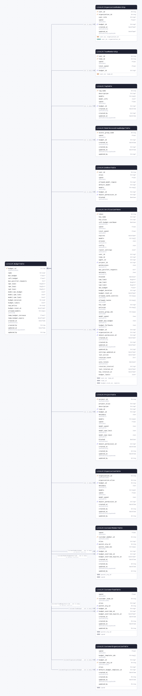

| Field                       | Type       | Constraints | Default              | Description |
| --------------------------- | ---------- | ----------- | -------------------- | ----------- |
| `budget_id`                 | `String`   | PK NOT NULL | `uuid(4)`            |             |
| `max_budget`                | `Float`    | NULL        |                      |             |
| `soft_budget`               | `Float`    | NULL        |                      |             |
| `max_parallel_requests`     | `Int`      | NULL        |                      |             |
| `tpm_limit`                 | `BigInt`   | NULL        |                      |             |
| `rpm_limit`                 | `BigInt`   | NULL        |                      |             |
| `tpd_limit`                 | `BigInt`   | NULL        |                      |             |
| `model_max_budget`          | `Json`     | NULL        |                      |             |
| `model_tpm_limit`           | `Json`     | NULL        |                      |             |
| `model_rpm_limit`           | `Json`     | NULL        |                      |             |
| `budget_duration`           | `String`   | NULL        |                      |             |
| `budget_reset_at`           | `DateTime` | NULL        |                      |             |
| `allowed_models`            | `String[]` | NOT NULL    | `[]`                 |             |
| `temp_budget_increase`      | `Float`    | NULL        |                      |             |
| `temp_budget_expiry`        | `DateTime` | NULL        |                      |             |
| `created_at` (`created_at`) | `DateTime` | NOT NULL    | `now()`              |             |
| `created_by`                | `String`   | NOT NULL    |                      |             |
| `updated_at` (`updated_at`) | `DateTime` | NOT NULL    | `now()` `@updatedAt` |             |
| `updated_by`                | `String`   | NOT NULL    |                      |             |

#### Referenced by

- `budget_id` ← [LiteLLM_CustomerOrganizationTable.budget_id](#model-LiteLLM_CustomerOrganizationTable) (one-to-many)
- `budget_id` ← [LiteLLM_CustomerOrganizationTable.default_budget_id](#model-LiteLLM_CustomerOrganizationTable) (one-to-many)
- `budget_id` ← [LiteLLM_CustomerTeamTable.budget_id](#model-LiteLLM_CustomerTeamTable) (one-to-many)
- `budget_id` ← [LiteLLM_CustomerMemberTable.budget_id](#model-LiteLLM_CustomerMemberTable) (one-to-many, on delete Restrict)
- `budget_id` ← [LiteLLM_CustomerMemberTable.budget_template_id](#model-LiteLLM_CustomerMemberTable) (one-to-many, on delete Restrict)
- `budget_id` ← [LiteLLM_OrganizationTable.budget_id](#model-LiteLLM_OrganizationTable) (one-to-many)
- `budget_id` ← [LiteLLM_ProjectTable.budget_id](#model-LiteLLM_ProjectTable) (one-to-many)
- `budget_id` ← [LiteLLM_VerificationToken.budget_id](#model-LiteLLM_VerificationToken) (one-to-many)
- `budget_id` ← [LiteLLM_EndUserTable.budget_id](#model-LiteLLM_EndUserTable) (one-to-many)
- `budget_id` ← [LiteLLM_ModelAccessGroupBudgetTable.budget_id](#model-LiteLLM_ModelAccessGroupBudgetTable) (one-to-many)
- `budget_id` ← [LiteLLM_TagTable.budget_id](#model-LiteLLM_TagTable) (one-to-many)
- `budget_id` ← [LiteLLM_TeamMembership.budget_id](#model-LiteLLM_TeamMembership) (one-to-many)
- `budget_id` ← [LiteLLM_OrganizationMembership.budget_id](#model-LiteLLM_OrganizationMembership) (one-to-many)

#### Definition

```sql
CREATE TABLE "LiteLLM_BudgetTable" (
    "budget_id" TEXT NOT NULL,
    "max_budget" DOUBLE PRECISION,
    "soft_budget" DOUBLE PRECISION,
    "max_parallel_requests" INTEGER,
    "tpm_limit" BIGINT,
    "rpm_limit" BIGINT,
    "tpd_limit" BIGINT,
    "model_max_budget" JSONB,
    "model_tpm_limit" JSONB,
    "model_rpm_limit" JSONB,
    "budget_duration" TEXT,
    "budget_reset_at" TIMESTAMP(3),
    "allowed_models" TEXT[] DEFAULT ARRAY[]::TEXT[],
    "temp_budget_increase" DOUBLE PRECISION,
    "temp_budget_expiry" TIMESTAMP(3),
    "created_at" TIMESTAMP(3) NOT NULL DEFAULT CURRENT_TIMESTAMP,
    "created_by" TEXT NOT NULL,
    "updated_at" TIMESTAMP(3) NOT NULL DEFAULT CURRENT_TIMESTAMP,
    "updated_by" TEXT NOT NULL,

    CONSTRAINT "LiteLLM_BudgetTable_pkey" PRIMARY KEY ("budget_id")
);
```

<details>
<summary>Queries and their SQL</summary>

**findMany**: Every row

```ts
await prisma.liteLLM_BudgetTable.findMany();
```

```sql
SELECT
  "public"."LiteLLM_BudgetTable"."budget_id",
  "public"."LiteLLM_BudgetTable"."max_budget",
  "public"."LiteLLM_BudgetTable"."soft_budget",
  "public"."LiteLLM_BudgetTable"."max_parallel_requests",
  "public"."LiteLLM_BudgetTable"."tpm_limit",
  "public"."LiteLLM_BudgetTable"."rpm_limit",
  "public"."LiteLLM_BudgetTable"."tpd_limit",
  "public"."LiteLLM_BudgetTable"."model_max_budget",
  "public"."LiteLLM_BudgetTable"."model_tpm_limit",
  "public"."LiteLLM_BudgetTable"."model_rpm_limit",
  "public"."LiteLLM_BudgetTable"."budget_duration",
  "public"."LiteLLM_BudgetTable"."budget_reset_at",
  "public"."LiteLLM_BudgetTable"."allowed_models",
  "public"."LiteLLM_BudgetTable"."temp_budget_increase",
  "public"."LiteLLM_BudgetTable"."temp_budget_expiry",
  "public"."LiteLLM_BudgetTable"."created_at",
  "public"."LiteLLM_BudgetTable"."created_by",
  "public"."LiteLLM_BudgetTable"."updated_at",
  "public"."LiteLLM_BudgetTable"."updated_by"
FROM
  "public"."LiteLLM_BudgetTable"
WHERE
  1 = 1
OFFSET
  $1
-- params: ["0"]
```

**count**: How many rows there are

```ts
await prisma.liteLLM_BudgetTable.count();
```

```sql
SELECT
  COUNT(*) AS "_count$_all"
FROM
  (
    SELECT
      "public"."LiteLLM_BudgetTable"."budget_id"
    FROM
      "public"."LiteLLM_BudgetTable"
    WHERE
      1 = 1
    OFFSET
      $1
  ) AS "sub"
-- params: ["0"]
```

**findMany**: Every row with its relations

```ts
await prisma.liteLLM_BudgetTable.findMany({
  include: {
    customer_organization_defaults: true,
    customer_organizations: true,
    customer_member_templates: true,
    customer_teams: true,
    customer_members: true,
    organization: true,
    projects: true,
    keys: true,
    end_users: true,
    tags: true,
    model_access_groups: true,
    team_membership: true,
    organization_membership: true,
  },
});
```

```sql
SELECT
  "public"."LiteLLM_BudgetTable"."budget_id",
  "public"."LiteLLM_BudgetTable"."max_budget",
  "public"."LiteLLM_BudgetTable"."soft_budget",
  "public"."LiteLLM_BudgetTable"."max_parallel_requests",
  "public"."LiteLLM_BudgetTable"."tpm_limit",
  "public"."LiteLLM_BudgetTable"."rpm_limit",
  "public"."LiteLLM_BudgetTable"."tpd_limit",
  "public"."LiteLLM_BudgetTable"."model_max_budget",
  "public"."LiteLLM_BudgetTable"."model_tpm_limit",
  "public"."LiteLLM_BudgetTable"."model_rpm_limit",
  "public"."LiteLLM_BudgetTable"."budget_duration",
  "public"."LiteLLM_BudgetTable"."budget_reset_at",
  "public"."LiteLLM_BudgetTable"."allowed_models",
  "public"."LiteLLM_BudgetTable"."temp_budget_increase",
  "public"."LiteLLM_BudgetTable"."temp_budget_expiry",
  "public"."LiteLLM_BudgetTable"."created_at",
  "public"."LiteLLM_BudgetTable"."created_by",
  "public"."LiteLLM_BudgetTable"."updated_at",
  "public"."LiteLLM_BudgetTable"."updated_by"
FROM
  "public"."LiteLLM_BudgetTable"
WHERE
  1 = 1
OFFSET
  $1
-- params: ["0"]

SELECT
  "public"."LiteLLM_CustomerOrganizationTable"."customer_org_id",
  "public"."LiteLLM_CustomerOrganizationTable"."spend",
  "public"."LiteLLM_CustomerOrganizationTable"."budget_reset_at",
  "public"."LiteLLM_CustomerOrganizationTable"."budget_ids",
  "public"."LiteLLM_CustomerOrganizationTable"."budget_names",
  "public"."LiteLLM_CustomerOrganizationTable"."budget_id",
  "public"."LiteLLM_CustomerOrganizationTable"."alias",
  "public"."LiteLLM_CustomerOrganizationTable"."default_budget_id",
  "public"."LiteLLM_CustomerOrganizationTable"."created_at",
  "public"."LiteLLM_CustomerOrganizationTable"."created_by",
  "public"."LiteLLM_CustomerOrganizationTable"."updated_at",
  "public"."LiteLLM_CustomerOrganizationTable"."updated_by"
FROM
  "public"."LiteLLM_CustomerOrganizationTable"
WHERE
  "public"."LiteLLM_CustomerOrganizationTable"."default_budget_id" IN ($1)
OFFSET
  $2
-- params: ["<budget_id of the rows above>","0"]

SELECT
  "public"."LiteLLM_CustomerOrganizationTable"."customer_org_id",
  "public"."LiteLLM_CustomerOrganizationTable"."spend",
  "public"."LiteLLM_CustomerOrganizationTable"."budget_reset_at",
  "public"."LiteLLM_CustomerOrganizationTable"."budget_ids",
  "public"."LiteLLM_CustomerOrganizationTable"."budget_names",
  "public"."LiteLLM_CustomerOrganizationTable"."budget_id",
  "public"."LiteLLM_CustomerOrganizationTable"."alias",
  "public"."LiteLLM_CustomerOrganizationTable"."default_budget_id",
  "public"."LiteLLM_CustomerOrganizationTable"."created_at",
  "public"."LiteLLM_CustomerOrganizationTable"."created_by",
  "public"."LiteLLM_CustomerOrganizationTable"."updated_at",
  "public"."LiteLLM_CustomerOrganizationTable"."updated_by"
FROM
  "public"."LiteLLM_CustomerOrganizationTable"
WHERE
  "public"."LiteLLM_CustomerOrganizationTable"."budget_id" IN ($1)
OFFSET
  $2
-- params: ["<budget_id of the rows above>","0"]

SELECT
  "public"."LiteLLM_CustomerMemberTable"."customer_member_id",
  "public"."LiteLLM_CustomerMemberTable"."spend",
  "public"."LiteLLM_CustomerMemberTable"."budget_reset_at",
  "public"."LiteLLM_CustomerMemberTable"."alias",
  "public"."LiteLLM_CustomerMemberTable"."parent_team_id",
  "public"."LiteLLM_CustomerMemberTable"."budget_id",
  "public"."LiteLLM_CustomerMemberTable"."budget_template_id",
  "public"."LiteLLM_CustomerMemberTable"."budget_override_expires_at",
  "public"."LiteLLM_CustomerMemberTable"."created_at",
  "public"."LiteLLM_CustomerMemberTable"."created_by",
  "public"."LiteLLM_CustomerMemberTable"."updated_at",
  "public"."LiteLLM_CustomerMemberTable"."updated_by"
FROM
  "public"."LiteLLM_CustomerMemberTable"
WHERE
  "public"."LiteLLM_CustomerMemberTable"."budget_template_id" IN ($1)
OFFSET
  $2
-- params: ["<budget_id of the rows above>","0"]

SELECT
  "public"."LiteLLM_CustomerTeamTable"."customer_team_id",
  "public"."LiteLLM_CustomerTeamTable"."spend",
  "public"."LiteLLM_CustomerTeamTable"."budget_reset_at",
  "public"."LiteLLM_CustomerTeamTable"."alias",
  "public"."LiteLLM_CustomerTeamTable"."parent_org_id",
  "public"."LiteLLM_CustomerTeamTable"."budget_id",
  "public"."LiteLLM_CustomerTeamTable"."created_at",
  "public"."LiteLLM_CustomerTeamTable"."created_by",
  "public"."LiteLLM_CustomerTeamTable"."updated_at",
  "public"."LiteLLM_CustomerTeamTable"."updated_by"
FROM
  "public"."LiteLLM_CustomerTeamTable"
WHERE
  "public"."LiteLLM_CustomerTeamTable"."budget_id" IN ($1)
OFFSET
  $2
-- params: ["<budget_id of the rows above>","0"]

SELECT
  "public"."LiteLLM_CustomerMemberTable"."customer_member_id",
  "public"."LiteLLM_CustomerMemberTable"."spend",
  "public"."LiteLLM_CustomerMemberTable"."budget_reset_at",
  "public"."LiteLLM_CustomerMemberTable"."alias",
  "public"."LiteLLM_CustomerMemberTable"."parent_team_id",
  "public"."LiteLLM_CustomerMemberTable"."budget_id",
  "public"."LiteLLM_CustomerMemberTable"."budget_template_id",
  "public"."LiteLLM_CustomerMemberTable"."budget_override_expires_at",
  "public"."LiteLLM_CustomerMemberTable"."created_at",
  "public"."LiteLLM_CustomerMemberTable"."created_by",
  "public"."LiteLLM_CustomerMemberTable"."updated_at",
  "public"."LiteLLM_CustomerMemberTable"."updated_by"
FROM
  "public"."LiteLLM_CustomerMemberTable"
WHERE
  "public"."LiteLLM_CustomerMemberTable"."budget_id" IN ($1)
OFFSET
  $2
-- params: ["<budget_id of the rows above>","0"]

SELECT
  "public"."LiteLLM_OrganizationTable"."organization_id",
  "public"."LiteLLM_OrganizationTable"."organization_alias",
  "public"."LiteLLM_OrganizationTable"."budget_id",
  "public"."LiteLLM_OrganizationTable"."metadata",
  "public"."LiteLLM_OrganizationTable"."models",
  "public"."LiteLLM_OrganizationTable"."spend",
  "public"."LiteLLM_OrganizationTable"."model_spend",
  "public"."LiteLLM_OrganizationTable"."object_permission_id",
  "public"."LiteLLM_OrganizationTable"."created_at",
  "public"."LiteLLM_OrganizationTable"."created_by",
  "public"."LiteLLM_OrganizationTable"."updated_at",
  "public"."LiteLLM_OrganizationTable"."updated_by"
FROM
  "public"."LiteLLM_OrganizationTable"
WHERE
  "public"."LiteLLM_OrganizationTable"."budget_id" IN ($1)
OFFSET
  $2
-- params: ["<budget_id of the rows above>","0"]

SELECT
  "public"."LiteLLM_ProjectTable"."project_id",
  "public"."LiteLLM_ProjectTable"."project_alias",
  "public"."LiteLLM_ProjectTable"."description",
  "public"."LiteLLM_ProjectTable"."team_id",
  "public"."LiteLLM_ProjectTable"."budget_id",
  "public"."LiteLLM_ProjectTable"."metadata",
  "public"."LiteLLM_ProjectTable"."models",
  "public"."LiteLLM_ProjectTable"."spend",
  "public"."LiteLLM_ProjectTable"."model_spend",
  "public"."LiteLLM_ProjectTable"."model_rpm_limit",
  "public"."LiteLLM_ProjectTable"."model_tpm_limit",
  "public"."LiteLLM_ProjectTable"."blocked",
  "public"."LiteLLM_ProjectTable"."object_permission_id",
  "public"."LiteLLM_ProjectTable"."created_at",
  "public"."LiteLLM_ProjectTable"."created_by",
  "public"."LiteLLM_ProjectTable"."updated_at",
  "public"."LiteLLM_ProjectTable"."updated_by"
FROM
  "public"."LiteLLM_ProjectTable"
WHERE
  "public"."LiteLLM_ProjectTable"."budget_id" IN ($1)
OFFSET
  $2
-- params: ["<budget_id of the rows above>","0"]

SELECT
  "public"."LiteLLM_VerificationToken"."token",
  "public"."LiteLLM_VerificationToken"."key_name",
  "public"."LiteLLM_VerificationToken"."key_alias",
  "public"."LiteLLM_VerificationToken"."soft_budget_cooldown",
  "public"."LiteLLM_VerificationToken"."spend",
  "public"."LiteLLM_VerificationToken"."total_spend",
  "public"."LiteLLM_VerificationToken"."expires",
  "public"."LiteLLM_VerificationToken"."models",
  "public"."LiteLLM_VerificationToken"."aliases",
  "public"."LiteLLM_VerificationToken"."config",
  "public"."LiteLLM_VerificationToken"."router_settings",
  "public"."LiteLLM_VerificationToken"."user_id",
  "public"."LiteLLM_VerificationToken"."team_id",
  "public"."LiteLLM_VerificationToken"."agent_id",
  "public"."LiteLLM_VerificationToken"."project_id",
  "public"."LiteLLM_VerificationToken"."permissions",
  "public"."LiteLLM_VerificationToken"."max_parallel_requests",
  "public"."LiteLLM_VerificationToken"."metadata",
  "public"."LiteLLM_VerificationToken"."blocked",
  "public"."LiteLLM_VerificationToken"."tpm_limit",
  "public"."LiteLLM_VerificationToken"."rpm_limit",
  "public"."LiteLLM_VerificationToken"."tpd_limit",
  "public"."LiteLLM_VerificationToken"."max_budget",
  "public"."LiteLLM_VerificationToken"."budget_duration",
  "public"."LiteLLM_VerificationToken"."budget_reset_at",
  "public"."LiteLLM_VerificationToken"."allowed_cache_controls",
  "public"."LiteLLM_VerificationToken"."allowed_routes",
  "public"."LiteLLM_VerificationToken"."key_type",
  "public"."LiteLLM_VerificationToken"."policies",
  "public"."LiteLLM_VerificationToken"."access_group_ids",
  "public"."LiteLLM_VerificationToken"."model_spend",
  "public"."LiteLLM_VerificationToken"."model_max_budget",
  "public"."LiteLLM_VerificationToken"."budget_fallbacks",
  "public"."LiteLLM_VerificationToken"."budget_id",
  "public"."LiteLLM_VerificationToken"."organization_id",
  "public"."LiteLLM_VerificationToken"."object_permission_id",
  "public"."LiteLLM_VerificationToken"."created_at",
  "public"."LiteLLM_VerificationToken"."created_by",
  "public"."LiteLLM_VerificationToken"."updated_at",
  "public"."LiteLLM_VerificationToken"."updated_by",
  "public"."LiteLLM_VerificationToken"."settings_updated_at",
  "public"."LiteLLM_VerificationToken"."last_active",
  "public"."LiteLLM_VerificationToken"."rotation_count",
  "public"."LiteLLM_VerificationToken"."auto_rotate",
  "public"."LiteLLM_VerificationToken"."rotation_interval",
  "public"."LiteLLM_VerificationToken"."last_rotation_at",
  "public"."LiteLLM_VerificationToken"."key_rotation_at",
  "public"."LiteLLM_VerificationToken"."budget_limits"
FROM
  "public"."LiteLLM_VerificationToken"
WHERE
  "public"."LiteLLM_VerificationToken"."budget_id" IN ($1)
OFFSET
  $2
-- params: ["<budget_id of the rows above>","0"]

SELECT
  "public"."LiteLLM_EndUserTable"."user_id",
  "public"."LiteLLM_EndUserTable"."alias",
  "public"."LiteLLM_EndUserTable"."spend",
  "public"."LiteLLM_EndUserTable"."allowed_model_region",
  "public"."LiteLLM_EndUserTable"."default_model",
  "public"."LiteLLM_EndUserTable"."models",
  "public"."LiteLLM_EndUserTable"."budget_id",
  "public"."LiteLLM_EndUserTable"."object_permission_id",
  "public"."LiteLLM_EndUserTable"."blocked"
FROM
  "public"."LiteLLM_EndUserTable"
WHERE
  "public"."LiteLLM_EndUserTable"."budget_id" IN ($1)
OFFSET
  $2
-- params: ["<budget_id of the rows above>","0"]

SELECT
  "public"."LiteLLM_TagTable"."tag_name",
  "public"."LiteLLM_TagTable"."description",
  "public"."LiteLLM_TagTable"."models",
  "public"."LiteLLM_TagTable"."model_info",
  "public"."LiteLLM_TagTable"."spend",
  "public"."LiteLLM_TagTable"."budget_id",
  "public"."LiteLLM_TagTable"."created_at",
  "public"."LiteLLM_TagTable"."created_by",
  "public"."LiteLLM_TagTable"."updated_at"
FROM
  "public"."LiteLLM_TagTable"
WHERE
  "public"."LiteLLM_TagTable"."budget_id" IN ($1)
OFFSET
  $2
-- params: ["<budget_id of the rows above>","0"]

SELECT
  "public"."LiteLLM_ModelAccessGroupBudgetTable"."access_group_name",
  "public"."LiteLLM_ModelAccessGroupBudgetTable"."spend",
  "public"."LiteLLM_ModelAccessGroupBudgetTable"."budget_id",
  "public"."LiteLLM_ModelAccessGroupBudgetTable"."created_at",
  "public"."LiteLLM_ModelAccessGroupBudgetTable"."created_by",
  "public"."LiteLLM_ModelAccessGroupBudgetTable"."updated_at",
  "public"."LiteLLM_ModelAccessGroupBudgetTable"."updated_by"
FROM
  "public"."LiteLLM_ModelAccessGroupBudgetTable"
WHERE
  "public"."LiteLLM_ModelAccessGroupBudgetTable"."budget_id" IN ($1)
OFFSET
  $2
-- params: ["<budget_id of the rows above>","0"]

SELECT
  "public"."LiteLLM_TeamMembership"."user_id",
  "public"."LiteLLM_TeamMembership"."team_id",
  "public"."LiteLLM_TeamMembership"."spend",
  "public"."LiteLLM_TeamMembership"."total_spend",
  "public"."LiteLLM_TeamMembership"."budget_id"
FROM
  "public"."LiteLLM_TeamMembership"
WHERE
  "public"."LiteLLM_TeamMembership"."budget_id" IN ($1)
OFFSET
  $2
-- params: ["<budget_id of the rows above>","0"]

SELECT
  "public"."LiteLLM_OrganizationMembership"."user_id",
  "public"."LiteLLM_OrganizationMembership"."organization_id",
  "public"."LiteLLM_OrganizationMembership"."user_role",
  "public"."LiteLLM_OrganizationMembership"."spend",
  "public"."LiteLLM_OrganizationMembership"."budget_id",
  "public"."LiteLLM_OrganizationMembership"."created_at",
  "public"."LiteLLM_OrganizationMembership"."updated_at"
FROM
  "public"."LiteLLM_OrganizationMembership"
WHERE
  "public"."LiteLLM_OrganizationMembership"."budget_id" IN ($1)
OFFSET
  $2
-- params: ["<budget_id of the rows above>","0"]
```

**findUnique**: One row by what is unique to it

```ts
await prisma.liteLLM_BudgetTable.findUnique({ where: { budget_id: "example" } });
```

```sql
SELECT
  "public"."LiteLLM_BudgetTable"."budget_id",
  "public"."LiteLLM_BudgetTable"."max_budget",
  "public"."LiteLLM_BudgetTable"."soft_budget",
  "public"."LiteLLM_BudgetTable"."max_parallel_requests",
  "public"."LiteLLM_BudgetTable"."tpm_limit",
  "public"."LiteLLM_BudgetTable"."rpm_limit",
  "public"."LiteLLM_BudgetTable"."tpd_limit",
  "public"."LiteLLM_BudgetTable"."model_max_budget",
  "public"."LiteLLM_BudgetTable"."model_tpm_limit",
  "public"."LiteLLM_BudgetTable"."model_rpm_limit",
  "public"."LiteLLM_BudgetTable"."budget_duration",
  "public"."LiteLLM_BudgetTable"."budget_reset_at",
  "public"."LiteLLM_BudgetTable"."allowed_models",
  "public"."LiteLLM_BudgetTable"."temp_budget_increase",
  "public"."LiteLLM_BudgetTable"."temp_budget_expiry",
  "public"."LiteLLM_BudgetTable"."created_at",
  "public"."LiteLLM_BudgetTable"."created_by",
  "public"."LiteLLM_BudgetTable"."updated_at",
  "public"."LiteLLM_BudgetTable"."updated_by"
FROM
  "public"."LiteLLM_BudgetTable"
WHERE
  (
    "public"."LiteLLM_BudgetTable"."budget_id" = $1
    AND 1 = 1
  )
LIMIT
  $2
OFFSET
  $3
-- params: ["example","1","0"]
```

**create**: Create a row

```ts
await prisma.liteLLM_BudgetTable.create({ data: { created_by: "example", updated_by: "example" } });
```

```sql
INSERT INTO
  "public"."LiteLLM_BudgetTable" (
    "budget_id",
    "allowed_models",
    "created_at",
    "created_by",
    "updated_at",
    "updated_by"
  )
VALUES
  ($1, $2, $3, $4, $5, $6)
RETURNING
  "public"."LiteLLM_BudgetTable"."budget_id",
  "public"."LiteLLM_BudgetTable"."max_budget",
  "public"."LiteLLM_BudgetTable"."soft_budget",
  "public"."LiteLLM_BudgetTable"."max_parallel_requests",
  "public"."LiteLLM_BudgetTable"."tpm_limit",
  "public"."LiteLLM_BudgetTable"."rpm_limit",
  "public"."LiteLLM_BudgetTable"."tpd_limit",
  "public"."LiteLLM_BudgetTable"."model_max_budget",
  "public"."LiteLLM_BudgetTable"."model_tpm_limit",
  "public"."LiteLLM_BudgetTable"."model_rpm_limit",
  "public"."LiteLLM_BudgetTable"."budget_duration",
  "public"."LiteLLM_BudgetTable"."budget_reset_at",
  "public"."LiteLLM_BudgetTable"."allowed_models",
  "public"."LiteLLM_BudgetTable"."temp_budget_increase",
  "public"."LiteLLM_BudgetTable"."temp_budget_expiry",
  "public"."LiteLLM_BudgetTable"."created_at",
  "public"."LiteLLM_BudgetTable"."created_by",
  "public"."LiteLLM_BudgetTable"."updated_at",
  "public"."LiteLLM_BudgetTable"."updated_by"
-- params: ["<uuid(4)>",[],"<now()>","example","<now()>","example"]
```

**update**: Update a row

```ts
await prisma.liteLLM_BudgetTable.update({
  where: { budget_id: "example" },
  data: { max_budget: 1.5 },
});
```

```sql
UPDATE "public"."LiteLLM_BudgetTable"
SET
  "max_budget" = $1,
  "updated_at" = $2
WHERE
  (
    "public"."LiteLLM_BudgetTable"."budget_id" = $3
    AND 1 = 1
  )
RETURNING
  "public"."LiteLLM_BudgetTable"."budget_id",
  "public"."LiteLLM_BudgetTable"."max_budget",
  "public"."LiteLLM_BudgetTable"."soft_budget",
  "public"."LiteLLM_BudgetTable"."max_parallel_requests",
  "public"."LiteLLM_BudgetTable"."tpm_limit",
  "public"."LiteLLM_BudgetTable"."rpm_limit",
  "public"."LiteLLM_BudgetTable"."tpd_limit",
  "public"."LiteLLM_BudgetTable"."model_max_budget",
  "public"."LiteLLM_BudgetTable"."model_tpm_limit",
  "public"."LiteLLM_BudgetTable"."model_rpm_limit",
  "public"."LiteLLM_BudgetTable"."budget_duration",
  "public"."LiteLLM_BudgetTable"."budget_reset_at",
  "public"."LiteLLM_BudgetTable"."allowed_models",
  "public"."LiteLLM_BudgetTable"."temp_budget_increase",
  "public"."LiteLLM_BudgetTable"."temp_budget_expiry",
  "public"."LiteLLM_BudgetTable"."created_at",
  "public"."LiteLLM_BudgetTable"."created_by",
  "public"."LiteLLM_BudgetTable"."updated_at",
  "public"."LiteLLM_BudgetTable"."updated_by"
-- params: ["1.5",{"prisma__type":"generatorCall","prisma__value":{"name":"now","args":[],"returnType":{"type":"DateTime"}}},"example"]
```

**delete**: Delete a row

```ts
await prisma.liteLLM_BudgetTable.delete({ where: { budget_id: "example" } });
```

```sql
DELETE FROM "public"."LiteLLM_BudgetTable"
WHERE
  (
    "public"."LiteLLM_BudgetTable"."budget_id" = $1
    AND 1 = 1
  )
RETURNING
  "public"."LiteLLM_BudgetTable"."budget_id",
  "public"."LiteLLM_BudgetTable"."max_budget",
  "public"."LiteLLM_BudgetTable"."soft_budget",
  "public"."LiteLLM_BudgetTable"."max_parallel_requests",
  "public"."LiteLLM_BudgetTable"."tpm_limit",
  "public"."LiteLLM_BudgetTable"."rpm_limit",
  "public"."LiteLLM_BudgetTable"."tpd_limit",
  "public"."LiteLLM_BudgetTable"."model_max_budget",
  "public"."LiteLLM_BudgetTable"."model_tpm_limit",
  "public"."LiteLLM_BudgetTable"."model_rpm_limit",
  "public"."LiteLLM_BudgetTable"."budget_duration",
  "public"."LiteLLM_BudgetTable"."budget_reset_at",
  "public"."LiteLLM_BudgetTable"."allowed_models",
  "public"."LiteLLM_BudgetTable"."temp_budget_increase",
  "public"."LiteLLM_BudgetTable"."temp_budget_expiry",
  "public"."LiteLLM_BudgetTable"."created_at",
  "public"."LiteLLM_BudgetTable"."created_by",
  "public"."LiteLLM_BudgetTable"."updated_at",
  "public"."LiteLLM_BudgetTable"."updated_by"
-- params: ["example"]
```

</details>

<a id="model-LiteLLM_CustomerOrganizationTable"></a>

### LiteLLM_CustomerOrganizationTable

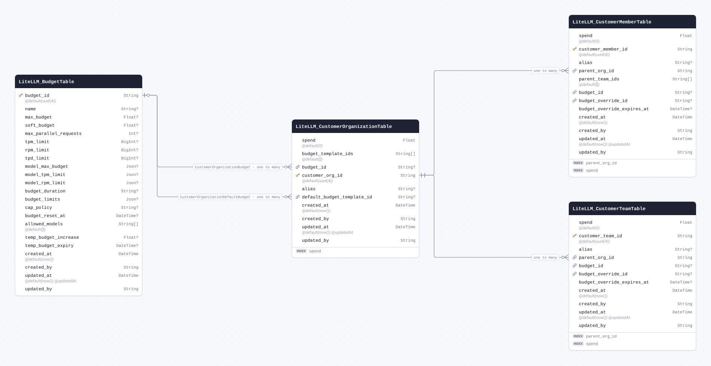

| Field               | Type       | Constraints                                                        | Default              | Description |
| ------------------- | ---------- | ------------------------------------------------------------------ | -------------------- | ----------- |
| `spend`             | `Float`    | NOT NULL                                                           | `0`                  |             |
| `budget_reset_at`   | `DateTime` | NULL                                                               |                      |             |
| `budget_ids`        | `String[]` | NOT NULL                                                           | `[]`                 |             |
| `budget_names`      | `Json`     | NOT NULL                                                           | `"{}"`               |             |
| `budget_id`         | `String`   | NULL → [LiteLLM_BudgetTable.budget_id](#model-LiteLLM_BudgetTable) |                      |             |
| `customer_org_id`   | `String`   | PK NOT NULL                                                        | `uuid(4)`            |             |
| `alias`             | `String`   | NULL                                                               |                      |             |
| `default_budget_id` | `String`   | NULL → [LiteLLM_BudgetTable.budget_id](#model-LiteLLM_BudgetTable) |                      |             |
| `created_at`        | `DateTime` | NOT NULL                                                           | `now()`              |             |
| `created_by`        | `String`   | NOT NULL                                                           |                      |             |
| `updated_at`        | `DateTime` | NOT NULL                                                           | `now()` `@updatedAt` |             |
| `updated_by`        | `String`   | NOT NULL                                                           |                      |             |

#### References

- `budget_id` → [LiteLLM_BudgetTable.budget_id](#model-LiteLLM_BudgetTable) (many-to-one)
- `default_budget_id` → [LiteLLM_BudgetTable.budget_id](#model-LiteLLM_BudgetTable) (many-to-one)

#### Referenced by

- `customer_org_id` ← [LiteLLM_CustomerTeamTable.parent_org_id](#model-LiteLLM_CustomerTeamTable) (one-to-many)

#### Definition

```sql
CREATE TABLE "LiteLLM_CustomerOrganizationTable" (
    "spend" DOUBLE PRECISION NOT NULL DEFAULT 0.0,
    "budget_reset_at" TIMESTAMP(3),
    "budget_ids" TEXT[] DEFAULT ARRAY[]::TEXT[],
    "budget_names" JSONB NOT NULL DEFAULT '{}',
    "budget_id" TEXT,
    "customer_org_id" TEXT NOT NULL,
    "alias" TEXT,
    "default_budget_id" TEXT,
    "created_at" TIMESTAMP(3) NOT NULL DEFAULT CURRENT_TIMESTAMP,
    "created_by" TEXT NOT NULL,
    "updated_at" TIMESTAMP(3) NOT NULL DEFAULT CURRENT_TIMESTAMP,
    "updated_by" TEXT NOT NULL,

    CONSTRAINT "LiteLLM_CustomerOrganizationTable_pkey" PRIMARY KEY ("customer_org_id")
);

ALTER TABLE "LiteLLM_CustomerOrganizationTable" ADD CONSTRAINT "LiteLLM_CustomerOrganizationTable_budget_id_fkey" FOREIGN KEY ("budget_id") REFERENCES "LiteLLM_BudgetTable"("budget_id") ON DELETE SET NULL ON UPDATE CASCADE;

ALTER TABLE "LiteLLM_CustomerOrganizationTable" ADD CONSTRAINT "LiteLLM_CustomerOrganizationTable_default_budget_id_fkey" FOREIGN KEY ("default_budget_id") REFERENCES "LiteLLM_BudgetTable"("budget_id") ON DELETE SET NULL ON UPDATE CASCADE;
```

<details>
<summary>Queries and their SQL</summary>

**findMany**: Every row

```ts
await prisma.liteLLM_CustomerOrganizationTable.findMany();
```

```sql
SELECT
  "public"."LiteLLM_CustomerOrganizationTable"."customer_org_id",
  "public"."LiteLLM_CustomerOrganizationTable"."spend",
  "public"."LiteLLM_CustomerOrganizationTable"."budget_reset_at",
  "public"."LiteLLM_CustomerOrganizationTable"."budget_ids",
  "public"."LiteLLM_CustomerOrganizationTable"."budget_names",
  "public"."LiteLLM_CustomerOrganizationTable"."budget_id",
  "public"."LiteLLM_CustomerOrganizationTable"."alias",
  "public"."LiteLLM_CustomerOrganizationTable"."default_budget_id",
  "public"."LiteLLM_CustomerOrganizationTable"."created_at",
  "public"."LiteLLM_CustomerOrganizationTable"."created_by",
  "public"."LiteLLM_CustomerOrganizationTable"."updated_at",
  "public"."LiteLLM_CustomerOrganizationTable"."updated_by"
FROM
  "public"."LiteLLM_CustomerOrganizationTable"
WHERE
  1 = 1
OFFSET
  $1
-- params: ["0"]
```

**count**: How many rows there are

```ts
await prisma.liteLLM_CustomerOrganizationTable.count();
```

```sql
SELECT
  COUNT(*) AS "_count$_all"
FROM
  (
    SELECT
      "public"."LiteLLM_CustomerOrganizationTable"."customer_org_id"
    FROM
      "public"."LiteLLM_CustomerOrganizationTable"
    WHERE
      1 = 1
    OFFSET
      $1
  ) AS "sub"
-- params: ["0"]
```

**findMany**: Every row with its relations

```ts
await prisma.liteLLM_CustomerOrganizationTable.findMany({
  include: { budget: true, default_budget: true, teams: true },
});
```

```sql
SELECT
  "public"."LiteLLM_CustomerOrganizationTable"."customer_org_id",
  "public"."LiteLLM_CustomerOrganizationTable"."spend",
  "public"."LiteLLM_CustomerOrganizationTable"."budget_reset_at",
  "public"."LiteLLM_CustomerOrganizationTable"."budget_ids",
  "public"."LiteLLM_CustomerOrganizationTable"."budget_names",
  "public"."LiteLLM_CustomerOrganizationTable"."budget_id",
  "public"."LiteLLM_CustomerOrganizationTable"."alias",
  "public"."LiteLLM_CustomerOrganizationTable"."default_budget_id",
  "public"."LiteLLM_CustomerOrganizationTable"."created_at",
  "public"."LiteLLM_CustomerOrganizationTable"."created_by",
  "public"."LiteLLM_CustomerOrganizationTable"."updated_at",
  "public"."LiteLLM_CustomerOrganizationTable"."updated_by"
FROM
  "public"."LiteLLM_CustomerOrganizationTable"
WHERE
  1 = 1
OFFSET
  $1
-- params: ["0"]

SELECT
  "public"."LiteLLM_BudgetTable"."budget_id",
  "public"."LiteLLM_BudgetTable"."max_budget",
  "public"."LiteLLM_BudgetTable"."soft_budget",
  "public"."LiteLLM_BudgetTable"."max_parallel_requests",
  "public"."LiteLLM_BudgetTable"."tpm_limit",
  "public"."LiteLLM_BudgetTable"."rpm_limit",
  "public"."LiteLLM_BudgetTable"."tpd_limit",
  "public"."LiteLLM_BudgetTable"."model_max_budget",
  "public"."LiteLLM_BudgetTable"."model_tpm_limit",
  "public"."LiteLLM_BudgetTable"."model_rpm_limit",
  "public"."LiteLLM_BudgetTable"."budget_duration",
  "public"."LiteLLM_BudgetTable"."budget_reset_at",
  "public"."LiteLLM_BudgetTable"."allowed_models",
  "public"."LiteLLM_BudgetTable"."temp_budget_increase",
  "public"."LiteLLM_BudgetTable"."temp_budget_expiry",
  "public"."LiteLLM_BudgetTable"."created_at",
  "public"."LiteLLM_BudgetTable"."created_by",
  "public"."LiteLLM_BudgetTable"."updated_at",
  "public"."LiteLLM_BudgetTable"."updated_by"
FROM
  "public"."LiteLLM_BudgetTable"
WHERE
  "public"."LiteLLM_BudgetTable"."budget_id" IN ($1)
OFFSET
  $2
-- params: ["<budget_id of the rows above>","0"]

SELECT
  "public"."LiteLLM_BudgetTable"."budget_id",
  "public"."LiteLLM_BudgetTable"."max_budget",
  "public"."LiteLLM_BudgetTable"."soft_budget",
  "public"."LiteLLM_BudgetTable"."max_parallel_requests",
  "public"."LiteLLM_BudgetTable"."tpm_limit",
  "public"."LiteLLM_BudgetTable"."rpm_limit",
  "public"."LiteLLM_BudgetTable"."tpd_limit",
  "public"."LiteLLM_BudgetTable"."model_max_budget",
  "public"."LiteLLM_BudgetTable"."model_tpm_limit",
  "public"."LiteLLM_BudgetTable"."model_rpm_limit",
  "public"."LiteLLM_BudgetTable"."budget_duration",
  "public"."LiteLLM_BudgetTable"."budget_reset_at",
  "public"."LiteLLM_BudgetTable"."allowed_models",
  "public"."LiteLLM_BudgetTable"."temp_budget_increase",
  "public"."LiteLLM_BudgetTable"."temp_budget_expiry",
  "public"."LiteLLM_BudgetTable"."created_at",
  "public"."LiteLLM_BudgetTable"."created_by",
  "public"."LiteLLM_BudgetTable"."updated_at",
  "public"."LiteLLM_BudgetTable"."updated_by"
FROM
  "public"."LiteLLM_BudgetTable"
WHERE
  "public"."LiteLLM_BudgetTable"."budget_id" IN ($1)
OFFSET
  $2
-- params: ["<default_budget_id of the rows above>","0"]

SELECT
  "public"."LiteLLM_CustomerTeamTable"."customer_team_id",
  "public"."LiteLLM_CustomerTeamTable"."spend",
  "public"."LiteLLM_CustomerTeamTable"."budget_reset_at",
  "public"."LiteLLM_CustomerTeamTable"."alias",
  "public"."LiteLLM_CustomerTeamTable"."parent_org_id",
  "public"."LiteLLM_CustomerTeamTable"."budget_id",
  "public"."LiteLLM_CustomerTeamTable"."created_at",
  "public"."LiteLLM_CustomerTeamTable"."created_by",
  "public"."LiteLLM_CustomerTeamTable"."updated_at",
  "public"."LiteLLM_CustomerTeamTable"."updated_by"
FROM
  "public"."LiteLLM_CustomerTeamTable"
WHERE
  "public"."LiteLLM_CustomerTeamTable"."parent_org_id" IN ($1)
OFFSET
  $2
-- params: ["<customer_org_id of the rows above>","0"]
```

**findUnique**: One row by what is unique to it

```ts
await prisma.liteLLM_CustomerOrganizationTable.findUnique({
  where: { customer_org_id: "example" },
});
```

```sql
SELECT
  "public"."LiteLLM_CustomerOrganizationTable"."customer_org_id",
  "public"."LiteLLM_CustomerOrganizationTable"."spend",
  "public"."LiteLLM_CustomerOrganizationTable"."budget_reset_at",
  "public"."LiteLLM_CustomerOrganizationTable"."budget_ids",
  "public"."LiteLLM_CustomerOrganizationTable"."budget_names",
  "public"."LiteLLM_CustomerOrganizationTable"."budget_id",
  "public"."LiteLLM_CustomerOrganizationTable"."alias",
  "public"."LiteLLM_CustomerOrganizationTable"."default_budget_id",
  "public"."LiteLLM_CustomerOrganizationTable"."created_at",
  "public"."LiteLLM_CustomerOrganizationTable"."created_by",
  "public"."LiteLLM_CustomerOrganizationTable"."updated_at",
  "public"."LiteLLM_CustomerOrganizationTable"."updated_by"
FROM
  "public"."LiteLLM_CustomerOrganizationTable"
WHERE
  (
    "public"."LiteLLM_CustomerOrganizationTable"."customer_org_id" = $1
    AND 1 = 1
  )
LIMIT
  $2
OFFSET
  $3
-- params: ["example","1","0"]
```

**create**: Create a row

```ts
await prisma.liteLLM_CustomerOrganizationTable.create({
  data: { created_by: "example", updated_by: "example" },
});
```

```sql
INSERT INTO
  "public"."LiteLLM_CustomerOrganizationTable" (
    "spend",
    "budget_ids",
    "budget_names",
    "customer_org_id",
    "created_at",
    "created_by",
    "updated_at",
    "updated_by"
  )
VALUES
  ($1, $2, $3, $4, $5, $6, $7, $8)
RETURNING
  "public"."LiteLLM_CustomerOrganizationTable"."customer_org_id",
  "public"."LiteLLM_CustomerOrganizationTable"."spend",
  "public"."LiteLLM_CustomerOrganizationTable"."budget_reset_at",
  "public"."LiteLLM_CustomerOrganizationTable"."budget_ids",
  "public"."LiteLLM_CustomerOrganizationTable"."budget_names",
  "public"."LiteLLM_CustomerOrganizationTable"."budget_id",
  "public"."LiteLLM_CustomerOrganizationTable"."alias",
  "public"."LiteLLM_CustomerOrganizationTable"."default_budget_id",
  "public"."LiteLLM_CustomerOrganizationTable"."created_at",
  "public"."LiteLLM_CustomerOrganizationTable"."created_by",
  "public"."LiteLLM_CustomerOrganizationTable"."updated_at",
  "public"."LiteLLM_CustomerOrganizationTable"."updated_by"
-- params: ["0.0",[],"{}","<uuid(4)>","<now()>","example","<now()>","example"]
```

**update**: Update a row

```ts
await prisma.liteLLM_CustomerOrganizationTable.update({
  where: { customer_org_id: "example" },
  data: { spend: 1.5 },
});
```

```sql
UPDATE "public"."LiteLLM_CustomerOrganizationTable"
SET
  "spend" = $1,
  "updated_at" = $2
WHERE
  (
    "public"."LiteLLM_CustomerOrganizationTable"."customer_org_id" = $3
    AND 1 = 1
  )
RETURNING
  "public"."LiteLLM_CustomerOrganizationTable"."customer_org_id",
  "public"."LiteLLM_CustomerOrganizationTable"."spend",
  "public"."LiteLLM_CustomerOrganizationTable"."budget_reset_at",
  "public"."LiteLLM_CustomerOrganizationTable"."budget_ids",
  "public"."LiteLLM_CustomerOrganizationTable"."budget_names",
  "public"."LiteLLM_CustomerOrganizationTable"."budget_id",
  "public"."LiteLLM_CustomerOrganizationTable"."alias",
  "public"."LiteLLM_CustomerOrganizationTable"."default_budget_id",
  "public"."LiteLLM_CustomerOrganizationTable"."created_at",
  "public"."LiteLLM_CustomerOrganizationTable"."created_by",
  "public"."LiteLLM_CustomerOrganizationTable"."updated_at",
  "public"."LiteLLM_CustomerOrganizationTable"."updated_by"
-- params: ["1.5",{"prisma__type":"generatorCall","prisma__value":{"name":"now","args":[],"returnType":{"type":"DateTime"}}},"example"]
```

**delete**: Delete a row

```ts
await prisma.liteLLM_CustomerOrganizationTable.delete({ where: { customer_org_id: "example" } });
```

```sql
DELETE FROM "public"."LiteLLM_CustomerOrganizationTable"
WHERE
  (
    "public"."LiteLLM_CustomerOrganizationTable"."customer_org_id" = $1
    AND 1 = 1
  )
RETURNING
  "public"."LiteLLM_CustomerOrganizationTable"."customer_org_id",
  "public"."LiteLLM_CustomerOrganizationTable"."spend",
  "public"."LiteLLM_CustomerOrganizationTable"."budget_reset_at",
  "public"."LiteLLM_CustomerOrganizationTable"."budget_ids",
  "public"."LiteLLM_CustomerOrganizationTable"."budget_names",
  "public"."LiteLLM_CustomerOrganizationTable"."budget_id",
  "public"."LiteLLM_CustomerOrganizationTable"."alias",
  "public"."LiteLLM_CustomerOrganizationTable"."default_budget_id",
  "public"."LiteLLM_CustomerOrganizationTable"."created_at",
  "public"."LiteLLM_CustomerOrganizationTable"."created_by",
  "public"."LiteLLM_CustomerOrganizationTable"."updated_at",
  "public"."LiteLLM_CustomerOrganizationTable"."updated_by"
-- params: ["example"]
```

</details>

<a id="model-LiteLLM_CustomerTeamTable"></a>

### LiteLLM_CustomerTeamTable

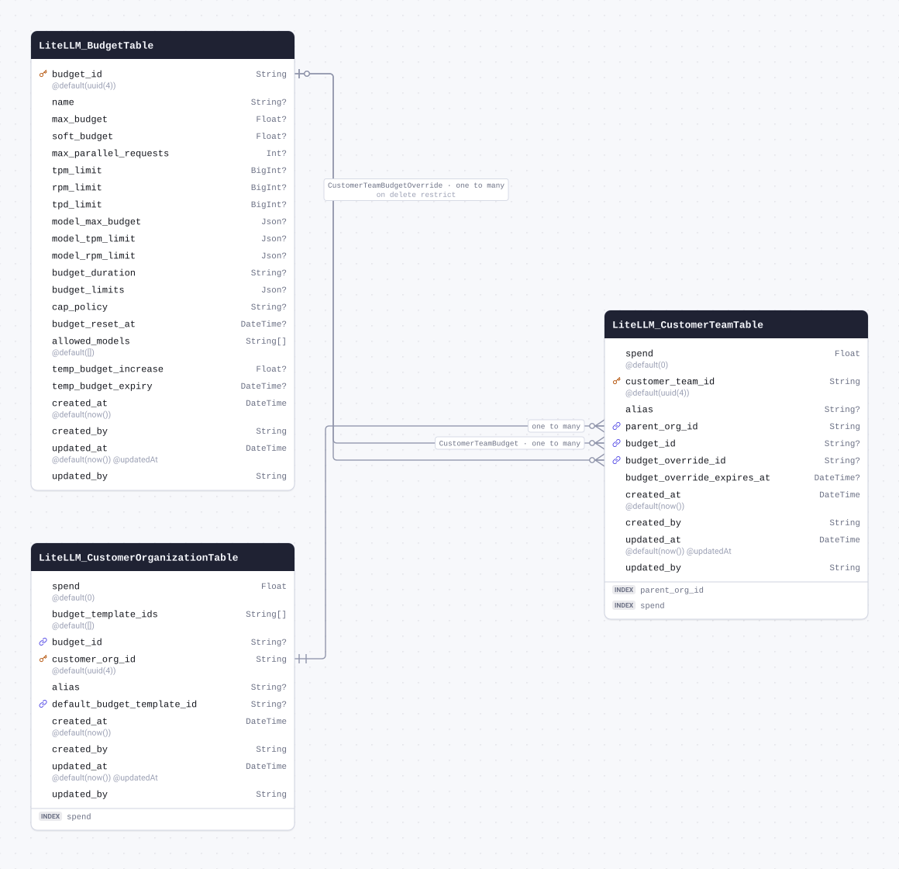

| Field              | Type       | Constraints                                                                                              | Default              | Description |
| ------------------ | ---------- | -------------------------------------------------------------------------------------------------------- | -------------------- | ----------- |
| `spend`            | `Float`    | NOT NULL                                                                                                 | `0`                  |             |
| `budget_reset_at`  | `DateTime` | NULL                                                                                                     |                      |             |
| `customer_team_id` | `String`   | PK NOT NULL                                                                                              | `uuid(4)`            |             |
| `alias`            | `String`   | NULL                                                                                                     |                      |             |
| `parent_org_id`    | `String`   | NOT NULL → [LiteLLM_CustomerOrganizationTable.customer_org_id](#model-LiteLLM_CustomerOrganizationTable) |                      |             |
| `budget_id`        | `String`   | NULL → [LiteLLM_BudgetTable.budget_id](#model-LiteLLM_BudgetTable)                                       |                      |             |
| `created_at`       | `DateTime` | NOT NULL                                                                                                 | `now()`              |             |
| `created_by`       | `String`   | NOT NULL                                                                                                 |                      |             |
| `updated_at`       | `DateTime` | NOT NULL                                                                                                 | `now()` `@updatedAt` |             |
| `updated_by`       | `String`   | NOT NULL                                                                                                 |                      |             |

#### Indexes

- `@@index([parent_org_id])`

#### References

- `parent_org_id` → [LiteLLM_CustomerOrganizationTable.customer_org_id](#model-LiteLLM_CustomerOrganizationTable) (many-to-one)
- `budget_id` → [LiteLLM_BudgetTable.budget_id](#model-LiteLLM_BudgetTable) (many-to-one)

#### Referenced by

- `customer_team_id` ← [LiteLLM_CustomerMemberTable.parent_team_id](#model-LiteLLM_CustomerMemberTable) (one-to-many)

#### Definition

```sql
CREATE TABLE "LiteLLM_CustomerTeamTable" (
    "spend" DOUBLE PRECISION NOT NULL DEFAULT 0.0,
    "budget_reset_at" TIMESTAMP(3),
    "customer_team_id" TEXT NOT NULL,
    "alias" TEXT,
    "parent_org_id" TEXT NOT NULL,
    "budget_id" TEXT,
    "created_at" TIMESTAMP(3) NOT NULL DEFAULT CURRENT_TIMESTAMP,
    "created_by" TEXT NOT NULL,
    "updated_at" TIMESTAMP(3) NOT NULL DEFAULT CURRENT_TIMESTAMP,
    "updated_by" TEXT NOT NULL,

    CONSTRAINT "LiteLLM_CustomerTeamTable_pkey" PRIMARY KEY ("customer_team_id")
);

CREATE INDEX "LiteLLM_CustomerTeamTable_parent_org_id_idx" ON "LiteLLM_CustomerTeamTable"("parent_org_id");

ALTER TABLE "LiteLLM_CustomerTeamTable" ADD CONSTRAINT "LiteLLM_CustomerTeamTable_parent_org_id_fkey" FOREIGN KEY ("parent_org_id") REFERENCES "LiteLLM_CustomerOrganizationTable"("customer_org_id") ON DELETE RESTRICT ON UPDATE CASCADE;

ALTER TABLE "LiteLLM_CustomerTeamTable" ADD CONSTRAINT "LiteLLM_CustomerTeamTable_budget_id_fkey" FOREIGN KEY ("budget_id") REFERENCES "LiteLLM_BudgetTable"("budget_id") ON DELETE SET NULL ON UPDATE CASCADE;
```

<details>
<summary>Queries and their SQL</summary>

**findMany**: Every row

```ts
await prisma.liteLLM_CustomerTeamTable.findMany();
```

```sql
SELECT
  "public"."LiteLLM_CustomerTeamTable"."customer_team_id",
  "public"."LiteLLM_CustomerTeamTable"."spend",
  "public"."LiteLLM_CustomerTeamTable"."budget_reset_at",
  "public"."LiteLLM_CustomerTeamTable"."alias",
  "public"."LiteLLM_CustomerTeamTable"."parent_org_id",
  "public"."LiteLLM_CustomerTeamTable"."budget_id",
  "public"."LiteLLM_CustomerTeamTable"."created_at",
  "public"."LiteLLM_CustomerTeamTable"."created_by",
  "public"."LiteLLM_CustomerTeamTable"."updated_at",
  "public"."LiteLLM_CustomerTeamTable"."updated_by"
FROM
  "public"."LiteLLM_CustomerTeamTable"
WHERE
  1 = 1
OFFSET
  $1
-- params: ["0"]
```

**count**: How many rows there are

```ts
await prisma.liteLLM_CustomerTeamTable.count();
```

```sql
SELECT
  COUNT(*) AS "_count$_all"
FROM
  (
    SELECT
      "public"."LiteLLM_CustomerTeamTable"."customer_team_id"
    FROM
      "public"."LiteLLM_CustomerTeamTable"
    WHERE
      1 = 1
    OFFSET
      $1
  ) AS "sub"
-- params: ["0"]
```

**findMany**: Every row with its relations

```ts
await prisma.liteLLM_CustomerTeamTable.findMany({
  include: { parent_org: true, budget: true, members: true },
});
```

```sql
SELECT
  "public"."LiteLLM_CustomerTeamTable"."customer_team_id",
  "public"."LiteLLM_CustomerTeamTable"."spend",
  "public"."LiteLLM_CustomerTeamTable"."budget_reset_at",
  "public"."LiteLLM_CustomerTeamTable"."alias",
  "public"."LiteLLM_CustomerTeamTable"."parent_org_id",
  "public"."LiteLLM_CustomerTeamTable"."budget_id",
  "public"."LiteLLM_CustomerTeamTable"."created_at",
  "public"."LiteLLM_CustomerTeamTable"."created_by",
  "public"."LiteLLM_CustomerTeamTable"."updated_at",
  "public"."LiteLLM_CustomerTeamTable"."updated_by"
FROM
  "public"."LiteLLM_CustomerTeamTable"
WHERE
  1 = 1
OFFSET
  $1
-- params: ["0"]

SELECT
  "public"."LiteLLM_CustomerOrganizationTable"."customer_org_id",
  "public"."LiteLLM_CustomerOrganizationTable"."spend",
  "public"."LiteLLM_CustomerOrganizationTable"."budget_reset_at",
  "public"."LiteLLM_CustomerOrganizationTable"."budget_ids",
  "public"."LiteLLM_CustomerOrganizationTable"."budget_names",
  "public"."LiteLLM_CustomerOrganizationTable"."budget_id",
  "public"."LiteLLM_CustomerOrganizationTable"."alias",
  "public"."LiteLLM_CustomerOrganizationTable"."default_budget_id",
  "public"."LiteLLM_CustomerOrganizationTable"."created_at",
  "public"."LiteLLM_CustomerOrganizationTable"."created_by",
  "public"."LiteLLM_CustomerOrganizationTable"."updated_at",
  "public"."LiteLLM_CustomerOrganizationTable"."updated_by"
FROM
  "public"."LiteLLM_CustomerOrganizationTable"
WHERE
  "public"."LiteLLM_CustomerOrganizationTable"."customer_org_id" IN ($1)
OFFSET
  $2
-- params: ["<parent_org_id of the rows above>","0"]

SELECT
  "public"."LiteLLM_BudgetTable"."budget_id",
  "public"."LiteLLM_BudgetTable"."max_budget",
  "public"."LiteLLM_BudgetTable"."soft_budget",
  "public"."LiteLLM_BudgetTable"."max_parallel_requests",
  "public"."LiteLLM_BudgetTable"."tpm_limit",
  "public"."LiteLLM_BudgetTable"."rpm_limit",
  "public"."LiteLLM_BudgetTable"."tpd_limit",
  "public"."LiteLLM_BudgetTable"."model_max_budget",
  "public"."LiteLLM_BudgetTable"."model_tpm_limit",
  "public"."LiteLLM_BudgetTable"."model_rpm_limit",
  "public"."LiteLLM_BudgetTable"."budget_duration",
  "public"."LiteLLM_BudgetTable"."budget_reset_at",
  "public"."LiteLLM_BudgetTable"."allowed_models",
  "public"."LiteLLM_BudgetTable"."temp_budget_increase",
  "public"."LiteLLM_BudgetTable"."temp_budget_expiry",
  "public"."LiteLLM_BudgetTable"."created_at",
  "public"."LiteLLM_BudgetTable"."created_by",
  "public"."LiteLLM_BudgetTable"."updated_at",
  "public"."LiteLLM_BudgetTable"."updated_by"
FROM
  "public"."LiteLLM_BudgetTable"
WHERE
  "public"."LiteLLM_BudgetTable"."budget_id" IN ($1)
OFFSET
  $2
-- params: ["<budget_id of the rows above>","0"]

SELECT
  "public"."LiteLLM_CustomerMemberTable"."customer_member_id",
  "public"."LiteLLM_CustomerMemberTable"."spend",
  "public"."LiteLLM_CustomerMemberTable"."budget_reset_at",
  "public"."LiteLLM_CustomerMemberTable"."alias",
  "public"."LiteLLM_CustomerMemberTable"."parent_team_id",
  "public"."LiteLLM_CustomerMemberTable"."budget_id",
  "public"."LiteLLM_CustomerMemberTable"."budget_template_id",
  "public"."LiteLLM_CustomerMemberTable"."budget_override_expires_at",
  "public"."LiteLLM_CustomerMemberTable"."created_at",
  "public"."LiteLLM_CustomerMemberTable"."created_by",
  "public"."LiteLLM_CustomerMemberTable"."updated_at",
  "public"."LiteLLM_CustomerMemberTable"."updated_by"
FROM
  "public"."LiteLLM_CustomerMemberTable"
WHERE
  "public"."LiteLLM_CustomerMemberTable"."parent_team_id" IN ($1)
OFFSET
  $2
-- params: ["<customer_team_id of the rows above>","0"]
```

**findUnique**: One row by what is unique to it

```ts
await prisma.liteLLM_CustomerTeamTable.findUnique({ where: { customer_team_id: "example" } });
```

```sql
SELECT
  "public"."LiteLLM_CustomerTeamTable"."customer_team_id",
  "public"."LiteLLM_CustomerTeamTable"."spend",
  "public"."LiteLLM_CustomerTeamTable"."budget_reset_at",
  "public"."LiteLLM_CustomerTeamTable"."alias",
  "public"."LiteLLM_CustomerTeamTable"."parent_org_id",
  "public"."LiteLLM_CustomerTeamTable"."budget_id",
  "public"."LiteLLM_CustomerTeamTable"."created_at",
  "public"."LiteLLM_CustomerTeamTable"."created_by",
  "public"."LiteLLM_CustomerTeamTable"."updated_at",
  "public"."LiteLLM_CustomerTeamTable"."updated_by"
FROM
  "public"."LiteLLM_CustomerTeamTable"
WHERE
  (
    "public"."LiteLLM_CustomerTeamTable"."customer_team_id" = $1
    AND 1 = 1
  )
LIMIT
  $2
OFFSET
  $3
-- params: ["example","1","0"]
```

**create**: Create a row

```ts
await prisma.liteLLM_CustomerTeamTable.create({
  data: { parent_org_id: "example", created_by: "example", updated_by: "example" },
});
```

```sql
INSERT INTO
  "public"."LiteLLM_CustomerTeamTable" (
    "spend",
    "customer_team_id",
    "parent_org_id",
    "created_at",
    "created_by",
    "updated_at",
    "updated_by"
  )
VALUES
  ($1, $2, $3, $4, $5, $6, $7)
RETURNING
  "public"."LiteLLM_CustomerTeamTable"."customer_team_id",
  "public"."LiteLLM_CustomerTeamTable"."spend",
  "public"."LiteLLM_CustomerTeamTable"."budget_reset_at",
  "public"."LiteLLM_CustomerTeamTable"."alias",
  "public"."LiteLLM_CustomerTeamTable"."parent_org_id",
  "public"."LiteLLM_CustomerTeamTable"."budget_id",
  "public"."LiteLLM_CustomerTeamTable"."created_at",
  "public"."LiteLLM_CustomerTeamTable"."created_by",
  "public"."LiteLLM_CustomerTeamTable"."updated_at",
  "public"."LiteLLM_CustomerTeamTable"."updated_by"
-- params: ["0.0","<uuid(4)>","example","<now()>","example","<now()>","example"]
```

**update**: Update a row

```ts
await prisma.liteLLM_CustomerTeamTable.update({
  where: { customer_team_id: "example" },
  data: { spend: 1.5 },
});
```

```sql
UPDATE "public"."LiteLLM_CustomerTeamTable"
SET
  "spend" = $1,
  "updated_at" = $2
WHERE
  (
    "public"."LiteLLM_CustomerTeamTable"."customer_team_id" = $3
    AND 1 = 1
  )
RETURNING
  "public"."LiteLLM_CustomerTeamTable"."customer_team_id",
  "public"."LiteLLM_CustomerTeamTable"."spend",
  "public"."LiteLLM_CustomerTeamTable"."budget_reset_at",
  "public"."LiteLLM_CustomerTeamTable"."alias",
  "public"."LiteLLM_CustomerTeamTable"."parent_org_id",
  "public"."LiteLLM_CustomerTeamTable"."budget_id",
  "public"."LiteLLM_CustomerTeamTable"."created_at",
  "public"."LiteLLM_CustomerTeamTable"."created_by",
  "public"."LiteLLM_CustomerTeamTable"."updated_at",
  "public"."LiteLLM_CustomerTeamTable"."updated_by"
-- params: ["1.5",{"prisma__type":"generatorCall","prisma__value":{"name":"now","args":[],"returnType":{"type":"DateTime"}}},"example"]
```

**delete**: Delete a row

```ts
await prisma.liteLLM_CustomerTeamTable.delete({ where: { customer_team_id: "example" } });
```

```sql
DELETE FROM "public"."LiteLLM_CustomerTeamTable"
WHERE
  (
    "public"."LiteLLM_CustomerTeamTable"."customer_team_id" = $1
    AND 1 = 1
  )
RETURNING
  "public"."LiteLLM_CustomerTeamTable"."customer_team_id",
  "public"."LiteLLM_CustomerTeamTable"."spend",
  "public"."LiteLLM_CustomerTeamTable"."budget_reset_at",
  "public"."LiteLLM_CustomerTeamTable"."alias",
  "public"."LiteLLM_CustomerTeamTable"."parent_org_id",
  "public"."LiteLLM_CustomerTeamTable"."budget_id",
  "public"."LiteLLM_CustomerTeamTable"."created_at",
  "public"."LiteLLM_CustomerTeamTable"."created_by",
  "public"."LiteLLM_CustomerTeamTable"."updated_at",
  "public"."LiteLLM_CustomerTeamTable"."updated_by"
-- params: ["example"]
```

</details>

<a id="model-LiteLLM_CustomerMemberTable"></a>

### LiteLLM_CustomerMemberTable

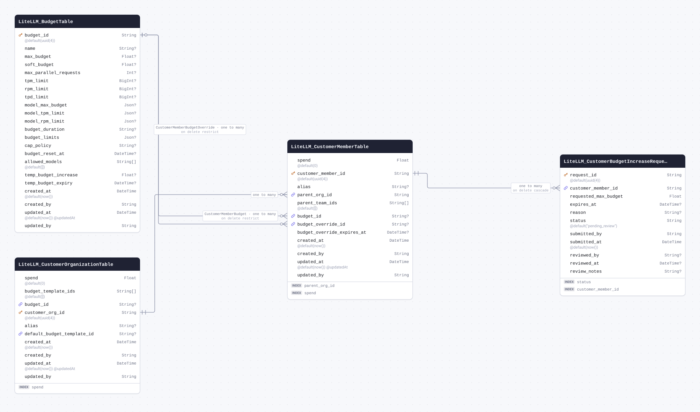

| Field                        | Type       | Constraints                                                                               | Default              | Description |
| ---------------------------- | ---------- | ----------------------------------------------------------------------------------------- | -------------------- | ----------- |
| `spend`                      | `Float`    | NOT NULL                                                                                  | `0`                  |             |
| `budget_reset_at`            | `DateTime` | NULL                                                                                      |                      |             |
| `customer_member_id`         | `String`   | PK NOT NULL                                                                               | `uuid(4)`            |             |
| `alias`                      | `String`   | NULL                                                                                      |                      |             |
| `parent_team_id`             | `String`   | NOT NULL → [LiteLLM_CustomerTeamTable.customer_team_id](#model-LiteLLM_CustomerTeamTable) |                      |             |
| `budget_id`                  | `String`   | NULL → [LiteLLM_BudgetTable.budget_id](#model-LiteLLM_BudgetTable)                        |                      |             |
| `budget_template_id`         | `String`   | NULL → [LiteLLM_BudgetTable.budget_id](#model-LiteLLM_BudgetTable)                        |                      |             |
| `budget_override_expires_at` | `DateTime` | NULL                                                                                      |                      |             |
| `created_at`                 | `DateTime` | NOT NULL                                                                                  | `now()`              |             |
| `created_by`                 | `String`   | NOT NULL                                                                                  |                      |             |
| `updated_at`                 | `DateTime` | NOT NULL                                                                                  | `now()` `@updatedAt` |             |
| `updated_by`                 | `String`   | NOT NULL                                                                                  |                      |             |

#### Indexes

- `@@index([parent_team_id])`
- `@@index([budget_template_id])`

#### References

- `parent_team_id` → [LiteLLM_CustomerTeamTable.customer_team_id](#model-LiteLLM_CustomerTeamTable) (many-to-one)
- `budget_id` → [LiteLLM_BudgetTable.budget_id](#model-LiteLLM_BudgetTable) (many-to-one, on delete Restrict)
- `budget_template_id` → [LiteLLM_BudgetTable.budget_id](#model-LiteLLM_BudgetTable) (many-to-one, on delete Restrict)

#### Definition

```sql
CREATE TABLE "LiteLLM_CustomerMemberTable" (
    "spend" DOUBLE PRECISION NOT NULL DEFAULT 0.0,
    "budget_reset_at" TIMESTAMP(3),
    "customer_member_id" TEXT NOT NULL,
    "alias" TEXT,
    "parent_team_id" TEXT NOT NULL,
    "budget_id" TEXT,
    "budget_template_id" TEXT,
    "budget_override_expires_at" TIMESTAMP(3),
    "created_at" TIMESTAMP(3) NOT NULL DEFAULT CURRENT_TIMESTAMP,
    "created_by" TEXT NOT NULL,
    "updated_at" TIMESTAMP(3) NOT NULL DEFAULT CURRENT_TIMESTAMP,
    "updated_by" TEXT NOT NULL,

    CONSTRAINT "LiteLLM_CustomerMemberTable_pkey" PRIMARY KEY ("customer_member_id")
);

CREATE INDEX "LiteLLM_CustomerMemberTable_parent_team_id_idx" ON "LiteLLM_CustomerMemberTable"("parent_team_id");

CREATE INDEX "LiteLLM_CustomerMemberTable_budget_template_id_idx" ON "LiteLLM_CustomerMemberTable"("budget_template_id");

ALTER TABLE "LiteLLM_CustomerMemberTable" ADD CONSTRAINT "LiteLLM_CustomerMemberTable_parent_team_id_fkey" FOREIGN KEY ("parent_team_id") REFERENCES "LiteLLM_CustomerTeamTable"("customer_team_id") ON DELETE RESTRICT ON UPDATE CASCADE;

ALTER TABLE "LiteLLM_CustomerMemberTable" ADD CONSTRAINT "LiteLLM_CustomerMemberTable_budget_id_fkey" FOREIGN KEY ("budget_id") REFERENCES "LiteLLM_BudgetTable"("budget_id") ON DELETE RESTRICT ON UPDATE CASCADE;

ALTER TABLE "LiteLLM_CustomerMemberTable" ADD CONSTRAINT "LiteLLM_CustomerMemberTable_budget_template_id_fkey" FOREIGN KEY ("budget_template_id") REFERENCES "LiteLLM_BudgetTable"("budget_id") ON DELETE RESTRICT ON UPDATE CASCADE;
```

<details>
<summary>Queries and their SQL</summary>

**findMany**: Every row

```ts
await prisma.liteLLM_CustomerMemberTable.findMany();
```

```sql
SELECT
  "public"."LiteLLM_CustomerMemberTable"."customer_member_id",
  "public"."LiteLLM_CustomerMemberTable"."spend",
  "public"."LiteLLM_CustomerMemberTable"."budget_reset_at",
  "public"."LiteLLM_CustomerMemberTable"."alias",
  "public"."LiteLLM_CustomerMemberTable"."parent_team_id",
  "public"."LiteLLM_CustomerMemberTable"."budget_id",
  "public"."LiteLLM_CustomerMemberTable"."budget_template_id",
  "public"."LiteLLM_CustomerMemberTable"."budget_override_expires_at",
  "public"."LiteLLM_CustomerMemberTable"."created_at",
  "public"."LiteLLM_CustomerMemberTable"."created_by",
  "public"."LiteLLM_CustomerMemberTable"."updated_at",
  "public"."LiteLLM_CustomerMemberTable"."updated_by"
FROM
  "public"."LiteLLM_CustomerMemberTable"
WHERE
  1 = 1
OFFSET
  $1
-- params: ["0"]
```

**count**: How many rows there are

```ts
await prisma.liteLLM_CustomerMemberTable.count();
```

```sql
SELECT
  COUNT(*) AS "_count$_all"
FROM
  (
    SELECT
      "public"."LiteLLM_CustomerMemberTable"."customer_member_id"
    FROM
      "public"."LiteLLM_CustomerMemberTable"
    WHERE
      1 = 1
    OFFSET
      $1
  ) AS "sub"
-- params: ["0"]
```

**findMany**: Every row with its relations

```ts
await prisma.liteLLM_CustomerMemberTable.findMany({
  include: { parent_team: true, budget: true, budget_template: true },
});
```

```sql
SELECT
  "public"."LiteLLM_CustomerMemberTable"."customer_member_id",
  "public"."LiteLLM_CustomerMemberTable"."spend",
  "public"."LiteLLM_CustomerMemberTable"."budget_reset_at",
  "public"."LiteLLM_CustomerMemberTable"."alias",
  "public"."LiteLLM_CustomerMemberTable"."parent_team_id",
  "public"."LiteLLM_CustomerMemberTable"."budget_id",
  "public"."LiteLLM_CustomerMemberTable"."budget_template_id",
  "public"."LiteLLM_CustomerMemberTable"."budget_override_expires_at",
  "public"."LiteLLM_CustomerMemberTable"."created_at",
  "public"."LiteLLM_CustomerMemberTable"."created_by",
  "public"."LiteLLM_CustomerMemberTable"."updated_at",
  "public"."LiteLLM_CustomerMemberTable"."updated_by"
FROM
  "public"."LiteLLM_CustomerMemberTable"
WHERE
  1 = 1
OFFSET
  $1
-- params: ["0"]

SELECT
  "public"."LiteLLM_CustomerTeamTable"."customer_team_id",
  "public"."LiteLLM_CustomerTeamTable"."spend",
  "public"."LiteLLM_CustomerTeamTable"."budget_reset_at",
  "public"."LiteLLM_CustomerTeamTable"."alias",
  "public"."LiteLLM_CustomerTeamTable"."parent_org_id",
  "public"."LiteLLM_CustomerTeamTable"."budget_id",
  "public"."LiteLLM_CustomerTeamTable"."created_at",
  "public"."LiteLLM_CustomerTeamTable"."created_by",
  "public"."LiteLLM_CustomerTeamTable"."updated_at",
  "public"."LiteLLM_CustomerTeamTable"."updated_by"
FROM
  "public"."LiteLLM_CustomerTeamTable"
WHERE
  "public"."LiteLLM_CustomerTeamTable"."customer_team_id" IN ($1)
OFFSET
  $2
-- params: ["<parent_team_id of the rows above>","0"]

SELECT
  "public"."LiteLLM_BudgetTable"."budget_id",
  "public"."LiteLLM_BudgetTable"."max_budget",
  "public"."LiteLLM_BudgetTable"."soft_budget",
  "public"."LiteLLM_BudgetTable"."max_parallel_requests",
  "public"."LiteLLM_BudgetTable"."tpm_limit",
  "public"."LiteLLM_BudgetTable"."rpm_limit",
  "public"."LiteLLM_BudgetTable"."tpd_limit",
  "public"."LiteLLM_BudgetTable"."model_max_budget",
  "public"."LiteLLM_BudgetTable"."model_tpm_limit",
  "public"."LiteLLM_BudgetTable"."model_rpm_limit",
  "public"."LiteLLM_BudgetTable"."budget_duration",
  "public"."LiteLLM_BudgetTable"."budget_reset_at",
  "public"."LiteLLM_BudgetTable"."allowed_models",
  "public"."LiteLLM_BudgetTable"."temp_budget_increase",
  "public"."LiteLLM_BudgetTable"."temp_budget_expiry",
  "public"."LiteLLM_BudgetTable"."created_at",
  "public"."LiteLLM_BudgetTable"."created_by",
  "public"."LiteLLM_BudgetTable"."updated_at",
  "public"."LiteLLM_BudgetTable"."updated_by"
FROM
  "public"."LiteLLM_BudgetTable"
WHERE
  "public"."LiteLLM_BudgetTable"."budget_id" IN ($1)
OFFSET
  $2
-- params: ["<budget_id of the rows above>","0"]

SELECT
  "public"."LiteLLM_BudgetTable"."budget_id",
  "public"."LiteLLM_BudgetTable"."max_budget",
  "public"."LiteLLM_BudgetTable"."soft_budget",
  "public"."LiteLLM_BudgetTable"."max_parallel_requests",
  "public"."LiteLLM_BudgetTable"."tpm_limit",
  "public"."LiteLLM_BudgetTable"."rpm_limit",
  "public"."LiteLLM_BudgetTable"."tpd_limit",
  "public"."LiteLLM_BudgetTable"."model_max_budget",
  "public"."LiteLLM_BudgetTable"."model_tpm_limit",
  "public"."LiteLLM_BudgetTable"."model_rpm_limit",
  "public"."LiteLLM_BudgetTable"."budget_duration",
  "public"."LiteLLM_BudgetTable"."budget_reset_at",
  "public"."LiteLLM_BudgetTable"."allowed_models",
  "public"."LiteLLM_BudgetTable"."temp_budget_increase",
  "public"."LiteLLM_BudgetTable"."temp_budget_expiry",
  "public"."LiteLLM_BudgetTable"."created_at",
  "public"."LiteLLM_BudgetTable"."created_by",
  "public"."LiteLLM_BudgetTable"."updated_at",
  "public"."LiteLLM_BudgetTable"."updated_by"
FROM
  "public"."LiteLLM_BudgetTable"
WHERE
  "public"."LiteLLM_BudgetTable"."budget_id" IN ($1)
OFFSET
  $2
-- params: ["<budget_template_id of the rows above>","0"]
```

**findUnique**: One row by what is unique to it

```ts
await prisma.liteLLM_CustomerMemberTable.findUnique({ where: { customer_member_id: "example" } });
```

```sql
SELECT
  "public"."LiteLLM_CustomerMemberTable"."customer_member_id",
  "public"."LiteLLM_CustomerMemberTable"."spend",
  "public"."LiteLLM_CustomerMemberTable"."budget_reset_at",
  "public"."LiteLLM_CustomerMemberTable"."alias",
  "public"."LiteLLM_CustomerMemberTable"."parent_team_id",
  "public"."LiteLLM_CustomerMemberTable"."budget_id",
  "public"."LiteLLM_CustomerMemberTable"."budget_template_id",
  "public"."LiteLLM_CustomerMemberTable"."budget_override_expires_at",
  "public"."LiteLLM_CustomerMemberTable"."created_at",
  "public"."LiteLLM_CustomerMemberTable"."created_by",
  "public"."LiteLLM_CustomerMemberTable"."updated_at",
  "public"."LiteLLM_CustomerMemberTable"."updated_by"
FROM
  "public"."LiteLLM_CustomerMemberTable"
WHERE
  (
    "public"."LiteLLM_CustomerMemberTable"."customer_member_id" = $1
    AND 1 = 1
  )
LIMIT
  $2
OFFSET
  $3
-- params: ["example","1","0"]
```

**create**: Create a row

```ts
await prisma.liteLLM_CustomerMemberTable.create({
  data: { parent_team_id: "example", created_by: "example", updated_by: "example" },
});
```

```sql
INSERT INTO
  "public"."LiteLLM_CustomerMemberTable" (
    "spend",
    "customer_member_id",
    "parent_team_id",
    "created_at",
    "created_by",
    "updated_at",
    "updated_by"
  )
VALUES
  ($1, $2, $3, $4, $5, $6, $7)
RETURNING
  "public"."LiteLLM_CustomerMemberTable"."customer_member_id",
  "public"."LiteLLM_CustomerMemberTable"."spend",
  "public"."LiteLLM_CustomerMemberTable"."budget_reset_at",
  "public"."LiteLLM_CustomerMemberTable"."alias",
  "public"."LiteLLM_CustomerMemberTable"."parent_team_id",
  "public"."LiteLLM_CustomerMemberTable"."budget_id",
  "public"."LiteLLM_CustomerMemberTable"."budget_template_id",
  "public"."LiteLLM_CustomerMemberTable"."budget_override_expires_at",
  "public"."LiteLLM_CustomerMemberTable"."created_at",
  "public"."LiteLLM_CustomerMemberTable"."created_by",
  "public"."LiteLLM_CustomerMemberTable"."updated_at",
  "public"."LiteLLM_CustomerMemberTable"."updated_by"
-- params: ["0.0","<uuid(4)>","example","<now()>","example","<now()>","example"]
```

**update**: Update a row

```ts
await prisma.liteLLM_CustomerMemberTable.update({
  where: { customer_member_id: "example" },
  data: { spend: 1.5 },
});
```

```sql
UPDATE "public"."LiteLLM_CustomerMemberTable"
SET
  "spend" = $1,
  "updated_at" = $2
WHERE
  (
    "public"."LiteLLM_CustomerMemberTable"."customer_member_id" = $3
    AND 1 = 1
  )
RETURNING
  "public"."LiteLLM_CustomerMemberTable"."customer_member_id",
  "public"."LiteLLM_CustomerMemberTable"."spend",
  "public"."LiteLLM_CustomerMemberTable"."budget_reset_at",
  "public"."LiteLLM_CustomerMemberTable"."alias",
  "public"."LiteLLM_CustomerMemberTable"."parent_team_id",
  "public"."LiteLLM_CustomerMemberTable"."budget_id",
  "public"."LiteLLM_CustomerMemberTable"."budget_template_id",
  "public"."LiteLLM_CustomerMemberTable"."budget_override_expires_at",
  "public"."LiteLLM_CustomerMemberTable"."created_at",
  "public"."LiteLLM_CustomerMemberTable"."created_by",
  "public"."LiteLLM_CustomerMemberTable"."updated_at",
  "public"."LiteLLM_CustomerMemberTable"."updated_by"
-- params: ["1.5",{"prisma__type":"generatorCall","prisma__value":{"name":"now","args":[],"returnType":{"type":"DateTime"}}},"example"]
```

**delete**: Delete a row

```ts
await prisma.liteLLM_CustomerMemberTable.delete({ where: { customer_member_id: "example" } });
```

```sql
DELETE FROM "public"."LiteLLM_CustomerMemberTable"
WHERE
  (
    "public"."LiteLLM_CustomerMemberTable"."customer_member_id" = $1
    AND 1 = 1
  )
RETURNING
  "public"."LiteLLM_CustomerMemberTable"."customer_member_id",
  "public"."LiteLLM_CustomerMemberTable"."spend",
  "public"."LiteLLM_CustomerMemberTable"."budget_reset_at",
  "public"."LiteLLM_CustomerMemberTable"."alias",
  "public"."LiteLLM_CustomerMemberTable"."parent_team_id",
  "public"."LiteLLM_CustomerMemberTable"."budget_id",
  "public"."LiteLLM_CustomerMemberTable"."budget_template_id",
  "public"."LiteLLM_CustomerMemberTable"."budget_override_expires_at",
  "public"."LiteLLM_CustomerMemberTable"."created_at",
  "public"."LiteLLM_CustomerMemberTable"."created_by",
  "public"."LiteLLM_CustomerMemberTable"."updated_at",
  "public"."LiteLLM_CustomerMemberTable"."updated_by"
-- params: ["example"]
```

</details>

<a id="model-LiteLLM_CredentialsTable"></a>

### LiteLLM_CredentialsTable

| Field                       | Type       | Constraints     | Default              | Description |
| --------------------------- | ---------- | --------------- | -------------------- | ----------- |
| `credential_id`             | `String`   | PK NOT NULL     | `uuid(4)`            |             |
| `credential_name`           | `String`   | UNIQUE NOT NULL |                      |             |
| `display_name`              | `String`   | NULL            |                      |             |
| `credential_values`         | `Json`     | NOT NULL        |                      |             |
| `credential_info`           | `Json`     | NULL            |                      |             |
| `created_at` (`created_at`) | `DateTime` | NOT NULL        | `now()`              |             |
| `created_by`                | `String`   | NOT NULL        |                      |             |
| `updated_at` (`updated_at`) | `DateTime` | NOT NULL        | `now()` `@updatedAt` |             |
| `updated_by`                | `String`   | NOT NULL        |                      |             |

#### Definition

```sql
CREATE TABLE "LiteLLM_CredentialsTable" (
    "credential_id" TEXT NOT NULL,
    "credential_name" TEXT NOT NULL,
    "display_name" TEXT,
    "credential_values" JSONB NOT NULL,
    "credential_info" JSONB,
    "created_at" TIMESTAMP(3) NOT NULL DEFAULT CURRENT_TIMESTAMP,
    "created_by" TEXT NOT NULL,
    "updated_at" TIMESTAMP(3) NOT NULL DEFAULT CURRENT_TIMESTAMP,
    "updated_by" TEXT NOT NULL,

    CONSTRAINT "LiteLLM_CredentialsTable_pkey" PRIMARY KEY ("credential_id")
);

CREATE UNIQUE INDEX "LiteLLM_CredentialsTable_credential_name_key" ON "LiteLLM_CredentialsTable"("credential_name");
```

<details>
<summary>Queries and their SQL</summary>

**findMany**: Every row

```ts
await prisma.liteLLM_CredentialsTable.findMany();
```

```sql
SELECT
  "public"."LiteLLM_CredentialsTable"."credential_id",
  "public"."LiteLLM_CredentialsTable"."credential_name",
  "public"."LiteLLM_CredentialsTable"."display_name",
  "public"."LiteLLM_CredentialsTable"."credential_values",
  "public"."LiteLLM_CredentialsTable"."credential_info",
  "public"."LiteLLM_CredentialsTable"."created_at",
  "public"."LiteLLM_CredentialsTable"."created_by",
  "public"."LiteLLM_CredentialsTable"."updated_at",
  "public"."LiteLLM_CredentialsTable"."updated_by"
FROM
  "public"."LiteLLM_CredentialsTable"
WHERE
  1 = 1
OFFSET
  $1
-- params: ["0"]
```

**count**: How many rows there are

```ts
await prisma.liteLLM_CredentialsTable.count();
```

```sql
SELECT
  COUNT(*) AS "_count$_all"
FROM
  (
    SELECT
      "public"."LiteLLM_CredentialsTable"."credential_id"
    FROM
      "public"."LiteLLM_CredentialsTable"
    WHERE
      1 = 1
    OFFSET
      $1
  ) AS "sub"
-- params: ["0"]
```

**findUnique**: One row by what is unique to it

```ts
await prisma.liteLLM_CredentialsTable.findUnique({ where: { credential_id: "example" } });
```

```sql
SELECT
  "public"."LiteLLM_CredentialsTable"."credential_id",
  "public"."LiteLLM_CredentialsTable"."credential_name",
  "public"."LiteLLM_CredentialsTable"."display_name",
  "public"."LiteLLM_CredentialsTable"."credential_values",
  "public"."LiteLLM_CredentialsTable"."credential_info",
  "public"."LiteLLM_CredentialsTable"."created_at",
  "public"."LiteLLM_CredentialsTable"."created_by",
  "public"."LiteLLM_CredentialsTable"."updated_at",
  "public"."LiteLLM_CredentialsTable"."updated_by"
FROM
  "public"."LiteLLM_CredentialsTable"
WHERE
  (
    "public"."LiteLLM_CredentialsTable"."credential_id" = $1
    AND 1 = 1
  )
LIMIT
  $2
OFFSET
  $3
-- params: ["example","1","0"]
```

**create**: Create a row

```ts
await prisma.liteLLM_CredentialsTable.create({
  data: {
    credential_name: "example",
    credential_values: {},
    created_by: "example",
    updated_by: "example",
  },
});
```

```sql
INSERT INTO
  "public"."LiteLLM_CredentialsTable" (
    "credential_id",
    "credential_name",
    "credential_values",
    "created_at",
    "created_by",
    "updated_at",
    "updated_by"
  )
VALUES
  ($1, $2, $3, $4, $5, $6, $7)
RETURNING
  "public"."LiteLLM_CredentialsTable"."credential_id",
  "public"."LiteLLM_CredentialsTable"."credential_name",
  "public"."LiteLLM_CredentialsTable"."display_name",
  "public"."LiteLLM_CredentialsTable"."credential_values",
  "public"."LiteLLM_CredentialsTable"."credential_info",
  "public"."LiteLLM_CredentialsTable"."created_at",
  "public"."LiteLLM_CredentialsTable"."created_by",
  "public"."LiteLLM_CredentialsTable"."updated_at",
  "public"."LiteLLM_CredentialsTable"."updated_by"
-- params: ["<uuid(4)>","example","{}","<now()>","example","<now()>","example"]
```

**update**: Update a row

```ts
await prisma.liteLLM_CredentialsTable.update({
  where: { credential_id: "example" },
  data: { credential_name: "example" },
});
```

```sql
UPDATE "public"."LiteLLM_CredentialsTable"
SET
  "credential_name" = $1,
  "updated_at" = $2
WHERE
  (
    "public"."LiteLLM_CredentialsTable"."credential_id" = $3
    AND 1 = 1
  )
RETURNING
  "public"."LiteLLM_CredentialsTable"."credential_id",
  "public"."LiteLLM_CredentialsTable"."credential_name",
  "public"."LiteLLM_CredentialsTable"."display_name",
  "public"."LiteLLM_CredentialsTable"."credential_values",
  "public"."LiteLLM_CredentialsTable"."credential_info",
  "public"."LiteLLM_CredentialsTable"."created_at",
  "public"."LiteLLM_CredentialsTable"."created_by",
  "public"."LiteLLM_CredentialsTable"."updated_at",
  "public"."LiteLLM_CredentialsTable"."updated_by"
-- params: ["example",{"prisma__type":"generatorCall","prisma__value":{"name":"now","args":[],"returnType":{"type":"DateTime"}}},"example"]
```

**delete**: Delete a row

```ts
await prisma.liteLLM_CredentialsTable.delete({ where: { credential_id: "example" } });
```

```sql
DELETE FROM "public"."LiteLLM_CredentialsTable"
WHERE
  (
    "public"."LiteLLM_CredentialsTable"."credential_id" = $1
    AND 1 = 1
  )
RETURNING
  "public"."LiteLLM_CredentialsTable"."credential_id",
  "public"."LiteLLM_CredentialsTable"."credential_name",
  "public"."LiteLLM_CredentialsTable"."display_name",
  "public"."LiteLLM_CredentialsTable"."credential_values",
  "public"."LiteLLM_CredentialsTable"."credential_info",
  "public"."LiteLLM_CredentialsTable"."created_at",
  "public"."LiteLLM_CredentialsTable"."created_by",
  "public"."LiteLLM_CredentialsTable"."updated_at",
  "public"."LiteLLM_CredentialsTable"."updated_by"
-- params: ["example"]
```

</details>

<a id="model-LiteLLM_ProxyModelTable"></a>

### LiteLLM_ProxyModelTable

| Field                       | Type       | Constraints | Default              | Description |
| --------------------------- | ---------- | ----------- | -------------------- | ----------- |
| `model_id`                  | `String`   | PK NOT NULL | `uuid(4)`            |             |
| `model_name`                | `String`   | NOT NULL    |                      |             |
| `litellm_params`            | `Json`     | NOT NULL    |                      |             |
| `model_info`                | `Json`     | NULL        |                      |             |
| `blocked`                   | `Boolean`  | NOT NULL    | `false`              |             |
| `created_at` (`created_at`) | `DateTime` | NOT NULL    | `now()`              |             |
| `created_by`                | `String`   | NOT NULL    |                      |             |
| `updated_at` (`updated_at`) | `DateTime` | NOT NULL    | `now()` `@updatedAt` |             |
| `updated_by`                | `String`   | NOT NULL    |                      |             |

#### Definition

```sql
CREATE TABLE "LiteLLM_ProxyModelTable" (
    "model_id" TEXT NOT NULL,
    "model_name" TEXT NOT NULL,
    "litellm_params" JSONB NOT NULL,
    "model_info" JSONB,
    "blocked" BOOLEAN NOT NULL DEFAULT false,
    "created_at" TIMESTAMP(3) NOT NULL DEFAULT CURRENT_TIMESTAMP,
    "created_by" TEXT NOT NULL,
    "updated_at" TIMESTAMP(3) NOT NULL DEFAULT CURRENT_TIMESTAMP,
    "updated_by" TEXT NOT NULL,

    CONSTRAINT "LiteLLM_ProxyModelTable_pkey" PRIMARY KEY ("model_id")
);
```

<details>
<summary>Queries and their SQL</summary>

**findMany**: Every row

```ts
await prisma.liteLLM_ProxyModelTable.findMany();
```

```sql
SELECT
  "public"."LiteLLM_ProxyModelTable"."model_id",
  "public"."LiteLLM_ProxyModelTable"."model_name",
  "public"."LiteLLM_ProxyModelTable"."litellm_params",
  "public"."LiteLLM_ProxyModelTable"."model_info",
  "public"."LiteLLM_ProxyModelTable"."blocked",
  "public"."LiteLLM_ProxyModelTable"."created_at",
  "public"."LiteLLM_ProxyModelTable"."created_by",
  "public"."LiteLLM_ProxyModelTable"."updated_at",
  "public"."LiteLLM_ProxyModelTable"."updated_by"
FROM
  "public"."LiteLLM_ProxyModelTable"
WHERE
  1 = 1
OFFSET
  $1
-- params: ["0"]
```

**count**: How many rows there are

```ts
await prisma.liteLLM_ProxyModelTable.count();
```

```sql
SELECT
  COUNT(*) AS "_count$_all"
FROM
  (
    SELECT
      "public"."LiteLLM_ProxyModelTable"."model_id"
    FROM
      "public"."LiteLLM_ProxyModelTable"
    WHERE
      1 = 1
    OFFSET
      $1
  ) AS "sub"
-- params: ["0"]
```

**findUnique**: One row by what is unique to it

```ts
await prisma.liteLLM_ProxyModelTable.findUnique({ where: { model_id: "example" } });
```

```sql
SELECT
  "public"."LiteLLM_ProxyModelTable"."model_id",
  "public"."LiteLLM_ProxyModelTable"."model_name",
  "public"."LiteLLM_ProxyModelTable"."litellm_params",
  "public"."LiteLLM_ProxyModelTable"."model_info",
  "public"."LiteLLM_ProxyModelTable"."blocked",
  "public"."LiteLLM_ProxyModelTable"."created_at",
  "public"."LiteLLM_ProxyModelTable"."created_by",
  "public"."LiteLLM_ProxyModelTable"."updated_at",
  "public"."LiteLLM_ProxyModelTable"."updated_by"
FROM
  "public"."LiteLLM_ProxyModelTable"
WHERE
  (
    "public"."LiteLLM_ProxyModelTable"."model_id" = $1
    AND 1 = 1
  )
LIMIT
  $2
OFFSET
  $3
-- params: ["example","1","0"]
```

**create**: Create a row

```ts
await prisma.liteLLM_ProxyModelTable.create({
  data: { model_name: "example", litellm_params: {}, created_by: "example", updated_by: "example" },
});
```

```sql
INSERT INTO
  "public"."LiteLLM_ProxyModelTable" (
    "model_id",
    "model_name",
    "litellm_params",
    "blocked",
    "created_at",
    "created_by",
    "updated_at",
    "updated_by"
  )
VALUES
  ($1, $2, $3, $4, $5, $6, $7, $8)
RETURNING
  "public"."LiteLLM_ProxyModelTable"."model_id",
  "public"."LiteLLM_ProxyModelTable"."model_name",
  "public"."LiteLLM_ProxyModelTable"."litellm_params",
  "public"."LiteLLM_ProxyModelTable"."model_info",
  "public"."LiteLLM_ProxyModelTable"."blocked",
  "public"."LiteLLM_ProxyModelTable"."created_at",
  "public"."LiteLLM_ProxyModelTable"."created_by",
  "public"."LiteLLM_ProxyModelTable"."updated_at",
  "public"."LiteLLM_ProxyModelTable"."updated_by"
-- params: ["<uuid(4)>","example","{}",false,"<now()>","example","<now()>","example"]
```

**update**: Update a row

```ts
await prisma.liteLLM_ProxyModelTable.update({
  where: { model_id: "example" },
  data: { model_name: "example" },
});
```

```sql
UPDATE "public"."LiteLLM_ProxyModelTable"
SET
  "model_name" = $1,
  "updated_at" = $2
WHERE
  (
    "public"."LiteLLM_ProxyModelTable"."model_id" = $3
    AND 1 = 1
  )
RETURNING
  "public"."LiteLLM_ProxyModelTable"."model_id",
  "public"."LiteLLM_ProxyModelTable"."model_name",
  "public"."LiteLLM_ProxyModelTable"."litellm_params",
  "public"."LiteLLM_ProxyModelTable"."model_info",
  "public"."LiteLLM_ProxyModelTable"."blocked",
  "public"."LiteLLM_ProxyModelTable"."created_at",
  "public"."LiteLLM_ProxyModelTable"."created_by",
  "public"."LiteLLM_ProxyModelTable"."updated_at",
  "public"."LiteLLM_ProxyModelTable"."updated_by"
-- params: ["example",{"prisma__type":"generatorCall","prisma__value":{"name":"now","args":[],"returnType":{"type":"DateTime"}}},"example"]
```

**delete**: Delete a row

```ts
await prisma.liteLLM_ProxyModelTable.delete({ where: { model_id: "example" } });
```

```sql
DELETE FROM "public"."LiteLLM_ProxyModelTable"
WHERE
  (
    "public"."LiteLLM_ProxyModelTable"."model_id" = $1
    AND 1 = 1
  )
RETURNING
  "public"."LiteLLM_ProxyModelTable"."model_id",
  "public"."LiteLLM_ProxyModelTable"."model_name",
  "public"."LiteLLM_ProxyModelTable"."litellm_params",
  "public"."LiteLLM_ProxyModelTable"."model_info",
  "public"."LiteLLM_ProxyModelTable"."blocked",
  "public"."LiteLLM_ProxyModelTable"."created_at",
  "public"."LiteLLM_ProxyModelTable"."created_by",
  "public"."LiteLLM_ProxyModelTable"."updated_at",
  "public"."LiteLLM_ProxyModelTable"."updated_by"
-- params: ["example"]
```

</details>

<a id="model-LiteLLM_AgentsTable"></a>

### LiteLLM_AgentsTable

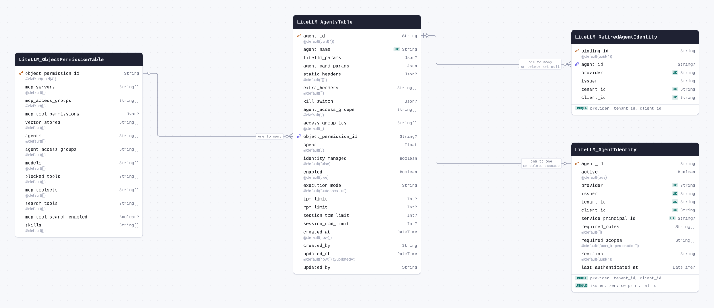

| Field                       | Type       | Constraints                                                                                       | Default              | Description |
| --------------------------- | ---------- | ------------------------------------------------------------------------------------------------- | -------------------- | ----------- |
| `agent_id`                  | `String`   | PK NOT NULL                                                                                       | `uuid(4)`            |             |
| `agent_name`                | `String`   | UNIQUE NOT NULL                                                                                   |                      |             |
| `litellm_params`            | `Json`     | NULL                                                                                              |                      |             |
| `agent_card_params`         | `Json`     | NOT NULL                                                                                          |                      |             |
| `static_headers`            | `Json`     | NULL                                                                                              | `"{}"`               |             |
| `extra_headers`             | `String[]` | NOT NULL                                                                                          | `[]`                 |             |
| `kill_switch`               | `Json`     | NULL                                                                                              |                      |             |
| `agent_access_groups`       | `String[]` | NOT NULL                                                                                          | `[]`                 |             |
| `access_group_ids`          | `String[]` | NOT NULL                                                                                          | `[]`                 |             |
| `object_permission_id`      | `String`   | NULL → [LiteLLM_ObjectPermissionTable.object_permission_id](#model-LiteLLM_ObjectPermissionTable) |                      |             |
| `spend`                     | `Float`    | NOT NULL                                                                                          | `0`                  |             |
| `identity_managed`          | `Boolean`  | NOT NULL                                                                                          | `false`              |             |
| `enabled`                   | `Boolean`  | NOT NULL                                                                                          | `true`               |             |
| `execution_mode`            | `String`   | NOT NULL                                                                                          | `"autonomous"`       |             |
| `tpm_limit`                 | `Int`      | NULL                                                                                              |                      |             |
| `rpm_limit`                 | `Int`      | NULL                                                                                              |                      |             |
| `session_tpm_limit`         | `Int`      | NULL                                                                                              |                      |             |
| `session_rpm_limit`         | `Int`      | NULL                                                                                              |                      |             |
| `created_at` (`created_at`) | `DateTime` | NOT NULL                                                                                          | `now()`              |             |
| `created_by`                | `String`   | NOT NULL                                                                                          |                      |             |
| `updated_at` (`updated_at`) | `DateTime` | NOT NULL                                                                                          | `now()` `@updatedAt` |             |
| `updated_by`                | `String`   | NOT NULL                                                                                          |                      |             |

#### References

- `object_permission_id` → [LiteLLM_ObjectPermissionTable.object_permission_id](#model-LiteLLM_ObjectPermissionTable) (many-to-one)

#### Referenced by

- `agent_id` ← [LiteLLM_AgentIdentity.agent_id](#model-LiteLLM_AgentIdentity) (one-to-one, on delete Cascade)
- `agent_id` ← [LiteLLM_RetiredAgentIdentity.agent_id](#model-LiteLLM_RetiredAgentIdentity) (one-to-many, on delete SetNull)

#### Definition

```sql
CREATE TABLE "LiteLLM_AgentsTable" (
    "agent_id" TEXT NOT NULL,
    "agent_name" TEXT NOT NULL,
    "litellm_params" JSONB,
    "agent_card_params" JSONB NOT NULL,
    "static_headers" JSONB DEFAULT '{}',
    "extra_headers" TEXT[] DEFAULT ARRAY[]::TEXT[],
    "kill_switch" JSONB,
    "agent_access_groups" TEXT[] DEFAULT ARRAY[]::TEXT[],
    "access_group_ids" TEXT[] DEFAULT ARRAY[]::TEXT[],
    "object_permission_id" TEXT,
    "spend" DOUBLE PRECISION NOT NULL DEFAULT 0.0,
    "identity_managed" BOOLEAN NOT NULL DEFAULT false,
    "enabled" BOOLEAN NOT NULL DEFAULT true,
    "execution_mode" TEXT NOT NULL DEFAULT 'autonomous',
    "tpm_limit" INTEGER,
    "rpm_limit" INTEGER,
    "session_tpm_limit" INTEGER,
    "session_rpm_limit" INTEGER,
    "created_at" TIMESTAMP(3) NOT NULL DEFAULT CURRENT_TIMESTAMP,
    "created_by" TEXT NOT NULL,
    "updated_at" TIMESTAMP(3) NOT NULL DEFAULT CURRENT_TIMESTAMP,
    "updated_by" TEXT NOT NULL,

    CONSTRAINT "LiteLLM_AgentsTable_pkey" PRIMARY KEY ("agent_id")
);

CREATE UNIQUE INDEX "LiteLLM_AgentsTable_agent_name_key" ON "LiteLLM_AgentsTable"("agent_name");

ALTER TABLE "LiteLLM_AgentsTable" ADD CONSTRAINT "LiteLLM_AgentsTable_object_permission_id_fkey" FOREIGN KEY ("object_permission_id") REFERENCES "LiteLLM_ObjectPermissionTable"("object_permission_id") ON DELETE SET NULL ON UPDATE CASCADE;
```

<details>
<summary>Queries and their SQL</summary>

**findMany**: Every row

```ts
await prisma.liteLLM_AgentsTable.findMany();
```

```sql
SELECT
  "public"."LiteLLM_AgentsTable"."agent_id",
  "public"."LiteLLM_AgentsTable"."agent_name",
  "public"."LiteLLM_AgentsTable"."litellm_params",
  "public"."LiteLLM_AgentsTable"."agent_card_params",
  "public"."LiteLLM_AgentsTable"."static_headers",
  "public"."LiteLLM_AgentsTable"."extra_headers",
  "public"."LiteLLM_AgentsTable"."kill_switch",
  "public"."LiteLLM_AgentsTable"."agent_access_groups",
  "public"."LiteLLM_AgentsTable"."access_group_ids",
  "public"."LiteLLM_AgentsTable"."object_permission_id",
  "public"."LiteLLM_AgentsTable"."spend",
  "public"."LiteLLM_AgentsTable"."identity_managed",
  "public"."LiteLLM_AgentsTable"."enabled",
  "public"."LiteLLM_AgentsTable"."execution_mode",
  "public"."LiteLLM_AgentsTable"."tpm_limit",
  "public"."LiteLLM_AgentsTable"."rpm_limit",
  "public"."LiteLLM_AgentsTable"."session_tpm_limit",
  "public"."LiteLLM_AgentsTable"."session_rpm_limit",
  "public"."LiteLLM_AgentsTable"."created_at",
  "public"."LiteLLM_AgentsTable"."created_by",
  "public"."LiteLLM_AgentsTable"."updated_at",
  "public"."LiteLLM_AgentsTable"."updated_by"
FROM
  "public"."LiteLLM_AgentsTable"
WHERE
  1 = 1
OFFSET
  $1
-- params: ["0"]
```

**count**: How many rows there are

```ts
await prisma.liteLLM_AgentsTable.count();
```

```sql
SELECT
  COUNT(*) AS "_count$_all"
FROM
  (
    SELECT
      "public"."LiteLLM_AgentsTable"."agent_id"
    FROM
      "public"."LiteLLM_AgentsTable"
    WHERE
      1 = 1
    OFFSET
      $1
  ) AS "sub"
-- params: ["0"]
```

**findMany**: Every row with its relations

```ts
await prisma.liteLLM_AgentsTable.findMany({
  include: { object_permission: true, identity: true, retired_identities: true },
});
```

```sql
SELECT
  "public"."LiteLLM_AgentsTable"."agent_id",
  "public"."LiteLLM_AgentsTable"."agent_name",
  "public"."LiteLLM_AgentsTable"."litellm_params",
  "public"."LiteLLM_AgentsTable"."agent_card_params",
  "public"."LiteLLM_AgentsTable"."static_headers",
  "public"."LiteLLM_AgentsTable"."extra_headers",
  "public"."LiteLLM_AgentsTable"."kill_switch",
  "public"."LiteLLM_AgentsTable"."agent_access_groups",
  "public"."LiteLLM_AgentsTable"."access_group_ids",
  "public"."LiteLLM_AgentsTable"."object_permission_id",
  "public"."LiteLLM_AgentsTable"."spend",
  "public"."LiteLLM_AgentsTable"."identity_managed",
  "public"."LiteLLM_AgentsTable"."enabled",
  "public"."LiteLLM_AgentsTable"."execution_mode",
  "public"."LiteLLM_AgentsTable"."tpm_limit",
  "public"."LiteLLM_AgentsTable"."rpm_limit",
  "public"."LiteLLM_AgentsTable"."session_tpm_limit",
  "public"."LiteLLM_AgentsTable"."session_rpm_limit",
  "public"."LiteLLM_AgentsTable"."created_at",
  "public"."LiteLLM_AgentsTable"."created_by",
  "public"."LiteLLM_AgentsTable"."updated_at",
  "public"."LiteLLM_AgentsTable"."updated_by"
FROM
  "public"."LiteLLM_AgentsTable"
WHERE
  1 = 1
OFFSET
  $1
-- params: ["0"]

SELECT
  "public"."LiteLLM_ObjectPermissionTable"."object_permission_id",
  "public"."LiteLLM_ObjectPermissionTable"."mcp_servers",
  "public"."LiteLLM_ObjectPermissionTable"."mcp_access_groups",
  "public"."LiteLLM_ObjectPermissionTable"."mcp_tool_permissions",
  "public"."LiteLLM_ObjectPermissionTable"."vector_stores",
  "public"."LiteLLM_ObjectPermissionTable"."agents",
  "public"."LiteLLM_ObjectPermissionTable"."agent_access_groups",
  "public"."LiteLLM_ObjectPermissionTable"."models",
  "public"."LiteLLM_ObjectPermissionTable"."blocked_tools",
  "public"."LiteLLM_ObjectPermissionTable"."mcp_toolsets",
  "public"."LiteLLM_ObjectPermissionTable"."search_tools",
  "public"."LiteLLM_ObjectPermissionTable"."mcp_tool_search_enabled",
  "public"."LiteLLM_ObjectPermissionTable"."skills"
FROM
  "public"."LiteLLM_ObjectPermissionTable"
WHERE
  "public"."LiteLLM_ObjectPermissionTable"."object_permission_id" IN ($1)
OFFSET
  $2
-- params: ["<object_permission_id of the rows above>","0"]

SELECT
  "public"."LiteLLM_AgentIdentity"."agent_id",
  "public"."LiteLLM_AgentIdentity"."active",
  "public"."LiteLLM_AgentIdentity"."provider",
  "public"."LiteLLM_AgentIdentity"."issuer",
  "public"."LiteLLM_AgentIdentity"."tenant_id",
  "public"."LiteLLM_AgentIdentity"."client_id",
  "public"."LiteLLM_AgentIdentity"."service_principal_id",
  "public"."LiteLLM_AgentIdentity"."required_roles",
  "public"."LiteLLM_AgentIdentity"."required_scopes",
  "public"."LiteLLM_AgentIdentity"."revision",
  "public"."LiteLLM_AgentIdentity"."last_authenticated_at"
FROM
  "public"."LiteLLM_AgentIdentity"
WHERE
  "public"."LiteLLM_AgentIdentity"."agent_id" IN ($1)
OFFSET
  $2
-- params: ["<agent_id of the rows above>","0"]

SELECT
  "public"."LiteLLM_RetiredAgentIdentity"."binding_id",
  "public"."LiteLLM_RetiredAgentIdentity"."agent_id",
  "public"."LiteLLM_RetiredAgentIdentity"."provider",
  "public"."LiteLLM_RetiredAgentIdentity"."issuer",
  "public"."LiteLLM_RetiredAgentIdentity"."tenant_id",
  "public"."LiteLLM_RetiredAgentIdentity"."client_id"
FROM
  "public"."LiteLLM_RetiredAgentIdentity"
WHERE
  "public"."LiteLLM_RetiredAgentIdentity"."agent_id" IN ($1)
OFFSET
  $2
-- params: ["<agent_id of the rows above>","0"]
```

**findUnique**: One row by what is unique to it

```ts
await prisma.liteLLM_AgentsTable.findUnique({ where: { agent_id: "example" } });
```

```sql
SELECT
  "public"."LiteLLM_AgentsTable"."agent_id",
  "public"."LiteLLM_AgentsTable"."agent_name",
  "public"."LiteLLM_AgentsTable"."litellm_params",
  "public"."LiteLLM_AgentsTable"."agent_card_params",
  "public"."LiteLLM_AgentsTable"."static_headers",
  "public"."LiteLLM_AgentsTable"."extra_headers",
  "public"."LiteLLM_AgentsTable"."kill_switch",
  "public"."LiteLLM_AgentsTable"."agent_access_groups",
  "public"."LiteLLM_AgentsTable"."access_group_ids",
  "public"."LiteLLM_AgentsTable"."object_permission_id",
  "public"."LiteLLM_AgentsTable"."spend",
  "public"."LiteLLM_AgentsTable"."identity_managed",
  "public"."LiteLLM_AgentsTable"."enabled",
  "public"."LiteLLM_AgentsTable"."execution_mode",
  "public"."LiteLLM_AgentsTable"."tpm_limit",
  "public"."LiteLLM_AgentsTable"."rpm_limit",
  "public"."LiteLLM_AgentsTable"."session_tpm_limit",
  "public"."LiteLLM_AgentsTable"."session_rpm_limit",
  "public"."LiteLLM_AgentsTable"."created_at",
  "public"."LiteLLM_AgentsTable"."created_by",
  "public"."LiteLLM_AgentsTable"."updated_at",
  "public"."LiteLLM_AgentsTable"."updated_by"
FROM
  "public"."LiteLLM_AgentsTable"
WHERE
  (
    "public"."LiteLLM_AgentsTable"."agent_id" = $1
    AND 1 = 1
  )
LIMIT
  $2
OFFSET
  $3
-- params: ["example","1","0"]
```

**create**: Create a row

```ts
await prisma.liteLLM_AgentsTable.create({
  data: {
    agent_name: "example",
    agent_card_params: {},
    created_by: "example",
    updated_by: "example",
  },
});
```

```sql
INSERT INTO
  "public"."LiteLLM_AgentsTable" (
    "agent_id",
    "agent_name",
    "agent_card_params",
    "static_headers",
    "extra_headers",
    "agent_access_groups",
    "access_group_ids",
    "spend",
    "identity_managed",
    "enabled",
    "execution_mode",
    "created_at",
    "created_by",
    "updated_at",
    "updated_by"
  )
VALUES
  (
    $1,
    $2,
    $3,
    $4,
    $5,
    $6,
    $7,
    $8,
    $9,
    $10,
    $11,
    $12,
    $13,
    $14,
    $15
  )
RETURNING
  "public"."LiteLLM_AgentsTable"."agent_id",
  "public"."LiteLLM_AgentsTable"."agent_name",
  "public"."LiteLLM_AgentsTable"."litellm_params",
  "public"."LiteLLM_AgentsTable"."agent_card_params",
  "public"."LiteLLM_AgentsTable"."static_headers",
  "public"."LiteLLM_AgentsTable"."extra_headers",
  "public"."LiteLLM_AgentsTable"."kill_switch",
  "public"."LiteLLM_AgentsTable"."agent_access_groups",
  "public"."LiteLLM_AgentsTable"."access_group_ids",
  "public"."LiteLLM_AgentsTable"."object_permission_id",
  "public"."LiteLLM_AgentsTable"."spend",
  "public"."LiteLLM_AgentsTable"."identity_managed",
  "public"."LiteLLM_AgentsTable"."enabled",
  "public"."LiteLLM_AgentsTable"."execution_mode",
  "public"."LiteLLM_AgentsTable"."tpm_limit",
  "public"."LiteLLM_AgentsTable"."rpm_limit",
  "public"."LiteLLM_AgentsTable"."session_tpm_limit",
  "public"."LiteLLM_AgentsTable"."session_rpm_limit",
  "public"."LiteLLM_AgentsTable"."created_at",
  "public"."LiteLLM_AgentsTable"."created_by",
  "public"."LiteLLM_AgentsTable"."updated_at",
  "public"."LiteLLM_AgentsTable"."updated_by"
-- params: ["<uuid(4)>","example","{}","{}",[],[],[],"0.0",false,true,"autonomous","<now()>","example","<now()>","example"]
```

**update**: Update a row

```ts
await prisma.liteLLM_AgentsTable.update({
  where: { agent_id: "example" },
  data: { agent_name: "example" },
});
```

```sql
UPDATE "public"."LiteLLM_AgentsTable"
SET
  "agent_name" = $1,
  "updated_at" = $2
WHERE
  (
    "public"."LiteLLM_AgentsTable"."agent_id" = $3
    AND 1 = 1
  )
RETURNING
  "public"."LiteLLM_AgentsTable"."agent_id",
  "public"."LiteLLM_AgentsTable"."agent_name",
  "public"."LiteLLM_AgentsTable"."litellm_params",
  "public"."LiteLLM_AgentsTable"."agent_card_params",
  "public"."LiteLLM_AgentsTable"."static_headers",
  "public"."LiteLLM_AgentsTable"."extra_headers",
  "public"."LiteLLM_AgentsTable"."kill_switch",
  "public"."LiteLLM_AgentsTable"."agent_access_groups",
  "public"."LiteLLM_AgentsTable"."access_group_ids",
  "public"."LiteLLM_AgentsTable"."object_permission_id",
  "public"."LiteLLM_AgentsTable"."spend",
  "public"."LiteLLM_AgentsTable"."identity_managed",
  "public"."LiteLLM_AgentsTable"."enabled",
  "public"."LiteLLM_AgentsTable"."execution_mode",
  "public"."LiteLLM_AgentsTable"."tpm_limit",
  "public"."LiteLLM_AgentsTable"."rpm_limit",
  "public"."LiteLLM_AgentsTable"."session_tpm_limit",
  "public"."LiteLLM_AgentsTable"."session_rpm_limit",
  "public"."LiteLLM_AgentsTable"."created_at",
  "public"."LiteLLM_AgentsTable"."created_by",
  "public"."LiteLLM_AgentsTable"."updated_at",
  "public"."LiteLLM_AgentsTable"."updated_by"
-- params: ["example",{"prisma__type":"generatorCall","prisma__value":{"name":"now","args":[],"returnType":{"type":"DateTime"}}},"example"]
```

**delete**: Delete a row

```ts
await prisma.liteLLM_AgentsTable.delete({ where: { agent_id: "example" } });
```

```sql
DELETE FROM "public"."LiteLLM_AgentsTable"
WHERE
  (
    "public"."LiteLLM_AgentsTable"."agent_id" = $1
    AND 1 = 1
  )
RETURNING
  "public"."LiteLLM_AgentsTable"."agent_id",
  "public"."LiteLLM_AgentsTable"."agent_name",
  "public"."LiteLLM_AgentsTable"."litellm_params",
  "public"."LiteLLM_AgentsTable"."agent_card_params",
  "public"."LiteLLM_AgentsTable"."static_headers",
  "public"."LiteLLM_AgentsTable"."extra_headers",
  "public"."LiteLLM_AgentsTable"."kill_switch",
  "public"."LiteLLM_AgentsTable"."agent_access_groups",
  "public"."LiteLLM_AgentsTable"."access_group_ids",
  "public"."LiteLLM_AgentsTable"."object_permission_id",
  "public"."LiteLLM_AgentsTable"."spend",
  "public"."LiteLLM_AgentsTable"."identity_managed",
  "public"."LiteLLM_AgentsTable"."enabled",
  "public"."LiteLLM_AgentsTable"."execution_mode",
  "public"."LiteLLM_AgentsTable"."tpm_limit",
  "public"."LiteLLM_AgentsTable"."rpm_limit",
  "public"."LiteLLM_AgentsTable"."session_tpm_limit",
  "public"."LiteLLM_AgentsTable"."session_rpm_limit",
  "public"."LiteLLM_AgentsTable"."created_at",
  "public"."LiteLLM_AgentsTable"."created_by",
  "public"."LiteLLM_AgentsTable"."updated_at",
  "public"."LiteLLM_AgentsTable"."updated_by"
-- params: ["example"]
```

</details>

<a id="model-LiteLLM_AgentIdentity"></a>

### LiteLLM_AgentIdentity

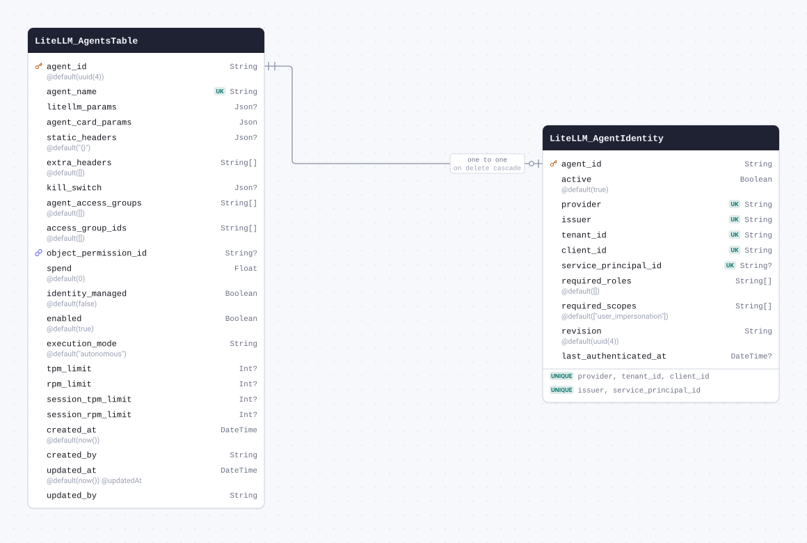

| Field                   | Type       | Constraints                                                              | Default                  | Description |
| ----------------------- | ---------- | ------------------------------------------------------------------------ | ------------------------ | ----------- |
| `agent_id`              | `String`   | PK NOT NULL → [LiteLLM_AgentsTable.agent_id](#model-LiteLLM_AgentsTable) |                          |             |
| `active`                | `Boolean`  | NOT NULL                                                                 | `true`                   |             |
| `provider`              | `String`   | NOT NULL                                                                 |                          |             |
| `issuer`                | `String`   | NOT NULL                                                                 |                          |             |
| `tenant_id`             | `String`   | NOT NULL                                                                 |                          |             |
| `client_id`             | `String`   | NOT NULL                                                                 |                          |             |
| `service_principal_id`  | `String`   | NULL                                                                     |                          |             |
| `required_roles`        | `String[]` | NOT NULL                                                                 | `[]`                     |             |
| `required_scopes`       | `String[]` | NOT NULL                                                                 | `["user_impersonation"]` |             |
| `revision`              | `String`   | NOT NULL                                                                 | `uuid(4)`                |             |
| `last_authenticated_at` | `DateTime` | NULL                                                                     |                          |             |

#### Indexes

- `@@unique([provider, tenant_id, client_id])`
- `@@unique([issuer, service_principal_id])`

#### References

- `agent_id` → [LiteLLM_AgentsTable.agent_id](#model-LiteLLM_AgentsTable) (one-to-one, on delete Cascade)

#### Definition

```sql
CREATE TABLE "LiteLLM_AgentIdentity" (
    "agent_id" TEXT NOT NULL,
    "active" BOOLEAN NOT NULL DEFAULT true,
    "provider" TEXT NOT NULL,
    "issuer" TEXT NOT NULL,
    "tenant_id" TEXT NOT NULL,
    "client_id" TEXT NOT NULL,
    "service_principal_id" TEXT,
    "required_roles" TEXT[] DEFAULT ARRAY[]::TEXT[],
    "required_scopes" TEXT[] DEFAULT ARRAY['user_impersonation']::TEXT[],
    "revision" TEXT NOT NULL,
    "last_authenticated_at" TIMESTAMP(3),

    CONSTRAINT "LiteLLM_AgentIdentity_pkey" PRIMARY KEY ("agent_id")
);

CREATE UNIQUE INDEX "LiteLLM_AgentIdentity_provider_tenant_id_client_id_key" ON "LiteLLM_AgentIdentity"("provider", "tenant_id", "client_id");

CREATE UNIQUE INDEX "LiteLLM_AgentIdentity_issuer_service_principal_id_key" ON "LiteLLM_AgentIdentity"("issuer", "service_principal_id");

ALTER TABLE "LiteLLM_AgentIdentity" ADD CONSTRAINT "LiteLLM_AgentIdentity_agent_id_fkey" FOREIGN KEY ("agent_id") REFERENCES "LiteLLM_AgentsTable"("agent_id") ON DELETE CASCADE ON UPDATE CASCADE;
```

<details>
<summary>Queries and their SQL</summary>

**findMany**: Every row

```ts
await prisma.liteLLM_AgentIdentity.findMany();
```

```sql
SELECT
  "public"."LiteLLM_AgentIdentity"."agent_id",
  "public"."LiteLLM_AgentIdentity"."active",
  "public"."LiteLLM_AgentIdentity"."provider",
  "public"."LiteLLM_AgentIdentity"."issuer",
  "public"."LiteLLM_AgentIdentity"."tenant_id",
  "public"."LiteLLM_AgentIdentity"."client_id",
  "public"."LiteLLM_AgentIdentity"."service_principal_id",
  "public"."LiteLLM_AgentIdentity"."required_roles",
  "public"."LiteLLM_AgentIdentity"."required_scopes",
  "public"."LiteLLM_AgentIdentity"."revision",
  "public"."LiteLLM_AgentIdentity"."last_authenticated_at"
FROM
  "public"."LiteLLM_AgentIdentity"
WHERE
  1 = 1
OFFSET
  $1
-- params: ["0"]
```

**count**: How many rows there are

```ts
await prisma.liteLLM_AgentIdentity.count();
```

```sql
SELECT
  COUNT(*) AS "_count$_all"
FROM
  (
    SELECT
      "public"."LiteLLM_AgentIdentity"."agent_id"
    FROM
      "public"."LiteLLM_AgentIdentity"
    WHERE
      1 = 1
    OFFSET
      $1
  ) AS "sub"
-- params: ["0"]
```

**findMany**: Every row with its relations

```ts
await prisma.liteLLM_AgentIdentity.findMany({ include: { agent: true } });
```

```sql
SELECT
  "public"."LiteLLM_AgentIdentity"."agent_id",
  "public"."LiteLLM_AgentIdentity"."active",
  "public"."LiteLLM_AgentIdentity"."provider",
  "public"."LiteLLM_AgentIdentity"."issuer",
  "public"."LiteLLM_AgentIdentity"."tenant_id",
  "public"."LiteLLM_AgentIdentity"."client_id",
  "public"."LiteLLM_AgentIdentity"."service_principal_id",
  "public"."LiteLLM_AgentIdentity"."required_roles",
  "public"."LiteLLM_AgentIdentity"."required_scopes",
  "public"."LiteLLM_AgentIdentity"."revision",
  "public"."LiteLLM_AgentIdentity"."last_authenticated_at"
FROM
  "public"."LiteLLM_AgentIdentity"
WHERE
  1 = 1
OFFSET
  $1
-- params: ["0"]

SELECT
  "public"."LiteLLM_AgentsTable"."agent_id",
  "public"."LiteLLM_AgentsTable"."agent_name",
  "public"."LiteLLM_AgentsTable"."litellm_params",
  "public"."LiteLLM_AgentsTable"."agent_card_params",
  "public"."LiteLLM_AgentsTable"."static_headers",
  "public"."LiteLLM_AgentsTable"."extra_headers",
  "public"."LiteLLM_AgentsTable"."kill_switch",
  "public"."LiteLLM_AgentsTable"."agent_access_groups",
  "public"."LiteLLM_AgentsTable"."access_group_ids",
  "public"."LiteLLM_AgentsTable"."object_permission_id",
  "public"."LiteLLM_AgentsTable"."spend",
  "public"."LiteLLM_AgentsTable"."identity_managed",
  "public"."LiteLLM_AgentsTable"."enabled",
  "public"."LiteLLM_AgentsTable"."execution_mode",
  "public"."LiteLLM_AgentsTable"."tpm_limit",
  "public"."LiteLLM_AgentsTable"."rpm_limit",
  "public"."LiteLLM_AgentsTable"."session_tpm_limit",
  "public"."LiteLLM_AgentsTable"."session_rpm_limit",
  "public"."LiteLLM_AgentsTable"."created_at",
  "public"."LiteLLM_AgentsTable"."created_by",
  "public"."LiteLLM_AgentsTable"."updated_at",
  "public"."LiteLLM_AgentsTable"."updated_by"
FROM
  "public"."LiteLLM_AgentsTable"
WHERE
  "public"."LiteLLM_AgentsTable"."agent_id" IN ($1)
OFFSET
  $2
-- params: ["<agent_id of the rows above>","0"]
```

**findUnique**: One row by what is unique to it

```ts
await prisma.liteLLM_AgentIdentity.findUnique({ where: { agent_id: "example" } });
```

```sql
SELECT
  "public"."LiteLLM_AgentIdentity"."agent_id",
  "public"."LiteLLM_AgentIdentity"."active",
  "public"."LiteLLM_AgentIdentity"."provider",
  "public"."LiteLLM_AgentIdentity"."issuer",
  "public"."LiteLLM_AgentIdentity"."tenant_id",
  "public"."LiteLLM_AgentIdentity"."client_id",
  "public"."LiteLLM_AgentIdentity"."service_principal_id",
  "public"."LiteLLM_AgentIdentity"."required_roles",
  "public"."LiteLLM_AgentIdentity"."required_scopes",
  "public"."LiteLLM_AgentIdentity"."revision",
  "public"."LiteLLM_AgentIdentity"."last_authenticated_at"
FROM
  "public"."LiteLLM_AgentIdentity"
WHERE
  (
    "public"."LiteLLM_AgentIdentity"."agent_id" = $1
    AND 1 = 1
  )
LIMIT
  $2
OFFSET
  $3
-- params: ["example","1","0"]
```

**create**: Create a row

```ts
await prisma.liteLLM_AgentIdentity.create({
  data: {
    agent_id: "example",
    provider: "example",
    issuer: "example",
    tenant_id: "example",
    client_id: "example",
  },
});
```

```sql
INSERT INTO
  "public"."LiteLLM_AgentIdentity" (
    "agent_id",
    "active",
    "provider",
    "issuer",
    "tenant_id",
    "client_id",
    "required_roles",
    "required_scopes",
    "revision"
  )
VALUES
  ($1, $2, $3, $4, $5, $6, $7, $8, $9)
RETURNING
  "public"."LiteLLM_AgentIdentity"."agent_id",
  "public"."LiteLLM_AgentIdentity"."active",
  "public"."LiteLLM_AgentIdentity"."provider",
  "public"."LiteLLM_AgentIdentity"."issuer",
  "public"."LiteLLM_AgentIdentity"."tenant_id",
  "public"."LiteLLM_AgentIdentity"."client_id",
  "public"."LiteLLM_AgentIdentity"."service_principal_id",
  "public"."LiteLLM_AgentIdentity"."required_roles",
  "public"."LiteLLM_AgentIdentity"."required_scopes",
  "public"."LiteLLM_AgentIdentity"."revision",
  "public"."LiteLLM_AgentIdentity"."last_authenticated_at"
-- params: ["example",true,"example","example","example","example",[],["user_impersonation"],"<uuid(4)>"]
```

**update**: Update a row

```ts
await prisma.liteLLM_AgentIdentity.update({
  where: { agent_id: "example" },
  data: { active: true },
});
```

```sql
UPDATE "public"."LiteLLM_AgentIdentity"
SET
  "active" = $1
WHERE
  (
    "public"."LiteLLM_AgentIdentity"."agent_id" = $2
    AND 1 = 1
  )
RETURNING
  "public"."LiteLLM_AgentIdentity"."agent_id",
  "public"."LiteLLM_AgentIdentity"."active",
  "public"."LiteLLM_AgentIdentity"."provider",
  "public"."LiteLLM_AgentIdentity"."issuer",
  "public"."LiteLLM_AgentIdentity"."tenant_id",
  "public"."LiteLLM_AgentIdentity"."client_id",
  "public"."LiteLLM_AgentIdentity"."service_principal_id",
  "public"."LiteLLM_AgentIdentity"."required_roles",
  "public"."LiteLLM_AgentIdentity"."required_scopes",
  "public"."LiteLLM_AgentIdentity"."revision",
  "public"."LiteLLM_AgentIdentity"."last_authenticated_at"
-- params: [true,"example"]
```

**delete**: Delete a row

```ts
await prisma.liteLLM_AgentIdentity.delete({ where: { agent_id: "example" } });
```

```sql
DELETE FROM "public"."LiteLLM_AgentIdentity"
WHERE
  (
    "public"."LiteLLM_AgentIdentity"."agent_id" = $1
    AND 1 = 1
  )
RETURNING
  "public"."LiteLLM_AgentIdentity"."agent_id",
  "public"."LiteLLM_AgentIdentity"."active",
  "public"."LiteLLM_AgentIdentity"."provider",
  "public"."LiteLLM_AgentIdentity"."issuer",
  "public"."LiteLLM_AgentIdentity"."tenant_id",
  "public"."LiteLLM_AgentIdentity"."client_id",
  "public"."LiteLLM_AgentIdentity"."service_principal_id",
  "public"."LiteLLM_AgentIdentity"."required_roles",
  "public"."LiteLLM_AgentIdentity"."required_scopes",
  "public"."LiteLLM_AgentIdentity"."revision",
  "public"."LiteLLM_AgentIdentity"."last_authenticated_at"
-- params: ["example"]
```

</details>

<a id="model-LiteLLM_RetiredAgentIdentity"></a>

### LiteLLM_RetiredAgentIdentity

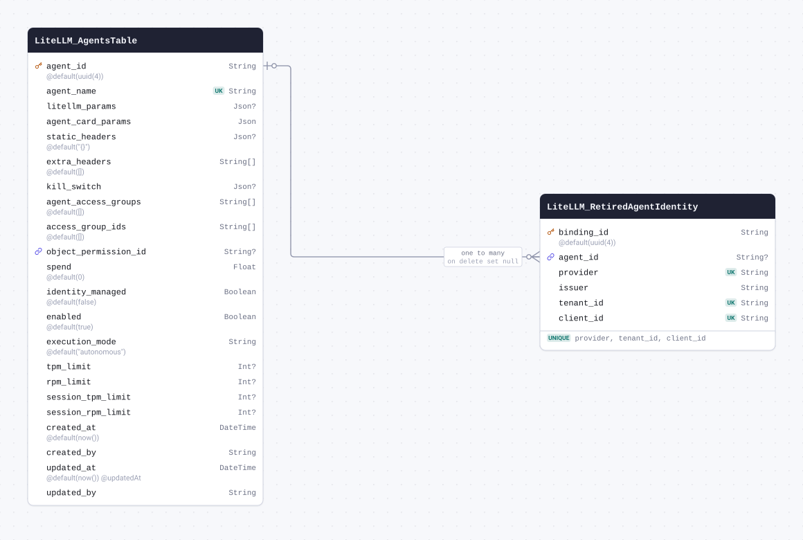

| Field        | Type     | Constraints                                                       | Default   | Description |
| ------------ | -------- | ----------------------------------------------------------------- | --------- | ----------- |
| `binding_id` | `String` | PK NOT NULL                                                       | `uuid(4)` |             |
| `agent_id`   | `String` | NULL → [LiteLLM_AgentsTable.agent_id](#model-LiteLLM_AgentsTable) |           |             |
| `provider`   | `String` | NOT NULL                                                          |           |             |
| `issuer`     | `String` | NOT NULL                                                          |           |             |
| `tenant_id`  | `String` | NOT NULL                                                          |           |             |
| `client_id`  | `String` | NOT NULL                                                          |           |             |

#### Indexes

- `@@unique([provider, tenant_id, client_id])`

#### References

- `agent_id` → [LiteLLM_AgentsTable.agent_id](#model-LiteLLM_AgentsTable) (many-to-one, on delete SetNull)

#### Definition

```sql
CREATE TABLE "LiteLLM_RetiredAgentIdentity" (
    "binding_id" TEXT NOT NULL,
    "agent_id" TEXT,
    "provider" TEXT NOT NULL,
    "issuer" TEXT NOT NULL,
    "tenant_id" TEXT NOT NULL,
    "client_id" TEXT NOT NULL,

    CONSTRAINT "LiteLLM_RetiredAgentIdentity_pkey" PRIMARY KEY ("binding_id")
);

CREATE UNIQUE INDEX "LiteLLM_RetiredAgentIdentity_provider_tenant_id_client_id_key" ON "LiteLLM_RetiredAgentIdentity"("provider", "tenant_id", "client_id");

ALTER TABLE "LiteLLM_RetiredAgentIdentity" ADD CONSTRAINT "LiteLLM_RetiredAgentIdentity_agent_id_fkey" FOREIGN KEY ("agent_id") REFERENCES "LiteLLM_AgentsTable"("agent_id") ON DELETE SET NULL ON UPDATE CASCADE;
```

<details>
<summary>Queries and their SQL</summary>

**findMany**: Every row

```ts
await prisma.liteLLM_RetiredAgentIdentity.findMany();
```

```sql
SELECT
  "public"."LiteLLM_RetiredAgentIdentity"."binding_id",
  "public"."LiteLLM_RetiredAgentIdentity"."agent_id",
  "public"."LiteLLM_RetiredAgentIdentity"."provider",
  "public"."LiteLLM_RetiredAgentIdentity"."issuer",
  "public"."LiteLLM_RetiredAgentIdentity"."tenant_id",
  "public"."LiteLLM_RetiredAgentIdentity"."client_id"
FROM
  "public"."LiteLLM_RetiredAgentIdentity"
WHERE
  1 = 1
OFFSET
  $1
-- params: ["0"]
```

**count**: How many rows there are

```ts
await prisma.liteLLM_RetiredAgentIdentity.count();
```

```sql
SELECT
  COUNT(*) AS "_count$_all"
FROM
  (
    SELECT
      "public"."LiteLLM_RetiredAgentIdentity"."binding_id"
    FROM
      "public"."LiteLLM_RetiredAgentIdentity"
    WHERE
      1 = 1
    OFFSET
      $1
  ) AS "sub"
-- params: ["0"]
```

**findMany**: Every row with its relations

```ts
await prisma.liteLLM_RetiredAgentIdentity.findMany({ include: { agent: true } });
```

```sql
SELECT
  "public"."LiteLLM_RetiredAgentIdentity"."binding_id",
  "public"."LiteLLM_RetiredAgentIdentity"."agent_id",
  "public"."LiteLLM_RetiredAgentIdentity"."provider",
  "public"."LiteLLM_RetiredAgentIdentity"."issuer",
  "public"."LiteLLM_RetiredAgentIdentity"."tenant_id",
  "public"."LiteLLM_RetiredAgentIdentity"."client_id"
FROM
  "public"."LiteLLM_RetiredAgentIdentity"
WHERE
  1 = 1
OFFSET
  $1
-- params: ["0"]

SELECT
  "public"."LiteLLM_AgentsTable"."agent_id",
  "public"."LiteLLM_AgentsTable"."agent_name",
  "public"."LiteLLM_AgentsTable"."litellm_params",
  "public"."LiteLLM_AgentsTable"."agent_card_params",
  "public"."LiteLLM_AgentsTable"."static_headers",
  "public"."LiteLLM_AgentsTable"."extra_headers",
  "public"."LiteLLM_AgentsTable"."kill_switch",
  "public"."LiteLLM_AgentsTable"."agent_access_groups",
  "public"."LiteLLM_AgentsTable"."access_group_ids",
  "public"."LiteLLM_AgentsTable"."object_permission_id",
  "public"."LiteLLM_AgentsTable"."spend",
  "public"."LiteLLM_AgentsTable"."identity_managed",
  "public"."LiteLLM_AgentsTable"."enabled",
  "public"."LiteLLM_AgentsTable"."execution_mode",
  "public"."LiteLLM_AgentsTable"."tpm_limit",
  "public"."LiteLLM_AgentsTable"."rpm_limit",
  "public"."LiteLLM_AgentsTable"."session_tpm_limit",
  "public"."LiteLLM_AgentsTable"."session_rpm_limit",
  "public"."LiteLLM_AgentsTable"."created_at",
  "public"."LiteLLM_AgentsTable"."created_by",
  "public"."LiteLLM_AgentsTable"."updated_at",
  "public"."LiteLLM_AgentsTable"."updated_by"
FROM
  "public"."LiteLLM_AgentsTable"
WHERE
  "public"."LiteLLM_AgentsTable"."agent_id" IN ($1)
OFFSET
  $2
-- params: ["<agent_id of the rows above>","0"]
```

**findUnique**: One row by what is unique to it

```ts
await prisma.liteLLM_RetiredAgentIdentity.findUnique({ where: { binding_id: "example" } });
```

```sql
SELECT
  "public"."LiteLLM_RetiredAgentIdentity"."binding_id",
  "public"."LiteLLM_RetiredAgentIdentity"."agent_id",
  "public"."LiteLLM_RetiredAgentIdentity"."provider",
  "public"."LiteLLM_RetiredAgentIdentity"."issuer",
  "public"."LiteLLM_RetiredAgentIdentity"."tenant_id",
  "public"."LiteLLM_RetiredAgentIdentity"."client_id"
FROM
  "public"."LiteLLM_RetiredAgentIdentity"
WHERE
  (
    "public"."LiteLLM_RetiredAgentIdentity"."binding_id" = $1
    AND 1 = 1
  )
LIMIT
  $2
OFFSET
  $3
-- params: ["example","1","0"]
```

**create**: Create a row

```ts
await prisma.liteLLM_RetiredAgentIdentity.create({
  data: { provider: "example", issuer: "example", tenant_id: "example", client_id: "example" },
});
```

```sql
INSERT INTO
  "public"."LiteLLM_RetiredAgentIdentity" (
    "binding_id",
    "provider",
    "issuer",
    "tenant_id",
    "client_id"
  )
VALUES
  ($1, $2, $3, $4, $5)
RETURNING
  "public"."LiteLLM_RetiredAgentIdentity"."binding_id",
  "public"."LiteLLM_RetiredAgentIdentity"."agent_id",
  "public"."LiteLLM_RetiredAgentIdentity"."provider",
  "public"."LiteLLM_RetiredAgentIdentity"."issuer",
  "public"."LiteLLM_RetiredAgentIdentity"."tenant_id",
  "public"."LiteLLM_RetiredAgentIdentity"."client_id"
-- params: ["<uuid(4)>","example","example","example","example"]
```

**update**: Update a row

```ts
await prisma.liteLLM_RetiredAgentIdentity.update({
  where: { binding_id: "example" },
  data: { provider: "example" },
});
```

```sql
UPDATE "public"."LiteLLM_RetiredAgentIdentity"
SET
  "provider" = $1
WHERE
  (
    "public"."LiteLLM_RetiredAgentIdentity"."binding_id" = $2
    AND 1 = 1
  )
RETURNING
  "public"."LiteLLM_RetiredAgentIdentity"."binding_id",
  "public"."LiteLLM_RetiredAgentIdentity"."agent_id",
  "public"."LiteLLM_RetiredAgentIdentity"."provider",
  "public"."LiteLLM_RetiredAgentIdentity"."issuer",
  "public"."LiteLLM_RetiredAgentIdentity"."tenant_id",
  "public"."LiteLLM_RetiredAgentIdentity"."client_id"
-- params: ["example","example"]
```

**delete**: Delete a row

```ts
await prisma.liteLLM_RetiredAgentIdentity.delete({ where: { binding_id: "example" } });
```

```sql
DELETE FROM "public"."LiteLLM_RetiredAgentIdentity"
WHERE
  (
    "public"."LiteLLM_RetiredAgentIdentity"."binding_id" = $1
    AND 1 = 1
  )
RETURNING
  "public"."LiteLLM_RetiredAgentIdentity"."binding_id",
  "public"."LiteLLM_RetiredAgentIdentity"."agent_id",
  "public"."LiteLLM_RetiredAgentIdentity"."provider",
  "public"."LiteLLM_RetiredAgentIdentity"."issuer",
  "public"."LiteLLM_RetiredAgentIdentity"."tenant_id",
  "public"."LiteLLM_RetiredAgentIdentity"."client_id"
-- params: ["example"]
```

</details>

<a id="model-LiteLLM_RetiredAgent"></a>

### LiteLLM_RetiredAgent

| Field               | Type       | Constraints | Default | Description |
| ------------------- | ---------- | ----------- | ------- | ----------- |
| `original_agent_id` | `String`   | PK NOT NULL |         |             |
| `retired_at`        | `DateTime` | NOT NULL    | `now()` |             |

#### Definition

```sql
CREATE TABLE "LiteLLM_RetiredAgent" (
    "original_agent_id" TEXT NOT NULL,
    "retired_at" TIMESTAMP(3) NOT NULL DEFAULT CURRENT_TIMESTAMP,

    CONSTRAINT "LiteLLM_RetiredAgent_pkey" PRIMARY KEY ("original_agent_id")
);
```

<details>
<summary>Queries and their SQL</summary>

**findMany**: Every row

```ts
await prisma.liteLLM_RetiredAgent.findMany();
```

```sql
SELECT
  "public"."LiteLLM_RetiredAgent"."original_agent_id",
  "public"."LiteLLM_RetiredAgent"."retired_at"
FROM
  "public"."LiteLLM_RetiredAgent"
WHERE
  1 = 1
OFFSET
  $1
-- params: ["0"]
```

**count**: How many rows there are

```ts
await prisma.liteLLM_RetiredAgent.count();
```

```sql
SELECT
  COUNT(*) AS "_count$_all"
FROM
  (
    SELECT
      "public"."LiteLLM_RetiredAgent"."original_agent_id"
    FROM
      "public"."LiteLLM_RetiredAgent"
    WHERE
      1 = 1
    OFFSET
      $1
  ) AS "sub"
-- params: ["0"]
```

**findUnique**: One row by what is unique to it

```ts
await prisma.liteLLM_RetiredAgent.findUnique({ where: { original_agent_id: "example" } });
```

```sql
SELECT
  "public"."LiteLLM_RetiredAgent"."original_agent_id",
  "public"."LiteLLM_RetiredAgent"."retired_at"
FROM
  "public"."LiteLLM_RetiredAgent"
WHERE
  (
    "public"."LiteLLM_RetiredAgent"."original_agent_id" = $1
    AND 1 = 1
  )
LIMIT
  $2
OFFSET
  $3
-- params: ["example","1","0"]
```

**create**: Create a row

```ts
await prisma.liteLLM_RetiredAgent.create({ data: { original_agent_id: "example" } });
```

```sql
INSERT INTO
  "public"."LiteLLM_RetiredAgent" ("original_agent_id", "retired_at")
VALUES
  ($1, $2)
RETURNING
  "public"."LiteLLM_RetiredAgent"."original_agent_id",
  "public"."LiteLLM_RetiredAgent"."retired_at"
-- params: ["example","<now()>"]
```

**update**: Update a row

```ts
await prisma.liteLLM_RetiredAgent.update({
  where: { original_agent_id: "example" },
  data: { retired_at: new Date("2026-01-01T00:00:00.000Z") },
});
```

```sql
UPDATE "public"."LiteLLM_RetiredAgent"
SET
  "retired_at" = $1
WHERE
  (
    "public"."LiteLLM_RetiredAgent"."original_agent_id" = $2
    AND 1 = 1
  )
RETURNING
  "public"."LiteLLM_RetiredAgent"."original_agent_id",
  "public"."LiteLLM_RetiredAgent"."retired_at"
-- params: ["2026-01-01T00:00:00.000Z","example"]
```

**delete**: Delete a row

```ts
await prisma.liteLLM_RetiredAgent.delete({ where: { original_agent_id: "example" } });
```

```sql
DELETE FROM "public"."LiteLLM_RetiredAgent"
WHERE
  (
    "public"."LiteLLM_RetiredAgent"."original_agent_id" = $1
    AND 1 = 1
  )
RETURNING
  "public"."LiteLLM_RetiredAgent"."original_agent_id",
  "public"."LiteLLM_RetiredAgent"."retired_at"
-- params: ["example"]
```

</details>

<a id="model-LiteLLM_VerifiedSubject"></a>

### LiteLLM_VerifiedSubject

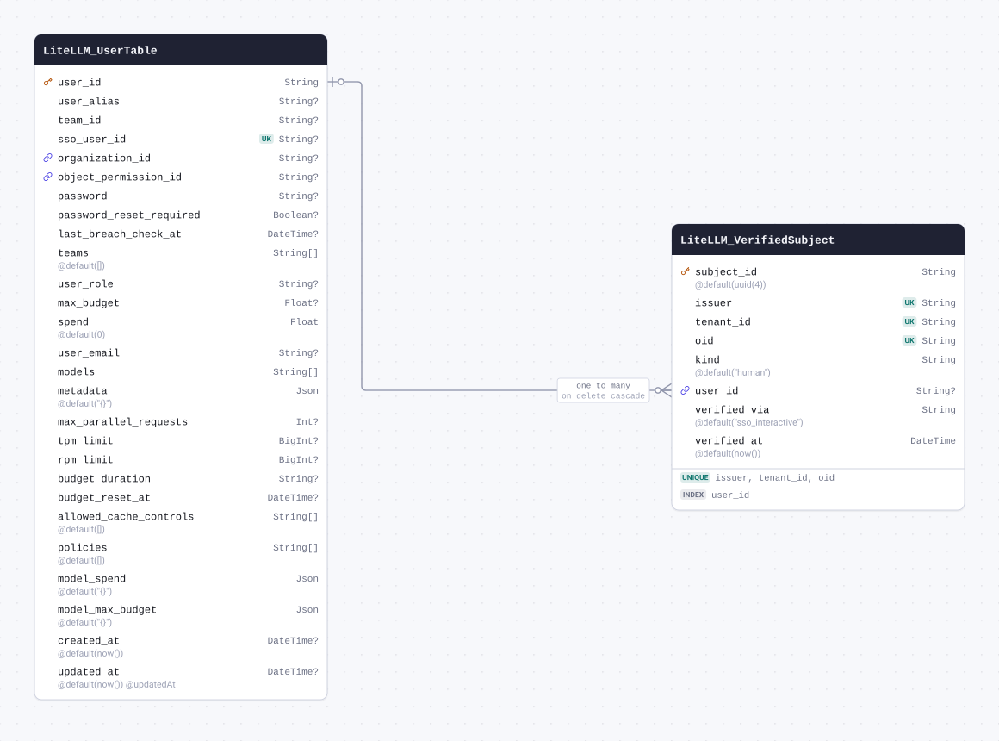

| Field          | Type       | Constraints                                                  | Default             | Description |
| -------------- | ---------- | ------------------------------------------------------------ | ------------------- | ----------- |
| `subject_id`   | `String`   | PK NOT NULL                                                  | `uuid(4)`           |             |
| `issuer`       | `String`   | NOT NULL                                                     |                     |             |
| `tenant_id`    | `String`   | NOT NULL                                                     |                     |             |
| `oid`          | `String`   | NOT NULL                                                     |                     |             |
| `kind`         | `String`   | NOT NULL                                                     | `"human"`           |             |
| `user_id`      | `String`   | NULL → [LiteLLM_UserTable.user_id](#model-LiteLLM_UserTable) |                     |             |
| `verified_via` | `String`   | NOT NULL                                                     | `"sso_interactive"` |             |
| `verified_at`  | `DateTime` | NOT NULL                                                     | `now()`             |             |

#### Indexes

- `@@index([user_id])`
- `@@unique([issuer, tenant_id, oid])`

#### References

- `user_id` → [LiteLLM_UserTable.user_id](#model-LiteLLM_UserTable) (many-to-one, on delete Cascade)

#### Definition

```sql
CREATE TABLE "LiteLLM_VerifiedSubject" (
    "subject_id" TEXT NOT NULL,
    "issuer" TEXT NOT NULL,
    "tenant_id" TEXT NOT NULL,
    "oid" TEXT NOT NULL,
    "kind" TEXT NOT NULL DEFAULT 'human',
    "user_id" TEXT,
    "verified_via" TEXT NOT NULL DEFAULT 'sso_interactive',
    "verified_at" TIMESTAMP(3) NOT NULL DEFAULT CURRENT_TIMESTAMP,

    CONSTRAINT "LiteLLM_VerifiedSubject_pkey" PRIMARY KEY ("subject_id")
);

CREATE INDEX "LiteLLM_VerifiedSubject_user_id_idx" ON "LiteLLM_VerifiedSubject"("user_id");

CREATE UNIQUE INDEX "LiteLLM_VerifiedSubject_issuer_tenant_id_oid_key" ON "LiteLLM_VerifiedSubject"("issuer", "tenant_id", "oid");

ALTER TABLE "LiteLLM_VerifiedSubject" ADD CONSTRAINT "LiteLLM_VerifiedSubject_user_id_fkey" FOREIGN KEY ("user_id") REFERENCES "LiteLLM_UserTable"("user_id") ON DELETE CASCADE ON UPDATE CASCADE;
```

<details>
<summary>Queries and their SQL</summary>

**findMany**: Every row

```ts
await prisma.liteLLM_VerifiedSubject.findMany();
```

```sql
SELECT
  "public"."LiteLLM_VerifiedSubject"."subject_id",
  "public"."LiteLLM_VerifiedSubject"."issuer",
  "public"."LiteLLM_VerifiedSubject"."tenant_id",
  "public"."LiteLLM_VerifiedSubject"."oid",
  "public"."LiteLLM_VerifiedSubject"."kind",
  "public"."LiteLLM_VerifiedSubject"."user_id",
  "public"."LiteLLM_VerifiedSubject"."verified_via",
  "public"."LiteLLM_VerifiedSubject"."verified_at"
FROM
  "public"."LiteLLM_VerifiedSubject"
WHERE
  1 = 1
OFFSET
  $1
-- params: ["0"]
```

**count**: How many rows there are

```ts
await prisma.liteLLM_VerifiedSubject.count();
```

```sql
SELECT
  COUNT(*) AS "_count$_all"
FROM
  (
    SELECT
      "public"."LiteLLM_VerifiedSubject"."subject_id"
    FROM
      "public"."LiteLLM_VerifiedSubject"
    WHERE
      1 = 1
    OFFSET
      $1
  ) AS "sub"
-- params: ["0"]
```

**findMany**: Every row with its relations

```ts
await prisma.liteLLM_VerifiedSubject.findMany({ include: { user: true } });
```

```sql
SELECT
  "public"."LiteLLM_VerifiedSubject"."subject_id",
  "public"."LiteLLM_VerifiedSubject"."issuer",
  "public"."LiteLLM_VerifiedSubject"."tenant_id",
  "public"."LiteLLM_VerifiedSubject"."oid",
  "public"."LiteLLM_VerifiedSubject"."kind",
  "public"."LiteLLM_VerifiedSubject"."user_id",
  "public"."LiteLLM_VerifiedSubject"."verified_via",
  "public"."LiteLLM_VerifiedSubject"."verified_at"
FROM
  "public"."LiteLLM_VerifiedSubject"
WHERE
  1 = 1
OFFSET
  $1
-- params: ["0"]

SELECT
  "public"."LiteLLM_UserTable"."user_id",
  "public"."LiteLLM_UserTable"."user_alias",
  "public"."LiteLLM_UserTable"."team_id",
  "public"."LiteLLM_UserTable"."sso_user_id",
  "public"."LiteLLM_UserTable"."organization_id",
  "public"."LiteLLM_UserTable"."object_permission_id",
  "public"."LiteLLM_UserTable"."password",
  "public"."LiteLLM_UserTable"."password_reset_required",
  "public"."LiteLLM_UserTable"."last_breach_check_at",
  "public"."LiteLLM_UserTable"."teams",
  "public"."LiteLLM_UserTable"."user_role",
  "public"."LiteLLM_UserTable"."max_budget",
  "public"."LiteLLM_UserTable"."spend",
  "public"."LiteLLM_UserTable"."user_email",
  "public"."LiteLLM_UserTable"."models",
  "public"."LiteLLM_UserTable"."metadata",
  "public"."LiteLLM_UserTable"."max_parallel_requests",
  "public"."LiteLLM_UserTable"."tpm_limit",
  "public"."LiteLLM_UserTable"."rpm_limit",
  "public"."LiteLLM_UserTable"."budget_duration",
  "public"."LiteLLM_UserTable"."budget_reset_at",
  "public"."LiteLLM_UserTable"."allowed_cache_controls",
  "public"."LiteLLM_UserTable"."policies",
  "public"."LiteLLM_UserTable"."model_spend",
  "public"."LiteLLM_UserTable"."model_max_budget",
  "public"."LiteLLM_UserTable"."created_at",
  "public"."LiteLLM_UserTable"."updated_at"
FROM
  "public"."LiteLLM_UserTable"
WHERE
  "public"."LiteLLM_UserTable"."user_id" IN ($1)
OFFSET
  $2
-- params: ["<user_id of the rows above>","0"]
```

**findUnique**: One row by what is unique to it

```ts
await prisma.liteLLM_VerifiedSubject.findUnique({ where: { subject_id: "example" } });
```

```sql
SELECT
  "public"."LiteLLM_VerifiedSubject"."subject_id",
  "public"."LiteLLM_VerifiedSubject"."issuer",
  "public"."LiteLLM_VerifiedSubject"."tenant_id",
  "public"."LiteLLM_VerifiedSubject"."oid",
  "public"."LiteLLM_VerifiedSubject"."kind",
  "public"."LiteLLM_VerifiedSubject"."user_id",
  "public"."LiteLLM_VerifiedSubject"."verified_via",
  "public"."LiteLLM_VerifiedSubject"."verified_at"
FROM
  "public"."LiteLLM_VerifiedSubject"
WHERE
  (
    "public"."LiteLLM_VerifiedSubject"."subject_id" = $1
    AND 1 = 1
  )
LIMIT
  $2
OFFSET
  $3
-- params: ["example","1","0"]
```

**create**: Create a row

```ts
await prisma.liteLLM_VerifiedSubject.create({
  data: { issuer: "example", tenant_id: "example", oid: "example" },
});
```

```sql
INSERT INTO
  "public"."LiteLLM_VerifiedSubject" (
    "subject_id",
    "issuer",
    "tenant_id",
    "oid",
    "kind",
    "verified_via",
    "verified_at"
  )
VALUES
  ($1, $2, $3, $4, $5, $6, $7)
RETURNING
  "public"."LiteLLM_VerifiedSubject"."subject_id",
  "public"."LiteLLM_VerifiedSubject"."issuer",
  "public"."LiteLLM_VerifiedSubject"."tenant_id",
  "public"."LiteLLM_VerifiedSubject"."oid",
  "public"."LiteLLM_VerifiedSubject"."kind",
  "public"."LiteLLM_VerifiedSubject"."user_id",
  "public"."LiteLLM_VerifiedSubject"."verified_via",
  "public"."LiteLLM_VerifiedSubject"."verified_at"
-- params: ["<uuid(4)>","example","example","example","human","sso_interactive","<now()>"]
```

**update**: Update a row

```ts
await prisma.liteLLM_VerifiedSubject.update({
  where: { subject_id: "example" },
  data: { issuer: "example" },
});
```

```sql
UPDATE "public"."LiteLLM_VerifiedSubject"
SET
  "issuer" = $1
WHERE
  (
    "public"."LiteLLM_VerifiedSubject"."subject_id" = $2
    AND 1 = 1
  )
RETURNING
  "public"."LiteLLM_VerifiedSubject"."subject_id",
  "public"."LiteLLM_VerifiedSubject"."issuer",
  "public"."LiteLLM_VerifiedSubject"."tenant_id",
  "public"."LiteLLM_VerifiedSubject"."oid",
  "public"."LiteLLM_VerifiedSubject"."kind",
  "public"."LiteLLM_VerifiedSubject"."user_id",
  "public"."LiteLLM_VerifiedSubject"."verified_via",
  "public"."LiteLLM_VerifiedSubject"."verified_at"
-- params: ["example","example"]
```

**delete**: Delete a row

```ts
await prisma.liteLLM_VerifiedSubject.delete({ where: { subject_id: "example" } });
```

```sql
DELETE FROM "public"."LiteLLM_VerifiedSubject"
WHERE
  (
    "public"."LiteLLM_VerifiedSubject"."subject_id" = $1
    AND 1 = 1
  )
RETURNING
  "public"."LiteLLM_VerifiedSubject"."subject_id",
  "public"."LiteLLM_VerifiedSubject"."issuer",
  "public"."LiteLLM_VerifiedSubject"."tenant_id",
  "public"."LiteLLM_VerifiedSubject"."oid",
  "public"."LiteLLM_VerifiedSubject"."kind",
  "public"."LiteLLM_VerifiedSubject"."user_id",
  "public"."LiteLLM_VerifiedSubject"."verified_via",
  "public"."LiteLLM_VerifiedSubject"."verified_at"
-- params: ["example"]
```

</details>

<a id="model-LiteLLM_OrganizationTable"></a>

### LiteLLM_OrganizationTable

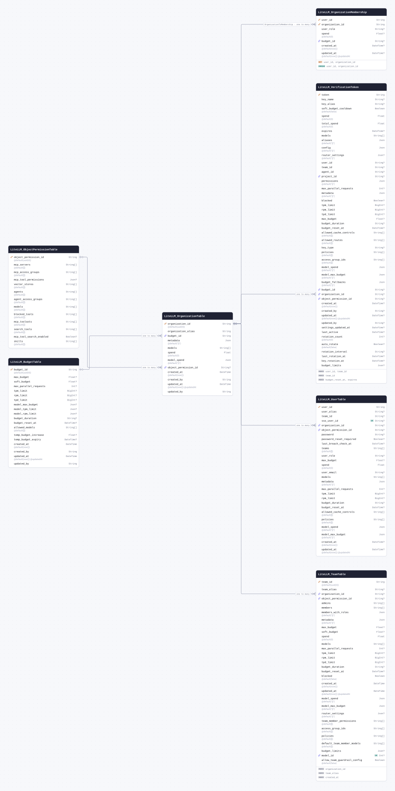

| Field                       | Type       | Constraints                                                                                       | Default              | Description |
| --------------------------- | ---------- | ------------------------------------------------------------------------------------------------- | -------------------- | ----------- |
| `organization_id`           | `String`   | PK NOT NULL                                                                                       | `uuid(4)`            |             |
| `organization_alias`        | `String`   | NOT NULL                                                                                          |                      |             |
| `budget_id`                 | `String`   | NOT NULL → [LiteLLM_BudgetTable.budget_id](#model-LiteLLM_BudgetTable)                            |                      |             |
| `metadata`                  | `Json`     | NOT NULL                                                                                          | `"{}"`               |             |
| `models`                    | `String[]` | NOT NULL                                                                                          |                      |             |
| `spend`                     | `Float`    | NOT NULL                                                                                          | `0`                  |             |
| `model_spend`               | `Json`     | NOT NULL                                                                                          | `"{}"`               |             |
| `object_permission_id`      | `String`   | NULL → [LiteLLM_ObjectPermissionTable.object_permission_id](#model-LiteLLM_ObjectPermissionTable) |                      |             |
| `created_at` (`created_at`) | `DateTime` | NOT NULL                                                                                          | `now()`              |             |
| `created_by`                | `String`   | NOT NULL                                                                                          |                      |             |
| `updated_at` (`updated_at`) | `DateTime` | NOT NULL                                                                                          | `now()` `@updatedAt` |             |
| `updated_by`                | `String`   | NOT NULL                                                                                          |                      |             |

#### References

- `budget_id` → [LiteLLM_BudgetTable.budget_id](#model-LiteLLM_BudgetTable) (many-to-one)
- `object_permission_id` → [LiteLLM_ObjectPermissionTable.object_permission_id](#model-LiteLLM_ObjectPermissionTable) (many-to-one)

#### Referenced by

- `organization_id` ← [LiteLLM_TeamTable.organization_id](#model-LiteLLM_TeamTable) (one-to-many)
- `organization_id` ← [LiteLLM_UserTable.organization_id](#model-LiteLLM_UserTable) (one-to-many)
- `organization_id` ← [LiteLLM_VerificationToken.organization_id](#model-LiteLLM_VerificationToken) (one-to-many)
- `organization_id` ← [LiteLLM_OrganizationMembership.organization_id](#model-LiteLLM_OrganizationMembership) (one-to-many)

#### Definition

```sql
CREATE TABLE "LiteLLM_OrganizationTable" (
    "organization_id" TEXT NOT NULL,
    "organization_alias" TEXT NOT NULL,
    "budget_id" TEXT NOT NULL,
    "metadata" JSONB NOT NULL DEFAULT '{}',
    "models" TEXT[],
    "spend" DOUBLE PRECISION NOT NULL DEFAULT 0.0,
    "model_spend" JSONB NOT NULL DEFAULT '{}',
    "object_permission_id" TEXT,
    "created_at" TIMESTAMP(3) NOT NULL DEFAULT CURRENT_TIMESTAMP,
    "created_by" TEXT NOT NULL,
    "updated_at" TIMESTAMP(3) NOT NULL DEFAULT CURRENT_TIMESTAMP,
    "updated_by" TEXT NOT NULL,

    CONSTRAINT "LiteLLM_OrganizationTable_pkey" PRIMARY KEY ("organization_id")
);

ALTER TABLE "LiteLLM_OrganizationTable" ADD CONSTRAINT "LiteLLM_OrganizationTable_budget_id_fkey" FOREIGN KEY ("budget_id") REFERENCES "LiteLLM_BudgetTable"("budget_id") ON DELETE RESTRICT ON UPDATE CASCADE;

ALTER TABLE "LiteLLM_OrganizationTable" ADD CONSTRAINT "LiteLLM_OrganizationTable_object_permission_id_fkey" FOREIGN KEY ("object_permission_id") REFERENCES "LiteLLM_ObjectPermissionTable"("object_permission_id") ON DELETE SET NULL ON UPDATE CASCADE;
```

<details>
<summary>Queries and their SQL</summary>

**findMany**: Every row

```ts
await prisma.liteLLM_OrganizationTable.findMany();
```

```sql
SELECT
  "public"."LiteLLM_OrganizationTable"."organization_id",
  "public"."LiteLLM_OrganizationTable"."organization_alias",
  "public"."LiteLLM_OrganizationTable"."budget_id",
  "public"."LiteLLM_OrganizationTable"."metadata",
  "public"."LiteLLM_OrganizationTable"."models",
  "public"."LiteLLM_OrganizationTable"."spend",
  "public"."LiteLLM_OrganizationTable"."model_spend",
  "public"."LiteLLM_OrganizationTable"."object_permission_id",
  "public"."LiteLLM_OrganizationTable"."created_at",
  "public"."LiteLLM_OrganizationTable"."created_by",
  "public"."LiteLLM_OrganizationTable"."updated_at",
  "public"."LiteLLM_OrganizationTable"."updated_by"
FROM
  "public"."LiteLLM_OrganizationTable"
WHERE
  1 = 1
OFFSET
  $1
-- params: ["0"]
```

**count**: How many rows there are

```ts
await prisma.liteLLM_OrganizationTable.count();
```

```sql
SELECT
  COUNT(*) AS "_count$_all"
FROM
  (
    SELECT
      "public"."LiteLLM_OrganizationTable"."organization_id"
    FROM
      "public"."LiteLLM_OrganizationTable"
    WHERE
      1 = 1
    OFFSET
      $1
  ) AS "sub"
-- params: ["0"]
```

**findMany**: Every row with its relations

```ts
await prisma.liteLLM_OrganizationTable.findMany({
  include: {
    litellm_budget_table: true,
    teams: true,
    users: true,
    keys: true,
    members: true,
    object_permission: true,
  },
});
```

```sql
SELECT
  "public"."LiteLLM_OrganizationTable"."organization_id",
  "public"."LiteLLM_OrganizationTable"."organization_alias",
  "public"."LiteLLM_OrganizationTable"."budget_id",
  "public"."LiteLLM_OrganizationTable"."metadata",
  "public"."LiteLLM_OrganizationTable"."models",
  "public"."LiteLLM_OrganizationTable"."spend",
  "public"."LiteLLM_OrganizationTable"."model_spend",
  "public"."LiteLLM_OrganizationTable"."object_permission_id",
  "public"."LiteLLM_OrganizationTable"."created_at",
  "public"."LiteLLM_OrganizationTable"."created_by",
  "public"."LiteLLM_OrganizationTable"."updated_at",
  "public"."LiteLLM_OrganizationTable"."updated_by"
FROM
  "public"."LiteLLM_OrganizationTable"
WHERE
  1 = 1
OFFSET
  $1
-- params: ["0"]

SELECT
  "public"."LiteLLM_BudgetTable"."budget_id",
  "public"."LiteLLM_BudgetTable"."max_budget",
  "public"."LiteLLM_BudgetTable"."soft_budget",
  "public"."LiteLLM_BudgetTable"."max_parallel_requests",
  "public"."LiteLLM_BudgetTable"."tpm_limit",
  "public"."LiteLLM_BudgetTable"."rpm_limit",
  "public"."LiteLLM_BudgetTable"."tpd_limit",
  "public"."LiteLLM_BudgetTable"."model_max_budget",
  "public"."LiteLLM_BudgetTable"."model_tpm_limit",
  "public"."LiteLLM_BudgetTable"."model_rpm_limit",
  "public"."LiteLLM_BudgetTable"."budget_duration",
  "public"."LiteLLM_BudgetTable"."budget_reset_at",
  "public"."LiteLLM_BudgetTable"."allowed_models",
  "public"."LiteLLM_BudgetTable"."temp_budget_increase",
  "public"."LiteLLM_BudgetTable"."temp_budget_expiry",
  "public"."LiteLLM_BudgetTable"."created_at",
  "public"."LiteLLM_BudgetTable"."created_by",
  "public"."LiteLLM_BudgetTable"."updated_at",
  "public"."LiteLLM_BudgetTable"."updated_by"
FROM
  "public"."LiteLLM_BudgetTable"
WHERE
  "public"."LiteLLM_BudgetTable"."budget_id" IN ($1)
OFFSET
  $2
-- params: ["<budget_id of the rows above>","0"]

SELECT
  "public"."LiteLLM_TeamTable"."team_id",
  "public"."LiteLLM_TeamTable"."team_alias",
  "public"."LiteLLM_TeamTable"."organization_id",
  "public"."LiteLLM_TeamTable"."object_permission_id",
  "public"."LiteLLM_TeamTable"."admins",
  "public"."LiteLLM_TeamTable"."members",
  "public"."LiteLLM_TeamTable"."members_with_roles",
  "public"."LiteLLM_TeamTable"."metadata",
  "public"."LiteLLM_TeamTable"."max_budget",
  "public"."LiteLLM_TeamTable"."soft_budget",
  "public"."LiteLLM_TeamTable"."spend",
  "public"."LiteLLM_TeamTable"."models",
  "public"."LiteLLM_TeamTable"."max_parallel_requests",
  "public"."LiteLLM_TeamTable"."tpm_limit",
  "public"."LiteLLM_TeamTable"."rpm_limit",
  "public"."LiteLLM_TeamTable"."tpd_limit",
  "public"."LiteLLM_TeamTable"."budget_duration",
  "public"."LiteLLM_TeamTable"."budget_reset_at",
  "public"."LiteLLM_TeamTable"."blocked",
  "public"."LiteLLM_TeamTable"."created_at",
  "public"."LiteLLM_TeamTable"."updated_at",
  "public"."LiteLLM_TeamTable"."model_spend",
  "public"."LiteLLM_TeamTable"."model_max_budget",
  "public"."LiteLLM_TeamTable"."router_settings",
  "public"."LiteLLM_TeamTable"."team_member_permissions",
  "public"."LiteLLM_TeamTable"."access_group_ids",
  "public"."LiteLLM_TeamTable"."policies",
  "public"."LiteLLM_TeamTable"."default_team_member_models",
  "public"."LiteLLM_TeamTable"."budget_limits",
  "public"."LiteLLM_TeamTable"."model_id",
  "public"."LiteLLM_TeamTable"."allow_team_guardrail_config"
FROM
  "public"."LiteLLM_TeamTable"
WHERE
  "public"."LiteLLM_TeamTable"."organization_id" IN ($1)
OFFSET
  $2
-- params: ["<organization_id of the rows above>","0"]

SELECT
  "public"."LiteLLM_UserTable"."user_id",
  "public"."LiteLLM_UserTable"."user_alias",
  "public"."LiteLLM_UserTable"."team_id",
  "public"."LiteLLM_UserTable"."sso_user_id",
  "public"."LiteLLM_UserTable"."organization_id",
  "public"."LiteLLM_UserTable"."object_permission_id",
  "public"."LiteLLM_UserTable"."password",
  "public"."LiteLLM_UserTable"."password_reset_required",
  "public"."LiteLLM_UserTable"."last_breach_check_at",
  "public"."LiteLLM_UserTable"."teams",
  "public"."LiteLLM_UserTable"."user_role",
  "public"."LiteLLM_UserTable"."max_budget",
  "public"."LiteLLM_UserTable"."spend",
  "public"."LiteLLM_UserTable"."user_email",
  "public"."LiteLLM_UserTable"."models",
  "public"."LiteLLM_UserTable"."metadata",
  "public"."LiteLLM_UserTable"."max_parallel_requests",
  "public"."LiteLLM_UserTable"."tpm_limit",
  "public"."LiteLLM_UserTable"."rpm_limit",
  "public"."LiteLLM_UserTable"."budget_duration",
  "public"."LiteLLM_UserTable"."budget_reset_at",
  "public"."LiteLLM_UserTable"."allowed_cache_controls",
  "public"."LiteLLM_UserTable"."policies",
  "public"."LiteLLM_UserTable"."model_spend",
  "public"."LiteLLM_UserTable"."model_max_budget",
  "public"."LiteLLM_UserTable"."created_at",
  "public"."LiteLLM_UserTable"."updated_at"
FROM
  "public"."LiteLLM_UserTable"
WHERE
  "public"."LiteLLM_UserTable"."organization_id" IN ($1)
OFFSET
  $2
-- params: ["<organization_id of the rows above>","0"]

SELECT
  "public"."LiteLLM_VerificationToken"."token",
  "public"."LiteLLM_VerificationToken"."key_name",
  "public"."LiteLLM_VerificationToken"."key_alias",
  "public"."LiteLLM_VerificationToken"."soft_budget_cooldown",
  "public"."LiteLLM_VerificationToken"."spend",
  "public"."LiteLLM_VerificationToken"."total_spend",
  "public"."LiteLLM_VerificationToken"."expires",
  "public"."LiteLLM_VerificationToken"."models",
  "public"."LiteLLM_VerificationToken"."aliases",
  "public"."LiteLLM_VerificationToken"."config",
  "public"."LiteLLM_VerificationToken"."router_settings",
  "public"."LiteLLM_VerificationToken"."user_id",
  "public"."LiteLLM_VerificationToken"."team_id",
  "public"."LiteLLM_VerificationToken"."agent_id",
  "public"."LiteLLM_VerificationToken"."project_id",
  "public"."LiteLLM_VerificationToken"."permissions",
  "public"."LiteLLM_VerificationToken"."max_parallel_requests",
  "public"."LiteLLM_VerificationToken"."metadata",
  "public"."LiteLLM_VerificationToken"."blocked",
  "public"."LiteLLM_VerificationToken"."tpm_limit",
  "public"."LiteLLM_VerificationToken"."rpm_limit",
  "public"."LiteLLM_VerificationToken"."tpd_limit",
  "public"."LiteLLM_VerificationToken"."max_budget",
  "public"."LiteLLM_VerificationToken"."budget_duration",
  "public"."LiteLLM_VerificationToken"."budget_reset_at",
  "public"."LiteLLM_VerificationToken"."allowed_cache_controls",
  "public"."LiteLLM_VerificationToken"."allowed_routes",
  "public"."LiteLLM_VerificationToken"."key_type",
  "public"."LiteLLM_VerificationToken"."policies",
  "public"."LiteLLM_VerificationToken"."access_group_ids",
  "public"."LiteLLM_VerificationToken"."model_spend",
  "public"."LiteLLM_VerificationToken"."model_max_budget",
  "public"."LiteLLM_VerificationToken"."budget_fallbacks",
  "public"."LiteLLM_VerificationToken"."budget_id",
  "public"."LiteLLM_VerificationToken"."organization_id",
  "public"."LiteLLM_VerificationToken"."object_permission_id",
  "public"."LiteLLM_VerificationToken"."created_at",
  "public"."LiteLLM_VerificationToken"."created_by",
  "public"."LiteLLM_VerificationToken"."updated_at",
  "public"."LiteLLM_VerificationToken"."updated_by",
  "public"."LiteLLM_VerificationToken"."settings_updated_at",
  "public"."LiteLLM_VerificationToken"."last_active",
  "public"."LiteLLM_VerificationToken"."rotation_count",
  "public"."LiteLLM_VerificationToken"."auto_rotate",
  "public"."LiteLLM_VerificationToken"."rotation_interval",
  "public"."LiteLLM_VerificationToken"."last_rotation_at",
  "public"."LiteLLM_VerificationToken"."key_rotation_at",
  "public"."LiteLLM_VerificationToken"."budget_limits"
FROM
  "public"."LiteLLM_VerificationToken"
WHERE
  "public"."LiteLLM_VerificationToken"."organization_id" IN ($1)
OFFSET
  $2
-- params: ["<organization_id of the rows above>","0"]

SELECT
  "public"."LiteLLM_OrganizationMembership"."user_id",
  "public"."LiteLLM_OrganizationMembership"."organization_id",
  "public"."LiteLLM_OrganizationMembership"."user_role",
  "public"."LiteLLM_OrganizationMembership"."spend",
  "public"."LiteLLM_OrganizationMembership"."budget_id",
  "public"."LiteLLM_OrganizationMembership"."created_at",
  "public"."LiteLLM_OrganizationMembership"."updated_at"
FROM
  "public"."LiteLLM_OrganizationMembership"
WHERE
  "public"."LiteLLM_OrganizationMembership"."organization_id" IN ($1)
OFFSET
  $2
-- params: ["<organization_id of the rows above>","0"]

SELECT
  "public"."LiteLLM_ObjectPermissionTable"."object_permission_id",
  "public"."LiteLLM_ObjectPermissionTable"."mcp_servers",
  "public"."LiteLLM_ObjectPermissionTable"."mcp_access_groups",
  "public"."LiteLLM_ObjectPermissionTable"."mcp_tool_permissions",
  "public"."LiteLLM_ObjectPermissionTable"."vector_stores",
  "public"."LiteLLM_ObjectPermissionTable"."agents",
  "public"."LiteLLM_ObjectPermissionTable"."agent_access_groups",
  "public"."LiteLLM_ObjectPermissionTable"."models",
  "public"."LiteLLM_ObjectPermissionTable"."blocked_tools",
  "public"."LiteLLM_ObjectPermissionTable"."mcp_toolsets",
  "public"."LiteLLM_ObjectPermissionTable"."search_tools",
  "public"."LiteLLM_ObjectPermissionTable"."mcp_tool_search_enabled",
  "public"."LiteLLM_ObjectPermissionTable"."skills"
FROM
  "public"."LiteLLM_ObjectPermissionTable"
WHERE
  "public"."LiteLLM_ObjectPermissionTable"."object_permission_id" IN ($1)
OFFSET
  $2
-- params: ["<object_permission_id of the rows above>","0"]
```

**findUnique**: One row by what is unique to it

```ts
await prisma.liteLLM_OrganizationTable.findUnique({ where: { organization_id: "example" } });
```

```sql
SELECT
  "public"."LiteLLM_OrganizationTable"."organization_id",
  "public"."LiteLLM_OrganizationTable"."organization_alias",
  "public"."LiteLLM_OrganizationTable"."budget_id",
  "public"."LiteLLM_OrganizationTable"."metadata",
  "public"."LiteLLM_OrganizationTable"."models",
  "public"."LiteLLM_OrganizationTable"."spend",
  "public"."LiteLLM_OrganizationTable"."model_spend",
  "public"."LiteLLM_OrganizationTable"."object_permission_id",
  "public"."LiteLLM_OrganizationTable"."created_at",
  "public"."LiteLLM_OrganizationTable"."created_by",
  "public"."LiteLLM_OrganizationTable"."updated_at",
  "public"."LiteLLM_OrganizationTable"."updated_by"
FROM
  "public"."LiteLLM_OrganizationTable"
WHERE
  (
    "public"."LiteLLM_OrganizationTable"."organization_id" = $1
    AND 1 = 1
  )
LIMIT
  $2
OFFSET
  $3
-- params: ["example","1","0"]
```

**create**: Create a row

```ts
await prisma.liteLLM_OrganizationTable.create({
  data: {
    organization_alias: "example",
    budget_id: "example",
    models: ["example"],
    created_by: "example",
    updated_by: "example",
  },
});
```

```sql
INSERT INTO
  "public"."LiteLLM_OrganizationTable" (
    "organization_id",
    "organization_alias",
    "budget_id",
    "metadata",
    "models",
    "spend",
    "model_spend",
    "created_at",
    "created_by",
    "updated_at",
    "updated_by"
  )
VALUES
  ($1, $2, $3, $4, $5, $6, $7, $8, $9, $10, $11)
RETURNING
  "public"."LiteLLM_OrganizationTable"."organization_id",
  "public"."LiteLLM_OrganizationTable"."organization_alias",
  "public"."LiteLLM_OrganizationTable"."budget_id",
  "public"."LiteLLM_OrganizationTable"."metadata",
  "public"."LiteLLM_OrganizationTable"."models",
  "public"."LiteLLM_OrganizationTable"."spend",
  "public"."LiteLLM_OrganizationTable"."model_spend",
  "public"."LiteLLM_OrganizationTable"."object_permission_id",
  "public"."LiteLLM_OrganizationTable"."created_at",
  "public"."LiteLLM_OrganizationTable"."created_by",
  "public"."LiteLLM_OrganizationTable"."updated_at",
  "public"."LiteLLM_OrganizationTable"."updated_by"
-- params: ["<uuid(4)>","example","example","{}",["example"],"0.0","{}","<now()>","example","<now()>","example"]
```

**update**: Update a row

```ts
await prisma.liteLLM_OrganizationTable.update({
  where: { organization_id: "example" },
  data: { organization_alias: "example" },
});
```

```sql
UPDATE "public"."LiteLLM_OrganizationTable"
SET
  "organization_alias" = $1,
  "updated_at" = $2
WHERE
  (
    "public"."LiteLLM_OrganizationTable"."organization_id" = $3
    AND 1 = 1
  )
RETURNING
  "public"."LiteLLM_OrganizationTable"."organization_id",
  "public"."LiteLLM_OrganizationTable"."organization_alias",
  "public"."LiteLLM_OrganizationTable"."budget_id",
  "public"."LiteLLM_OrganizationTable"."metadata",
  "public"."LiteLLM_OrganizationTable"."models",
  "public"."LiteLLM_OrganizationTable"."spend",
  "public"."LiteLLM_OrganizationTable"."model_spend",
  "public"."LiteLLM_OrganizationTable"."object_permission_id",
  "public"."LiteLLM_OrganizationTable"."created_at",
  "public"."LiteLLM_OrganizationTable"."created_by",
  "public"."LiteLLM_OrganizationTable"."updated_at",
  "public"."LiteLLM_OrganizationTable"."updated_by"
-- params: ["example",{"prisma__type":"generatorCall","prisma__value":{"name":"now","args":[],"returnType":{"type":"DateTime"}}},"example"]
```

**delete**: Delete a row

```ts
await prisma.liteLLM_OrganizationTable.delete({ where: { organization_id: "example" } });
```

```sql
DELETE FROM "public"."LiteLLM_OrganizationTable"
WHERE
  (
    "public"."LiteLLM_OrganizationTable"."organization_id" = $1
    AND 1 = 1
  )
RETURNING
  "public"."LiteLLM_OrganizationTable"."organization_id",
  "public"."LiteLLM_OrganizationTable"."organization_alias",
  "public"."LiteLLM_OrganizationTable"."budget_id",
  "public"."LiteLLM_OrganizationTable"."metadata",
  "public"."LiteLLM_OrganizationTable"."models",
  "public"."LiteLLM_OrganizationTable"."spend",
  "public"."LiteLLM_OrganizationTable"."model_spend",
  "public"."LiteLLM_OrganizationTable"."object_permission_id",
  "public"."LiteLLM_OrganizationTable"."created_at",
  "public"."LiteLLM_OrganizationTable"."created_by",
  "public"."LiteLLM_OrganizationTable"."updated_at",
  "public"."LiteLLM_OrganizationTable"."updated_by"
-- params: ["example"]
```

</details>

<a id="model-LiteLLM_ModelTable"></a>

### LiteLLM_ModelTable

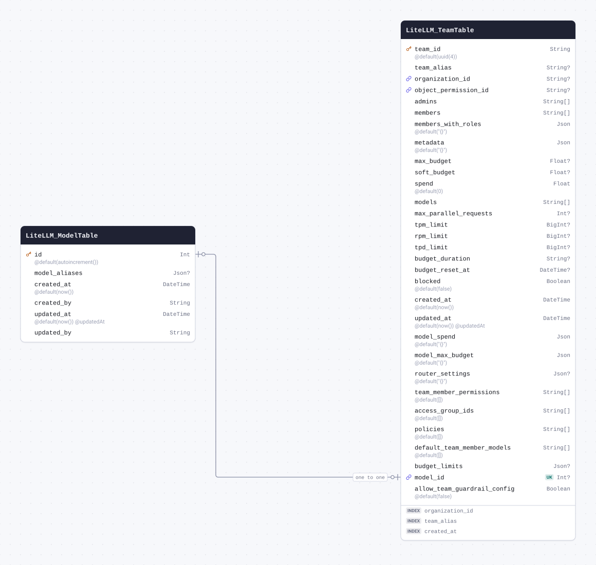

| Field                       | Type       | Constraints | Default              | Description |
| --------------------------- | ---------- | ----------- | -------------------- | ----------- |
| `id`                        | `Int`      | PK NOT NULL | `autoincrement()`    |             |
| `model_aliases` (`aliases`) | `Json`     | NULL        |                      |             |
| `created_at` (`created_at`) | `DateTime` | NOT NULL    | `now()`              |             |
| `created_by`                | `String`   | NOT NULL    |                      |             |
| `updated_at` (`updated_at`) | `DateTime` | NOT NULL    | `now()` `@updatedAt` |             |
| `updated_by`                | `String`   | NOT NULL    |                      |             |

#### Referenced by

- `id` ← [LiteLLM_TeamTable.model_id](#model-LiteLLM_TeamTable) (one-to-one)

#### Definition

```sql
CREATE TABLE "LiteLLM_ModelTable" (
    "id" SERIAL NOT NULL,
    "aliases" JSONB,
    "created_at" TIMESTAMP(3) NOT NULL DEFAULT CURRENT_TIMESTAMP,
    "created_by" TEXT NOT NULL,
    "updated_at" TIMESTAMP(3) NOT NULL DEFAULT CURRENT_TIMESTAMP,
    "updated_by" TEXT NOT NULL,

    CONSTRAINT "LiteLLM_ModelTable_pkey" PRIMARY KEY ("id")
);
```

<details>
<summary>Queries and their SQL</summary>

**findMany**: Every row

```ts
await prisma.liteLLM_ModelTable.findMany();
```

```sql
SELECT
  "public"."LiteLLM_ModelTable"."id",
  "public"."LiteLLM_ModelTable"."aliases",
  "public"."LiteLLM_ModelTable"."created_at",
  "public"."LiteLLM_ModelTable"."created_by",
  "public"."LiteLLM_ModelTable"."updated_at",
  "public"."LiteLLM_ModelTable"."updated_by"
FROM
  "public"."LiteLLM_ModelTable"
WHERE
  1 = 1
OFFSET
  $1
-- params: ["0"]
```

**count**: How many rows there are

```ts
await prisma.liteLLM_ModelTable.count();
```

```sql
SELECT
  COUNT(*) AS "_count$_all"
FROM
  (
    SELECT
      "public"."LiteLLM_ModelTable"."id"
    FROM
      "public"."LiteLLM_ModelTable"
    WHERE
      1 = 1
    OFFSET
      $1
  ) AS "sub"
-- params: ["0"]
```

**findMany**: Every row with its relations

```ts
await prisma.liteLLM_ModelTable.findMany({ include: { team: true } });
```

```sql
SELECT
  "public"."LiteLLM_ModelTable"."id",
  "public"."LiteLLM_ModelTable"."aliases",
  "public"."LiteLLM_ModelTable"."created_at",
  "public"."LiteLLM_ModelTable"."created_by",
  "public"."LiteLLM_ModelTable"."updated_at",
  "public"."LiteLLM_ModelTable"."updated_by"
FROM
  "public"."LiteLLM_ModelTable"
WHERE
  1 = 1
OFFSET
  $1
-- params: ["0"]

SELECT
  "public"."LiteLLM_TeamTable"."team_id",
  "public"."LiteLLM_TeamTable"."team_alias",
  "public"."LiteLLM_TeamTable"."organization_id",
  "public"."LiteLLM_TeamTable"."object_permission_id",
  "public"."LiteLLM_TeamTable"."admins",
  "public"."LiteLLM_TeamTable"."members",
  "public"."LiteLLM_TeamTable"."members_with_roles",
  "public"."LiteLLM_TeamTable"."metadata",
  "public"."LiteLLM_TeamTable"."max_budget",
  "public"."LiteLLM_TeamTable"."soft_budget",
  "public"."LiteLLM_TeamTable"."spend",
  "public"."LiteLLM_TeamTable"."models",
  "public"."LiteLLM_TeamTable"."max_parallel_requests",
  "public"."LiteLLM_TeamTable"."tpm_limit",
  "public"."LiteLLM_TeamTable"."rpm_limit",
  "public"."LiteLLM_TeamTable"."tpd_limit",
  "public"."LiteLLM_TeamTable"."budget_duration",
  "public"."LiteLLM_TeamTable"."budget_reset_at",
  "public"."LiteLLM_TeamTable"."blocked",
  "public"."LiteLLM_TeamTable"."created_at",
  "public"."LiteLLM_TeamTable"."updated_at",
  "public"."LiteLLM_TeamTable"."model_spend",
  "public"."LiteLLM_TeamTable"."model_max_budget",
  "public"."LiteLLM_TeamTable"."router_settings",
  "public"."LiteLLM_TeamTable"."team_member_permissions",
  "public"."LiteLLM_TeamTable"."access_group_ids",
  "public"."LiteLLM_TeamTable"."policies",
  "public"."LiteLLM_TeamTable"."default_team_member_models",
  "public"."LiteLLM_TeamTable"."budget_limits",
  "public"."LiteLLM_TeamTable"."model_id",
  "public"."LiteLLM_TeamTable"."allow_team_guardrail_config"
FROM
  "public"."LiteLLM_TeamTable"
WHERE
  "public"."LiteLLM_TeamTable"."model_id" IN ($1)
OFFSET
  $2
-- params: ["<id of the rows above>","0"]
```

**findUnique**: One row by what is unique to it

```ts
await prisma.liteLLM_ModelTable.findUnique({ where: { id: 1 } });
```

```sql
SELECT
  "public"."LiteLLM_ModelTable"."id",
  "public"."LiteLLM_ModelTable"."aliases",
  "public"."LiteLLM_ModelTable"."created_at",
  "public"."LiteLLM_ModelTable"."created_by",
  "public"."LiteLLM_ModelTable"."updated_at",
  "public"."LiteLLM_ModelTable"."updated_by"
FROM
  "public"."LiteLLM_ModelTable"
WHERE
  (
    "public"."LiteLLM_ModelTable"."id" = $1
    AND 1 = 1
  )
LIMIT
  $2
OFFSET
  $3
-- params: ["1","1","0"]
```

**create**: Create a row

```ts
await prisma.liteLLM_ModelTable.create({ data: { created_by: "example", updated_by: "example" } });
```

```sql
INSERT INTO
  "public"."LiteLLM_ModelTable" (
    "created_at",
    "created_by",
    "updated_at",
    "updated_by"
  )
VALUES
  ($1, $2, $3, $4)
RETURNING
  "public"."LiteLLM_ModelTable"."id",
  "public"."LiteLLM_ModelTable"."aliases",
  "public"."LiteLLM_ModelTable"."created_at",
  "public"."LiteLLM_ModelTable"."created_by",
  "public"."LiteLLM_ModelTable"."updated_at",
  "public"."LiteLLM_ModelTable"."updated_by"
-- params: ["<now()>","example","<now()>","example"]
```

**update**: Update a row

```ts
await prisma.liteLLM_ModelTable.update({ where: { id: 1 }, data: { model_aliases: {} } });
```

```sql
UPDATE "public"."LiteLLM_ModelTable"
SET
  "aliases" = $1,
  "updated_at" = $2
WHERE
  (
    "public"."LiteLLM_ModelTable"."id" = $3
    AND 1 = 1
  )
RETURNING
  "public"."LiteLLM_ModelTable"."id",
  "public"."LiteLLM_ModelTable"."aliases",
  "public"."LiteLLM_ModelTable"."created_at",
  "public"."LiteLLM_ModelTable"."created_by",
  "public"."LiteLLM_ModelTable"."updated_at",
  "public"."LiteLLM_ModelTable"."updated_by"
-- params: ["{}",{"prisma__type":"generatorCall","prisma__value":{"name":"now","args":[],"returnType":{"type":"DateTime"}}},"1"]
```

**delete**: Delete a row

```ts
await prisma.liteLLM_ModelTable.delete({ where: { id: 1 } });
```

```sql
DELETE FROM "public"."LiteLLM_ModelTable"
WHERE
  (
    "public"."LiteLLM_ModelTable"."id" = $1
    AND 1 = 1
  )
RETURNING
  "public"."LiteLLM_ModelTable"."id",
  "public"."LiteLLM_ModelTable"."aliases",
  "public"."LiteLLM_ModelTable"."created_at",
  "public"."LiteLLM_ModelTable"."created_by",
  "public"."LiteLLM_ModelTable"."updated_at",
  "public"."LiteLLM_ModelTable"."updated_by"
-- params: ["1"]
```

</details>

<a id="model-LiteLLM_TeamTable"></a>

### LiteLLM_TeamTable

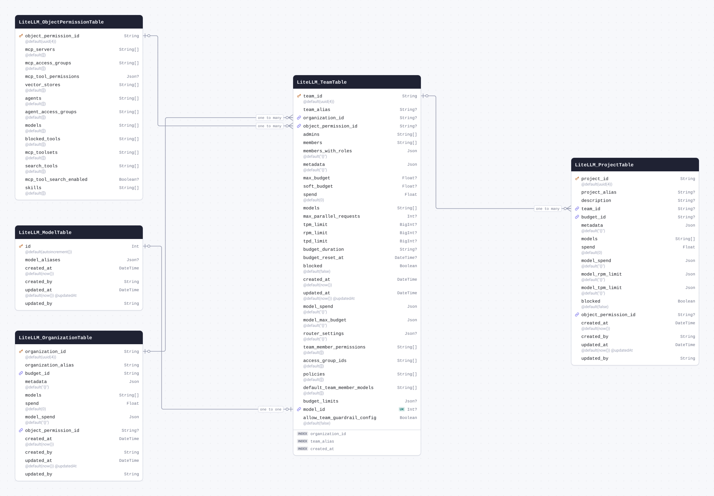

| Field                         | Type       | Constraints                                                                                       | Default              | Description |
| ----------------------------- | ---------- | ------------------------------------------------------------------------------------------------- | -------------------- | ----------- |
| `team_id`                     | `String`   | PK NOT NULL                                                                                       | `uuid(4)`            |             |
| `team_alias`                  | `String`   | NULL                                                                                              |                      |             |
| `organization_id`             | `String`   | NULL → [LiteLLM_OrganizationTable.organization_id](#model-LiteLLM_OrganizationTable)              |                      |             |
| `object_permission_id`        | `String`   | NULL → [LiteLLM_ObjectPermissionTable.object_permission_id](#model-LiteLLM_ObjectPermissionTable) |                      |             |
| `admins`                      | `String[]` | NOT NULL                                                                                          |                      |             |
| `members`                     | `String[]` | NOT NULL                                                                                          |                      |             |
| `members_with_roles`          | `Json`     | NOT NULL                                                                                          | `"{}"`               |             |
| `metadata`                    | `Json`     | NOT NULL                                                                                          | `"{}"`               |             |
| `max_budget`                  | `Float`    | NULL                                                                                              |                      |             |
| `soft_budget`                 | `Float`    | NULL                                                                                              |                      |             |
| `spend`                       | `Float`    | NOT NULL                                                                                          | `0`                  |             |
| `models`                      | `String[]` | NOT NULL                                                                                          |                      |             |
| `max_parallel_requests`       | `Int`      | NULL                                                                                              |                      |             |
| `tpm_limit`                   | `BigInt`   | NULL                                                                                              |                      |             |
| `rpm_limit`                   | `BigInt`   | NULL                                                                                              |                      |             |
| `tpd_limit`                   | `BigInt`   | NULL                                                                                              |                      |             |
| `budget_duration`             | `String`   | NULL                                                                                              |                      |             |
| `budget_reset_at`             | `DateTime` | NULL                                                                                              |                      |             |
| `blocked`                     | `Boolean`  | NOT NULL                                                                                          | `false`              |             |
| `created_at` (`created_at`)   | `DateTime` | NOT NULL                                                                                          | `now()`              |             |
| `updated_at` (`updated_at`)   | `DateTime` | NOT NULL                                                                                          | `now()` `@updatedAt` |             |
| `model_spend`                 | `Json`     | NOT NULL                                                                                          | `"{}"`               |             |
| `model_max_budget`            | `Json`     | NOT NULL                                                                                          | `"{}"`               |             |
| `router_settings`             | `Json`     | NULL                                                                                              | `"{}"`               |             |
| `team_member_permissions`     | `String[]` | NOT NULL                                                                                          | `[]`                 |             |
| `access_group_ids`            | `String[]` | NOT NULL                                                                                          | `[]`                 |             |
| `policies`                    | `String[]` | NOT NULL                                                                                          | `[]`                 |             |
| `default_team_member_models`  | `String[]` | NOT NULL                                                                                          | `[]`                 |             |
| `budget_limits`               | `Json`     | NULL                                                                                              |                      |             |
| `model_id`                    | `Int`      | UNIQUE NULL → [LiteLLM_ModelTable.id](#model-LiteLLM_ModelTable)                                  |                      |             |
| `allow_team_guardrail_config` | `Boolean`  | NOT NULL                                                                                          | `false`              |             |

#### Indexes

- `@@index([organization_id])`
- `@@index([team_alias])`
- `@@index([created_at])`

#### References

- `organization_id` → [LiteLLM_OrganizationTable.organization_id](#model-LiteLLM_OrganizationTable) (many-to-one)
- `model_id` → [LiteLLM_ModelTable.id](#model-LiteLLM_ModelTable) (one-to-one)
- `object_permission_id` → [LiteLLM_ObjectPermissionTable.object_permission_id](#model-LiteLLM_ObjectPermissionTable) (many-to-one)

#### Referenced by

- `team_id` ← [LiteLLM_ProjectTable.team_id](#model-LiteLLM_ProjectTable) (one-to-many)

#### Definition

```sql
CREATE TABLE "LiteLLM_TeamTable" (
    "team_id" TEXT NOT NULL,
    "team_alias" TEXT,
    "organization_id" TEXT,
    "object_permission_id" TEXT,
    "admins" TEXT[],
    "members" TEXT[],
    "members_with_roles" JSONB NOT NULL DEFAULT '{}',
    "metadata" JSONB NOT NULL DEFAULT '{}',
    "max_budget" DOUBLE PRECISION,
    "soft_budget" DOUBLE PRECISION,
    "spend" DOUBLE PRECISION NOT NULL DEFAULT 0.0,
    "models" TEXT[],
    "max_parallel_requests" INTEGER,
    "tpm_limit" BIGINT,
    "rpm_limit" BIGINT,
    "tpd_limit" BIGINT,
    "budget_duration" TEXT,
    "budget_reset_at" TIMESTAMP(3),
    "blocked" BOOLEAN NOT NULL DEFAULT false,
    "created_at" TIMESTAMP(3) NOT NULL DEFAULT CURRENT_TIMESTAMP,
    "updated_at" TIMESTAMP(3) NOT NULL DEFAULT CURRENT_TIMESTAMP,
    "model_spend" JSONB NOT NULL DEFAULT '{}',
    "model_max_budget" JSONB NOT NULL DEFAULT '{}',
    "router_settings" JSONB DEFAULT '{}',
    "team_member_permissions" TEXT[] DEFAULT ARRAY[]::TEXT[],
    "access_group_ids" TEXT[] DEFAULT ARRAY[]::TEXT[],
    "policies" TEXT[] DEFAULT ARRAY[]::TEXT[],
    "default_team_member_models" TEXT[] DEFAULT ARRAY[]::TEXT[],
    "budget_limits" JSONB,
    "model_id" INTEGER,
    "allow_team_guardrail_config" BOOLEAN NOT NULL DEFAULT false,

    CONSTRAINT "LiteLLM_TeamTable_pkey" PRIMARY KEY ("team_id")
);

CREATE UNIQUE INDEX "LiteLLM_TeamTable_model_id_key" ON "LiteLLM_TeamTable"("model_id");

CREATE INDEX "LiteLLM_TeamTable_organization_id_idx" ON "LiteLLM_TeamTable"("organization_id");

CREATE INDEX "LiteLLM_TeamTable_team_alias_idx" ON "LiteLLM_TeamTable"("team_alias");

CREATE INDEX "LiteLLM_TeamTable_created_at_idx" ON "LiteLLM_TeamTable"("created_at");

ALTER TABLE "LiteLLM_TeamTable" ADD CONSTRAINT "LiteLLM_TeamTable_organization_id_fkey" FOREIGN KEY ("organization_id") REFERENCES "LiteLLM_OrganizationTable"("organization_id") ON DELETE SET NULL ON UPDATE CASCADE;

ALTER TABLE "LiteLLM_TeamTable" ADD CONSTRAINT "LiteLLM_TeamTable_model_id_fkey" FOREIGN KEY ("model_id") REFERENCES "LiteLLM_ModelTable"("id") ON DELETE SET NULL ON UPDATE CASCADE;

ALTER TABLE "LiteLLM_TeamTable" ADD CONSTRAINT "LiteLLM_TeamTable_object_permission_id_fkey" FOREIGN KEY ("object_permission_id") REFERENCES "LiteLLM_ObjectPermissionTable"("object_permission_id") ON DELETE SET NULL ON UPDATE CASCADE;
```

<details>
<summary>Queries and their SQL</summary>

**findMany**: Every row

```ts
await prisma.liteLLM_TeamTable.findMany();
```

```sql
SELECT
  "public"."LiteLLM_TeamTable"."team_id",
  "public"."LiteLLM_TeamTable"."team_alias",
  "public"."LiteLLM_TeamTable"."organization_id",
  "public"."LiteLLM_TeamTable"."object_permission_id",
  "public"."LiteLLM_TeamTable"."admins",
  "public"."LiteLLM_TeamTable"."members",
  "public"."LiteLLM_TeamTable"."members_with_roles",
  "public"."LiteLLM_TeamTable"."metadata",
  "public"."LiteLLM_TeamTable"."max_budget",
  "public"."LiteLLM_TeamTable"."soft_budget",
  "public"."LiteLLM_TeamTable"."spend",
  "public"."LiteLLM_TeamTable"."models",
  "public"."LiteLLM_TeamTable"."max_parallel_requests",
  "public"."LiteLLM_TeamTable"."tpm_limit",
  "public"."LiteLLM_TeamTable"."rpm_limit",
  "public"."LiteLLM_TeamTable"."tpd_limit",
  "public"."LiteLLM_TeamTable"."budget_duration",
  "public"."LiteLLM_TeamTable"."budget_reset_at",
  "public"."LiteLLM_TeamTable"."blocked",
  "public"."LiteLLM_TeamTable"."created_at",
  "public"."LiteLLM_TeamTable"."updated_at",
  "public"."LiteLLM_TeamTable"."model_spend",
  "public"."LiteLLM_TeamTable"."model_max_budget",
  "public"."LiteLLM_TeamTable"."router_settings",
  "public"."LiteLLM_TeamTable"."team_member_permissions",
  "public"."LiteLLM_TeamTable"."access_group_ids",
  "public"."LiteLLM_TeamTable"."policies",
  "public"."LiteLLM_TeamTable"."default_team_member_models",
  "public"."LiteLLM_TeamTable"."budget_limits",
  "public"."LiteLLM_TeamTable"."model_id",
  "public"."LiteLLM_TeamTable"."allow_team_guardrail_config"
FROM
  "public"."LiteLLM_TeamTable"
WHERE
  1 = 1
OFFSET
  $1
-- params: ["0"]
```

**count**: How many rows there are

```ts
await prisma.liteLLM_TeamTable.count();
```

```sql
SELECT
  COUNT(*) AS "_count$_all"
FROM
  (
    SELECT
      "public"."LiteLLM_TeamTable"."team_id"
    FROM
      "public"."LiteLLM_TeamTable"
    WHERE
      1 = 1
    OFFSET
      $1
  ) AS "sub"
-- params: ["0"]
```

**findMany**: Every row with its relations

```ts
await prisma.liteLLM_TeamTable.findMany({
  include: {
    litellm_organization_table: true,
    litellm_model_table: true,
    object_permission: true,
    projects: true,
  },
});
```

```sql
SELECT
  "public"."LiteLLM_TeamTable"."team_id",
  "public"."LiteLLM_TeamTable"."team_alias",
  "public"."LiteLLM_TeamTable"."organization_id",
  "public"."LiteLLM_TeamTable"."object_permission_id",
  "public"."LiteLLM_TeamTable"."admins",
  "public"."LiteLLM_TeamTable"."members",
  "public"."LiteLLM_TeamTable"."members_with_roles",
  "public"."LiteLLM_TeamTable"."metadata",
  "public"."LiteLLM_TeamTable"."max_budget",
  "public"."LiteLLM_TeamTable"."soft_budget",
  "public"."LiteLLM_TeamTable"."spend",
  "public"."LiteLLM_TeamTable"."models",
  "public"."LiteLLM_TeamTable"."max_parallel_requests",
  "public"."LiteLLM_TeamTable"."tpm_limit",
  "public"."LiteLLM_TeamTable"."rpm_limit",
  "public"."LiteLLM_TeamTable"."tpd_limit",
  "public"."LiteLLM_TeamTable"."budget_duration",
  "public"."LiteLLM_TeamTable"."budget_reset_at",
  "public"."LiteLLM_TeamTable"."blocked",
  "public"."LiteLLM_TeamTable"."created_at",
  "public"."LiteLLM_TeamTable"."updated_at",
  "public"."LiteLLM_TeamTable"."model_spend",
  "public"."LiteLLM_TeamTable"."model_max_budget",
  "public"."LiteLLM_TeamTable"."router_settings",
  "public"."LiteLLM_TeamTable"."team_member_permissions",
  "public"."LiteLLM_TeamTable"."access_group_ids",
  "public"."LiteLLM_TeamTable"."policies",
  "public"."LiteLLM_TeamTable"."default_team_member_models",
  "public"."LiteLLM_TeamTable"."budget_limits",
  "public"."LiteLLM_TeamTable"."model_id",
  "public"."LiteLLM_TeamTable"."allow_team_guardrail_config"
FROM
  "public"."LiteLLM_TeamTable"
WHERE
  1 = 1
OFFSET
  $1
-- params: ["0"]

SELECT
  "public"."LiteLLM_OrganizationTable"."organization_id",
  "public"."LiteLLM_OrganizationTable"."organization_alias",
  "public"."LiteLLM_OrganizationTable"."budget_id",
  "public"."LiteLLM_OrganizationTable"."metadata",
  "public"."LiteLLM_OrganizationTable"."models",
  "public"."LiteLLM_OrganizationTable"."spend",
  "public"."LiteLLM_OrganizationTable"."model_spend",
  "public"."LiteLLM_OrganizationTable"."object_permission_id",
  "public"."LiteLLM_OrganizationTable"."created_at",
  "public"."LiteLLM_OrganizationTable"."created_by",
  "public"."LiteLLM_OrganizationTable"."updated_at",
  "public"."LiteLLM_OrganizationTable"."updated_by"
FROM
  "public"."LiteLLM_OrganizationTable"
WHERE
  "public"."LiteLLM_OrganizationTable"."organization_id" IN ($1)
OFFSET
  $2
-- params: ["<organization_id of the rows above>","0"]

SELECT
  "public"."LiteLLM_ModelTable"."id",
  "public"."LiteLLM_ModelTable"."aliases",
  "public"."LiteLLM_ModelTable"."created_at",
  "public"."LiteLLM_ModelTable"."created_by",
  "public"."LiteLLM_ModelTable"."updated_at",
  "public"."LiteLLM_ModelTable"."updated_by"
FROM
  "public"."LiteLLM_ModelTable"
WHERE
  "public"."LiteLLM_ModelTable"."id" IN ($1)
OFFSET
  $2
-- params: ["<model_id of the rows above>","0"]

SELECT
  "public"."LiteLLM_ObjectPermissionTable"."object_permission_id",
  "public"."LiteLLM_ObjectPermissionTable"."mcp_servers",
  "public"."LiteLLM_ObjectPermissionTable"."mcp_access_groups",
  "public"."LiteLLM_ObjectPermissionTable"."mcp_tool_permissions",
  "public"."LiteLLM_ObjectPermissionTable"."vector_stores",
  "public"."LiteLLM_ObjectPermissionTable"."agents",
  "public"."LiteLLM_ObjectPermissionTable"."agent_access_groups",
  "public"."LiteLLM_ObjectPermissionTable"."models",
  "public"."LiteLLM_ObjectPermissionTable"."blocked_tools",
  "public"."LiteLLM_ObjectPermissionTable"."mcp_toolsets",
  "public"."LiteLLM_ObjectPermissionTable"."search_tools",
  "public"."LiteLLM_ObjectPermissionTable"."mcp_tool_search_enabled",
  "public"."LiteLLM_ObjectPermissionTable"."skills"
FROM
  "public"."LiteLLM_ObjectPermissionTable"
WHERE
  "public"."LiteLLM_ObjectPermissionTable"."object_permission_id" IN ($1)
OFFSET
  $2
-- params: ["<object_permission_id of the rows above>","0"]

SELECT
  "public"."LiteLLM_ProjectTable"."project_id",
  "public"."LiteLLM_ProjectTable"."project_alias",
  "public"."LiteLLM_ProjectTable"."description",
  "public"."LiteLLM_ProjectTable"."team_id",
  "public"."LiteLLM_ProjectTable"."budget_id",
  "public"."LiteLLM_ProjectTable"."metadata",
  "public"."LiteLLM_ProjectTable"."models",
  "public"."LiteLLM_ProjectTable"."spend",
  "public"."LiteLLM_ProjectTable"."model_spend",
  "public"."LiteLLM_ProjectTable"."model_rpm_limit",
  "public"."LiteLLM_ProjectTable"."model_tpm_limit",
  "public"."LiteLLM_ProjectTable"."blocked",
  "public"."LiteLLM_ProjectTable"."object_permission_id",
  "public"."LiteLLM_ProjectTable"."created_at",
  "public"."LiteLLM_ProjectTable"."created_by",
  "public"."LiteLLM_ProjectTable"."updated_at",
  "public"."LiteLLM_ProjectTable"."updated_by"
FROM
  "public"."LiteLLM_ProjectTable"
WHERE
  "public"."LiteLLM_ProjectTable"."team_id" IN ($1)
OFFSET
  $2
-- params: ["<team_id of the rows above>","0"]
```

**findUnique**: One row by what is unique to it

```ts
await prisma.liteLLM_TeamTable.findUnique({ where: { team_id: "example" } });
```

```sql
SELECT
  "public"."LiteLLM_TeamTable"."team_id",
  "public"."LiteLLM_TeamTable"."team_alias",
  "public"."LiteLLM_TeamTable"."organization_id",
  "public"."LiteLLM_TeamTable"."object_permission_id",
  "public"."LiteLLM_TeamTable"."admins",
  "public"."LiteLLM_TeamTable"."members",
  "public"."LiteLLM_TeamTable"."members_with_roles",
  "public"."LiteLLM_TeamTable"."metadata",
  "public"."LiteLLM_TeamTable"."max_budget",
  "public"."LiteLLM_TeamTable"."soft_budget",
  "public"."LiteLLM_TeamTable"."spend",
  "public"."LiteLLM_TeamTable"."models",
  "public"."LiteLLM_TeamTable"."max_parallel_requests",
  "public"."LiteLLM_TeamTable"."tpm_limit",
  "public"."LiteLLM_TeamTable"."rpm_limit",
  "public"."LiteLLM_TeamTable"."tpd_limit",
  "public"."LiteLLM_TeamTable"."budget_duration",
  "public"."LiteLLM_TeamTable"."budget_reset_at",
  "public"."LiteLLM_TeamTable"."blocked",
  "public"."LiteLLM_TeamTable"."created_at",
  "public"."LiteLLM_TeamTable"."updated_at",
  "public"."LiteLLM_TeamTable"."model_spend",
  "public"."LiteLLM_TeamTable"."model_max_budget",
  "public"."LiteLLM_TeamTable"."router_settings",
  "public"."LiteLLM_TeamTable"."team_member_permissions",
  "public"."LiteLLM_TeamTable"."access_group_ids",
  "public"."LiteLLM_TeamTable"."policies",
  "public"."LiteLLM_TeamTable"."default_team_member_models",
  "public"."LiteLLM_TeamTable"."budget_limits",
  "public"."LiteLLM_TeamTable"."model_id",
  "public"."LiteLLM_TeamTable"."allow_team_guardrail_config"
FROM
  "public"."LiteLLM_TeamTable"
WHERE
  (
    "public"."LiteLLM_TeamTable"."team_id" = $1
    AND 1 = 1
  )
LIMIT
  $2
OFFSET
  $3
-- params: ["example","1","0"]
```

**create**: Create a row

```ts
await prisma.liteLLM_TeamTable.create({
  data: { admins: ["example"], members: ["example"], models: ["example"] },
});
```

```sql
INSERT INTO
  "public"."LiteLLM_TeamTable" (
    "team_id",
    "admins",
    "members",
    "members_with_roles",
    "metadata",
    "spend",
    "models",
    "blocked",
    "created_at",
    "updated_at",
    "model_spend",
    "model_max_budget",
    "router_settings",
    "team_member_permissions",
    "access_group_ids",
    "policies",
    "default_team_member_models",
    "allow_team_guardrail_config"
  )
VALUES
  (
    $1,
    $2,
    $3,
    $4,
    $5,
    $6,
    $7,
    $8,
    $9,
    $10,
    $11,
    $12,
    $13,
    $14,
    $15,
    $16,
    $17,
    $18
  )
RETURNING
  "public"."LiteLLM_TeamTable"."team_id",
  "public"."LiteLLM_TeamTable"."team_alias",
  "public"."LiteLLM_TeamTable"."organization_id",
  "public"."LiteLLM_TeamTable"."object_permission_id",
  "public"."LiteLLM_TeamTable"."admins",
  "public"."LiteLLM_TeamTable"."members",
  "public"."LiteLLM_TeamTable"."members_with_roles",
  "public"."LiteLLM_TeamTable"."metadata",
  "public"."LiteLLM_TeamTable"."max_budget",
  "public"."LiteLLM_TeamTable"."soft_budget",
  "public"."LiteLLM_TeamTable"."spend",
  "public"."LiteLLM_TeamTable"."models",
  "public"."LiteLLM_TeamTable"."max_parallel_requests",
  "public"."LiteLLM_TeamTable"."tpm_limit",
  "public"."LiteLLM_TeamTable"."rpm_limit",
  "public"."LiteLLM_TeamTable"."tpd_limit",
  "public"."LiteLLM_TeamTable"."budget_duration",
  "public"."LiteLLM_TeamTable"."budget_reset_at",
  "public"."LiteLLM_TeamTable"."blocked",
  "public"."LiteLLM_TeamTable"."created_at",
  "public"."LiteLLM_TeamTable"."updated_at",
  "public"."LiteLLM_TeamTable"."model_spend",
  "public"."LiteLLM_TeamTable"."model_max_budget",
  "public"."LiteLLM_TeamTable"."router_settings",
  "public"."LiteLLM_TeamTable"."team_member_permissions",
  "public"."LiteLLM_TeamTable"."access_group_ids",
  "public"."LiteLLM_TeamTable"."policies",
  "public"."LiteLLM_TeamTable"."default_team_member_models",
  "public"."LiteLLM_TeamTable"."budget_limits",
  "public"."LiteLLM_TeamTable"."model_id",
  "public"."LiteLLM_TeamTable"."allow_team_guardrail_config"
-- params: ["<uuid(4)>",["example"],["example"],"{}","{}","0.0",["example"],false,"<now()>","<now()>","{}","{}","{}",[],[],[],[],false]
```

**update**: Update a row

```ts
await prisma.liteLLM_TeamTable.update({
  where: { team_id: "example" },
  data: { team_alias: "example" },
});
```

```sql
UPDATE "public"."LiteLLM_TeamTable"
SET
  "team_alias" = $1,
  "updated_at" = $2
WHERE
  (
    "public"."LiteLLM_TeamTable"."team_id" = $3
    AND 1 = 1
  )
RETURNING
  "public"."LiteLLM_TeamTable"."team_id",
  "public"."LiteLLM_TeamTable"."team_alias",
  "public"."LiteLLM_TeamTable"."organization_id",
  "public"."LiteLLM_TeamTable"."object_permission_id",
  "public"."LiteLLM_TeamTable"."admins",
  "public"."LiteLLM_TeamTable"."members",
  "public"."LiteLLM_TeamTable"."members_with_roles",
  "public"."LiteLLM_TeamTable"."metadata",
  "public"."LiteLLM_TeamTable"."max_budget",
  "public"."LiteLLM_TeamTable"."soft_budget",
  "public"."LiteLLM_TeamTable"."spend",
  "public"."LiteLLM_TeamTable"."models",
  "public"."LiteLLM_TeamTable"."max_parallel_requests",
  "public"."LiteLLM_TeamTable"."tpm_limit",
  "public"."LiteLLM_TeamTable"."rpm_limit",
  "public"."LiteLLM_TeamTable"."tpd_limit",
  "public"."LiteLLM_TeamTable"."budget_duration",
  "public"."LiteLLM_TeamTable"."budget_reset_at",
  "public"."LiteLLM_TeamTable"."blocked",
  "public"."LiteLLM_TeamTable"."created_at",
  "public"."LiteLLM_TeamTable"."updated_at",
  "public"."LiteLLM_TeamTable"."model_spend",
  "public"."LiteLLM_TeamTable"."model_max_budget",
  "public"."LiteLLM_TeamTable"."router_settings",
  "public"."LiteLLM_TeamTable"."team_member_permissions",
  "public"."LiteLLM_TeamTable"."access_group_ids",
  "public"."LiteLLM_TeamTable"."policies",
  "public"."LiteLLM_TeamTable"."default_team_member_models",
  "public"."LiteLLM_TeamTable"."budget_limits",
  "public"."LiteLLM_TeamTable"."model_id",
  "public"."LiteLLM_TeamTable"."allow_team_guardrail_config"
-- params: ["example",{"prisma__type":"generatorCall","prisma__value":{"name":"now","args":[],"returnType":{"type":"DateTime"}}},"example"]
```

**delete**: Delete a row

```ts
await prisma.liteLLM_TeamTable.delete({ where: { team_id: "example" } });
```

```sql
DELETE FROM "public"."LiteLLM_TeamTable"
WHERE
  (
    "public"."LiteLLM_TeamTable"."team_id" = $1
    AND 1 = 1
  )
RETURNING
  "public"."LiteLLM_TeamTable"."team_id",
  "public"."LiteLLM_TeamTable"."team_alias",
  "public"."LiteLLM_TeamTable"."organization_id",
  "public"."LiteLLM_TeamTable"."object_permission_id",
  "public"."LiteLLM_TeamTable"."admins",
  "public"."LiteLLM_TeamTable"."members",
  "public"."LiteLLM_TeamTable"."members_with_roles",
  "public"."LiteLLM_TeamTable"."metadata",
  "public"."LiteLLM_TeamTable"."max_budget",
  "public"."LiteLLM_TeamTable"."soft_budget",
  "public"."LiteLLM_TeamTable"."spend",
  "public"."LiteLLM_TeamTable"."models",
  "public"."LiteLLM_TeamTable"."max_parallel_requests",
  "public"."LiteLLM_TeamTable"."tpm_limit",
  "public"."LiteLLM_TeamTable"."rpm_limit",
  "public"."LiteLLM_TeamTable"."tpd_limit",
  "public"."LiteLLM_TeamTable"."budget_duration",
  "public"."LiteLLM_TeamTable"."budget_reset_at",
  "public"."LiteLLM_TeamTable"."blocked",
  "public"."LiteLLM_TeamTable"."created_at",
  "public"."LiteLLM_TeamTable"."updated_at",
  "public"."LiteLLM_TeamTable"."model_spend",
  "public"."LiteLLM_TeamTable"."model_max_budget",
  "public"."LiteLLM_TeamTable"."router_settings",
  "public"."LiteLLM_TeamTable"."team_member_permissions",
  "public"."LiteLLM_TeamTable"."access_group_ids",
  "public"."LiteLLM_TeamTable"."policies",
  "public"."LiteLLM_TeamTable"."default_team_member_models",
  "public"."LiteLLM_TeamTable"."budget_limits",
  "public"."LiteLLM_TeamTable"."model_id",
  "public"."LiteLLM_TeamTable"."allow_team_guardrail_config"
-- params: ["example"]
```

</details>

<a id="model-LiteLLM_ProjectTable"></a>

### LiteLLM_ProjectTable

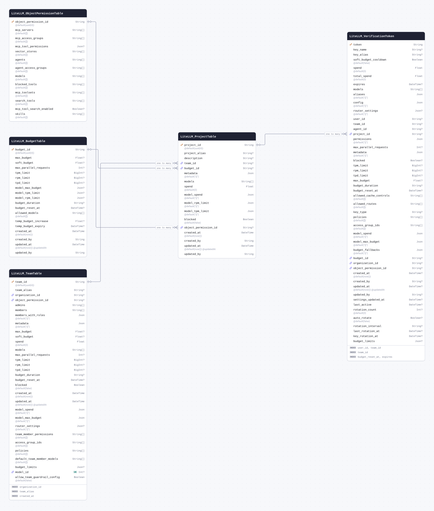

| Field                       | Type       | Constraints                                                                                       | Default              | Description |
| --------------------------- | ---------- | ------------------------------------------------------------------------------------------------- | -------------------- | ----------- |
| `project_id`                | `String`   | PK NOT NULL                                                                                       | `uuid(4)`            |             |
| `project_alias`             | `String`   | NULL                                                                                              |                      |             |
| `description`               | `String`   | NULL                                                                                              |                      |             |
| `team_id`                   | `String`   | NULL → [LiteLLM_TeamTable.team_id](#model-LiteLLM_TeamTable)                                      |                      |             |
| `budget_id`                 | `String`   | NULL → [LiteLLM_BudgetTable.budget_id](#model-LiteLLM_BudgetTable)                                |                      |             |
| `metadata`                  | `Json`     | NOT NULL                                                                                          | `"{}"`               |             |
| `models`                    | `String[]` | NOT NULL                                                                                          |                      |             |
| `spend`                     | `Float`    | NOT NULL                                                                                          | `0`                  |             |
| `model_spend`               | `Json`     | NOT NULL                                                                                          | `"{}"`               |             |
| `model_rpm_limit`           | `Json`     | NOT NULL                                                                                          | `"{}"`               |             |
| `model_tpm_limit`           | `Json`     | NOT NULL                                                                                          | `"{}"`               |             |
| `blocked`                   | `Boolean`  | NOT NULL                                                                                          | `false`              |             |
| `object_permission_id`      | `String`   | NULL → [LiteLLM_ObjectPermissionTable.object_permission_id](#model-LiteLLM_ObjectPermissionTable) |                      |             |
| `created_at` (`created_at`) | `DateTime` | NOT NULL                                                                                          | `now()`              |             |
| `created_by`                | `String`   | NOT NULL                                                                                          |                      |             |
| `updated_at` (`updated_at`) | `DateTime` | NOT NULL                                                                                          | `now()` `@updatedAt` |             |
| `updated_by`                | `String`   | NOT NULL                                                                                          |                      |             |

#### References

- `team_id` → [LiteLLM_TeamTable.team_id](#model-LiteLLM_TeamTable) (many-to-one)
- `budget_id` → [LiteLLM_BudgetTable.budget_id](#model-LiteLLM_BudgetTable) (many-to-one)
- `object_permission_id` → [LiteLLM_ObjectPermissionTable.object_permission_id](#model-LiteLLM_ObjectPermissionTable) (many-to-one)

#### Referenced by

- `project_id` ← [LiteLLM_VerificationToken.project_id](#model-LiteLLM_VerificationToken) (one-to-many)

#### Definition

```sql
CREATE TABLE "LiteLLM_ProjectTable" (
    "project_id" TEXT NOT NULL,
    "project_alias" TEXT,
    "description" TEXT,
    "team_id" TEXT,
    "budget_id" TEXT,
    "metadata" JSONB NOT NULL DEFAULT '{}',
    "models" TEXT[],
    "spend" DOUBLE PRECISION NOT NULL DEFAULT 0.0,
    "model_spend" JSONB NOT NULL DEFAULT '{}',
    "model_rpm_limit" JSONB NOT NULL DEFAULT '{}',
    "model_tpm_limit" JSONB NOT NULL DEFAULT '{}',
    "blocked" BOOLEAN NOT NULL DEFAULT false,
    "object_permission_id" TEXT,
    "created_at" TIMESTAMP(3) NOT NULL DEFAULT CURRENT_TIMESTAMP,
    "created_by" TEXT NOT NULL,
    "updated_at" TIMESTAMP(3) NOT NULL DEFAULT CURRENT_TIMESTAMP,
    "updated_by" TEXT NOT NULL,

    CONSTRAINT "LiteLLM_ProjectTable_pkey" PRIMARY KEY ("project_id")
);

ALTER TABLE "LiteLLM_ProjectTable" ADD CONSTRAINT "LiteLLM_ProjectTable_team_id_fkey" FOREIGN KEY ("team_id") REFERENCES "LiteLLM_TeamTable"("team_id") ON DELETE SET NULL ON UPDATE CASCADE;

ALTER TABLE "LiteLLM_ProjectTable" ADD CONSTRAINT "LiteLLM_ProjectTable_budget_id_fkey" FOREIGN KEY ("budget_id") REFERENCES "LiteLLM_BudgetTable"("budget_id") ON DELETE SET NULL ON UPDATE CASCADE;

ALTER TABLE "LiteLLM_ProjectTable" ADD CONSTRAINT "LiteLLM_ProjectTable_object_permission_id_fkey" FOREIGN KEY ("object_permission_id") REFERENCES "LiteLLM_ObjectPermissionTable"("object_permission_id") ON DELETE SET NULL ON UPDATE CASCADE;
```

<details>
<summary>Queries and their SQL</summary>

**findMany**: Every row

```ts
await prisma.liteLLM_ProjectTable.findMany();
```

```sql
SELECT
  "public"."LiteLLM_ProjectTable"."project_id",
  "public"."LiteLLM_ProjectTable"."project_alias",
  "public"."LiteLLM_ProjectTable"."description",
  "public"."LiteLLM_ProjectTable"."team_id",
  "public"."LiteLLM_ProjectTable"."budget_id",
  "public"."LiteLLM_ProjectTable"."metadata",
  "public"."LiteLLM_ProjectTable"."models",
  "public"."LiteLLM_ProjectTable"."spend",
  "public"."LiteLLM_ProjectTable"."model_spend",
  "public"."LiteLLM_ProjectTable"."model_rpm_limit",
  "public"."LiteLLM_ProjectTable"."model_tpm_limit",
  "public"."LiteLLM_ProjectTable"."blocked",
  "public"."LiteLLM_ProjectTable"."object_permission_id",
  "public"."LiteLLM_ProjectTable"."created_at",
  "public"."LiteLLM_ProjectTable"."created_by",
  "public"."LiteLLM_ProjectTable"."updated_at",
  "public"."LiteLLM_ProjectTable"."updated_by"
FROM
  "public"."LiteLLM_ProjectTable"
WHERE
  1 = 1
OFFSET
  $1
-- params: ["0"]
```

**count**: How many rows there are

```ts
await prisma.liteLLM_ProjectTable.count();
```

```sql
SELECT
  COUNT(*) AS "_count$_all"
FROM
  (
    SELECT
      "public"."LiteLLM_ProjectTable"."project_id"
    FROM
      "public"."LiteLLM_ProjectTable"
    WHERE
      1 = 1
    OFFSET
      $1
  ) AS "sub"
-- params: ["0"]
```

**findMany**: Every row with its relations

```ts
await prisma.liteLLM_ProjectTable.findMany({
  include: {
    litellm_team_table: true,
    litellm_budget_table: true,
    keys: true,
    object_permission: true,
  },
});
```

```sql
SELECT
  "public"."LiteLLM_ProjectTable"."project_id",
  "public"."LiteLLM_ProjectTable"."project_alias",
  "public"."LiteLLM_ProjectTable"."description",
  "public"."LiteLLM_ProjectTable"."team_id",
  "public"."LiteLLM_ProjectTable"."budget_id",
  "public"."LiteLLM_ProjectTable"."metadata",
  "public"."LiteLLM_ProjectTable"."models",
  "public"."LiteLLM_ProjectTable"."spend",
  "public"."LiteLLM_ProjectTable"."model_spend",
  "public"."LiteLLM_ProjectTable"."model_rpm_limit",
  "public"."LiteLLM_ProjectTable"."model_tpm_limit",
  "public"."LiteLLM_ProjectTable"."blocked",
  "public"."LiteLLM_ProjectTable"."object_permission_id",
  "public"."LiteLLM_ProjectTable"."created_at",
  "public"."LiteLLM_ProjectTable"."created_by",
  "public"."LiteLLM_ProjectTable"."updated_at",
  "public"."LiteLLM_ProjectTable"."updated_by"
FROM
  "public"."LiteLLM_ProjectTable"
WHERE
  1 = 1
OFFSET
  $1
-- params: ["0"]

SELECT
  "public"."LiteLLM_TeamTable"."team_id",
  "public"."LiteLLM_TeamTable"."team_alias",
  "public"."LiteLLM_TeamTable"."organization_id",
  "public"."LiteLLM_TeamTable"."object_permission_id",
  "public"."LiteLLM_TeamTable"."admins",
  "public"."LiteLLM_TeamTable"."members",
  "public"."LiteLLM_TeamTable"."members_with_roles",
  "public"."LiteLLM_TeamTable"."metadata",
  "public"."LiteLLM_TeamTable"."max_budget",
  "public"."LiteLLM_TeamTable"."soft_budget",
  "public"."LiteLLM_TeamTable"."spend",
  "public"."LiteLLM_TeamTable"."models",
  "public"."LiteLLM_TeamTable"."max_parallel_requests",
  "public"."LiteLLM_TeamTable"."tpm_limit",
  "public"."LiteLLM_TeamTable"."rpm_limit",
  "public"."LiteLLM_TeamTable"."tpd_limit",
  "public"."LiteLLM_TeamTable"."budget_duration",
  "public"."LiteLLM_TeamTable"."budget_reset_at",
  "public"."LiteLLM_TeamTable"."blocked",
  "public"."LiteLLM_TeamTable"."created_at",
  "public"."LiteLLM_TeamTable"."updated_at",
  "public"."LiteLLM_TeamTable"."model_spend",
  "public"."LiteLLM_TeamTable"."model_max_budget",
  "public"."LiteLLM_TeamTable"."router_settings",
  "public"."LiteLLM_TeamTable"."team_member_permissions",
  "public"."LiteLLM_TeamTable"."access_group_ids",
  "public"."LiteLLM_TeamTable"."policies",
  "public"."LiteLLM_TeamTable"."default_team_member_models",
  "public"."LiteLLM_TeamTable"."budget_limits",
  "public"."LiteLLM_TeamTable"."model_id",
  "public"."LiteLLM_TeamTable"."allow_team_guardrail_config"
FROM
  "public"."LiteLLM_TeamTable"
WHERE
  "public"."LiteLLM_TeamTable"."team_id" IN ($1)
OFFSET
  $2
-- params: ["<team_id of the rows above>","0"]

SELECT
  "public"."LiteLLM_BudgetTable"."budget_id",
  "public"."LiteLLM_BudgetTable"."max_budget",
  "public"."LiteLLM_BudgetTable"."soft_budget",
  "public"."LiteLLM_BudgetTable"."max_parallel_requests",
  "public"."LiteLLM_BudgetTable"."tpm_limit",
  "public"."LiteLLM_BudgetTable"."rpm_limit",
  "public"."LiteLLM_BudgetTable"."tpd_limit",
  "public"."LiteLLM_BudgetTable"."model_max_budget",
  "public"."LiteLLM_BudgetTable"."model_tpm_limit",
  "public"."LiteLLM_BudgetTable"."model_rpm_limit",
  "public"."LiteLLM_BudgetTable"."budget_duration",
  "public"."LiteLLM_BudgetTable"."budget_reset_at",
  "public"."LiteLLM_BudgetTable"."allowed_models",
  "public"."LiteLLM_BudgetTable"."temp_budget_increase",
  "public"."LiteLLM_BudgetTable"."temp_budget_expiry",
  "public"."LiteLLM_BudgetTable"."created_at",
  "public"."LiteLLM_BudgetTable"."created_by",
  "public"."LiteLLM_BudgetTable"."updated_at",
  "public"."LiteLLM_BudgetTable"."updated_by"
FROM
  "public"."LiteLLM_BudgetTable"
WHERE
  "public"."LiteLLM_BudgetTable"."budget_id" IN ($1)
OFFSET
  $2
-- params: ["<budget_id of the rows above>","0"]

SELECT
  "public"."LiteLLM_VerificationToken"."token",
  "public"."LiteLLM_VerificationToken"."key_name",
  "public"."LiteLLM_VerificationToken"."key_alias",
  "public"."LiteLLM_VerificationToken"."soft_budget_cooldown",
  "public"."LiteLLM_VerificationToken"."spend",
  "public"."LiteLLM_VerificationToken"."total_spend",
  "public"."LiteLLM_VerificationToken"."expires",
  "public"."LiteLLM_VerificationToken"."models",
  "public"."LiteLLM_VerificationToken"."aliases",
  "public"."LiteLLM_VerificationToken"."config",
  "public"."LiteLLM_VerificationToken"."router_settings",
  "public"."LiteLLM_VerificationToken"."user_id",
  "public"."LiteLLM_VerificationToken"."team_id",
  "public"."LiteLLM_VerificationToken"."agent_id",
  "public"."LiteLLM_VerificationToken"."project_id",
  "public"."LiteLLM_VerificationToken"."permissions",
  "public"."LiteLLM_VerificationToken"."max_parallel_requests",
  "public"."LiteLLM_VerificationToken"."metadata",
  "public"."LiteLLM_VerificationToken"."blocked",
  "public"."LiteLLM_VerificationToken"."tpm_limit",
  "public"."LiteLLM_VerificationToken"."rpm_limit",
  "public"."LiteLLM_VerificationToken"."tpd_limit",
  "public"."LiteLLM_VerificationToken"."max_budget",
  "public"."LiteLLM_VerificationToken"."budget_duration",
  "public"."LiteLLM_VerificationToken"."budget_reset_at",
  "public"."LiteLLM_VerificationToken"."allowed_cache_controls",
  "public"."LiteLLM_VerificationToken"."allowed_routes",
  "public"."LiteLLM_VerificationToken"."key_type",
  "public"."LiteLLM_VerificationToken"."policies",
  "public"."LiteLLM_VerificationToken"."access_group_ids",
  "public"."LiteLLM_VerificationToken"."model_spend",
  "public"."LiteLLM_VerificationToken"."model_max_budget",
  "public"."LiteLLM_VerificationToken"."budget_fallbacks",
  "public"."LiteLLM_VerificationToken"."budget_id",
  "public"."LiteLLM_VerificationToken"."organization_id",
  "public"."LiteLLM_VerificationToken"."object_permission_id",
  "public"."LiteLLM_VerificationToken"."created_at",
  "public"."LiteLLM_VerificationToken"."created_by",
  "public"."LiteLLM_VerificationToken"."updated_at",
  "public"."LiteLLM_VerificationToken"."updated_by",
  "public"."LiteLLM_VerificationToken"."settings_updated_at",
  "public"."LiteLLM_VerificationToken"."last_active",
  "public"."LiteLLM_VerificationToken"."rotation_count",
  "public"."LiteLLM_VerificationToken"."auto_rotate",
  "public"."LiteLLM_VerificationToken"."rotation_interval",
  "public"."LiteLLM_VerificationToken"."last_rotation_at",
  "public"."LiteLLM_VerificationToken"."key_rotation_at",
  "public"."LiteLLM_VerificationToken"."budget_limits"
FROM
  "public"."LiteLLM_VerificationToken"
WHERE
  "public"."LiteLLM_VerificationToken"."project_id" IN ($1)
OFFSET
  $2
-- params: ["<project_id of the rows above>","0"]

SELECT
  "public"."LiteLLM_ObjectPermissionTable"."object_permission_id",
  "public"."LiteLLM_ObjectPermissionTable"."mcp_servers",
  "public"."LiteLLM_ObjectPermissionTable"."mcp_access_groups",
  "public"."LiteLLM_ObjectPermissionTable"."mcp_tool_permissions",
  "public"."LiteLLM_ObjectPermissionTable"."vector_stores",
  "public"."LiteLLM_ObjectPermissionTable"."agents",
  "public"."LiteLLM_ObjectPermissionTable"."agent_access_groups",
  "public"."LiteLLM_ObjectPermissionTable"."models",
  "public"."LiteLLM_ObjectPermissionTable"."blocked_tools",
  "public"."LiteLLM_ObjectPermissionTable"."mcp_toolsets",
  "public"."LiteLLM_ObjectPermissionTable"."search_tools",
  "public"."LiteLLM_ObjectPermissionTable"."mcp_tool_search_enabled",
  "public"."LiteLLM_ObjectPermissionTable"."skills"
FROM
  "public"."LiteLLM_ObjectPermissionTable"
WHERE
  "public"."LiteLLM_ObjectPermissionTable"."object_permission_id" IN ($1)
OFFSET
  $2
-- params: ["<object_permission_id of the rows above>","0"]
```

**findUnique**: One row by what is unique to it

```ts
await prisma.liteLLM_ProjectTable.findUnique({ where: { project_id: "example" } });
```

```sql
SELECT
  "public"."LiteLLM_ProjectTable"."project_id",
  "public"."LiteLLM_ProjectTable"."project_alias",
  "public"."LiteLLM_ProjectTable"."description",
  "public"."LiteLLM_ProjectTable"."team_id",
  "public"."LiteLLM_ProjectTable"."budget_id",
  "public"."LiteLLM_ProjectTable"."metadata",
  "public"."LiteLLM_ProjectTable"."models",
  "public"."LiteLLM_ProjectTable"."spend",
  "public"."LiteLLM_ProjectTable"."model_spend",
  "public"."LiteLLM_ProjectTable"."model_rpm_limit",
  "public"."LiteLLM_ProjectTable"."model_tpm_limit",
  "public"."LiteLLM_ProjectTable"."blocked",
  "public"."LiteLLM_ProjectTable"."object_permission_id",
  "public"."LiteLLM_ProjectTable"."created_at",
  "public"."LiteLLM_ProjectTable"."created_by",
  "public"."LiteLLM_ProjectTable"."updated_at",
  "public"."LiteLLM_ProjectTable"."updated_by"
FROM
  "public"."LiteLLM_ProjectTable"
WHERE
  (
    "public"."LiteLLM_ProjectTable"."project_id" = $1
    AND 1 = 1
  )
LIMIT
  $2
OFFSET
  $3
-- params: ["example","1","0"]
```

**create**: Create a row

```ts
await prisma.liteLLM_ProjectTable.create({
  data: { models: ["example"], created_by: "example", updated_by: "example" },
});
```

```sql
INSERT INTO
  "public"."LiteLLM_ProjectTable" (
    "project_id",
    "metadata",
    "models",
    "spend",
    "model_spend",
    "model_rpm_limit",
    "model_tpm_limit",
    "blocked",
    "created_at",
    "created_by",
    "updated_at",
    "updated_by"
  )
VALUES
  ($1, $2, $3, $4, $5, $6, $7, $8, $9, $10, $11, $12)
RETURNING
  "public"."LiteLLM_ProjectTable"."project_id",
  "public"."LiteLLM_ProjectTable"."project_alias",
  "public"."LiteLLM_ProjectTable"."description",
  "public"."LiteLLM_ProjectTable"."team_id",
  "public"."LiteLLM_ProjectTable"."budget_id",
  "public"."LiteLLM_ProjectTable"."metadata",
  "public"."LiteLLM_ProjectTable"."models",
  "public"."LiteLLM_ProjectTable"."spend",
  "public"."LiteLLM_ProjectTable"."model_spend",
  "public"."LiteLLM_ProjectTable"."model_rpm_limit",
  "public"."LiteLLM_ProjectTable"."model_tpm_limit",
  "public"."LiteLLM_ProjectTable"."blocked",
  "public"."LiteLLM_ProjectTable"."object_permission_id",
  "public"."LiteLLM_ProjectTable"."created_at",
  "public"."LiteLLM_ProjectTable"."created_by",
  "public"."LiteLLM_ProjectTable"."updated_at",
  "public"."LiteLLM_ProjectTable"."updated_by"
-- params: ["<uuid(4)>","{}",["example"],"0.0","{}","{}","{}",false,"<now()>","example","<now()>","example"]
```

**update**: Update a row

```ts
await prisma.liteLLM_ProjectTable.update({
  where: { project_id: "example" },
  data: { project_alias: "example" },
});
```

```sql
UPDATE "public"."LiteLLM_ProjectTable"
SET
  "project_alias" = $1,
  "updated_at" = $2
WHERE
  (
    "public"."LiteLLM_ProjectTable"."project_id" = $3
    AND 1 = 1
  )
RETURNING
  "public"."LiteLLM_ProjectTable"."project_id",
  "public"."LiteLLM_ProjectTable"."project_alias",
  "public"."LiteLLM_ProjectTable"."description",
  "public"."LiteLLM_ProjectTable"."team_id",
  "public"."LiteLLM_ProjectTable"."budget_id",
  "public"."LiteLLM_ProjectTable"."metadata",
  "public"."LiteLLM_ProjectTable"."models",
  "public"."LiteLLM_ProjectTable"."spend",
  "public"."LiteLLM_ProjectTable"."model_spend",
  "public"."LiteLLM_ProjectTable"."model_rpm_limit",
  "public"."LiteLLM_ProjectTable"."model_tpm_limit",
  "public"."LiteLLM_ProjectTable"."blocked",
  "public"."LiteLLM_ProjectTable"."object_permission_id",
  "public"."LiteLLM_ProjectTable"."created_at",
  "public"."LiteLLM_ProjectTable"."created_by",
  "public"."LiteLLM_ProjectTable"."updated_at",
  "public"."LiteLLM_ProjectTable"."updated_by"
-- params: ["example",{"prisma__type":"generatorCall","prisma__value":{"name":"now","args":[],"returnType":{"type":"DateTime"}}},"example"]
```

**delete**: Delete a row

```ts
await prisma.liteLLM_ProjectTable.delete({ where: { project_id: "example" } });
```

```sql
DELETE FROM "public"."LiteLLM_ProjectTable"
WHERE
  (
    "public"."LiteLLM_ProjectTable"."project_id" = $1
    AND 1 = 1
  )
RETURNING
  "public"."LiteLLM_ProjectTable"."project_id",
  "public"."LiteLLM_ProjectTable"."project_alias",
  "public"."LiteLLM_ProjectTable"."description",
  "public"."LiteLLM_ProjectTable"."team_id",
  "public"."LiteLLM_ProjectTable"."budget_id",
  "public"."LiteLLM_ProjectTable"."metadata",
  "public"."LiteLLM_ProjectTable"."models",
  "public"."LiteLLM_ProjectTable"."spend",
  "public"."LiteLLM_ProjectTable"."model_spend",
  "public"."LiteLLM_ProjectTable"."model_rpm_limit",
  "public"."LiteLLM_ProjectTable"."model_tpm_limit",
  "public"."LiteLLM_ProjectTable"."blocked",
  "public"."LiteLLM_ProjectTable"."object_permission_id",
  "public"."LiteLLM_ProjectTable"."created_at",
  "public"."LiteLLM_ProjectTable"."created_by",
  "public"."LiteLLM_ProjectTable"."updated_at",
  "public"."LiteLLM_ProjectTable"."updated_by"
-- params: ["example"]
```

</details>

<a id="model-LiteLLM_DeletedTeamTable"></a>

### LiteLLM_DeletedTeamTable

| Field                                       | Type       | Constraints | Default   | Description |
| ------------------------------------------- | ---------- | ----------- | --------- | ----------- |
| `id`                                        | `String`   | PK NOT NULL | `uuid(4)` |             |
| `team_id`                                   | `String`   | NOT NULL    |           |             |
| `team_alias`                                | `String`   | NULL        |           |             |
| `organization_id`                           | `String`   | NULL        |           |             |
| `object_permission_id`                      | `String`   | NULL        |           |             |
| `admins`                                    | `String[]` | NOT NULL    |           |             |
| `members`                                   | `String[]` | NOT NULL    |           |             |
| `members_with_roles`                        | `Json`     | NOT NULL    | `"{}"`    |             |
| `metadata`                                  | `Json`     | NOT NULL    | `"{}"`    |             |
| `max_budget`                                | `Float`    | NULL        |           |             |
| `soft_budget`                               | `Float`    | NULL        |           |             |
| `spend`                                     | `Float`    | NOT NULL    | `0`       |             |
| `models`                                    | `String[]` | NOT NULL    |           |             |
| `max_parallel_requests`                     | `Int`      | NULL        |           |             |
| `tpm_limit`                                 | `BigInt`   | NULL        |           |             |
| `rpm_limit`                                 | `BigInt`   | NULL        |           |             |
| `tpd_limit`                                 | `BigInt`   | NULL        |           |             |
| `budget_duration`                           | `String`   | NULL        |           |             |
| `budget_reset_at`                           | `DateTime` | NULL        |           |             |
| `blocked`                                   | `Boolean`  | NOT NULL    | `false`   |             |
| `model_spend`                               | `Json`     | NOT NULL    | `"{}"`    |             |
| `model_max_budget`                          | `Json`     | NOT NULL    | `"{}"`    |             |
| `router_settings`                           | `Json`     | NULL        | `"{}"`    |             |
| `team_member_permissions`                   | `String[]` | NOT NULL    | `[]`      |             |
| `access_group_ids`                          | `String[]` | NOT NULL    | `[]`      |             |
| `policies`                                  | `String[]` | NOT NULL    | `[]`      |             |
| `model_id`                                  | `Int`      | NULL        |           |             |
| `allow_team_guardrail_config`               | `Boolean`  | NOT NULL    | `false`   |             |
| `created_at` (`created_at`)                 | `DateTime` | NULL        |           |             |
| `updated_at` (`updated_at`)                 | `DateTime` | NULL        |           |             |
| `deleted_at` (`deleted_at`)                 | `DateTime` | NOT NULL    | `now()`   |             |
| `deleted_by` (`deleted_by`)                 | `String`   | NULL        |           |             |
| `deleted_by_api_key` (`deleted_by_api_key`) | `String`   | NULL        |           |             |
| `litellm_changed_by` (`litellm_changed_by`) | `String`   | NULL        |           |             |

#### Indexes

- `@@index([team_id])`
- `@@index([deleted_at])`
- `@@index([organization_id])`
- `@@index([team_alias])`
- `@@index([created_at])`

#### Definition

```sql
CREATE TABLE "LiteLLM_DeletedTeamTable" (
    "id" TEXT NOT NULL,
    "team_id" TEXT NOT NULL,
    "team_alias" TEXT,
    "organization_id" TEXT,
    "object_permission_id" TEXT,
    "admins" TEXT[],
    "members" TEXT[],
    "members_with_roles" JSONB NOT NULL DEFAULT '{}',
    "metadata" JSONB NOT NULL DEFAULT '{}',
    "max_budget" DOUBLE PRECISION,
    "soft_budget" DOUBLE PRECISION,
    "spend" DOUBLE PRECISION NOT NULL DEFAULT 0.0,
    "models" TEXT[],
    "max_parallel_requests" INTEGER,
    "tpm_limit" BIGINT,
    "rpm_limit" BIGINT,
    "tpd_limit" BIGINT,
    "budget_duration" TEXT,
    "budget_reset_at" TIMESTAMP(3),
    "blocked" BOOLEAN NOT NULL DEFAULT false,
    "model_spend" JSONB NOT NULL DEFAULT '{}',
    "model_max_budget" JSONB NOT NULL DEFAULT '{}',
    "router_settings" JSONB DEFAULT '{}',
    "team_member_permissions" TEXT[] DEFAULT ARRAY[]::TEXT[],
    "access_group_ids" TEXT[] DEFAULT ARRAY[]::TEXT[],
    "policies" TEXT[] DEFAULT ARRAY[]::TEXT[],
    "model_id" INTEGER,
    "allow_team_guardrail_config" BOOLEAN NOT NULL DEFAULT false,
    "created_at" TIMESTAMP(3),
    "updated_at" TIMESTAMP(3),
    "deleted_at" TIMESTAMP(3) NOT NULL DEFAULT CURRENT_TIMESTAMP,
    "deleted_by" TEXT,
    "deleted_by_api_key" TEXT,
    "litellm_changed_by" TEXT,

    CONSTRAINT "LiteLLM_DeletedTeamTable_pkey" PRIMARY KEY ("id")
);

CREATE INDEX "LiteLLM_DeletedTeamTable_team_id_idx" ON "LiteLLM_DeletedTeamTable"("team_id");

CREATE INDEX "LiteLLM_DeletedTeamTable_deleted_at_idx" ON "LiteLLM_DeletedTeamTable"("deleted_at");

CREATE INDEX "LiteLLM_DeletedTeamTable_organization_id_idx" ON "LiteLLM_DeletedTeamTable"("organization_id");

CREATE INDEX "LiteLLM_DeletedTeamTable_team_alias_idx" ON "LiteLLM_DeletedTeamTable"("team_alias");

CREATE INDEX "LiteLLM_DeletedTeamTable_created_at_idx" ON "LiteLLM_DeletedTeamTable"("created_at");
```

<details>
<summary>Queries and their SQL</summary>

**findMany**: Every row

```ts
await prisma.liteLLM_DeletedTeamTable.findMany();
```

```sql
SELECT
  "public"."LiteLLM_DeletedTeamTable"."id",
  "public"."LiteLLM_DeletedTeamTable"."team_id",
  "public"."LiteLLM_DeletedTeamTable"."team_alias",
  "public"."LiteLLM_DeletedTeamTable"."organization_id",
  "public"."LiteLLM_DeletedTeamTable"."object_permission_id",
  "public"."LiteLLM_DeletedTeamTable"."admins",
  "public"."LiteLLM_DeletedTeamTable"."members",
  "public"."LiteLLM_DeletedTeamTable"."members_with_roles",
  "public"."LiteLLM_DeletedTeamTable"."metadata",
  "public"."LiteLLM_DeletedTeamTable"."max_budget",
  "public"."LiteLLM_DeletedTeamTable"."soft_budget",
  "public"."LiteLLM_DeletedTeamTable"."spend",
  "public"."LiteLLM_DeletedTeamTable"."models",
  "public"."LiteLLM_DeletedTeamTable"."max_parallel_requests",
  "public"."LiteLLM_DeletedTeamTable"."tpm_limit",
  "public"."LiteLLM_DeletedTeamTable"."rpm_limit",
  "public"."LiteLLM_DeletedTeamTable"."tpd_limit",
  "public"."LiteLLM_DeletedTeamTable"."budget_duration",
  "public"."LiteLLM_DeletedTeamTable"."budget_reset_at",
  "public"."LiteLLM_DeletedTeamTable"."blocked",
  "public"."LiteLLM_DeletedTeamTable"."model_spend",
  "public"."LiteLLM_DeletedTeamTable"."model_max_budget",
  "public"."LiteLLM_DeletedTeamTable"."router_settings",
  "public"."LiteLLM_DeletedTeamTable"."team_member_permissions",
  "public"."LiteLLM_DeletedTeamTable"."access_group_ids",
  "public"."LiteLLM_DeletedTeamTable"."policies",
  "public"."LiteLLM_DeletedTeamTable"."model_id",
  "public"."LiteLLM_DeletedTeamTable"."allow_team_guardrail_config",
  "public"."LiteLLM_DeletedTeamTable"."created_at",
  "public"."LiteLLM_DeletedTeamTable"."updated_at",
  "public"."LiteLLM_DeletedTeamTable"."deleted_at",
  "public"."LiteLLM_DeletedTeamTable"."deleted_by",
  "public"."LiteLLM_DeletedTeamTable"."deleted_by_api_key",
  "public"."LiteLLM_DeletedTeamTable"."litellm_changed_by"
FROM
  "public"."LiteLLM_DeletedTeamTable"
WHERE
  1 = 1
OFFSET
  $1
-- params: ["0"]
```

**count**: How many rows there are

```ts
await prisma.liteLLM_DeletedTeamTable.count();
```

```sql
SELECT
  COUNT(*) AS "_count$_all"
FROM
  (
    SELECT
      "public"."LiteLLM_DeletedTeamTable"."id"
    FROM
      "public"."LiteLLM_DeletedTeamTable"
    WHERE
      1 = 1
    OFFSET
      $1
  ) AS "sub"
-- params: ["0"]
```

**findUnique**: One row by what is unique to it

```ts
await prisma.liteLLM_DeletedTeamTable.findUnique({ where: { id: "example" } });
```

```sql
SELECT
  "public"."LiteLLM_DeletedTeamTable"."id",
  "public"."LiteLLM_DeletedTeamTable"."team_id",
  "public"."LiteLLM_DeletedTeamTable"."team_alias",
  "public"."LiteLLM_DeletedTeamTable"."organization_id",
  "public"."LiteLLM_DeletedTeamTable"."object_permission_id",
  "public"."LiteLLM_DeletedTeamTable"."admins",
  "public"."LiteLLM_DeletedTeamTable"."members",
  "public"."LiteLLM_DeletedTeamTable"."members_with_roles",
  "public"."LiteLLM_DeletedTeamTable"."metadata",
  "public"."LiteLLM_DeletedTeamTable"."max_budget",
  "public"."LiteLLM_DeletedTeamTable"."soft_budget",
  "public"."LiteLLM_DeletedTeamTable"."spend",
  "public"."LiteLLM_DeletedTeamTable"."models",
  "public"."LiteLLM_DeletedTeamTable"."max_parallel_requests",
  "public"."LiteLLM_DeletedTeamTable"."tpm_limit",
  "public"."LiteLLM_DeletedTeamTable"."rpm_limit",
  "public"."LiteLLM_DeletedTeamTable"."tpd_limit",
  "public"."LiteLLM_DeletedTeamTable"."budget_duration",
  "public"."LiteLLM_DeletedTeamTable"."budget_reset_at",
  "public"."LiteLLM_DeletedTeamTable"."blocked",
  "public"."LiteLLM_DeletedTeamTable"."model_spend",
  "public"."LiteLLM_DeletedTeamTable"."model_max_budget",
  "public"."LiteLLM_DeletedTeamTable"."router_settings",
  "public"."LiteLLM_DeletedTeamTable"."team_member_permissions",
  "public"."LiteLLM_DeletedTeamTable"."access_group_ids",
  "public"."LiteLLM_DeletedTeamTable"."policies",
  "public"."LiteLLM_DeletedTeamTable"."model_id",
  "public"."LiteLLM_DeletedTeamTable"."allow_team_guardrail_config",
  "public"."LiteLLM_DeletedTeamTable"."created_at",
  "public"."LiteLLM_DeletedTeamTable"."updated_at",
  "public"."LiteLLM_DeletedTeamTable"."deleted_at",
  "public"."LiteLLM_DeletedTeamTable"."deleted_by",
  "public"."LiteLLM_DeletedTeamTable"."deleted_by_api_key",
  "public"."LiteLLM_DeletedTeamTable"."litellm_changed_by"
FROM
  "public"."LiteLLM_DeletedTeamTable"
WHERE
  (
    "public"."LiteLLM_DeletedTeamTable"."id" = $1
    AND 1 = 1
  )
LIMIT
  $2
OFFSET
  $3
-- params: ["example","1","0"]
```

**create**: Create a row

```ts
await prisma.liteLLM_DeletedTeamTable.create({
  data: { team_id: "example", admins: ["example"], members: ["example"], models: ["example"] },
});
```

```sql
INSERT INTO
  "public"."LiteLLM_DeletedTeamTable" (
    "id",
    "team_id",
    "admins",
    "members",
    "members_with_roles",
    "metadata",
    "spend",
    "models",
    "blocked",
    "model_spend",
    "model_max_budget",
    "router_settings",
    "team_member_permissions",
    "access_group_ids",
    "policies",
    "allow_team_guardrail_config",
    "deleted_at"
  )
VALUES
  (
    $1,
    $2,
    $3,
    $4,
    $5,
    $6,
    $7,
    $8,
    $9,
    $10,
    $11,
    $12,
    $13,
    $14,
    $15,
    $16,
    $17
  )
RETURNING
  "public"."LiteLLM_DeletedTeamTable"."id",
  "public"."LiteLLM_DeletedTeamTable"."team_id",
  "public"."LiteLLM_DeletedTeamTable"."team_alias",
  "public"."LiteLLM_DeletedTeamTable"."organization_id",
  "public"."LiteLLM_DeletedTeamTable"."object_permission_id",
  "public"."LiteLLM_DeletedTeamTable"."admins",
  "public"."LiteLLM_DeletedTeamTable"."members",
  "public"."LiteLLM_DeletedTeamTable"."members_with_roles",
  "public"."LiteLLM_DeletedTeamTable"."metadata",
  "public"."LiteLLM_DeletedTeamTable"."max_budget",
  "public"."LiteLLM_DeletedTeamTable"."soft_budget",
  "public"."LiteLLM_DeletedTeamTable"."spend",
  "public"."LiteLLM_DeletedTeamTable"."models",
  "public"."LiteLLM_DeletedTeamTable"."max_parallel_requests",
  "public"."LiteLLM_DeletedTeamTable"."tpm_limit",
  "public"."LiteLLM_DeletedTeamTable"."rpm_limit",
  "public"."LiteLLM_DeletedTeamTable"."tpd_limit",
  "public"."LiteLLM_DeletedTeamTable"."budget_duration",
  "public"."LiteLLM_DeletedTeamTable"."budget_reset_at",
  "public"."LiteLLM_DeletedTeamTable"."blocked",
  "public"."LiteLLM_DeletedTeamTable"."model_spend",
  "public"."LiteLLM_DeletedTeamTable"."model_max_budget",
  "public"."LiteLLM_DeletedTeamTable"."router_settings",
  "public"."LiteLLM_DeletedTeamTable"."team_member_permissions",
  "public"."LiteLLM_DeletedTeamTable"."access_group_ids",
  "public"."LiteLLM_DeletedTeamTable"."policies",
  "public"."LiteLLM_DeletedTeamTable"."model_id",
  "public"."LiteLLM_DeletedTeamTable"."allow_team_guardrail_config",
  "public"."LiteLLM_DeletedTeamTable"."created_at",
  "public"."LiteLLM_DeletedTeamTable"."updated_at",
  "public"."LiteLLM_DeletedTeamTable"."deleted_at",
  "public"."LiteLLM_DeletedTeamTable"."deleted_by",
  "public"."LiteLLM_DeletedTeamTable"."deleted_by_api_key",
  "public"."LiteLLM_DeletedTeamTable"."litellm_changed_by"
-- params: ["<uuid(4)>","example",["example"],["example"],"{}","{}","0.0",["example"],false,"{}","{}","{}",[],[],[],false,"<now()>"]
```

**update**: Update a row

```ts
await prisma.liteLLM_DeletedTeamTable.update({
  where: { id: "example" },
  data: { team_id: "example" },
});
```

```sql
UPDATE "public"."LiteLLM_DeletedTeamTable"
SET
  "team_id" = $1
WHERE
  (
    "public"."LiteLLM_DeletedTeamTable"."id" = $2
    AND 1 = 1
  )
RETURNING
  "public"."LiteLLM_DeletedTeamTable"."id",
  "public"."LiteLLM_DeletedTeamTable"."team_id",
  "public"."LiteLLM_DeletedTeamTable"."team_alias",
  "public"."LiteLLM_DeletedTeamTable"."organization_id",
  "public"."LiteLLM_DeletedTeamTable"."object_permission_id",
  "public"."LiteLLM_DeletedTeamTable"."admins",
  "public"."LiteLLM_DeletedTeamTable"."members",
  "public"."LiteLLM_DeletedTeamTable"."members_with_roles",
  "public"."LiteLLM_DeletedTeamTable"."metadata",
  "public"."LiteLLM_DeletedTeamTable"."max_budget",
  "public"."LiteLLM_DeletedTeamTable"."soft_budget",
  "public"."LiteLLM_DeletedTeamTable"."spend",
  "public"."LiteLLM_DeletedTeamTable"."models",
  "public"."LiteLLM_DeletedTeamTable"."max_parallel_requests",
  "public"."LiteLLM_DeletedTeamTable"."tpm_limit",
  "public"."LiteLLM_DeletedTeamTable"."rpm_limit",
  "public"."LiteLLM_DeletedTeamTable"."tpd_limit",
  "public"."LiteLLM_DeletedTeamTable"."budget_duration",
  "public"."LiteLLM_DeletedTeamTable"."budget_reset_at",
  "public"."LiteLLM_DeletedTeamTable"."blocked",
  "public"."LiteLLM_DeletedTeamTable"."model_spend",
  "public"."LiteLLM_DeletedTeamTable"."model_max_budget",
  "public"."LiteLLM_DeletedTeamTable"."router_settings",
  "public"."LiteLLM_DeletedTeamTable"."team_member_permissions",
  "public"."LiteLLM_DeletedTeamTable"."access_group_ids",
  "public"."LiteLLM_DeletedTeamTable"."policies",
  "public"."LiteLLM_DeletedTeamTable"."model_id",
  "public"."LiteLLM_DeletedTeamTable"."allow_team_guardrail_config",
  "public"."LiteLLM_DeletedTeamTable"."created_at",
  "public"."LiteLLM_DeletedTeamTable"."updated_at",
  "public"."LiteLLM_DeletedTeamTable"."deleted_at",
  "public"."LiteLLM_DeletedTeamTable"."deleted_by",
  "public"."LiteLLM_DeletedTeamTable"."deleted_by_api_key",
  "public"."LiteLLM_DeletedTeamTable"."litellm_changed_by"
-- params: ["example","example"]
```

**delete**: Delete a row

```ts
await prisma.liteLLM_DeletedTeamTable.delete({ where: { id: "example" } });
```

```sql
DELETE FROM "public"."LiteLLM_DeletedTeamTable"
WHERE
  (
    "public"."LiteLLM_DeletedTeamTable"."id" = $1
    AND 1 = 1
  )
RETURNING
  "public"."LiteLLM_DeletedTeamTable"."id",
  "public"."LiteLLM_DeletedTeamTable"."team_id",
  "public"."LiteLLM_DeletedTeamTable"."team_alias",
  "public"."LiteLLM_DeletedTeamTable"."organization_id",
  "public"."LiteLLM_DeletedTeamTable"."object_permission_id",
  "public"."LiteLLM_DeletedTeamTable"."admins",
  "public"."LiteLLM_DeletedTeamTable"."members",
  "public"."LiteLLM_DeletedTeamTable"."members_with_roles",
  "public"."LiteLLM_DeletedTeamTable"."metadata",
  "public"."LiteLLM_DeletedTeamTable"."max_budget",
  "public"."LiteLLM_DeletedTeamTable"."soft_budget",
  "public"."LiteLLM_DeletedTeamTable"."spend",
  "public"."LiteLLM_DeletedTeamTable"."models",
  "public"."LiteLLM_DeletedTeamTable"."max_parallel_requests",
  "public"."LiteLLM_DeletedTeamTable"."tpm_limit",
  "public"."LiteLLM_DeletedTeamTable"."rpm_limit",
  "public"."LiteLLM_DeletedTeamTable"."tpd_limit",
  "public"."LiteLLM_DeletedTeamTable"."budget_duration",
  "public"."LiteLLM_DeletedTeamTable"."budget_reset_at",
  "public"."LiteLLM_DeletedTeamTable"."blocked",
  "public"."LiteLLM_DeletedTeamTable"."model_spend",
  "public"."LiteLLM_DeletedTeamTable"."model_max_budget",
  "public"."LiteLLM_DeletedTeamTable"."router_settings",
  "public"."LiteLLM_DeletedTeamTable"."team_member_permissions",
  "public"."LiteLLM_DeletedTeamTable"."access_group_ids",
  "public"."LiteLLM_DeletedTeamTable"."policies",
  "public"."LiteLLM_DeletedTeamTable"."model_id",
  "public"."LiteLLM_DeletedTeamTable"."allow_team_guardrail_config",
  "public"."LiteLLM_DeletedTeamTable"."created_at",
  "public"."LiteLLM_DeletedTeamTable"."updated_at",
  "public"."LiteLLM_DeletedTeamTable"."deleted_at",
  "public"."LiteLLM_DeletedTeamTable"."deleted_by",
  "public"."LiteLLM_DeletedTeamTable"."deleted_by_api_key",
  "public"."LiteLLM_DeletedTeamTable"."litellm_changed_by"
-- params: ["example"]
```

</details>

<a id="model-LiteLLM_UserTable"></a>

### LiteLLM_UserTable

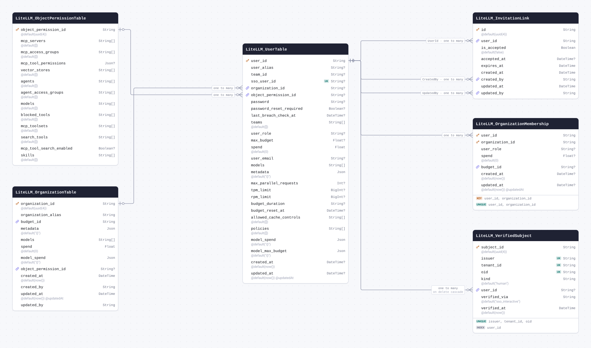

| Field                       | Type       | Constraints                                                                                       | Default              | Description |
| --------------------------- | ---------- | ------------------------------------------------------------------------------------------------- | -------------------- | ----------- |
| `user_id`                   | `String`   | PK NOT NULL                                                                                       |                      |             |
| `user_alias`                | `String`   | NULL                                                                                              |                      |             |
| `team_id`                   | `String`   | NULL                                                                                              |                      |             |
| `sso_user_id`               | `String`   | UNIQUE NULL                                                                                       |                      |             |
| `organization_id`           | `String`   | NULL → [LiteLLM_OrganizationTable.organization_id](#model-LiteLLM_OrganizationTable)              |                      |             |
| `object_permission_id`      | `String`   | NULL → [LiteLLM_ObjectPermissionTable.object_permission_id](#model-LiteLLM_ObjectPermissionTable) |                      |             |
| `password`                  | `String`   | NULL                                                                                              |                      |             |
| `password_reset_required`   | `Boolean`  | NULL                                                                                              |                      |             |
| `last_breach_check_at`      | `DateTime` | NULL                                                                                              |                      |             |
| `teams`                     | `String[]` | NOT NULL                                                                                          | `[]`                 |             |
| `user_role`                 | `String`   | NULL                                                                                              |                      |             |
| `max_budget`                | `Float`    | NULL                                                                                              |                      |             |
| `spend`                     | `Float`    | NOT NULL                                                                                          | `0`                  |             |
| `user_email`                | `String`   | NULL                                                                                              |                      |             |
| `models`                    | `String[]` | NOT NULL                                                                                          |                      |             |
| `metadata`                  | `Json`     | NOT NULL                                                                                          | `"{}"`               |             |
| `max_parallel_requests`     | `Int`      | NULL                                                                                              |                      |             |
| `tpm_limit`                 | `BigInt`   | NULL                                                                                              |                      |             |
| `rpm_limit`                 | `BigInt`   | NULL                                                                                              |                      |             |
| `budget_duration`           | `String`   | NULL                                                                                              |                      |             |
| `budget_reset_at`           | `DateTime` | NULL                                                                                              |                      |             |
| `allowed_cache_controls`    | `String[]` | NOT NULL                                                                                          | `[]`                 |             |
| `policies`                  | `String[]` | NOT NULL                                                                                          | `[]`                 |             |
| `model_spend`               | `Json`     | NOT NULL                                                                                          | `"{}"`               |             |
| `model_max_budget`          | `Json`     | NOT NULL                                                                                          | `"{}"`               |             |
| `created_at` (`created_at`) | `DateTime` | NULL                                                                                              | `now()`              |             |
| `updated_at` (`updated_at`) | `DateTime` | NULL                                                                                              | `now()` `@updatedAt` |             |

#### References

- `organization_id` → [LiteLLM_OrganizationTable.organization_id](#model-LiteLLM_OrganizationTable) (many-to-one)
- `object_permission_id` → [LiteLLM_ObjectPermissionTable.object_permission_id](#model-LiteLLM_ObjectPermissionTable) (many-to-one)

#### Referenced by

- `user_id` ← [LiteLLM_VerifiedSubject.user_id](#model-LiteLLM_VerifiedSubject) (one-to-many, on delete Cascade)
- `user_id` ← [LiteLLM_OrganizationMembership.user_id](#model-LiteLLM_OrganizationMembership) (one-to-many)
- `user_id` ← [LiteLLM_InvitationLink.user_id](#model-LiteLLM_InvitationLink) (one-to-many)
- `user_id` ← [LiteLLM_InvitationLink.created_by](#model-LiteLLM_InvitationLink) (one-to-many)
- `user_id` ← [LiteLLM_InvitationLink.updated_by](#model-LiteLLM_InvitationLink) (one-to-many)

#### Definition

```sql
CREATE TABLE "LiteLLM_UserTable" (
    "user_id" TEXT NOT NULL,
    "user_alias" TEXT,
    "team_id" TEXT,
    "sso_user_id" TEXT,
    "organization_id" TEXT,
    "object_permission_id" TEXT,
    "password" TEXT,
    "password_reset_required" BOOLEAN,
    "last_breach_check_at" TIMESTAMP(3),
    "teams" TEXT[] DEFAULT ARRAY[]::TEXT[],
    "user_role" TEXT,
    "max_budget" DOUBLE PRECISION,
    "spend" DOUBLE PRECISION NOT NULL DEFAULT 0.0,
    "user_email" TEXT,
    "models" TEXT[],
    "metadata" JSONB NOT NULL DEFAULT '{}',
    "max_parallel_requests" INTEGER,
    "tpm_limit" BIGINT,
    "rpm_limit" BIGINT,
    "budget_duration" TEXT,
    "budget_reset_at" TIMESTAMP(3),
    "allowed_cache_controls" TEXT[] DEFAULT ARRAY[]::TEXT[],
    "policies" TEXT[] DEFAULT ARRAY[]::TEXT[],
    "model_spend" JSONB NOT NULL DEFAULT '{}',
    "model_max_budget" JSONB NOT NULL DEFAULT '{}',
    "created_at" TIMESTAMP(3) DEFAULT CURRENT_TIMESTAMP,
    "updated_at" TIMESTAMP(3) DEFAULT CURRENT_TIMESTAMP,

    CONSTRAINT "LiteLLM_UserTable_pkey" PRIMARY KEY ("user_id")
);

CREATE UNIQUE INDEX "LiteLLM_UserTable_sso_user_id_key" ON "LiteLLM_UserTable"("sso_user_id");

ALTER TABLE "LiteLLM_UserTable" ADD CONSTRAINT "LiteLLM_UserTable_organization_id_fkey" FOREIGN KEY ("organization_id") REFERENCES "LiteLLM_OrganizationTable"("organization_id") ON DELETE SET NULL ON UPDATE CASCADE;

ALTER TABLE "LiteLLM_UserTable" ADD CONSTRAINT "LiteLLM_UserTable_object_permission_id_fkey" FOREIGN KEY ("object_permission_id") REFERENCES "LiteLLM_ObjectPermissionTable"("object_permission_id") ON DELETE SET NULL ON UPDATE CASCADE;
```

<details>
<summary>Queries and their SQL</summary>

**findMany**: Every row

```ts
await prisma.liteLLM_UserTable.findMany();
```

```sql
SELECT
  "public"."LiteLLM_UserTable"."user_id",
  "public"."LiteLLM_UserTable"."user_alias",
  "public"."LiteLLM_UserTable"."team_id",
  "public"."LiteLLM_UserTable"."sso_user_id",
  "public"."LiteLLM_UserTable"."organization_id",
  "public"."LiteLLM_UserTable"."object_permission_id",
  "public"."LiteLLM_UserTable"."password",
  "public"."LiteLLM_UserTable"."password_reset_required",
  "public"."LiteLLM_UserTable"."last_breach_check_at",
  "public"."LiteLLM_UserTable"."teams",
  "public"."LiteLLM_UserTable"."user_role",
  "public"."LiteLLM_UserTable"."max_budget",
  "public"."LiteLLM_UserTable"."spend",
  "public"."LiteLLM_UserTable"."user_email",
  "public"."LiteLLM_UserTable"."models",
  "public"."LiteLLM_UserTable"."metadata",
  "public"."LiteLLM_UserTable"."max_parallel_requests",
  "public"."LiteLLM_UserTable"."tpm_limit",
  "public"."LiteLLM_UserTable"."rpm_limit",
  "public"."LiteLLM_UserTable"."budget_duration",
  "public"."LiteLLM_UserTable"."budget_reset_at",
  "public"."LiteLLM_UserTable"."allowed_cache_controls",
  "public"."LiteLLM_UserTable"."policies",
  "public"."LiteLLM_UserTable"."model_spend",
  "public"."LiteLLM_UserTable"."model_max_budget",
  "public"."LiteLLM_UserTable"."created_at",
  "public"."LiteLLM_UserTable"."updated_at"
FROM
  "public"."LiteLLM_UserTable"
WHERE
  1 = 1
OFFSET
  $1
-- params: ["0"]
```

**count**: How many rows there are

```ts
await prisma.liteLLM_UserTable.count();
```

```sql
SELECT
  COUNT(*) AS "_count$_all"
FROM
  (
    SELECT
      "public"."LiteLLM_UserTable"."user_id"
    FROM
      "public"."LiteLLM_UserTable"
    WHERE
      1 = 1
    OFFSET
      $1
  ) AS "sub"
-- params: ["0"]
```

**findMany**: Every row with its relations

```ts
await prisma.liteLLM_UserTable.findMany({
  include: {
    verified_subjects: true,
    litellm_organization_table: true,
    organization_memberships: true,
    invitations_created: true,
    invitations_updated: true,
    invitations_user: true,
    object_permission: true,
  },
});
```

```sql
SELECT
  "public"."LiteLLM_UserTable"."user_id",
  "public"."LiteLLM_UserTable"."user_alias",
  "public"."LiteLLM_UserTable"."team_id",
  "public"."LiteLLM_UserTable"."sso_user_id",
  "public"."LiteLLM_UserTable"."organization_id",
  "public"."LiteLLM_UserTable"."object_permission_id",
  "public"."LiteLLM_UserTable"."password",
  "public"."LiteLLM_UserTable"."password_reset_required",
  "public"."LiteLLM_UserTable"."last_breach_check_at",
  "public"."LiteLLM_UserTable"."teams",
  "public"."LiteLLM_UserTable"."user_role",
  "public"."LiteLLM_UserTable"."max_budget",
  "public"."LiteLLM_UserTable"."spend",
  "public"."LiteLLM_UserTable"."user_email",
  "public"."LiteLLM_UserTable"."models",
  "public"."LiteLLM_UserTable"."metadata",
  "public"."LiteLLM_UserTable"."max_parallel_requests",
  "public"."LiteLLM_UserTable"."tpm_limit",
  "public"."LiteLLM_UserTable"."rpm_limit",
  "public"."LiteLLM_UserTable"."budget_duration",
  "public"."LiteLLM_UserTable"."budget_reset_at",
  "public"."LiteLLM_UserTable"."allowed_cache_controls",
  "public"."LiteLLM_UserTable"."policies",
  "public"."LiteLLM_UserTable"."model_spend",
  "public"."LiteLLM_UserTable"."model_max_budget",
  "public"."LiteLLM_UserTable"."created_at",
  "public"."LiteLLM_UserTable"."updated_at"
FROM
  "public"."LiteLLM_UserTable"
WHERE
  1 = 1
OFFSET
  $1
-- params: ["0"]

SELECT
  "public"."LiteLLM_VerifiedSubject"."subject_id",
  "public"."LiteLLM_VerifiedSubject"."issuer",
  "public"."LiteLLM_VerifiedSubject"."tenant_id",
  "public"."LiteLLM_VerifiedSubject"."oid",
  "public"."LiteLLM_VerifiedSubject"."kind",
  "public"."LiteLLM_VerifiedSubject"."user_id",
  "public"."LiteLLM_VerifiedSubject"."verified_via",
  "public"."LiteLLM_VerifiedSubject"."verified_at"
FROM
  "public"."LiteLLM_VerifiedSubject"
WHERE
  "public"."LiteLLM_VerifiedSubject"."user_id" IN ($1)
OFFSET
  $2
-- params: ["<user_id of the rows above>","0"]

SELECT
  "public"."LiteLLM_OrganizationTable"."organization_id",
  "public"."LiteLLM_OrganizationTable"."organization_alias",
  "public"."LiteLLM_OrganizationTable"."budget_id",
  "public"."LiteLLM_OrganizationTable"."metadata",
  "public"."LiteLLM_OrganizationTable"."models",
  "public"."LiteLLM_OrganizationTable"."spend",
  "public"."LiteLLM_OrganizationTable"."model_spend",
  "public"."LiteLLM_OrganizationTable"."object_permission_id",
  "public"."LiteLLM_OrganizationTable"."created_at",
  "public"."LiteLLM_OrganizationTable"."created_by",
  "public"."LiteLLM_OrganizationTable"."updated_at",
  "public"."LiteLLM_OrganizationTable"."updated_by"
FROM
  "public"."LiteLLM_OrganizationTable"
WHERE
  "public"."LiteLLM_OrganizationTable"."organization_id" IN ($1)
OFFSET
  $2
-- params: ["<organization_id of the rows above>","0"]

SELECT
  "public"."LiteLLM_OrganizationMembership"."user_id",
  "public"."LiteLLM_OrganizationMembership"."organization_id",
  "public"."LiteLLM_OrganizationMembership"."user_role",
  "public"."LiteLLM_OrganizationMembership"."spend",
  "public"."LiteLLM_OrganizationMembership"."budget_id",
  "public"."LiteLLM_OrganizationMembership"."created_at",
  "public"."LiteLLM_OrganizationMembership"."updated_at"
FROM
  "public"."LiteLLM_OrganizationMembership"
WHERE
  "public"."LiteLLM_OrganizationMembership"."user_id" IN ($1)
OFFSET
  $2
-- params: ["<user_id of the rows above>","0"]

SELECT
  "public"."LiteLLM_InvitationLink"."id",
  "public"."LiteLLM_InvitationLink"."user_id",
  "public"."LiteLLM_InvitationLink"."is_accepted",
  "public"."LiteLLM_InvitationLink"."accepted_at",
  "public"."LiteLLM_InvitationLink"."expires_at",
  "public"."LiteLLM_InvitationLink"."created_at",
  "public"."LiteLLM_InvitationLink"."created_by",
  "public"."LiteLLM_InvitationLink"."updated_at",
  "public"."LiteLLM_InvitationLink"."updated_by"
FROM
  "public"."LiteLLM_InvitationLink"
WHERE
  "public"."LiteLLM_InvitationLink"."created_by" IN ($1)
OFFSET
  $2
-- params: ["<user_id of the rows above>","0"]

SELECT
  "public"."LiteLLM_InvitationLink"."id",
  "public"."LiteLLM_InvitationLink"."user_id",
  "public"."LiteLLM_InvitationLink"."is_accepted",
  "public"."LiteLLM_InvitationLink"."accepted_at",
  "public"."LiteLLM_InvitationLink"."expires_at",
  "public"."LiteLLM_InvitationLink"."created_at",
  "public"."LiteLLM_InvitationLink"."created_by",
  "public"."LiteLLM_InvitationLink"."updated_at",
  "public"."LiteLLM_InvitationLink"."updated_by"
FROM
  "public"."LiteLLM_InvitationLink"
WHERE
  "public"."LiteLLM_InvitationLink"."updated_by" IN ($1)
OFFSET
  $2
-- params: ["<user_id of the rows above>","0"]

SELECT
  "public"."LiteLLM_InvitationLink"."id",
  "public"."LiteLLM_InvitationLink"."user_id",
  "public"."LiteLLM_InvitationLink"."is_accepted",
  "public"."LiteLLM_InvitationLink"."accepted_at",
  "public"."LiteLLM_InvitationLink"."expires_at",
  "public"."LiteLLM_InvitationLink"."created_at",
  "public"."LiteLLM_InvitationLink"."created_by",
  "public"."LiteLLM_InvitationLink"."updated_at",
  "public"."LiteLLM_InvitationLink"."updated_by"
FROM
  "public"."LiteLLM_InvitationLink"
WHERE
  "public"."LiteLLM_InvitationLink"."user_id" IN ($1)
OFFSET
  $2
-- params: ["<user_id of the rows above>","0"]

SELECT
  "public"."LiteLLM_ObjectPermissionTable"."object_permission_id",
  "public"."LiteLLM_ObjectPermissionTable"."mcp_servers",
  "public"."LiteLLM_ObjectPermissionTable"."mcp_access_groups",
  "public"."LiteLLM_ObjectPermissionTable"."mcp_tool_permissions",
  "public"."LiteLLM_ObjectPermissionTable"."vector_stores",
  "public"."LiteLLM_ObjectPermissionTable"."agents",
  "public"."LiteLLM_ObjectPermissionTable"."agent_access_groups",
  "public"."LiteLLM_ObjectPermissionTable"."models",
  "public"."LiteLLM_ObjectPermissionTable"."blocked_tools",
  "public"."LiteLLM_ObjectPermissionTable"."mcp_toolsets",
  "public"."LiteLLM_ObjectPermissionTable"."search_tools",
  "public"."LiteLLM_ObjectPermissionTable"."mcp_tool_search_enabled",
  "public"."LiteLLM_ObjectPermissionTable"."skills"
FROM
  "public"."LiteLLM_ObjectPermissionTable"
WHERE
  "public"."LiteLLM_ObjectPermissionTable"."object_permission_id" IN ($1)
OFFSET
  $2
-- params: ["<object_permission_id of the rows above>","0"]
```

**findUnique**: One row by what is unique to it

```ts
await prisma.liteLLM_UserTable.findUnique({ where: { user_id: "example" } });
```

```sql
SELECT
  "public"."LiteLLM_UserTable"."user_id",
  "public"."LiteLLM_UserTable"."user_alias",
  "public"."LiteLLM_UserTable"."team_id",
  "public"."LiteLLM_UserTable"."sso_user_id",
  "public"."LiteLLM_UserTable"."organization_id",
  "public"."LiteLLM_UserTable"."object_permission_id",
  "public"."LiteLLM_UserTable"."password",
  "public"."LiteLLM_UserTable"."password_reset_required",
  "public"."LiteLLM_UserTable"."last_breach_check_at",
  "public"."LiteLLM_UserTable"."teams",
  "public"."LiteLLM_UserTable"."user_role",
  "public"."LiteLLM_UserTable"."max_budget",
  "public"."LiteLLM_UserTable"."spend",
  "public"."LiteLLM_UserTable"."user_email",
  "public"."LiteLLM_UserTable"."models",
  "public"."LiteLLM_UserTable"."metadata",
  "public"."LiteLLM_UserTable"."max_parallel_requests",
  "public"."LiteLLM_UserTable"."tpm_limit",
  "public"."LiteLLM_UserTable"."rpm_limit",
  "public"."LiteLLM_UserTable"."budget_duration",
  "public"."LiteLLM_UserTable"."budget_reset_at",
  "public"."LiteLLM_UserTable"."allowed_cache_controls",
  "public"."LiteLLM_UserTable"."policies",
  "public"."LiteLLM_UserTable"."model_spend",
  "public"."LiteLLM_UserTable"."model_max_budget",
  "public"."LiteLLM_UserTable"."created_at",
  "public"."LiteLLM_UserTable"."updated_at"
FROM
  "public"."LiteLLM_UserTable"
WHERE
  (
    "public"."LiteLLM_UserTable"."user_id" = $1
    AND 1 = 1
  )
LIMIT
  $2
OFFSET
  $3
-- params: ["example","1","0"]
```

**create**: Create a row

```ts
await prisma.liteLLM_UserTable.create({ data: { user_id: "example", models: ["example"] } });
```

```sql
INSERT INTO
  "public"."LiteLLM_UserTable" (
    "user_id",
    "teams",
    "spend",
    "models",
    "metadata",
    "allowed_cache_controls",
    "policies",
    "model_spend",
    "model_max_budget",
    "created_at",
    "updated_at"
  )
VALUES
  ($1, $2, $3, $4, $5, $6, $7, $8, $9, $10, $11)
RETURNING
  "public"."LiteLLM_UserTable"."user_id",
  "public"."LiteLLM_UserTable"."user_alias",
  "public"."LiteLLM_UserTable"."team_id",
  "public"."LiteLLM_UserTable"."sso_user_id",
  "public"."LiteLLM_UserTable"."organization_id",
  "public"."LiteLLM_UserTable"."object_permission_id",
  "public"."LiteLLM_UserTable"."password",
  "public"."LiteLLM_UserTable"."password_reset_required",
  "public"."LiteLLM_UserTable"."last_breach_check_at",
  "public"."LiteLLM_UserTable"."teams",
  "public"."LiteLLM_UserTable"."user_role",
  "public"."LiteLLM_UserTable"."max_budget",
  "public"."LiteLLM_UserTable"."spend",
  "public"."LiteLLM_UserTable"."user_email",
  "public"."LiteLLM_UserTable"."models",
  "public"."LiteLLM_UserTable"."metadata",
  "public"."LiteLLM_UserTable"."max_parallel_requests",
  "public"."LiteLLM_UserTable"."tpm_limit",
  "public"."LiteLLM_UserTable"."rpm_limit",
  "public"."LiteLLM_UserTable"."budget_duration",
  "public"."LiteLLM_UserTable"."budget_reset_at",
  "public"."LiteLLM_UserTable"."allowed_cache_controls",
  "public"."LiteLLM_UserTable"."policies",
  "public"."LiteLLM_UserTable"."model_spend",
  "public"."LiteLLM_UserTable"."model_max_budget",
  "public"."LiteLLM_UserTable"."created_at",
  "public"."LiteLLM_UserTable"."updated_at"
-- params: ["example",[],"0.0",["example"],"{}",[],[],"{}","{}","<now()>","<now()>"]
```

**update**: Update a row

```ts
await prisma.liteLLM_UserTable.update({
  where: { user_id: "example" },
  data: { user_alias: "example" },
});
```

```sql
UPDATE "public"."LiteLLM_UserTable"
SET
  "user_alias" = $1,
  "updated_at" = $2
WHERE
  (
    "public"."LiteLLM_UserTable"."user_id" = $3
    AND 1 = 1
  )
RETURNING
  "public"."LiteLLM_UserTable"."user_id",
  "public"."LiteLLM_UserTable"."user_alias",
  "public"."LiteLLM_UserTable"."team_id",
  "public"."LiteLLM_UserTable"."sso_user_id",
  "public"."LiteLLM_UserTable"."organization_id",
  "public"."LiteLLM_UserTable"."object_permission_id",
  "public"."LiteLLM_UserTable"."password",
  "public"."LiteLLM_UserTable"."password_reset_required",
  "public"."LiteLLM_UserTable"."last_breach_check_at",
  "public"."LiteLLM_UserTable"."teams",
  "public"."LiteLLM_UserTable"."user_role",
  "public"."LiteLLM_UserTable"."max_budget",
  "public"."LiteLLM_UserTable"."spend",
  "public"."LiteLLM_UserTable"."user_email",
  "public"."LiteLLM_UserTable"."models",
  "public"."LiteLLM_UserTable"."metadata",
  "public"."LiteLLM_UserTable"."max_parallel_requests",
  "public"."LiteLLM_UserTable"."tpm_limit",
  "public"."LiteLLM_UserTable"."rpm_limit",
  "public"."LiteLLM_UserTable"."budget_duration",
  "public"."LiteLLM_UserTable"."budget_reset_at",
  "public"."LiteLLM_UserTable"."allowed_cache_controls",
  "public"."LiteLLM_UserTable"."policies",
  "public"."LiteLLM_UserTable"."model_spend",
  "public"."LiteLLM_UserTable"."model_max_budget",
  "public"."LiteLLM_UserTable"."created_at",
  "public"."LiteLLM_UserTable"."updated_at"
-- params: ["example",{"prisma__type":"generatorCall","prisma__value":{"name":"now","args":[],"returnType":{"type":"DateTime"}}},"example"]
```

**delete**: Delete a row

```ts
await prisma.liteLLM_UserTable.delete({ where: { user_id: "example" } });
```

```sql
DELETE FROM "public"."LiteLLM_UserTable"
WHERE
  (
    "public"."LiteLLM_UserTable"."user_id" = $1
    AND 1 = 1
  )
RETURNING
  "public"."LiteLLM_UserTable"."user_id",
  "public"."LiteLLM_UserTable"."user_alias",
  "public"."LiteLLM_UserTable"."team_id",
  "public"."LiteLLM_UserTable"."sso_user_id",
  "public"."LiteLLM_UserTable"."organization_id",
  "public"."LiteLLM_UserTable"."object_permission_id",
  "public"."LiteLLM_UserTable"."password",
  "public"."LiteLLM_UserTable"."password_reset_required",
  "public"."LiteLLM_UserTable"."last_breach_check_at",
  "public"."LiteLLM_UserTable"."teams",
  "public"."LiteLLM_UserTable"."user_role",
  "public"."LiteLLM_UserTable"."max_budget",
  "public"."LiteLLM_UserTable"."spend",
  "public"."LiteLLM_UserTable"."user_email",
  "public"."LiteLLM_UserTable"."models",
  "public"."LiteLLM_UserTable"."metadata",
  "public"."LiteLLM_UserTable"."max_parallel_requests",
  "public"."LiteLLM_UserTable"."tpm_limit",
  "public"."LiteLLM_UserTable"."rpm_limit",
  "public"."LiteLLM_UserTable"."budget_duration",
  "public"."LiteLLM_UserTable"."budget_reset_at",
  "public"."LiteLLM_UserTable"."allowed_cache_controls",
  "public"."LiteLLM_UserTable"."policies",
  "public"."LiteLLM_UserTable"."model_spend",
  "public"."LiteLLM_UserTable"."model_max_budget",
  "public"."LiteLLM_UserTable"."created_at",
  "public"."LiteLLM_UserTable"."updated_at"
-- params: ["example"]
```

</details>

<a id="model-LiteLLM_ObjectPermissionTable"></a>

### LiteLLM_ObjectPermissionTable

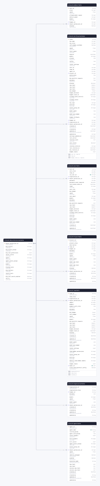

| Field                     | Type       | Constraints | Default   | Description |
| ------------------------- | ---------- | ----------- | --------- | ----------- |
| `object_permission_id`    | `String`   | PK NOT NULL | `uuid(4)` |             |
| `mcp_servers`             | `String[]` | NOT NULL    | `[]`      |             |
| `mcp_access_groups`       | `String[]` | NOT NULL    | `[]`      |             |
| `mcp_tool_permissions`    | `Json`     | NULL        |           |             |
| `vector_stores`           | `String[]` | NOT NULL    | `[]`      |             |
| `agents`                  | `String[]` | NOT NULL    | `[]`      |             |
| `agent_access_groups`     | `String[]` | NOT NULL    | `[]`      |             |
| `models`                  | `String[]` | NOT NULL    | `[]`      |             |
| `blocked_tools`           | `String[]` | NOT NULL    | `[]`      |             |
| `mcp_toolsets`            | `String[]` | NOT NULL    | `[]`      |             |
| `search_tools`            | `String[]` | NOT NULL    | `[]`      |             |
| `mcp_tool_search_enabled` | `Boolean`  | NULL        |           |             |
| `skills`                  | `String[]` | NOT NULL    | `[]`      |             |

#### Referenced by

- `object_permission_id` ← [LiteLLM_AgentsTable.object_permission_id](#model-LiteLLM_AgentsTable) (one-to-many)
- `object_permission_id` ← [LiteLLM_OrganizationTable.object_permission_id](#model-LiteLLM_OrganizationTable) (one-to-many)
- `object_permission_id` ← [LiteLLM_TeamTable.object_permission_id](#model-LiteLLM_TeamTable) (one-to-many)
- `object_permission_id` ← [LiteLLM_ProjectTable.object_permission_id](#model-LiteLLM_ProjectTable) (one-to-many)
- `object_permission_id` ← [LiteLLM_UserTable.object_permission_id](#model-LiteLLM_UserTable) (one-to-many)
- `object_permission_id` ← [LiteLLM_VerificationToken.object_permission_id](#model-LiteLLM_VerificationToken) (one-to-many)
- `object_permission_id` ← [LiteLLM_EndUserTable.object_permission_id](#model-LiteLLM_EndUserTable) (one-to-many)

#### Definition

```sql
CREATE TABLE "LiteLLM_ObjectPermissionTable" (
    "object_permission_id" TEXT NOT NULL,
    "mcp_servers" TEXT[] DEFAULT ARRAY[]::TEXT[],
    "mcp_access_groups" TEXT[] DEFAULT ARRAY[]::TEXT[],
    "mcp_tool_permissions" JSONB,
    "vector_stores" TEXT[] DEFAULT ARRAY[]::TEXT[],
    "agents" TEXT[] DEFAULT ARRAY[]::TEXT[],
    "agent_access_groups" TEXT[] DEFAULT ARRAY[]::TEXT[],
    "models" TEXT[] DEFAULT ARRAY[]::TEXT[],
    "blocked_tools" TEXT[] DEFAULT ARRAY[]::TEXT[],
    "mcp_toolsets" TEXT[] DEFAULT ARRAY[]::TEXT[],
    "search_tools" TEXT[] DEFAULT ARRAY[]::TEXT[],
    "mcp_tool_search_enabled" BOOLEAN,
    "skills" TEXT[] DEFAULT ARRAY[]::TEXT[],

    CONSTRAINT "LiteLLM_ObjectPermissionTable_pkey" PRIMARY KEY ("object_permission_id")
);
```

<details>
<summary>Queries and their SQL</summary>

**findMany**: Every row

```ts
await prisma.liteLLM_ObjectPermissionTable.findMany();
```

```sql
SELECT
  "public"."LiteLLM_ObjectPermissionTable"."object_permission_id",
  "public"."LiteLLM_ObjectPermissionTable"."mcp_servers",
  "public"."LiteLLM_ObjectPermissionTable"."mcp_access_groups",
  "public"."LiteLLM_ObjectPermissionTable"."mcp_tool_permissions",
  "public"."LiteLLM_ObjectPermissionTable"."vector_stores",
  "public"."LiteLLM_ObjectPermissionTable"."agents",
  "public"."LiteLLM_ObjectPermissionTable"."agent_access_groups",
  "public"."LiteLLM_ObjectPermissionTable"."models",
  "public"."LiteLLM_ObjectPermissionTable"."blocked_tools",
  "public"."LiteLLM_ObjectPermissionTable"."mcp_toolsets",
  "public"."LiteLLM_ObjectPermissionTable"."search_tools",
  "public"."LiteLLM_ObjectPermissionTable"."mcp_tool_search_enabled",
  "public"."LiteLLM_ObjectPermissionTable"."skills"
FROM
  "public"."LiteLLM_ObjectPermissionTable"
WHERE
  1 = 1
OFFSET
  $1
-- params: ["0"]
```

**count**: How many rows there are

```ts
await prisma.liteLLM_ObjectPermissionTable.count();
```

```sql
SELECT
  COUNT(*) AS "_count$_all"
FROM
  (
    SELECT
      "public"."LiteLLM_ObjectPermissionTable"."object_permission_id"
    FROM
      "public"."LiteLLM_ObjectPermissionTable"
    WHERE
      1 = 1
    OFFSET
      $1
  ) AS "sub"
-- params: ["0"]
```

**findMany**: Every row with its relations

```ts
await prisma.liteLLM_ObjectPermissionTable.findMany({
  include: {
    teams: true,
    projects: true,
    verification_tokens: true,
    organizations: true,
    users: true,
    end_users: true,
    agents_table: true,
  },
});
```

```sql
SELECT
  "public"."LiteLLM_ObjectPermissionTable"."object_permission_id",
  "public"."LiteLLM_ObjectPermissionTable"."mcp_servers",
  "public"."LiteLLM_ObjectPermissionTable"."mcp_access_groups",
  "public"."LiteLLM_ObjectPermissionTable"."mcp_tool_permissions",
  "public"."LiteLLM_ObjectPermissionTable"."vector_stores",
  "public"."LiteLLM_ObjectPermissionTable"."agents",
  "public"."LiteLLM_ObjectPermissionTable"."agent_access_groups",
  "public"."LiteLLM_ObjectPermissionTable"."models",
  "public"."LiteLLM_ObjectPermissionTable"."blocked_tools",
  "public"."LiteLLM_ObjectPermissionTable"."mcp_toolsets",
  "public"."LiteLLM_ObjectPermissionTable"."search_tools",
  "public"."LiteLLM_ObjectPermissionTable"."mcp_tool_search_enabled",
  "public"."LiteLLM_ObjectPermissionTable"."skills"
FROM
  "public"."LiteLLM_ObjectPermissionTable"
WHERE
  1 = 1
OFFSET
  $1
-- params: ["0"]

SELECT
  "public"."LiteLLM_TeamTable"."team_id",
  "public"."LiteLLM_TeamTable"."team_alias",
  "public"."LiteLLM_TeamTable"."organization_id",
  "public"."LiteLLM_TeamTable"."object_permission_id",
  "public"."LiteLLM_TeamTable"."admins",
  "public"."LiteLLM_TeamTable"."members",
  "public"."LiteLLM_TeamTable"."members_with_roles",
  "public"."LiteLLM_TeamTable"."metadata",
  "public"."LiteLLM_TeamTable"."max_budget",
  "public"."LiteLLM_TeamTable"."soft_budget",
  "public"."LiteLLM_TeamTable"."spend",
  "public"."LiteLLM_TeamTable"."models",
  "public"."LiteLLM_TeamTable"."max_parallel_requests",
  "public"."LiteLLM_TeamTable"."tpm_limit",
  "public"."LiteLLM_TeamTable"."rpm_limit",
  "public"."LiteLLM_TeamTable"."tpd_limit",
  "public"."LiteLLM_TeamTable"."budget_duration",
  "public"."LiteLLM_TeamTable"."budget_reset_at",
  "public"."LiteLLM_TeamTable"."blocked",
  "public"."LiteLLM_TeamTable"."created_at",
  "public"."LiteLLM_TeamTable"."updated_at",
  "public"."LiteLLM_TeamTable"."model_spend",
  "public"."LiteLLM_TeamTable"."model_max_budget",
  "public"."LiteLLM_TeamTable"."router_settings",
  "public"."LiteLLM_TeamTable"."team_member_permissions",
  "public"."LiteLLM_TeamTable"."access_group_ids",
  "public"."LiteLLM_TeamTable"."policies",
  "public"."LiteLLM_TeamTable"."default_team_member_models",
  "public"."LiteLLM_TeamTable"."budget_limits",
  "public"."LiteLLM_TeamTable"."model_id",
  "public"."LiteLLM_TeamTable"."allow_team_guardrail_config"
FROM
  "public"."LiteLLM_TeamTable"
WHERE
  "public"."LiteLLM_TeamTable"."object_permission_id" IN ($1)
OFFSET
  $2
-- params: ["<object_permission_id of the rows above>","0"]

SELECT
  "public"."LiteLLM_ProjectTable"."project_id",
  "public"."LiteLLM_ProjectTable"."project_alias",
  "public"."LiteLLM_ProjectTable"."description",
  "public"."LiteLLM_ProjectTable"."team_id",
  "public"."LiteLLM_ProjectTable"."budget_id",
  "public"."LiteLLM_ProjectTable"."metadata",
  "public"."LiteLLM_ProjectTable"."models",
  "public"."LiteLLM_ProjectTable"."spend",
  "public"."LiteLLM_ProjectTable"."model_spend",
  "public"."LiteLLM_ProjectTable"."model_rpm_limit",
  "public"."LiteLLM_ProjectTable"."model_tpm_limit",
  "public"."LiteLLM_ProjectTable"."blocked",
  "public"."LiteLLM_ProjectTable"."object_permission_id",
  "public"."LiteLLM_ProjectTable"."created_at",
  "public"."LiteLLM_ProjectTable"."created_by",
  "public"."LiteLLM_ProjectTable"."updated_at",
  "public"."LiteLLM_ProjectTable"."updated_by"
FROM
  "public"."LiteLLM_ProjectTable"
WHERE
  "public"."LiteLLM_ProjectTable"."object_permission_id" IN ($1)
OFFSET
  $2
-- params: ["<object_permission_id of the rows above>","0"]

SELECT
  "public"."LiteLLM_VerificationToken"."token",
  "public"."LiteLLM_VerificationToken"."key_name",
  "public"."LiteLLM_VerificationToken"."key_alias",
  "public"."LiteLLM_VerificationToken"."soft_budget_cooldown",
  "public"."LiteLLM_VerificationToken"."spend",
  "public"."LiteLLM_VerificationToken"."total_spend",
  "public"."LiteLLM_VerificationToken"."expires",
  "public"."LiteLLM_VerificationToken"."models",
  "public"."LiteLLM_VerificationToken"."aliases",
  "public"."LiteLLM_VerificationToken"."config",
  "public"."LiteLLM_VerificationToken"."router_settings",
  "public"."LiteLLM_VerificationToken"."user_id",
  "public"."LiteLLM_VerificationToken"."team_id",
  "public"."LiteLLM_VerificationToken"."agent_id",
  "public"."LiteLLM_VerificationToken"."project_id",
  "public"."LiteLLM_VerificationToken"."permissions",
  "public"."LiteLLM_VerificationToken"."max_parallel_requests",
  "public"."LiteLLM_VerificationToken"."metadata",
  "public"."LiteLLM_VerificationToken"."blocked",
  "public"."LiteLLM_VerificationToken"."tpm_limit",
  "public"."LiteLLM_VerificationToken"."rpm_limit",
  "public"."LiteLLM_VerificationToken"."tpd_limit",
  "public"."LiteLLM_VerificationToken"."max_budget",
  "public"."LiteLLM_VerificationToken"."budget_duration",
  "public"."LiteLLM_VerificationToken"."budget_reset_at",
  "public"."LiteLLM_VerificationToken"."allowed_cache_controls",
  "public"."LiteLLM_VerificationToken"."allowed_routes",
  "public"."LiteLLM_VerificationToken"."key_type",
  "public"."LiteLLM_VerificationToken"."policies",
  "public"."LiteLLM_VerificationToken"."access_group_ids",
  "public"."LiteLLM_VerificationToken"."model_spend",
  "public"."LiteLLM_VerificationToken"."model_max_budget",
  "public"."LiteLLM_VerificationToken"."budget_fallbacks",
  "public"."LiteLLM_VerificationToken"."budget_id",
  "public"."LiteLLM_VerificationToken"."organization_id",
  "public"."LiteLLM_VerificationToken"."object_permission_id",
  "public"."LiteLLM_VerificationToken"."created_at",
  "public"."LiteLLM_VerificationToken"."created_by",
  "public"."LiteLLM_VerificationToken"."updated_at",
  "public"."LiteLLM_VerificationToken"."updated_by",
  "public"."LiteLLM_VerificationToken"."settings_updated_at",
  "public"."LiteLLM_VerificationToken"."last_active",
  "public"."LiteLLM_VerificationToken"."rotation_count",
  "public"."LiteLLM_VerificationToken"."auto_rotate",
  "public"."LiteLLM_VerificationToken"."rotation_interval",
  "public"."LiteLLM_VerificationToken"."last_rotation_at",
  "public"."LiteLLM_VerificationToken"."key_rotation_at",
  "public"."LiteLLM_VerificationToken"."budget_limits"
FROM
  "public"."LiteLLM_VerificationToken"
WHERE
  "public"."LiteLLM_VerificationToken"."object_permission_id" IN ($1)
OFFSET
  $2
-- params: ["<object_permission_id of the rows above>","0"]

SELECT
  "public"."LiteLLM_OrganizationTable"."organization_id",
  "public"."LiteLLM_OrganizationTable"."organization_alias",
  "public"."LiteLLM_OrganizationTable"."budget_id",
  "public"."LiteLLM_OrganizationTable"."metadata",
  "public"."LiteLLM_OrganizationTable"."models",
  "public"."LiteLLM_OrganizationTable"."spend",
  "public"."LiteLLM_OrganizationTable"."model_spend",
  "public"."LiteLLM_OrganizationTable"."object_permission_id",
  "public"."LiteLLM_OrganizationTable"."created_at",
  "public"."LiteLLM_OrganizationTable"."created_by",
  "public"."LiteLLM_OrganizationTable"."updated_at",
  "public"."LiteLLM_OrganizationTable"."updated_by"
FROM
  "public"."LiteLLM_OrganizationTable"
WHERE
  "public"."LiteLLM_OrganizationTable"."object_permission_id" IN ($1)
OFFSET
  $2
-- params: ["<object_permission_id of the rows above>","0"]

SELECT
  "public"."LiteLLM_UserTable"."user_id",
  "public"."LiteLLM_UserTable"."user_alias",
  "public"."LiteLLM_UserTable"."team_id",
  "public"."LiteLLM_UserTable"."sso_user_id",
  "public"."LiteLLM_UserTable"."organization_id",
  "public"."LiteLLM_UserTable"."object_permission_id",
  "public"."LiteLLM_UserTable"."password",
  "public"."LiteLLM_UserTable"."password_reset_required",
  "public"."LiteLLM_UserTable"."last_breach_check_at",
  "public"."LiteLLM_UserTable"."teams",
  "public"."LiteLLM_UserTable"."user_role",
  "public"."LiteLLM_UserTable"."max_budget",
  "public"."LiteLLM_UserTable"."spend",
  "public"."LiteLLM_UserTable"."user_email",
  "public"."LiteLLM_UserTable"."models",
  "public"."LiteLLM_UserTable"."metadata",
  "public"."LiteLLM_UserTable"."max_parallel_requests",
  "public"."LiteLLM_UserTable"."tpm_limit",
  "public"."LiteLLM_UserTable"."rpm_limit",
  "public"."LiteLLM_UserTable"."budget_duration",
  "public"."LiteLLM_UserTable"."budget_reset_at",
  "public"."LiteLLM_UserTable"."allowed_cache_controls",
  "public"."LiteLLM_UserTable"."policies",
  "public"."LiteLLM_UserTable"."model_spend",
  "public"."LiteLLM_UserTable"."model_max_budget",
  "public"."LiteLLM_UserTable"."created_at",
  "public"."LiteLLM_UserTable"."updated_at"
FROM
  "public"."LiteLLM_UserTable"
WHERE
  "public"."LiteLLM_UserTable"."object_permission_id" IN ($1)
OFFSET
  $2
-- params: ["<object_permission_id of the rows above>","0"]

SELECT
  "public"."LiteLLM_EndUserTable"."user_id",
  "public"."LiteLLM_EndUserTable"."alias",
  "public"."LiteLLM_EndUserTable"."spend",
  "public"."LiteLLM_EndUserTable"."allowed_model_region",
  "public"."LiteLLM_EndUserTable"."default_model",
  "public"."LiteLLM_EndUserTable"."models",
  "public"."LiteLLM_EndUserTable"."budget_id",
  "public"."LiteLLM_EndUserTable"."object_permission_id",
  "public"."LiteLLM_EndUserTable"."blocked"
FROM
  "public"."LiteLLM_EndUserTable"
WHERE
  "public"."LiteLLM_EndUserTable"."object_permission_id" IN ($1)
OFFSET
  $2
-- params: ["<object_permission_id of the rows above>","0"]

SELECT
  "public"."LiteLLM_AgentsTable"."agent_id",
  "public"."LiteLLM_AgentsTable"."agent_name",
  "public"."LiteLLM_AgentsTable"."litellm_params",
  "public"."LiteLLM_AgentsTable"."agent_card_params",
  "public"."LiteLLM_AgentsTable"."static_headers",
  "public"."LiteLLM_AgentsTable"."extra_headers",
  "public"."LiteLLM_AgentsTable"."kill_switch",
  "public"."LiteLLM_AgentsTable"."agent_access_groups",
  "public"."LiteLLM_AgentsTable"."access_group_ids",
  "public"."LiteLLM_AgentsTable"."object_permission_id",
  "public"."LiteLLM_AgentsTable"."spend",
  "public"."LiteLLM_AgentsTable"."identity_managed",
  "public"."LiteLLM_AgentsTable"."enabled",
  "public"."LiteLLM_AgentsTable"."execution_mode",
  "public"."LiteLLM_AgentsTable"."tpm_limit",
  "public"."LiteLLM_AgentsTable"."rpm_limit",
  "public"."LiteLLM_AgentsTable"."session_tpm_limit",
  "public"."LiteLLM_AgentsTable"."session_rpm_limit",
  "public"."LiteLLM_AgentsTable"."created_at",
  "public"."LiteLLM_AgentsTable"."created_by",
  "public"."LiteLLM_AgentsTable"."updated_at",
  "public"."LiteLLM_AgentsTable"."updated_by"
FROM
  "public"."LiteLLM_AgentsTable"
WHERE
  "public"."LiteLLM_AgentsTable"."object_permission_id" IN ($1)
OFFSET
  $2
-- params: ["<object_permission_id of the rows above>","0"]
```

**findUnique**: One row by what is unique to it

```ts
await prisma.liteLLM_ObjectPermissionTable.findUnique({
  where: { object_permission_id: "example" },
});
```

```sql
SELECT
  "public"."LiteLLM_ObjectPermissionTable"."object_permission_id",
  "public"."LiteLLM_ObjectPermissionTable"."mcp_servers",
  "public"."LiteLLM_ObjectPermissionTable"."mcp_access_groups",
  "public"."LiteLLM_ObjectPermissionTable"."mcp_tool_permissions",
  "public"."LiteLLM_ObjectPermissionTable"."vector_stores",
  "public"."LiteLLM_ObjectPermissionTable"."agents",
  "public"."LiteLLM_ObjectPermissionTable"."agent_access_groups",
  "public"."LiteLLM_ObjectPermissionTable"."models",
  "public"."LiteLLM_ObjectPermissionTable"."blocked_tools",
  "public"."LiteLLM_ObjectPermissionTable"."mcp_toolsets",
  "public"."LiteLLM_ObjectPermissionTable"."search_tools",
  "public"."LiteLLM_ObjectPermissionTable"."mcp_tool_search_enabled",
  "public"."LiteLLM_ObjectPermissionTable"."skills"
FROM
  "public"."LiteLLM_ObjectPermissionTable"
WHERE
  (
    "public"."LiteLLM_ObjectPermissionTable"."object_permission_id" = $1
    AND 1 = 1
  )
LIMIT
  $2
OFFSET
  $3
-- params: ["example","1","0"]
```

**create**: Create a row

```ts
await prisma.liteLLM_ObjectPermissionTable.create({ data: {} });
```

```sql
INSERT INTO
  "public"."LiteLLM_ObjectPermissionTable" (
    "object_permission_id",
    "mcp_servers",
    "mcp_access_groups",
    "vector_stores",
    "agents",
    "agent_access_groups",
    "models",
    "blocked_tools",
    "mcp_toolsets",
    "search_tools",
    "skills"
  )
VALUES
  ($1, $2, $3, $4, $5, $6, $7, $8, $9, $10, $11)
RETURNING
  "public"."LiteLLM_ObjectPermissionTable"."object_permission_id",
  "public"."LiteLLM_ObjectPermissionTable"."mcp_servers",
  "public"."LiteLLM_ObjectPermissionTable"."mcp_access_groups",
  "public"."LiteLLM_ObjectPermissionTable"."mcp_tool_permissions",
  "public"."LiteLLM_ObjectPermissionTable"."vector_stores",
  "public"."LiteLLM_ObjectPermissionTable"."agents",
  "public"."LiteLLM_ObjectPermissionTable"."agent_access_groups",
  "public"."LiteLLM_ObjectPermissionTable"."models",
  "public"."LiteLLM_ObjectPermissionTable"."blocked_tools",
  "public"."LiteLLM_ObjectPermissionTable"."mcp_toolsets",
  "public"."LiteLLM_ObjectPermissionTable"."search_tools",
  "public"."LiteLLM_ObjectPermissionTable"."mcp_tool_search_enabled",
  "public"."LiteLLM_ObjectPermissionTable"."skills"
-- params: ["<uuid(4)>",[],[],[],[],[],[],[],[],[],[]]
```

**update**: Update a row

```ts
await prisma.liteLLM_ObjectPermissionTable.update({
  where: { object_permission_id: "example" },
  data: { mcp_servers: ["example"] },
});
```

```sql
UPDATE "public"."LiteLLM_ObjectPermissionTable"
SET
  "mcp_servers" = $1
WHERE
  (
    "public"."LiteLLM_ObjectPermissionTable"."object_permission_id" = $2
    AND 1 = 1
  )
RETURNING
  "public"."LiteLLM_ObjectPermissionTable"."object_permission_id",
  "public"."LiteLLM_ObjectPermissionTable"."mcp_servers",
  "public"."LiteLLM_ObjectPermissionTable"."mcp_access_groups",
  "public"."LiteLLM_ObjectPermissionTable"."mcp_tool_permissions",
  "public"."LiteLLM_ObjectPermissionTable"."vector_stores",
  "public"."LiteLLM_ObjectPermissionTable"."agents",
  "public"."LiteLLM_ObjectPermissionTable"."agent_access_groups",
  "public"."LiteLLM_ObjectPermissionTable"."models",
  "public"."LiteLLM_ObjectPermissionTable"."blocked_tools",
  "public"."LiteLLM_ObjectPermissionTable"."mcp_toolsets",
  "public"."LiteLLM_ObjectPermissionTable"."search_tools",
  "public"."LiteLLM_ObjectPermissionTable"."mcp_tool_search_enabled",
  "public"."LiteLLM_ObjectPermissionTable"."skills"
-- params: [["example"],"example"]
```

**delete**: Delete a row

```ts
await prisma.liteLLM_ObjectPermissionTable.delete({ where: { object_permission_id: "example" } });
```

```sql
DELETE FROM "public"."LiteLLM_ObjectPermissionTable"
WHERE
  (
    "public"."LiteLLM_ObjectPermissionTable"."object_permission_id" = $1
    AND 1 = 1
  )
RETURNING
  "public"."LiteLLM_ObjectPermissionTable"."object_permission_id",
  "public"."LiteLLM_ObjectPermissionTable"."mcp_servers",
  "public"."LiteLLM_ObjectPermissionTable"."mcp_access_groups",
  "public"."LiteLLM_ObjectPermissionTable"."mcp_tool_permissions",
  "public"."LiteLLM_ObjectPermissionTable"."vector_stores",
  "public"."LiteLLM_ObjectPermissionTable"."agents",
  "public"."LiteLLM_ObjectPermissionTable"."agent_access_groups",
  "public"."LiteLLM_ObjectPermissionTable"."models",
  "public"."LiteLLM_ObjectPermissionTable"."blocked_tools",
  "public"."LiteLLM_ObjectPermissionTable"."mcp_toolsets",
  "public"."LiteLLM_ObjectPermissionTable"."search_tools",
  "public"."LiteLLM_ObjectPermissionTable"."mcp_tool_search_enabled",
  "public"."LiteLLM_ObjectPermissionTable"."skills"
-- params: ["example"]
```

</details>

<a id="model-LiteLLM_MCPServerTable"></a>

### LiteLLM_MCPServerTable

| Field                          | Type       | Constraints | Default              | Description |
| ------------------------------ | ---------- | ----------- | -------------------- | ----------- |
| `server_id`                    | `String`   | PK NOT NULL | `uuid(4)`            |             |
| `server_name`                  | `String`   | NULL        |                      |             |
| `alias`                        | `String`   | NULL        |                      |             |
| `description`                  | `String`   | NULL        |                      |             |
| `instructions`                 | `String`   | NULL        |                      |             |
| `url`                          | `String`   | NULL        |                      |             |
| `spec_path`                    | `String`   | NULL        |                      |             |
| `transport`                    | `String`   | NOT NULL    | `"sse"`              |             |
| `auth_type`                    | `String`   | NULL        |                      |             |
| `credentials`                  | `Json`     | NULL        | `"{}"`               |             |
| `created_at` (`created_at`)    | `DateTime` | NULL        | `now()`              |             |
| `created_by`                   | `String`   | NULL        |                      |             |
| `updated_at` (`updated_at`)    | `DateTime` | NULL        | `now()` `@updatedAt` |             |
| `updated_by`                   | `String`   | NULL        |                      |             |
| `mcp_info`                     | `Json`     | NULL        | `"{}"`               |             |
| `mcp_access_groups`            | `String[]` | NOT NULL    |                      |             |
| `allowed_tools`                | `String[]` | NOT NULL    | `[]`                 |             |
| `tool_name_to_display_name`    | `Json`     | NULL        | `"{}"`               |             |
| `tool_name_to_description`     | `Json`     | NULL        | `"{}"`               |             |
| `pinned_tools`                 | `Json`     | NULL        | `"{}"`               |             |
| `extra_headers`                | `String[]` | NOT NULL    | `[]`                 |             |
| `static_headers`               | `Json`     | NULL        | `"{}"`               |             |
| `env_vars`                     | `Json`     | NULL        | `"[]"`               |             |
| `status`                       | `String`   | NULL        | `"unknown"`          |             |
| `last_health_check`            | `DateTime` | NULL        |                      |             |
| `health_check_error`           | `String`   | NULL        |                      |             |
| `command`                      | `String`   | NULL        |                      |             |
| `args`                         | `String[]` | NOT NULL    | `[]`                 |             |
| `env`                          | `Json`     | NULL        | `"{}"`               |             |
| `issuer`                       | `String`   | NULL        |                      |             |
| `authorization_url`            | `String`   | NULL        |                      |             |
| `token_url`                    | `String`   | NULL        |                      |             |
| `registration_url`             | `String`   | NULL        |                      |             |
| `oauth2_flow`                  | `String`   | NULL        |                      |             |
| `token_exchange_endpoint`      | `String`   | NULL        |                      |             |
| `audience`                     | `String`   | NULL        |                      |             |
| `subject_token_type`           | `String`   | NULL        |                      |             |
| `token_exchange_profile`       | `String`   | NULL        |                      |             |
| `allow_all_keys`               | `Boolean`  | NOT NULL    | `false`              |             |
| `available_on_public_internet` | `Boolean`  | NOT NULL    | `true`               |             |
| `delegate_auth_to_upstream`    | `Boolean`  | NOT NULL    | `false`              |             |
| `oauth_passthrough`            | `Boolean`  | NOT NULL    | `false`              |             |
| `dcr_bridge`                   | `Boolean`  | NULL        |                      |             |
| `per_server_oauth_discovery`   | `Boolean`  | NOT NULL    | `false`              |             |
| `is_byok`                      | `Boolean`  | NOT NULL    | `false`              |             |
| `byok_description`             | `String[]` | NOT NULL    | `[]`                 |             |
| `byok_api_key_help_url`        | `String`   | NULL        |                      |             |
| `source_url`                   | `String`   | NULL        |                      |             |
| `timeout`                      | `Float`    | NULL        |                      |             |
| `max_concurrent_requests`      | `Int`      | NULL        |                      |             |
| `rpm`                          | `Int`      | NULL        |                      |             |
| `approval_status`              | `String`   | NULL        | `"active"`           |             |
| `submitted_by`                 | `String`   | NULL        |                      |             |
| `submitted_at`                 | `DateTime` | NULL        |                      |             |
| `reviewed_at`                  | `DateTime` | NULL        |                      |             |
| `review_notes`                 | `String`   | NULL        |                      |             |

#### Indexes

- `@@index([approval_status])`

#### Definition

```sql
CREATE TABLE "LiteLLM_MCPServerTable" (
    "server_id" TEXT NOT NULL,
    "server_name" TEXT,
    "alias" TEXT,
    "description" TEXT,
    "instructions" TEXT,
    "url" TEXT,
    "spec_path" TEXT,
    "transport" TEXT NOT NULL DEFAULT 'sse',
    "auth_type" TEXT,
    "credentials" JSONB DEFAULT '{}',
    "created_at" TIMESTAMP(3) DEFAULT CURRENT_TIMESTAMP,
    "created_by" TEXT,
    "updated_at" TIMESTAMP(3) DEFAULT CURRENT_TIMESTAMP,
    "updated_by" TEXT,
    "mcp_info" JSONB DEFAULT '{}',
    "mcp_access_groups" TEXT[],
    "allowed_tools" TEXT[] DEFAULT ARRAY[]::TEXT[],
    "tool_name_to_display_name" JSONB DEFAULT '{}',
    "tool_name_to_description" JSONB DEFAULT '{}',
    "pinned_tools" JSONB DEFAULT '{}',
    "extra_headers" TEXT[] DEFAULT ARRAY[]::TEXT[],
    "static_headers" JSONB DEFAULT '{}',
    "env_vars" JSONB DEFAULT '[]',
    "status" TEXT DEFAULT 'unknown',
    "last_health_check" TIMESTAMP(3),
    "health_check_error" TEXT,
    "command" TEXT,
    "args" TEXT[] DEFAULT ARRAY[]::TEXT[],
    "env" JSONB DEFAULT '{}',
    "issuer" TEXT,
    "authorization_url" TEXT,
    "token_url" TEXT,
    "registration_url" TEXT,
    "oauth2_flow" TEXT,
    "token_exchange_endpoint" TEXT,
    "audience" TEXT,
    "subject_token_type" TEXT,
    "token_exchange_profile" TEXT,
    "allow_all_keys" BOOLEAN NOT NULL DEFAULT false,
    "available_on_public_internet" BOOLEAN NOT NULL DEFAULT true,
    "delegate_auth_to_upstream" BOOLEAN NOT NULL DEFAULT false,
    "oauth_passthrough" BOOLEAN NOT NULL DEFAULT false,
    "dcr_bridge" BOOLEAN,
    "per_server_oauth_discovery" BOOLEAN NOT NULL DEFAULT false,
    "is_byok" BOOLEAN NOT NULL DEFAULT false,
    "byok_description" TEXT[] DEFAULT ARRAY[]::TEXT[],
    "byok_api_key_help_url" TEXT,
    "source_url" TEXT,
    "timeout" DOUBLE PRECISION,
    "max_concurrent_requests" INTEGER,
    "rpm" INTEGER,
    "approval_status" TEXT DEFAULT 'active',
    "submitted_by" TEXT,
    "submitted_at" TIMESTAMP(3),
    "reviewed_at" TIMESTAMP(3),
    "review_notes" TEXT,

    CONSTRAINT "LiteLLM_MCPServerTable_pkey" PRIMARY KEY ("server_id")
);

CREATE INDEX "LiteLLM_MCPServerTable_approval_status_idx" ON "LiteLLM_MCPServerTable"("approval_status");
```

<details>
<summary>Queries and their SQL</summary>

**findMany**: Every row

```ts
await prisma.liteLLM_MCPServerTable.findMany();
```

```sql
SELECT
  "public"."LiteLLM_MCPServerTable"."server_id",
  "public"."LiteLLM_MCPServerTable"."server_name",
  "public"."LiteLLM_MCPServerTable"."alias",
  "public"."LiteLLM_MCPServerTable"."description",
  "public"."LiteLLM_MCPServerTable"."instructions",
  "public"."LiteLLM_MCPServerTable"."url",
  "public"."LiteLLM_MCPServerTable"."spec_path",
  "public"."LiteLLM_MCPServerTable"."transport",
  "public"."LiteLLM_MCPServerTable"."auth_type",
  "public"."LiteLLM_MCPServerTable"."credentials",
  "public"."LiteLLM_MCPServerTable"."created_at",
  "public"."LiteLLM_MCPServerTable"."created_by",
  "public"."LiteLLM_MCPServerTable"."updated_at",
  "public"."LiteLLM_MCPServerTable"."updated_by",
  "public"."LiteLLM_MCPServerTable"."mcp_info",
  "public"."LiteLLM_MCPServerTable"."mcp_access_groups",
  "public"."LiteLLM_MCPServerTable"."allowed_tools",
  "public"."LiteLLM_MCPServerTable"."tool_name_to_display_name",
  "public"."LiteLLM_MCPServerTable"."tool_name_to_description",
  "public"."LiteLLM_MCPServerTable"."pinned_tools",
  "public"."LiteLLM_MCPServerTable"."extra_headers",
  "public"."LiteLLM_MCPServerTable"."static_headers",
  "public"."LiteLLM_MCPServerTable"."env_vars",
  "public"."LiteLLM_MCPServerTable"."status",
  "public"."LiteLLM_MCPServerTable"."last_health_check",
  "public"."LiteLLM_MCPServerTable"."health_check_error",
  "public"."LiteLLM_MCPServerTable"."command",
  "public"."LiteLLM_MCPServerTable"."args",
  "public"."LiteLLM_MCPServerTable"."env",
  "public"."LiteLLM_MCPServerTable"."issuer",
  "public"."LiteLLM_MCPServerTable"."authorization_url",
  "public"."LiteLLM_MCPServerTable"."token_url",
  "public"."LiteLLM_MCPServerTable"."registration_url",
  "public"."LiteLLM_MCPServerTable"."oauth2_flow",
  "public"."LiteLLM_MCPServerTable"."token_exchange_endpoint",
  "public"."LiteLLM_MCPServerTable"."audience",
  "public"."LiteLLM_MCPServerTable"."subject_token_type",
  "public"."LiteLLM_MCPServerTable"."token_exchange_profile",
  "public"."LiteLLM_MCPServerTable"."allow_all_keys",
  "public"."LiteLLM_MCPServerTable"."available_on_public_internet",
  "public"."LiteLLM_MCPServerTable"."delegate_auth_to_upstream",
  "public"."LiteLLM_MCPServerTable"."oauth_passthrough",
  "public"."LiteLLM_MCPServerTable"."dcr_bridge",
  "public"."LiteLLM_MCPServerTable"."per_server_oauth_discovery",
  "public"."LiteLLM_MCPServerTable"."is_byok",
  "public"."LiteLLM_MCPServerTable"."byok_description",
  "public"."LiteLLM_MCPServerTable"."byok_api_key_help_url",
  "public"."LiteLLM_MCPServerTable"."source_url",
  "public"."LiteLLM_MCPServerTable"."timeout",
  "public"."LiteLLM_MCPServerTable"."max_concurrent_requests",
  "public"."LiteLLM_MCPServerTable"."rpm",
  "public"."LiteLLM_MCPServerTable"."approval_status",
  "public"."LiteLLM_MCPServerTable"."submitted_by",
  "public"."LiteLLM_MCPServerTable"."submitted_at",
  "public"."LiteLLM_MCPServerTable"."reviewed_at",
  "public"."LiteLLM_MCPServerTable"."review_notes"
FROM
  "public"."LiteLLM_MCPServerTable"
WHERE
  1 = 1
OFFSET
  $1
-- params: ["0"]
```

**count**: How many rows there are

```ts
await prisma.liteLLM_MCPServerTable.count();
```

```sql
SELECT
  COUNT(*) AS "_count$_all"
FROM
  (
    SELECT
      "public"."LiteLLM_MCPServerTable"."server_id"
    FROM
      "public"."LiteLLM_MCPServerTable"
    WHERE
      1 = 1
    OFFSET
      $1
  ) AS "sub"
-- params: ["0"]
```

**findUnique**: One row by what is unique to it

```ts
await prisma.liteLLM_MCPServerTable.findUnique({ where: { server_id: "example" } });
```

```sql
SELECT
  "public"."LiteLLM_MCPServerTable"."server_id",
  "public"."LiteLLM_MCPServerTable"."server_name",
  "public"."LiteLLM_MCPServerTable"."alias",
  "public"."LiteLLM_MCPServerTable"."description",
  "public"."LiteLLM_MCPServerTable"."instructions",
  "public"."LiteLLM_MCPServerTable"."url",
  "public"."LiteLLM_MCPServerTable"."spec_path",
  "public"."LiteLLM_MCPServerTable"."transport",
  "public"."LiteLLM_MCPServerTable"."auth_type",
  "public"."LiteLLM_MCPServerTable"."credentials",
  "public"."LiteLLM_MCPServerTable"."created_at",
  "public"."LiteLLM_MCPServerTable"."created_by",
  "public"."LiteLLM_MCPServerTable"."updated_at",
  "public"."LiteLLM_MCPServerTable"."updated_by",
  "public"."LiteLLM_MCPServerTable"."mcp_info",
  "public"."LiteLLM_MCPServerTable"."mcp_access_groups",
  "public"."LiteLLM_MCPServerTable"."allowed_tools",
  "public"."LiteLLM_MCPServerTable"."tool_name_to_display_name",
  "public"."LiteLLM_MCPServerTable"."tool_name_to_description",
  "public"."LiteLLM_MCPServerTable"."pinned_tools",
  "public"."LiteLLM_MCPServerTable"."extra_headers",
  "public"."LiteLLM_MCPServerTable"."static_headers",
  "public"."LiteLLM_MCPServerTable"."env_vars",
  "public"."LiteLLM_MCPServerTable"."status",
  "public"."LiteLLM_MCPServerTable"."last_health_check",
  "public"."LiteLLM_MCPServerTable"."health_check_error",
  "public"."LiteLLM_MCPServerTable"."command",
  "public"."LiteLLM_MCPServerTable"."args",
  "public"."LiteLLM_MCPServerTable"."env",
  "public"."LiteLLM_MCPServerTable"."issuer",
  "public"."LiteLLM_MCPServerTable"."authorization_url",
  "public"."LiteLLM_MCPServerTable"."token_url",
  "public"."LiteLLM_MCPServerTable"."registration_url",
  "public"."LiteLLM_MCPServerTable"."oauth2_flow",
  "public"."LiteLLM_MCPServerTable"."token_exchange_endpoint",
  "public"."LiteLLM_MCPServerTable"."audience",
  "public"."LiteLLM_MCPServerTable"."subject_token_type",
  "public"."LiteLLM_MCPServerTable"."token_exchange_profile",
  "public"."LiteLLM_MCPServerTable"."allow_all_keys",
  "public"."LiteLLM_MCPServerTable"."available_on_public_internet",
  "public"."LiteLLM_MCPServerTable"."delegate_auth_to_upstream",
  "public"."LiteLLM_MCPServerTable"."oauth_passthrough",
  "public"."LiteLLM_MCPServerTable"."dcr_bridge",
  "public"."LiteLLM_MCPServerTable"."per_server_oauth_discovery",
  "public"."LiteLLM_MCPServerTable"."is_byok",
  "public"."LiteLLM_MCPServerTable"."byok_description",
  "public"."LiteLLM_MCPServerTable"."byok_api_key_help_url",
  "public"."LiteLLM_MCPServerTable"."source_url",
  "public"."LiteLLM_MCPServerTable"."timeout",
  "public"."LiteLLM_MCPServerTable"."max_concurrent_requests",
  "public"."LiteLLM_MCPServerTable"."rpm",
  "public"."LiteLLM_MCPServerTable"."approval_status",
  "public"."LiteLLM_MCPServerTable"."submitted_by",
  "public"."LiteLLM_MCPServerTable"."submitted_at",
  "public"."LiteLLM_MCPServerTable"."reviewed_at",
  "public"."LiteLLM_MCPServerTable"."review_notes"
FROM
  "public"."LiteLLM_MCPServerTable"
WHERE
  (
    "public"."LiteLLM_MCPServerTable"."server_id" = $1
    AND 1 = 1
  )
LIMIT
  $2
OFFSET
  $3
-- params: ["example","1","0"]
```

**create**: Create a row

```ts
await prisma.liteLLM_MCPServerTable.create({ data: { mcp_access_groups: ["example"] } });
```

```sql
INSERT INTO
  "public"."LiteLLM_MCPServerTable" (
    "server_id",
    "transport",
    "credentials",
    "created_at",
    "updated_at",
    "mcp_info",
    "mcp_access_groups",
    "allowed_tools",
    "tool_name_to_display_name",
    "tool_name_to_description",
    "pinned_tools",
    "extra_headers",
    "static_headers",
    "env_vars",
    "status",
    "args",
    "env",
    "allow_all_keys",
    "available_on_public_internet",
    "delegate_auth_to_upstream",
    "oauth_passthrough",
    "per_server_oauth_discovery",
    "is_byok",
    "byok_description",
    "approval_status"
  )
VALUES
  (
    $1,
    $2,
    $3,
    $4,
    $5,
    $6,
    $7,
    $8,
    $9,
    $10,
    $11,
    $12,
    $13,
    $14,
    $15,
    $16,
    $17,
    $18,
    $19,
    $20,
    $21,
    $22,
    $23,
    $24,
    $25
  )
RETURNING
  "public"."LiteLLM_MCPServerTable"."server_id",
  "public"."LiteLLM_MCPServerTable"."server_name",
  "public"."LiteLLM_MCPServerTable"."alias",
  "public"."LiteLLM_MCPServerTable"."description",
  "public"."LiteLLM_MCPServerTable"."instructions",
  "public"."LiteLLM_MCPServerTable"."url",
  "public"."LiteLLM_MCPServerTable"."spec_path",
  "public"."LiteLLM_MCPServerTable"."transport",
  "public"."LiteLLM_MCPServerTable"."auth_type",
  "public"."LiteLLM_MCPServerTable"."credentials",
  "public"."LiteLLM_MCPServerTable"."created_at",
  "public"."LiteLLM_MCPServerTable"."created_by",
  "public"."LiteLLM_MCPServerTable"."updated_at",
  "public"."LiteLLM_MCPServerTable"."updated_by",
  "public"."LiteLLM_MCPServerTable"."mcp_info",
  "public"."LiteLLM_MCPServerTable"."mcp_access_groups",
  "public"."LiteLLM_MCPServerTable"."allowed_tools",
  "public"."LiteLLM_MCPServerTable"."tool_name_to_display_name",
  "public"."LiteLLM_MCPServerTable"."tool_name_to_description",
  "public"."LiteLLM_MCPServerTable"."pinned_tools",
  "public"."LiteLLM_MCPServerTable"."extra_headers",
  "public"."LiteLLM_MCPServerTable"."static_headers",
  "public"."LiteLLM_MCPServerTable"."env_vars",
  "public"."LiteLLM_MCPServerTable"."status",
  "public"."LiteLLM_MCPServerTable"."last_health_check",
  "public"."LiteLLM_MCPServerTable"."health_check_error",
  "public"."LiteLLM_MCPServerTable"."command",
  "public"."LiteLLM_MCPServerTable"."args",
  "public"."LiteLLM_MCPServerTable"."env",
  "public"."LiteLLM_MCPServerTable"."issuer",
  "public"."LiteLLM_MCPServerTable"."authorization_url",
  "public"."LiteLLM_MCPServerTable"."token_url",
  "public"."LiteLLM_MCPServerTable"."registration_url",
  "public"."LiteLLM_MCPServerTable"."oauth2_flow",
  "public"."LiteLLM_MCPServerTable"."token_exchange_endpoint",
  "public"."LiteLLM_MCPServerTable"."audience",
  "public"."LiteLLM_MCPServerTable"."subject_token_type",
  "public"."LiteLLM_MCPServerTable"."token_exchange_profile",
  "public"."LiteLLM_MCPServerTable"."allow_all_keys",
  "public"."LiteLLM_MCPServerTable"."available_on_public_internet",
  "public"."LiteLLM_MCPServerTable"."delegate_auth_to_upstream",
  "public"."LiteLLM_MCPServerTable"."oauth_passthrough",
  "public"."LiteLLM_MCPServerTable"."dcr_bridge",
  "public"."LiteLLM_MCPServerTable"."per_server_oauth_discovery",
  "public"."LiteLLM_MCPServerTable"."is_byok",
  "public"."LiteLLM_MCPServerTable"."byok_description",
  "public"."LiteLLM_MCPServerTable"."byok_api_key_help_url",
  "public"."LiteLLM_MCPServerTable"."source_url",
  "public"."LiteLLM_MCPServerTable"."timeout",
  "public"."LiteLLM_MCPServerTable"."max_concurrent_requests",
  "public"."LiteLLM_MCPServerTable"."rpm",
  "public"."LiteLLM_MCPServerTable"."approval_status",
  "public"."LiteLLM_MCPServerTable"."submitted_by",
  "public"."LiteLLM_MCPServerTable"."submitted_at",
  "public"."LiteLLM_MCPServerTable"."reviewed_at",
  "public"."LiteLLM_MCPServerTable"."review_notes"
-- params: ["<uuid(4)>","sse","{}","<now()>","<now()>","{}",["example"],[],"{}","{}","{}",[],"{}","[]","unknown",[],"{}",false,true,false,false,false,false,[],"active"]
```

**update**: Update a row

```ts
await prisma.liteLLM_MCPServerTable.update({
  where: { server_id: "example" },
  data: { server_name: "example" },
});
```

```sql
UPDATE "public"."LiteLLM_MCPServerTable"
SET
  "server_name" = $1,
  "updated_at" = $2
WHERE
  (
    "public"."LiteLLM_MCPServerTable"."server_id" = $3
    AND 1 = 1
  )
RETURNING
  "public"."LiteLLM_MCPServerTable"."server_id",
  "public"."LiteLLM_MCPServerTable"."server_name",
  "public"."LiteLLM_MCPServerTable"."alias",
  "public"."LiteLLM_MCPServerTable"."description",
  "public"."LiteLLM_MCPServerTable"."instructions",
  "public"."LiteLLM_MCPServerTable"."url",
  "public"."LiteLLM_MCPServerTable"."spec_path",
  "public"."LiteLLM_MCPServerTable"."transport",
  "public"."LiteLLM_MCPServerTable"."auth_type",
  "public"."LiteLLM_MCPServerTable"."credentials",
  "public"."LiteLLM_MCPServerTable"."created_at",
  "public"."LiteLLM_MCPServerTable"."created_by",
  "public"."LiteLLM_MCPServerTable"."updated_at",
  "public"."LiteLLM_MCPServerTable"."updated_by",
  "public"."LiteLLM_MCPServerTable"."mcp_info",
  "public"."LiteLLM_MCPServerTable"."mcp_access_groups",
  "public"."LiteLLM_MCPServerTable"."allowed_tools",
  "public"."LiteLLM_MCPServerTable"."tool_name_to_display_name",
  "public"."LiteLLM_MCPServerTable"."tool_name_to_description",
  "public"."LiteLLM_MCPServerTable"."pinned_tools",
  "public"."LiteLLM_MCPServerTable"."extra_headers",
  "public"."LiteLLM_MCPServerTable"."static_headers",
  "public"."LiteLLM_MCPServerTable"."env_vars",
  "public"."LiteLLM_MCPServerTable"."status",
  "public"."LiteLLM_MCPServerTable"."last_health_check",
  "public"."LiteLLM_MCPServerTable"."health_check_error",
  "public"."LiteLLM_MCPServerTable"."command",
  "public"."LiteLLM_MCPServerTable"."args",
  "public"."LiteLLM_MCPServerTable"."env",
  "public"."LiteLLM_MCPServerTable"."issuer",
  "public"."LiteLLM_MCPServerTable"."authorization_url",
  "public"."LiteLLM_MCPServerTable"."token_url",
  "public"."LiteLLM_MCPServerTable"."registration_url",
  "public"."LiteLLM_MCPServerTable"."oauth2_flow",
  "public"."LiteLLM_MCPServerTable"."token_exchange_endpoint",
  "public"."LiteLLM_MCPServerTable"."audience",
  "public"."LiteLLM_MCPServerTable"."subject_token_type",
  "public"."LiteLLM_MCPServerTable"."token_exchange_profile",
  "public"."LiteLLM_MCPServerTable"."allow_all_keys",
  "public"."LiteLLM_MCPServerTable"."available_on_public_internet",
  "public"."LiteLLM_MCPServerTable"."delegate_auth_to_upstream",
  "public"."LiteLLM_MCPServerTable"."oauth_passthrough",
  "public"."LiteLLM_MCPServerTable"."dcr_bridge",
  "public"."LiteLLM_MCPServerTable"."per_server_oauth_discovery",
  "public"."LiteLLM_MCPServerTable"."is_byok",
  "public"."LiteLLM_MCPServerTable"."byok_description",
  "public"."LiteLLM_MCPServerTable"."byok_api_key_help_url",
  "public"."LiteLLM_MCPServerTable"."source_url",
  "public"."LiteLLM_MCPServerTable"."timeout",
  "public"."LiteLLM_MCPServerTable"."max_concurrent_requests",
  "public"."LiteLLM_MCPServerTable"."rpm",
  "public"."LiteLLM_MCPServerTable"."approval_status",
  "public"."LiteLLM_MCPServerTable"."submitted_by",
  "public"."LiteLLM_MCPServerTable"."submitted_at",
  "public"."LiteLLM_MCPServerTable"."reviewed_at",
  "public"."LiteLLM_MCPServerTable"."review_notes"
-- params: ["example",{"prisma__type":"generatorCall","prisma__value":{"name":"now","args":[],"returnType":{"type":"DateTime"}}},"example"]
```

**delete**: Delete a row

```ts
await prisma.liteLLM_MCPServerTable.delete({ where: { server_id: "example" } });
```

```sql
DELETE FROM "public"."LiteLLM_MCPServerTable"
WHERE
  (
    "public"."LiteLLM_MCPServerTable"."server_id" = $1
    AND 1 = 1
  )
RETURNING
  "public"."LiteLLM_MCPServerTable"."server_id",
  "public"."LiteLLM_MCPServerTable"."server_name",
  "public"."LiteLLM_MCPServerTable"."alias",
  "public"."LiteLLM_MCPServerTable"."description",
  "public"."LiteLLM_MCPServerTable"."instructions",
  "public"."LiteLLM_MCPServerTable"."url",
  "public"."LiteLLM_MCPServerTable"."spec_path",
  "public"."LiteLLM_MCPServerTable"."transport",
  "public"."LiteLLM_MCPServerTable"."auth_type",
  "public"."LiteLLM_MCPServerTable"."credentials",
  "public"."LiteLLM_MCPServerTable"."created_at",
  "public"."LiteLLM_MCPServerTable"."created_by",
  "public"."LiteLLM_MCPServerTable"."updated_at",
  "public"."LiteLLM_MCPServerTable"."updated_by",
  "public"."LiteLLM_MCPServerTable"."mcp_info",
  "public"."LiteLLM_MCPServerTable"."mcp_access_groups",
  "public"."LiteLLM_MCPServerTable"."allowed_tools",
  "public"."LiteLLM_MCPServerTable"."tool_name_to_display_name",
  "public"."LiteLLM_MCPServerTable"."tool_name_to_description",
  "public"."LiteLLM_MCPServerTable"."pinned_tools",
  "public"."LiteLLM_MCPServerTable"."extra_headers",
  "public"."LiteLLM_MCPServerTable"."static_headers",
  "public"."LiteLLM_MCPServerTable"."env_vars",
  "public"."LiteLLM_MCPServerTable"."status",
  "public"."LiteLLM_MCPServerTable"."last_health_check",
  "public"."LiteLLM_MCPServerTable"."health_check_error",
  "public"."LiteLLM_MCPServerTable"."command",
  "public"."LiteLLM_MCPServerTable"."args",
  "public"."LiteLLM_MCPServerTable"."env",
  "public"."LiteLLM_MCPServerTable"."issuer",
  "public"."LiteLLM_MCPServerTable"."authorization_url",
  "public"."LiteLLM_MCPServerTable"."token_url",
  "public"."LiteLLM_MCPServerTable"."registration_url",
  "public"."LiteLLM_MCPServerTable"."oauth2_flow",
  "public"."LiteLLM_MCPServerTable"."token_exchange_endpoint",
  "public"."LiteLLM_MCPServerTable"."audience",
  "public"."LiteLLM_MCPServerTable"."subject_token_type",
  "public"."LiteLLM_MCPServerTable"."token_exchange_profile",
  "public"."LiteLLM_MCPServerTable"."allow_all_keys",
  "public"."LiteLLM_MCPServerTable"."available_on_public_internet",
  "public"."LiteLLM_MCPServerTable"."delegate_auth_to_upstream",
  "public"."LiteLLM_MCPServerTable"."oauth_passthrough",
  "public"."LiteLLM_MCPServerTable"."dcr_bridge",
  "public"."LiteLLM_MCPServerTable"."per_server_oauth_discovery",
  "public"."LiteLLM_MCPServerTable"."is_byok",
  "public"."LiteLLM_MCPServerTable"."byok_description",
  "public"."LiteLLM_MCPServerTable"."byok_api_key_help_url",
  "public"."LiteLLM_MCPServerTable"."source_url",
  "public"."LiteLLM_MCPServerTable"."timeout",
  "public"."LiteLLM_MCPServerTable"."max_concurrent_requests",
  "public"."LiteLLM_MCPServerTable"."rpm",
  "public"."LiteLLM_MCPServerTable"."approval_status",
  "public"."LiteLLM_MCPServerTable"."submitted_by",
  "public"."LiteLLM_MCPServerTable"."submitted_at",
  "public"."LiteLLM_MCPServerTable"."reviewed_at",
  "public"."LiteLLM_MCPServerTable"."review_notes"
-- params: ["example"]
```

</details>

<a id="model-LiteLLM_MCPToolsetTable"></a>

### LiteLLM_MCPToolsetTable

| Field          | Type       | Constraints     | Default              | Description |
| -------------- | ---------- | --------------- | -------------------- | ----------- |
| `toolset_id`   | `String`   | PK NOT NULL     | `uuid(4)`            |             |
| `toolset_name` | `String`   | UNIQUE NOT NULL |                      |             |
| `description`  | `String`   | NULL            |                      |             |
| `tools`        | `Json`     | NOT NULL        | `"[]"`               |             |
| `created_at`   | `DateTime` | NOT NULL        | `now()`              |             |
| `created_by`   | `String`   | NULL            |                      |             |
| `updated_at`   | `DateTime` | NOT NULL        | `now()` `@updatedAt` |             |
| `updated_by`   | `String`   | NULL            |                      |             |

#### Definition

```sql
CREATE TABLE "LiteLLM_MCPToolsetTable" (
    "toolset_id" TEXT NOT NULL,
    "toolset_name" TEXT NOT NULL,
    "description" TEXT,
    "tools" JSONB NOT NULL DEFAULT '[]',
    "created_at" TIMESTAMP(3) NOT NULL DEFAULT CURRENT_TIMESTAMP,
    "created_by" TEXT,
    "updated_at" TIMESTAMP(3) NOT NULL DEFAULT CURRENT_TIMESTAMP,
    "updated_by" TEXT,

    CONSTRAINT "LiteLLM_MCPToolsetTable_pkey" PRIMARY KEY ("toolset_id")
);

CREATE UNIQUE INDEX "LiteLLM_MCPToolsetTable_toolset_name_key" ON "LiteLLM_MCPToolsetTable"("toolset_name");
```

<details>
<summary>Queries and their SQL</summary>

**findMany**: Every row

```ts
await prisma.liteLLM_MCPToolsetTable.findMany();
```

```sql
SELECT
  "public"."LiteLLM_MCPToolsetTable"."toolset_id",
  "public"."LiteLLM_MCPToolsetTable"."toolset_name",
  "public"."LiteLLM_MCPToolsetTable"."description",
  "public"."LiteLLM_MCPToolsetTable"."tools",
  "public"."LiteLLM_MCPToolsetTable"."created_at",
  "public"."LiteLLM_MCPToolsetTable"."created_by",
  "public"."LiteLLM_MCPToolsetTable"."updated_at",
  "public"."LiteLLM_MCPToolsetTable"."updated_by"
FROM
  "public"."LiteLLM_MCPToolsetTable"
WHERE
  1 = 1
OFFSET
  $1
-- params: ["0"]
```

**count**: How many rows there are

```ts
await prisma.liteLLM_MCPToolsetTable.count();
```

```sql
SELECT
  COUNT(*) AS "_count$_all"
FROM
  (
    SELECT
      "public"."LiteLLM_MCPToolsetTable"."toolset_id"
    FROM
      "public"."LiteLLM_MCPToolsetTable"
    WHERE
      1 = 1
    OFFSET
      $1
  ) AS "sub"
-- params: ["0"]
```

**findUnique**: One row by what is unique to it

```ts
await prisma.liteLLM_MCPToolsetTable.findUnique({ where: { toolset_id: "example" } });
```

```sql
SELECT
  "public"."LiteLLM_MCPToolsetTable"."toolset_id",
  "public"."LiteLLM_MCPToolsetTable"."toolset_name",
  "public"."LiteLLM_MCPToolsetTable"."description",
  "public"."LiteLLM_MCPToolsetTable"."tools",
  "public"."LiteLLM_MCPToolsetTable"."created_at",
  "public"."LiteLLM_MCPToolsetTable"."created_by",
  "public"."LiteLLM_MCPToolsetTable"."updated_at",
  "public"."LiteLLM_MCPToolsetTable"."updated_by"
FROM
  "public"."LiteLLM_MCPToolsetTable"
WHERE
  (
    "public"."LiteLLM_MCPToolsetTable"."toolset_id" = $1
    AND 1 = 1
  )
LIMIT
  $2
OFFSET
  $3
-- params: ["example","1","0"]
```

**create**: Create a row

```ts
await prisma.liteLLM_MCPToolsetTable.create({ data: { toolset_name: "example" } });
```

```sql
INSERT INTO
  "public"."LiteLLM_MCPToolsetTable" (
    "toolset_id",
    "toolset_name",
    "tools",
    "created_at",
    "updated_at"
  )
VALUES
  ($1, $2, $3, $4, $5)
RETURNING
  "public"."LiteLLM_MCPToolsetTable"."toolset_id",
  "public"."LiteLLM_MCPToolsetTable"."toolset_name",
  "public"."LiteLLM_MCPToolsetTable"."description",
  "public"."LiteLLM_MCPToolsetTable"."tools",
  "public"."LiteLLM_MCPToolsetTable"."created_at",
  "public"."LiteLLM_MCPToolsetTable"."created_by",
  "public"."LiteLLM_MCPToolsetTable"."updated_at",
  "public"."LiteLLM_MCPToolsetTable"."updated_by"
-- params: ["<uuid(4)>","example","[]","<now()>","<now()>"]
```

**update**: Update a row

```ts
await prisma.liteLLM_MCPToolsetTable.update({
  where: { toolset_id: "example" },
  data: { toolset_name: "example" },
});
```

```sql
UPDATE "public"."LiteLLM_MCPToolsetTable"
SET
  "toolset_name" = $1,
  "updated_at" = $2
WHERE
  (
    "public"."LiteLLM_MCPToolsetTable"."toolset_id" = $3
    AND 1 = 1
  )
RETURNING
  "public"."LiteLLM_MCPToolsetTable"."toolset_id",
  "public"."LiteLLM_MCPToolsetTable"."toolset_name",
  "public"."LiteLLM_MCPToolsetTable"."description",
  "public"."LiteLLM_MCPToolsetTable"."tools",
  "public"."LiteLLM_MCPToolsetTable"."created_at",
  "public"."LiteLLM_MCPToolsetTable"."created_by",
  "public"."LiteLLM_MCPToolsetTable"."updated_at",
  "public"."LiteLLM_MCPToolsetTable"."updated_by"
-- params: ["example",{"prisma__type":"generatorCall","prisma__value":{"name":"now","args":[],"returnType":{"type":"DateTime"}}},"example"]
```

**delete**: Delete a row

```ts
await prisma.liteLLM_MCPToolsetTable.delete({ where: { toolset_id: "example" } });
```

```sql
DELETE FROM "public"."LiteLLM_MCPToolsetTable"
WHERE
  (
    "public"."LiteLLM_MCPToolsetTable"."toolset_id" = $1
    AND 1 = 1
  )
RETURNING
  "public"."LiteLLM_MCPToolsetTable"."toolset_id",
  "public"."LiteLLM_MCPToolsetTable"."toolset_name",
  "public"."LiteLLM_MCPToolsetTable"."description",
  "public"."LiteLLM_MCPToolsetTable"."tools",
  "public"."LiteLLM_MCPToolsetTable"."created_at",
  "public"."LiteLLM_MCPToolsetTable"."created_by",
  "public"."LiteLLM_MCPToolsetTable"."updated_at",
  "public"."LiteLLM_MCPToolsetTable"."updated_by"
-- params: ["example"]
```

</details>

<a id="model-LiteLLM_MCPUserCredentials"></a>

### LiteLLM_MCPUserCredentials

| Field                       | Type       | Constraints | Default              | Description |
| --------------------------- | ---------- | ----------- | -------------------- | ----------- |
| `id`                        | `String`   | PK NOT NULL | `uuid(4)`            |             |
| `user_id`                   | `String`   | NOT NULL    |                      |             |
| `server_id`                 | `String`   | NOT NULL    |                      |             |
| `credential_b64`            | `String`   | NOT NULL    |                      |             |
| `created_at` (`created_at`) | `DateTime` | NOT NULL    | `now()`              |             |
| `updated_at` (`updated_at`) | `DateTime` | NOT NULL    | `now()` `@updatedAt` |             |

#### Indexes

- `@@unique([user_id, server_id])`

#### Definition

```sql
CREATE TABLE "LiteLLM_MCPUserCredentials" (
    "id" TEXT NOT NULL,
    "user_id" TEXT NOT NULL,
    "server_id" TEXT NOT NULL,
    "credential_b64" TEXT NOT NULL,
    "created_at" TIMESTAMP(3) NOT NULL DEFAULT CURRENT_TIMESTAMP,
    "updated_at" TIMESTAMP(3) NOT NULL DEFAULT CURRENT_TIMESTAMP,

    CONSTRAINT "LiteLLM_MCPUserCredentials_pkey" PRIMARY KEY ("id")
);

CREATE UNIQUE INDEX "LiteLLM_MCPUserCredentials_user_id_server_id_key" ON "LiteLLM_MCPUserCredentials"("user_id", "server_id");
```

<details>
<summary>Queries and their SQL</summary>

**findMany**: Every row

```ts
await prisma.liteLLM_MCPUserCredentials.findMany();
```

```sql
SELECT
  "public"."LiteLLM_MCPUserCredentials"."id",
  "public"."LiteLLM_MCPUserCredentials"."user_id",
  "public"."LiteLLM_MCPUserCredentials"."server_id",
  "public"."LiteLLM_MCPUserCredentials"."credential_b64",
  "public"."LiteLLM_MCPUserCredentials"."created_at",
  "public"."LiteLLM_MCPUserCredentials"."updated_at"
FROM
  "public"."LiteLLM_MCPUserCredentials"
WHERE
  1 = 1
OFFSET
  $1
-- params: ["0"]
```

**count**: How many rows there are

```ts
await prisma.liteLLM_MCPUserCredentials.count();
```

```sql
SELECT
  COUNT(*) AS "_count$_all"
FROM
  (
    SELECT
      "public"."LiteLLM_MCPUserCredentials"."id"
    FROM
      "public"."LiteLLM_MCPUserCredentials"
    WHERE
      1 = 1
    OFFSET
      $1
  ) AS "sub"
-- params: ["0"]
```

**findUnique**: One row by what is unique to it

```ts
await prisma.liteLLM_MCPUserCredentials.findUnique({ where: { id: "example" } });
```

```sql
SELECT
  "public"."LiteLLM_MCPUserCredentials"."id",
  "public"."LiteLLM_MCPUserCredentials"."user_id",
  "public"."LiteLLM_MCPUserCredentials"."server_id",
  "public"."LiteLLM_MCPUserCredentials"."credential_b64",
  "public"."LiteLLM_MCPUserCredentials"."created_at",
  "public"."LiteLLM_MCPUserCredentials"."updated_at"
FROM
  "public"."LiteLLM_MCPUserCredentials"
WHERE
  (
    "public"."LiteLLM_MCPUserCredentials"."id" = $1
    AND 1 = 1
  )
LIMIT
  $2
OFFSET
  $3
-- params: ["example","1","0"]
```

**create**: Create a row

```ts
await prisma.liteLLM_MCPUserCredentials.create({
  data: { user_id: "example", server_id: "example", credential_b64: "example" },
});
```

```sql
INSERT INTO
  "public"."LiteLLM_MCPUserCredentials" (
    "id",
    "user_id",
    "server_id",
    "credential_b64",
    "created_at",
    "updated_at"
  )
VALUES
  ($1, $2, $3, $4, $5, $6)
RETURNING
  "public"."LiteLLM_MCPUserCredentials"."id",
  "public"."LiteLLM_MCPUserCredentials"."user_id",
  "public"."LiteLLM_MCPUserCredentials"."server_id",
  "public"."LiteLLM_MCPUserCredentials"."credential_b64",
  "public"."LiteLLM_MCPUserCredentials"."created_at",
  "public"."LiteLLM_MCPUserCredentials"."updated_at"
-- params: ["<uuid(4)>","example","example","example","<now()>","<now()>"]
```

**update**: Update a row

```ts
await prisma.liteLLM_MCPUserCredentials.update({
  where: { id: "example" },
  data: { user_id: "example" },
});
```

```sql
UPDATE "public"."LiteLLM_MCPUserCredentials"
SET
  "user_id" = $1,
  "updated_at" = $2
WHERE
  (
    "public"."LiteLLM_MCPUserCredentials"."id" = $3
    AND 1 = 1
  )
RETURNING
  "public"."LiteLLM_MCPUserCredentials"."id",
  "public"."LiteLLM_MCPUserCredentials"."user_id",
  "public"."LiteLLM_MCPUserCredentials"."server_id",
  "public"."LiteLLM_MCPUserCredentials"."credential_b64",
  "public"."LiteLLM_MCPUserCredentials"."created_at",
  "public"."LiteLLM_MCPUserCredentials"."updated_at"
-- params: ["example",{"prisma__type":"generatorCall","prisma__value":{"name":"now","args":[],"returnType":{"type":"DateTime"}}},"example"]
```

**delete**: Delete a row

```ts
await prisma.liteLLM_MCPUserCredentials.delete({ where: { id: "example" } });
```

```sql
DELETE FROM "public"."LiteLLM_MCPUserCredentials"
WHERE
  (
    "public"."LiteLLM_MCPUserCredentials"."id" = $1
    AND 1 = 1
  )
RETURNING
  "public"."LiteLLM_MCPUserCredentials"."id",
  "public"."LiteLLM_MCPUserCredentials"."user_id",
  "public"."LiteLLM_MCPUserCredentials"."server_id",
  "public"."LiteLLM_MCPUserCredentials"."credential_b64",
  "public"."LiteLLM_MCPUserCredentials"."created_at",
  "public"."LiteLLM_MCPUserCredentials"."updated_at"
-- params: ["example"]
```

</details>

<a id="model-LiteLLM_UserProviderCredentials"></a>

### LiteLLM_UserProviderCredentials

| Field                       | Type       | Constraints | Default              | Description |
| --------------------------- | ---------- | ----------- | -------------------- | ----------- |
| `id`                        | `String`   | PK NOT NULL | `uuid(4)`            |             |
| `user_id`                   | `String`   | NOT NULL    |                      |             |
| `credential_name`           | `String`   | NOT NULL    |                      |             |
| `provider`                  | `String`   | NOT NULL    |                      |             |
| `credential_b64`            | `String`   | NOT NULL    |                      |             |
| `created_at` (`created_at`) | `DateTime` | NOT NULL    | `now()`              |             |
| `updated_at` (`updated_at`) | `DateTime` | NOT NULL    | `now()` `@updatedAt` |             |

#### Indexes

- `@@index([credential_name])`
- `@@unique([user_id, credential_name])`

#### Definition

```sql
CREATE TABLE "LiteLLM_UserProviderCredentials" (
    "id" TEXT NOT NULL,
    "user_id" TEXT NOT NULL,
    "credential_name" TEXT NOT NULL,
    "provider" TEXT NOT NULL,
    "credential_b64" TEXT NOT NULL,
    "created_at" TIMESTAMP(3) NOT NULL DEFAULT CURRENT_TIMESTAMP,
    "updated_at" TIMESTAMP(3) NOT NULL DEFAULT CURRENT_TIMESTAMP,

    CONSTRAINT "LiteLLM_UserProviderCredentials_pkey" PRIMARY KEY ("id")
);

CREATE INDEX "LiteLLM_UserProviderCredentials_credential_name_idx" ON "LiteLLM_UserProviderCredentials"("credential_name");

CREATE UNIQUE INDEX "LiteLLM_UserProviderCredentials_user_id_credential_name_key" ON "LiteLLM_UserProviderCredentials"("user_id", "credential_name");
```

<details>
<summary>Queries and their SQL</summary>

**findMany**: Every row

```ts
await prisma.liteLLM_UserProviderCredentials.findMany();
```

```sql
SELECT
  "public"."LiteLLM_UserProviderCredentials"."id",
  "public"."LiteLLM_UserProviderCredentials"."user_id",
  "public"."LiteLLM_UserProviderCredentials"."credential_name",
  "public"."LiteLLM_UserProviderCredentials"."provider",
  "public"."LiteLLM_UserProviderCredentials"."credential_b64",
  "public"."LiteLLM_UserProviderCredentials"."created_at",
  "public"."LiteLLM_UserProviderCredentials"."updated_at"
FROM
  "public"."LiteLLM_UserProviderCredentials"
WHERE
  1 = 1
OFFSET
  $1
-- params: ["0"]
```

**count**: How many rows there are

```ts
await prisma.liteLLM_UserProviderCredentials.count();
```

```sql
SELECT
  COUNT(*) AS "_count$_all"
FROM
  (
    SELECT
      "public"."LiteLLM_UserProviderCredentials"."id"
    FROM
      "public"."LiteLLM_UserProviderCredentials"
    WHERE
      1 = 1
    OFFSET
      $1
  ) AS "sub"
-- params: ["0"]
```

**findUnique**: One row by what is unique to it

```ts
await prisma.liteLLM_UserProviderCredentials.findUnique({ where: { id: "example" } });
```

```sql
SELECT
  "public"."LiteLLM_UserProviderCredentials"."id",
  "public"."LiteLLM_UserProviderCredentials"."user_id",
  "public"."LiteLLM_UserProviderCredentials"."credential_name",
  "public"."LiteLLM_UserProviderCredentials"."provider",
  "public"."LiteLLM_UserProviderCredentials"."credential_b64",
  "public"."LiteLLM_UserProviderCredentials"."created_at",
  "public"."LiteLLM_UserProviderCredentials"."updated_at"
FROM
  "public"."LiteLLM_UserProviderCredentials"
WHERE
  (
    "public"."LiteLLM_UserProviderCredentials"."id" = $1
    AND 1 = 1
  )
LIMIT
  $2
OFFSET
  $3
-- params: ["example","1","0"]
```

**create**: Create a row

```ts
await prisma.liteLLM_UserProviderCredentials.create({
  data: {
    user_id: "example",
    credential_name: "example",
    provider: "example",
    credential_b64: "example",
  },
});
```

```sql
INSERT INTO
  "public"."LiteLLM_UserProviderCredentials" (
    "id",
    "user_id",
    "credential_name",
    "provider",
    "credential_b64",
    "created_at",
    "updated_at"
  )
VALUES
  ($1, $2, $3, $4, $5, $6, $7)
RETURNING
  "public"."LiteLLM_UserProviderCredentials"."id",
  "public"."LiteLLM_UserProviderCredentials"."user_id",
  "public"."LiteLLM_UserProviderCredentials"."credential_name",
  "public"."LiteLLM_UserProviderCredentials"."provider",
  "public"."LiteLLM_UserProviderCredentials"."credential_b64",
  "public"."LiteLLM_UserProviderCredentials"."created_at",
  "public"."LiteLLM_UserProviderCredentials"."updated_at"
-- params: ["<uuid(4)>","example","example","example","example","<now()>","<now()>"]
```

**update**: Update a row

```ts
await prisma.liteLLM_UserProviderCredentials.update({
  where: { id: "example" },
  data: { user_id: "example" },
});
```

```sql
UPDATE "public"."LiteLLM_UserProviderCredentials"
SET
  "user_id" = $1,
  "updated_at" = $2
WHERE
  (
    "public"."LiteLLM_UserProviderCredentials"."id" = $3
    AND 1 = 1
  )
RETURNING
  "public"."LiteLLM_UserProviderCredentials"."id",
  "public"."LiteLLM_UserProviderCredentials"."user_id",
  "public"."LiteLLM_UserProviderCredentials"."credential_name",
  "public"."LiteLLM_UserProviderCredentials"."provider",
  "public"."LiteLLM_UserProviderCredentials"."credential_b64",
  "public"."LiteLLM_UserProviderCredentials"."created_at",
  "public"."LiteLLM_UserProviderCredentials"."updated_at"
-- params: ["example",{"prisma__type":"generatorCall","prisma__value":{"name":"now","args":[],"returnType":{"type":"DateTime"}}},"example"]
```

**delete**: Delete a row

```ts
await prisma.liteLLM_UserProviderCredentials.delete({ where: { id: "example" } });
```

```sql
DELETE FROM "public"."LiteLLM_UserProviderCredentials"
WHERE
  (
    "public"."LiteLLM_UserProviderCredentials"."id" = $1
    AND 1 = 1
  )
RETURNING
  "public"."LiteLLM_UserProviderCredentials"."id",
  "public"."LiteLLM_UserProviderCredentials"."user_id",
  "public"."LiteLLM_UserProviderCredentials"."credential_name",
  "public"."LiteLLM_UserProviderCredentials"."provider",
  "public"."LiteLLM_UserProviderCredentials"."credential_b64",
  "public"."LiteLLM_UserProviderCredentials"."created_at",
  "public"."LiteLLM_UserProviderCredentials"."updated_at"
-- params: ["example"]
```

</details>

<a id="model-LiteLLM_MCPUserEnvVars"></a>

### LiteLLM_MCPUserEnvVars

| Field        | Type       | Constraints | Default              | Description |
| ------------ | ---------- | ----------- | -------------------- | ----------- |
| `id`         | `String`   | PK NOT NULL | `uuid(4)`            |             |
| `user_id`    | `String`   | NOT NULL    |                      |             |
| `server_id`  | `String`   | NOT NULL    |                      |             |
| `values_b64` | `String`   | NOT NULL    |                      |             |
| `created_at` | `DateTime` | NOT NULL    | `now()`              |             |
| `updated_at` | `DateTime` | NOT NULL    | `now()` `@updatedAt` |             |

#### Indexes

- `@@index([user_id])`
- `@@index([server_id])`
- `@@unique([user_id, server_id])`

#### Definition

```sql
CREATE TABLE "LiteLLM_MCPUserEnvVars" (
    "id" TEXT NOT NULL,
    "user_id" TEXT NOT NULL,
    "server_id" TEXT NOT NULL,
    "values_b64" TEXT NOT NULL,
    "created_at" TIMESTAMP(3) NOT NULL DEFAULT CURRENT_TIMESTAMP,
    "updated_at" TIMESTAMP(3) NOT NULL DEFAULT CURRENT_TIMESTAMP,

    CONSTRAINT "LiteLLM_MCPUserEnvVars_pkey" PRIMARY KEY ("id")
);

CREATE INDEX "LiteLLM_MCPUserEnvVars_user_id_idx" ON "LiteLLM_MCPUserEnvVars"("user_id");

CREATE INDEX "LiteLLM_MCPUserEnvVars_server_id_idx" ON "LiteLLM_MCPUserEnvVars"("server_id");

CREATE UNIQUE INDEX "LiteLLM_MCPUserEnvVars_user_id_server_id_key" ON "LiteLLM_MCPUserEnvVars"("user_id", "server_id");
```

<details>
<summary>Queries and their SQL</summary>

**findMany**: Every row

```ts
await prisma.liteLLM_MCPUserEnvVars.findMany();
```

```sql
SELECT
  "public"."LiteLLM_MCPUserEnvVars"."id",
  "public"."LiteLLM_MCPUserEnvVars"."user_id",
  "public"."LiteLLM_MCPUserEnvVars"."server_id",
  "public"."LiteLLM_MCPUserEnvVars"."values_b64",
  "public"."LiteLLM_MCPUserEnvVars"."created_at",
  "public"."LiteLLM_MCPUserEnvVars"."updated_at"
FROM
  "public"."LiteLLM_MCPUserEnvVars"
WHERE
  1 = 1
OFFSET
  $1
-- params: ["0"]
```

**count**: How many rows there are

```ts
await prisma.liteLLM_MCPUserEnvVars.count();
```

```sql
SELECT
  COUNT(*) AS "_count$_all"
FROM
  (
    SELECT
      "public"."LiteLLM_MCPUserEnvVars"."id"
    FROM
      "public"."LiteLLM_MCPUserEnvVars"
    WHERE
      1 = 1
    OFFSET
      $1
  ) AS "sub"
-- params: ["0"]
```

**findUnique**: One row by what is unique to it

```ts
await prisma.liteLLM_MCPUserEnvVars.findUnique({ where: { id: "example" } });
```

```sql
SELECT
  "public"."LiteLLM_MCPUserEnvVars"."id",
  "public"."LiteLLM_MCPUserEnvVars"."user_id",
  "public"."LiteLLM_MCPUserEnvVars"."server_id",
  "public"."LiteLLM_MCPUserEnvVars"."values_b64",
  "public"."LiteLLM_MCPUserEnvVars"."created_at",
  "public"."LiteLLM_MCPUserEnvVars"."updated_at"
FROM
  "public"."LiteLLM_MCPUserEnvVars"
WHERE
  (
    "public"."LiteLLM_MCPUserEnvVars"."id" = $1
    AND 1 = 1
  )
LIMIT
  $2
OFFSET
  $3
-- params: ["example","1","0"]
```

**create**: Create a row

```ts
await prisma.liteLLM_MCPUserEnvVars.create({
  data: { user_id: "example", server_id: "example", values_b64: "example" },
});
```

```sql
INSERT INTO
  "public"."LiteLLM_MCPUserEnvVars" (
    "id",
    "user_id",
    "server_id",
    "values_b64",
    "created_at",
    "updated_at"
  )
VALUES
  ($1, $2, $3, $4, $5, $6)
RETURNING
  "public"."LiteLLM_MCPUserEnvVars"."id",
  "public"."LiteLLM_MCPUserEnvVars"."user_id",
  "public"."LiteLLM_MCPUserEnvVars"."server_id",
  "public"."LiteLLM_MCPUserEnvVars"."values_b64",
  "public"."LiteLLM_MCPUserEnvVars"."created_at",
  "public"."LiteLLM_MCPUserEnvVars"."updated_at"
-- params: ["<uuid(4)>","example","example","example","<now()>","<now()>"]
```

**update**: Update a row

```ts
await prisma.liteLLM_MCPUserEnvVars.update({
  where: { id: "example" },
  data: { user_id: "example" },
});
```

```sql
UPDATE "public"."LiteLLM_MCPUserEnvVars"
SET
  "user_id" = $1,
  "updated_at" = $2
WHERE
  (
    "public"."LiteLLM_MCPUserEnvVars"."id" = $3
    AND 1 = 1
  )
RETURNING
  "public"."LiteLLM_MCPUserEnvVars"."id",
  "public"."LiteLLM_MCPUserEnvVars"."user_id",
  "public"."LiteLLM_MCPUserEnvVars"."server_id",
  "public"."LiteLLM_MCPUserEnvVars"."values_b64",
  "public"."LiteLLM_MCPUserEnvVars"."created_at",
  "public"."LiteLLM_MCPUserEnvVars"."updated_at"
-- params: ["example",{"prisma__type":"generatorCall","prisma__value":{"name":"now","args":[],"returnType":{"type":"DateTime"}}},"example"]
```

**delete**: Delete a row

```ts
await prisma.liteLLM_MCPUserEnvVars.delete({ where: { id: "example" } });
```

```sql
DELETE FROM "public"."LiteLLM_MCPUserEnvVars"
WHERE
  (
    "public"."LiteLLM_MCPUserEnvVars"."id" = $1
    AND 1 = 1
  )
RETURNING
  "public"."LiteLLM_MCPUserEnvVars"."id",
  "public"."LiteLLM_MCPUserEnvVars"."user_id",
  "public"."LiteLLM_MCPUserEnvVars"."server_id",
  "public"."LiteLLM_MCPUserEnvVars"."values_b64",
  "public"."LiteLLM_MCPUserEnvVars"."created_at",
  "public"."LiteLLM_MCPUserEnvVars"."updated_at"
-- params: ["example"]
```

</details>

<a id="model-LiteLLM_MCPServerOAuthClient"></a>

### LiteLLM_MCPServerOAuthClient

| Field                       | Type       | Constraints | Default              | Description |
| --------------------------- | ---------- | ----------- | -------------------- | ----------- |
| `server_id`                 | `String`   | PK NOT NULL |                      |             |
| `credentials`               | `Json`     | NULL        |                      |             |
| `created_at` (`created_at`) | `DateTime` | NOT NULL    | `now()`              |             |
| `updated_at` (`updated_at`) | `DateTime` | NOT NULL    | `now()` `@updatedAt` |             |

#### Definition

```sql
CREATE TABLE "LiteLLM_MCPServerOAuthClient" (
    "server_id" TEXT NOT NULL,
    "credentials" JSONB,
    "created_at" TIMESTAMP(3) NOT NULL DEFAULT CURRENT_TIMESTAMP,
    "updated_at" TIMESTAMP(3) NOT NULL DEFAULT CURRENT_TIMESTAMP,

    CONSTRAINT "LiteLLM_MCPServerOAuthClient_pkey" PRIMARY KEY ("server_id")
);
```

<details>
<summary>Queries and their SQL</summary>

**findMany**: Every row

```ts
await prisma.liteLLM_MCPServerOAuthClient.findMany();
```

```sql
SELECT
  "public"."LiteLLM_MCPServerOAuthClient"."server_id",
  "public"."LiteLLM_MCPServerOAuthClient"."credentials",
  "public"."LiteLLM_MCPServerOAuthClient"."created_at",
  "public"."LiteLLM_MCPServerOAuthClient"."updated_at"
FROM
  "public"."LiteLLM_MCPServerOAuthClient"
WHERE
  1 = 1
OFFSET
  $1
-- params: ["0"]
```

**count**: How many rows there are

```ts
await prisma.liteLLM_MCPServerOAuthClient.count();
```

```sql
SELECT
  COUNT(*) AS "_count$_all"
FROM
  (
    SELECT
      "public"."LiteLLM_MCPServerOAuthClient"."server_id"
    FROM
      "public"."LiteLLM_MCPServerOAuthClient"
    WHERE
      1 = 1
    OFFSET
      $1
  ) AS "sub"
-- params: ["0"]
```

**findUnique**: One row by what is unique to it

```ts
await prisma.liteLLM_MCPServerOAuthClient.findUnique({ where: { server_id: "example" } });
```

```sql
SELECT
  "public"."LiteLLM_MCPServerOAuthClient"."server_id",
  "public"."LiteLLM_MCPServerOAuthClient"."credentials",
  "public"."LiteLLM_MCPServerOAuthClient"."created_at",
  "public"."LiteLLM_MCPServerOAuthClient"."updated_at"
FROM
  "public"."LiteLLM_MCPServerOAuthClient"
WHERE
  (
    "public"."LiteLLM_MCPServerOAuthClient"."server_id" = $1
    AND 1 = 1
  )
LIMIT
  $2
OFFSET
  $3
-- params: ["example","1","0"]
```

**create**: Create a row

```ts
await prisma.liteLLM_MCPServerOAuthClient.create({ data: { server_id: "example" } });
```

```sql
INSERT INTO
  "public"."LiteLLM_MCPServerOAuthClient" ("server_id", "created_at", "updated_at")
VALUES
  ($1, $2, $3)
RETURNING
  "public"."LiteLLM_MCPServerOAuthClient"."server_id",
  "public"."LiteLLM_MCPServerOAuthClient"."credentials",
  "public"."LiteLLM_MCPServerOAuthClient"."created_at",
  "public"."LiteLLM_MCPServerOAuthClient"."updated_at"
-- params: ["example","<now()>","<now()>"]
```

**update**: Update a row

```ts
await prisma.liteLLM_MCPServerOAuthClient.update({
  where: { server_id: "example" },
  data: { credentials: {} },
});
```

```sql
UPDATE "public"."LiteLLM_MCPServerOAuthClient"
SET
  "credentials" = $1,
  "updated_at" = $2
WHERE
  (
    "public"."LiteLLM_MCPServerOAuthClient"."server_id" = $3
    AND 1 = 1
  )
RETURNING
  "public"."LiteLLM_MCPServerOAuthClient"."server_id",
  "public"."LiteLLM_MCPServerOAuthClient"."credentials",
  "public"."LiteLLM_MCPServerOAuthClient"."created_at",
  "public"."LiteLLM_MCPServerOAuthClient"."updated_at"
-- params: ["{}",{"prisma__type":"generatorCall","prisma__value":{"name":"now","args":[],"returnType":{"type":"DateTime"}}},"example"]
```

**delete**: Delete a row

```ts
await prisma.liteLLM_MCPServerOAuthClient.delete({ where: { server_id: "example" } });
```

```sql
DELETE FROM "public"."LiteLLM_MCPServerOAuthClient"
WHERE
  (
    "public"."LiteLLM_MCPServerOAuthClient"."server_id" = $1
    AND 1 = 1
  )
RETURNING
  "public"."LiteLLM_MCPServerOAuthClient"."server_id",
  "public"."LiteLLM_MCPServerOAuthClient"."credentials",
  "public"."LiteLLM_MCPServerOAuthClient"."created_at",
  "public"."LiteLLM_MCPServerOAuthClient"."updated_at"
-- params: ["example"]
```

</details>

<a id="model-LiteLLM_SSOIdentityAssertion"></a>

### LiteLLM_SSOIdentityAssertion

| Field                       | Type       | Constraints | Default              | Description |
| --------------------------- | ---------- | ----------- | -------------------- | ----------- |
| `user_id`                   | `String`   | PK NOT NULL |                      |             |
| `assertion_b64`             | `String`   | NOT NULL    |                      |             |
| `created_at` (`created_at`) | `DateTime` | NOT NULL    | `now()`              |             |
| `updated_at` (`updated_at`) | `DateTime` | NOT NULL    | `now()` `@updatedAt` |             |

#### Definition

```sql
CREATE TABLE "LiteLLM_SSOIdentityAssertion" (
    "user_id" TEXT NOT NULL,
    "assertion_b64" TEXT NOT NULL,
    "created_at" TIMESTAMP(3) NOT NULL DEFAULT CURRENT_TIMESTAMP,
    "updated_at" TIMESTAMP(3) NOT NULL DEFAULT CURRENT_TIMESTAMP,

    CONSTRAINT "LiteLLM_SSOIdentityAssertion_pkey" PRIMARY KEY ("user_id")
);
```

<details>
<summary>Queries and their SQL</summary>

**findMany**: Every row

```ts
await prisma.liteLLM_SSOIdentityAssertion.findMany();
```

```sql
SELECT
  "public"."LiteLLM_SSOIdentityAssertion"."user_id",
  "public"."LiteLLM_SSOIdentityAssertion"."assertion_b64",
  "public"."LiteLLM_SSOIdentityAssertion"."created_at",
  "public"."LiteLLM_SSOIdentityAssertion"."updated_at"
FROM
  "public"."LiteLLM_SSOIdentityAssertion"
WHERE
  1 = 1
OFFSET
  $1
-- params: ["0"]
```

**count**: How many rows there are

```ts
await prisma.liteLLM_SSOIdentityAssertion.count();
```

```sql
SELECT
  COUNT(*) AS "_count$_all"
FROM
  (
    SELECT
      "public"."LiteLLM_SSOIdentityAssertion"."user_id"
    FROM
      "public"."LiteLLM_SSOIdentityAssertion"
    WHERE
      1 = 1
    OFFSET
      $1
  ) AS "sub"
-- params: ["0"]
```

**findUnique**: One row by what is unique to it

```ts
await prisma.liteLLM_SSOIdentityAssertion.findUnique({ where: { user_id: "example" } });
```

```sql
SELECT
  "public"."LiteLLM_SSOIdentityAssertion"."user_id",
  "public"."LiteLLM_SSOIdentityAssertion"."assertion_b64",
  "public"."LiteLLM_SSOIdentityAssertion"."created_at",
  "public"."LiteLLM_SSOIdentityAssertion"."updated_at"
FROM
  "public"."LiteLLM_SSOIdentityAssertion"
WHERE
  (
    "public"."LiteLLM_SSOIdentityAssertion"."user_id" = $1
    AND 1 = 1
  )
LIMIT
  $2
OFFSET
  $3
-- params: ["example","1","0"]
```

**create**: Create a row

```ts
await prisma.liteLLM_SSOIdentityAssertion.create({
  data: { user_id: "example", assertion_b64: "example" },
});
```

```sql
INSERT INTO
  "public"."LiteLLM_SSOIdentityAssertion" (
    "user_id",
    "assertion_b64",
    "created_at",
    "updated_at"
  )
VALUES
  ($1, $2, $3, $4)
RETURNING
  "public"."LiteLLM_SSOIdentityAssertion"."user_id",
  "public"."LiteLLM_SSOIdentityAssertion"."assertion_b64",
  "public"."LiteLLM_SSOIdentityAssertion"."created_at",
  "public"."LiteLLM_SSOIdentityAssertion"."updated_at"
-- params: ["example","example","<now()>","<now()>"]
```

**update**: Update a row

```ts
await prisma.liteLLM_SSOIdentityAssertion.update({
  where: { user_id: "example" },
  data: { assertion_b64: "example" },
});
```

```sql
UPDATE "public"."LiteLLM_SSOIdentityAssertion"
SET
  "assertion_b64" = $1,
  "updated_at" = $2
WHERE
  (
    "public"."LiteLLM_SSOIdentityAssertion"."user_id" = $3
    AND 1 = 1
  )
RETURNING
  "public"."LiteLLM_SSOIdentityAssertion"."user_id",
  "public"."LiteLLM_SSOIdentityAssertion"."assertion_b64",
  "public"."LiteLLM_SSOIdentityAssertion"."created_at",
  "public"."LiteLLM_SSOIdentityAssertion"."updated_at"
-- params: ["example",{"prisma__type":"generatorCall","prisma__value":{"name":"now","args":[],"returnType":{"type":"DateTime"}}},"example"]
```

**delete**: Delete a row

```ts
await prisma.liteLLM_SSOIdentityAssertion.delete({ where: { user_id: "example" } });
```

```sql
DELETE FROM "public"."LiteLLM_SSOIdentityAssertion"
WHERE
  (
    "public"."LiteLLM_SSOIdentityAssertion"."user_id" = $1
    AND 1 = 1
  )
RETURNING
  "public"."LiteLLM_SSOIdentityAssertion"."user_id",
  "public"."LiteLLM_SSOIdentityAssertion"."assertion_b64",
  "public"."LiteLLM_SSOIdentityAssertion"."created_at",
  "public"."LiteLLM_SSOIdentityAssertion"."updated_at"
-- params: ["example"]
```

</details>

<a id="model-LiteLLM_VerificationToken"></a>

### LiteLLM_VerificationToken

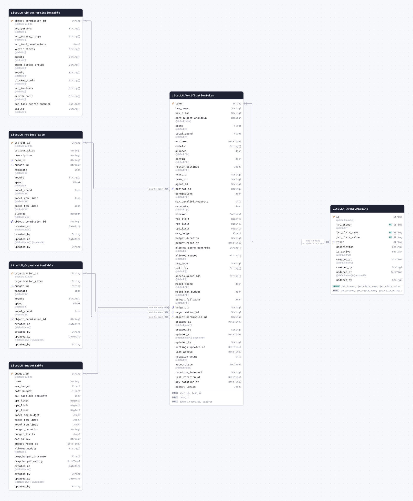

| Field                                         | Type       | Constraints                                                                                       | Default              | Description |
| --------------------------------------------- | ---------- | ------------------------------------------------------------------------------------------------- | -------------------- | ----------- |
| `token`                                       | `String`   | PK NOT NULL                                                                                       |                      |             |
| `key_name`                                    | `String`   | NULL                                                                                              |                      |             |
| `key_alias`                                   | `String`   | NULL                                                                                              |                      |             |
| `soft_budget_cooldown`                        | `Boolean`  | NOT NULL                                                                                          | `false`              |             |
| `spend`                                       | `Float`    | NOT NULL                                                                                          | `0`                  |             |
| `total_spend`                                 | `Float`    | NOT NULL                                                                                          | `0`                  |             |
| `expires`                                     | `DateTime` | NULL                                                                                              |                      |             |
| `models`                                      | `String[]` | NOT NULL                                                                                          |                      |             |
| `aliases`                                     | `Json`     | NOT NULL                                                                                          | `"{}"`               |             |
| `config`                                      | `Json`     | NOT NULL                                                                                          | `"{}"`               |             |
| `router_settings`                             | `Json`     | NULL                                                                                              | `"{}"`               |             |
| `user_id`                                     | `String`   | NULL                                                                                              |                      |             |
| `team_id`                                     | `String`   | NULL                                                                                              |                      |             |
| `agent_id`                                    | `String`   | NULL                                                                                              |                      |             |
| `project_id`                                  | `String`   | NULL → [LiteLLM_ProjectTable.project_id](#model-LiteLLM_ProjectTable)                             |                      |             |
| `permissions`                                 | `Json`     | NOT NULL                                                                                          | `"{}"`               |             |
| `max_parallel_requests`                       | `Int`      | NULL                                                                                              |                      |             |
| `metadata`                                    | `Json`     | NOT NULL                                                                                          | `"{}"`               |             |
| `blocked`                                     | `Boolean`  | NULL                                                                                              |                      |             |
| `tpm_limit`                                   | `BigInt`   | NULL                                                                                              |                      |             |
| `rpm_limit`                                   | `BigInt`   | NULL                                                                                              |                      |             |
| `tpd_limit`                                   | `BigInt`   | NULL                                                                                              |                      |             |
| `max_budget`                                  | `Float`    | NULL                                                                                              |                      |             |
| `budget_duration`                             | `String`   | NULL                                                                                              |                      |             |
| `budget_reset_at`                             | `DateTime` | NULL                                                                                              |                      |             |
| `allowed_cache_controls`                      | `String[]` | NOT NULL                                                                                          | `[]`                 |             |
| `allowed_routes`                              | `String[]` | NOT NULL                                                                                          | `[]`                 |             |
| `key_type`                                    | `String`   | NULL                                                                                              |                      |             |
| `policies`                                    | `String[]` | NOT NULL                                                                                          | `[]`                 |             |
| `access_group_ids`                            | `String[]` | NOT NULL                                                                                          | `[]`                 |             |
| `model_spend`                                 | `Json`     | NOT NULL                                                                                          | `"{}"`               |             |
| `model_max_budget`                            | `Json`     | NOT NULL                                                                                          | `"{}"`               |             |
| `budget_fallbacks`                            | `Json`     | NOT NULL                                                                                          | `"{}"`               |             |
| `budget_id`                                   | `String`   | NULL → [LiteLLM_BudgetTable.budget_id](#model-LiteLLM_BudgetTable)                                |                      |             |
| `organization_id`                             | `String`   | NULL → [LiteLLM_OrganizationTable.organization_id](#model-LiteLLM_OrganizationTable)              |                      |             |
| `object_permission_id`                        | `String`   | NULL → [LiteLLM_ObjectPermissionTable.object_permission_id](#model-LiteLLM_ObjectPermissionTable) |                      |             |
| `created_at` (`created_at`)                   | `DateTime` | NULL                                                                                              | `now()`              |             |
| `created_by`                                  | `String`   | NULL                                                                                              |                      |             |
| `updated_at` (`updated_at`)                   | `DateTime` | NULL                                                                                              | `now()` `@updatedAt` |             |
| `updated_by`                                  | `String`   | NULL                                                                                              |                      |             |
| `settings_updated_at` (`settings_updated_at`) | `DateTime` | NULL                                                                                              |                      |             |
| `last_active`                                 | `DateTime` | NULL                                                                                              |                      |             |
| `rotation_count`                              | `Int`      | NULL                                                                                              | `0`                  |             |
| `auto_rotate`                                 | `Boolean`  | NULL                                                                                              | `false`              |             |
| `rotation_interval`                           | `String`   | NULL                                                                                              |                      |             |
| `last_rotation_at`                            | `DateTime` | NULL                                                                                              |                      |             |
| `key_rotation_at`                             | `DateTime` | NULL                                                                                              |                      |             |
| `budget_limits`                               | `Json`     | NULL                                                                                              |                      |             |

#### Indexes

- `@@index([user_id, team_id])`
- `@@index([team_id])`
- `@@index([budget_reset_at, expires])`

#### References

- `budget_id` → [LiteLLM_BudgetTable.budget_id](#model-LiteLLM_BudgetTable) (many-to-one)
- `organization_id` → [LiteLLM_OrganizationTable.organization_id](#model-LiteLLM_OrganizationTable) (many-to-one)
- `project_id` → [LiteLLM_ProjectTable.project_id](#model-LiteLLM_ProjectTable) (many-to-one)
- `object_permission_id` → [LiteLLM_ObjectPermissionTable.object_permission_id](#model-LiteLLM_ObjectPermissionTable) (many-to-one)

#### Referenced by

- `token` ← [LiteLLM_JWTKeyMapping.token](#model-LiteLLM_JWTKeyMapping) (one-to-many, on delete Cascade)

#### Definition

```sql
CREATE TABLE "LiteLLM_VerificationToken" (
    "token" TEXT NOT NULL,
    "key_name" TEXT,
    "key_alias" TEXT,
    "soft_budget_cooldown" BOOLEAN NOT NULL DEFAULT false,
    "spend" DOUBLE PRECISION NOT NULL DEFAULT 0.0,
    "total_spend" DOUBLE PRECISION NOT NULL DEFAULT 0.0,
    "expires" TIMESTAMP(3),
    "models" TEXT[],
    "aliases" JSONB NOT NULL DEFAULT '{}',
    "config" JSONB NOT NULL DEFAULT '{}',
    "router_settings" JSONB DEFAULT '{}',
    "user_id" TEXT,
    "team_id" TEXT,
    "agent_id" TEXT,
    "project_id" TEXT,
    "permissions" JSONB NOT NULL DEFAULT '{}',
    "max_parallel_requests" INTEGER,
    "metadata" JSONB NOT NULL DEFAULT '{}',
    "blocked" BOOLEAN,
    "tpm_limit" BIGINT,
    "rpm_limit" BIGINT,
    "tpd_limit" BIGINT,
    "max_budget" DOUBLE PRECISION,
    "budget_duration" TEXT,
    "budget_reset_at" TIMESTAMP(3),
    "allowed_cache_controls" TEXT[] DEFAULT ARRAY[]::TEXT[],
    "allowed_routes" TEXT[] DEFAULT ARRAY[]::TEXT[],
    "key_type" TEXT,
    "policies" TEXT[] DEFAULT ARRAY[]::TEXT[],
    "access_group_ids" TEXT[] DEFAULT ARRAY[]::TEXT[],
    "model_spend" JSONB NOT NULL DEFAULT '{}',
    "model_max_budget" JSONB NOT NULL DEFAULT '{}',
    "budget_fallbacks" JSONB NOT NULL DEFAULT '{}',
    "budget_id" TEXT,
    "organization_id" TEXT,
    "object_permission_id" TEXT,
    "created_at" TIMESTAMP(3) DEFAULT CURRENT_TIMESTAMP,
    "created_by" TEXT,
    "updated_at" TIMESTAMP(3) DEFAULT CURRENT_TIMESTAMP,
    "updated_by" TEXT,
    "settings_updated_at" TIMESTAMP(3),
    "last_active" TIMESTAMP(3),
    "rotation_count" INTEGER DEFAULT 0,
    "auto_rotate" BOOLEAN DEFAULT false,
    "rotation_interval" TEXT,
    "last_rotation_at" TIMESTAMP(3),
    "key_rotation_at" TIMESTAMP(3),
    "budget_limits" JSONB,

    CONSTRAINT "LiteLLM_VerificationToken_pkey" PRIMARY KEY ("token")
);

CREATE INDEX "LiteLLM_VerificationToken_user_id_team_id_idx" ON "LiteLLM_VerificationToken"("user_id", "team_id");

CREATE INDEX "LiteLLM_VerificationToken_team_id_idx" ON "LiteLLM_VerificationToken"("team_id");

CREATE INDEX "LiteLLM_VerificationToken_budget_reset_at_expires_idx" ON "LiteLLM_VerificationToken"("budget_reset_at", "expires");

ALTER TABLE "LiteLLM_VerificationToken" ADD CONSTRAINT "LiteLLM_VerificationToken_budget_id_fkey" FOREIGN KEY ("budget_id") REFERENCES "LiteLLM_BudgetTable"("budget_id") ON DELETE SET NULL ON UPDATE CASCADE;

ALTER TABLE "LiteLLM_VerificationToken" ADD CONSTRAINT "LiteLLM_VerificationToken_organization_id_fkey" FOREIGN KEY ("organization_id") REFERENCES "LiteLLM_OrganizationTable"("organization_id") ON DELETE SET NULL ON UPDATE CASCADE;

ALTER TABLE "LiteLLM_VerificationToken" ADD CONSTRAINT "LiteLLM_VerificationToken_project_id_fkey" FOREIGN KEY ("project_id") REFERENCES "LiteLLM_ProjectTable"("project_id") ON DELETE SET NULL ON UPDATE CASCADE;

ALTER TABLE "LiteLLM_VerificationToken" ADD CONSTRAINT "LiteLLM_VerificationToken_object_permission_id_fkey" FOREIGN KEY ("object_permission_id") REFERENCES "LiteLLM_ObjectPermissionTable"("object_permission_id") ON DELETE SET NULL ON UPDATE CASCADE;
```

<details>
<summary>Queries and their SQL</summary>

**findMany**: Every row

```ts
await prisma.liteLLM_VerificationToken.findMany();
```

```sql
SELECT
  "public"."LiteLLM_VerificationToken"."token",
  "public"."LiteLLM_VerificationToken"."key_name",
  "public"."LiteLLM_VerificationToken"."key_alias",
  "public"."LiteLLM_VerificationToken"."soft_budget_cooldown",
  "public"."LiteLLM_VerificationToken"."spend",
  "public"."LiteLLM_VerificationToken"."total_spend",
  "public"."LiteLLM_VerificationToken"."expires",
  "public"."LiteLLM_VerificationToken"."models",
  "public"."LiteLLM_VerificationToken"."aliases",
  "public"."LiteLLM_VerificationToken"."config",
  "public"."LiteLLM_VerificationToken"."router_settings",
  "public"."LiteLLM_VerificationToken"."user_id",
  "public"."LiteLLM_VerificationToken"."team_id",
  "public"."LiteLLM_VerificationToken"."agent_id",
  "public"."LiteLLM_VerificationToken"."project_id",
  "public"."LiteLLM_VerificationToken"."permissions",
  "public"."LiteLLM_VerificationToken"."max_parallel_requests",
  "public"."LiteLLM_VerificationToken"."metadata",
  "public"."LiteLLM_VerificationToken"."blocked",
  "public"."LiteLLM_VerificationToken"."tpm_limit",
  "public"."LiteLLM_VerificationToken"."rpm_limit",
  "public"."LiteLLM_VerificationToken"."tpd_limit",
  "public"."LiteLLM_VerificationToken"."max_budget",
  "public"."LiteLLM_VerificationToken"."budget_duration",
  "public"."LiteLLM_VerificationToken"."budget_reset_at",
  "public"."LiteLLM_VerificationToken"."allowed_cache_controls",
  "public"."LiteLLM_VerificationToken"."allowed_routes",
  "public"."LiteLLM_VerificationToken"."key_type",
  "public"."LiteLLM_VerificationToken"."policies",
  "public"."LiteLLM_VerificationToken"."access_group_ids",
  "public"."LiteLLM_VerificationToken"."model_spend",
  "public"."LiteLLM_VerificationToken"."model_max_budget",
  "public"."LiteLLM_VerificationToken"."budget_fallbacks",
  "public"."LiteLLM_VerificationToken"."budget_id",
  "public"."LiteLLM_VerificationToken"."organization_id",
  "public"."LiteLLM_VerificationToken"."object_permission_id",
  "public"."LiteLLM_VerificationToken"."created_at",
  "public"."LiteLLM_VerificationToken"."created_by",
  "public"."LiteLLM_VerificationToken"."updated_at",
  "public"."LiteLLM_VerificationToken"."updated_by",
  "public"."LiteLLM_VerificationToken"."settings_updated_at",
  "public"."LiteLLM_VerificationToken"."last_active",
  "public"."LiteLLM_VerificationToken"."rotation_count",
  "public"."LiteLLM_VerificationToken"."auto_rotate",
  "public"."LiteLLM_VerificationToken"."rotation_interval",
  "public"."LiteLLM_VerificationToken"."last_rotation_at",
  "public"."LiteLLM_VerificationToken"."key_rotation_at",
  "public"."LiteLLM_VerificationToken"."budget_limits"
FROM
  "public"."LiteLLM_VerificationToken"
WHERE
  1 = 1
OFFSET
  $1
-- params: ["0"]
```

**count**: How many rows there are

```ts
await prisma.liteLLM_VerificationToken.count();
```

```sql
SELECT
  COUNT(*) AS "_count$_all"
FROM
  (
    SELECT
      "public"."LiteLLM_VerificationToken"."token"
    FROM
      "public"."LiteLLM_VerificationToken"
    WHERE
      1 = 1
    OFFSET
      $1
  ) AS "sub"
-- params: ["0"]
```

**findMany**: Every row with its relations

```ts
await prisma.liteLLM_VerificationToken.findMany({
  include: {
    litellm_budget_table: true,
    litellm_organization_table: true,
    litellm_project_table: true,
    object_permission: true,
    jwt_key_mappings: true,
  },
});
```

```sql
SELECT
  "public"."LiteLLM_VerificationToken"."token",
  "public"."LiteLLM_VerificationToken"."key_name",
  "public"."LiteLLM_VerificationToken"."key_alias",
  "public"."LiteLLM_VerificationToken"."soft_budget_cooldown",
  "public"."LiteLLM_VerificationToken"."spend",
  "public"."LiteLLM_VerificationToken"."total_spend",
  "public"."LiteLLM_VerificationToken"."expires",
  "public"."LiteLLM_VerificationToken"."models",
  "public"."LiteLLM_VerificationToken"."aliases",
  "public"."LiteLLM_VerificationToken"."config",
  "public"."LiteLLM_VerificationToken"."router_settings",
  "public"."LiteLLM_VerificationToken"."user_id",
  "public"."LiteLLM_VerificationToken"."team_id",
  "public"."LiteLLM_VerificationToken"."agent_id",
  "public"."LiteLLM_VerificationToken"."project_id",
  "public"."LiteLLM_VerificationToken"."permissions",
  "public"."LiteLLM_VerificationToken"."max_parallel_requests",
  "public"."LiteLLM_VerificationToken"."metadata",
  "public"."LiteLLM_VerificationToken"."blocked",
  "public"."LiteLLM_VerificationToken"."tpm_limit",
  "public"."LiteLLM_VerificationToken"."rpm_limit",
  "public"."LiteLLM_VerificationToken"."tpd_limit",
  "public"."LiteLLM_VerificationToken"."max_budget",
  "public"."LiteLLM_VerificationToken"."budget_duration",
  "public"."LiteLLM_VerificationToken"."budget_reset_at",
  "public"."LiteLLM_VerificationToken"."allowed_cache_controls",
  "public"."LiteLLM_VerificationToken"."allowed_routes",
  "public"."LiteLLM_VerificationToken"."key_type",
  "public"."LiteLLM_VerificationToken"."policies",
  "public"."LiteLLM_VerificationToken"."access_group_ids",
  "public"."LiteLLM_VerificationToken"."model_spend",
  "public"."LiteLLM_VerificationToken"."model_max_budget",
  "public"."LiteLLM_VerificationToken"."budget_fallbacks",
  "public"."LiteLLM_VerificationToken"."budget_id",
  "public"."LiteLLM_VerificationToken"."organization_id",
  "public"."LiteLLM_VerificationToken"."object_permission_id",
  "public"."LiteLLM_VerificationToken"."created_at",
  "public"."LiteLLM_VerificationToken"."created_by",
  "public"."LiteLLM_VerificationToken"."updated_at",
  "public"."LiteLLM_VerificationToken"."updated_by",
  "public"."LiteLLM_VerificationToken"."settings_updated_at",
  "public"."LiteLLM_VerificationToken"."last_active",
  "public"."LiteLLM_VerificationToken"."rotation_count",
  "public"."LiteLLM_VerificationToken"."auto_rotate",
  "public"."LiteLLM_VerificationToken"."rotation_interval",
  "public"."LiteLLM_VerificationToken"."last_rotation_at",
  "public"."LiteLLM_VerificationToken"."key_rotation_at",
  "public"."LiteLLM_VerificationToken"."budget_limits"
FROM
  "public"."LiteLLM_VerificationToken"
WHERE
  1 = 1
OFFSET
  $1
-- params: ["0"]

SELECT
  "public"."LiteLLM_BudgetTable"."budget_id",
  "public"."LiteLLM_BudgetTable"."max_budget",
  "public"."LiteLLM_BudgetTable"."soft_budget",
  "public"."LiteLLM_BudgetTable"."max_parallel_requests",
  "public"."LiteLLM_BudgetTable"."tpm_limit",
  "public"."LiteLLM_BudgetTable"."rpm_limit",
  "public"."LiteLLM_BudgetTable"."tpd_limit",
  "public"."LiteLLM_BudgetTable"."model_max_budget",
  "public"."LiteLLM_BudgetTable"."model_tpm_limit",
  "public"."LiteLLM_BudgetTable"."model_rpm_limit",
  "public"."LiteLLM_BudgetTable"."budget_duration",
  "public"."LiteLLM_BudgetTable"."budget_reset_at",
  "public"."LiteLLM_BudgetTable"."allowed_models",
  "public"."LiteLLM_BudgetTable"."temp_budget_increase",
  "public"."LiteLLM_BudgetTable"."temp_budget_expiry",
  "public"."LiteLLM_BudgetTable"."created_at",
  "public"."LiteLLM_BudgetTable"."created_by",
  "public"."LiteLLM_BudgetTable"."updated_at",
  "public"."LiteLLM_BudgetTable"."updated_by"
FROM
  "public"."LiteLLM_BudgetTable"
WHERE
  "public"."LiteLLM_BudgetTable"."budget_id" IN ($1)
OFFSET
  $2
-- params: ["<budget_id of the rows above>","0"]

SELECT
  "public"."LiteLLM_OrganizationTable"."organization_id",
  "public"."LiteLLM_OrganizationTable"."organization_alias",
  "public"."LiteLLM_OrganizationTable"."budget_id",
  "public"."LiteLLM_OrganizationTable"."metadata",
  "public"."LiteLLM_OrganizationTable"."models",
  "public"."LiteLLM_OrganizationTable"."spend",
  "public"."LiteLLM_OrganizationTable"."model_spend",
  "public"."LiteLLM_OrganizationTable"."object_permission_id",
  "public"."LiteLLM_OrganizationTable"."created_at",
  "public"."LiteLLM_OrganizationTable"."created_by",
  "public"."LiteLLM_OrganizationTable"."updated_at",
  "public"."LiteLLM_OrganizationTable"."updated_by"
FROM
  "public"."LiteLLM_OrganizationTable"
WHERE
  "public"."LiteLLM_OrganizationTable"."organization_id" IN ($1)
OFFSET
  $2
-- params: ["<organization_id of the rows above>","0"]

SELECT
  "public"."LiteLLM_ProjectTable"."project_id",
  "public"."LiteLLM_ProjectTable"."project_alias",
  "public"."LiteLLM_ProjectTable"."description",
  "public"."LiteLLM_ProjectTable"."team_id",
  "public"."LiteLLM_ProjectTable"."budget_id",
  "public"."LiteLLM_ProjectTable"."metadata",
  "public"."LiteLLM_ProjectTable"."models",
  "public"."LiteLLM_ProjectTable"."spend",
  "public"."LiteLLM_ProjectTable"."model_spend",
  "public"."LiteLLM_ProjectTable"."model_rpm_limit",
  "public"."LiteLLM_ProjectTable"."model_tpm_limit",
  "public"."LiteLLM_ProjectTable"."blocked",
  "public"."LiteLLM_ProjectTable"."object_permission_id",
  "public"."LiteLLM_ProjectTable"."created_at",
  "public"."LiteLLM_ProjectTable"."created_by",
  "public"."LiteLLM_ProjectTable"."updated_at",
  "public"."LiteLLM_ProjectTable"."updated_by"
FROM
  "public"."LiteLLM_ProjectTable"
WHERE
  "public"."LiteLLM_ProjectTable"."project_id" IN ($1)
OFFSET
  $2
-- params: ["<project_id of the rows above>","0"]

SELECT
  "public"."LiteLLM_ObjectPermissionTable"."object_permission_id",
  "public"."LiteLLM_ObjectPermissionTable"."mcp_servers",
  "public"."LiteLLM_ObjectPermissionTable"."mcp_access_groups",
  "public"."LiteLLM_ObjectPermissionTable"."mcp_tool_permissions",
  "public"."LiteLLM_ObjectPermissionTable"."vector_stores",
  "public"."LiteLLM_ObjectPermissionTable"."agents",
  "public"."LiteLLM_ObjectPermissionTable"."agent_access_groups",
  "public"."LiteLLM_ObjectPermissionTable"."models",
  "public"."LiteLLM_ObjectPermissionTable"."blocked_tools",
  "public"."LiteLLM_ObjectPermissionTable"."mcp_toolsets",
  "public"."LiteLLM_ObjectPermissionTable"."search_tools",
  "public"."LiteLLM_ObjectPermissionTable"."mcp_tool_search_enabled",
  "public"."LiteLLM_ObjectPermissionTable"."skills"
FROM
  "public"."LiteLLM_ObjectPermissionTable"
WHERE
  "public"."LiteLLM_ObjectPermissionTable"."object_permission_id" IN ($1)
OFFSET
  $2
-- params: ["<object_permission_id of the rows above>","0"]

SELECT
  "public"."LiteLLM_JWTKeyMapping"."id",
  "public"."LiteLLM_JWTKeyMapping"."jwt_issuer",
  "public"."LiteLLM_JWTKeyMapping"."jwt_claim_name",
  "public"."LiteLLM_JWTKeyMapping"."jwt_claim_value",
  "public"."LiteLLM_JWTKeyMapping"."token",
  "public"."LiteLLM_JWTKeyMapping"."description",
  "public"."LiteLLM_JWTKeyMapping"."is_active",
  "public"."LiteLLM_JWTKeyMapping"."created_at",
  "public"."LiteLLM_JWTKeyMapping"."created_by",
  "public"."LiteLLM_JWTKeyMapping"."updated_at",
  "public"."LiteLLM_JWTKeyMapping"."updated_by"
FROM
  "public"."LiteLLM_JWTKeyMapping"
WHERE
  "public"."LiteLLM_JWTKeyMapping"."token" IN ($1)
OFFSET
  $2
-- params: ["<token of the rows above>","0"]
```

**findUnique**: One row by what is unique to it

```ts
await prisma.liteLLM_VerificationToken.findUnique({ where: { token: "example" } });
```

```sql
SELECT
  "public"."LiteLLM_VerificationToken"."token",
  "public"."LiteLLM_VerificationToken"."key_name",
  "public"."LiteLLM_VerificationToken"."key_alias",
  "public"."LiteLLM_VerificationToken"."soft_budget_cooldown",
  "public"."LiteLLM_VerificationToken"."spend",
  "public"."LiteLLM_VerificationToken"."total_spend",
  "public"."LiteLLM_VerificationToken"."expires",
  "public"."LiteLLM_VerificationToken"."models",
  "public"."LiteLLM_VerificationToken"."aliases",
  "public"."LiteLLM_VerificationToken"."config",
  "public"."LiteLLM_VerificationToken"."router_settings",
  "public"."LiteLLM_VerificationToken"."user_id",
  "public"."LiteLLM_VerificationToken"."team_id",
  "public"."LiteLLM_VerificationToken"."agent_id",
  "public"."LiteLLM_VerificationToken"."project_id",
  "public"."LiteLLM_VerificationToken"."permissions",
  "public"."LiteLLM_VerificationToken"."max_parallel_requests",
  "public"."LiteLLM_VerificationToken"."metadata",
  "public"."LiteLLM_VerificationToken"."blocked",
  "public"."LiteLLM_VerificationToken"."tpm_limit",
  "public"."LiteLLM_VerificationToken"."rpm_limit",
  "public"."LiteLLM_VerificationToken"."tpd_limit",
  "public"."LiteLLM_VerificationToken"."max_budget",
  "public"."LiteLLM_VerificationToken"."budget_duration",
  "public"."LiteLLM_VerificationToken"."budget_reset_at",
  "public"."LiteLLM_VerificationToken"."allowed_cache_controls",
  "public"."LiteLLM_VerificationToken"."allowed_routes",
  "public"."LiteLLM_VerificationToken"."key_type",
  "public"."LiteLLM_VerificationToken"."policies",
  "public"."LiteLLM_VerificationToken"."access_group_ids",
  "public"."LiteLLM_VerificationToken"."model_spend",
  "public"."LiteLLM_VerificationToken"."model_max_budget",
  "public"."LiteLLM_VerificationToken"."budget_fallbacks",
  "public"."LiteLLM_VerificationToken"."budget_id",
  "public"."LiteLLM_VerificationToken"."organization_id",
  "public"."LiteLLM_VerificationToken"."object_permission_id",
  "public"."LiteLLM_VerificationToken"."created_at",
  "public"."LiteLLM_VerificationToken"."created_by",
  "public"."LiteLLM_VerificationToken"."updated_at",
  "public"."LiteLLM_VerificationToken"."updated_by",
  "public"."LiteLLM_VerificationToken"."settings_updated_at",
  "public"."LiteLLM_VerificationToken"."last_active",
  "public"."LiteLLM_VerificationToken"."rotation_count",
  "public"."LiteLLM_VerificationToken"."auto_rotate",
  "public"."LiteLLM_VerificationToken"."rotation_interval",
  "public"."LiteLLM_VerificationToken"."last_rotation_at",
  "public"."LiteLLM_VerificationToken"."key_rotation_at",
  "public"."LiteLLM_VerificationToken"."budget_limits"
FROM
  "public"."LiteLLM_VerificationToken"
WHERE
  (
    "public"."LiteLLM_VerificationToken"."token" = $1
    AND 1 = 1
  )
LIMIT
  $2
OFFSET
  $3
-- params: ["example","1","0"]
```

**create**: Create a row

```ts
await prisma.liteLLM_VerificationToken.create({ data: { token: "example", models: ["example"] } });
```

```sql
INSERT INTO
  "public"."LiteLLM_VerificationToken" (
    "token",
    "soft_budget_cooldown",
    "spend",
    "total_spend",
    "models",
    "aliases",
    "config",
    "router_settings",
    "permissions",
    "metadata",
    "allowed_cache_controls",
    "allowed_routes",
    "policies",
    "access_group_ids",
    "model_spend",
    "model_max_budget",
    "budget_fallbacks",
    "created_at",
    "updated_at",
    "rotation_count",
    "auto_rotate"
  )
VALUES
  (
    $1,
    $2,
    $3,
    $4,
    $5,
    $6,
    $7,
    $8,
    $9,
    $10,
    $11,
    $12,
    $13,
    $14,
    $15,
    $16,
    $17,
    $18,
    $19,
    $20,
    $21
  )
RETURNING
  "public"."LiteLLM_VerificationToken"."token",
  "public"."LiteLLM_VerificationToken"."key_name",
  "public"."LiteLLM_VerificationToken"."key_alias",
  "public"."LiteLLM_VerificationToken"."soft_budget_cooldown",
  "public"."LiteLLM_VerificationToken"."spend",
  "public"."LiteLLM_VerificationToken"."total_spend",
  "public"."LiteLLM_VerificationToken"."expires",
  "public"."LiteLLM_VerificationToken"."models",
  "public"."LiteLLM_VerificationToken"."aliases",
  "public"."LiteLLM_VerificationToken"."config",
  "public"."LiteLLM_VerificationToken"."router_settings",
  "public"."LiteLLM_VerificationToken"."user_id",
  "public"."LiteLLM_VerificationToken"."team_id",
  "public"."LiteLLM_VerificationToken"."agent_id",
  "public"."LiteLLM_VerificationToken"."project_id",
  "public"."LiteLLM_VerificationToken"."permissions",
  "public"."LiteLLM_VerificationToken"."max_parallel_requests",
  "public"."LiteLLM_VerificationToken"."metadata",
  "public"."LiteLLM_VerificationToken"."blocked",
  "public"."LiteLLM_VerificationToken"."tpm_limit",
  "public"."LiteLLM_VerificationToken"."rpm_limit",
  "public"."LiteLLM_VerificationToken"."tpd_limit",
  "public"."LiteLLM_VerificationToken"."max_budget",
  "public"."LiteLLM_VerificationToken"."budget_duration",
  "public"."LiteLLM_VerificationToken"."budget_reset_at",
  "public"."LiteLLM_VerificationToken"."allowed_cache_controls",
  "public"."LiteLLM_VerificationToken"."allowed_routes",
  "public"."LiteLLM_VerificationToken"."key_type",
  "public"."LiteLLM_VerificationToken"."policies",
  "public"."LiteLLM_VerificationToken"."access_group_ids",
  "public"."LiteLLM_VerificationToken"."model_spend",
  "public"."LiteLLM_VerificationToken"."model_max_budget",
  "public"."LiteLLM_VerificationToken"."budget_fallbacks",
  "public"."LiteLLM_VerificationToken"."budget_id",
  "public"."LiteLLM_VerificationToken"."organization_id",
  "public"."LiteLLM_VerificationToken"."object_permission_id",
  "public"."LiteLLM_VerificationToken"."created_at",
  "public"."LiteLLM_VerificationToken"."created_by",
  "public"."LiteLLM_VerificationToken"."updated_at",
  "public"."LiteLLM_VerificationToken"."updated_by",
  "public"."LiteLLM_VerificationToken"."settings_updated_at",
  "public"."LiteLLM_VerificationToken"."last_active",
  "public"."LiteLLM_VerificationToken"."rotation_count",
  "public"."LiteLLM_VerificationToken"."auto_rotate",
  "public"."LiteLLM_VerificationToken"."rotation_interval",
  "public"."LiteLLM_VerificationToken"."last_rotation_at",
  "public"."LiteLLM_VerificationToken"."key_rotation_at",
  "public"."LiteLLM_VerificationToken"."budget_limits"
-- params: ["example",false,"0.0","0.0",["example"],"{}","{}","{}","{}","{}",[],[],[],[],"{}","{}","{}","<now()>","<now()>","0",false]
```

**update**: Update a row

```ts
await prisma.liteLLM_VerificationToken.update({
  where: { token: "example" },
  data: { key_name: "example" },
});
```

```sql
UPDATE "public"."LiteLLM_VerificationToken"
SET
  "key_name" = $1,
  "updated_at" = $2
WHERE
  (
    "public"."LiteLLM_VerificationToken"."token" = $3
    AND 1 = 1
  )
RETURNING
  "public"."LiteLLM_VerificationToken"."token",
  "public"."LiteLLM_VerificationToken"."key_name",
  "public"."LiteLLM_VerificationToken"."key_alias",
  "public"."LiteLLM_VerificationToken"."soft_budget_cooldown",
  "public"."LiteLLM_VerificationToken"."spend",
  "public"."LiteLLM_VerificationToken"."total_spend",
  "public"."LiteLLM_VerificationToken"."expires",
  "public"."LiteLLM_VerificationToken"."models",
  "public"."LiteLLM_VerificationToken"."aliases",
  "public"."LiteLLM_VerificationToken"."config",
  "public"."LiteLLM_VerificationToken"."router_settings",
  "public"."LiteLLM_VerificationToken"."user_id",
  "public"."LiteLLM_VerificationToken"."team_id",
  "public"."LiteLLM_VerificationToken"."agent_id",
  "public"."LiteLLM_VerificationToken"."project_id",
  "public"."LiteLLM_VerificationToken"."permissions",
  "public"."LiteLLM_VerificationToken"."max_parallel_requests",
  "public"."LiteLLM_VerificationToken"."metadata",
  "public"."LiteLLM_VerificationToken"."blocked",
  "public"."LiteLLM_VerificationToken"."tpm_limit",
  "public"."LiteLLM_VerificationToken"."rpm_limit",
  "public"."LiteLLM_VerificationToken"."tpd_limit",
  "public"."LiteLLM_VerificationToken"."max_budget",
  "public"."LiteLLM_VerificationToken"."budget_duration",
  "public"."LiteLLM_VerificationToken"."budget_reset_at",
  "public"."LiteLLM_VerificationToken"."allowed_cache_controls",
  "public"."LiteLLM_VerificationToken"."allowed_routes",
  "public"."LiteLLM_VerificationToken"."key_type",
  "public"."LiteLLM_VerificationToken"."policies",
  "public"."LiteLLM_VerificationToken"."access_group_ids",
  "public"."LiteLLM_VerificationToken"."model_spend",
  "public"."LiteLLM_VerificationToken"."model_max_budget",
  "public"."LiteLLM_VerificationToken"."budget_fallbacks",
  "public"."LiteLLM_VerificationToken"."budget_id",
  "public"."LiteLLM_VerificationToken"."organization_id",
  "public"."LiteLLM_VerificationToken"."object_permission_id",
  "public"."LiteLLM_VerificationToken"."created_at",
  "public"."LiteLLM_VerificationToken"."created_by",
  "public"."LiteLLM_VerificationToken"."updated_at",
  "public"."LiteLLM_VerificationToken"."updated_by",
  "public"."LiteLLM_VerificationToken"."settings_updated_at",
  "public"."LiteLLM_VerificationToken"."last_active",
  "public"."LiteLLM_VerificationToken"."rotation_count",
  "public"."LiteLLM_VerificationToken"."auto_rotate",
  "public"."LiteLLM_VerificationToken"."rotation_interval",
  "public"."LiteLLM_VerificationToken"."last_rotation_at",
  "public"."LiteLLM_VerificationToken"."key_rotation_at",
  "public"."LiteLLM_VerificationToken"."budget_limits"
-- params: ["example",{"prisma__type":"generatorCall","prisma__value":{"name":"now","args":[],"returnType":{"type":"DateTime"}}},"example"]
```

**delete**: Delete a row

```ts
await prisma.liteLLM_VerificationToken.delete({ where: { token: "example" } });
```

```sql
DELETE FROM "public"."LiteLLM_VerificationToken"
WHERE
  (
    "public"."LiteLLM_VerificationToken"."token" = $1
    AND 1 = 1
  )
RETURNING
  "public"."LiteLLM_VerificationToken"."token",
  "public"."LiteLLM_VerificationToken"."key_name",
  "public"."LiteLLM_VerificationToken"."key_alias",
  "public"."LiteLLM_VerificationToken"."soft_budget_cooldown",
  "public"."LiteLLM_VerificationToken"."spend",
  "public"."LiteLLM_VerificationToken"."total_spend",
  "public"."LiteLLM_VerificationToken"."expires",
  "public"."LiteLLM_VerificationToken"."models",
  "public"."LiteLLM_VerificationToken"."aliases",
  "public"."LiteLLM_VerificationToken"."config",
  "public"."LiteLLM_VerificationToken"."router_settings",
  "public"."LiteLLM_VerificationToken"."user_id",
  "public"."LiteLLM_VerificationToken"."team_id",
  "public"."LiteLLM_VerificationToken"."agent_id",
  "public"."LiteLLM_VerificationToken"."project_id",
  "public"."LiteLLM_VerificationToken"."permissions",
  "public"."LiteLLM_VerificationToken"."max_parallel_requests",
  "public"."LiteLLM_VerificationToken"."metadata",
  "public"."LiteLLM_VerificationToken"."blocked",
  "public"."LiteLLM_VerificationToken"."tpm_limit",
  "public"."LiteLLM_VerificationToken"."rpm_limit",
  "public"."LiteLLM_VerificationToken"."tpd_limit",
  "public"."LiteLLM_VerificationToken"."max_budget",
  "public"."LiteLLM_VerificationToken"."budget_duration",
  "public"."LiteLLM_VerificationToken"."budget_reset_at",
  "public"."LiteLLM_VerificationToken"."allowed_cache_controls",
  "public"."LiteLLM_VerificationToken"."allowed_routes",
  "public"."LiteLLM_VerificationToken"."key_type",
  "public"."LiteLLM_VerificationToken"."policies",
  "public"."LiteLLM_VerificationToken"."access_group_ids",
  "public"."LiteLLM_VerificationToken"."model_spend",
  "public"."LiteLLM_VerificationToken"."model_max_budget",
  "public"."LiteLLM_VerificationToken"."budget_fallbacks",
  "public"."LiteLLM_VerificationToken"."budget_id",
  "public"."LiteLLM_VerificationToken"."organization_id",
  "public"."LiteLLM_VerificationToken"."object_permission_id",
  "public"."LiteLLM_VerificationToken"."created_at",
  "public"."LiteLLM_VerificationToken"."created_by",
  "public"."LiteLLM_VerificationToken"."updated_at",
  "public"."LiteLLM_VerificationToken"."updated_by",
  "public"."LiteLLM_VerificationToken"."settings_updated_at",
  "public"."LiteLLM_VerificationToken"."last_active",
  "public"."LiteLLM_VerificationToken"."rotation_count",
  "public"."LiteLLM_VerificationToken"."auto_rotate",
  "public"."LiteLLM_VerificationToken"."rotation_interval",
  "public"."LiteLLM_VerificationToken"."last_rotation_at",
  "public"."LiteLLM_VerificationToken"."key_rotation_at",
  "public"."LiteLLM_VerificationToken"."budget_limits"
-- params: ["example"]
```

</details>

<a id="model-LiteLLM_JWTKeyMapping"></a>

### LiteLLM_JWTKeyMapping

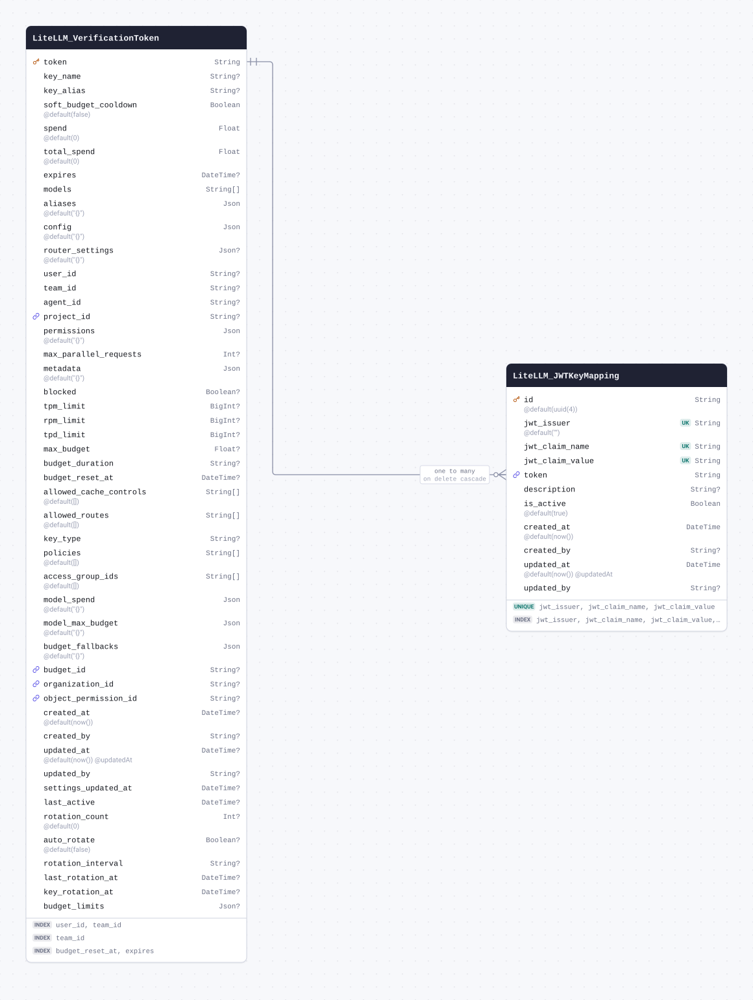

| Field             | Type       | Constraints                                                                    | Default              | Description |
| ----------------- | ---------- | ------------------------------------------------------------------------------ | -------------------- | ----------- |
| `id`              | `String`   | PK NOT NULL                                                                    | `uuid(4)`            |             |
| `jwt_issuer`      | `String`   | NOT NULL                                                                       | `""`                 |             |
| `jwt_claim_name`  | `String`   | NOT NULL                                                                       |                      |             |
| `jwt_claim_value` | `String`   | NOT NULL                                                                       |                      |             |
| `token`           | `String`   | NOT NULL → [LiteLLM_VerificationToken.token](#model-LiteLLM_VerificationToken) |                      |             |
| `description`     | `String`   | NULL                                                                           |                      |             |
| `is_active`       | `Boolean`  | NOT NULL                                                                       | `true`               |             |
| `created_at`      | `DateTime` | NOT NULL                                                                       | `now()`              |             |
| `created_by`      | `String`   | NULL                                                                           |                      |             |
| `updated_at`      | `DateTime` | NOT NULL                                                                       | `now()` `@updatedAt` |             |
| `updated_by`      | `String`   | NULL                                                                           |                      |             |

#### Indexes

- `@@index([jwt_issuer, jwt_claim_name, jwt_claim_value, is_active])`
- `@@unique([jwt_issuer, jwt_claim_name, jwt_claim_value])`

#### References

- `token` → [LiteLLM_VerificationToken.token](#model-LiteLLM_VerificationToken) (many-to-one, on delete Cascade)

#### Definition

```sql
CREATE TABLE "LiteLLM_JWTKeyMapping" (
    "id" TEXT NOT NULL,
    "jwt_issuer" TEXT NOT NULL DEFAULT '',
    "jwt_claim_name" TEXT NOT NULL,
    "jwt_claim_value" TEXT NOT NULL,
    "token" TEXT NOT NULL,
    "description" TEXT,
    "is_active" BOOLEAN NOT NULL DEFAULT true,
    "created_at" TIMESTAMP(3) NOT NULL DEFAULT CURRENT_TIMESTAMP,
    "created_by" TEXT,
    "updated_at" TIMESTAMP(3) NOT NULL DEFAULT CURRENT_TIMESTAMP,
    "updated_by" TEXT,

    CONSTRAINT "LiteLLM_JWTKeyMapping_pkey" PRIMARY KEY ("id")
);

CREATE INDEX "LiteLLM_JWTKeyMapping_jwt_issuer_jwt_claim_name_jwt_claim_v_idx" ON "LiteLLM_JWTKeyMapping"("jwt_issuer", "jwt_claim_name", "jwt_claim_value", "is_active");

CREATE UNIQUE INDEX "LiteLLM_JWTKeyMapping_jwt_issuer_jwt_claim_name_jwt_claim_v_key" ON "LiteLLM_JWTKeyMapping"("jwt_issuer", "jwt_claim_name", "jwt_claim_value");

ALTER TABLE "LiteLLM_JWTKeyMapping" ADD CONSTRAINT "LiteLLM_JWTKeyMapping_token_fkey" FOREIGN KEY ("token") REFERENCES "LiteLLM_VerificationToken"("token") ON DELETE CASCADE ON UPDATE CASCADE;
```

<details>
<summary>Queries and their SQL</summary>

**findMany**: Every row

```ts
await prisma.liteLLM_JWTKeyMapping.findMany();
```

```sql
SELECT
  "public"."LiteLLM_JWTKeyMapping"."id",
  "public"."LiteLLM_JWTKeyMapping"."jwt_issuer",
  "public"."LiteLLM_JWTKeyMapping"."jwt_claim_name",
  "public"."LiteLLM_JWTKeyMapping"."jwt_claim_value",
  "public"."LiteLLM_JWTKeyMapping"."token",
  "public"."LiteLLM_JWTKeyMapping"."description",
  "public"."LiteLLM_JWTKeyMapping"."is_active",
  "public"."LiteLLM_JWTKeyMapping"."created_at",
  "public"."LiteLLM_JWTKeyMapping"."created_by",
  "public"."LiteLLM_JWTKeyMapping"."updated_at",
  "public"."LiteLLM_JWTKeyMapping"."updated_by"
FROM
  "public"."LiteLLM_JWTKeyMapping"
WHERE
  1 = 1
OFFSET
  $1
-- params: ["0"]
```

**count**: How many rows there are

```ts
await prisma.liteLLM_JWTKeyMapping.count();
```

```sql
SELECT
  COUNT(*) AS "_count$_all"
FROM
  (
    SELECT
      "public"."LiteLLM_JWTKeyMapping"."id"
    FROM
      "public"."LiteLLM_JWTKeyMapping"
    WHERE
      1 = 1
    OFFSET
      $1
  ) AS "sub"
-- params: ["0"]
```

**findMany**: Every row with its relations

```ts
await prisma.liteLLM_JWTKeyMapping.findMany({ include: { litellm_verification_token: true } });
```

```sql
SELECT
  "public"."LiteLLM_JWTKeyMapping"."id",
  "public"."LiteLLM_JWTKeyMapping"."jwt_issuer",
  "public"."LiteLLM_JWTKeyMapping"."jwt_claim_name",
  "public"."LiteLLM_JWTKeyMapping"."jwt_claim_value",
  "public"."LiteLLM_JWTKeyMapping"."token",
  "public"."LiteLLM_JWTKeyMapping"."description",
  "public"."LiteLLM_JWTKeyMapping"."is_active",
  "public"."LiteLLM_JWTKeyMapping"."created_at",
  "public"."LiteLLM_JWTKeyMapping"."created_by",
  "public"."LiteLLM_JWTKeyMapping"."updated_at",
  "public"."LiteLLM_JWTKeyMapping"."updated_by"
FROM
  "public"."LiteLLM_JWTKeyMapping"
WHERE
  1 = 1
OFFSET
  $1
-- params: ["0"]

SELECT
  "public"."LiteLLM_VerificationToken"."token",
  "public"."LiteLLM_VerificationToken"."key_name",
  "public"."LiteLLM_VerificationToken"."key_alias",
  "public"."LiteLLM_VerificationToken"."soft_budget_cooldown",
  "public"."LiteLLM_VerificationToken"."spend",
  "public"."LiteLLM_VerificationToken"."total_spend",
  "public"."LiteLLM_VerificationToken"."expires",
  "public"."LiteLLM_VerificationToken"."models",
  "public"."LiteLLM_VerificationToken"."aliases",
  "public"."LiteLLM_VerificationToken"."config",
  "public"."LiteLLM_VerificationToken"."router_settings",
  "public"."LiteLLM_VerificationToken"."user_id",
  "public"."LiteLLM_VerificationToken"."team_id",
  "public"."LiteLLM_VerificationToken"."agent_id",
  "public"."LiteLLM_VerificationToken"."project_id",
  "public"."LiteLLM_VerificationToken"."permissions",
  "public"."LiteLLM_VerificationToken"."max_parallel_requests",
  "public"."LiteLLM_VerificationToken"."metadata",
  "public"."LiteLLM_VerificationToken"."blocked",
  "public"."LiteLLM_VerificationToken"."tpm_limit",
  "public"."LiteLLM_VerificationToken"."rpm_limit",
  "public"."LiteLLM_VerificationToken"."tpd_limit",
  "public"."LiteLLM_VerificationToken"."max_budget",
  "public"."LiteLLM_VerificationToken"."budget_duration",
  "public"."LiteLLM_VerificationToken"."budget_reset_at",
  "public"."LiteLLM_VerificationToken"."allowed_cache_controls",
  "public"."LiteLLM_VerificationToken"."allowed_routes",
  "public"."LiteLLM_VerificationToken"."key_type",
  "public"."LiteLLM_VerificationToken"."policies",
  "public"."LiteLLM_VerificationToken"."access_group_ids",
  "public"."LiteLLM_VerificationToken"."model_spend",
  "public"."LiteLLM_VerificationToken"."model_max_budget",
  "public"."LiteLLM_VerificationToken"."budget_fallbacks",
  "public"."LiteLLM_VerificationToken"."budget_id",
  "public"."LiteLLM_VerificationToken"."organization_id",
  "public"."LiteLLM_VerificationToken"."object_permission_id",
  "public"."LiteLLM_VerificationToken"."created_at",
  "public"."LiteLLM_VerificationToken"."created_by",
  "public"."LiteLLM_VerificationToken"."updated_at",
  "public"."LiteLLM_VerificationToken"."updated_by",
  "public"."LiteLLM_VerificationToken"."settings_updated_at",
  "public"."LiteLLM_VerificationToken"."last_active",
  "public"."LiteLLM_VerificationToken"."rotation_count",
  "public"."LiteLLM_VerificationToken"."auto_rotate",
  "public"."LiteLLM_VerificationToken"."rotation_interval",
  "public"."LiteLLM_VerificationToken"."last_rotation_at",
  "public"."LiteLLM_VerificationToken"."key_rotation_at",
  "public"."LiteLLM_VerificationToken"."budget_limits"
FROM
  "public"."LiteLLM_VerificationToken"
WHERE
  "public"."LiteLLM_VerificationToken"."token" IN ($1)
OFFSET
  $2
-- params: ["<token of the rows above>","0"]
```

**findUnique**: One row by what is unique to it

```ts
await prisma.liteLLM_JWTKeyMapping.findUnique({ where: { id: "example" } });
```

```sql
SELECT
  "public"."LiteLLM_JWTKeyMapping"."id",
  "public"."LiteLLM_JWTKeyMapping"."jwt_issuer",
  "public"."LiteLLM_JWTKeyMapping"."jwt_claim_name",
  "public"."LiteLLM_JWTKeyMapping"."jwt_claim_value",
  "public"."LiteLLM_JWTKeyMapping"."token",
  "public"."LiteLLM_JWTKeyMapping"."description",
  "public"."LiteLLM_JWTKeyMapping"."is_active",
  "public"."LiteLLM_JWTKeyMapping"."created_at",
  "public"."LiteLLM_JWTKeyMapping"."created_by",
  "public"."LiteLLM_JWTKeyMapping"."updated_at",
  "public"."LiteLLM_JWTKeyMapping"."updated_by"
FROM
  "public"."LiteLLM_JWTKeyMapping"
WHERE
  (
    "public"."LiteLLM_JWTKeyMapping"."id" = $1
    AND 1 = 1
  )
LIMIT
  $2
OFFSET
  $3
-- params: ["example","1","0"]
```

**create**: Create a row

```ts
await prisma.liteLLM_JWTKeyMapping.create({
  data: { jwt_claim_name: "example", jwt_claim_value: "example", token: "example" },
});
```

```sql
INSERT INTO
  "public"."LiteLLM_JWTKeyMapping" (
    "id",
    "jwt_issuer",
    "jwt_claim_name",
    "jwt_claim_value",
    "token",
    "is_active",
    "created_at",
    "updated_at"
  )
VALUES
  ($1, $2, $3, $4, $5, $6, $7, $8)
RETURNING
  "public"."LiteLLM_JWTKeyMapping"."id",
  "public"."LiteLLM_JWTKeyMapping"."jwt_issuer",
  "public"."LiteLLM_JWTKeyMapping"."jwt_claim_name",
  "public"."LiteLLM_JWTKeyMapping"."jwt_claim_value",
  "public"."LiteLLM_JWTKeyMapping"."token",
  "public"."LiteLLM_JWTKeyMapping"."description",
  "public"."LiteLLM_JWTKeyMapping"."is_active",
  "public"."LiteLLM_JWTKeyMapping"."created_at",
  "public"."LiteLLM_JWTKeyMapping"."created_by",
  "public"."LiteLLM_JWTKeyMapping"."updated_at",
  "public"."LiteLLM_JWTKeyMapping"."updated_by"
-- params: ["<uuid(4)>","","example","example","example",true,"<now()>","<now()>"]
```

**update**: Update a row

```ts
await prisma.liteLLM_JWTKeyMapping.update({
  where: { id: "example" },
  data: { jwt_issuer: "example" },
});
```

```sql
UPDATE "public"."LiteLLM_JWTKeyMapping"
SET
  "jwt_issuer" = $1,
  "updated_at" = $2
WHERE
  (
    "public"."LiteLLM_JWTKeyMapping"."id" = $3
    AND 1 = 1
  )
RETURNING
  "public"."LiteLLM_JWTKeyMapping"."id",
  "public"."LiteLLM_JWTKeyMapping"."jwt_issuer",
  "public"."LiteLLM_JWTKeyMapping"."jwt_claim_name",
  "public"."LiteLLM_JWTKeyMapping"."jwt_claim_value",
  "public"."LiteLLM_JWTKeyMapping"."token",
  "public"."LiteLLM_JWTKeyMapping"."description",
  "public"."LiteLLM_JWTKeyMapping"."is_active",
  "public"."LiteLLM_JWTKeyMapping"."created_at",
  "public"."LiteLLM_JWTKeyMapping"."created_by",
  "public"."LiteLLM_JWTKeyMapping"."updated_at",
  "public"."LiteLLM_JWTKeyMapping"."updated_by"
-- params: ["example",{"prisma__type":"generatorCall","prisma__value":{"name":"now","args":[],"returnType":{"type":"DateTime"}}},"example"]
```

**delete**: Delete a row

```ts
await prisma.liteLLM_JWTKeyMapping.delete({ where: { id: "example" } });
```

```sql
DELETE FROM "public"."LiteLLM_JWTKeyMapping"
WHERE
  (
    "public"."LiteLLM_JWTKeyMapping"."id" = $1
    AND 1 = 1
  )
RETURNING
  "public"."LiteLLM_JWTKeyMapping"."id",
  "public"."LiteLLM_JWTKeyMapping"."jwt_issuer",
  "public"."LiteLLM_JWTKeyMapping"."jwt_claim_name",
  "public"."LiteLLM_JWTKeyMapping"."jwt_claim_value",
  "public"."LiteLLM_JWTKeyMapping"."token",
  "public"."LiteLLM_JWTKeyMapping"."description",
  "public"."LiteLLM_JWTKeyMapping"."is_active",
  "public"."LiteLLM_JWTKeyMapping"."created_at",
  "public"."LiteLLM_JWTKeyMapping"."created_by",
  "public"."LiteLLM_JWTKeyMapping"."updated_at",
  "public"."LiteLLM_JWTKeyMapping"."updated_by"
-- params: ["example"]
```

</details>

<a id="model-LiteLLM_DeprecatedVerificationToken"></a>

### LiteLLM_DeprecatedVerificationToken

| Field                       | Type       | Constraints     | Default   | Description |
| --------------------------- | ---------- | --------------- | --------- | ----------- |
| `id`                        | `String`   | PK NOT NULL     | `uuid(4)` |             |
| `token`                     | `String`   | UNIQUE NOT NULL |           |             |
| `active_token_id`           | `String`   | NOT NULL        |           |             |
| `revoke_at`                 | `DateTime` | NOT NULL        |           |             |
| `created_at` (`created_at`) | `DateTime` | NOT NULL        | `now()`   |             |

#### Indexes

- `@@index([token, revoke_at])`
- `@@index([revoke_at])`
- `@@unique([token])`

#### Definition

```sql
CREATE TABLE "LiteLLM_DeprecatedVerificationToken" (
    "id" TEXT NOT NULL,
    "token" TEXT NOT NULL,
    "active_token_id" TEXT NOT NULL,
    "revoke_at" TIMESTAMP(3) NOT NULL,
    "created_at" TIMESTAMP(3) NOT NULL DEFAULT CURRENT_TIMESTAMP,

    CONSTRAINT "LiteLLM_DeprecatedVerificationToken_pkey" PRIMARY KEY ("id")
);

CREATE INDEX "LiteLLM_DeprecatedVerificationToken_token_revoke_at_idx" ON "LiteLLM_DeprecatedVerificationToken"("token", "revoke_at");

CREATE INDEX "LiteLLM_DeprecatedVerificationToken_revoke_at_idx" ON "LiteLLM_DeprecatedVerificationToken"("revoke_at");

CREATE UNIQUE INDEX "LiteLLM_DeprecatedVerificationToken_token_key" ON "LiteLLM_DeprecatedVerificationToken"("token");
```

<details>
<summary>Queries and their SQL</summary>

**findMany**: Every row

```ts
await prisma.liteLLM_DeprecatedVerificationToken.findMany();
```

```sql
SELECT
  "public"."LiteLLM_DeprecatedVerificationToken"."id",
  "public"."LiteLLM_DeprecatedVerificationToken"."token",
  "public"."LiteLLM_DeprecatedVerificationToken"."active_token_id",
  "public"."LiteLLM_DeprecatedVerificationToken"."revoke_at",
  "public"."LiteLLM_DeprecatedVerificationToken"."created_at"
FROM
  "public"."LiteLLM_DeprecatedVerificationToken"
WHERE
  1 = 1
OFFSET
  $1
-- params: ["0"]
```

**count**: How many rows there are

```ts
await prisma.liteLLM_DeprecatedVerificationToken.count();
```

```sql
SELECT
  COUNT(*) AS "_count$_all"
FROM
  (
    SELECT
      "public"."LiteLLM_DeprecatedVerificationToken"."id"
    FROM
      "public"."LiteLLM_DeprecatedVerificationToken"
    WHERE
      1 = 1
    OFFSET
      $1
  ) AS "sub"
-- params: ["0"]
```

**findUnique**: One row by what is unique to it

```ts
await prisma.liteLLM_DeprecatedVerificationToken.findUnique({ where: { id: "example" } });
```

```sql
SELECT
  "public"."LiteLLM_DeprecatedVerificationToken"."id",
  "public"."LiteLLM_DeprecatedVerificationToken"."token",
  "public"."LiteLLM_DeprecatedVerificationToken"."active_token_id",
  "public"."LiteLLM_DeprecatedVerificationToken"."revoke_at",
  "public"."LiteLLM_DeprecatedVerificationToken"."created_at"
FROM
  "public"."LiteLLM_DeprecatedVerificationToken"
WHERE
  (
    "public"."LiteLLM_DeprecatedVerificationToken"."id" = $1
    AND 1 = 1
  )
LIMIT
  $2
OFFSET
  $3
-- params: ["example","1","0"]
```

**create**: Create a row

```ts
await prisma.liteLLM_DeprecatedVerificationToken.create({
  data: {
    token: "example",
    active_token_id: "example",
    revoke_at: new Date("2026-01-01T00:00:00.000Z"),
  },
});
```

```sql
INSERT INTO
  "public"."LiteLLM_DeprecatedVerificationToken" (
    "id",
    "token",
    "active_token_id",
    "revoke_at",
    "created_at"
  )
VALUES
  ($1, $2, $3, $4, $5)
RETURNING
  "public"."LiteLLM_DeprecatedVerificationToken"."id",
  "public"."LiteLLM_DeprecatedVerificationToken"."token",
  "public"."LiteLLM_DeprecatedVerificationToken"."active_token_id",
  "public"."LiteLLM_DeprecatedVerificationToken"."revoke_at",
  "public"."LiteLLM_DeprecatedVerificationToken"."created_at"
-- params: ["<uuid(4)>","example","example","2026-01-01T00:00:00.000Z","<now()>"]
```

**update**: Update a row

```ts
await prisma.liteLLM_DeprecatedVerificationToken.update({
  where: { id: "example" },
  data: { token: "example" },
});
```

```sql
UPDATE "public"."LiteLLM_DeprecatedVerificationToken"
SET
  "token" = $1
WHERE
  (
    "public"."LiteLLM_DeprecatedVerificationToken"."id" = $2
    AND 1 = 1
  )
RETURNING
  "public"."LiteLLM_DeprecatedVerificationToken"."id",
  "public"."LiteLLM_DeprecatedVerificationToken"."token",
  "public"."LiteLLM_DeprecatedVerificationToken"."active_token_id",
  "public"."LiteLLM_DeprecatedVerificationToken"."revoke_at",
  "public"."LiteLLM_DeprecatedVerificationToken"."created_at"
-- params: ["example","example"]
```

**delete**: Delete a row

```ts
await prisma.liteLLM_DeprecatedVerificationToken.delete({ where: { id: "example" } });
```

```sql
DELETE FROM "public"."LiteLLM_DeprecatedVerificationToken"
WHERE
  (
    "public"."LiteLLM_DeprecatedVerificationToken"."id" = $1
    AND 1 = 1
  )
RETURNING
  "public"."LiteLLM_DeprecatedVerificationToken"."id",
  "public"."LiteLLM_DeprecatedVerificationToken"."token",
  "public"."LiteLLM_DeprecatedVerificationToken"."active_token_id",
  "public"."LiteLLM_DeprecatedVerificationToken"."revoke_at",
  "public"."LiteLLM_DeprecatedVerificationToken"."created_at"
-- params: ["example"]
```

</details>

<a id="model-LiteLLM_DeletedVerificationToken"></a>

### LiteLLM_DeletedVerificationToken

| Field                                       | Type       | Constraints | Default   | Description |
| ------------------------------------------- | ---------- | ----------- | --------- | ----------- |
| `id`                                        | `String`   | PK NOT NULL | `uuid(4)` |             |
| `token`                                     | `String`   | NOT NULL    |           |             |
| `key_name`                                  | `String`   | NULL        |           |             |
| `key_alias`                                 | `String`   | NULL        |           |             |
| `soft_budget_cooldown`                      | `Boolean`  | NOT NULL    | `false`   |             |
| `spend`                                     | `Float`    | NOT NULL    | `0`       |             |
| `total_spend`                               | `Float`    | NOT NULL    | `0`       |             |
| `expires`                                   | `DateTime` | NULL        |           |             |
| `models`                                    | `String[]` | NOT NULL    |           |             |
| `aliases`                                   | `Json`     | NOT NULL    | `"{}"`    |             |
| `config`                                    | `Json`     | NOT NULL    | `"{}"`    |             |
| `user_id`                                   | `String`   | NULL        |           |             |
| `team_id`                                   | `String`   | NULL        |           |             |
| `agent_id`                                  | `String`   | NULL        |           |             |
| `project_id`                                | `String`   | NULL        |           |             |
| `permissions`                               | `Json`     | NOT NULL    | `"{}"`    |             |
| `max_parallel_requests`                     | `Int`      | NULL        |           |             |
| `metadata`                                  | `Json`     | NOT NULL    | `"{}"`    |             |
| `blocked`                                   | `Boolean`  | NULL        |           |             |
| `tpm_limit`                                 | `BigInt`   | NULL        |           |             |
| `rpm_limit`                                 | `BigInt`   | NULL        |           |             |
| `tpd_limit`                                 | `BigInt`   | NULL        |           |             |
| `max_budget`                                | `Float`    | NULL        |           |             |
| `budget_duration`                           | `String`   | NULL        |           |             |
| `budget_reset_at`                           | `DateTime` | NULL        |           |             |
| `allowed_cache_controls`                    | `String[]` | NOT NULL    | `[]`      |             |
| `allowed_routes`                            | `String[]` | NOT NULL    | `[]`      |             |
| `key_type`                                  | `String`   | NULL        |           |             |
| `policies`                                  | `String[]` | NOT NULL    | `[]`      |             |
| `access_group_ids`                          | `String[]` | NOT NULL    | `[]`      |             |
| `model_spend`                               | `Json`     | NOT NULL    | `"{}"`    |             |
| `model_max_budget`                          | `Json`     | NOT NULL    | `"{}"`    |             |
| `budget_fallbacks`                          | `Json`     | NOT NULL    | `"{}"`    |             |
| `router_settings`                           | `Json`     | NULL        | `"{}"`    |             |
| `budget_id`                                 | `String`   | NULL        |           |             |
| `organization_id`                           | `String`   | NULL        |           |             |
| `object_permission_id`                      | `String`   | NULL        |           |             |
| `created_at`                                | `DateTime` | NULL        |           |             |
| `created_by`                                | `String`   | NULL        |           |             |
| `updated_at`                                | `DateTime` | NULL        |           |             |
| `updated_by`                                | `String`   | NULL        |           |             |
| `settings_updated_at`                       | `DateTime` | NULL        |           |             |
| `last_active`                               | `DateTime` | NULL        |           |             |
| `rotation_count`                            | `Int`      | NULL        | `0`       |             |
| `auto_rotate`                               | `Boolean`  | NULL        | `false`   |             |
| `rotation_interval`                         | `String`   | NULL        |           |             |
| `last_rotation_at`                          | `DateTime` | NULL        |           |             |
| `key_rotation_at`                           | `DateTime` | NULL        |           |             |
| `deleted_at` (`deleted_at`)                 | `DateTime` | NOT NULL    | `now()`   |             |
| `deleted_by` (`deleted_by`)                 | `String`   | NULL        |           |             |
| `deleted_by_api_key` (`deleted_by_api_key`) | `String`   | NULL        |           |             |
| `litellm_changed_by` (`litellm_changed_by`) | `String`   | NULL        |           |             |

#### Indexes

- `@@index([token])`
- `@@index([deleted_at])`
- `@@index([user_id])`
- `@@index([team_id])`
- `@@index([organization_id])`
- `@@index([key_alias])`
- `@@index([created_at])`

#### Definition

```sql
CREATE TABLE "LiteLLM_DeletedVerificationToken" (
    "id" TEXT NOT NULL,
    "token" TEXT NOT NULL,
    "key_name" TEXT,
    "key_alias" TEXT,
    "soft_budget_cooldown" BOOLEAN NOT NULL DEFAULT false,
    "spend" DOUBLE PRECISION NOT NULL DEFAULT 0.0,
    "total_spend" DOUBLE PRECISION NOT NULL DEFAULT 0.0,
    "expires" TIMESTAMP(3),
    "models" TEXT[],
    "aliases" JSONB NOT NULL DEFAULT '{}',
    "config" JSONB NOT NULL DEFAULT '{}',
    "user_id" TEXT,
    "team_id" TEXT,
    "agent_id" TEXT,
    "project_id" TEXT,
    "permissions" JSONB NOT NULL DEFAULT '{}',
    "max_parallel_requests" INTEGER,
    "metadata" JSONB NOT NULL DEFAULT '{}',
    "blocked" BOOLEAN,
    "tpm_limit" BIGINT,
    "rpm_limit" BIGINT,
    "tpd_limit" BIGINT,
    "max_budget" DOUBLE PRECISION,
    "budget_duration" TEXT,
    "budget_reset_at" TIMESTAMP(3),
    "allowed_cache_controls" TEXT[] DEFAULT ARRAY[]::TEXT[],
    "allowed_routes" TEXT[] DEFAULT ARRAY[]::TEXT[],
    "key_type" TEXT,
    "policies" TEXT[] DEFAULT ARRAY[]::TEXT[],
    "access_group_ids" TEXT[] DEFAULT ARRAY[]::TEXT[],
    "model_spend" JSONB NOT NULL DEFAULT '{}',
    "model_max_budget" JSONB NOT NULL DEFAULT '{}',
    "budget_fallbacks" JSONB NOT NULL DEFAULT '{}',
    "router_settings" JSONB DEFAULT '{}',
    "budget_id" TEXT,
    "organization_id" TEXT,
    "object_permission_id" TEXT,
    "created_at" TIMESTAMP(3),
    "created_by" TEXT,
    "updated_at" TIMESTAMP(3),
    "updated_by" TEXT,
    "settings_updated_at" TIMESTAMP(3),
    "last_active" TIMESTAMP(3),
    "rotation_count" INTEGER DEFAULT 0,
    "auto_rotate" BOOLEAN DEFAULT false,
    "rotation_interval" TEXT,
    "last_rotation_at" TIMESTAMP(3),
    "key_rotation_at" TIMESTAMP(3),
    "deleted_at" TIMESTAMP(3) NOT NULL DEFAULT CURRENT_TIMESTAMP,
    "deleted_by" TEXT,
    "deleted_by_api_key" TEXT,
    "litellm_changed_by" TEXT,

    CONSTRAINT "LiteLLM_DeletedVerificationToken_pkey" PRIMARY KEY ("id")
);

CREATE INDEX "LiteLLM_DeletedVerificationToken_token_idx" ON "LiteLLM_DeletedVerificationToken"("token");

CREATE INDEX "LiteLLM_DeletedVerificationToken_deleted_at_idx" ON "LiteLLM_DeletedVerificationToken"("deleted_at");

CREATE INDEX "LiteLLM_DeletedVerificationToken_user_id_idx" ON "LiteLLM_DeletedVerificationToken"("user_id");

CREATE INDEX "LiteLLM_DeletedVerificationToken_team_id_idx" ON "LiteLLM_DeletedVerificationToken"("team_id");

CREATE INDEX "LiteLLM_DeletedVerificationToken_organization_id_idx" ON "LiteLLM_DeletedVerificationToken"("organization_id");

CREATE INDEX "LiteLLM_DeletedVerificationToken_key_alias_idx" ON "LiteLLM_DeletedVerificationToken"("key_alias");

CREATE INDEX "LiteLLM_DeletedVerificationToken_created_at_idx" ON "LiteLLM_DeletedVerificationToken"("created_at");
```

<details>
<summary>Queries and their SQL</summary>

**findMany**: Every row

```ts
await prisma.liteLLM_DeletedVerificationToken.findMany();
```

```sql
SELECT
  "public"."LiteLLM_DeletedVerificationToken"."id",
  "public"."LiteLLM_DeletedVerificationToken"."token",
  "public"."LiteLLM_DeletedVerificationToken"."key_name",
  "public"."LiteLLM_DeletedVerificationToken"."key_alias",
  "public"."LiteLLM_DeletedVerificationToken"."soft_budget_cooldown",
  "public"."LiteLLM_DeletedVerificationToken"."spend",
  "public"."LiteLLM_DeletedVerificationToken"."total_spend",
  "public"."LiteLLM_DeletedVerificationToken"."expires",
  "public"."LiteLLM_DeletedVerificationToken"."models",
  "public"."LiteLLM_DeletedVerificationToken"."aliases",
  "public"."LiteLLM_DeletedVerificationToken"."config",
  "public"."LiteLLM_DeletedVerificationToken"."user_id",
  "public"."LiteLLM_DeletedVerificationToken"."team_id",
  "public"."LiteLLM_DeletedVerificationToken"."agent_id",
  "public"."LiteLLM_DeletedVerificationToken"."project_id",
  "public"."LiteLLM_DeletedVerificationToken"."permissions",
  "public"."LiteLLM_DeletedVerificationToken"."max_parallel_requests",
  "public"."LiteLLM_DeletedVerificationToken"."metadata",
  "public"."LiteLLM_DeletedVerificationToken"."blocked",
  "public"."LiteLLM_DeletedVerificationToken"."tpm_limit",
  "public"."LiteLLM_DeletedVerificationToken"."rpm_limit",
  "public"."LiteLLM_DeletedVerificationToken"."tpd_limit",
  "public"."LiteLLM_DeletedVerificationToken"."max_budget",
  "public"."LiteLLM_DeletedVerificationToken"."budget_duration",
  "public"."LiteLLM_DeletedVerificationToken"."budget_reset_at",
  "public"."LiteLLM_DeletedVerificationToken"."allowed_cache_controls",
  "public"."LiteLLM_DeletedVerificationToken"."allowed_routes",
  "public"."LiteLLM_DeletedVerificationToken"."key_type",
  "public"."LiteLLM_DeletedVerificationToken"."policies",
  "public"."LiteLLM_DeletedVerificationToken"."access_group_ids",
  "public"."LiteLLM_DeletedVerificationToken"."model_spend",
  "public"."LiteLLM_DeletedVerificationToken"."model_max_budget",
  "public"."LiteLLM_DeletedVerificationToken"."budget_fallbacks",
  "public"."LiteLLM_DeletedVerificationToken"."router_settings",
  "public"."LiteLLM_DeletedVerificationToken"."budget_id",
  "public"."LiteLLM_DeletedVerificationToken"."organization_id",
  "public"."LiteLLM_DeletedVerificationToken"."object_permission_id",
  "public"."LiteLLM_DeletedVerificationToken"."created_at",
  "public"."LiteLLM_DeletedVerificationToken"."created_by",
  "public"."LiteLLM_DeletedVerificationToken"."updated_at",
  "public"."LiteLLM_DeletedVerificationToken"."updated_by",
  "public"."LiteLLM_DeletedVerificationToken"."settings_updated_at",
  "public"."LiteLLM_DeletedVerificationToken"."last_active",
  "public"."LiteLLM_DeletedVerificationToken"."rotation_count",
  "public"."LiteLLM_DeletedVerificationToken"."auto_rotate",
  "public"."LiteLLM_DeletedVerificationToken"."rotation_interval",
  "public"."LiteLLM_DeletedVerificationToken"."last_rotation_at",
  "public"."LiteLLM_DeletedVerificationToken"."key_rotation_at",
  "public"."LiteLLM_DeletedVerificationToken"."deleted_at",
  "public"."LiteLLM_DeletedVerificationToken"."deleted_by",
  "public"."LiteLLM_DeletedVerificationToken"."deleted_by_api_key",
  "public"."LiteLLM_DeletedVerificationToken"."litellm_changed_by"
FROM
  "public"."LiteLLM_DeletedVerificationToken"
WHERE
  1 = 1
OFFSET
  $1
-- params: ["0"]
```

**count**: How many rows there are

```ts
await prisma.liteLLM_DeletedVerificationToken.count();
```

```sql
SELECT
  COUNT(*) AS "_count$_all"
FROM
  (
    SELECT
      "public"."LiteLLM_DeletedVerificationToken"."id"
    FROM
      "public"."LiteLLM_DeletedVerificationToken"
    WHERE
      1 = 1
    OFFSET
      $1
  ) AS "sub"
-- params: ["0"]
```

**findUnique**: One row by what is unique to it

```ts
await prisma.liteLLM_DeletedVerificationToken.findUnique({ where: { id: "example" } });
```

```sql
SELECT
  "public"."LiteLLM_DeletedVerificationToken"."id",
  "public"."LiteLLM_DeletedVerificationToken"."token",
  "public"."LiteLLM_DeletedVerificationToken"."key_name",
  "public"."LiteLLM_DeletedVerificationToken"."key_alias",
  "public"."LiteLLM_DeletedVerificationToken"."soft_budget_cooldown",
  "public"."LiteLLM_DeletedVerificationToken"."spend",
  "public"."LiteLLM_DeletedVerificationToken"."total_spend",
  "public"."LiteLLM_DeletedVerificationToken"."expires",
  "public"."LiteLLM_DeletedVerificationToken"."models",
  "public"."LiteLLM_DeletedVerificationToken"."aliases",
  "public"."LiteLLM_DeletedVerificationToken"."config",
  "public"."LiteLLM_DeletedVerificationToken"."user_id",
  "public"."LiteLLM_DeletedVerificationToken"."team_id",
  "public"."LiteLLM_DeletedVerificationToken"."agent_id",
  "public"."LiteLLM_DeletedVerificationToken"."project_id",
  "public"."LiteLLM_DeletedVerificationToken"."permissions",
  "public"."LiteLLM_DeletedVerificationToken"."max_parallel_requests",
  "public"."LiteLLM_DeletedVerificationToken"."metadata",
  "public"."LiteLLM_DeletedVerificationToken"."blocked",
  "public"."LiteLLM_DeletedVerificationToken"."tpm_limit",
  "public"."LiteLLM_DeletedVerificationToken"."rpm_limit",
  "public"."LiteLLM_DeletedVerificationToken"."tpd_limit",
  "public"."LiteLLM_DeletedVerificationToken"."max_budget",
  "public"."LiteLLM_DeletedVerificationToken"."budget_duration",
  "public"."LiteLLM_DeletedVerificationToken"."budget_reset_at",
  "public"."LiteLLM_DeletedVerificationToken"."allowed_cache_controls",
  "public"."LiteLLM_DeletedVerificationToken"."allowed_routes",
  "public"."LiteLLM_DeletedVerificationToken"."key_type",
  "public"."LiteLLM_DeletedVerificationToken"."policies",
  "public"."LiteLLM_DeletedVerificationToken"."access_group_ids",
  "public"."LiteLLM_DeletedVerificationToken"."model_spend",
  "public"."LiteLLM_DeletedVerificationToken"."model_max_budget",
  "public"."LiteLLM_DeletedVerificationToken"."budget_fallbacks",
  "public"."LiteLLM_DeletedVerificationToken"."router_settings",
  "public"."LiteLLM_DeletedVerificationToken"."budget_id",
  "public"."LiteLLM_DeletedVerificationToken"."organization_id",
  "public"."LiteLLM_DeletedVerificationToken"."object_permission_id",
  "public"."LiteLLM_DeletedVerificationToken"."created_at",
  "public"."LiteLLM_DeletedVerificationToken"."created_by",
  "public"."LiteLLM_DeletedVerificationToken"."updated_at",
  "public"."LiteLLM_DeletedVerificationToken"."updated_by",
  "public"."LiteLLM_DeletedVerificationToken"."settings_updated_at",
  "public"."LiteLLM_DeletedVerificationToken"."last_active",
  "public"."LiteLLM_DeletedVerificationToken"."rotation_count",
  "public"."LiteLLM_DeletedVerificationToken"."auto_rotate",
  "public"."LiteLLM_DeletedVerificationToken"."rotation_interval",
  "public"."LiteLLM_DeletedVerificationToken"."last_rotation_at",
  "public"."LiteLLM_DeletedVerificationToken"."key_rotation_at",
  "public"."LiteLLM_DeletedVerificationToken"."deleted_at",
  "public"."LiteLLM_DeletedVerificationToken"."deleted_by",
  "public"."LiteLLM_DeletedVerificationToken"."deleted_by_api_key",
  "public"."LiteLLM_DeletedVerificationToken"."litellm_changed_by"
FROM
  "public"."LiteLLM_DeletedVerificationToken"
WHERE
  (
    "public"."LiteLLM_DeletedVerificationToken"."id" = $1
    AND 1 = 1
  )
LIMIT
  $2
OFFSET
  $3
-- params: ["example","1","0"]
```

**create**: Create a row

```ts
await prisma.liteLLM_DeletedVerificationToken.create({
  data: { token: "example", models: ["example"] },
});
```

```sql
INSERT INTO
  "public"."LiteLLM_DeletedVerificationToken" (
    "id",
    "token",
    "soft_budget_cooldown",
    "spend",
    "total_spend",
    "models",
    "aliases",
    "config",
    "permissions",
    "metadata",
    "allowed_cache_controls",
    "allowed_routes",
    "policies",
    "access_group_ids",
    "model_spend",
    "model_max_budget",
    "budget_fallbacks",
    "router_settings",
    "rotation_count",
    "auto_rotate",
    "deleted_at"
  )
VALUES
  (
    $1,
    $2,
    $3,
    $4,
    $5,
    $6,
    $7,
    $8,
    $9,
    $10,
    $11,
    $12,
    $13,
    $14,
    $15,
    $16,
    $17,
    $18,
    $19,
    $20,
    $21
  )
RETURNING
  "public"."LiteLLM_DeletedVerificationToken"."id",
  "public"."LiteLLM_DeletedVerificationToken"."token",
  "public"."LiteLLM_DeletedVerificationToken"."key_name",
  "public"."LiteLLM_DeletedVerificationToken"."key_alias",
  "public"."LiteLLM_DeletedVerificationToken"."soft_budget_cooldown",
  "public"."LiteLLM_DeletedVerificationToken"."spend",
  "public"."LiteLLM_DeletedVerificationToken"."total_spend",
  "public"."LiteLLM_DeletedVerificationToken"."expires",
  "public"."LiteLLM_DeletedVerificationToken"."models",
  "public"."LiteLLM_DeletedVerificationToken"."aliases",
  "public"."LiteLLM_DeletedVerificationToken"."config",
  "public"."LiteLLM_DeletedVerificationToken"."user_id",
  "public"."LiteLLM_DeletedVerificationToken"."team_id",
  "public"."LiteLLM_DeletedVerificationToken"."agent_id",
  "public"."LiteLLM_DeletedVerificationToken"."project_id",
  "public"."LiteLLM_DeletedVerificationToken"."permissions",
  "public"."LiteLLM_DeletedVerificationToken"."max_parallel_requests",
  "public"."LiteLLM_DeletedVerificationToken"."metadata",
  "public"."LiteLLM_DeletedVerificationToken"."blocked",
  "public"."LiteLLM_DeletedVerificationToken"."tpm_limit",
  "public"."LiteLLM_DeletedVerificationToken"."rpm_limit",
  "public"."LiteLLM_DeletedVerificationToken"."tpd_limit",
  "public"."LiteLLM_DeletedVerificationToken"."max_budget",
  "public"."LiteLLM_DeletedVerificationToken"."budget_duration",
  "public"."LiteLLM_DeletedVerificationToken"."budget_reset_at",
  "public"."LiteLLM_DeletedVerificationToken"."allowed_cache_controls",
  "public"."LiteLLM_DeletedVerificationToken"."allowed_routes",
  "public"."LiteLLM_DeletedVerificationToken"."key_type",
  "public"."LiteLLM_DeletedVerificationToken"."policies",
  "public"."LiteLLM_DeletedVerificationToken"."access_group_ids",
  "public"."LiteLLM_DeletedVerificationToken"."model_spend",
  "public"."LiteLLM_DeletedVerificationToken"."model_max_budget",
  "public"."LiteLLM_DeletedVerificationToken"."budget_fallbacks",
  "public"."LiteLLM_DeletedVerificationToken"."router_settings",
  "public"."LiteLLM_DeletedVerificationToken"."budget_id",
  "public"."LiteLLM_DeletedVerificationToken"."organization_id",
  "public"."LiteLLM_DeletedVerificationToken"."object_permission_id",
  "public"."LiteLLM_DeletedVerificationToken"."created_at",
  "public"."LiteLLM_DeletedVerificationToken"."created_by",
  "public"."LiteLLM_DeletedVerificationToken"."updated_at",
  "public"."LiteLLM_DeletedVerificationToken"."updated_by",
  "public"."LiteLLM_DeletedVerificationToken"."settings_updated_at",
  "public"."LiteLLM_DeletedVerificationToken"."last_active",
  "public"."LiteLLM_DeletedVerificationToken"."rotation_count",
  "public"."LiteLLM_DeletedVerificationToken"."auto_rotate",
  "public"."LiteLLM_DeletedVerificationToken"."rotation_interval",
  "public"."LiteLLM_DeletedVerificationToken"."last_rotation_at",
  "public"."LiteLLM_DeletedVerificationToken"."key_rotation_at",
  "public"."LiteLLM_DeletedVerificationToken"."deleted_at",
  "public"."LiteLLM_DeletedVerificationToken"."deleted_by",
  "public"."LiteLLM_DeletedVerificationToken"."deleted_by_api_key",
  "public"."LiteLLM_DeletedVerificationToken"."litellm_changed_by"
-- params: ["<uuid(4)>","example",false,"0.0","0.0",["example"],"{}","{}","{}","{}",[],[],[],[],"{}","{}","{}","{}","0",false,"<now()>"]
```

**update**: Update a row

```ts
await prisma.liteLLM_DeletedVerificationToken.update({
  where: { id: "example" },
  data: { token: "example" },
});
```

```sql
UPDATE "public"."LiteLLM_DeletedVerificationToken"
SET
  "token" = $1
WHERE
  (
    "public"."LiteLLM_DeletedVerificationToken"."id" = $2
    AND 1 = 1
  )
RETURNING
  "public"."LiteLLM_DeletedVerificationToken"."id",
  "public"."LiteLLM_DeletedVerificationToken"."token",
  "public"."LiteLLM_DeletedVerificationToken"."key_name",
  "public"."LiteLLM_DeletedVerificationToken"."key_alias",
  "public"."LiteLLM_DeletedVerificationToken"."soft_budget_cooldown",
  "public"."LiteLLM_DeletedVerificationToken"."spend",
  "public"."LiteLLM_DeletedVerificationToken"."total_spend",
  "public"."LiteLLM_DeletedVerificationToken"."expires",
  "public"."LiteLLM_DeletedVerificationToken"."models",
  "public"."LiteLLM_DeletedVerificationToken"."aliases",
  "public"."LiteLLM_DeletedVerificationToken"."config",
  "public"."LiteLLM_DeletedVerificationToken"."user_id",
  "public"."LiteLLM_DeletedVerificationToken"."team_id",
  "public"."LiteLLM_DeletedVerificationToken"."agent_id",
  "public"."LiteLLM_DeletedVerificationToken"."project_id",
  "public"."LiteLLM_DeletedVerificationToken"."permissions",
  "public"."LiteLLM_DeletedVerificationToken"."max_parallel_requests",
  "public"."LiteLLM_DeletedVerificationToken"."metadata",
  "public"."LiteLLM_DeletedVerificationToken"."blocked",
  "public"."LiteLLM_DeletedVerificationToken"."tpm_limit",
  "public"."LiteLLM_DeletedVerificationToken"."rpm_limit",
  "public"."LiteLLM_DeletedVerificationToken"."tpd_limit",
  "public"."LiteLLM_DeletedVerificationToken"."max_budget",
  "public"."LiteLLM_DeletedVerificationToken"."budget_duration",
  "public"."LiteLLM_DeletedVerificationToken"."budget_reset_at",
  "public"."LiteLLM_DeletedVerificationToken"."allowed_cache_controls",
  "public"."LiteLLM_DeletedVerificationToken"."allowed_routes",
  "public"."LiteLLM_DeletedVerificationToken"."key_type",
  "public"."LiteLLM_DeletedVerificationToken"."policies",
  "public"."LiteLLM_DeletedVerificationToken"."access_group_ids",
  "public"."LiteLLM_DeletedVerificationToken"."model_spend",
  "public"."LiteLLM_DeletedVerificationToken"."model_max_budget",
  "public"."LiteLLM_DeletedVerificationToken"."budget_fallbacks",
  "public"."LiteLLM_DeletedVerificationToken"."router_settings",
  "public"."LiteLLM_DeletedVerificationToken"."budget_id",
  "public"."LiteLLM_DeletedVerificationToken"."organization_id",
  "public"."LiteLLM_DeletedVerificationToken"."object_permission_id",
  "public"."LiteLLM_DeletedVerificationToken"."created_at",
  "public"."LiteLLM_DeletedVerificationToken"."created_by",
  "public"."LiteLLM_DeletedVerificationToken"."updated_at",
  "public"."LiteLLM_DeletedVerificationToken"."updated_by",
  "public"."LiteLLM_DeletedVerificationToken"."settings_updated_at",
  "public"."LiteLLM_DeletedVerificationToken"."last_active",
  "public"."LiteLLM_DeletedVerificationToken"."rotation_count",
  "public"."LiteLLM_DeletedVerificationToken"."auto_rotate",
  "public"."LiteLLM_DeletedVerificationToken"."rotation_interval",
  "public"."LiteLLM_DeletedVerificationToken"."last_rotation_at",
  "public"."LiteLLM_DeletedVerificationToken"."key_rotation_at",
  "public"."LiteLLM_DeletedVerificationToken"."deleted_at",
  "public"."LiteLLM_DeletedVerificationToken"."deleted_by",
  "public"."LiteLLM_DeletedVerificationToken"."deleted_by_api_key",
  "public"."LiteLLM_DeletedVerificationToken"."litellm_changed_by"
-- params: ["example","example"]
```

**delete**: Delete a row

```ts
await prisma.liteLLM_DeletedVerificationToken.delete({ where: { id: "example" } });
```

```sql
DELETE FROM "public"."LiteLLM_DeletedVerificationToken"
WHERE
  (
    "public"."LiteLLM_DeletedVerificationToken"."id" = $1
    AND 1 = 1
  )
RETURNING
  "public"."LiteLLM_DeletedVerificationToken"."id",
  "public"."LiteLLM_DeletedVerificationToken"."token",
  "public"."LiteLLM_DeletedVerificationToken"."key_name",
  "public"."LiteLLM_DeletedVerificationToken"."key_alias",
  "public"."LiteLLM_DeletedVerificationToken"."soft_budget_cooldown",
  "public"."LiteLLM_DeletedVerificationToken"."spend",
  "public"."LiteLLM_DeletedVerificationToken"."total_spend",
  "public"."LiteLLM_DeletedVerificationToken"."expires",
  "public"."LiteLLM_DeletedVerificationToken"."models",
  "public"."LiteLLM_DeletedVerificationToken"."aliases",
  "public"."LiteLLM_DeletedVerificationToken"."config",
  "public"."LiteLLM_DeletedVerificationToken"."user_id",
  "public"."LiteLLM_DeletedVerificationToken"."team_id",
  "public"."LiteLLM_DeletedVerificationToken"."agent_id",
  "public"."LiteLLM_DeletedVerificationToken"."project_id",
  "public"."LiteLLM_DeletedVerificationToken"."permissions",
  "public"."LiteLLM_DeletedVerificationToken"."max_parallel_requests",
  "public"."LiteLLM_DeletedVerificationToken"."metadata",
  "public"."LiteLLM_DeletedVerificationToken"."blocked",
  "public"."LiteLLM_DeletedVerificationToken"."tpm_limit",
  "public"."LiteLLM_DeletedVerificationToken"."rpm_limit",
  "public"."LiteLLM_DeletedVerificationToken"."tpd_limit",
  "public"."LiteLLM_DeletedVerificationToken"."max_budget",
  "public"."LiteLLM_DeletedVerificationToken"."budget_duration",
  "public"."LiteLLM_DeletedVerificationToken"."budget_reset_at",
  "public"."LiteLLM_DeletedVerificationToken"."allowed_cache_controls",
  "public"."LiteLLM_DeletedVerificationToken"."allowed_routes",
  "public"."LiteLLM_DeletedVerificationToken"."key_type",
  "public"."LiteLLM_DeletedVerificationToken"."policies",
  "public"."LiteLLM_DeletedVerificationToken"."access_group_ids",
  "public"."LiteLLM_DeletedVerificationToken"."model_spend",
  "public"."LiteLLM_DeletedVerificationToken"."model_max_budget",
  "public"."LiteLLM_DeletedVerificationToken"."budget_fallbacks",
  "public"."LiteLLM_DeletedVerificationToken"."router_settings",
  "public"."LiteLLM_DeletedVerificationToken"."budget_id",
  "public"."LiteLLM_DeletedVerificationToken"."organization_id",
  "public"."LiteLLM_DeletedVerificationToken"."object_permission_id",
  "public"."LiteLLM_DeletedVerificationToken"."created_at",
  "public"."LiteLLM_DeletedVerificationToken"."created_by",
  "public"."LiteLLM_DeletedVerificationToken"."updated_at",
  "public"."LiteLLM_DeletedVerificationToken"."updated_by",
  "public"."LiteLLM_DeletedVerificationToken"."settings_updated_at",
  "public"."LiteLLM_DeletedVerificationToken"."last_active",
  "public"."LiteLLM_DeletedVerificationToken"."rotation_count",
  "public"."LiteLLM_DeletedVerificationToken"."auto_rotate",
  "public"."LiteLLM_DeletedVerificationToken"."rotation_interval",
  "public"."LiteLLM_DeletedVerificationToken"."last_rotation_at",
  "public"."LiteLLM_DeletedVerificationToken"."key_rotation_at",
  "public"."LiteLLM_DeletedVerificationToken"."deleted_at",
  "public"."LiteLLM_DeletedVerificationToken"."deleted_by",
  "public"."LiteLLM_DeletedVerificationToken"."deleted_by_api_key",
  "public"."LiteLLM_DeletedVerificationToken"."litellm_changed_by"
-- params: ["example"]
```

</details>

<a id="model-LiteLLM_EndUserTable"></a>

### LiteLLM_EndUserTable

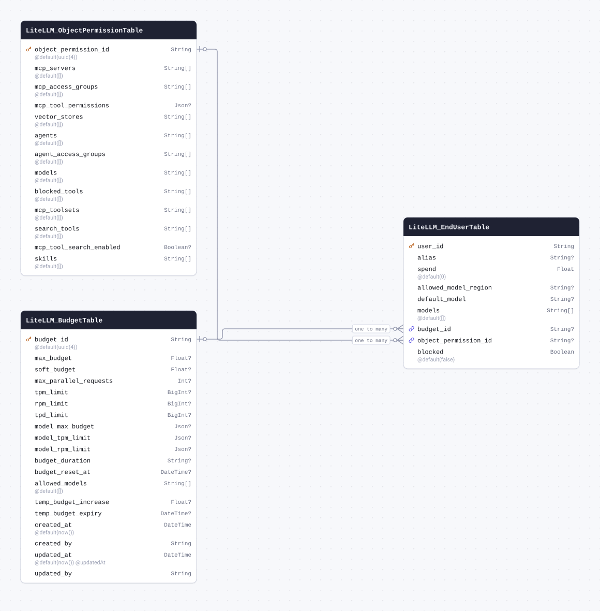

| Field                  | Type       | Constraints                                                                                       | Default | Description |
| ---------------------- | ---------- | ------------------------------------------------------------------------------------------------- | ------- | ----------- |
| `user_id`              | `String`   | PK NOT NULL                                                                                       |         |             |
| `alias`                | `String`   | NULL                                                                                              |         |             |
| `spend`                | `Float`    | NOT NULL                                                                                          | `0`     |             |
| `allowed_model_region` | `String`   | NULL                                                                                              |         |             |
| `default_model`        | `String`   | NULL                                                                                              |         |             |
| `models`               | `String[]` | NOT NULL                                                                                          | `[]`    |             |
| `budget_id`            | `String`   | NULL → [LiteLLM_BudgetTable.budget_id](#model-LiteLLM_BudgetTable)                                |         |             |
| `object_permission_id` | `String`   | NULL → [LiteLLM_ObjectPermissionTable.object_permission_id](#model-LiteLLM_ObjectPermissionTable) |         |             |
| `blocked`              | `Boolean`  | NOT NULL                                                                                          | `false` |             |

#### References

- `budget_id` → [LiteLLM_BudgetTable.budget_id](#model-LiteLLM_BudgetTable) (many-to-one)
- `object_permission_id` → [LiteLLM_ObjectPermissionTable.object_permission_id](#model-LiteLLM_ObjectPermissionTable) (many-to-one)

#### Definition

```sql
CREATE TABLE "LiteLLM_EndUserTable" (
    "user_id" TEXT NOT NULL,
    "alias" TEXT,
    "spend" DOUBLE PRECISION NOT NULL DEFAULT 0.0,
    "allowed_model_region" TEXT,
    "default_model" TEXT,
    "models" TEXT[] DEFAULT ARRAY[]::TEXT[],
    "budget_id" TEXT,
    "object_permission_id" TEXT,
    "blocked" BOOLEAN NOT NULL DEFAULT false,

    CONSTRAINT "LiteLLM_EndUserTable_pkey" PRIMARY KEY ("user_id")
);

ALTER TABLE "LiteLLM_EndUserTable" ADD CONSTRAINT "LiteLLM_EndUserTable_budget_id_fkey" FOREIGN KEY ("budget_id") REFERENCES "LiteLLM_BudgetTable"("budget_id") ON DELETE SET NULL ON UPDATE CASCADE;

ALTER TABLE "LiteLLM_EndUserTable" ADD CONSTRAINT "LiteLLM_EndUserTable_object_permission_id_fkey" FOREIGN KEY ("object_permission_id") REFERENCES "LiteLLM_ObjectPermissionTable"("object_permission_id") ON DELETE SET NULL ON UPDATE CASCADE;
```

<details>
<summary>Queries and their SQL</summary>

**findMany**: Every row

```ts
await prisma.liteLLM_EndUserTable.findMany();
```

```sql
SELECT
  "public"."LiteLLM_EndUserTable"."user_id",
  "public"."LiteLLM_EndUserTable"."alias",
  "public"."LiteLLM_EndUserTable"."spend",
  "public"."LiteLLM_EndUserTable"."allowed_model_region",
  "public"."LiteLLM_EndUserTable"."default_model",
  "public"."LiteLLM_EndUserTable"."models",
  "public"."LiteLLM_EndUserTable"."budget_id",
  "public"."LiteLLM_EndUserTable"."object_permission_id",
  "public"."LiteLLM_EndUserTable"."blocked"
FROM
  "public"."LiteLLM_EndUserTable"
WHERE
  1 = 1
OFFSET
  $1
-- params: ["0"]
```

**count**: How many rows there are

```ts
await prisma.liteLLM_EndUserTable.count();
```

```sql
SELECT
  COUNT(*) AS "_count$_all"
FROM
  (
    SELECT
      "public"."LiteLLM_EndUserTable"."user_id"
    FROM
      "public"."LiteLLM_EndUserTable"
    WHERE
      1 = 1
    OFFSET
      $1
  ) AS "sub"
-- params: ["0"]
```

**findMany**: Every row with its relations

```ts
await prisma.liteLLM_EndUserTable.findMany({
  include: { litellm_budget_table: true, object_permission: true },
});
```

```sql
SELECT
  "public"."LiteLLM_EndUserTable"."user_id",
  "public"."LiteLLM_EndUserTable"."alias",
  "public"."LiteLLM_EndUserTable"."spend",
  "public"."LiteLLM_EndUserTable"."allowed_model_region",
  "public"."LiteLLM_EndUserTable"."default_model",
  "public"."LiteLLM_EndUserTable"."models",
  "public"."LiteLLM_EndUserTable"."budget_id",
  "public"."LiteLLM_EndUserTable"."object_permission_id",
  "public"."LiteLLM_EndUserTable"."blocked"
FROM
  "public"."LiteLLM_EndUserTable"
WHERE
  1 = 1
OFFSET
  $1
-- params: ["0"]

SELECT
  "public"."LiteLLM_BudgetTable"."budget_id",
  "public"."LiteLLM_BudgetTable"."max_budget",
  "public"."LiteLLM_BudgetTable"."soft_budget",
  "public"."LiteLLM_BudgetTable"."max_parallel_requests",
  "public"."LiteLLM_BudgetTable"."tpm_limit",
  "public"."LiteLLM_BudgetTable"."rpm_limit",
  "public"."LiteLLM_BudgetTable"."tpd_limit",
  "public"."LiteLLM_BudgetTable"."model_max_budget",
  "public"."LiteLLM_BudgetTable"."model_tpm_limit",
  "public"."LiteLLM_BudgetTable"."model_rpm_limit",
  "public"."LiteLLM_BudgetTable"."budget_duration",
  "public"."LiteLLM_BudgetTable"."budget_reset_at",
  "public"."LiteLLM_BudgetTable"."allowed_models",
  "public"."LiteLLM_BudgetTable"."temp_budget_increase",
  "public"."LiteLLM_BudgetTable"."temp_budget_expiry",
  "public"."LiteLLM_BudgetTable"."created_at",
  "public"."LiteLLM_BudgetTable"."created_by",
  "public"."LiteLLM_BudgetTable"."updated_at",
  "public"."LiteLLM_BudgetTable"."updated_by"
FROM
  "public"."LiteLLM_BudgetTable"
WHERE
  "public"."LiteLLM_BudgetTable"."budget_id" IN ($1)
OFFSET
  $2
-- params: ["<budget_id of the rows above>","0"]

SELECT
  "public"."LiteLLM_ObjectPermissionTable"."object_permission_id",
  "public"."LiteLLM_ObjectPermissionTable"."mcp_servers",
  "public"."LiteLLM_ObjectPermissionTable"."mcp_access_groups",
  "public"."LiteLLM_ObjectPermissionTable"."mcp_tool_permissions",
  "public"."LiteLLM_ObjectPermissionTable"."vector_stores",
  "public"."LiteLLM_ObjectPermissionTable"."agents",
  "public"."LiteLLM_ObjectPermissionTable"."agent_access_groups",
  "public"."LiteLLM_ObjectPermissionTable"."models",
  "public"."LiteLLM_ObjectPermissionTable"."blocked_tools",
  "public"."LiteLLM_ObjectPermissionTable"."mcp_toolsets",
  "public"."LiteLLM_ObjectPermissionTable"."search_tools",
  "public"."LiteLLM_ObjectPermissionTable"."mcp_tool_search_enabled",
  "public"."LiteLLM_ObjectPermissionTable"."skills"
FROM
  "public"."LiteLLM_ObjectPermissionTable"
WHERE
  "public"."LiteLLM_ObjectPermissionTable"."object_permission_id" IN ($1)
OFFSET
  $2
-- params: ["<object_permission_id of the rows above>","0"]
```

**findUnique**: One row by what is unique to it

```ts
await prisma.liteLLM_EndUserTable.findUnique({ where: { user_id: "example" } });
```

```sql
SELECT
  "public"."LiteLLM_EndUserTable"."user_id",
  "public"."LiteLLM_EndUserTable"."alias",
  "public"."LiteLLM_EndUserTable"."spend",
  "public"."LiteLLM_EndUserTable"."allowed_model_region",
  "public"."LiteLLM_EndUserTable"."default_model",
  "public"."LiteLLM_EndUserTable"."models",
  "public"."LiteLLM_EndUserTable"."budget_id",
  "public"."LiteLLM_EndUserTable"."object_permission_id",
  "public"."LiteLLM_EndUserTable"."blocked"
FROM
  "public"."LiteLLM_EndUserTable"
WHERE
  (
    "public"."LiteLLM_EndUserTable"."user_id" = $1
    AND 1 = 1
  )
LIMIT
  $2
OFFSET
  $3
-- params: ["example","1","0"]
```

**create**: Create a row

```ts
await prisma.liteLLM_EndUserTable.create({ data: { user_id: "example" } });
```

```sql
INSERT INTO
  "public"."LiteLLM_EndUserTable" ("user_id", "spend", "models", "blocked")
VALUES
  ($1, $2, $3, $4)
RETURNING
  "public"."LiteLLM_EndUserTable"."user_id",
  "public"."LiteLLM_EndUserTable"."alias",
  "public"."LiteLLM_EndUserTable"."spend",
  "public"."LiteLLM_EndUserTable"."allowed_model_region",
  "public"."LiteLLM_EndUserTable"."default_model",
  "public"."LiteLLM_EndUserTable"."models",
  "public"."LiteLLM_EndUserTable"."budget_id",
  "public"."LiteLLM_EndUserTable"."object_permission_id",
  "public"."LiteLLM_EndUserTable"."blocked"
-- params: ["example","0.0",[],false]
```

**update**: Update a row

```ts
await prisma.liteLLM_EndUserTable.update({
  where: { user_id: "example" },
  data: { alias: "example" },
});
```

```sql
UPDATE "public"."LiteLLM_EndUserTable"
SET
  "alias" = $1
WHERE
  (
    "public"."LiteLLM_EndUserTable"."user_id" = $2
    AND 1 = 1
  )
RETURNING
  "public"."LiteLLM_EndUserTable"."user_id",
  "public"."LiteLLM_EndUserTable"."alias",
  "public"."LiteLLM_EndUserTable"."spend",
  "public"."LiteLLM_EndUserTable"."allowed_model_region",
  "public"."LiteLLM_EndUserTable"."default_model",
  "public"."LiteLLM_EndUserTable"."models",
  "public"."LiteLLM_EndUserTable"."budget_id",
  "public"."LiteLLM_EndUserTable"."object_permission_id",
  "public"."LiteLLM_EndUserTable"."blocked"
-- params: ["example","example"]
```

**delete**: Delete a row

```ts
await prisma.liteLLM_EndUserTable.delete({ where: { user_id: "example" } });
```

```sql
DELETE FROM "public"."LiteLLM_EndUserTable"
WHERE
  (
    "public"."LiteLLM_EndUserTable"."user_id" = $1
    AND 1 = 1
  )
RETURNING
  "public"."LiteLLM_EndUserTable"."user_id",
  "public"."LiteLLM_EndUserTable"."alias",
  "public"."LiteLLM_EndUserTable"."spend",
  "public"."LiteLLM_EndUserTable"."allowed_model_region",
  "public"."LiteLLM_EndUserTable"."default_model",
  "public"."LiteLLM_EndUserTable"."models",
  "public"."LiteLLM_EndUserTable"."budget_id",
  "public"."LiteLLM_EndUserTable"."object_permission_id",
  "public"."LiteLLM_EndUserTable"."blocked"
-- params: ["example"]
```

</details>

<a id="model-LiteLLM_ModelAccessGroupBudgetTable"></a>

### LiteLLM_ModelAccessGroupBudgetTable

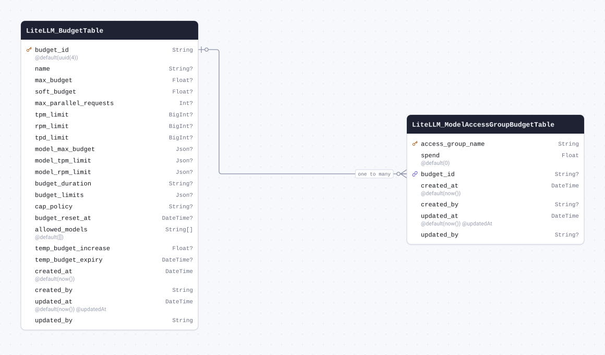

| Field                       | Type       | Constraints                                                        | Default              | Description |
| --------------------------- | ---------- | ------------------------------------------------------------------ | -------------------- | ----------- |
| `access_group_name`         | `String`   | PK NOT NULL                                                        |                      |             |
| `spend`                     | `Float`    | NOT NULL                                                           | `0`                  |             |
| `budget_id`                 | `String`   | NULL → [LiteLLM_BudgetTable.budget_id](#model-LiteLLM_BudgetTable) |                      |             |
| `created_at` (`created_at`) | `DateTime` | NOT NULL                                                           | `now()`              |             |
| `created_by`                | `String`   | NULL                                                               |                      |             |
| `updated_at`                | `DateTime` | NOT NULL                                                           | `now()` `@updatedAt` |             |
| `updated_by`                | `String`   | NULL                                                               |                      |             |

#### References

- `budget_id` → [LiteLLM_BudgetTable.budget_id](#model-LiteLLM_BudgetTable) (many-to-one)

#### Definition

```sql
CREATE TABLE "LiteLLM_ModelAccessGroupBudgetTable" (
    "access_group_name" TEXT NOT NULL,
    "spend" DOUBLE PRECISION NOT NULL DEFAULT 0.0,
    "budget_id" TEXT,
    "created_at" TIMESTAMP(3) NOT NULL DEFAULT CURRENT_TIMESTAMP,
    "created_by" TEXT,
    "updated_at" TIMESTAMP(3) NOT NULL DEFAULT CURRENT_TIMESTAMP,
    "updated_by" TEXT,

    CONSTRAINT "LiteLLM_ModelAccessGroupBudgetTable_pkey" PRIMARY KEY ("access_group_name")
);

ALTER TABLE "LiteLLM_ModelAccessGroupBudgetTable" ADD CONSTRAINT "LiteLLM_ModelAccessGroupBudgetTable_budget_id_fkey" FOREIGN KEY ("budget_id") REFERENCES "LiteLLM_BudgetTable"("budget_id") ON DELETE SET NULL ON UPDATE CASCADE;
```

<details>
<summary>Queries and their SQL</summary>

**findMany**: Every row

```ts
await prisma.liteLLM_ModelAccessGroupBudgetTable.findMany();
```

```sql
SELECT
  "public"."LiteLLM_ModelAccessGroupBudgetTable"."access_group_name",
  "public"."LiteLLM_ModelAccessGroupBudgetTable"."spend",
  "public"."LiteLLM_ModelAccessGroupBudgetTable"."budget_id",
  "public"."LiteLLM_ModelAccessGroupBudgetTable"."created_at",
  "public"."LiteLLM_ModelAccessGroupBudgetTable"."created_by",
  "public"."LiteLLM_ModelAccessGroupBudgetTable"."updated_at",
  "public"."LiteLLM_ModelAccessGroupBudgetTable"."updated_by"
FROM
  "public"."LiteLLM_ModelAccessGroupBudgetTable"
WHERE
  1 = 1
OFFSET
  $1
-- params: ["0"]
```

**count**: How many rows there are

```ts
await prisma.liteLLM_ModelAccessGroupBudgetTable.count();
```

```sql
SELECT
  COUNT(*) AS "_count$_all"
FROM
  (
    SELECT
      "public"."LiteLLM_ModelAccessGroupBudgetTable"."access_group_name"
    FROM
      "public"."LiteLLM_ModelAccessGroupBudgetTable"
    WHERE
      1 = 1
    OFFSET
      $1
  ) AS "sub"
-- params: ["0"]
```

**findMany**: Every row with its relations

```ts
await prisma.liteLLM_ModelAccessGroupBudgetTable.findMany({
  include: { litellm_budget_table: true },
});
```

```sql
SELECT
  "public"."LiteLLM_ModelAccessGroupBudgetTable"."access_group_name",
  "public"."LiteLLM_ModelAccessGroupBudgetTable"."spend",
  "public"."LiteLLM_ModelAccessGroupBudgetTable"."budget_id",
  "public"."LiteLLM_ModelAccessGroupBudgetTable"."created_at",
  "public"."LiteLLM_ModelAccessGroupBudgetTable"."created_by",
  "public"."LiteLLM_ModelAccessGroupBudgetTable"."updated_at",
  "public"."LiteLLM_ModelAccessGroupBudgetTable"."updated_by"
FROM
  "public"."LiteLLM_ModelAccessGroupBudgetTable"
WHERE
  1 = 1
OFFSET
  $1
-- params: ["0"]

SELECT
  "public"."LiteLLM_BudgetTable"."budget_id",
  "public"."LiteLLM_BudgetTable"."max_budget",
  "public"."LiteLLM_BudgetTable"."soft_budget",
  "public"."LiteLLM_BudgetTable"."max_parallel_requests",
  "public"."LiteLLM_BudgetTable"."tpm_limit",
  "public"."LiteLLM_BudgetTable"."rpm_limit",
  "public"."LiteLLM_BudgetTable"."tpd_limit",
  "public"."LiteLLM_BudgetTable"."model_max_budget",
  "public"."LiteLLM_BudgetTable"."model_tpm_limit",
  "public"."LiteLLM_BudgetTable"."model_rpm_limit",
  "public"."LiteLLM_BudgetTable"."budget_duration",
  "public"."LiteLLM_BudgetTable"."budget_reset_at",
  "public"."LiteLLM_BudgetTable"."allowed_models",
  "public"."LiteLLM_BudgetTable"."temp_budget_increase",
  "public"."LiteLLM_BudgetTable"."temp_budget_expiry",
  "public"."LiteLLM_BudgetTable"."created_at",
  "public"."LiteLLM_BudgetTable"."created_by",
  "public"."LiteLLM_BudgetTable"."updated_at",
  "public"."LiteLLM_BudgetTable"."updated_by"
FROM
  "public"."LiteLLM_BudgetTable"
WHERE
  "public"."LiteLLM_BudgetTable"."budget_id" IN ($1)
OFFSET
  $2
-- params: ["<budget_id of the rows above>","0"]
```

**findUnique**: One row by what is unique to it

```ts
await prisma.liteLLM_ModelAccessGroupBudgetTable.findUnique({
  where: { access_group_name: "example" },
});
```

```sql
SELECT
  "public"."LiteLLM_ModelAccessGroupBudgetTable"."access_group_name",
  "public"."LiteLLM_ModelAccessGroupBudgetTable"."spend",
  "public"."LiteLLM_ModelAccessGroupBudgetTable"."budget_id",
  "public"."LiteLLM_ModelAccessGroupBudgetTable"."created_at",
  "public"."LiteLLM_ModelAccessGroupBudgetTable"."created_by",
  "public"."LiteLLM_ModelAccessGroupBudgetTable"."updated_at",
  "public"."LiteLLM_ModelAccessGroupBudgetTable"."updated_by"
FROM
  "public"."LiteLLM_ModelAccessGroupBudgetTable"
WHERE
  (
    "public"."LiteLLM_ModelAccessGroupBudgetTable"."access_group_name" = $1
    AND 1 = 1
  )
LIMIT
  $2
OFFSET
  $3
-- params: ["example","1","0"]
```

**create**: Create a row

```ts
await prisma.liteLLM_ModelAccessGroupBudgetTable.create({ data: { access_group_name: "example" } });
```

```sql
INSERT INTO
  "public"."LiteLLM_ModelAccessGroupBudgetTable" (
    "access_group_name",
    "spend",
    "created_at",
    "updated_at"
  )
VALUES
  ($1, $2, $3, $4)
RETURNING
  "public"."LiteLLM_ModelAccessGroupBudgetTable"."access_group_name",
  "public"."LiteLLM_ModelAccessGroupBudgetTable"."spend",
  "public"."LiteLLM_ModelAccessGroupBudgetTable"."budget_id",
  "public"."LiteLLM_ModelAccessGroupBudgetTable"."created_at",
  "public"."LiteLLM_ModelAccessGroupBudgetTable"."created_by",
  "public"."LiteLLM_ModelAccessGroupBudgetTable"."updated_at",
  "public"."LiteLLM_ModelAccessGroupBudgetTable"."updated_by"
-- params: ["example","0.0","<now()>","<now()>"]
```

**update**: Update a row

```ts
await prisma.liteLLM_ModelAccessGroupBudgetTable.update({
  where: { access_group_name: "example" },
  data: { spend: 1.5 },
});
```

```sql
UPDATE "public"."LiteLLM_ModelAccessGroupBudgetTable"
SET
  "spend" = $1,
  "updated_at" = $2
WHERE
  (
    "public"."LiteLLM_ModelAccessGroupBudgetTable"."access_group_name" = $3
    AND 1 = 1
  )
RETURNING
  "public"."LiteLLM_ModelAccessGroupBudgetTable"."access_group_name",
  "public"."LiteLLM_ModelAccessGroupBudgetTable"."spend",
  "public"."LiteLLM_ModelAccessGroupBudgetTable"."budget_id",
  "public"."LiteLLM_ModelAccessGroupBudgetTable"."created_at",
  "public"."LiteLLM_ModelAccessGroupBudgetTable"."created_by",
  "public"."LiteLLM_ModelAccessGroupBudgetTable"."updated_at",
  "public"."LiteLLM_ModelAccessGroupBudgetTable"."updated_by"
-- params: ["1.5",{"prisma__type":"generatorCall","prisma__value":{"name":"now","args":[],"returnType":{"type":"DateTime"}}},"example"]
```

**delete**: Delete a row

```ts
await prisma.liteLLM_ModelAccessGroupBudgetTable.delete({
  where: { access_group_name: "example" },
});
```

```sql
DELETE FROM "public"."LiteLLM_ModelAccessGroupBudgetTable"
WHERE
  (
    "public"."LiteLLM_ModelAccessGroupBudgetTable"."access_group_name" = $1
    AND 1 = 1
  )
RETURNING
  "public"."LiteLLM_ModelAccessGroupBudgetTable"."access_group_name",
  "public"."LiteLLM_ModelAccessGroupBudgetTable"."spend",
  "public"."LiteLLM_ModelAccessGroupBudgetTable"."budget_id",
  "public"."LiteLLM_ModelAccessGroupBudgetTable"."created_at",
  "public"."LiteLLM_ModelAccessGroupBudgetTable"."created_by",
  "public"."LiteLLM_ModelAccessGroupBudgetTable"."updated_at",
  "public"."LiteLLM_ModelAccessGroupBudgetTable"."updated_by"
-- params: ["example"]
```

</details>

<a id="model-LiteLLM_TagTable"></a>

### LiteLLM_TagTable

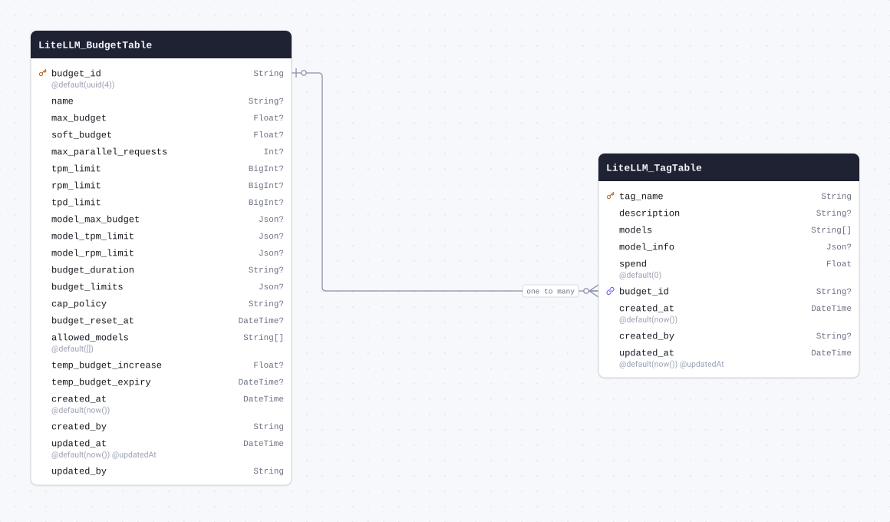

| Field                       | Type       | Constraints                                                        | Default              | Description |
| --------------------------- | ---------- | ------------------------------------------------------------------ | -------------------- | ----------- |
| `tag_name`                  | `String`   | PK NOT NULL                                                        |                      |             |
| `description`               | `String`   | NULL                                                               |                      |             |
| `models`                    | `String[]` | NOT NULL                                                           |                      |             |
| `model_info`                | `Json`     | NULL                                                               |                      |             |
| `spend`                     | `Float`    | NOT NULL                                                           | `0`                  |             |
| `budget_id`                 | `String`   | NULL → [LiteLLM_BudgetTable.budget_id](#model-LiteLLM_BudgetTable) |                      |             |
| `created_at` (`created_at`) | `DateTime` | NOT NULL                                                           | `now()`              |             |
| `created_by`                | `String`   | NULL                                                               |                      |             |
| `updated_at` (`updated_at`) | `DateTime` | NOT NULL                                                           | `now()` `@updatedAt` |             |

#### References

- `budget_id` → [LiteLLM_BudgetTable.budget_id](#model-LiteLLM_BudgetTable) (many-to-one)

#### Definition

```sql
CREATE TABLE "LiteLLM_TagTable" (
    "tag_name" TEXT NOT NULL,
    "description" TEXT,
    "models" TEXT[],
    "model_info" JSONB,
    "spend" DOUBLE PRECISION NOT NULL DEFAULT 0.0,
    "budget_id" TEXT,
    "created_at" TIMESTAMP(3) NOT NULL DEFAULT CURRENT_TIMESTAMP,
    "created_by" TEXT,
    "updated_at" TIMESTAMP(3) NOT NULL DEFAULT CURRENT_TIMESTAMP,

    CONSTRAINT "LiteLLM_TagTable_pkey" PRIMARY KEY ("tag_name")
);

ALTER TABLE "LiteLLM_TagTable" ADD CONSTRAINT "LiteLLM_TagTable_budget_id_fkey" FOREIGN KEY ("budget_id") REFERENCES "LiteLLM_BudgetTable"("budget_id") ON DELETE SET NULL ON UPDATE CASCADE;
```

<details>
<summary>Queries and their SQL</summary>

**findMany**: Every row

```ts
await prisma.liteLLM_TagTable.findMany();
```

```sql
SELECT
  "public"."LiteLLM_TagTable"."tag_name",
  "public"."LiteLLM_TagTable"."description",
  "public"."LiteLLM_TagTable"."models",
  "public"."LiteLLM_TagTable"."model_info",
  "public"."LiteLLM_TagTable"."spend",
  "public"."LiteLLM_TagTable"."budget_id",
  "public"."LiteLLM_TagTable"."created_at",
  "public"."LiteLLM_TagTable"."created_by",
  "public"."LiteLLM_TagTable"."updated_at"
FROM
  "public"."LiteLLM_TagTable"
WHERE
  1 = 1
OFFSET
  $1
-- params: ["0"]
```

**count**: How many rows there are

```ts
await prisma.liteLLM_TagTable.count();
```

```sql
SELECT
  COUNT(*) AS "_count$_all"
FROM
  (
    SELECT
      "public"."LiteLLM_TagTable"."tag_name"
    FROM
      "public"."LiteLLM_TagTable"
    WHERE
      1 = 1
    OFFSET
      $1
  ) AS "sub"
-- params: ["0"]
```

**findMany**: Every row with its relations

```ts
await prisma.liteLLM_TagTable.findMany({ include: { litellm_budget_table: true } });
```

```sql
SELECT
  "public"."LiteLLM_TagTable"."tag_name",
  "public"."LiteLLM_TagTable"."description",
  "public"."LiteLLM_TagTable"."models",
  "public"."LiteLLM_TagTable"."model_info",
  "public"."LiteLLM_TagTable"."spend",
  "public"."LiteLLM_TagTable"."budget_id",
  "public"."LiteLLM_TagTable"."created_at",
  "public"."LiteLLM_TagTable"."created_by",
  "public"."LiteLLM_TagTable"."updated_at"
FROM
  "public"."LiteLLM_TagTable"
WHERE
  1 = 1
OFFSET
  $1
-- params: ["0"]

SELECT
  "public"."LiteLLM_BudgetTable"."budget_id",
  "public"."LiteLLM_BudgetTable"."max_budget",
  "public"."LiteLLM_BudgetTable"."soft_budget",
  "public"."LiteLLM_BudgetTable"."max_parallel_requests",
  "public"."LiteLLM_BudgetTable"."tpm_limit",
  "public"."LiteLLM_BudgetTable"."rpm_limit",
  "public"."LiteLLM_BudgetTable"."tpd_limit",
  "public"."LiteLLM_BudgetTable"."model_max_budget",
  "public"."LiteLLM_BudgetTable"."model_tpm_limit",
  "public"."LiteLLM_BudgetTable"."model_rpm_limit",
  "public"."LiteLLM_BudgetTable"."budget_duration",
  "public"."LiteLLM_BudgetTable"."budget_reset_at",
  "public"."LiteLLM_BudgetTable"."allowed_models",
  "public"."LiteLLM_BudgetTable"."temp_budget_increase",
  "public"."LiteLLM_BudgetTable"."temp_budget_expiry",
  "public"."LiteLLM_BudgetTable"."created_at",
  "public"."LiteLLM_BudgetTable"."created_by",
  "public"."LiteLLM_BudgetTable"."updated_at",
  "public"."LiteLLM_BudgetTable"."updated_by"
FROM
  "public"."LiteLLM_BudgetTable"
WHERE
  "public"."LiteLLM_BudgetTable"."budget_id" IN ($1)
OFFSET
  $2
-- params: ["<budget_id of the rows above>","0"]
```

**findUnique**: One row by what is unique to it

```ts
await prisma.liteLLM_TagTable.findUnique({ where: { tag_name: "example" } });
```

```sql
SELECT
  "public"."LiteLLM_TagTable"."tag_name",
  "public"."LiteLLM_TagTable"."description",
  "public"."LiteLLM_TagTable"."models",
  "public"."LiteLLM_TagTable"."model_info",
  "public"."LiteLLM_TagTable"."spend",
  "public"."LiteLLM_TagTable"."budget_id",
  "public"."LiteLLM_TagTable"."created_at",
  "public"."LiteLLM_TagTable"."created_by",
  "public"."LiteLLM_TagTable"."updated_at"
FROM
  "public"."LiteLLM_TagTable"
WHERE
  (
    "public"."LiteLLM_TagTable"."tag_name" = $1
    AND 1 = 1
  )
LIMIT
  $2
OFFSET
  $3
-- params: ["example","1","0"]
```

**create**: Create a row

```ts
await prisma.liteLLM_TagTable.create({ data: { tag_name: "example", models: ["example"] } });
```

```sql
INSERT INTO
  "public"."LiteLLM_TagTable" (
    "tag_name",
    "models",
    "spend",
    "created_at",
    "updated_at"
  )
VALUES
  ($1, $2, $3, $4, $5)
RETURNING
  "public"."LiteLLM_TagTable"."tag_name",
  "public"."LiteLLM_TagTable"."description",
  "public"."LiteLLM_TagTable"."models",
  "public"."LiteLLM_TagTable"."model_info",
  "public"."LiteLLM_TagTable"."spend",
  "public"."LiteLLM_TagTable"."budget_id",
  "public"."LiteLLM_TagTable"."created_at",
  "public"."LiteLLM_TagTable"."created_by",
  "public"."LiteLLM_TagTable"."updated_at"
-- params: ["example",["example"],"0.0","<now()>","<now()>"]
```

**update**: Update a row

```ts
await prisma.liteLLM_TagTable.update({
  where: { tag_name: "example" },
  data: { description: "example" },
});
```

```sql
UPDATE "public"."LiteLLM_TagTable"
SET
  "description" = $1,
  "updated_at" = $2
WHERE
  (
    "public"."LiteLLM_TagTable"."tag_name" = $3
    AND 1 = 1
  )
RETURNING
  "public"."LiteLLM_TagTable"."tag_name",
  "public"."LiteLLM_TagTable"."description",
  "public"."LiteLLM_TagTable"."models",
  "public"."LiteLLM_TagTable"."model_info",
  "public"."LiteLLM_TagTable"."spend",
  "public"."LiteLLM_TagTable"."budget_id",
  "public"."LiteLLM_TagTable"."created_at",
  "public"."LiteLLM_TagTable"."created_by",
  "public"."LiteLLM_TagTable"."updated_at"
-- params: ["example",{"prisma__type":"generatorCall","prisma__value":{"name":"now","args":[],"returnType":{"type":"DateTime"}}},"example"]
```

**delete**: Delete a row

```ts
await prisma.liteLLM_TagTable.delete({ where: { tag_name: "example" } });
```

```sql
DELETE FROM "public"."LiteLLM_TagTable"
WHERE
  (
    "public"."LiteLLM_TagTable"."tag_name" = $1
    AND 1 = 1
  )
RETURNING
  "public"."LiteLLM_TagTable"."tag_name",
  "public"."LiteLLM_TagTable"."description",
  "public"."LiteLLM_TagTable"."models",
  "public"."LiteLLM_TagTable"."model_info",
  "public"."LiteLLM_TagTable"."spend",
  "public"."LiteLLM_TagTable"."budget_id",
  "public"."LiteLLM_TagTable"."created_at",
  "public"."LiteLLM_TagTable"."created_by",
  "public"."LiteLLM_TagTable"."updated_at"
-- params: ["example"]
```

</details>

<a id="model-LiteLLM_Config"></a>

### LiteLLM_Config

| Field             | Type       | Constraints | Default | Description |
| ----------------- | ---------- | ----------- | ------- | ----------- |
| `param_name`      | `String`   | PK NOT NULL |         |             |
| `param_value`     | `Json`     | NULL        |         |             |
| `last_run_at`     | `DateTime` | NULL        |         |             |
| `reload_revision` | `BigInt`   | NOT NULL    | `"0"`   |             |

#### Definition

```sql
CREATE TABLE "LiteLLM_Config" (
    "param_name" TEXT NOT NULL,
    "param_value" JSONB,
    "last_run_at" TIMESTAMP(3),
    "reload_revision" BIGINT NOT NULL DEFAULT 0,

    CONSTRAINT "LiteLLM_Config_pkey" PRIMARY KEY ("param_name")
);
```

<details>
<summary>Queries and their SQL</summary>

**findMany**: Every row

```ts
await prisma.liteLLM_Config.findMany();
```

```sql
SELECT
  "public"."LiteLLM_Config"."param_name",
  "public"."LiteLLM_Config"."param_value",
  "public"."LiteLLM_Config"."last_run_at",
  "public"."LiteLLM_Config"."reload_revision"
FROM
  "public"."LiteLLM_Config"
WHERE
  1 = 1
OFFSET
  $1
-- params: ["0"]
```

**count**: How many rows there are

```ts
await prisma.liteLLM_Config.count();
```

```sql
SELECT
  COUNT(*) AS "_count$_all"
FROM
  (
    SELECT
      "public"."LiteLLM_Config"."param_name"
    FROM
      "public"."LiteLLM_Config"
    WHERE
      1 = 1
    OFFSET
      $1
  ) AS "sub"
-- params: ["0"]
```

**findUnique**: One row by what is unique to it

```ts
await prisma.liteLLM_Config.findUnique({ where: { param_name: "example" } });
```

```sql
SELECT
  "public"."LiteLLM_Config"."param_name",
  "public"."LiteLLM_Config"."param_value",
  "public"."LiteLLM_Config"."last_run_at",
  "public"."LiteLLM_Config"."reload_revision"
FROM
  "public"."LiteLLM_Config"
WHERE
  (
    "public"."LiteLLM_Config"."param_name" = $1
    AND 1 = 1
  )
LIMIT
  $2
OFFSET
  $3
-- params: ["example","1","0"]
```

**create**: Create a row

```ts
await prisma.liteLLM_Config.create({ data: { param_name: "example" } });
```

```sql
INSERT INTO
  "public"."LiteLLM_Config" ("param_name", "reload_revision")
VALUES
  ($1, $2)
RETURNING
  "public"."LiteLLM_Config"."param_name",
  "public"."LiteLLM_Config"."param_value",
  "public"."LiteLLM_Config"."last_run_at",
  "public"."LiteLLM_Config"."reload_revision"
-- params: ["example","0"]
```

**update**: Update a row

```ts
await prisma.liteLLM_Config.update({ where: { param_name: "example" }, data: { param_value: {} } });
```

```sql
UPDATE "public"."LiteLLM_Config"
SET
  "param_value" = $1
WHERE
  (
    "public"."LiteLLM_Config"."param_name" = $2
    AND 1 = 1
  )
RETURNING
  "public"."LiteLLM_Config"."param_name",
  "public"."LiteLLM_Config"."param_value",
  "public"."LiteLLM_Config"."last_run_at",
  "public"."LiteLLM_Config"."reload_revision"
-- params: ["{}","example"]
```

**delete**: Delete a row

```ts
await prisma.liteLLM_Config.delete({ where: { param_name: "example" } });
```

```sql
DELETE FROM "public"."LiteLLM_Config"
WHERE
  (
    "public"."LiteLLM_Config"."param_name" = $1
    AND 1 = 1
  )
RETURNING
  "public"."LiteLLM_Config"."param_name",
  "public"."LiteLLM_Config"."param_value",
  "public"."LiteLLM_Config"."last_run_at",
  "public"."LiteLLM_Config"."reload_revision"
-- params: ["example"]
```

</details>

<a id="model-LiteLLM_SpendLogs"></a>

### LiteLLM_SpendLogs

| Field                       | Type       | Constraints | Default              | Description |
| --------------------------- | ---------- | ----------- | -------------------- | ----------- |
| `request_id`                | `String`   | PK NOT NULL |                      |             |
| `call_type`                 | `String`   | NOT NULL    |                      |             |
| `api_key`                   | `String`   | NOT NULL    | `""`                 |             |
| `spend`                     | `Float`    | NOT NULL    | `0`                  |             |
| `total_tokens`              | `Int`      | NOT NULL    | `0`                  |             |
| `prompt_tokens`             | `Int`      | NOT NULL    | `0`                  |             |
| `completion_tokens`         | `Int`      | NOT NULL    | `0`                  |             |
| `startTime`                 | `DateTime` | NOT NULL    |                      |             |
| `endTime`                   | `DateTime` | NOT NULL    |                      |             |
| `request_duration_ms`       | `Int`      | NULL        |                      |             |
| `completionStartTime`       | `DateTime` | NULL        |                      |             |
| `model`                     | `String`   | NOT NULL    | `""`                 |             |
| `model_id`                  | `String`   | NULL        | `""`                 |             |
| `model_group`               | `String`   | NULL        | `""`                 |             |
| `custom_llm_provider`       | `String`   | NULL        | `""`                 |             |
| `api_base`                  | `String`   | NULL        | `""`                 |             |
| `user`                      | `String`   | NULL        | `""`                 |             |
| `metadata`                  | `Json`     | NULL        | `"{}"`               |             |
| `cache_hit`                 | `String`   | NULL        | `""`                 |             |
| `cache_key`                 | `String`   | NULL        | `""`                 |             |
| `request_tags`              | `Json`     | NULL        | `"[]"`               |             |
| `team_id`                   | `String`   | NULL        |                      |             |
| `organization_id`           | `String`   | NULL        |                      |             |
| `end_user`                  | `String`   | NULL        |                      |             |
| `requester_ip_address`      | `String`   | NULL        |                      |             |
| `messages`                  | `Json`     | NULL        | `"{}"`               |             |
| `response`                  | `Json`     | NULL        | `"{}"`               |             |
| `session_id`                | `String`   | NULL        |                      |             |
| `status`                    | `String`   | NULL        |                      |             |
| `mcp_namespaced_tool_name`  | `String`   | NULL        |                      |             |
| `billing_agent_id`          | `String`   | NULL        |                      |             |
| `agent_id`                  | `String`   | NULL        |                      |             |
| `proxy_server_request`      | `Json`     | NULL        | `"{}"`               |             |
| `litellm_call_id`           | `String`   | NULL        |                      |             |
| `created_at` (`created_at`) | `DateTime` | NOT NULL    | `now()`              |             |
| `updated_at` (`updated_at`) | `DateTime` | NOT NULL    | `now()` `@updatedAt` |             |

#### Indexes

- `@@index([startTime])`
- `@@index([startTime, request_id])`
- `@@index([end_user])`
- `@@index([session_id])`
- `@@index([litellm_call_id])`
- `@@index([api_key, startTime])`

#### Definition

```sql
CREATE TABLE "LiteLLM_SpendLogs" (
    "request_id" TEXT NOT NULL,
    "call_type" TEXT NOT NULL,
    "api_key" TEXT NOT NULL DEFAULT '',
    "spend" DOUBLE PRECISION NOT NULL DEFAULT 0.0,
    "total_tokens" INTEGER NOT NULL DEFAULT 0,
    "prompt_tokens" INTEGER NOT NULL DEFAULT 0,
    "completion_tokens" INTEGER NOT NULL DEFAULT 0,
    "startTime" TIMESTAMP(3) NOT NULL,
    "endTime" TIMESTAMP(3) NOT NULL,
    "request_duration_ms" INTEGER,
    "completionStartTime" TIMESTAMP(3),
    "model" TEXT NOT NULL DEFAULT '',
    "model_id" TEXT DEFAULT '',
    "model_group" TEXT DEFAULT '',
    "custom_llm_provider" TEXT DEFAULT '',
    "api_base" TEXT DEFAULT '',
    "user" TEXT DEFAULT '',
    "metadata" JSONB DEFAULT '{}',
    "cache_hit" TEXT DEFAULT '',
    "cache_key" TEXT DEFAULT '',
    "request_tags" JSONB DEFAULT '[]',
    "team_id" TEXT,
    "organization_id" TEXT,
    "end_user" TEXT,
    "requester_ip_address" TEXT,
    "messages" JSONB DEFAULT '{}',
    "response" JSONB DEFAULT '{}',
    "session_id" TEXT,
    "status" TEXT,
    "mcp_namespaced_tool_name" TEXT,
    "billing_agent_id" TEXT,
    "agent_id" TEXT,
    "proxy_server_request" JSONB DEFAULT '{}',
    "litellm_call_id" TEXT,
    "created_at" TIMESTAMP(3) NOT NULL DEFAULT CURRENT_TIMESTAMP,
    "updated_at" TIMESTAMP(3) NOT NULL DEFAULT CURRENT_TIMESTAMP,

    CONSTRAINT "LiteLLM_SpendLogs_pkey" PRIMARY KEY ("request_id")
);

CREATE INDEX "LiteLLM_SpendLogs_startTime_idx" ON "LiteLLM_SpendLogs"("startTime");

CREATE INDEX "LiteLLM_SpendLogs_startTime_request_id_idx" ON "LiteLLM_SpendLogs"("startTime", "request_id");

CREATE INDEX "LiteLLM_SpendLogs_end_user_idx" ON "LiteLLM_SpendLogs"("end_user");

CREATE INDEX "LiteLLM_SpendLogs_session_id_idx" ON "LiteLLM_SpendLogs"("session_id");

CREATE INDEX "LiteLLM_SpendLogs_litellm_call_id_idx" ON "LiteLLM_SpendLogs"("litellm_call_id");

CREATE INDEX "LiteLLM_SpendLogs_api_key_startTime_idx" ON "LiteLLM_SpendLogs"("api_key", "startTime");
```

<details>
<summary>Queries and their SQL</summary>

**findMany**: Every row

```ts
await prisma.liteLLM_SpendLogs.findMany();
```

```sql
SELECT
  "public"."LiteLLM_SpendLogs"."request_id",
  "public"."LiteLLM_SpendLogs"."call_type",
  "public"."LiteLLM_SpendLogs"."api_key",
  "public"."LiteLLM_SpendLogs"."spend",
  "public"."LiteLLM_SpendLogs"."total_tokens",
  "public"."LiteLLM_SpendLogs"."prompt_tokens",
  "public"."LiteLLM_SpendLogs"."completion_tokens",
  "public"."LiteLLM_SpendLogs"."startTime",
  "public"."LiteLLM_SpendLogs"."endTime",
  "public"."LiteLLM_SpendLogs"."request_duration_ms",
  "public"."LiteLLM_SpendLogs"."completionStartTime",
  "public"."LiteLLM_SpendLogs"."model",
  "public"."LiteLLM_SpendLogs"."model_id",
  "public"."LiteLLM_SpendLogs"."model_group",
  "public"."LiteLLM_SpendLogs"."custom_llm_provider",
  "public"."LiteLLM_SpendLogs"."api_base",
  "public"."LiteLLM_SpendLogs"."user",
  "public"."LiteLLM_SpendLogs"."metadata",
  "public"."LiteLLM_SpendLogs"."cache_hit",
  "public"."LiteLLM_SpendLogs"."cache_key",
  "public"."LiteLLM_SpendLogs"."request_tags",
  "public"."LiteLLM_SpendLogs"."team_id",
  "public"."LiteLLM_SpendLogs"."organization_id",
  "public"."LiteLLM_SpendLogs"."end_user",
  "public"."LiteLLM_SpendLogs"."requester_ip_address",
  "public"."LiteLLM_SpendLogs"."messages",
  "public"."LiteLLM_SpendLogs"."response",
  "public"."LiteLLM_SpendLogs"."session_id",
  "public"."LiteLLM_SpendLogs"."status",
  "public"."LiteLLM_SpendLogs"."mcp_namespaced_tool_name",
  "public"."LiteLLM_SpendLogs"."billing_agent_id",
  "public"."LiteLLM_SpendLogs"."agent_id",
  "public"."LiteLLM_SpendLogs"."proxy_server_request",
  "public"."LiteLLM_SpendLogs"."litellm_call_id",
  "public"."LiteLLM_SpendLogs"."created_at",
  "public"."LiteLLM_SpendLogs"."updated_at"
FROM
  "public"."LiteLLM_SpendLogs"
WHERE
  1 = 1
OFFSET
  $1
-- params: ["0"]
```

**count**: How many rows there are

```ts
await prisma.liteLLM_SpendLogs.count();
```

```sql
SELECT
  COUNT(*) AS "_count$_all"
FROM
  (
    SELECT
      "public"."LiteLLM_SpendLogs"."request_id"
    FROM
      "public"."LiteLLM_SpendLogs"
    WHERE
      1 = 1
    OFFSET
      $1
  ) AS "sub"
-- params: ["0"]
```

**findUnique**: One row by what is unique to it

```ts
await prisma.liteLLM_SpendLogs.findUnique({ where: { request_id: "example" } });
```

```sql
SELECT
  "public"."LiteLLM_SpendLogs"."request_id",
  "public"."LiteLLM_SpendLogs"."call_type",
  "public"."LiteLLM_SpendLogs"."api_key",
  "public"."LiteLLM_SpendLogs"."spend",
  "public"."LiteLLM_SpendLogs"."total_tokens",
  "public"."LiteLLM_SpendLogs"."prompt_tokens",
  "public"."LiteLLM_SpendLogs"."completion_tokens",
  "public"."LiteLLM_SpendLogs"."startTime",
  "public"."LiteLLM_SpendLogs"."endTime",
  "public"."LiteLLM_SpendLogs"."request_duration_ms",
  "public"."LiteLLM_SpendLogs"."completionStartTime",
  "public"."LiteLLM_SpendLogs"."model",
  "public"."LiteLLM_SpendLogs"."model_id",
  "public"."LiteLLM_SpendLogs"."model_group",
  "public"."LiteLLM_SpendLogs"."custom_llm_provider",
  "public"."LiteLLM_SpendLogs"."api_base",
  "public"."LiteLLM_SpendLogs"."user",
  "public"."LiteLLM_SpendLogs"."metadata",
  "public"."LiteLLM_SpendLogs"."cache_hit",
  "public"."LiteLLM_SpendLogs"."cache_key",
  "public"."LiteLLM_SpendLogs"."request_tags",
  "public"."LiteLLM_SpendLogs"."team_id",
  "public"."LiteLLM_SpendLogs"."organization_id",
  "public"."LiteLLM_SpendLogs"."end_user",
  "public"."LiteLLM_SpendLogs"."requester_ip_address",
  "public"."LiteLLM_SpendLogs"."messages",
  "public"."LiteLLM_SpendLogs"."response",
  "public"."LiteLLM_SpendLogs"."session_id",
  "public"."LiteLLM_SpendLogs"."status",
  "public"."LiteLLM_SpendLogs"."mcp_namespaced_tool_name",
  "public"."LiteLLM_SpendLogs"."billing_agent_id",
  "public"."LiteLLM_SpendLogs"."agent_id",
  "public"."LiteLLM_SpendLogs"."proxy_server_request",
  "public"."LiteLLM_SpendLogs"."litellm_call_id",
  "public"."LiteLLM_SpendLogs"."created_at",
  "public"."LiteLLM_SpendLogs"."updated_at"
FROM
  "public"."LiteLLM_SpendLogs"
WHERE
  (
    "public"."LiteLLM_SpendLogs"."request_id" = $1
    AND 1 = 1
  )
LIMIT
  $2
OFFSET
  $3
-- params: ["example","1","0"]
```

**create**: Create a row

```ts
await prisma.liteLLM_SpendLogs.create({
  data: {
    request_id: "example",
    call_type: "example",
    startTime: new Date("2026-01-01T00:00:00.000Z"),
    endTime: new Date("2026-01-01T00:00:00.000Z"),
  },
});
```

```sql
INSERT INTO
  "public"."LiteLLM_SpendLogs" (
    "request_id",
    "call_type",
    "api_key",
    "spend",
    "total_tokens",
    "prompt_tokens",
    "completion_tokens",
    "startTime",
    "endTime",
    "model",
    "model_id",
    "model_group",
    "custom_llm_provider",
    "api_base",
    "user",
    "metadata",
    "cache_hit",
    "cache_key",
    "request_tags",
    "messages",
    "response",
    "proxy_server_request",
    "created_at",
    "updated_at"
  )
VALUES
  (
    $1,
    $2,
    $3,
    $4,
    $5,
    $6,
    $7,
    $8,
    $9,
    $10,
    $11,
    $12,
    $13,
    $14,
    $15,
    $16,
    $17,
    $18,
    $19,
    $20,
    $21,
    $22,
    $23,
    $24
  )
RETURNING
  "public"."LiteLLM_SpendLogs"."request_id",
  "public"."LiteLLM_SpendLogs"."call_type",
  "public"."LiteLLM_SpendLogs"."api_key",
  "public"."LiteLLM_SpendLogs"."spend",
  "public"."LiteLLM_SpendLogs"."total_tokens",
  "public"."LiteLLM_SpendLogs"."prompt_tokens",
  "public"."LiteLLM_SpendLogs"."completion_tokens",
  "public"."LiteLLM_SpendLogs"."startTime",
  "public"."LiteLLM_SpendLogs"."endTime",
  "public"."LiteLLM_SpendLogs"."request_duration_ms",
  "public"."LiteLLM_SpendLogs"."completionStartTime",
  "public"."LiteLLM_SpendLogs"."model",
  "public"."LiteLLM_SpendLogs"."model_id",
  "public"."LiteLLM_SpendLogs"."model_group",
  "public"."LiteLLM_SpendLogs"."custom_llm_provider",
  "public"."LiteLLM_SpendLogs"."api_base",
  "public"."LiteLLM_SpendLogs"."user",
  "public"."LiteLLM_SpendLogs"."metadata",
  "public"."LiteLLM_SpendLogs"."cache_hit",
  "public"."LiteLLM_SpendLogs"."cache_key",
  "public"."LiteLLM_SpendLogs"."request_tags",
  "public"."LiteLLM_SpendLogs"."team_id",
  "public"."LiteLLM_SpendLogs"."organization_id",
  "public"."LiteLLM_SpendLogs"."end_user",
  "public"."LiteLLM_SpendLogs"."requester_ip_address",
  "public"."LiteLLM_SpendLogs"."messages",
  "public"."LiteLLM_SpendLogs"."response",
  "public"."LiteLLM_SpendLogs"."session_id",
  "public"."LiteLLM_SpendLogs"."status",
  "public"."LiteLLM_SpendLogs"."mcp_namespaced_tool_name",
  "public"."LiteLLM_SpendLogs"."billing_agent_id",
  "public"."LiteLLM_SpendLogs"."agent_id",
  "public"."LiteLLM_SpendLogs"."proxy_server_request",
  "public"."LiteLLM_SpendLogs"."litellm_call_id",
  "public"."LiteLLM_SpendLogs"."created_at",
  "public"."LiteLLM_SpendLogs"."updated_at"
-- params: ["example","example","","0.0","0","0","0","2026-01-01T00:00:00.000Z","2026-01-01T00:00:00.000Z","","","","","","","{}","","","[]","{}","{}","{}","<now()>","<now()>"]
```

**update**: Update a row

```ts
await prisma.liteLLM_SpendLogs.update({
  where: { request_id: "example" },
  data: { call_type: "example" },
});
```

```sql
UPDATE "public"."LiteLLM_SpendLogs"
SET
  "call_type" = $1,
  "updated_at" = $2
WHERE
  (
    "public"."LiteLLM_SpendLogs"."request_id" = $3
    AND 1 = 1
  )
RETURNING
  "public"."LiteLLM_SpendLogs"."request_id",
  "public"."LiteLLM_SpendLogs"."call_type",
  "public"."LiteLLM_SpendLogs"."api_key",
  "public"."LiteLLM_SpendLogs"."spend",
  "public"."LiteLLM_SpendLogs"."total_tokens",
  "public"."LiteLLM_SpendLogs"."prompt_tokens",
  "public"."LiteLLM_SpendLogs"."completion_tokens",
  "public"."LiteLLM_SpendLogs"."startTime",
  "public"."LiteLLM_SpendLogs"."endTime",
  "public"."LiteLLM_SpendLogs"."request_duration_ms",
  "public"."LiteLLM_SpendLogs"."completionStartTime",
  "public"."LiteLLM_SpendLogs"."model",
  "public"."LiteLLM_SpendLogs"."model_id",
  "public"."LiteLLM_SpendLogs"."model_group",
  "public"."LiteLLM_SpendLogs"."custom_llm_provider",
  "public"."LiteLLM_SpendLogs"."api_base",
  "public"."LiteLLM_SpendLogs"."user",
  "public"."LiteLLM_SpendLogs"."metadata",
  "public"."LiteLLM_SpendLogs"."cache_hit",
  "public"."LiteLLM_SpendLogs"."cache_key",
  "public"."LiteLLM_SpendLogs"."request_tags",
  "public"."LiteLLM_SpendLogs"."team_id",
  "public"."LiteLLM_SpendLogs"."organization_id",
  "public"."LiteLLM_SpendLogs"."end_user",
  "public"."LiteLLM_SpendLogs"."requester_ip_address",
  "public"."LiteLLM_SpendLogs"."messages",
  "public"."LiteLLM_SpendLogs"."response",
  "public"."LiteLLM_SpendLogs"."session_id",
  "public"."LiteLLM_SpendLogs"."status",
  "public"."LiteLLM_SpendLogs"."mcp_namespaced_tool_name",
  "public"."LiteLLM_SpendLogs"."billing_agent_id",
  "public"."LiteLLM_SpendLogs"."agent_id",
  "public"."LiteLLM_SpendLogs"."proxy_server_request",
  "public"."LiteLLM_SpendLogs"."litellm_call_id",
  "public"."LiteLLM_SpendLogs"."created_at",
  "public"."LiteLLM_SpendLogs"."updated_at"
-- params: ["example",{"prisma__type":"generatorCall","prisma__value":{"name":"now","args":[],"returnType":{"type":"DateTime"}}},"example"]
```

**delete**: Delete a row

```ts
await prisma.liteLLM_SpendLogs.delete({ where: { request_id: "example" } });
```

```sql
DELETE FROM "public"."LiteLLM_SpendLogs"
WHERE
  (
    "public"."LiteLLM_SpendLogs"."request_id" = $1
    AND 1 = 1
  )
RETURNING
  "public"."LiteLLM_SpendLogs"."request_id",
  "public"."LiteLLM_SpendLogs"."call_type",
  "public"."LiteLLM_SpendLogs"."api_key",
  "public"."LiteLLM_SpendLogs"."spend",
  "public"."LiteLLM_SpendLogs"."total_tokens",
  "public"."LiteLLM_SpendLogs"."prompt_tokens",
  "public"."LiteLLM_SpendLogs"."completion_tokens",
  "public"."LiteLLM_SpendLogs"."startTime",
  "public"."LiteLLM_SpendLogs"."endTime",
  "public"."LiteLLM_SpendLogs"."request_duration_ms",
  "public"."LiteLLM_SpendLogs"."completionStartTime",
  "public"."LiteLLM_SpendLogs"."model",
  "public"."LiteLLM_SpendLogs"."model_id",
  "public"."LiteLLM_SpendLogs"."model_group",
  "public"."LiteLLM_SpendLogs"."custom_llm_provider",
  "public"."LiteLLM_SpendLogs"."api_base",
  "public"."LiteLLM_SpendLogs"."user",
  "public"."LiteLLM_SpendLogs"."metadata",
  "public"."LiteLLM_SpendLogs"."cache_hit",
  "public"."LiteLLM_SpendLogs"."cache_key",
  "public"."LiteLLM_SpendLogs"."request_tags",
  "public"."LiteLLM_SpendLogs"."team_id",
  "public"."LiteLLM_SpendLogs"."organization_id",
  "public"."LiteLLM_SpendLogs"."end_user",
  "public"."LiteLLM_SpendLogs"."requester_ip_address",
  "public"."LiteLLM_SpendLogs"."messages",
  "public"."LiteLLM_SpendLogs"."response",
  "public"."LiteLLM_SpendLogs"."session_id",
  "public"."LiteLLM_SpendLogs"."status",
  "public"."LiteLLM_SpendLogs"."mcp_namespaced_tool_name",
  "public"."LiteLLM_SpendLogs"."billing_agent_id",
  "public"."LiteLLM_SpendLogs"."agent_id",
  "public"."LiteLLM_SpendLogs"."proxy_server_request",
  "public"."LiteLLM_SpendLogs"."litellm_call_id",
  "public"."LiteLLM_SpendLogs"."created_at",
  "public"."LiteLLM_SpendLogs"."updated_at"
-- params: ["example"]
```

</details>

<a id="model-LiteLLM_BudgetWindowSpend"></a>

### LiteLLM_BudgetWindowSpend

| Field             | Type       | Constraints | Default      | Description |
| ----------------- | ---------- | ----------- | ------------ | ----------- |
| `entity_type`     | `String`   | PK NOT NULL |              |             |
| `entity_id`       | `String`   | PK NOT NULL |              |             |
| `window_duration` | `String`   | PK NOT NULL |              |             |
| `window_start`    | `DateTime` | NOT NULL    |              |             |
| `spend`           | `Float`    | NOT NULL    | `0`          |             |
| `created_at`      | `DateTime` | NOT NULL    | `now()`      |             |
| `updated_at`      | `DateTime` | NOT NULL    | `@updatedAt` |             |

#### Indexes

- `@@id([entity_type, entity_id, window_duration])`

#### Definition

```sql
CREATE TABLE "LiteLLM_BudgetWindowSpend" (
    "entity_type" TEXT NOT NULL,
    "entity_id" TEXT NOT NULL,
    "window_duration" TEXT NOT NULL,
    "window_start" TIMESTAMP(3) NOT NULL,
    "spend" DOUBLE PRECISION NOT NULL DEFAULT 0.0,
    "created_at" TIMESTAMP(3) NOT NULL DEFAULT CURRENT_TIMESTAMP,
    "updated_at" TIMESTAMP(3) NOT NULL,

    CONSTRAINT "LiteLLM_BudgetWindowSpend_pkey" PRIMARY KEY ("entity_type","entity_id","window_duration")
);
```

<details>
<summary>Queries and their SQL</summary>

**findMany**: Every row

```ts
await prisma.liteLLM_BudgetWindowSpend.findMany();
```

```sql
SELECT
  "public"."LiteLLM_BudgetWindowSpend"."entity_type",
  "public"."LiteLLM_BudgetWindowSpend"."entity_id",
  "public"."LiteLLM_BudgetWindowSpend"."window_duration",
  "public"."LiteLLM_BudgetWindowSpend"."window_start",
  "public"."LiteLLM_BudgetWindowSpend"."spend",
  "public"."LiteLLM_BudgetWindowSpend"."created_at",
  "public"."LiteLLM_BudgetWindowSpend"."updated_at"
FROM
  "public"."LiteLLM_BudgetWindowSpend"
WHERE
  1 = 1
OFFSET
  $1
-- params: ["0"]
```

**count**: How many rows there are

```ts
await prisma.liteLLM_BudgetWindowSpend.count();
```

```sql
SELECT
  COUNT(*) AS "_count$_all"
FROM
  (
    SELECT
      "public"."LiteLLM_BudgetWindowSpend"."entity_type",
      "public"."LiteLLM_BudgetWindowSpend"."entity_id",
      "public"."LiteLLM_BudgetWindowSpend"."window_duration"
    FROM
      "public"."LiteLLM_BudgetWindowSpend"
    WHERE
      1 = 1
    OFFSET
      $1
  ) AS "sub"
-- params: ["0"]
```

**findUnique**: One row by what is unique to it

```ts
await prisma.liteLLM_BudgetWindowSpend.findUnique({
  where: {
    entity_type_entity_id_window_duration: {
      entity_type: "example",
      entity_id: "example",
      window_duration: "example",
    },
  },
});
```

```sql
SELECT
  "public"."LiteLLM_BudgetWindowSpend"."entity_type",
  "public"."LiteLLM_BudgetWindowSpend"."entity_id",
  "public"."LiteLLM_BudgetWindowSpend"."window_duration",
  "public"."LiteLLM_BudgetWindowSpend"."window_start",
  "public"."LiteLLM_BudgetWindowSpend"."spend",
  "public"."LiteLLM_BudgetWindowSpend"."created_at",
  "public"."LiteLLM_BudgetWindowSpend"."updated_at"
FROM
  "public"."LiteLLM_BudgetWindowSpend"
WHERE
  (
    (
      "public"."LiteLLM_BudgetWindowSpend"."entity_type" = $1
      AND "public"."LiteLLM_BudgetWindowSpend"."entity_id" = $2
      AND "public"."LiteLLM_BudgetWindowSpend"."window_duration" = $3
    )
    AND 1 = 1
  )
LIMIT
  $4
OFFSET
  $5
-- params: ["example","example","example","1","0"]
```

**create**: Create a row

```ts
await prisma.liteLLM_BudgetWindowSpend.create({
  data: {
    entity_type: "example",
    entity_id: "example",
    window_duration: "example",
    window_start: new Date("2026-01-01T00:00:00.000Z"),
  },
});
```

```sql
INSERT INTO
  "public"."LiteLLM_BudgetWindowSpend" (
    "entity_type",
    "entity_id",
    "window_duration",
    "window_start",
    "spend",
    "created_at",
    "updated_at"
  )
VALUES
  ($1, $2, $3, $4, $5, $6, $7)
RETURNING
  "public"."LiteLLM_BudgetWindowSpend"."entity_type",
  "public"."LiteLLM_BudgetWindowSpend"."entity_id",
  "public"."LiteLLM_BudgetWindowSpend"."window_duration",
  "public"."LiteLLM_BudgetWindowSpend"."window_start",
  "public"."LiteLLM_BudgetWindowSpend"."spend",
  "public"."LiteLLM_BudgetWindowSpend"."created_at",
  "public"."LiteLLM_BudgetWindowSpend"."updated_at"
-- params: ["example","example","example","2026-01-01T00:00:00.000Z","0.0","<now()>","<now()>"]
```

**update**: Update a row

```ts
await prisma.liteLLM_BudgetWindowSpend.update({
  where: {
    entity_type_entity_id_window_duration: {
      entity_type: "example",
      entity_id: "example",
      window_duration: "example",
    },
  },
  data: { window_start: new Date("2026-01-01T00:00:00.000Z") },
});
```

```sql
UPDATE "public"."LiteLLM_BudgetWindowSpend"
SET
  "window_start" = $1,
  "updated_at" = $2
WHERE
  (
    (
      "public"."LiteLLM_BudgetWindowSpend"."entity_type" = $3
      AND "public"."LiteLLM_BudgetWindowSpend"."entity_id" = $4
      AND "public"."LiteLLM_BudgetWindowSpend"."window_duration" = $5
    )
    AND 1 = 1
  )
RETURNING
  "public"."LiteLLM_BudgetWindowSpend"."entity_type",
  "public"."LiteLLM_BudgetWindowSpend"."entity_id",
  "public"."LiteLLM_BudgetWindowSpend"."window_duration",
  "public"."LiteLLM_BudgetWindowSpend"."window_start",
  "public"."LiteLLM_BudgetWindowSpend"."spend",
  "public"."LiteLLM_BudgetWindowSpend"."created_at",
  "public"."LiteLLM_BudgetWindowSpend"."updated_at"
-- params: ["2026-01-01T00:00:00.000Z",{"prisma__type":"generatorCall","prisma__value":{"name":"now","args":[],"returnType":{"type":"DateTime"}}},"example","example","example"]
```

**delete**: Delete a row

```ts
await prisma.liteLLM_BudgetWindowSpend.delete({
  where: {
    entity_type_entity_id_window_duration: {
      entity_type: "example",
      entity_id: "example",
      window_duration: "example",
    },
  },
});
```

```sql
DELETE FROM "public"."LiteLLM_BudgetWindowSpend"
WHERE
  (
    (
      "public"."LiteLLM_BudgetWindowSpend"."entity_type" = $1
      AND "public"."LiteLLM_BudgetWindowSpend"."entity_id" = $2
      AND "public"."LiteLLM_BudgetWindowSpend"."window_duration" = $3
    )
    AND 1 = 1
  )
RETURNING
  "public"."LiteLLM_BudgetWindowSpend"."entity_type",
  "public"."LiteLLM_BudgetWindowSpend"."entity_id",
  "public"."LiteLLM_BudgetWindowSpend"."window_duration",
  "public"."LiteLLM_BudgetWindowSpend"."window_start",
  "public"."LiteLLM_BudgetWindowSpend"."spend",
  "public"."LiteLLM_BudgetWindowSpend"."created_at",
  "public"."LiteLLM_BudgetWindowSpend"."updated_at"
-- params: ["example","example","example"]
```

</details>

<a id="model-LiteLLM_ErrorLogs"></a>

### LiteLLM_ErrorLogs

| Field                | Type       | Constraints | Default   | Description |
| -------------------- | ---------- | ----------- | --------- | ----------- |
| `request_id`         | `String`   | PK NOT NULL | `uuid(4)` |             |
| `startTime`          | `DateTime` | NOT NULL    |           |             |
| `endTime`            | `DateTime` | NOT NULL    |           |             |
| `api_base`           | `String`   | NOT NULL    | `""`      |             |
| `model_group`        | `String`   | NOT NULL    | `""`      |             |
| `litellm_model_name` | `String`   | NOT NULL    | `""`      |             |
| `model_id`           | `String`   | NOT NULL    | `""`      |             |
| `request_kwargs`     | `Json`     | NOT NULL    | `"{}"`    |             |
| `exception_type`     | `String`   | NOT NULL    | `""`      |             |
| `exception_string`   | `String`   | NOT NULL    | `""`      |             |
| `status_code`        | `String`   | NOT NULL    | `""`      |             |

#### Definition

```sql
CREATE TABLE "LiteLLM_ErrorLogs" (
    "request_id" TEXT NOT NULL,
    "startTime" TIMESTAMP(3) NOT NULL,
    "endTime" TIMESTAMP(3) NOT NULL,
    "api_base" TEXT NOT NULL DEFAULT '',
    "model_group" TEXT NOT NULL DEFAULT '',
    "litellm_model_name" TEXT NOT NULL DEFAULT '',
    "model_id" TEXT NOT NULL DEFAULT '',
    "request_kwargs" JSONB NOT NULL DEFAULT '{}',
    "exception_type" TEXT NOT NULL DEFAULT '',
    "exception_string" TEXT NOT NULL DEFAULT '',
    "status_code" TEXT NOT NULL DEFAULT '',

    CONSTRAINT "LiteLLM_ErrorLogs_pkey" PRIMARY KEY ("request_id")
);
```

<details>
<summary>Queries and their SQL</summary>

**findMany**: Every row

```ts
await prisma.liteLLM_ErrorLogs.findMany();
```

```sql
SELECT
  "public"."LiteLLM_ErrorLogs"."request_id",
  "public"."LiteLLM_ErrorLogs"."startTime",
  "public"."LiteLLM_ErrorLogs"."endTime",
  "public"."LiteLLM_ErrorLogs"."api_base",
  "public"."LiteLLM_ErrorLogs"."model_group",
  "public"."LiteLLM_ErrorLogs"."litellm_model_name",
  "public"."LiteLLM_ErrorLogs"."model_id",
  "public"."LiteLLM_ErrorLogs"."request_kwargs",
  "public"."LiteLLM_ErrorLogs"."exception_type",
  "public"."LiteLLM_ErrorLogs"."exception_string",
  "public"."LiteLLM_ErrorLogs"."status_code"
FROM
  "public"."LiteLLM_ErrorLogs"
WHERE
  1 = 1
OFFSET
  $1
-- params: ["0"]
```

**count**: How many rows there are

```ts
await prisma.liteLLM_ErrorLogs.count();
```

```sql
SELECT
  COUNT(*) AS "_count$_all"
FROM
  (
    SELECT
      "public"."LiteLLM_ErrorLogs"."request_id"
    FROM
      "public"."LiteLLM_ErrorLogs"
    WHERE
      1 = 1
    OFFSET
      $1
  ) AS "sub"
-- params: ["0"]
```

**findUnique**: One row by what is unique to it

```ts
await prisma.liteLLM_ErrorLogs.findUnique({ where: { request_id: "example" } });
```

```sql
SELECT
  "public"."LiteLLM_ErrorLogs"."request_id",
  "public"."LiteLLM_ErrorLogs"."startTime",
  "public"."LiteLLM_ErrorLogs"."endTime",
  "public"."LiteLLM_ErrorLogs"."api_base",
  "public"."LiteLLM_ErrorLogs"."model_group",
  "public"."LiteLLM_ErrorLogs"."litellm_model_name",
  "public"."LiteLLM_ErrorLogs"."model_id",
  "public"."LiteLLM_ErrorLogs"."request_kwargs",
  "public"."LiteLLM_ErrorLogs"."exception_type",
  "public"."LiteLLM_ErrorLogs"."exception_string",
  "public"."LiteLLM_ErrorLogs"."status_code"
FROM
  "public"."LiteLLM_ErrorLogs"
WHERE
  (
    "public"."LiteLLM_ErrorLogs"."request_id" = $1
    AND 1 = 1
  )
LIMIT
  $2
OFFSET
  $3
-- params: ["example","1","0"]
```

**create**: Create a row

```ts
await prisma.liteLLM_ErrorLogs.create({
  data: {
    startTime: new Date("2026-01-01T00:00:00.000Z"),
    endTime: new Date("2026-01-01T00:00:00.000Z"),
  },
});
```

```sql
INSERT INTO
  "public"."LiteLLM_ErrorLogs" (
    "request_id",
    "startTime",
    "endTime",
    "api_base",
    "model_group",
    "litellm_model_name",
    "model_id",
    "request_kwargs",
    "exception_type",
    "exception_string",
    "status_code"
  )
VALUES
  ($1, $2, $3, $4, $5, $6, $7, $8, $9, $10, $11)
RETURNING
  "public"."LiteLLM_ErrorLogs"."request_id",
  "public"."LiteLLM_ErrorLogs"."startTime",
  "public"."LiteLLM_ErrorLogs"."endTime",
  "public"."LiteLLM_ErrorLogs"."api_base",
  "public"."LiteLLM_ErrorLogs"."model_group",
  "public"."LiteLLM_ErrorLogs"."litellm_model_name",
  "public"."LiteLLM_ErrorLogs"."model_id",
  "public"."LiteLLM_ErrorLogs"."request_kwargs",
  "public"."LiteLLM_ErrorLogs"."exception_type",
  "public"."LiteLLM_ErrorLogs"."exception_string",
  "public"."LiteLLM_ErrorLogs"."status_code"
-- params: ["<uuid(4)>","2026-01-01T00:00:00.000Z","2026-01-01T00:00:00.000Z","","","","","{}","","",""]
```

**update**: Update a row

```ts
await prisma.liteLLM_ErrorLogs.update({
  where: { request_id: "example" },
  data: { startTime: new Date("2026-01-01T00:00:00.000Z") },
});
```

```sql
UPDATE "public"."LiteLLM_ErrorLogs"
SET
  "startTime" = $1
WHERE
  (
    "public"."LiteLLM_ErrorLogs"."request_id" = $2
    AND 1 = 1
  )
RETURNING
  "public"."LiteLLM_ErrorLogs"."request_id",
  "public"."LiteLLM_ErrorLogs"."startTime",
  "public"."LiteLLM_ErrorLogs"."endTime",
  "public"."LiteLLM_ErrorLogs"."api_base",
  "public"."LiteLLM_ErrorLogs"."model_group",
  "public"."LiteLLM_ErrorLogs"."litellm_model_name",
  "public"."LiteLLM_ErrorLogs"."model_id",
  "public"."LiteLLM_ErrorLogs"."request_kwargs",
  "public"."LiteLLM_ErrorLogs"."exception_type",
  "public"."LiteLLM_ErrorLogs"."exception_string",
  "public"."LiteLLM_ErrorLogs"."status_code"
-- params: ["2026-01-01T00:00:00.000Z","example"]
```

**delete**: Delete a row

```ts
await prisma.liteLLM_ErrorLogs.delete({ where: { request_id: "example" } });
```

```sql
DELETE FROM "public"."LiteLLM_ErrorLogs"
WHERE
  (
    "public"."LiteLLM_ErrorLogs"."request_id" = $1
    AND 1 = 1
  )
RETURNING
  "public"."LiteLLM_ErrorLogs"."request_id",
  "public"."LiteLLM_ErrorLogs"."startTime",
  "public"."LiteLLM_ErrorLogs"."endTime",
  "public"."LiteLLM_ErrorLogs"."api_base",
  "public"."LiteLLM_ErrorLogs"."model_group",
  "public"."LiteLLM_ErrorLogs"."litellm_model_name",
  "public"."LiteLLM_ErrorLogs"."model_id",
  "public"."LiteLLM_ErrorLogs"."request_kwargs",
  "public"."LiteLLM_ErrorLogs"."exception_type",
  "public"."LiteLLM_ErrorLogs"."exception_string",
  "public"."LiteLLM_ErrorLogs"."status_code"
-- params: ["example"]
```

</details>

<a id="model-LiteLLM_UserNotifications"></a>

### LiteLLM_UserNotifications

| Field           | Type       | Constraints | Default | Description |
| --------------- | ---------- | ----------- | ------- | ----------- |
| `request_id`    | `String`   | PK NOT NULL |         |             |
| `user_id`       | `String`   | NOT NULL    |         |             |
| `models`        | `String[]` | NOT NULL    |         |             |
| `justification` | `String`   | NOT NULL    |         |             |
| `status`        | `String`   | NOT NULL    |         |             |

#### Definition

```sql
CREATE TABLE "LiteLLM_UserNotifications" (
    "request_id" TEXT NOT NULL,
    "user_id" TEXT NOT NULL,
    "models" TEXT[],
    "justification" TEXT NOT NULL,
    "status" TEXT NOT NULL,

    CONSTRAINT "LiteLLM_UserNotifications_pkey" PRIMARY KEY ("request_id")
);
```

<details>
<summary>Queries and their SQL</summary>

**findMany**: Every row

```ts
await prisma.liteLLM_UserNotifications.findMany();
```

```sql
SELECT
  "public"."LiteLLM_UserNotifications"."request_id",
  "public"."LiteLLM_UserNotifications"."user_id",
  "public"."LiteLLM_UserNotifications"."models",
  "public"."LiteLLM_UserNotifications"."justification",
  "public"."LiteLLM_UserNotifications"."status"
FROM
  "public"."LiteLLM_UserNotifications"
WHERE
  1 = 1
OFFSET
  $1
-- params: ["0"]
```

**count**: How many rows there are

```ts
await prisma.liteLLM_UserNotifications.count();
```

```sql
SELECT
  COUNT(*) AS "_count$_all"
FROM
  (
    SELECT
      "public"."LiteLLM_UserNotifications"."request_id"
    FROM
      "public"."LiteLLM_UserNotifications"
    WHERE
      1 = 1
    OFFSET
      $1
  ) AS "sub"
-- params: ["0"]
```

**findUnique**: One row by what is unique to it

```ts
await prisma.liteLLM_UserNotifications.findUnique({ where: { request_id: "example" } });
```

```sql
SELECT
  "public"."LiteLLM_UserNotifications"."request_id",
  "public"."LiteLLM_UserNotifications"."user_id",
  "public"."LiteLLM_UserNotifications"."models",
  "public"."LiteLLM_UserNotifications"."justification",
  "public"."LiteLLM_UserNotifications"."status"
FROM
  "public"."LiteLLM_UserNotifications"
WHERE
  (
    "public"."LiteLLM_UserNotifications"."request_id" = $1
    AND 1 = 1
  )
LIMIT
  $2
OFFSET
  $3
-- params: ["example","1","0"]
```

**create**: Create a row

```ts
await prisma.liteLLM_UserNotifications.create({
  data: {
    request_id: "example",
    user_id: "example",
    models: ["example"],
    justification: "example",
    status: "example",
  },
});
```

```sql
INSERT INTO
  "public"."LiteLLM_UserNotifications" (
    "request_id",
    "user_id",
    "models",
    "justification",
    "status"
  )
VALUES
  ($1, $2, $3, $4, $5)
RETURNING
  "public"."LiteLLM_UserNotifications"."request_id",
  "public"."LiteLLM_UserNotifications"."user_id",
  "public"."LiteLLM_UserNotifications"."models",
  "public"."LiteLLM_UserNotifications"."justification",
  "public"."LiteLLM_UserNotifications"."status"
-- params: ["example","example",["example"],"example","example"]
```

**update**: Update a row

```ts
await prisma.liteLLM_UserNotifications.update({
  where: { request_id: "example" },
  data: { user_id: "example" },
});
```

```sql
UPDATE "public"."LiteLLM_UserNotifications"
SET
  "user_id" = $1
WHERE
  (
    "public"."LiteLLM_UserNotifications"."request_id" = $2
    AND 1 = 1
  )
RETURNING
  "public"."LiteLLM_UserNotifications"."request_id",
  "public"."LiteLLM_UserNotifications"."user_id",
  "public"."LiteLLM_UserNotifications"."models",
  "public"."LiteLLM_UserNotifications"."justification",
  "public"."LiteLLM_UserNotifications"."status"
-- params: ["example","example"]
```

**delete**: Delete a row

```ts
await prisma.liteLLM_UserNotifications.delete({ where: { request_id: "example" } });
```

```sql
DELETE FROM "public"."LiteLLM_UserNotifications"
WHERE
  (
    "public"."LiteLLM_UserNotifications"."request_id" = $1
    AND 1 = 1
  )
RETURNING
  "public"."LiteLLM_UserNotifications"."request_id",
  "public"."LiteLLM_UserNotifications"."user_id",
  "public"."LiteLLM_UserNotifications"."models",
  "public"."LiteLLM_UserNotifications"."justification",
  "public"."LiteLLM_UserNotifications"."status"
-- params: ["example"]
```

</details>

<a id="model-LiteLLM_TeamMembership"></a>

### LiteLLM_TeamMembership

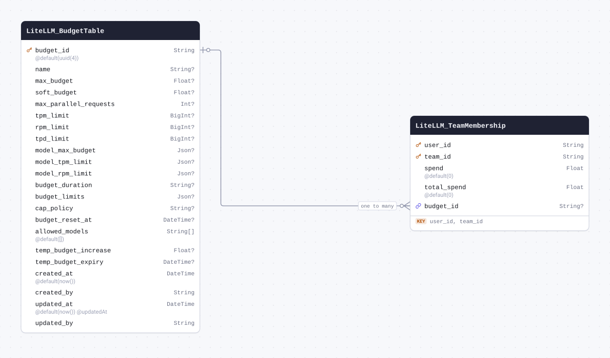

| Field         | Type     | Constraints                                                        | Default | Description |
| ------------- | -------- | ------------------------------------------------------------------ | ------- | ----------- |
| `user_id`     | `String` | PK NOT NULL                                                        |         |             |
| `team_id`     | `String` | PK NOT NULL                                                        |         |             |
| `spend`       | `Float`  | NOT NULL                                                           | `0`     |             |
| `total_spend` | `Float`  | NOT NULL                                                           | `0`     |             |
| `budget_id`   | `String` | NULL → [LiteLLM_BudgetTable.budget_id](#model-LiteLLM_BudgetTable) |         |             |

#### Indexes

- `@@id([user_id, team_id])`

#### References

- `budget_id` → [LiteLLM_BudgetTable.budget_id](#model-LiteLLM_BudgetTable) (many-to-one)

#### Definition

```sql
CREATE TABLE "LiteLLM_TeamMembership" (
    "user_id" TEXT NOT NULL,
    "team_id" TEXT NOT NULL,
    "spend" DOUBLE PRECISION NOT NULL DEFAULT 0.0,
    "total_spend" DOUBLE PRECISION NOT NULL DEFAULT 0.0,
    "budget_id" TEXT,

    CONSTRAINT "LiteLLM_TeamMembership_pkey" PRIMARY KEY ("user_id","team_id")
);

ALTER TABLE "LiteLLM_TeamMembership" ADD CONSTRAINT "LiteLLM_TeamMembership_budget_id_fkey" FOREIGN KEY ("budget_id") REFERENCES "LiteLLM_BudgetTable"("budget_id") ON DELETE SET NULL ON UPDATE CASCADE;
```

<details>
<summary>Queries and their SQL</summary>

**findMany**: Every row

```ts
await prisma.liteLLM_TeamMembership.findMany();
```

```sql
SELECT
  "public"."LiteLLM_TeamMembership"."user_id",
  "public"."LiteLLM_TeamMembership"."team_id",
  "public"."LiteLLM_TeamMembership"."spend",
  "public"."LiteLLM_TeamMembership"."total_spend",
  "public"."LiteLLM_TeamMembership"."budget_id"
FROM
  "public"."LiteLLM_TeamMembership"
WHERE
  1 = 1
OFFSET
  $1
-- params: ["0"]
```

**count**: How many rows there are

```ts
await prisma.liteLLM_TeamMembership.count();
```

```sql
SELECT
  COUNT(*) AS "_count$_all"
FROM
  (
    SELECT
      "public"."LiteLLM_TeamMembership"."user_id",
      "public"."LiteLLM_TeamMembership"."team_id"
    FROM
      "public"."LiteLLM_TeamMembership"
    WHERE
      1 = 1
    OFFSET
      $1
  ) AS "sub"
-- params: ["0"]
```

**findMany**: Every row with its relations

```ts
await prisma.liteLLM_TeamMembership.findMany({ include: { litellm_budget_table: true } });
```

```sql
SELECT
  "public"."LiteLLM_TeamMembership"."user_id",
  "public"."LiteLLM_TeamMembership"."team_id",
  "public"."LiteLLM_TeamMembership"."spend",
  "public"."LiteLLM_TeamMembership"."total_spend",
  "public"."LiteLLM_TeamMembership"."budget_id"
FROM
  "public"."LiteLLM_TeamMembership"
WHERE
  1 = 1
OFFSET
  $1
-- params: ["0"]

SELECT
  "public"."LiteLLM_BudgetTable"."budget_id",
  "public"."LiteLLM_BudgetTable"."max_budget",
  "public"."LiteLLM_BudgetTable"."soft_budget",
  "public"."LiteLLM_BudgetTable"."max_parallel_requests",
  "public"."LiteLLM_BudgetTable"."tpm_limit",
  "public"."LiteLLM_BudgetTable"."rpm_limit",
  "public"."LiteLLM_BudgetTable"."tpd_limit",
  "public"."LiteLLM_BudgetTable"."model_max_budget",
  "public"."LiteLLM_BudgetTable"."model_tpm_limit",
  "public"."LiteLLM_BudgetTable"."model_rpm_limit",
  "public"."LiteLLM_BudgetTable"."budget_duration",
  "public"."LiteLLM_BudgetTable"."budget_reset_at",
  "public"."LiteLLM_BudgetTable"."allowed_models",
  "public"."LiteLLM_BudgetTable"."temp_budget_increase",
  "public"."LiteLLM_BudgetTable"."temp_budget_expiry",
  "public"."LiteLLM_BudgetTable"."created_at",
  "public"."LiteLLM_BudgetTable"."created_by",
  "public"."LiteLLM_BudgetTable"."updated_at",
  "public"."LiteLLM_BudgetTable"."updated_by"
FROM
  "public"."LiteLLM_BudgetTable"
WHERE
  "public"."LiteLLM_BudgetTable"."budget_id" IN ($1)
OFFSET
  $2
-- params: ["<budget_id of the rows above>","0"]
```

**findUnique**: One row by what is unique to it

```ts
await prisma.liteLLM_TeamMembership.findUnique({
  where: { user_id_team_id: { user_id: "example", team_id: "example" } },
});
```

```sql
SELECT
  "public"."LiteLLM_TeamMembership"."user_id",
  "public"."LiteLLM_TeamMembership"."team_id",
  "public"."LiteLLM_TeamMembership"."spend",
  "public"."LiteLLM_TeamMembership"."total_spend",
  "public"."LiteLLM_TeamMembership"."budget_id"
FROM
  "public"."LiteLLM_TeamMembership"
WHERE
  (
    (
      "public"."LiteLLM_TeamMembership"."user_id" = $1
      AND "public"."LiteLLM_TeamMembership"."team_id" = $2
    )
    AND 1 = 1
  )
LIMIT
  $3
OFFSET
  $4
-- params: ["example","example","1","0"]
```

**create**: Create a row

```ts
await prisma.liteLLM_TeamMembership.create({ data: { user_id: "example", team_id: "example" } });
```

```sql
INSERT INTO
  "public"."LiteLLM_TeamMembership" ("user_id", "team_id", "spend", "total_spend")
VALUES
  ($1, $2, $3, $4)
RETURNING
  "public"."LiteLLM_TeamMembership"."user_id",
  "public"."LiteLLM_TeamMembership"."team_id",
  "public"."LiteLLM_TeamMembership"."spend",
  "public"."LiteLLM_TeamMembership"."total_spend",
  "public"."LiteLLM_TeamMembership"."budget_id"
-- params: ["example","example","0.0","0.0"]
```

**update**: Update a row

```ts
await prisma.liteLLM_TeamMembership.update({
  where: { user_id_team_id: { user_id: "example", team_id: "example" } },
  data: { spend: 1.5 },
});
```

```sql
UPDATE "public"."LiteLLM_TeamMembership"
SET
  "spend" = $1
WHERE
  (
    (
      "public"."LiteLLM_TeamMembership"."user_id" = $2
      AND "public"."LiteLLM_TeamMembership"."team_id" = $3
    )
    AND 1 = 1
  )
RETURNING
  "public"."LiteLLM_TeamMembership"."user_id",
  "public"."LiteLLM_TeamMembership"."team_id",
  "public"."LiteLLM_TeamMembership"."spend",
  "public"."LiteLLM_TeamMembership"."total_spend",
  "public"."LiteLLM_TeamMembership"."budget_id"
-- params: ["1.5","example","example"]
```

**delete**: Delete a row

```ts
await prisma.liteLLM_TeamMembership.delete({
  where: { user_id_team_id: { user_id: "example", team_id: "example" } },
});
```

```sql
DELETE FROM "public"."LiteLLM_TeamMembership"
WHERE
  (
    (
      "public"."LiteLLM_TeamMembership"."user_id" = $1
      AND "public"."LiteLLM_TeamMembership"."team_id" = $2
    )
    AND 1 = 1
  )
RETURNING
  "public"."LiteLLM_TeamMembership"."user_id",
  "public"."LiteLLM_TeamMembership"."team_id",
  "public"."LiteLLM_TeamMembership"."spend",
  "public"."LiteLLM_TeamMembership"."total_spend",
  "public"."LiteLLM_TeamMembership"."budget_id"
-- params: ["example","example"]
```

</details>

<a id="model-LiteLLM_OrganizationMembership"></a>

### LiteLLM_OrganizationMembership

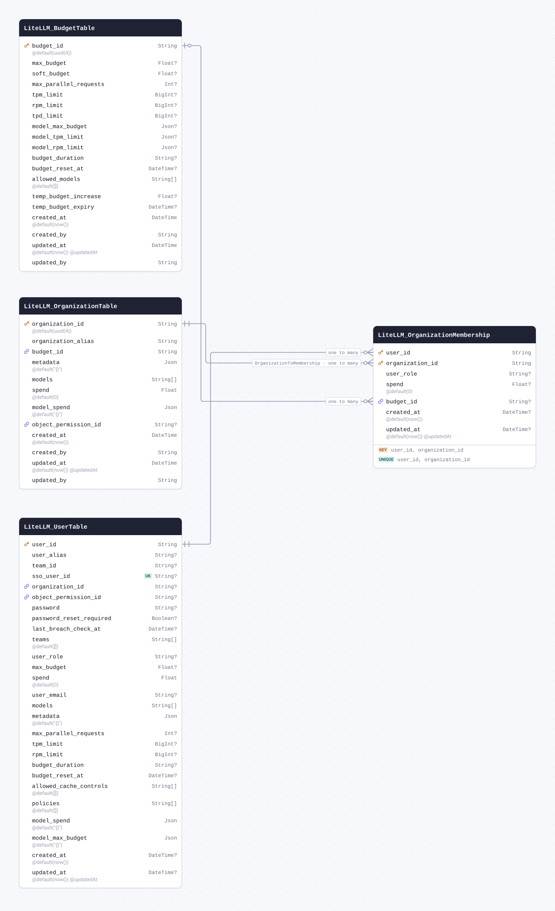

| Field                       | Type       | Constraints                                                                                 | Default              | Description |
| --------------------------- | ---------- | ------------------------------------------------------------------------------------------- | -------------------- | ----------- |
| `user_id`                   | `String`   | PK NOT NULL → [LiteLLM_UserTable.user_id](#model-LiteLLM_UserTable)                         |                      |             |
| `organization_id`           | `String`   | PK NOT NULL → [LiteLLM_OrganizationTable.organization_id](#model-LiteLLM_OrganizationTable) |                      |             |
| `user_role`                 | `String`   | NULL                                                                                        |                      |             |
| `spend`                     | `Float`    | NULL                                                                                        | `0`                  |             |
| `budget_id`                 | `String`   | NULL → [LiteLLM_BudgetTable.budget_id](#model-LiteLLM_BudgetTable)                          |                      |             |
| `created_at` (`created_at`) | `DateTime` | NULL                                                                                        | `now()`              |             |
| `updated_at` (`updated_at`) | `DateTime` | NULL                                                                                        | `now()` `@updatedAt` |             |

#### Indexes

- `@@id([user_id, organization_id])`
- `@@unique([user_id, organization_id])`

#### References

- `user_id` → [LiteLLM_UserTable.user_id](#model-LiteLLM_UserTable) (many-to-one)
- `organization_id` → [LiteLLM_OrganizationTable.organization_id](#model-LiteLLM_OrganizationTable) (many-to-one)
- `budget_id` → [LiteLLM_BudgetTable.budget_id](#model-LiteLLM_BudgetTable) (many-to-one)

#### Definition

```sql
CREATE TABLE "LiteLLM_OrganizationMembership" (
    "user_id" TEXT NOT NULL,
    "organization_id" TEXT NOT NULL,
    "user_role" TEXT,
    "spend" DOUBLE PRECISION DEFAULT 0.0,
    "budget_id" TEXT,
    "created_at" TIMESTAMP(3) DEFAULT CURRENT_TIMESTAMP,
    "updated_at" TIMESTAMP(3) DEFAULT CURRENT_TIMESTAMP,

    CONSTRAINT "LiteLLM_OrganizationMembership_pkey" PRIMARY KEY ("user_id","organization_id")
);

CREATE UNIQUE INDEX "LiteLLM_OrganizationMembership_user_id_organization_id_key" ON "LiteLLM_OrganizationMembership"("user_id", "organization_id");

ALTER TABLE "LiteLLM_OrganizationMembership" ADD CONSTRAINT "LiteLLM_OrganizationMembership_user_id_fkey" FOREIGN KEY ("user_id") REFERENCES "LiteLLM_UserTable"("user_id") ON DELETE RESTRICT ON UPDATE CASCADE;

ALTER TABLE "LiteLLM_OrganizationMembership" ADD CONSTRAINT "LiteLLM_OrganizationMembership_organization_id_fkey" FOREIGN KEY ("organization_id") REFERENCES "LiteLLM_OrganizationTable"("organization_id") ON DELETE RESTRICT ON UPDATE CASCADE;

ALTER TABLE "LiteLLM_OrganizationMembership" ADD CONSTRAINT "LiteLLM_OrganizationMembership_budget_id_fkey" FOREIGN KEY ("budget_id") REFERENCES "LiteLLM_BudgetTable"("budget_id") ON DELETE SET NULL ON UPDATE CASCADE;
```

<details>
<summary>Queries and their SQL</summary>

**findMany**: Every row

```ts
await prisma.liteLLM_OrganizationMembership.findMany();
```

```sql
SELECT
  "public"."LiteLLM_OrganizationMembership"."user_id",
  "public"."LiteLLM_OrganizationMembership"."organization_id",
  "public"."LiteLLM_OrganizationMembership"."user_role",
  "public"."LiteLLM_OrganizationMembership"."spend",
  "public"."LiteLLM_OrganizationMembership"."budget_id",
  "public"."LiteLLM_OrganizationMembership"."created_at",
  "public"."LiteLLM_OrganizationMembership"."updated_at"
FROM
  "public"."LiteLLM_OrganizationMembership"
WHERE
  1 = 1
OFFSET
  $1
-- params: ["0"]
```

**count**: How many rows there are

```ts
await prisma.liteLLM_OrganizationMembership.count();
```

```sql
SELECT
  COUNT(*) AS "_count$_all"
FROM
  (
    SELECT
      "public"."LiteLLM_OrganizationMembership"."user_id",
      "public"."LiteLLM_OrganizationMembership"."organization_id"
    FROM
      "public"."LiteLLM_OrganizationMembership"
    WHERE
      1 = 1
    OFFSET
      $1
  ) AS "sub"
-- params: ["0"]
```

**findMany**: Every row with its relations

```ts
await prisma.liteLLM_OrganizationMembership.findMany({
  include: { user: true, organization: true, litellm_budget_table: true },
});
```

```sql
SELECT
  "public"."LiteLLM_OrganizationMembership"."user_id",
  "public"."LiteLLM_OrganizationMembership"."organization_id",
  "public"."LiteLLM_OrganizationMembership"."user_role",
  "public"."LiteLLM_OrganizationMembership"."spend",
  "public"."LiteLLM_OrganizationMembership"."budget_id",
  "public"."LiteLLM_OrganizationMembership"."created_at",
  "public"."LiteLLM_OrganizationMembership"."updated_at"
FROM
  "public"."LiteLLM_OrganizationMembership"
WHERE
  1 = 1
OFFSET
  $1
-- params: ["0"]

SELECT
  "public"."LiteLLM_UserTable"."user_id",
  "public"."LiteLLM_UserTable"."user_alias",
  "public"."LiteLLM_UserTable"."team_id",
  "public"."LiteLLM_UserTable"."sso_user_id",
  "public"."LiteLLM_UserTable"."organization_id",
  "public"."LiteLLM_UserTable"."object_permission_id",
  "public"."LiteLLM_UserTable"."password",
  "public"."LiteLLM_UserTable"."password_reset_required",
  "public"."LiteLLM_UserTable"."last_breach_check_at",
  "public"."LiteLLM_UserTable"."teams",
  "public"."LiteLLM_UserTable"."user_role",
  "public"."LiteLLM_UserTable"."max_budget",
  "public"."LiteLLM_UserTable"."spend",
  "public"."LiteLLM_UserTable"."user_email",
  "public"."LiteLLM_UserTable"."models",
  "public"."LiteLLM_UserTable"."metadata",
  "public"."LiteLLM_UserTable"."max_parallel_requests",
  "public"."LiteLLM_UserTable"."tpm_limit",
  "public"."LiteLLM_UserTable"."rpm_limit",
  "public"."LiteLLM_UserTable"."budget_duration",
  "public"."LiteLLM_UserTable"."budget_reset_at",
  "public"."LiteLLM_UserTable"."allowed_cache_controls",
  "public"."LiteLLM_UserTable"."policies",
  "public"."LiteLLM_UserTable"."model_spend",
  "public"."LiteLLM_UserTable"."model_max_budget",
  "public"."LiteLLM_UserTable"."created_at",
  "public"."LiteLLM_UserTable"."updated_at"
FROM
  "public"."LiteLLM_UserTable"
WHERE
  "public"."LiteLLM_UserTable"."user_id" IN ($1)
OFFSET
  $2
-- params: ["<user_id of the rows above>","0"]

SELECT
  "public"."LiteLLM_OrganizationTable"."organization_id",
  "public"."LiteLLM_OrganizationTable"."organization_alias",
  "public"."LiteLLM_OrganizationTable"."budget_id",
  "public"."LiteLLM_OrganizationTable"."metadata",
  "public"."LiteLLM_OrganizationTable"."models",
  "public"."LiteLLM_OrganizationTable"."spend",
  "public"."LiteLLM_OrganizationTable"."model_spend",
  "public"."LiteLLM_OrganizationTable"."object_permission_id",
  "public"."LiteLLM_OrganizationTable"."created_at",
  "public"."LiteLLM_OrganizationTable"."created_by",
  "public"."LiteLLM_OrganizationTable"."updated_at",
  "public"."LiteLLM_OrganizationTable"."updated_by"
FROM
  "public"."LiteLLM_OrganizationTable"
WHERE
  "public"."LiteLLM_OrganizationTable"."organization_id" IN ($1)
OFFSET
  $2
-- params: ["<organization_id of the rows above>","0"]

SELECT
  "public"."LiteLLM_BudgetTable"."budget_id",
  "public"."LiteLLM_BudgetTable"."max_budget",
  "public"."LiteLLM_BudgetTable"."soft_budget",
  "public"."LiteLLM_BudgetTable"."max_parallel_requests",
  "public"."LiteLLM_BudgetTable"."tpm_limit",
  "public"."LiteLLM_BudgetTable"."rpm_limit",
  "public"."LiteLLM_BudgetTable"."tpd_limit",
  "public"."LiteLLM_BudgetTable"."model_max_budget",
  "public"."LiteLLM_BudgetTable"."model_tpm_limit",
  "public"."LiteLLM_BudgetTable"."model_rpm_limit",
  "public"."LiteLLM_BudgetTable"."budget_duration",
  "public"."LiteLLM_BudgetTable"."budget_reset_at",
  "public"."LiteLLM_BudgetTable"."allowed_models",
  "public"."LiteLLM_BudgetTable"."temp_budget_increase",
  "public"."LiteLLM_BudgetTable"."temp_budget_expiry",
  "public"."LiteLLM_BudgetTable"."created_at",
  "public"."LiteLLM_BudgetTable"."created_by",
  "public"."LiteLLM_BudgetTable"."updated_at",
  "public"."LiteLLM_BudgetTable"."updated_by"
FROM
  "public"."LiteLLM_BudgetTable"
WHERE
  "public"."LiteLLM_BudgetTable"."budget_id" IN ($1)
OFFSET
  $2
-- params: ["<budget_id of the rows above>","0"]
```

**findUnique**: One row by what is unique to it

```ts
await prisma.liteLLM_OrganizationMembership.findUnique({
  where: { user_id_organization_id: { user_id: "example", organization_id: "example" } },
});
```

```sql
SELECT
  "public"."LiteLLM_OrganizationMembership"."user_id",
  "public"."LiteLLM_OrganizationMembership"."organization_id",
  "public"."LiteLLM_OrganizationMembership"."user_role",
  "public"."LiteLLM_OrganizationMembership"."spend",
  "public"."LiteLLM_OrganizationMembership"."budget_id",
  "public"."LiteLLM_OrganizationMembership"."created_at",
  "public"."LiteLLM_OrganizationMembership"."updated_at"
FROM
  "public"."LiteLLM_OrganizationMembership"
WHERE
  (
    (
      "public"."LiteLLM_OrganizationMembership"."user_id" = $1
      AND "public"."LiteLLM_OrganizationMembership"."organization_id" = $2
    )
    AND 1 = 1
  )
LIMIT
  $3
OFFSET
  $4
-- params: ["example","example","1","0"]
```

**create**: Create a row

```ts
await prisma.liteLLM_OrganizationMembership.create({
  data: { user_id: "example", organization_id: "example" },
});
```

```sql
INSERT INTO
  "public"."LiteLLM_OrganizationMembership" (
    "user_id",
    "organization_id",
    "spend",
    "created_at",
    "updated_at"
  )
VALUES
  ($1, $2, $3, $4, $5)
RETURNING
  "public"."LiteLLM_OrganizationMembership"."user_id",
  "public"."LiteLLM_OrganizationMembership"."organization_id",
  "public"."LiteLLM_OrganizationMembership"."user_role",
  "public"."LiteLLM_OrganizationMembership"."spend",
  "public"."LiteLLM_OrganizationMembership"."budget_id",
  "public"."LiteLLM_OrganizationMembership"."created_at",
  "public"."LiteLLM_OrganizationMembership"."updated_at"
-- params: ["example","example","0.0","<now()>","<now()>"]
```

**update**: Update a row

```ts
await prisma.liteLLM_OrganizationMembership.update({
  where: { user_id_organization_id: { user_id: "example", organization_id: "example" } },
  data: { user_role: "example" },
});
```

```sql
UPDATE "public"."LiteLLM_OrganizationMembership"
SET
  "user_role" = $1,
  "updated_at" = $2
WHERE
  (
    (
      "public"."LiteLLM_OrganizationMembership"."user_id" = $3
      AND "public"."LiteLLM_OrganizationMembership"."organization_id" = $4
    )
    AND 1 = 1
  )
RETURNING
  "public"."LiteLLM_OrganizationMembership"."user_id",
  "public"."LiteLLM_OrganizationMembership"."organization_id",
  "public"."LiteLLM_OrganizationMembership"."user_role",
  "public"."LiteLLM_OrganizationMembership"."spend",
  "public"."LiteLLM_OrganizationMembership"."budget_id",
  "public"."LiteLLM_OrganizationMembership"."created_at",
  "public"."LiteLLM_OrganizationMembership"."updated_at"
-- params: ["example",{"prisma__type":"generatorCall","prisma__value":{"name":"now","args":[],"returnType":{"type":"DateTime"}}},"example","example"]
```

**delete**: Delete a row

```ts
await prisma.liteLLM_OrganizationMembership.delete({
  where: { user_id_organization_id: { user_id: "example", organization_id: "example" } },
});
```

```sql
DELETE FROM "public"."LiteLLM_OrganizationMembership"
WHERE
  (
    (
      "public"."LiteLLM_OrganizationMembership"."user_id" = $1
      AND "public"."LiteLLM_OrganizationMembership"."organization_id" = $2
    )
    AND 1 = 1
  )
RETURNING
  "public"."LiteLLM_OrganizationMembership"."user_id",
  "public"."LiteLLM_OrganizationMembership"."organization_id",
  "public"."LiteLLM_OrganizationMembership"."user_role",
  "public"."LiteLLM_OrganizationMembership"."spend",
  "public"."LiteLLM_OrganizationMembership"."budget_id",
  "public"."LiteLLM_OrganizationMembership"."created_at",
  "public"."LiteLLM_OrganizationMembership"."updated_at"
-- params: ["example","example"]
```

</details>

<a id="model-LiteLLM_InvitationLink"></a>

### LiteLLM_InvitationLink

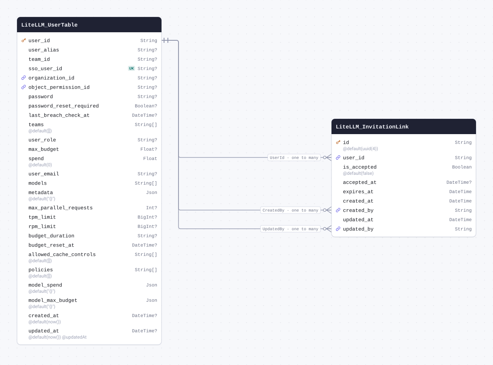

| Field         | Type       | Constraints                                                      | Default   | Description |
| ------------- | ---------- | ---------------------------------------------------------------- | --------- | ----------- |
| `id`          | `String`   | PK NOT NULL                                                      | `uuid(4)` |             |
| `user_id`     | `String`   | NOT NULL → [LiteLLM_UserTable.user_id](#model-LiteLLM_UserTable) |           |             |
| `is_accepted` | `Boolean`  | NOT NULL                                                         | `false`   |             |
| `accepted_at` | `DateTime` | NULL                                                             |           |             |
| `expires_at`  | `DateTime` | NOT NULL                                                         |           |             |
| `created_at`  | `DateTime` | NOT NULL                                                         |           |             |
| `created_by`  | `String`   | NOT NULL → [LiteLLM_UserTable.user_id](#model-LiteLLM_UserTable) |           |             |
| `updated_at`  | `DateTime` | NOT NULL                                                         |           |             |
| `updated_by`  | `String`   | NOT NULL → [LiteLLM_UserTable.user_id](#model-LiteLLM_UserTable) |           |             |

#### References

- `user_id` → [LiteLLM_UserTable.user_id](#model-LiteLLM_UserTable) (many-to-one)
- `created_by` → [LiteLLM_UserTable.user_id](#model-LiteLLM_UserTable) (many-to-one)
- `updated_by` → [LiteLLM_UserTable.user_id](#model-LiteLLM_UserTable) (many-to-one)

#### Definition

```sql
CREATE TABLE "LiteLLM_InvitationLink" (
    "id" TEXT NOT NULL,
    "user_id" TEXT NOT NULL,
    "is_accepted" BOOLEAN NOT NULL DEFAULT false,
    "accepted_at" TIMESTAMP(3),
    "expires_at" TIMESTAMP(3) NOT NULL,
    "created_at" TIMESTAMP(3) NOT NULL,
    "created_by" TEXT NOT NULL,
    "updated_at" TIMESTAMP(3) NOT NULL,
    "updated_by" TEXT NOT NULL,

    CONSTRAINT "LiteLLM_InvitationLink_pkey" PRIMARY KEY ("id")
);

ALTER TABLE "LiteLLM_InvitationLink" ADD CONSTRAINT "LiteLLM_InvitationLink_user_id_fkey" FOREIGN KEY ("user_id") REFERENCES "LiteLLM_UserTable"("user_id") ON DELETE RESTRICT ON UPDATE CASCADE;

ALTER TABLE "LiteLLM_InvitationLink" ADD CONSTRAINT "LiteLLM_InvitationLink_created_by_fkey" FOREIGN KEY ("created_by") REFERENCES "LiteLLM_UserTable"("user_id") ON DELETE RESTRICT ON UPDATE CASCADE;

ALTER TABLE "LiteLLM_InvitationLink" ADD CONSTRAINT "LiteLLM_InvitationLink_updated_by_fkey" FOREIGN KEY ("updated_by") REFERENCES "LiteLLM_UserTable"("user_id") ON DELETE RESTRICT ON UPDATE CASCADE;
```

<details>
<summary>Queries and their SQL</summary>

**findMany**: Every row

```ts
await prisma.liteLLM_InvitationLink.findMany();
```

```sql
SELECT
  "public"."LiteLLM_InvitationLink"."id",
  "public"."LiteLLM_InvitationLink"."user_id",
  "public"."LiteLLM_InvitationLink"."is_accepted",
  "public"."LiteLLM_InvitationLink"."accepted_at",
  "public"."LiteLLM_InvitationLink"."expires_at",
  "public"."LiteLLM_InvitationLink"."created_at",
  "public"."LiteLLM_InvitationLink"."created_by",
  "public"."LiteLLM_InvitationLink"."updated_at",
  "public"."LiteLLM_InvitationLink"."updated_by"
FROM
  "public"."LiteLLM_InvitationLink"
WHERE
  1 = 1
OFFSET
  $1
-- params: ["0"]
```

**count**: How many rows there are

```ts
await prisma.liteLLM_InvitationLink.count();
```

```sql
SELECT
  COUNT(*) AS "_count$_all"
FROM
  (
    SELECT
      "public"."LiteLLM_InvitationLink"."id"
    FROM
      "public"."LiteLLM_InvitationLink"
    WHERE
      1 = 1
    OFFSET
      $1
  ) AS "sub"
-- params: ["0"]
```

**findMany**: Every row with its relations

```ts
await prisma.liteLLM_InvitationLink.findMany({
  include: {
    liteLLM_user_table_user: true,
    liteLLM_user_table_created: true,
    liteLLM_user_table_updated: true,
  },
});
```

```sql
SELECT
  "public"."LiteLLM_InvitationLink"."id",
  "public"."LiteLLM_InvitationLink"."user_id",
  "public"."LiteLLM_InvitationLink"."is_accepted",
  "public"."LiteLLM_InvitationLink"."accepted_at",
  "public"."LiteLLM_InvitationLink"."expires_at",
  "public"."LiteLLM_InvitationLink"."created_at",
  "public"."LiteLLM_InvitationLink"."created_by",
  "public"."LiteLLM_InvitationLink"."updated_at",
  "public"."LiteLLM_InvitationLink"."updated_by"
FROM
  "public"."LiteLLM_InvitationLink"
WHERE
  1 = 1
OFFSET
  $1
-- params: ["0"]

SELECT
  "public"."LiteLLM_UserTable"."user_id",
  "public"."LiteLLM_UserTable"."user_alias",
  "public"."LiteLLM_UserTable"."team_id",
  "public"."LiteLLM_UserTable"."sso_user_id",
  "public"."LiteLLM_UserTable"."organization_id",
  "public"."LiteLLM_UserTable"."object_permission_id",
  "public"."LiteLLM_UserTable"."password",
  "public"."LiteLLM_UserTable"."password_reset_required",
  "public"."LiteLLM_UserTable"."last_breach_check_at",
  "public"."LiteLLM_UserTable"."teams",
  "public"."LiteLLM_UserTable"."user_role",
  "public"."LiteLLM_UserTable"."max_budget",
  "public"."LiteLLM_UserTable"."spend",
  "public"."LiteLLM_UserTable"."user_email",
  "public"."LiteLLM_UserTable"."models",
  "public"."LiteLLM_UserTable"."metadata",
  "public"."LiteLLM_UserTable"."max_parallel_requests",
  "public"."LiteLLM_UserTable"."tpm_limit",
  "public"."LiteLLM_UserTable"."rpm_limit",
  "public"."LiteLLM_UserTable"."budget_duration",
  "public"."LiteLLM_UserTable"."budget_reset_at",
  "public"."LiteLLM_UserTable"."allowed_cache_controls",
  "public"."LiteLLM_UserTable"."policies",
  "public"."LiteLLM_UserTable"."model_spend",
  "public"."LiteLLM_UserTable"."model_max_budget",
  "public"."LiteLLM_UserTable"."created_at",
  "public"."LiteLLM_UserTable"."updated_at"
FROM
  "public"."LiteLLM_UserTable"
WHERE
  "public"."LiteLLM_UserTable"."user_id" IN ($1)
OFFSET
  $2
-- params: ["<user_id of the rows above>","0"]

SELECT
  "public"."LiteLLM_UserTable"."user_id",
  "public"."LiteLLM_UserTable"."user_alias",
  "public"."LiteLLM_UserTable"."team_id",
  "public"."LiteLLM_UserTable"."sso_user_id",
  "public"."LiteLLM_UserTable"."organization_id",
  "public"."LiteLLM_UserTable"."object_permission_id",
  "public"."LiteLLM_UserTable"."password",
  "public"."LiteLLM_UserTable"."password_reset_required",
  "public"."LiteLLM_UserTable"."last_breach_check_at",
  "public"."LiteLLM_UserTable"."teams",
  "public"."LiteLLM_UserTable"."user_role",
  "public"."LiteLLM_UserTable"."max_budget",
  "public"."LiteLLM_UserTable"."spend",
  "public"."LiteLLM_UserTable"."user_email",
  "public"."LiteLLM_UserTable"."models",
  "public"."LiteLLM_UserTable"."metadata",
  "public"."LiteLLM_UserTable"."max_parallel_requests",
  "public"."LiteLLM_UserTable"."tpm_limit",
  "public"."LiteLLM_UserTable"."rpm_limit",
  "public"."LiteLLM_UserTable"."budget_duration",
  "public"."LiteLLM_UserTable"."budget_reset_at",
  "public"."LiteLLM_UserTable"."allowed_cache_controls",
  "public"."LiteLLM_UserTable"."policies",
  "public"."LiteLLM_UserTable"."model_spend",
  "public"."LiteLLM_UserTable"."model_max_budget",
  "public"."LiteLLM_UserTable"."created_at",
  "public"."LiteLLM_UserTable"."updated_at"
FROM
  "public"."LiteLLM_UserTable"
WHERE
  "public"."LiteLLM_UserTable"."user_id" IN ($1)
OFFSET
  $2
-- params: ["<created_by of the rows above>","0"]

SELECT
  "public"."LiteLLM_UserTable"."user_id",
  "public"."LiteLLM_UserTable"."user_alias",
  "public"."LiteLLM_UserTable"."team_id",
  "public"."LiteLLM_UserTable"."sso_user_id",
  "public"."LiteLLM_UserTable"."organization_id",
  "public"."LiteLLM_UserTable"."object_permission_id",
  "public"."LiteLLM_UserTable"."password",
  "public"."LiteLLM_UserTable"."password_reset_required",
  "public"."LiteLLM_UserTable"."last_breach_check_at",
  "public"."LiteLLM_UserTable"."teams",
  "public"."LiteLLM_UserTable"."user_role",
  "public"."LiteLLM_UserTable"."max_budget",
  "public"."LiteLLM_UserTable"."spend",
  "public"."LiteLLM_UserTable"."user_email",
  "public"."LiteLLM_UserTable"."models",
  "public"."LiteLLM_UserTable"."metadata",
  "public"."LiteLLM_UserTable"."max_parallel_requests",
  "public"."LiteLLM_UserTable"."tpm_limit",
  "public"."LiteLLM_UserTable"."rpm_limit",
  "public"."LiteLLM_UserTable"."budget_duration",
  "public"."LiteLLM_UserTable"."budget_reset_at",
  "public"."LiteLLM_UserTable"."allowed_cache_controls",
  "public"."LiteLLM_UserTable"."policies",
  "public"."LiteLLM_UserTable"."model_spend",
  "public"."LiteLLM_UserTable"."model_max_budget",
  "public"."LiteLLM_UserTable"."created_at",
  "public"."LiteLLM_UserTable"."updated_at"
FROM
  "public"."LiteLLM_UserTable"
WHERE
  "public"."LiteLLM_UserTable"."user_id" IN ($1)
OFFSET
  $2
-- params: ["<updated_by of the rows above>","0"]
```

**findUnique**: One row by what is unique to it

```ts
await prisma.liteLLM_InvitationLink.findUnique({ where: { id: "example" } });
```

```sql
SELECT
  "public"."LiteLLM_InvitationLink"."id",
  "public"."LiteLLM_InvitationLink"."user_id",
  "public"."LiteLLM_InvitationLink"."is_accepted",
  "public"."LiteLLM_InvitationLink"."accepted_at",
  "public"."LiteLLM_InvitationLink"."expires_at",
  "public"."LiteLLM_InvitationLink"."created_at",
  "public"."LiteLLM_InvitationLink"."created_by",
  "public"."LiteLLM_InvitationLink"."updated_at",
  "public"."LiteLLM_InvitationLink"."updated_by"
FROM
  "public"."LiteLLM_InvitationLink"
WHERE
  (
    "public"."LiteLLM_InvitationLink"."id" = $1
    AND 1 = 1
  )
LIMIT
  $2
OFFSET
  $3
-- params: ["example","1","0"]
```

**create**: Create a row

```ts
await prisma.liteLLM_InvitationLink.create({
  data: {
    user_id: "example",
    expires_at: new Date("2026-01-01T00:00:00.000Z"),
    created_at: new Date("2026-01-01T00:00:00.000Z"),
    created_by: "example",
    updated_at: new Date("2026-01-01T00:00:00.000Z"),
    updated_by: "example",
  },
});
```

```sql
INSERT INTO
  "public"."LiteLLM_InvitationLink" (
    "id",
    "user_id",
    "is_accepted",
    "expires_at",
    "created_at",
    "created_by",
    "updated_at",
    "updated_by"
  )
VALUES
  ($1, $2, $3, $4, $5, $6, $7, $8)
RETURNING
  "public"."LiteLLM_InvitationLink"."id",
  "public"."LiteLLM_InvitationLink"."user_id",
  "public"."LiteLLM_InvitationLink"."is_accepted",
  "public"."LiteLLM_InvitationLink"."accepted_at",
  "public"."LiteLLM_InvitationLink"."expires_at",
  "public"."LiteLLM_InvitationLink"."created_at",
  "public"."LiteLLM_InvitationLink"."created_by",
  "public"."LiteLLM_InvitationLink"."updated_at",
  "public"."LiteLLM_InvitationLink"."updated_by"
-- params: ["<uuid(4)>","example",false,"2026-01-01T00:00:00.000Z","2026-01-01T00:00:00.000Z","example","2026-01-01T00:00:00.000Z","example"]
```

**update**: Update a row

```ts
await prisma.liteLLM_InvitationLink.update({
  where: { id: "example" },
  data: { is_accepted: true },
});
```

```sql
UPDATE "public"."LiteLLM_InvitationLink"
SET
  "is_accepted" = $1
WHERE
  (
    "public"."LiteLLM_InvitationLink"."id" = $2
    AND 1 = 1
  )
RETURNING
  "public"."LiteLLM_InvitationLink"."id",
  "public"."LiteLLM_InvitationLink"."user_id",
  "public"."LiteLLM_InvitationLink"."is_accepted",
  "public"."LiteLLM_InvitationLink"."accepted_at",
  "public"."LiteLLM_InvitationLink"."expires_at",
  "public"."LiteLLM_InvitationLink"."created_at",
  "public"."LiteLLM_InvitationLink"."created_by",
  "public"."LiteLLM_InvitationLink"."updated_at",
  "public"."LiteLLM_InvitationLink"."updated_by"
-- params: [true,"example"]
```

**delete**: Delete a row

```ts
await prisma.liteLLM_InvitationLink.delete({ where: { id: "example" } });
```

```sql
DELETE FROM "public"."LiteLLM_InvitationLink"
WHERE
  (
    "public"."LiteLLM_InvitationLink"."id" = $1
    AND 1 = 1
  )
RETURNING
  "public"."LiteLLM_InvitationLink"."id",
  "public"."LiteLLM_InvitationLink"."user_id",
  "public"."LiteLLM_InvitationLink"."is_accepted",
  "public"."LiteLLM_InvitationLink"."accepted_at",
  "public"."LiteLLM_InvitationLink"."expires_at",
  "public"."LiteLLM_InvitationLink"."created_at",
  "public"."LiteLLM_InvitationLink"."created_by",
  "public"."LiteLLM_InvitationLink"."updated_at",
  "public"."LiteLLM_InvitationLink"."updated_by"
-- params: ["example"]
```

</details>

<a id="model-LiteLLM_AuditLog"></a>

### LiteLLM_AuditLog

| Field                | Type       | Constraints | Default   | Description |
| -------------------- | ---------- | ----------- | --------- | ----------- |
| `id`                 | `String`   | PK NOT NULL | `uuid(4)` |             |
| `updated_at`         | `DateTime` | NOT NULL    | `now()`   |             |
| `changed_by`         | `String`   | NOT NULL    | `""`      |             |
| `changed_by_api_key` | `String`   | NOT NULL    | `""`      |             |
| `action`             | `String`   | NOT NULL    |           |             |
| `table_name`         | `String`   | NOT NULL    |           |             |
| `object_id`          | `String`   | NOT NULL    |           |             |
| `before_value`       | `Json`     | NULL        |           |             |
| `updated_values`     | `Json`     | NULL        |           |             |

#### Definition

```sql
CREATE TABLE "LiteLLM_AuditLog" (
    "id" TEXT NOT NULL,
    "updated_at" TIMESTAMP(3) NOT NULL DEFAULT CURRENT_TIMESTAMP,
    "changed_by" TEXT NOT NULL DEFAULT '',
    "changed_by_api_key" TEXT NOT NULL DEFAULT '',
    "action" TEXT NOT NULL,
    "table_name" TEXT NOT NULL,
    "object_id" TEXT NOT NULL,
    "before_value" JSONB,
    "updated_values" JSONB,

    CONSTRAINT "LiteLLM_AuditLog_pkey" PRIMARY KEY ("id")
);
```

<details>
<summary>Queries and their SQL</summary>

**findMany**: Every row

```ts
await prisma.liteLLM_AuditLog.findMany();
```

```sql
SELECT
  "public"."LiteLLM_AuditLog"."id",
  "public"."LiteLLM_AuditLog"."updated_at",
  "public"."LiteLLM_AuditLog"."changed_by",
  "public"."LiteLLM_AuditLog"."changed_by_api_key",
  "public"."LiteLLM_AuditLog"."action",
  "public"."LiteLLM_AuditLog"."table_name",
  "public"."LiteLLM_AuditLog"."object_id",
  "public"."LiteLLM_AuditLog"."before_value",
  "public"."LiteLLM_AuditLog"."updated_values"
FROM
  "public"."LiteLLM_AuditLog"
WHERE
  1 = 1
OFFSET
  $1
-- params: ["0"]
```

**count**: How many rows there are

```ts
await prisma.liteLLM_AuditLog.count();
```

```sql
SELECT
  COUNT(*) AS "_count$_all"
FROM
  (
    SELECT
      "public"."LiteLLM_AuditLog"."id"
    FROM
      "public"."LiteLLM_AuditLog"
    WHERE
      1 = 1
    OFFSET
      $1
  ) AS "sub"
-- params: ["0"]
```

**findUnique**: One row by what is unique to it

```ts
await prisma.liteLLM_AuditLog.findUnique({ where: { id: "example" } });
```

```sql
SELECT
  "public"."LiteLLM_AuditLog"."id",
  "public"."LiteLLM_AuditLog"."updated_at",
  "public"."LiteLLM_AuditLog"."changed_by",
  "public"."LiteLLM_AuditLog"."changed_by_api_key",
  "public"."LiteLLM_AuditLog"."action",
  "public"."LiteLLM_AuditLog"."table_name",
  "public"."LiteLLM_AuditLog"."object_id",
  "public"."LiteLLM_AuditLog"."before_value",
  "public"."LiteLLM_AuditLog"."updated_values"
FROM
  "public"."LiteLLM_AuditLog"
WHERE
  (
    "public"."LiteLLM_AuditLog"."id" = $1
    AND 1 = 1
  )
LIMIT
  $2
OFFSET
  $3
-- params: ["example","1","0"]
```

**create**: Create a row

```ts
await prisma.liteLLM_AuditLog.create({
  data: { action: "example", table_name: "example", object_id: "example" },
});
```

```sql
INSERT INTO
  "public"."LiteLLM_AuditLog" (
    "id",
    "updated_at",
    "changed_by",
    "changed_by_api_key",
    "action",
    "table_name",
    "object_id"
  )
VALUES
  ($1, $2, $3, $4, $5, $6, $7)
RETURNING
  "public"."LiteLLM_AuditLog"."id",
  "public"."LiteLLM_AuditLog"."updated_at",
  "public"."LiteLLM_AuditLog"."changed_by",
  "public"."LiteLLM_AuditLog"."changed_by_api_key",
  "public"."LiteLLM_AuditLog"."action",
  "public"."LiteLLM_AuditLog"."table_name",
  "public"."LiteLLM_AuditLog"."object_id",
  "public"."LiteLLM_AuditLog"."before_value",
  "public"."LiteLLM_AuditLog"."updated_values"
-- params: ["<uuid(4)>","<now()>","","","example","example","example"]
```

**update**: Update a row

```ts
await prisma.liteLLM_AuditLog.update({
  where: { id: "example" },
  data: { updated_at: new Date("2026-01-01T00:00:00.000Z") },
});
```

```sql
UPDATE "public"."LiteLLM_AuditLog"
SET
  "updated_at" = $1
WHERE
  (
    "public"."LiteLLM_AuditLog"."id" = $2
    AND 1 = 1
  )
RETURNING
  "public"."LiteLLM_AuditLog"."id",
  "public"."LiteLLM_AuditLog"."updated_at",
  "public"."LiteLLM_AuditLog"."changed_by",
  "public"."LiteLLM_AuditLog"."changed_by_api_key",
  "public"."LiteLLM_AuditLog"."action",
  "public"."LiteLLM_AuditLog"."table_name",
  "public"."LiteLLM_AuditLog"."object_id",
  "public"."LiteLLM_AuditLog"."before_value",
  "public"."LiteLLM_AuditLog"."updated_values"
-- params: ["2026-01-01T00:00:00.000Z","example"]
```

**delete**: Delete a row

```ts
await prisma.liteLLM_AuditLog.delete({ where: { id: "example" } });
```

```sql
DELETE FROM "public"."LiteLLM_AuditLog"
WHERE
  (
    "public"."LiteLLM_AuditLog"."id" = $1
    AND 1 = 1
  )
RETURNING
  "public"."LiteLLM_AuditLog"."id",
  "public"."LiteLLM_AuditLog"."updated_at",
  "public"."LiteLLM_AuditLog"."changed_by",
  "public"."LiteLLM_AuditLog"."changed_by_api_key",
  "public"."LiteLLM_AuditLog"."action",
  "public"."LiteLLM_AuditLog"."table_name",
  "public"."LiteLLM_AuditLog"."object_id",
  "public"."LiteLLM_AuditLog"."before_value",
  "public"."LiteLLM_AuditLog"."updated_values"
-- params: ["example"]
```

</details>

<a id="model-LiteLLM_DailyUserSpend"></a>

### LiteLLM_DailyUserSpend

| Field                                    | Type       | Constraints | Default      | Description |
| ---------------------------------------- | ---------- | ----------- | ------------ | ----------- |
| `id`                                     | `String`   | PK NOT NULL | `uuid(4)`    |             |
| `user_id`                                | `String`   | NULL        |              |             |
| `date`                                   | `String`   | NOT NULL    |              |             |
| `api_key`                                | `String`   | NOT NULL    |              |             |
| `model`                                  | `String`   | NULL        |              |             |
| `model_group`                            | `String`   | NULL        |              |             |
| `custom_llm_provider`                    | `String`   | NULL        |              |             |
| `mcp_namespaced_tool_name`               | `String`   | NULL        |              |             |
| `endpoint`                               | `String`   | NULL        |              |             |
| `prompt_tokens`                          | `BigInt`   | NOT NULL    | `"0"`        |             |
| `completion_tokens`                      | `BigInt`   | NOT NULL    | `"0"`        |             |
| `cache_read_input_tokens`                | `BigInt`   | NOT NULL    | `"0"`        |             |
| `cache_creation_input_tokens`            | `BigInt`   | NOT NULL    | `"0"`        |             |
| `compression_saved_tokens`               | `BigInt`   | NOT NULL    | `"0"`        |             |
| `compression_savings_spend`              | `Float`    | NOT NULL    | `0`          |             |
| `prompt_caching_savings_spend`           | `Float`    | NOT NULL    | `0`          |             |
| `gateway_injected_caching_savings_spend` | `Float`    | NOT NULL    | `0`          |             |
| `autorouter_savings_spend`               | `Float`    | NOT NULL    | `0`          |             |
| `guardrail_spend`                        | `Float`    | NOT NULL    | `0`          |             |
| `spend`                                  | `Float`    | NOT NULL    | `0`          |             |
| `api_requests`                           | `BigInt`   | NOT NULL    | `"0"`        |             |
| `successful_requests`                    | `BigInt`   | NOT NULL    | `"0"`        |             |
| `failed_requests`                        | `BigInt`   | NOT NULL    | `"0"`        |             |
| `total_response_time_ms`                 | `BigInt`   | NOT NULL    | `"0"`        |             |
| `timed_requests`                         | `BigInt`   | NOT NULL    | `"0"`        |             |
| `created_at`                             | `DateTime` | NOT NULL    | `now()`      |             |
| `updated_at`                             | `DateTime` | NOT NULL    | `@updatedAt` |             |

#### Indexes

- `@@index([date])`
- `@@index([user_id, date])`
- `@@index([api_key])`
- `@@index([api_key, date])`
- `@@index([model])`
- `@@index([mcp_namespaced_tool_name])`
- `@@index([endpoint])`
- `@@unique([user_id, date, api_key, model, custom_llm_provider, mcp_namespaced_tool_name, endpoint])`

#### Definition

```sql
CREATE TABLE "LiteLLM_DailyUserSpend" (
    "id" TEXT NOT NULL,
    "user_id" TEXT,
    "date" TEXT NOT NULL,
    "api_key" TEXT NOT NULL,
    "model" TEXT,
    "model_group" TEXT,
    "custom_llm_provider" TEXT,
    "mcp_namespaced_tool_name" TEXT,
    "endpoint" TEXT,
    "prompt_tokens" BIGINT NOT NULL DEFAULT 0,
    "completion_tokens" BIGINT NOT NULL DEFAULT 0,
    "cache_read_input_tokens" BIGINT NOT NULL DEFAULT 0,
    "cache_creation_input_tokens" BIGINT NOT NULL DEFAULT 0,
    "compression_saved_tokens" BIGINT NOT NULL DEFAULT 0,
    "compression_savings_spend" DOUBLE PRECISION NOT NULL DEFAULT 0.0,
    "prompt_caching_savings_spend" DOUBLE PRECISION NOT NULL DEFAULT 0.0,
    "gateway_injected_caching_savings_spend" DOUBLE PRECISION NOT NULL DEFAULT 0.0,
    "autorouter_savings_spend" DOUBLE PRECISION NOT NULL DEFAULT 0.0,
    "guardrail_spend" DOUBLE PRECISION NOT NULL DEFAULT 0.0,
    "spend" DOUBLE PRECISION NOT NULL DEFAULT 0.0,
    "api_requests" BIGINT NOT NULL DEFAULT 0,
    "successful_requests" BIGINT NOT NULL DEFAULT 0,
    "failed_requests" BIGINT NOT NULL DEFAULT 0,
    "total_response_time_ms" BIGINT NOT NULL DEFAULT 0,
    "timed_requests" BIGINT NOT NULL DEFAULT 0,
    "created_at" TIMESTAMP(3) NOT NULL DEFAULT CURRENT_TIMESTAMP,
    "updated_at" TIMESTAMP(3) NOT NULL,

    CONSTRAINT "LiteLLM_DailyUserSpend_pkey" PRIMARY KEY ("id")
);

CREATE INDEX "LiteLLM_DailyUserSpend_date_idx" ON "LiteLLM_DailyUserSpend"("date");

CREATE INDEX "LiteLLM_DailyUserSpend_user_id_date_idx" ON "LiteLLM_DailyUserSpend"("user_id", "date");

CREATE INDEX "LiteLLM_DailyUserSpend_api_key_idx" ON "LiteLLM_DailyUserSpend"("api_key");

CREATE INDEX "LiteLLM_DailyUserSpend_api_key_date_idx" ON "LiteLLM_DailyUserSpend"("api_key", "date");

CREATE INDEX "LiteLLM_DailyUserSpend_model_idx" ON "LiteLLM_DailyUserSpend"("model");

CREATE INDEX "LiteLLM_DailyUserSpend_mcp_namespaced_tool_name_idx" ON "LiteLLM_DailyUserSpend"("mcp_namespaced_tool_name");

CREATE INDEX "LiteLLM_DailyUserSpend_endpoint_idx" ON "LiteLLM_DailyUserSpend"("endpoint");

CREATE UNIQUE INDEX "LiteLLM_DailyUserSpend_user_id_date_api_key_model_custom_ll_key" ON "LiteLLM_DailyUserSpend"("user_id", "date", "api_key", "model", "custom_llm_provider", "mcp_namespaced_tool_name", "endpoint");
```

<details>
<summary>Queries and their SQL</summary>

**findMany**: Every row

```ts
await prisma.liteLLM_DailyUserSpend.findMany();
```

```sql
SELECT
  "public"."LiteLLM_DailyUserSpend"."id",
  "public"."LiteLLM_DailyUserSpend"."user_id",
  "public"."LiteLLM_DailyUserSpend"."date",
  "public"."LiteLLM_DailyUserSpend"."api_key",
  "public"."LiteLLM_DailyUserSpend"."model",
  "public"."LiteLLM_DailyUserSpend"."model_group",
  "public"."LiteLLM_DailyUserSpend"."custom_llm_provider",
  "public"."LiteLLM_DailyUserSpend"."mcp_namespaced_tool_name",
  "public"."LiteLLM_DailyUserSpend"."endpoint",
  "public"."LiteLLM_DailyUserSpend"."prompt_tokens",
  "public"."LiteLLM_DailyUserSpend"."completion_tokens",
  "public"."LiteLLM_DailyUserSpend"."cache_read_input_tokens",
  "public"."LiteLLM_DailyUserSpend"."cache_creation_input_tokens",
  "public"."LiteLLM_DailyUserSpend"."compression_saved_tokens",
  "public"."LiteLLM_DailyUserSpend"."compression_savings_spend",
  "public"."LiteLLM_DailyUserSpend"."prompt_caching_savings_spend",
  "public"."LiteLLM_DailyUserSpend"."gateway_injected_caching_savings_spend",
  "public"."LiteLLM_DailyUserSpend"."autorouter_savings_spend",
  "public"."LiteLLM_DailyUserSpend"."guardrail_spend",
  "public"."LiteLLM_DailyUserSpend"."spend",
  "public"."LiteLLM_DailyUserSpend"."api_requests",
  "public"."LiteLLM_DailyUserSpend"."successful_requests",
  "public"."LiteLLM_DailyUserSpend"."failed_requests",
  "public"."LiteLLM_DailyUserSpend"."total_response_time_ms",
  "public"."LiteLLM_DailyUserSpend"."timed_requests",
  "public"."LiteLLM_DailyUserSpend"."created_at",
  "public"."LiteLLM_DailyUserSpend"."updated_at"
FROM
  "public"."LiteLLM_DailyUserSpend"
WHERE
  1 = 1
OFFSET
  $1
-- params: ["0"]
```

**count**: How many rows there are

```ts
await prisma.liteLLM_DailyUserSpend.count();
```

```sql
SELECT
  COUNT(*) AS "_count$_all"
FROM
  (
    SELECT
      "public"."LiteLLM_DailyUserSpend"."id"
    FROM
      "public"."LiteLLM_DailyUserSpend"
    WHERE
      1 = 1
    OFFSET
      $1
  ) AS "sub"
-- params: ["0"]
```

**findUnique**: One row by what is unique to it

```ts
await prisma.liteLLM_DailyUserSpend.findUnique({ where: { id: "example" } });
```

```sql
SELECT
  "public"."LiteLLM_DailyUserSpend"."id",
  "public"."LiteLLM_DailyUserSpend"."user_id",
  "public"."LiteLLM_DailyUserSpend"."date",
  "public"."LiteLLM_DailyUserSpend"."api_key",
  "public"."LiteLLM_DailyUserSpend"."model",
  "public"."LiteLLM_DailyUserSpend"."model_group",
  "public"."LiteLLM_DailyUserSpend"."custom_llm_provider",
  "public"."LiteLLM_DailyUserSpend"."mcp_namespaced_tool_name",
  "public"."LiteLLM_DailyUserSpend"."endpoint",
  "public"."LiteLLM_DailyUserSpend"."prompt_tokens",
  "public"."LiteLLM_DailyUserSpend"."completion_tokens",
  "public"."LiteLLM_DailyUserSpend"."cache_read_input_tokens",
  "public"."LiteLLM_DailyUserSpend"."cache_creation_input_tokens",
  "public"."LiteLLM_DailyUserSpend"."compression_saved_tokens",
  "public"."LiteLLM_DailyUserSpend"."compression_savings_spend",
  "public"."LiteLLM_DailyUserSpend"."prompt_caching_savings_spend",
  "public"."LiteLLM_DailyUserSpend"."gateway_injected_caching_savings_spend",
  "public"."LiteLLM_DailyUserSpend"."autorouter_savings_spend",
  "public"."LiteLLM_DailyUserSpend"."guardrail_spend",
  "public"."LiteLLM_DailyUserSpend"."spend",
  "public"."LiteLLM_DailyUserSpend"."api_requests",
  "public"."LiteLLM_DailyUserSpend"."successful_requests",
  "public"."LiteLLM_DailyUserSpend"."failed_requests",
  "public"."LiteLLM_DailyUserSpend"."total_response_time_ms",
  "public"."LiteLLM_DailyUserSpend"."timed_requests",
  "public"."LiteLLM_DailyUserSpend"."created_at",
  "public"."LiteLLM_DailyUserSpend"."updated_at"
FROM
  "public"."LiteLLM_DailyUserSpend"
WHERE
  (
    "public"."LiteLLM_DailyUserSpend"."id" = $1
    AND 1 = 1
  )
LIMIT
  $2
OFFSET
  $3
-- params: ["example","1","0"]
```

**create**: Create a row

```ts
await prisma.liteLLM_DailyUserSpend.create({ data: { date: "example", api_key: "example" } });
```

```sql
INSERT INTO
  "public"."LiteLLM_DailyUserSpend" (
    "id",
    "date",
    "api_key",
    "prompt_tokens",
    "completion_tokens",
    "cache_read_input_tokens",
    "cache_creation_input_tokens",
    "compression_saved_tokens",
    "compression_savings_spend",
    "prompt_caching_savings_spend",
    "gateway_injected_caching_savings_spend",
    "autorouter_savings_spend",
    "guardrail_spend",
    "spend",
    "api_requests",
    "successful_requests",
    "failed_requests",
    "total_response_time_ms",
    "timed_requests",
    "created_at",
    "updated_at"
  )
VALUES
  (
    $1,
    $2,
    $3,
    $4,
    $5,
    $6,
    $7,
    $8,
    $9,
    $10,
    $11,
    $12,
    $13,
    $14,
    $15,
    $16,
    $17,
    $18,
    $19,
    $20,
    $21
  )
RETURNING
  "public"."LiteLLM_DailyUserSpend"."id",
  "public"."LiteLLM_DailyUserSpend"."user_id",
  "public"."LiteLLM_DailyUserSpend"."date",
  "public"."LiteLLM_DailyUserSpend"."api_key",
  "public"."LiteLLM_DailyUserSpend"."model",
  "public"."LiteLLM_DailyUserSpend"."model_group",
  "public"."LiteLLM_DailyUserSpend"."custom_llm_provider",
  "public"."LiteLLM_DailyUserSpend"."mcp_namespaced_tool_name",
  "public"."LiteLLM_DailyUserSpend"."endpoint",
  "public"."LiteLLM_DailyUserSpend"."prompt_tokens",
  "public"."LiteLLM_DailyUserSpend"."completion_tokens",
  "public"."LiteLLM_DailyUserSpend"."cache_read_input_tokens",
  "public"."LiteLLM_DailyUserSpend"."cache_creation_input_tokens",
  "public"."LiteLLM_DailyUserSpend"."compression_saved_tokens",
  "public"."LiteLLM_DailyUserSpend"."compression_savings_spend",
  "public"."LiteLLM_DailyUserSpend"."prompt_caching_savings_spend",
  "public"."LiteLLM_DailyUserSpend"."gateway_injected_caching_savings_spend",
  "public"."LiteLLM_DailyUserSpend"."autorouter_savings_spend",
  "public"."LiteLLM_DailyUserSpend"."guardrail_spend",
  "public"."LiteLLM_DailyUserSpend"."spend",
  "public"."LiteLLM_DailyUserSpend"."api_requests",
  "public"."LiteLLM_DailyUserSpend"."successful_requests",
  "public"."LiteLLM_DailyUserSpend"."failed_requests",
  "public"."LiteLLM_DailyUserSpend"."total_response_time_ms",
  "public"."LiteLLM_DailyUserSpend"."timed_requests",
  "public"."LiteLLM_DailyUserSpend"."created_at",
  "public"."LiteLLM_DailyUserSpend"."updated_at"
-- params: ["<uuid(4)>","example","example","0","0","0","0","0","0.0","0.0","0.0","0.0","0.0","0.0","0","0","0","0","0","<now()>","<now()>"]
```

**update**: Update a row

```ts
await prisma.liteLLM_DailyUserSpend.update({
  where: { id: "example" },
  data: { user_id: "example" },
});
```

```sql
UPDATE "public"."LiteLLM_DailyUserSpend"
SET
  "user_id" = $1,
  "updated_at" = $2
WHERE
  (
    "public"."LiteLLM_DailyUserSpend"."id" = $3
    AND 1 = 1
  )
RETURNING
  "public"."LiteLLM_DailyUserSpend"."id",
  "public"."LiteLLM_DailyUserSpend"."user_id",
  "public"."LiteLLM_DailyUserSpend"."date",
  "public"."LiteLLM_DailyUserSpend"."api_key",
  "public"."LiteLLM_DailyUserSpend"."model",
  "public"."LiteLLM_DailyUserSpend"."model_group",
  "public"."LiteLLM_DailyUserSpend"."custom_llm_provider",
  "public"."LiteLLM_DailyUserSpend"."mcp_namespaced_tool_name",
  "public"."LiteLLM_DailyUserSpend"."endpoint",
  "public"."LiteLLM_DailyUserSpend"."prompt_tokens",
  "public"."LiteLLM_DailyUserSpend"."completion_tokens",
  "public"."LiteLLM_DailyUserSpend"."cache_read_input_tokens",
  "public"."LiteLLM_DailyUserSpend"."cache_creation_input_tokens",
  "public"."LiteLLM_DailyUserSpend"."compression_saved_tokens",
  "public"."LiteLLM_DailyUserSpend"."compression_savings_spend",
  "public"."LiteLLM_DailyUserSpend"."prompt_caching_savings_spend",
  "public"."LiteLLM_DailyUserSpend"."gateway_injected_caching_savings_spend",
  "public"."LiteLLM_DailyUserSpend"."autorouter_savings_spend",
  "public"."LiteLLM_DailyUserSpend"."guardrail_spend",
  "public"."LiteLLM_DailyUserSpend"."spend",
  "public"."LiteLLM_DailyUserSpend"."api_requests",
  "public"."LiteLLM_DailyUserSpend"."successful_requests",
  "public"."LiteLLM_DailyUserSpend"."failed_requests",
  "public"."LiteLLM_DailyUserSpend"."total_response_time_ms",
  "public"."LiteLLM_DailyUserSpend"."timed_requests",
  "public"."LiteLLM_DailyUserSpend"."created_at",
  "public"."LiteLLM_DailyUserSpend"."updated_at"
-- params: ["example",{"prisma__type":"generatorCall","prisma__value":{"name":"now","args":[],"returnType":{"type":"DateTime"}}},"example"]
```

**delete**: Delete a row

```ts
await prisma.liteLLM_DailyUserSpend.delete({ where: { id: "example" } });
```

```sql
DELETE FROM "public"."LiteLLM_DailyUserSpend"
WHERE
  (
    "public"."LiteLLM_DailyUserSpend"."id" = $1
    AND 1 = 1
  )
RETURNING
  "public"."LiteLLM_DailyUserSpend"."id",
  "public"."LiteLLM_DailyUserSpend"."user_id",
  "public"."LiteLLM_DailyUserSpend"."date",
  "public"."LiteLLM_DailyUserSpend"."api_key",
  "public"."LiteLLM_DailyUserSpend"."model",
  "public"."LiteLLM_DailyUserSpend"."model_group",
  "public"."LiteLLM_DailyUserSpend"."custom_llm_provider",
  "public"."LiteLLM_DailyUserSpend"."mcp_namespaced_tool_name",
  "public"."LiteLLM_DailyUserSpend"."endpoint",
  "public"."LiteLLM_DailyUserSpend"."prompt_tokens",
  "public"."LiteLLM_DailyUserSpend"."completion_tokens",
  "public"."LiteLLM_DailyUserSpend"."cache_read_input_tokens",
  "public"."LiteLLM_DailyUserSpend"."cache_creation_input_tokens",
  "public"."LiteLLM_DailyUserSpend"."compression_saved_tokens",
  "public"."LiteLLM_DailyUserSpend"."compression_savings_spend",
  "public"."LiteLLM_DailyUserSpend"."prompt_caching_savings_spend",
  "public"."LiteLLM_DailyUserSpend"."gateway_injected_caching_savings_spend",
  "public"."LiteLLM_DailyUserSpend"."autorouter_savings_spend",
  "public"."LiteLLM_DailyUserSpend"."guardrail_spend",
  "public"."LiteLLM_DailyUserSpend"."spend",
  "public"."LiteLLM_DailyUserSpend"."api_requests",
  "public"."LiteLLM_DailyUserSpend"."successful_requests",
  "public"."LiteLLM_DailyUserSpend"."failed_requests",
  "public"."LiteLLM_DailyUserSpend"."total_response_time_ms",
  "public"."LiteLLM_DailyUserSpend"."timed_requests",
  "public"."LiteLLM_DailyUserSpend"."created_at",
  "public"."LiteLLM_DailyUserSpend"."updated_at"
-- params: ["example"]
```

</details>

<a id="model-LiteLLM_DailyGlobalSpend"></a>

### LiteLLM_DailyGlobalSpend

| Field                                    | Type       | Constraints | Default      | Description |
| ---------------------------------------- | ---------- | ----------- | ------------ | ----------- |
| `id`                                     | `String`   | PK NOT NULL | `uuid(4)`    |             |
| `date`                                   | `String`   | NOT NULL    |              |             |
| `model`                                  | `String`   | NULL        |              |             |
| `model_group`                            | `String`   | NULL        |              |             |
| `custom_llm_provider`                    | `String`   | NULL        |              |             |
| `mcp_namespaced_tool_name`               | `String`   | NULL        |              |             |
| `endpoint`                               | `String`   | NULL        |              |             |
| `prompt_tokens`                          | `BigInt`   | NOT NULL    | `"0"`        |             |
| `completion_tokens`                      | `BigInt`   | NOT NULL    | `"0"`        |             |
| `cache_read_input_tokens`                | `BigInt`   | NOT NULL    | `"0"`        |             |
| `cache_creation_input_tokens`            | `BigInt`   | NOT NULL    | `"0"`        |             |
| `compression_saved_tokens`               | `BigInt`   | NOT NULL    | `"0"`        |             |
| `compression_savings_spend`              | `Float`    | NOT NULL    | `0`          |             |
| `prompt_caching_savings_spend`           | `Float`    | NOT NULL    | `0`          |             |
| `gateway_injected_caching_savings_spend` | `Float`    | NOT NULL    | `0`          |             |
| `autorouter_savings_spend`               | `Float`    | NOT NULL    | `0`          |             |
| `guardrail_spend`                        | `Float`    | NOT NULL    | `0`          |             |
| `spend`                                  | `Float`    | NOT NULL    | `0`          |             |
| `api_requests`                           | `BigInt`   | NOT NULL    | `"0"`        |             |
| `successful_requests`                    | `BigInt`   | NOT NULL    | `"0"`        |             |
| `failed_requests`                        | `BigInt`   | NOT NULL    | `"0"`        |             |
| `total_response_time_ms`                 | `BigInt`   | NOT NULL    | `"0"`        |             |
| `timed_requests`                         | `BigInt`   | NOT NULL    | `"0"`        |             |
| `created_at`                             | `DateTime` | NOT NULL    | `now()`      |             |
| `updated_at`                             | `DateTime` | NOT NULL    | `@updatedAt` |             |

#### Indexes

- `@@index([date])`
- `@@unique([date, model, model_group, custom_llm_provider, mcp_namespaced_tool_name, endpoint])`

#### Definition

```sql
CREATE TABLE "LiteLLM_DailyGlobalSpend" (
    "id" TEXT NOT NULL,
    "date" TEXT NOT NULL,
    "model" TEXT,
    "model_group" TEXT,
    "custom_llm_provider" TEXT,
    "mcp_namespaced_tool_name" TEXT,
    "endpoint" TEXT,
    "prompt_tokens" BIGINT NOT NULL DEFAULT 0,
    "completion_tokens" BIGINT NOT NULL DEFAULT 0,
    "cache_read_input_tokens" BIGINT NOT NULL DEFAULT 0,
    "cache_creation_input_tokens" BIGINT NOT NULL DEFAULT 0,
    "compression_saved_tokens" BIGINT NOT NULL DEFAULT 0,
    "compression_savings_spend" DOUBLE PRECISION NOT NULL DEFAULT 0.0,
    "prompt_caching_savings_spend" DOUBLE PRECISION NOT NULL DEFAULT 0.0,
    "gateway_injected_caching_savings_spend" DOUBLE PRECISION NOT NULL DEFAULT 0.0,
    "autorouter_savings_spend" DOUBLE PRECISION NOT NULL DEFAULT 0.0,
    "guardrail_spend" DOUBLE PRECISION NOT NULL DEFAULT 0.0,
    "spend" DOUBLE PRECISION NOT NULL DEFAULT 0.0,
    "api_requests" BIGINT NOT NULL DEFAULT 0,
    "successful_requests" BIGINT NOT NULL DEFAULT 0,
    "failed_requests" BIGINT NOT NULL DEFAULT 0,
    "total_response_time_ms" BIGINT NOT NULL DEFAULT 0,
    "timed_requests" BIGINT NOT NULL DEFAULT 0,
    "created_at" TIMESTAMP(3) NOT NULL DEFAULT CURRENT_TIMESTAMP,
    "updated_at" TIMESTAMP(3) NOT NULL,

    CONSTRAINT "LiteLLM_DailyGlobalSpend_pkey" PRIMARY KEY ("id")
);

CREATE INDEX "LiteLLM_DailyGlobalSpend_date_idx" ON "LiteLLM_DailyGlobalSpend"("date");

CREATE UNIQUE INDEX "LiteLLM_DailyGlobalSpend_date_model_model_group_custom_llm__key" ON "LiteLLM_DailyGlobalSpend"("date", "model", "model_group", "custom_llm_provider", "mcp_namespaced_tool_name", "endpoint");
```

<details>
<summary>Queries and their SQL</summary>

**findMany**: Every row

```ts
await prisma.liteLLM_DailyGlobalSpend.findMany();
```

```sql
SELECT
  "public"."LiteLLM_DailyGlobalSpend"."id",
  "public"."LiteLLM_DailyGlobalSpend"."date",
  "public"."LiteLLM_DailyGlobalSpend"."model",
  "public"."LiteLLM_DailyGlobalSpend"."model_group",
  "public"."LiteLLM_DailyGlobalSpend"."custom_llm_provider",
  "public"."LiteLLM_DailyGlobalSpend"."mcp_namespaced_tool_name",
  "public"."LiteLLM_DailyGlobalSpend"."endpoint",
  "public"."LiteLLM_DailyGlobalSpend"."prompt_tokens",
  "public"."LiteLLM_DailyGlobalSpend"."completion_tokens",
  "public"."LiteLLM_DailyGlobalSpend"."cache_read_input_tokens",
  "public"."LiteLLM_DailyGlobalSpend"."cache_creation_input_tokens",
  "public"."LiteLLM_DailyGlobalSpend"."compression_saved_tokens",
  "public"."LiteLLM_DailyGlobalSpend"."compression_savings_spend",
  "public"."LiteLLM_DailyGlobalSpend"."prompt_caching_savings_spend",
  "public"."LiteLLM_DailyGlobalSpend"."gateway_injected_caching_savings_spend",
  "public"."LiteLLM_DailyGlobalSpend"."autorouter_savings_spend",
  "public"."LiteLLM_DailyGlobalSpend"."guardrail_spend",
  "public"."LiteLLM_DailyGlobalSpend"."spend",
  "public"."LiteLLM_DailyGlobalSpend"."api_requests",
  "public"."LiteLLM_DailyGlobalSpend"."successful_requests",
  "public"."LiteLLM_DailyGlobalSpend"."failed_requests",
  "public"."LiteLLM_DailyGlobalSpend"."total_response_time_ms",
  "public"."LiteLLM_DailyGlobalSpend"."timed_requests",
  "public"."LiteLLM_DailyGlobalSpend"."created_at",
  "public"."LiteLLM_DailyGlobalSpend"."updated_at"
FROM
  "public"."LiteLLM_DailyGlobalSpend"
WHERE
  1 = 1
OFFSET
  $1
-- params: ["0"]
```

**count**: How many rows there are

```ts
await prisma.liteLLM_DailyGlobalSpend.count();
```

```sql
SELECT
  COUNT(*) AS "_count$_all"
FROM
  (
    SELECT
      "public"."LiteLLM_DailyGlobalSpend"."id"
    FROM
      "public"."LiteLLM_DailyGlobalSpend"
    WHERE
      1 = 1
    OFFSET
      $1
  ) AS "sub"
-- params: ["0"]
```

**findUnique**: One row by what is unique to it

```ts
await prisma.liteLLM_DailyGlobalSpend.findUnique({ where: { id: "example" } });
```

```sql
SELECT
  "public"."LiteLLM_DailyGlobalSpend"."id",
  "public"."LiteLLM_DailyGlobalSpend"."date",
  "public"."LiteLLM_DailyGlobalSpend"."model",
  "public"."LiteLLM_DailyGlobalSpend"."model_group",
  "public"."LiteLLM_DailyGlobalSpend"."custom_llm_provider",
  "public"."LiteLLM_DailyGlobalSpend"."mcp_namespaced_tool_name",
  "public"."LiteLLM_DailyGlobalSpend"."endpoint",
  "public"."LiteLLM_DailyGlobalSpend"."prompt_tokens",
  "public"."LiteLLM_DailyGlobalSpend"."completion_tokens",
  "public"."LiteLLM_DailyGlobalSpend"."cache_read_input_tokens",
  "public"."LiteLLM_DailyGlobalSpend"."cache_creation_input_tokens",
  "public"."LiteLLM_DailyGlobalSpend"."compression_saved_tokens",
  "public"."LiteLLM_DailyGlobalSpend"."compression_savings_spend",
  "public"."LiteLLM_DailyGlobalSpend"."prompt_caching_savings_spend",
  "public"."LiteLLM_DailyGlobalSpend"."gateway_injected_caching_savings_spend",
  "public"."LiteLLM_DailyGlobalSpend"."autorouter_savings_spend",
  "public"."LiteLLM_DailyGlobalSpend"."guardrail_spend",
  "public"."LiteLLM_DailyGlobalSpend"."spend",
  "public"."LiteLLM_DailyGlobalSpend"."api_requests",
  "public"."LiteLLM_DailyGlobalSpend"."successful_requests",
  "public"."LiteLLM_DailyGlobalSpend"."failed_requests",
  "public"."LiteLLM_DailyGlobalSpend"."total_response_time_ms",
  "public"."LiteLLM_DailyGlobalSpend"."timed_requests",
  "public"."LiteLLM_DailyGlobalSpend"."created_at",
  "public"."LiteLLM_DailyGlobalSpend"."updated_at"
FROM
  "public"."LiteLLM_DailyGlobalSpend"
WHERE
  (
    "public"."LiteLLM_DailyGlobalSpend"."id" = $1
    AND 1 = 1
  )
LIMIT
  $2
OFFSET
  $3
-- params: ["example","1","0"]
```

**create**: Create a row

```ts
await prisma.liteLLM_DailyGlobalSpend.create({ data: { date: "example" } });
```

```sql
INSERT INTO
  "public"."LiteLLM_DailyGlobalSpend" (
    "id",
    "date",
    "prompt_tokens",
    "completion_tokens",
    "cache_read_input_tokens",
    "cache_creation_input_tokens",
    "compression_saved_tokens",
    "compression_savings_spend",
    "prompt_caching_savings_spend",
    "gateway_injected_caching_savings_spend",
    "autorouter_savings_spend",
    "guardrail_spend",
    "spend",
    "api_requests",
    "successful_requests",
    "failed_requests",
    "total_response_time_ms",
    "timed_requests",
    "created_at",
    "updated_at"
  )
VALUES
  (
    $1,
    $2,
    $3,
    $4,
    $5,
    $6,
    $7,
    $8,
    $9,
    $10,
    $11,
    $12,
    $13,
    $14,
    $15,
    $16,
    $17,
    $18,
    $19,
    $20
  )
RETURNING
  "public"."LiteLLM_DailyGlobalSpend"."id",
  "public"."LiteLLM_DailyGlobalSpend"."date",
  "public"."LiteLLM_DailyGlobalSpend"."model",
  "public"."LiteLLM_DailyGlobalSpend"."model_group",
  "public"."LiteLLM_DailyGlobalSpend"."custom_llm_provider",
  "public"."LiteLLM_DailyGlobalSpend"."mcp_namespaced_tool_name",
  "public"."LiteLLM_DailyGlobalSpend"."endpoint",
  "public"."LiteLLM_DailyGlobalSpend"."prompt_tokens",
  "public"."LiteLLM_DailyGlobalSpend"."completion_tokens",
  "public"."LiteLLM_DailyGlobalSpend"."cache_read_input_tokens",
  "public"."LiteLLM_DailyGlobalSpend"."cache_creation_input_tokens",
  "public"."LiteLLM_DailyGlobalSpend"."compression_saved_tokens",
  "public"."LiteLLM_DailyGlobalSpend"."compression_savings_spend",
  "public"."LiteLLM_DailyGlobalSpend"."prompt_caching_savings_spend",
  "public"."LiteLLM_DailyGlobalSpend"."gateway_injected_caching_savings_spend",
  "public"."LiteLLM_DailyGlobalSpend"."autorouter_savings_spend",
  "public"."LiteLLM_DailyGlobalSpend"."guardrail_spend",
  "public"."LiteLLM_DailyGlobalSpend"."spend",
  "public"."LiteLLM_DailyGlobalSpend"."api_requests",
  "public"."LiteLLM_DailyGlobalSpend"."successful_requests",
  "public"."LiteLLM_DailyGlobalSpend"."failed_requests",
  "public"."LiteLLM_DailyGlobalSpend"."total_response_time_ms",
  "public"."LiteLLM_DailyGlobalSpend"."timed_requests",
  "public"."LiteLLM_DailyGlobalSpend"."created_at",
  "public"."LiteLLM_DailyGlobalSpend"."updated_at"
-- params: ["<uuid(4)>","example","0","0","0","0","0","0.0","0.0","0.0","0.0","0.0","0.0","0","0","0","0","0","<now()>","<now()>"]
```

**update**: Update a row

```ts
await prisma.liteLLM_DailyGlobalSpend.update({
  where: { id: "example" },
  data: { date: "example" },
});
```

```sql
UPDATE "public"."LiteLLM_DailyGlobalSpend"
SET
  "date" = $1,
  "updated_at" = $2
WHERE
  (
    "public"."LiteLLM_DailyGlobalSpend"."id" = $3
    AND 1 = 1
  )
RETURNING
  "public"."LiteLLM_DailyGlobalSpend"."id",
  "public"."LiteLLM_DailyGlobalSpend"."date",
  "public"."LiteLLM_DailyGlobalSpend"."model",
  "public"."LiteLLM_DailyGlobalSpend"."model_group",
  "public"."LiteLLM_DailyGlobalSpend"."custom_llm_provider",
  "public"."LiteLLM_DailyGlobalSpend"."mcp_namespaced_tool_name",
  "public"."LiteLLM_DailyGlobalSpend"."endpoint",
  "public"."LiteLLM_DailyGlobalSpend"."prompt_tokens",
  "public"."LiteLLM_DailyGlobalSpend"."completion_tokens",
  "public"."LiteLLM_DailyGlobalSpend"."cache_read_input_tokens",
  "public"."LiteLLM_DailyGlobalSpend"."cache_creation_input_tokens",
  "public"."LiteLLM_DailyGlobalSpend"."compression_saved_tokens",
  "public"."LiteLLM_DailyGlobalSpend"."compression_savings_spend",
  "public"."LiteLLM_DailyGlobalSpend"."prompt_caching_savings_spend",
  "public"."LiteLLM_DailyGlobalSpend"."gateway_injected_caching_savings_spend",
  "public"."LiteLLM_DailyGlobalSpend"."autorouter_savings_spend",
  "public"."LiteLLM_DailyGlobalSpend"."guardrail_spend",
  "public"."LiteLLM_DailyGlobalSpend"."spend",
  "public"."LiteLLM_DailyGlobalSpend"."api_requests",
  "public"."LiteLLM_DailyGlobalSpend"."successful_requests",
  "public"."LiteLLM_DailyGlobalSpend"."failed_requests",
  "public"."LiteLLM_DailyGlobalSpend"."total_response_time_ms",
  "public"."LiteLLM_DailyGlobalSpend"."timed_requests",
  "public"."LiteLLM_DailyGlobalSpend"."created_at",
  "public"."LiteLLM_DailyGlobalSpend"."updated_at"
-- params: ["example",{"prisma__type":"generatorCall","prisma__value":{"name":"now","args":[],"returnType":{"type":"DateTime"}}},"example"]
```

**delete**: Delete a row

```ts
await prisma.liteLLM_DailyGlobalSpend.delete({ where: { id: "example" } });
```

```sql
DELETE FROM "public"."LiteLLM_DailyGlobalSpend"
WHERE
  (
    "public"."LiteLLM_DailyGlobalSpend"."id" = $1
    AND 1 = 1
  )
RETURNING
  "public"."LiteLLM_DailyGlobalSpend"."id",
  "public"."LiteLLM_DailyGlobalSpend"."date",
  "public"."LiteLLM_DailyGlobalSpend"."model",
  "public"."LiteLLM_DailyGlobalSpend"."model_group",
  "public"."LiteLLM_DailyGlobalSpend"."custom_llm_provider",
  "public"."LiteLLM_DailyGlobalSpend"."mcp_namespaced_tool_name",
  "public"."LiteLLM_DailyGlobalSpend"."endpoint",
  "public"."LiteLLM_DailyGlobalSpend"."prompt_tokens",
  "public"."LiteLLM_DailyGlobalSpend"."completion_tokens",
  "public"."LiteLLM_DailyGlobalSpend"."cache_read_input_tokens",
  "public"."LiteLLM_DailyGlobalSpend"."cache_creation_input_tokens",
  "public"."LiteLLM_DailyGlobalSpend"."compression_saved_tokens",
  "public"."LiteLLM_DailyGlobalSpend"."compression_savings_spend",
  "public"."LiteLLM_DailyGlobalSpend"."prompt_caching_savings_spend",
  "public"."LiteLLM_DailyGlobalSpend"."gateway_injected_caching_savings_spend",
  "public"."LiteLLM_DailyGlobalSpend"."autorouter_savings_spend",
  "public"."LiteLLM_DailyGlobalSpend"."guardrail_spend",
  "public"."LiteLLM_DailyGlobalSpend"."spend",
  "public"."LiteLLM_DailyGlobalSpend"."api_requests",
  "public"."LiteLLM_DailyGlobalSpend"."successful_requests",
  "public"."LiteLLM_DailyGlobalSpend"."failed_requests",
  "public"."LiteLLM_DailyGlobalSpend"."total_response_time_ms",
  "public"."LiteLLM_DailyGlobalSpend"."timed_requests",
  "public"."LiteLLM_DailyGlobalSpend"."created_at",
  "public"."LiteLLM_DailyGlobalSpend"."updated_at"
-- params: ["example"]
```

</details>

<a id="model-LiteLLM_DailyOrganizationSpend"></a>

### LiteLLM_DailyOrganizationSpend

| Field                                    | Type       | Constraints | Default      | Description |
| ---------------------------------------- | ---------- | ----------- | ------------ | ----------- |
| `id`                                     | `String`   | PK NOT NULL | `uuid(4)`    |             |
| `organization_id`                        | `String`   | NULL        |              |             |
| `date`                                   | `String`   | NOT NULL    |              |             |
| `api_key`                                | `String`   | NOT NULL    |              |             |
| `model`                                  | `String`   | NULL        |              |             |
| `model_group`                            | `String`   | NULL        |              |             |
| `custom_llm_provider`                    | `String`   | NULL        |              |             |
| `mcp_namespaced_tool_name`               | `String`   | NULL        |              |             |
| `endpoint`                               | `String`   | NULL        |              |             |
| `prompt_tokens`                          | `BigInt`   | NOT NULL    | `"0"`        |             |
| `completion_tokens`                      | `BigInt`   | NOT NULL    | `"0"`        |             |
| `cache_read_input_tokens`                | `BigInt`   | NOT NULL    | `"0"`        |             |
| `cache_creation_input_tokens`            | `BigInt`   | NOT NULL    | `"0"`        |             |
| `compression_saved_tokens`               | `BigInt`   | NOT NULL    | `"0"`        |             |
| `compression_savings_spend`              | `Float`    | NOT NULL    | `0`          |             |
| `prompt_caching_savings_spend`           | `Float`    | NOT NULL    | `0`          |             |
| `gateway_injected_caching_savings_spend` | `Float`    | NOT NULL    | `0`          |             |
| `autorouter_savings_spend`               | `Float`    | NOT NULL    | `0`          |             |
| `guardrail_spend`                        | `Float`    | NOT NULL    | `0`          |             |
| `spend`                                  | `Float`    | NOT NULL    | `0`          |             |
| `api_requests`                           | `BigInt`   | NOT NULL    | `"0"`        |             |
| `successful_requests`                    | `BigInt`   | NOT NULL    | `"0"`        |             |
| `failed_requests`                        | `BigInt`   | NOT NULL    | `"0"`        |             |
| `total_response_time_ms`                 | `BigInt`   | NOT NULL    | `"0"`        |             |
| `timed_requests`                         | `BigInt`   | NOT NULL    | `"0"`        |             |
| `created_at`                             | `DateTime` | NOT NULL    | `now()`      |             |
| `updated_at`                             | `DateTime` | NOT NULL    | `@updatedAt` |             |

#### Indexes

- `@@index([date])`
- `@@index([organization_id, date])`
- `@@index([api_key])`
- `@@index([model])`
- `@@index([mcp_namespaced_tool_name])`
- `@@index([endpoint])`
- `@@unique([organization_id, date, api_key, model, custom_llm_provider, mcp_namespaced_tool_name, endpoint])`

#### Definition

```sql
CREATE TABLE "LiteLLM_DailyOrganizationSpend" (
    "id" TEXT NOT NULL,
    "organization_id" TEXT,
    "date" TEXT NOT NULL,
    "api_key" TEXT NOT NULL,
    "model" TEXT,
    "model_group" TEXT,
    "custom_llm_provider" TEXT,
    "mcp_namespaced_tool_name" TEXT,
    "endpoint" TEXT,
    "prompt_tokens" BIGINT NOT NULL DEFAULT 0,
    "completion_tokens" BIGINT NOT NULL DEFAULT 0,
    "cache_read_input_tokens" BIGINT NOT NULL DEFAULT 0,
    "cache_creation_input_tokens" BIGINT NOT NULL DEFAULT 0,
    "compression_saved_tokens" BIGINT NOT NULL DEFAULT 0,
    "compression_savings_spend" DOUBLE PRECISION NOT NULL DEFAULT 0.0,
    "prompt_caching_savings_spend" DOUBLE PRECISION NOT NULL DEFAULT 0.0,
    "gateway_injected_caching_savings_spend" DOUBLE PRECISION NOT NULL DEFAULT 0.0,
    "autorouter_savings_spend" DOUBLE PRECISION NOT NULL DEFAULT 0.0,
    "guardrail_spend" DOUBLE PRECISION NOT NULL DEFAULT 0.0,
    "spend" DOUBLE PRECISION NOT NULL DEFAULT 0.0,
    "api_requests" BIGINT NOT NULL DEFAULT 0,
    "successful_requests" BIGINT NOT NULL DEFAULT 0,
    "failed_requests" BIGINT NOT NULL DEFAULT 0,
    "total_response_time_ms" BIGINT NOT NULL DEFAULT 0,
    "timed_requests" BIGINT NOT NULL DEFAULT 0,
    "created_at" TIMESTAMP(3) NOT NULL DEFAULT CURRENT_TIMESTAMP,
    "updated_at" TIMESTAMP(3) NOT NULL,

    CONSTRAINT "LiteLLM_DailyOrganizationSpend_pkey" PRIMARY KEY ("id")
);

CREATE INDEX "LiteLLM_DailyOrganizationSpend_date_idx" ON "LiteLLM_DailyOrganizationSpend"("date");

CREATE INDEX "LiteLLM_DailyOrganizationSpend_organization_id_date_idx" ON "LiteLLM_DailyOrganizationSpend"("organization_id", "date");

CREATE INDEX "LiteLLM_DailyOrganizationSpend_api_key_idx" ON "LiteLLM_DailyOrganizationSpend"("api_key");

CREATE INDEX "LiteLLM_DailyOrganizationSpend_model_idx" ON "LiteLLM_DailyOrganizationSpend"("model");

CREATE INDEX "LiteLLM_DailyOrganizationSpend_mcp_namespaced_tool_name_idx" ON "LiteLLM_DailyOrganizationSpend"("mcp_namespaced_tool_name");

CREATE INDEX "LiteLLM_DailyOrganizationSpend_endpoint_idx" ON "LiteLLM_DailyOrganizationSpend"("endpoint");

CREATE UNIQUE INDEX "LiteLLM_DailyOrganizationSpend_organization_id_date_api_key_key" ON "LiteLLM_DailyOrganizationSpend"("organization_id", "date", "api_key", "model", "custom_llm_provider", "mcp_namespaced_tool_name", "endpoint");
```

<details>
<summary>Queries and their SQL</summary>

**findMany**: Every row

```ts
await prisma.liteLLM_DailyOrganizationSpend.findMany();
```

```sql
SELECT
  "public"."LiteLLM_DailyOrganizationSpend"."id",
  "public"."LiteLLM_DailyOrganizationSpend"."organization_id",
  "public"."LiteLLM_DailyOrganizationSpend"."date",
  "public"."LiteLLM_DailyOrganizationSpend"."api_key",
  "public"."LiteLLM_DailyOrganizationSpend"."model",
  "public"."LiteLLM_DailyOrganizationSpend"."model_group",
  "public"."LiteLLM_DailyOrganizationSpend"."custom_llm_provider",
  "public"."LiteLLM_DailyOrganizationSpend"."mcp_namespaced_tool_name",
  "public"."LiteLLM_DailyOrganizationSpend"."endpoint",
  "public"."LiteLLM_DailyOrganizationSpend"."prompt_tokens",
  "public"."LiteLLM_DailyOrganizationSpend"."completion_tokens",
  "public"."LiteLLM_DailyOrganizationSpend"."cache_read_input_tokens",
  "public"."LiteLLM_DailyOrganizationSpend"."cache_creation_input_tokens",
  "public"."LiteLLM_DailyOrganizationSpend"."compression_saved_tokens",
  "public"."LiteLLM_DailyOrganizationSpend"."compression_savings_spend",
  "public"."LiteLLM_DailyOrganizationSpend"."prompt_caching_savings_spend",
  "public"."LiteLLM_DailyOrganizationSpend"."gateway_injected_caching_savings_spend",
  "public"."LiteLLM_DailyOrganizationSpend"."autorouter_savings_spend",
  "public"."LiteLLM_DailyOrganizationSpend"."guardrail_spend",
  "public"."LiteLLM_DailyOrganizationSpend"."spend",
  "public"."LiteLLM_DailyOrganizationSpend"."api_requests",
  "public"."LiteLLM_DailyOrganizationSpend"."successful_requests",
  "public"."LiteLLM_DailyOrganizationSpend"."failed_requests",
  "public"."LiteLLM_DailyOrganizationSpend"."total_response_time_ms",
  "public"."LiteLLM_DailyOrganizationSpend"."timed_requests",
  "public"."LiteLLM_DailyOrganizationSpend"."created_at",
  "public"."LiteLLM_DailyOrganizationSpend"."updated_at"
FROM
  "public"."LiteLLM_DailyOrganizationSpend"
WHERE
  1 = 1
OFFSET
  $1
-- params: ["0"]
```

**count**: How many rows there are

```ts
await prisma.liteLLM_DailyOrganizationSpend.count();
```

```sql
SELECT
  COUNT(*) AS "_count$_all"
FROM
  (
    SELECT
      "public"."LiteLLM_DailyOrganizationSpend"."id"
    FROM
      "public"."LiteLLM_DailyOrganizationSpend"
    WHERE
      1 = 1
    OFFSET
      $1
  ) AS "sub"
-- params: ["0"]
```

**findUnique**: One row by what is unique to it

```ts
await prisma.liteLLM_DailyOrganizationSpend.findUnique({ where: { id: "example" } });
```

```sql
SELECT
  "public"."LiteLLM_DailyOrganizationSpend"."id",
  "public"."LiteLLM_DailyOrganizationSpend"."organization_id",
  "public"."LiteLLM_DailyOrganizationSpend"."date",
  "public"."LiteLLM_DailyOrganizationSpend"."api_key",
  "public"."LiteLLM_DailyOrganizationSpend"."model",
  "public"."LiteLLM_DailyOrganizationSpend"."model_group",
  "public"."LiteLLM_DailyOrganizationSpend"."custom_llm_provider",
  "public"."LiteLLM_DailyOrganizationSpend"."mcp_namespaced_tool_name",
  "public"."LiteLLM_DailyOrganizationSpend"."endpoint",
  "public"."LiteLLM_DailyOrganizationSpend"."prompt_tokens",
  "public"."LiteLLM_DailyOrganizationSpend"."completion_tokens",
  "public"."LiteLLM_DailyOrganizationSpend"."cache_read_input_tokens",
  "public"."LiteLLM_DailyOrganizationSpend"."cache_creation_input_tokens",
  "public"."LiteLLM_DailyOrganizationSpend"."compression_saved_tokens",
  "public"."LiteLLM_DailyOrganizationSpend"."compression_savings_spend",
  "public"."LiteLLM_DailyOrganizationSpend"."prompt_caching_savings_spend",
  "public"."LiteLLM_DailyOrganizationSpend"."gateway_injected_caching_savings_spend",
  "public"."LiteLLM_DailyOrganizationSpend"."autorouter_savings_spend",
  "public"."LiteLLM_DailyOrganizationSpend"."guardrail_spend",
  "public"."LiteLLM_DailyOrganizationSpend"."spend",
  "public"."LiteLLM_DailyOrganizationSpend"."api_requests",
  "public"."LiteLLM_DailyOrganizationSpend"."successful_requests",
  "public"."LiteLLM_DailyOrganizationSpend"."failed_requests",
  "public"."LiteLLM_DailyOrganizationSpend"."total_response_time_ms",
  "public"."LiteLLM_DailyOrganizationSpend"."timed_requests",
  "public"."LiteLLM_DailyOrganizationSpend"."created_at",
  "public"."LiteLLM_DailyOrganizationSpend"."updated_at"
FROM
  "public"."LiteLLM_DailyOrganizationSpend"
WHERE
  (
    "public"."LiteLLM_DailyOrganizationSpend"."id" = $1
    AND 1 = 1
  )
LIMIT
  $2
OFFSET
  $3
-- params: ["example","1","0"]
```

**create**: Create a row

```ts
await prisma.liteLLM_DailyOrganizationSpend.create({
  data: { date: "example", api_key: "example" },
});
```

```sql
INSERT INTO
  "public"."LiteLLM_DailyOrganizationSpend" (
    "id",
    "date",
    "api_key",
    "prompt_tokens",
    "completion_tokens",
    "cache_read_input_tokens",
    "cache_creation_input_tokens",
    "compression_saved_tokens",
    "compression_savings_spend",
    "prompt_caching_savings_spend",
    "gateway_injected_caching_savings_spend",
    "autorouter_savings_spend",
    "guardrail_spend",
    "spend",
    "api_requests",
    "successful_requests",
    "failed_requests",
    "total_response_time_ms",
    "timed_requests",
    "created_at",
    "updated_at"
  )
VALUES
  (
    $1,
    $2,
    $3,
    $4,
    $5,
    $6,
    $7,
    $8,
    $9,
    $10,
    $11,
    $12,
    $13,
    $14,
    $15,
    $16,
    $17,
    $18,
    $19,
    $20,
    $21
  )
RETURNING
  "public"."LiteLLM_DailyOrganizationSpend"."id",
  "public"."LiteLLM_DailyOrganizationSpend"."organization_id",
  "public"."LiteLLM_DailyOrganizationSpend"."date",
  "public"."LiteLLM_DailyOrganizationSpend"."api_key",
  "public"."LiteLLM_DailyOrganizationSpend"."model",
  "public"."LiteLLM_DailyOrganizationSpend"."model_group",
  "public"."LiteLLM_DailyOrganizationSpend"."custom_llm_provider",
  "public"."LiteLLM_DailyOrganizationSpend"."mcp_namespaced_tool_name",
  "public"."LiteLLM_DailyOrganizationSpend"."endpoint",
  "public"."LiteLLM_DailyOrganizationSpend"."prompt_tokens",
  "public"."LiteLLM_DailyOrganizationSpend"."completion_tokens",
  "public"."LiteLLM_DailyOrganizationSpend"."cache_read_input_tokens",
  "public"."LiteLLM_DailyOrganizationSpend"."cache_creation_input_tokens",
  "public"."LiteLLM_DailyOrganizationSpend"."compression_saved_tokens",
  "public"."LiteLLM_DailyOrganizationSpend"."compression_savings_spend",
  "public"."LiteLLM_DailyOrganizationSpend"."prompt_caching_savings_spend",
  "public"."LiteLLM_DailyOrganizationSpend"."gateway_injected_caching_savings_spend",
  "public"."LiteLLM_DailyOrganizationSpend"."autorouter_savings_spend",
  "public"."LiteLLM_DailyOrganizationSpend"."guardrail_spend",
  "public"."LiteLLM_DailyOrganizationSpend"."spend",
  "public"."LiteLLM_DailyOrganizationSpend"."api_requests",
  "public"."LiteLLM_DailyOrganizationSpend"."successful_requests",
  "public"."LiteLLM_DailyOrganizationSpend"."failed_requests",
  "public"."LiteLLM_DailyOrganizationSpend"."total_response_time_ms",
  "public"."LiteLLM_DailyOrganizationSpend"."timed_requests",
  "public"."LiteLLM_DailyOrganizationSpend"."created_at",
  "public"."LiteLLM_DailyOrganizationSpend"."updated_at"
-- params: ["<uuid(4)>","example","example","0","0","0","0","0","0.0","0.0","0.0","0.0","0.0","0.0","0","0","0","0","0","<now()>","<now()>"]
```

**update**: Update a row

```ts
await prisma.liteLLM_DailyOrganizationSpend.update({
  where: { id: "example" },
  data: { organization_id: "example" },
});
```

```sql
UPDATE "public"."LiteLLM_DailyOrganizationSpend"
SET
  "organization_id" = $1,
  "updated_at" = $2
WHERE
  (
    "public"."LiteLLM_DailyOrganizationSpend"."id" = $3
    AND 1 = 1
  )
RETURNING
  "public"."LiteLLM_DailyOrganizationSpend"."id",
  "public"."LiteLLM_DailyOrganizationSpend"."organization_id",
  "public"."LiteLLM_DailyOrganizationSpend"."date",
  "public"."LiteLLM_DailyOrganizationSpend"."api_key",
  "public"."LiteLLM_DailyOrganizationSpend"."model",
  "public"."LiteLLM_DailyOrganizationSpend"."model_group",
  "public"."LiteLLM_DailyOrganizationSpend"."custom_llm_provider",
  "public"."LiteLLM_DailyOrganizationSpend"."mcp_namespaced_tool_name",
  "public"."LiteLLM_DailyOrganizationSpend"."endpoint",
  "public"."LiteLLM_DailyOrganizationSpend"."prompt_tokens",
  "public"."LiteLLM_DailyOrganizationSpend"."completion_tokens",
  "public"."LiteLLM_DailyOrganizationSpend"."cache_read_input_tokens",
  "public"."LiteLLM_DailyOrganizationSpend"."cache_creation_input_tokens",
  "public"."LiteLLM_DailyOrganizationSpend"."compression_saved_tokens",
  "public"."LiteLLM_DailyOrganizationSpend"."compression_savings_spend",
  "public"."LiteLLM_DailyOrganizationSpend"."prompt_caching_savings_spend",
  "public"."LiteLLM_DailyOrganizationSpend"."gateway_injected_caching_savings_spend",
  "public"."LiteLLM_DailyOrganizationSpend"."autorouter_savings_spend",
  "public"."LiteLLM_DailyOrganizationSpend"."guardrail_spend",
  "public"."LiteLLM_DailyOrganizationSpend"."spend",
  "public"."LiteLLM_DailyOrganizationSpend"."api_requests",
  "public"."LiteLLM_DailyOrganizationSpend"."successful_requests",
  "public"."LiteLLM_DailyOrganizationSpend"."failed_requests",
  "public"."LiteLLM_DailyOrganizationSpend"."total_response_time_ms",
  "public"."LiteLLM_DailyOrganizationSpend"."timed_requests",
  "public"."LiteLLM_DailyOrganizationSpend"."created_at",
  "public"."LiteLLM_DailyOrganizationSpend"."updated_at"
-- params: ["example",{"prisma__type":"generatorCall","prisma__value":{"name":"now","args":[],"returnType":{"type":"DateTime"}}},"example"]
```

**delete**: Delete a row

```ts
await prisma.liteLLM_DailyOrganizationSpend.delete({ where: { id: "example" } });
```

```sql
DELETE FROM "public"."LiteLLM_DailyOrganizationSpend"
WHERE
  (
    "public"."LiteLLM_DailyOrganizationSpend"."id" = $1
    AND 1 = 1
  )
RETURNING
  "public"."LiteLLM_DailyOrganizationSpend"."id",
  "public"."LiteLLM_DailyOrganizationSpend"."organization_id",
  "public"."LiteLLM_DailyOrganizationSpend"."date",
  "public"."LiteLLM_DailyOrganizationSpend"."api_key",
  "public"."LiteLLM_DailyOrganizationSpend"."model",
  "public"."LiteLLM_DailyOrganizationSpend"."model_group",
  "public"."LiteLLM_DailyOrganizationSpend"."custom_llm_provider",
  "public"."LiteLLM_DailyOrganizationSpend"."mcp_namespaced_tool_name",
  "public"."LiteLLM_DailyOrganizationSpend"."endpoint",
  "public"."LiteLLM_DailyOrganizationSpend"."prompt_tokens",
  "public"."LiteLLM_DailyOrganizationSpend"."completion_tokens",
  "public"."LiteLLM_DailyOrganizationSpend"."cache_read_input_tokens",
  "public"."LiteLLM_DailyOrganizationSpend"."cache_creation_input_tokens",
  "public"."LiteLLM_DailyOrganizationSpend"."compression_saved_tokens",
  "public"."LiteLLM_DailyOrganizationSpend"."compression_savings_spend",
  "public"."LiteLLM_DailyOrganizationSpend"."prompt_caching_savings_spend",
  "public"."LiteLLM_DailyOrganizationSpend"."gateway_injected_caching_savings_spend",
  "public"."LiteLLM_DailyOrganizationSpend"."autorouter_savings_spend",
  "public"."LiteLLM_DailyOrganizationSpend"."guardrail_spend",
  "public"."LiteLLM_DailyOrganizationSpend"."spend",
  "public"."LiteLLM_DailyOrganizationSpend"."api_requests",
  "public"."LiteLLM_DailyOrganizationSpend"."successful_requests",
  "public"."LiteLLM_DailyOrganizationSpend"."failed_requests",
  "public"."LiteLLM_DailyOrganizationSpend"."total_response_time_ms",
  "public"."LiteLLM_DailyOrganizationSpend"."timed_requests",
  "public"."LiteLLM_DailyOrganizationSpend"."created_at",
  "public"."LiteLLM_DailyOrganizationSpend"."updated_at"
-- params: ["example"]
```

</details>

<a id="model-LiteLLM_DailyEndUserSpend"></a>

### LiteLLM_DailyEndUserSpend

| Field                                    | Type       | Constraints | Default      | Description |
| ---------------------------------------- | ---------- | ----------- | ------------ | ----------- |
| `id`                                     | `String`   | PK NOT NULL | `uuid(4)`    |             |
| `end_user_id`                            | `String`   | NULL        |              |             |
| `date`                                   | `String`   | NOT NULL    |              |             |
| `api_key`                                | `String`   | NOT NULL    |              |             |
| `model`                                  | `String`   | NULL        |              |             |
| `model_group`                            | `String`   | NULL        |              |             |
| `custom_llm_provider`                    | `String`   | NULL        |              |             |
| `mcp_namespaced_tool_name`               | `String`   | NULL        |              |             |
| `endpoint`                               | `String`   | NULL        |              |             |
| `prompt_tokens`                          | `BigInt`   | NOT NULL    | `"0"`        |             |
| `completion_tokens`                      | `BigInt`   | NOT NULL    | `"0"`        |             |
| `cache_read_input_tokens`                | `BigInt`   | NOT NULL    | `"0"`        |             |
| `cache_creation_input_tokens`            | `BigInt`   | NOT NULL    | `"0"`        |             |
| `compression_saved_tokens`               | `BigInt`   | NOT NULL    | `"0"`        |             |
| `compression_savings_spend`              | `Float`    | NOT NULL    | `0`          |             |
| `prompt_caching_savings_spend`           | `Float`    | NOT NULL    | `0`          |             |
| `gateway_injected_caching_savings_spend` | `Float`    | NOT NULL    | `0`          |             |
| `autorouter_savings_spend`               | `Float`    | NOT NULL    | `0`          |             |
| `guardrail_spend`                        | `Float`    | NOT NULL    | `0`          |             |
| `spend`                                  | `Float`    | NOT NULL    | `0`          |             |
| `api_requests`                           | `BigInt`   | NOT NULL    | `"0"`        |             |
| `successful_requests`                    | `BigInt`   | NOT NULL    | `"0"`        |             |
| `failed_requests`                        | `BigInt`   | NOT NULL    | `"0"`        |             |
| `total_response_time_ms`                 | `BigInt`   | NOT NULL    | `"0"`        |             |
| `timed_requests`                         | `BigInt`   | NOT NULL    | `"0"`        |             |
| `created_at`                             | `DateTime` | NOT NULL    | `now()`      |             |
| `updated_at`                             | `DateTime` | NOT NULL    | `@updatedAt` |             |

#### Indexes

- `@@index([date])`
- `@@index([end_user_id, date])`
- `@@index([api_key])`
- `@@index([model])`
- `@@index([mcp_namespaced_tool_name])`
- `@@index([endpoint])`
- `@@unique([end_user_id, date, api_key, model, custom_llm_provider, mcp_namespaced_tool_name, endpoint])`

#### Definition

```sql
CREATE TABLE "LiteLLM_DailyEndUserSpend" (
    "id" TEXT NOT NULL,
    "end_user_id" TEXT,
    "date" TEXT NOT NULL,
    "api_key" TEXT NOT NULL,
    "model" TEXT,
    "model_group" TEXT,
    "custom_llm_provider" TEXT,
    "mcp_namespaced_tool_name" TEXT,
    "endpoint" TEXT,
    "prompt_tokens" BIGINT NOT NULL DEFAULT 0,
    "completion_tokens" BIGINT NOT NULL DEFAULT 0,
    "cache_read_input_tokens" BIGINT NOT NULL DEFAULT 0,
    "cache_creation_input_tokens" BIGINT NOT NULL DEFAULT 0,
    "compression_saved_tokens" BIGINT NOT NULL DEFAULT 0,
    "compression_savings_spend" DOUBLE PRECISION NOT NULL DEFAULT 0.0,
    "prompt_caching_savings_spend" DOUBLE PRECISION NOT NULL DEFAULT 0.0,
    "gateway_injected_caching_savings_spend" DOUBLE PRECISION NOT NULL DEFAULT 0.0,
    "autorouter_savings_spend" DOUBLE PRECISION NOT NULL DEFAULT 0.0,
    "guardrail_spend" DOUBLE PRECISION NOT NULL DEFAULT 0.0,
    "spend" DOUBLE PRECISION NOT NULL DEFAULT 0.0,
    "api_requests" BIGINT NOT NULL DEFAULT 0,
    "successful_requests" BIGINT NOT NULL DEFAULT 0,
    "failed_requests" BIGINT NOT NULL DEFAULT 0,
    "total_response_time_ms" BIGINT NOT NULL DEFAULT 0,
    "timed_requests" BIGINT NOT NULL DEFAULT 0,
    "created_at" TIMESTAMP(3) NOT NULL DEFAULT CURRENT_TIMESTAMP,
    "updated_at" TIMESTAMP(3) NOT NULL,

    CONSTRAINT "LiteLLM_DailyEndUserSpend_pkey" PRIMARY KEY ("id")
);

CREATE INDEX "LiteLLM_DailyEndUserSpend_date_idx" ON "LiteLLM_DailyEndUserSpend"("date");

CREATE INDEX "LiteLLM_DailyEndUserSpend_end_user_id_date_idx" ON "LiteLLM_DailyEndUserSpend"("end_user_id", "date");

CREATE INDEX "LiteLLM_DailyEndUserSpend_api_key_idx" ON "LiteLLM_DailyEndUserSpend"("api_key");

CREATE INDEX "LiteLLM_DailyEndUserSpend_model_idx" ON "LiteLLM_DailyEndUserSpend"("model");

CREATE INDEX "LiteLLM_DailyEndUserSpend_mcp_namespaced_tool_name_idx" ON "LiteLLM_DailyEndUserSpend"("mcp_namespaced_tool_name");

CREATE INDEX "LiteLLM_DailyEndUserSpend_endpoint_idx" ON "LiteLLM_DailyEndUserSpend"("endpoint");

CREATE UNIQUE INDEX "LiteLLM_DailyEndUserSpend_end_user_id_date_api_key_model_cu_key" ON "LiteLLM_DailyEndUserSpend"("end_user_id", "date", "api_key", "model", "custom_llm_provider", "mcp_namespaced_tool_name", "endpoint");
```

<details>
<summary>Queries and their SQL</summary>

**findMany**: Every row

```ts
await prisma.liteLLM_DailyEndUserSpend.findMany();
```

```sql
SELECT
  "public"."LiteLLM_DailyEndUserSpend"."id",
  "public"."LiteLLM_DailyEndUserSpend"."end_user_id",
  "public"."LiteLLM_DailyEndUserSpend"."date",
  "public"."LiteLLM_DailyEndUserSpend"."api_key",
  "public"."LiteLLM_DailyEndUserSpend"."model",
  "public"."LiteLLM_DailyEndUserSpend"."model_group",
  "public"."LiteLLM_DailyEndUserSpend"."custom_llm_provider",
  "public"."LiteLLM_DailyEndUserSpend"."mcp_namespaced_tool_name",
  "public"."LiteLLM_DailyEndUserSpend"."endpoint",
  "public"."LiteLLM_DailyEndUserSpend"."prompt_tokens",
  "public"."LiteLLM_DailyEndUserSpend"."completion_tokens",
  "public"."LiteLLM_DailyEndUserSpend"."cache_read_input_tokens",
  "public"."LiteLLM_DailyEndUserSpend"."cache_creation_input_tokens",
  "public"."LiteLLM_DailyEndUserSpend"."compression_saved_tokens",
  "public"."LiteLLM_DailyEndUserSpend"."compression_savings_spend",
  "public"."LiteLLM_DailyEndUserSpend"."prompt_caching_savings_spend",
  "public"."LiteLLM_DailyEndUserSpend"."gateway_injected_caching_savings_spend",
  "public"."LiteLLM_DailyEndUserSpend"."autorouter_savings_spend",
  "public"."LiteLLM_DailyEndUserSpend"."guardrail_spend",
  "public"."LiteLLM_DailyEndUserSpend"."spend",
  "public"."LiteLLM_DailyEndUserSpend"."api_requests",
  "public"."LiteLLM_DailyEndUserSpend"."successful_requests",
  "public"."LiteLLM_DailyEndUserSpend"."failed_requests",
  "public"."LiteLLM_DailyEndUserSpend"."total_response_time_ms",
  "public"."LiteLLM_DailyEndUserSpend"."timed_requests",
  "public"."LiteLLM_DailyEndUserSpend"."created_at",
  "public"."LiteLLM_DailyEndUserSpend"."updated_at"
FROM
  "public"."LiteLLM_DailyEndUserSpend"
WHERE
  1 = 1
OFFSET
  $1
-- params: ["0"]
```

**count**: How many rows there are

```ts
await prisma.liteLLM_DailyEndUserSpend.count();
```

```sql
SELECT
  COUNT(*) AS "_count$_all"
FROM
  (
    SELECT
      "public"."LiteLLM_DailyEndUserSpend"."id"
    FROM
      "public"."LiteLLM_DailyEndUserSpend"
    WHERE
      1 = 1
    OFFSET
      $1
  ) AS "sub"
-- params: ["0"]
```

**findUnique**: One row by what is unique to it

```ts
await prisma.liteLLM_DailyEndUserSpend.findUnique({ where: { id: "example" } });
```

```sql
SELECT
  "public"."LiteLLM_DailyEndUserSpend"."id",
  "public"."LiteLLM_DailyEndUserSpend"."end_user_id",
  "public"."LiteLLM_DailyEndUserSpend"."date",
  "public"."LiteLLM_DailyEndUserSpend"."api_key",
  "public"."LiteLLM_DailyEndUserSpend"."model",
  "public"."LiteLLM_DailyEndUserSpend"."model_group",
  "public"."LiteLLM_DailyEndUserSpend"."custom_llm_provider",
  "public"."LiteLLM_DailyEndUserSpend"."mcp_namespaced_tool_name",
  "public"."LiteLLM_DailyEndUserSpend"."endpoint",
  "public"."LiteLLM_DailyEndUserSpend"."prompt_tokens",
  "public"."LiteLLM_DailyEndUserSpend"."completion_tokens",
  "public"."LiteLLM_DailyEndUserSpend"."cache_read_input_tokens",
  "public"."LiteLLM_DailyEndUserSpend"."cache_creation_input_tokens",
  "public"."LiteLLM_DailyEndUserSpend"."compression_saved_tokens",
  "public"."LiteLLM_DailyEndUserSpend"."compression_savings_spend",
  "public"."LiteLLM_DailyEndUserSpend"."prompt_caching_savings_spend",
  "public"."LiteLLM_DailyEndUserSpend"."gateway_injected_caching_savings_spend",
  "public"."LiteLLM_DailyEndUserSpend"."autorouter_savings_spend",
  "public"."LiteLLM_DailyEndUserSpend"."guardrail_spend",
  "public"."LiteLLM_DailyEndUserSpend"."spend",
  "public"."LiteLLM_DailyEndUserSpend"."api_requests",
  "public"."LiteLLM_DailyEndUserSpend"."successful_requests",
  "public"."LiteLLM_DailyEndUserSpend"."failed_requests",
  "public"."LiteLLM_DailyEndUserSpend"."total_response_time_ms",
  "public"."LiteLLM_DailyEndUserSpend"."timed_requests",
  "public"."LiteLLM_DailyEndUserSpend"."created_at",
  "public"."LiteLLM_DailyEndUserSpend"."updated_at"
FROM
  "public"."LiteLLM_DailyEndUserSpend"
WHERE
  (
    "public"."LiteLLM_DailyEndUserSpend"."id" = $1
    AND 1 = 1
  )
LIMIT
  $2
OFFSET
  $3
-- params: ["example","1","0"]
```

**create**: Create a row

```ts
await prisma.liteLLM_DailyEndUserSpend.create({ data: { date: "example", api_key: "example" } });
```

```sql
INSERT INTO
  "public"."LiteLLM_DailyEndUserSpend" (
    "id",
    "date",
    "api_key",
    "prompt_tokens",
    "completion_tokens",
    "cache_read_input_tokens",
    "cache_creation_input_tokens",
    "compression_saved_tokens",
    "compression_savings_spend",
    "prompt_caching_savings_spend",
    "gateway_injected_caching_savings_spend",
    "autorouter_savings_spend",
    "guardrail_spend",
    "spend",
    "api_requests",
    "successful_requests",
    "failed_requests",
    "total_response_time_ms",
    "timed_requests",
    "created_at",
    "updated_at"
  )
VALUES
  (
    $1,
    $2,
    $3,
    $4,
    $5,
    $6,
    $7,
    $8,
    $9,
    $10,
    $11,
    $12,
    $13,
    $14,
    $15,
    $16,
    $17,
    $18,
    $19,
    $20,
    $21
  )
RETURNING
  "public"."LiteLLM_DailyEndUserSpend"."id",
  "public"."LiteLLM_DailyEndUserSpend"."end_user_id",
  "public"."LiteLLM_DailyEndUserSpend"."date",
  "public"."LiteLLM_DailyEndUserSpend"."api_key",
  "public"."LiteLLM_DailyEndUserSpend"."model",
  "public"."LiteLLM_DailyEndUserSpend"."model_group",
  "public"."LiteLLM_DailyEndUserSpend"."custom_llm_provider",
  "public"."LiteLLM_DailyEndUserSpend"."mcp_namespaced_tool_name",
  "public"."LiteLLM_DailyEndUserSpend"."endpoint",
  "public"."LiteLLM_DailyEndUserSpend"."prompt_tokens",
  "public"."LiteLLM_DailyEndUserSpend"."completion_tokens",
  "public"."LiteLLM_DailyEndUserSpend"."cache_read_input_tokens",
  "public"."LiteLLM_DailyEndUserSpend"."cache_creation_input_tokens",
  "public"."LiteLLM_DailyEndUserSpend"."compression_saved_tokens",
  "public"."LiteLLM_DailyEndUserSpend"."compression_savings_spend",
  "public"."LiteLLM_DailyEndUserSpend"."prompt_caching_savings_spend",
  "public"."LiteLLM_DailyEndUserSpend"."gateway_injected_caching_savings_spend",
  "public"."LiteLLM_DailyEndUserSpend"."autorouter_savings_spend",
  "public"."LiteLLM_DailyEndUserSpend"."guardrail_spend",
  "public"."LiteLLM_DailyEndUserSpend"."spend",
  "public"."LiteLLM_DailyEndUserSpend"."api_requests",
  "public"."LiteLLM_DailyEndUserSpend"."successful_requests",
  "public"."LiteLLM_DailyEndUserSpend"."failed_requests",
  "public"."LiteLLM_DailyEndUserSpend"."total_response_time_ms",
  "public"."LiteLLM_DailyEndUserSpend"."timed_requests",
  "public"."LiteLLM_DailyEndUserSpend"."created_at",
  "public"."LiteLLM_DailyEndUserSpend"."updated_at"
-- params: ["<uuid(4)>","example","example","0","0","0","0","0","0.0","0.0","0.0","0.0","0.0","0.0","0","0","0","0","0","<now()>","<now()>"]
```

**update**: Update a row

```ts
await prisma.liteLLM_DailyEndUserSpend.update({
  where: { id: "example" },
  data: { end_user_id: "example" },
});
```

```sql
UPDATE "public"."LiteLLM_DailyEndUserSpend"
SET
  "end_user_id" = $1,
  "updated_at" = $2
WHERE
  (
    "public"."LiteLLM_DailyEndUserSpend"."id" = $3
    AND 1 = 1
  )
RETURNING
  "public"."LiteLLM_DailyEndUserSpend"."id",
  "public"."LiteLLM_DailyEndUserSpend"."end_user_id",
  "public"."LiteLLM_DailyEndUserSpend"."date",
  "public"."LiteLLM_DailyEndUserSpend"."api_key",
  "public"."LiteLLM_DailyEndUserSpend"."model",
  "public"."LiteLLM_DailyEndUserSpend"."model_group",
  "public"."LiteLLM_DailyEndUserSpend"."custom_llm_provider",
  "public"."LiteLLM_DailyEndUserSpend"."mcp_namespaced_tool_name",
  "public"."LiteLLM_DailyEndUserSpend"."endpoint",
  "public"."LiteLLM_DailyEndUserSpend"."prompt_tokens",
  "public"."LiteLLM_DailyEndUserSpend"."completion_tokens",
  "public"."LiteLLM_DailyEndUserSpend"."cache_read_input_tokens",
  "public"."LiteLLM_DailyEndUserSpend"."cache_creation_input_tokens",
  "public"."LiteLLM_DailyEndUserSpend"."compression_saved_tokens",
  "public"."LiteLLM_DailyEndUserSpend"."compression_savings_spend",
  "public"."LiteLLM_DailyEndUserSpend"."prompt_caching_savings_spend",
  "public"."LiteLLM_DailyEndUserSpend"."gateway_injected_caching_savings_spend",
  "public"."LiteLLM_DailyEndUserSpend"."autorouter_savings_spend",
  "public"."LiteLLM_DailyEndUserSpend"."guardrail_spend",
  "public"."LiteLLM_DailyEndUserSpend"."spend",
  "public"."LiteLLM_DailyEndUserSpend"."api_requests",
  "public"."LiteLLM_DailyEndUserSpend"."successful_requests",
  "public"."LiteLLM_DailyEndUserSpend"."failed_requests",
  "public"."LiteLLM_DailyEndUserSpend"."total_response_time_ms",
  "public"."LiteLLM_DailyEndUserSpend"."timed_requests",
  "public"."LiteLLM_DailyEndUserSpend"."created_at",
  "public"."LiteLLM_DailyEndUserSpend"."updated_at"
-- params: ["example",{"prisma__type":"generatorCall","prisma__value":{"name":"now","args":[],"returnType":{"type":"DateTime"}}},"example"]
```

**delete**: Delete a row

```ts
await prisma.liteLLM_DailyEndUserSpend.delete({ where: { id: "example" } });
```

```sql
DELETE FROM "public"."LiteLLM_DailyEndUserSpend"
WHERE
  (
    "public"."LiteLLM_DailyEndUserSpend"."id" = $1
    AND 1 = 1
  )
RETURNING
  "public"."LiteLLM_DailyEndUserSpend"."id",
  "public"."LiteLLM_DailyEndUserSpend"."end_user_id",
  "public"."LiteLLM_DailyEndUserSpend"."date",
  "public"."LiteLLM_DailyEndUserSpend"."api_key",
  "public"."LiteLLM_DailyEndUserSpend"."model",
  "public"."LiteLLM_DailyEndUserSpend"."model_group",
  "public"."LiteLLM_DailyEndUserSpend"."custom_llm_provider",
  "public"."LiteLLM_DailyEndUserSpend"."mcp_namespaced_tool_name",
  "public"."LiteLLM_DailyEndUserSpend"."endpoint",
  "public"."LiteLLM_DailyEndUserSpend"."prompt_tokens",
  "public"."LiteLLM_DailyEndUserSpend"."completion_tokens",
  "public"."LiteLLM_DailyEndUserSpend"."cache_read_input_tokens",
  "public"."LiteLLM_DailyEndUserSpend"."cache_creation_input_tokens",
  "public"."LiteLLM_DailyEndUserSpend"."compression_saved_tokens",
  "public"."LiteLLM_DailyEndUserSpend"."compression_savings_spend",
  "public"."LiteLLM_DailyEndUserSpend"."prompt_caching_savings_spend",
  "public"."LiteLLM_DailyEndUserSpend"."gateway_injected_caching_savings_spend",
  "public"."LiteLLM_DailyEndUserSpend"."autorouter_savings_spend",
  "public"."LiteLLM_DailyEndUserSpend"."guardrail_spend",
  "public"."LiteLLM_DailyEndUserSpend"."spend",
  "public"."LiteLLM_DailyEndUserSpend"."api_requests",
  "public"."LiteLLM_DailyEndUserSpend"."successful_requests",
  "public"."LiteLLM_DailyEndUserSpend"."failed_requests",
  "public"."LiteLLM_DailyEndUserSpend"."total_response_time_ms",
  "public"."LiteLLM_DailyEndUserSpend"."timed_requests",
  "public"."LiteLLM_DailyEndUserSpend"."created_at",
  "public"."LiteLLM_DailyEndUserSpend"."updated_at"
-- params: ["example"]
```

</details>

<a id="model-LiteLLM_DailyAgentSpend"></a>

### LiteLLM_DailyAgentSpend

| Field                                    | Type       | Constraints | Default      | Description |
| ---------------------------------------- | ---------- | ----------- | ------------ | ----------- |
| `id`                                     | `String`   | PK NOT NULL | `uuid(4)`    |             |
| `agent_id`                               | `String`   | NULL        |              |             |
| `date`                                   | `String`   | NOT NULL    |              |             |
| `api_key`                                | `String`   | NOT NULL    |              |             |
| `model`                                  | `String`   | NULL        |              |             |
| `model_group`                            | `String`   | NULL        |              |             |
| `custom_llm_provider`                    | `String`   | NULL        |              |             |
| `mcp_namespaced_tool_name`               | `String`   | NULL        |              |             |
| `endpoint`                               | `String`   | NULL        |              |             |
| `prompt_tokens`                          | `BigInt`   | NOT NULL    | `"0"`        |             |
| `completion_tokens`                      | `BigInt`   | NOT NULL    | `"0"`        |             |
| `cache_read_input_tokens`                | `BigInt`   | NOT NULL    | `"0"`        |             |
| `cache_creation_input_tokens`            | `BigInt`   | NOT NULL    | `"0"`        |             |
| `compression_saved_tokens`               | `BigInt`   | NOT NULL    | `"0"`        |             |
| `compression_savings_spend`              | `Float`    | NOT NULL    | `0`          |             |
| `prompt_caching_savings_spend`           | `Float`    | NOT NULL    | `0`          |             |
| `gateway_injected_caching_savings_spend` | `Float`    | NOT NULL    | `0`          |             |
| `autorouter_savings_spend`               | `Float`    | NOT NULL    | `0`          |             |
| `guardrail_spend`                        | `Float`    | NOT NULL    | `0`          |             |
| `spend`                                  | `Float`    | NOT NULL    | `0`          |             |
| `api_requests`                           | `BigInt`   | NOT NULL    | `"0"`        |             |
| `successful_requests`                    | `BigInt`   | NOT NULL    | `"0"`        |             |
| `failed_requests`                        | `BigInt`   | NOT NULL    | `"0"`        |             |
| `total_response_time_ms`                 | `BigInt`   | NOT NULL    | `"0"`        |             |
| `timed_requests`                         | `BigInt`   | NOT NULL    | `"0"`        |             |
| `created_at`                             | `DateTime` | NOT NULL    | `now()`      |             |
| `updated_at`                             | `DateTime` | NOT NULL    | `@updatedAt` |             |

#### Indexes

- `@@index([date])`
- `@@index([agent_id, date])`
- `@@index([api_key])`
- `@@index([model])`
- `@@index([mcp_namespaced_tool_name])`
- `@@index([endpoint])`
- `@@unique([agent_id, date, api_key, model, custom_llm_provider, mcp_namespaced_tool_name, endpoint])`

#### Definition

```sql
CREATE TABLE "LiteLLM_DailyAgentSpend" (
    "id" TEXT NOT NULL,
    "agent_id" TEXT,
    "date" TEXT NOT NULL,
    "api_key" TEXT NOT NULL,
    "model" TEXT,
    "model_group" TEXT,
    "custom_llm_provider" TEXT,
    "mcp_namespaced_tool_name" TEXT,
    "endpoint" TEXT,
    "prompt_tokens" BIGINT NOT NULL DEFAULT 0,
    "completion_tokens" BIGINT NOT NULL DEFAULT 0,
    "cache_read_input_tokens" BIGINT NOT NULL DEFAULT 0,
    "cache_creation_input_tokens" BIGINT NOT NULL DEFAULT 0,
    "compression_saved_tokens" BIGINT NOT NULL DEFAULT 0,
    "compression_savings_spend" DOUBLE PRECISION NOT NULL DEFAULT 0.0,
    "prompt_caching_savings_spend" DOUBLE PRECISION NOT NULL DEFAULT 0.0,
    "gateway_injected_caching_savings_spend" DOUBLE PRECISION NOT NULL DEFAULT 0.0,
    "autorouter_savings_spend" DOUBLE PRECISION NOT NULL DEFAULT 0.0,
    "guardrail_spend" DOUBLE PRECISION NOT NULL DEFAULT 0.0,
    "spend" DOUBLE PRECISION NOT NULL DEFAULT 0.0,
    "api_requests" BIGINT NOT NULL DEFAULT 0,
    "successful_requests" BIGINT NOT NULL DEFAULT 0,
    "failed_requests" BIGINT NOT NULL DEFAULT 0,
    "total_response_time_ms" BIGINT NOT NULL DEFAULT 0,
    "timed_requests" BIGINT NOT NULL DEFAULT 0,
    "created_at" TIMESTAMP(3) NOT NULL DEFAULT CURRENT_TIMESTAMP,
    "updated_at" TIMESTAMP(3) NOT NULL,

    CONSTRAINT "LiteLLM_DailyAgentSpend_pkey" PRIMARY KEY ("id")
);

CREATE INDEX "LiteLLM_DailyAgentSpend_date_idx" ON "LiteLLM_DailyAgentSpend"("date");

CREATE INDEX "LiteLLM_DailyAgentSpend_agent_id_date_idx" ON "LiteLLM_DailyAgentSpend"("agent_id", "date");

CREATE INDEX "LiteLLM_DailyAgentSpend_api_key_idx" ON "LiteLLM_DailyAgentSpend"("api_key");

CREATE INDEX "LiteLLM_DailyAgentSpend_model_idx" ON "LiteLLM_DailyAgentSpend"("model");

CREATE INDEX "LiteLLM_DailyAgentSpend_mcp_namespaced_tool_name_idx" ON "LiteLLM_DailyAgentSpend"("mcp_namespaced_tool_name");

CREATE INDEX "LiteLLM_DailyAgentSpend_endpoint_idx" ON "LiteLLM_DailyAgentSpend"("endpoint");

CREATE UNIQUE INDEX "LiteLLM_DailyAgentSpend_agent_id_date_api_key_model_custom__key" ON "LiteLLM_DailyAgentSpend"("agent_id", "date", "api_key", "model", "custom_llm_provider", "mcp_namespaced_tool_name", "endpoint");
```

<details>
<summary>Queries and their SQL</summary>

**findMany**: Every row

```ts
await prisma.liteLLM_DailyAgentSpend.findMany();
```

```sql
SELECT
  "public"."LiteLLM_DailyAgentSpend"."id",
  "public"."LiteLLM_DailyAgentSpend"."agent_id",
  "public"."LiteLLM_DailyAgentSpend"."date",
  "public"."LiteLLM_DailyAgentSpend"."api_key",
  "public"."LiteLLM_DailyAgentSpend"."model",
  "public"."LiteLLM_DailyAgentSpend"."model_group",
  "public"."LiteLLM_DailyAgentSpend"."custom_llm_provider",
  "public"."LiteLLM_DailyAgentSpend"."mcp_namespaced_tool_name",
  "public"."LiteLLM_DailyAgentSpend"."endpoint",
  "public"."LiteLLM_DailyAgentSpend"."prompt_tokens",
  "public"."LiteLLM_DailyAgentSpend"."completion_tokens",
  "public"."LiteLLM_DailyAgentSpend"."cache_read_input_tokens",
  "public"."LiteLLM_DailyAgentSpend"."cache_creation_input_tokens",
  "public"."LiteLLM_DailyAgentSpend"."compression_saved_tokens",
  "public"."LiteLLM_DailyAgentSpend"."compression_savings_spend",
  "public"."LiteLLM_DailyAgentSpend"."prompt_caching_savings_spend",
  "public"."LiteLLM_DailyAgentSpend"."gateway_injected_caching_savings_spend",
  "public"."LiteLLM_DailyAgentSpend"."autorouter_savings_spend",
  "public"."LiteLLM_DailyAgentSpend"."guardrail_spend",
  "public"."LiteLLM_DailyAgentSpend"."spend",
  "public"."LiteLLM_DailyAgentSpend"."api_requests",
  "public"."LiteLLM_DailyAgentSpend"."successful_requests",
  "public"."LiteLLM_DailyAgentSpend"."failed_requests",
  "public"."LiteLLM_DailyAgentSpend"."total_response_time_ms",
  "public"."LiteLLM_DailyAgentSpend"."timed_requests",
  "public"."LiteLLM_DailyAgentSpend"."created_at",
  "public"."LiteLLM_DailyAgentSpend"."updated_at"
FROM
  "public"."LiteLLM_DailyAgentSpend"
WHERE
  1 = 1
OFFSET
  $1
-- params: ["0"]
```

**count**: How many rows there are

```ts
await prisma.liteLLM_DailyAgentSpend.count();
```

```sql
SELECT
  COUNT(*) AS "_count$_all"
FROM
  (
    SELECT
      "public"."LiteLLM_DailyAgentSpend"."id"
    FROM
      "public"."LiteLLM_DailyAgentSpend"
    WHERE
      1 = 1
    OFFSET
      $1
  ) AS "sub"
-- params: ["0"]
```

**findUnique**: One row by what is unique to it

```ts
await prisma.liteLLM_DailyAgentSpend.findUnique({ where: { id: "example" } });
```

```sql
SELECT
  "public"."LiteLLM_DailyAgentSpend"."id",
  "public"."LiteLLM_DailyAgentSpend"."agent_id",
  "public"."LiteLLM_DailyAgentSpend"."date",
  "public"."LiteLLM_DailyAgentSpend"."api_key",
  "public"."LiteLLM_DailyAgentSpend"."model",
  "public"."LiteLLM_DailyAgentSpend"."model_group",
  "public"."LiteLLM_DailyAgentSpend"."custom_llm_provider",
  "public"."LiteLLM_DailyAgentSpend"."mcp_namespaced_tool_name",
  "public"."LiteLLM_DailyAgentSpend"."endpoint",
  "public"."LiteLLM_DailyAgentSpend"."prompt_tokens",
  "public"."LiteLLM_DailyAgentSpend"."completion_tokens",
  "public"."LiteLLM_DailyAgentSpend"."cache_read_input_tokens",
  "public"."LiteLLM_DailyAgentSpend"."cache_creation_input_tokens",
  "public"."LiteLLM_DailyAgentSpend"."compression_saved_tokens",
  "public"."LiteLLM_DailyAgentSpend"."compression_savings_spend",
  "public"."LiteLLM_DailyAgentSpend"."prompt_caching_savings_spend",
  "public"."LiteLLM_DailyAgentSpend"."gateway_injected_caching_savings_spend",
  "public"."LiteLLM_DailyAgentSpend"."autorouter_savings_spend",
  "public"."LiteLLM_DailyAgentSpend"."guardrail_spend",
  "public"."LiteLLM_DailyAgentSpend"."spend",
  "public"."LiteLLM_DailyAgentSpend"."api_requests",
  "public"."LiteLLM_DailyAgentSpend"."successful_requests",
  "public"."LiteLLM_DailyAgentSpend"."failed_requests",
  "public"."LiteLLM_DailyAgentSpend"."total_response_time_ms",
  "public"."LiteLLM_DailyAgentSpend"."timed_requests",
  "public"."LiteLLM_DailyAgentSpend"."created_at",
  "public"."LiteLLM_DailyAgentSpend"."updated_at"
FROM
  "public"."LiteLLM_DailyAgentSpend"
WHERE
  (
    "public"."LiteLLM_DailyAgentSpend"."id" = $1
    AND 1 = 1
  )
LIMIT
  $2
OFFSET
  $3
-- params: ["example","1","0"]
```

**create**: Create a row

```ts
await prisma.liteLLM_DailyAgentSpend.create({ data: { date: "example", api_key: "example" } });
```

```sql
INSERT INTO
  "public"."LiteLLM_DailyAgentSpend" (
    "id",
    "date",
    "api_key",
    "prompt_tokens",
    "completion_tokens",
    "cache_read_input_tokens",
    "cache_creation_input_tokens",
    "compression_saved_tokens",
    "compression_savings_spend",
    "prompt_caching_savings_spend",
    "gateway_injected_caching_savings_spend",
    "autorouter_savings_spend",
    "guardrail_spend",
    "spend",
    "api_requests",
    "successful_requests",
    "failed_requests",
    "total_response_time_ms",
    "timed_requests",
    "created_at",
    "updated_at"
  )
VALUES
  (
    $1,
    $2,
    $3,
    $4,
    $5,
    $6,
    $7,
    $8,
    $9,
    $10,
    $11,
    $12,
    $13,
    $14,
    $15,
    $16,
    $17,
    $18,
    $19,
    $20,
    $21
  )
RETURNING
  "public"."LiteLLM_DailyAgentSpend"."id",
  "public"."LiteLLM_DailyAgentSpend"."agent_id",
  "public"."LiteLLM_DailyAgentSpend"."date",
  "public"."LiteLLM_DailyAgentSpend"."api_key",
  "public"."LiteLLM_DailyAgentSpend"."model",
  "public"."LiteLLM_DailyAgentSpend"."model_group",
  "public"."LiteLLM_DailyAgentSpend"."custom_llm_provider",
  "public"."LiteLLM_DailyAgentSpend"."mcp_namespaced_tool_name",
  "public"."LiteLLM_DailyAgentSpend"."endpoint",
  "public"."LiteLLM_DailyAgentSpend"."prompt_tokens",
  "public"."LiteLLM_DailyAgentSpend"."completion_tokens",
  "public"."LiteLLM_DailyAgentSpend"."cache_read_input_tokens",
  "public"."LiteLLM_DailyAgentSpend"."cache_creation_input_tokens",
  "public"."LiteLLM_DailyAgentSpend"."compression_saved_tokens",
  "public"."LiteLLM_DailyAgentSpend"."compression_savings_spend",
  "public"."LiteLLM_DailyAgentSpend"."prompt_caching_savings_spend",
  "public"."LiteLLM_DailyAgentSpend"."gateway_injected_caching_savings_spend",
  "public"."LiteLLM_DailyAgentSpend"."autorouter_savings_spend",
  "public"."LiteLLM_DailyAgentSpend"."guardrail_spend",
  "public"."LiteLLM_DailyAgentSpend"."spend",
  "public"."LiteLLM_DailyAgentSpend"."api_requests",
  "public"."LiteLLM_DailyAgentSpend"."successful_requests",
  "public"."LiteLLM_DailyAgentSpend"."failed_requests",
  "public"."LiteLLM_DailyAgentSpend"."total_response_time_ms",
  "public"."LiteLLM_DailyAgentSpend"."timed_requests",
  "public"."LiteLLM_DailyAgentSpend"."created_at",
  "public"."LiteLLM_DailyAgentSpend"."updated_at"
-- params: ["<uuid(4)>","example","example","0","0","0","0","0","0.0","0.0","0.0","0.0","0.0","0.0","0","0","0","0","0","<now()>","<now()>"]
```

**update**: Update a row

```ts
await prisma.liteLLM_DailyAgentSpend.update({
  where: { id: "example" },
  data: { agent_id: "example" },
});
```

```sql
UPDATE "public"."LiteLLM_DailyAgentSpend"
SET
  "agent_id" = $1,
  "updated_at" = $2
WHERE
  (
    "public"."LiteLLM_DailyAgentSpend"."id" = $3
    AND 1 = 1
  )
RETURNING
  "public"."LiteLLM_DailyAgentSpend"."id",
  "public"."LiteLLM_DailyAgentSpend"."agent_id",
  "public"."LiteLLM_DailyAgentSpend"."date",
  "public"."LiteLLM_DailyAgentSpend"."api_key",
  "public"."LiteLLM_DailyAgentSpend"."model",
  "public"."LiteLLM_DailyAgentSpend"."model_group",
  "public"."LiteLLM_DailyAgentSpend"."custom_llm_provider",
  "public"."LiteLLM_DailyAgentSpend"."mcp_namespaced_tool_name",
  "public"."LiteLLM_DailyAgentSpend"."endpoint",
  "public"."LiteLLM_DailyAgentSpend"."prompt_tokens",
  "public"."LiteLLM_DailyAgentSpend"."completion_tokens",
  "public"."LiteLLM_DailyAgentSpend"."cache_read_input_tokens",
  "public"."LiteLLM_DailyAgentSpend"."cache_creation_input_tokens",
  "public"."LiteLLM_DailyAgentSpend"."compression_saved_tokens",
  "public"."LiteLLM_DailyAgentSpend"."compression_savings_spend",
  "public"."LiteLLM_DailyAgentSpend"."prompt_caching_savings_spend",
  "public"."LiteLLM_DailyAgentSpend"."gateway_injected_caching_savings_spend",
  "public"."LiteLLM_DailyAgentSpend"."autorouter_savings_spend",
  "public"."LiteLLM_DailyAgentSpend"."guardrail_spend",
  "public"."LiteLLM_DailyAgentSpend"."spend",
  "public"."LiteLLM_DailyAgentSpend"."api_requests",
  "public"."LiteLLM_DailyAgentSpend"."successful_requests",
  "public"."LiteLLM_DailyAgentSpend"."failed_requests",
  "public"."LiteLLM_DailyAgentSpend"."total_response_time_ms",
  "public"."LiteLLM_DailyAgentSpend"."timed_requests",
  "public"."LiteLLM_DailyAgentSpend"."created_at",
  "public"."LiteLLM_DailyAgentSpend"."updated_at"
-- params: ["example",{"prisma__type":"generatorCall","prisma__value":{"name":"now","args":[],"returnType":{"type":"DateTime"}}},"example"]
```

**delete**: Delete a row

```ts
await prisma.liteLLM_DailyAgentSpend.delete({ where: { id: "example" } });
```

```sql
DELETE FROM "public"."LiteLLM_DailyAgentSpend"
WHERE
  (
    "public"."LiteLLM_DailyAgentSpend"."id" = $1
    AND 1 = 1
  )
RETURNING
  "public"."LiteLLM_DailyAgentSpend"."id",
  "public"."LiteLLM_DailyAgentSpend"."agent_id",
  "public"."LiteLLM_DailyAgentSpend"."date",
  "public"."LiteLLM_DailyAgentSpend"."api_key",
  "public"."LiteLLM_DailyAgentSpend"."model",
  "public"."LiteLLM_DailyAgentSpend"."model_group",
  "public"."LiteLLM_DailyAgentSpend"."custom_llm_provider",
  "public"."LiteLLM_DailyAgentSpend"."mcp_namespaced_tool_name",
  "public"."LiteLLM_DailyAgentSpend"."endpoint",
  "public"."LiteLLM_DailyAgentSpend"."prompt_tokens",
  "public"."LiteLLM_DailyAgentSpend"."completion_tokens",
  "public"."LiteLLM_DailyAgentSpend"."cache_read_input_tokens",
  "public"."LiteLLM_DailyAgentSpend"."cache_creation_input_tokens",
  "public"."LiteLLM_DailyAgentSpend"."compression_saved_tokens",
  "public"."LiteLLM_DailyAgentSpend"."compression_savings_spend",
  "public"."LiteLLM_DailyAgentSpend"."prompt_caching_savings_spend",
  "public"."LiteLLM_DailyAgentSpend"."gateway_injected_caching_savings_spend",
  "public"."LiteLLM_DailyAgentSpend"."autorouter_savings_spend",
  "public"."LiteLLM_DailyAgentSpend"."guardrail_spend",
  "public"."LiteLLM_DailyAgentSpend"."spend",
  "public"."LiteLLM_DailyAgentSpend"."api_requests",
  "public"."LiteLLM_DailyAgentSpend"."successful_requests",
  "public"."LiteLLM_DailyAgentSpend"."failed_requests",
  "public"."LiteLLM_DailyAgentSpend"."total_response_time_ms",
  "public"."LiteLLM_DailyAgentSpend"."timed_requests",
  "public"."LiteLLM_DailyAgentSpend"."created_at",
  "public"."LiteLLM_DailyAgentSpend"."updated_at"
-- params: ["example"]
```

</details>

<a id="model-LiteLLM_DailyTeamSpend"></a>

### LiteLLM_DailyTeamSpend

| Field                                    | Type       | Constraints | Default      | Description |
| ---------------------------------------- | ---------- | ----------- | ------------ | ----------- |
| `id`                                     | `String`   | PK NOT NULL | `uuid(4)`    |             |
| `team_id`                                | `String`   | NULL        |              |             |
| `date`                                   | `String`   | NOT NULL    |              |             |
| `api_key`                                | `String`   | NOT NULL    |              |             |
| `model`                                  | `String`   | NULL        |              |             |
| `model_group`                            | `String`   | NULL        |              |             |
| `custom_llm_provider`                    | `String`   | NULL        |              |             |
| `mcp_namespaced_tool_name`               | `String`   | NULL        |              |             |
| `endpoint`                               | `String`   | NULL        |              |             |
| `prompt_tokens`                          | `BigInt`   | NOT NULL    | `"0"`        |             |
| `completion_tokens`                      | `BigInt`   | NOT NULL    | `"0"`        |             |
| `cache_read_input_tokens`                | `BigInt`   | NOT NULL    | `"0"`        |             |
| `cache_creation_input_tokens`            | `BigInt`   | NOT NULL    | `"0"`        |             |
| `compression_saved_tokens`               | `BigInt`   | NOT NULL    | `"0"`        |             |
| `compression_savings_spend`              | `Float`    | NOT NULL    | `0`          |             |
| `prompt_caching_savings_spend`           | `Float`    | NOT NULL    | `0`          |             |
| `gateway_injected_caching_savings_spend` | `Float`    | NOT NULL    | `0`          |             |
| `autorouter_savings_spend`               | `Float`    | NOT NULL    | `0`          |             |
| `guardrail_spend`                        | `Float`    | NOT NULL    | `0`          |             |
| `spend`                                  | `Float`    | NOT NULL    | `0`          |             |
| `api_requests`                           | `BigInt`   | NOT NULL    | `"0"`        |             |
| `successful_requests`                    | `BigInt`   | NOT NULL    | `"0"`        |             |
| `failed_requests`                        | `BigInt`   | NOT NULL    | `"0"`        |             |
| `total_response_time_ms`                 | `BigInt`   | NOT NULL    | `"0"`        |             |
| `timed_requests`                         | `BigInt`   | NOT NULL    | `"0"`        |             |
| `ptu_flat_cost`                          | `Float`    | NOT NULL    | `0`          |             |
| `created_at`                             | `DateTime` | NOT NULL    | `now()`      |             |
| `updated_at`                             | `DateTime` | NOT NULL    | `@updatedAt` |             |

#### Indexes

- `@@index([date])`
- `@@index([team_id, date])`
- `@@index([api_key])`
- `@@index([model])`
- `@@index([mcp_namespaced_tool_name])`
- `@@index([endpoint])`
- `@@unique([team_id, date, api_key, model, custom_llm_provider, mcp_namespaced_tool_name, endpoint])`

#### Definition

```sql
CREATE TABLE "LiteLLM_DailyTeamSpend" (
    "id" TEXT NOT NULL,
    "team_id" TEXT,
    "date" TEXT NOT NULL,
    "api_key" TEXT NOT NULL,
    "model" TEXT,
    "model_group" TEXT,
    "custom_llm_provider" TEXT,
    "mcp_namespaced_tool_name" TEXT,
    "endpoint" TEXT,
    "prompt_tokens" BIGINT NOT NULL DEFAULT 0,
    "completion_tokens" BIGINT NOT NULL DEFAULT 0,
    "cache_read_input_tokens" BIGINT NOT NULL DEFAULT 0,
    "cache_creation_input_tokens" BIGINT NOT NULL DEFAULT 0,
    "compression_saved_tokens" BIGINT NOT NULL DEFAULT 0,
    "compression_savings_spend" DOUBLE PRECISION NOT NULL DEFAULT 0.0,
    "prompt_caching_savings_spend" DOUBLE PRECISION NOT NULL DEFAULT 0.0,
    "gateway_injected_caching_savings_spend" DOUBLE PRECISION NOT NULL DEFAULT 0.0,
    "autorouter_savings_spend" DOUBLE PRECISION NOT NULL DEFAULT 0.0,
    "guardrail_spend" DOUBLE PRECISION NOT NULL DEFAULT 0.0,
    "spend" DOUBLE PRECISION NOT NULL DEFAULT 0.0,
    "api_requests" BIGINT NOT NULL DEFAULT 0,
    "successful_requests" BIGINT NOT NULL DEFAULT 0,
    "failed_requests" BIGINT NOT NULL DEFAULT 0,
    "total_response_time_ms" BIGINT NOT NULL DEFAULT 0,
    "timed_requests" BIGINT NOT NULL DEFAULT 0,
    "ptu_flat_cost" DOUBLE PRECISION NOT NULL DEFAULT 0.0,
    "created_at" TIMESTAMP(3) NOT NULL DEFAULT CURRENT_TIMESTAMP,
    "updated_at" TIMESTAMP(3) NOT NULL,

    CONSTRAINT "LiteLLM_DailyTeamSpend_pkey" PRIMARY KEY ("id")
);

CREATE INDEX "LiteLLM_DailyTeamSpend_date_idx" ON "LiteLLM_DailyTeamSpend"("date");

CREATE INDEX "LiteLLM_DailyTeamSpend_team_id_date_idx" ON "LiteLLM_DailyTeamSpend"("team_id", "date");

CREATE INDEX "LiteLLM_DailyTeamSpend_api_key_idx" ON "LiteLLM_DailyTeamSpend"("api_key");

CREATE INDEX "LiteLLM_DailyTeamSpend_model_idx" ON "LiteLLM_DailyTeamSpend"("model");

CREATE INDEX "LiteLLM_DailyTeamSpend_mcp_namespaced_tool_name_idx" ON "LiteLLM_DailyTeamSpend"("mcp_namespaced_tool_name");

CREATE INDEX "LiteLLM_DailyTeamSpend_endpoint_idx" ON "LiteLLM_DailyTeamSpend"("endpoint");

CREATE UNIQUE INDEX "LiteLLM_DailyTeamSpend_team_id_date_api_key_model_custom_ll_key" ON "LiteLLM_DailyTeamSpend"("team_id", "date", "api_key", "model", "custom_llm_provider", "mcp_namespaced_tool_name", "endpoint");
```

<details>
<summary>Queries and their SQL</summary>

**findMany**: Every row

```ts
await prisma.liteLLM_DailyTeamSpend.findMany();
```

```sql
SELECT
  "public"."LiteLLM_DailyTeamSpend"."id",
  "public"."LiteLLM_DailyTeamSpend"."team_id",
  "public"."LiteLLM_DailyTeamSpend"."date",
  "public"."LiteLLM_DailyTeamSpend"."api_key",
  "public"."LiteLLM_DailyTeamSpend"."model",
  "public"."LiteLLM_DailyTeamSpend"."model_group",
  "public"."LiteLLM_DailyTeamSpend"."custom_llm_provider",
  "public"."LiteLLM_DailyTeamSpend"."mcp_namespaced_tool_name",
  "public"."LiteLLM_DailyTeamSpend"."endpoint",
  "public"."LiteLLM_DailyTeamSpend"."prompt_tokens",
  "public"."LiteLLM_DailyTeamSpend"."completion_tokens",
  "public"."LiteLLM_DailyTeamSpend"."cache_read_input_tokens",
  "public"."LiteLLM_DailyTeamSpend"."cache_creation_input_tokens",
  "public"."LiteLLM_DailyTeamSpend"."compression_saved_tokens",
  "public"."LiteLLM_DailyTeamSpend"."compression_savings_spend",
  "public"."LiteLLM_DailyTeamSpend"."prompt_caching_savings_spend",
  "public"."LiteLLM_DailyTeamSpend"."gateway_injected_caching_savings_spend",
  "public"."LiteLLM_DailyTeamSpend"."autorouter_savings_spend",
  "public"."LiteLLM_DailyTeamSpend"."guardrail_spend",
  "public"."LiteLLM_DailyTeamSpend"."spend",
  "public"."LiteLLM_DailyTeamSpend"."api_requests",
  "public"."LiteLLM_DailyTeamSpend"."successful_requests",
  "public"."LiteLLM_DailyTeamSpend"."failed_requests",
  "public"."LiteLLM_DailyTeamSpend"."total_response_time_ms",
  "public"."LiteLLM_DailyTeamSpend"."timed_requests",
  "public"."LiteLLM_DailyTeamSpend"."ptu_flat_cost",
  "public"."LiteLLM_DailyTeamSpend"."created_at",
  "public"."LiteLLM_DailyTeamSpend"."updated_at"
FROM
  "public"."LiteLLM_DailyTeamSpend"
WHERE
  1 = 1
OFFSET
  $1
-- params: ["0"]
```

**count**: How many rows there are

```ts
await prisma.liteLLM_DailyTeamSpend.count();
```

```sql
SELECT
  COUNT(*) AS "_count$_all"
FROM
  (
    SELECT
      "public"."LiteLLM_DailyTeamSpend"."id"
    FROM
      "public"."LiteLLM_DailyTeamSpend"
    WHERE
      1 = 1
    OFFSET
      $1
  ) AS "sub"
-- params: ["0"]
```

**findUnique**: One row by what is unique to it

```ts
await prisma.liteLLM_DailyTeamSpend.findUnique({ where: { id: "example" } });
```

```sql
SELECT
  "public"."LiteLLM_DailyTeamSpend"."id",
  "public"."LiteLLM_DailyTeamSpend"."team_id",
  "public"."LiteLLM_DailyTeamSpend"."date",
  "public"."LiteLLM_DailyTeamSpend"."api_key",
  "public"."LiteLLM_DailyTeamSpend"."model",
  "public"."LiteLLM_DailyTeamSpend"."model_group",
  "public"."LiteLLM_DailyTeamSpend"."custom_llm_provider",
  "public"."LiteLLM_DailyTeamSpend"."mcp_namespaced_tool_name",
  "public"."LiteLLM_DailyTeamSpend"."endpoint",
  "public"."LiteLLM_DailyTeamSpend"."prompt_tokens",
  "public"."LiteLLM_DailyTeamSpend"."completion_tokens",
  "public"."LiteLLM_DailyTeamSpend"."cache_read_input_tokens",
  "public"."LiteLLM_DailyTeamSpend"."cache_creation_input_tokens",
  "public"."LiteLLM_DailyTeamSpend"."compression_saved_tokens",
  "public"."LiteLLM_DailyTeamSpend"."compression_savings_spend",
  "public"."LiteLLM_DailyTeamSpend"."prompt_caching_savings_spend",
  "public"."LiteLLM_DailyTeamSpend"."gateway_injected_caching_savings_spend",
  "public"."LiteLLM_DailyTeamSpend"."autorouter_savings_spend",
  "public"."LiteLLM_DailyTeamSpend"."guardrail_spend",
  "public"."LiteLLM_DailyTeamSpend"."spend",
  "public"."LiteLLM_DailyTeamSpend"."api_requests",
  "public"."LiteLLM_DailyTeamSpend"."successful_requests",
  "public"."LiteLLM_DailyTeamSpend"."failed_requests",
  "public"."LiteLLM_DailyTeamSpend"."total_response_time_ms",
  "public"."LiteLLM_DailyTeamSpend"."timed_requests",
  "public"."LiteLLM_DailyTeamSpend"."ptu_flat_cost",
  "public"."LiteLLM_DailyTeamSpend"."created_at",
  "public"."LiteLLM_DailyTeamSpend"."updated_at"
FROM
  "public"."LiteLLM_DailyTeamSpend"
WHERE
  (
    "public"."LiteLLM_DailyTeamSpend"."id" = $1
    AND 1 = 1
  )
LIMIT
  $2
OFFSET
  $3
-- params: ["example","1","0"]
```

**create**: Create a row

```ts
await prisma.liteLLM_DailyTeamSpend.create({ data: { date: "example", api_key: "example" } });
```

```sql
INSERT INTO
  "public"."LiteLLM_DailyTeamSpend" (
    "id",
    "date",
    "api_key",
    "prompt_tokens",
    "completion_tokens",
    "cache_read_input_tokens",
    "cache_creation_input_tokens",
    "compression_saved_tokens",
    "compression_savings_spend",
    "prompt_caching_savings_spend",
    "gateway_injected_caching_savings_spend",
    "autorouter_savings_spend",
    "guardrail_spend",
    "spend",
    "api_requests",
    "successful_requests",
    "failed_requests",
    "total_response_time_ms",
    "timed_requests",
    "ptu_flat_cost",
    "created_at",
    "updated_at"
  )
VALUES
  (
    $1,
    $2,
    $3,
    $4,
    $5,
    $6,
    $7,
    $8,
    $9,
    $10,
    $11,
    $12,
    $13,
    $14,
    $15,
    $16,
    $17,
    $18,
    $19,
    $20,
    $21,
    $22
  )
RETURNING
  "public"."LiteLLM_DailyTeamSpend"."id",
  "public"."LiteLLM_DailyTeamSpend"."team_id",
  "public"."LiteLLM_DailyTeamSpend"."date",
  "public"."LiteLLM_DailyTeamSpend"."api_key",
  "public"."LiteLLM_DailyTeamSpend"."model",
  "public"."LiteLLM_DailyTeamSpend"."model_group",
  "public"."LiteLLM_DailyTeamSpend"."custom_llm_provider",
  "public"."LiteLLM_DailyTeamSpend"."mcp_namespaced_tool_name",
  "public"."LiteLLM_DailyTeamSpend"."endpoint",
  "public"."LiteLLM_DailyTeamSpend"."prompt_tokens",
  "public"."LiteLLM_DailyTeamSpend"."completion_tokens",
  "public"."LiteLLM_DailyTeamSpend"."cache_read_input_tokens",
  "public"."LiteLLM_DailyTeamSpend"."cache_creation_input_tokens",
  "public"."LiteLLM_DailyTeamSpend"."compression_saved_tokens",
  "public"."LiteLLM_DailyTeamSpend"."compression_savings_spend",
  "public"."LiteLLM_DailyTeamSpend"."prompt_caching_savings_spend",
  "public"."LiteLLM_DailyTeamSpend"."gateway_injected_caching_savings_spend",
  "public"."LiteLLM_DailyTeamSpend"."autorouter_savings_spend",
  "public"."LiteLLM_DailyTeamSpend"."guardrail_spend",
  "public"."LiteLLM_DailyTeamSpend"."spend",
  "public"."LiteLLM_DailyTeamSpend"."api_requests",
  "public"."LiteLLM_DailyTeamSpend"."successful_requests",
  "public"."LiteLLM_DailyTeamSpend"."failed_requests",
  "public"."LiteLLM_DailyTeamSpend"."total_response_time_ms",
  "public"."LiteLLM_DailyTeamSpend"."timed_requests",
  "public"."LiteLLM_DailyTeamSpend"."ptu_flat_cost",
  "public"."LiteLLM_DailyTeamSpend"."created_at",
  "public"."LiteLLM_DailyTeamSpend"."updated_at"
-- params: ["<uuid(4)>","example","example","0","0","0","0","0","0.0","0.0","0.0","0.0","0.0","0.0","0","0","0","0","0","0.0","<now()>","<now()>"]
```

**update**: Update a row

```ts
await prisma.liteLLM_DailyTeamSpend.update({
  where: { id: "example" },
  data: { team_id: "example" },
});
```

```sql
UPDATE "public"."LiteLLM_DailyTeamSpend"
SET
  "team_id" = $1,
  "updated_at" = $2
WHERE
  (
    "public"."LiteLLM_DailyTeamSpend"."id" = $3
    AND 1 = 1
  )
RETURNING
  "public"."LiteLLM_DailyTeamSpend"."id",
  "public"."LiteLLM_DailyTeamSpend"."team_id",
  "public"."LiteLLM_DailyTeamSpend"."date",
  "public"."LiteLLM_DailyTeamSpend"."api_key",
  "public"."LiteLLM_DailyTeamSpend"."model",
  "public"."LiteLLM_DailyTeamSpend"."model_group",
  "public"."LiteLLM_DailyTeamSpend"."custom_llm_provider",
  "public"."LiteLLM_DailyTeamSpend"."mcp_namespaced_tool_name",
  "public"."LiteLLM_DailyTeamSpend"."endpoint",
  "public"."LiteLLM_DailyTeamSpend"."prompt_tokens",
  "public"."LiteLLM_DailyTeamSpend"."completion_tokens",
  "public"."LiteLLM_DailyTeamSpend"."cache_read_input_tokens",
  "public"."LiteLLM_DailyTeamSpend"."cache_creation_input_tokens",
  "public"."LiteLLM_DailyTeamSpend"."compression_saved_tokens",
  "public"."LiteLLM_DailyTeamSpend"."compression_savings_spend",
  "public"."LiteLLM_DailyTeamSpend"."prompt_caching_savings_spend",
  "public"."LiteLLM_DailyTeamSpend"."gateway_injected_caching_savings_spend",
  "public"."LiteLLM_DailyTeamSpend"."autorouter_savings_spend",
  "public"."LiteLLM_DailyTeamSpend"."guardrail_spend",
  "public"."LiteLLM_DailyTeamSpend"."spend",
  "public"."LiteLLM_DailyTeamSpend"."api_requests",
  "public"."LiteLLM_DailyTeamSpend"."successful_requests",
  "public"."LiteLLM_DailyTeamSpend"."failed_requests",
  "public"."LiteLLM_DailyTeamSpend"."total_response_time_ms",
  "public"."LiteLLM_DailyTeamSpend"."timed_requests",
  "public"."LiteLLM_DailyTeamSpend"."ptu_flat_cost",
  "public"."LiteLLM_DailyTeamSpend"."created_at",
  "public"."LiteLLM_DailyTeamSpend"."updated_at"
-- params: ["example",{"prisma__type":"generatorCall","prisma__value":{"name":"now","args":[],"returnType":{"type":"DateTime"}}},"example"]
```

**delete**: Delete a row

```ts
await prisma.liteLLM_DailyTeamSpend.delete({ where: { id: "example" } });
```

```sql
DELETE FROM "public"."LiteLLM_DailyTeamSpend"
WHERE
  (
    "public"."LiteLLM_DailyTeamSpend"."id" = $1
    AND 1 = 1
  )
RETURNING
  "public"."LiteLLM_DailyTeamSpend"."id",
  "public"."LiteLLM_DailyTeamSpend"."team_id",
  "public"."LiteLLM_DailyTeamSpend"."date",
  "public"."LiteLLM_DailyTeamSpend"."api_key",
  "public"."LiteLLM_DailyTeamSpend"."model",
  "public"."LiteLLM_DailyTeamSpend"."model_group",
  "public"."LiteLLM_DailyTeamSpend"."custom_llm_provider",
  "public"."LiteLLM_DailyTeamSpend"."mcp_namespaced_tool_name",
  "public"."LiteLLM_DailyTeamSpend"."endpoint",
  "public"."LiteLLM_DailyTeamSpend"."prompt_tokens",
  "public"."LiteLLM_DailyTeamSpend"."completion_tokens",
  "public"."LiteLLM_DailyTeamSpend"."cache_read_input_tokens",
  "public"."LiteLLM_DailyTeamSpend"."cache_creation_input_tokens",
  "public"."LiteLLM_DailyTeamSpend"."compression_saved_tokens",
  "public"."LiteLLM_DailyTeamSpend"."compression_savings_spend",
  "public"."LiteLLM_DailyTeamSpend"."prompt_caching_savings_spend",
  "public"."LiteLLM_DailyTeamSpend"."gateway_injected_caching_savings_spend",
  "public"."LiteLLM_DailyTeamSpend"."autorouter_savings_spend",
  "public"."LiteLLM_DailyTeamSpend"."guardrail_spend",
  "public"."LiteLLM_DailyTeamSpend"."spend",
  "public"."LiteLLM_DailyTeamSpend"."api_requests",
  "public"."LiteLLM_DailyTeamSpend"."successful_requests",
  "public"."LiteLLM_DailyTeamSpend"."failed_requests",
  "public"."LiteLLM_DailyTeamSpend"."total_response_time_ms",
  "public"."LiteLLM_DailyTeamSpend"."timed_requests",
  "public"."LiteLLM_DailyTeamSpend"."ptu_flat_cost",
  "public"."LiteLLM_DailyTeamSpend"."created_at",
  "public"."LiteLLM_DailyTeamSpend"."updated_at"
-- params: ["example"]
```

</details>

<a id="model-LiteLLM_DailyTagSpend"></a>

### LiteLLM_DailyTagSpend

| Field                                    | Type       | Constraints | Default      | Description |
| ---------------------------------------- | ---------- | ----------- | ------------ | ----------- |
| `id`                                     | `String`   | PK NOT NULL | `uuid(4)`    |             |
| `request_id`                             | `String`   | NULL        |              |             |
| `tag`                                    | `String`   | NULL        |              |             |
| `date`                                   | `String`   | NOT NULL    |              |             |
| `api_key`                                | `String`   | NOT NULL    |              |             |
| `model`                                  | `String`   | NULL        |              |             |
| `model_group`                            | `String`   | NULL        |              |             |
| `custom_llm_provider`                    | `String`   | NULL        |              |             |
| `mcp_namespaced_tool_name`               | `String`   | NULL        |              |             |
| `endpoint`                               | `String`   | NULL        |              |             |
| `prompt_tokens`                          | `BigInt`   | NOT NULL    | `"0"`        |             |
| `completion_tokens`                      | `BigInt`   | NOT NULL    | `"0"`        |             |
| `cache_read_input_tokens`                | `BigInt`   | NOT NULL    | `"0"`        |             |
| `cache_creation_input_tokens`            | `BigInt`   | NOT NULL    | `"0"`        |             |
| `compression_saved_tokens`               | `BigInt`   | NOT NULL    | `"0"`        |             |
| `compression_savings_spend`              | `Float`    | NOT NULL    | `0`          |             |
| `prompt_caching_savings_spend`           | `Float`    | NOT NULL    | `0`          |             |
| `gateway_injected_caching_savings_spend` | `Float`    | NOT NULL    | `0`          |             |
| `autorouter_savings_spend`               | `Float`    | NOT NULL    | `0`          |             |
| `guardrail_spend`                        | `Float`    | NOT NULL    | `0`          |             |
| `spend`                                  | `Float`    | NOT NULL    | `0`          |             |
| `api_requests`                           | `BigInt`   | NOT NULL    | `"0"`        |             |
| `successful_requests`                    | `BigInt`   | NOT NULL    | `"0"`        |             |
| `failed_requests`                        | `BigInt`   | NOT NULL    | `"0"`        |             |
| `total_response_time_ms`                 | `BigInt`   | NOT NULL    | `"0"`        |             |
| `timed_requests`                         | `BigInt`   | NOT NULL    | `"0"`        |             |
| `created_at`                             | `DateTime` | NOT NULL    | `now()`      |             |
| `updated_at`                             | `DateTime` | NOT NULL    | `@updatedAt` |             |

#### Indexes

- `@@index([date])`
- `@@index([tag, date])`
- `@@index([api_key])`
- `@@index([model])`
- `@@index([mcp_namespaced_tool_name])`
- `@@index([endpoint])`
- `@@unique([tag, date, api_key, model, custom_llm_provider, mcp_namespaced_tool_name, endpoint])`

#### Definition

```sql
CREATE TABLE "LiteLLM_DailyTagSpend" (
    "id" TEXT NOT NULL,
    "request_id" TEXT,
    "tag" TEXT,
    "date" TEXT NOT NULL,
    "api_key" TEXT NOT NULL,
    "model" TEXT,
    "model_group" TEXT,
    "custom_llm_provider" TEXT,
    "mcp_namespaced_tool_name" TEXT,
    "endpoint" TEXT,
    "prompt_tokens" BIGINT NOT NULL DEFAULT 0,
    "completion_tokens" BIGINT NOT NULL DEFAULT 0,
    "cache_read_input_tokens" BIGINT NOT NULL DEFAULT 0,
    "cache_creation_input_tokens" BIGINT NOT NULL DEFAULT 0,
    "compression_saved_tokens" BIGINT NOT NULL DEFAULT 0,
    "compression_savings_spend" DOUBLE PRECISION NOT NULL DEFAULT 0.0,
    "prompt_caching_savings_spend" DOUBLE PRECISION NOT NULL DEFAULT 0.0,
    "gateway_injected_caching_savings_spend" DOUBLE PRECISION NOT NULL DEFAULT 0.0,
    "autorouter_savings_spend" DOUBLE PRECISION NOT NULL DEFAULT 0.0,
    "guardrail_spend" DOUBLE PRECISION NOT NULL DEFAULT 0.0,
    "spend" DOUBLE PRECISION NOT NULL DEFAULT 0.0,
    "api_requests" BIGINT NOT NULL DEFAULT 0,
    "successful_requests" BIGINT NOT NULL DEFAULT 0,
    "failed_requests" BIGINT NOT NULL DEFAULT 0,
    "total_response_time_ms" BIGINT NOT NULL DEFAULT 0,
    "timed_requests" BIGINT NOT NULL DEFAULT 0,
    "created_at" TIMESTAMP(3) NOT NULL DEFAULT CURRENT_TIMESTAMP,
    "updated_at" TIMESTAMP(3) NOT NULL,

    CONSTRAINT "LiteLLM_DailyTagSpend_pkey" PRIMARY KEY ("id")
);

CREATE INDEX "LiteLLM_DailyTagSpend_date_idx" ON "LiteLLM_DailyTagSpend"("date");

CREATE INDEX "LiteLLM_DailyTagSpend_tag_date_idx" ON "LiteLLM_DailyTagSpend"("tag", "date");

CREATE INDEX "LiteLLM_DailyTagSpend_api_key_idx" ON "LiteLLM_DailyTagSpend"("api_key");

CREATE INDEX "LiteLLM_DailyTagSpend_model_idx" ON "LiteLLM_DailyTagSpend"("model");

CREATE INDEX "LiteLLM_DailyTagSpend_mcp_namespaced_tool_name_idx" ON "LiteLLM_DailyTagSpend"("mcp_namespaced_tool_name");

CREATE INDEX "LiteLLM_DailyTagSpend_endpoint_idx" ON "LiteLLM_DailyTagSpend"("endpoint");

CREATE UNIQUE INDEX "LiteLLM_DailyTagSpend_tag_date_api_key_model_custom_llm_pro_key" ON "LiteLLM_DailyTagSpend"("tag", "date", "api_key", "model", "custom_llm_provider", "mcp_namespaced_tool_name", "endpoint");
```

<details>
<summary>Queries and their SQL</summary>

**findMany**: Every row

```ts
await prisma.liteLLM_DailyTagSpend.findMany();
```

```sql
SELECT
  "public"."LiteLLM_DailyTagSpend"."id",
  "public"."LiteLLM_DailyTagSpend"."request_id",
  "public"."LiteLLM_DailyTagSpend"."tag",
  "public"."LiteLLM_DailyTagSpend"."date",
  "public"."LiteLLM_DailyTagSpend"."api_key",
  "public"."LiteLLM_DailyTagSpend"."model",
  "public"."LiteLLM_DailyTagSpend"."model_group",
  "public"."LiteLLM_DailyTagSpend"."custom_llm_provider",
  "public"."LiteLLM_DailyTagSpend"."mcp_namespaced_tool_name",
  "public"."LiteLLM_DailyTagSpend"."endpoint",
  "public"."LiteLLM_DailyTagSpend"."prompt_tokens",
  "public"."LiteLLM_DailyTagSpend"."completion_tokens",
  "public"."LiteLLM_DailyTagSpend"."cache_read_input_tokens",
  "public"."LiteLLM_DailyTagSpend"."cache_creation_input_tokens",
  "public"."LiteLLM_DailyTagSpend"."compression_saved_tokens",
  "public"."LiteLLM_DailyTagSpend"."compression_savings_spend",
  "public"."LiteLLM_DailyTagSpend"."prompt_caching_savings_spend",
  "public"."LiteLLM_DailyTagSpend"."gateway_injected_caching_savings_spend",
  "public"."LiteLLM_DailyTagSpend"."autorouter_savings_spend",
  "public"."LiteLLM_DailyTagSpend"."guardrail_spend",
  "public"."LiteLLM_DailyTagSpend"."spend",
  "public"."LiteLLM_DailyTagSpend"."api_requests",
  "public"."LiteLLM_DailyTagSpend"."successful_requests",
  "public"."LiteLLM_DailyTagSpend"."failed_requests",
  "public"."LiteLLM_DailyTagSpend"."total_response_time_ms",
  "public"."LiteLLM_DailyTagSpend"."timed_requests",
  "public"."LiteLLM_DailyTagSpend"."created_at",
  "public"."LiteLLM_DailyTagSpend"."updated_at"
FROM
  "public"."LiteLLM_DailyTagSpend"
WHERE
  1 = 1
OFFSET
  $1
-- params: ["0"]
```

**count**: How many rows there are

```ts
await prisma.liteLLM_DailyTagSpend.count();
```

```sql
SELECT
  COUNT(*) AS "_count$_all"
FROM
  (
    SELECT
      "public"."LiteLLM_DailyTagSpend"."id"
    FROM
      "public"."LiteLLM_DailyTagSpend"
    WHERE
      1 = 1
    OFFSET
      $1
  ) AS "sub"
-- params: ["0"]
```

**findUnique**: One row by what is unique to it

```ts
await prisma.liteLLM_DailyTagSpend.findUnique({ where: { id: "example" } });
```

```sql
SELECT
  "public"."LiteLLM_DailyTagSpend"."id",
  "public"."LiteLLM_DailyTagSpend"."request_id",
  "public"."LiteLLM_DailyTagSpend"."tag",
  "public"."LiteLLM_DailyTagSpend"."date",
  "public"."LiteLLM_DailyTagSpend"."api_key",
  "public"."LiteLLM_DailyTagSpend"."model",
  "public"."LiteLLM_DailyTagSpend"."model_group",
  "public"."LiteLLM_DailyTagSpend"."custom_llm_provider",
  "public"."LiteLLM_DailyTagSpend"."mcp_namespaced_tool_name",
  "public"."LiteLLM_DailyTagSpend"."endpoint",
  "public"."LiteLLM_DailyTagSpend"."prompt_tokens",
  "public"."LiteLLM_DailyTagSpend"."completion_tokens",
  "public"."LiteLLM_DailyTagSpend"."cache_read_input_tokens",
  "public"."LiteLLM_DailyTagSpend"."cache_creation_input_tokens",
  "public"."LiteLLM_DailyTagSpend"."compression_saved_tokens",
  "public"."LiteLLM_DailyTagSpend"."compression_savings_spend",
  "public"."LiteLLM_DailyTagSpend"."prompt_caching_savings_spend",
  "public"."LiteLLM_DailyTagSpend"."gateway_injected_caching_savings_spend",
  "public"."LiteLLM_DailyTagSpend"."autorouter_savings_spend",
  "public"."LiteLLM_DailyTagSpend"."guardrail_spend",
  "public"."LiteLLM_DailyTagSpend"."spend",
  "public"."LiteLLM_DailyTagSpend"."api_requests",
  "public"."LiteLLM_DailyTagSpend"."successful_requests",
  "public"."LiteLLM_DailyTagSpend"."failed_requests",
  "public"."LiteLLM_DailyTagSpend"."total_response_time_ms",
  "public"."LiteLLM_DailyTagSpend"."timed_requests",
  "public"."LiteLLM_DailyTagSpend"."created_at",
  "public"."LiteLLM_DailyTagSpend"."updated_at"
FROM
  "public"."LiteLLM_DailyTagSpend"
WHERE
  (
    "public"."LiteLLM_DailyTagSpend"."id" = $1
    AND 1 = 1
  )
LIMIT
  $2
OFFSET
  $3
-- params: ["example","1","0"]
```

**create**: Create a row

```ts
await prisma.liteLLM_DailyTagSpend.create({ data: { date: "example", api_key: "example" } });
```

```sql
INSERT INTO
  "public"."LiteLLM_DailyTagSpend" (
    "id",
    "date",
    "api_key",
    "prompt_tokens",
    "completion_tokens",
    "cache_read_input_tokens",
    "cache_creation_input_tokens",
    "compression_saved_tokens",
    "compression_savings_spend",
    "prompt_caching_savings_spend",
    "gateway_injected_caching_savings_spend",
    "autorouter_savings_spend",
    "guardrail_spend",
    "spend",
    "api_requests",
    "successful_requests",
    "failed_requests",
    "total_response_time_ms",
    "timed_requests",
    "created_at",
    "updated_at"
  )
VALUES
  (
    $1,
    $2,
    $3,
    $4,
    $5,
    $6,
    $7,
    $8,
    $9,
    $10,
    $11,
    $12,
    $13,
    $14,
    $15,
    $16,
    $17,
    $18,
    $19,
    $20,
    $21
  )
RETURNING
  "public"."LiteLLM_DailyTagSpend"."id",
  "public"."LiteLLM_DailyTagSpend"."request_id",
  "public"."LiteLLM_DailyTagSpend"."tag",
  "public"."LiteLLM_DailyTagSpend"."date",
  "public"."LiteLLM_DailyTagSpend"."api_key",
  "public"."LiteLLM_DailyTagSpend"."model",
  "public"."LiteLLM_DailyTagSpend"."model_group",
  "public"."LiteLLM_DailyTagSpend"."custom_llm_provider",
  "public"."LiteLLM_DailyTagSpend"."mcp_namespaced_tool_name",
  "public"."LiteLLM_DailyTagSpend"."endpoint",
  "public"."LiteLLM_DailyTagSpend"."prompt_tokens",
  "public"."LiteLLM_DailyTagSpend"."completion_tokens",
  "public"."LiteLLM_DailyTagSpend"."cache_read_input_tokens",
  "public"."LiteLLM_DailyTagSpend"."cache_creation_input_tokens",
  "public"."LiteLLM_DailyTagSpend"."compression_saved_tokens",
  "public"."LiteLLM_DailyTagSpend"."compression_savings_spend",
  "public"."LiteLLM_DailyTagSpend"."prompt_caching_savings_spend",
  "public"."LiteLLM_DailyTagSpend"."gateway_injected_caching_savings_spend",
  "public"."LiteLLM_DailyTagSpend"."autorouter_savings_spend",
  "public"."LiteLLM_DailyTagSpend"."guardrail_spend",
  "public"."LiteLLM_DailyTagSpend"."spend",
  "public"."LiteLLM_DailyTagSpend"."api_requests",
  "public"."LiteLLM_DailyTagSpend"."successful_requests",
  "public"."LiteLLM_DailyTagSpend"."failed_requests",
  "public"."LiteLLM_DailyTagSpend"."total_response_time_ms",
  "public"."LiteLLM_DailyTagSpend"."timed_requests",
  "public"."LiteLLM_DailyTagSpend"."created_at",
  "public"."LiteLLM_DailyTagSpend"."updated_at"
-- params: ["<uuid(4)>","example","example","0","0","0","0","0","0.0","0.0","0.0","0.0","0.0","0.0","0","0","0","0","0","<now()>","<now()>"]
```

**update**: Update a row

```ts
await prisma.liteLLM_DailyTagSpend.update({
  where: { id: "example" },
  data: { request_id: "example" },
});
```

```sql
UPDATE "public"."LiteLLM_DailyTagSpend"
SET
  "request_id" = $1,
  "updated_at" = $2
WHERE
  (
    "public"."LiteLLM_DailyTagSpend"."id" = $3
    AND 1 = 1
  )
RETURNING
  "public"."LiteLLM_DailyTagSpend"."id",
  "public"."LiteLLM_DailyTagSpend"."request_id",
  "public"."LiteLLM_DailyTagSpend"."tag",
  "public"."LiteLLM_DailyTagSpend"."date",
  "public"."LiteLLM_DailyTagSpend"."api_key",
  "public"."LiteLLM_DailyTagSpend"."model",
  "public"."LiteLLM_DailyTagSpend"."model_group",
  "public"."LiteLLM_DailyTagSpend"."custom_llm_provider",
  "public"."LiteLLM_DailyTagSpend"."mcp_namespaced_tool_name",
  "public"."LiteLLM_DailyTagSpend"."endpoint",
  "public"."LiteLLM_DailyTagSpend"."prompt_tokens",
  "public"."LiteLLM_DailyTagSpend"."completion_tokens",
  "public"."LiteLLM_DailyTagSpend"."cache_read_input_tokens",
  "public"."LiteLLM_DailyTagSpend"."cache_creation_input_tokens",
  "public"."LiteLLM_DailyTagSpend"."compression_saved_tokens",
  "public"."LiteLLM_DailyTagSpend"."compression_savings_spend",
  "public"."LiteLLM_DailyTagSpend"."prompt_caching_savings_spend",
  "public"."LiteLLM_DailyTagSpend"."gateway_injected_caching_savings_spend",
  "public"."LiteLLM_DailyTagSpend"."autorouter_savings_spend",
  "public"."LiteLLM_DailyTagSpend"."guardrail_spend",
  "public"."LiteLLM_DailyTagSpend"."spend",
  "public"."LiteLLM_DailyTagSpend"."api_requests",
  "public"."LiteLLM_DailyTagSpend"."successful_requests",
  "public"."LiteLLM_DailyTagSpend"."failed_requests",
  "public"."LiteLLM_DailyTagSpend"."total_response_time_ms",
  "public"."LiteLLM_DailyTagSpend"."timed_requests",
  "public"."LiteLLM_DailyTagSpend"."created_at",
  "public"."LiteLLM_DailyTagSpend"."updated_at"
-- params: ["example",{"prisma__type":"generatorCall","prisma__value":{"name":"now","args":[],"returnType":{"type":"DateTime"}}},"example"]
```

**delete**: Delete a row

```ts
await prisma.liteLLM_DailyTagSpend.delete({ where: { id: "example" } });
```

```sql
DELETE FROM "public"."LiteLLM_DailyTagSpend"
WHERE
  (
    "public"."LiteLLM_DailyTagSpend"."id" = $1
    AND 1 = 1
  )
RETURNING
  "public"."LiteLLM_DailyTagSpend"."id",
  "public"."LiteLLM_DailyTagSpend"."request_id",
  "public"."LiteLLM_DailyTagSpend"."tag",
  "public"."LiteLLM_DailyTagSpend"."date",
  "public"."LiteLLM_DailyTagSpend"."api_key",
  "public"."LiteLLM_DailyTagSpend"."model",
  "public"."LiteLLM_DailyTagSpend"."model_group",
  "public"."LiteLLM_DailyTagSpend"."custom_llm_provider",
  "public"."LiteLLM_DailyTagSpend"."mcp_namespaced_tool_name",
  "public"."LiteLLM_DailyTagSpend"."endpoint",
  "public"."LiteLLM_DailyTagSpend"."prompt_tokens",
  "public"."LiteLLM_DailyTagSpend"."completion_tokens",
  "public"."LiteLLM_DailyTagSpend"."cache_read_input_tokens",
  "public"."LiteLLM_DailyTagSpend"."cache_creation_input_tokens",
  "public"."LiteLLM_DailyTagSpend"."compression_saved_tokens",
  "public"."LiteLLM_DailyTagSpend"."compression_savings_spend",
  "public"."LiteLLM_DailyTagSpend"."prompt_caching_savings_spend",
  "public"."LiteLLM_DailyTagSpend"."gateway_injected_caching_savings_spend",
  "public"."LiteLLM_DailyTagSpend"."autorouter_savings_spend",
  "public"."LiteLLM_DailyTagSpend"."guardrail_spend",
  "public"."LiteLLM_DailyTagSpend"."spend",
  "public"."LiteLLM_DailyTagSpend"."api_requests",
  "public"."LiteLLM_DailyTagSpend"."successful_requests",
  "public"."LiteLLM_DailyTagSpend"."failed_requests",
  "public"."LiteLLM_DailyTagSpend"."total_response_time_ms",
  "public"."LiteLLM_DailyTagSpend"."timed_requests",
  "public"."LiteLLM_DailyTagSpend"."created_at",
  "public"."LiteLLM_DailyTagSpend"."updated_at"
-- params: ["example"]
```

</details>

<a id="model-LiteLLM_ProxyWorkerHeartbeat"></a>

### LiteLLM_ProxyWorkerHeartbeat

| Field               | Type       | Constraints | Default | Description |
| ------------------- | ---------- | ----------- | ------- | ----------- |
| `worker_id`         | `String`   | PK NOT NULL |         |             |
| `hostname`          | `String`   | NOT NULL    |         |             |
| `started_at`        | `DateTime` | NOT NULL    | `now()` |             |
| `last_heartbeat_at` | `DateTime` | NOT NULL    | `now()` |             |

#### Definition

```sql
CREATE TABLE "LiteLLM_ProxyWorkerHeartbeat" (
    "worker_id" TEXT NOT NULL,
    "hostname" TEXT NOT NULL,
    "started_at" TIMESTAMP(3) NOT NULL DEFAULT CURRENT_TIMESTAMP,
    "last_heartbeat_at" TIMESTAMP(3) NOT NULL DEFAULT CURRENT_TIMESTAMP,

    CONSTRAINT "LiteLLM_ProxyWorkerHeartbeat_pkey" PRIMARY KEY ("worker_id")
);
```

<details>
<summary>Queries and their SQL</summary>

**findMany**: Every row

```ts
await prisma.liteLLM_ProxyWorkerHeartbeat.findMany();
```

```sql
SELECT
  "public"."LiteLLM_ProxyWorkerHeartbeat"."worker_id",
  "public"."LiteLLM_ProxyWorkerHeartbeat"."hostname",
  "public"."LiteLLM_ProxyWorkerHeartbeat"."started_at",
  "public"."LiteLLM_ProxyWorkerHeartbeat"."last_heartbeat_at"
FROM
  "public"."LiteLLM_ProxyWorkerHeartbeat"
WHERE
  1 = 1
OFFSET
  $1
-- params: ["0"]
```

**count**: How many rows there are

```ts
await prisma.liteLLM_ProxyWorkerHeartbeat.count();
```

```sql
SELECT
  COUNT(*) AS "_count$_all"
FROM
  (
    SELECT
      "public"."LiteLLM_ProxyWorkerHeartbeat"."worker_id"
    FROM
      "public"."LiteLLM_ProxyWorkerHeartbeat"
    WHERE
      1 = 1
    OFFSET
      $1
  ) AS "sub"
-- params: ["0"]
```

**findUnique**: One row by what is unique to it

```ts
await prisma.liteLLM_ProxyWorkerHeartbeat.findUnique({ where: { worker_id: "example" } });
```

```sql
SELECT
  "public"."LiteLLM_ProxyWorkerHeartbeat"."worker_id",
  "public"."LiteLLM_ProxyWorkerHeartbeat"."hostname",
  "public"."LiteLLM_ProxyWorkerHeartbeat"."started_at",
  "public"."LiteLLM_ProxyWorkerHeartbeat"."last_heartbeat_at"
FROM
  "public"."LiteLLM_ProxyWorkerHeartbeat"
WHERE
  (
    "public"."LiteLLM_ProxyWorkerHeartbeat"."worker_id" = $1
    AND 1 = 1
  )
LIMIT
  $2
OFFSET
  $3
-- params: ["example","1","0"]
```

**create**: Create a row

```ts
await prisma.liteLLM_ProxyWorkerHeartbeat.create({
  data: { worker_id: "example", hostname: "example" },
});
```

```sql
INSERT INTO
  "public"."LiteLLM_ProxyWorkerHeartbeat" (
    "worker_id",
    "hostname",
    "started_at",
    "last_heartbeat_at"
  )
VALUES
  ($1, $2, $3, $4)
RETURNING
  "public"."LiteLLM_ProxyWorkerHeartbeat"."worker_id",
  "public"."LiteLLM_ProxyWorkerHeartbeat"."hostname",
  "public"."LiteLLM_ProxyWorkerHeartbeat"."started_at",
  "public"."LiteLLM_ProxyWorkerHeartbeat"."last_heartbeat_at"
-- params: ["example","example","<now()>","<now()>"]
```

**update**: Update a row

```ts
await prisma.liteLLM_ProxyWorkerHeartbeat.update({
  where: { worker_id: "example" },
  data: { hostname: "example" },
});
```

```sql
UPDATE "public"."LiteLLM_ProxyWorkerHeartbeat"
SET
  "hostname" = $1
WHERE
  (
    "public"."LiteLLM_ProxyWorkerHeartbeat"."worker_id" = $2
    AND 1 = 1
  )
RETURNING
  "public"."LiteLLM_ProxyWorkerHeartbeat"."worker_id",
  "public"."LiteLLM_ProxyWorkerHeartbeat"."hostname",
  "public"."LiteLLM_ProxyWorkerHeartbeat"."started_at",
  "public"."LiteLLM_ProxyWorkerHeartbeat"."last_heartbeat_at"
-- params: ["example","example"]
```

**delete**: Delete a row

```ts
await prisma.liteLLM_ProxyWorkerHeartbeat.delete({ where: { worker_id: "example" } });
```

```sql
DELETE FROM "public"."LiteLLM_ProxyWorkerHeartbeat"
WHERE
  (
    "public"."LiteLLM_ProxyWorkerHeartbeat"."worker_id" = $1
    AND 1 = 1
  )
RETURNING
  "public"."LiteLLM_ProxyWorkerHeartbeat"."worker_id",
  "public"."LiteLLM_ProxyWorkerHeartbeat"."hostname",
  "public"."LiteLLM_ProxyWorkerHeartbeat"."started_at",
  "public"."LiteLLM_ProxyWorkerHeartbeat"."last_heartbeat_at"
-- params: ["example"]
```

</details>

<a id="model-LiteLLM_CronJob"></a>

### LiteLLM_CronJob

| Field          | Type                           | Constraints | Default    | Description |
| -------------- | ------------------------------ | ----------- | ---------- | ----------- |
| `cronjob_id`   | `String`                       | PK NOT NULL | `cuid(1)`  |             |
| `pod_id`       | `String`                       | NOT NULL    |            |             |
| `status`       | [`JobStatus`](#enum-JobStatus) | NOT NULL    | `INACTIVE` |             |
| `last_updated` | `DateTime`                     | NOT NULL    | `now()`    |             |
| `ttl`          | `DateTime`                     | NOT NULL    |            |             |

#### Definition

```sql
CREATE TABLE "LiteLLM_CronJob" (
    "cronjob_id" TEXT NOT NULL,
    "pod_id" TEXT NOT NULL,
    "status" "JobStatus" NOT NULL DEFAULT 'INACTIVE',
    "last_updated" TIMESTAMP(3) NOT NULL DEFAULT CURRENT_TIMESTAMP,
    "ttl" TIMESTAMP(3) NOT NULL,

    CONSTRAINT "LiteLLM_CronJob_pkey" PRIMARY KEY ("cronjob_id")
);
```

<details>
<summary>Queries and their SQL</summary>

**findMany**: Every row

```ts
await prisma.liteLLM_CronJob.findMany();
```

```sql
SELECT
  "public"."LiteLLM_CronJob"."cronjob_id",
  "public"."LiteLLM_CronJob"."pod_id",
  "public"."LiteLLM_CronJob"."status"::text,
  "public"."LiteLLM_CronJob"."last_updated",
  "public"."LiteLLM_CronJob"."ttl"
FROM
  "public"."LiteLLM_CronJob"
WHERE
  1 = 1
OFFSET
  $1
-- params: ["0"]
```

**count**: How many rows there are

```ts
await prisma.liteLLM_CronJob.count();
```

```sql
SELECT
  COUNT(*) AS "_count$_all"
FROM
  (
    SELECT
      "public"."LiteLLM_CronJob"."cronjob_id"
    FROM
      "public"."LiteLLM_CronJob"
    WHERE
      1 = 1
    OFFSET
      $1
  ) AS "sub"
-- params: ["0"]
```

**findUnique**: One row by what is unique to it

```ts
await prisma.liteLLM_CronJob.findUnique({ where: { cronjob_id: "example" } });
```

```sql
SELECT
  "public"."LiteLLM_CronJob"."cronjob_id",
  "public"."LiteLLM_CronJob"."pod_id",
  "public"."LiteLLM_CronJob"."status"::text,
  "public"."LiteLLM_CronJob"."last_updated",
  "public"."LiteLLM_CronJob"."ttl"
FROM
  "public"."LiteLLM_CronJob"
WHERE
  (
    "public"."LiteLLM_CronJob"."cronjob_id" = $1
    AND 1 = 1
  )
LIMIT
  $2
OFFSET
  $3
-- params: ["example","1","0"]
```

**create**: Create a row

```ts
await prisma.liteLLM_CronJob.create({
  data: { pod_id: "example", ttl: new Date("2026-01-01T00:00:00.000Z") },
});
```

```sql
INSERT INTO
  "public"."LiteLLM_CronJob" (
    "cronjob_id",
    "pod_id",
    "status",
    "last_updated",
    "ttl"
  )
VALUES
  (
    $1,
    $2,
    CAST($3::text AS "public"."JobStatus"),
    $4,
    $5
  )
RETURNING
  "public"."LiteLLM_CronJob"."cronjob_id",
  "public"."LiteLLM_CronJob"."pod_id",
  "public"."LiteLLM_CronJob"."status"::text,
  "public"."LiteLLM_CronJob"."last_updated",
  "public"."LiteLLM_CronJob"."ttl"
-- params: ["<cuid(1)>","example","INACTIVE","<now()>","2026-01-01T00:00:00.000Z"]
```

**update**: Update a row

```ts
await prisma.liteLLM_CronJob.update({
  where: { cronjob_id: "example" },
  data: { pod_id: "example" },
});
```

```sql
UPDATE "public"."LiteLLM_CronJob"
SET
  "pod_id" = $1
WHERE
  (
    "public"."LiteLLM_CronJob"."cronjob_id" = $2
    AND 1 = 1
  )
RETURNING
  "public"."LiteLLM_CronJob"."cronjob_id",
  "public"."LiteLLM_CronJob"."pod_id",
  "public"."LiteLLM_CronJob"."status"::text,
  "public"."LiteLLM_CronJob"."last_updated",
  "public"."LiteLLM_CronJob"."ttl"
-- params: ["example","example"]
```

**delete**: Delete a row

```ts
await prisma.liteLLM_CronJob.delete({ where: { cronjob_id: "example" } });
```

```sql
DELETE FROM "public"."LiteLLM_CronJob"
WHERE
  (
    "public"."LiteLLM_CronJob"."cronjob_id" = $1
    AND 1 = 1
  )
RETURNING
  "public"."LiteLLM_CronJob"."cronjob_id",
  "public"."LiteLLM_CronJob"."pod_id",
  "public"."LiteLLM_CronJob"."status"::text,
  "public"."LiteLLM_CronJob"."last_updated",
  "public"."LiteLLM_CronJob"."ttl"
-- params: ["example"]
```

</details>

<a id="model-LiteLLM_ScheduledJobRun"></a>

### LiteLLM_ScheduledJobRun

| Field              | Type                                                   | Constraints | Default   | Description |
| ------------------ | ------------------------------------------------------ | ----------- | --------- | ----------- |
| `id`               | `String`                                               | PK NOT NULL | `uuid(4)` |             |
| `job_name`         | `String`                                               | NOT NULL    |           |             |
| `lock_group`       | `String`                                               | NOT NULL    |           |             |
| `schedule`         | `String`                                               | NOT NULL    |           |             |
| `scheduled_for`    | `DateTime` `@db.Timestamptz(3)`                        | NOT NULL    |           |             |
| `status`           | [`ScheduledJobRunStatus`](#enum-ScheduledJobRunStatus) | NOT NULL    | `PENDING` |             |
| `claimed_by`       | `String`                                               | NULL        |           |             |
| `claimed_at`       | `DateTime` `@db.Timestamptz(3)`                        | NULL        |           |             |
| `lease_expires_at` | `DateTime` `@db.Timestamptz(3)`                        | NULL        |           |             |
| `finished_at`      | `DateTime` `@db.Timestamptz(3)`                        | NULL        |           |             |
| `created_at`       | `DateTime` `@db.Timestamptz(3)`                        | NOT NULL    | `now()`   |             |

#### Indexes

- `@@index([job_name, status])`
- `@@index([lock_group, status])`

#### Definition

```sql
CREATE TABLE "LiteLLM_ScheduledJobRun" (
    "id" TEXT NOT NULL,
    "job_name" TEXT NOT NULL,
    "lock_group" TEXT NOT NULL,
    "schedule" TEXT NOT NULL,
    "scheduled_for" TIMESTAMPTZ(3) NOT NULL,
    "status" "ScheduledJobRunStatus" NOT NULL DEFAULT 'PENDING',
    "claimed_by" TEXT,
    "claimed_at" TIMESTAMPTZ(3),
    "lease_expires_at" TIMESTAMPTZ(3),
    "finished_at" TIMESTAMPTZ(3),
    "created_at" TIMESTAMPTZ(3) NOT NULL DEFAULT CURRENT_TIMESTAMP,

    CONSTRAINT "LiteLLM_ScheduledJobRun_pkey" PRIMARY KEY ("id")
);

CREATE INDEX "LiteLLM_ScheduledJobRun_job_name_status_idx" ON "LiteLLM_ScheduledJobRun"("job_name", "status");

CREATE INDEX "LiteLLM_ScheduledJobRun_lock_group_status_idx" ON "LiteLLM_ScheduledJobRun"("lock_group", "status");
```

<details>
<summary>Queries and their SQL</summary>

**findMany**: Every row

```ts
await prisma.liteLLM_ScheduledJobRun.findMany();
```

```sql
SELECT
  "public"."LiteLLM_ScheduledJobRun"."id",
  "public"."LiteLLM_ScheduledJobRun"."job_name",
  "public"."LiteLLM_ScheduledJobRun"."lock_group",
  "public"."LiteLLM_ScheduledJobRun"."schedule",
  "public"."LiteLLM_ScheduledJobRun"."scheduled_for",
  "public"."LiteLLM_ScheduledJobRun"."status"::text,
  "public"."LiteLLM_ScheduledJobRun"."claimed_by",
  "public"."LiteLLM_ScheduledJobRun"."claimed_at",
  "public"."LiteLLM_ScheduledJobRun"."lease_expires_at",
  "public"."LiteLLM_ScheduledJobRun"."finished_at",
  "public"."LiteLLM_ScheduledJobRun"."created_at"
FROM
  "public"."LiteLLM_ScheduledJobRun"
WHERE
  1 = 1
OFFSET
  $1
-- params: ["0"]
```

**count**: How many rows there are

```ts
await prisma.liteLLM_ScheduledJobRun.count();
```

```sql
SELECT
  COUNT(*) AS "_count$_all"
FROM
  (
    SELECT
      "public"."LiteLLM_ScheduledJobRun"."id"
    FROM
      "public"."LiteLLM_ScheduledJobRun"
    WHERE
      1 = 1
    OFFSET
      $1
  ) AS "sub"
-- params: ["0"]
```

**findUnique**: One row by what is unique to it

```ts
await prisma.liteLLM_ScheduledJobRun.findUnique({ where: { id: "example" } });
```

```sql
SELECT
  "public"."LiteLLM_ScheduledJobRun"."id",
  "public"."LiteLLM_ScheduledJobRun"."job_name",
  "public"."LiteLLM_ScheduledJobRun"."lock_group",
  "public"."LiteLLM_ScheduledJobRun"."schedule",
  "public"."LiteLLM_ScheduledJobRun"."scheduled_for",
  "public"."LiteLLM_ScheduledJobRun"."status"::text,
  "public"."LiteLLM_ScheduledJobRun"."claimed_by",
  "public"."LiteLLM_ScheduledJobRun"."claimed_at",
  "public"."LiteLLM_ScheduledJobRun"."lease_expires_at",
  "public"."LiteLLM_ScheduledJobRun"."finished_at",
  "public"."LiteLLM_ScheduledJobRun"."created_at"
FROM
  "public"."LiteLLM_ScheduledJobRun"
WHERE
  (
    "public"."LiteLLM_ScheduledJobRun"."id" = $1
    AND 1 = 1
  )
LIMIT
  $2
OFFSET
  $3
-- params: ["example","1","0"]
```

**create**: Create a row

```ts
await prisma.liteLLM_ScheduledJobRun.create({
  data: {
    job_name: "example",
    lock_group: "example",
    schedule: "example",
    scheduled_for: new Date("2026-01-01T00:00:00.000Z"),
  },
});
```

```sql
INSERT INTO
  "public"."LiteLLM_ScheduledJobRun" (
    "id",
    "job_name",
    "lock_group",
    "schedule",
    "scheduled_for",
    "status",
    "created_at"
  )
VALUES
  (
    $1,
    $2,
    $3,
    $4,
    $5,
    CAST($6::text AS "public"."ScheduledJobRunStatus"),
    $7
  )
RETURNING
  "public"."LiteLLM_ScheduledJobRun"."id",
  "public"."LiteLLM_ScheduledJobRun"."job_name",
  "public"."LiteLLM_ScheduledJobRun"."lock_group",
  "public"."LiteLLM_ScheduledJobRun"."schedule",
  "public"."LiteLLM_ScheduledJobRun"."scheduled_for",
  "public"."LiteLLM_ScheduledJobRun"."status"::text,
  "public"."LiteLLM_ScheduledJobRun"."claimed_by",
  "public"."LiteLLM_ScheduledJobRun"."claimed_at",
  "public"."LiteLLM_ScheduledJobRun"."lease_expires_at",
  "public"."LiteLLM_ScheduledJobRun"."finished_at",
  "public"."LiteLLM_ScheduledJobRun"."created_at"
-- params: ["<uuid(4)>","example","example","example","2026-01-01T00:00:00.000Z","PENDING","<now()>"]
```

**update**: Update a row

```ts
await prisma.liteLLM_ScheduledJobRun.update({
  where: { id: "example" },
  data: { job_name: "example" },
});
```

```sql
UPDATE "public"."LiteLLM_ScheduledJobRun"
SET
  "job_name" = $1
WHERE
  (
    "public"."LiteLLM_ScheduledJobRun"."id" = $2
    AND 1 = 1
  )
RETURNING
  "public"."LiteLLM_ScheduledJobRun"."id",
  "public"."LiteLLM_ScheduledJobRun"."job_name",
  "public"."LiteLLM_ScheduledJobRun"."lock_group",
  "public"."LiteLLM_ScheduledJobRun"."schedule",
  "public"."LiteLLM_ScheduledJobRun"."scheduled_for",
  "public"."LiteLLM_ScheduledJobRun"."status"::text,
  "public"."LiteLLM_ScheduledJobRun"."claimed_by",
  "public"."LiteLLM_ScheduledJobRun"."claimed_at",
  "public"."LiteLLM_ScheduledJobRun"."lease_expires_at",
  "public"."LiteLLM_ScheduledJobRun"."finished_at",
  "public"."LiteLLM_ScheduledJobRun"."created_at"
-- params: ["example","example"]
```

**delete**: Delete a row

```ts
await prisma.liteLLM_ScheduledJobRun.delete({ where: { id: "example" } });
```

```sql
DELETE FROM "public"."LiteLLM_ScheduledJobRun"
WHERE
  (
    "public"."LiteLLM_ScheduledJobRun"."id" = $1
    AND 1 = 1
  )
RETURNING
  "public"."LiteLLM_ScheduledJobRun"."id",
  "public"."LiteLLM_ScheduledJobRun"."job_name",
  "public"."LiteLLM_ScheduledJobRun"."lock_group",
  "public"."LiteLLM_ScheduledJobRun"."schedule",
  "public"."LiteLLM_ScheduledJobRun"."scheduled_for",
  "public"."LiteLLM_ScheduledJobRun"."status"::text,
  "public"."LiteLLM_ScheduledJobRun"."claimed_by",
  "public"."LiteLLM_ScheduledJobRun"."claimed_at",
  "public"."LiteLLM_ScheduledJobRun"."lease_expires_at",
  "public"."LiteLLM_ScheduledJobRun"."finished_at",
  "public"."LiteLLM_ScheduledJobRun"."created_at"
-- params: ["example"]
```

</details>

<a id="model-LiteLLM_ManagedFileTable"></a>

### LiteLLM_ManagedFileTable

| Field                 | Type       | Constraints     | Default      | Description |
| --------------------- | ---------- | --------------- | ------------ | ----------- |
| `id`                  | `String`   | PK NOT NULL     | `uuid(4)`    |             |
| `unified_file_id`     | `String`   | UNIQUE NOT NULL |              |             |
| `file_object`         | `Json`     | NULL            |              |             |
| `model_mappings`      | `Json`     | NOT NULL        |              |             |
| `flat_model_file_ids` | `String[]` | NOT NULL        | `[]`         |             |
| `storage_backend`     | `String`   | NULL            |              |             |
| `storage_url`         | `String`   | NULL            |              |             |
| `created_at`          | `DateTime` | NOT NULL        | `now()`      |             |
| `created_by`          | `String`   | NULL            |              |             |
| `team_id`             | `String`   | NULL            |              |             |
| `updated_at`          | `DateTime` | NOT NULL        | `@updatedAt` |             |
| `updated_by`          | `String`   | NULL            |              |             |

#### Indexes

- `@@index([unified_file_id])`
- `@@index([flat_model_file_ids])`
- `@@index([team_id, created_at])`
- `@@index([created_by, created_at])`

#### Definition

```sql
CREATE TABLE "LiteLLM_ManagedFileTable" (
    "id" TEXT NOT NULL,
    "unified_file_id" TEXT NOT NULL,
    "file_object" JSONB,
    "model_mappings" JSONB NOT NULL,
    "flat_model_file_ids" TEXT[] DEFAULT ARRAY[]::TEXT[],
    "storage_backend" TEXT,
    "storage_url" TEXT,
    "created_at" TIMESTAMP(3) NOT NULL DEFAULT CURRENT_TIMESTAMP,
    "created_by" TEXT,
    "team_id" TEXT,
    "updated_at" TIMESTAMP(3) NOT NULL,
    "updated_by" TEXT,

    CONSTRAINT "LiteLLM_ManagedFileTable_pkey" PRIMARY KEY ("id")
);

CREATE UNIQUE INDEX "LiteLLM_ManagedFileTable_unified_file_id_key" ON "LiteLLM_ManagedFileTable"("unified_file_id");

CREATE INDEX "LiteLLM_ManagedFileTable_unified_file_id_idx" ON "LiteLLM_ManagedFileTable"("unified_file_id");

CREATE INDEX "LiteLLM_ManagedFileTable_flat_model_file_ids_idx" ON "LiteLLM_ManagedFileTable" USING GIN ("flat_model_file_ids");

CREATE INDEX "LiteLLM_ManagedFileTable_team_id_created_at_idx" ON "LiteLLM_ManagedFileTable"("team_id", "created_at" DESC);

CREATE INDEX "LiteLLM_ManagedFileTable_created_by_created_at_idx" ON "LiteLLM_ManagedFileTable"("created_by", "created_at" DESC);
```

<details>
<summary>Queries and their SQL</summary>

**findMany**: Every row

```ts
await prisma.liteLLM_ManagedFileTable.findMany();
```

```sql
SELECT
  "public"."LiteLLM_ManagedFileTable"."id",
  "public"."LiteLLM_ManagedFileTable"."unified_file_id",
  "public"."LiteLLM_ManagedFileTable"."file_object",
  "public"."LiteLLM_ManagedFileTable"."model_mappings",
  "public"."LiteLLM_ManagedFileTable"."flat_model_file_ids",
  "public"."LiteLLM_ManagedFileTable"."storage_backend",
  "public"."LiteLLM_ManagedFileTable"."storage_url",
  "public"."LiteLLM_ManagedFileTable"."created_at",
  "public"."LiteLLM_ManagedFileTable"."created_by",
  "public"."LiteLLM_ManagedFileTable"."team_id",
  "public"."LiteLLM_ManagedFileTable"."updated_at",
  "public"."LiteLLM_ManagedFileTable"."updated_by"
FROM
  "public"."LiteLLM_ManagedFileTable"
WHERE
  1 = 1
OFFSET
  $1
-- params: ["0"]
```

**count**: How many rows there are

```ts
await prisma.liteLLM_ManagedFileTable.count();
```

```sql
SELECT
  COUNT(*) AS "_count$_all"
FROM
  (
    SELECT
      "public"."LiteLLM_ManagedFileTable"."id"
    FROM
      "public"."LiteLLM_ManagedFileTable"
    WHERE
      1 = 1
    OFFSET
      $1
  ) AS "sub"
-- params: ["0"]
```

**findUnique**: One row by what is unique to it

```ts
await prisma.liteLLM_ManagedFileTable.findUnique({ where: { id: "example" } });
```

```sql
SELECT
  "public"."LiteLLM_ManagedFileTable"."id",
  "public"."LiteLLM_ManagedFileTable"."unified_file_id",
  "public"."LiteLLM_ManagedFileTable"."file_object",
  "public"."LiteLLM_ManagedFileTable"."model_mappings",
  "public"."LiteLLM_ManagedFileTable"."flat_model_file_ids",
  "public"."LiteLLM_ManagedFileTable"."storage_backend",
  "public"."LiteLLM_ManagedFileTable"."storage_url",
  "public"."LiteLLM_ManagedFileTable"."created_at",
  "public"."LiteLLM_ManagedFileTable"."created_by",
  "public"."LiteLLM_ManagedFileTable"."team_id",
  "public"."LiteLLM_ManagedFileTable"."updated_at",
  "public"."LiteLLM_ManagedFileTable"."updated_by"
FROM
  "public"."LiteLLM_ManagedFileTable"
WHERE
  (
    "public"."LiteLLM_ManagedFileTable"."id" = $1
    AND 1 = 1
  )
LIMIT
  $2
OFFSET
  $3
-- params: ["example","1","0"]
```

**create**: Create a row

```ts
await prisma.liteLLM_ManagedFileTable.create({
  data: { unified_file_id: "example", model_mappings: {} },
});
```

```sql
INSERT INTO
  "public"."LiteLLM_ManagedFileTable" (
    "id",
    "unified_file_id",
    "model_mappings",
    "flat_model_file_ids",
    "created_at",
    "updated_at"
  )
VALUES
  ($1, $2, $3, $4, $5, $6)
RETURNING
  "public"."LiteLLM_ManagedFileTable"."id",
  "public"."LiteLLM_ManagedFileTable"."unified_file_id",
  "public"."LiteLLM_ManagedFileTable"."file_object",
  "public"."LiteLLM_ManagedFileTable"."model_mappings",
  "public"."LiteLLM_ManagedFileTable"."flat_model_file_ids",
  "public"."LiteLLM_ManagedFileTable"."storage_backend",
  "public"."LiteLLM_ManagedFileTable"."storage_url",
  "public"."LiteLLM_ManagedFileTable"."created_at",
  "public"."LiteLLM_ManagedFileTable"."created_by",
  "public"."LiteLLM_ManagedFileTable"."team_id",
  "public"."LiteLLM_ManagedFileTable"."updated_at",
  "public"."LiteLLM_ManagedFileTable"."updated_by"
-- params: ["<uuid(4)>","example","{}",[],"<now()>","<now()>"]
```

**update**: Update a row

```ts
await prisma.liteLLM_ManagedFileTable.update({
  where: { id: "example" },
  data: { unified_file_id: "example" },
});
```

```sql
UPDATE "public"."LiteLLM_ManagedFileTable"
SET
  "unified_file_id" = $1,
  "updated_at" = $2
WHERE
  (
    "public"."LiteLLM_ManagedFileTable"."id" = $3
    AND 1 = 1
  )
RETURNING
  "public"."LiteLLM_ManagedFileTable"."id",
  "public"."LiteLLM_ManagedFileTable"."unified_file_id",
  "public"."LiteLLM_ManagedFileTable"."file_object",
  "public"."LiteLLM_ManagedFileTable"."model_mappings",
  "public"."LiteLLM_ManagedFileTable"."flat_model_file_ids",
  "public"."LiteLLM_ManagedFileTable"."storage_backend",
  "public"."LiteLLM_ManagedFileTable"."storage_url",
  "public"."LiteLLM_ManagedFileTable"."created_at",
  "public"."LiteLLM_ManagedFileTable"."created_by",
  "public"."LiteLLM_ManagedFileTable"."team_id",
  "public"."LiteLLM_ManagedFileTable"."updated_at",
  "public"."LiteLLM_ManagedFileTable"."updated_by"
-- params: ["example",{"prisma__type":"generatorCall","prisma__value":{"name":"now","args":[],"returnType":{"type":"DateTime"}}},"example"]
```

**delete**: Delete a row

```ts
await prisma.liteLLM_ManagedFileTable.delete({ where: { id: "example" } });
```

```sql
DELETE FROM "public"."LiteLLM_ManagedFileTable"
WHERE
  (
    "public"."LiteLLM_ManagedFileTable"."id" = $1
    AND 1 = 1
  )
RETURNING
  "public"."LiteLLM_ManagedFileTable"."id",
  "public"."LiteLLM_ManagedFileTable"."unified_file_id",
  "public"."LiteLLM_ManagedFileTable"."file_object",
  "public"."LiteLLM_ManagedFileTable"."model_mappings",
  "public"."LiteLLM_ManagedFileTable"."flat_model_file_ids",
  "public"."LiteLLM_ManagedFileTable"."storage_backend",
  "public"."LiteLLM_ManagedFileTable"."storage_url",
  "public"."LiteLLM_ManagedFileTable"."created_at",
  "public"."LiteLLM_ManagedFileTable"."created_by",
  "public"."LiteLLM_ManagedFileTable"."team_id",
  "public"."LiteLLM_ManagedFileTable"."updated_at",
  "public"."LiteLLM_ManagedFileTable"."updated_by"
-- params: ["example"]
```

</details>

<a id="model-LiteLLM_ManagedObjectTable"></a>

### LiteLLM_ManagedObjectTable

| Field               | Type       | Constraints     | Default      | Description |
| ------------------- | ---------- | --------------- | ------------ | ----------- |
| `id`                | `String`   | PK NOT NULL     | `uuid(4)`    |             |
| `unified_object_id` | `String`   | UNIQUE NOT NULL |              |             |
| `model_object_id`   | `String`   | UNIQUE NOT NULL |              |             |
| `file_object`       | `Json`     | NOT NULL        |              |             |
| `file_purpose`      | `String`   | NOT NULL        |              |             |
| `status`            | `String`   | NULL            |              |             |
| `batch_processed`   | `Boolean`  | NOT NULL        | `false`      |             |
| `created_at`        | `DateTime` | NOT NULL        | `now()`      |             |
| `created_by`        | `String`   | NULL            |              |             |
| `team_id`           | `String`   | NULL            |              |             |
| `org_id`            | `String`   | NULL            |              |             |
| `api_key`           | `String`   | NULL            |              |             |
| `request_tags`      | `Json`     | NULL            | `"[]"`       |             |
| `end_user_id`       | `String`   | NULL            |              |             |
| `updated_at`        | `DateTime` | NOT NULL        | `@updatedAt` |             |
| `updated_by`        | `String`   | NULL            |              |             |

#### Indexes

- `@@index([unified_object_id])`
- `@@index([model_object_id])`
- `@@index([team_id, created_at])`

#### Definition

```sql
CREATE TABLE "LiteLLM_ManagedObjectTable" (
    "id" TEXT NOT NULL,
    "unified_object_id" TEXT NOT NULL,
    "model_object_id" TEXT NOT NULL,
    "file_object" JSONB NOT NULL,
    "file_purpose" TEXT NOT NULL,
    "status" TEXT,
    "batch_processed" BOOLEAN NOT NULL DEFAULT false,
    "created_at" TIMESTAMP(3) NOT NULL DEFAULT CURRENT_TIMESTAMP,
    "created_by" TEXT,
    "team_id" TEXT,
    "org_id" TEXT,
    "api_key" TEXT,
    "request_tags" JSONB DEFAULT '[]',
    "end_user_id" TEXT,
    "updated_at" TIMESTAMP(3) NOT NULL,
    "updated_by" TEXT,

    CONSTRAINT "LiteLLM_ManagedObjectTable_pkey" PRIMARY KEY ("id")
);

CREATE UNIQUE INDEX "LiteLLM_ManagedObjectTable_unified_object_id_key" ON "LiteLLM_ManagedObjectTable"("unified_object_id");

CREATE UNIQUE INDEX "LiteLLM_ManagedObjectTable_model_object_id_key" ON "LiteLLM_ManagedObjectTable"("model_object_id");

CREATE INDEX "LiteLLM_ManagedObjectTable_unified_object_id_idx" ON "LiteLLM_ManagedObjectTable"("unified_object_id");

CREATE INDEX "LiteLLM_ManagedObjectTable_model_object_id_idx" ON "LiteLLM_ManagedObjectTable"("model_object_id");

CREATE INDEX "LiteLLM_ManagedObjectTable_team_id_created_at_idx" ON "LiteLLM_ManagedObjectTable"("team_id", "created_at" DESC);
```

<details>
<summary>Queries and their SQL</summary>

**findMany**: Every row

```ts
await prisma.liteLLM_ManagedObjectTable.findMany();
```

```sql
SELECT
  "public"."LiteLLM_ManagedObjectTable"."id",
  "public"."LiteLLM_ManagedObjectTable"."unified_object_id",
  "public"."LiteLLM_ManagedObjectTable"."model_object_id",
  "public"."LiteLLM_ManagedObjectTable"."file_object",
  "public"."LiteLLM_ManagedObjectTable"."file_purpose",
  "public"."LiteLLM_ManagedObjectTable"."status",
  "public"."LiteLLM_ManagedObjectTable"."batch_processed",
  "public"."LiteLLM_ManagedObjectTable"."created_at",
  "public"."LiteLLM_ManagedObjectTable"."created_by",
  "public"."LiteLLM_ManagedObjectTable"."team_id",
  "public"."LiteLLM_ManagedObjectTable"."org_id",
  "public"."LiteLLM_ManagedObjectTable"."api_key",
  "public"."LiteLLM_ManagedObjectTable"."request_tags",
  "public"."LiteLLM_ManagedObjectTable"."end_user_id",
  "public"."LiteLLM_ManagedObjectTable"."updated_at",
  "public"."LiteLLM_ManagedObjectTable"."updated_by"
FROM
  "public"."LiteLLM_ManagedObjectTable"
WHERE
  1 = 1
OFFSET
  $1
-- params: ["0"]
```

**count**: How many rows there are

```ts
await prisma.liteLLM_ManagedObjectTable.count();
```

```sql
SELECT
  COUNT(*) AS "_count$_all"
FROM
  (
    SELECT
      "public"."LiteLLM_ManagedObjectTable"."id"
    FROM
      "public"."LiteLLM_ManagedObjectTable"
    WHERE
      1 = 1
    OFFSET
      $1
  ) AS "sub"
-- params: ["0"]
```

**findUnique**: One row by what is unique to it

```ts
await prisma.liteLLM_ManagedObjectTable.findUnique({ where: { id: "example" } });
```

```sql
SELECT
  "public"."LiteLLM_ManagedObjectTable"."id",
  "public"."LiteLLM_ManagedObjectTable"."unified_object_id",
  "public"."LiteLLM_ManagedObjectTable"."model_object_id",
  "public"."LiteLLM_ManagedObjectTable"."file_object",
  "public"."LiteLLM_ManagedObjectTable"."file_purpose",
  "public"."LiteLLM_ManagedObjectTable"."status",
  "public"."LiteLLM_ManagedObjectTable"."batch_processed",
  "public"."LiteLLM_ManagedObjectTable"."created_at",
  "public"."LiteLLM_ManagedObjectTable"."created_by",
  "public"."LiteLLM_ManagedObjectTable"."team_id",
  "public"."LiteLLM_ManagedObjectTable"."org_id",
  "public"."LiteLLM_ManagedObjectTable"."api_key",
  "public"."LiteLLM_ManagedObjectTable"."request_tags",
  "public"."LiteLLM_ManagedObjectTable"."end_user_id",
  "public"."LiteLLM_ManagedObjectTable"."updated_at",
  "public"."LiteLLM_ManagedObjectTable"."updated_by"
FROM
  "public"."LiteLLM_ManagedObjectTable"
WHERE
  (
    "public"."LiteLLM_ManagedObjectTable"."id" = $1
    AND 1 = 1
  )
LIMIT
  $2
OFFSET
  $3
-- params: ["example","1","0"]
```

**create**: Create a row

```ts
await prisma.liteLLM_ManagedObjectTable.create({
  data: {
    unified_object_id: "example",
    model_object_id: "example",
    file_object: {},
    file_purpose: "example",
  },
});
```

```sql
INSERT INTO
  "public"."LiteLLM_ManagedObjectTable" (
    "id",
    "unified_object_id",
    "model_object_id",
    "file_object",
    "file_purpose",
    "batch_processed",
    "created_at",
    "request_tags",
    "updated_at"
  )
VALUES
  ($1, $2, $3, $4, $5, $6, $7, $8, $9)
RETURNING
  "public"."LiteLLM_ManagedObjectTable"."id",
  "public"."LiteLLM_ManagedObjectTable"."unified_object_id",
  "public"."LiteLLM_ManagedObjectTable"."model_object_id",
  "public"."LiteLLM_ManagedObjectTable"."file_object",
  "public"."LiteLLM_ManagedObjectTable"."file_purpose",
  "public"."LiteLLM_ManagedObjectTable"."status",
  "public"."LiteLLM_ManagedObjectTable"."batch_processed",
  "public"."LiteLLM_ManagedObjectTable"."created_at",
  "public"."LiteLLM_ManagedObjectTable"."created_by",
  "public"."LiteLLM_ManagedObjectTable"."team_id",
  "public"."LiteLLM_ManagedObjectTable"."org_id",
  "public"."LiteLLM_ManagedObjectTable"."api_key",
  "public"."LiteLLM_ManagedObjectTable"."request_tags",
  "public"."LiteLLM_ManagedObjectTable"."end_user_id",
  "public"."LiteLLM_ManagedObjectTable"."updated_at",
  "public"."LiteLLM_ManagedObjectTable"."updated_by"
-- params: ["<uuid(4)>","example","example","{}","example",false,"<now()>","[]","<now()>"]
```

**update**: Update a row

```ts
await prisma.liteLLM_ManagedObjectTable.update({
  where: { id: "example" },
  data: { unified_object_id: "example" },
});
```

```sql
UPDATE "public"."LiteLLM_ManagedObjectTable"
SET
  "unified_object_id" = $1,
  "updated_at" = $2
WHERE
  (
    "public"."LiteLLM_ManagedObjectTable"."id" = $3
    AND 1 = 1
  )
RETURNING
  "public"."LiteLLM_ManagedObjectTable"."id",
  "public"."LiteLLM_ManagedObjectTable"."unified_object_id",
  "public"."LiteLLM_ManagedObjectTable"."model_object_id",
  "public"."LiteLLM_ManagedObjectTable"."file_object",
  "public"."LiteLLM_ManagedObjectTable"."file_purpose",
  "public"."LiteLLM_ManagedObjectTable"."status",
  "public"."LiteLLM_ManagedObjectTable"."batch_processed",
  "public"."LiteLLM_ManagedObjectTable"."created_at",
  "public"."LiteLLM_ManagedObjectTable"."created_by",
  "public"."LiteLLM_ManagedObjectTable"."team_id",
  "public"."LiteLLM_ManagedObjectTable"."org_id",
  "public"."LiteLLM_ManagedObjectTable"."api_key",
  "public"."LiteLLM_ManagedObjectTable"."request_tags",
  "public"."LiteLLM_ManagedObjectTable"."end_user_id",
  "public"."LiteLLM_ManagedObjectTable"."updated_at",
  "public"."LiteLLM_ManagedObjectTable"."updated_by"
-- params: ["example",{"prisma__type":"generatorCall","prisma__value":{"name":"now","args":[],"returnType":{"type":"DateTime"}}},"example"]
```

**delete**: Delete a row

```ts
await prisma.liteLLM_ManagedObjectTable.delete({ where: { id: "example" } });
```

```sql
DELETE FROM "public"."LiteLLM_ManagedObjectTable"
WHERE
  (
    "public"."LiteLLM_ManagedObjectTable"."id" = $1
    AND 1 = 1
  )
RETURNING
  "public"."LiteLLM_ManagedObjectTable"."id",
  "public"."LiteLLM_ManagedObjectTable"."unified_object_id",
  "public"."LiteLLM_ManagedObjectTable"."model_object_id",
  "public"."LiteLLM_ManagedObjectTable"."file_object",
  "public"."LiteLLM_ManagedObjectTable"."file_purpose",
  "public"."LiteLLM_ManagedObjectTable"."status",
  "public"."LiteLLM_ManagedObjectTable"."batch_processed",
  "public"."LiteLLM_ManagedObjectTable"."created_at",
  "public"."LiteLLM_ManagedObjectTable"."created_by",
  "public"."LiteLLM_ManagedObjectTable"."team_id",
  "public"."LiteLLM_ManagedObjectTable"."org_id",
  "public"."LiteLLM_ManagedObjectTable"."api_key",
  "public"."LiteLLM_ManagedObjectTable"."request_tags",
  "public"."LiteLLM_ManagedObjectTable"."end_user_id",
  "public"."LiteLLM_ManagedObjectTable"."updated_at",
  "public"."LiteLLM_ManagedObjectTable"."updated_by"
-- params: ["example"]
```

</details>

<a id="model-LiteLLM_ManagedFileContentTable"></a>

### LiteLLM_ManagedFileContentTable

| Field        | Type       | Constraints | Default   | Description |
| ------------ | ---------- | ----------- | --------- | ----------- |
| `id`         | `String`   | PK NOT NULL | `uuid(4)` |             |
| `content`    | `Bytes`    | NOT NULL    |           |             |
| `created_at` | `DateTime` | NOT NULL    | `now()`   |             |

#### Definition

```sql
CREATE TABLE "LiteLLM_ManagedFileContentTable" (
    "id" TEXT NOT NULL,
    "content" BYTEA NOT NULL,
    "created_at" TIMESTAMP(3) NOT NULL DEFAULT CURRENT_TIMESTAMP,

    CONSTRAINT "LiteLLM_ManagedFileContentTable_pkey" PRIMARY KEY ("id")
);
```

<details>
<summary>Queries and their SQL</summary>

**findMany**: Every row

```ts
await prisma.liteLLM_ManagedFileContentTable.findMany();
```

```sql
SELECT
  "public"."LiteLLM_ManagedFileContentTable"."id",
  "public"."LiteLLM_ManagedFileContentTable"."content",
  "public"."LiteLLM_ManagedFileContentTable"."created_at"
FROM
  "public"."LiteLLM_ManagedFileContentTable"
WHERE
  1 = 1
OFFSET
  $1
-- params: ["0"]
```

**count**: How many rows there are

```ts
await prisma.liteLLM_ManagedFileContentTable.count();
```

```sql
SELECT
  COUNT(*) AS "_count$_all"
FROM
  (
    SELECT
      "public"."LiteLLM_ManagedFileContentTable"."id"
    FROM
      "public"."LiteLLM_ManagedFileContentTable"
    WHERE
      1 = 1
    OFFSET
      $1
  ) AS "sub"
-- params: ["0"]
```

**findUnique**: One row by what is unique to it

```ts
await prisma.liteLLM_ManagedFileContentTable.findUnique({ where: { id: "example" } });
```

```sql
SELECT
  "public"."LiteLLM_ManagedFileContentTable"."id",
  "public"."LiteLLM_ManagedFileContentTable"."content",
  "public"."LiteLLM_ManagedFileContentTable"."created_at"
FROM
  "public"."LiteLLM_ManagedFileContentTable"
WHERE
  (
    "public"."LiteLLM_ManagedFileContentTable"."id" = $1
    AND 1 = 1
  )
LIMIT
  $2
OFFSET
  $3
-- params: ["example","1","0"]
```

**create**: Create a row

```ts
await prisma.liteLLM_ManagedFileContentTable.create({
  data: { content: Uint8Array.from([1, 2, 3]) },
});
```

```sql
INSERT INTO
  "public"."LiteLLM_ManagedFileContentTable" ("id", "content", "created_at")
VALUES
  ($1, $2, $3)
RETURNING
  "public"."LiteLLM_ManagedFileContentTable"."id",
  "public"."LiteLLM_ManagedFileContentTable"."content",
  "public"."LiteLLM_ManagedFileContentTable"."created_at"
-- params: ["<uuid(4)>","AQID","<now()>"]
```

**update**: Update a row

```ts
await prisma.liteLLM_ManagedFileContentTable.update({
  where: { id: "example" },
  data: { content: Uint8Array.from([1, 2, 3]) },
});
```

```sql
UPDATE "public"."LiteLLM_ManagedFileContentTable"
SET
  "content" = $1
WHERE
  (
    "public"."LiteLLM_ManagedFileContentTable"."id" = $2
    AND 1 = 1
  )
RETURNING
  "public"."LiteLLM_ManagedFileContentTable"."id",
  "public"."LiteLLM_ManagedFileContentTable"."content",
  "public"."LiteLLM_ManagedFileContentTable"."created_at"
-- params: ["AQID","example"]
```

**delete**: Delete a row

```ts
await prisma.liteLLM_ManagedFileContentTable.delete({ where: { id: "example" } });
```

```sql
DELETE FROM "public"."LiteLLM_ManagedFileContentTable"
WHERE
  (
    "public"."LiteLLM_ManagedFileContentTable"."id" = $1
    AND 1 = 1
  )
RETURNING
  "public"."LiteLLM_ManagedFileContentTable"."id",
  "public"."LiteLLM_ManagedFileContentTable"."content",
  "public"."LiteLLM_ManagedFileContentTable"."created_at"
-- params: ["example"]
```

</details>

<a id="model-LiteLLM_ManagedVectorStoreTable"></a>

### LiteLLM_ManagedVectorStoreTable

| Field                     | Type       | Constraints     | Default      | Description |
| ------------------------- | ---------- | --------------- | ------------ | ----------- |
| `id`                      | `String`   | PK NOT NULL     | `uuid(4)`    |             |
| `unified_resource_id`     | `String`   | UNIQUE NOT NULL |              |             |
| `resource_object`         | `Json`     | NULL            |              |             |
| `model_mappings`          | `Json`     | NOT NULL        |              |             |
| `flat_model_resource_ids` | `String[]` | NOT NULL        | `[]`         |             |
| `storage_backend`         | `String`   | NULL            |              |             |
| `storage_url`             | `String`   | NULL            |              |             |
| `created_at`              | `DateTime` | NOT NULL        | `now()`      |             |
| `created_by`              | `String`   | NULL            |              |             |
| `team_id`                 | `String`   | NULL            |              |             |
| `updated_at`              | `DateTime` | NOT NULL        | `@updatedAt` |             |
| `updated_by`              | `String`   | NULL            |              |             |

#### Indexes

- `@@index([unified_resource_id])`
- `@@index([team_id, created_at])`

#### Definition

```sql
CREATE TABLE "LiteLLM_ManagedVectorStoreTable" (
    "id" TEXT NOT NULL,
    "unified_resource_id" TEXT NOT NULL,
    "resource_object" JSONB,
    "model_mappings" JSONB NOT NULL,
    "flat_model_resource_ids" TEXT[] DEFAULT ARRAY[]::TEXT[],
    "storage_backend" TEXT,
    "storage_url" TEXT,
    "created_at" TIMESTAMP(3) NOT NULL DEFAULT CURRENT_TIMESTAMP,
    "created_by" TEXT,
    "team_id" TEXT,
    "updated_at" TIMESTAMP(3) NOT NULL,
    "updated_by" TEXT,

    CONSTRAINT "LiteLLM_ManagedVectorStoreTable_pkey" PRIMARY KEY ("id")
);

CREATE UNIQUE INDEX "LiteLLM_ManagedVectorStoreTable_unified_resource_id_key" ON "LiteLLM_ManagedVectorStoreTable"("unified_resource_id");

CREATE INDEX "LiteLLM_ManagedVectorStoreTable_unified_resource_id_idx" ON "LiteLLM_ManagedVectorStoreTable"("unified_resource_id");

CREATE INDEX "LiteLLM_ManagedVectorStoreTable_team_id_created_at_idx" ON "LiteLLM_ManagedVectorStoreTable"("team_id", "created_at" DESC);
```

<details>
<summary>Queries and their SQL</summary>

**findMany**: Every row

```ts
await prisma.liteLLM_ManagedVectorStoreTable.findMany();
```

```sql
SELECT
  "public"."LiteLLM_ManagedVectorStoreTable"."id",
  "public"."LiteLLM_ManagedVectorStoreTable"."unified_resource_id",
  "public"."LiteLLM_ManagedVectorStoreTable"."resource_object",
  "public"."LiteLLM_ManagedVectorStoreTable"."model_mappings",
  "public"."LiteLLM_ManagedVectorStoreTable"."flat_model_resource_ids",
  "public"."LiteLLM_ManagedVectorStoreTable"."storage_backend",
  "public"."LiteLLM_ManagedVectorStoreTable"."storage_url",
  "public"."LiteLLM_ManagedVectorStoreTable"."created_at",
  "public"."LiteLLM_ManagedVectorStoreTable"."created_by",
  "public"."LiteLLM_ManagedVectorStoreTable"."team_id",
  "public"."LiteLLM_ManagedVectorStoreTable"."updated_at",
  "public"."LiteLLM_ManagedVectorStoreTable"."updated_by"
FROM
  "public"."LiteLLM_ManagedVectorStoreTable"
WHERE
  1 = 1
OFFSET
  $1
-- params: ["0"]
```

**count**: How many rows there are

```ts
await prisma.liteLLM_ManagedVectorStoreTable.count();
```

```sql
SELECT
  COUNT(*) AS "_count$_all"
FROM
  (
    SELECT
      "public"."LiteLLM_ManagedVectorStoreTable"."id"
    FROM
      "public"."LiteLLM_ManagedVectorStoreTable"
    WHERE
      1 = 1
    OFFSET
      $1
  ) AS "sub"
-- params: ["0"]
```

**findUnique**: One row by what is unique to it

```ts
await prisma.liteLLM_ManagedVectorStoreTable.findUnique({ where: { id: "example" } });
```

```sql
SELECT
  "public"."LiteLLM_ManagedVectorStoreTable"."id",
  "public"."LiteLLM_ManagedVectorStoreTable"."unified_resource_id",
  "public"."LiteLLM_ManagedVectorStoreTable"."resource_object",
  "public"."LiteLLM_ManagedVectorStoreTable"."model_mappings",
  "public"."LiteLLM_ManagedVectorStoreTable"."flat_model_resource_ids",
  "public"."LiteLLM_ManagedVectorStoreTable"."storage_backend",
  "public"."LiteLLM_ManagedVectorStoreTable"."storage_url",
  "public"."LiteLLM_ManagedVectorStoreTable"."created_at",
  "public"."LiteLLM_ManagedVectorStoreTable"."created_by",
  "public"."LiteLLM_ManagedVectorStoreTable"."team_id",
  "public"."LiteLLM_ManagedVectorStoreTable"."updated_at",
  "public"."LiteLLM_ManagedVectorStoreTable"."updated_by"
FROM
  "public"."LiteLLM_ManagedVectorStoreTable"
WHERE
  (
    "public"."LiteLLM_ManagedVectorStoreTable"."id" = $1
    AND 1 = 1
  )
LIMIT
  $2
OFFSET
  $3
-- params: ["example","1","0"]
```

**create**: Create a row

```ts
await prisma.liteLLM_ManagedVectorStoreTable.create({
  data: { unified_resource_id: "example", model_mappings: {} },
});
```

```sql
INSERT INTO
  "public"."LiteLLM_ManagedVectorStoreTable" (
    "id",
    "unified_resource_id",
    "model_mappings",
    "flat_model_resource_ids",
    "created_at",
    "updated_at"
  )
VALUES
  ($1, $2, $3, $4, $5, $6)
RETURNING
  "public"."LiteLLM_ManagedVectorStoreTable"."id",
  "public"."LiteLLM_ManagedVectorStoreTable"."unified_resource_id",
  "public"."LiteLLM_ManagedVectorStoreTable"."resource_object",
  "public"."LiteLLM_ManagedVectorStoreTable"."model_mappings",
  "public"."LiteLLM_ManagedVectorStoreTable"."flat_model_resource_ids",
  "public"."LiteLLM_ManagedVectorStoreTable"."storage_backend",
  "public"."LiteLLM_ManagedVectorStoreTable"."storage_url",
  "public"."LiteLLM_ManagedVectorStoreTable"."created_at",
  "public"."LiteLLM_ManagedVectorStoreTable"."created_by",
  "public"."LiteLLM_ManagedVectorStoreTable"."team_id",
  "public"."LiteLLM_ManagedVectorStoreTable"."updated_at",
  "public"."LiteLLM_ManagedVectorStoreTable"."updated_by"
-- params: ["<uuid(4)>","example","{}",[],"<now()>","<now()>"]
```

**update**: Update a row

```ts
await prisma.liteLLM_ManagedVectorStoreTable.update({
  where: { id: "example" },
  data: { unified_resource_id: "example" },
});
```

```sql
UPDATE "public"."LiteLLM_ManagedVectorStoreTable"
SET
  "unified_resource_id" = $1,
  "updated_at" = $2
WHERE
  (
    "public"."LiteLLM_ManagedVectorStoreTable"."id" = $3
    AND 1 = 1
  )
RETURNING
  "public"."LiteLLM_ManagedVectorStoreTable"."id",
  "public"."LiteLLM_ManagedVectorStoreTable"."unified_resource_id",
  "public"."LiteLLM_ManagedVectorStoreTable"."resource_object",
  "public"."LiteLLM_ManagedVectorStoreTable"."model_mappings",
  "public"."LiteLLM_ManagedVectorStoreTable"."flat_model_resource_ids",
  "public"."LiteLLM_ManagedVectorStoreTable"."storage_backend",
  "public"."LiteLLM_ManagedVectorStoreTable"."storage_url",
  "public"."LiteLLM_ManagedVectorStoreTable"."created_at",
  "public"."LiteLLM_ManagedVectorStoreTable"."created_by",
  "public"."LiteLLM_ManagedVectorStoreTable"."team_id",
  "public"."LiteLLM_ManagedVectorStoreTable"."updated_at",
  "public"."LiteLLM_ManagedVectorStoreTable"."updated_by"
-- params: ["example",{"prisma__type":"generatorCall","prisma__value":{"name":"now","args":[],"returnType":{"type":"DateTime"}}},"example"]
```

**delete**: Delete a row

```ts
await prisma.liteLLM_ManagedVectorStoreTable.delete({ where: { id: "example" } });
```

```sql
DELETE FROM "public"."LiteLLM_ManagedVectorStoreTable"
WHERE
  (
    "public"."LiteLLM_ManagedVectorStoreTable"."id" = $1
    AND 1 = 1
  )
RETURNING
  "public"."LiteLLM_ManagedVectorStoreTable"."id",
  "public"."LiteLLM_ManagedVectorStoreTable"."unified_resource_id",
  "public"."LiteLLM_ManagedVectorStoreTable"."resource_object",
  "public"."LiteLLM_ManagedVectorStoreTable"."model_mappings",
  "public"."LiteLLM_ManagedVectorStoreTable"."flat_model_resource_ids",
  "public"."LiteLLM_ManagedVectorStoreTable"."storage_backend",
  "public"."LiteLLM_ManagedVectorStoreTable"."storage_url",
  "public"."LiteLLM_ManagedVectorStoreTable"."created_at",
  "public"."LiteLLM_ManagedVectorStoreTable"."created_by",
  "public"."LiteLLM_ManagedVectorStoreTable"."team_id",
  "public"."LiteLLM_ManagedVectorStoreTable"."updated_at",
  "public"."LiteLLM_ManagedVectorStoreTable"."updated_by"
-- params: ["example"]
```

</details>

<a id="model-LiteLLM_ManagedVectorStoresTable"></a>

### LiteLLM_ManagedVectorStoresTable

| Field                      | Type       | Constraints | Default      | Description |
| -------------------------- | ---------- | ----------- | ------------ | ----------- |
| `vector_store_id`          | `String`   | PK NOT NULL |              |             |
| `custom_llm_provider`      | `String`   | NOT NULL    |              |             |
| `vector_store_name`        | `String`   | NULL        |              |             |
| `vector_store_description` | `String`   | NULL        |              |             |
| `vector_store_metadata`    | `Json`     | NULL        |              |             |
| `created_at`               | `DateTime` | NOT NULL    | `now()`      |             |
| `updated_at`               | `DateTime` | NOT NULL    | `@updatedAt` |             |
| `litellm_credential_name`  | `String`   | NULL        |              |             |
| `litellm_params`           | `Json`     | NULL        |              |             |
| `team_id`                  | `String`   | NULL        |              |             |
| `user_id`                  | `String`   | NULL        |              |             |

#### Indexes

- `@@index([team_id])`
- `@@index([user_id])`

#### Definition

```sql
CREATE TABLE "LiteLLM_ManagedVectorStoresTable" (
    "vector_store_id" TEXT NOT NULL,
    "custom_llm_provider" TEXT NOT NULL,
    "vector_store_name" TEXT,
    "vector_store_description" TEXT,
    "vector_store_metadata" JSONB,
    "created_at" TIMESTAMP(3) NOT NULL DEFAULT CURRENT_TIMESTAMP,
    "updated_at" TIMESTAMP(3) NOT NULL,
    "litellm_credential_name" TEXT,
    "litellm_params" JSONB,
    "team_id" TEXT,
    "user_id" TEXT,

    CONSTRAINT "LiteLLM_ManagedVectorStoresTable_pkey" PRIMARY KEY ("vector_store_id")
);

CREATE INDEX "LiteLLM_ManagedVectorStoresTable_team_id_idx" ON "LiteLLM_ManagedVectorStoresTable"("team_id");

CREATE INDEX "LiteLLM_ManagedVectorStoresTable_user_id_idx" ON "LiteLLM_ManagedVectorStoresTable"("user_id");
```

<details>
<summary>Queries and their SQL</summary>

**findMany**: Every row

```ts
await prisma.liteLLM_ManagedVectorStoresTable.findMany();
```

```sql
SELECT
  "public"."LiteLLM_ManagedVectorStoresTable"."vector_store_id",
  "public"."LiteLLM_ManagedVectorStoresTable"."custom_llm_provider",
  "public"."LiteLLM_ManagedVectorStoresTable"."vector_store_name",
  "public"."LiteLLM_ManagedVectorStoresTable"."vector_store_description",
  "public"."LiteLLM_ManagedVectorStoresTable"."vector_store_metadata",
  "public"."LiteLLM_ManagedVectorStoresTable"."created_at",
  "public"."LiteLLM_ManagedVectorStoresTable"."updated_at",
  "public"."LiteLLM_ManagedVectorStoresTable"."litellm_credential_name",
  "public"."LiteLLM_ManagedVectorStoresTable"."litellm_params",
  "public"."LiteLLM_ManagedVectorStoresTable"."team_id",
  "public"."LiteLLM_ManagedVectorStoresTable"."user_id"
FROM
  "public"."LiteLLM_ManagedVectorStoresTable"
WHERE
  1 = 1
OFFSET
  $1
-- params: ["0"]
```

**count**: How many rows there are

```ts
await prisma.liteLLM_ManagedVectorStoresTable.count();
```

```sql
SELECT
  COUNT(*) AS "_count$_all"
FROM
  (
    SELECT
      "public"."LiteLLM_ManagedVectorStoresTable"."vector_store_id"
    FROM
      "public"."LiteLLM_ManagedVectorStoresTable"
    WHERE
      1 = 1
    OFFSET
      $1
  ) AS "sub"
-- params: ["0"]
```

**findUnique**: One row by what is unique to it

```ts
await prisma.liteLLM_ManagedVectorStoresTable.findUnique({ where: { vector_store_id: "example" } });
```

```sql
SELECT
  "public"."LiteLLM_ManagedVectorStoresTable"."vector_store_id",
  "public"."LiteLLM_ManagedVectorStoresTable"."custom_llm_provider",
  "public"."LiteLLM_ManagedVectorStoresTable"."vector_store_name",
  "public"."LiteLLM_ManagedVectorStoresTable"."vector_store_description",
  "public"."LiteLLM_ManagedVectorStoresTable"."vector_store_metadata",
  "public"."LiteLLM_ManagedVectorStoresTable"."created_at",
  "public"."LiteLLM_ManagedVectorStoresTable"."updated_at",
  "public"."LiteLLM_ManagedVectorStoresTable"."litellm_credential_name",
  "public"."LiteLLM_ManagedVectorStoresTable"."litellm_params",
  "public"."LiteLLM_ManagedVectorStoresTable"."team_id",
  "public"."LiteLLM_ManagedVectorStoresTable"."user_id"
FROM
  "public"."LiteLLM_ManagedVectorStoresTable"
WHERE
  (
    "public"."LiteLLM_ManagedVectorStoresTable"."vector_store_id" = $1
    AND 1 = 1
  )
LIMIT
  $2
OFFSET
  $3
-- params: ["example","1","0"]
```

**create**: Create a row

```ts
await prisma.liteLLM_ManagedVectorStoresTable.create({
  data: { vector_store_id: "example", custom_llm_provider: "example" },
});
```

```sql
INSERT INTO
  "public"."LiteLLM_ManagedVectorStoresTable" (
    "vector_store_id",
    "custom_llm_provider",
    "created_at",
    "updated_at"
  )
VALUES
  ($1, $2, $3, $4)
RETURNING
  "public"."LiteLLM_ManagedVectorStoresTable"."vector_store_id",
  "public"."LiteLLM_ManagedVectorStoresTable"."custom_llm_provider",
  "public"."LiteLLM_ManagedVectorStoresTable"."vector_store_name",
  "public"."LiteLLM_ManagedVectorStoresTable"."vector_store_description",
  "public"."LiteLLM_ManagedVectorStoresTable"."vector_store_metadata",
  "public"."LiteLLM_ManagedVectorStoresTable"."created_at",
  "public"."LiteLLM_ManagedVectorStoresTable"."updated_at",
  "public"."LiteLLM_ManagedVectorStoresTable"."litellm_credential_name",
  "public"."LiteLLM_ManagedVectorStoresTable"."litellm_params",
  "public"."LiteLLM_ManagedVectorStoresTable"."team_id",
  "public"."LiteLLM_ManagedVectorStoresTable"."user_id"
-- params: ["example","example","<now()>","<now()>"]
```

**update**: Update a row

```ts
await prisma.liteLLM_ManagedVectorStoresTable.update({
  where: { vector_store_id: "example" },
  data: { custom_llm_provider: "example" },
});
```

```sql
UPDATE "public"."LiteLLM_ManagedVectorStoresTable"
SET
  "custom_llm_provider" = $1,
  "updated_at" = $2
WHERE
  (
    "public"."LiteLLM_ManagedVectorStoresTable"."vector_store_id" = $3
    AND 1 = 1
  )
RETURNING
  "public"."LiteLLM_ManagedVectorStoresTable"."vector_store_id",
  "public"."LiteLLM_ManagedVectorStoresTable"."custom_llm_provider",
  "public"."LiteLLM_ManagedVectorStoresTable"."vector_store_name",
  "public"."LiteLLM_ManagedVectorStoresTable"."vector_store_description",
  "public"."LiteLLM_ManagedVectorStoresTable"."vector_store_metadata",
  "public"."LiteLLM_ManagedVectorStoresTable"."created_at",
  "public"."LiteLLM_ManagedVectorStoresTable"."updated_at",
  "public"."LiteLLM_ManagedVectorStoresTable"."litellm_credential_name",
  "public"."LiteLLM_ManagedVectorStoresTable"."litellm_params",
  "public"."LiteLLM_ManagedVectorStoresTable"."team_id",
  "public"."LiteLLM_ManagedVectorStoresTable"."user_id"
-- params: ["example",{"prisma__type":"generatorCall","prisma__value":{"name":"now","args":[],"returnType":{"type":"DateTime"}}},"example"]
```

**delete**: Delete a row

```ts
await prisma.liteLLM_ManagedVectorStoresTable.delete({ where: { vector_store_id: "example" } });
```

```sql
DELETE FROM "public"."LiteLLM_ManagedVectorStoresTable"
WHERE
  (
    "public"."LiteLLM_ManagedVectorStoresTable"."vector_store_id" = $1
    AND 1 = 1
  )
RETURNING
  "public"."LiteLLM_ManagedVectorStoresTable"."vector_store_id",
  "public"."LiteLLM_ManagedVectorStoresTable"."custom_llm_provider",
  "public"."LiteLLM_ManagedVectorStoresTable"."vector_store_name",
  "public"."LiteLLM_ManagedVectorStoresTable"."vector_store_description",
  "public"."LiteLLM_ManagedVectorStoresTable"."vector_store_metadata",
  "public"."LiteLLM_ManagedVectorStoresTable"."created_at",
  "public"."LiteLLM_ManagedVectorStoresTable"."updated_at",
  "public"."LiteLLM_ManagedVectorStoresTable"."litellm_credential_name",
  "public"."LiteLLM_ManagedVectorStoresTable"."litellm_params",
  "public"."LiteLLM_ManagedVectorStoresTable"."team_id",
  "public"."LiteLLM_ManagedVectorStoresTable"."user_id"
-- params: ["example"]
```

</details>

<a id="model-LiteLLM_GuardrailsTable"></a>

### LiteLLM_GuardrailsTable

| Field            | Type       | Constraints     | Default      | Description |
| ---------------- | ---------- | --------------- | ------------ | ----------- |
| `guardrail_id`   | `String`   | PK NOT NULL     | `uuid(4)`    |             |
| `guardrail_name` | `String`   | UNIQUE NOT NULL |              |             |
| `litellm_params` | `Json`     | NOT NULL        |              |             |
| `guardrail_info` | `Json`     | NULL            |              |             |
| `team_id`        | `String`   | NULL            |              |             |
| `created_at`     | `DateTime` | NOT NULL        | `now()`      |             |
| `updated_at`     | `DateTime` | NOT NULL        | `@updatedAt` |             |
| `status`         | `String`   | NOT NULL        | `"active"`   |             |
| `submitted_at`   | `DateTime` | NULL            |              |             |
| `reviewed_at`    | `DateTime` | NULL            |              |             |

#### Indexes

- `@@index([status])`

#### Definition

```sql
CREATE TABLE "LiteLLM_GuardrailsTable" (
    "guardrail_id" TEXT NOT NULL,
    "guardrail_name" TEXT NOT NULL,
    "litellm_params" JSONB NOT NULL,
    "guardrail_info" JSONB,
    "team_id" TEXT,
    "created_at" TIMESTAMP(3) NOT NULL DEFAULT CURRENT_TIMESTAMP,
    "updated_at" TIMESTAMP(3) NOT NULL,
    "status" TEXT NOT NULL DEFAULT 'active',
    "submitted_at" TIMESTAMP(3),
    "reviewed_at" TIMESTAMP(3),

    CONSTRAINT "LiteLLM_GuardrailsTable_pkey" PRIMARY KEY ("guardrail_id")
);

CREATE UNIQUE INDEX "LiteLLM_GuardrailsTable_guardrail_name_key" ON "LiteLLM_GuardrailsTable"("guardrail_name");

CREATE INDEX "LiteLLM_GuardrailsTable_status_idx" ON "LiteLLM_GuardrailsTable"("status");
```

<details>
<summary>Queries and their SQL</summary>

**findMany**: Every row

```ts
await prisma.liteLLM_GuardrailsTable.findMany();
```

```sql
SELECT
  "public"."LiteLLM_GuardrailsTable"."guardrail_id",
  "public"."LiteLLM_GuardrailsTable"."guardrail_name",
  "public"."LiteLLM_GuardrailsTable"."litellm_params",
  "public"."LiteLLM_GuardrailsTable"."guardrail_info",
  "public"."LiteLLM_GuardrailsTable"."team_id",
  "public"."LiteLLM_GuardrailsTable"."created_at",
  "public"."LiteLLM_GuardrailsTable"."updated_at",
  "public"."LiteLLM_GuardrailsTable"."status",
  "public"."LiteLLM_GuardrailsTable"."submitted_at",
  "public"."LiteLLM_GuardrailsTable"."reviewed_at"
FROM
  "public"."LiteLLM_GuardrailsTable"
WHERE
  1 = 1
OFFSET
  $1
-- params: ["0"]
```

**count**: How many rows there are

```ts
await prisma.liteLLM_GuardrailsTable.count();
```

```sql
SELECT
  COUNT(*) AS "_count$_all"
FROM
  (
    SELECT
      "public"."LiteLLM_GuardrailsTable"."guardrail_id"
    FROM
      "public"."LiteLLM_GuardrailsTable"
    WHERE
      1 = 1
    OFFSET
      $1
  ) AS "sub"
-- params: ["0"]
```

**findUnique**: One row by what is unique to it

```ts
await prisma.liteLLM_GuardrailsTable.findUnique({ where: { guardrail_id: "example" } });
```

```sql
SELECT
  "public"."LiteLLM_GuardrailsTable"."guardrail_id",
  "public"."LiteLLM_GuardrailsTable"."guardrail_name",
  "public"."LiteLLM_GuardrailsTable"."litellm_params",
  "public"."LiteLLM_GuardrailsTable"."guardrail_info",
  "public"."LiteLLM_GuardrailsTable"."team_id",
  "public"."LiteLLM_GuardrailsTable"."created_at",
  "public"."LiteLLM_GuardrailsTable"."updated_at",
  "public"."LiteLLM_GuardrailsTable"."status",
  "public"."LiteLLM_GuardrailsTable"."submitted_at",
  "public"."LiteLLM_GuardrailsTable"."reviewed_at"
FROM
  "public"."LiteLLM_GuardrailsTable"
WHERE
  (
    "public"."LiteLLM_GuardrailsTable"."guardrail_id" = $1
    AND 1 = 1
  )
LIMIT
  $2
OFFSET
  $3
-- params: ["example","1","0"]
```

**create**: Create a row

```ts
await prisma.liteLLM_GuardrailsTable.create({
  data: { guardrail_name: "example", litellm_params: {} },
});
```

```sql
INSERT INTO
  "public"."LiteLLM_GuardrailsTable" (
    "guardrail_id",
    "guardrail_name",
    "litellm_params",
    "created_at",
    "updated_at",
    "status"
  )
VALUES
  ($1, $2, $3, $4, $5, $6)
RETURNING
  "public"."LiteLLM_GuardrailsTable"."guardrail_id",
  "public"."LiteLLM_GuardrailsTable"."guardrail_name",
  "public"."LiteLLM_GuardrailsTable"."litellm_params",
  "public"."LiteLLM_GuardrailsTable"."guardrail_info",
  "public"."LiteLLM_GuardrailsTable"."team_id",
  "public"."LiteLLM_GuardrailsTable"."created_at",
  "public"."LiteLLM_GuardrailsTable"."updated_at",
  "public"."LiteLLM_GuardrailsTable"."status",
  "public"."LiteLLM_GuardrailsTable"."submitted_at",
  "public"."LiteLLM_GuardrailsTable"."reviewed_at"
-- params: ["<uuid(4)>","example","{}","<now()>","<now()>","active"]
```

**update**: Update a row

```ts
await prisma.liteLLM_GuardrailsTable.update({
  where: { guardrail_id: "example" },
  data: { guardrail_name: "example" },
});
```

```sql
UPDATE "public"."LiteLLM_GuardrailsTable"
SET
  "guardrail_name" = $1,
  "updated_at" = $2
WHERE
  (
    "public"."LiteLLM_GuardrailsTable"."guardrail_id" = $3
    AND 1 = 1
  )
RETURNING
  "public"."LiteLLM_GuardrailsTable"."guardrail_id",
  "public"."LiteLLM_GuardrailsTable"."guardrail_name",
  "public"."LiteLLM_GuardrailsTable"."litellm_params",
  "public"."LiteLLM_GuardrailsTable"."guardrail_info",
  "public"."LiteLLM_GuardrailsTable"."team_id",
  "public"."LiteLLM_GuardrailsTable"."created_at",
  "public"."LiteLLM_GuardrailsTable"."updated_at",
  "public"."LiteLLM_GuardrailsTable"."status",
  "public"."LiteLLM_GuardrailsTable"."submitted_at",
  "public"."LiteLLM_GuardrailsTable"."reviewed_at"
-- params: ["example",{"prisma__type":"generatorCall","prisma__value":{"name":"now","args":[],"returnType":{"type":"DateTime"}}},"example"]
```

**delete**: Delete a row

```ts
await prisma.liteLLM_GuardrailsTable.delete({ where: { guardrail_id: "example" } });
```

```sql
DELETE FROM "public"."LiteLLM_GuardrailsTable"
WHERE
  (
    "public"."LiteLLM_GuardrailsTable"."guardrail_id" = $1
    AND 1 = 1
  )
RETURNING
  "public"."LiteLLM_GuardrailsTable"."guardrail_id",
  "public"."LiteLLM_GuardrailsTable"."guardrail_name",
  "public"."LiteLLM_GuardrailsTable"."litellm_params",
  "public"."LiteLLM_GuardrailsTable"."guardrail_info",
  "public"."LiteLLM_GuardrailsTable"."team_id",
  "public"."LiteLLM_GuardrailsTable"."created_at",
  "public"."LiteLLM_GuardrailsTable"."updated_at",
  "public"."LiteLLM_GuardrailsTable"."status",
  "public"."LiteLLM_GuardrailsTable"."submitted_at",
  "public"."LiteLLM_GuardrailsTable"."reviewed_at"
-- params: ["example"]
```

</details>

<a id="model-LiteLLM_DailyGuardrailMetrics"></a>

### LiteLLM_DailyGuardrailMetrics

| Field                | Type       | Constraints | Default      | Description |
| -------------------- | ---------- | ----------- | ------------ | ----------- |
| `guardrail_id`       | `String`   | PK NOT NULL |              |             |
| `date`               | `String`   | PK NOT NULL |              |             |
| `requests_evaluated` | `BigInt`   | NOT NULL    | `"0"`        |             |
| `passed_count`       | `BigInt`   | NOT NULL    | `"0"`        |             |
| `blocked_count`      | `BigInt`   | NOT NULL    | `"0"`        |             |
| `flagged_count`      | `BigInt`   | NOT NULL    | `"0"`        |             |
| `avg_score`          | `Float`    | NULL        |              |             |
| `avg_latency_ms`     | `Float`    | NULL        |              |             |
| `created_at`         | `DateTime` | NOT NULL    | `now()`      |             |
| `updated_at`         | `DateTime` | NOT NULL    | `@updatedAt` |             |

#### Indexes

- `@@id([guardrail_id, date])`
- `@@index([date])`
- `@@index([guardrail_id])`

#### Definition

```sql
CREATE TABLE "LiteLLM_DailyGuardrailMetrics" (
    "guardrail_id" TEXT NOT NULL,
    "date" TEXT NOT NULL,
    "requests_evaluated" BIGINT NOT NULL DEFAULT 0,
    "passed_count" BIGINT NOT NULL DEFAULT 0,
    "blocked_count" BIGINT NOT NULL DEFAULT 0,
    "flagged_count" BIGINT NOT NULL DEFAULT 0,
    "avg_score" DOUBLE PRECISION,
    "avg_latency_ms" DOUBLE PRECISION,
    "created_at" TIMESTAMP(3) NOT NULL DEFAULT CURRENT_TIMESTAMP,
    "updated_at" TIMESTAMP(3) NOT NULL,

    CONSTRAINT "LiteLLM_DailyGuardrailMetrics_pkey" PRIMARY KEY ("guardrail_id","date")
);

CREATE INDEX "LiteLLM_DailyGuardrailMetrics_date_idx" ON "LiteLLM_DailyGuardrailMetrics"("date");

CREATE INDEX "LiteLLM_DailyGuardrailMetrics_guardrail_id_idx" ON "LiteLLM_DailyGuardrailMetrics"("guardrail_id");
```

<details>
<summary>Queries and their SQL</summary>

**findMany**: Every row

```ts
await prisma.liteLLM_DailyGuardrailMetrics.findMany();
```

```sql
SELECT
  "public"."LiteLLM_DailyGuardrailMetrics"."guardrail_id",
  "public"."LiteLLM_DailyGuardrailMetrics"."date",
  "public"."LiteLLM_DailyGuardrailMetrics"."requests_evaluated",
  "public"."LiteLLM_DailyGuardrailMetrics"."passed_count",
  "public"."LiteLLM_DailyGuardrailMetrics"."blocked_count",
  "public"."LiteLLM_DailyGuardrailMetrics"."flagged_count",
  "public"."LiteLLM_DailyGuardrailMetrics"."avg_score",
  "public"."LiteLLM_DailyGuardrailMetrics"."avg_latency_ms",
  "public"."LiteLLM_DailyGuardrailMetrics"."created_at",
  "public"."LiteLLM_DailyGuardrailMetrics"."updated_at"
FROM
  "public"."LiteLLM_DailyGuardrailMetrics"
WHERE
  1 = 1
OFFSET
  $1
-- params: ["0"]
```

**count**: How many rows there are

```ts
await prisma.liteLLM_DailyGuardrailMetrics.count();
```

```sql
SELECT
  COUNT(*) AS "_count$_all"
FROM
  (
    SELECT
      "public"."LiteLLM_DailyGuardrailMetrics"."guardrail_id",
      "public"."LiteLLM_DailyGuardrailMetrics"."date"
    FROM
      "public"."LiteLLM_DailyGuardrailMetrics"
    WHERE
      1 = 1
    OFFSET
      $1
  ) AS "sub"
-- params: ["0"]
```

**findUnique**: One row by what is unique to it

```ts
await prisma.liteLLM_DailyGuardrailMetrics.findUnique({
  where: { guardrail_id_date: { guardrail_id: "example", date: "example" } },
});
```

```sql
SELECT
  "public"."LiteLLM_DailyGuardrailMetrics"."guardrail_id",
  "public"."LiteLLM_DailyGuardrailMetrics"."date",
  "public"."LiteLLM_DailyGuardrailMetrics"."requests_evaluated",
  "public"."LiteLLM_DailyGuardrailMetrics"."passed_count",
  "public"."LiteLLM_DailyGuardrailMetrics"."blocked_count",
  "public"."LiteLLM_DailyGuardrailMetrics"."flagged_count",
  "public"."LiteLLM_DailyGuardrailMetrics"."avg_score",
  "public"."LiteLLM_DailyGuardrailMetrics"."avg_latency_ms",
  "public"."LiteLLM_DailyGuardrailMetrics"."created_at",
  "public"."LiteLLM_DailyGuardrailMetrics"."updated_at"
FROM
  "public"."LiteLLM_DailyGuardrailMetrics"
WHERE
  (
    (
      "public"."LiteLLM_DailyGuardrailMetrics"."guardrail_id" = $1
      AND "public"."LiteLLM_DailyGuardrailMetrics"."date" = $2
    )
    AND 1 = 1
  )
LIMIT
  $3
OFFSET
  $4
-- params: ["example","example","1","0"]
```

**create**: Create a row

```ts
await prisma.liteLLM_DailyGuardrailMetrics.create({
  data: { guardrail_id: "example", date: "example" },
});
```

```sql
INSERT INTO
  "public"."LiteLLM_DailyGuardrailMetrics" (
    "guardrail_id",
    "date",
    "requests_evaluated",
    "passed_count",
    "blocked_count",
    "flagged_count",
    "created_at",
    "updated_at"
  )
VALUES
  ($1, $2, $3, $4, $5, $6, $7, $8)
RETURNING
  "public"."LiteLLM_DailyGuardrailMetrics"."guardrail_id",
  "public"."LiteLLM_DailyGuardrailMetrics"."date",
  "public"."LiteLLM_DailyGuardrailMetrics"."requests_evaluated",
  "public"."LiteLLM_DailyGuardrailMetrics"."passed_count",
  "public"."LiteLLM_DailyGuardrailMetrics"."blocked_count",
  "public"."LiteLLM_DailyGuardrailMetrics"."flagged_count",
  "public"."LiteLLM_DailyGuardrailMetrics"."avg_score",
  "public"."LiteLLM_DailyGuardrailMetrics"."avg_latency_ms",
  "public"."LiteLLM_DailyGuardrailMetrics"."created_at",
  "public"."LiteLLM_DailyGuardrailMetrics"."updated_at"
-- params: ["example","example","0","0","0","0","<now()>","<now()>"]
```

**update**: Update a row

```ts
await prisma.liteLLM_DailyGuardrailMetrics.update({
  where: { guardrail_id_date: { guardrail_id: "example", date: "example" } },
  data: { requests_evaluated: 1n },
});
```

```sql
UPDATE "public"."LiteLLM_DailyGuardrailMetrics"
SET
  "requests_evaluated" = $1,
  "updated_at" = $2
WHERE
  (
    (
      "public"."LiteLLM_DailyGuardrailMetrics"."guardrail_id" = $3
      AND "public"."LiteLLM_DailyGuardrailMetrics"."date" = $4
    )
    AND 1 = 1
  )
RETURNING
  "public"."LiteLLM_DailyGuardrailMetrics"."guardrail_id",
  "public"."LiteLLM_DailyGuardrailMetrics"."date",
  "public"."LiteLLM_DailyGuardrailMetrics"."requests_evaluated",
  "public"."LiteLLM_DailyGuardrailMetrics"."passed_count",
  "public"."LiteLLM_DailyGuardrailMetrics"."blocked_count",
  "public"."LiteLLM_DailyGuardrailMetrics"."flagged_count",
  "public"."LiteLLM_DailyGuardrailMetrics"."avg_score",
  "public"."LiteLLM_DailyGuardrailMetrics"."avg_latency_ms",
  "public"."LiteLLM_DailyGuardrailMetrics"."created_at",
  "public"."LiteLLM_DailyGuardrailMetrics"."updated_at"
-- params: ["1",{"prisma__type":"generatorCall","prisma__value":{"name":"now","args":[],"returnType":{"type":"DateTime"}}},"example","example"]
```

**delete**: Delete a row

```ts
await prisma.liteLLM_DailyGuardrailMetrics.delete({
  where: { guardrail_id_date: { guardrail_id: "example", date: "example" } },
});
```

```sql
DELETE FROM "public"."LiteLLM_DailyGuardrailMetrics"
WHERE
  (
    (
      "public"."LiteLLM_DailyGuardrailMetrics"."guardrail_id" = $1
      AND "public"."LiteLLM_DailyGuardrailMetrics"."date" = $2
    )
    AND 1 = 1
  )
RETURNING
  "public"."LiteLLM_DailyGuardrailMetrics"."guardrail_id",
  "public"."LiteLLM_DailyGuardrailMetrics"."date",
  "public"."LiteLLM_DailyGuardrailMetrics"."requests_evaluated",
  "public"."LiteLLM_DailyGuardrailMetrics"."passed_count",
  "public"."LiteLLM_DailyGuardrailMetrics"."blocked_count",
  "public"."LiteLLM_DailyGuardrailMetrics"."flagged_count",
  "public"."LiteLLM_DailyGuardrailMetrics"."avg_score",
  "public"."LiteLLM_DailyGuardrailMetrics"."avg_latency_ms",
  "public"."LiteLLM_DailyGuardrailMetrics"."created_at",
  "public"."LiteLLM_DailyGuardrailMetrics"."updated_at"
-- params: ["example","example"]
```

</details>

<a id="model-LiteLLM_DailyGuardrailUsageUnits"></a>

### LiteLLM_DailyGuardrailUsageUnits

| Field             | Type       | Constraints | Default      | Description |
| ----------------- | ---------- | ----------- | ------------ | ----------- |
| `guardrail_id`    | `String`   | PK NOT NULL |              |             |
| `date`            | `String`   | PK NOT NULL |              |             |
| `team_id`         | `String`   | PK NOT NULL |              |             |
| `api_key`         | `String`   | PK NOT NULL |              |             |
| `usage_unit`      | `String`   | PK NOT NULL |              |             |
| `units`           | `BigInt`   | NOT NULL    | `"0"`        |             |
| `cost`            | `Float`    | NULL        |              |             |
| `untracked_units` | `BigInt`   | NOT NULL    | `"0"`        |             |
| `created_at`      | `DateTime` | NOT NULL    | `now()`      |             |
| `updated_at`      | `DateTime` | NOT NULL    | `@updatedAt` |             |

#### Indexes

- `@@id([guardrail_id, date, team_id, api_key, usage_unit])`
- `@@index([date])`

#### Definition

```sql
CREATE TABLE "LiteLLM_DailyGuardrailUsageUnits" (
    "guardrail_id" TEXT NOT NULL,
    "date" TEXT NOT NULL,
    "team_id" TEXT NOT NULL,
    "api_key" TEXT NOT NULL,
    "usage_unit" TEXT NOT NULL,
    "units" BIGINT NOT NULL DEFAULT 0,
    "cost" DOUBLE PRECISION,
    "untracked_units" BIGINT NOT NULL DEFAULT 0,
    "created_at" TIMESTAMP(3) NOT NULL DEFAULT CURRENT_TIMESTAMP,
    "updated_at" TIMESTAMP(3) NOT NULL,

    CONSTRAINT "LiteLLM_DailyGuardrailUsageUnits_pkey" PRIMARY KEY ("guardrail_id","date","team_id","api_key","usage_unit")
);

CREATE INDEX "LiteLLM_DailyGuardrailUsageUnits_date_idx" ON "LiteLLM_DailyGuardrailUsageUnits"("date");
```

<details>
<summary>Queries and their SQL</summary>

**findMany**: Every row

```ts
await prisma.liteLLM_DailyGuardrailUsageUnits.findMany();
```

```sql
SELECT
  "public"."LiteLLM_DailyGuardrailUsageUnits"."guardrail_id",
  "public"."LiteLLM_DailyGuardrailUsageUnits"."date",
  "public"."LiteLLM_DailyGuardrailUsageUnits"."team_id",
  "public"."LiteLLM_DailyGuardrailUsageUnits"."api_key",
  "public"."LiteLLM_DailyGuardrailUsageUnits"."usage_unit",
  "public"."LiteLLM_DailyGuardrailUsageUnits"."units",
  "public"."LiteLLM_DailyGuardrailUsageUnits"."cost",
  "public"."LiteLLM_DailyGuardrailUsageUnits"."untracked_units",
  "public"."LiteLLM_DailyGuardrailUsageUnits"."created_at",
  "public"."LiteLLM_DailyGuardrailUsageUnits"."updated_at"
FROM
  "public"."LiteLLM_DailyGuardrailUsageUnits"
WHERE
  1 = 1
OFFSET
  $1
-- params: ["0"]
```

**count**: How many rows there are

```ts
await prisma.liteLLM_DailyGuardrailUsageUnits.count();
```

```sql
SELECT
  COUNT(*) AS "_count$_all"
FROM
  (
    SELECT
      "public"."LiteLLM_DailyGuardrailUsageUnits"."guardrail_id",
      "public"."LiteLLM_DailyGuardrailUsageUnits"."date",
      "public"."LiteLLM_DailyGuardrailUsageUnits"."team_id",
      "public"."LiteLLM_DailyGuardrailUsageUnits"."api_key",
      "public"."LiteLLM_DailyGuardrailUsageUnits"."usage_unit"
    FROM
      "public"."LiteLLM_DailyGuardrailUsageUnits"
    WHERE
      1 = 1
    OFFSET
      $1
  ) AS "sub"
-- params: ["0"]
```

**findUnique**: One row by what is unique to it

```ts
await prisma.liteLLM_DailyGuardrailUsageUnits.findUnique({
  where: {
    guardrail_id_date_team_id_api_key_usage_unit: {
      guardrail_id: "example",
      date: "example",
      team_id: "example",
      api_key: "example",
      usage_unit: "example",
    },
  },
});
```

```sql
SELECT
  "public"."LiteLLM_DailyGuardrailUsageUnits"."guardrail_id",
  "public"."LiteLLM_DailyGuardrailUsageUnits"."date",
  "public"."LiteLLM_DailyGuardrailUsageUnits"."team_id",
  "public"."LiteLLM_DailyGuardrailUsageUnits"."api_key",
  "public"."LiteLLM_DailyGuardrailUsageUnits"."usage_unit",
  "public"."LiteLLM_DailyGuardrailUsageUnits"."units",
  "public"."LiteLLM_DailyGuardrailUsageUnits"."cost",
  "public"."LiteLLM_DailyGuardrailUsageUnits"."untracked_units",
  "public"."LiteLLM_DailyGuardrailUsageUnits"."created_at",
  "public"."LiteLLM_DailyGuardrailUsageUnits"."updated_at"
FROM
  "public"."LiteLLM_DailyGuardrailUsageUnits"
WHERE
  (
    (
      "public"."LiteLLM_DailyGuardrailUsageUnits"."guardrail_id" = $1
      AND "public"."LiteLLM_DailyGuardrailUsageUnits"."date" = $2
      AND "public"."LiteLLM_DailyGuardrailUsageUnits"."team_id" = $3
      AND "public"."LiteLLM_DailyGuardrailUsageUnits"."api_key" = $4
      AND "public"."LiteLLM_DailyGuardrailUsageUnits"."usage_unit" = $5
    )
    AND 1 = 1
  )
LIMIT
  $6
OFFSET
  $7
-- params: ["example","example","example","example","example","1","0"]
```

**create**: Create a row

```ts
await prisma.liteLLM_DailyGuardrailUsageUnits.create({
  data: {
    guardrail_id: "example",
    date: "example",
    team_id: "example",
    api_key: "example",
    usage_unit: "example",
  },
});
```

```sql
INSERT INTO
  "public"."LiteLLM_DailyGuardrailUsageUnits" (
    "guardrail_id",
    "date",
    "team_id",
    "api_key",
    "usage_unit",
    "units",
    "untracked_units",
    "created_at",
    "updated_at"
  )
VALUES
  ($1, $2, $3, $4, $5, $6, $7, $8, $9)
RETURNING
  "public"."LiteLLM_DailyGuardrailUsageUnits"."guardrail_id",
  "public"."LiteLLM_DailyGuardrailUsageUnits"."date",
  "public"."LiteLLM_DailyGuardrailUsageUnits"."team_id",
  "public"."LiteLLM_DailyGuardrailUsageUnits"."api_key",
  "public"."LiteLLM_DailyGuardrailUsageUnits"."usage_unit",
  "public"."LiteLLM_DailyGuardrailUsageUnits"."units",
  "public"."LiteLLM_DailyGuardrailUsageUnits"."cost",
  "public"."LiteLLM_DailyGuardrailUsageUnits"."untracked_units",
  "public"."LiteLLM_DailyGuardrailUsageUnits"."created_at",
  "public"."LiteLLM_DailyGuardrailUsageUnits"."updated_at"
-- params: ["example","example","example","example","example","0","0","<now()>","<now()>"]
```

**update**: Update a row

```ts
await prisma.liteLLM_DailyGuardrailUsageUnits.update({
  where: {
    guardrail_id_date_team_id_api_key_usage_unit: {
      guardrail_id: "example",
      date: "example",
      team_id: "example",
      api_key: "example",
      usage_unit: "example",
    },
  },
  data: { units: 1n },
});
```

```sql
UPDATE "public"."LiteLLM_DailyGuardrailUsageUnits"
SET
  "units" = $1,
  "updated_at" = $2
WHERE
  (
    (
      "public"."LiteLLM_DailyGuardrailUsageUnits"."guardrail_id" = $3
      AND "public"."LiteLLM_DailyGuardrailUsageUnits"."date" = $4
      AND "public"."LiteLLM_DailyGuardrailUsageUnits"."team_id" = $5
      AND "public"."LiteLLM_DailyGuardrailUsageUnits"."api_key" = $6
      AND "public"."LiteLLM_DailyGuardrailUsageUnits"."usage_unit" = $7
    )
    AND 1 = 1
  )
RETURNING
  "public"."LiteLLM_DailyGuardrailUsageUnits"."guardrail_id",
  "public"."LiteLLM_DailyGuardrailUsageUnits"."date",
  "public"."LiteLLM_DailyGuardrailUsageUnits"."team_id",
  "public"."LiteLLM_DailyGuardrailUsageUnits"."api_key",
  "public"."LiteLLM_DailyGuardrailUsageUnits"."usage_unit",
  "public"."LiteLLM_DailyGuardrailUsageUnits"."units",
  "public"."LiteLLM_DailyGuardrailUsageUnits"."cost",
  "public"."LiteLLM_DailyGuardrailUsageUnits"."untracked_units",
  "public"."LiteLLM_DailyGuardrailUsageUnits"."created_at",
  "public"."LiteLLM_DailyGuardrailUsageUnits"."updated_at"
-- params: ["1",{"prisma__type":"generatorCall","prisma__value":{"name":"now","args":[],"returnType":{"type":"DateTime"}}},"example","example","example","example","example"]
```

**delete**: Delete a row

```ts
await prisma.liteLLM_DailyGuardrailUsageUnits.delete({
  where: {
    guardrail_id_date_team_id_api_key_usage_unit: {
      guardrail_id: "example",
      date: "example",
      team_id: "example",
      api_key: "example",
      usage_unit: "example",
    },
  },
});
```

```sql
DELETE FROM "public"."LiteLLM_DailyGuardrailUsageUnits"
WHERE
  (
    (
      "public"."LiteLLM_DailyGuardrailUsageUnits"."guardrail_id" = $1
      AND "public"."LiteLLM_DailyGuardrailUsageUnits"."date" = $2
      AND "public"."LiteLLM_DailyGuardrailUsageUnits"."team_id" = $3
      AND "public"."LiteLLM_DailyGuardrailUsageUnits"."api_key" = $4
      AND "public"."LiteLLM_DailyGuardrailUsageUnits"."usage_unit" = $5
    )
    AND 1 = 1
  )
RETURNING
  "public"."LiteLLM_DailyGuardrailUsageUnits"."guardrail_id",
  "public"."LiteLLM_DailyGuardrailUsageUnits"."date",
  "public"."LiteLLM_DailyGuardrailUsageUnits"."team_id",
  "public"."LiteLLM_DailyGuardrailUsageUnits"."api_key",
  "public"."LiteLLM_DailyGuardrailUsageUnits"."usage_unit",
  "public"."LiteLLM_DailyGuardrailUsageUnits"."units",
  "public"."LiteLLM_DailyGuardrailUsageUnits"."cost",
  "public"."LiteLLM_DailyGuardrailUsageUnits"."untracked_units",
  "public"."LiteLLM_DailyGuardrailUsageUnits"."created_at",
  "public"."LiteLLM_DailyGuardrailUsageUnits"."updated_at"
-- params: ["example","example","example","example","example"]
```

</details>

<a id="model-LiteLLM_DailyPolicyMetrics"></a>

### LiteLLM_DailyPolicyMetrics

| Field                | Type       | Constraints | Default      | Description |
| -------------------- | ---------- | ----------- | ------------ | ----------- |
| `policy_id`          | `String`   | PK NOT NULL |              |             |
| `date`               | `String`   | PK NOT NULL |              |             |
| `requests_evaluated` | `BigInt`   | NOT NULL    | `"0"`        |             |
| `passed_count`       | `BigInt`   | NOT NULL    | `"0"`        |             |
| `blocked_count`      | `BigInt`   | NOT NULL    | `"0"`        |             |
| `flagged_count`      | `BigInt`   | NOT NULL    | `"0"`        |             |
| `avg_score`          | `Float`    | NULL        |              |             |
| `avg_latency_ms`     | `Float`    | NULL        |              |             |
| `created_at`         | `DateTime` | NOT NULL    | `now()`      |             |
| `updated_at`         | `DateTime` | NOT NULL    | `@updatedAt` |             |

#### Indexes

- `@@id([policy_id, date])`
- `@@index([date])`
- `@@index([policy_id])`

#### Definition

```sql
CREATE TABLE "LiteLLM_DailyPolicyMetrics" (
    "policy_id" TEXT NOT NULL,
    "date" TEXT NOT NULL,
    "requests_evaluated" BIGINT NOT NULL DEFAULT 0,
    "passed_count" BIGINT NOT NULL DEFAULT 0,
    "blocked_count" BIGINT NOT NULL DEFAULT 0,
    "flagged_count" BIGINT NOT NULL DEFAULT 0,
    "avg_score" DOUBLE PRECISION,
    "avg_latency_ms" DOUBLE PRECISION,
    "created_at" TIMESTAMP(3) NOT NULL DEFAULT CURRENT_TIMESTAMP,
    "updated_at" TIMESTAMP(3) NOT NULL,

    CONSTRAINT "LiteLLM_DailyPolicyMetrics_pkey" PRIMARY KEY ("policy_id","date")
);

CREATE INDEX "LiteLLM_DailyPolicyMetrics_date_idx" ON "LiteLLM_DailyPolicyMetrics"("date");

CREATE INDEX "LiteLLM_DailyPolicyMetrics_policy_id_idx" ON "LiteLLM_DailyPolicyMetrics"("policy_id");
```

<details>
<summary>Queries and their SQL</summary>

**findMany**: Every row

```ts
await prisma.liteLLM_DailyPolicyMetrics.findMany();
```

```sql
SELECT
  "public"."LiteLLM_DailyPolicyMetrics"."policy_id",
  "public"."LiteLLM_DailyPolicyMetrics"."date",
  "public"."LiteLLM_DailyPolicyMetrics"."requests_evaluated",
  "public"."LiteLLM_DailyPolicyMetrics"."passed_count",
  "public"."LiteLLM_DailyPolicyMetrics"."blocked_count",
  "public"."LiteLLM_DailyPolicyMetrics"."flagged_count",
  "public"."LiteLLM_DailyPolicyMetrics"."avg_score",
  "public"."LiteLLM_DailyPolicyMetrics"."avg_latency_ms",
  "public"."LiteLLM_DailyPolicyMetrics"."created_at",
  "public"."LiteLLM_DailyPolicyMetrics"."updated_at"
FROM
  "public"."LiteLLM_DailyPolicyMetrics"
WHERE
  1 = 1
OFFSET
  $1
-- params: ["0"]
```

**count**: How many rows there are

```ts
await prisma.liteLLM_DailyPolicyMetrics.count();
```

```sql
SELECT
  COUNT(*) AS "_count$_all"
FROM
  (
    SELECT
      "public"."LiteLLM_DailyPolicyMetrics"."policy_id",
      "public"."LiteLLM_DailyPolicyMetrics"."date"
    FROM
      "public"."LiteLLM_DailyPolicyMetrics"
    WHERE
      1 = 1
    OFFSET
      $1
  ) AS "sub"
-- params: ["0"]
```

**findUnique**: One row by what is unique to it

```ts
await prisma.liteLLM_DailyPolicyMetrics.findUnique({
  where: { policy_id_date: { policy_id: "example", date: "example" } },
});
```

```sql
SELECT
  "public"."LiteLLM_DailyPolicyMetrics"."policy_id",
  "public"."LiteLLM_DailyPolicyMetrics"."date",
  "public"."LiteLLM_DailyPolicyMetrics"."requests_evaluated",
  "public"."LiteLLM_DailyPolicyMetrics"."passed_count",
  "public"."LiteLLM_DailyPolicyMetrics"."blocked_count",
  "public"."LiteLLM_DailyPolicyMetrics"."flagged_count",
  "public"."LiteLLM_DailyPolicyMetrics"."avg_score",
  "public"."LiteLLM_DailyPolicyMetrics"."avg_latency_ms",
  "public"."LiteLLM_DailyPolicyMetrics"."created_at",
  "public"."LiteLLM_DailyPolicyMetrics"."updated_at"
FROM
  "public"."LiteLLM_DailyPolicyMetrics"
WHERE
  (
    (
      "public"."LiteLLM_DailyPolicyMetrics"."policy_id" = $1
      AND "public"."LiteLLM_DailyPolicyMetrics"."date" = $2
    )
    AND 1 = 1
  )
LIMIT
  $3
OFFSET
  $4
-- params: ["example","example","1","0"]
```

**create**: Create a row

```ts
await prisma.liteLLM_DailyPolicyMetrics.create({ data: { policy_id: "example", date: "example" } });
```

```sql
INSERT INTO
  "public"."LiteLLM_DailyPolicyMetrics" (
    "policy_id",
    "date",
    "requests_evaluated",
    "passed_count",
    "blocked_count",
    "flagged_count",
    "created_at",
    "updated_at"
  )
VALUES
  ($1, $2, $3, $4, $5, $6, $7, $8)
RETURNING
  "public"."LiteLLM_DailyPolicyMetrics"."policy_id",
  "public"."LiteLLM_DailyPolicyMetrics"."date",
  "public"."LiteLLM_DailyPolicyMetrics"."requests_evaluated",
  "public"."LiteLLM_DailyPolicyMetrics"."passed_count",
  "public"."LiteLLM_DailyPolicyMetrics"."blocked_count",
  "public"."LiteLLM_DailyPolicyMetrics"."flagged_count",
  "public"."LiteLLM_DailyPolicyMetrics"."avg_score",
  "public"."LiteLLM_DailyPolicyMetrics"."avg_latency_ms",
  "public"."LiteLLM_DailyPolicyMetrics"."created_at",
  "public"."LiteLLM_DailyPolicyMetrics"."updated_at"
-- params: ["example","example","0","0","0","0","<now()>","<now()>"]
```

**update**: Update a row

```ts
await prisma.liteLLM_DailyPolicyMetrics.update({
  where: { policy_id_date: { policy_id: "example", date: "example" } },
  data: { requests_evaluated: 1n },
});
```

```sql
UPDATE "public"."LiteLLM_DailyPolicyMetrics"
SET
  "requests_evaluated" = $1,
  "updated_at" = $2
WHERE
  (
    (
      "public"."LiteLLM_DailyPolicyMetrics"."policy_id" = $3
      AND "public"."LiteLLM_DailyPolicyMetrics"."date" = $4
    )
    AND 1 = 1
  )
RETURNING
  "public"."LiteLLM_DailyPolicyMetrics"."policy_id",
  "public"."LiteLLM_DailyPolicyMetrics"."date",
  "public"."LiteLLM_DailyPolicyMetrics"."requests_evaluated",
  "public"."LiteLLM_DailyPolicyMetrics"."passed_count",
  "public"."LiteLLM_DailyPolicyMetrics"."blocked_count",
  "public"."LiteLLM_DailyPolicyMetrics"."flagged_count",
  "public"."LiteLLM_DailyPolicyMetrics"."avg_score",
  "public"."LiteLLM_DailyPolicyMetrics"."avg_latency_ms",
  "public"."LiteLLM_DailyPolicyMetrics"."created_at",
  "public"."LiteLLM_DailyPolicyMetrics"."updated_at"
-- params: ["1",{"prisma__type":"generatorCall","prisma__value":{"name":"now","args":[],"returnType":{"type":"DateTime"}}},"example","example"]
```

**delete**: Delete a row

```ts
await prisma.liteLLM_DailyPolicyMetrics.delete({
  where: { policy_id_date: { policy_id: "example", date: "example" } },
});
```

```sql
DELETE FROM "public"."LiteLLM_DailyPolicyMetrics"
WHERE
  (
    (
      "public"."LiteLLM_DailyPolicyMetrics"."policy_id" = $1
      AND "public"."LiteLLM_DailyPolicyMetrics"."date" = $2
    )
    AND 1 = 1
  )
RETURNING
  "public"."LiteLLM_DailyPolicyMetrics"."policy_id",
  "public"."LiteLLM_DailyPolicyMetrics"."date",
  "public"."LiteLLM_DailyPolicyMetrics"."requests_evaluated",
  "public"."LiteLLM_DailyPolicyMetrics"."passed_count",
  "public"."LiteLLM_DailyPolicyMetrics"."blocked_count",
  "public"."LiteLLM_DailyPolicyMetrics"."flagged_count",
  "public"."LiteLLM_DailyPolicyMetrics"."avg_score",
  "public"."LiteLLM_DailyPolicyMetrics"."avg_latency_ms",
  "public"."LiteLLM_DailyPolicyMetrics"."created_at",
  "public"."LiteLLM_DailyPolicyMetrics"."updated_at"
-- params: ["example","example"]
```

</details>

<a id="model-LiteLLM_SpendLogGuardrailIndex"></a>

### LiteLLM_SpendLogGuardrailIndex

| Field          | Type       | Constraints | Default | Description |
| -------------- | ---------- | ----------- | ------- | ----------- |
| `request_id`   | `String`   | PK NOT NULL |         |             |
| `guardrail_id` | `String`   | PK NOT NULL |         |             |
| `policy_id`    | `String`   | NULL        |         |             |
| `start_time`   | `DateTime` | NOT NULL    |         |             |

#### Indexes

- `@@id([request_id, guardrail_id])`
- `@@index([guardrail_id, start_time])`
- `@@index([policy_id, start_time])`

#### Definition

```sql
CREATE TABLE "LiteLLM_SpendLogGuardrailIndex" (
    "request_id" TEXT NOT NULL,
    "guardrail_id" TEXT NOT NULL,
    "policy_id" TEXT,
    "start_time" TIMESTAMP(3) NOT NULL,

    CONSTRAINT "LiteLLM_SpendLogGuardrailIndex_pkey" PRIMARY KEY ("request_id","guardrail_id")
);

CREATE INDEX "LiteLLM_SpendLogGuardrailIndex_guardrail_id_start_time_idx" ON "LiteLLM_SpendLogGuardrailIndex"("guardrail_id", "start_time");

CREATE INDEX "LiteLLM_SpendLogGuardrailIndex_policy_id_start_time_idx" ON "LiteLLM_SpendLogGuardrailIndex"("policy_id", "start_time");
```

<details>
<summary>Queries and their SQL</summary>

**findMany**: Every row

```ts
await prisma.liteLLM_SpendLogGuardrailIndex.findMany();
```

```sql
SELECT
  "public"."LiteLLM_SpendLogGuardrailIndex"."request_id",
  "public"."LiteLLM_SpendLogGuardrailIndex"."guardrail_id",
  "public"."LiteLLM_SpendLogGuardrailIndex"."policy_id",
  "public"."LiteLLM_SpendLogGuardrailIndex"."start_time"
FROM
  "public"."LiteLLM_SpendLogGuardrailIndex"
WHERE
  1 = 1
OFFSET
  $1
-- params: ["0"]
```

**count**: How many rows there are

```ts
await prisma.liteLLM_SpendLogGuardrailIndex.count();
```

```sql
SELECT
  COUNT(*) AS "_count$_all"
FROM
  (
    SELECT
      "public"."LiteLLM_SpendLogGuardrailIndex"."request_id",
      "public"."LiteLLM_SpendLogGuardrailIndex"."guardrail_id"
    FROM
      "public"."LiteLLM_SpendLogGuardrailIndex"
    WHERE
      1 = 1
    OFFSET
      $1
  ) AS "sub"
-- params: ["0"]
```

**findUnique**: One row by what is unique to it

```ts
await prisma.liteLLM_SpendLogGuardrailIndex.findUnique({
  where: { request_id_guardrail_id: { request_id: "example", guardrail_id: "example" } },
});
```

```sql
SELECT
  "public"."LiteLLM_SpendLogGuardrailIndex"."request_id",
  "public"."LiteLLM_SpendLogGuardrailIndex"."guardrail_id",
  "public"."LiteLLM_SpendLogGuardrailIndex"."policy_id",
  "public"."LiteLLM_SpendLogGuardrailIndex"."start_time"
FROM
  "public"."LiteLLM_SpendLogGuardrailIndex"
WHERE
  (
    (
      "public"."LiteLLM_SpendLogGuardrailIndex"."request_id" = $1
      AND "public"."LiteLLM_SpendLogGuardrailIndex"."guardrail_id" = $2
    )
    AND 1 = 1
  )
LIMIT
  $3
OFFSET
  $4
-- params: ["example","example","1","0"]
```

**create**: Create a row

```ts
await prisma.liteLLM_SpendLogGuardrailIndex.create({
  data: {
    request_id: "example",
    guardrail_id: "example",
    start_time: new Date("2026-01-01T00:00:00.000Z"),
  },
});
```

```sql
INSERT INTO
  "public"."LiteLLM_SpendLogGuardrailIndex" ("request_id", "guardrail_id", "start_time")
VALUES
  ($1, $2, $3)
RETURNING
  "public"."LiteLLM_SpendLogGuardrailIndex"."request_id",
  "public"."LiteLLM_SpendLogGuardrailIndex"."guardrail_id",
  "public"."LiteLLM_SpendLogGuardrailIndex"."policy_id",
  "public"."LiteLLM_SpendLogGuardrailIndex"."start_time"
-- params: ["example","example","2026-01-01T00:00:00.000Z"]
```

**update**: Update a row

```ts
await prisma.liteLLM_SpendLogGuardrailIndex.update({
  where: { request_id_guardrail_id: { request_id: "example", guardrail_id: "example" } },
  data: { policy_id: "example" },
});
```

```sql
UPDATE "public"."LiteLLM_SpendLogGuardrailIndex"
SET
  "policy_id" = $1
WHERE
  (
    (
      "public"."LiteLLM_SpendLogGuardrailIndex"."request_id" = $2
      AND "public"."LiteLLM_SpendLogGuardrailIndex"."guardrail_id" = $3
    )
    AND 1 = 1
  )
RETURNING
  "public"."LiteLLM_SpendLogGuardrailIndex"."request_id",
  "public"."LiteLLM_SpendLogGuardrailIndex"."guardrail_id",
  "public"."LiteLLM_SpendLogGuardrailIndex"."policy_id",
  "public"."LiteLLM_SpendLogGuardrailIndex"."start_time"
-- params: ["example","example","example"]
```

**delete**: Delete a row

```ts
await prisma.liteLLM_SpendLogGuardrailIndex.delete({
  where: { request_id_guardrail_id: { request_id: "example", guardrail_id: "example" } },
});
```

```sql
DELETE FROM "public"."LiteLLM_SpendLogGuardrailIndex"
WHERE
  (
    (
      "public"."LiteLLM_SpendLogGuardrailIndex"."request_id" = $1
      AND "public"."LiteLLM_SpendLogGuardrailIndex"."guardrail_id" = $2
    )
    AND 1 = 1
  )
RETURNING
  "public"."LiteLLM_SpendLogGuardrailIndex"."request_id",
  "public"."LiteLLM_SpendLogGuardrailIndex"."guardrail_id",
  "public"."LiteLLM_SpendLogGuardrailIndex"."policy_id",
  "public"."LiteLLM_SpendLogGuardrailIndex"."start_time"
-- params: ["example","example"]
```

</details>

<a id="model-LiteLLM_SpendLogToolIndex"></a>

### LiteLLM_SpendLogToolIndex

| Field        | Type       | Constraints | Default | Description |
| ------------ | ---------- | ----------- | ------- | ----------- |
| `request_id` | `String`   | PK NOT NULL |         |             |
| `tool_name`  | `String`   | PK NOT NULL |         |             |
| `start_time` | `DateTime` | NOT NULL    |         |             |

#### Indexes

- `@@id([request_id, tool_name])`
- `@@index([tool_name, start_time])`
- `@@index([start_time])`

#### Definition

```sql
CREATE TABLE "LiteLLM_SpendLogToolIndex" (
    "request_id" TEXT NOT NULL,
    "tool_name" TEXT NOT NULL,
    "start_time" TIMESTAMP(3) NOT NULL,

    CONSTRAINT "LiteLLM_SpendLogToolIndex_pkey" PRIMARY KEY ("request_id","tool_name")
);

CREATE INDEX "LiteLLM_SpendLogToolIndex_tool_name_start_time_idx" ON "LiteLLM_SpendLogToolIndex"("tool_name", "start_time");

CREATE INDEX "LiteLLM_SpendLogToolIndex_start_time_idx" ON "LiteLLM_SpendLogToolIndex"("start_time");
```

<details>
<summary>Queries and their SQL</summary>

**findMany**: Every row

```ts
await prisma.liteLLM_SpendLogToolIndex.findMany();
```

```sql
SELECT
  "public"."LiteLLM_SpendLogToolIndex"."request_id",
  "public"."LiteLLM_SpendLogToolIndex"."tool_name",
  "public"."LiteLLM_SpendLogToolIndex"."start_time"
FROM
  "public"."LiteLLM_SpendLogToolIndex"
WHERE
  1 = 1
OFFSET
  $1
-- params: ["0"]
```

**count**: How many rows there are

```ts
await prisma.liteLLM_SpendLogToolIndex.count();
```

```sql
SELECT
  COUNT(*) AS "_count$_all"
FROM
  (
    SELECT
      "public"."LiteLLM_SpendLogToolIndex"."request_id",
      "public"."LiteLLM_SpendLogToolIndex"."tool_name"
    FROM
      "public"."LiteLLM_SpendLogToolIndex"
    WHERE
      1 = 1
    OFFSET
      $1
  ) AS "sub"
-- params: ["0"]
```

**findUnique**: One row by what is unique to it

```ts
await prisma.liteLLM_SpendLogToolIndex.findUnique({
  where: { request_id_tool_name: { request_id: "example", tool_name: "example" } },
});
```

```sql
SELECT
  "public"."LiteLLM_SpendLogToolIndex"."request_id",
  "public"."LiteLLM_SpendLogToolIndex"."tool_name",
  "public"."LiteLLM_SpendLogToolIndex"."start_time"
FROM
  "public"."LiteLLM_SpendLogToolIndex"
WHERE
  (
    (
      "public"."LiteLLM_SpendLogToolIndex"."request_id" = $1
      AND "public"."LiteLLM_SpendLogToolIndex"."tool_name" = $2
    )
    AND 1 = 1
  )
LIMIT
  $3
OFFSET
  $4
-- params: ["example","example","1","0"]
```

**create**: Create a row

```ts
await prisma.liteLLM_SpendLogToolIndex.create({
  data: {
    request_id: "example",
    tool_name: "example",
    start_time: new Date("2026-01-01T00:00:00.000Z"),
  },
});
```

```sql
INSERT INTO
  "public"."LiteLLM_SpendLogToolIndex" ("request_id", "tool_name", "start_time")
VALUES
  ($1, $2, $3)
RETURNING
  "public"."LiteLLM_SpendLogToolIndex"."request_id",
  "public"."LiteLLM_SpendLogToolIndex"."tool_name",
  "public"."LiteLLM_SpendLogToolIndex"."start_time"
-- params: ["example","example","2026-01-01T00:00:00.000Z"]
```

**update**: Update a row

```ts
await prisma.liteLLM_SpendLogToolIndex.update({
  where: { request_id_tool_name: { request_id: "example", tool_name: "example" } },
  data: { start_time: new Date("2026-01-01T00:00:00.000Z") },
});
```

```sql
UPDATE "public"."LiteLLM_SpendLogToolIndex"
SET
  "start_time" = $1
WHERE
  (
    (
      "public"."LiteLLM_SpendLogToolIndex"."request_id" = $2
      AND "public"."LiteLLM_SpendLogToolIndex"."tool_name" = $3
    )
    AND 1 = 1
  )
RETURNING
  "public"."LiteLLM_SpendLogToolIndex"."request_id",
  "public"."LiteLLM_SpendLogToolIndex"."tool_name",
  "public"."LiteLLM_SpendLogToolIndex"."start_time"
-- params: ["2026-01-01T00:00:00.000Z","example","example"]
```

**delete**: Delete a row

```ts
await prisma.liteLLM_SpendLogToolIndex.delete({
  where: { request_id_tool_name: { request_id: "example", tool_name: "example" } },
});
```

```sql
DELETE FROM "public"."LiteLLM_SpendLogToolIndex"
WHERE
  (
    (
      "public"."LiteLLM_SpendLogToolIndex"."request_id" = $1
      AND "public"."LiteLLM_SpendLogToolIndex"."tool_name" = $2
    )
    AND 1 = 1
  )
RETURNING
  "public"."LiteLLM_SpendLogToolIndex"."request_id",
  "public"."LiteLLM_SpendLogToolIndex"."tool_name",
  "public"."LiteLLM_SpendLogToolIndex"."start_time"
-- params: ["example","example"]
```

</details>

<a id="model-LiteLLM_DailyToolSpend"></a>

### LiteLLM_DailyToolSpend

| Field           | Type       | Constraints | Default      | Description |
| --------------- | ---------- | ----------- | ------------ | ----------- |
| `date`          | `String`   | PK NOT NULL |              |             |
| `tool_name`     | `String`   | PK NOT NULL |              |             |
| `spend`         | `Float`    | NOT NULL    | `0`          |             |
| `total_tokens`  | `BigInt`   | NOT NULL    | `"0"`        |             |
| `request_count` | `BigInt`   | NOT NULL    | `"0"`        |             |
| `created_at`    | `DateTime` | NOT NULL    | `now()`      |             |
| `updated_at`    | `DateTime` | NOT NULL    | `@updatedAt` |             |

#### Indexes

- `@@id([date, tool_name])`

#### Definition

```sql
CREATE TABLE "LiteLLM_DailyToolSpend" (
    "date" TEXT NOT NULL,
    "tool_name" TEXT NOT NULL,
    "spend" DOUBLE PRECISION NOT NULL DEFAULT 0.0,
    "total_tokens" BIGINT NOT NULL DEFAULT 0,
    "request_count" BIGINT NOT NULL DEFAULT 0,
    "created_at" TIMESTAMP(3) NOT NULL DEFAULT CURRENT_TIMESTAMP,
    "updated_at" TIMESTAMP(3) NOT NULL,

    CONSTRAINT "LiteLLM_DailyToolSpend_pkey" PRIMARY KEY ("date","tool_name")
);
```

<details>
<summary>Queries and their SQL</summary>

**findMany**: Every row

```ts
await prisma.liteLLM_DailyToolSpend.findMany();
```

```sql
SELECT
  "public"."LiteLLM_DailyToolSpend"."date",
  "public"."LiteLLM_DailyToolSpend"."tool_name",
  "public"."LiteLLM_DailyToolSpend"."spend",
  "public"."LiteLLM_DailyToolSpend"."total_tokens",
  "public"."LiteLLM_DailyToolSpend"."request_count",
  "public"."LiteLLM_DailyToolSpend"."created_at",
  "public"."LiteLLM_DailyToolSpend"."updated_at"
FROM
  "public"."LiteLLM_DailyToolSpend"
WHERE
  1 = 1
OFFSET
  $1
-- params: ["0"]
```

**count**: How many rows there are

```ts
await prisma.liteLLM_DailyToolSpend.count();
```

```sql
SELECT
  COUNT(*) AS "_count$_all"
FROM
  (
    SELECT
      "public"."LiteLLM_DailyToolSpend"."date",
      "public"."LiteLLM_DailyToolSpend"."tool_name"
    FROM
      "public"."LiteLLM_DailyToolSpend"
    WHERE
      1 = 1
    OFFSET
      $1
  ) AS "sub"
-- params: ["0"]
```

**findUnique**: One row by what is unique to it

```ts
await prisma.liteLLM_DailyToolSpend.findUnique({
  where: { date_tool_name: { date: "example", tool_name: "example" } },
});
```

```sql
SELECT
  "public"."LiteLLM_DailyToolSpend"."date",
  "public"."LiteLLM_DailyToolSpend"."tool_name",
  "public"."LiteLLM_DailyToolSpend"."spend",
  "public"."LiteLLM_DailyToolSpend"."total_tokens",
  "public"."LiteLLM_DailyToolSpend"."request_count",
  "public"."LiteLLM_DailyToolSpend"."created_at",
  "public"."LiteLLM_DailyToolSpend"."updated_at"
FROM
  "public"."LiteLLM_DailyToolSpend"
WHERE
  (
    (
      "public"."LiteLLM_DailyToolSpend"."date" = $1
      AND "public"."LiteLLM_DailyToolSpend"."tool_name" = $2
    )
    AND 1 = 1
  )
LIMIT
  $3
OFFSET
  $4
-- params: ["example","example","1","0"]
```

**create**: Create a row

```ts
await prisma.liteLLM_DailyToolSpend.create({ data: { date: "example", tool_name: "example" } });
```

```sql
INSERT INTO
  "public"."LiteLLM_DailyToolSpend" (
    "date",
    "tool_name",
    "spend",
    "total_tokens",
    "request_count",
    "created_at",
    "updated_at"
  )
VALUES
  ($1, $2, $3, $4, $5, $6, $7)
RETURNING
  "public"."LiteLLM_DailyToolSpend"."date",
  "public"."LiteLLM_DailyToolSpend"."tool_name",
  "public"."LiteLLM_DailyToolSpend"."spend",
  "public"."LiteLLM_DailyToolSpend"."total_tokens",
  "public"."LiteLLM_DailyToolSpend"."request_count",
  "public"."LiteLLM_DailyToolSpend"."created_at",
  "public"."LiteLLM_DailyToolSpend"."updated_at"
-- params: ["example","example","0.0","0","0","<now()>","<now()>"]
```

**update**: Update a row

```ts
await prisma.liteLLM_DailyToolSpend.update({
  where: { date_tool_name: { date: "example", tool_name: "example" } },
  data: { spend: 1.5 },
});
```

```sql
UPDATE "public"."LiteLLM_DailyToolSpend"
SET
  "spend" = $1,
  "updated_at" = $2
WHERE
  (
    (
      "public"."LiteLLM_DailyToolSpend"."date" = $3
      AND "public"."LiteLLM_DailyToolSpend"."tool_name" = $4
    )
    AND 1 = 1
  )
RETURNING
  "public"."LiteLLM_DailyToolSpend"."date",
  "public"."LiteLLM_DailyToolSpend"."tool_name",
  "public"."LiteLLM_DailyToolSpend"."spend",
  "public"."LiteLLM_DailyToolSpend"."total_tokens",
  "public"."LiteLLM_DailyToolSpend"."request_count",
  "public"."LiteLLM_DailyToolSpend"."created_at",
  "public"."LiteLLM_DailyToolSpend"."updated_at"
-- params: ["1.5",{"prisma__type":"generatorCall","prisma__value":{"name":"now","args":[],"returnType":{"type":"DateTime"}}},"example","example"]
```

**delete**: Delete a row

```ts
await prisma.liteLLM_DailyToolSpend.delete({
  where: { date_tool_name: { date: "example", tool_name: "example" } },
});
```

```sql
DELETE FROM "public"."LiteLLM_DailyToolSpend"
WHERE
  (
    (
      "public"."LiteLLM_DailyToolSpend"."date" = $1
      AND "public"."LiteLLM_DailyToolSpend"."tool_name" = $2
    )
    AND 1 = 1
  )
RETURNING
  "public"."LiteLLM_DailyToolSpend"."date",
  "public"."LiteLLM_DailyToolSpend"."tool_name",
  "public"."LiteLLM_DailyToolSpend"."spend",
  "public"."LiteLLM_DailyToolSpend"."total_tokens",
  "public"."LiteLLM_DailyToolSpend"."request_count",
  "public"."LiteLLM_DailyToolSpend"."created_at",
  "public"."LiteLLM_DailyToolSpend"."updated_at"
-- params: ["example","example"]
```

</details>

<a id="model-LiteLLM_DailyModelUsage"></a>

### LiteLLM_DailyModelUsage

| Field                    | Type       | Constraints | Default      | Description |
| ------------------------ | ---------- | ----------- | ------------ | ----------- |
| `date`                   | `String`   | PK NOT NULL |              |             |
| `model_group`            | `String`   | PK NOT NULL |              |             |
| `model`                  | `String`   | PK NOT NULL |              |             |
| `custom_llm_provider`    | `String`   | PK NOT NULL |              |             |
| `task_type`              | `String`   | PK NOT NULL |              |             |
| `spend`                  | `Float`    | NOT NULL    | `0`          |             |
| `prompt_tokens`          | `BigInt`   | NOT NULL    | `"0"`        |             |
| `completion_tokens`      | `BigInt`   | NOT NULL    | `"0"`        |             |
| `request_count`          | `BigInt`   | NOT NULL    | `"0"`        |             |
| `successful_requests`    | `BigInt`   | NOT NULL    | `"0"`        |             |
| `failed_requests`        | `BigInt`   | NOT NULL    | `"0"`        |             |
| `total_response_time_ms` | `BigInt`   | NOT NULL    | `"0"`        |             |
| `timed_requests`         | `BigInt`   | NOT NULL    | `"0"`        |             |
| `created_at`             | `DateTime` | NOT NULL    | `now()`      |             |
| `updated_at`             | `DateTime` | NOT NULL    | `@updatedAt` |             |

#### Indexes

- `@@id([date, model_group, model, custom_llm_provider, task_type])`
- `@@index([date])`
- `@@index([model_group])`

#### Definition

```sql
CREATE TABLE "LiteLLM_DailyModelUsage" (
    "date" TEXT NOT NULL,
    "model_group" TEXT NOT NULL,
    "model" TEXT NOT NULL,
    "custom_llm_provider" TEXT NOT NULL,
    "task_type" TEXT NOT NULL,
    "spend" DOUBLE PRECISION NOT NULL DEFAULT 0.0,
    "prompt_tokens" BIGINT NOT NULL DEFAULT 0,
    "completion_tokens" BIGINT NOT NULL DEFAULT 0,
    "request_count" BIGINT NOT NULL DEFAULT 0,
    "successful_requests" BIGINT NOT NULL DEFAULT 0,
    "failed_requests" BIGINT NOT NULL DEFAULT 0,
    "total_response_time_ms" BIGINT NOT NULL DEFAULT 0,
    "timed_requests" BIGINT NOT NULL DEFAULT 0,
    "created_at" TIMESTAMP(3) NOT NULL DEFAULT CURRENT_TIMESTAMP,
    "updated_at" TIMESTAMP(3) NOT NULL,

    CONSTRAINT "LiteLLM_DailyModelUsage_pkey" PRIMARY KEY ("date","model_group","model","custom_llm_provider","task_type")
);

CREATE INDEX "LiteLLM_DailyModelUsage_date_idx" ON "LiteLLM_DailyModelUsage"("date");

CREATE INDEX "LiteLLM_DailyModelUsage_model_group_idx" ON "LiteLLM_DailyModelUsage"("model_group");
```

<details>
<summary>Queries and their SQL</summary>

**findMany**: Every row

```ts
await prisma.liteLLM_DailyModelUsage.findMany();
```

```sql
SELECT
  "public"."LiteLLM_DailyModelUsage"."date",
  "public"."LiteLLM_DailyModelUsage"."model_group",
  "public"."LiteLLM_DailyModelUsage"."model",
  "public"."LiteLLM_DailyModelUsage"."custom_llm_provider",
  "public"."LiteLLM_DailyModelUsage"."task_type",
  "public"."LiteLLM_DailyModelUsage"."spend",
  "public"."LiteLLM_DailyModelUsage"."prompt_tokens",
  "public"."LiteLLM_DailyModelUsage"."completion_tokens",
  "public"."LiteLLM_DailyModelUsage"."request_count",
  "public"."LiteLLM_DailyModelUsage"."successful_requests",
  "public"."LiteLLM_DailyModelUsage"."failed_requests",
  "public"."LiteLLM_DailyModelUsage"."total_response_time_ms",
  "public"."LiteLLM_DailyModelUsage"."timed_requests",
  "public"."LiteLLM_DailyModelUsage"."created_at",
  "public"."LiteLLM_DailyModelUsage"."updated_at"
FROM
  "public"."LiteLLM_DailyModelUsage"
WHERE
  1 = 1
OFFSET
  $1
-- params: ["0"]
```

**count**: How many rows there are

```ts
await prisma.liteLLM_DailyModelUsage.count();
```

```sql
SELECT
  COUNT(*) AS "_count$_all"
FROM
  (
    SELECT
      "public"."LiteLLM_DailyModelUsage"."date",
      "public"."LiteLLM_DailyModelUsage"."model_group",
      "public"."LiteLLM_DailyModelUsage"."model",
      "public"."LiteLLM_DailyModelUsage"."custom_llm_provider",
      "public"."LiteLLM_DailyModelUsage"."task_type"
    FROM
      "public"."LiteLLM_DailyModelUsage"
    WHERE
      1 = 1
    OFFSET
      $1
  ) AS "sub"
-- params: ["0"]
```

**findUnique**: One row by what is unique to it

```ts
await prisma.liteLLM_DailyModelUsage.findUnique({
  where: {
    date_model_group_model_custom_llm_provider_task_type: {
      date: "example",
      model_group: "example",
      model: "example",
      custom_llm_provider: "example",
      task_type: "example",
    },
  },
});
```

```sql
SELECT
  "public"."LiteLLM_DailyModelUsage"."date",
  "public"."LiteLLM_DailyModelUsage"."model_group",
  "public"."LiteLLM_DailyModelUsage"."model",
  "public"."LiteLLM_DailyModelUsage"."custom_llm_provider",
  "public"."LiteLLM_DailyModelUsage"."task_type",
  "public"."LiteLLM_DailyModelUsage"."spend",
  "public"."LiteLLM_DailyModelUsage"."prompt_tokens",
  "public"."LiteLLM_DailyModelUsage"."completion_tokens",
  "public"."LiteLLM_DailyModelUsage"."request_count",
  "public"."LiteLLM_DailyModelUsage"."successful_requests",
  "public"."LiteLLM_DailyModelUsage"."failed_requests",
  "public"."LiteLLM_DailyModelUsage"."total_response_time_ms",
  "public"."LiteLLM_DailyModelUsage"."timed_requests",
  "public"."LiteLLM_DailyModelUsage"."created_at",
  "public"."LiteLLM_DailyModelUsage"."updated_at"
FROM
  "public"."LiteLLM_DailyModelUsage"
WHERE
  (
    (
      "public"."LiteLLM_DailyModelUsage"."date" = $1
      AND "public"."LiteLLM_DailyModelUsage"."model_group" = $2
      AND "public"."LiteLLM_DailyModelUsage"."model" = $3
      AND "public"."LiteLLM_DailyModelUsage"."custom_llm_provider" = $4
      AND "public"."LiteLLM_DailyModelUsage"."task_type" = $5
    )
    AND 1 = 1
  )
LIMIT
  $6
OFFSET
  $7
-- params: ["example","example","example","example","example","1","0"]
```

**create**: Create a row

```ts
await prisma.liteLLM_DailyModelUsage.create({
  data: {
    date: "example",
    model_group: "example",
    model: "example",
    custom_llm_provider: "example",
    task_type: "example",
  },
});
```

```sql
INSERT INTO
  "public"."LiteLLM_DailyModelUsage" (
    "date",
    "model_group",
    "model",
    "custom_llm_provider",
    "task_type",
    "spend",
    "prompt_tokens",
    "completion_tokens",
    "request_count",
    "successful_requests",
    "failed_requests",
    "total_response_time_ms",
    "timed_requests",
    "created_at",
    "updated_at"
  )
VALUES
  (
    $1,
    $2,
    $3,
    $4,
    $5,
    $6,
    $7,
    $8,
    $9,
    $10,
    $11,
    $12,
    $13,
    $14,
    $15
  )
RETURNING
  "public"."LiteLLM_DailyModelUsage"."date",
  "public"."LiteLLM_DailyModelUsage"."model_group",
  "public"."LiteLLM_DailyModelUsage"."model",
  "public"."LiteLLM_DailyModelUsage"."custom_llm_provider",
  "public"."LiteLLM_DailyModelUsage"."task_type",
  "public"."LiteLLM_DailyModelUsage"."spend",
  "public"."LiteLLM_DailyModelUsage"."prompt_tokens",
  "public"."LiteLLM_DailyModelUsage"."completion_tokens",
  "public"."LiteLLM_DailyModelUsage"."request_count",
  "public"."LiteLLM_DailyModelUsage"."successful_requests",
  "public"."LiteLLM_DailyModelUsage"."failed_requests",
  "public"."LiteLLM_DailyModelUsage"."total_response_time_ms",
  "public"."LiteLLM_DailyModelUsage"."timed_requests",
  "public"."LiteLLM_DailyModelUsage"."created_at",
  "public"."LiteLLM_DailyModelUsage"."updated_at"
-- params: ["example","example","example","example","example","0.0","0","0","0","0","0","0","0","<now()>","<now()>"]
```

**update**: Update a row

```ts
await prisma.liteLLM_DailyModelUsage.update({
  where: {
    date_model_group_model_custom_llm_provider_task_type: {
      date: "example",
      model_group: "example",
      model: "example",
      custom_llm_provider: "example",
      task_type: "example",
    },
  },
  data: { spend: 1.5 },
});
```

```sql
UPDATE "public"."LiteLLM_DailyModelUsage"
SET
  "spend" = $1,
  "updated_at" = $2
WHERE
  (
    (
      "public"."LiteLLM_DailyModelUsage"."date" = $3
      AND "public"."LiteLLM_DailyModelUsage"."model_group" = $4
      AND "public"."LiteLLM_DailyModelUsage"."model" = $5
      AND "public"."LiteLLM_DailyModelUsage"."custom_llm_provider" = $6
      AND "public"."LiteLLM_DailyModelUsage"."task_type" = $7
    )
    AND 1 = 1
  )
RETURNING
  "public"."LiteLLM_DailyModelUsage"."date",
  "public"."LiteLLM_DailyModelUsage"."model_group",
  "public"."LiteLLM_DailyModelUsage"."model",
  "public"."LiteLLM_DailyModelUsage"."custom_llm_provider",
  "public"."LiteLLM_DailyModelUsage"."task_type",
  "public"."LiteLLM_DailyModelUsage"."spend",
  "public"."LiteLLM_DailyModelUsage"."prompt_tokens",
  "public"."LiteLLM_DailyModelUsage"."completion_tokens",
  "public"."LiteLLM_DailyModelUsage"."request_count",
  "public"."LiteLLM_DailyModelUsage"."successful_requests",
  "public"."LiteLLM_DailyModelUsage"."failed_requests",
  "public"."LiteLLM_DailyModelUsage"."total_response_time_ms",
  "public"."LiteLLM_DailyModelUsage"."timed_requests",
  "public"."LiteLLM_DailyModelUsage"."created_at",
  "public"."LiteLLM_DailyModelUsage"."updated_at"
-- params: ["1.5",{"prisma__type":"generatorCall","prisma__value":{"name":"now","args":[],"returnType":{"type":"DateTime"}}},"example","example","example","example","example"]
```

**delete**: Delete a row

```ts
await prisma.liteLLM_DailyModelUsage.delete({
  where: {
    date_model_group_model_custom_llm_provider_task_type: {
      date: "example",
      model_group: "example",
      model: "example",
      custom_llm_provider: "example",
      task_type: "example",
    },
  },
});
```

```sql
DELETE FROM "public"."LiteLLM_DailyModelUsage"
WHERE
  (
    (
      "public"."LiteLLM_DailyModelUsage"."date" = $1
      AND "public"."LiteLLM_DailyModelUsage"."model_group" = $2
      AND "public"."LiteLLM_DailyModelUsage"."model" = $3
      AND "public"."LiteLLM_DailyModelUsage"."custom_llm_provider" = $4
      AND "public"."LiteLLM_DailyModelUsage"."task_type" = $5
    )
    AND 1 = 1
  )
RETURNING
  "public"."LiteLLM_DailyModelUsage"."date",
  "public"."LiteLLM_DailyModelUsage"."model_group",
  "public"."LiteLLM_DailyModelUsage"."model",
  "public"."LiteLLM_DailyModelUsage"."custom_llm_provider",
  "public"."LiteLLM_DailyModelUsage"."task_type",
  "public"."LiteLLM_DailyModelUsage"."spend",
  "public"."LiteLLM_DailyModelUsage"."prompt_tokens",
  "public"."LiteLLM_DailyModelUsage"."completion_tokens",
  "public"."LiteLLM_DailyModelUsage"."request_count",
  "public"."LiteLLM_DailyModelUsage"."successful_requests",
  "public"."LiteLLM_DailyModelUsage"."failed_requests",
  "public"."LiteLLM_DailyModelUsage"."total_response_time_ms",
  "public"."LiteLLM_DailyModelUsage"."timed_requests",
  "public"."LiteLLM_DailyModelUsage"."created_at",
  "public"."LiteLLM_DailyModelUsage"."updated_at"
-- params: ["example","example","example","example","example"]
```

</details>

<a id="model-LiteLLM_DailyGatewayRequests"></a>

### LiteLLM_DailyGatewayRequests

| Field                 | Type       | Constraints | Default      | Description |
| --------------------- | ---------- | ----------- | ------------ | ----------- |
| `date`                | `String`   | PK NOT NULL |              |             |
| `category`            | `String`   | PK NOT NULL |              |             |
| `route`               | `String`   | PK NOT NULL |              |             |
| `successful_requests` | `BigInt`   | NOT NULL    | `"0"`        |             |
| `failed_requests`     | `BigInt`   | NOT NULL    | `"0"`        |             |
| `created_at`          | `DateTime` | NOT NULL    | `now()`      |             |
| `updated_at`          | `DateTime` | NOT NULL    | `@updatedAt` |             |

#### Indexes

- `@@id([date, category, route])`
- `@@index([date])`

#### Definition

```sql
CREATE TABLE "LiteLLM_DailyGatewayRequests" (
    "date" TEXT NOT NULL,
    "category" TEXT NOT NULL,
    "route" TEXT NOT NULL,
    "successful_requests" BIGINT NOT NULL DEFAULT 0,
    "failed_requests" BIGINT NOT NULL DEFAULT 0,
    "created_at" TIMESTAMP(3) NOT NULL DEFAULT CURRENT_TIMESTAMP,
    "updated_at" TIMESTAMP(3) NOT NULL,

    CONSTRAINT "LiteLLM_DailyGatewayRequests_pkey" PRIMARY KEY ("date","category","route")
);

CREATE INDEX "LiteLLM_DailyGatewayRequests_date_idx" ON "LiteLLM_DailyGatewayRequests"("date");
```

<details>
<summary>Queries and their SQL</summary>

**findMany**: Every row

```ts
await prisma.liteLLM_DailyGatewayRequests.findMany();
```

```sql
SELECT
  "public"."LiteLLM_DailyGatewayRequests"."date",
  "public"."LiteLLM_DailyGatewayRequests"."category",
  "public"."LiteLLM_DailyGatewayRequests"."route",
  "public"."LiteLLM_DailyGatewayRequests"."successful_requests",
  "public"."LiteLLM_DailyGatewayRequests"."failed_requests",
  "public"."LiteLLM_DailyGatewayRequests"."created_at",
  "public"."LiteLLM_DailyGatewayRequests"."updated_at"
FROM
  "public"."LiteLLM_DailyGatewayRequests"
WHERE
  1 = 1
OFFSET
  $1
-- params: ["0"]
```

**count**: How many rows there are

```ts
await prisma.liteLLM_DailyGatewayRequests.count();
```

```sql
SELECT
  COUNT(*) AS "_count$_all"
FROM
  (
    SELECT
      "public"."LiteLLM_DailyGatewayRequests"."date",
      "public"."LiteLLM_DailyGatewayRequests"."category",
      "public"."LiteLLM_DailyGatewayRequests"."route"
    FROM
      "public"."LiteLLM_DailyGatewayRequests"
    WHERE
      1 = 1
    OFFSET
      $1
  ) AS "sub"
-- params: ["0"]
```

**findUnique**: One row by what is unique to it

```ts
await prisma.liteLLM_DailyGatewayRequests.findUnique({
  where: { date_category_route: { date: "example", category: "example", route: "example" } },
});
```

```sql
SELECT
  "public"."LiteLLM_DailyGatewayRequests"."date",
  "public"."LiteLLM_DailyGatewayRequests"."category",
  "public"."LiteLLM_DailyGatewayRequests"."route",
  "public"."LiteLLM_DailyGatewayRequests"."successful_requests",
  "public"."LiteLLM_DailyGatewayRequests"."failed_requests",
  "public"."LiteLLM_DailyGatewayRequests"."created_at",
  "public"."LiteLLM_DailyGatewayRequests"."updated_at"
FROM
  "public"."LiteLLM_DailyGatewayRequests"
WHERE
  (
    (
      "public"."LiteLLM_DailyGatewayRequests"."date" = $1
      AND "public"."LiteLLM_DailyGatewayRequests"."category" = $2
      AND "public"."LiteLLM_DailyGatewayRequests"."route" = $3
    )
    AND 1 = 1
  )
LIMIT
  $4
OFFSET
  $5
-- params: ["example","example","example","1","0"]
```

**create**: Create a row

```ts
await prisma.liteLLM_DailyGatewayRequests.create({
  data: { date: "example", category: "example", route: "example" },
});
```

```sql
INSERT INTO
  "public"."LiteLLM_DailyGatewayRequests" (
    "date",
    "category",
    "route",
    "successful_requests",
    "failed_requests",
    "created_at",
    "updated_at"
  )
VALUES
  ($1, $2, $3, $4, $5, $6, $7)
RETURNING
  "public"."LiteLLM_DailyGatewayRequests"."date",
  "public"."LiteLLM_DailyGatewayRequests"."category",
  "public"."LiteLLM_DailyGatewayRequests"."route",
  "public"."LiteLLM_DailyGatewayRequests"."successful_requests",
  "public"."LiteLLM_DailyGatewayRequests"."failed_requests",
  "public"."LiteLLM_DailyGatewayRequests"."created_at",
  "public"."LiteLLM_DailyGatewayRequests"."updated_at"
-- params: ["example","example","example","0","0","<now()>","<now()>"]
```

**update**: Update a row

```ts
await prisma.liteLLM_DailyGatewayRequests.update({
  where: { date_category_route: { date: "example", category: "example", route: "example" } },
  data: { successful_requests: 1n },
});
```

```sql
UPDATE "public"."LiteLLM_DailyGatewayRequests"
SET
  "successful_requests" = $1,
  "updated_at" = $2
WHERE
  (
    (
      "public"."LiteLLM_DailyGatewayRequests"."date" = $3
      AND "public"."LiteLLM_DailyGatewayRequests"."category" = $4
      AND "public"."LiteLLM_DailyGatewayRequests"."route" = $5
    )
    AND 1 = 1
  )
RETURNING
  "public"."LiteLLM_DailyGatewayRequests"."date",
  "public"."LiteLLM_DailyGatewayRequests"."category",
  "public"."LiteLLM_DailyGatewayRequests"."route",
  "public"."LiteLLM_DailyGatewayRequests"."successful_requests",
  "public"."LiteLLM_DailyGatewayRequests"."failed_requests",
  "public"."LiteLLM_DailyGatewayRequests"."created_at",
  "public"."LiteLLM_DailyGatewayRequests"."updated_at"
-- params: ["1",{"prisma__type":"generatorCall","prisma__value":{"name":"now","args":[],"returnType":{"type":"DateTime"}}},"example","example","example"]
```

**delete**: Delete a row

```ts
await prisma.liteLLM_DailyGatewayRequests.delete({
  where: { date_category_route: { date: "example", category: "example", route: "example" } },
});
```

```sql
DELETE FROM "public"."LiteLLM_DailyGatewayRequests"
WHERE
  (
    (
      "public"."LiteLLM_DailyGatewayRequests"."date" = $1
      AND "public"."LiteLLM_DailyGatewayRequests"."category" = $2
      AND "public"."LiteLLM_DailyGatewayRequests"."route" = $3
    )
    AND 1 = 1
  )
RETURNING
  "public"."LiteLLM_DailyGatewayRequests"."date",
  "public"."LiteLLM_DailyGatewayRequests"."category",
  "public"."LiteLLM_DailyGatewayRequests"."route",
  "public"."LiteLLM_DailyGatewayRequests"."successful_requests",
  "public"."LiteLLM_DailyGatewayRequests"."failed_requests",
  "public"."LiteLLM_DailyGatewayRequests"."created_at",
  "public"."LiteLLM_DailyGatewayRequests"."updated_at"
-- params: ["example","example","example"]
```

</details>

<a id="model-LiteLLM_DailyGatewayFailedRequests"></a>

### LiteLLM_DailyGatewayFailedRequests

| Field             | Type       | Constraints | Default      | Description |
| ----------------- | ---------- | ----------- | ------------ | ----------- |
| `date`            | `String`   | PK NOT NULL |              |             |
| `category`        | `String`   | PK NOT NULL |              |             |
| `route`           | `String`   | PK NOT NULL |              |             |
| `status_code`     | `Int`      | PK NOT NULL |              |             |
| `failed_requests` | `BigInt`   | NOT NULL    | `"0"`        |             |
| `created_at`      | `DateTime` | NOT NULL    | `now()`      |             |
| `updated_at`      | `DateTime` | NOT NULL    | `@updatedAt` |             |

#### Indexes

- `@@id([date, category, route, status_code])`
- `@@index([date])`

#### Definition

```sql
CREATE TABLE "LiteLLM_DailyGatewayFailedRequests" (
    "date" TEXT NOT NULL,
    "category" TEXT NOT NULL,
    "route" TEXT NOT NULL,
    "status_code" INTEGER NOT NULL,
    "failed_requests" BIGINT NOT NULL DEFAULT 0,
    "created_at" TIMESTAMP(3) NOT NULL DEFAULT CURRENT_TIMESTAMP,
    "updated_at" TIMESTAMP(3) NOT NULL,

    CONSTRAINT "LiteLLM_DailyGatewayFailedRequests_pkey" PRIMARY KEY ("date","category","route","status_code")
);

CREATE INDEX "LiteLLM_DailyGatewayFailedRequests_date_idx" ON "LiteLLM_DailyGatewayFailedRequests"("date");
```

<details>
<summary>Queries and their SQL</summary>

**findMany**: Every row

```ts
await prisma.liteLLM_DailyGatewayFailedRequests.findMany();
```

```sql
SELECT
  "public"."LiteLLM_DailyGatewayFailedRequests"."date",
  "public"."LiteLLM_DailyGatewayFailedRequests"."category",
  "public"."LiteLLM_DailyGatewayFailedRequests"."route",
  "public"."LiteLLM_DailyGatewayFailedRequests"."status_code",
  "public"."LiteLLM_DailyGatewayFailedRequests"."failed_requests",
  "public"."LiteLLM_DailyGatewayFailedRequests"."created_at",
  "public"."LiteLLM_DailyGatewayFailedRequests"."updated_at"
FROM
  "public"."LiteLLM_DailyGatewayFailedRequests"
WHERE
  1 = 1
OFFSET
  $1
-- params: ["0"]
```

**count**: How many rows there are

```ts
await prisma.liteLLM_DailyGatewayFailedRequests.count();
```

```sql
SELECT
  COUNT(*) AS "_count$_all"
FROM
  (
    SELECT
      "public"."LiteLLM_DailyGatewayFailedRequests"."date",
      "public"."LiteLLM_DailyGatewayFailedRequests"."category",
      "public"."LiteLLM_DailyGatewayFailedRequests"."route",
      "public"."LiteLLM_DailyGatewayFailedRequests"."status_code"
    FROM
      "public"."LiteLLM_DailyGatewayFailedRequests"
    WHERE
      1 = 1
    OFFSET
      $1
  ) AS "sub"
-- params: ["0"]
```

**findUnique**: One row by what is unique to it

```ts
await prisma.liteLLM_DailyGatewayFailedRequests.findUnique({
  where: {
    date_category_route_status_code: {
      date: "example",
      category: "example",
      route: "example",
      status_code: 1,
    },
  },
});
```

```sql
SELECT
  "public"."LiteLLM_DailyGatewayFailedRequests"."date",
  "public"."LiteLLM_DailyGatewayFailedRequests"."category",
  "public"."LiteLLM_DailyGatewayFailedRequests"."route",
  "public"."LiteLLM_DailyGatewayFailedRequests"."status_code",
  "public"."LiteLLM_DailyGatewayFailedRequests"."failed_requests",
  "public"."LiteLLM_DailyGatewayFailedRequests"."created_at",
  "public"."LiteLLM_DailyGatewayFailedRequests"."updated_at"
FROM
  "public"."LiteLLM_DailyGatewayFailedRequests"
WHERE
  (
    (
      "public"."LiteLLM_DailyGatewayFailedRequests"."date" = $1
      AND "public"."LiteLLM_DailyGatewayFailedRequests"."category" = $2
      AND "public"."LiteLLM_DailyGatewayFailedRequests"."route" = $3
      AND "public"."LiteLLM_DailyGatewayFailedRequests"."status_code" = $4
    )
    AND 1 = 1
  )
LIMIT
  $5
OFFSET
  $6
-- params: ["example","example","example","1","1","0"]
```

**create**: Create a row

```ts
await prisma.liteLLM_DailyGatewayFailedRequests.create({
  data: { date: "example", category: "example", route: "example", status_code: 1 },
});
```

```sql
INSERT INTO
  "public"."LiteLLM_DailyGatewayFailedRequests" (
    "date",
    "category",
    "route",
    "status_code",
    "failed_requests",
    "created_at",
    "updated_at"
  )
VALUES
  ($1, $2, $3, $4, $5, $6, $7)
RETURNING
  "public"."LiteLLM_DailyGatewayFailedRequests"."date",
  "public"."LiteLLM_DailyGatewayFailedRequests"."category",
  "public"."LiteLLM_DailyGatewayFailedRequests"."route",
  "public"."LiteLLM_DailyGatewayFailedRequests"."status_code",
  "public"."LiteLLM_DailyGatewayFailedRequests"."failed_requests",
  "public"."LiteLLM_DailyGatewayFailedRequests"."created_at",
  "public"."LiteLLM_DailyGatewayFailedRequests"."updated_at"
-- params: ["example","example","example","1","0","<now()>","<now()>"]
```

**update**: Update a row

```ts
await prisma.liteLLM_DailyGatewayFailedRequests.update({
  where: {
    date_category_route_status_code: {
      date: "example",
      category: "example",
      route: "example",
      status_code: 1,
    },
  },
  data: { failed_requests: 1n },
});
```

```sql
UPDATE "public"."LiteLLM_DailyGatewayFailedRequests"
SET
  "failed_requests" = $1,
  "updated_at" = $2
WHERE
  (
    (
      "public"."LiteLLM_DailyGatewayFailedRequests"."date" = $3
      AND "public"."LiteLLM_DailyGatewayFailedRequests"."category" = $4
      AND "public"."LiteLLM_DailyGatewayFailedRequests"."route" = $5
      AND "public"."LiteLLM_DailyGatewayFailedRequests"."status_code" = $6
    )
    AND 1 = 1
  )
RETURNING
  "public"."LiteLLM_DailyGatewayFailedRequests"."date",
  "public"."LiteLLM_DailyGatewayFailedRequests"."category",
  "public"."LiteLLM_DailyGatewayFailedRequests"."route",
  "public"."LiteLLM_DailyGatewayFailedRequests"."status_code",
  "public"."LiteLLM_DailyGatewayFailedRequests"."failed_requests",
  "public"."LiteLLM_DailyGatewayFailedRequests"."created_at",
  "public"."LiteLLM_DailyGatewayFailedRequests"."updated_at"
-- params: ["1",{"prisma__type":"generatorCall","prisma__value":{"name":"now","args":[],"returnType":{"type":"DateTime"}}},"example","example","example","1"]
```

**delete**: Delete a row

```ts
await prisma.liteLLM_DailyGatewayFailedRequests.delete({
  where: {
    date_category_route_status_code: {
      date: "example",
      category: "example",
      route: "example",
      status_code: 1,
    },
  },
});
```

```sql
DELETE FROM "public"."LiteLLM_DailyGatewayFailedRequests"
WHERE
  (
    (
      "public"."LiteLLM_DailyGatewayFailedRequests"."date" = $1
      AND "public"."LiteLLM_DailyGatewayFailedRequests"."category" = $2
      AND "public"."LiteLLM_DailyGatewayFailedRequests"."route" = $3
      AND "public"."LiteLLM_DailyGatewayFailedRequests"."status_code" = $4
    )
    AND 1 = 1
  )
RETURNING
  "public"."LiteLLM_DailyGatewayFailedRequests"."date",
  "public"."LiteLLM_DailyGatewayFailedRequests"."category",
  "public"."LiteLLM_DailyGatewayFailedRequests"."route",
  "public"."LiteLLM_DailyGatewayFailedRequests"."status_code",
  "public"."LiteLLM_DailyGatewayFailedRequests"."failed_requests",
  "public"."LiteLLM_DailyGatewayFailedRequests"."created_at",
  "public"."LiteLLM_DailyGatewayFailedRequests"."updated_at"
-- params: ["example","example","example","1"]
```

</details>

<a id="model-LiteLLM_DailyRequestErrors"></a>

### LiteLLM_DailyRequestErrors

| Field             | Type       | Constraints | Default      | Description |
| ----------------- | ---------- | ----------- | ------------ | ----------- |
| `date`            | `String`   | PK NOT NULL |              |             |
| `api_key`         | `String`   | PK NOT NULL |              |             |
| `team_id`         | `String`   | PK NOT NULL | `""`         |             |
| `user_id`         | `String`   | PK NOT NULL | `""`         |             |
| `model_group`     | `String`   | PK NOT NULL | `""`         |             |
| `status_code`     | `Int`      | PK NOT NULL |              |             |
| `failed_requests` | `BigInt`   | NOT NULL    | `"0"`        |             |
| `created_at`      | `DateTime` | NOT NULL    | `now()`      |             |
| `updated_at`      | `DateTime` | NOT NULL    | `@updatedAt` |             |

#### Indexes

- `@@id([date, api_key, team_id, user_id, model_group, status_code])`
- `@@index([date])`

#### Definition

```sql
CREATE TABLE "LiteLLM_DailyRequestErrors" (
    "date" TEXT NOT NULL,
    "api_key" TEXT NOT NULL,
    "team_id" TEXT NOT NULL DEFAULT '',
    "user_id" TEXT NOT NULL DEFAULT '',
    "model_group" TEXT NOT NULL DEFAULT '',
    "status_code" INTEGER NOT NULL,
    "failed_requests" BIGINT NOT NULL DEFAULT 0,
    "created_at" TIMESTAMP(3) NOT NULL DEFAULT CURRENT_TIMESTAMP,
    "updated_at" TIMESTAMP(3) NOT NULL,

    CONSTRAINT "LiteLLM_DailyRequestErrors_pkey" PRIMARY KEY ("date","api_key","team_id","user_id","model_group","status_code")
);

CREATE INDEX "LiteLLM_DailyRequestErrors_date_idx" ON "LiteLLM_DailyRequestErrors"("date");
```

<details>
<summary>Queries and their SQL</summary>

**findMany**: Every row

```ts
await prisma.liteLLM_DailyRequestErrors.findMany();
```

```sql
SELECT
  "public"."LiteLLM_DailyRequestErrors"."date",
  "public"."LiteLLM_DailyRequestErrors"."api_key",
  "public"."LiteLLM_DailyRequestErrors"."team_id",
  "public"."LiteLLM_DailyRequestErrors"."user_id",
  "public"."LiteLLM_DailyRequestErrors"."model_group",
  "public"."LiteLLM_DailyRequestErrors"."status_code",
  "public"."LiteLLM_DailyRequestErrors"."failed_requests",
  "public"."LiteLLM_DailyRequestErrors"."created_at",
  "public"."LiteLLM_DailyRequestErrors"."updated_at"
FROM
  "public"."LiteLLM_DailyRequestErrors"
WHERE
  1 = 1
OFFSET
  $1
-- params: ["0"]
```

**count**: How many rows there are

```ts
await prisma.liteLLM_DailyRequestErrors.count();
```

```sql
SELECT
  COUNT(*) AS "_count$_all"
FROM
  (
    SELECT
      "public"."LiteLLM_DailyRequestErrors"."date",
      "public"."LiteLLM_DailyRequestErrors"."api_key",
      "public"."LiteLLM_DailyRequestErrors"."team_id",
      "public"."LiteLLM_DailyRequestErrors"."user_id",
      "public"."LiteLLM_DailyRequestErrors"."model_group",
      "public"."LiteLLM_DailyRequestErrors"."status_code"
    FROM
      "public"."LiteLLM_DailyRequestErrors"
    WHERE
      1 = 1
    OFFSET
      $1
  ) AS "sub"
-- params: ["0"]
```

**findUnique**: One row by what is unique to it

```ts
await prisma.liteLLM_DailyRequestErrors.findUnique({
  where: {
    date_api_key_team_id_user_id_model_group_status_code: {
      date: "example",
      api_key: "example",
      team_id: "example",
      user_id: "example",
      model_group: "example",
      status_code: 1,
    },
  },
});
```

```sql
SELECT
  "public"."LiteLLM_DailyRequestErrors"."date",
  "public"."LiteLLM_DailyRequestErrors"."api_key",
  "public"."LiteLLM_DailyRequestErrors"."team_id",
  "public"."LiteLLM_DailyRequestErrors"."user_id",
  "public"."LiteLLM_DailyRequestErrors"."model_group",
  "public"."LiteLLM_DailyRequestErrors"."status_code",
  "public"."LiteLLM_DailyRequestErrors"."failed_requests",
  "public"."LiteLLM_DailyRequestErrors"."created_at",
  "public"."LiteLLM_DailyRequestErrors"."updated_at"
FROM
  "public"."LiteLLM_DailyRequestErrors"
WHERE
  (
    (
      "public"."LiteLLM_DailyRequestErrors"."date" = $1
      AND "public"."LiteLLM_DailyRequestErrors"."api_key" = $2
      AND "public"."LiteLLM_DailyRequestErrors"."team_id" = $3
      AND "public"."LiteLLM_DailyRequestErrors"."user_id" = $4
      AND "public"."LiteLLM_DailyRequestErrors"."model_group" = $5
      AND "public"."LiteLLM_DailyRequestErrors"."status_code" = $6
    )
    AND 1 = 1
  )
LIMIT
  $7
OFFSET
  $8
-- params: ["example","example","example","example","example","1","1","0"]
```

**create**: Create a row

```ts
await prisma.liteLLM_DailyRequestErrors.create({
  data: { date: "example", api_key: "example", status_code: 1 },
});
```

```sql
INSERT INTO
  "public"."LiteLLM_DailyRequestErrors" (
    "date",
    "api_key",
    "team_id",
    "user_id",
    "model_group",
    "status_code",
    "failed_requests",
    "created_at",
    "updated_at"
  )
VALUES
  ($1, $2, $3, $4, $5, $6, $7, $8, $9)
RETURNING
  "public"."LiteLLM_DailyRequestErrors"."date",
  "public"."LiteLLM_DailyRequestErrors"."api_key",
  "public"."LiteLLM_DailyRequestErrors"."team_id",
  "public"."LiteLLM_DailyRequestErrors"."user_id",
  "public"."LiteLLM_DailyRequestErrors"."model_group",
  "public"."LiteLLM_DailyRequestErrors"."status_code",
  "public"."LiteLLM_DailyRequestErrors"."failed_requests",
  "public"."LiteLLM_DailyRequestErrors"."created_at",
  "public"."LiteLLM_DailyRequestErrors"."updated_at"
-- params: ["example","example","","","","1","0","<now()>","<now()>"]
```

**update**: Update a row

```ts
await prisma.liteLLM_DailyRequestErrors.update({
  where: {
    date_api_key_team_id_user_id_model_group_status_code: {
      date: "example",
      api_key: "example",
      team_id: "example",
      user_id: "example",
      model_group: "example",
      status_code: 1,
    },
  },
  data: { failed_requests: 1n },
});
```

```sql
UPDATE "public"."LiteLLM_DailyRequestErrors"
SET
  "failed_requests" = $1,
  "updated_at" = $2
WHERE
  (
    (
      "public"."LiteLLM_DailyRequestErrors"."date" = $3
      AND "public"."LiteLLM_DailyRequestErrors"."api_key" = $4
      AND "public"."LiteLLM_DailyRequestErrors"."team_id" = $5
      AND "public"."LiteLLM_DailyRequestErrors"."user_id" = $6
      AND "public"."LiteLLM_DailyRequestErrors"."model_group" = $7
      AND "public"."LiteLLM_DailyRequestErrors"."status_code" = $8
    )
    AND 1 = 1
  )
RETURNING
  "public"."LiteLLM_DailyRequestErrors"."date",
  "public"."LiteLLM_DailyRequestErrors"."api_key",
  "public"."LiteLLM_DailyRequestErrors"."team_id",
  "public"."LiteLLM_DailyRequestErrors"."user_id",
  "public"."LiteLLM_DailyRequestErrors"."model_group",
  "public"."LiteLLM_DailyRequestErrors"."status_code",
  "public"."LiteLLM_DailyRequestErrors"."failed_requests",
  "public"."LiteLLM_DailyRequestErrors"."created_at",
  "public"."LiteLLM_DailyRequestErrors"."updated_at"
-- params: ["1",{"prisma__type":"generatorCall","prisma__value":{"name":"now","args":[],"returnType":{"type":"DateTime"}}},"example","example","example","example","example","1"]
```

**delete**: Delete a row

```ts
await prisma.liteLLM_DailyRequestErrors.delete({
  where: {
    date_api_key_team_id_user_id_model_group_status_code: {
      date: "example",
      api_key: "example",
      team_id: "example",
      user_id: "example",
      model_group: "example",
      status_code: 1,
    },
  },
});
```

```sql
DELETE FROM "public"."LiteLLM_DailyRequestErrors"
WHERE
  (
    (
      "public"."LiteLLM_DailyRequestErrors"."date" = $1
      AND "public"."LiteLLM_DailyRequestErrors"."api_key" = $2
      AND "public"."LiteLLM_DailyRequestErrors"."team_id" = $3
      AND "public"."LiteLLM_DailyRequestErrors"."user_id" = $4
      AND "public"."LiteLLM_DailyRequestErrors"."model_group" = $5
      AND "public"."LiteLLM_DailyRequestErrors"."status_code" = $6
    )
    AND 1 = 1
  )
RETURNING
  "public"."LiteLLM_DailyRequestErrors"."date",
  "public"."LiteLLM_DailyRequestErrors"."api_key",
  "public"."LiteLLM_DailyRequestErrors"."team_id",
  "public"."LiteLLM_DailyRequestErrors"."user_id",
  "public"."LiteLLM_DailyRequestErrors"."model_group",
  "public"."LiteLLM_DailyRequestErrors"."status_code",
  "public"."LiteLLM_DailyRequestErrors"."failed_requests",
  "public"."LiteLLM_DailyRequestErrors"."created_at",
  "public"."LiteLLM_DailyRequestErrors"."updated_at"
-- params: ["example","example","example","example","example","1"]
```

</details>

<a id="model-LiteLLM_PromptTable"></a>

### LiteLLM_PromptTable

| Field            | Type       | Constraints | Default         | Description |
| ---------------- | ---------- | ----------- | --------------- | ----------- |
| `id`             | `String`   | PK NOT NULL | `uuid(4)`       |             |
| `prompt_id`      | `String`   | NOT NULL    |                 |             |
| `version`        | `Int`      | NOT NULL    | `1`             |             |
| `environment`    | `String`   | NOT NULL    | `"development"` |             |
| `created_by`     | `String`   | NULL        |                 |             |
| `litellm_params` | `Json`     | NOT NULL    |                 |             |
| `prompt_info`    | `Json`     | NULL        |                 |             |
| `created_at`     | `DateTime` | NOT NULL    | `now()`         |             |
| `updated_at`     | `DateTime` | NOT NULL    | `@updatedAt`    |             |

#### Indexes

- `@@index([prompt_id, environment])`
- `@@index([prompt_id])`
- `@@unique([prompt_id, version, environment])`

#### Definition

```sql
CREATE TABLE "LiteLLM_PromptTable" (
    "id" TEXT NOT NULL,
    "prompt_id" TEXT NOT NULL,
    "version" INTEGER NOT NULL DEFAULT 1,
    "environment" TEXT NOT NULL DEFAULT 'development',
    "created_by" TEXT,
    "litellm_params" JSONB NOT NULL,
    "prompt_info" JSONB,
    "created_at" TIMESTAMP(3) NOT NULL DEFAULT CURRENT_TIMESTAMP,
    "updated_at" TIMESTAMP(3) NOT NULL,

    CONSTRAINT "LiteLLM_PromptTable_pkey" PRIMARY KEY ("id")
);

CREATE INDEX "LiteLLM_PromptTable_prompt_id_environment_idx" ON "LiteLLM_PromptTable"("prompt_id", "environment");

CREATE INDEX "LiteLLM_PromptTable_prompt_id_idx" ON "LiteLLM_PromptTable"("prompt_id");

CREATE UNIQUE INDEX "LiteLLM_PromptTable_prompt_id_version_environment_key" ON "LiteLLM_PromptTable"("prompt_id", "version", "environment");
```

<details>
<summary>Queries and their SQL</summary>

**findMany**: Every row

```ts
await prisma.liteLLM_PromptTable.findMany();
```

```sql
SELECT
  "public"."LiteLLM_PromptTable"."id",
  "public"."LiteLLM_PromptTable"."prompt_id",
  "public"."LiteLLM_PromptTable"."version",
  "public"."LiteLLM_PromptTable"."environment",
  "public"."LiteLLM_PromptTable"."created_by",
  "public"."LiteLLM_PromptTable"."litellm_params",
  "public"."LiteLLM_PromptTable"."prompt_info",
  "public"."LiteLLM_PromptTable"."created_at",
  "public"."LiteLLM_PromptTable"."updated_at"
FROM
  "public"."LiteLLM_PromptTable"
WHERE
  1 = 1
OFFSET
  $1
-- params: ["0"]
```

**count**: How many rows there are

```ts
await prisma.liteLLM_PromptTable.count();
```

```sql
SELECT
  COUNT(*) AS "_count$_all"
FROM
  (
    SELECT
      "public"."LiteLLM_PromptTable"."id"
    FROM
      "public"."LiteLLM_PromptTable"
    WHERE
      1 = 1
    OFFSET
      $1
  ) AS "sub"
-- params: ["0"]
```

**findUnique**: One row by what is unique to it

```ts
await prisma.liteLLM_PromptTable.findUnique({ where: { id: "example" } });
```

```sql
SELECT
  "public"."LiteLLM_PromptTable"."id",
  "public"."LiteLLM_PromptTable"."prompt_id",
  "public"."LiteLLM_PromptTable"."version",
  "public"."LiteLLM_PromptTable"."environment",
  "public"."LiteLLM_PromptTable"."created_by",
  "public"."LiteLLM_PromptTable"."litellm_params",
  "public"."LiteLLM_PromptTable"."prompt_info",
  "public"."LiteLLM_PromptTable"."created_at",
  "public"."LiteLLM_PromptTable"."updated_at"
FROM
  "public"."LiteLLM_PromptTable"
WHERE
  (
    "public"."LiteLLM_PromptTable"."id" = $1
    AND 1 = 1
  )
LIMIT
  $2
OFFSET
  $3
-- params: ["example","1","0"]
```

**create**: Create a row

```ts
await prisma.liteLLM_PromptTable.create({ data: { prompt_id: "example", litellm_params: {} } });
```

```sql
INSERT INTO
  "public"."LiteLLM_PromptTable" (
    "id",
    "prompt_id",
    "version",
    "environment",
    "litellm_params",
    "created_at",
    "updated_at"
  )
VALUES
  ($1, $2, $3, $4, $5, $6, $7)
RETURNING
  "public"."LiteLLM_PromptTable"."id",
  "public"."LiteLLM_PromptTable"."prompt_id",
  "public"."LiteLLM_PromptTable"."version",
  "public"."LiteLLM_PromptTable"."environment",
  "public"."LiteLLM_PromptTable"."created_by",
  "public"."LiteLLM_PromptTable"."litellm_params",
  "public"."LiteLLM_PromptTable"."prompt_info",
  "public"."LiteLLM_PromptTable"."created_at",
  "public"."LiteLLM_PromptTable"."updated_at"
-- params: ["<uuid(4)>","example","1","development","{}","<now()>","<now()>"]
```

**update**: Update a row

```ts
await prisma.liteLLM_PromptTable.update({
  where: { id: "example" },
  data: { prompt_id: "example" },
});
```

```sql
UPDATE "public"."LiteLLM_PromptTable"
SET
  "prompt_id" = $1,
  "updated_at" = $2
WHERE
  (
    "public"."LiteLLM_PromptTable"."id" = $3
    AND 1 = 1
  )
RETURNING
  "public"."LiteLLM_PromptTable"."id",
  "public"."LiteLLM_PromptTable"."prompt_id",
  "public"."LiteLLM_PromptTable"."version",
  "public"."LiteLLM_PromptTable"."environment",
  "public"."LiteLLM_PromptTable"."created_by",
  "public"."LiteLLM_PromptTable"."litellm_params",
  "public"."LiteLLM_PromptTable"."prompt_info",
  "public"."LiteLLM_PromptTable"."created_at",
  "public"."LiteLLM_PromptTable"."updated_at"
-- params: ["example",{"prisma__type":"generatorCall","prisma__value":{"name":"now","args":[],"returnType":{"type":"DateTime"}}},"example"]
```

**delete**: Delete a row

```ts
await prisma.liteLLM_PromptTable.delete({ where: { id: "example" } });
```

```sql
DELETE FROM "public"."LiteLLM_PromptTable"
WHERE
  (
    "public"."LiteLLM_PromptTable"."id" = $1
    AND 1 = 1
  )
RETURNING
  "public"."LiteLLM_PromptTable"."id",
  "public"."LiteLLM_PromptTable"."prompt_id",
  "public"."LiteLLM_PromptTable"."version",
  "public"."LiteLLM_PromptTable"."environment",
  "public"."LiteLLM_PromptTable"."created_by",
  "public"."LiteLLM_PromptTable"."litellm_params",
  "public"."LiteLLM_PromptTable"."prompt_info",
  "public"."LiteLLM_PromptTable"."created_at",
  "public"."LiteLLM_PromptTable"."updated_at"
-- params: ["example"]
```

</details>

<a id="model-LiteLLM_HealthCheckTable"></a>

### LiteLLM_HealthCheckTable

| Field              | Type       | Constraints | Default      | Description |
| ------------------ | ---------- | ----------- | ------------ | ----------- |
| `health_check_id`  | `String`   | PK NOT NULL | `uuid(4)`    |             |
| `model_name`       | `String`   | NOT NULL    |              |             |
| `model_id`         | `String`   | NULL        |              |             |
| `status`           | `String`   | NOT NULL    |              |             |
| `healthy_count`    | `Int`      | NOT NULL    | `0`          |             |
| `unhealthy_count`  | `Int`      | NOT NULL    | `0`          |             |
| `error_message`    | `String`   | NULL        |              |             |
| `response_time_ms` | `Float`    | NULL        |              |             |
| `details`          | `Json`     | NULL        |              |             |
| `checked_by`       | `String`   | NULL        |              |             |
| `checked_at`       | `DateTime` | NOT NULL    | `now()`      |             |
| `created_at`       | `DateTime` | NOT NULL    | `now()`      |             |
| `updated_at`       | `DateTime` | NOT NULL    | `@updatedAt` |             |

#### Indexes

- `@@index([model_name])`
- `@@index([checked_at])`
- `@@index([status])`
- `@@index([model_id, model_name, checked_at], map: "LiteLLM_HealthCheckTable_model_id_model_name_checked_at_idx")`

#### Definition

```sql
CREATE TABLE "LiteLLM_HealthCheckTable" (
    "health_check_id" TEXT NOT NULL,
    "model_name" TEXT NOT NULL,
    "model_id" TEXT,
    "status" TEXT NOT NULL,
    "healthy_count" INTEGER NOT NULL DEFAULT 0,
    "unhealthy_count" INTEGER NOT NULL DEFAULT 0,
    "error_message" TEXT,
    "response_time_ms" DOUBLE PRECISION,
    "details" JSONB,
    "checked_by" TEXT,
    "checked_at" TIMESTAMP(3) NOT NULL DEFAULT CURRENT_TIMESTAMP,
    "created_at" TIMESTAMP(3) NOT NULL DEFAULT CURRENT_TIMESTAMP,
    "updated_at" TIMESTAMP(3) NOT NULL,

    CONSTRAINT "LiteLLM_HealthCheckTable_pkey" PRIMARY KEY ("health_check_id")
);

CREATE INDEX "LiteLLM_HealthCheckTable_model_name_idx" ON "LiteLLM_HealthCheckTable"("model_name");

CREATE INDEX "LiteLLM_HealthCheckTable_checked_at_idx" ON "LiteLLM_HealthCheckTable"("checked_at");

CREATE INDEX "LiteLLM_HealthCheckTable_status_idx" ON "LiteLLM_HealthCheckTable"("status");

CREATE INDEX "LiteLLM_HealthCheckTable_model_id_model_name_checked_at_idx" ON "LiteLLM_HealthCheckTable"("model_id", "model_name", "checked_at" DESC);
```

<details>
<summary>Queries and their SQL</summary>

**findMany**: Every row

```ts
await prisma.liteLLM_HealthCheckTable.findMany();
```

```sql
SELECT
  "public"."LiteLLM_HealthCheckTable"."health_check_id",
  "public"."LiteLLM_HealthCheckTable"."model_name",
  "public"."LiteLLM_HealthCheckTable"."model_id",
  "public"."LiteLLM_HealthCheckTable"."status",
  "public"."LiteLLM_HealthCheckTable"."healthy_count",
  "public"."LiteLLM_HealthCheckTable"."unhealthy_count",
  "public"."LiteLLM_HealthCheckTable"."error_message",
  "public"."LiteLLM_HealthCheckTable"."response_time_ms",
  "public"."LiteLLM_HealthCheckTable"."details",
  "public"."LiteLLM_HealthCheckTable"."checked_by",
  "public"."LiteLLM_HealthCheckTable"."checked_at",
  "public"."LiteLLM_HealthCheckTable"."created_at",
  "public"."LiteLLM_HealthCheckTable"."updated_at"
FROM
  "public"."LiteLLM_HealthCheckTable"
WHERE
  1 = 1
OFFSET
  $1
-- params: ["0"]
```

**count**: How many rows there are

```ts
await prisma.liteLLM_HealthCheckTable.count();
```

```sql
SELECT
  COUNT(*) AS "_count$_all"
FROM
  (
    SELECT
      "public"."LiteLLM_HealthCheckTable"."health_check_id"
    FROM
      "public"."LiteLLM_HealthCheckTable"
    WHERE
      1 = 1
    OFFSET
      $1
  ) AS "sub"
-- params: ["0"]
```

**findUnique**: One row by what is unique to it

```ts
await prisma.liteLLM_HealthCheckTable.findUnique({ where: { health_check_id: "example" } });
```

```sql
SELECT
  "public"."LiteLLM_HealthCheckTable"."health_check_id",
  "public"."LiteLLM_HealthCheckTable"."model_name",
  "public"."LiteLLM_HealthCheckTable"."model_id",
  "public"."LiteLLM_HealthCheckTable"."status",
  "public"."LiteLLM_HealthCheckTable"."healthy_count",
  "public"."LiteLLM_HealthCheckTable"."unhealthy_count",
  "public"."LiteLLM_HealthCheckTable"."error_message",
  "public"."LiteLLM_HealthCheckTable"."response_time_ms",
  "public"."LiteLLM_HealthCheckTable"."details",
  "public"."LiteLLM_HealthCheckTable"."checked_by",
  "public"."LiteLLM_HealthCheckTable"."checked_at",
  "public"."LiteLLM_HealthCheckTable"."created_at",
  "public"."LiteLLM_HealthCheckTable"."updated_at"
FROM
  "public"."LiteLLM_HealthCheckTable"
WHERE
  (
    "public"."LiteLLM_HealthCheckTable"."health_check_id" = $1
    AND 1 = 1
  )
LIMIT
  $2
OFFSET
  $3
-- params: ["example","1","0"]
```

**create**: Create a row

```ts
await prisma.liteLLM_HealthCheckTable.create({
  data: { model_name: "example", status: "example" },
});
```

```sql
INSERT INTO
  "public"."LiteLLM_HealthCheckTable" (
    "health_check_id",
    "model_name",
    "status",
    "healthy_count",
    "unhealthy_count",
    "checked_at",
    "created_at",
    "updated_at"
  )
VALUES
  ($1, $2, $3, $4, $5, $6, $7, $8)
RETURNING
  "public"."LiteLLM_HealthCheckTable"."health_check_id",
  "public"."LiteLLM_HealthCheckTable"."model_name",
  "public"."LiteLLM_HealthCheckTable"."model_id",
  "public"."LiteLLM_HealthCheckTable"."status",
  "public"."LiteLLM_HealthCheckTable"."healthy_count",
  "public"."LiteLLM_HealthCheckTable"."unhealthy_count",
  "public"."LiteLLM_HealthCheckTable"."error_message",
  "public"."LiteLLM_HealthCheckTable"."response_time_ms",
  "public"."LiteLLM_HealthCheckTable"."details",
  "public"."LiteLLM_HealthCheckTable"."checked_by",
  "public"."LiteLLM_HealthCheckTable"."checked_at",
  "public"."LiteLLM_HealthCheckTable"."created_at",
  "public"."LiteLLM_HealthCheckTable"."updated_at"
-- params: ["<uuid(4)>","example","example","0","0","<now()>","<now()>","<now()>"]
```

**update**: Update a row

```ts
await prisma.liteLLM_HealthCheckTable.update({
  where: { health_check_id: "example" },
  data: { model_name: "example" },
});
```

```sql
UPDATE "public"."LiteLLM_HealthCheckTable"
SET
  "model_name" = $1,
  "updated_at" = $2
WHERE
  (
    "public"."LiteLLM_HealthCheckTable"."health_check_id" = $3
    AND 1 = 1
  )
RETURNING
  "public"."LiteLLM_HealthCheckTable"."health_check_id",
  "public"."LiteLLM_HealthCheckTable"."model_name",
  "public"."LiteLLM_HealthCheckTable"."model_id",
  "public"."LiteLLM_HealthCheckTable"."status",
  "public"."LiteLLM_HealthCheckTable"."healthy_count",
  "public"."LiteLLM_HealthCheckTable"."unhealthy_count",
  "public"."LiteLLM_HealthCheckTable"."error_message",
  "public"."LiteLLM_HealthCheckTable"."response_time_ms",
  "public"."LiteLLM_HealthCheckTable"."details",
  "public"."LiteLLM_HealthCheckTable"."checked_by",
  "public"."LiteLLM_HealthCheckTable"."checked_at",
  "public"."LiteLLM_HealthCheckTable"."created_at",
  "public"."LiteLLM_HealthCheckTable"."updated_at"
-- params: ["example",{"prisma__type":"generatorCall","prisma__value":{"name":"now","args":[],"returnType":{"type":"DateTime"}}},"example"]
```

**delete**: Delete a row

```ts
await prisma.liteLLM_HealthCheckTable.delete({ where: { health_check_id: "example" } });
```

```sql
DELETE FROM "public"."LiteLLM_HealthCheckTable"
WHERE
  (
    "public"."LiteLLM_HealthCheckTable"."health_check_id" = $1
    AND 1 = 1
  )
RETURNING
  "public"."LiteLLM_HealthCheckTable"."health_check_id",
  "public"."LiteLLM_HealthCheckTable"."model_name",
  "public"."LiteLLM_HealthCheckTable"."model_id",
  "public"."LiteLLM_HealthCheckTable"."status",
  "public"."LiteLLM_HealthCheckTable"."healthy_count",
  "public"."LiteLLM_HealthCheckTable"."unhealthy_count",
  "public"."LiteLLM_HealthCheckTable"."error_message",
  "public"."LiteLLM_HealthCheckTable"."response_time_ms",
  "public"."LiteLLM_HealthCheckTable"."details",
  "public"."LiteLLM_HealthCheckTable"."checked_by",
  "public"."LiteLLM_HealthCheckTable"."checked_at",
  "public"."LiteLLM_HealthCheckTable"."created_at",
  "public"."LiteLLM_HealthCheckTable"."updated_at"
-- params: ["example"]
```

</details>

<a id="model-LiteLLM_SearchToolsTable"></a>

### LiteLLM_SearchToolsTable

| Field              | Type       | Constraints     | Default      | Description |
| ------------------ | ---------- | --------------- | ------------ | ----------- |
| `search_tool_id`   | `String`   | PK NOT NULL     | `uuid(4)`    |             |
| `search_tool_name` | `String`   | UNIQUE NOT NULL |              |             |
| `litellm_params`   | `Json`     | NOT NULL        |              |             |
| `search_tool_info` | `Json`     | NULL            |              |             |
| `created_at`       | `DateTime` | NOT NULL        | `now()`      |             |
| `updated_at`       | `DateTime` | NOT NULL        | `@updatedAt` |             |

#### Definition

```sql
CREATE TABLE "LiteLLM_SearchToolsTable" (
    "search_tool_id" TEXT NOT NULL,
    "search_tool_name" TEXT NOT NULL,
    "litellm_params" JSONB NOT NULL,
    "search_tool_info" JSONB,
    "created_at" TIMESTAMP(3) NOT NULL DEFAULT CURRENT_TIMESTAMP,
    "updated_at" TIMESTAMP(3) NOT NULL,

    CONSTRAINT "LiteLLM_SearchToolsTable_pkey" PRIMARY KEY ("search_tool_id")
);

CREATE UNIQUE INDEX "LiteLLM_SearchToolsTable_search_tool_name_key" ON "LiteLLM_SearchToolsTable"("search_tool_name");
```

<details>
<summary>Queries and their SQL</summary>

**findMany**: Every row

```ts
await prisma.liteLLM_SearchToolsTable.findMany();
```

```sql
SELECT
  "public"."LiteLLM_SearchToolsTable"."search_tool_id",
  "public"."LiteLLM_SearchToolsTable"."search_tool_name",
  "public"."LiteLLM_SearchToolsTable"."litellm_params",
  "public"."LiteLLM_SearchToolsTable"."search_tool_info",
  "public"."LiteLLM_SearchToolsTable"."created_at",
  "public"."LiteLLM_SearchToolsTable"."updated_at"
FROM
  "public"."LiteLLM_SearchToolsTable"
WHERE
  1 = 1
OFFSET
  $1
-- params: ["0"]
```

**count**: How many rows there are

```ts
await prisma.liteLLM_SearchToolsTable.count();
```

```sql
SELECT
  COUNT(*) AS "_count$_all"
FROM
  (
    SELECT
      "public"."LiteLLM_SearchToolsTable"."search_tool_id"
    FROM
      "public"."LiteLLM_SearchToolsTable"
    WHERE
      1 = 1
    OFFSET
      $1
  ) AS "sub"
-- params: ["0"]
```

**findUnique**: One row by what is unique to it

```ts
await prisma.liteLLM_SearchToolsTable.findUnique({ where: { search_tool_id: "example" } });
```

```sql
SELECT
  "public"."LiteLLM_SearchToolsTable"."search_tool_id",
  "public"."LiteLLM_SearchToolsTable"."search_tool_name",
  "public"."LiteLLM_SearchToolsTable"."litellm_params",
  "public"."LiteLLM_SearchToolsTable"."search_tool_info",
  "public"."LiteLLM_SearchToolsTable"."created_at",
  "public"."LiteLLM_SearchToolsTable"."updated_at"
FROM
  "public"."LiteLLM_SearchToolsTable"
WHERE
  (
    "public"."LiteLLM_SearchToolsTable"."search_tool_id" = $1
    AND 1 = 1
  )
LIMIT
  $2
OFFSET
  $3
-- params: ["example","1","0"]
```

**create**: Create a row

```ts
await prisma.liteLLM_SearchToolsTable.create({
  data: { search_tool_name: "example", litellm_params: {} },
});
```

```sql
INSERT INTO
  "public"."LiteLLM_SearchToolsTable" (
    "search_tool_id",
    "search_tool_name",
    "litellm_params",
    "created_at",
    "updated_at"
  )
VALUES
  ($1, $2, $3, $4, $5)
RETURNING
  "public"."LiteLLM_SearchToolsTable"."search_tool_id",
  "public"."LiteLLM_SearchToolsTable"."search_tool_name",
  "public"."LiteLLM_SearchToolsTable"."litellm_params",
  "public"."LiteLLM_SearchToolsTable"."search_tool_info",
  "public"."LiteLLM_SearchToolsTable"."created_at",
  "public"."LiteLLM_SearchToolsTable"."updated_at"
-- params: ["<uuid(4)>","example","{}","<now()>","<now()>"]
```

**update**: Update a row

```ts
await prisma.liteLLM_SearchToolsTable.update({
  where: { search_tool_id: "example" },
  data: { search_tool_name: "example" },
});
```

```sql
UPDATE "public"."LiteLLM_SearchToolsTable"
SET
  "search_tool_name" = $1,
  "updated_at" = $2
WHERE
  (
    "public"."LiteLLM_SearchToolsTable"."search_tool_id" = $3
    AND 1 = 1
  )
RETURNING
  "public"."LiteLLM_SearchToolsTable"."search_tool_id",
  "public"."LiteLLM_SearchToolsTable"."search_tool_name",
  "public"."LiteLLM_SearchToolsTable"."litellm_params",
  "public"."LiteLLM_SearchToolsTable"."search_tool_info",
  "public"."LiteLLM_SearchToolsTable"."created_at",
  "public"."LiteLLM_SearchToolsTable"."updated_at"
-- params: ["example",{"prisma__type":"generatorCall","prisma__value":{"name":"now","args":[],"returnType":{"type":"DateTime"}}},"example"]
```

**delete**: Delete a row

```ts
await prisma.liteLLM_SearchToolsTable.delete({ where: { search_tool_id: "example" } });
```

```sql
DELETE FROM "public"."LiteLLM_SearchToolsTable"
WHERE
  (
    "public"."LiteLLM_SearchToolsTable"."search_tool_id" = $1
    AND 1 = 1
  )
RETURNING
  "public"."LiteLLM_SearchToolsTable"."search_tool_id",
  "public"."LiteLLM_SearchToolsTable"."search_tool_name",
  "public"."LiteLLM_SearchToolsTable"."litellm_params",
  "public"."LiteLLM_SearchToolsTable"."search_tool_info",
  "public"."LiteLLM_SearchToolsTable"."created_at",
  "public"."LiteLLM_SearchToolsTable"."updated_at"
-- params: ["example"]
```

</details>

<a id="model-LiteLLM_SSOConfig"></a>

### LiteLLM_SSOConfig

| Field          | Type       | Constraints | Default        | Description |
| -------------- | ---------- | ----------- | -------------- | ----------- |
| `id`           | `String`   | PK NOT NULL | `"sso_config"` |             |
| `sso_settings` | `Json`     | NOT NULL    |                |             |
| `created_at`   | `DateTime` | NOT NULL    | `now()`        |             |
| `updated_at`   | `DateTime` | NOT NULL    | `@updatedAt`   |             |

#### Definition

```sql
CREATE TABLE "LiteLLM_SSOConfig" (
    "id" TEXT NOT NULL DEFAULT 'sso_config',
    "sso_settings" JSONB NOT NULL,
    "created_at" TIMESTAMP(3) NOT NULL DEFAULT CURRENT_TIMESTAMP,
    "updated_at" TIMESTAMP(3) NOT NULL,

    CONSTRAINT "LiteLLM_SSOConfig_pkey" PRIMARY KEY ("id")
);
```

<details>
<summary>Queries and their SQL</summary>

**findMany**: Every row

```ts
await prisma.liteLLM_SSOConfig.findMany();
```

```sql
SELECT
  "public"."LiteLLM_SSOConfig"."id",
  "public"."LiteLLM_SSOConfig"."sso_settings",
  "public"."LiteLLM_SSOConfig"."created_at",
  "public"."LiteLLM_SSOConfig"."updated_at"
FROM
  "public"."LiteLLM_SSOConfig"
WHERE
  1 = 1
OFFSET
  $1
-- params: ["0"]
```

**count**: How many rows there are

```ts
await prisma.liteLLM_SSOConfig.count();
```

```sql
SELECT
  COUNT(*) AS "_count$_all"
FROM
  (
    SELECT
      "public"."LiteLLM_SSOConfig"."id"
    FROM
      "public"."LiteLLM_SSOConfig"
    WHERE
      1 = 1
    OFFSET
      $1
  ) AS "sub"
-- params: ["0"]
```

**findUnique**: One row by what is unique to it

```ts
await prisma.liteLLM_SSOConfig.findUnique({ where: { id: "example" } });
```

```sql
SELECT
  "public"."LiteLLM_SSOConfig"."id",
  "public"."LiteLLM_SSOConfig"."sso_settings",
  "public"."LiteLLM_SSOConfig"."created_at",
  "public"."LiteLLM_SSOConfig"."updated_at"
FROM
  "public"."LiteLLM_SSOConfig"
WHERE
  (
    "public"."LiteLLM_SSOConfig"."id" = $1
    AND 1 = 1
  )
LIMIT
  $2
OFFSET
  $3
-- params: ["example","1","0"]
```

**create**: Create a row

```ts
await prisma.liteLLM_SSOConfig.create({ data: { sso_settings: {} } });
```

```sql
INSERT INTO
  "public"."LiteLLM_SSOConfig" ("id", "sso_settings", "created_at", "updated_at")
VALUES
  ($1, $2, $3, $4)
RETURNING
  "public"."LiteLLM_SSOConfig"."id",
  "public"."LiteLLM_SSOConfig"."sso_settings",
  "public"."LiteLLM_SSOConfig"."created_at",
  "public"."LiteLLM_SSOConfig"."updated_at"
-- params: ["sso_config","{}","<now()>","<now()>"]
```

**update**: Update a row

```ts
await prisma.liteLLM_SSOConfig.update({ where: { id: "example" }, data: { sso_settings: {} } });
```

```sql
UPDATE "public"."LiteLLM_SSOConfig"
SET
  "sso_settings" = $1,
  "updated_at" = $2
WHERE
  (
    "public"."LiteLLM_SSOConfig"."id" = $3
    AND 1 = 1
  )
RETURNING
  "public"."LiteLLM_SSOConfig"."id",
  "public"."LiteLLM_SSOConfig"."sso_settings",
  "public"."LiteLLM_SSOConfig"."created_at",
  "public"."LiteLLM_SSOConfig"."updated_at"
-- params: ["{}",{"prisma__type":"generatorCall","prisma__value":{"name":"now","args":[],"returnType":{"type":"DateTime"}}},"example"]
```

**delete**: Delete a row

```ts
await prisma.liteLLM_SSOConfig.delete({ where: { id: "example" } });
```

```sql
DELETE FROM "public"."LiteLLM_SSOConfig"
WHERE
  (
    "public"."LiteLLM_SSOConfig"."id" = $1
    AND 1 = 1
  )
RETURNING
  "public"."LiteLLM_SSOConfig"."id",
  "public"."LiteLLM_SSOConfig"."sso_settings",
  "public"."LiteLLM_SSOConfig"."created_at",
  "public"."LiteLLM_SSOConfig"."updated_at"
-- params: ["example"]
```

</details>

<a id="model-LiteLLM_ManagedVectorStoreIndexTable"></a>

### LiteLLM_ManagedVectorStoreIndexTable

| Field            | Type       | Constraints     | Default      | Description |
| ---------------- | ---------- | --------------- | ------------ | ----------- |
| `id`             | `String`   | PK NOT NULL     | `uuid(4)`    |             |
| `index_name`     | `String`   | UNIQUE NOT NULL |              |             |
| `litellm_params` | `Json`     | NOT NULL        |              |             |
| `index_info`     | `Json`     | NULL            |              |             |
| `created_at`     | `DateTime` | NOT NULL        | `now()`      |             |
| `created_by`     | `String`   | NULL            |              |             |
| `updated_at`     | `DateTime` | NOT NULL        | `@updatedAt` |             |
| `updated_by`     | `String`   | NULL            |              |             |

#### Definition

```sql
CREATE TABLE "LiteLLM_ManagedVectorStoreIndexTable" (
    "id" TEXT NOT NULL,
    "index_name" TEXT NOT NULL,
    "litellm_params" JSONB NOT NULL,
    "index_info" JSONB,
    "created_at" TIMESTAMP(3) NOT NULL DEFAULT CURRENT_TIMESTAMP,
    "created_by" TEXT,
    "updated_at" TIMESTAMP(3) NOT NULL,
    "updated_by" TEXT,

    CONSTRAINT "LiteLLM_ManagedVectorStoreIndexTable_pkey" PRIMARY KEY ("id")
);

CREATE UNIQUE INDEX "LiteLLM_ManagedVectorStoreIndexTable_index_name_key" ON "LiteLLM_ManagedVectorStoreIndexTable"("index_name");
```

<details>
<summary>Queries and their SQL</summary>

**findMany**: Every row

```ts
await prisma.liteLLM_ManagedVectorStoreIndexTable.findMany();
```

```sql
SELECT
  "public"."LiteLLM_ManagedVectorStoreIndexTable"."id",
  "public"."LiteLLM_ManagedVectorStoreIndexTable"."index_name",
  "public"."LiteLLM_ManagedVectorStoreIndexTable"."litellm_params",
  "public"."LiteLLM_ManagedVectorStoreIndexTable"."index_info",
  "public"."LiteLLM_ManagedVectorStoreIndexTable"."created_at",
  "public"."LiteLLM_ManagedVectorStoreIndexTable"."created_by",
  "public"."LiteLLM_ManagedVectorStoreIndexTable"."updated_at",
  "public"."LiteLLM_ManagedVectorStoreIndexTable"."updated_by"
FROM
  "public"."LiteLLM_ManagedVectorStoreIndexTable"
WHERE
  1 = 1
OFFSET
  $1
-- params: ["0"]
```

**count**: How many rows there are

```ts
await prisma.liteLLM_ManagedVectorStoreIndexTable.count();
```

```sql
SELECT
  COUNT(*) AS "_count$_all"
FROM
  (
    SELECT
      "public"."LiteLLM_ManagedVectorStoreIndexTable"."id"
    FROM
      "public"."LiteLLM_ManagedVectorStoreIndexTable"
    WHERE
      1 = 1
    OFFSET
      $1
  ) AS "sub"
-- params: ["0"]
```

**findUnique**: One row by what is unique to it

```ts
await prisma.liteLLM_ManagedVectorStoreIndexTable.findUnique({ where: { id: "example" } });
```

```sql
SELECT
  "public"."LiteLLM_ManagedVectorStoreIndexTable"."id",
  "public"."LiteLLM_ManagedVectorStoreIndexTable"."index_name",
  "public"."LiteLLM_ManagedVectorStoreIndexTable"."litellm_params",
  "public"."LiteLLM_ManagedVectorStoreIndexTable"."index_info",
  "public"."LiteLLM_ManagedVectorStoreIndexTable"."created_at",
  "public"."LiteLLM_ManagedVectorStoreIndexTable"."created_by",
  "public"."LiteLLM_ManagedVectorStoreIndexTable"."updated_at",
  "public"."LiteLLM_ManagedVectorStoreIndexTable"."updated_by"
FROM
  "public"."LiteLLM_ManagedVectorStoreIndexTable"
WHERE
  (
    "public"."LiteLLM_ManagedVectorStoreIndexTable"."id" = $1
    AND 1 = 1
  )
LIMIT
  $2
OFFSET
  $3
-- params: ["example","1","0"]
```

**create**: Create a row

```ts
await prisma.liteLLM_ManagedVectorStoreIndexTable.create({
  data: { index_name: "example", litellm_params: {} },
});
```

```sql
INSERT INTO
  "public"."LiteLLM_ManagedVectorStoreIndexTable" (
    "id",
    "index_name",
    "litellm_params",
    "created_at",
    "updated_at"
  )
VALUES
  ($1, $2, $3, $4, $5)
RETURNING
  "public"."LiteLLM_ManagedVectorStoreIndexTable"."id",
  "public"."LiteLLM_ManagedVectorStoreIndexTable"."index_name",
  "public"."LiteLLM_ManagedVectorStoreIndexTable"."litellm_params",
  "public"."LiteLLM_ManagedVectorStoreIndexTable"."index_info",
  "public"."LiteLLM_ManagedVectorStoreIndexTable"."created_at",
  "public"."LiteLLM_ManagedVectorStoreIndexTable"."created_by",
  "public"."LiteLLM_ManagedVectorStoreIndexTable"."updated_at",
  "public"."LiteLLM_ManagedVectorStoreIndexTable"."updated_by"
-- params: ["<uuid(4)>","example","{}","<now()>","<now()>"]
```

**update**: Update a row

```ts
await prisma.liteLLM_ManagedVectorStoreIndexTable.update({
  where: { id: "example" },
  data: { index_name: "example" },
});
```

```sql
UPDATE "public"."LiteLLM_ManagedVectorStoreIndexTable"
SET
  "index_name" = $1,
  "updated_at" = $2
WHERE
  (
    "public"."LiteLLM_ManagedVectorStoreIndexTable"."id" = $3
    AND 1 = 1
  )
RETURNING
  "public"."LiteLLM_ManagedVectorStoreIndexTable"."id",
  "public"."LiteLLM_ManagedVectorStoreIndexTable"."index_name",
  "public"."LiteLLM_ManagedVectorStoreIndexTable"."litellm_params",
  "public"."LiteLLM_ManagedVectorStoreIndexTable"."index_info",
  "public"."LiteLLM_ManagedVectorStoreIndexTable"."created_at",
  "public"."LiteLLM_ManagedVectorStoreIndexTable"."created_by",
  "public"."LiteLLM_ManagedVectorStoreIndexTable"."updated_at",
  "public"."LiteLLM_ManagedVectorStoreIndexTable"."updated_by"
-- params: ["example",{"prisma__type":"generatorCall","prisma__value":{"name":"now","args":[],"returnType":{"type":"DateTime"}}},"example"]
```

**delete**: Delete a row

```ts
await prisma.liteLLM_ManagedVectorStoreIndexTable.delete({ where: { id: "example" } });
```

```sql
DELETE FROM "public"."LiteLLM_ManagedVectorStoreIndexTable"
WHERE
  (
    "public"."LiteLLM_ManagedVectorStoreIndexTable"."id" = $1
    AND 1 = 1
  )
RETURNING
  "public"."LiteLLM_ManagedVectorStoreIndexTable"."id",
  "public"."LiteLLM_ManagedVectorStoreIndexTable"."index_name",
  "public"."LiteLLM_ManagedVectorStoreIndexTable"."litellm_params",
  "public"."LiteLLM_ManagedVectorStoreIndexTable"."index_info",
  "public"."LiteLLM_ManagedVectorStoreIndexTable"."created_at",
  "public"."LiteLLM_ManagedVectorStoreIndexTable"."created_by",
  "public"."LiteLLM_ManagedVectorStoreIndexTable"."updated_at",
  "public"."LiteLLM_ManagedVectorStoreIndexTable"."updated_by"
-- params: ["example"]
```

</details>

<a id="model-LiteLLM_CacheConfig"></a>

### LiteLLM_CacheConfig

| Field            | Type       | Constraints | Default          | Description |
| ---------------- | ---------- | ----------- | ---------------- | ----------- |
| `id`             | `String`   | PK NOT NULL | `"cache_config"` |             |
| `cache_settings` | `Json`     | NOT NULL    |                  |             |
| `created_at`     | `DateTime` | NOT NULL    | `now()`          |             |
| `updated_at`     | `DateTime` | NOT NULL    | `@updatedAt`     |             |

#### Definition

```sql
CREATE TABLE "LiteLLM_CacheConfig" (
    "id" TEXT NOT NULL DEFAULT 'cache_config',
    "cache_settings" JSONB NOT NULL,
    "created_at" TIMESTAMP(3) NOT NULL DEFAULT CURRENT_TIMESTAMP,
    "updated_at" TIMESTAMP(3) NOT NULL,

    CONSTRAINT "LiteLLM_CacheConfig_pkey" PRIMARY KEY ("id")
);
```

<details>
<summary>Queries and their SQL</summary>

**findMany**: Every row

```ts
await prisma.liteLLM_CacheConfig.findMany();
```

```sql
SELECT
  "public"."LiteLLM_CacheConfig"."id",
  "public"."LiteLLM_CacheConfig"."cache_settings",
  "public"."LiteLLM_CacheConfig"."created_at",
  "public"."LiteLLM_CacheConfig"."updated_at"
FROM
  "public"."LiteLLM_CacheConfig"
WHERE
  1 = 1
OFFSET
  $1
-- params: ["0"]
```

**count**: How many rows there are

```ts
await prisma.liteLLM_CacheConfig.count();
```

```sql
SELECT
  COUNT(*) AS "_count$_all"
FROM
  (
    SELECT
      "public"."LiteLLM_CacheConfig"."id"
    FROM
      "public"."LiteLLM_CacheConfig"
    WHERE
      1 = 1
    OFFSET
      $1
  ) AS "sub"
-- params: ["0"]
```

**findUnique**: One row by what is unique to it

```ts
await prisma.liteLLM_CacheConfig.findUnique({ where: { id: "example" } });
```

```sql
SELECT
  "public"."LiteLLM_CacheConfig"."id",
  "public"."LiteLLM_CacheConfig"."cache_settings",
  "public"."LiteLLM_CacheConfig"."created_at",
  "public"."LiteLLM_CacheConfig"."updated_at"
FROM
  "public"."LiteLLM_CacheConfig"
WHERE
  (
    "public"."LiteLLM_CacheConfig"."id" = $1
    AND 1 = 1
  )
LIMIT
  $2
OFFSET
  $3
-- params: ["example","1","0"]
```

**create**: Create a row

```ts
await prisma.liteLLM_CacheConfig.create({ data: { cache_settings: {} } });
```

```sql
INSERT INTO
  "public"."LiteLLM_CacheConfig" (
    "id",
    "cache_settings",
    "created_at",
    "updated_at"
  )
VALUES
  ($1, $2, $3, $4)
RETURNING
  "public"."LiteLLM_CacheConfig"."id",
  "public"."LiteLLM_CacheConfig"."cache_settings",
  "public"."LiteLLM_CacheConfig"."created_at",
  "public"."LiteLLM_CacheConfig"."updated_at"
-- params: ["cache_config","{}","<now()>","<now()>"]
```

**update**: Update a row

```ts
await prisma.liteLLM_CacheConfig.update({ where: { id: "example" }, data: { cache_settings: {} } });
```

```sql
UPDATE "public"."LiteLLM_CacheConfig"
SET
  "cache_settings" = $1,
  "updated_at" = $2
WHERE
  (
    "public"."LiteLLM_CacheConfig"."id" = $3
    AND 1 = 1
  )
RETURNING
  "public"."LiteLLM_CacheConfig"."id",
  "public"."LiteLLM_CacheConfig"."cache_settings",
  "public"."LiteLLM_CacheConfig"."created_at",
  "public"."LiteLLM_CacheConfig"."updated_at"
-- params: ["{}",{"prisma__type":"generatorCall","prisma__value":{"name":"now","args":[],"returnType":{"type":"DateTime"}}},"example"]
```

**delete**: Delete a row

```ts
await prisma.liteLLM_CacheConfig.delete({ where: { id: "example" } });
```

```sql
DELETE FROM "public"."LiteLLM_CacheConfig"
WHERE
  (
    "public"."LiteLLM_CacheConfig"."id" = $1
    AND 1 = 1
  )
RETURNING
  "public"."LiteLLM_CacheConfig"."id",
  "public"."LiteLLM_CacheConfig"."cache_settings",
  "public"."LiteLLM_CacheConfig"."created_at",
  "public"."LiteLLM_CacheConfig"."updated_at"
-- params: ["example"]
```

</details>

<a id="model-LiteLLM_UISettings"></a>

### LiteLLM_UISettings

| Field         | Type       | Constraints | Default         | Description |
| ------------- | ---------- | ----------- | --------------- | ----------- |
| `id`          | `String`   | PK NOT NULL | `"ui_settings"` |             |
| `ui_settings` | `Json`     | NOT NULL    |                 |             |
| `created_at`  | `DateTime` | NOT NULL    | `now()`         |             |
| `updated_at`  | `DateTime` | NOT NULL    | `@updatedAt`    |             |

#### Definition

```sql
CREATE TABLE "LiteLLM_UISettings" (
    "id" TEXT NOT NULL DEFAULT 'ui_settings',
    "ui_settings" JSONB NOT NULL,
    "created_at" TIMESTAMP(3) NOT NULL DEFAULT CURRENT_TIMESTAMP,
    "updated_at" TIMESTAMP(3) NOT NULL,

    CONSTRAINT "LiteLLM_UISettings_pkey" PRIMARY KEY ("id")
);
```

<details>
<summary>Queries and their SQL</summary>

**findMany**: Every row

```ts
await prisma.liteLLM_UISettings.findMany();
```

```sql
SELECT
  "public"."LiteLLM_UISettings"."id",
  "public"."LiteLLM_UISettings"."ui_settings",
  "public"."LiteLLM_UISettings"."created_at",
  "public"."LiteLLM_UISettings"."updated_at"
FROM
  "public"."LiteLLM_UISettings"
WHERE
  1 = 1
OFFSET
  $1
-- params: ["0"]
```

**count**: How many rows there are

```ts
await prisma.liteLLM_UISettings.count();
```

```sql
SELECT
  COUNT(*) AS "_count$_all"
FROM
  (
    SELECT
      "public"."LiteLLM_UISettings"."id"
    FROM
      "public"."LiteLLM_UISettings"
    WHERE
      1 = 1
    OFFSET
      $1
  ) AS "sub"
-- params: ["0"]
```

**findUnique**: One row by what is unique to it

```ts
await prisma.liteLLM_UISettings.findUnique({ where: { id: "example" } });
```

```sql
SELECT
  "public"."LiteLLM_UISettings"."id",
  "public"."LiteLLM_UISettings"."ui_settings",
  "public"."LiteLLM_UISettings"."created_at",
  "public"."LiteLLM_UISettings"."updated_at"
FROM
  "public"."LiteLLM_UISettings"
WHERE
  (
    "public"."LiteLLM_UISettings"."id" = $1
    AND 1 = 1
  )
LIMIT
  $2
OFFSET
  $3
-- params: ["example","1","0"]
```

**create**: Create a row

```ts
await prisma.liteLLM_UISettings.create({ data: { ui_settings: {} } });
```

```sql
INSERT INTO
  "public"."LiteLLM_UISettings" ("id", "ui_settings", "created_at", "updated_at")
VALUES
  ($1, $2, $3, $4)
RETURNING
  "public"."LiteLLM_UISettings"."id",
  "public"."LiteLLM_UISettings"."ui_settings",
  "public"."LiteLLM_UISettings"."created_at",
  "public"."LiteLLM_UISettings"."updated_at"
-- params: ["ui_settings","{}","<now()>","<now()>"]
```

**update**: Update a row

```ts
await prisma.liteLLM_UISettings.update({ where: { id: "example" }, data: { ui_settings: {} } });
```

```sql
UPDATE "public"."LiteLLM_UISettings"
SET
  "ui_settings" = $1,
  "updated_at" = $2
WHERE
  (
    "public"."LiteLLM_UISettings"."id" = $3
    AND 1 = 1
  )
RETURNING
  "public"."LiteLLM_UISettings"."id",
  "public"."LiteLLM_UISettings"."ui_settings",
  "public"."LiteLLM_UISettings"."created_at",
  "public"."LiteLLM_UISettings"."updated_at"
-- params: ["{}",{"prisma__type":"generatorCall","prisma__value":{"name":"now","args":[],"returnType":{"type":"DateTime"}}},"example"]
```

**delete**: Delete a row

```ts
await prisma.liteLLM_UISettings.delete({ where: { id: "example" } });
```

```sql
DELETE FROM "public"."LiteLLM_UISettings"
WHERE
  (
    "public"."LiteLLM_UISettings"."id" = $1
    AND 1 = 1
  )
RETURNING
  "public"."LiteLLM_UISettings"."id",
  "public"."LiteLLM_UISettings"."ui_settings",
  "public"."LiteLLM_UISettings"."created_at",
  "public"."LiteLLM_UISettings"."updated_at"
-- params: ["example"]
```

</details>

<a id="model-LiteLLM_ConfigOverrides"></a>

### LiteLLM_ConfigOverrides

| Field          | Type       | Constraints | Default      | Description |
| -------------- | ---------- | ----------- | ------------ | ----------- |
| `config_type`  | `String`   | PK NOT NULL |              |             |
| `config_value` | `Json`     | NOT NULL    |              |             |
| `created_at`   | `DateTime` | NOT NULL    | `now()`      |             |
| `updated_at`   | `DateTime` | NOT NULL    | `@updatedAt` |             |

#### Definition

```sql
CREATE TABLE "LiteLLM_ConfigOverrides" (
    "config_type" TEXT NOT NULL,
    "config_value" JSONB NOT NULL,
    "created_at" TIMESTAMP(3) NOT NULL DEFAULT CURRENT_TIMESTAMP,
    "updated_at" TIMESTAMP(3) NOT NULL,

    CONSTRAINT "LiteLLM_ConfigOverrides_pkey" PRIMARY KEY ("config_type")
);
```

<details>
<summary>Queries and their SQL</summary>

**findMany**: Every row

```ts
await prisma.liteLLM_ConfigOverrides.findMany();
```

```sql
SELECT
  "public"."LiteLLM_ConfigOverrides"."config_type",
  "public"."LiteLLM_ConfigOverrides"."config_value",
  "public"."LiteLLM_ConfigOverrides"."created_at",
  "public"."LiteLLM_ConfigOverrides"."updated_at"
FROM
  "public"."LiteLLM_ConfigOverrides"
WHERE
  1 = 1
OFFSET
  $1
-- params: ["0"]
```

**count**: How many rows there are

```ts
await prisma.liteLLM_ConfigOverrides.count();
```

```sql
SELECT
  COUNT(*) AS "_count$_all"
FROM
  (
    SELECT
      "public"."LiteLLM_ConfigOverrides"."config_type"
    FROM
      "public"."LiteLLM_ConfigOverrides"
    WHERE
      1 = 1
    OFFSET
      $1
  ) AS "sub"
-- params: ["0"]
```

**findUnique**: One row by what is unique to it

```ts
await prisma.liteLLM_ConfigOverrides.findUnique({ where: { config_type: "example" } });
```

```sql
SELECT
  "public"."LiteLLM_ConfigOverrides"."config_type",
  "public"."LiteLLM_ConfigOverrides"."config_value",
  "public"."LiteLLM_ConfigOverrides"."created_at",
  "public"."LiteLLM_ConfigOverrides"."updated_at"
FROM
  "public"."LiteLLM_ConfigOverrides"
WHERE
  (
    "public"."LiteLLM_ConfigOverrides"."config_type" = $1
    AND 1 = 1
  )
LIMIT
  $2
OFFSET
  $3
-- params: ["example","1","0"]
```

**create**: Create a row

```ts
await prisma.liteLLM_ConfigOverrides.create({ data: { config_type: "example", config_value: {} } });
```

```sql
INSERT INTO
  "public"."LiteLLM_ConfigOverrides" (
    "config_type",
    "config_value",
    "created_at",
    "updated_at"
  )
VALUES
  ($1, $2, $3, $4)
RETURNING
  "public"."LiteLLM_ConfigOverrides"."config_type",
  "public"."LiteLLM_ConfigOverrides"."config_value",
  "public"."LiteLLM_ConfigOverrides"."created_at",
  "public"."LiteLLM_ConfigOverrides"."updated_at"
-- params: ["example","{}","<now()>","<now()>"]
```

**update**: Update a row

```ts
await prisma.liteLLM_ConfigOverrides.update({
  where: { config_type: "example" },
  data: { config_value: {} },
});
```

```sql
UPDATE "public"."LiteLLM_ConfigOverrides"
SET
  "config_value" = $1,
  "updated_at" = $2
WHERE
  (
    "public"."LiteLLM_ConfigOverrides"."config_type" = $3
    AND 1 = 1
  )
RETURNING
  "public"."LiteLLM_ConfigOverrides"."config_type",
  "public"."LiteLLM_ConfigOverrides"."config_value",
  "public"."LiteLLM_ConfigOverrides"."created_at",
  "public"."LiteLLM_ConfigOverrides"."updated_at"
-- params: ["{}",{"prisma__type":"generatorCall","prisma__value":{"name":"now","args":[],"returnType":{"type":"DateTime"}}},"example"]
```

**delete**: Delete a row

```ts
await prisma.liteLLM_ConfigOverrides.delete({ where: { config_type: "example" } });
```

```sql
DELETE FROM "public"."LiteLLM_ConfigOverrides"
WHERE
  (
    "public"."LiteLLM_ConfigOverrides"."config_type" = $1
    AND 1 = 1
  )
RETURNING
  "public"."LiteLLM_ConfigOverrides"."config_type",
  "public"."LiteLLM_ConfigOverrides"."config_value",
  "public"."LiteLLM_ConfigOverrides"."created_at",
  "public"."LiteLLM_ConfigOverrides"."updated_at"
-- params: ["example"]
```

</details>

<a id="model-LiteLLM_SkillsTable"></a>

### LiteLLM_SkillsTable

| Field            | Type       | Constraints | Default              | Description |
| ---------------- | ---------- | ----------- | -------------------- | ----------- |
| `skill_id`       | `String`   | PK NOT NULL | `uuid(4)`            |             |
| `display_title`  | `String`   | NULL        |                      |             |
| `description`    | `String`   | NULL        |                      |             |
| `instructions`   | `String`   | NULL        |                      |             |
| `source`         | `String`   | NOT NULL    | `"custom"`           |             |
| `latest_version` | `String`   | NULL        |                      |             |
| `file_content`   | `Bytes`    | NULL        |                      |             |
| `file_name`      | `String`   | NULL        |                      |             |
| `file_type`      | `String`   | NULL        |                      |             |
| `metadata`       | `Json`     | NULL        | `"{}"`               |             |
| `created_at`     | `DateTime` | NOT NULL    | `now()`              |             |
| `created_by`     | `String`   | NULL        |                      |             |
| `updated_at`     | `DateTime` | NOT NULL    | `now()` `@updatedAt` |             |
| `updated_by`     | `String`   | NULL        |                      |             |

#### Definition

```sql
CREATE TABLE "LiteLLM_SkillsTable" (
    "skill_id" TEXT NOT NULL,
    "display_title" TEXT,
    "description" TEXT,
    "instructions" TEXT,
    "source" TEXT NOT NULL DEFAULT 'custom',
    "latest_version" TEXT,
    "file_content" BYTEA,
    "file_name" TEXT,
    "file_type" TEXT,
    "metadata" JSONB DEFAULT '{}',
    "created_at" TIMESTAMP(3) NOT NULL DEFAULT CURRENT_TIMESTAMP,
    "created_by" TEXT,
    "updated_at" TIMESTAMP(3) NOT NULL DEFAULT CURRENT_TIMESTAMP,
    "updated_by" TEXT,

    CONSTRAINT "LiteLLM_SkillsTable_pkey" PRIMARY KEY ("skill_id")
);
```

<details>
<summary>Queries and their SQL</summary>

**findMany**: Every row

```ts
await prisma.liteLLM_SkillsTable.findMany();
```

```sql
SELECT
  "public"."LiteLLM_SkillsTable"."skill_id",
  "public"."LiteLLM_SkillsTable"."display_title",
  "public"."LiteLLM_SkillsTable"."description",
  "public"."LiteLLM_SkillsTable"."instructions",
  "public"."LiteLLM_SkillsTable"."source",
  "public"."LiteLLM_SkillsTable"."latest_version",
  "public"."LiteLLM_SkillsTable"."file_content",
  "public"."LiteLLM_SkillsTable"."file_name",
  "public"."LiteLLM_SkillsTable"."file_type",
  "public"."LiteLLM_SkillsTable"."metadata",
  "public"."LiteLLM_SkillsTable"."created_at",
  "public"."LiteLLM_SkillsTable"."created_by",
  "public"."LiteLLM_SkillsTable"."updated_at",
  "public"."LiteLLM_SkillsTable"."updated_by"
FROM
  "public"."LiteLLM_SkillsTable"
WHERE
  1 = 1
OFFSET
  $1
-- params: ["0"]
```

**count**: How many rows there are

```ts
await prisma.liteLLM_SkillsTable.count();
```

```sql
SELECT
  COUNT(*) AS "_count$_all"
FROM
  (
    SELECT
      "public"."LiteLLM_SkillsTable"."skill_id"
    FROM
      "public"."LiteLLM_SkillsTable"
    WHERE
      1 = 1
    OFFSET
      $1
  ) AS "sub"
-- params: ["0"]
```

**findUnique**: One row by what is unique to it

```ts
await prisma.liteLLM_SkillsTable.findUnique({ where: { skill_id: "example" } });
```

```sql
SELECT
  "public"."LiteLLM_SkillsTable"."skill_id",
  "public"."LiteLLM_SkillsTable"."display_title",
  "public"."LiteLLM_SkillsTable"."description",
  "public"."LiteLLM_SkillsTable"."instructions",
  "public"."LiteLLM_SkillsTable"."source",
  "public"."LiteLLM_SkillsTable"."latest_version",
  "public"."LiteLLM_SkillsTable"."file_content",
  "public"."LiteLLM_SkillsTable"."file_name",
  "public"."LiteLLM_SkillsTable"."file_type",
  "public"."LiteLLM_SkillsTable"."metadata",
  "public"."LiteLLM_SkillsTable"."created_at",
  "public"."LiteLLM_SkillsTable"."created_by",
  "public"."LiteLLM_SkillsTable"."updated_at",
  "public"."LiteLLM_SkillsTable"."updated_by"
FROM
  "public"."LiteLLM_SkillsTable"
WHERE
  (
    "public"."LiteLLM_SkillsTable"."skill_id" = $1
    AND 1 = 1
  )
LIMIT
  $2
OFFSET
  $3
-- params: ["example","1","0"]
```

**create**: Create a row

```ts
await prisma.liteLLM_SkillsTable.create({ data: {} });
```

```sql
INSERT INTO
  "public"."LiteLLM_SkillsTable" (
    "skill_id",
    "source",
    "metadata",
    "created_at",
    "updated_at"
  )
VALUES
  ($1, $2, $3, $4, $5)
RETURNING
  "public"."LiteLLM_SkillsTable"."skill_id",
  "public"."LiteLLM_SkillsTable"."display_title",
  "public"."LiteLLM_SkillsTable"."description",
  "public"."LiteLLM_SkillsTable"."instructions",
  "public"."LiteLLM_SkillsTable"."source",
  "public"."LiteLLM_SkillsTable"."latest_version",
  "public"."LiteLLM_SkillsTable"."file_content",
  "public"."LiteLLM_SkillsTable"."file_name",
  "public"."LiteLLM_SkillsTable"."file_type",
  "public"."LiteLLM_SkillsTable"."metadata",
  "public"."LiteLLM_SkillsTable"."created_at",
  "public"."LiteLLM_SkillsTable"."created_by",
  "public"."LiteLLM_SkillsTable"."updated_at",
  "public"."LiteLLM_SkillsTable"."updated_by"
-- params: ["<uuid(4)>","custom","{}","<now()>","<now()>"]
```

**update**: Update a row

```ts
await prisma.liteLLM_SkillsTable.update({
  where: { skill_id: "example" },
  data: { display_title: "example" },
});
```

```sql
UPDATE "public"."LiteLLM_SkillsTable"
SET
  "display_title" = $1,
  "updated_at" = $2
WHERE
  (
    "public"."LiteLLM_SkillsTable"."skill_id" = $3
    AND 1 = 1
  )
RETURNING
  "public"."LiteLLM_SkillsTable"."skill_id",
  "public"."LiteLLM_SkillsTable"."display_title",
  "public"."LiteLLM_SkillsTable"."description",
  "public"."LiteLLM_SkillsTable"."instructions",
  "public"."LiteLLM_SkillsTable"."source",
  "public"."LiteLLM_SkillsTable"."latest_version",
  "public"."LiteLLM_SkillsTable"."file_content",
  "public"."LiteLLM_SkillsTable"."file_name",
  "public"."LiteLLM_SkillsTable"."file_type",
  "public"."LiteLLM_SkillsTable"."metadata",
  "public"."LiteLLM_SkillsTable"."created_at",
  "public"."LiteLLM_SkillsTable"."created_by",
  "public"."LiteLLM_SkillsTable"."updated_at",
  "public"."LiteLLM_SkillsTable"."updated_by"
-- params: ["example",{"prisma__type":"generatorCall","prisma__value":{"name":"now","args":[],"returnType":{"type":"DateTime"}}},"example"]
```

**delete**: Delete a row

```ts
await prisma.liteLLM_SkillsTable.delete({ where: { skill_id: "example" } });
```

```sql
DELETE FROM "public"."LiteLLM_SkillsTable"
WHERE
  (
    "public"."LiteLLM_SkillsTable"."skill_id" = $1
    AND 1 = 1
  )
RETURNING
  "public"."LiteLLM_SkillsTable"."skill_id",
  "public"."LiteLLM_SkillsTable"."display_title",
  "public"."LiteLLM_SkillsTable"."description",
  "public"."LiteLLM_SkillsTable"."instructions",
  "public"."LiteLLM_SkillsTable"."source",
  "public"."LiteLLM_SkillsTable"."latest_version",
  "public"."LiteLLM_SkillsTable"."file_content",
  "public"."LiteLLM_SkillsTable"."file_name",
  "public"."LiteLLM_SkillsTable"."file_type",
  "public"."LiteLLM_SkillsTable"."metadata",
  "public"."LiteLLM_SkillsTable"."created_at",
  "public"."LiteLLM_SkillsTable"."created_by",
  "public"."LiteLLM_SkillsTable"."updated_at",
  "public"."LiteLLM_SkillsTable"."updated_by"
-- params: ["example"]
```

</details>

<a id="model-LiteLLM_PolicyTable"></a>

### LiteLLM_PolicyTable

| Field               | Type       | Constraints | Default              | Description |
| ------------------- | ---------- | ----------- | -------------------- | ----------- |
| `policy_id`         | `String`   | PK NOT NULL | `uuid(4)`            |             |
| `policy_name`       | `String`   | NOT NULL    |                      |             |
| `version_number`    | `Int`      | NOT NULL    | `1`                  |             |
| `version_status`    | `String`   | NOT NULL    | `"production"`       |             |
| `parent_version_id` | `String`   | NULL        |                      |             |
| `is_latest`         | `Boolean`  | NOT NULL    | `true`               |             |
| `published_at`      | `DateTime` | NULL        |                      |             |
| `production_at`     | `DateTime` | NULL        |                      |             |
| `inherit`           | `String`   | NULL        |                      |             |
| `description`       | `String`   | NULL        |                      |             |
| `guardrails_add`    | `String[]` | NOT NULL    | `[]`                 |             |
| `guardrails_remove` | `String[]` | NOT NULL    | `[]`                 |             |
| `condition`         | `Json`     | NULL        | `"{}"`               |             |
| `pipeline`          | `Json`     | NULL        |                      |             |
| `created_at`        | `DateTime` | NOT NULL    | `now()`              |             |
| `created_by`        | `String`   | NULL        |                      |             |
| `updated_at`        | `DateTime` | NOT NULL    | `now()` `@updatedAt` |             |
| `updated_by`        | `String`   | NULL        |                      |             |

#### Indexes

- `@@index([policy_name, version_status])`
- `@@unique([policy_name, version_number])`

#### Definition

```sql
CREATE TABLE "LiteLLM_PolicyTable" (
    "policy_id" TEXT NOT NULL,
    "policy_name" TEXT NOT NULL,
    "version_number" INTEGER NOT NULL DEFAULT 1,
    "version_status" TEXT NOT NULL DEFAULT 'production',
    "parent_version_id" TEXT,
    "is_latest" BOOLEAN NOT NULL DEFAULT true,
    "published_at" TIMESTAMP(3),
    "production_at" TIMESTAMP(3),
    "inherit" TEXT,
    "description" TEXT,
    "guardrails_add" TEXT[] DEFAULT ARRAY[]::TEXT[],
    "guardrails_remove" TEXT[] DEFAULT ARRAY[]::TEXT[],
    "condition" JSONB DEFAULT '{}',
    "pipeline" JSONB,
    "created_at" TIMESTAMP(3) NOT NULL DEFAULT CURRENT_TIMESTAMP,
    "created_by" TEXT,
    "updated_at" TIMESTAMP(3) NOT NULL DEFAULT CURRENT_TIMESTAMP,
    "updated_by" TEXT,

    CONSTRAINT "LiteLLM_PolicyTable_pkey" PRIMARY KEY ("policy_id")
);

CREATE INDEX "LiteLLM_PolicyTable_policy_name_version_status_idx" ON "LiteLLM_PolicyTable"("policy_name", "version_status");

CREATE UNIQUE INDEX "LiteLLM_PolicyTable_policy_name_version_number_key" ON "LiteLLM_PolicyTable"("policy_name", "version_number");
```

<details>
<summary>Queries and their SQL</summary>

**findMany**: Every row

```ts
await prisma.liteLLM_PolicyTable.findMany();
```

```sql
SELECT
  "public"."LiteLLM_PolicyTable"."policy_id",
  "public"."LiteLLM_PolicyTable"."policy_name",
  "public"."LiteLLM_PolicyTable"."version_number",
  "public"."LiteLLM_PolicyTable"."version_status",
  "public"."LiteLLM_PolicyTable"."parent_version_id",
  "public"."LiteLLM_PolicyTable"."is_latest",
  "public"."LiteLLM_PolicyTable"."published_at",
  "public"."LiteLLM_PolicyTable"."production_at",
  "public"."LiteLLM_PolicyTable"."inherit",
  "public"."LiteLLM_PolicyTable"."description",
  "public"."LiteLLM_PolicyTable"."guardrails_add",
  "public"."LiteLLM_PolicyTable"."guardrails_remove",
  "public"."LiteLLM_PolicyTable"."condition",
  "public"."LiteLLM_PolicyTable"."pipeline",
  "public"."LiteLLM_PolicyTable"."created_at",
  "public"."LiteLLM_PolicyTable"."created_by",
  "public"."LiteLLM_PolicyTable"."updated_at",
  "public"."LiteLLM_PolicyTable"."updated_by"
FROM
  "public"."LiteLLM_PolicyTable"
WHERE
  1 = 1
OFFSET
  $1
-- params: ["0"]
```

**count**: How many rows there are

```ts
await prisma.liteLLM_PolicyTable.count();
```

```sql
SELECT
  COUNT(*) AS "_count$_all"
FROM
  (
    SELECT
      "public"."LiteLLM_PolicyTable"."policy_id"
    FROM
      "public"."LiteLLM_PolicyTable"
    WHERE
      1 = 1
    OFFSET
      $1
  ) AS "sub"
-- params: ["0"]
```

**findUnique**: One row by what is unique to it

```ts
await prisma.liteLLM_PolicyTable.findUnique({ where: { policy_id: "example" } });
```

```sql
SELECT
  "public"."LiteLLM_PolicyTable"."policy_id",
  "public"."LiteLLM_PolicyTable"."policy_name",
  "public"."LiteLLM_PolicyTable"."version_number",
  "public"."LiteLLM_PolicyTable"."version_status",
  "public"."LiteLLM_PolicyTable"."parent_version_id",
  "public"."LiteLLM_PolicyTable"."is_latest",
  "public"."LiteLLM_PolicyTable"."published_at",
  "public"."LiteLLM_PolicyTable"."production_at",
  "public"."LiteLLM_PolicyTable"."inherit",
  "public"."LiteLLM_PolicyTable"."description",
  "public"."LiteLLM_PolicyTable"."guardrails_add",
  "public"."LiteLLM_PolicyTable"."guardrails_remove",
  "public"."LiteLLM_PolicyTable"."condition",
  "public"."LiteLLM_PolicyTable"."pipeline",
  "public"."LiteLLM_PolicyTable"."created_at",
  "public"."LiteLLM_PolicyTable"."created_by",
  "public"."LiteLLM_PolicyTable"."updated_at",
  "public"."LiteLLM_PolicyTable"."updated_by"
FROM
  "public"."LiteLLM_PolicyTable"
WHERE
  (
    "public"."LiteLLM_PolicyTable"."policy_id" = $1
    AND 1 = 1
  )
LIMIT
  $2
OFFSET
  $3
-- params: ["example","1","0"]
```

**create**: Create a row

```ts
await prisma.liteLLM_PolicyTable.create({ data: { policy_name: "example" } });
```

```sql
INSERT INTO
  "public"."LiteLLM_PolicyTable" (
    "policy_id",
    "policy_name",
    "version_number",
    "version_status",
    "is_latest",
    "guardrails_add",
    "guardrails_remove",
    "condition",
    "created_at",
    "updated_at"
  )
VALUES
  ($1, $2, $3, $4, $5, $6, $7, $8, $9, $10)
RETURNING
  "public"."LiteLLM_PolicyTable"."policy_id",
  "public"."LiteLLM_PolicyTable"."policy_name",
  "public"."LiteLLM_PolicyTable"."version_number",
  "public"."LiteLLM_PolicyTable"."version_status",
  "public"."LiteLLM_PolicyTable"."parent_version_id",
  "public"."LiteLLM_PolicyTable"."is_latest",
  "public"."LiteLLM_PolicyTable"."published_at",
  "public"."LiteLLM_PolicyTable"."production_at",
  "public"."LiteLLM_PolicyTable"."inherit",
  "public"."LiteLLM_PolicyTable"."description",
  "public"."LiteLLM_PolicyTable"."guardrails_add",
  "public"."LiteLLM_PolicyTable"."guardrails_remove",
  "public"."LiteLLM_PolicyTable"."condition",
  "public"."LiteLLM_PolicyTable"."pipeline",
  "public"."LiteLLM_PolicyTable"."created_at",
  "public"."LiteLLM_PolicyTable"."created_by",
  "public"."LiteLLM_PolicyTable"."updated_at",
  "public"."LiteLLM_PolicyTable"."updated_by"
-- params: ["<uuid(4)>","example","1","production",true,[],[],"{}","<now()>","<now()>"]
```

**update**: Update a row

```ts
await prisma.liteLLM_PolicyTable.update({
  where: { policy_id: "example" },
  data: { policy_name: "example" },
});
```

```sql
UPDATE "public"."LiteLLM_PolicyTable"
SET
  "policy_name" = $1,
  "updated_at" = $2
WHERE
  (
    "public"."LiteLLM_PolicyTable"."policy_id" = $3
    AND 1 = 1
  )
RETURNING
  "public"."LiteLLM_PolicyTable"."policy_id",
  "public"."LiteLLM_PolicyTable"."policy_name",
  "public"."LiteLLM_PolicyTable"."version_number",
  "public"."LiteLLM_PolicyTable"."version_status",
  "public"."LiteLLM_PolicyTable"."parent_version_id",
  "public"."LiteLLM_PolicyTable"."is_latest",
  "public"."LiteLLM_PolicyTable"."published_at",
  "public"."LiteLLM_PolicyTable"."production_at",
  "public"."LiteLLM_PolicyTable"."inherit",
  "public"."LiteLLM_PolicyTable"."description",
  "public"."LiteLLM_PolicyTable"."guardrails_add",
  "public"."LiteLLM_PolicyTable"."guardrails_remove",
  "public"."LiteLLM_PolicyTable"."condition",
  "public"."LiteLLM_PolicyTable"."pipeline",
  "public"."LiteLLM_PolicyTable"."created_at",
  "public"."LiteLLM_PolicyTable"."created_by",
  "public"."LiteLLM_PolicyTable"."updated_at",
  "public"."LiteLLM_PolicyTable"."updated_by"
-- params: ["example",{"prisma__type":"generatorCall","prisma__value":{"name":"now","args":[],"returnType":{"type":"DateTime"}}},"example"]
```

**delete**: Delete a row

```ts
await prisma.liteLLM_PolicyTable.delete({ where: { policy_id: "example" } });
```

```sql
DELETE FROM "public"."LiteLLM_PolicyTable"
WHERE
  (
    "public"."LiteLLM_PolicyTable"."policy_id" = $1
    AND 1 = 1
  )
RETURNING
  "public"."LiteLLM_PolicyTable"."policy_id",
  "public"."LiteLLM_PolicyTable"."policy_name",
  "public"."LiteLLM_PolicyTable"."version_number",
  "public"."LiteLLM_PolicyTable"."version_status",
  "public"."LiteLLM_PolicyTable"."parent_version_id",
  "public"."LiteLLM_PolicyTable"."is_latest",
  "public"."LiteLLM_PolicyTable"."published_at",
  "public"."LiteLLM_PolicyTable"."production_at",
  "public"."LiteLLM_PolicyTable"."inherit",
  "public"."LiteLLM_PolicyTable"."description",
  "public"."LiteLLM_PolicyTable"."guardrails_add",
  "public"."LiteLLM_PolicyTable"."guardrails_remove",
  "public"."LiteLLM_PolicyTable"."condition",
  "public"."LiteLLM_PolicyTable"."pipeline",
  "public"."LiteLLM_PolicyTable"."created_at",
  "public"."LiteLLM_PolicyTable"."created_by",
  "public"."LiteLLM_PolicyTable"."updated_at",
  "public"."LiteLLM_PolicyTable"."updated_by"
-- params: ["example"]
```

</details>

<a id="model-LiteLLM_PolicyAttachmentTable"></a>

### LiteLLM_PolicyAttachmentTable

| Field           | Type       | Constraints | Default              | Description |
| --------------- | ---------- | ----------- | -------------------- | ----------- |
| `attachment_id` | `String`   | PK NOT NULL | `uuid(4)`            |             |
| `policy_name`   | `String`   | NOT NULL    |                      |             |
| `scope`         | `String`   | NULL        |                      |             |
| `teams`         | `String[]` | NOT NULL    | `[]`                 |             |
| `keys`          | `String[]` | NOT NULL    | `[]`                 |             |
| `models`        | `String[]` | NOT NULL    | `[]`                 |             |
| `tags`          | `String[]` | NOT NULL    | `[]`                 |             |
| `priority`      | `Int`      | NULL        |                      |             |
| `is_default`    | `Boolean`  | NOT NULL    | `false`              |             |
| `created_at`    | `DateTime` | NOT NULL    | `now()`              |             |
| `created_by`    | `String`   | NULL        |                      |             |
| `updated_at`    | `DateTime` | NOT NULL    | `now()` `@updatedAt` |             |
| `updated_by`    | `String`   | NULL        |                      |             |

#### Definition

```sql
CREATE TABLE "LiteLLM_PolicyAttachmentTable" (
    "attachment_id" TEXT NOT NULL,
    "policy_name" TEXT NOT NULL,
    "scope" TEXT,
    "teams" TEXT[] DEFAULT ARRAY[]::TEXT[],
    "keys" TEXT[] DEFAULT ARRAY[]::TEXT[],
    "models" TEXT[] DEFAULT ARRAY[]::TEXT[],
    "tags" TEXT[] DEFAULT ARRAY[]::TEXT[],
    "priority" INTEGER,
    "is_default" BOOLEAN NOT NULL DEFAULT false,
    "created_at" TIMESTAMP(3) NOT NULL DEFAULT CURRENT_TIMESTAMP,
    "created_by" TEXT,
    "updated_at" TIMESTAMP(3) NOT NULL DEFAULT CURRENT_TIMESTAMP,
    "updated_by" TEXT,

    CONSTRAINT "LiteLLM_PolicyAttachmentTable_pkey" PRIMARY KEY ("attachment_id")
);
```

<details>
<summary>Queries and their SQL</summary>

**findMany**: Every row

```ts
await prisma.liteLLM_PolicyAttachmentTable.findMany();
```

```sql
SELECT
  "public"."LiteLLM_PolicyAttachmentTable"."attachment_id",
  "public"."LiteLLM_PolicyAttachmentTable"."policy_name",
  "public"."LiteLLM_PolicyAttachmentTable"."scope",
  "public"."LiteLLM_PolicyAttachmentTable"."teams",
  "public"."LiteLLM_PolicyAttachmentTable"."keys",
  "public"."LiteLLM_PolicyAttachmentTable"."models",
  "public"."LiteLLM_PolicyAttachmentTable"."tags",
  "public"."LiteLLM_PolicyAttachmentTable"."priority",
  "public"."LiteLLM_PolicyAttachmentTable"."is_default",
  "public"."LiteLLM_PolicyAttachmentTable"."created_at",
  "public"."LiteLLM_PolicyAttachmentTable"."created_by",
  "public"."LiteLLM_PolicyAttachmentTable"."updated_at",
  "public"."LiteLLM_PolicyAttachmentTable"."updated_by"
FROM
  "public"."LiteLLM_PolicyAttachmentTable"
WHERE
  1 = 1
OFFSET
  $1
-- params: ["0"]
```

**count**: How many rows there are

```ts
await prisma.liteLLM_PolicyAttachmentTable.count();
```

```sql
SELECT
  COUNT(*) AS "_count$_all"
FROM
  (
    SELECT
      "public"."LiteLLM_PolicyAttachmentTable"."attachment_id"
    FROM
      "public"."LiteLLM_PolicyAttachmentTable"
    WHERE
      1 = 1
    OFFSET
      $1
  ) AS "sub"
-- params: ["0"]
```

**findUnique**: One row by what is unique to it

```ts
await prisma.liteLLM_PolicyAttachmentTable.findUnique({ where: { attachment_id: "example" } });
```

```sql
SELECT
  "public"."LiteLLM_PolicyAttachmentTable"."attachment_id",
  "public"."LiteLLM_PolicyAttachmentTable"."policy_name",
  "public"."LiteLLM_PolicyAttachmentTable"."scope",
  "public"."LiteLLM_PolicyAttachmentTable"."teams",
  "public"."LiteLLM_PolicyAttachmentTable"."keys",
  "public"."LiteLLM_PolicyAttachmentTable"."models",
  "public"."LiteLLM_PolicyAttachmentTable"."tags",
  "public"."LiteLLM_PolicyAttachmentTable"."priority",
  "public"."LiteLLM_PolicyAttachmentTable"."is_default",
  "public"."LiteLLM_PolicyAttachmentTable"."created_at",
  "public"."LiteLLM_PolicyAttachmentTable"."created_by",
  "public"."LiteLLM_PolicyAttachmentTable"."updated_at",
  "public"."LiteLLM_PolicyAttachmentTable"."updated_by"
FROM
  "public"."LiteLLM_PolicyAttachmentTable"
WHERE
  (
    "public"."LiteLLM_PolicyAttachmentTable"."attachment_id" = $1
    AND 1 = 1
  )
LIMIT
  $2
OFFSET
  $3
-- params: ["example","1","0"]
```

**create**: Create a row

```ts
await prisma.liteLLM_PolicyAttachmentTable.create({ data: { policy_name: "example" } });
```

```sql
INSERT INTO
  "public"."LiteLLM_PolicyAttachmentTable" (
    "attachment_id",
    "policy_name",
    "teams",
    "keys",
    "models",
    "tags",
    "is_default",
    "created_at",
    "updated_at"
  )
VALUES
  ($1, $2, $3, $4, $5, $6, $7, $8, $9)
RETURNING
  "public"."LiteLLM_PolicyAttachmentTable"."attachment_id",
  "public"."LiteLLM_PolicyAttachmentTable"."policy_name",
  "public"."LiteLLM_PolicyAttachmentTable"."scope",
  "public"."LiteLLM_PolicyAttachmentTable"."teams",
  "public"."LiteLLM_PolicyAttachmentTable"."keys",
  "public"."LiteLLM_PolicyAttachmentTable"."models",
  "public"."LiteLLM_PolicyAttachmentTable"."tags",
  "public"."LiteLLM_PolicyAttachmentTable"."priority",
  "public"."LiteLLM_PolicyAttachmentTable"."is_default",
  "public"."LiteLLM_PolicyAttachmentTable"."created_at",
  "public"."LiteLLM_PolicyAttachmentTable"."created_by",
  "public"."LiteLLM_PolicyAttachmentTable"."updated_at",
  "public"."LiteLLM_PolicyAttachmentTable"."updated_by"
-- params: ["<uuid(4)>","example",[],[],[],[],false,"<now()>","<now()>"]
```

**update**: Update a row

```ts
await prisma.liteLLM_PolicyAttachmentTable.update({
  where: { attachment_id: "example" },
  data: { policy_name: "example" },
});
```

```sql
UPDATE "public"."LiteLLM_PolicyAttachmentTable"
SET
  "policy_name" = $1,
  "updated_at" = $2
WHERE
  (
    "public"."LiteLLM_PolicyAttachmentTable"."attachment_id" = $3
    AND 1 = 1
  )
RETURNING
  "public"."LiteLLM_PolicyAttachmentTable"."attachment_id",
  "public"."LiteLLM_PolicyAttachmentTable"."policy_name",
  "public"."LiteLLM_PolicyAttachmentTable"."scope",
  "public"."LiteLLM_PolicyAttachmentTable"."teams",
  "public"."LiteLLM_PolicyAttachmentTable"."keys",
  "public"."LiteLLM_PolicyAttachmentTable"."models",
  "public"."LiteLLM_PolicyAttachmentTable"."tags",
  "public"."LiteLLM_PolicyAttachmentTable"."priority",
  "public"."LiteLLM_PolicyAttachmentTable"."is_default",
  "public"."LiteLLM_PolicyAttachmentTable"."created_at",
  "public"."LiteLLM_PolicyAttachmentTable"."created_by",
  "public"."LiteLLM_PolicyAttachmentTable"."updated_at",
  "public"."LiteLLM_PolicyAttachmentTable"."updated_by"
-- params: ["example",{"prisma__type":"generatorCall","prisma__value":{"name":"now","args":[],"returnType":{"type":"DateTime"}}},"example"]
```

**delete**: Delete a row

```ts
await prisma.liteLLM_PolicyAttachmentTable.delete({ where: { attachment_id: "example" } });
```

```sql
DELETE FROM "public"."LiteLLM_PolicyAttachmentTable"
WHERE
  (
    "public"."LiteLLM_PolicyAttachmentTable"."attachment_id" = $1
    AND 1 = 1
  )
RETURNING
  "public"."LiteLLM_PolicyAttachmentTable"."attachment_id",
  "public"."LiteLLM_PolicyAttachmentTable"."policy_name",
  "public"."LiteLLM_PolicyAttachmentTable"."scope",
  "public"."LiteLLM_PolicyAttachmentTable"."teams",
  "public"."LiteLLM_PolicyAttachmentTable"."keys",
  "public"."LiteLLM_PolicyAttachmentTable"."models",
  "public"."LiteLLM_PolicyAttachmentTable"."tags",
  "public"."LiteLLM_PolicyAttachmentTable"."priority",
  "public"."LiteLLM_PolicyAttachmentTable"."is_default",
  "public"."LiteLLM_PolicyAttachmentTable"."created_at",
  "public"."LiteLLM_PolicyAttachmentTable"."created_by",
  "public"."LiteLLM_PolicyAttachmentTable"."updated_at",
  "public"."LiteLLM_PolicyAttachmentTable"."updated_by"
-- params: ["example"]
```

</details>

<a id="model-LiteLLM_ToolTable"></a>

### LiteLLM_ToolTable

| Field           | Type       | Constraints     | Default              | Description |
| --------------- | ---------- | --------------- | -------------------- | ----------- |
| `tool_id`       | `String`   | PK NOT NULL     | `uuid(4)`            |             |
| `tool_name`     | `String`   | UNIQUE NOT NULL |                      |             |
| `origin`        | `String`   | NULL            |                      |             |
| `input_policy`  | `String`   | NOT NULL        | `"untrusted"`        |             |
| `output_policy` | `String`   | NOT NULL        | `"untrusted"`        |             |
| `call_count`    | `Int`      | NOT NULL        | `0`                  |             |
| `assignments`   | `Json`     | NULL            | `"{}"`               |             |
| `key_hash`      | `String`   | NULL            |                      |             |
| `team_id`       | `String`   | NULL            |                      |             |
| `key_alias`     | `String`   | NULL            |                      |             |
| `user_agent`    | `String`   | NULL            |                      |             |
| `last_used_at`  | `DateTime` | NULL            |                      |             |
| `created_at`    | `DateTime` | NOT NULL        | `now()`              |             |
| `created_by`    | `String`   | NULL            |                      |             |
| `updated_at`    | `DateTime` | NOT NULL        | `now()` `@updatedAt` |             |
| `updated_by`    | `String`   | NULL            |                      |             |

#### Indexes

- `@@index([input_policy])`
- `@@index([output_policy])`
- `@@index([team_id])`

#### Definition

```sql
CREATE TABLE "LiteLLM_ToolTable" (
    "tool_id" TEXT NOT NULL,
    "tool_name" TEXT NOT NULL,
    "origin" TEXT,
    "input_policy" TEXT NOT NULL DEFAULT 'untrusted',
    "output_policy" TEXT NOT NULL DEFAULT 'untrusted',
    "call_count" INTEGER NOT NULL DEFAULT 0,
    "assignments" JSONB DEFAULT '{}',
    "key_hash" TEXT,
    "team_id" TEXT,
    "key_alias" TEXT,
    "user_agent" TEXT,
    "last_used_at" TIMESTAMP(3),
    "created_at" TIMESTAMP(3) NOT NULL DEFAULT CURRENT_TIMESTAMP,
    "created_by" TEXT,
    "updated_at" TIMESTAMP(3) NOT NULL DEFAULT CURRENT_TIMESTAMP,
    "updated_by" TEXT,

    CONSTRAINT "LiteLLM_ToolTable_pkey" PRIMARY KEY ("tool_id")
);

CREATE UNIQUE INDEX "LiteLLM_ToolTable_tool_name_key" ON "LiteLLM_ToolTable"("tool_name");

CREATE INDEX "LiteLLM_ToolTable_input_policy_idx" ON "LiteLLM_ToolTable"("input_policy");

CREATE INDEX "LiteLLM_ToolTable_output_policy_idx" ON "LiteLLM_ToolTable"("output_policy");

CREATE INDEX "LiteLLM_ToolTable_team_id_idx" ON "LiteLLM_ToolTable"("team_id");
```

<details>
<summary>Queries and their SQL</summary>

**findMany**: Every row

```ts
await prisma.liteLLM_ToolTable.findMany();
```

```sql
SELECT
  "public"."LiteLLM_ToolTable"."tool_id",
  "public"."LiteLLM_ToolTable"."tool_name",
  "public"."LiteLLM_ToolTable"."origin",
  "public"."LiteLLM_ToolTable"."input_policy",
  "public"."LiteLLM_ToolTable"."output_policy",
  "public"."LiteLLM_ToolTable"."call_count",
  "public"."LiteLLM_ToolTable"."assignments",
  "public"."LiteLLM_ToolTable"."key_hash",
  "public"."LiteLLM_ToolTable"."team_id",
  "public"."LiteLLM_ToolTable"."key_alias",
  "public"."LiteLLM_ToolTable"."user_agent",
  "public"."LiteLLM_ToolTable"."last_used_at",
  "public"."LiteLLM_ToolTable"."created_at",
  "public"."LiteLLM_ToolTable"."created_by",
  "public"."LiteLLM_ToolTable"."updated_at",
  "public"."LiteLLM_ToolTable"."updated_by"
FROM
  "public"."LiteLLM_ToolTable"
WHERE
  1 = 1
OFFSET
  $1
-- params: ["0"]
```

**count**: How many rows there are

```ts
await prisma.liteLLM_ToolTable.count();
```

```sql
SELECT
  COUNT(*) AS "_count$_all"
FROM
  (
    SELECT
      "public"."LiteLLM_ToolTable"."tool_id"
    FROM
      "public"."LiteLLM_ToolTable"
    WHERE
      1 = 1
    OFFSET
      $1
  ) AS "sub"
-- params: ["0"]
```

**findUnique**: One row by what is unique to it

```ts
await prisma.liteLLM_ToolTable.findUnique({ where: { tool_id: "example" } });
```

```sql
SELECT
  "public"."LiteLLM_ToolTable"."tool_id",
  "public"."LiteLLM_ToolTable"."tool_name",
  "public"."LiteLLM_ToolTable"."origin",
  "public"."LiteLLM_ToolTable"."input_policy",
  "public"."LiteLLM_ToolTable"."output_policy",
  "public"."LiteLLM_ToolTable"."call_count",
  "public"."LiteLLM_ToolTable"."assignments",
  "public"."LiteLLM_ToolTable"."key_hash",
  "public"."LiteLLM_ToolTable"."team_id",
  "public"."LiteLLM_ToolTable"."key_alias",
  "public"."LiteLLM_ToolTable"."user_agent",
  "public"."LiteLLM_ToolTable"."last_used_at",
  "public"."LiteLLM_ToolTable"."created_at",
  "public"."LiteLLM_ToolTable"."created_by",
  "public"."LiteLLM_ToolTable"."updated_at",
  "public"."LiteLLM_ToolTable"."updated_by"
FROM
  "public"."LiteLLM_ToolTable"
WHERE
  (
    "public"."LiteLLM_ToolTable"."tool_id" = $1
    AND 1 = 1
  )
LIMIT
  $2
OFFSET
  $3
-- params: ["example","1","0"]
```

**create**: Create a row

```ts
await prisma.liteLLM_ToolTable.create({ data: { tool_name: "example" } });
```

```sql
INSERT INTO
  "public"."LiteLLM_ToolTable" (
    "tool_id",
    "tool_name",
    "input_policy",
    "output_policy",
    "call_count",
    "assignments",
    "created_at",
    "updated_at"
  )
VALUES
  ($1, $2, $3, $4, $5, $6, $7, $8)
RETURNING
  "public"."LiteLLM_ToolTable"."tool_id",
  "public"."LiteLLM_ToolTable"."tool_name",
  "public"."LiteLLM_ToolTable"."origin",
  "public"."LiteLLM_ToolTable"."input_policy",
  "public"."LiteLLM_ToolTable"."output_policy",
  "public"."LiteLLM_ToolTable"."call_count",
  "public"."LiteLLM_ToolTable"."assignments",
  "public"."LiteLLM_ToolTable"."key_hash",
  "public"."LiteLLM_ToolTable"."team_id",
  "public"."LiteLLM_ToolTable"."key_alias",
  "public"."LiteLLM_ToolTable"."user_agent",
  "public"."LiteLLM_ToolTable"."last_used_at",
  "public"."LiteLLM_ToolTable"."created_at",
  "public"."LiteLLM_ToolTable"."created_by",
  "public"."LiteLLM_ToolTable"."updated_at",
  "public"."LiteLLM_ToolTable"."updated_by"
-- params: ["<uuid(4)>","example","untrusted","untrusted","0","{}","<now()>","<now()>"]
```

**update**: Update a row

```ts
await prisma.liteLLM_ToolTable.update({
  where: { tool_id: "example" },
  data: { tool_name: "example" },
});
```

```sql
UPDATE "public"."LiteLLM_ToolTable"
SET
  "tool_name" = $1,
  "updated_at" = $2
WHERE
  (
    "public"."LiteLLM_ToolTable"."tool_id" = $3
    AND 1 = 1
  )
RETURNING
  "public"."LiteLLM_ToolTable"."tool_id",
  "public"."LiteLLM_ToolTable"."tool_name",
  "public"."LiteLLM_ToolTable"."origin",
  "public"."LiteLLM_ToolTable"."input_policy",
  "public"."LiteLLM_ToolTable"."output_policy",
  "public"."LiteLLM_ToolTable"."call_count",
  "public"."LiteLLM_ToolTable"."assignments",
  "public"."LiteLLM_ToolTable"."key_hash",
  "public"."LiteLLM_ToolTable"."team_id",
  "public"."LiteLLM_ToolTable"."key_alias",
  "public"."LiteLLM_ToolTable"."user_agent",
  "public"."LiteLLM_ToolTable"."last_used_at",
  "public"."LiteLLM_ToolTable"."created_at",
  "public"."LiteLLM_ToolTable"."created_by",
  "public"."LiteLLM_ToolTable"."updated_at",
  "public"."LiteLLM_ToolTable"."updated_by"
-- params: ["example",{"prisma__type":"generatorCall","prisma__value":{"name":"now","args":[],"returnType":{"type":"DateTime"}}},"example"]
```

**delete**: Delete a row

```ts
await prisma.liteLLM_ToolTable.delete({ where: { tool_id: "example" } });
```

```sql
DELETE FROM "public"."LiteLLM_ToolTable"
WHERE
  (
    "public"."LiteLLM_ToolTable"."tool_id" = $1
    AND 1 = 1
  )
RETURNING
  "public"."LiteLLM_ToolTable"."tool_id",
  "public"."LiteLLM_ToolTable"."tool_name",
  "public"."LiteLLM_ToolTable"."origin",
  "public"."LiteLLM_ToolTable"."input_policy",
  "public"."LiteLLM_ToolTable"."output_policy",
  "public"."LiteLLM_ToolTable"."call_count",
  "public"."LiteLLM_ToolTable"."assignments",
  "public"."LiteLLM_ToolTable"."key_hash",
  "public"."LiteLLM_ToolTable"."team_id",
  "public"."LiteLLM_ToolTable"."key_alias",
  "public"."LiteLLM_ToolTable"."user_agent",
  "public"."LiteLLM_ToolTable"."last_used_at",
  "public"."LiteLLM_ToolTable"."created_at",
  "public"."LiteLLM_ToolTable"."created_by",
  "public"."LiteLLM_ToolTable"."updated_at",
  "public"."LiteLLM_ToolTable"."updated_by"
-- params: ["example"]
```

</details>

<a id="model-LiteLLM_AccessGroupTable"></a>

### LiteLLM_AccessGroupTable

| Field                     | Type       | Constraints     | Default              | Description |
| ------------------------- | ---------- | --------------- | -------------------- | ----------- |
| `access_group_id`         | `String`   | PK NOT NULL     | `uuid(4)`            |             |
| `access_group_name`       | `String`   | UNIQUE NOT NULL |                      |             |
| `description`             | `String`   | NULL            |                      |             |
| `access_model_names`      | `String[]` | NOT NULL        | `[]`                 |             |
| `access_mcp_server_ids`   | `String[]` | NOT NULL        | `[]`                 |             |
| `mcp_tool_permissions`    | `Json`     | NULL            |                      |             |
| `access_agent_ids`        | `String[]` | NOT NULL        | `[]`                 |             |
| `access_skill_names`      | `String[]` | NOT NULL        | `[]`                 |             |
| `access_vector_store_ids` | `String[]` | NOT NULL        | `[]`                 |             |
| `assigned_team_ids`       | `String[]` | NOT NULL        | `[]`                 |             |
| `assigned_key_ids`        | `String[]` | NOT NULL        | `[]`                 |             |
| `created_at`              | `DateTime` | NOT NULL        | `now()`              |             |
| `created_by`              | `String`   | NULL            |                      |             |
| `updated_at`              | `DateTime` | NOT NULL        | `now()` `@updatedAt` |             |
| `updated_by`              | `String`   | NULL            |                      |             |

#### Definition

```sql
CREATE TABLE "LiteLLM_AccessGroupTable" (
    "access_group_id" TEXT NOT NULL,
    "access_group_name" TEXT NOT NULL,
    "description" TEXT,
    "access_model_names" TEXT[] DEFAULT ARRAY[]::TEXT[],
    "access_mcp_server_ids" TEXT[] DEFAULT ARRAY[]::TEXT[],
    "mcp_tool_permissions" JSONB,
    "access_agent_ids" TEXT[] DEFAULT ARRAY[]::TEXT[],
    "access_skill_names" TEXT[] DEFAULT ARRAY[]::TEXT[],
    "access_vector_store_ids" TEXT[] DEFAULT ARRAY[]::TEXT[],
    "assigned_team_ids" TEXT[] DEFAULT ARRAY[]::TEXT[],
    "assigned_key_ids" TEXT[] DEFAULT ARRAY[]::TEXT[],
    "created_at" TIMESTAMP(3) NOT NULL DEFAULT CURRENT_TIMESTAMP,
    "created_by" TEXT,
    "updated_at" TIMESTAMP(3) NOT NULL DEFAULT CURRENT_TIMESTAMP,
    "updated_by" TEXT,

    CONSTRAINT "LiteLLM_AccessGroupTable_pkey" PRIMARY KEY ("access_group_id")
);

CREATE UNIQUE INDEX "LiteLLM_AccessGroupTable_access_group_name_key" ON "LiteLLM_AccessGroupTable"("access_group_name");
```

<details>
<summary>Queries and their SQL</summary>

**findMany**: Every row

```ts
await prisma.liteLLM_AccessGroupTable.findMany();
```

```sql
SELECT
  "public"."LiteLLM_AccessGroupTable"."access_group_id",
  "public"."LiteLLM_AccessGroupTable"."access_group_name",
  "public"."LiteLLM_AccessGroupTable"."description",
  "public"."LiteLLM_AccessGroupTable"."access_model_names",
  "public"."LiteLLM_AccessGroupTable"."access_mcp_server_ids",
  "public"."LiteLLM_AccessGroupTable"."mcp_tool_permissions",
  "public"."LiteLLM_AccessGroupTable"."access_agent_ids",
  "public"."LiteLLM_AccessGroupTable"."access_skill_names",
  "public"."LiteLLM_AccessGroupTable"."access_vector_store_ids",
  "public"."LiteLLM_AccessGroupTable"."assigned_team_ids",
  "public"."LiteLLM_AccessGroupTable"."assigned_key_ids",
  "public"."LiteLLM_AccessGroupTable"."created_at",
  "public"."LiteLLM_AccessGroupTable"."created_by",
  "public"."LiteLLM_AccessGroupTable"."updated_at",
  "public"."LiteLLM_AccessGroupTable"."updated_by"
FROM
  "public"."LiteLLM_AccessGroupTable"
WHERE
  1 = 1
OFFSET
  $1
-- params: ["0"]
```

**count**: How many rows there are

```ts
await prisma.liteLLM_AccessGroupTable.count();
```

```sql
SELECT
  COUNT(*) AS "_count$_all"
FROM
  (
    SELECT
      "public"."LiteLLM_AccessGroupTable"."access_group_id"
    FROM
      "public"."LiteLLM_AccessGroupTable"
    WHERE
      1 = 1
    OFFSET
      $1
  ) AS "sub"
-- params: ["0"]
```

**findUnique**: One row by what is unique to it

```ts
await prisma.liteLLM_AccessGroupTable.findUnique({ where: { access_group_id: "example" } });
```

```sql
SELECT
  "public"."LiteLLM_AccessGroupTable"."access_group_id",
  "public"."LiteLLM_AccessGroupTable"."access_group_name",
  "public"."LiteLLM_AccessGroupTable"."description",
  "public"."LiteLLM_AccessGroupTable"."access_model_names",
  "public"."LiteLLM_AccessGroupTable"."access_mcp_server_ids",
  "public"."LiteLLM_AccessGroupTable"."mcp_tool_permissions",
  "public"."LiteLLM_AccessGroupTable"."access_agent_ids",
  "public"."LiteLLM_AccessGroupTable"."access_skill_names",
  "public"."LiteLLM_AccessGroupTable"."access_vector_store_ids",
  "public"."LiteLLM_AccessGroupTable"."assigned_team_ids",
  "public"."LiteLLM_AccessGroupTable"."assigned_key_ids",
  "public"."LiteLLM_AccessGroupTable"."created_at",
  "public"."LiteLLM_AccessGroupTable"."created_by",
  "public"."LiteLLM_AccessGroupTable"."updated_at",
  "public"."LiteLLM_AccessGroupTable"."updated_by"
FROM
  "public"."LiteLLM_AccessGroupTable"
WHERE
  (
    "public"."LiteLLM_AccessGroupTable"."access_group_id" = $1
    AND 1 = 1
  )
LIMIT
  $2
OFFSET
  $3
-- params: ["example","1","0"]
```

**create**: Create a row

```ts
await prisma.liteLLM_AccessGroupTable.create({ data: { access_group_name: "example" } });
```

```sql
INSERT INTO
  "public"."LiteLLM_AccessGroupTable" (
    "access_group_id",
    "access_group_name",
    "access_model_names",
    "access_mcp_server_ids",
    "access_agent_ids",
    "access_skill_names",
    "access_vector_store_ids",
    "assigned_team_ids",
    "assigned_key_ids",
    "created_at",
    "updated_at"
  )
VALUES
  ($1, $2, $3, $4, $5, $6, $7, $8, $9, $10, $11)
RETURNING
  "public"."LiteLLM_AccessGroupTable"."access_group_id",
  "public"."LiteLLM_AccessGroupTable"."access_group_name",
  "public"."LiteLLM_AccessGroupTable"."description",
  "public"."LiteLLM_AccessGroupTable"."access_model_names",
  "public"."LiteLLM_AccessGroupTable"."access_mcp_server_ids",
  "public"."LiteLLM_AccessGroupTable"."mcp_tool_permissions",
  "public"."LiteLLM_AccessGroupTable"."access_agent_ids",
  "public"."LiteLLM_AccessGroupTable"."access_skill_names",
  "public"."LiteLLM_AccessGroupTable"."access_vector_store_ids",
  "public"."LiteLLM_AccessGroupTable"."assigned_team_ids",
  "public"."LiteLLM_AccessGroupTable"."assigned_key_ids",
  "public"."LiteLLM_AccessGroupTable"."created_at",
  "public"."LiteLLM_AccessGroupTable"."created_by",
  "public"."LiteLLM_AccessGroupTable"."updated_at",
  "public"."LiteLLM_AccessGroupTable"."updated_by"
-- params: ["<uuid(4)>","example",[],[],[],[],[],[],[],"<now()>","<now()>"]
```

**update**: Update a row

```ts
await prisma.liteLLM_AccessGroupTable.update({
  where: { access_group_id: "example" },
  data: { access_group_name: "example" },
});
```

```sql
UPDATE "public"."LiteLLM_AccessGroupTable"
SET
  "access_group_name" = $1,
  "updated_at" = $2
WHERE
  (
    "public"."LiteLLM_AccessGroupTable"."access_group_id" = $3
    AND 1 = 1
  )
RETURNING
  "public"."LiteLLM_AccessGroupTable"."access_group_id",
  "public"."LiteLLM_AccessGroupTable"."access_group_name",
  "public"."LiteLLM_AccessGroupTable"."description",
  "public"."LiteLLM_AccessGroupTable"."access_model_names",
  "public"."LiteLLM_AccessGroupTable"."access_mcp_server_ids",
  "public"."LiteLLM_AccessGroupTable"."mcp_tool_permissions",
  "public"."LiteLLM_AccessGroupTable"."access_agent_ids",
  "public"."LiteLLM_AccessGroupTable"."access_skill_names",
  "public"."LiteLLM_AccessGroupTable"."access_vector_store_ids",
  "public"."LiteLLM_AccessGroupTable"."assigned_team_ids",
  "public"."LiteLLM_AccessGroupTable"."assigned_key_ids",
  "public"."LiteLLM_AccessGroupTable"."created_at",
  "public"."LiteLLM_AccessGroupTable"."created_by",
  "public"."LiteLLM_AccessGroupTable"."updated_at",
  "public"."LiteLLM_AccessGroupTable"."updated_by"
-- params: ["example",{"prisma__type":"generatorCall","prisma__value":{"name":"now","args":[],"returnType":{"type":"DateTime"}}},"example"]
```

**delete**: Delete a row

```ts
await prisma.liteLLM_AccessGroupTable.delete({ where: { access_group_id: "example" } });
```

```sql
DELETE FROM "public"."LiteLLM_AccessGroupTable"
WHERE
  (
    "public"."LiteLLM_AccessGroupTable"."access_group_id" = $1
    AND 1 = 1
  )
RETURNING
  "public"."LiteLLM_AccessGroupTable"."access_group_id",
  "public"."LiteLLM_AccessGroupTable"."access_group_name",
  "public"."LiteLLM_AccessGroupTable"."description",
  "public"."LiteLLM_AccessGroupTable"."access_model_names",
  "public"."LiteLLM_AccessGroupTable"."access_mcp_server_ids",
  "public"."LiteLLM_AccessGroupTable"."mcp_tool_permissions",
  "public"."LiteLLM_AccessGroupTable"."access_agent_ids",
  "public"."LiteLLM_AccessGroupTable"."access_skill_names",
  "public"."LiteLLM_AccessGroupTable"."access_vector_store_ids",
  "public"."LiteLLM_AccessGroupTable"."assigned_team_ids",
  "public"."LiteLLM_AccessGroupTable"."assigned_key_ids",
  "public"."LiteLLM_AccessGroupTable"."created_at",
  "public"."LiteLLM_AccessGroupTable"."created_by",
  "public"."LiteLLM_AccessGroupTable"."updated_at",
  "public"."LiteLLM_AccessGroupTable"."updated_by"
-- params: ["example"]
```

</details>

<a id="model-LiteLLM_ClaudeCodePluginTable"></a>

### LiteLLM_ClaudeCodePluginTable

Table `LiteLLM_ClaudeCodePluginTable`.

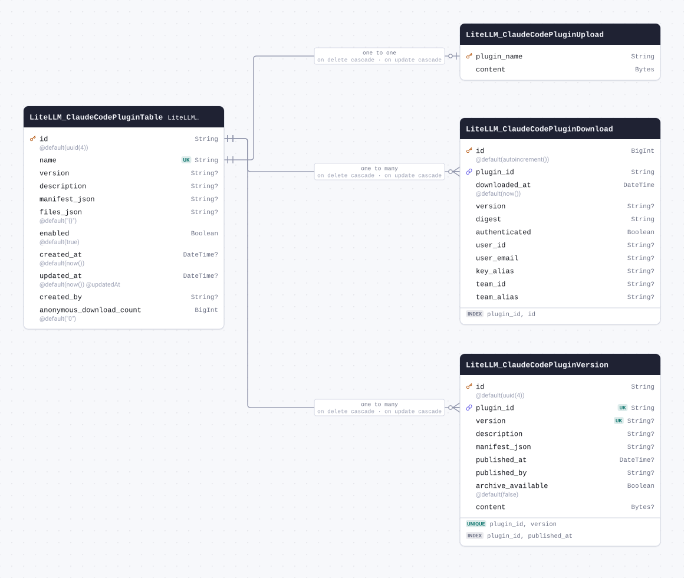

| Field                      | Type       | Constraints     | Default              | Description |
| -------------------------- | ---------- | --------------- | -------------------- | ----------- |
| `id`                       | `String`   | PK NOT NULL     | `uuid(4)`            |             |
| `name`                     | `String`   | UNIQUE NOT NULL |                      |             |
| `version`                  | `String`   | NULL            |                      |             |
| `description`              | `String`   | NULL            |                      |             |
| `manifest_json`            | `String`   | NULL            |                      |             |
| `files_json`               | `String`   | NULL            | `"{}"`               |             |
| `enabled`                  | `Boolean`  | NOT NULL        | `true`               |             |
| `created_at`               | `DateTime` | NULL            | `now()`              |             |
| `updated_at`               | `DateTime` | NULL            | `now()` `@updatedAt` |             |
| `created_by`               | `String`   | NULL            |                      |             |
| `anonymous_download_count` | `BigInt`   | NOT NULL        | `"0"`                |             |

#### Referenced by

- `id` ← [LiteLLM_ClaudeCodePluginVersion.plugin_id](#model-LiteLLM_ClaudeCodePluginVersion) (one-to-many, on delete Cascade, on update Cascade)
- `id` ← [LiteLLM_ClaudeCodePluginDownload.plugin_id](#model-LiteLLM_ClaudeCodePluginDownload) (one-to-many, on delete Cascade, on update Cascade)
- `name` ← [LiteLLM_ClaudeCodePluginUpload.plugin_name](#model-LiteLLM_ClaudeCodePluginUpload) (one-to-one, on delete Cascade, on update Cascade)

#### Definition

```sql
CREATE TABLE "LiteLLM_ClaudeCodePluginTable" (
    "id" TEXT NOT NULL,
    "name" TEXT NOT NULL,
    "version" TEXT,
    "description" TEXT,
    "manifest_json" TEXT,
    "files_json" TEXT DEFAULT '{}',
    "enabled" BOOLEAN NOT NULL DEFAULT true,
    "created_at" TIMESTAMP(3) DEFAULT CURRENT_TIMESTAMP,
    "updated_at" TIMESTAMP(3) DEFAULT CURRENT_TIMESTAMP,
    "created_by" TEXT,
    "anonymous_download_count" BIGINT NOT NULL DEFAULT 0,

    CONSTRAINT "LiteLLM_ClaudeCodePluginTable_pkey" PRIMARY KEY ("id")
);

CREATE UNIQUE INDEX "LiteLLM_ClaudeCodePluginTable_name_key" ON "LiteLLM_ClaudeCodePluginTable"("name");
```

<details>
<summary>Queries and their SQL</summary>

**findMany**: Every row

```ts
await prisma.liteLLM_ClaudeCodePluginTable.findMany();
```

```sql
SELECT
  "public"."LiteLLM_ClaudeCodePluginTable"."id",
  "public"."LiteLLM_ClaudeCodePluginTable"."name",
  "public"."LiteLLM_ClaudeCodePluginTable"."version",
  "public"."LiteLLM_ClaudeCodePluginTable"."description",
  "public"."LiteLLM_ClaudeCodePluginTable"."manifest_json",
  "public"."LiteLLM_ClaudeCodePluginTable"."files_json",
  "public"."LiteLLM_ClaudeCodePluginTable"."enabled",
  "public"."LiteLLM_ClaudeCodePluginTable"."created_at",
  "public"."LiteLLM_ClaudeCodePluginTable"."updated_at",
  "public"."LiteLLM_ClaudeCodePluginTable"."created_by",
  "public"."LiteLLM_ClaudeCodePluginTable"."anonymous_download_count"
FROM
  "public"."LiteLLM_ClaudeCodePluginTable"
WHERE
  1 = 1
OFFSET
  $1
-- params: ["0"]
```

**count**: How many rows there are

```ts
await prisma.liteLLM_ClaudeCodePluginTable.count();
```

```sql
SELECT
  COUNT(*) AS "_count$_all"
FROM
  (
    SELECT
      "public"."LiteLLM_ClaudeCodePluginTable"."id"
    FROM
      "public"."LiteLLM_ClaudeCodePluginTable"
    WHERE
      1 = 1
    OFFSET
      $1
  ) AS "sub"
-- params: ["0"]
```

**findMany**: Every row with its relations

```ts
await prisma.liteLLM_ClaudeCodePluginTable.findMany({
  include: { uploaded_archive: true, versions: true, downloads: true },
});
```

```sql
SELECT
  "public"."LiteLLM_ClaudeCodePluginTable"."id",
  "public"."LiteLLM_ClaudeCodePluginTable"."name",
  "public"."LiteLLM_ClaudeCodePluginTable"."version",
  "public"."LiteLLM_ClaudeCodePluginTable"."description",
  "public"."LiteLLM_ClaudeCodePluginTable"."manifest_json",
  "public"."LiteLLM_ClaudeCodePluginTable"."files_json",
  "public"."LiteLLM_ClaudeCodePluginTable"."enabled",
  "public"."LiteLLM_ClaudeCodePluginTable"."created_at",
  "public"."LiteLLM_ClaudeCodePluginTable"."updated_at",
  "public"."LiteLLM_ClaudeCodePluginTable"."created_by",
  "public"."LiteLLM_ClaudeCodePluginTable"."anonymous_download_count"
FROM
  "public"."LiteLLM_ClaudeCodePluginTable"
WHERE
  1 = 1
OFFSET
  $1
-- params: ["0"]

SELECT
  "public"."LiteLLM_ClaudeCodePluginUpload"."plugin_name",
  "public"."LiteLLM_ClaudeCodePluginUpload"."content"
FROM
  "public"."LiteLLM_ClaudeCodePluginUpload"
WHERE
  "public"."LiteLLM_ClaudeCodePluginUpload"."plugin_name" IN ($1)
OFFSET
  $2
-- params: ["<name of the rows above>","0"]

SELECT
  "public"."LiteLLM_ClaudeCodePluginVersion"."id",
  "public"."LiteLLM_ClaudeCodePluginVersion"."plugin_id",
  "public"."LiteLLM_ClaudeCodePluginVersion"."version",
  "public"."LiteLLM_ClaudeCodePluginVersion"."description",
  "public"."LiteLLM_ClaudeCodePluginVersion"."manifest_json",
  "public"."LiteLLM_ClaudeCodePluginVersion"."published_at",
  "public"."LiteLLM_ClaudeCodePluginVersion"."published_by",
  "public"."LiteLLM_ClaudeCodePluginVersion"."archive_available",
  "public"."LiteLLM_ClaudeCodePluginVersion"."content"
FROM
  "public"."LiteLLM_ClaudeCodePluginVersion"
WHERE
  "public"."LiteLLM_ClaudeCodePluginVersion"."plugin_id" IN ($1)
OFFSET
  $2
-- params: ["<id of the rows above>","0"]

SELECT
  "public"."LiteLLM_ClaudeCodePluginDownload"."id",
  "public"."LiteLLM_ClaudeCodePluginDownload"."plugin_id",
  "public"."LiteLLM_ClaudeCodePluginDownload"."downloaded_at",
  "public"."LiteLLM_ClaudeCodePluginDownload"."version",
  "public"."LiteLLM_ClaudeCodePluginDownload"."digest",
  "public"."LiteLLM_ClaudeCodePluginDownload"."authenticated",
  "public"."LiteLLM_ClaudeCodePluginDownload"."user_id",
  "public"."LiteLLM_ClaudeCodePluginDownload"."user_email",
  "public"."LiteLLM_ClaudeCodePluginDownload"."key_alias",
  "public"."LiteLLM_ClaudeCodePluginDownload"."team_id",
  "public"."LiteLLM_ClaudeCodePluginDownload"."team_alias"
FROM
  "public"."LiteLLM_ClaudeCodePluginDownload"
WHERE
  "public"."LiteLLM_ClaudeCodePluginDownload"."plugin_id" IN ($1)
OFFSET
  $2
-- params: ["<id of the rows above>","0"]
```

**findUnique**: One row by what is unique to it

```ts
await prisma.liteLLM_ClaudeCodePluginTable.findUnique({ where: { id: "example" } });
```

```sql
SELECT
  "public"."LiteLLM_ClaudeCodePluginTable"."id",
  "public"."LiteLLM_ClaudeCodePluginTable"."name",
  "public"."LiteLLM_ClaudeCodePluginTable"."version",
  "public"."LiteLLM_ClaudeCodePluginTable"."description",
  "public"."LiteLLM_ClaudeCodePluginTable"."manifest_json",
  "public"."LiteLLM_ClaudeCodePluginTable"."files_json",
  "public"."LiteLLM_ClaudeCodePluginTable"."enabled",
  "public"."LiteLLM_ClaudeCodePluginTable"."created_at",
  "public"."LiteLLM_ClaudeCodePluginTable"."updated_at",
  "public"."LiteLLM_ClaudeCodePluginTable"."created_by",
  "public"."LiteLLM_ClaudeCodePluginTable"."anonymous_download_count"
FROM
  "public"."LiteLLM_ClaudeCodePluginTable"
WHERE
  (
    "public"."LiteLLM_ClaudeCodePluginTable"."id" = $1
    AND 1 = 1
  )
LIMIT
  $2
OFFSET
  $3
-- params: ["example","1","0"]
```

**create**: Create a row

```ts
await prisma.liteLLM_ClaudeCodePluginTable.create({ data: { name: "example" } });
```

```sql
INSERT INTO
  "public"."LiteLLM_ClaudeCodePluginTable" (
    "id",
    "name",
    "files_json",
    "enabled",
    "created_at",
    "updated_at",
    "anonymous_download_count"
  )
VALUES
  ($1, $2, $3, $4, $5, $6, $7)
RETURNING
  "public"."LiteLLM_ClaudeCodePluginTable"."id",
  "public"."LiteLLM_ClaudeCodePluginTable"."name",
  "public"."LiteLLM_ClaudeCodePluginTable"."version",
  "public"."LiteLLM_ClaudeCodePluginTable"."description",
  "public"."LiteLLM_ClaudeCodePluginTable"."manifest_json",
  "public"."LiteLLM_ClaudeCodePluginTable"."files_json",
  "public"."LiteLLM_ClaudeCodePluginTable"."enabled",
  "public"."LiteLLM_ClaudeCodePluginTable"."created_at",
  "public"."LiteLLM_ClaudeCodePluginTable"."updated_at",
  "public"."LiteLLM_ClaudeCodePluginTable"."created_by",
  "public"."LiteLLM_ClaudeCodePluginTable"."anonymous_download_count"
-- params: ["<uuid(4)>","example","{}",true,"<now()>","<now()>","0"]
```

**update**: Update a row

```ts
await prisma.liteLLM_ClaudeCodePluginTable.update({
  where: { id: "example" },
  data: { name: "example" },
});
```

```sql
UPDATE "public"."LiteLLM_ClaudeCodePluginTable"
SET
  "name" = $1,
  "updated_at" = $2
WHERE
  (
    "public"."LiteLLM_ClaudeCodePluginTable"."id" = $3
    AND 1 = 1
  )
RETURNING
  "public"."LiteLLM_ClaudeCodePluginTable"."id",
  "public"."LiteLLM_ClaudeCodePluginTable"."name",
  "public"."LiteLLM_ClaudeCodePluginTable"."version",
  "public"."LiteLLM_ClaudeCodePluginTable"."description",
  "public"."LiteLLM_ClaudeCodePluginTable"."manifest_json",
  "public"."LiteLLM_ClaudeCodePluginTable"."files_json",
  "public"."LiteLLM_ClaudeCodePluginTable"."enabled",
  "public"."LiteLLM_ClaudeCodePluginTable"."created_at",
  "public"."LiteLLM_ClaudeCodePluginTable"."updated_at",
  "public"."LiteLLM_ClaudeCodePluginTable"."created_by",
  "public"."LiteLLM_ClaudeCodePluginTable"."anonymous_download_count"
-- params: ["example",{"prisma__type":"generatorCall","prisma__value":{"name":"now","args":[],"returnType":{"type":"DateTime"}}},"example"]
```

**delete**: Delete a row

```ts
await prisma.liteLLM_ClaudeCodePluginTable.delete({ where: { id: "example" } });
```

```sql
DELETE FROM "public"."LiteLLM_ClaudeCodePluginTable"
WHERE
  (
    "public"."LiteLLM_ClaudeCodePluginTable"."id" = $1
    AND 1 = 1
  )
RETURNING
  "public"."LiteLLM_ClaudeCodePluginTable"."id",
  "public"."LiteLLM_ClaudeCodePluginTable"."name",
  "public"."LiteLLM_ClaudeCodePluginTable"."version",
  "public"."LiteLLM_ClaudeCodePluginTable"."description",
  "public"."LiteLLM_ClaudeCodePluginTable"."manifest_json",
  "public"."LiteLLM_ClaudeCodePluginTable"."files_json",
  "public"."LiteLLM_ClaudeCodePluginTable"."enabled",
  "public"."LiteLLM_ClaudeCodePluginTable"."created_at",
  "public"."LiteLLM_ClaudeCodePluginTable"."updated_at",
  "public"."LiteLLM_ClaudeCodePluginTable"."created_by",
  "public"."LiteLLM_ClaudeCodePluginTable"."anonymous_download_count"
-- params: ["example"]
```

</details>

<a id="model-LiteLLM_ClaudeCodePluginVersion"></a>

### LiteLLM_ClaudeCodePluginVersion

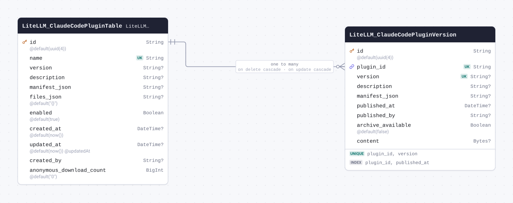

| Field               | Type       | Constraints                                                                         | Default   | Description |
| ------------------- | ---------- | ----------------------------------------------------------------------------------- | --------- | ----------- |
| `id`                | `String`   | PK NOT NULL                                                                         | `uuid(4)` |             |
| `plugin_id`         | `String`   | NOT NULL → [LiteLLM_ClaudeCodePluginTable.id](#model-LiteLLM_ClaudeCodePluginTable) |           |             |
| `version`           | `String`   | NULL                                                                                |           |             |
| `description`       | `String`   | NULL                                                                                |           |             |
| `manifest_json`     | `String`   | NULL                                                                                |           |             |
| `published_at`      | `DateTime` | NULL                                                                                |           |             |
| `published_by`      | `String`   | NULL                                                                                |           |             |
| `archive_available` | `Boolean`  | NOT NULL                                                                            | `false`   |             |
| `content`           | `Bytes`    | NULL                                                                                |           |             |

#### Indexes

- `@@index([plugin_id, published_at])`
- `@@unique([plugin_id, version])`

#### References

- `plugin_id` → [LiteLLM_ClaudeCodePluginTable.id](#model-LiteLLM_ClaudeCodePluginTable) (many-to-one, on delete Cascade, on update Cascade)

#### Definition

```sql
CREATE TABLE "LiteLLM_ClaudeCodePluginVersion" (
    "id" TEXT NOT NULL,
    "plugin_id" TEXT NOT NULL,
    "version" TEXT,
    "description" TEXT,
    "manifest_json" TEXT,
    "published_at" TIMESTAMP(3),
    "published_by" TEXT,
    "archive_available" BOOLEAN NOT NULL DEFAULT false,
    "content" BYTEA,

    CONSTRAINT "LiteLLM_ClaudeCodePluginVersion_pkey" PRIMARY KEY ("id")
);

CREATE INDEX "LiteLLM_ClaudeCodePluginVersion_plugin_id_published_at_idx" ON "LiteLLM_ClaudeCodePluginVersion"("plugin_id", "published_at");

CREATE UNIQUE INDEX "LiteLLM_ClaudeCodePluginVersion_plugin_id_version_key" ON "LiteLLM_ClaudeCodePluginVersion"("plugin_id", "version");

ALTER TABLE "LiteLLM_ClaudeCodePluginVersion" ADD CONSTRAINT "LiteLLM_ClaudeCodePluginVersion_plugin_id_fkey" FOREIGN KEY ("plugin_id") REFERENCES "LiteLLM_ClaudeCodePluginTable"("id") ON DELETE CASCADE ON UPDATE CASCADE;
```

<details>
<summary>Queries and their SQL</summary>

**findMany**: Every row

```ts
await prisma.liteLLM_ClaudeCodePluginVersion.findMany();
```

```sql
SELECT
  "public"."LiteLLM_ClaudeCodePluginVersion"."id",
  "public"."LiteLLM_ClaudeCodePluginVersion"."plugin_id",
  "public"."LiteLLM_ClaudeCodePluginVersion"."version",
  "public"."LiteLLM_ClaudeCodePluginVersion"."description",
  "public"."LiteLLM_ClaudeCodePluginVersion"."manifest_json",
  "public"."LiteLLM_ClaudeCodePluginVersion"."published_at",
  "public"."LiteLLM_ClaudeCodePluginVersion"."published_by",
  "public"."LiteLLM_ClaudeCodePluginVersion"."archive_available",
  "public"."LiteLLM_ClaudeCodePluginVersion"."content"
FROM
  "public"."LiteLLM_ClaudeCodePluginVersion"
WHERE
  1 = 1
OFFSET
  $1
-- params: ["0"]
```

**count**: How many rows there are

```ts
await prisma.liteLLM_ClaudeCodePluginVersion.count();
```

```sql
SELECT
  COUNT(*) AS "_count$_all"
FROM
  (
    SELECT
      "public"."LiteLLM_ClaudeCodePluginVersion"."id"
    FROM
      "public"."LiteLLM_ClaudeCodePluginVersion"
    WHERE
      1 = 1
    OFFSET
      $1
  ) AS "sub"
-- params: ["0"]
```

**findMany**: Every row with its relations

```ts
await prisma.liteLLM_ClaudeCodePluginVersion.findMany({ include: { plugin: true } });
```

```sql
SELECT
  "public"."LiteLLM_ClaudeCodePluginVersion"."id",
  "public"."LiteLLM_ClaudeCodePluginVersion"."plugin_id",
  "public"."LiteLLM_ClaudeCodePluginVersion"."version",
  "public"."LiteLLM_ClaudeCodePluginVersion"."description",
  "public"."LiteLLM_ClaudeCodePluginVersion"."manifest_json",
  "public"."LiteLLM_ClaudeCodePluginVersion"."published_at",
  "public"."LiteLLM_ClaudeCodePluginVersion"."published_by",
  "public"."LiteLLM_ClaudeCodePluginVersion"."archive_available",
  "public"."LiteLLM_ClaudeCodePluginVersion"."content"
FROM
  "public"."LiteLLM_ClaudeCodePluginVersion"
WHERE
  1 = 1
OFFSET
  $1
-- params: ["0"]

SELECT
  "public"."LiteLLM_ClaudeCodePluginTable"."id",
  "public"."LiteLLM_ClaudeCodePluginTable"."name",
  "public"."LiteLLM_ClaudeCodePluginTable"."version",
  "public"."LiteLLM_ClaudeCodePluginTable"."description",
  "public"."LiteLLM_ClaudeCodePluginTable"."manifest_json",
  "public"."LiteLLM_ClaudeCodePluginTable"."files_json",
  "public"."LiteLLM_ClaudeCodePluginTable"."enabled",
  "public"."LiteLLM_ClaudeCodePluginTable"."created_at",
  "public"."LiteLLM_ClaudeCodePluginTable"."updated_at",
  "public"."LiteLLM_ClaudeCodePluginTable"."created_by",
  "public"."LiteLLM_ClaudeCodePluginTable"."anonymous_download_count"
FROM
  "public"."LiteLLM_ClaudeCodePluginTable"
WHERE
  "public"."LiteLLM_ClaudeCodePluginTable"."id" IN ($1)
OFFSET
  $2
-- params: ["<plugin_id of the rows above>","0"]
```

**findUnique**: One row by what is unique to it

```ts
await prisma.liteLLM_ClaudeCodePluginVersion.findUnique({ where: { id: "example" } });
```

```sql
SELECT
  "public"."LiteLLM_ClaudeCodePluginVersion"."id",
  "public"."LiteLLM_ClaudeCodePluginVersion"."plugin_id",
  "public"."LiteLLM_ClaudeCodePluginVersion"."version",
  "public"."LiteLLM_ClaudeCodePluginVersion"."description",
  "public"."LiteLLM_ClaudeCodePluginVersion"."manifest_json",
  "public"."LiteLLM_ClaudeCodePluginVersion"."published_at",
  "public"."LiteLLM_ClaudeCodePluginVersion"."published_by",
  "public"."LiteLLM_ClaudeCodePluginVersion"."archive_available",
  "public"."LiteLLM_ClaudeCodePluginVersion"."content"
FROM
  "public"."LiteLLM_ClaudeCodePluginVersion"
WHERE
  (
    "public"."LiteLLM_ClaudeCodePluginVersion"."id" = $1
    AND 1 = 1
  )
LIMIT
  $2
OFFSET
  $3
-- params: ["example","1","0"]
```

**create**: Create a row

```ts
await prisma.liteLLM_ClaudeCodePluginVersion.create({ data: { plugin_id: "example" } });
```

```sql
INSERT INTO
  "public"."LiteLLM_ClaudeCodePluginVersion" ("id", "plugin_id", "archive_available")
VALUES
  ($1, $2, $3)
RETURNING
  "public"."LiteLLM_ClaudeCodePluginVersion"."id",
  "public"."LiteLLM_ClaudeCodePluginVersion"."plugin_id",
  "public"."LiteLLM_ClaudeCodePluginVersion"."version",
  "public"."LiteLLM_ClaudeCodePluginVersion"."description",
  "public"."LiteLLM_ClaudeCodePluginVersion"."manifest_json",
  "public"."LiteLLM_ClaudeCodePluginVersion"."published_at",
  "public"."LiteLLM_ClaudeCodePluginVersion"."published_by",
  "public"."LiteLLM_ClaudeCodePluginVersion"."archive_available",
  "public"."LiteLLM_ClaudeCodePluginVersion"."content"
-- params: ["<uuid(4)>","example",false]
```

**update**: Update a row

```ts
await prisma.liteLLM_ClaudeCodePluginVersion.update({
  where: { id: "example" },
  data: { version: "example" },
});
```

```sql
UPDATE "public"."LiteLLM_ClaudeCodePluginVersion"
SET
  "version" = $1
WHERE
  (
    "public"."LiteLLM_ClaudeCodePluginVersion"."id" = $2
    AND 1 = 1
  )
RETURNING
  "public"."LiteLLM_ClaudeCodePluginVersion"."id",
  "public"."LiteLLM_ClaudeCodePluginVersion"."plugin_id",
  "public"."LiteLLM_ClaudeCodePluginVersion"."version",
  "public"."LiteLLM_ClaudeCodePluginVersion"."description",
  "public"."LiteLLM_ClaudeCodePluginVersion"."manifest_json",
  "public"."LiteLLM_ClaudeCodePluginVersion"."published_at",
  "public"."LiteLLM_ClaudeCodePluginVersion"."published_by",
  "public"."LiteLLM_ClaudeCodePluginVersion"."archive_available",
  "public"."LiteLLM_ClaudeCodePluginVersion"."content"
-- params: ["example","example"]
```

**delete**: Delete a row

```ts
await prisma.liteLLM_ClaudeCodePluginVersion.delete({ where: { id: "example" } });
```

```sql
DELETE FROM "public"."LiteLLM_ClaudeCodePluginVersion"
WHERE
  (
    "public"."LiteLLM_ClaudeCodePluginVersion"."id" = $1
    AND 1 = 1
  )
RETURNING
  "public"."LiteLLM_ClaudeCodePluginVersion"."id",
  "public"."LiteLLM_ClaudeCodePluginVersion"."plugin_id",
  "public"."LiteLLM_ClaudeCodePluginVersion"."version",
  "public"."LiteLLM_ClaudeCodePluginVersion"."description",
  "public"."LiteLLM_ClaudeCodePluginVersion"."manifest_json",
  "public"."LiteLLM_ClaudeCodePluginVersion"."published_at",
  "public"."LiteLLM_ClaudeCodePluginVersion"."published_by",
  "public"."LiteLLM_ClaudeCodePluginVersion"."archive_available",
  "public"."LiteLLM_ClaudeCodePluginVersion"."content"
-- params: ["example"]
```

</details>

<a id="model-LiteLLM_SkillSubmission"></a>

### LiteLLM_SkillSubmission

| Field              | Type       | Constraints | Default            | Description |
| ------------------ | ---------- | ----------- | ------------------ | ----------- |
| `id`               | `String`   | PK NOT NULL | `uuid(4)`          |             |
| `plugin_name`      | `String`   | NOT NULL    |                    |             |
| `operation`        | `String`   | NOT NULL    |                    |             |
| `status`           | `String`   | NOT NULL    | `"pending_review"` |             |
| `proposal_json`    | `String`   | NOT NULL    |                    |             |
| `archive_content`  | `Bytes`    | NULL        |                    |             |
| `submitted_by`     | `String`   | NOT NULL    |                    |             |
| `created_at`       | `DateTime` | NOT NULL    | `now()`            |             |
| `base_plugin_id`   | `String`   | NULL        |                    |             |
| `base_updated_at`  | `DateTime` | NULL        |                    |             |
| `reviewed_by`      | `String`   | NULL        |                    |             |
| `reviewed_at`      | `DateTime` | NULL        |                    |             |
| `rejection_reason` | `String`   | NULL        |                    |             |
| `scan_json`        | `String`   | NULL        |                    |             |

#### Indexes

- `@@index([submitted_by, created_at, id])`
- `@@index([submitted_by, status, created_at, id])`
- `@@index([status, created_at, id])`
- `@@index([created_at, id])`

#### Definition

```sql
CREATE TABLE "LiteLLM_SkillSubmission" (
    "id" TEXT NOT NULL,
    "plugin_name" TEXT NOT NULL,
    "operation" TEXT NOT NULL,
    "status" TEXT NOT NULL DEFAULT 'pending_review',
    "proposal_json" TEXT NOT NULL,
    "archive_content" BYTEA,
    "submitted_by" TEXT NOT NULL,
    "created_at" TIMESTAMP(3) NOT NULL DEFAULT CURRENT_TIMESTAMP,
    "base_plugin_id" TEXT,
    "base_updated_at" TIMESTAMP(3),
    "reviewed_by" TEXT,
    "reviewed_at" TIMESTAMP(3),
    "rejection_reason" TEXT,
    "scan_json" TEXT,

    CONSTRAINT "LiteLLM_SkillSubmission_pkey" PRIMARY KEY ("id")
);

CREATE INDEX "LiteLLM_SkillSubmission_submitted_by_created_at_id_idx" ON "LiteLLM_SkillSubmission"("submitted_by", "created_at" DESC, "id" DESC);

CREATE INDEX "LiteLLM_SkillSubmission_submitted_by_status_created_at_id_idx" ON "LiteLLM_SkillSubmission"("submitted_by", "status", "created_at" DESC, "id" DESC);

CREATE INDEX "LiteLLM_SkillSubmission_status_created_at_id_idx" ON "LiteLLM_SkillSubmission"("status", "created_at" DESC, "id" DESC);

CREATE INDEX "LiteLLM_SkillSubmission_created_at_id_idx" ON "LiteLLM_SkillSubmission"("created_at" DESC, "id" DESC);
```

<details>
<summary>Queries and their SQL</summary>

**findMany**: Every row

```ts
await prisma.liteLLM_SkillSubmission.findMany();
```

```sql
SELECT
  "public"."LiteLLM_SkillSubmission"."id",
  "public"."LiteLLM_SkillSubmission"."plugin_name",
  "public"."LiteLLM_SkillSubmission"."operation",
  "public"."LiteLLM_SkillSubmission"."status",
  "public"."LiteLLM_SkillSubmission"."proposal_json",
  "public"."LiteLLM_SkillSubmission"."archive_content",
  "public"."LiteLLM_SkillSubmission"."submitted_by",
  "public"."LiteLLM_SkillSubmission"."created_at",
  "public"."LiteLLM_SkillSubmission"."base_plugin_id",
  "public"."LiteLLM_SkillSubmission"."base_updated_at",
  "public"."LiteLLM_SkillSubmission"."reviewed_by",
  "public"."LiteLLM_SkillSubmission"."reviewed_at",
  "public"."LiteLLM_SkillSubmission"."rejection_reason",
  "public"."LiteLLM_SkillSubmission"."scan_json"
FROM
  "public"."LiteLLM_SkillSubmission"
WHERE
  1 = 1
OFFSET
  $1
-- params: ["0"]
```

**count**: How many rows there are

```ts
await prisma.liteLLM_SkillSubmission.count();
```

```sql
SELECT
  COUNT(*) AS "_count$_all"
FROM
  (
    SELECT
      "public"."LiteLLM_SkillSubmission"."id"
    FROM
      "public"."LiteLLM_SkillSubmission"
    WHERE
      1 = 1
    OFFSET
      $1
  ) AS "sub"
-- params: ["0"]
```

**findUnique**: One row by what is unique to it

```ts
await prisma.liteLLM_SkillSubmission.findUnique({ where: { id: "example" } });
```

```sql
SELECT
  "public"."LiteLLM_SkillSubmission"."id",
  "public"."LiteLLM_SkillSubmission"."plugin_name",
  "public"."LiteLLM_SkillSubmission"."operation",
  "public"."LiteLLM_SkillSubmission"."status",
  "public"."LiteLLM_SkillSubmission"."proposal_json",
  "public"."LiteLLM_SkillSubmission"."archive_content",
  "public"."LiteLLM_SkillSubmission"."submitted_by",
  "public"."LiteLLM_SkillSubmission"."created_at",
  "public"."LiteLLM_SkillSubmission"."base_plugin_id",
  "public"."LiteLLM_SkillSubmission"."base_updated_at",
  "public"."LiteLLM_SkillSubmission"."reviewed_by",
  "public"."LiteLLM_SkillSubmission"."reviewed_at",
  "public"."LiteLLM_SkillSubmission"."rejection_reason",
  "public"."LiteLLM_SkillSubmission"."scan_json"
FROM
  "public"."LiteLLM_SkillSubmission"
WHERE
  (
    "public"."LiteLLM_SkillSubmission"."id" = $1
    AND 1 = 1
  )
LIMIT
  $2
OFFSET
  $3
-- params: ["example","1","0"]
```

**create**: Create a row

```ts
await prisma.liteLLM_SkillSubmission.create({
  data: {
    plugin_name: "example",
    operation: "example",
    proposal_json: "example",
    submitted_by: "example",
  },
});
```

```sql
INSERT INTO
  "public"."LiteLLM_SkillSubmission" (
    "id",
    "plugin_name",
    "operation",
    "status",
    "proposal_json",
    "submitted_by",
    "created_at"
  )
VALUES
  ($1, $2, $3, $4, $5, $6, $7)
RETURNING
  "public"."LiteLLM_SkillSubmission"."id",
  "public"."LiteLLM_SkillSubmission"."plugin_name",
  "public"."LiteLLM_SkillSubmission"."operation",
  "public"."LiteLLM_SkillSubmission"."status",
  "public"."LiteLLM_SkillSubmission"."proposal_json",
  "public"."LiteLLM_SkillSubmission"."archive_content",
  "public"."LiteLLM_SkillSubmission"."submitted_by",
  "public"."LiteLLM_SkillSubmission"."created_at",
  "public"."LiteLLM_SkillSubmission"."base_plugin_id",
  "public"."LiteLLM_SkillSubmission"."base_updated_at",
  "public"."LiteLLM_SkillSubmission"."reviewed_by",
  "public"."LiteLLM_SkillSubmission"."reviewed_at",
  "public"."LiteLLM_SkillSubmission"."rejection_reason",
  "public"."LiteLLM_SkillSubmission"."scan_json"
-- params: ["<uuid(4)>","example","example","pending_review","example","example","<now()>"]
```

**update**: Update a row

```ts
await prisma.liteLLM_SkillSubmission.update({
  where: { id: "example" },
  data: { plugin_name: "example" },
});
```

```sql
UPDATE "public"."LiteLLM_SkillSubmission"
SET
  "plugin_name" = $1
WHERE
  (
    "public"."LiteLLM_SkillSubmission"."id" = $2
    AND 1 = 1
  )
RETURNING
  "public"."LiteLLM_SkillSubmission"."id",
  "public"."LiteLLM_SkillSubmission"."plugin_name",
  "public"."LiteLLM_SkillSubmission"."operation",
  "public"."LiteLLM_SkillSubmission"."status",
  "public"."LiteLLM_SkillSubmission"."proposal_json",
  "public"."LiteLLM_SkillSubmission"."archive_content",
  "public"."LiteLLM_SkillSubmission"."submitted_by",
  "public"."LiteLLM_SkillSubmission"."created_at",
  "public"."LiteLLM_SkillSubmission"."base_plugin_id",
  "public"."LiteLLM_SkillSubmission"."base_updated_at",
  "public"."LiteLLM_SkillSubmission"."reviewed_by",
  "public"."LiteLLM_SkillSubmission"."reviewed_at",
  "public"."LiteLLM_SkillSubmission"."rejection_reason",
  "public"."LiteLLM_SkillSubmission"."scan_json"
-- params: ["example","example"]
```

**delete**: Delete a row

```ts
await prisma.liteLLM_SkillSubmission.delete({ where: { id: "example" } });
```

```sql
DELETE FROM "public"."LiteLLM_SkillSubmission"
WHERE
  (
    "public"."LiteLLM_SkillSubmission"."id" = $1
    AND 1 = 1
  )
RETURNING
  "public"."LiteLLM_SkillSubmission"."id",
  "public"."LiteLLM_SkillSubmission"."plugin_name",
  "public"."LiteLLM_SkillSubmission"."operation",
  "public"."LiteLLM_SkillSubmission"."status",
  "public"."LiteLLM_SkillSubmission"."proposal_json",
  "public"."LiteLLM_SkillSubmission"."archive_content",
  "public"."LiteLLM_SkillSubmission"."submitted_by",
  "public"."LiteLLM_SkillSubmission"."created_at",
  "public"."LiteLLM_SkillSubmission"."base_plugin_id",
  "public"."LiteLLM_SkillSubmission"."base_updated_at",
  "public"."LiteLLM_SkillSubmission"."reviewed_by",
  "public"."LiteLLM_SkillSubmission"."reviewed_at",
  "public"."LiteLLM_SkillSubmission"."rejection_reason",
  "public"."LiteLLM_SkillSubmission"."scan_json"
-- params: ["example"]
```

</details>

<a id="model-LiteLLM_ClaudeCodePluginDownload"></a>

### LiteLLM_ClaudeCodePluginDownload

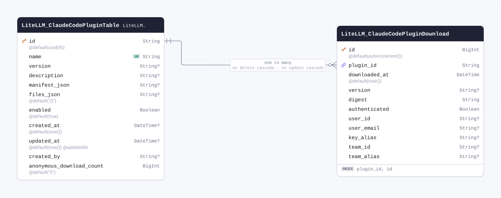

| Field           | Type       | Constraints                                                                         | Default           | Description |
| --------------- | ---------- | ----------------------------------------------------------------------------------- | ----------------- | ----------- |
| `id`            | `BigInt`   | PK NOT NULL                                                                         | `autoincrement()` |             |
| `plugin_id`     | `String`   | NOT NULL → [LiteLLM_ClaudeCodePluginTable.id](#model-LiteLLM_ClaudeCodePluginTable) |                   |             |
| `downloaded_at` | `DateTime` | NOT NULL                                                                            | `now()`           |             |
| `version`       | `String`   | NULL                                                                                |                   |             |
| `digest`        | `String`   | NOT NULL                                                                            |                   |             |
| `authenticated` | `Boolean`  | NOT NULL                                                                            |                   |             |
| `user_id`       | `String`   | NULL                                                                                |                   |             |
| `user_email`    | `String`   | NULL                                                                                |                   |             |
| `key_alias`     | `String`   | NULL                                                                                |                   |             |
| `team_id`       | `String`   | NULL                                                                                |                   |             |
| `team_alias`    | `String`   | NULL                                                                                |                   |             |

#### Indexes

- `@@index([plugin_id, id])`

#### References

- `plugin_id` → [LiteLLM_ClaudeCodePluginTable.id](#model-LiteLLM_ClaudeCodePluginTable) (many-to-one, on delete Cascade, on update Cascade)

#### Definition

```sql
CREATE TABLE "LiteLLM_ClaudeCodePluginDownload" (
    "id" BIGSERIAL NOT NULL,
    "plugin_id" TEXT NOT NULL,
    "downloaded_at" TIMESTAMP(3) NOT NULL DEFAULT CURRENT_TIMESTAMP,
    "version" TEXT,
    "digest" TEXT NOT NULL,
    "authenticated" BOOLEAN NOT NULL,
    "user_id" TEXT,
    "user_email" TEXT,
    "key_alias" TEXT,
    "team_id" TEXT,
    "team_alias" TEXT,

    CONSTRAINT "LiteLLM_ClaudeCodePluginDownload_pkey" PRIMARY KEY ("id")
);

CREATE INDEX "LiteLLM_ClaudeCodePluginDownload_plugin_id_id_idx" ON "LiteLLM_ClaudeCodePluginDownload"("plugin_id", "id");

ALTER TABLE "LiteLLM_ClaudeCodePluginDownload" ADD CONSTRAINT "LiteLLM_ClaudeCodePluginDownload_plugin_id_fkey" FOREIGN KEY ("plugin_id") REFERENCES "LiteLLM_ClaudeCodePluginTable"("id") ON DELETE CASCADE ON UPDATE CASCADE;
```

<details>
<summary>Queries and their SQL</summary>

**findMany**: Every row

```ts
await prisma.liteLLM_ClaudeCodePluginDownload.findMany();
```

```sql
SELECT
  "public"."LiteLLM_ClaudeCodePluginDownload"."id",
  "public"."LiteLLM_ClaudeCodePluginDownload"."plugin_id",
  "public"."LiteLLM_ClaudeCodePluginDownload"."downloaded_at",
  "public"."LiteLLM_ClaudeCodePluginDownload"."version",
  "public"."LiteLLM_ClaudeCodePluginDownload"."digest",
  "public"."LiteLLM_ClaudeCodePluginDownload"."authenticated",
  "public"."LiteLLM_ClaudeCodePluginDownload"."user_id",
  "public"."LiteLLM_ClaudeCodePluginDownload"."user_email",
  "public"."LiteLLM_ClaudeCodePluginDownload"."key_alias",
  "public"."LiteLLM_ClaudeCodePluginDownload"."team_id",
  "public"."LiteLLM_ClaudeCodePluginDownload"."team_alias"
FROM
  "public"."LiteLLM_ClaudeCodePluginDownload"
WHERE
  1 = 1
OFFSET
  $1
-- params: ["0"]
```

**count**: How many rows there are

```ts
await prisma.liteLLM_ClaudeCodePluginDownload.count();
```

```sql
SELECT
  COUNT(*) AS "_count$_all"
FROM
  (
    SELECT
      "public"."LiteLLM_ClaudeCodePluginDownload"."id"
    FROM
      "public"."LiteLLM_ClaudeCodePluginDownload"
    WHERE
      1 = 1
    OFFSET
      $1
  ) AS "sub"
-- params: ["0"]
```

**findMany**: Every row with its relations

```ts
await prisma.liteLLM_ClaudeCodePluginDownload.findMany({ include: { plugin: true } });
```

```sql
SELECT
  "public"."LiteLLM_ClaudeCodePluginDownload"."id",
  "public"."LiteLLM_ClaudeCodePluginDownload"."plugin_id",
  "public"."LiteLLM_ClaudeCodePluginDownload"."downloaded_at",
  "public"."LiteLLM_ClaudeCodePluginDownload"."version",
  "public"."LiteLLM_ClaudeCodePluginDownload"."digest",
  "public"."LiteLLM_ClaudeCodePluginDownload"."authenticated",
  "public"."LiteLLM_ClaudeCodePluginDownload"."user_id",
  "public"."LiteLLM_ClaudeCodePluginDownload"."user_email",
  "public"."LiteLLM_ClaudeCodePluginDownload"."key_alias",
  "public"."LiteLLM_ClaudeCodePluginDownload"."team_id",
  "public"."LiteLLM_ClaudeCodePluginDownload"."team_alias"
FROM
  "public"."LiteLLM_ClaudeCodePluginDownload"
WHERE
  1 = 1
OFFSET
  $1
-- params: ["0"]

SELECT
  "public"."LiteLLM_ClaudeCodePluginTable"."id",
  "public"."LiteLLM_ClaudeCodePluginTable"."name",
  "public"."LiteLLM_ClaudeCodePluginTable"."version",
  "public"."LiteLLM_ClaudeCodePluginTable"."description",
  "public"."LiteLLM_ClaudeCodePluginTable"."manifest_json",
  "public"."LiteLLM_ClaudeCodePluginTable"."files_json",
  "public"."LiteLLM_ClaudeCodePluginTable"."enabled",
  "public"."LiteLLM_ClaudeCodePluginTable"."created_at",
  "public"."LiteLLM_ClaudeCodePluginTable"."updated_at",
  "public"."LiteLLM_ClaudeCodePluginTable"."created_by",
  "public"."LiteLLM_ClaudeCodePluginTable"."anonymous_download_count"
FROM
  "public"."LiteLLM_ClaudeCodePluginTable"
WHERE
  "public"."LiteLLM_ClaudeCodePluginTable"."id" IN ($1)
OFFSET
  $2
-- params: ["<plugin_id of the rows above>","0"]
```

**findUnique**: One row by what is unique to it

```ts
await prisma.liteLLM_ClaudeCodePluginDownload.findUnique({ where: { id: 1n } });
```

```sql
SELECT
  "public"."LiteLLM_ClaudeCodePluginDownload"."id",
  "public"."LiteLLM_ClaudeCodePluginDownload"."plugin_id",
  "public"."LiteLLM_ClaudeCodePluginDownload"."downloaded_at",
  "public"."LiteLLM_ClaudeCodePluginDownload"."version",
  "public"."LiteLLM_ClaudeCodePluginDownload"."digest",
  "public"."LiteLLM_ClaudeCodePluginDownload"."authenticated",
  "public"."LiteLLM_ClaudeCodePluginDownload"."user_id",
  "public"."LiteLLM_ClaudeCodePluginDownload"."user_email",
  "public"."LiteLLM_ClaudeCodePluginDownload"."key_alias",
  "public"."LiteLLM_ClaudeCodePluginDownload"."team_id",
  "public"."LiteLLM_ClaudeCodePluginDownload"."team_alias"
FROM
  "public"."LiteLLM_ClaudeCodePluginDownload"
WHERE
  (
    "public"."LiteLLM_ClaudeCodePluginDownload"."id" = $1
    AND 1 = 1
  )
LIMIT
  $2
OFFSET
  $3
-- params: ["1","1","0"]
```

**create**: Create a row

```ts
await prisma.liteLLM_ClaudeCodePluginDownload.create({
  data: { plugin_id: "example", digest: "example", authenticated: true },
});
```

```sql
INSERT INTO
  "public"."LiteLLM_ClaudeCodePluginDownload" (
    "plugin_id",
    "downloaded_at",
    "digest",
    "authenticated"
  )
VALUES
  ($1, $2, $3, $4)
RETURNING
  "public"."LiteLLM_ClaudeCodePluginDownload"."id",
  "public"."LiteLLM_ClaudeCodePluginDownload"."plugin_id",
  "public"."LiteLLM_ClaudeCodePluginDownload"."downloaded_at",
  "public"."LiteLLM_ClaudeCodePluginDownload"."version",
  "public"."LiteLLM_ClaudeCodePluginDownload"."digest",
  "public"."LiteLLM_ClaudeCodePluginDownload"."authenticated",
  "public"."LiteLLM_ClaudeCodePluginDownload"."user_id",
  "public"."LiteLLM_ClaudeCodePluginDownload"."user_email",
  "public"."LiteLLM_ClaudeCodePluginDownload"."key_alias",
  "public"."LiteLLM_ClaudeCodePluginDownload"."team_id",
  "public"."LiteLLM_ClaudeCodePluginDownload"."team_alias"
-- params: ["example","<now()>","example",true]
```

**update**: Update a row

```ts
await prisma.liteLLM_ClaudeCodePluginDownload.update({
  where: { id: 1n },
  data: { downloaded_at: new Date("2026-01-01T00:00:00.000Z") },
});
```

```sql
UPDATE "public"."LiteLLM_ClaudeCodePluginDownload"
SET
  "downloaded_at" = $1
WHERE
  (
    "public"."LiteLLM_ClaudeCodePluginDownload"."id" = $2
    AND 1 = 1
  )
RETURNING
  "public"."LiteLLM_ClaudeCodePluginDownload"."id",
  "public"."LiteLLM_ClaudeCodePluginDownload"."plugin_id",
  "public"."LiteLLM_ClaudeCodePluginDownload"."downloaded_at",
  "public"."LiteLLM_ClaudeCodePluginDownload"."version",
  "public"."LiteLLM_ClaudeCodePluginDownload"."digest",
  "public"."LiteLLM_ClaudeCodePluginDownload"."authenticated",
  "public"."LiteLLM_ClaudeCodePluginDownload"."user_id",
  "public"."LiteLLM_ClaudeCodePluginDownload"."user_email",
  "public"."LiteLLM_ClaudeCodePluginDownload"."key_alias",
  "public"."LiteLLM_ClaudeCodePluginDownload"."team_id",
  "public"."LiteLLM_ClaudeCodePluginDownload"."team_alias"
-- params: ["2026-01-01T00:00:00.000Z","1"]
```

**delete**: Delete a row

```ts
await prisma.liteLLM_ClaudeCodePluginDownload.delete({ where: { id: 1n } });
```

```sql
DELETE FROM "public"."LiteLLM_ClaudeCodePluginDownload"
WHERE
  (
    "public"."LiteLLM_ClaudeCodePluginDownload"."id" = $1
    AND 1 = 1
  )
RETURNING
  "public"."LiteLLM_ClaudeCodePluginDownload"."id",
  "public"."LiteLLM_ClaudeCodePluginDownload"."plugin_id",
  "public"."LiteLLM_ClaudeCodePluginDownload"."downloaded_at",
  "public"."LiteLLM_ClaudeCodePluginDownload"."version",
  "public"."LiteLLM_ClaudeCodePluginDownload"."digest",
  "public"."LiteLLM_ClaudeCodePluginDownload"."authenticated",
  "public"."LiteLLM_ClaudeCodePluginDownload"."user_id",
  "public"."LiteLLM_ClaudeCodePluginDownload"."user_email",
  "public"."LiteLLM_ClaudeCodePluginDownload"."key_alias",
  "public"."LiteLLM_ClaudeCodePluginDownload"."team_id",
  "public"."LiteLLM_ClaudeCodePluginDownload"."team_alias"
-- params: ["1"]
```

</details>

<a id="model-LiteLLM_ClaudeCodePluginUpload"></a>

### LiteLLM_ClaudeCodePluginUpload

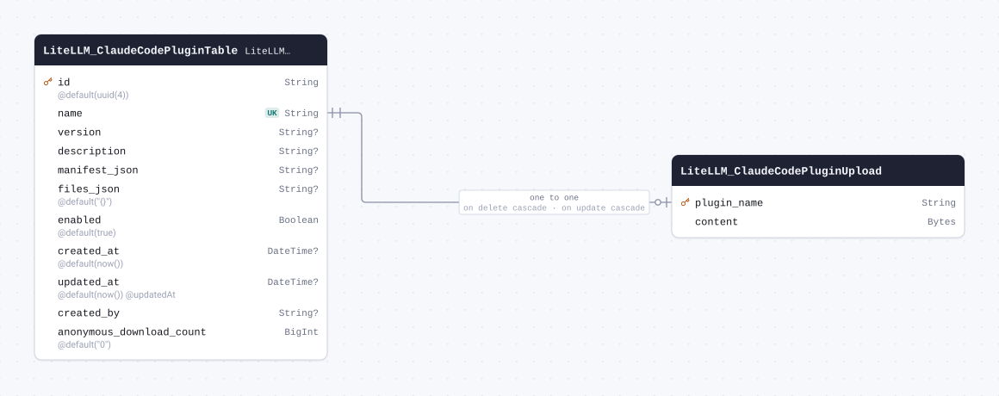

| Field         | Type     | Constraints                                                                              | Default | Description |
| ------------- | -------- | ---------------------------------------------------------------------------------------- | ------- | ----------- |
| `plugin_name` | `String` | PK NOT NULL → [LiteLLM_ClaudeCodePluginTable.name](#model-LiteLLM_ClaudeCodePluginTable) |         |             |
| `content`     | `Bytes`  | NOT NULL                                                                                 |         |             |

#### References

- `plugin_name` → [LiteLLM_ClaudeCodePluginTable.name](#model-LiteLLM_ClaudeCodePluginTable) (one-to-one, on delete Cascade, on update Cascade)

#### Definition

```sql
CREATE TABLE "LiteLLM_ClaudeCodePluginUpload" (
    "plugin_name" TEXT NOT NULL,
    "content" BYTEA NOT NULL,

    CONSTRAINT "LiteLLM_ClaudeCodePluginUpload_pkey" PRIMARY KEY ("plugin_name")
);

ALTER TABLE "LiteLLM_ClaudeCodePluginUpload" ADD CONSTRAINT "LiteLLM_ClaudeCodePluginUpload_plugin_name_fkey" FOREIGN KEY ("plugin_name") REFERENCES "LiteLLM_ClaudeCodePluginTable"("name") ON DELETE CASCADE ON UPDATE CASCADE;
```

<details>
<summary>Queries and their SQL</summary>

**findMany**: Every row

```ts
await prisma.liteLLM_ClaudeCodePluginUpload.findMany();
```

```sql
SELECT
  "public"."LiteLLM_ClaudeCodePluginUpload"."plugin_name",
  "public"."LiteLLM_ClaudeCodePluginUpload"."content"
FROM
  "public"."LiteLLM_ClaudeCodePluginUpload"
WHERE
  1 = 1
OFFSET
  $1
-- params: ["0"]
```

**count**: How many rows there are

```ts
await prisma.liteLLM_ClaudeCodePluginUpload.count();
```

```sql
SELECT
  COUNT(*) AS "_count$_all"
FROM
  (
    SELECT
      "public"."LiteLLM_ClaudeCodePluginUpload"."plugin_name"
    FROM
      "public"."LiteLLM_ClaudeCodePluginUpload"
    WHERE
      1 = 1
    OFFSET
      $1
  ) AS "sub"
-- params: ["0"]
```

**findMany**: Every row with its relations

```ts
await prisma.liteLLM_ClaudeCodePluginUpload.findMany({ include: { plugin: true } });
```

```sql
SELECT
  "public"."LiteLLM_ClaudeCodePluginUpload"."plugin_name",
  "public"."LiteLLM_ClaudeCodePluginUpload"."content"
FROM
  "public"."LiteLLM_ClaudeCodePluginUpload"
WHERE
  1 = 1
OFFSET
  $1
-- params: ["0"]

SELECT
  "public"."LiteLLM_ClaudeCodePluginTable"."id",
  "public"."LiteLLM_ClaudeCodePluginTable"."name",
  "public"."LiteLLM_ClaudeCodePluginTable"."version",
  "public"."LiteLLM_ClaudeCodePluginTable"."description",
  "public"."LiteLLM_ClaudeCodePluginTable"."manifest_json",
  "public"."LiteLLM_ClaudeCodePluginTable"."files_json",
  "public"."LiteLLM_ClaudeCodePluginTable"."enabled",
  "public"."LiteLLM_ClaudeCodePluginTable"."created_at",
  "public"."LiteLLM_ClaudeCodePluginTable"."updated_at",
  "public"."LiteLLM_ClaudeCodePluginTable"."created_by",
  "public"."LiteLLM_ClaudeCodePluginTable"."anonymous_download_count"
FROM
  "public"."LiteLLM_ClaudeCodePluginTable"
WHERE
  "public"."LiteLLM_ClaudeCodePluginTable"."name" IN ($1)
OFFSET
  $2
-- params: ["<plugin_name of the rows above>","0"]
```

**findUnique**: One row by what is unique to it

```ts
await prisma.liteLLM_ClaudeCodePluginUpload.findUnique({ where: { plugin_name: "example" } });
```

```sql
SELECT
  "public"."LiteLLM_ClaudeCodePluginUpload"."plugin_name",
  "public"."LiteLLM_ClaudeCodePluginUpload"."content"
FROM
  "public"."LiteLLM_ClaudeCodePluginUpload"
WHERE
  (
    "public"."LiteLLM_ClaudeCodePluginUpload"."plugin_name" = $1
    AND 1 = 1
  )
LIMIT
  $2
OFFSET
  $3
-- params: ["example","1","0"]
```

**create**: Create a row

```ts
await prisma.liteLLM_ClaudeCodePluginUpload.create({
  data: { plugin_name: "example", content: Uint8Array.from([1, 2, 3]) },
});
```

```sql
INSERT INTO
  "public"."LiteLLM_ClaudeCodePluginUpload" ("plugin_name", "content")
VALUES
  ($1, $2)
RETURNING
  "public"."LiteLLM_ClaudeCodePluginUpload"."plugin_name",
  "public"."LiteLLM_ClaudeCodePluginUpload"."content"
-- params: ["example","AQID"]
```

**update**: Update a row

```ts
await prisma.liteLLM_ClaudeCodePluginUpload.update({
  where: { plugin_name: "example" },
  data: { content: Uint8Array.from([1, 2, 3]) },
});
```

```sql
UPDATE "public"."LiteLLM_ClaudeCodePluginUpload"
SET
  "content" = $1
WHERE
  (
    "public"."LiteLLM_ClaudeCodePluginUpload"."plugin_name" = $2
    AND 1 = 1
  )
RETURNING
  "public"."LiteLLM_ClaudeCodePluginUpload"."plugin_name",
  "public"."LiteLLM_ClaudeCodePluginUpload"."content"
-- params: ["AQID","example"]
```

**delete**: Delete a row

```ts
await prisma.liteLLM_ClaudeCodePluginUpload.delete({ where: { plugin_name: "example" } });
```

```sql
DELETE FROM "public"."LiteLLM_ClaudeCodePluginUpload"
WHERE
  (
    "public"."LiteLLM_ClaudeCodePluginUpload"."plugin_name" = $1
    AND 1 = 1
  )
RETURNING
  "public"."LiteLLM_ClaudeCodePluginUpload"."plugin_name",
  "public"."LiteLLM_ClaudeCodePluginUpload"."content"
-- params: ["example"]
```

</details>

<a id="model-LiteLLM_MemoryTable"></a>

### LiteLLM_MemoryTable

| Field        | Type       | Constraints     | Default              | Description |
| ------------ | ---------- | --------------- | -------------------- | ----------- |
| `memory_id`  | `String`   | PK NOT NULL     | `uuid(4)`            |             |
| `key`        | `String`   | UNIQUE NOT NULL |                      |             |
| `value`      | `String`   | NOT NULL        |                      |             |
| `metadata`   | `Json`     | NULL            |                      |             |
| `user_id`    | `String`   | NULL            |                      |             |
| `team_id`    | `String`   | NULL            |                      |             |
| `created_at` | `DateTime` | NOT NULL        | `now()`              |             |
| `created_by` | `String`   | NULL            |                      |             |
| `updated_at` | `DateTime` | NOT NULL        | `now()` `@updatedAt` |             |
| `updated_by` | `String`   | NULL            |                      |             |

#### Indexes

- `@@index([user_id])`
- `@@index([team_id])`

#### Definition

```sql
CREATE TABLE "LiteLLM_MemoryTable" (
    "memory_id" TEXT NOT NULL,
    "key" TEXT NOT NULL,
    "value" TEXT NOT NULL,
    "metadata" JSONB,
    "user_id" TEXT,
    "team_id" TEXT,
    "created_at" TIMESTAMP(3) NOT NULL DEFAULT CURRENT_TIMESTAMP,
    "created_by" TEXT,
    "updated_at" TIMESTAMP(3) NOT NULL DEFAULT CURRENT_TIMESTAMP,
    "updated_by" TEXT,

    CONSTRAINT "LiteLLM_MemoryTable_pkey" PRIMARY KEY ("memory_id")
);

CREATE UNIQUE INDEX "LiteLLM_MemoryTable_key_key" ON "LiteLLM_MemoryTable"("key");

CREATE INDEX "LiteLLM_MemoryTable_user_id_idx" ON "LiteLLM_MemoryTable"("user_id");

CREATE INDEX "LiteLLM_MemoryTable_team_id_idx" ON "LiteLLM_MemoryTable"("team_id");
```

<details>
<summary>Queries and their SQL</summary>

**findMany**: Every row

```ts
await prisma.liteLLM_MemoryTable.findMany();
```

```sql
SELECT
  "public"."LiteLLM_MemoryTable"."memory_id",
  "public"."LiteLLM_MemoryTable"."key",
  "public"."LiteLLM_MemoryTable"."value",
  "public"."LiteLLM_MemoryTable"."metadata",
  "public"."LiteLLM_MemoryTable"."user_id",
  "public"."LiteLLM_MemoryTable"."team_id",
  "public"."LiteLLM_MemoryTable"."created_at",
  "public"."LiteLLM_MemoryTable"."created_by",
  "public"."LiteLLM_MemoryTable"."updated_at",
  "public"."LiteLLM_MemoryTable"."updated_by"
FROM
  "public"."LiteLLM_MemoryTable"
WHERE
  1 = 1
OFFSET
  $1
-- params: ["0"]
```

**count**: How many rows there are

```ts
await prisma.liteLLM_MemoryTable.count();
```

```sql
SELECT
  COUNT(*) AS "_count$_all"
FROM
  (
    SELECT
      "public"."LiteLLM_MemoryTable"."memory_id"
    FROM
      "public"."LiteLLM_MemoryTable"
    WHERE
      1 = 1
    OFFSET
      $1
  ) AS "sub"
-- params: ["0"]
```

**findUnique**: One row by what is unique to it

```ts
await prisma.liteLLM_MemoryTable.findUnique({ where: { memory_id: "example" } });
```

```sql
SELECT
  "public"."LiteLLM_MemoryTable"."memory_id",
  "public"."LiteLLM_MemoryTable"."key",
  "public"."LiteLLM_MemoryTable"."value",
  "public"."LiteLLM_MemoryTable"."metadata",
  "public"."LiteLLM_MemoryTable"."user_id",
  "public"."LiteLLM_MemoryTable"."team_id",
  "public"."LiteLLM_MemoryTable"."created_at",
  "public"."LiteLLM_MemoryTable"."created_by",
  "public"."LiteLLM_MemoryTable"."updated_at",
  "public"."LiteLLM_MemoryTable"."updated_by"
FROM
  "public"."LiteLLM_MemoryTable"
WHERE
  (
    "public"."LiteLLM_MemoryTable"."memory_id" = $1
    AND 1 = 1
  )
LIMIT
  $2
OFFSET
  $3
-- params: ["example","1","0"]
```

**create**: Create a row

```ts
await prisma.liteLLM_MemoryTable.create({ data: { key: "example", value: "example" } });
```

```sql
INSERT INTO
  "public"."LiteLLM_MemoryTable" (
    "memory_id",
    "key",
    "value",
    "created_at",
    "updated_at"
  )
VALUES
  ($1, $2, $3, $4, $5)
RETURNING
  "public"."LiteLLM_MemoryTable"."memory_id",
  "public"."LiteLLM_MemoryTable"."key",
  "public"."LiteLLM_MemoryTable"."value",
  "public"."LiteLLM_MemoryTable"."metadata",
  "public"."LiteLLM_MemoryTable"."user_id",
  "public"."LiteLLM_MemoryTable"."team_id",
  "public"."LiteLLM_MemoryTable"."created_at",
  "public"."LiteLLM_MemoryTable"."created_by",
  "public"."LiteLLM_MemoryTable"."updated_at",
  "public"."LiteLLM_MemoryTable"."updated_by"
-- params: ["<uuid(4)>","example","example","<now()>","<now()>"]
```

**update**: Update a row

```ts
await prisma.liteLLM_MemoryTable.update({
  where: { memory_id: "example" },
  data: { key: "example" },
});
```

```sql
UPDATE "public"."LiteLLM_MemoryTable"
SET
  "key" = $1,
  "updated_at" = $2
WHERE
  (
    "public"."LiteLLM_MemoryTable"."memory_id" = $3
    AND 1 = 1
  )
RETURNING
  "public"."LiteLLM_MemoryTable"."memory_id",
  "public"."LiteLLM_MemoryTable"."key",
  "public"."LiteLLM_MemoryTable"."value",
  "public"."LiteLLM_MemoryTable"."metadata",
  "public"."LiteLLM_MemoryTable"."user_id",
  "public"."LiteLLM_MemoryTable"."team_id",
  "public"."LiteLLM_MemoryTable"."created_at",
  "public"."LiteLLM_MemoryTable"."created_by",
  "public"."LiteLLM_MemoryTable"."updated_at",
  "public"."LiteLLM_MemoryTable"."updated_by"
-- params: ["example",{"prisma__type":"generatorCall","prisma__value":{"name":"now","args":[],"returnType":{"type":"DateTime"}}},"example"]
```

**delete**: Delete a row

```ts
await prisma.liteLLM_MemoryTable.delete({ where: { memory_id: "example" } });
```

```sql
DELETE FROM "public"."LiteLLM_MemoryTable"
WHERE
  (
    "public"."LiteLLM_MemoryTable"."memory_id" = $1
    AND 1 = 1
  )
RETURNING
  "public"."LiteLLM_MemoryTable"."memory_id",
  "public"."LiteLLM_MemoryTable"."key",
  "public"."LiteLLM_MemoryTable"."value",
  "public"."LiteLLM_MemoryTable"."metadata",
  "public"."LiteLLM_MemoryTable"."user_id",
  "public"."LiteLLM_MemoryTable"."team_id",
  "public"."LiteLLM_MemoryTable"."created_at",
  "public"."LiteLLM_MemoryTable"."created_by",
  "public"."LiteLLM_MemoryTable"."updated_at",
  "public"."LiteLLM_MemoryTable"."updated_by"
-- params: ["example"]
```

</details>

<a id="model-LiteLLM_AdaptiveRouterState"></a>

### LiteLLM_AdaptiveRouterState

| Field             | Type       | Constraints | Default              | Description |
| ----------------- | ---------- | ----------- | -------------------- | ----------- |
| `router_name`     | `String`   | PK NOT NULL |                      |             |
| `request_type`    | `String`   | PK NOT NULL |                      |             |
| `model_name`      | `String`   | PK NOT NULL |                      |             |
| `alpha`           | `Float`    | NOT NULL    |                      |             |
| `beta`            | `Float`    | NOT NULL    |                      |             |
| `total_samples`   | `Int`      | NOT NULL    | `0`                  |             |
| `last_updated_at` | `DateTime` | NOT NULL    | `now()` `@updatedAt` |             |

#### Indexes

- `@@id([router_name, request_type, model_name])`

#### Definition

```sql
CREATE TABLE "LiteLLM_AdaptiveRouterState" (
    "router_name" TEXT NOT NULL,
    "request_type" TEXT NOT NULL,
    "model_name" TEXT NOT NULL,
    "alpha" DOUBLE PRECISION NOT NULL,
    "beta" DOUBLE PRECISION NOT NULL,
    "total_samples" INTEGER NOT NULL DEFAULT 0,
    "last_updated_at" TIMESTAMP(3) NOT NULL DEFAULT CURRENT_TIMESTAMP,

    CONSTRAINT "LiteLLM_AdaptiveRouterState_pkey" PRIMARY KEY ("router_name","request_type","model_name")
);
```

<details>
<summary>Queries and their SQL</summary>

**findMany**: Every row

```ts
await prisma.liteLLM_AdaptiveRouterState.findMany();
```

```sql
SELECT
  "public"."LiteLLM_AdaptiveRouterState"."router_name",
  "public"."LiteLLM_AdaptiveRouterState"."request_type",
  "public"."LiteLLM_AdaptiveRouterState"."model_name",
  "public"."LiteLLM_AdaptiveRouterState"."alpha",
  "public"."LiteLLM_AdaptiveRouterState"."beta",
  "public"."LiteLLM_AdaptiveRouterState"."total_samples",
  "public"."LiteLLM_AdaptiveRouterState"."last_updated_at"
FROM
  "public"."LiteLLM_AdaptiveRouterState"
WHERE
  1 = 1
OFFSET
  $1
-- params: ["0"]
```

**count**: How many rows there are

```ts
await prisma.liteLLM_AdaptiveRouterState.count();
```

```sql
SELECT
  COUNT(*) AS "_count$_all"
FROM
  (
    SELECT
      "public"."LiteLLM_AdaptiveRouterState"."router_name",
      "public"."LiteLLM_AdaptiveRouterState"."request_type",
      "public"."LiteLLM_AdaptiveRouterState"."model_name"
    FROM
      "public"."LiteLLM_AdaptiveRouterState"
    WHERE
      1 = 1
    OFFSET
      $1
  ) AS "sub"
-- params: ["0"]
```

**findUnique**: One row by what is unique to it

```ts
await prisma.liteLLM_AdaptiveRouterState.findUnique({
  where: {
    router_name_request_type_model_name: {
      router_name: "example",
      request_type: "example",
      model_name: "example",
    },
  },
});
```

```sql
SELECT
  "public"."LiteLLM_AdaptiveRouterState"."router_name",
  "public"."LiteLLM_AdaptiveRouterState"."request_type",
  "public"."LiteLLM_AdaptiveRouterState"."model_name",
  "public"."LiteLLM_AdaptiveRouterState"."alpha",
  "public"."LiteLLM_AdaptiveRouterState"."beta",
  "public"."LiteLLM_AdaptiveRouterState"."total_samples",
  "public"."LiteLLM_AdaptiveRouterState"."last_updated_at"
FROM
  "public"."LiteLLM_AdaptiveRouterState"
WHERE
  (
    (
      "public"."LiteLLM_AdaptiveRouterState"."router_name" = $1
      AND "public"."LiteLLM_AdaptiveRouterState"."request_type" = $2
      AND "public"."LiteLLM_AdaptiveRouterState"."model_name" = $3
    )
    AND 1 = 1
  )
LIMIT
  $4
OFFSET
  $5
-- params: ["example","example","example","1","0"]
```

**create**: Create a row

```ts
await prisma.liteLLM_AdaptiveRouterState.create({
  data: {
    router_name: "example",
    request_type: "example",
    model_name: "example",
    alpha: 1.5,
    beta: 1.5,
  },
});
```

```sql
INSERT INTO
  "public"."LiteLLM_AdaptiveRouterState" (
    "router_name",
    "request_type",
    "model_name",
    "alpha",
    "beta",
    "total_samples",
    "last_updated_at"
  )
VALUES
  ($1, $2, $3, $4, $5, $6, $7)
RETURNING
  "public"."LiteLLM_AdaptiveRouterState"."router_name",
  "public"."LiteLLM_AdaptiveRouterState"."request_type",
  "public"."LiteLLM_AdaptiveRouterState"."model_name",
  "public"."LiteLLM_AdaptiveRouterState"."alpha",
  "public"."LiteLLM_AdaptiveRouterState"."beta",
  "public"."LiteLLM_AdaptiveRouterState"."total_samples",
  "public"."LiteLLM_AdaptiveRouterState"."last_updated_at"
-- params: ["example","example","example","1.5","1.5","0","<now()>"]
```

**update**: Update a row

```ts
await prisma.liteLLM_AdaptiveRouterState.update({
  where: {
    router_name_request_type_model_name: {
      router_name: "example",
      request_type: "example",
      model_name: "example",
    },
  },
  data: { alpha: 1.5 },
});
```

```sql
UPDATE "public"."LiteLLM_AdaptiveRouterState"
SET
  "alpha" = $1,
  "last_updated_at" = $2
WHERE
  (
    (
      "public"."LiteLLM_AdaptiveRouterState"."router_name" = $3
      AND "public"."LiteLLM_AdaptiveRouterState"."request_type" = $4
      AND "public"."LiteLLM_AdaptiveRouterState"."model_name" = $5
    )
    AND 1 = 1
  )
RETURNING
  "public"."LiteLLM_AdaptiveRouterState"."router_name",
  "public"."LiteLLM_AdaptiveRouterState"."request_type",
  "public"."LiteLLM_AdaptiveRouterState"."model_name",
  "public"."LiteLLM_AdaptiveRouterState"."alpha",
  "public"."LiteLLM_AdaptiveRouterState"."beta",
  "public"."LiteLLM_AdaptiveRouterState"."total_samples",
  "public"."LiteLLM_AdaptiveRouterState"."last_updated_at"
-- params: ["1.5",{"prisma__type":"generatorCall","prisma__value":{"name":"now","args":[],"returnType":{"type":"DateTime"}}},"example","example","example"]
```

**delete**: Delete a row

```ts
await prisma.liteLLM_AdaptiveRouterState.delete({
  where: {
    router_name_request_type_model_name: {
      router_name: "example",
      request_type: "example",
      model_name: "example",
    },
  },
});
```

```sql
DELETE FROM "public"."LiteLLM_AdaptiveRouterState"
WHERE
  (
    (
      "public"."LiteLLM_AdaptiveRouterState"."router_name" = $1
      AND "public"."LiteLLM_AdaptiveRouterState"."request_type" = $2
      AND "public"."LiteLLM_AdaptiveRouterState"."model_name" = $3
    )
    AND 1 = 1
  )
RETURNING
  "public"."LiteLLM_AdaptiveRouterState"."router_name",
  "public"."LiteLLM_AdaptiveRouterState"."request_type",
  "public"."LiteLLM_AdaptiveRouterState"."model_name",
  "public"."LiteLLM_AdaptiveRouterState"."alpha",
  "public"."LiteLLM_AdaptiveRouterState"."beta",
  "public"."LiteLLM_AdaptiveRouterState"."total_samples",
  "public"."LiteLLM_AdaptiveRouterState"."last_updated_at"
-- params: ["example","example","example"]
```

</details>

<a id="model-LiteLLM_AdaptiveRouterSession"></a>

### LiteLLM_AdaptiveRouterSession

| Field                    | Type       | Constraints | Default              | Description |
| ------------------------ | ---------- | ----------- | -------------------- | ----------- |
| `session_id`             | `String`   | PK NOT NULL |                      |             |
| `router_name`            | `String`   | PK NOT NULL |                      |             |
| `model_name`             | `String`   | PK NOT NULL |                      |             |
| `classified_type`        | `String`   | NOT NULL    |                      |             |
| `misalignment_count`     | `Int`      | NOT NULL    | `0`                  |             |
| `stagnation_count`       | `Int`      | NOT NULL    | `0`                  |             |
| `disengagement_count`    | `Int`      | NOT NULL    | `0`                  |             |
| `satisfaction_count`     | `Int`      | NOT NULL    | `0`                  |             |
| `failure_count`          | `Int`      | NOT NULL    | `0`                  |             |
| `loop_count`             | `Int`      | NOT NULL    | `0`                  |             |
| `exhaustion_count`       | `Int`      | NOT NULL    | `0`                  |             |
| `last_user_content`      | `String`   | NULL        |                      |             |
| `last_assistant_content` | `String`   | NULL        |                      |             |
| `tool_call_history`      | `Json`     | NOT NULL    | `"[]"`               |             |
| `pending_tool_calls`     | `Json`     | NOT NULL    | `"{}"`               |             |
| `turn_count`             | `Int`      | NOT NULL    | `0`                  |             |
| `last_processed_turn`    | `Int`      | NOT NULL    | `-1`                 |             |
| `clean_credit_awarded`   | `Boolean`  | NOT NULL    | `false`              |             |
| `terminal_status`        | `Int`      | NULL        |                      |             |
| `last_activity_at`       | `DateTime` | NOT NULL    | `now()` `@updatedAt` |             |

#### Indexes

- `@@id([session_id, router_name, model_name])`
- `@@index([last_activity_at], map: "idx_adaptive_router_session_activity")`

#### Definition

```sql
CREATE TABLE "LiteLLM_AdaptiveRouterSession" (
    "session_id" TEXT NOT NULL,
    "router_name" TEXT NOT NULL,
    "model_name" TEXT NOT NULL,
    "classified_type" TEXT NOT NULL,
    "misalignment_count" INTEGER NOT NULL DEFAULT 0,
    "stagnation_count" INTEGER NOT NULL DEFAULT 0,
    "disengagement_count" INTEGER NOT NULL DEFAULT 0,
    "satisfaction_count" INTEGER NOT NULL DEFAULT 0,
    "failure_count" INTEGER NOT NULL DEFAULT 0,
    "loop_count" INTEGER NOT NULL DEFAULT 0,
    "exhaustion_count" INTEGER NOT NULL DEFAULT 0,
    "last_user_content" TEXT,
    "last_assistant_content" TEXT,
    "tool_call_history" JSONB NOT NULL DEFAULT '[]',
    "pending_tool_calls" JSONB NOT NULL DEFAULT '{}',
    "turn_count" INTEGER NOT NULL DEFAULT 0,
    "last_processed_turn" INTEGER NOT NULL DEFAULT -1,
    "clean_credit_awarded" BOOLEAN NOT NULL DEFAULT false,
    "terminal_status" INTEGER,
    "last_activity_at" TIMESTAMP(3) NOT NULL DEFAULT CURRENT_TIMESTAMP,

    CONSTRAINT "LiteLLM_AdaptiveRouterSession_pkey" PRIMARY KEY ("session_id","router_name","model_name")
);

CREATE INDEX "idx_adaptive_router_session_activity" ON "LiteLLM_AdaptiveRouterSession"("last_activity_at");
```

<details>
<summary>Queries and their SQL</summary>

**findMany**: Every row

```ts
await prisma.liteLLM_AdaptiveRouterSession.findMany();
```

```sql
SELECT
  "public"."LiteLLM_AdaptiveRouterSession"."session_id",
  "public"."LiteLLM_AdaptiveRouterSession"."router_name",
  "public"."LiteLLM_AdaptiveRouterSession"."model_name",
  "public"."LiteLLM_AdaptiveRouterSession"."classified_type",
  "public"."LiteLLM_AdaptiveRouterSession"."misalignment_count",
  "public"."LiteLLM_AdaptiveRouterSession"."stagnation_count",
  "public"."LiteLLM_AdaptiveRouterSession"."disengagement_count",
  "public"."LiteLLM_AdaptiveRouterSession"."satisfaction_count",
  "public"."LiteLLM_AdaptiveRouterSession"."failure_count",
  "public"."LiteLLM_AdaptiveRouterSession"."loop_count",
  "public"."LiteLLM_AdaptiveRouterSession"."exhaustion_count",
  "public"."LiteLLM_AdaptiveRouterSession"."last_user_content",
  "public"."LiteLLM_AdaptiveRouterSession"."last_assistant_content",
  "public"."LiteLLM_AdaptiveRouterSession"."tool_call_history",
  "public"."LiteLLM_AdaptiveRouterSession"."pending_tool_calls",
  "public"."LiteLLM_AdaptiveRouterSession"."turn_count",
  "public"."LiteLLM_AdaptiveRouterSession"."last_processed_turn",
  "public"."LiteLLM_AdaptiveRouterSession"."clean_credit_awarded",
  "public"."LiteLLM_AdaptiveRouterSession"."terminal_status",
  "public"."LiteLLM_AdaptiveRouterSession"."last_activity_at"
FROM
  "public"."LiteLLM_AdaptiveRouterSession"
WHERE
  1 = 1
OFFSET
  $1
-- params: ["0"]
```

**count**: How many rows there are

```ts
await prisma.liteLLM_AdaptiveRouterSession.count();
```

```sql
SELECT
  COUNT(*) AS "_count$_all"
FROM
  (
    SELECT
      "public"."LiteLLM_AdaptiveRouterSession"."session_id",
      "public"."LiteLLM_AdaptiveRouterSession"."router_name",
      "public"."LiteLLM_AdaptiveRouterSession"."model_name"
    FROM
      "public"."LiteLLM_AdaptiveRouterSession"
    WHERE
      1 = 1
    OFFSET
      $1
  ) AS "sub"
-- params: ["0"]
```

**findUnique**: One row by what is unique to it

```ts
await prisma.liteLLM_AdaptiveRouterSession.findUnique({
  where: {
    session_id_router_name_model_name: {
      session_id: "example",
      router_name: "example",
      model_name: "example",
    },
  },
});
```

```sql
SELECT
  "public"."LiteLLM_AdaptiveRouterSession"."session_id",
  "public"."LiteLLM_AdaptiveRouterSession"."router_name",
  "public"."LiteLLM_AdaptiveRouterSession"."model_name",
  "public"."LiteLLM_AdaptiveRouterSession"."classified_type",
  "public"."LiteLLM_AdaptiveRouterSession"."misalignment_count",
  "public"."LiteLLM_AdaptiveRouterSession"."stagnation_count",
  "public"."LiteLLM_AdaptiveRouterSession"."disengagement_count",
  "public"."LiteLLM_AdaptiveRouterSession"."satisfaction_count",
  "public"."LiteLLM_AdaptiveRouterSession"."failure_count",
  "public"."LiteLLM_AdaptiveRouterSession"."loop_count",
  "public"."LiteLLM_AdaptiveRouterSession"."exhaustion_count",
  "public"."LiteLLM_AdaptiveRouterSession"."last_user_content",
  "public"."LiteLLM_AdaptiveRouterSession"."last_assistant_content",
  "public"."LiteLLM_AdaptiveRouterSession"."tool_call_history",
  "public"."LiteLLM_AdaptiveRouterSession"."pending_tool_calls",
  "public"."LiteLLM_AdaptiveRouterSession"."turn_count",
  "public"."LiteLLM_AdaptiveRouterSession"."last_processed_turn",
  "public"."LiteLLM_AdaptiveRouterSession"."clean_credit_awarded",
  "public"."LiteLLM_AdaptiveRouterSession"."terminal_status",
  "public"."LiteLLM_AdaptiveRouterSession"."last_activity_at"
FROM
  "public"."LiteLLM_AdaptiveRouterSession"
WHERE
  (
    (
      "public"."LiteLLM_AdaptiveRouterSession"."session_id" = $1
      AND "public"."LiteLLM_AdaptiveRouterSession"."router_name" = $2
      AND "public"."LiteLLM_AdaptiveRouterSession"."model_name" = $3
    )
    AND 1 = 1
  )
LIMIT
  $4
OFFSET
  $5
-- params: ["example","example","example","1","0"]
```

**create**: Create a row

```ts
await prisma.liteLLM_AdaptiveRouterSession.create({
  data: {
    session_id: "example",
    router_name: "example",
    model_name: "example",
    classified_type: "example",
  },
});
```

```sql
INSERT INTO
  "public"."LiteLLM_AdaptiveRouterSession" (
    "session_id",
    "router_name",
    "model_name",
    "classified_type",
    "misalignment_count",
    "stagnation_count",
    "disengagement_count",
    "satisfaction_count",
    "failure_count",
    "loop_count",
    "exhaustion_count",
    "tool_call_history",
    "pending_tool_calls",
    "turn_count",
    "last_processed_turn",
    "clean_credit_awarded",
    "last_activity_at"
  )
VALUES
  (
    $1,
    $2,
    $3,
    $4,
    $5,
    $6,
    $7,
    $8,
    $9,
    $10,
    $11,
    $12,
    $13,
    $14,
    $15,
    $16,
    $17
  )
RETURNING
  "public"."LiteLLM_AdaptiveRouterSession"."session_id",
  "public"."LiteLLM_AdaptiveRouterSession"."router_name",
  "public"."LiteLLM_AdaptiveRouterSession"."model_name",
  "public"."LiteLLM_AdaptiveRouterSession"."classified_type",
  "public"."LiteLLM_AdaptiveRouterSession"."misalignment_count",
  "public"."LiteLLM_AdaptiveRouterSession"."stagnation_count",
  "public"."LiteLLM_AdaptiveRouterSession"."disengagement_count",
  "public"."LiteLLM_AdaptiveRouterSession"."satisfaction_count",
  "public"."LiteLLM_AdaptiveRouterSession"."failure_count",
  "public"."LiteLLM_AdaptiveRouterSession"."loop_count",
  "public"."LiteLLM_AdaptiveRouterSession"."exhaustion_count",
  "public"."LiteLLM_AdaptiveRouterSession"."last_user_content",
  "public"."LiteLLM_AdaptiveRouterSession"."last_assistant_content",
  "public"."LiteLLM_AdaptiveRouterSession"."tool_call_history",
  "public"."LiteLLM_AdaptiveRouterSession"."pending_tool_calls",
  "public"."LiteLLM_AdaptiveRouterSession"."turn_count",
  "public"."LiteLLM_AdaptiveRouterSession"."last_processed_turn",
  "public"."LiteLLM_AdaptiveRouterSession"."clean_credit_awarded",
  "public"."LiteLLM_AdaptiveRouterSession"."terminal_status",
  "public"."LiteLLM_AdaptiveRouterSession"."last_activity_at"
-- params: ["example","example","example","example","0","0","0","0","0","0","0","[]","{}","0","-1",false,"<now()>"]
```

**update**: Update a row

```ts
await prisma.liteLLM_AdaptiveRouterSession.update({
  where: {
    session_id_router_name_model_name: {
      session_id: "example",
      router_name: "example",
      model_name: "example",
    },
  },
  data: { classified_type: "example" },
});
```

```sql
UPDATE "public"."LiteLLM_AdaptiveRouterSession"
SET
  "classified_type" = $1,
  "last_activity_at" = $2
WHERE
  (
    (
      "public"."LiteLLM_AdaptiveRouterSession"."session_id" = $3
      AND "public"."LiteLLM_AdaptiveRouterSession"."router_name" = $4
      AND "public"."LiteLLM_AdaptiveRouterSession"."model_name" = $5
    )
    AND 1 = 1
  )
RETURNING
  "public"."LiteLLM_AdaptiveRouterSession"."session_id",
  "public"."LiteLLM_AdaptiveRouterSession"."router_name",
  "public"."LiteLLM_AdaptiveRouterSession"."model_name",
  "public"."LiteLLM_AdaptiveRouterSession"."classified_type",
  "public"."LiteLLM_AdaptiveRouterSession"."misalignment_count",
  "public"."LiteLLM_AdaptiveRouterSession"."stagnation_count",
  "public"."LiteLLM_AdaptiveRouterSession"."disengagement_count",
  "public"."LiteLLM_AdaptiveRouterSession"."satisfaction_count",
  "public"."LiteLLM_AdaptiveRouterSession"."failure_count",
  "public"."LiteLLM_AdaptiveRouterSession"."loop_count",
  "public"."LiteLLM_AdaptiveRouterSession"."exhaustion_count",
  "public"."LiteLLM_AdaptiveRouterSession"."last_user_content",
  "public"."LiteLLM_AdaptiveRouterSession"."last_assistant_content",
  "public"."LiteLLM_AdaptiveRouterSession"."tool_call_history",
  "public"."LiteLLM_AdaptiveRouterSession"."pending_tool_calls",
  "public"."LiteLLM_AdaptiveRouterSession"."turn_count",
  "public"."LiteLLM_AdaptiveRouterSession"."last_processed_turn",
  "public"."LiteLLM_AdaptiveRouterSession"."clean_credit_awarded",
  "public"."LiteLLM_AdaptiveRouterSession"."terminal_status",
  "public"."LiteLLM_AdaptiveRouterSession"."last_activity_at"
-- params: ["example",{"prisma__type":"generatorCall","prisma__value":{"name":"now","args":[],"returnType":{"type":"DateTime"}}},"example","example","example"]
```

**delete**: Delete a row

```ts
await prisma.liteLLM_AdaptiveRouterSession.delete({
  where: {
    session_id_router_name_model_name: {
      session_id: "example",
      router_name: "example",
      model_name: "example",
    },
  },
});
```

```sql
DELETE FROM "public"."LiteLLM_AdaptiveRouterSession"
WHERE
  (
    (
      "public"."LiteLLM_AdaptiveRouterSession"."session_id" = $1
      AND "public"."LiteLLM_AdaptiveRouterSession"."router_name" = $2
      AND "public"."LiteLLM_AdaptiveRouterSession"."model_name" = $3
    )
    AND 1 = 1
  )
RETURNING
  "public"."LiteLLM_AdaptiveRouterSession"."session_id",
  "public"."LiteLLM_AdaptiveRouterSession"."router_name",
  "public"."LiteLLM_AdaptiveRouterSession"."model_name",
  "public"."LiteLLM_AdaptiveRouterSession"."classified_type",
  "public"."LiteLLM_AdaptiveRouterSession"."misalignment_count",
  "public"."LiteLLM_AdaptiveRouterSession"."stagnation_count",
  "public"."LiteLLM_AdaptiveRouterSession"."disengagement_count",
  "public"."LiteLLM_AdaptiveRouterSession"."satisfaction_count",
  "public"."LiteLLM_AdaptiveRouterSession"."failure_count",
  "public"."LiteLLM_AdaptiveRouterSession"."loop_count",
  "public"."LiteLLM_AdaptiveRouterSession"."exhaustion_count",
  "public"."LiteLLM_AdaptiveRouterSession"."last_user_content",
  "public"."LiteLLM_AdaptiveRouterSession"."last_assistant_content",
  "public"."LiteLLM_AdaptiveRouterSession"."tool_call_history",
  "public"."LiteLLM_AdaptiveRouterSession"."pending_tool_calls",
  "public"."LiteLLM_AdaptiveRouterSession"."turn_count",
  "public"."LiteLLM_AdaptiveRouterSession"."last_processed_turn",
  "public"."LiteLLM_AdaptiveRouterSession"."clean_credit_awarded",
  "public"."LiteLLM_AdaptiveRouterSession"."terminal_status",
  "public"."LiteLLM_AdaptiveRouterSession"."last_activity_at"
-- params: ["example","example","example"]
```

</details>

<a id="model-LiteLLM_AutoRouterBaselineComparison"></a>

### LiteLLM_AutoRouterBaselineComparison

| Field                | Type       | Constraints | Default | Description |
| -------------------- | ---------- | ----------- | ------- | ----------- |
| `scope`              | `String`   | PK NOT NULL |         |             |
| `api_key`            | `String`   | NOT NULL    |         |             |
| `session_id`         | `String`   | NOT NULL    |         |             |
| `router_name`        | `String`   | NOT NULL    |         |             |
| `initial_equivalent` | `Boolean`  | NOT NULL    |         |             |
| `revision`           | `BigInt`   | NOT NULL    | `"0"`   |             |
| `published_revision` | `BigInt`   | NOT NULL    | `"0"`   |             |
| `history`            | `String`   | NULL        |         |             |
| `attempted_at`       | `DateTime` | NULL        |         |             |
| `retired`            | `Boolean`  | NOT NULL    | `false` |             |
| `updated_at`         | `DateTime` | NOT NULL    | `now()` |             |

#### Indexes

- `@@index([api_key, session_id, router_name], map: "idx_autorouter_baseline_scope")`
- `@@index([updated_at], map: "idx_autorouter_baseline_updated")`

#### Definition

```sql
CREATE TABLE "LiteLLM_AutoRouterBaselineComparison" (
    "scope" TEXT NOT NULL,
    "api_key" TEXT NOT NULL,
    "session_id" TEXT NOT NULL,
    "router_name" TEXT NOT NULL,
    "initial_equivalent" BOOLEAN NOT NULL,
    "revision" BIGINT NOT NULL DEFAULT 0,
    "published_revision" BIGINT NOT NULL DEFAULT 0,
    "history" TEXT,
    "attempted_at" TIMESTAMP(3),
    "retired" BOOLEAN NOT NULL DEFAULT false,
    "updated_at" TIMESTAMP(3) NOT NULL DEFAULT CURRENT_TIMESTAMP,

    CONSTRAINT "LiteLLM_AutoRouterBaselineComparison_pkey" PRIMARY KEY ("scope")
);

CREATE INDEX "idx_autorouter_baseline_scope" ON "LiteLLM_AutoRouterBaselineComparison"("api_key", "session_id", "router_name");

CREATE INDEX "idx_autorouter_baseline_updated" ON "LiteLLM_AutoRouterBaselineComparison"("updated_at");
```

<details>
<summary>Queries and their SQL</summary>

**findMany**: Every row

```ts
await prisma.liteLLM_AutoRouterBaselineComparison.findMany();
```

```sql
SELECT
  "public"."LiteLLM_AutoRouterBaselineComparison"."scope",
  "public"."LiteLLM_AutoRouterBaselineComparison"."api_key",
  "public"."LiteLLM_AutoRouterBaselineComparison"."session_id",
  "public"."LiteLLM_AutoRouterBaselineComparison"."router_name",
  "public"."LiteLLM_AutoRouterBaselineComparison"."initial_equivalent",
  "public"."LiteLLM_AutoRouterBaselineComparison"."revision",
  "public"."LiteLLM_AutoRouterBaselineComparison"."published_revision",
  "public"."LiteLLM_AutoRouterBaselineComparison"."history",
  "public"."LiteLLM_AutoRouterBaselineComparison"."attempted_at",
  "public"."LiteLLM_AutoRouterBaselineComparison"."retired",
  "public"."LiteLLM_AutoRouterBaselineComparison"."updated_at"
FROM
  "public"."LiteLLM_AutoRouterBaselineComparison"
WHERE
  1 = 1
OFFSET
  $1
-- params: ["0"]
```

**count**: How many rows there are

```ts
await prisma.liteLLM_AutoRouterBaselineComparison.count();
```

```sql
SELECT
  COUNT(*) AS "_count$_all"
FROM
  (
    SELECT
      "public"."LiteLLM_AutoRouterBaselineComparison"."scope"
    FROM
      "public"."LiteLLM_AutoRouterBaselineComparison"
    WHERE
      1 = 1
    OFFSET
      $1
  ) AS "sub"
-- params: ["0"]
```

**findUnique**: One row by what is unique to it

```ts
await prisma.liteLLM_AutoRouterBaselineComparison.findUnique({ where: { scope: "example" } });
```

```sql
SELECT
  "public"."LiteLLM_AutoRouterBaselineComparison"."scope",
  "public"."LiteLLM_AutoRouterBaselineComparison"."api_key",
  "public"."LiteLLM_AutoRouterBaselineComparison"."session_id",
  "public"."LiteLLM_AutoRouterBaselineComparison"."router_name",
  "public"."LiteLLM_AutoRouterBaselineComparison"."initial_equivalent",
  "public"."LiteLLM_AutoRouterBaselineComparison"."revision",
  "public"."LiteLLM_AutoRouterBaselineComparison"."published_revision",
  "public"."LiteLLM_AutoRouterBaselineComparison"."history",
  "public"."LiteLLM_AutoRouterBaselineComparison"."attempted_at",
  "public"."LiteLLM_AutoRouterBaselineComparison"."retired",
  "public"."LiteLLM_AutoRouterBaselineComparison"."updated_at"
FROM
  "public"."LiteLLM_AutoRouterBaselineComparison"
WHERE
  (
    "public"."LiteLLM_AutoRouterBaselineComparison"."scope" = $1
    AND 1 = 1
  )
LIMIT
  $2
OFFSET
  $3
-- params: ["example","1","0"]
```

**create**: Create a row

```ts
await prisma.liteLLM_AutoRouterBaselineComparison.create({
  data: {
    scope: "example",
    api_key: "example",
    session_id: "example",
    router_name: "example",
    initial_equivalent: true,
  },
});
```

```sql
INSERT INTO
  "public"."LiteLLM_AutoRouterBaselineComparison" (
    "scope",
    "api_key",
    "session_id",
    "router_name",
    "initial_equivalent",
    "revision",
    "published_revision",
    "retired",
    "updated_at"
  )
VALUES
  ($1, $2, $3, $4, $5, $6, $7, $8, $9)
RETURNING
  "public"."LiteLLM_AutoRouterBaselineComparison"."scope",
  "public"."LiteLLM_AutoRouterBaselineComparison"."api_key",
  "public"."LiteLLM_AutoRouterBaselineComparison"."session_id",
  "public"."LiteLLM_AutoRouterBaselineComparison"."router_name",
  "public"."LiteLLM_AutoRouterBaselineComparison"."initial_equivalent",
  "public"."LiteLLM_AutoRouterBaselineComparison"."revision",
  "public"."LiteLLM_AutoRouterBaselineComparison"."published_revision",
  "public"."LiteLLM_AutoRouterBaselineComparison"."history",
  "public"."LiteLLM_AutoRouterBaselineComparison"."attempted_at",
  "public"."LiteLLM_AutoRouterBaselineComparison"."retired",
  "public"."LiteLLM_AutoRouterBaselineComparison"."updated_at"
-- params: ["example","example","example","example",true,"0","0",false,"<now()>"]
```

**update**: Update a row

```ts
await prisma.liteLLM_AutoRouterBaselineComparison.update({
  where: { scope: "example" },
  data: { api_key: "example" },
});
```

```sql
UPDATE "public"."LiteLLM_AutoRouterBaselineComparison"
SET
  "api_key" = $1
WHERE
  (
    "public"."LiteLLM_AutoRouterBaselineComparison"."scope" = $2
    AND 1 = 1
  )
RETURNING
  "public"."LiteLLM_AutoRouterBaselineComparison"."scope",
  "public"."LiteLLM_AutoRouterBaselineComparison"."api_key",
  "public"."LiteLLM_AutoRouterBaselineComparison"."session_id",
  "public"."LiteLLM_AutoRouterBaselineComparison"."router_name",
  "public"."LiteLLM_AutoRouterBaselineComparison"."initial_equivalent",
  "public"."LiteLLM_AutoRouterBaselineComparison"."revision",
  "public"."LiteLLM_AutoRouterBaselineComparison"."published_revision",
  "public"."LiteLLM_AutoRouterBaselineComparison"."history",
  "public"."LiteLLM_AutoRouterBaselineComparison"."attempted_at",
  "public"."LiteLLM_AutoRouterBaselineComparison"."retired",
  "public"."LiteLLM_AutoRouterBaselineComparison"."updated_at"
-- params: ["example","example"]
```

**delete**: Delete a row

```ts
await prisma.liteLLM_AutoRouterBaselineComparison.delete({ where: { scope: "example" } });
```

```sql
DELETE FROM "public"."LiteLLM_AutoRouterBaselineComparison"
WHERE
  (
    "public"."LiteLLM_AutoRouterBaselineComparison"."scope" = $1
    AND 1 = 1
  )
RETURNING
  "public"."LiteLLM_AutoRouterBaselineComparison"."scope",
  "public"."LiteLLM_AutoRouterBaselineComparison"."api_key",
  "public"."LiteLLM_AutoRouterBaselineComparison"."session_id",
  "public"."LiteLLM_AutoRouterBaselineComparison"."router_name",
  "public"."LiteLLM_AutoRouterBaselineComparison"."initial_equivalent",
  "public"."LiteLLM_AutoRouterBaselineComparison"."revision",
  "public"."LiteLLM_AutoRouterBaselineComparison"."published_revision",
  "public"."LiteLLM_AutoRouterBaselineComparison"."history",
  "public"."LiteLLM_AutoRouterBaselineComparison"."attempted_at",
  "public"."LiteLLM_AutoRouterBaselineComparison"."retired",
  "public"."LiteLLM_AutoRouterBaselineComparison"."updated_at"
-- params: ["example"]
```

</details>

<a id="model-LiteLLM_AutoRouterBaselineObservation"></a>

### LiteLLM_AutoRouterBaselineObservation

| Field         | Type      | Constraints | Default | Description |
| ------------- | --------- | ----------- | ------- | ----------- |
| `request_id`  | `String`  | PK NOT NULL |         |             |
| `scope`       | `String`  | NOT NULL    |         |             |
| `started_at`  | `Float`   | NOT NULL    |         |             |
| `revision`    | `BigInt`  | NOT NULL    |         |             |
| `data`        | `String`  | NOT NULL    |         |             |
| `publication` | `String`  | NULL        |         |             |
| `conflicted`  | `Boolean` | NOT NULL    | `false` |             |

#### Indexes

- `@@index([scope, started_at, request_id], map: "idx_autorouter_baseline_event_order")`
- `@@index([scope, revision, started_at], map: "idx_autorouter_baseline_event_revision")`

#### Definition

```sql
CREATE TABLE "LiteLLM_AutoRouterBaselineObservation" (
    "request_id" TEXT NOT NULL,
    "scope" TEXT NOT NULL,
    "started_at" DOUBLE PRECISION NOT NULL,
    "revision" BIGINT NOT NULL,
    "data" TEXT NOT NULL,
    "publication" TEXT,
    "conflicted" BOOLEAN NOT NULL DEFAULT false,

    CONSTRAINT "LiteLLM_AutoRouterBaselineObservation_pkey" PRIMARY KEY ("request_id")
);

CREATE INDEX "idx_autorouter_baseline_event_order" ON "LiteLLM_AutoRouterBaselineObservation"("scope", "started_at", "request_id");

CREATE INDEX "idx_autorouter_baseline_event_revision" ON "LiteLLM_AutoRouterBaselineObservation"("scope", "revision", "started_at");
```

<details>
<summary>Queries and their SQL</summary>

**findMany**: Every row

```ts
await prisma.liteLLM_AutoRouterBaselineObservation.findMany();
```

```sql
SELECT
  "public"."LiteLLM_AutoRouterBaselineObservation"."request_id",
  "public"."LiteLLM_AutoRouterBaselineObservation"."scope",
  "public"."LiteLLM_AutoRouterBaselineObservation"."started_at",
  "public"."LiteLLM_AutoRouterBaselineObservation"."revision",
  "public"."LiteLLM_AutoRouterBaselineObservation"."data",
  "public"."LiteLLM_AutoRouterBaselineObservation"."publication",
  "public"."LiteLLM_AutoRouterBaselineObservation"."conflicted"
FROM
  "public"."LiteLLM_AutoRouterBaselineObservation"
WHERE
  1 = 1
OFFSET
  $1
-- params: ["0"]
```

**count**: How many rows there are

```ts
await prisma.liteLLM_AutoRouterBaselineObservation.count();
```

```sql
SELECT
  COUNT(*) AS "_count$_all"
FROM
  (
    SELECT
      "public"."LiteLLM_AutoRouterBaselineObservation"."request_id"
    FROM
      "public"."LiteLLM_AutoRouterBaselineObservation"
    WHERE
      1 = 1
    OFFSET
      $1
  ) AS "sub"
-- params: ["0"]
```

**findUnique**: One row by what is unique to it

```ts
await prisma.liteLLM_AutoRouterBaselineObservation.findUnique({ where: { request_id: "example" } });
```

```sql
SELECT
  "public"."LiteLLM_AutoRouterBaselineObservation"."request_id",
  "public"."LiteLLM_AutoRouterBaselineObservation"."scope",
  "public"."LiteLLM_AutoRouterBaselineObservation"."started_at",
  "public"."LiteLLM_AutoRouterBaselineObservation"."revision",
  "public"."LiteLLM_AutoRouterBaselineObservation"."data",
  "public"."LiteLLM_AutoRouterBaselineObservation"."publication",
  "public"."LiteLLM_AutoRouterBaselineObservation"."conflicted"
FROM
  "public"."LiteLLM_AutoRouterBaselineObservation"
WHERE
  (
    "public"."LiteLLM_AutoRouterBaselineObservation"."request_id" = $1
    AND 1 = 1
  )
LIMIT
  $2
OFFSET
  $3
-- params: ["example","1","0"]
```

**create**: Create a row

```ts
await prisma.liteLLM_AutoRouterBaselineObservation.create({
  data: { request_id: "example", scope: "example", started_at: 1.5, revision: 1n, data: "example" },
});
```

```sql
INSERT INTO
  "public"."LiteLLM_AutoRouterBaselineObservation" (
    "request_id",
    "scope",
    "started_at",
    "revision",
    "data",
    "conflicted"
  )
VALUES
  ($1, $2, $3, $4, $5, $6)
RETURNING
  "public"."LiteLLM_AutoRouterBaselineObservation"."request_id",
  "public"."LiteLLM_AutoRouterBaselineObservation"."scope",
  "public"."LiteLLM_AutoRouterBaselineObservation"."started_at",
  "public"."LiteLLM_AutoRouterBaselineObservation"."revision",
  "public"."LiteLLM_AutoRouterBaselineObservation"."data",
  "public"."LiteLLM_AutoRouterBaselineObservation"."publication",
  "public"."LiteLLM_AutoRouterBaselineObservation"."conflicted"
-- params: ["example","example","1.5","1","example",false]
```

**update**: Update a row

```ts
await prisma.liteLLM_AutoRouterBaselineObservation.update({
  where: { request_id: "example" },
  data: { scope: "example" },
});
```

```sql
UPDATE "public"."LiteLLM_AutoRouterBaselineObservation"
SET
  "scope" = $1
WHERE
  (
    "public"."LiteLLM_AutoRouterBaselineObservation"."request_id" = $2
    AND 1 = 1
  )
RETURNING
  "public"."LiteLLM_AutoRouterBaselineObservation"."request_id",
  "public"."LiteLLM_AutoRouterBaselineObservation"."scope",
  "public"."LiteLLM_AutoRouterBaselineObservation"."started_at",
  "public"."LiteLLM_AutoRouterBaselineObservation"."revision",
  "public"."LiteLLM_AutoRouterBaselineObservation"."data",
  "public"."LiteLLM_AutoRouterBaselineObservation"."publication",
  "public"."LiteLLM_AutoRouterBaselineObservation"."conflicted"
-- params: ["example","example"]
```

**delete**: Delete a row

```ts
await prisma.liteLLM_AutoRouterBaselineObservation.delete({ where: { request_id: "example" } });
```

```sql
DELETE FROM "public"."LiteLLM_AutoRouterBaselineObservation"
WHERE
  (
    "public"."LiteLLM_AutoRouterBaselineObservation"."request_id" = $1
    AND 1 = 1
  )
RETURNING
  "public"."LiteLLM_AutoRouterBaselineObservation"."request_id",
  "public"."LiteLLM_AutoRouterBaselineObservation"."scope",
  "public"."LiteLLM_AutoRouterBaselineObservation"."started_at",
  "public"."LiteLLM_AutoRouterBaselineObservation"."revision",
  "public"."LiteLLM_AutoRouterBaselineObservation"."data",
  "public"."LiteLLM_AutoRouterBaselineObservation"."publication",
  "public"."LiteLLM_AutoRouterBaselineObservation"."conflicted"
-- params: ["example"]
```

</details>

<a id="model-LiteLLM_AutoRouterSession"></a>

### LiteLLM_AutoRouterSession

| Field                               | Type       | Constraints | Default | Description |
| ----------------------------------- | ---------- | ----------- | ------- | ----------- |
| `api_key`                           | `String`   | PK NOT NULL |         |             |
| `session_id`                        | `String`   | PK NOT NULL |         |             |
| `router_name`                       | `String`   | PK NOT NULL |         |             |
| `router_type`                       | `String`   | NOT NULL    |         |             |
| `first_turn_at`                     | `DateTime` | NOT NULL    |         |             |
| `last_turn_at`                      | `DateTime` | NOT NULL    |         |             |
| `last_model`                        | `String`   | NOT NULL    |         |             |
| `models`                            | `Json`     | NOT NULL    | `"{}"`  |             |
| `turns`                             | `Int`      | NOT NULL    | `0`     |             |
| `unordered_turns`                   | `Int`      | NOT NULL    | `0`     |             |
| `covered_turns`                     | `Int`      | NOT NULL    | `0`     |             |
| `cache_hits`                        | `Int`      | NOT NULL    | `0`     |             |
| `same_model_turns`                  | `Int`      | NOT NULL    | `0`     |             |
| `same_model_hits`                   | `Int`      | NOT NULL    | `0`     |             |
| `first_visit_turns`                 | `Int`      | NOT NULL    | `0`     |             |
| `first_visit_hits`                  | `Int`      | NOT NULL    | `0`     |             |
| `return_turns`                      | `Int`      | NOT NULL    | `0`     |             |
| `return_hits`                       | `Int`      | NOT NULL    | `0`     |             |
| `return_expired_misses`             | `Int`      | NOT NULL    | `0`     |             |
| `return_within_ttl_misses`          | `Int`      | NOT NULL    | `0`     |             |
| `ttl_5m_turns`                      | `Int`      | NOT NULL    | `0`     |             |
| `ttl_1h_turns`                      | `Int`      | NOT NULL    | `0`     |             |
| `total_tokens`                      | `BigInt`   | NOT NULL    | `"0"`   |             |
| `spend`                             | `Float`    | NOT NULL    | `0`     |             |
| `saved_spend`                       | `Float`    | NOT NULL    | `0`     |             |
| `savings_estimated_turns`           | `Int`      | NOT NULL    | `0`     |             |
| `savings_estimated_actual_spend`    | `Float`    | NOT NULL    | `0`     |             |
| `savings_estimated_saved_spend`     | `Float`    | NOT NULL    | `0`     |             |
| `savings_estimated_baseline_models` | `Json`     | NOT NULL    | `"{}"`  |             |
| `classifier_cost`                   | `Float`    | NOT NULL    | `0`     |             |
| `classifier_cost_recorded_turns`    | `Int`      | NOT NULL    | `0`     |             |
| `tier_turns`                        | `Json`     | NOT NULL    | `"{}"`  |             |
| `baseline_models`                   | `Json`     | NOT NULL    | `"{}"`  |             |

#### Indexes

- `@@id([api_key, session_id, router_name])`
- `@@index([last_turn_at], map: "idx_autorouter_session_last_turn")`

#### Definition

```sql
CREATE TABLE "LiteLLM_AutoRouterSession" (
    "api_key" TEXT NOT NULL,
    "session_id" TEXT NOT NULL,
    "router_name" TEXT NOT NULL,
    "router_type" TEXT NOT NULL,
    "first_turn_at" TIMESTAMP(3) NOT NULL,
    "last_turn_at" TIMESTAMP(3) NOT NULL,
    "last_model" TEXT NOT NULL,
    "models" JSONB NOT NULL DEFAULT '{}',
    "turns" INTEGER NOT NULL DEFAULT 0,
    "unordered_turns" INTEGER NOT NULL DEFAULT 0,
    "covered_turns" INTEGER NOT NULL DEFAULT 0,
    "cache_hits" INTEGER NOT NULL DEFAULT 0,
    "same_model_turns" INTEGER NOT NULL DEFAULT 0,
    "same_model_hits" INTEGER NOT NULL DEFAULT 0,
    "first_visit_turns" INTEGER NOT NULL DEFAULT 0,
    "first_visit_hits" INTEGER NOT NULL DEFAULT 0,
    "return_turns" INTEGER NOT NULL DEFAULT 0,
    "return_hits" INTEGER NOT NULL DEFAULT 0,
    "return_expired_misses" INTEGER NOT NULL DEFAULT 0,
    "return_within_ttl_misses" INTEGER NOT NULL DEFAULT 0,
    "ttl_5m_turns" INTEGER NOT NULL DEFAULT 0,
    "ttl_1h_turns" INTEGER NOT NULL DEFAULT 0,
    "total_tokens" BIGINT NOT NULL DEFAULT 0,
    "spend" DOUBLE PRECISION NOT NULL DEFAULT 0,
    "saved_spend" DOUBLE PRECISION NOT NULL DEFAULT 0,
    "savings_estimated_turns" INTEGER NOT NULL DEFAULT 0,
    "savings_estimated_actual_spend" DOUBLE PRECISION NOT NULL DEFAULT 0,
    "savings_estimated_saved_spend" DOUBLE PRECISION NOT NULL DEFAULT 0,
    "savings_estimated_baseline_models" JSONB NOT NULL DEFAULT '{}',
    "classifier_cost" DOUBLE PRECISION NOT NULL DEFAULT 0,
    "classifier_cost_recorded_turns" INTEGER NOT NULL DEFAULT 0,
    "tier_turns" JSONB NOT NULL DEFAULT '{}',
    "baseline_models" JSONB NOT NULL DEFAULT '{}',

    CONSTRAINT "LiteLLM_AutoRouterSession_pkey" PRIMARY KEY ("api_key","session_id","router_name")
);

CREATE INDEX "idx_autorouter_session_last_turn" ON "LiteLLM_AutoRouterSession"("last_turn_at");
```

<details>
<summary>Queries and their SQL</summary>

**findMany**: Every row

```ts
await prisma.liteLLM_AutoRouterSession.findMany();
```

```sql
SELECT
  "public"."LiteLLM_AutoRouterSession"."api_key",
  "public"."LiteLLM_AutoRouterSession"."session_id",
  "public"."LiteLLM_AutoRouterSession"."router_name",
  "public"."LiteLLM_AutoRouterSession"."router_type",
  "public"."LiteLLM_AutoRouterSession"."first_turn_at",
  "public"."LiteLLM_AutoRouterSession"."last_turn_at",
  "public"."LiteLLM_AutoRouterSession"."last_model",
  "public"."LiteLLM_AutoRouterSession"."models",
  "public"."LiteLLM_AutoRouterSession"."turns",
  "public"."LiteLLM_AutoRouterSession"."unordered_turns",
  "public"."LiteLLM_AutoRouterSession"."covered_turns",
  "public"."LiteLLM_AutoRouterSession"."cache_hits",
  "public"."LiteLLM_AutoRouterSession"."same_model_turns",
  "public"."LiteLLM_AutoRouterSession"."same_model_hits",
  "public"."LiteLLM_AutoRouterSession"."first_visit_turns",
  "public"."LiteLLM_AutoRouterSession"."first_visit_hits",
  "public"."LiteLLM_AutoRouterSession"."return_turns",
  "public"."LiteLLM_AutoRouterSession"."return_hits",
  "public"."LiteLLM_AutoRouterSession"."return_expired_misses",
  "public"."LiteLLM_AutoRouterSession"."return_within_ttl_misses",
  "public"."LiteLLM_AutoRouterSession"."ttl_5m_turns",
  "public"."LiteLLM_AutoRouterSession"."ttl_1h_turns",
  "public"."LiteLLM_AutoRouterSession"."total_tokens",
  "public"."LiteLLM_AutoRouterSession"."spend",
  "public"."LiteLLM_AutoRouterSession"."saved_spend",
  "public"."LiteLLM_AutoRouterSession"."savings_estimated_turns",
  "public"."LiteLLM_AutoRouterSession"."savings_estimated_actual_spend",
  "public"."LiteLLM_AutoRouterSession"."savings_estimated_saved_spend",
  "public"."LiteLLM_AutoRouterSession"."savings_estimated_baseline_models",
  "public"."LiteLLM_AutoRouterSession"."classifier_cost",
  "public"."LiteLLM_AutoRouterSession"."classifier_cost_recorded_turns",
  "public"."LiteLLM_AutoRouterSession"."tier_turns",
  "public"."LiteLLM_AutoRouterSession"."baseline_models"
FROM
  "public"."LiteLLM_AutoRouterSession"
WHERE
  1 = 1
OFFSET
  $1
-- params: ["0"]
```

**count**: How many rows there are

```ts
await prisma.liteLLM_AutoRouterSession.count();
```

```sql
SELECT
  COUNT(*) AS "_count$_all"
FROM
  (
    SELECT
      "public"."LiteLLM_AutoRouterSession"."api_key",
      "public"."LiteLLM_AutoRouterSession"."session_id",
      "public"."LiteLLM_AutoRouterSession"."router_name"
    FROM
      "public"."LiteLLM_AutoRouterSession"
    WHERE
      1 = 1
    OFFSET
      $1
  ) AS "sub"
-- params: ["0"]
```

**findUnique**: One row by what is unique to it

```ts
await prisma.liteLLM_AutoRouterSession.findUnique({
  where: {
    api_key_session_id_router_name: {
      api_key: "example",
      session_id: "example",
      router_name: "example",
    },
  },
});
```

```sql
SELECT
  "public"."LiteLLM_AutoRouterSession"."api_key",
  "public"."LiteLLM_AutoRouterSession"."session_id",
  "public"."LiteLLM_AutoRouterSession"."router_name",
  "public"."LiteLLM_AutoRouterSession"."router_type",
  "public"."LiteLLM_AutoRouterSession"."first_turn_at",
  "public"."LiteLLM_AutoRouterSession"."last_turn_at",
  "public"."LiteLLM_AutoRouterSession"."last_model",
  "public"."LiteLLM_AutoRouterSession"."models",
  "public"."LiteLLM_AutoRouterSession"."turns",
  "public"."LiteLLM_AutoRouterSession"."unordered_turns",
  "public"."LiteLLM_AutoRouterSession"."covered_turns",
  "public"."LiteLLM_AutoRouterSession"."cache_hits",
  "public"."LiteLLM_AutoRouterSession"."same_model_turns",
  "public"."LiteLLM_AutoRouterSession"."same_model_hits",
  "public"."LiteLLM_AutoRouterSession"."first_visit_turns",
  "public"."LiteLLM_AutoRouterSession"."first_visit_hits",
  "public"."LiteLLM_AutoRouterSession"."return_turns",
  "public"."LiteLLM_AutoRouterSession"."return_hits",
  "public"."LiteLLM_AutoRouterSession"."return_expired_misses",
  "public"."LiteLLM_AutoRouterSession"."return_within_ttl_misses",
  "public"."LiteLLM_AutoRouterSession"."ttl_5m_turns",
  "public"."LiteLLM_AutoRouterSession"."ttl_1h_turns",
  "public"."LiteLLM_AutoRouterSession"."total_tokens",
  "public"."LiteLLM_AutoRouterSession"."spend",
  "public"."LiteLLM_AutoRouterSession"."saved_spend",
  "public"."LiteLLM_AutoRouterSession"."savings_estimated_turns",
  "public"."LiteLLM_AutoRouterSession"."savings_estimated_actual_spend",
  "public"."LiteLLM_AutoRouterSession"."savings_estimated_saved_spend",
  "public"."LiteLLM_AutoRouterSession"."savings_estimated_baseline_models",
  "public"."LiteLLM_AutoRouterSession"."classifier_cost",
  "public"."LiteLLM_AutoRouterSession"."classifier_cost_recorded_turns",
  "public"."LiteLLM_AutoRouterSession"."tier_turns",
  "public"."LiteLLM_AutoRouterSession"."baseline_models"
FROM
  "public"."LiteLLM_AutoRouterSession"
WHERE
  (
    (
      "public"."LiteLLM_AutoRouterSession"."api_key" = $1
      AND "public"."LiteLLM_AutoRouterSession"."session_id" = $2
      AND "public"."LiteLLM_AutoRouterSession"."router_name" = $3
    )
    AND 1 = 1
  )
LIMIT
  $4
OFFSET
  $5
-- params: ["example","example","example","1","0"]
```

**create**: Create a row

```ts
await prisma.liteLLM_AutoRouterSession.create({
  data: {
    api_key: "example",
    session_id: "example",
    router_name: "example",
    router_type: "example",
    first_turn_at: new Date("2026-01-01T00:00:00.000Z"),
    last_turn_at: new Date("2026-01-01T00:00:00.000Z"),
    last_model: "example",
  },
});
```

```sql
INSERT INTO
  "public"."LiteLLM_AutoRouterSession" (
    "api_key",
    "session_id",
    "router_name",
    "router_type",
    "first_turn_at",
    "last_turn_at",
    "last_model",
    "models",
    "turns",
    "unordered_turns",
    "covered_turns",
    "cache_hits",
    "same_model_turns",
    "same_model_hits",
    "first_visit_turns",
    "first_visit_hits",
    "return_turns",
    "return_hits",
    "return_expired_misses",
    "return_within_ttl_misses",
    "ttl_5m_turns",
    "ttl_1h_turns",
    "total_tokens",
    "spend",
    "saved_spend",
    "savings_estimated_turns",
    "savings_estimated_actual_spend",
    "savings_estimated_saved_spend",
    "savings_estimated_baseline_models",
    "classifier_cost",
    "classifier_cost_recorded_turns",
    "tier_turns",
    "baseline_models"
  )
VALUES
  (
    $1,
    $2,
    $3,
    $4,
    $5,
    $6,
    $7,
    $8,
    $9,
    $10,
    $11,
    $12,
    $13,
    $14,
    $15,
    $16,
    $17,
    $18,
    $19,
    $20,
    $21,
    $22,
    $23,
    $24,
    $25,
    $26,
    $27,
    $28,
    $29,
    $30,
    $31,
    $32,
    $33
  )
RETURNING
  "public"."LiteLLM_AutoRouterSession"."api_key",
  "public"."LiteLLM_AutoRouterSession"."session_id",
  "public"."LiteLLM_AutoRouterSession"."router_name",
  "public"."LiteLLM_AutoRouterSession"."router_type",
  "public"."LiteLLM_AutoRouterSession"."first_turn_at",
  "public"."LiteLLM_AutoRouterSession"."last_turn_at",
  "public"."LiteLLM_AutoRouterSession"."last_model",
  "public"."LiteLLM_AutoRouterSession"."models",
  "public"."LiteLLM_AutoRouterSession"."turns",
  "public"."LiteLLM_AutoRouterSession"."unordered_turns",
  "public"."LiteLLM_AutoRouterSession"."covered_turns",
  "public"."LiteLLM_AutoRouterSession"."cache_hits",
  "public"."LiteLLM_AutoRouterSession"."same_model_turns",
  "public"."LiteLLM_AutoRouterSession"."same_model_hits",
  "public"."LiteLLM_AutoRouterSession"."first_visit_turns",
  "public"."LiteLLM_AutoRouterSession"."first_visit_hits",
  "public"."LiteLLM_AutoRouterSession"."return_turns",
  "public"."LiteLLM_AutoRouterSession"."return_hits",
  "public"."LiteLLM_AutoRouterSession"."return_expired_misses",
  "public"."LiteLLM_AutoRouterSession"."return_within_ttl_misses",
  "public"."LiteLLM_AutoRouterSession"."ttl_5m_turns",
  "public"."LiteLLM_AutoRouterSession"."ttl_1h_turns",
  "public"."LiteLLM_AutoRouterSession"."total_tokens",
  "public"."LiteLLM_AutoRouterSession"."spend",
  "public"."LiteLLM_AutoRouterSession"."saved_spend",
  "public"."LiteLLM_AutoRouterSession"."savings_estimated_turns",
  "public"."LiteLLM_AutoRouterSession"."savings_estimated_actual_spend",
  "public"."LiteLLM_AutoRouterSession"."savings_estimated_saved_spend",
  "public"."LiteLLM_AutoRouterSession"."savings_estimated_baseline_models",
  "public"."LiteLLM_AutoRouterSession"."classifier_cost",
  "public"."LiteLLM_AutoRouterSession"."classifier_cost_recorded_turns",
  "public"."LiteLLM_AutoRouterSession"."tier_turns",
  "public"."LiteLLM_AutoRouterSession"."baseline_models"
-- params: ["example","example","example","example","2026-01-01T00:00:00.000Z","2026-01-01T00:00:00.000Z","example","{}","0","0","0","0","0","0","0","0","0","0","0","0","0","0","0","0","0","0","0","0","{}","0","0","{}","{}"]
```

**update**: Update a row

```ts
await prisma.liteLLM_AutoRouterSession.update({
  where: {
    api_key_session_id_router_name: {
      api_key: "example",
      session_id: "example",
      router_name: "example",
    },
  },
  data: { router_type: "example" },
});
```

```sql
UPDATE "public"."LiteLLM_AutoRouterSession"
SET
  "router_type" = $1
WHERE
  (
    (
      "public"."LiteLLM_AutoRouterSession"."api_key" = $2
      AND "public"."LiteLLM_AutoRouterSession"."session_id" = $3
      AND "public"."LiteLLM_AutoRouterSession"."router_name" = $4
    )
    AND 1 = 1
  )
RETURNING
  "public"."LiteLLM_AutoRouterSession"."api_key",
  "public"."LiteLLM_AutoRouterSession"."session_id",
  "public"."LiteLLM_AutoRouterSession"."router_name",
  "public"."LiteLLM_AutoRouterSession"."router_type",
  "public"."LiteLLM_AutoRouterSession"."first_turn_at",
  "public"."LiteLLM_AutoRouterSession"."last_turn_at",
  "public"."LiteLLM_AutoRouterSession"."last_model",
  "public"."LiteLLM_AutoRouterSession"."models",
  "public"."LiteLLM_AutoRouterSession"."turns",
  "public"."LiteLLM_AutoRouterSession"."unordered_turns",
  "public"."LiteLLM_AutoRouterSession"."covered_turns",
  "public"."LiteLLM_AutoRouterSession"."cache_hits",
  "public"."LiteLLM_AutoRouterSession"."same_model_turns",
  "public"."LiteLLM_AutoRouterSession"."same_model_hits",
  "public"."LiteLLM_AutoRouterSession"."first_visit_turns",
  "public"."LiteLLM_AutoRouterSession"."first_visit_hits",
  "public"."LiteLLM_AutoRouterSession"."return_turns",
  "public"."LiteLLM_AutoRouterSession"."return_hits",
  "public"."LiteLLM_AutoRouterSession"."return_expired_misses",
  "public"."LiteLLM_AutoRouterSession"."return_within_ttl_misses",
  "public"."LiteLLM_AutoRouterSession"."ttl_5m_turns",
  "public"."LiteLLM_AutoRouterSession"."ttl_1h_turns",
  "public"."LiteLLM_AutoRouterSession"."total_tokens",
  "public"."LiteLLM_AutoRouterSession"."spend",
  "public"."LiteLLM_AutoRouterSession"."saved_spend",
  "public"."LiteLLM_AutoRouterSession"."savings_estimated_turns",
  "public"."LiteLLM_AutoRouterSession"."savings_estimated_actual_spend",
  "public"."LiteLLM_AutoRouterSession"."savings_estimated_saved_spend",
  "public"."LiteLLM_AutoRouterSession"."savings_estimated_baseline_models",
  "public"."LiteLLM_AutoRouterSession"."classifier_cost",
  "public"."LiteLLM_AutoRouterSession"."classifier_cost_recorded_turns",
  "public"."LiteLLM_AutoRouterSession"."tier_turns",
  "public"."LiteLLM_AutoRouterSession"."baseline_models"
-- params: ["example","example","example","example"]
```

**delete**: Delete a row

```ts
await prisma.liteLLM_AutoRouterSession.delete({
  where: {
    api_key_session_id_router_name: {
      api_key: "example",
      session_id: "example",
      router_name: "example",
    },
  },
});
```

```sql
DELETE FROM "public"."LiteLLM_AutoRouterSession"
WHERE
  (
    (
      "public"."LiteLLM_AutoRouterSession"."api_key" = $1
      AND "public"."LiteLLM_AutoRouterSession"."session_id" = $2
      AND "public"."LiteLLM_AutoRouterSession"."router_name" = $3
    )
    AND 1 = 1
  )
RETURNING
  "public"."LiteLLM_AutoRouterSession"."api_key",
  "public"."LiteLLM_AutoRouterSession"."session_id",
  "public"."LiteLLM_AutoRouterSession"."router_name",
  "public"."LiteLLM_AutoRouterSession"."router_type",
  "public"."LiteLLM_AutoRouterSession"."first_turn_at",
  "public"."LiteLLM_AutoRouterSession"."last_turn_at",
  "public"."LiteLLM_AutoRouterSession"."last_model",
  "public"."LiteLLM_AutoRouterSession"."models",
  "public"."LiteLLM_AutoRouterSession"."turns",
  "public"."LiteLLM_AutoRouterSession"."unordered_turns",
  "public"."LiteLLM_AutoRouterSession"."covered_turns",
  "public"."LiteLLM_AutoRouterSession"."cache_hits",
  "public"."LiteLLM_AutoRouterSession"."same_model_turns",
  "public"."LiteLLM_AutoRouterSession"."same_model_hits",
  "public"."LiteLLM_AutoRouterSession"."first_visit_turns",
  "public"."LiteLLM_AutoRouterSession"."first_visit_hits",
  "public"."LiteLLM_AutoRouterSession"."return_turns",
  "public"."LiteLLM_AutoRouterSession"."return_hits",
  "public"."LiteLLM_AutoRouterSession"."return_expired_misses",
  "public"."LiteLLM_AutoRouterSession"."return_within_ttl_misses",
  "public"."LiteLLM_AutoRouterSession"."ttl_5m_turns",
  "public"."LiteLLM_AutoRouterSession"."ttl_1h_turns",
  "public"."LiteLLM_AutoRouterSession"."total_tokens",
  "public"."LiteLLM_AutoRouterSession"."spend",
  "public"."LiteLLM_AutoRouterSession"."saved_spend",
  "public"."LiteLLM_AutoRouterSession"."savings_estimated_turns",
  "public"."LiteLLM_AutoRouterSession"."savings_estimated_actual_spend",
  "public"."LiteLLM_AutoRouterSession"."savings_estimated_saved_spend",
  "public"."LiteLLM_AutoRouterSession"."savings_estimated_baseline_models",
  "public"."LiteLLM_AutoRouterSession"."classifier_cost",
  "public"."LiteLLM_AutoRouterSession"."classifier_cost_recorded_turns",
  "public"."LiteLLM_AutoRouterSession"."tier_turns",
  "public"."LiteLLM_AutoRouterSession"."baseline_models"
-- params: ["example","example","example"]
```

</details>

<a id="model-LiteLLM_AutoRouterUserSession"></a>

### LiteLLM_AutoRouterUserSession

| Field                               | Type       | Constraints | Default | Description |
| ----------------------------------- | ---------- | ----------- | ------- | ----------- |
| `user_id`                           | `String`   | PK NOT NULL |         |             |
| `api_key`                           | `String`   | PK NOT NULL |         |             |
| `session_id`                        | `String`   | PK NOT NULL |         |             |
| `router_name`                       | `String`   | PK NOT NULL |         |             |
| `router_type`                       | `String`   | NOT NULL    |         |             |
| `first_turn_at`                     | `DateTime` | NOT NULL    |         |             |
| `last_turn_at`                      | `DateTime` | NOT NULL    |         |             |
| `last_model`                        | `String`   | NOT NULL    |         |             |
| `models`                            | `Json`     | NOT NULL    | `"{}"`  |             |
| `turns`                             | `Int`      | NOT NULL    | `0`     |             |
| `unordered_turns`                   | `Int`      | NOT NULL    | `0`     |             |
| `covered_turns`                     | `Int`      | NOT NULL    | `0`     |             |
| `cache_hits`                        | `Int`      | NOT NULL    | `0`     |             |
| `same_model_turns`                  | `Int`      | NOT NULL    | `0`     |             |
| `same_model_hits`                   | `Int`      | NOT NULL    | `0`     |             |
| `first_visit_turns`                 | `Int`      | NOT NULL    | `0`     |             |
| `first_visit_hits`                  | `Int`      | NOT NULL    | `0`     |             |
| `return_turns`                      | `Int`      | NOT NULL    | `0`     |             |
| `return_hits`                       | `Int`      | NOT NULL    | `0`     |             |
| `return_expired_misses`             | `Int`      | NOT NULL    | `0`     |             |
| `return_within_ttl_misses`          | `Int`      | NOT NULL    | `0`     |             |
| `ttl_5m_turns`                      | `Int`      | NOT NULL    | `0`     |             |
| `ttl_1h_turns`                      | `Int`      | NOT NULL    | `0`     |             |
| `total_tokens`                      | `BigInt`   | NOT NULL    | `"0"`   |             |
| `spend`                             | `Float`    | NOT NULL    | `0`     |             |
| `saved_spend`                       | `Float`    | NOT NULL    | `0`     |             |
| `savings_estimated_turns`           | `Int`      | NOT NULL    | `0`     |             |
| `savings_estimated_actual_spend`    | `Float`    | NOT NULL    | `0`     |             |
| `savings_estimated_saved_spend`     | `Float`    | NOT NULL    | `0`     |             |
| `savings_estimated_baseline_models` | `Json`     | NOT NULL    | `"{}"`  |             |
| `classifier_cost`                   | `Float`    | NOT NULL    | `0`     |             |
| `classifier_cost_recorded_turns`    | `Int`      | NOT NULL    | `0`     |             |
| `tier_turns`                        | `Json`     | NOT NULL    | `"{}"`  |             |
| `baseline_models`                   | `Json`     | NOT NULL    | `"{}"`  |             |

#### Indexes

- `@@id([user_id, api_key, session_id, router_name])`
- `@@index([last_turn_at], map: "idx_autorouter_user_session_last_turn")`
- `@@index([user_id, last_turn_at], map: "idx_autorouter_user_session_user_last_turn")`

#### Definition

```sql
CREATE TABLE "LiteLLM_AutoRouterUserSession" (
    "user_id" TEXT NOT NULL,
    "api_key" TEXT NOT NULL,
    "session_id" TEXT NOT NULL,
    "router_name" TEXT NOT NULL,
    "router_type" TEXT NOT NULL,
    "first_turn_at" TIMESTAMP(3) NOT NULL,
    "last_turn_at" TIMESTAMP(3) NOT NULL,
    "last_model" TEXT NOT NULL,
    "models" JSONB NOT NULL DEFAULT '{}',
    "turns" INTEGER NOT NULL DEFAULT 0,
    "unordered_turns" INTEGER NOT NULL DEFAULT 0,
    "covered_turns" INTEGER NOT NULL DEFAULT 0,
    "cache_hits" INTEGER NOT NULL DEFAULT 0,
    "same_model_turns" INTEGER NOT NULL DEFAULT 0,
    "same_model_hits" INTEGER NOT NULL DEFAULT 0,
    "first_visit_turns" INTEGER NOT NULL DEFAULT 0,
    "first_visit_hits" INTEGER NOT NULL DEFAULT 0,
    "return_turns" INTEGER NOT NULL DEFAULT 0,
    "return_hits" INTEGER NOT NULL DEFAULT 0,
    "return_expired_misses" INTEGER NOT NULL DEFAULT 0,
    "return_within_ttl_misses" INTEGER NOT NULL DEFAULT 0,
    "ttl_5m_turns" INTEGER NOT NULL DEFAULT 0,
    "ttl_1h_turns" INTEGER NOT NULL DEFAULT 0,
    "total_tokens" BIGINT NOT NULL DEFAULT 0,
    "spend" DOUBLE PRECISION NOT NULL DEFAULT 0,
    "saved_spend" DOUBLE PRECISION NOT NULL DEFAULT 0,
    "savings_estimated_turns" INTEGER NOT NULL DEFAULT 0,
    "savings_estimated_actual_spend" DOUBLE PRECISION NOT NULL DEFAULT 0,
    "savings_estimated_saved_spend" DOUBLE PRECISION NOT NULL DEFAULT 0,
    "savings_estimated_baseline_models" JSONB NOT NULL DEFAULT '{}',
    "classifier_cost" DOUBLE PRECISION NOT NULL DEFAULT 0,
    "classifier_cost_recorded_turns" INTEGER NOT NULL DEFAULT 0,
    "tier_turns" JSONB NOT NULL DEFAULT '{}',
    "baseline_models" JSONB NOT NULL DEFAULT '{}',

    CONSTRAINT "LiteLLM_AutoRouterUserSession_pkey" PRIMARY KEY ("user_id","api_key","session_id","router_name")
);

CREATE INDEX "idx_autorouter_user_session_last_turn" ON "LiteLLM_AutoRouterUserSession"("last_turn_at");

CREATE INDEX "idx_autorouter_user_session_user_last_turn" ON "LiteLLM_AutoRouterUserSession"("user_id", "last_turn_at");
```

<details>
<summary>Queries and their SQL</summary>

**findMany**: Every row

```ts
await prisma.liteLLM_AutoRouterUserSession.findMany();
```

```sql
SELECT
  "public"."LiteLLM_AutoRouterUserSession"."user_id",
  "public"."LiteLLM_AutoRouterUserSession"."api_key",
  "public"."LiteLLM_AutoRouterUserSession"."session_id",
  "public"."LiteLLM_AutoRouterUserSession"."router_name",
  "public"."LiteLLM_AutoRouterUserSession"."router_type",
  "public"."LiteLLM_AutoRouterUserSession"."first_turn_at",
  "public"."LiteLLM_AutoRouterUserSession"."last_turn_at",
  "public"."LiteLLM_AutoRouterUserSession"."last_model",
  "public"."LiteLLM_AutoRouterUserSession"."models",
  "public"."LiteLLM_AutoRouterUserSession"."turns",
  "public"."LiteLLM_AutoRouterUserSession"."unordered_turns",
  "public"."LiteLLM_AutoRouterUserSession"."covered_turns",
  "public"."LiteLLM_AutoRouterUserSession"."cache_hits",
  "public"."LiteLLM_AutoRouterUserSession"."same_model_turns",
  "public"."LiteLLM_AutoRouterUserSession"."same_model_hits",
  "public"."LiteLLM_AutoRouterUserSession"."first_visit_turns",
  "public"."LiteLLM_AutoRouterUserSession"."first_visit_hits",
  "public"."LiteLLM_AutoRouterUserSession"."return_turns",
  "public"."LiteLLM_AutoRouterUserSession"."return_hits",
  "public"."LiteLLM_AutoRouterUserSession"."return_expired_misses",
  "public"."LiteLLM_AutoRouterUserSession"."return_within_ttl_misses",
  "public"."LiteLLM_AutoRouterUserSession"."ttl_5m_turns",
  "public"."LiteLLM_AutoRouterUserSession"."ttl_1h_turns",
  "public"."LiteLLM_AutoRouterUserSession"."total_tokens",
  "public"."LiteLLM_AutoRouterUserSession"."spend",
  "public"."LiteLLM_AutoRouterUserSession"."saved_spend",
  "public"."LiteLLM_AutoRouterUserSession"."savings_estimated_turns",
  "public"."LiteLLM_AutoRouterUserSession"."savings_estimated_actual_spend",
  "public"."LiteLLM_AutoRouterUserSession"."savings_estimated_saved_spend",
  "public"."LiteLLM_AutoRouterUserSession"."savings_estimated_baseline_models",
  "public"."LiteLLM_AutoRouterUserSession"."classifier_cost",
  "public"."LiteLLM_AutoRouterUserSession"."classifier_cost_recorded_turns",
  "public"."LiteLLM_AutoRouterUserSession"."tier_turns",
  "public"."LiteLLM_AutoRouterUserSession"."baseline_models"
FROM
  "public"."LiteLLM_AutoRouterUserSession"
WHERE
  1 = 1
OFFSET
  $1
-- params: ["0"]
```

**count**: How many rows there are

```ts
await prisma.liteLLM_AutoRouterUserSession.count();
```

```sql
SELECT
  COUNT(*) AS "_count$_all"
FROM
  (
    SELECT
      "public"."LiteLLM_AutoRouterUserSession"."user_id",
      "public"."LiteLLM_AutoRouterUserSession"."api_key",
      "public"."LiteLLM_AutoRouterUserSession"."session_id",
      "public"."LiteLLM_AutoRouterUserSession"."router_name"
    FROM
      "public"."LiteLLM_AutoRouterUserSession"
    WHERE
      1 = 1
    OFFSET
      $1
  ) AS "sub"
-- params: ["0"]
```

**findUnique**: One row by what is unique to it

```ts
await prisma.liteLLM_AutoRouterUserSession.findUnique({
  where: {
    user_id_api_key_session_id_router_name: {
      user_id: "example",
      api_key: "example",
      session_id: "example",
      router_name: "example",
    },
  },
});
```

```sql
SELECT
  "public"."LiteLLM_AutoRouterUserSession"."user_id",
  "public"."LiteLLM_AutoRouterUserSession"."api_key",
  "public"."LiteLLM_AutoRouterUserSession"."session_id",
  "public"."LiteLLM_AutoRouterUserSession"."router_name",
  "public"."LiteLLM_AutoRouterUserSession"."router_type",
  "public"."LiteLLM_AutoRouterUserSession"."first_turn_at",
  "public"."LiteLLM_AutoRouterUserSession"."last_turn_at",
  "public"."LiteLLM_AutoRouterUserSession"."last_model",
  "public"."LiteLLM_AutoRouterUserSession"."models",
  "public"."LiteLLM_AutoRouterUserSession"."turns",
  "public"."LiteLLM_AutoRouterUserSession"."unordered_turns",
  "public"."LiteLLM_AutoRouterUserSession"."covered_turns",
  "public"."LiteLLM_AutoRouterUserSession"."cache_hits",
  "public"."LiteLLM_AutoRouterUserSession"."same_model_turns",
  "public"."LiteLLM_AutoRouterUserSession"."same_model_hits",
  "public"."LiteLLM_AutoRouterUserSession"."first_visit_turns",
  "public"."LiteLLM_AutoRouterUserSession"."first_visit_hits",
  "public"."LiteLLM_AutoRouterUserSession"."return_turns",
  "public"."LiteLLM_AutoRouterUserSession"."return_hits",
  "public"."LiteLLM_AutoRouterUserSession"."return_expired_misses",
  "public"."LiteLLM_AutoRouterUserSession"."return_within_ttl_misses",
  "public"."LiteLLM_AutoRouterUserSession"."ttl_5m_turns",
  "public"."LiteLLM_AutoRouterUserSession"."ttl_1h_turns",
  "public"."LiteLLM_AutoRouterUserSession"."total_tokens",
  "public"."LiteLLM_AutoRouterUserSession"."spend",
  "public"."LiteLLM_AutoRouterUserSession"."saved_spend",
  "public"."LiteLLM_AutoRouterUserSession"."savings_estimated_turns",
  "public"."LiteLLM_AutoRouterUserSession"."savings_estimated_actual_spend",
  "public"."LiteLLM_AutoRouterUserSession"."savings_estimated_saved_spend",
  "public"."LiteLLM_AutoRouterUserSession"."savings_estimated_baseline_models",
  "public"."LiteLLM_AutoRouterUserSession"."classifier_cost",
  "public"."LiteLLM_AutoRouterUserSession"."classifier_cost_recorded_turns",
  "public"."LiteLLM_AutoRouterUserSession"."tier_turns",
  "public"."LiteLLM_AutoRouterUserSession"."baseline_models"
FROM
  "public"."LiteLLM_AutoRouterUserSession"
WHERE
  (
    (
      "public"."LiteLLM_AutoRouterUserSession"."user_id" = $1
      AND "public"."LiteLLM_AutoRouterUserSession"."api_key" = $2
      AND "public"."LiteLLM_AutoRouterUserSession"."session_id" = $3
      AND "public"."LiteLLM_AutoRouterUserSession"."router_name" = $4
    )
    AND 1 = 1
  )
LIMIT
  $5
OFFSET
  $6
-- params: ["example","example","example","example","1","0"]
```

**create**: Create a row

```ts
await prisma.liteLLM_AutoRouterUserSession.create({
  data: {
    user_id: "example",
    api_key: "example",
    session_id: "example",
    router_name: "example",
    router_type: "example",
    first_turn_at: new Date("2026-01-01T00:00:00.000Z"),
    last_turn_at: new Date("2026-01-01T00:00:00.000Z"),
    last_model: "example",
  },
});
```

```sql
INSERT INTO
  "public"."LiteLLM_AutoRouterUserSession" (
    "user_id",
    "api_key",
    "session_id",
    "router_name",
    "router_type",
    "first_turn_at",
    "last_turn_at",
    "last_model",
    "models",
    "turns",
    "unordered_turns",
    "covered_turns",
    "cache_hits",
    "same_model_turns",
    "same_model_hits",
    "first_visit_turns",
    "first_visit_hits",
    "return_turns",
    "return_hits",
    "return_expired_misses",
    "return_within_ttl_misses",
    "ttl_5m_turns",
    "ttl_1h_turns",
    "total_tokens",
    "spend",
    "saved_spend",
    "savings_estimated_turns",
    "savings_estimated_actual_spend",
    "savings_estimated_saved_spend",
    "savings_estimated_baseline_models",
    "classifier_cost",
    "classifier_cost_recorded_turns",
    "tier_turns",
    "baseline_models"
  )
VALUES
  (
    $1,
    $2,
    $3,
    $4,
    $5,
    $6,
    $7,
    $8,
    $9,
    $10,
    $11,
    $12,
    $13,
    $14,
    $15,
    $16,
    $17,
    $18,
    $19,
    $20,
    $21,
    $22,
    $23,
    $24,
    $25,
    $26,
    $27,
    $28,
    $29,
    $30,
    $31,
    $32,
    $33,
    $34
  )
RETURNING
  "public"."LiteLLM_AutoRouterUserSession"."user_id",
  "public"."LiteLLM_AutoRouterUserSession"."api_key",
  "public"."LiteLLM_AutoRouterUserSession"."session_id",
  "public"."LiteLLM_AutoRouterUserSession"."router_name",
  "public"."LiteLLM_AutoRouterUserSession"."router_type",
  "public"."LiteLLM_AutoRouterUserSession"."first_turn_at",
  "public"."LiteLLM_AutoRouterUserSession"."last_turn_at",
  "public"."LiteLLM_AutoRouterUserSession"."last_model",
  "public"."LiteLLM_AutoRouterUserSession"."models",
  "public"."LiteLLM_AutoRouterUserSession"."turns",
  "public"."LiteLLM_AutoRouterUserSession"."unordered_turns",
  "public"."LiteLLM_AutoRouterUserSession"."covered_turns",
  "public"."LiteLLM_AutoRouterUserSession"."cache_hits",
  "public"."LiteLLM_AutoRouterUserSession"."same_model_turns",
  "public"."LiteLLM_AutoRouterUserSession"."same_model_hits",
  "public"."LiteLLM_AutoRouterUserSession"."first_visit_turns",
  "public"."LiteLLM_AutoRouterUserSession"."first_visit_hits",
  "public"."LiteLLM_AutoRouterUserSession"."return_turns",
  "public"."LiteLLM_AutoRouterUserSession"."return_hits",
  "public"."LiteLLM_AutoRouterUserSession"."return_expired_misses",
  "public"."LiteLLM_AutoRouterUserSession"."return_within_ttl_misses",
  "public"."LiteLLM_AutoRouterUserSession"."ttl_5m_turns",
  "public"."LiteLLM_AutoRouterUserSession"."ttl_1h_turns",
  "public"."LiteLLM_AutoRouterUserSession"."total_tokens",
  "public"."LiteLLM_AutoRouterUserSession"."spend",
  "public"."LiteLLM_AutoRouterUserSession"."saved_spend",
  "public"."LiteLLM_AutoRouterUserSession"."savings_estimated_turns",
  "public"."LiteLLM_AutoRouterUserSession"."savings_estimated_actual_spend",
  "public"."LiteLLM_AutoRouterUserSession"."savings_estimated_saved_spend",
  "public"."LiteLLM_AutoRouterUserSession"."savings_estimated_baseline_models",
  "public"."LiteLLM_AutoRouterUserSession"."classifier_cost",
  "public"."LiteLLM_AutoRouterUserSession"."classifier_cost_recorded_turns",
  "public"."LiteLLM_AutoRouterUserSession"."tier_turns",
  "public"."LiteLLM_AutoRouterUserSession"."baseline_models"
-- params: ["example","example","example","example","example","2026-01-01T00:00:00.000Z","2026-01-01T00:00:00.000Z","example","{}","0","0","0","0","0","0","0","0","0","0","0","0","0","0","0","0","0","0","0","0","{}","0","0","{}","{}"]
```

**update**: Update a row

```ts
await prisma.liteLLM_AutoRouterUserSession.update({
  where: {
    user_id_api_key_session_id_router_name: {
      user_id: "example",
      api_key: "example",
      session_id: "example",
      router_name: "example",
    },
  },
  data: { router_type: "example" },
});
```

```sql
UPDATE "public"."LiteLLM_AutoRouterUserSession"
SET
  "router_type" = $1
WHERE
  (
    (
      "public"."LiteLLM_AutoRouterUserSession"."user_id" = $2
      AND "public"."LiteLLM_AutoRouterUserSession"."api_key" = $3
      AND "public"."LiteLLM_AutoRouterUserSession"."session_id" = $4
      AND "public"."LiteLLM_AutoRouterUserSession"."router_name" = $5
    )
    AND 1 = 1
  )
RETURNING
  "public"."LiteLLM_AutoRouterUserSession"."user_id",
  "public"."LiteLLM_AutoRouterUserSession"."api_key",
  "public"."LiteLLM_AutoRouterUserSession"."session_id",
  "public"."LiteLLM_AutoRouterUserSession"."router_name",
  "public"."LiteLLM_AutoRouterUserSession"."router_type",
  "public"."LiteLLM_AutoRouterUserSession"."first_turn_at",
  "public"."LiteLLM_AutoRouterUserSession"."last_turn_at",
  "public"."LiteLLM_AutoRouterUserSession"."last_model",
  "public"."LiteLLM_AutoRouterUserSession"."models",
  "public"."LiteLLM_AutoRouterUserSession"."turns",
  "public"."LiteLLM_AutoRouterUserSession"."unordered_turns",
  "public"."LiteLLM_AutoRouterUserSession"."covered_turns",
  "public"."LiteLLM_AutoRouterUserSession"."cache_hits",
  "public"."LiteLLM_AutoRouterUserSession"."same_model_turns",
  "public"."LiteLLM_AutoRouterUserSession"."same_model_hits",
  "public"."LiteLLM_AutoRouterUserSession"."first_visit_turns",
  "public"."LiteLLM_AutoRouterUserSession"."first_visit_hits",
  "public"."LiteLLM_AutoRouterUserSession"."return_turns",
  "public"."LiteLLM_AutoRouterUserSession"."return_hits",
  "public"."LiteLLM_AutoRouterUserSession"."return_expired_misses",
  "public"."LiteLLM_AutoRouterUserSession"."return_within_ttl_misses",
  "public"."LiteLLM_AutoRouterUserSession"."ttl_5m_turns",
  "public"."LiteLLM_AutoRouterUserSession"."ttl_1h_turns",
  "public"."LiteLLM_AutoRouterUserSession"."total_tokens",
  "public"."LiteLLM_AutoRouterUserSession"."spend",
  "public"."LiteLLM_AutoRouterUserSession"."saved_spend",
  "public"."LiteLLM_AutoRouterUserSession"."savings_estimated_turns",
  "public"."LiteLLM_AutoRouterUserSession"."savings_estimated_actual_spend",
  "public"."LiteLLM_AutoRouterUserSession"."savings_estimated_saved_spend",
  "public"."LiteLLM_AutoRouterUserSession"."savings_estimated_baseline_models",
  "public"."LiteLLM_AutoRouterUserSession"."classifier_cost",
  "public"."LiteLLM_AutoRouterUserSession"."classifier_cost_recorded_turns",
  "public"."LiteLLM_AutoRouterUserSession"."tier_turns",
  "public"."LiteLLM_AutoRouterUserSession"."baseline_models"
-- params: ["example","example","example","example","example"]
```

**delete**: Delete a row

```ts
await prisma.liteLLM_AutoRouterUserSession.delete({
  where: {
    user_id_api_key_session_id_router_name: {
      user_id: "example",
      api_key: "example",
      session_id: "example",
      router_name: "example",
    },
  },
});
```

```sql
DELETE FROM "public"."LiteLLM_AutoRouterUserSession"
WHERE
  (
    (
      "public"."LiteLLM_AutoRouterUserSession"."user_id" = $1
      AND "public"."LiteLLM_AutoRouterUserSession"."api_key" = $2
      AND "public"."LiteLLM_AutoRouterUserSession"."session_id" = $3
      AND "public"."LiteLLM_AutoRouterUserSession"."router_name" = $4
    )
    AND 1 = 1
  )
RETURNING
  "public"."LiteLLM_AutoRouterUserSession"."user_id",
  "public"."LiteLLM_AutoRouterUserSession"."api_key",
  "public"."LiteLLM_AutoRouterUserSession"."session_id",
  "public"."LiteLLM_AutoRouterUserSession"."router_name",
  "public"."LiteLLM_AutoRouterUserSession"."router_type",
  "public"."LiteLLM_AutoRouterUserSession"."first_turn_at",
  "public"."LiteLLM_AutoRouterUserSession"."last_turn_at",
  "public"."LiteLLM_AutoRouterUserSession"."last_model",
  "public"."LiteLLM_AutoRouterUserSession"."models",
  "public"."LiteLLM_AutoRouterUserSession"."turns",
  "public"."LiteLLM_AutoRouterUserSession"."unordered_turns",
  "public"."LiteLLM_AutoRouterUserSession"."covered_turns",
  "public"."LiteLLM_AutoRouterUserSession"."cache_hits",
  "public"."LiteLLM_AutoRouterUserSession"."same_model_turns",
  "public"."LiteLLM_AutoRouterUserSession"."same_model_hits",
  "public"."LiteLLM_AutoRouterUserSession"."first_visit_turns",
  "public"."LiteLLM_AutoRouterUserSession"."first_visit_hits",
  "public"."LiteLLM_AutoRouterUserSession"."return_turns",
  "public"."LiteLLM_AutoRouterUserSession"."return_hits",
  "public"."LiteLLM_AutoRouterUserSession"."return_expired_misses",
  "public"."LiteLLM_AutoRouterUserSession"."return_within_ttl_misses",
  "public"."LiteLLM_AutoRouterUserSession"."ttl_5m_turns",
  "public"."LiteLLM_AutoRouterUserSession"."ttl_1h_turns",
  "public"."LiteLLM_AutoRouterUserSession"."total_tokens",
  "public"."LiteLLM_AutoRouterUserSession"."spend",
  "public"."LiteLLM_AutoRouterUserSession"."saved_spend",
  "public"."LiteLLM_AutoRouterUserSession"."savings_estimated_turns",
  "public"."LiteLLM_AutoRouterUserSession"."savings_estimated_actual_spend",
  "public"."LiteLLM_AutoRouterUserSession"."savings_estimated_saved_spend",
  "public"."LiteLLM_AutoRouterUserSession"."savings_estimated_baseline_models",
  "public"."LiteLLM_AutoRouterUserSession"."classifier_cost",
  "public"."LiteLLM_AutoRouterUserSession"."classifier_cost_recorded_turns",
  "public"."LiteLLM_AutoRouterUserSession"."tier_turns",
  "public"."LiteLLM_AutoRouterUserSession"."baseline_models"
-- params: ["example","example","example","example"]
```

</details>

<a id="model-LiteLLM_AutoRouterDailySpend"></a>

### LiteLLM_AutoRouterDailySpend

| Field                            | Type     | Constraints | Default | Description |
| -------------------------------- | -------- | ----------- | ------- | ----------- |
| `date`                           | `String` | PK NOT NULL |         |             |
| `api_key`                        | `String` | PK NOT NULL |         |             |
| `user_id`                        | `String` | PK NOT NULL |         |             |
| `router_name`                    | `String` | PK NOT NULL |         |             |
| `router_type`                    | `String` | PK NOT NULL |         |             |
| `turns`                          | `Int`    | NOT NULL    | `0`     |             |
| `total_tokens`                   | `BigInt` | NOT NULL    | `"0"`   |             |
| `token_recorded_turns`           | `Int`    | NOT NULL    | `0`     |             |
| `spend`                          | `Float`  | NOT NULL    | `0`     |             |
| `saved_spend`                    | `Float`  | NOT NULL    | `0`     |             |
| `savings_estimated_turns`        | `Int`    | NOT NULL    | `0`     |             |
| `savings_estimated_actual_spend` | `Float`  | NOT NULL    | `0`     |             |
| `savings_estimated_saved_spend`  | `Float`  | NOT NULL    | `0`     |             |
| `classifier_cost`                | `Float`  | NOT NULL    | `0`     |             |
| `classifier_cost_recorded_turns` | `Int`    | NOT NULL    | `0`     |             |

#### Indexes

- `@@id([date, api_key, user_id, router_name, router_type])`

#### Definition

```sql
CREATE TABLE "LiteLLM_AutoRouterDailySpend" (
    "date" TEXT NOT NULL,
    "api_key" TEXT NOT NULL,
    "user_id" TEXT NOT NULL,
    "router_name" TEXT NOT NULL,
    "router_type" TEXT NOT NULL,
    "turns" INTEGER NOT NULL DEFAULT 0,
    "total_tokens" BIGINT NOT NULL DEFAULT 0,
    "token_recorded_turns" INTEGER NOT NULL DEFAULT 0,
    "spend" DOUBLE PRECISION NOT NULL DEFAULT 0,
    "saved_spend" DOUBLE PRECISION NOT NULL DEFAULT 0,
    "savings_estimated_turns" INTEGER NOT NULL DEFAULT 0,
    "savings_estimated_actual_spend" DOUBLE PRECISION NOT NULL DEFAULT 0,
    "savings_estimated_saved_spend" DOUBLE PRECISION NOT NULL DEFAULT 0,
    "classifier_cost" DOUBLE PRECISION NOT NULL DEFAULT 0,
    "classifier_cost_recorded_turns" INTEGER NOT NULL DEFAULT 0,

    CONSTRAINT "LiteLLM_AutoRouterDailySpend_pkey" PRIMARY KEY ("date","api_key","user_id","router_name","router_type")
);
```

<details>
<summary>Queries and their SQL</summary>

**findMany**: Every row

```ts
await prisma.liteLLM_AutoRouterDailySpend.findMany();
```

```sql
SELECT
  "public"."LiteLLM_AutoRouterDailySpend"."date",
  "public"."LiteLLM_AutoRouterDailySpend"."api_key",
  "public"."LiteLLM_AutoRouterDailySpend"."user_id",
  "public"."LiteLLM_AutoRouterDailySpend"."router_name",
  "public"."LiteLLM_AutoRouterDailySpend"."router_type",
  "public"."LiteLLM_AutoRouterDailySpend"."turns",
  "public"."LiteLLM_AutoRouterDailySpend"."total_tokens",
  "public"."LiteLLM_AutoRouterDailySpend"."token_recorded_turns",
  "public"."LiteLLM_AutoRouterDailySpend"."spend",
  "public"."LiteLLM_AutoRouterDailySpend"."saved_spend",
  "public"."LiteLLM_AutoRouterDailySpend"."savings_estimated_turns",
  "public"."LiteLLM_AutoRouterDailySpend"."savings_estimated_actual_spend",
  "public"."LiteLLM_AutoRouterDailySpend"."savings_estimated_saved_spend",
  "public"."LiteLLM_AutoRouterDailySpend"."classifier_cost",
  "public"."LiteLLM_AutoRouterDailySpend"."classifier_cost_recorded_turns"
FROM
  "public"."LiteLLM_AutoRouterDailySpend"
WHERE
  1 = 1
OFFSET
  $1
-- params: ["0"]
```

**count**: How many rows there are

```ts
await prisma.liteLLM_AutoRouterDailySpend.count();
```

```sql
SELECT
  COUNT(*) AS "_count$_all"
FROM
  (
    SELECT
      "public"."LiteLLM_AutoRouterDailySpend"."date",
      "public"."LiteLLM_AutoRouterDailySpend"."api_key",
      "public"."LiteLLM_AutoRouterDailySpend"."user_id",
      "public"."LiteLLM_AutoRouterDailySpend"."router_name",
      "public"."LiteLLM_AutoRouterDailySpend"."router_type"
    FROM
      "public"."LiteLLM_AutoRouterDailySpend"
    WHERE
      1 = 1
    OFFSET
      $1
  ) AS "sub"
-- params: ["0"]
```

**findUnique**: One row by what is unique to it

```ts
await prisma.liteLLM_AutoRouterDailySpend.findUnique({
  where: {
    date_api_key_user_id_router_name_router_type: {
      date: "example",
      api_key: "example",
      user_id: "example",
      router_name: "example",
      router_type: "example",
    },
  },
});
```

```sql
SELECT
  "public"."LiteLLM_AutoRouterDailySpend"."date",
  "public"."LiteLLM_AutoRouterDailySpend"."api_key",
  "public"."LiteLLM_AutoRouterDailySpend"."user_id",
  "public"."LiteLLM_AutoRouterDailySpend"."router_name",
  "public"."LiteLLM_AutoRouterDailySpend"."router_type",
  "public"."LiteLLM_AutoRouterDailySpend"."turns",
  "public"."LiteLLM_AutoRouterDailySpend"."total_tokens",
  "public"."LiteLLM_AutoRouterDailySpend"."token_recorded_turns",
  "public"."LiteLLM_AutoRouterDailySpend"."spend",
  "public"."LiteLLM_AutoRouterDailySpend"."saved_spend",
  "public"."LiteLLM_AutoRouterDailySpend"."savings_estimated_turns",
  "public"."LiteLLM_AutoRouterDailySpend"."savings_estimated_actual_spend",
  "public"."LiteLLM_AutoRouterDailySpend"."savings_estimated_saved_spend",
  "public"."LiteLLM_AutoRouterDailySpend"."classifier_cost",
  "public"."LiteLLM_AutoRouterDailySpend"."classifier_cost_recorded_turns"
FROM
  "public"."LiteLLM_AutoRouterDailySpend"
WHERE
  (
    (
      "public"."LiteLLM_AutoRouterDailySpend"."date" = $1
      AND "public"."LiteLLM_AutoRouterDailySpend"."api_key" = $2
      AND "public"."LiteLLM_AutoRouterDailySpend"."user_id" = $3
      AND "public"."LiteLLM_AutoRouterDailySpend"."router_name" = $4
      AND "public"."LiteLLM_AutoRouterDailySpend"."router_type" = $5
    )
    AND 1 = 1
  )
LIMIT
  $6
OFFSET
  $7
-- params: ["example","example","example","example","example","1","0"]
```

**create**: Create a row

```ts
await prisma.liteLLM_AutoRouterDailySpend.create({
  data: {
    date: "example",
    api_key: "example",
    user_id: "example",
    router_name: "example",
    router_type: "example",
  },
});
```

```sql
INSERT INTO
  "public"."LiteLLM_AutoRouterDailySpend" (
    "date",
    "api_key",
    "user_id",
    "router_name",
    "router_type",
    "turns",
    "total_tokens",
    "token_recorded_turns",
    "spend",
    "saved_spend",
    "savings_estimated_turns",
    "savings_estimated_actual_spend",
    "savings_estimated_saved_spend",
    "classifier_cost",
    "classifier_cost_recorded_turns"
  )
VALUES
  (
    $1,
    $2,
    $3,
    $4,
    $5,
    $6,
    $7,
    $8,
    $9,
    $10,
    $11,
    $12,
    $13,
    $14,
    $15
  )
RETURNING
  "public"."LiteLLM_AutoRouterDailySpend"."date",
  "public"."LiteLLM_AutoRouterDailySpend"."api_key",
  "public"."LiteLLM_AutoRouterDailySpend"."user_id",
  "public"."LiteLLM_AutoRouterDailySpend"."router_name",
  "public"."LiteLLM_AutoRouterDailySpend"."router_type",
  "public"."LiteLLM_AutoRouterDailySpend"."turns",
  "public"."LiteLLM_AutoRouterDailySpend"."total_tokens",
  "public"."LiteLLM_AutoRouterDailySpend"."token_recorded_turns",
  "public"."LiteLLM_AutoRouterDailySpend"."spend",
  "public"."LiteLLM_AutoRouterDailySpend"."saved_spend",
  "public"."LiteLLM_AutoRouterDailySpend"."savings_estimated_turns",
  "public"."LiteLLM_AutoRouterDailySpend"."savings_estimated_actual_spend",
  "public"."LiteLLM_AutoRouterDailySpend"."savings_estimated_saved_spend",
  "public"."LiteLLM_AutoRouterDailySpend"."classifier_cost",
  "public"."LiteLLM_AutoRouterDailySpend"."classifier_cost_recorded_turns"
-- params: ["example","example","example","example","example","0","0","0","0","0","0","0","0","0","0"]
```

**update**: Update a row

```ts
await prisma.liteLLM_AutoRouterDailySpend.update({
  where: {
    date_api_key_user_id_router_name_router_type: {
      date: "example",
      api_key: "example",
      user_id: "example",
      router_name: "example",
      router_type: "example",
    },
  },
  data: { turns: 1 },
});
```

```sql
UPDATE "public"."LiteLLM_AutoRouterDailySpend"
SET
  "turns" = $1
WHERE
  (
    (
      "public"."LiteLLM_AutoRouterDailySpend"."date" = $2
      AND "public"."LiteLLM_AutoRouterDailySpend"."api_key" = $3
      AND "public"."LiteLLM_AutoRouterDailySpend"."user_id" = $4
      AND "public"."LiteLLM_AutoRouterDailySpend"."router_name" = $5
      AND "public"."LiteLLM_AutoRouterDailySpend"."router_type" = $6
    )
    AND 1 = 1
  )
RETURNING
  "public"."LiteLLM_AutoRouterDailySpend"."date",
  "public"."LiteLLM_AutoRouterDailySpend"."api_key",
  "public"."LiteLLM_AutoRouterDailySpend"."user_id",
  "public"."LiteLLM_AutoRouterDailySpend"."router_name",
  "public"."LiteLLM_AutoRouterDailySpend"."router_type",
  "public"."LiteLLM_AutoRouterDailySpend"."turns",
  "public"."LiteLLM_AutoRouterDailySpend"."total_tokens",
  "public"."LiteLLM_AutoRouterDailySpend"."token_recorded_turns",
  "public"."LiteLLM_AutoRouterDailySpend"."spend",
  "public"."LiteLLM_AutoRouterDailySpend"."saved_spend",
  "public"."LiteLLM_AutoRouterDailySpend"."savings_estimated_turns",
  "public"."LiteLLM_AutoRouterDailySpend"."savings_estimated_actual_spend",
  "public"."LiteLLM_AutoRouterDailySpend"."savings_estimated_saved_spend",
  "public"."LiteLLM_AutoRouterDailySpend"."classifier_cost",
  "public"."LiteLLM_AutoRouterDailySpend"."classifier_cost_recorded_turns"
-- params: ["1","example","example","example","example","example"]
```

**delete**: Delete a row

```ts
await prisma.liteLLM_AutoRouterDailySpend.delete({
  where: {
    date_api_key_user_id_router_name_router_type: {
      date: "example",
      api_key: "example",
      user_id: "example",
      router_name: "example",
      router_type: "example",
    },
  },
});
```

```sql
DELETE FROM "public"."LiteLLM_AutoRouterDailySpend"
WHERE
  (
    (
      "public"."LiteLLM_AutoRouterDailySpend"."date" = $1
      AND "public"."LiteLLM_AutoRouterDailySpend"."api_key" = $2
      AND "public"."LiteLLM_AutoRouterDailySpend"."user_id" = $3
      AND "public"."LiteLLM_AutoRouterDailySpend"."router_name" = $4
      AND "public"."LiteLLM_AutoRouterDailySpend"."router_type" = $5
    )
    AND 1 = 1
  )
RETURNING
  "public"."LiteLLM_AutoRouterDailySpend"."date",
  "public"."LiteLLM_AutoRouterDailySpend"."api_key",
  "public"."LiteLLM_AutoRouterDailySpend"."user_id",
  "public"."LiteLLM_AutoRouterDailySpend"."router_name",
  "public"."LiteLLM_AutoRouterDailySpend"."router_type",
  "public"."LiteLLM_AutoRouterDailySpend"."turns",
  "public"."LiteLLM_AutoRouterDailySpend"."total_tokens",
  "public"."LiteLLM_AutoRouterDailySpend"."token_recorded_turns",
  "public"."LiteLLM_AutoRouterDailySpend"."spend",
  "public"."LiteLLM_AutoRouterDailySpend"."saved_spend",
  "public"."LiteLLM_AutoRouterDailySpend"."savings_estimated_turns",
  "public"."LiteLLM_AutoRouterDailySpend"."savings_estimated_actual_spend",
  "public"."LiteLLM_AutoRouterDailySpend"."savings_estimated_saved_spend",
  "public"."LiteLLM_AutoRouterDailySpend"."classifier_cost",
  "public"."LiteLLM_AutoRouterDailySpend"."classifier_cost_recorded_turns"
-- params: ["example","example","example","example","example"]
```

</details>

<a id="model-LiteLLM_ShadowEvalJob"></a>

### LiteLLM_ShadowEvalJob

| Field               | Type       | Constraints | Default     | Description |
| ------------------- | ---------- | ----------- | ----------- | ----------- |
| `id`                | `String`   | PK NOT NULL | `cuid(1)`   |             |
| `group_id`          | `String`   | NOT NULL    |             |             |
| `target_type`       | `String`   | NOT NULL    | `"key"`     |             |
| `target_id`         | `String`   | NOT NULL    |             |             |
| `router_name`       | `String`   | NOT NULL    |             |             |
| `router_names`      | `String[]` | NOT NULL    | `[]`        |             |
| `models`            | `String[]` | NOT NULL    | `[]`        |             |
| `direction`         | `String`   | NOT NULL    | `"forward"` |             |
| `baseline_model`    | `String`   | NULL        |             |             |
| `judge_model`       | `String`   | NOT NULL    |             |             |
| `shadow_percentage` | `Float`    | NOT NULL    |             |             |
| `max_turns`         | `Int`      | NOT NULL    |             |             |
| `max_budget`        | `Float`    | NULL        |             |             |
| `created_at`        | `DateTime` | NOT NULL    | `now()`     |             |
| `created_by`        | `String`   | NULL        |             |             |
| `ends_at`           | `DateTime` | NOT NULL    |             |             |
| `stopped_at`        | `DateTime` | NULL        |             |             |
| `stopped_by`        | `String`   | NULL        |             |             |

#### Indexes

- `@@index([group_id])`
- `@@index([target_type, target_id])`
- `@@index([created_at])`

#### Definition

```sql
CREATE TABLE "LiteLLM_ShadowEvalJob" (
    "id" TEXT NOT NULL,
    "group_id" TEXT NOT NULL,
    "target_type" TEXT NOT NULL DEFAULT 'key',
    "target_id" TEXT NOT NULL,
    "router_name" TEXT NOT NULL,
    "router_names" TEXT[] DEFAULT ARRAY[]::TEXT[],
    "models" TEXT[] DEFAULT ARRAY[]::TEXT[],
    "direction" TEXT NOT NULL DEFAULT 'forward',
    "baseline_model" TEXT,
    "judge_model" TEXT NOT NULL,
    "shadow_percentage" DOUBLE PRECISION NOT NULL,
    "max_turns" INTEGER NOT NULL,
    "max_budget" DOUBLE PRECISION,
    "created_at" TIMESTAMP(3) NOT NULL DEFAULT CURRENT_TIMESTAMP,
    "created_by" TEXT,
    "ends_at" TIMESTAMP(3) NOT NULL,
    "stopped_at" TIMESTAMP(3),
    "stopped_by" TEXT,

    CONSTRAINT "LiteLLM_ShadowEvalJob_pkey" PRIMARY KEY ("id")
);

CREATE INDEX "LiteLLM_ShadowEvalJob_group_id_idx" ON "LiteLLM_ShadowEvalJob"("group_id");

CREATE INDEX "LiteLLM_ShadowEvalJob_target_type_target_id_idx" ON "LiteLLM_ShadowEvalJob"("target_type", "target_id");

CREATE INDEX "LiteLLM_ShadowEvalJob_created_at_idx" ON "LiteLLM_ShadowEvalJob"("created_at");
```

<details>
<summary>Queries and their SQL</summary>

**findMany**: Every row

```ts
await prisma.liteLLM_ShadowEvalJob.findMany();
```

```sql
SELECT
  "public"."LiteLLM_ShadowEvalJob"."id",
  "public"."LiteLLM_ShadowEvalJob"."group_id",
  "public"."LiteLLM_ShadowEvalJob"."target_type",
  "public"."LiteLLM_ShadowEvalJob"."target_id",
  "public"."LiteLLM_ShadowEvalJob"."router_name",
  "public"."LiteLLM_ShadowEvalJob"."router_names",
  "public"."LiteLLM_ShadowEvalJob"."models",
  "public"."LiteLLM_ShadowEvalJob"."direction",
  "public"."LiteLLM_ShadowEvalJob"."baseline_model",
  "public"."LiteLLM_ShadowEvalJob"."judge_model",
  "public"."LiteLLM_ShadowEvalJob"."shadow_percentage",
  "public"."LiteLLM_ShadowEvalJob"."max_turns",
  "public"."LiteLLM_ShadowEvalJob"."max_budget",
  "public"."LiteLLM_ShadowEvalJob"."created_at",
  "public"."LiteLLM_ShadowEvalJob"."created_by",
  "public"."LiteLLM_ShadowEvalJob"."ends_at",
  "public"."LiteLLM_ShadowEvalJob"."stopped_at",
  "public"."LiteLLM_ShadowEvalJob"."stopped_by"
FROM
  "public"."LiteLLM_ShadowEvalJob"
WHERE
  1 = 1
OFFSET
  $1
-- params: ["0"]
```

**count**: How many rows there are

```ts
await prisma.liteLLM_ShadowEvalJob.count();
```

```sql
SELECT
  COUNT(*) AS "_count$_all"
FROM
  (
    SELECT
      "public"."LiteLLM_ShadowEvalJob"."id"
    FROM
      "public"."LiteLLM_ShadowEvalJob"
    WHERE
      1 = 1
    OFFSET
      $1
  ) AS "sub"
-- params: ["0"]
```

**findUnique**: One row by what is unique to it

```ts
await prisma.liteLLM_ShadowEvalJob.findUnique({ where: { id: "example" } });
```

```sql
SELECT
  "public"."LiteLLM_ShadowEvalJob"."id",
  "public"."LiteLLM_ShadowEvalJob"."group_id",
  "public"."LiteLLM_ShadowEvalJob"."target_type",
  "public"."LiteLLM_ShadowEvalJob"."target_id",
  "public"."LiteLLM_ShadowEvalJob"."router_name",
  "public"."LiteLLM_ShadowEvalJob"."router_names",
  "public"."LiteLLM_ShadowEvalJob"."models",
  "public"."LiteLLM_ShadowEvalJob"."direction",
  "public"."LiteLLM_ShadowEvalJob"."baseline_model",
  "public"."LiteLLM_ShadowEvalJob"."judge_model",
  "public"."LiteLLM_ShadowEvalJob"."shadow_percentage",
  "public"."LiteLLM_ShadowEvalJob"."max_turns",
  "public"."LiteLLM_ShadowEvalJob"."max_budget",
  "public"."LiteLLM_ShadowEvalJob"."created_at",
  "public"."LiteLLM_ShadowEvalJob"."created_by",
  "public"."LiteLLM_ShadowEvalJob"."ends_at",
  "public"."LiteLLM_ShadowEvalJob"."stopped_at",
  "public"."LiteLLM_ShadowEvalJob"."stopped_by"
FROM
  "public"."LiteLLM_ShadowEvalJob"
WHERE
  (
    "public"."LiteLLM_ShadowEvalJob"."id" = $1
    AND 1 = 1
  )
LIMIT
  $2
OFFSET
  $3
-- params: ["example","1","0"]
```

**create**: Create a row

```ts
await prisma.liteLLM_ShadowEvalJob.create({
  data: {
    group_id: "example",
    target_id: "example",
    router_name: "example",
    judge_model: "example",
    shadow_percentage: 1.5,
    max_turns: 1,
    ends_at: new Date("2026-01-01T00:00:00.000Z"),
  },
});
```

```sql
INSERT INTO
  "public"."LiteLLM_ShadowEvalJob" (
    "id",
    "group_id",
    "target_type",
    "target_id",
    "router_name",
    "router_names",
    "models",
    "direction",
    "judge_model",
    "shadow_percentage",
    "max_turns",
    "created_at",
    "ends_at"
  )
VALUES
  (
    $1,
    $2,
    $3,
    $4,
    $5,
    $6,
    $7,
    $8,
    $9,
    $10,
    $11,
    $12,
    $13
  )
RETURNING
  "public"."LiteLLM_ShadowEvalJob"."id",
  "public"."LiteLLM_ShadowEvalJob"."group_id",
  "public"."LiteLLM_ShadowEvalJob"."target_type",
  "public"."LiteLLM_ShadowEvalJob"."target_id",
  "public"."LiteLLM_ShadowEvalJob"."router_name",
  "public"."LiteLLM_ShadowEvalJob"."router_names",
  "public"."LiteLLM_ShadowEvalJob"."models",
  "public"."LiteLLM_ShadowEvalJob"."direction",
  "public"."LiteLLM_ShadowEvalJob"."baseline_model",
  "public"."LiteLLM_ShadowEvalJob"."judge_model",
  "public"."LiteLLM_ShadowEvalJob"."shadow_percentage",
  "public"."LiteLLM_ShadowEvalJob"."max_turns",
  "public"."LiteLLM_ShadowEvalJob"."max_budget",
  "public"."LiteLLM_ShadowEvalJob"."created_at",
  "public"."LiteLLM_ShadowEvalJob"."created_by",
  "public"."LiteLLM_ShadowEvalJob"."ends_at",
  "public"."LiteLLM_ShadowEvalJob"."stopped_at",
  "public"."LiteLLM_ShadowEvalJob"."stopped_by"
-- params: ["<cuid(1)>","example","key","example","example",[],[],"forward","example","1.5","1","<now()>","2026-01-01T00:00:00.000Z"]
```

**update**: Update a row

```ts
await prisma.liteLLM_ShadowEvalJob.update({
  where: { id: "example" },
  data: { group_id: "example" },
});
```

```sql
UPDATE "public"."LiteLLM_ShadowEvalJob"
SET
  "group_id" = $1
WHERE
  (
    "public"."LiteLLM_ShadowEvalJob"."id" = $2
    AND 1 = 1
  )
RETURNING
  "public"."LiteLLM_ShadowEvalJob"."id",
  "public"."LiteLLM_ShadowEvalJob"."group_id",
  "public"."LiteLLM_ShadowEvalJob"."target_type",
  "public"."LiteLLM_ShadowEvalJob"."target_id",
  "public"."LiteLLM_ShadowEvalJob"."router_name",
  "public"."LiteLLM_ShadowEvalJob"."router_names",
  "public"."LiteLLM_ShadowEvalJob"."models",
  "public"."LiteLLM_ShadowEvalJob"."direction",
  "public"."LiteLLM_ShadowEvalJob"."baseline_model",
  "public"."LiteLLM_ShadowEvalJob"."judge_model",
  "public"."LiteLLM_ShadowEvalJob"."shadow_percentage",
  "public"."LiteLLM_ShadowEvalJob"."max_turns",
  "public"."LiteLLM_ShadowEvalJob"."max_budget",
  "public"."LiteLLM_ShadowEvalJob"."created_at",
  "public"."LiteLLM_ShadowEvalJob"."created_by",
  "public"."LiteLLM_ShadowEvalJob"."ends_at",
  "public"."LiteLLM_ShadowEvalJob"."stopped_at",
  "public"."LiteLLM_ShadowEvalJob"."stopped_by"
-- params: ["example","example"]
```

**delete**: Delete a row

```ts
await prisma.liteLLM_ShadowEvalJob.delete({ where: { id: "example" } });
```

```sql
DELETE FROM "public"."LiteLLM_ShadowEvalJob"
WHERE
  (
    "public"."LiteLLM_ShadowEvalJob"."id" = $1
    AND 1 = 1
  )
RETURNING
  "public"."LiteLLM_ShadowEvalJob"."id",
  "public"."LiteLLM_ShadowEvalJob"."group_id",
  "public"."LiteLLM_ShadowEvalJob"."target_type",
  "public"."LiteLLM_ShadowEvalJob"."target_id",
  "public"."LiteLLM_ShadowEvalJob"."router_name",
  "public"."LiteLLM_ShadowEvalJob"."router_names",
  "public"."LiteLLM_ShadowEvalJob"."models",
  "public"."LiteLLM_ShadowEvalJob"."direction",
  "public"."LiteLLM_ShadowEvalJob"."baseline_model",
  "public"."LiteLLM_ShadowEvalJob"."judge_model",
  "public"."LiteLLM_ShadowEvalJob"."shadow_percentage",
  "public"."LiteLLM_ShadowEvalJob"."max_turns",
  "public"."LiteLLM_ShadowEvalJob"."max_budget",
  "public"."LiteLLM_ShadowEvalJob"."created_at",
  "public"."LiteLLM_ShadowEvalJob"."created_by",
  "public"."LiteLLM_ShadowEvalJob"."ends_at",
  "public"."LiteLLM_ShadowEvalJob"."stopped_at",
  "public"."LiteLLM_ShadowEvalJob"."stopped_by"
-- params: ["example"]
```

</details>

<a id="model-LiteLLM_ShadowEvalAttempt"></a>

### LiteLLM_ShadowEvalAttempt

| Field                    | Type       | Constraints | Default   | Description |
| ------------------------ | ---------- | ----------- | --------- | ----------- |
| `id`                     | `String`   | PK NOT NULL | `cuid(1)` |             |
| `job_id`                 | `String`   | NOT NULL    |           |             |
| `request_id`             | `String`   | NOT NULL    |           |             |
| `outcome`                | `String`   | NOT NULL    |           |             |
| `router_name`            | `String`   | NULL        |           |             |
| `tier`                   | `String`   | NULL        |           |             |
| `real_model`             | `String`   | NULL        |           |             |
| `shadow_model`           | `String`   | NULL        |           |             |
| `confidence`             | `Float`    | NULL        |           |             |
| `judge_cost`             | `Float`    | NOT NULL    | `0`       |             |
| `shadow_cost`            | `Float`    | NOT NULL    | `0`       |             |
| `real_cost`              | `Float`    | NULL        |           |             |
| `real_classifier_cost`   | `Float`    | NOT NULL    | `0`       |             |
| `shadow_classifier_cost` | `Float`    | NOT NULL    | `0`       |             |
| `real_cache_hit`         | `Boolean`  | NOT NULL    | `false`   |             |
| `error`                  | `String`   | NULL        |           |             |
| `created_at`             | `DateTime` | NOT NULL    | `now()`   |             |

#### Indexes

- `@@index([job_id])`

#### Definition

```sql
CREATE TABLE "LiteLLM_ShadowEvalAttempt" (
    "id" TEXT NOT NULL,
    "job_id" TEXT NOT NULL,
    "request_id" TEXT NOT NULL,
    "outcome" TEXT NOT NULL,
    "router_name" TEXT,
    "tier" TEXT,
    "real_model" TEXT,
    "shadow_model" TEXT,
    "confidence" DOUBLE PRECISION,
    "judge_cost" DOUBLE PRECISION NOT NULL DEFAULT 0,
    "shadow_cost" DOUBLE PRECISION NOT NULL DEFAULT 0,
    "real_cost" DOUBLE PRECISION,
    "real_classifier_cost" DOUBLE PRECISION NOT NULL DEFAULT 0,
    "shadow_classifier_cost" DOUBLE PRECISION NOT NULL DEFAULT 0,
    "real_cache_hit" BOOLEAN NOT NULL DEFAULT false,
    "error" TEXT,
    "created_at" TIMESTAMP(3) NOT NULL DEFAULT CURRENT_TIMESTAMP,

    CONSTRAINT "LiteLLM_ShadowEvalAttempt_pkey" PRIMARY KEY ("id")
);

CREATE INDEX "LiteLLM_ShadowEvalAttempt_job_id_idx" ON "LiteLLM_ShadowEvalAttempt"("job_id");
```

<details>
<summary>Queries and their SQL</summary>

**findMany**: Every row

```ts
await prisma.liteLLM_ShadowEvalAttempt.findMany();
```

```sql
SELECT
  "public"."LiteLLM_ShadowEvalAttempt"."id",
  "public"."LiteLLM_ShadowEvalAttempt"."job_id",
  "public"."LiteLLM_ShadowEvalAttempt"."request_id",
  "public"."LiteLLM_ShadowEvalAttempt"."outcome",
  "public"."LiteLLM_ShadowEvalAttempt"."router_name",
  "public"."LiteLLM_ShadowEvalAttempt"."tier",
  "public"."LiteLLM_ShadowEvalAttempt"."real_model",
  "public"."LiteLLM_ShadowEvalAttempt"."shadow_model",
  "public"."LiteLLM_ShadowEvalAttempt"."confidence",
  "public"."LiteLLM_ShadowEvalAttempt"."judge_cost",
  "public"."LiteLLM_ShadowEvalAttempt"."shadow_cost",
  "public"."LiteLLM_ShadowEvalAttempt"."real_cost",
  "public"."LiteLLM_ShadowEvalAttempt"."real_classifier_cost",
  "public"."LiteLLM_ShadowEvalAttempt"."shadow_classifier_cost",
  "public"."LiteLLM_ShadowEvalAttempt"."real_cache_hit",
  "public"."LiteLLM_ShadowEvalAttempt"."error",
  "public"."LiteLLM_ShadowEvalAttempt"."created_at"
FROM
  "public"."LiteLLM_ShadowEvalAttempt"
WHERE
  1 = 1
OFFSET
  $1
-- params: ["0"]
```

**count**: How many rows there are

```ts
await prisma.liteLLM_ShadowEvalAttempt.count();
```

```sql
SELECT
  COUNT(*) AS "_count$_all"
FROM
  (
    SELECT
      "public"."LiteLLM_ShadowEvalAttempt"."id"
    FROM
      "public"."LiteLLM_ShadowEvalAttempt"
    WHERE
      1 = 1
    OFFSET
      $1
  ) AS "sub"
-- params: ["0"]
```

**findUnique**: One row by what is unique to it

```ts
await prisma.liteLLM_ShadowEvalAttempt.findUnique({ where: { id: "example" } });
```

```sql
SELECT
  "public"."LiteLLM_ShadowEvalAttempt"."id",
  "public"."LiteLLM_ShadowEvalAttempt"."job_id",
  "public"."LiteLLM_ShadowEvalAttempt"."request_id",
  "public"."LiteLLM_ShadowEvalAttempt"."outcome",
  "public"."LiteLLM_ShadowEvalAttempt"."router_name",
  "public"."LiteLLM_ShadowEvalAttempt"."tier",
  "public"."LiteLLM_ShadowEvalAttempt"."real_model",
  "public"."LiteLLM_ShadowEvalAttempt"."shadow_model",
  "public"."LiteLLM_ShadowEvalAttempt"."confidence",
  "public"."LiteLLM_ShadowEvalAttempt"."judge_cost",
  "public"."LiteLLM_ShadowEvalAttempt"."shadow_cost",
  "public"."LiteLLM_ShadowEvalAttempt"."real_cost",
  "public"."LiteLLM_ShadowEvalAttempt"."real_classifier_cost",
  "public"."LiteLLM_ShadowEvalAttempt"."shadow_classifier_cost",
  "public"."LiteLLM_ShadowEvalAttempt"."real_cache_hit",
  "public"."LiteLLM_ShadowEvalAttempt"."error",
  "public"."LiteLLM_ShadowEvalAttempt"."created_at"
FROM
  "public"."LiteLLM_ShadowEvalAttempt"
WHERE
  (
    "public"."LiteLLM_ShadowEvalAttempt"."id" = $1
    AND 1 = 1
  )
LIMIT
  $2
OFFSET
  $3
-- params: ["example","1","0"]
```

**create**: Create a row

```ts
await prisma.liteLLM_ShadowEvalAttempt.create({
  data: { job_id: "example", request_id: "example", outcome: "example" },
});
```

```sql
INSERT INTO
  "public"."LiteLLM_ShadowEvalAttempt" (
    "id",
    "job_id",
    "request_id",
    "outcome",
    "judge_cost",
    "shadow_cost",
    "real_classifier_cost",
    "shadow_classifier_cost",
    "real_cache_hit",
    "created_at"
  )
VALUES
  ($1, $2, $3, $4, $5, $6, $7, $8, $9, $10)
RETURNING
  "public"."LiteLLM_ShadowEvalAttempt"."id",
  "public"."LiteLLM_ShadowEvalAttempt"."job_id",
  "public"."LiteLLM_ShadowEvalAttempt"."request_id",
  "public"."LiteLLM_ShadowEvalAttempt"."outcome",
  "public"."LiteLLM_ShadowEvalAttempt"."router_name",
  "public"."LiteLLM_ShadowEvalAttempt"."tier",
  "public"."LiteLLM_ShadowEvalAttempt"."real_model",
  "public"."LiteLLM_ShadowEvalAttempt"."shadow_model",
  "public"."LiteLLM_ShadowEvalAttempt"."confidence",
  "public"."LiteLLM_ShadowEvalAttempt"."judge_cost",
  "public"."LiteLLM_ShadowEvalAttempt"."shadow_cost",
  "public"."LiteLLM_ShadowEvalAttempt"."real_cost",
  "public"."LiteLLM_ShadowEvalAttempt"."real_classifier_cost",
  "public"."LiteLLM_ShadowEvalAttempt"."shadow_classifier_cost",
  "public"."LiteLLM_ShadowEvalAttempt"."real_cache_hit",
  "public"."LiteLLM_ShadowEvalAttempt"."error",
  "public"."LiteLLM_ShadowEvalAttempt"."created_at"
-- params: ["<cuid(1)>","example","example","example","0","0","0","0",false,"<now()>"]
```

**update**: Update a row

```ts
await prisma.liteLLM_ShadowEvalAttempt.update({
  where: { id: "example" },
  data: { job_id: "example" },
});
```

```sql
UPDATE "public"."LiteLLM_ShadowEvalAttempt"
SET
  "job_id" = $1
WHERE
  (
    "public"."LiteLLM_ShadowEvalAttempt"."id" = $2
    AND 1 = 1
  )
RETURNING
  "public"."LiteLLM_ShadowEvalAttempt"."id",
  "public"."LiteLLM_ShadowEvalAttempt"."job_id",
  "public"."LiteLLM_ShadowEvalAttempt"."request_id",
  "public"."LiteLLM_ShadowEvalAttempt"."outcome",
  "public"."LiteLLM_ShadowEvalAttempt"."router_name",
  "public"."LiteLLM_ShadowEvalAttempt"."tier",
  "public"."LiteLLM_ShadowEvalAttempt"."real_model",
  "public"."LiteLLM_ShadowEvalAttempt"."shadow_model",
  "public"."LiteLLM_ShadowEvalAttempt"."confidence",
  "public"."LiteLLM_ShadowEvalAttempt"."judge_cost",
  "public"."LiteLLM_ShadowEvalAttempt"."shadow_cost",
  "public"."LiteLLM_ShadowEvalAttempt"."real_cost",
  "public"."LiteLLM_ShadowEvalAttempt"."real_classifier_cost",
  "public"."LiteLLM_ShadowEvalAttempt"."shadow_classifier_cost",
  "public"."LiteLLM_ShadowEvalAttempt"."real_cache_hit",
  "public"."LiteLLM_ShadowEvalAttempt"."error",
  "public"."LiteLLM_ShadowEvalAttempt"."created_at"
-- params: ["example","example"]
```

**delete**: Delete a row

```ts
await prisma.liteLLM_ShadowEvalAttempt.delete({ where: { id: "example" } });
```

```sql
DELETE FROM "public"."LiteLLM_ShadowEvalAttempt"
WHERE
  (
    "public"."LiteLLM_ShadowEvalAttempt"."id" = $1
    AND 1 = 1
  )
RETURNING
  "public"."LiteLLM_ShadowEvalAttempt"."id",
  "public"."LiteLLM_ShadowEvalAttempt"."job_id",
  "public"."LiteLLM_ShadowEvalAttempt"."request_id",
  "public"."LiteLLM_ShadowEvalAttempt"."outcome",
  "public"."LiteLLM_ShadowEvalAttempt"."router_name",
  "public"."LiteLLM_ShadowEvalAttempt"."tier",
  "public"."LiteLLM_ShadowEvalAttempt"."real_model",
  "public"."LiteLLM_ShadowEvalAttempt"."shadow_model",
  "public"."LiteLLM_ShadowEvalAttempt"."confidence",
  "public"."LiteLLM_ShadowEvalAttempt"."judge_cost",
  "public"."LiteLLM_ShadowEvalAttempt"."shadow_cost",
  "public"."LiteLLM_ShadowEvalAttempt"."real_cost",
  "public"."LiteLLM_ShadowEvalAttempt"."real_classifier_cost",
  "public"."LiteLLM_ShadowEvalAttempt"."shadow_classifier_cost",
  "public"."LiteLLM_ShadowEvalAttempt"."real_cache_hit",
  "public"."LiteLLM_ShadowEvalAttempt"."error",
  "public"."LiteLLM_ShadowEvalAttempt"."created_at"
-- params: ["example"]
```

</details>

<a id="model-LiteLLM_ShadowEvalFunnel"></a>

### LiteLLM_ShadowEvalFunnel

| Field         | Type     | Constraints | Default | Description |
| ------------- | -------- | ----------- | ------- | ----------- |
| `job_id`      | `String` | PK NOT NULL |         |             |
| `not_sampled` | `Int`    | NOT NULL    | `0`     |             |
| `unjudgeable` | `Int`    | NOT NULL    | `0`     |             |
| `shed`        | `Int`    | NOT NULL    | `0`     |             |
| `withheld`    | `Int`    | NOT NULL    | `0`     |             |

#### Definition

```sql
CREATE TABLE "LiteLLM_ShadowEvalFunnel" (
    "job_id" TEXT NOT NULL,
    "not_sampled" INTEGER NOT NULL DEFAULT 0,
    "unjudgeable" INTEGER NOT NULL DEFAULT 0,
    "shed" INTEGER NOT NULL DEFAULT 0,
    "withheld" INTEGER NOT NULL DEFAULT 0,

    CONSTRAINT "LiteLLM_ShadowEvalFunnel_pkey" PRIMARY KEY ("job_id")
);
```

<details>
<summary>Queries and their SQL</summary>

**findMany**: Every row

```ts
await prisma.liteLLM_ShadowEvalFunnel.findMany();
```

```sql
SELECT
  "public"."LiteLLM_ShadowEvalFunnel"."job_id",
  "public"."LiteLLM_ShadowEvalFunnel"."not_sampled",
  "public"."LiteLLM_ShadowEvalFunnel"."unjudgeable",
  "public"."LiteLLM_ShadowEvalFunnel"."shed",
  "public"."LiteLLM_ShadowEvalFunnel"."withheld"
FROM
  "public"."LiteLLM_ShadowEvalFunnel"
WHERE
  1 = 1
OFFSET
  $1
-- params: ["0"]
```

**count**: How many rows there are

```ts
await prisma.liteLLM_ShadowEvalFunnel.count();
```

```sql
SELECT
  COUNT(*) AS "_count$_all"
FROM
  (
    SELECT
      "public"."LiteLLM_ShadowEvalFunnel"."job_id"
    FROM
      "public"."LiteLLM_ShadowEvalFunnel"
    WHERE
      1 = 1
    OFFSET
      $1
  ) AS "sub"
-- params: ["0"]
```

**findUnique**: One row by what is unique to it

```ts
await prisma.liteLLM_ShadowEvalFunnel.findUnique({ where: { job_id: "example" } });
```

```sql
SELECT
  "public"."LiteLLM_ShadowEvalFunnel"."job_id",
  "public"."LiteLLM_ShadowEvalFunnel"."not_sampled",
  "public"."LiteLLM_ShadowEvalFunnel"."unjudgeable",
  "public"."LiteLLM_ShadowEvalFunnel"."shed",
  "public"."LiteLLM_ShadowEvalFunnel"."withheld"
FROM
  "public"."LiteLLM_ShadowEvalFunnel"
WHERE
  (
    "public"."LiteLLM_ShadowEvalFunnel"."job_id" = $1
    AND 1 = 1
  )
LIMIT
  $2
OFFSET
  $3
-- params: ["example","1","0"]
```

**create**: Create a row

```ts
await prisma.liteLLM_ShadowEvalFunnel.create({ data: { job_id: "example" } });
```

```sql
INSERT INTO
  "public"."LiteLLM_ShadowEvalFunnel" (
    "job_id",
    "not_sampled",
    "unjudgeable",
    "shed",
    "withheld"
  )
VALUES
  ($1, $2, $3, $4, $5)
RETURNING
  "public"."LiteLLM_ShadowEvalFunnel"."job_id",
  "public"."LiteLLM_ShadowEvalFunnel"."not_sampled",
  "public"."LiteLLM_ShadowEvalFunnel"."unjudgeable",
  "public"."LiteLLM_ShadowEvalFunnel"."shed",
  "public"."LiteLLM_ShadowEvalFunnel"."withheld"
-- params: ["example","0","0","0","0"]
```

**update**: Update a row

```ts
await prisma.liteLLM_ShadowEvalFunnel.update({
  where: { job_id: "example" },
  data: { not_sampled: 1 },
});
```

```sql
UPDATE "public"."LiteLLM_ShadowEvalFunnel"
SET
  "not_sampled" = $1
WHERE
  (
    "public"."LiteLLM_ShadowEvalFunnel"."job_id" = $2
    AND 1 = 1
  )
RETURNING
  "public"."LiteLLM_ShadowEvalFunnel"."job_id",
  "public"."LiteLLM_ShadowEvalFunnel"."not_sampled",
  "public"."LiteLLM_ShadowEvalFunnel"."unjudgeable",
  "public"."LiteLLM_ShadowEvalFunnel"."shed",
  "public"."LiteLLM_ShadowEvalFunnel"."withheld"
-- params: ["1","example"]
```

**delete**: Delete a row

```ts
await prisma.liteLLM_ShadowEvalFunnel.delete({ where: { job_id: "example" } });
```

```sql
DELETE FROM "public"."LiteLLM_ShadowEvalFunnel"
WHERE
  (
    "public"."LiteLLM_ShadowEvalFunnel"."job_id" = $1
    AND 1 = 1
  )
RETURNING
  "public"."LiteLLM_ShadowEvalFunnel"."job_id",
  "public"."LiteLLM_ShadowEvalFunnel"."not_sampled",
  "public"."LiteLLM_ShadowEvalFunnel"."unjudgeable",
  "public"."LiteLLM_ShadowEvalFunnel"."shed",
  "public"."LiteLLM_ShadowEvalFunnel"."withheld"
-- params: ["example"]
```

</details>

<a id="model-LiteLLM_WorkflowRun"></a>

### LiteLLM_WorkflowRun

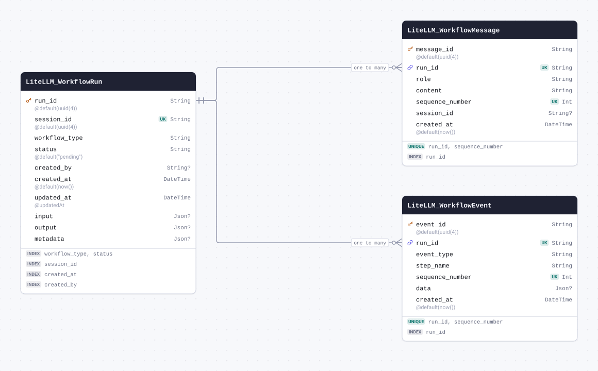

| Field           | Type       | Constraints     | Default      | Description |
| --------------- | ---------- | --------------- | ------------ | ----------- |
| `run_id`        | `String`   | PK NOT NULL     | `uuid(4)`    |             |
| `session_id`    | `String`   | UNIQUE NOT NULL | `uuid(4)`    |             |
| `workflow_type` | `String`   | NOT NULL        |              |             |
| `status`        | `String`   | NOT NULL        | `"pending"`  |             |
| `created_by`    | `String`   | NULL            |              |             |
| `created_at`    | `DateTime` | NOT NULL        | `now()`      |             |
| `updated_at`    | `DateTime` | NOT NULL        | `@updatedAt` |             |
| `input`         | `Json`     | NULL            |              |             |
| `output`        | `Json`     | NULL            |              |             |
| `metadata`      | `Json`     | NULL            |              |             |

#### Indexes

- `@@index([workflow_type, status])`
- `@@index([session_id])`
- `@@index([created_at])`
- `@@index([created_by])`

#### Referenced by

- `run_id` ← [LiteLLM_WorkflowEvent.run_id](#model-LiteLLM_WorkflowEvent) (one-to-many)
- `run_id` ← [LiteLLM_WorkflowMessage.run_id](#model-LiteLLM_WorkflowMessage) (one-to-many)

#### Definition

```sql
CREATE TABLE "LiteLLM_WorkflowRun" (
    "run_id" TEXT NOT NULL,
    "session_id" TEXT NOT NULL,
    "workflow_type" TEXT NOT NULL,
    "status" TEXT NOT NULL DEFAULT 'pending',
    "created_by" TEXT,
    "created_at" TIMESTAMP(3) NOT NULL DEFAULT CURRENT_TIMESTAMP,
    "updated_at" TIMESTAMP(3) NOT NULL,
    "input" JSONB,
    "output" JSONB,
    "metadata" JSONB,

    CONSTRAINT "LiteLLM_WorkflowRun_pkey" PRIMARY KEY ("run_id")
);

CREATE UNIQUE INDEX "LiteLLM_WorkflowRun_session_id_key" ON "LiteLLM_WorkflowRun"("session_id");

CREATE INDEX "LiteLLM_WorkflowRun_workflow_type_status_idx" ON "LiteLLM_WorkflowRun"("workflow_type", "status");

CREATE INDEX "LiteLLM_WorkflowRun_session_id_idx" ON "LiteLLM_WorkflowRun"("session_id");

CREATE INDEX "LiteLLM_WorkflowRun_created_at_idx" ON "LiteLLM_WorkflowRun"("created_at");

CREATE INDEX "LiteLLM_WorkflowRun_created_by_idx" ON "LiteLLM_WorkflowRun"("created_by");
```

<details>
<summary>Queries and their SQL</summary>

**findMany**: Every row

```ts
await prisma.liteLLM_WorkflowRun.findMany();
```

```sql
SELECT
  "public"."LiteLLM_WorkflowRun"."run_id",
  "public"."LiteLLM_WorkflowRun"."session_id",
  "public"."LiteLLM_WorkflowRun"."workflow_type",
  "public"."LiteLLM_WorkflowRun"."status",
  "public"."LiteLLM_WorkflowRun"."created_by",
  "public"."LiteLLM_WorkflowRun"."created_at",
  "public"."LiteLLM_WorkflowRun"."updated_at",
  "public"."LiteLLM_WorkflowRun"."input",
  "public"."LiteLLM_WorkflowRun"."output",
  "public"."LiteLLM_WorkflowRun"."metadata"
FROM
  "public"."LiteLLM_WorkflowRun"
WHERE
  1 = 1
OFFSET
  $1
-- params: ["0"]
```

**count**: How many rows there are

```ts
await prisma.liteLLM_WorkflowRun.count();
```

```sql
SELECT
  COUNT(*) AS "_count$_all"
FROM
  (
    SELECT
      "public"."LiteLLM_WorkflowRun"."run_id"
    FROM
      "public"."LiteLLM_WorkflowRun"
    WHERE
      1 = 1
    OFFSET
      $1
  ) AS "sub"
-- params: ["0"]
```

**findMany**: Every row with its relations

```ts
await prisma.liteLLM_WorkflowRun.findMany({ include: { events: true, messages: true } });
```

```sql
SELECT
  "public"."LiteLLM_WorkflowRun"."run_id",
  "public"."LiteLLM_WorkflowRun"."session_id",
  "public"."LiteLLM_WorkflowRun"."workflow_type",
  "public"."LiteLLM_WorkflowRun"."status",
  "public"."LiteLLM_WorkflowRun"."created_by",
  "public"."LiteLLM_WorkflowRun"."created_at",
  "public"."LiteLLM_WorkflowRun"."updated_at",
  "public"."LiteLLM_WorkflowRun"."input",
  "public"."LiteLLM_WorkflowRun"."output",
  "public"."LiteLLM_WorkflowRun"."metadata"
FROM
  "public"."LiteLLM_WorkflowRun"
WHERE
  1 = 1
OFFSET
  $1
-- params: ["0"]

SELECT
  "public"."LiteLLM_WorkflowEvent"."event_id",
  "public"."LiteLLM_WorkflowEvent"."run_id",
  "public"."LiteLLM_WorkflowEvent"."event_type",
  "public"."LiteLLM_WorkflowEvent"."step_name",
  "public"."LiteLLM_WorkflowEvent"."sequence_number",
  "public"."LiteLLM_WorkflowEvent"."data",
  "public"."LiteLLM_WorkflowEvent"."created_at"
FROM
  "public"."LiteLLM_WorkflowEvent"
WHERE
  "public"."LiteLLM_WorkflowEvent"."run_id" IN ($1)
OFFSET
  $2
-- params: ["<run_id of the rows above>","0"]

SELECT
  "public"."LiteLLM_WorkflowMessage"."message_id",
  "public"."LiteLLM_WorkflowMessage"."run_id",
  "public"."LiteLLM_WorkflowMessage"."role",
  "public"."LiteLLM_WorkflowMessage"."content",
  "public"."LiteLLM_WorkflowMessage"."sequence_number",
  "public"."LiteLLM_WorkflowMessage"."session_id",
  "public"."LiteLLM_WorkflowMessage"."created_at"
FROM
  "public"."LiteLLM_WorkflowMessage"
WHERE
  "public"."LiteLLM_WorkflowMessage"."run_id" IN ($1)
OFFSET
  $2
-- params: ["<run_id of the rows above>","0"]
```

**findUnique**: One row by what is unique to it

```ts
await prisma.liteLLM_WorkflowRun.findUnique({ where: { run_id: "example" } });
```

```sql
SELECT
  "public"."LiteLLM_WorkflowRun"."run_id",
  "public"."LiteLLM_WorkflowRun"."session_id",
  "public"."LiteLLM_WorkflowRun"."workflow_type",
  "public"."LiteLLM_WorkflowRun"."status",
  "public"."LiteLLM_WorkflowRun"."created_by",
  "public"."LiteLLM_WorkflowRun"."created_at",
  "public"."LiteLLM_WorkflowRun"."updated_at",
  "public"."LiteLLM_WorkflowRun"."input",
  "public"."LiteLLM_WorkflowRun"."output",
  "public"."LiteLLM_WorkflowRun"."metadata"
FROM
  "public"."LiteLLM_WorkflowRun"
WHERE
  (
    "public"."LiteLLM_WorkflowRun"."run_id" = $1
    AND 1 = 1
  )
LIMIT
  $2
OFFSET
  $3
-- params: ["example","1","0"]
```

**create**: Create a row

```ts
await prisma.liteLLM_WorkflowRun.create({ data: { workflow_type: "example" } });
```

```sql
INSERT INTO
  "public"."LiteLLM_WorkflowRun" (
    "run_id",
    "session_id",
    "workflow_type",
    "status",
    "created_at",
    "updated_at"
  )
VALUES
  ($1, $2, $3, $4, $5, $6)
RETURNING
  "public"."LiteLLM_WorkflowRun"."run_id",
  "public"."LiteLLM_WorkflowRun"."session_id",
  "public"."LiteLLM_WorkflowRun"."workflow_type",
  "public"."LiteLLM_WorkflowRun"."status",
  "public"."LiteLLM_WorkflowRun"."created_by",
  "public"."LiteLLM_WorkflowRun"."created_at",
  "public"."LiteLLM_WorkflowRun"."updated_at",
  "public"."LiteLLM_WorkflowRun"."input",
  "public"."LiteLLM_WorkflowRun"."output",
  "public"."LiteLLM_WorkflowRun"."metadata"
-- params: ["<uuid(4)>","<uuid(4)>","example","pending","<now()>","<now()>"]
```

**update**: Update a row

```ts
await prisma.liteLLM_WorkflowRun.update({
  where: { run_id: "example" },
  data: { session_id: "example" },
});
```

```sql
UPDATE "public"."LiteLLM_WorkflowRun"
SET
  "session_id" = $1,
  "updated_at" = $2
WHERE
  (
    "public"."LiteLLM_WorkflowRun"."run_id" = $3
    AND 1 = 1
  )
RETURNING
  "public"."LiteLLM_WorkflowRun"."run_id",
  "public"."LiteLLM_WorkflowRun"."session_id",
  "public"."LiteLLM_WorkflowRun"."workflow_type",
  "public"."LiteLLM_WorkflowRun"."status",
  "public"."LiteLLM_WorkflowRun"."created_by",
  "public"."LiteLLM_WorkflowRun"."created_at",
  "public"."LiteLLM_WorkflowRun"."updated_at",
  "public"."LiteLLM_WorkflowRun"."input",
  "public"."LiteLLM_WorkflowRun"."output",
  "public"."LiteLLM_WorkflowRun"."metadata"
-- params: ["example",{"prisma__type":"generatorCall","prisma__value":{"name":"now","args":[],"returnType":{"type":"DateTime"}}},"example"]
```

**delete**: Delete a row

```ts
await prisma.liteLLM_WorkflowRun.delete({ where: { run_id: "example" } });
```

```sql
DELETE FROM "public"."LiteLLM_WorkflowRun"
WHERE
  (
    "public"."LiteLLM_WorkflowRun"."run_id" = $1
    AND 1 = 1
  )
RETURNING
  "public"."LiteLLM_WorkflowRun"."run_id",
  "public"."LiteLLM_WorkflowRun"."session_id",
  "public"."LiteLLM_WorkflowRun"."workflow_type",
  "public"."LiteLLM_WorkflowRun"."status",
  "public"."LiteLLM_WorkflowRun"."created_by",
  "public"."LiteLLM_WorkflowRun"."created_at",
  "public"."LiteLLM_WorkflowRun"."updated_at",
  "public"."LiteLLM_WorkflowRun"."input",
  "public"."LiteLLM_WorkflowRun"."output",
  "public"."LiteLLM_WorkflowRun"."metadata"
-- params: ["example"]
```

</details>

<a id="model-LiteLLM_WorkflowEvent"></a>

### LiteLLM_WorkflowEvent

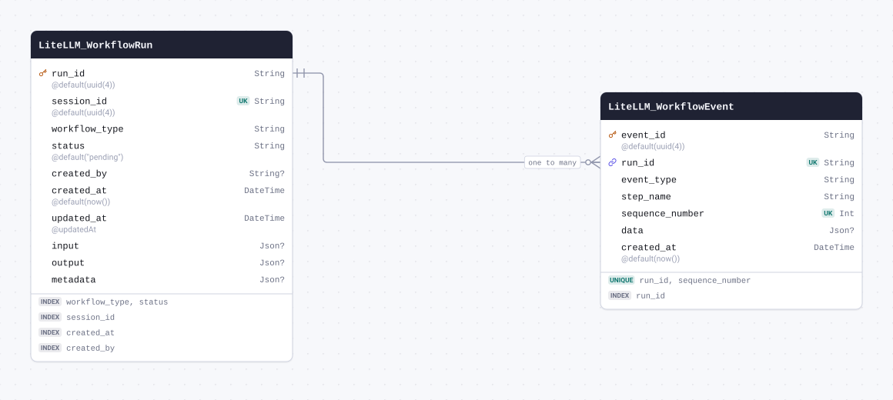

| Field             | Type       | Constraints                                                         | Default   | Description |
| ----------------- | ---------- | ------------------------------------------------------------------- | --------- | ----------- |
| `event_id`        | `String`   | PK NOT NULL                                                         | `uuid(4)` |             |
| `run_id`          | `String`   | NOT NULL → [LiteLLM_WorkflowRun.run_id](#model-LiteLLM_WorkflowRun) |           |             |
| `event_type`      | `String`   | NOT NULL                                                            |           |             |
| `step_name`       | `String`   | NOT NULL                                                            |           |             |
| `sequence_number` | `Int`      | NOT NULL                                                            |           |             |
| `data`            | `Json`     | NULL                                                                |           |             |
| `created_at`      | `DateTime` | NOT NULL                                                            | `now()`   |             |

#### Indexes

- `@@index([run_id])`
- `@@unique([run_id, sequence_number])`

#### References

- `run_id` → [LiteLLM_WorkflowRun.run_id](#model-LiteLLM_WorkflowRun) (many-to-one)

#### Definition

```sql
CREATE TABLE "LiteLLM_WorkflowEvent" (
    "event_id" TEXT NOT NULL,
    "run_id" TEXT NOT NULL,
    "event_type" TEXT NOT NULL,
    "step_name" TEXT NOT NULL,
    "sequence_number" INTEGER NOT NULL,
    "data" JSONB,
    "created_at" TIMESTAMP(3) NOT NULL DEFAULT CURRENT_TIMESTAMP,

    CONSTRAINT "LiteLLM_WorkflowEvent_pkey" PRIMARY KEY ("event_id")
);

CREATE INDEX "LiteLLM_WorkflowEvent_run_id_idx" ON "LiteLLM_WorkflowEvent"("run_id");

CREATE UNIQUE INDEX "LiteLLM_WorkflowEvent_run_id_sequence_number_key" ON "LiteLLM_WorkflowEvent"("run_id", "sequence_number");

ALTER TABLE "LiteLLM_WorkflowEvent" ADD CONSTRAINT "LiteLLM_WorkflowEvent_run_id_fkey" FOREIGN KEY ("run_id") REFERENCES "LiteLLM_WorkflowRun"("run_id") ON DELETE RESTRICT ON UPDATE CASCADE;
```

<details>
<summary>Queries and their SQL</summary>

**findMany**: Every row

```ts
await prisma.liteLLM_WorkflowEvent.findMany();
```

```sql
SELECT
  "public"."LiteLLM_WorkflowEvent"."event_id",
  "public"."LiteLLM_WorkflowEvent"."run_id",
  "public"."LiteLLM_WorkflowEvent"."event_type",
  "public"."LiteLLM_WorkflowEvent"."step_name",
  "public"."LiteLLM_WorkflowEvent"."sequence_number",
  "public"."LiteLLM_WorkflowEvent"."data",
  "public"."LiteLLM_WorkflowEvent"."created_at"
FROM
  "public"."LiteLLM_WorkflowEvent"
WHERE
  1 = 1
OFFSET
  $1
-- params: ["0"]
```

**count**: How many rows there are

```ts
await prisma.liteLLM_WorkflowEvent.count();
```

```sql
SELECT
  COUNT(*) AS "_count$_all"
FROM
  (
    SELECT
      "public"."LiteLLM_WorkflowEvent"."event_id"
    FROM
      "public"."LiteLLM_WorkflowEvent"
    WHERE
      1 = 1
    OFFSET
      $1
  ) AS "sub"
-- params: ["0"]
```

**findMany**: Every row with its relations

```ts
await prisma.liteLLM_WorkflowEvent.findMany({ include: { run: true } });
```

```sql
SELECT
  "public"."LiteLLM_WorkflowEvent"."event_id",
  "public"."LiteLLM_WorkflowEvent"."run_id",
  "public"."LiteLLM_WorkflowEvent"."event_type",
  "public"."LiteLLM_WorkflowEvent"."step_name",
  "public"."LiteLLM_WorkflowEvent"."sequence_number",
  "public"."LiteLLM_WorkflowEvent"."data",
  "public"."LiteLLM_WorkflowEvent"."created_at"
FROM
  "public"."LiteLLM_WorkflowEvent"
WHERE
  1 = 1
OFFSET
  $1
-- params: ["0"]

SELECT
  "public"."LiteLLM_WorkflowRun"."run_id",
  "public"."LiteLLM_WorkflowRun"."session_id",
  "public"."LiteLLM_WorkflowRun"."workflow_type",
  "public"."LiteLLM_WorkflowRun"."status",
  "public"."LiteLLM_WorkflowRun"."created_by",
  "public"."LiteLLM_WorkflowRun"."created_at",
  "public"."LiteLLM_WorkflowRun"."updated_at",
  "public"."LiteLLM_WorkflowRun"."input",
  "public"."LiteLLM_WorkflowRun"."output",
  "public"."LiteLLM_WorkflowRun"."metadata"
FROM
  "public"."LiteLLM_WorkflowRun"
WHERE
  "public"."LiteLLM_WorkflowRun"."run_id" IN ($1)
OFFSET
  $2
-- params: ["<run_id of the rows above>","0"]
```

**findUnique**: One row by what is unique to it

```ts
await prisma.liteLLM_WorkflowEvent.findUnique({ where: { event_id: "example" } });
```

```sql
SELECT
  "public"."LiteLLM_WorkflowEvent"."event_id",
  "public"."LiteLLM_WorkflowEvent"."run_id",
  "public"."LiteLLM_WorkflowEvent"."event_type",
  "public"."LiteLLM_WorkflowEvent"."step_name",
  "public"."LiteLLM_WorkflowEvent"."sequence_number",
  "public"."LiteLLM_WorkflowEvent"."data",
  "public"."LiteLLM_WorkflowEvent"."created_at"
FROM
  "public"."LiteLLM_WorkflowEvent"
WHERE
  (
    "public"."LiteLLM_WorkflowEvent"."event_id" = $1
    AND 1 = 1
  )
LIMIT
  $2
OFFSET
  $3
-- params: ["example","1","0"]
```

**create**: Create a row

```ts
await prisma.liteLLM_WorkflowEvent.create({
  data: { run_id: "example", event_type: "example", step_name: "example", sequence_number: 1 },
});
```

```sql
INSERT INTO
  "public"."LiteLLM_WorkflowEvent" (
    "event_id",
    "run_id",
    "event_type",
    "step_name",
    "sequence_number",
    "created_at"
  )
VALUES
  ($1, $2, $3, $4, $5, $6)
RETURNING
  "public"."LiteLLM_WorkflowEvent"."event_id",
  "public"."LiteLLM_WorkflowEvent"."run_id",
  "public"."LiteLLM_WorkflowEvent"."event_type",
  "public"."LiteLLM_WorkflowEvent"."step_name",
  "public"."LiteLLM_WorkflowEvent"."sequence_number",
  "public"."LiteLLM_WorkflowEvent"."data",
  "public"."LiteLLM_WorkflowEvent"."created_at"
-- params: ["<uuid(4)>","example","example","example","1","<now()>"]
```

**update**: Update a row

```ts
await prisma.liteLLM_WorkflowEvent.update({
  where: { event_id: "example" },
  data: { event_type: "example" },
});
```

```sql
UPDATE "public"."LiteLLM_WorkflowEvent"
SET
  "event_type" = $1
WHERE
  (
    "public"."LiteLLM_WorkflowEvent"."event_id" = $2
    AND 1 = 1
  )
RETURNING
  "public"."LiteLLM_WorkflowEvent"."event_id",
  "public"."LiteLLM_WorkflowEvent"."run_id",
  "public"."LiteLLM_WorkflowEvent"."event_type",
  "public"."LiteLLM_WorkflowEvent"."step_name",
  "public"."LiteLLM_WorkflowEvent"."sequence_number",
  "public"."LiteLLM_WorkflowEvent"."data",
  "public"."LiteLLM_WorkflowEvent"."created_at"
-- params: ["example","example"]
```

**delete**: Delete a row

```ts
await prisma.liteLLM_WorkflowEvent.delete({ where: { event_id: "example" } });
```

```sql
DELETE FROM "public"."LiteLLM_WorkflowEvent"
WHERE
  (
    "public"."LiteLLM_WorkflowEvent"."event_id" = $1
    AND 1 = 1
  )
RETURNING
  "public"."LiteLLM_WorkflowEvent"."event_id",
  "public"."LiteLLM_WorkflowEvent"."run_id",
  "public"."LiteLLM_WorkflowEvent"."event_type",
  "public"."LiteLLM_WorkflowEvent"."step_name",
  "public"."LiteLLM_WorkflowEvent"."sequence_number",
  "public"."LiteLLM_WorkflowEvent"."data",
  "public"."LiteLLM_WorkflowEvent"."created_at"
-- params: ["example"]
```

</details>

<a id="model-LiteLLM_WorkflowMessage"></a>

### LiteLLM_WorkflowMessage


| Field             | Type       | Constraints                                                         | Default   | Description |
| ----------------- | ---------- | ------------------------------------------------------------------- | --------- | ----------- |
| `message_id`      | `String`   | PK NOT NULL                                                         | `uuid(4)` |             |
| `run_id`          | `String`   | NOT NULL → [LiteLLM_WorkflowRun.run_id](#model-LiteLLM_WorkflowRun) |           |             |
| `role`            | `String`   | NOT NULL                                                            |           |             |
| `content`         | `String`   | NOT NULL                                                            |           |             |
| `sequence_number` | `Int`      | NOT NULL                                                            |           |             |
| `session_id`      | `String`   | NULL                                                                |           |             |
| `created_at`      | `DateTime` | NOT NULL                                                            | `now()`   |             |

#### Indexes

- `@@index([run_id])`
- `@@unique([run_id, sequence_number])`

#### References

- `run_id` → [LiteLLM_WorkflowRun.run_id](#model-LiteLLM_WorkflowRun) (many-to-one)

#### Definition

```sql
CREATE TABLE "LiteLLM_WorkflowMessage" (
    "message_id" TEXT NOT NULL,
    "run_id" TEXT NOT NULL,
    "role" TEXT NOT NULL,
    "content" TEXT NOT NULL,
    "sequence_number" INTEGER NOT NULL,
    "session_id" TEXT,
    "created_at" TIMESTAMP(3) NOT NULL DEFAULT CURRENT_TIMESTAMP,

    CONSTRAINT "LiteLLM_WorkflowMessage_pkey" PRIMARY KEY ("message_id")
);

CREATE INDEX "LiteLLM_WorkflowMessage_run_id_idx" ON "LiteLLM_WorkflowMessage"("run_id");

CREATE UNIQUE INDEX "LiteLLM_WorkflowMessage_run_id_sequence_number_key" ON "LiteLLM_WorkflowMessage"("run_id", "sequence_number");

ALTER TABLE "LiteLLM_WorkflowMessage" ADD CONSTRAINT "LiteLLM_WorkflowMessage_run_id_fkey" FOREIGN KEY ("run_id") REFERENCES "LiteLLM_WorkflowRun"("run_id") ON DELETE RESTRICT ON UPDATE CASCADE;
```

<details>
<summary>Queries and their SQL</summary>

**findMany**: Every row

```ts
await prisma.liteLLM_WorkflowMessage.findMany();
```

```sql
SELECT
  "public"."LiteLLM_WorkflowMessage"."message_id",
  "public"."LiteLLM_WorkflowMessage"."run_id",
  "public"."LiteLLM_WorkflowMessage"."role",
  "public"."LiteLLM_WorkflowMessage"."content",
  "public"."LiteLLM_WorkflowMessage"."sequence_number",
  "public"."LiteLLM_WorkflowMessage"."session_id",
  "public"."LiteLLM_WorkflowMessage"."created_at"
FROM
  "public"."LiteLLM_WorkflowMessage"
WHERE
  1 = 1
OFFSET
  $1
-- params: ["0"]
```

**count**: How many rows there are

```ts
await prisma.liteLLM_WorkflowMessage.count();
```

```sql
SELECT
  COUNT(*) AS "_count$_all"
FROM
  (
    SELECT
      "public"."LiteLLM_WorkflowMessage"."message_id"
    FROM
      "public"."LiteLLM_WorkflowMessage"
    WHERE
      1 = 1
    OFFSET
      $1
  ) AS "sub"
-- params: ["0"]
```

**findMany**: Every row with its relations

```ts
await prisma.liteLLM_WorkflowMessage.findMany({ include: { run: true } });
```

```sql
SELECT
  "public"."LiteLLM_WorkflowMessage"."message_id",
  "public"."LiteLLM_WorkflowMessage"."run_id",
  "public"."LiteLLM_WorkflowMessage"."role",
  "public"."LiteLLM_WorkflowMessage"."content",
  "public"."LiteLLM_WorkflowMessage"."sequence_number",
  "public"."LiteLLM_WorkflowMessage"."session_id",
  "public"."LiteLLM_WorkflowMessage"."created_at"
FROM
  "public"."LiteLLM_WorkflowMessage"
WHERE
  1 = 1
OFFSET
  $1
-- params: ["0"]

SELECT
  "public"."LiteLLM_WorkflowRun"."run_id",
  "public"."LiteLLM_WorkflowRun"."session_id",
  "public"."LiteLLM_WorkflowRun"."workflow_type",
  "public"."LiteLLM_WorkflowRun"."status",
  "public"."LiteLLM_WorkflowRun"."created_by",
  "public"."LiteLLM_WorkflowRun"."created_at",
  "public"."LiteLLM_WorkflowRun"."updated_at",
  "public"."LiteLLM_WorkflowRun"."input",
  "public"."LiteLLM_WorkflowRun"."output",
  "public"."LiteLLM_WorkflowRun"."metadata"
FROM
  "public"."LiteLLM_WorkflowRun"
WHERE
  "public"."LiteLLM_WorkflowRun"."run_id" IN ($1)
OFFSET
  $2
-- params: ["<run_id of the rows above>","0"]
```

**findUnique**: One row by what is unique to it

```ts
await prisma.liteLLM_WorkflowMessage.findUnique({ where: { message_id: "example" } });
```

```sql
SELECT
  "public"."LiteLLM_WorkflowMessage"."message_id",
  "public"."LiteLLM_WorkflowMessage"."run_id",
  "public"."LiteLLM_WorkflowMessage"."role",
  "public"."LiteLLM_WorkflowMessage"."content",
  "public"."LiteLLM_WorkflowMessage"."sequence_number",
  "public"."LiteLLM_WorkflowMessage"."session_id",
  "public"."LiteLLM_WorkflowMessage"."created_at"
FROM
  "public"."LiteLLM_WorkflowMessage"
WHERE
  (
    "public"."LiteLLM_WorkflowMessage"."message_id" = $1
    AND 1 = 1
  )
LIMIT
  $2
OFFSET
  $3
-- params: ["example","1","0"]
```

**create**: Create a row

```ts
await prisma.liteLLM_WorkflowMessage.create({
  data: { run_id: "example", role: "example", content: "example", sequence_number: 1 },
});
```

```sql
INSERT INTO
  "public"."LiteLLM_WorkflowMessage" (
    "message_id",
    "run_id",
    "role",
    "content",
    "sequence_number",
    "created_at"
  )
VALUES
  ($1, $2, $3, $4, $5, $6)
RETURNING
  "public"."LiteLLM_WorkflowMessage"."message_id",
  "public"."LiteLLM_WorkflowMessage"."run_id",
  "public"."LiteLLM_WorkflowMessage"."role",
  "public"."LiteLLM_WorkflowMessage"."content",
  "public"."LiteLLM_WorkflowMessage"."sequence_number",
  "public"."LiteLLM_WorkflowMessage"."session_id",
  "public"."LiteLLM_WorkflowMessage"."created_at"
-- params: ["<uuid(4)>","example","example","example","1","<now()>"]
```

**update**: Update a row

```ts
await prisma.liteLLM_WorkflowMessage.update({
  where: { message_id: "example" },
  data: { role: "example" },
});
```

```sql
UPDATE "public"."LiteLLM_WorkflowMessage"
SET
  "role" = $1
WHERE
  (
    "public"."LiteLLM_WorkflowMessage"."message_id" = $2
    AND 1 = 1
  )
RETURNING
  "public"."LiteLLM_WorkflowMessage"."message_id",
  "public"."LiteLLM_WorkflowMessage"."run_id",
  "public"."LiteLLM_WorkflowMessage"."role",
  "public"."LiteLLM_WorkflowMessage"."content",
  "public"."LiteLLM_WorkflowMessage"."sequence_number",
  "public"."LiteLLM_WorkflowMessage"."session_id",
  "public"."LiteLLM_WorkflowMessage"."created_at"
-- params: ["example","example"]
```

**delete**: Delete a row

```ts
await prisma.liteLLM_WorkflowMessage.delete({ where: { message_id: "example" } });
```

```sql
DELETE FROM "public"."LiteLLM_WorkflowMessage"
WHERE
  (
    "public"."LiteLLM_WorkflowMessage"."message_id" = $1
    AND 1 = 1
  )
RETURNING
  "public"."LiteLLM_WorkflowMessage"."message_id",
  "public"."LiteLLM_WorkflowMessage"."run_id",
  "public"."LiteLLM_WorkflowMessage"."role",
  "public"."LiteLLM_WorkflowMessage"."content",
  "public"."LiteLLM_WorkflowMessage"."sequence_number",
  "public"."LiteLLM_WorkflowMessage"."session_id",
  "public"."LiteLLM_WorkflowMessage"."created_at"
-- params: ["example"]
```

</details>

<a id="model-LiteLLM_BackgroundInteractionSettlement"></a>

### LiteLLM_BackgroundInteractionSettlement

| Field                 | Type       | Constraints | Default | Description |
| --------------------- | ---------- | ----------- | ------- | ----------- |
| `interaction_id`      | `String`   | PK NOT NULL |         |             |
| `custom_llm_provider` | `String`   | NOT NULL    |         |             |
| `create_context`      | `Json`     | NOT NULL    |         |             |
| `created_at`          | `DateTime` | NOT NULL    | `now()` |             |
| `claimed_at`          | `DateTime` | NULL        |         |             |
| `claimed_by`          | `String`   | NULL        |         |             |
| `settled_at`          | `DateTime` | NULL        |         |             |
| `outcome`             | `String`   | NULL        |         |             |

#### Indexes

- `@@index([claimed_at], map: "idx_background_interaction_settlement_claimed_at")`
- `@@index([settled_at], map: "idx_background_interaction_settlement_settled_at")`

#### Definition

```sql
CREATE TABLE "LiteLLM_BackgroundInteractionSettlement" (
    "interaction_id" TEXT NOT NULL,
    "custom_llm_provider" TEXT NOT NULL,
    "create_context" JSONB NOT NULL,
    "created_at" TIMESTAMP(3) NOT NULL DEFAULT CURRENT_TIMESTAMP,
    "claimed_at" TIMESTAMP(3),
    "claimed_by" TEXT,
    "settled_at" TIMESTAMP(3),
    "outcome" TEXT,

    CONSTRAINT "LiteLLM_BackgroundInteractionSettlement_pkey" PRIMARY KEY ("interaction_id")
);

CREATE INDEX "idx_background_interaction_settlement_claimed_at" ON "LiteLLM_BackgroundInteractionSettlement"("claimed_at");

CREATE INDEX "idx_background_interaction_settlement_settled_at" ON "LiteLLM_BackgroundInteractionSettlement"("settled_at");
```

<details>
<summary>Queries and their SQL</summary>

**findMany**: Every row

```ts
await prisma.liteLLM_BackgroundInteractionSettlement.findMany();
```

```sql
SELECT
  "public"."LiteLLM_BackgroundInteractionSettlement"."interaction_id",
  "public"."LiteLLM_BackgroundInteractionSettlement"."custom_llm_provider",
  "public"."LiteLLM_BackgroundInteractionSettlement"."create_context",
  "public"."LiteLLM_BackgroundInteractionSettlement"."created_at",
  "public"."LiteLLM_BackgroundInteractionSettlement"."claimed_at",
  "public"."LiteLLM_BackgroundInteractionSettlement"."claimed_by",
  "public"."LiteLLM_BackgroundInteractionSettlement"."settled_at",
  "public"."LiteLLM_BackgroundInteractionSettlement"."outcome"
FROM
  "public"."LiteLLM_BackgroundInteractionSettlement"
WHERE
  1 = 1
OFFSET
  $1
-- params: ["0"]
```

**count**: How many rows there are

```ts
await prisma.liteLLM_BackgroundInteractionSettlement.count();
```

```sql
SELECT
  COUNT(*) AS "_count$_all"
FROM
  (
    SELECT
      "public"."LiteLLM_BackgroundInteractionSettlement"."interaction_id"
    FROM
      "public"."LiteLLM_BackgroundInteractionSettlement"
    WHERE
      1 = 1
    OFFSET
      $1
  ) AS "sub"
-- params: ["0"]
```

**findUnique**: One row by what is unique to it

```ts
await prisma.liteLLM_BackgroundInteractionSettlement.findUnique({
  where: { interaction_id: "example" },
});
```

```sql
SELECT
  "public"."LiteLLM_BackgroundInteractionSettlement"."interaction_id",
  "public"."LiteLLM_BackgroundInteractionSettlement"."custom_llm_provider",
  "public"."LiteLLM_BackgroundInteractionSettlement"."create_context",
  "public"."LiteLLM_BackgroundInteractionSettlement"."created_at",
  "public"."LiteLLM_BackgroundInteractionSettlement"."claimed_at",
  "public"."LiteLLM_BackgroundInteractionSettlement"."claimed_by",
  "public"."LiteLLM_BackgroundInteractionSettlement"."settled_at",
  "public"."LiteLLM_BackgroundInteractionSettlement"."outcome"
FROM
  "public"."LiteLLM_BackgroundInteractionSettlement"
WHERE
  (
    "public"."LiteLLM_BackgroundInteractionSettlement"."interaction_id" = $1
    AND 1 = 1
  )
LIMIT
  $2
OFFSET
  $3
-- params: ["example","1","0"]
```

**create**: Create a row

```ts
await prisma.liteLLM_BackgroundInteractionSettlement.create({
  data: { interaction_id: "example", custom_llm_provider: "example", create_context: {} },
});
```

```sql
INSERT INTO
  "public"."LiteLLM_BackgroundInteractionSettlement" (
    "interaction_id",
    "custom_llm_provider",
    "create_context",
    "created_at"
  )
VALUES
  ($1, $2, $3, $4)
RETURNING
  "public"."LiteLLM_BackgroundInteractionSettlement"."interaction_id",
  "public"."LiteLLM_BackgroundInteractionSettlement"."custom_llm_provider",
  "public"."LiteLLM_BackgroundInteractionSettlement"."create_context",
  "public"."LiteLLM_BackgroundInteractionSettlement"."created_at",
  "public"."LiteLLM_BackgroundInteractionSettlement"."claimed_at",
  "public"."LiteLLM_BackgroundInteractionSettlement"."claimed_by",
  "public"."LiteLLM_BackgroundInteractionSettlement"."settled_at",
  "public"."LiteLLM_BackgroundInteractionSettlement"."outcome"
-- params: ["example","example","{}","<now()>"]
```

**update**: Update a row

```ts
await prisma.liteLLM_BackgroundInteractionSettlement.update({
  where: { interaction_id: "example" },
  data: { custom_llm_provider: "example" },
});
```

```sql
UPDATE "public"."LiteLLM_BackgroundInteractionSettlement"
SET
  "custom_llm_provider" = $1
WHERE
  (
    "public"."LiteLLM_BackgroundInteractionSettlement"."interaction_id" = $2
    AND 1 = 1
  )
RETURNING
  "public"."LiteLLM_BackgroundInteractionSettlement"."interaction_id",
  "public"."LiteLLM_BackgroundInteractionSettlement"."custom_llm_provider",
  "public"."LiteLLM_BackgroundInteractionSettlement"."create_context",
  "public"."LiteLLM_BackgroundInteractionSettlement"."created_at",
  "public"."LiteLLM_BackgroundInteractionSettlement"."claimed_at",
  "public"."LiteLLM_BackgroundInteractionSettlement"."claimed_by",
  "public"."LiteLLM_BackgroundInteractionSettlement"."settled_at",
  "public"."LiteLLM_BackgroundInteractionSettlement"."outcome"
-- params: ["example","example"]
```

**delete**: Delete a row

```ts
await prisma.liteLLM_BackgroundInteractionSettlement.delete({
  where: { interaction_id: "example" },
});
```

```sql
DELETE FROM "public"."LiteLLM_BackgroundInteractionSettlement"
WHERE
  (
    "public"."LiteLLM_BackgroundInteractionSettlement"."interaction_id" = $1
    AND 1 = 1
  )
RETURNING
  "public"."LiteLLM_BackgroundInteractionSettlement"."interaction_id",
  "public"."LiteLLM_BackgroundInteractionSettlement"."custom_llm_provider",
  "public"."LiteLLM_BackgroundInteractionSettlement"."create_context",
  "public"."LiteLLM_BackgroundInteractionSettlement"."created_at",
  "public"."LiteLLM_BackgroundInteractionSettlement"."claimed_at",
  "public"."LiteLLM_BackgroundInteractionSettlement"."claimed_by",
  "public"."LiteLLM_BackgroundInteractionSettlement"."settled_at",
  "public"."LiteLLM_BackgroundInteractionSettlement"."outcome"
-- params: ["example"]
```

</details>

<a id="model-LiteLLM_BackgroundResponseSettlement"></a>

### LiteLLM_BackgroundResponseSettlement

| Field         | Type       | Constraints | Default | Description |
| ------------- | ---------- | ----------- | ------- | ----------- |
| `response_id` | `String`   | PK NOT NULL |         |             |
| `settled_at`  | `DateTime` | NOT NULL    | `now()` |             |

#### Definition

```sql
CREATE TABLE "LiteLLM_BackgroundResponseSettlement" (
    "response_id" TEXT NOT NULL,
    "settled_at" TIMESTAMP(3) NOT NULL DEFAULT CURRENT_TIMESTAMP,

    CONSTRAINT "LiteLLM_BackgroundResponseSettlement_pkey" PRIMARY KEY ("response_id")
);
```

<details>
<summary>Queries and their SQL</summary>

**findMany**: Every row

```ts
await prisma.liteLLM_BackgroundResponseSettlement.findMany();
```

```sql
SELECT
  "public"."LiteLLM_BackgroundResponseSettlement"."response_id",
  "public"."LiteLLM_BackgroundResponseSettlement"."settled_at"
FROM
  "public"."LiteLLM_BackgroundResponseSettlement"
WHERE
  1 = 1
OFFSET
  $1
-- params: ["0"]
```

**count**: How many rows there are

```ts
await prisma.liteLLM_BackgroundResponseSettlement.count();
```

```sql
SELECT
  COUNT(*) AS "_count$_all"
FROM
  (
    SELECT
      "public"."LiteLLM_BackgroundResponseSettlement"."response_id"
    FROM
      "public"."LiteLLM_BackgroundResponseSettlement"
    WHERE
      1 = 1
    OFFSET
      $1
  ) AS "sub"
-- params: ["0"]
```

**findUnique**: One row by what is unique to it

```ts
await prisma.liteLLM_BackgroundResponseSettlement.findUnique({ where: { response_id: "example" } });
```

```sql
SELECT
  "public"."LiteLLM_BackgroundResponseSettlement"."response_id",
  "public"."LiteLLM_BackgroundResponseSettlement"."settled_at"
FROM
  "public"."LiteLLM_BackgroundResponseSettlement"
WHERE
  (
    "public"."LiteLLM_BackgroundResponseSettlement"."response_id" = $1
    AND 1 = 1
  )
LIMIT
  $2
OFFSET
  $3
-- params: ["example","1","0"]
```

**create**: Create a row

```ts
await prisma.liteLLM_BackgroundResponseSettlement.create({ data: { response_id: "example" } });
```

```sql
INSERT INTO
  "public"."LiteLLM_BackgroundResponseSettlement" ("response_id", "settled_at")
VALUES
  ($1, $2)
RETURNING
  "public"."LiteLLM_BackgroundResponseSettlement"."response_id",
  "public"."LiteLLM_BackgroundResponseSettlement"."settled_at"
-- params: ["example","<now()>"]
```

**update**: Update a row

```ts
await prisma.liteLLM_BackgroundResponseSettlement.update({
  where: { response_id: "example" },
  data: { settled_at: new Date("2026-01-01T00:00:00.000Z") },
});
```

```sql
UPDATE "public"."LiteLLM_BackgroundResponseSettlement"
SET
  "settled_at" = $1
WHERE
  (
    "public"."LiteLLM_BackgroundResponseSettlement"."response_id" = $2
    AND 1 = 1
  )
RETURNING
  "public"."LiteLLM_BackgroundResponseSettlement"."response_id",
  "public"."LiteLLM_BackgroundResponseSettlement"."settled_at"
-- params: ["2026-01-01T00:00:00.000Z","example"]
```

**delete**: Delete a row

```ts
await prisma.liteLLM_BackgroundResponseSettlement.delete({ where: { response_id: "example" } });
```

```sql
DELETE FROM "public"."LiteLLM_BackgroundResponseSettlement"
WHERE
  (
    "public"."LiteLLM_BackgroundResponseSettlement"."response_id" = $1
    AND 1 = 1
  )
RETURNING
  "public"."LiteLLM_BackgroundResponseSettlement"."response_id",
  "public"."LiteLLM_BackgroundResponseSettlement"."settled_at"
-- params: ["example"]
```

</details>

<a id="model-LiteLLM_Lens"></a>

### LiteLLM_Lens


| Field     | Type       | Constraints | Default                                                             | Description |
| --------- | ---------- | ----------- | ------------------------------------------------------------------- | ----------- |
| `id`      | `String`   | PK NOT NULL |                                                                     |             |
| `version` | `Int`      | NOT NULL    | `0`                                                                 |             |
| `data`    | `Json`     | NOT NULL    |                                                                     |             |
| `due_at`  | `DateTime` | NULL        | `dbgenerated("'1970-01-01 00:00:00'::timestamp without time zone")` |             |

#### Indexes

- `@@index([due_at], map: "LiteLLM_Lens_due_at_idx")`

#### Referenced by

- `id` ← [LiteLLM_LensReview.lens_id](#model-LiteLLM_LensReview) (one-to-many, on delete Cascade)

#### Definition

```sql
CREATE TABLE "LiteLLM_Lens" (
    "id" TEXT NOT NULL,
    "version" INTEGER NOT NULL DEFAULT 0,
    "data" JSONB NOT NULL,
    "due_at" TIMESTAMP(3) DEFAULT '1970-01-01 00:00:00'::timestamp without time zone,

    CONSTRAINT "LiteLLM_Lens_pkey" PRIMARY KEY ("id")
);

CREATE INDEX "LiteLLM_Lens_due_at_idx" ON "LiteLLM_Lens"("due_at");
```

<details>
<summary>Queries and their SQL</summary>

**findMany**: Every row

```ts
await prisma.liteLLM_Lens.findMany();
```

```sql
SELECT
  "public"."LiteLLM_Lens"."id",
  "public"."LiteLLM_Lens"."version",
  "public"."LiteLLM_Lens"."data",
  "public"."LiteLLM_Lens"."due_at"
FROM
  "public"."LiteLLM_Lens"
WHERE
  1 = 1
OFFSET
  $1
-- params: ["0"]
```

**count**: How many rows there are

```ts
await prisma.liteLLM_Lens.count();
```

```sql
SELECT
  COUNT(*) AS "_count$_all"
FROM
  (
    SELECT
      "public"."LiteLLM_Lens"."id"
    FROM
      "public"."LiteLLM_Lens"
    WHERE
      1 = 1
    OFFSET
      $1
  ) AS "sub"
-- params: ["0"]
```

**findMany**: Every row with its relations

```ts
await prisma.liteLLM_Lens.findMany({ include: { reviews: true } });
```

```sql
SELECT
  "public"."LiteLLM_Lens"."id",
  "public"."LiteLLM_Lens"."version",
  "public"."LiteLLM_Lens"."data",
  "public"."LiteLLM_Lens"."due_at"
FROM
  "public"."LiteLLM_Lens"
WHERE
  1 = 1
OFFSET
  $1
-- params: ["0"]

SELECT
  "public"."LiteLLM_LensReview"."lens_id",
  "public"."LiteLLM_LensReview"."criteria_key",
  "public"."LiteLLM_LensReview"."execution_id",
  "public"."LiteLLM_LensReview"."data"
FROM
  "public"."LiteLLM_LensReview"
WHERE
  "public"."LiteLLM_LensReview"."lens_id" IN ($1)
OFFSET
  $2
-- params: ["<id of the rows above>","0"]
```

**findUnique**: One row by what is unique to it

```ts
await prisma.liteLLM_Lens.findUnique({ where: { id: "example" } });
```

```sql
SELECT
  "public"."LiteLLM_Lens"."id",
  "public"."LiteLLM_Lens"."version",
  "public"."LiteLLM_Lens"."data",
  "public"."LiteLLM_Lens"."due_at"
FROM
  "public"."LiteLLM_Lens"
WHERE
  (
    "public"."LiteLLM_Lens"."id" = $1
    AND 1 = 1
  )
LIMIT
  $2
OFFSET
  $3
-- params: ["example","1","0"]
```

**create**: Create a row

```ts
await prisma.liteLLM_Lens.create({ data: { id: "example", data: {} } });
```

```sql
INSERT INTO
  "public"."LiteLLM_Lens" ("id", "version", "data")
VALUES
  ($1, $2, $3)
RETURNING
  "public"."LiteLLM_Lens"."id",
  "public"."LiteLLM_Lens"."version",
  "public"."LiteLLM_Lens"."data",
  "public"."LiteLLM_Lens"."due_at"
-- params: ["example","0","{}"]
```

**update**: Update a row

```ts
await prisma.liteLLM_Lens.update({ where: { id: "example" }, data: { version: 1 } });
```

```sql
UPDATE "public"."LiteLLM_Lens"
SET
  "version" = $1
WHERE
  (
    "public"."LiteLLM_Lens"."id" = $2
    AND 1 = 1
  )
RETURNING
  "public"."LiteLLM_Lens"."id",
  "public"."LiteLLM_Lens"."version",
  "public"."LiteLLM_Lens"."data",
  "public"."LiteLLM_Lens"."due_at"
-- params: ["1","example"]
```

**delete**: Delete a row

```ts
await prisma.liteLLM_Lens.delete({ where: { id: "example" } });
```

```sql
DELETE FROM "public"."LiteLLM_Lens"
WHERE
  (
    "public"."LiteLLM_Lens"."id" = $1
    AND 1 = 1
  )
RETURNING
  "public"."LiteLLM_Lens"."id",
  "public"."LiteLLM_Lens"."version",
  "public"."LiteLLM_Lens"."data",
  "public"."LiteLLM_Lens"."due_at"
-- params: ["example"]
```

</details>

<a id="model-LiteLLM_LensRun"></a>

### LiteLLM_LensRun

| Field        | Type       | Constraints | Default | Description |
| ------------ | ---------- | ----------- | ------- | ----------- |
| `id`         | `String`   | PK NOT NULL |         |             |
| `lens_id`    | `String`   | NOT NULL    |         |             |
| `created_at` | `DateTime` | NOT NULL    |         |             |
| `data`       | `Json`     | NOT NULL    |         |             |

#### Indexes

- `@@index([lens_id, created_at])`

#### Definition

```sql
CREATE TABLE "LiteLLM_LensRun" (
    "id" TEXT NOT NULL,
    "lens_id" TEXT NOT NULL,
    "created_at" TIMESTAMP(3) NOT NULL,
    "data" JSONB NOT NULL,

    CONSTRAINT "LiteLLM_LensRun_pkey" PRIMARY KEY ("id")
);

CREATE INDEX "LiteLLM_LensRun_lens_id_created_at_idx" ON "LiteLLM_LensRun"("lens_id", "created_at");
```

<details>
<summary>Queries and their SQL</summary>

**findMany**: Every row

```ts
await prisma.liteLLM_LensRun.findMany();
```

```sql
SELECT
  "public"."LiteLLM_LensRun"."id",
  "public"."LiteLLM_LensRun"."lens_id",
  "public"."LiteLLM_LensRun"."created_at",
  "public"."LiteLLM_LensRun"."data"
FROM
  "public"."LiteLLM_LensRun"
WHERE
  1 = 1
OFFSET
  $1
-- params: ["0"]
```

**count**: How many rows there are

```ts
await prisma.liteLLM_LensRun.count();
```

```sql
SELECT
  COUNT(*) AS "_count$_all"
FROM
  (
    SELECT
      "public"."LiteLLM_LensRun"."id"
    FROM
      "public"."LiteLLM_LensRun"
    WHERE
      1 = 1
    OFFSET
      $1
  ) AS "sub"
-- params: ["0"]
```

**findUnique**: One row by what is unique to it

```ts
await prisma.liteLLM_LensRun.findUnique({ where: { id: "example" } });
```

```sql
SELECT
  "public"."LiteLLM_LensRun"."id",
  "public"."LiteLLM_LensRun"."lens_id",
  "public"."LiteLLM_LensRun"."created_at",
  "public"."LiteLLM_LensRun"."data"
FROM
  "public"."LiteLLM_LensRun"
WHERE
  (
    "public"."LiteLLM_LensRun"."id" = $1
    AND 1 = 1
  )
LIMIT
  $2
OFFSET
  $3
-- params: ["example","1","0"]
```

**create**: Create a row

```ts
await prisma.liteLLM_LensRun.create({
  data: {
    id: "example",
    lens_id: "example",
    created_at: new Date("2026-01-01T00:00:00.000Z"),
    data: {},
  },
});
```

```sql
INSERT INTO
  "public"."LiteLLM_LensRun" ("id", "lens_id", "created_at", "data")
VALUES
  ($1, $2, $3, $4)
RETURNING
  "public"."LiteLLM_LensRun"."id",
  "public"."LiteLLM_LensRun"."lens_id",
  "public"."LiteLLM_LensRun"."created_at",
  "public"."LiteLLM_LensRun"."data"
-- params: ["example","example","2026-01-01T00:00:00.000Z","{}"]
```

**update**: Update a row

```ts
await prisma.liteLLM_LensRun.update({ where: { id: "example" }, data: { lens_id: "example" } });
```

```sql
UPDATE "public"."LiteLLM_LensRun"
SET
  "lens_id" = $1
WHERE
  (
    "public"."LiteLLM_LensRun"."id" = $2
    AND 1 = 1
  )
RETURNING
  "public"."LiteLLM_LensRun"."id",
  "public"."LiteLLM_LensRun"."lens_id",
  "public"."LiteLLM_LensRun"."created_at",
  "public"."LiteLLM_LensRun"."data"
-- params: ["example","example"]
```

**delete**: Delete a row

```ts
await prisma.liteLLM_LensRun.delete({ where: { id: "example" } });
```

```sql
DELETE FROM "public"."LiteLLM_LensRun"
WHERE
  (
    "public"."LiteLLM_LensRun"."id" = $1
    AND 1 = 1
  )
RETURNING
  "public"."LiteLLM_LensRun"."id",
  "public"."LiteLLM_LensRun"."lens_id",
  "public"."LiteLLM_LensRun"."created_at",
  "public"."LiteLLM_LensRun"."data"
-- params: ["example"]
```

</details>

<a id="model-LiteLLM_LensReview"></a>

### LiteLLM_LensReview

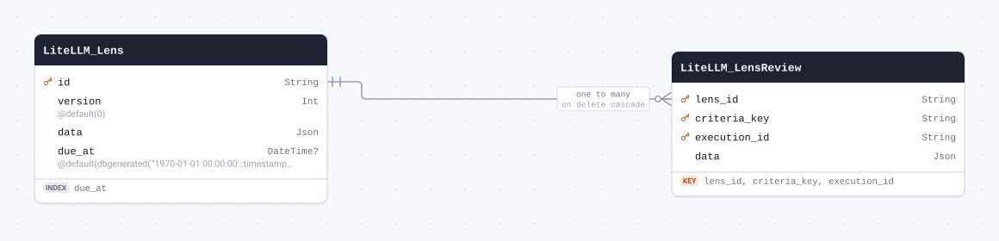

| Field          | Type     | Constraints                                          | Default | Description |
| -------------- | -------- | ---------------------------------------------------- | ------- | ----------- |
| `lens_id`      | `String` | PK NOT NULL → [LiteLLM_Lens.id](#model-LiteLLM_Lens) |         |             |
| `criteria_key` | `String` | PK NOT NULL                                          |         |             |
| `execution_id` | `String` | PK NOT NULL                                          |         |             |
| `data`         | `Json`   | NOT NULL                                             |         |             |

#### Indexes

- `@@id([lens_id, criteria_key, execution_id])`

#### References

- `lens_id` → [LiteLLM_Lens.id](#model-LiteLLM_Lens) (many-to-one, on delete Cascade)

#### Definition

```sql
CREATE TABLE "LiteLLM_LensReview" (
    "lens_id" TEXT NOT NULL,
    "criteria_key" TEXT NOT NULL,
    "execution_id" TEXT NOT NULL,
    "data" JSONB NOT NULL,

    CONSTRAINT "LiteLLM_LensReview_pkey" PRIMARY KEY ("lens_id","criteria_key","execution_id")
);

ALTER TABLE "LiteLLM_LensReview" ADD CONSTRAINT "LiteLLM_LensReview_lens_id_fkey" FOREIGN KEY ("lens_id") REFERENCES "LiteLLM_Lens"("id") ON DELETE CASCADE ON UPDATE CASCADE;
```

<details>
<summary>Queries and their SQL</summary>

**findMany**: Every row

```ts
await prisma.liteLLM_LensReview.findMany();
```

```sql
SELECT
  "public"."LiteLLM_LensReview"."lens_id",
  "public"."LiteLLM_LensReview"."criteria_key",
  "public"."LiteLLM_LensReview"."execution_id",
  "public"."LiteLLM_LensReview"."data"
FROM
  "public"."LiteLLM_LensReview"
WHERE
  1 = 1
OFFSET
  $1
-- params: ["0"]
```

**count**: How many rows there are

```ts
await prisma.liteLLM_LensReview.count();
```

```sql
SELECT
  COUNT(*) AS "_count$_all"
FROM
  (
    SELECT
      "public"."LiteLLM_LensReview"."lens_id",
      "public"."LiteLLM_LensReview"."criteria_key",
      "public"."LiteLLM_LensReview"."execution_id"
    FROM
      "public"."LiteLLM_LensReview"
    WHERE
      1 = 1
    OFFSET
      $1
  ) AS "sub"
-- params: ["0"]
```

**findMany**: Every row with its relations

```ts
await prisma.liteLLM_LensReview.findMany({ include: { lens: true } });
```

```sql
SELECT
  "public"."LiteLLM_LensReview"."lens_id",
  "public"."LiteLLM_LensReview"."criteria_key",
  "public"."LiteLLM_LensReview"."execution_id",
  "public"."LiteLLM_LensReview"."data"
FROM
  "public"."LiteLLM_LensReview"
WHERE
  1 = 1
OFFSET
  $1
-- params: ["0"]

SELECT
  "public"."LiteLLM_Lens"."id",
  "public"."LiteLLM_Lens"."version",
  "public"."LiteLLM_Lens"."data",
  "public"."LiteLLM_Lens"."due_at"
FROM
  "public"."LiteLLM_Lens"
WHERE
  "public"."LiteLLM_Lens"."id" IN ($1)
OFFSET
  $2
-- params: ["<lens_id of the rows above>","0"]
```

**findUnique**: One row by what is unique to it

```ts
await prisma.liteLLM_LensReview.findUnique({
  where: {
    lens_id_criteria_key_execution_id: {
      lens_id: "example",
      criteria_key: "example",
      execution_id: "example",
    },
  },
});
```

```sql
SELECT
  "public"."LiteLLM_LensReview"."lens_id",
  "public"."LiteLLM_LensReview"."criteria_key",
  "public"."LiteLLM_LensReview"."execution_id",
  "public"."LiteLLM_LensReview"."data"
FROM
  "public"."LiteLLM_LensReview"
WHERE
  (
    (
      "public"."LiteLLM_LensReview"."lens_id" = $1
      AND "public"."LiteLLM_LensReview"."criteria_key" = $2
      AND "public"."LiteLLM_LensReview"."execution_id" = $3
    )
    AND 1 = 1
  )
LIMIT
  $4
OFFSET
  $5
-- params: ["example","example","example","1","0"]
```

**create**: Create a row

```ts
await prisma.liteLLM_LensReview.create({
  data: { lens_id: "example", criteria_key: "example", execution_id: "example", data: {} },
});
```

```sql
INSERT INTO
  "public"."LiteLLM_LensReview" ("lens_id", "criteria_key", "execution_id", "data")
VALUES
  ($1, $2, $3, $4)
RETURNING
  "public"."LiteLLM_LensReview"."lens_id",
  "public"."LiteLLM_LensReview"."criteria_key",
  "public"."LiteLLM_LensReview"."execution_id",
  "public"."LiteLLM_LensReview"."data"
-- params: ["example","example","example","{}"]
```

**update**: Update a row

```ts
await prisma.liteLLM_LensReview.update({
  where: {
    lens_id_criteria_key_execution_id: {
      lens_id: "example",
      criteria_key: "example",
      execution_id: "example",
    },
  },
  data: { data: {} },
});
```

```sql
UPDATE "public"."LiteLLM_LensReview"
SET
  "data" = $1
WHERE
  (
    (
      "public"."LiteLLM_LensReview"."lens_id" = $2
      AND "public"."LiteLLM_LensReview"."criteria_key" = $3
      AND "public"."LiteLLM_LensReview"."execution_id" = $4
    )
    AND 1 = 1
  )
RETURNING
  "public"."LiteLLM_LensReview"."lens_id",
  "public"."LiteLLM_LensReview"."criteria_key",
  "public"."LiteLLM_LensReview"."execution_id",
  "public"."LiteLLM_LensReview"."data"
-- params: ["{}","example","example","example"]
```

**delete**: Delete a row

```ts
await prisma.liteLLM_LensReview.delete({
  where: {
    lens_id_criteria_key_execution_id: {
      lens_id: "example",
      criteria_key: "example",
      execution_id: "example",
    },
  },
});
```

```sql
DELETE FROM "public"."LiteLLM_LensReview"
WHERE
  (
    (
      "public"."LiteLLM_LensReview"."lens_id" = $1
      AND "public"."LiteLLM_LensReview"."criteria_key" = $2
      AND "public"."LiteLLM_LensReview"."execution_id" = $3
    )
    AND 1 = 1
  )
RETURNING
  "public"."LiteLLM_LensReview"."lens_id",
  "public"."LiteLLM_LensReview"."criteria_key",
  "public"."LiteLLM_LensReview"."execution_id",
  "public"."LiteLLM_LensReview"."data"
-- params: ["example","example","example"]
```

</details>

<a id="model-LiteLLM_LensWorker"></a>

### LiteLLM_LensWorker

| Field        | Type     | Constraints     | Default | Description |
| ------------ | -------- | --------------- | ------- | ----------- |
| `id`         | `String` | PK NOT NULL     |         |             |
| `token_hash` | `String` | UNIQUE NOT NULL |         |             |
| `data`       | `Json`   | NOT NULL        |         |             |

#### Definition

```sql
CREATE TABLE "LiteLLM_LensWorker" (
    "id" TEXT NOT NULL,
    "token_hash" TEXT NOT NULL,
    "data" JSONB NOT NULL,

    CONSTRAINT "LiteLLM_LensWorker_pkey" PRIMARY KEY ("id")
);

CREATE UNIQUE INDEX "LiteLLM_LensWorker_token_hash_key" ON "LiteLLM_LensWorker"("token_hash");
```

<details>
<summary>Queries and their SQL</summary>

**findMany**: Every row

```ts
await prisma.liteLLM_LensWorker.findMany();
```

```sql
SELECT
  "public"."LiteLLM_LensWorker"."id",
  "public"."LiteLLM_LensWorker"."token_hash",
  "public"."LiteLLM_LensWorker"."data"
FROM
  "public"."LiteLLM_LensWorker"
WHERE
  1 = 1
OFFSET
  $1
-- params: ["0"]
```

**count**: How many rows there are

```ts
await prisma.liteLLM_LensWorker.count();
```

```sql
SELECT
  COUNT(*) AS "_count$_all"
FROM
  (
    SELECT
      "public"."LiteLLM_LensWorker"."id"
    FROM
      "public"."LiteLLM_LensWorker"
    WHERE
      1 = 1
    OFFSET
      $1
  ) AS "sub"
-- params: ["0"]
```

**findUnique**: One row by what is unique to it

```ts
await prisma.liteLLM_LensWorker.findUnique({ where: { id: "example" } });
```

```sql
SELECT
  "public"."LiteLLM_LensWorker"."id",
  "public"."LiteLLM_LensWorker"."token_hash",
  "public"."LiteLLM_LensWorker"."data"
FROM
  "public"."LiteLLM_LensWorker"
WHERE
  (
    "public"."LiteLLM_LensWorker"."id" = $1
    AND 1 = 1
  )
LIMIT
  $2
OFFSET
  $3
-- params: ["example","1","0"]
```

**create**: Create a row

```ts
await prisma.liteLLM_LensWorker.create({
  data: { id: "example", token_hash: "example", data: {} },
});
```

```sql
INSERT INTO
  "public"."LiteLLM_LensWorker" ("id", "token_hash", "data")
VALUES
  ($1, $2, $3)
RETURNING
  "public"."LiteLLM_LensWorker"."id",
  "public"."LiteLLM_LensWorker"."token_hash",
  "public"."LiteLLM_LensWorker"."data"
-- params: ["example","example","{}"]
```

**update**: Update a row

```ts
await prisma.liteLLM_LensWorker.update({
  where: { id: "example" },
  data: { token_hash: "example" },
});
```

```sql
UPDATE "public"."LiteLLM_LensWorker"
SET
  "token_hash" = $1
WHERE
  (
    "public"."LiteLLM_LensWorker"."id" = $2
    AND 1 = 1
  )
RETURNING
  "public"."LiteLLM_LensWorker"."id",
  "public"."LiteLLM_LensWorker"."token_hash",
  "public"."LiteLLM_LensWorker"."data"
-- params: ["example","example"]
```

**delete**: Delete a row

```ts
await prisma.liteLLM_LensWorker.delete({ where: { id: "example" } });
```

```sql
DELETE FROM "public"."LiteLLM_LensWorker"
WHERE
  (
    "public"."LiteLLM_LensWorker"."id" = $1
    AND 1 = 1
  )
RETURNING
  "public"."LiteLLM_LensWorker"."id",
  "public"."LiteLLM_LensWorker"."token_hash",
  "public"."LiteLLM_LensWorker"."data"
-- params: ["example"]
```

</details>

<a id="model-LiteLLM_LensIngestionKey"></a>

### LiteLLM_LensIngestionKey

| Field  | Type     | Constraints | Default | Description |
| ------ | -------- | ----------- | ------- | ----------- |
| `id`   | `String` | PK NOT NULL |         |             |
| `data` | `Json`   | NOT NULL    |         |             |

#### Definition

```sql
CREATE TABLE "LiteLLM_LensIngestionKey" (
    "id" TEXT NOT NULL,
    "data" JSONB NOT NULL,

    CONSTRAINT "LiteLLM_LensIngestionKey_pkey" PRIMARY KEY ("id")
);
```

<details>
<summary>Queries and their SQL</summary>

**findMany**: Every row

```ts
await prisma.liteLLM_LensIngestionKey.findMany();
```

```sql
SELECT
  "public"."LiteLLM_LensIngestionKey"."id",
  "public"."LiteLLM_LensIngestionKey"."data"
FROM
  "public"."LiteLLM_LensIngestionKey"
WHERE
  1 = 1
OFFSET
  $1
-- params: ["0"]
```

**count**: How many rows there are

```ts
await prisma.liteLLM_LensIngestionKey.count();
```

```sql
SELECT
  COUNT(*) AS "_count$_all"
FROM
  (
    SELECT
      "public"."LiteLLM_LensIngestionKey"."id"
    FROM
      "public"."LiteLLM_LensIngestionKey"
    WHERE
      1 = 1
    OFFSET
      $1
  ) AS "sub"
-- params: ["0"]
```

**findUnique**: One row by what is unique to it

```ts
await prisma.liteLLM_LensIngestionKey.findUnique({ where: { id: "example" } });
```

```sql
SELECT
  "public"."LiteLLM_LensIngestionKey"."id",
  "public"."LiteLLM_LensIngestionKey"."data"
FROM
  "public"."LiteLLM_LensIngestionKey"
WHERE
  (
    "public"."LiteLLM_LensIngestionKey"."id" = $1
    AND 1 = 1
  )
LIMIT
  $2
OFFSET
  $3
-- params: ["example","1","0"]
```

**create**: Create a row

```ts
await prisma.liteLLM_LensIngestionKey.create({ data: { id: "example", data: {} } });
```

```sql
INSERT INTO
  "public"."LiteLLM_LensIngestionKey" ("id", "data")
VALUES
  ($1, $2)
RETURNING
  "public"."LiteLLM_LensIngestionKey"."id",
  "public"."LiteLLM_LensIngestionKey"."data"
-- params: ["example","{}"]
```

**update**: Update a row

```ts
await prisma.liteLLM_LensIngestionKey.update({ where: { id: "example" }, data: { data: {} } });
```

```sql
UPDATE "public"."LiteLLM_LensIngestionKey"
SET
  "data" = $1
WHERE
  (
    "public"."LiteLLM_LensIngestionKey"."id" = $2
    AND 1 = 1
  )
RETURNING
  "public"."LiteLLM_LensIngestionKey"."id",
  "public"."LiteLLM_LensIngestionKey"."data"
-- params: ["{}","example"]
```

**delete**: Delete a row

```ts
await prisma.liteLLM_LensIngestionKey.delete({ where: { id: "example" } });
```

```sql
DELETE FROM "public"."LiteLLM_LensIngestionKey"
WHERE
  (
    "public"."LiteLLM_LensIngestionKey"."id" = $1
    AND 1 = 1
  )
RETURNING
  "public"."LiteLLM_LensIngestionKey"."id",
  "public"."LiteLLM_LensIngestionKey"."data"
-- params: ["example"]
```

</details>

<a id="model-LiteLLM_LensDataset"></a>

### LiteLLM_LensDataset

| Field        | Type       | Constraints | Default | Description |
| ------------ | ---------- | ----------- | ------- | ----------- |
| `id`         | `String`   | PK NOT NULL |         |             |
| `revision`   | `Int`      | PK NOT NULL |         |             |
| `created_at` | `DateTime` | NOT NULL    |         |             |
| `data`       | `Json`     | NOT NULL    |         |             |

#### Indexes

- `@@id([id, revision])`

#### Definition

```sql
CREATE TABLE "LiteLLM_LensDataset" (
    "id" TEXT NOT NULL,
    "revision" INTEGER NOT NULL,
    "created_at" TIMESTAMP(3) NOT NULL,
    "data" JSONB NOT NULL,

    CONSTRAINT "LiteLLM_LensDataset_pkey" PRIMARY KEY ("id","revision")
);
```

<details>
<summary>Queries and their SQL</summary>

**findMany**: Every row

```ts
await prisma.liteLLM_LensDataset.findMany();
```

```sql
SELECT
  "public"."LiteLLM_LensDataset"."id",
  "public"."LiteLLM_LensDataset"."revision",
  "public"."LiteLLM_LensDataset"."created_at",
  "public"."LiteLLM_LensDataset"."data"
FROM
  "public"."LiteLLM_LensDataset"
WHERE
  1 = 1
OFFSET
  $1
-- params: ["0"]
```

**count**: How many rows there are

```ts
await prisma.liteLLM_LensDataset.count();
```

```sql
SELECT
  COUNT(*) AS "_count$_all"
FROM
  (
    SELECT
      "public"."LiteLLM_LensDataset"."id",
      "public"."LiteLLM_LensDataset"."revision"
    FROM
      "public"."LiteLLM_LensDataset"
    WHERE
      1 = 1
    OFFSET
      $1
  ) AS "sub"
-- params: ["0"]
```

**findUnique**: One row by what is unique to it

```ts
await prisma.liteLLM_LensDataset.findUnique({
  where: { id_revision: { id: "example", revision: 1 } },
});
```

```sql
SELECT
  "public"."LiteLLM_LensDataset"."id",
  "public"."LiteLLM_LensDataset"."revision",
  "public"."LiteLLM_LensDataset"."created_at",
  "public"."LiteLLM_LensDataset"."data"
FROM
  "public"."LiteLLM_LensDataset"
WHERE
  (
    (
      "public"."LiteLLM_LensDataset"."id" = $1
      AND "public"."LiteLLM_LensDataset"."revision" = $2
    )
    AND 1 = 1
  )
LIMIT
  $3
OFFSET
  $4
-- params: ["example","1","1","0"]
```

**create**: Create a row

```ts
await prisma.liteLLM_LensDataset.create({
  data: { id: "example", revision: 1, created_at: new Date("2026-01-01T00:00:00.000Z"), data: {} },
});
```

```sql
INSERT INTO
  "public"."LiteLLM_LensDataset" ("id", "revision", "created_at", "data")
VALUES
  ($1, $2, $3, $4)
RETURNING
  "public"."LiteLLM_LensDataset"."id",
  "public"."LiteLLM_LensDataset"."revision",
  "public"."LiteLLM_LensDataset"."created_at",
  "public"."LiteLLM_LensDataset"."data"
-- params: ["example","1","2026-01-01T00:00:00.000Z","{}"]
```

**update**: Update a row

```ts
await prisma.liteLLM_LensDataset.update({
  where: { id_revision: { id: "example", revision: 1 } },
  data: { created_at: new Date("2026-01-01T00:00:00.000Z") },
});
```

```sql
UPDATE "public"."LiteLLM_LensDataset"
SET
  "created_at" = $1
WHERE
  (
    (
      "public"."LiteLLM_LensDataset"."id" = $2
      AND "public"."LiteLLM_LensDataset"."revision" = $3
    )
    AND 1 = 1
  )
RETURNING
  "public"."LiteLLM_LensDataset"."id",
  "public"."LiteLLM_LensDataset"."revision",
  "public"."LiteLLM_LensDataset"."created_at",
  "public"."LiteLLM_LensDataset"."data"
-- params: ["2026-01-01T00:00:00.000Z","example","1"]
```

**delete**: Delete a row

```ts
await prisma.liteLLM_LensDataset.delete({ where: { id_revision: { id: "example", revision: 1 } } });
```

```sql
DELETE FROM "public"."LiteLLM_LensDataset"
WHERE
  (
    (
      "public"."LiteLLM_LensDataset"."id" = $1
      AND "public"."LiteLLM_LensDataset"."revision" = $2
    )
    AND 1 = 1
  )
RETURNING
  "public"."LiteLLM_LensDataset"."id",
  "public"."LiteLLM_LensDataset"."revision",
  "public"."LiteLLM_LensDataset"."created_at",
  "public"."LiteLLM_LensDataset"."data"
-- params: ["example","1"]
```

</details>

<a id="model-LiteLLM_LensSignalConfig"></a>

### LiteLLM_LensSignalConfig

| Field  | Type     | Constraints | Default | Description |
| ------ | -------- | ----------- | ------- | ----------- |
| `id`   | `String` | PK NOT NULL |         |             |
| `data` | `Json`   | NOT NULL    |         |             |

#### Definition

```sql
CREATE TABLE "LiteLLM_LensSignalConfig" (
    "id" TEXT NOT NULL,
    "data" JSONB NOT NULL,

    CONSTRAINT "LiteLLM_LensSignalConfig_pkey" PRIMARY KEY ("id")
);
```

<details>
<summary>Queries and their SQL</summary>

**findMany**: Every row

```ts
await prisma.liteLLM_LensSignalConfig.findMany();
```

```sql
SELECT
  "public"."LiteLLM_LensSignalConfig"."id",
  "public"."LiteLLM_LensSignalConfig"."data"
FROM
  "public"."LiteLLM_LensSignalConfig"
WHERE
  1 = 1
OFFSET
  $1
-- params: ["0"]
```

**count**: How many rows there are

```ts
await prisma.liteLLM_LensSignalConfig.count();
```

```sql
SELECT
  COUNT(*) AS "_count$_all"
FROM
  (
    SELECT
      "public"."LiteLLM_LensSignalConfig"."id"
    FROM
      "public"."LiteLLM_LensSignalConfig"
    WHERE
      1 = 1
    OFFSET
      $1
  ) AS "sub"
-- params: ["0"]
```

**findUnique**: One row by what is unique to it

```ts
await prisma.liteLLM_LensSignalConfig.findUnique({ where: { id: "example" } });
```

```sql
SELECT
  "public"."LiteLLM_LensSignalConfig"."id",
  "public"."LiteLLM_LensSignalConfig"."data"
FROM
  "public"."LiteLLM_LensSignalConfig"
WHERE
  (
    "public"."LiteLLM_LensSignalConfig"."id" = $1
    AND 1 = 1
  )
LIMIT
  $2
OFFSET
  $3
-- params: ["example","1","0"]
```

**create**: Create a row

```ts
await prisma.liteLLM_LensSignalConfig.create({ data: { id: "example", data: {} } });
```

```sql
INSERT INTO
  "public"."LiteLLM_LensSignalConfig" ("id", "data")
VALUES
  ($1, $2)
RETURNING
  "public"."LiteLLM_LensSignalConfig"."id",
  "public"."LiteLLM_LensSignalConfig"."data"
-- params: ["example","{}"]
```

**update**: Update a row

```ts
await prisma.liteLLM_LensSignalConfig.update({ where: { id: "example" }, data: { data: {} } });
```

```sql
UPDATE "public"."LiteLLM_LensSignalConfig"
SET
  "data" = $1
WHERE
  (
    "public"."LiteLLM_LensSignalConfig"."id" = $2
    AND 1 = 1
  )
RETURNING
  "public"."LiteLLM_LensSignalConfig"."id",
  "public"."LiteLLM_LensSignalConfig"."data"
-- params: ["{}","example"]
```

**delete**: Delete a row

```ts
await prisma.liteLLM_LensSignalConfig.delete({ where: { id: "example" } });
```

```sql
DELETE FROM "public"."LiteLLM_LensSignalConfig"
WHERE
  (
    "public"."LiteLLM_LensSignalConfig"."id" = $1
    AND 1 = 1
  )
RETURNING
  "public"."LiteLLM_LensSignalConfig"."id",
  "public"."LiteLLM_LensSignalConfig"."data"
-- params: ["example"]
```

</details>

<a id="model-LiteLLM_LensTraceSignal"></a>

### LiteLLM_LensTraceSignal

| Field           | Type       | Constraints | Default | Description |
| --------------- | ---------- | ----------- | ------- | ----------- |
| `trace_id`      | `String`   | PK NOT NULL |         |             |
| `trace_ref`     | `String`   | PK NOT NULL | `""`    |             |
| `config_key`    | `String`   | NOT NULL    |         |             |
| `span_count`    | `Int`      | NOT NULL    |         |             |
| `claimed_until` | `DateTime` | NULL        |         |             |
| `classified_at` | `DateTime` | NULL        |         |             |
| `data`          | `Json`     | NOT NULL    |         |             |

#### Indexes

- `@@id([trace_id, trace_ref])`

#### Definition

```sql
CREATE TABLE "LiteLLM_LensTraceSignal" (
    "trace_id" TEXT NOT NULL,
    "trace_ref" TEXT NOT NULL DEFAULT '',
    "config_key" TEXT NOT NULL,
    "span_count" INTEGER NOT NULL,
    "claimed_until" TIMESTAMP(3),
    "classified_at" TIMESTAMP(3),
    "data" JSONB NOT NULL,

    CONSTRAINT "LiteLLM_LensTraceSignal_pkey" PRIMARY KEY ("trace_id","trace_ref")
);
```

<details>
<summary>Queries and their SQL</summary>

**findMany**: Every row

```ts
await prisma.liteLLM_LensTraceSignal.findMany();
```

```sql
SELECT
  "public"."LiteLLM_LensTraceSignal"."trace_id",
  "public"."LiteLLM_LensTraceSignal"."trace_ref",
  "public"."LiteLLM_LensTraceSignal"."config_key",
  "public"."LiteLLM_LensTraceSignal"."span_count",
  "public"."LiteLLM_LensTraceSignal"."claimed_until",
  "public"."LiteLLM_LensTraceSignal"."classified_at",
  "public"."LiteLLM_LensTraceSignal"."data"
FROM
  "public"."LiteLLM_LensTraceSignal"
WHERE
  1 = 1
OFFSET
  $1
-- params: ["0"]
```

**count**: How many rows there are

```ts
await prisma.liteLLM_LensTraceSignal.count();
```

```sql
SELECT
  COUNT(*) AS "_count$_all"
FROM
  (
    SELECT
      "public"."LiteLLM_LensTraceSignal"."trace_id",
      "public"."LiteLLM_LensTraceSignal"."trace_ref"
    FROM
      "public"."LiteLLM_LensTraceSignal"
    WHERE
      1 = 1
    OFFSET
      $1
  ) AS "sub"
-- params: ["0"]
```

**findUnique**: One row by what is unique to it

```ts
await prisma.liteLLM_LensTraceSignal.findUnique({
  where: { trace_id_trace_ref: { trace_id: "example", trace_ref: "example" } },
});
```

```sql
SELECT
  "public"."LiteLLM_LensTraceSignal"."trace_id",
  "public"."LiteLLM_LensTraceSignal"."trace_ref",
  "public"."LiteLLM_LensTraceSignal"."config_key",
  "public"."LiteLLM_LensTraceSignal"."span_count",
  "public"."LiteLLM_LensTraceSignal"."claimed_until",
  "public"."LiteLLM_LensTraceSignal"."classified_at",
  "public"."LiteLLM_LensTraceSignal"."data"
FROM
  "public"."LiteLLM_LensTraceSignal"
WHERE
  (
    (
      "public"."LiteLLM_LensTraceSignal"."trace_id" = $1
      AND "public"."LiteLLM_LensTraceSignal"."trace_ref" = $2
    )
    AND 1 = 1
  )
LIMIT
  $3
OFFSET
  $4
-- params: ["example","example","1","0"]
```

**create**: Create a row

```ts
await prisma.liteLLM_LensTraceSignal.create({
  data: { trace_id: "example", config_key: "example", span_count: 1, data: {} },
});
```

```sql
INSERT INTO
  "public"."LiteLLM_LensTraceSignal" (
    "trace_id",
    "trace_ref",
    "config_key",
    "span_count",
    "data"
  )
VALUES
  ($1, $2, $3, $4, $5)
RETURNING
  "public"."LiteLLM_LensTraceSignal"."trace_id",
  "public"."LiteLLM_LensTraceSignal"."trace_ref",
  "public"."LiteLLM_LensTraceSignal"."config_key",
  "public"."LiteLLM_LensTraceSignal"."span_count",
  "public"."LiteLLM_LensTraceSignal"."claimed_until",
  "public"."LiteLLM_LensTraceSignal"."classified_at",
  "public"."LiteLLM_LensTraceSignal"."data"
-- params: ["example","","example","1","{}"]
```

**update**: Update a row

```ts
await prisma.liteLLM_LensTraceSignal.update({
  where: { trace_id_trace_ref: { trace_id: "example", trace_ref: "example" } },
  data: { config_key: "example" },
});
```

```sql
UPDATE "public"."LiteLLM_LensTraceSignal"
SET
  "config_key" = $1
WHERE
  (
    (
      "public"."LiteLLM_LensTraceSignal"."trace_id" = $2
      AND "public"."LiteLLM_LensTraceSignal"."trace_ref" = $3
    )
    AND 1 = 1
  )
RETURNING
  "public"."LiteLLM_LensTraceSignal"."trace_id",
  "public"."LiteLLM_LensTraceSignal"."trace_ref",
  "public"."LiteLLM_LensTraceSignal"."config_key",
  "public"."LiteLLM_LensTraceSignal"."span_count",
  "public"."LiteLLM_LensTraceSignal"."claimed_until",
  "public"."LiteLLM_LensTraceSignal"."classified_at",
  "public"."LiteLLM_LensTraceSignal"."data"
-- params: ["example","example","example"]
```

**delete**: Delete a row

```ts
await prisma.liteLLM_LensTraceSignal.delete({
  where: { trace_id_trace_ref: { trace_id: "example", trace_ref: "example" } },
});
```

```sql
DELETE FROM "public"."LiteLLM_LensTraceSignal"
WHERE
  (
    (
      "public"."LiteLLM_LensTraceSignal"."trace_id" = $1
      AND "public"."LiteLLM_LensTraceSignal"."trace_ref" = $2
    )
    AND 1 = 1
  )
RETURNING
  "public"."LiteLLM_LensTraceSignal"."trace_id",
  "public"."LiteLLM_LensTraceSignal"."trace_ref",
  "public"."LiteLLM_LensTraceSignal"."config_key",
  "public"."LiteLLM_LensTraceSignal"."span_count",
  "public"."LiteLLM_LensTraceSignal"."claimed_until",
  "public"."LiteLLM_LensTraceSignal"."classified_at",
  "public"."LiteLLM_LensTraceSignal"."data"
-- params: ["example","example"]
```

</details>

<a id="model-LiteLLM_TelemetryReport"></a>

### LiteLLM_TelemetryReport

| Field          | Type       | Constraints | Default | Description |
| -------------- | ---------- | ----------- | ------- | ----------- |
| `id`           | `String`   | PK NOT NULL |         |             |
| `window_start` | `Float`    | NOT NULL    |         |             |
| `window_end`   | `Float`    | NOT NULL    |         |             |
| `report`       | `Json`     | NOT NULL    |         |             |
| `created_at`   | `DateTime` | NOT NULL    | `now()` |             |

#### Indexes

- `@@index([window_end])`
- `@@index([created_at])`

#### Definition

```sql
CREATE TABLE "LiteLLM_TelemetryReport" (
    "id" TEXT NOT NULL,
    "window_start" DOUBLE PRECISION NOT NULL,
    "window_end" DOUBLE PRECISION NOT NULL,
    "report" JSONB NOT NULL,
    "created_at" TIMESTAMP(3) NOT NULL DEFAULT CURRENT_TIMESTAMP,

    CONSTRAINT "LiteLLM_TelemetryReport_pkey" PRIMARY KEY ("id")
);

CREATE INDEX "LiteLLM_TelemetryReport_window_end_idx" ON "LiteLLM_TelemetryReport"("window_end");

CREATE INDEX "LiteLLM_TelemetryReport_created_at_idx" ON "LiteLLM_TelemetryReport"("created_at");
```

<details>
<summary>Queries and their SQL</summary>

**findMany**: Every row

```ts
await prisma.liteLLM_TelemetryReport.findMany();
```

```sql
SELECT
  "public"."LiteLLM_TelemetryReport"."id",
  "public"."LiteLLM_TelemetryReport"."window_start",
  "public"."LiteLLM_TelemetryReport"."window_end",
  "public"."LiteLLM_TelemetryReport"."report",
  "public"."LiteLLM_TelemetryReport"."created_at"
FROM
  "public"."LiteLLM_TelemetryReport"
WHERE
  1 = 1
OFFSET
  $1
-- params: ["0"]
```

**count**: How many rows there are

```ts
await prisma.liteLLM_TelemetryReport.count();
```

```sql
SELECT
  COUNT(*) AS "_count$_all"
FROM
  (
    SELECT
      "public"."LiteLLM_TelemetryReport"."id"
    FROM
      "public"."LiteLLM_TelemetryReport"
    WHERE
      1 = 1
    OFFSET
      $1
  ) AS "sub"
-- params: ["0"]
```

**findUnique**: One row by what is unique to it

```ts
await prisma.liteLLM_TelemetryReport.findUnique({ where: { id: "example" } });
```

```sql
SELECT
  "public"."LiteLLM_TelemetryReport"."id",
  "public"."LiteLLM_TelemetryReport"."window_start",
  "public"."LiteLLM_TelemetryReport"."window_end",
  "public"."LiteLLM_TelemetryReport"."report",
  "public"."LiteLLM_TelemetryReport"."created_at"
FROM
  "public"."LiteLLM_TelemetryReport"
WHERE
  (
    "public"."LiteLLM_TelemetryReport"."id" = $1
    AND 1 = 1
  )
LIMIT
  $2
OFFSET
  $3
-- params: ["example","1","0"]
```

**create**: Create a row

```ts
await prisma.liteLLM_TelemetryReport.create({
  data: { id: "example", window_start: 1.5, window_end: 1.5, report: {} },
});
```

```sql
INSERT INTO
  "public"."LiteLLM_TelemetryReport" (
    "id",
    "window_start",
    "window_end",
    "report",
    "created_at"
  )
VALUES
  ($1, $2, $3, $4, $5)
RETURNING
  "public"."LiteLLM_TelemetryReport"."id",
  "public"."LiteLLM_TelemetryReport"."window_start",
  "public"."LiteLLM_TelemetryReport"."window_end",
  "public"."LiteLLM_TelemetryReport"."report",
  "public"."LiteLLM_TelemetryReport"."created_at"
-- params: ["example","1.5","1.5","{}","<now()>"]
```

**update**: Update a row

```ts
await prisma.liteLLM_TelemetryReport.update({
  where: { id: "example" },
  data: { window_start: 1.5 },
});
```

```sql
UPDATE "public"."LiteLLM_TelemetryReport"
SET
  "window_start" = $1
WHERE
  (
    "public"."LiteLLM_TelemetryReport"."id" = $2
    AND 1 = 1
  )
RETURNING
  "public"."LiteLLM_TelemetryReport"."id",
  "public"."LiteLLM_TelemetryReport"."window_start",
  "public"."LiteLLM_TelemetryReport"."window_end",
  "public"."LiteLLM_TelemetryReport"."report",
  "public"."LiteLLM_TelemetryReport"."created_at"
-- params: ["1.5","example"]
```

**delete**: Delete a row

```ts
await prisma.liteLLM_TelemetryReport.delete({ where: { id: "example" } });
```

```sql
DELETE FROM "public"."LiteLLM_TelemetryReport"
WHERE
  (
    "public"."LiteLLM_TelemetryReport"."id" = $1
    AND 1 = 1
  )
RETURNING
  "public"."LiteLLM_TelemetryReport"."id",
  "public"."LiteLLM_TelemetryReport"."window_start",
  "public"."LiteLLM_TelemetryReport"."window_end",
  "public"."LiteLLM_TelemetryReport"."report",
  "public"."LiteLLM_TelemetryReport"."created_at"
-- params: ["example"]
```

</details>

<a id="model-LiteLLM_SpendLogDelivery"></a>

### LiteLLM_SpendLogDelivery

| Field                | Type                                                       | Constraints | Default                                    | Description |
| -------------------- | ---------------------------------------------------------- | ----------- | ------------------------------------------ | ----------- |
| `delivery_id`        | `String`                                                   | PK NOT NULL | `dbgenerated("(gen_random_uuid())::text")` |             |
| `request_id`         | `String`                                                   | NOT NULL    |                                            |             |
| `state`              | [`AccountingDeliveryState`](#enum-AccountingDeliveryState) | NOT NULL    | `pending`                                  |             |
| `accounting_payload` | `Json`                                                     | NOT NULL    |                                            |             |
| `is_batch`           | `Boolean`                                                  | NOT NULL    |                                            |             |
| `attempts`           | `Int`                                                      | NOT NULL    | `0`                                        |             |
| `next_attempt_at`    | `DateTime`                                                 | NOT NULL    | `now()`                                    |             |
| `applied_at`         | `DateTime`                                                 | NULL        |                                            |             |
| `last_error`         | `String`                                                   | NULL        |                                            |             |
| `created_at`         | `DateTime`                                                 | NOT NULL    | `now()`                                    |             |

#### Indexes

- `@@index([state, next_attempt_at])`
- `@@index([state, applied_at])`
- `@@index([request_id])`

#### Definition

```sql
CREATE TABLE "LiteLLM_SpendLogDelivery" (
    "delivery_id" TEXT NOT NULL DEFAULT (gen_random_uuid())::text,
    "request_id" TEXT NOT NULL,
    "state" "AccountingDeliveryState" NOT NULL DEFAULT 'pending',
    "accounting_payload" JSONB NOT NULL,
    "is_batch" BOOLEAN NOT NULL,
    "attempts" INTEGER NOT NULL DEFAULT 0,
    "next_attempt_at" TIMESTAMP(3) NOT NULL DEFAULT CURRENT_TIMESTAMP,
    "applied_at" TIMESTAMP(3),
    "last_error" TEXT,
    "created_at" TIMESTAMP(3) NOT NULL DEFAULT CURRENT_TIMESTAMP,

    CONSTRAINT "LiteLLM_SpendLogDelivery_pkey" PRIMARY KEY ("delivery_id")
);

CREATE INDEX "LiteLLM_SpendLogDelivery_state_next_attempt_at_idx" ON "LiteLLM_SpendLogDelivery"("state", "next_attempt_at");

CREATE INDEX "LiteLLM_SpendLogDelivery_state_applied_at_idx" ON "LiteLLM_SpendLogDelivery"("state", "applied_at");

CREATE INDEX "LiteLLM_SpendLogDelivery_request_id_idx" ON "LiteLLM_SpendLogDelivery"("request_id");
```

<details>
<summary>Queries and their SQL</summary>

**findMany**: Every row

```ts
await prisma.liteLLM_SpendLogDelivery.findMany();
```

```sql
SELECT
  "public"."LiteLLM_SpendLogDelivery"."delivery_id",
  "public"."LiteLLM_SpendLogDelivery"."request_id",
  "public"."LiteLLM_SpendLogDelivery"."state"::text,
  "public"."LiteLLM_SpendLogDelivery"."accounting_payload",
  "public"."LiteLLM_SpendLogDelivery"."is_batch",
  "public"."LiteLLM_SpendLogDelivery"."attempts",
  "public"."LiteLLM_SpendLogDelivery"."next_attempt_at",
  "public"."LiteLLM_SpendLogDelivery"."applied_at",
  "public"."LiteLLM_SpendLogDelivery"."last_error",
  "public"."LiteLLM_SpendLogDelivery"."created_at"
FROM
  "public"."LiteLLM_SpendLogDelivery"
WHERE
  1 = 1
OFFSET
  $1
-- params: ["0"]
```

**count**: How many rows there are

```ts
await prisma.liteLLM_SpendLogDelivery.count();
```

```sql
SELECT
  COUNT(*) AS "_count$_all"
FROM
  (
    SELECT
      "public"."LiteLLM_SpendLogDelivery"."delivery_id"
    FROM
      "public"."LiteLLM_SpendLogDelivery"
    WHERE
      1 = 1
    OFFSET
      $1
  ) AS "sub"
-- params: ["0"]
```

**findUnique**: One row by what is unique to it

```ts
await prisma.liteLLM_SpendLogDelivery.findUnique({ where: { delivery_id: "example" } });
```

```sql
SELECT
  "public"."LiteLLM_SpendLogDelivery"."delivery_id",
  "public"."LiteLLM_SpendLogDelivery"."request_id",
  "public"."LiteLLM_SpendLogDelivery"."state"::text,
  "public"."LiteLLM_SpendLogDelivery"."accounting_payload",
  "public"."LiteLLM_SpendLogDelivery"."is_batch",
  "public"."LiteLLM_SpendLogDelivery"."attempts",
  "public"."LiteLLM_SpendLogDelivery"."next_attempt_at",
  "public"."LiteLLM_SpendLogDelivery"."applied_at",
  "public"."LiteLLM_SpendLogDelivery"."last_error",
  "public"."LiteLLM_SpendLogDelivery"."created_at"
FROM
  "public"."LiteLLM_SpendLogDelivery"
WHERE
  (
    "public"."LiteLLM_SpendLogDelivery"."delivery_id" = $1
    AND 1 = 1
  )
LIMIT
  $2
OFFSET
  $3
-- params: ["example","1","0"]
```

**create**: Create a row

```ts
await prisma.liteLLM_SpendLogDelivery.create({
  data: { request_id: "example", accounting_payload: {}, is_batch: true },
});
```

```sql
INSERT INTO
  "public"."LiteLLM_SpendLogDelivery" (
    "request_id",
    "state",
    "accounting_payload",
    "is_batch",
    "attempts",
    "next_attempt_at",
    "created_at"
  )
VALUES
  (
    $1,
    CAST($2::text AS "public"."AccountingDeliveryState"),
    $3,
    $4,
    $5,
    $6,
    $7
  )
RETURNING
  "public"."LiteLLM_SpendLogDelivery"."delivery_id",
  "public"."LiteLLM_SpendLogDelivery"."request_id",
  "public"."LiteLLM_SpendLogDelivery"."state"::text,
  "public"."LiteLLM_SpendLogDelivery"."accounting_payload",
  "public"."LiteLLM_SpendLogDelivery"."is_batch",
  "public"."LiteLLM_SpendLogDelivery"."attempts",
  "public"."LiteLLM_SpendLogDelivery"."next_attempt_at",
  "public"."LiteLLM_SpendLogDelivery"."applied_at",
  "public"."LiteLLM_SpendLogDelivery"."last_error",
  "public"."LiteLLM_SpendLogDelivery"."created_at"
-- params: ["example","pending","{}",true,"0","<now()>","<now()>"]
```

**update**: Update a row

```ts
await prisma.liteLLM_SpendLogDelivery.update({
  where: { delivery_id: "example" },
  data: { request_id: "example" },
});
```

```sql
UPDATE "public"."LiteLLM_SpendLogDelivery"
SET
  "request_id" = $1
WHERE
  (
    "public"."LiteLLM_SpendLogDelivery"."delivery_id" = $2
    AND 1 = 1
  )
RETURNING
  "public"."LiteLLM_SpendLogDelivery"."delivery_id",
  "public"."LiteLLM_SpendLogDelivery"."request_id",
  "public"."LiteLLM_SpendLogDelivery"."state"::text,
  "public"."LiteLLM_SpendLogDelivery"."accounting_payload",
  "public"."LiteLLM_SpendLogDelivery"."is_batch",
  "public"."LiteLLM_SpendLogDelivery"."attempts",
  "public"."LiteLLM_SpendLogDelivery"."next_attempt_at",
  "public"."LiteLLM_SpendLogDelivery"."applied_at",
  "public"."LiteLLM_SpendLogDelivery"."last_error",
  "public"."LiteLLM_SpendLogDelivery"."created_at"
-- params: ["example","example"]
```

**delete**: Delete a row

```ts
await prisma.liteLLM_SpendLogDelivery.delete({ where: { delivery_id: "example" } });
```

```sql
DELETE FROM "public"."LiteLLM_SpendLogDelivery"
WHERE
  (
    "public"."LiteLLM_SpendLogDelivery"."delivery_id" = $1
    AND 1 = 1
  )
RETURNING
  "public"."LiteLLM_SpendLogDelivery"."delivery_id",
  "public"."LiteLLM_SpendLogDelivery"."request_id",
  "public"."LiteLLM_SpendLogDelivery"."state"::text,
  "public"."LiteLLM_SpendLogDelivery"."accounting_payload",
  "public"."LiteLLM_SpendLogDelivery"."is_batch",
  "public"."LiteLLM_SpendLogDelivery"."attempts",
  "public"."LiteLLM_SpendLogDelivery"."next_attempt_at",
  "public"."LiteLLM_SpendLogDelivery"."applied_at",
  "public"."LiteLLM_SpendLogDelivery"."last_error",
  "public"."LiteLLM_SpendLogDelivery"."created_at"
-- params: ["example"]
```

</details>

<a id="model-LiteLLM_SubscriptionAccountTable"></a>

### LiteLLM_SubscriptionAccountTable

| Field                       | Type       | Constraints | Default              | Description |
| --------------------------- | ---------- | ----------- | -------------------- | ----------- |
| `subscription_account_id`   | `String`   | PK NOT NULL | `uuid(4)`            |             |
| `custom_llm_provider`       | `String`   | NOT NULL    |                      |             |
| `account_id`                | `String`   | NOT NULL    |                      |             |
| `label`                     | `String`   | NULL        |                      |             |
| `monthly_fee`               | `Float`    | NOT NULL    |                      |             |
| `currency`                  | `String`   | NOT NULL    |                      |             |
| `billing_period_start`      | `String`   | NOT NULL    |                      |             |
| `created_at` (`created_at`) | `DateTime` | NOT NULL    | `now()`              |             |
| `created_by`                | `String`   | NOT NULL    |                      |             |
| `updated_at` (`updated_at`) | `DateTime` | NOT NULL    | `now()` `@updatedAt` |             |
| `updated_by`                | `String`   | NOT NULL    |                      |             |

#### Indexes

- `@@unique([custom_llm_provider, account_id], map: "LiteLLM_SubscriptionAccountTable_provider_account_key")`

#### Definition

```sql
CREATE TABLE "LiteLLM_SubscriptionAccountTable" (
    "subscription_account_id" TEXT NOT NULL,
    "custom_llm_provider" TEXT NOT NULL,
    "account_id" TEXT NOT NULL,
    "label" TEXT,
    "monthly_fee" DOUBLE PRECISION NOT NULL,
    "currency" TEXT NOT NULL,
    "billing_period_start" TEXT NOT NULL,
    "created_at" TIMESTAMP(3) NOT NULL DEFAULT CURRENT_TIMESTAMP,
    "created_by" TEXT NOT NULL,
    "updated_at" TIMESTAMP(3) NOT NULL DEFAULT CURRENT_TIMESTAMP,
    "updated_by" TEXT NOT NULL,

    CONSTRAINT "LiteLLM_SubscriptionAccountTable_pkey" PRIMARY KEY ("subscription_account_id")
);

CREATE UNIQUE INDEX "LiteLLM_SubscriptionAccountTable_provider_account_key" ON "LiteLLM_SubscriptionAccountTable"("custom_llm_provider", "account_id");
```

<details>
<summary>Queries and their SQL</summary>

**findMany**: Every row

```ts
await prisma.liteLLM_SubscriptionAccountTable.findMany();
```

```sql
SELECT
  "public"."LiteLLM_SubscriptionAccountTable"."subscription_account_id",
  "public"."LiteLLM_SubscriptionAccountTable"."custom_llm_provider",
  "public"."LiteLLM_SubscriptionAccountTable"."account_id",
  "public"."LiteLLM_SubscriptionAccountTable"."label",
  "public"."LiteLLM_SubscriptionAccountTable"."monthly_fee",
  "public"."LiteLLM_SubscriptionAccountTable"."currency",
  "public"."LiteLLM_SubscriptionAccountTable"."billing_period_start",
  "public"."LiteLLM_SubscriptionAccountTable"."created_at",
  "public"."LiteLLM_SubscriptionAccountTable"."created_by",
  "public"."LiteLLM_SubscriptionAccountTable"."updated_at",
  "public"."LiteLLM_SubscriptionAccountTable"."updated_by"
FROM
  "public"."LiteLLM_SubscriptionAccountTable"
WHERE
  1 = 1
OFFSET
  $1
-- params: ["0"]
```

**count**: How many rows there are

```ts
await prisma.liteLLM_SubscriptionAccountTable.count();
```

```sql
SELECT
  COUNT(*) AS "_count$_all"
FROM
  (
    SELECT
      "public"."LiteLLM_SubscriptionAccountTable"."subscription_account_id"
    FROM
      "public"."LiteLLM_SubscriptionAccountTable"
    WHERE
      1 = 1
    OFFSET
      $1
  ) AS "sub"
-- params: ["0"]
```

**findUnique**: One row by what is unique to it

```ts
await prisma.liteLLM_SubscriptionAccountTable.findUnique({
  where: { subscription_account_id: "example" },
});
```

```sql
SELECT
  "public"."LiteLLM_SubscriptionAccountTable"."subscription_account_id",
  "public"."LiteLLM_SubscriptionAccountTable"."custom_llm_provider",
  "public"."LiteLLM_SubscriptionAccountTable"."account_id",
  "public"."LiteLLM_SubscriptionAccountTable"."label",
  "public"."LiteLLM_SubscriptionAccountTable"."monthly_fee",
  "public"."LiteLLM_SubscriptionAccountTable"."currency",
  "public"."LiteLLM_SubscriptionAccountTable"."billing_period_start",
  "public"."LiteLLM_SubscriptionAccountTable"."created_at",
  "public"."LiteLLM_SubscriptionAccountTable"."created_by",
  "public"."LiteLLM_SubscriptionAccountTable"."updated_at",
  "public"."LiteLLM_SubscriptionAccountTable"."updated_by"
FROM
  "public"."LiteLLM_SubscriptionAccountTable"
WHERE
  (
    "public"."LiteLLM_SubscriptionAccountTable"."subscription_account_id" = $1
    AND 1 = 1
  )
LIMIT
  $2
OFFSET
  $3
-- params: ["example","1","0"]
```

**create**: Create a row

```ts
await prisma.liteLLM_SubscriptionAccountTable.create({
  data: {
    custom_llm_provider: "example",
    account_id: "example",
    monthly_fee: 1.5,
    currency: "example",
    billing_period_start: "example",
    created_by: "example",
    updated_by: "example",
  },
});
```

```sql
INSERT INTO
  "public"."LiteLLM_SubscriptionAccountTable" (
    "subscription_account_id",
    "custom_llm_provider",
    "account_id",
    "monthly_fee",
    "currency",
    "billing_period_start",
    "created_at",
    "created_by",
    "updated_at",
    "updated_by"
  )
VALUES
  ($1, $2, $3, $4, $5, $6, $7, $8, $9, $10)
RETURNING
  "public"."LiteLLM_SubscriptionAccountTable"."subscription_account_id",
  "public"."LiteLLM_SubscriptionAccountTable"."custom_llm_provider",
  "public"."LiteLLM_SubscriptionAccountTable"."account_id",
  "public"."LiteLLM_SubscriptionAccountTable"."label",
  "public"."LiteLLM_SubscriptionAccountTable"."monthly_fee",
  "public"."LiteLLM_SubscriptionAccountTable"."currency",
  "public"."LiteLLM_SubscriptionAccountTable"."billing_period_start",
  "public"."LiteLLM_SubscriptionAccountTable"."created_at",
  "public"."LiteLLM_SubscriptionAccountTable"."created_by",
  "public"."LiteLLM_SubscriptionAccountTable"."updated_at",
  "public"."LiteLLM_SubscriptionAccountTable"."updated_by"
-- params: ["<uuid(4)>","example","example","1.5","example","example","<now()>","example","<now()>","example"]
```

**update**: Update a row

```ts
await prisma.liteLLM_SubscriptionAccountTable.update({
  where: { subscription_account_id: "example" },
  data: { custom_llm_provider: "example" },
});
```

```sql
UPDATE "public"."LiteLLM_SubscriptionAccountTable"
SET
  "custom_llm_provider" = $1,
  "updated_at" = $2
WHERE
  (
    "public"."LiteLLM_SubscriptionAccountTable"."subscription_account_id" = $3
    AND 1 = 1
  )
RETURNING
  "public"."LiteLLM_SubscriptionAccountTable"."subscription_account_id",
  "public"."LiteLLM_SubscriptionAccountTable"."custom_llm_provider",
  "public"."LiteLLM_SubscriptionAccountTable"."account_id",
  "public"."LiteLLM_SubscriptionAccountTable"."label",
  "public"."LiteLLM_SubscriptionAccountTable"."monthly_fee",
  "public"."LiteLLM_SubscriptionAccountTable"."currency",
  "public"."LiteLLM_SubscriptionAccountTable"."billing_period_start",
  "public"."LiteLLM_SubscriptionAccountTable"."created_at",
  "public"."LiteLLM_SubscriptionAccountTable"."created_by",
  "public"."LiteLLM_SubscriptionAccountTable"."updated_at",
  "public"."LiteLLM_SubscriptionAccountTable"."updated_by"
-- params: ["example",{"prisma__type":"generatorCall","prisma__value":{"name":"now","args":[],"returnType":{"type":"DateTime"}}},"example"]
```

**delete**: Delete a row

```ts
await prisma.liteLLM_SubscriptionAccountTable.delete({
  where: { subscription_account_id: "example" },
});
```

```sql
DELETE FROM "public"."LiteLLM_SubscriptionAccountTable"
WHERE
  (
    "public"."LiteLLM_SubscriptionAccountTable"."subscription_account_id" = $1
    AND 1 = 1
  )
RETURNING
  "public"."LiteLLM_SubscriptionAccountTable"."subscription_account_id",
  "public"."LiteLLM_SubscriptionAccountTable"."custom_llm_provider",
  "public"."LiteLLM_SubscriptionAccountTable"."account_id",
  "public"."LiteLLM_SubscriptionAccountTable"."label",
  "public"."LiteLLM_SubscriptionAccountTable"."monthly_fee",
  "public"."LiteLLM_SubscriptionAccountTable"."currency",
  "public"."LiteLLM_SubscriptionAccountTable"."billing_period_start",
  "public"."LiteLLM_SubscriptionAccountTable"."created_at",
  "public"."LiteLLM_SubscriptionAccountTable"."created_by",
  "public"."LiteLLM_SubscriptionAccountTable"."updated_at",
  "public"."LiteLLM_SubscriptionAccountTable"."updated_by"
-- params: ["example"]
```

</details>

<a id="model-LiteLLM_Alert"></a>

### LiteLLM_Alert

| Field           | Type                         | Constraints     | Default              | Description |
| --------------- | ---------------------------- | --------------- | -------------------- | ----------- |
| `id`            | `BigInt`                     | PK NOT NULL     | `autoincrement()`    |             |
| `detection_key` | `String` `@db.VarChar(64)`   | UNIQUE NOT NULL |                      |             |
| `type`          | `String` `@db.VarChar(32)`   | NOT NULL        |                      |             |
| `resource_type` | `String` `@db.VarChar(16)`   | NOT NULL        |                      |             |
| `resource_id`   | `String` `@db.VarChar(1024)` | NOT NULL        |                      |             |
| `status`        | `String` `@db.VarChar(16)`   | NOT NULL        | `"open"`             |             |
| `window_start`  | `DateTime`                   | NOT NULL        |                      |             |
| `window_end`    | `DateTime`                   | NOT NULL        |                      |             |
| `evidence`      | `Json`                       | NOT NULL        |                      |             |
| `created_at`    | `DateTime`                   | NOT NULL        | `now()`              |             |
| `updated_at`    | `DateTime`                   | NOT NULL        | `now()` `@updatedAt` |             |
| `updated_by`    | `String` `@db.VarChar(1024)` | NULL            |                      |             |

#### Indexes

- `@@index([status, id])`

#### Definition

```sql
CREATE TABLE "LiteLLM_Alert" (
    "id" BIGSERIAL NOT NULL,
    "detection_key" VARCHAR(64) NOT NULL,
    "type" VARCHAR(32) NOT NULL,
    "resource_type" VARCHAR(16) NOT NULL,
    "resource_id" VARCHAR(1024) NOT NULL,
    "status" VARCHAR(16) NOT NULL DEFAULT 'open',
    "window_start" TIMESTAMP(3) NOT NULL,
    "window_end" TIMESTAMP(3) NOT NULL,
    "evidence" JSONB NOT NULL,
    "created_at" TIMESTAMP(3) NOT NULL DEFAULT CURRENT_TIMESTAMP,
    "updated_at" TIMESTAMP(3) NOT NULL DEFAULT CURRENT_TIMESTAMP,
    "updated_by" VARCHAR(1024),

    CONSTRAINT "LiteLLM_Alert_pkey" PRIMARY KEY ("id")
);

CREATE UNIQUE INDEX "LiteLLM_Alert_detection_key_key" ON "LiteLLM_Alert"("detection_key");

CREATE INDEX "LiteLLM_Alert_status_id_idx" ON "LiteLLM_Alert"("status", "id");
```

<details>
<summary>Queries and their SQL</summary>

**findMany**: Every row

```ts
await prisma.liteLLM_Alert.findMany();
```

```sql
SELECT
  "public"."LiteLLM_Alert"."id",
  "public"."LiteLLM_Alert"."detection_key",
  "public"."LiteLLM_Alert"."type",
  "public"."LiteLLM_Alert"."resource_type",
  "public"."LiteLLM_Alert"."resource_id",
  "public"."LiteLLM_Alert"."status",
  "public"."LiteLLM_Alert"."window_start",
  "public"."LiteLLM_Alert"."window_end",
  "public"."LiteLLM_Alert"."evidence",
  "public"."LiteLLM_Alert"."created_at",
  "public"."LiteLLM_Alert"."updated_at",
  "public"."LiteLLM_Alert"."updated_by"
FROM
  "public"."LiteLLM_Alert"
WHERE
  1 = 1
OFFSET
  $1
-- params: ["0"]
```

**count**: How many rows there are

```ts
await prisma.liteLLM_Alert.count();
```

```sql
SELECT
  COUNT(*) AS "_count$_all"
FROM
  (
    SELECT
      "public"."LiteLLM_Alert"."id"
    FROM
      "public"."LiteLLM_Alert"
    WHERE
      1 = 1
    OFFSET
      $1
  ) AS "sub"
-- params: ["0"]
```

**findUnique**: One row by what is unique to it

```ts
await prisma.liteLLM_Alert.findUnique({ where: { id: 1n } });
```

```sql
SELECT
  "public"."LiteLLM_Alert"."id",
  "public"."LiteLLM_Alert"."detection_key",
  "public"."LiteLLM_Alert"."type",
  "public"."LiteLLM_Alert"."resource_type",
  "public"."LiteLLM_Alert"."resource_id",
  "public"."LiteLLM_Alert"."status",
  "public"."LiteLLM_Alert"."window_start",
  "public"."LiteLLM_Alert"."window_end",
  "public"."LiteLLM_Alert"."evidence",
  "public"."LiteLLM_Alert"."created_at",
  "public"."LiteLLM_Alert"."updated_at",
  "public"."LiteLLM_Alert"."updated_by"
FROM
  "public"."LiteLLM_Alert"
WHERE
  (
    "public"."LiteLLM_Alert"."id" = $1
    AND 1 = 1
  )
LIMIT
  $2
OFFSET
  $3
-- params: ["1","1","0"]
```

**create**: Create a row

```ts
await prisma.liteLLM_Alert.create({
  data: {
    detection_key: "example",
    type: "example",
    resource_type: "example",
    resource_id: "example",
    window_start: new Date("2026-01-01T00:00:00.000Z"),
    window_end: new Date("2026-01-01T00:00:00.000Z"),
    evidence: {},
  },
});
```

```sql
INSERT INTO
  "public"."LiteLLM_Alert" (
    "detection_key",
    "type",
    "resource_type",
    "resource_id",
    "status",
    "window_start",
    "window_end",
    "evidence",
    "created_at",
    "updated_at"
  )
VALUES
  ($1, $2, $3, $4, $5, $6, $7, $8, $9, $10)
RETURNING
  "public"."LiteLLM_Alert"."id",
  "public"."LiteLLM_Alert"."detection_key",
  "public"."LiteLLM_Alert"."type",
  "public"."LiteLLM_Alert"."resource_type",
  "public"."LiteLLM_Alert"."resource_id",
  "public"."LiteLLM_Alert"."status",
  "public"."LiteLLM_Alert"."window_start",
  "public"."LiteLLM_Alert"."window_end",
  "public"."LiteLLM_Alert"."evidence",
  "public"."LiteLLM_Alert"."created_at",
  "public"."LiteLLM_Alert"."updated_at",
  "public"."LiteLLM_Alert"."updated_by"
-- params: ["example","example","example","example","open","2026-01-01T00:00:00.000Z","2026-01-01T00:00:00.000Z","{}","<now()>","<now()>"]
```

**update**: Update a row

```ts
await prisma.liteLLM_Alert.update({ where: { id: 1n }, data: { detection_key: "example" } });
```

```sql
UPDATE "public"."LiteLLM_Alert"
SET
  "detection_key" = $1,
  "updated_at" = $2
WHERE
  (
    "public"."LiteLLM_Alert"."id" = $3
    AND 1 = 1
  )
RETURNING
  "public"."LiteLLM_Alert"."id",
  "public"."LiteLLM_Alert"."detection_key",
  "public"."LiteLLM_Alert"."type",
  "public"."LiteLLM_Alert"."resource_type",
  "public"."LiteLLM_Alert"."resource_id",
  "public"."LiteLLM_Alert"."status",
  "public"."LiteLLM_Alert"."window_start",
  "public"."LiteLLM_Alert"."window_end",
  "public"."LiteLLM_Alert"."evidence",
  "public"."LiteLLM_Alert"."created_at",
  "public"."LiteLLM_Alert"."updated_at",
  "public"."LiteLLM_Alert"."updated_by"
-- params: ["example",{"prisma__type":"generatorCall","prisma__value":{"name":"now","args":[],"returnType":{"type":"DateTime"}}},"1"]
```

**delete**: Delete a row

```ts
await prisma.liteLLM_Alert.delete({ where: { id: 1n } });
```

```sql
DELETE FROM "public"."LiteLLM_Alert"
WHERE
  (
    "public"."LiteLLM_Alert"."id" = $1
    AND 1 = 1
  )
RETURNING
  "public"."LiteLLM_Alert"."id",
  "public"."LiteLLM_Alert"."detection_key",
  "public"."LiteLLM_Alert"."type",
  "public"."LiteLLM_Alert"."resource_type",
  "public"."LiteLLM_Alert"."resource_id",
  "public"."LiteLLM_Alert"."status",
  "public"."LiteLLM_Alert"."window_start",
  "public"."LiteLLM_Alert"."window_end",
  "public"."LiteLLM_Alert"."evidence",
  "public"."LiteLLM_Alert"."created_at",
  "public"."LiteLLM_Alert"."updated_at",
  "public"."LiteLLM_Alert"."updated_by"
-- params: ["1"]
```

</details>

<a id="model-LiteLLM_PerformanceAlertState"></a>

### LiteLLM_PerformanceAlertState

| Field          | Type                            | Constraints | Default              | Description |
| -------------- | ------------------------------- | ----------- | -------------------- | ----------- |
| `enabled`      | `Boolean`                       | NOT NULL    | `true`               |             |
| `alerts_used`  | `Int`                           | NULL        |                      |             |
| `id`           | `Int`                           | PK NOT NULL |                      |             |
| `owner`        | `String` `@db.VarChar(32)`      | NOT NULL    |                      |             |
| `next_run_at`  | `DateTime` `@db.Timestamptz(3)` | NOT NULL    |                      |             |
| `day`          | `String` `@db.VarChar(10)`      | NULL        |                      |             |
| `scope`        | `String` `@db.VarChar(16)`      | NULL        |                      |             |
| `resume_after` | `String` `@db.VarChar(1024)`    | NOT NULL    | `""`                 |             |
| `wrapped`      | `Boolean`                       | NOT NULL    | `false`              |             |
| `checked`      | `Int`                           | NOT NULL    | `0`                  |             |
| `skipped`      | `Int`                           | NOT NULL    | `0`                  |             |
| `start_scope`  | `String` `@db.VarChar(16)`      | NULL        |                      |             |
| `start_after`  | `String` `@db.VarChar(1024)`    | NOT NULL    | `""`                 |             |
| `completed_at` | `DateTime`                      | NULL        |                      |             |
| `updated_at`   | `DateTime`                      | NOT NULL    | `now()` `@updatedAt` |             |

#### Definition

```sql
CREATE TABLE "LiteLLM_PerformanceAlertState" (
    "enabled" BOOLEAN NOT NULL DEFAULT true,
    "alerts_used" INTEGER,
    "id" INTEGER NOT NULL,
    "owner" VARCHAR(32) NOT NULL,
    "next_run_at" TIMESTAMPTZ(3) NOT NULL,
    "day" VARCHAR(10),
    "scope" VARCHAR(16),
    "resume_after" VARCHAR(1024) NOT NULL DEFAULT '',
    "wrapped" BOOLEAN NOT NULL DEFAULT false,
    "checked" INTEGER NOT NULL DEFAULT 0,
    "skipped" INTEGER NOT NULL DEFAULT 0,
    "start_scope" VARCHAR(16),
    "start_after" VARCHAR(1024) NOT NULL DEFAULT '',
    "completed_at" TIMESTAMP(3),
    "updated_at" TIMESTAMP(3) NOT NULL DEFAULT CURRENT_TIMESTAMP,

    CONSTRAINT "LiteLLM_PerformanceAlertState_pkey" PRIMARY KEY ("id")
);
```

<details>
<summary>Queries and their SQL</summary>

**findMany**: Every row

```ts
await prisma.liteLLM_PerformanceAlertState.findMany();
```

```sql
SELECT
  "public"."LiteLLM_PerformanceAlertState"."id",
  "public"."LiteLLM_PerformanceAlertState"."enabled",
  "public"."LiteLLM_PerformanceAlertState"."alerts_used",
  "public"."LiteLLM_PerformanceAlertState"."owner",
  "public"."LiteLLM_PerformanceAlertState"."next_run_at",
  "public"."LiteLLM_PerformanceAlertState"."day",
  "public"."LiteLLM_PerformanceAlertState"."scope",
  "public"."LiteLLM_PerformanceAlertState"."resume_after",
  "public"."LiteLLM_PerformanceAlertState"."wrapped",
  "public"."LiteLLM_PerformanceAlertState"."checked",
  "public"."LiteLLM_PerformanceAlertState"."skipped",
  "public"."LiteLLM_PerformanceAlertState"."start_scope",
  "public"."LiteLLM_PerformanceAlertState"."start_after",
  "public"."LiteLLM_PerformanceAlertState"."completed_at",
  "public"."LiteLLM_PerformanceAlertState"."updated_at"
FROM
  "public"."LiteLLM_PerformanceAlertState"
WHERE
  1 = 1
OFFSET
  $1
-- params: ["0"]
```

**count**: How many rows there are

```ts
await prisma.liteLLM_PerformanceAlertState.count();
```

```sql
SELECT
  COUNT(*) AS "_count$_all"
FROM
  (
    SELECT
      "public"."LiteLLM_PerformanceAlertState"."id"
    FROM
      "public"."LiteLLM_PerformanceAlertState"
    WHERE
      1 = 1
    OFFSET
      $1
  ) AS "sub"
-- params: ["0"]
```

**findUnique**: One row by what is unique to it

```ts
await prisma.liteLLM_PerformanceAlertState.findUnique({ where: { id: 1 } });
```

```sql
SELECT
  "public"."LiteLLM_PerformanceAlertState"."id",
  "public"."LiteLLM_PerformanceAlertState"."enabled",
  "public"."LiteLLM_PerformanceAlertState"."alerts_used",
  "public"."LiteLLM_PerformanceAlertState"."owner",
  "public"."LiteLLM_PerformanceAlertState"."next_run_at",
  "public"."LiteLLM_PerformanceAlertState"."day",
  "public"."LiteLLM_PerformanceAlertState"."scope",
  "public"."LiteLLM_PerformanceAlertState"."resume_after",
  "public"."LiteLLM_PerformanceAlertState"."wrapped",
  "public"."LiteLLM_PerformanceAlertState"."checked",
  "public"."LiteLLM_PerformanceAlertState"."skipped",
  "public"."LiteLLM_PerformanceAlertState"."start_scope",
  "public"."LiteLLM_PerformanceAlertState"."start_after",
  "public"."LiteLLM_PerformanceAlertState"."completed_at",
  "public"."LiteLLM_PerformanceAlertState"."updated_at"
FROM
  "public"."LiteLLM_PerformanceAlertState"
WHERE
  (
    "public"."LiteLLM_PerformanceAlertState"."id" = $1
    AND 1 = 1
  )
LIMIT
  $2
OFFSET
  $3
-- params: ["1","1","0"]
```

**create**: Create a row

```ts
await prisma.liteLLM_PerformanceAlertState.create({
  data: { id: 1, owner: "example", next_run_at: new Date("2026-01-01T00:00:00.000Z") },
});
```

```sql
INSERT INTO
  "public"."LiteLLM_PerformanceAlertState" (
    "enabled",
    "id",
    "owner",
    "next_run_at",
    "resume_after",
    "wrapped",
    "checked",
    "skipped",
    "start_after",
    "updated_at"
  )
VALUES
  ($1, $2, $3, $4, $5, $6, $7, $8, $9, $10)
RETURNING
  "public"."LiteLLM_PerformanceAlertState"."id",
  "public"."LiteLLM_PerformanceAlertState"."enabled",
  "public"."LiteLLM_PerformanceAlertState"."alerts_used",
  "public"."LiteLLM_PerformanceAlertState"."owner",
  "public"."LiteLLM_PerformanceAlertState"."next_run_at",
  "public"."LiteLLM_PerformanceAlertState"."day",
  "public"."LiteLLM_PerformanceAlertState"."scope",
  "public"."LiteLLM_PerformanceAlertState"."resume_after",
  "public"."LiteLLM_PerformanceAlertState"."wrapped",
  "public"."LiteLLM_PerformanceAlertState"."checked",
  "public"."LiteLLM_PerformanceAlertState"."skipped",
  "public"."LiteLLM_PerformanceAlertState"."start_scope",
  "public"."LiteLLM_PerformanceAlertState"."start_after",
  "public"."LiteLLM_PerformanceAlertState"."completed_at",
  "public"."LiteLLM_PerformanceAlertState"."updated_at"
-- params: [true,"1","example","2026-01-01T00:00:00.000Z","",false,"0","0","","<now()>"]
```

**update**: Update a row

```ts
await prisma.liteLLM_PerformanceAlertState.update({ where: { id: 1 }, data: { enabled: true } });
```

```sql
UPDATE "public"."LiteLLM_PerformanceAlertState"
SET
  "enabled" = $1,
  "updated_at" = $2
WHERE
  (
    "public"."LiteLLM_PerformanceAlertState"."id" = $3
    AND 1 = 1
  )
RETURNING
  "public"."LiteLLM_PerformanceAlertState"."id",
  "public"."LiteLLM_PerformanceAlertState"."enabled",
  "public"."LiteLLM_PerformanceAlertState"."alerts_used",
  "public"."LiteLLM_PerformanceAlertState"."owner",
  "public"."LiteLLM_PerformanceAlertState"."next_run_at",
  "public"."LiteLLM_PerformanceAlertState"."day",
  "public"."LiteLLM_PerformanceAlertState"."scope",
  "public"."LiteLLM_PerformanceAlertState"."resume_after",
  "public"."LiteLLM_PerformanceAlertState"."wrapped",
  "public"."LiteLLM_PerformanceAlertState"."checked",
  "public"."LiteLLM_PerformanceAlertState"."skipped",
  "public"."LiteLLM_PerformanceAlertState"."start_scope",
  "public"."LiteLLM_PerformanceAlertState"."start_after",
  "public"."LiteLLM_PerformanceAlertState"."completed_at",
  "public"."LiteLLM_PerformanceAlertState"."updated_at"
-- params: [true,{"prisma__type":"generatorCall","prisma__value":{"name":"now","args":[],"returnType":{"type":"DateTime"}}},"1"]
```

**delete**: Delete a row

```ts
await prisma.liteLLM_PerformanceAlertState.delete({ where: { id: 1 } });
```

```sql
DELETE FROM "public"."LiteLLM_PerformanceAlertState"
WHERE
  (
    "public"."LiteLLM_PerformanceAlertState"."id" = $1
    AND 1 = 1
  )
RETURNING
  "public"."LiteLLM_PerformanceAlertState"."id",
  "public"."LiteLLM_PerformanceAlertState"."enabled",
  "public"."LiteLLM_PerformanceAlertState"."alerts_used",
  "public"."LiteLLM_PerformanceAlertState"."owner",
  "public"."LiteLLM_PerformanceAlertState"."next_run_at",
  "public"."LiteLLM_PerformanceAlertState"."day",
  "public"."LiteLLM_PerformanceAlertState"."scope",
  "public"."LiteLLM_PerformanceAlertState"."resume_after",
  "public"."LiteLLM_PerformanceAlertState"."wrapped",
  "public"."LiteLLM_PerformanceAlertState"."checked",
  "public"."LiteLLM_PerformanceAlertState"."skipped",
  "public"."LiteLLM_PerformanceAlertState"."start_scope",
  "public"."LiteLLM_PerformanceAlertState"."start_after",
  "public"."LiteLLM_PerformanceAlertState"."completed_at",
  "public"."LiteLLM_PerformanceAlertState"."updated_at"
-- params: ["1"]
```

</details>

## Enums

<a id="enum-JobStatus"></a>

### JobStatus

- `ACTIVE`
- `INACTIVE`

#### Definition

```sql
CREATE TYPE "JobStatus" AS ENUM ('ACTIVE', 'INACTIVE');
```

<a id="enum-ScheduledJobRunStatus"></a>

### ScheduledJobRunStatus

- `PENDING`
- `RUNNING`
- `SUCCEEDED`
- `FAILED`
- `CANCELLED`

#### Definition

```sql
CREATE TYPE "ScheduledJobRunStatus" AS ENUM ('PENDING', 'RUNNING', 'SUCCEEDED', 'FAILED', 'CANCELLED');
```

<a id="enum-AccountingDeliveryState"></a>

### AccountingDeliveryState

- `pending`
- `applied`
- `parked`

#### Definition

```sql
CREATE TYPE "AccountingDeliveryState" AS ENUM ('pending', 'applied', 'parked');
```
