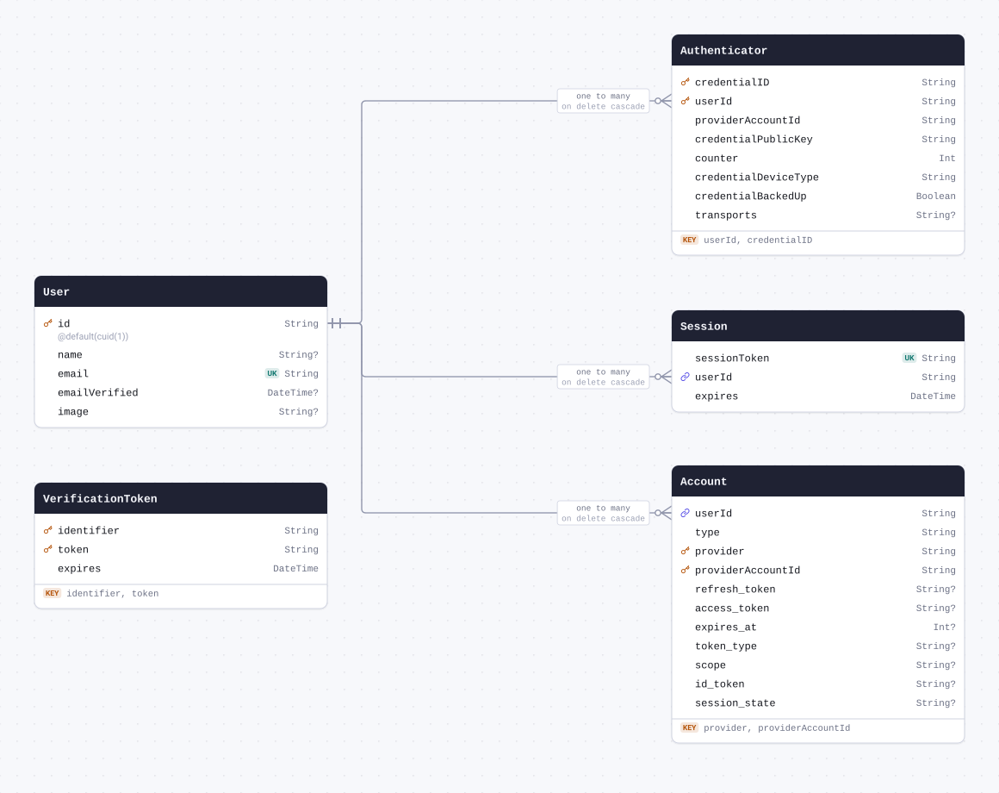
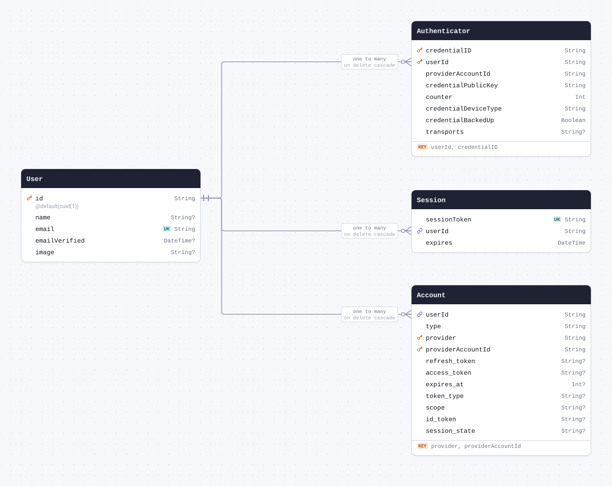
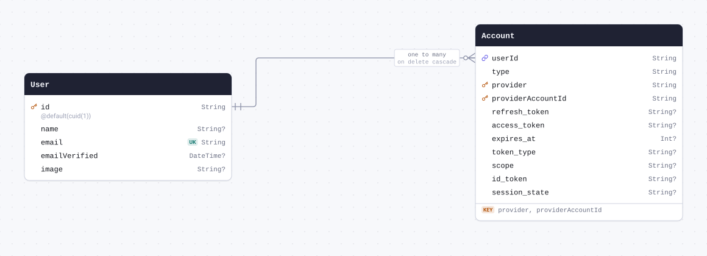
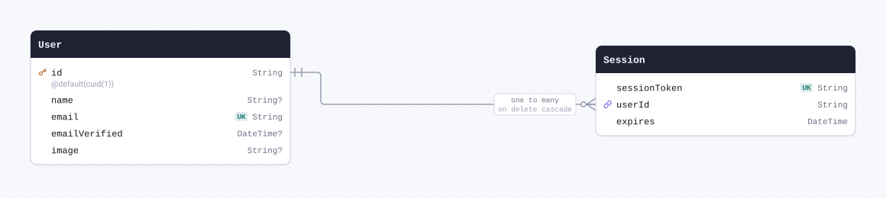
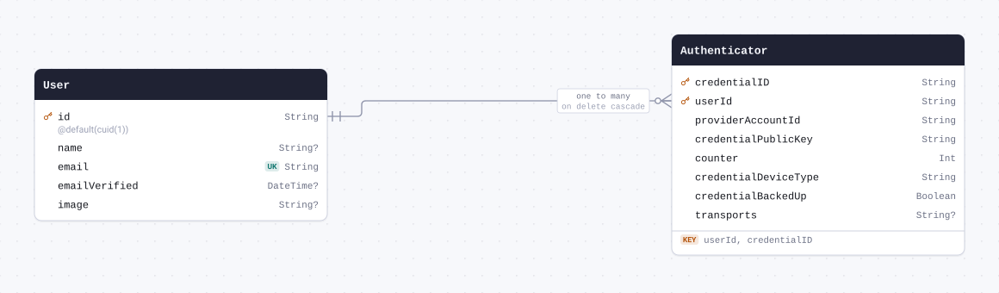

# Schema docs



<details>
<summary>The whole schema as SQL</summary>

```sql
CREATE TABLE "User" (
    "id" TEXT NOT NULL PRIMARY KEY,
    "name" TEXT,
    "email" TEXT NOT NULL,
    "emailVerified" DATETIME,
    "image" TEXT
);

CREATE TABLE "Account" (
    "userId" TEXT NOT NULL,
    "type" TEXT NOT NULL,
    "provider" TEXT NOT NULL,
    "providerAccountId" TEXT NOT NULL,
    "refresh_token" TEXT,
    "access_token" TEXT,
    "expires_at" INTEGER,
    "token_type" TEXT,
    "scope" TEXT,
    "id_token" TEXT,
    "session_state" TEXT,

    PRIMARY KEY ("provider", "providerAccountId"),
    CONSTRAINT "Account_userId_fkey" FOREIGN KEY ("userId") REFERENCES "User" ("id") ON DELETE CASCADE ON UPDATE CASCADE
);

CREATE TABLE "Session" (
    "sessionToken" TEXT NOT NULL,
    "userId" TEXT NOT NULL,
    "expires" DATETIME NOT NULL,
    CONSTRAINT "Session_userId_fkey" FOREIGN KEY ("userId") REFERENCES "User" ("id") ON DELETE CASCADE ON UPDATE CASCADE
);

CREATE TABLE "VerificationToken" (
    "identifier" TEXT NOT NULL,
    "token" TEXT NOT NULL,
    "expires" DATETIME NOT NULL,

    PRIMARY KEY ("identifier", "token")
);

CREATE TABLE "Authenticator" (
    "credentialID" TEXT NOT NULL,
    "userId" TEXT NOT NULL,
    "providerAccountId" TEXT NOT NULL,
    "credentialPublicKey" TEXT NOT NULL,
    "counter" INTEGER NOT NULL,
    "credentialDeviceType" TEXT NOT NULL,
    "credentialBackedUp" BOOLEAN NOT NULL,
    "transports" TEXT,

    PRIMARY KEY ("userId", "credentialID"),
    CONSTRAINT "Authenticator_userId_fkey" FOREIGN KEY ("userId") REFERENCES "User" ("id") ON DELETE CASCADE ON UPDATE CASCADE
);

CREATE UNIQUE INDEX "User_email_key" ON "User"("email");

CREATE UNIQUE INDEX "Session_sessionToken_key" ON "Session"("sessionToken");

CREATE UNIQUE INDEX "VerificationToken_token_key" ON "VerificationToken"("token");

CREATE UNIQUE INDEX "Authenticator_credentialID_key" ON "Authenticator"("credentialID");
```

</details>

## Contents

| Model                                         | Table               | Description |
| --------------------------------------------- | ------------------- | ----------- |
| [User](#model-User)                           | `User`              |             |
| [Account](#model-Account)                     | `Account`           |             |
| [Session](#model-Session)                     | `Session`           |             |
| [VerificationToken](#model-VerificationToken) | `VerificationToken` |             |
| [Authenticator](#model-Authenticator)         | `Authenticator`     |             |

## Models

<a id="model-User"></a>

### User



| Field           | Type       | Constraints     | Default   | Description |
| --------------- | ---------- | --------------- | --------- | ----------- |
| `id`            | `String`   | PK NOT NULL     | `cuid(1)` |             |
| `name`          | `String`   | NULL            |           |             |
| `email`         | `String`   | UNIQUE NOT NULL |           |             |
| `emailVerified` | `DateTime` | NULL            |           |             |
| `image`         | `String`   | NULL            |           |             |

#### Referenced by

- `id` ← [Account.userId](#model-Account) (one-to-many, on delete Cascade)
- `id` ← [Session.userId](#model-Session) (one-to-many, on delete Cascade)
- `id` ← [Authenticator.userId](#model-Authenticator) (one-to-many, on delete Cascade)

#### Definition

```sql
CREATE TABLE "User" (
    "id" TEXT NOT NULL PRIMARY KEY,
    "name" TEXT,
    "email" TEXT NOT NULL,
    "emailVerified" DATETIME,
    "image" TEXT
);

CREATE UNIQUE INDEX "User_email_key" ON "User"("email");
```

<details>
<summary>Queries and their SQL</summary>

**findMany**: Every row

```ts
await prisma.user.findMany();
```

```sql
SELECT
  `main`.`User`.`id`,
  `main`.`User`.`name`,
  `main`.`User`.`email`,
  `main`.`User`.`emailVerified`,
  `main`.`User`.`image`
FROM
  `main`.`User`
WHERE
  1 = 1
LIMIT
  ?
OFFSET
  ?
-- params: [-1,"0"]
```

**count**: How many rows there are

```ts
await prisma.user.count();
```

```sql
SELECT
  COUNT(*) AS `_count$_all`
FROM
  (
    SELECT
      `main`.`User`.`id`
    FROM
      `main`.`User`
    WHERE
      1 = 1
    LIMIT
      ?
    OFFSET
      ?
  ) AS `sub`
-- params: [-1,"0"]
```

**findMany**: Every row with its relations

```ts
await prisma.user.findMany({ include: { accounts: true, sessions: true, Authenticator: true } });
```

```sql
SELECT
  `main`.`User`.`id`,
  `main`.`User`.`name`,
  `main`.`User`.`email`,
  `main`.`User`.`emailVerified`,
  `main`.`User`.`image`
FROM
  `main`.`User`
WHERE
  1 = 1
LIMIT
  ?
OFFSET
  ?
-- params: [-1,"0"]

SELECT
  `main`.`Account`.`provider`,
  `main`.`Account`.`providerAccountId`,
  `main`.`Account`.`userId`,
  `main`.`Account`.`type`,
  `main`.`Account`.`refresh_token`,
  `main`.`Account`.`access_token`,
  `main`.`Account`.`expires_at`,
  `main`.`Account`.`token_type`,
  `main`.`Account`.`scope`,
  `main`.`Account`.`id_token`,
  `main`.`Account`.`session_state`
FROM
  `main`.`Account`
WHERE
  `main`.`Account`.`userId` IN (?)
LIMIT
  ?
OFFSET
  ?
-- params: ["<id of the rows above>",-1,"0"]

SELECT
  `main`.`Session`.`sessionToken`,
  `main`.`Session`.`userId`,
  `main`.`Session`.`expires`
FROM
  `main`.`Session`
WHERE
  `main`.`Session`.`userId` IN (?)
LIMIT
  ?
OFFSET
  ?
-- params: ["<id of the rows above>",-1,"0"]

SELECT
  `main`.`Authenticator`.`userId`,
  `main`.`Authenticator`.`credentialID`,
  `main`.`Authenticator`.`providerAccountId`,
  `main`.`Authenticator`.`credentialPublicKey`,
  `main`.`Authenticator`.`counter`,
  `main`.`Authenticator`.`credentialDeviceType`,
  `main`.`Authenticator`.`credentialBackedUp`,
  `main`.`Authenticator`.`transports`
FROM
  `main`.`Authenticator`
WHERE
  `main`.`Authenticator`.`userId` IN (?)
LIMIT
  ?
OFFSET
  ?
-- params: ["<id of the rows above>",-1,"0"]
```

**findUnique**: One row by what is unique to it

```ts
await prisma.user.findUnique({ where: { id: "example" } });
```

```sql
SELECT
  `main`.`User`.`id`,
  `main`.`User`.`name`,
  `main`.`User`.`email`,
  `main`.`User`.`emailVerified`,
  `main`.`User`.`image`
FROM
  `main`.`User`
WHERE
  (
    `main`.`User`.`id` = ?
    AND 1 = 1
  )
LIMIT
  ?
OFFSET
  ?
-- params: ["example","1","0"]
```

**create**: Create a row

```ts
await prisma.user.create({ data: { email: "example" } });
```

```sql
INSERT INTO
  `main`.`User` (`id`, `email`)
VALUES
  (?, ?)
RETURNING
  `id` AS `id`,
  `name` AS `name`,
  `email` AS `email`,
  `emailVerified` AS `emailVerified`,
  `image` AS `image`
-- params: ["<cuid(1)>","example"]
```

**update**: Update a row

```ts
await prisma.user.update({ where: { id: "example" }, data: { name: "example" } });
```

```sql
UPDATE `main`.`User`
SET
  `name` = ?
WHERE
  (
    `main`.`User`.`id` = ?
    AND 1 = 1
  )
RETURNING
  `id` AS `id`,
  `name` AS `name`,
  `email` AS `email`,
  `emailVerified` AS `emailVerified`,
  `image` AS `image`
-- params: ["example","example"]
```

**delete**: Delete a row

```ts
await prisma.user.delete({ where: { id: "example" } });
```

```sql
DELETE FROM `main`.`User`
WHERE
  (
    `main`.`User`.`id` = ?
    AND 1 = 1
  )
RETURNING
  `id` AS `id`,
  `name` AS `name`,
  `email` AS `email`,
  `emailVerified` AS `emailVerified`,
  `image` AS `image`
-- params: ["example"]
```

</details>

<a id="model-Account"></a>

### Account



| Field               | Type     | Constraints                       | Default | Description |
| ------------------- | -------- | --------------------------------- | ------- | ----------- |
| `userId`            | `String` | NOT NULL → [User.id](#model-User) |         |             |
| `type`              | `String` | NOT NULL                          |         |             |
| `provider`          | `String` | PK NOT NULL                       |         |             |
| `providerAccountId` | `String` | PK NOT NULL                       |         |             |
| `refresh_token`     | `String` | NULL                              |         |             |
| `access_token`      | `String` | NULL                              |         |             |
| `expires_at`        | `Int`    | NULL                              |         |             |
| `token_type`        | `String` | NULL                              |         |             |
| `scope`             | `String` | NULL                              |         |             |
| `id_token`          | `String` | NULL                              |         |             |
| `session_state`     | `String` | NULL                              |         |             |

#### Indexes

- `@@id([provider, providerAccountId])`

#### References

- `userId` → [User.id](#model-User) (many-to-one, on delete Cascade)

#### Definition

```sql
CREATE TABLE "Account" (
    "userId" TEXT NOT NULL,
    "type" TEXT NOT NULL,
    "provider" TEXT NOT NULL,
    "providerAccountId" TEXT NOT NULL,
    "refresh_token" TEXT,
    "access_token" TEXT,
    "expires_at" INTEGER,
    "token_type" TEXT,
    "scope" TEXT,
    "id_token" TEXT,
    "session_state" TEXT,

    PRIMARY KEY ("provider", "providerAccountId"),
    CONSTRAINT "Account_userId_fkey" FOREIGN KEY ("userId") REFERENCES "User" ("id") ON DELETE CASCADE ON UPDATE CASCADE
);
```

<details>
<summary>Queries and their SQL</summary>

**findMany**: Every row

```ts
await prisma.account.findMany();
```

```sql
SELECT
  `main`.`Account`.`provider`,
  `main`.`Account`.`providerAccountId`,
  `main`.`Account`.`userId`,
  `main`.`Account`.`type`,
  `main`.`Account`.`refresh_token`,
  `main`.`Account`.`access_token`,
  `main`.`Account`.`expires_at`,
  `main`.`Account`.`token_type`,
  `main`.`Account`.`scope`,
  `main`.`Account`.`id_token`,
  `main`.`Account`.`session_state`
FROM
  `main`.`Account`
WHERE
  1 = 1
LIMIT
  ?
OFFSET
  ?
-- params: [-1,"0"]
```

**count**: How many rows there are

```ts
await prisma.account.count();
```

```sql
SELECT
  COUNT(*) AS `_count$_all`
FROM
  (
    SELECT
      `main`.`Account`.`provider`,
      `main`.`Account`.`providerAccountId`
    FROM
      `main`.`Account`
    WHERE
      1 = 1
    LIMIT
      ?
    OFFSET
      ?
  ) AS `sub`
-- params: [-1,"0"]
```

**findMany**: Every row with its relations

```ts
await prisma.account.findMany({ include: { user: true } });
```

```sql
SELECT
  `main`.`Account`.`provider`,
  `main`.`Account`.`providerAccountId`,
  `main`.`Account`.`userId`,
  `main`.`Account`.`type`,
  `main`.`Account`.`refresh_token`,
  `main`.`Account`.`access_token`,
  `main`.`Account`.`expires_at`,
  `main`.`Account`.`token_type`,
  `main`.`Account`.`scope`,
  `main`.`Account`.`id_token`,
  `main`.`Account`.`session_state`
FROM
  `main`.`Account`
WHERE
  1 = 1
LIMIT
  ?
OFFSET
  ?
-- params: [-1,"0"]

SELECT
  `main`.`User`.`id`,
  `main`.`User`.`name`,
  `main`.`User`.`email`,
  `main`.`User`.`emailVerified`,
  `main`.`User`.`image`
FROM
  `main`.`User`
WHERE
  `main`.`User`.`id` IN (?)
LIMIT
  ?
OFFSET
  ?
-- params: ["<userId of the rows above>",-1,"0"]
```

**findUnique**: One row by what is unique to it

```ts
await prisma.account.findUnique({
  where: { provider_providerAccountId: { provider: "example", providerAccountId: "example" } },
});
```

```sql
SELECT
  `main`.`Account`.`provider`,
  `main`.`Account`.`providerAccountId`,
  `main`.`Account`.`userId`,
  `main`.`Account`.`type`,
  `main`.`Account`.`refresh_token`,
  `main`.`Account`.`access_token`,
  `main`.`Account`.`expires_at`,
  `main`.`Account`.`token_type`,
  `main`.`Account`.`scope`,
  `main`.`Account`.`id_token`,
  `main`.`Account`.`session_state`
FROM
  `main`.`Account`
WHERE
  (
    (
      `main`.`Account`.`provider` = ?
      AND `main`.`Account`.`providerAccountId` = ?
    )
    AND 1 = 1
  )
LIMIT
  ?
OFFSET
  ?
-- params: ["example","example","1","0"]
```

**create**: Create a row

```ts
await prisma.account.create({
  data: { userId: "example", type: "example", provider: "example", providerAccountId: "example" },
});
```

```sql
INSERT INTO
  `main`.`Account` (`userId`, `type`, `provider`, `providerAccountId`)
VALUES
  (?, ?, ?, ?)
RETURNING
  `provider` AS `provider`,
  `providerAccountId` AS `providerAccountId`,
  `userId` AS `userId`,
  `type` AS `type`,
  `refresh_token` AS `refresh_token`,
  `access_token` AS `access_token`,
  `expires_at` AS `expires_at`,
  `token_type` AS `token_type`,
  `scope` AS `scope`,
  `id_token` AS `id_token`,
  `session_state` AS `session_state`
-- params: ["example","example","example","example"]
```

**update**: Update a row

```ts
await prisma.account.update({
  where: { provider_providerAccountId: { provider: "example", providerAccountId: "example" } },
  data: { type: "example" },
});
```

```sql
UPDATE `main`.`Account`
SET
  `type` = ?
WHERE
  (
    (
      `main`.`Account`.`provider` = ?
      AND `main`.`Account`.`providerAccountId` = ?
    )
    AND 1 = 1
  )
RETURNING
  `provider` AS `provider`,
  `providerAccountId` AS `providerAccountId`,
  `userId` AS `userId`,
  `type` AS `type`,
  `refresh_token` AS `refresh_token`,
  `access_token` AS `access_token`,
  `expires_at` AS `expires_at`,
  `token_type` AS `token_type`,
  `scope` AS `scope`,
  `id_token` AS `id_token`,
  `session_state` AS `session_state`
-- params: ["example","example","example"]
```

**delete**: Delete a row

```ts
await prisma.account.delete({
  where: { provider_providerAccountId: { provider: "example", providerAccountId: "example" } },
});
```

```sql
DELETE FROM `main`.`Account`
WHERE
  (
    (
      `main`.`Account`.`provider` = ?
      AND `main`.`Account`.`providerAccountId` = ?
    )
    AND 1 = 1
  )
RETURNING
  `provider` AS `provider`,
  `providerAccountId` AS `providerAccountId`,
  `userId` AS `userId`,
  `type` AS `type`,
  `refresh_token` AS `refresh_token`,
  `access_token` AS `access_token`,
  `expires_at` AS `expires_at`,
  `token_type` AS `token_type`,
  `scope` AS `scope`,
  `id_token` AS `id_token`,
  `session_state` AS `session_state`
-- params: ["example","example"]
```

</details>

<a id="model-Session"></a>

### Session



| Field          | Type       | Constraints                       | Default | Description |
| -------------- | ---------- | --------------------------------- | ------- | ----------- |
| `sessionToken` | `String`   | UNIQUE NOT NULL                   |         |             |
| `userId`       | `String`   | NOT NULL → [User.id](#model-User) |         |             |
| `expires`      | `DateTime` | NOT NULL                          |         |             |

#### References

- `userId` → [User.id](#model-User) (many-to-one, on delete Cascade)

#### Definition

```sql
CREATE TABLE "Session" (
    "sessionToken" TEXT NOT NULL,
    "userId" TEXT NOT NULL,
    "expires" DATETIME NOT NULL,
    CONSTRAINT "Session_userId_fkey" FOREIGN KEY ("userId") REFERENCES "User" ("id") ON DELETE CASCADE ON UPDATE CASCADE
);

CREATE UNIQUE INDEX "Session_sessionToken_key" ON "Session"("sessionToken");
```

<details>
<summary>Queries and their SQL</summary>

**findMany**: Every row

```ts
await prisma.session.findMany();
```

```sql
SELECT
  `main`.`Session`.`sessionToken`,
  `main`.`Session`.`userId`,
  `main`.`Session`.`expires`
FROM
  `main`.`Session`
WHERE
  1 = 1
LIMIT
  ?
OFFSET
  ?
-- params: [-1,"0"]
```

**count**: How many rows there are

```ts
await prisma.session.count();
```

```sql
SELECT
  COUNT(*) AS `_count$_all`
FROM
  (
    SELECT
      `main`.`Session`.`sessionToken`
    FROM
      `main`.`Session`
    WHERE
      1 = 1
    LIMIT
      ?
    OFFSET
      ?
  ) AS `sub`
-- params: [-1,"0"]
```

**findMany**: Every row with its relations

```ts
await prisma.session.findMany({ include: { user: true } });
```

```sql
SELECT
  `main`.`Session`.`sessionToken`,
  `main`.`Session`.`userId`,
  `main`.`Session`.`expires`
FROM
  `main`.`Session`
WHERE
  1 = 1
LIMIT
  ?
OFFSET
  ?
-- params: [-1,"0"]

SELECT
  `main`.`User`.`id`,
  `main`.`User`.`name`,
  `main`.`User`.`email`,
  `main`.`User`.`emailVerified`,
  `main`.`User`.`image`
FROM
  `main`.`User`
WHERE
  `main`.`User`.`id` IN (?)
LIMIT
  ?
OFFSET
  ?
-- params: ["<userId of the rows above>",-1,"0"]
```

**findUnique**: One row by what is unique to it

```ts
await prisma.session.findUnique({ where: { sessionToken: "example" } });
```

```sql
SELECT
  `main`.`Session`.`sessionToken`,
  `main`.`Session`.`userId`,
  `main`.`Session`.`expires`
FROM
  `main`.`Session`
WHERE
  (
    `main`.`Session`.`sessionToken` = ?
    AND 1 = 1
  )
LIMIT
  ?
OFFSET
  ?
-- params: ["example","1","0"]
```

**create**: Create a row

```ts
await prisma.session.create({
  data: {
    sessionToken: "example",
    userId: "example",
    expires: new Date("2026-01-01T00:00:00.000Z"),
  },
});
```

```sql
INSERT INTO
  `main`.`Session` (`sessionToken`, `userId`, `expires`)
VALUES
  (?, ?, ?)
RETURNING
  `sessionToken` AS `sessionToken`,
  `userId` AS `userId`,
  `expires` AS `expires`
-- params: ["example","example","2026-01-01T00:00:00.000Z"]
```

**update**: Update a row

```ts
await prisma.session.update({
  where: { sessionToken: "example" },
  data: { expires: new Date("2026-01-01T00:00:00.000Z") },
});
```

```sql
UPDATE `main`.`Session`
SET
  `expires` = ?
WHERE
  (
    `main`.`Session`.`sessionToken` = ?
    AND 1 = 1
  )
RETURNING
  `sessionToken` AS `sessionToken`,
  `userId` AS `userId`,
  `expires` AS `expires`
-- params: ["2026-01-01T00:00:00.000Z","example"]
```

**delete**: Delete a row

```ts
await prisma.session.delete({ where: { sessionToken: "example" } });
```

```sql
DELETE FROM `main`.`Session`
WHERE
  (
    `main`.`Session`.`sessionToken` = ?
    AND 1 = 1
  )
RETURNING
  `sessionToken` AS `sessionToken`,
  `userId` AS `userId`,
  `expires` AS `expires`
-- params: ["example"]
```

</details>

<a id="model-VerificationToken"></a>

### VerificationToken

| Field        | Type       | Constraints        | Default | Description |
| ------------ | ---------- | ------------------ | ------- | ----------- |
| `identifier` | `String`   | PK NOT NULL        |         |             |
| `token`      | `String`   | PK UNIQUE NOT NULL |         |             |
| `expires`    | `DateTime` | NOT NULL           |         |             |

#### Indexes

- `@@id([identifier, token])`

#### Definition

```sql
CREATE TABLE "VerificationToken" (
    "identifier" TEXT NOT NULL,
    "token" TEXT NOT NULL,
    "expires" DATETIME NOT NULL,

    PRIMARY KEY ("identifier", "token")
);

CREATE UNIQUE INDEX "VerificationToken_token_key" ON "VerificationToken"("token");
```

<details>
<summary>Queries and their SQL</summary>

**findMany**: Every row

```ts
await prisma.verificationToken.findMany();
```

```sql
SELECT
  `main`.`VerificationToken`.`identifier`,
  `main`.`VerificationToken`.`token`,
  `main`.`VerificationToken`.`expires`
FROM
  `main`.`VerificationToken`
WHERE
  1 = 1
LIMIT
  ?
OFFSET
  ?
-- params: [-1,"0"]
```

**count**: How many rows there are

```ts
await prisma.verificationToken.count();
```

```sql
SELECT
  COUNT(*) AS `_count$_all`
FROM
  (
    SELECT
      `main`.`VerificationToken`.`identifier`,
      `main`.`VerificationToken`.`token`
    FROM
      `main`.`VerificationToken`
    WHERE
      1 = 1
    LIMIT
      ?
    OFFSET
      ?
  ) AS `sub`
-- params: [-1,"0"]
```

**findUnique**: One row by what is unique to it

```ts
await prisma.verificationToken.findUnique({
  where: { identifier_token: { identifier: "example", token: "example" } },
});
```

```sql
SELECT
  `main`.`VerificationToken`.`identifier`,
  `main`.`VerificationToken`.`token`,
  `main`.`VerificationToken`.`expires`
FROM
  `main`.`VerificationToken`
WHERE
  (
    (
      `main`.`VerificationToken`.`identifier` = ?
      AND `main`.`VerificationToken`.`token` = ?
    )
    AND 1 = 1
  )
LIMIT
  ?
OFFSET
  ?
-- params: ["example","example","1","0"]
```

**create**: Create a row

```ts
await prisma.verificationToken.create({
  data: { identifier: "example", token: "example", expires: new Date("2026-01-01T00:00:00.000Z") },
});
```

```sql
INSERT INTO
  `main`.`VerificationToken` (`identifier`, `token`, `expires`)
VALUES
  (?, ?, ?)
RETURNING
  `identifier` AS `identifier`,
  `token` AS `token`,
  `expires` AS `expires`
-- params: ["example","example","2026-01-01T00:00:00.000Z"]
```

**update**: Update a row

```ts
await prisma.verificationToken.update({
  where: { identifier_token: { identifier: "example", token: "example" } },
  data: { expires: new Date("2026-01-01T00:00:00.000Z") },
});
```

```sql
UPDATE `main`.`VerificationToken`
SET
  `expires` = ?
WHERE
  (
    (
      `main`.`VerificationToken`.`identifier` = ?
      AND `main`.`VerificationToken`.`token` = ?
    )
    AND 1 = 1
  )
RETURNING
  `identifier` AS `identifier`,
  `token` AS `token`,
  `expires` AS `expires`
-- params: ["2026-01-01T00:00:00.000Z","example","example"]
```

**delete**: Delete a row

```ts
await prisma.verificationToken.delete({
  where: { identifier_token: { identifier: "example", token: "example" } },
});
```

```sql
DELETE FROM `main`.`VerificationToken`
WHERE
  (
    (
      `main`.`VerificationToken`.`identifier` = ?
      AND `main`.`VerificationToken`.`token` = ?
    )
    AND 1 = 1
  )
RETURNING
  `identifier` AS `identifier`,
  `token` AS `token`,
  `expires` AS `expires`
-- params: ["example","example"]
```

</details>

<a id="model-Authenticator"></a>

### Authenticator



| Field                  | Type      | Constraints                          | Default | Description |
| ---------------------- | --------- | ------------------------------------ | ------- | ----------- |
| `credentialID`         | `String`  | PK UNIQUE NOT NULL                   |         |             |
| `userId`               | `String`  | PK NOT NULL → [User.id](#model-User) |         |             |
| `providerAccountId`    | `String`  | NOT NULL                             |         |             |
| `credentialPublicKey`  | `String`  | NOT NULL                             |         |             |
| `counter`              | `Int`     | NOT NULL                             |         |             |
| `credentialDeviceType` | `String`  | NOT NULL                             |         |             |
| `credentialBackedUp`   | `Boolean` | NOT NULL                             |         |             |
| `transports`           | `String`  | NULL                                 |         |             |

#### Indexes

- `@@id([userId, credentialID])`

#### References

- `userId` → [User.id](#model-User) (many-to-one, on delete Cascade)

#### Definition

```sql
CREATE TABLE "Authenticator" (
    "credentialID" TEXT NOT NULL,
    "userId" TEXT NOT NULL,
    "providerAccountId" TEXT NOT NULL,
    "credentialPublicKey" TEXT NOT NULL,
    "counter" INTEGER NOT NULL,
    "credentialDeviceType" TEXT NOT NULL,
    "credentialBackedUp" BOOLEAN NOT NULL,
    "transports" TEXT,

    PRIMARY KEY ("userId", "credentialID"),
    CONSTRAINT "Authenticator_userId_fkey" FOREIGN KEY ("userId") REFERENCES "User" ("id") ON DELETE CASCADE ON UPDATE CASCADE
);

CREATE UNIQUE INDEX "Authenticator_credentialID_key" ON "Authenticator"("credentialID");
```

<details>
<summary>Queries and their SQL</summary>

**findMany**: Every row

```ts
await prisma.authenticator.findMany();
```

```sql
SELECT
  `main`.`Authenticator`.`userId`,
  `main`.`Authenticator`.`credentialID`,
  `main`.`Authenticator`.`providerAccountId`,
  `main`.`Authenticator`.`credentialPublicKey`,
  `main`.`Authenticator`.`counter`,
  `main`.`Authenticator`.`credentialDeviceType`,
  `main`.`Authenticator`.`credentialBackedUp`,
  `main`.`Authenticator`.`transports`
FROM
  `main`.`Authenticator`
WHERE
  1 = 1
LIMIT
  ?
OFFSET
  ?
-- params: [-1,"0"]
```

**count**: How many rows there are

```ts
await prisma.authenticator.count();
```

```sql
SELECT
  COUNT(*) AS `_count$_all`
FROM
  (
    SELECT
      `main`.`Authenticator`.`userId`,
      `main`.`Authenticator`.`credentialID`
    FROM
      `main`.`Authenticator`
    WHERE
      1 = 1
    LIMIT
      ?
    OFFSET
      ?
  ) AS `sub`
-- params: [-1,"0"]
```

**findMany**: Every row with its relations

```ts
await prisma.authenticator.findMany({ include: { user: true } });
```

```sql
SELECT
  `main`.`Authenticator`.`userId`,
  `main`.`Authenticator`.`credentialID`,
  `main`.`Authenticator`.`providerAccountId`,
  `main`.`Authenticator`.`credentialPublicKey`,
  `main`.`Authenticator`.`counter`,
  `main`.`Authenticator`.`credentialDeviceType`,
  `main`.`Authenticator`.`credentialBackedUp`,
  `main`.`Authenticator`.`transports`
FROM
  `main`.`Authenticator`
WHERE
  1 = 1
LIMIT
  ?
OFFSET
  ?
-- params: [-1,"0"]

SELECT
  `main`.`User`.`id`,
  `main`.`User`.`name`,
  `main`.`User`.`email`,
  `main`.`User`.`emailVerified`,
  `main`.`User`.`image`
FROM
  `main`.`User`
WHERE
  `main`.`User`.`id` IN (?)
LIMIT
  ?
OFFSET
  ?
-- params: ["<userId of the rows above>",-1,"0"]
```

**findUnique**: One row by what is unique to it

```ts
await prisma.authenticator.findUnique({
  where: { userId_credentialID: { userId: "example", credentialID: "example" } },
});
```

```sql
SELECT
  `main`.`Authenticator`.`userId`,
  `main`.`Authenticator`.`credentialID`,
  `main`.`Authenticator`.`providerAccountId`,
  `main`.`Authenticator`.`credentialPublicKey`,
  `main`.`Authenticator`.`counter`,
  `main`.`Authenticator`.`credentialDeviceType`,
  `main`.`Authenticator`.`credentialBackedUp`,
  `main`.`Authenticator`.`transports`
FROM
  `main`.`Authenticator`
WHERE
  (
    (
      `main`.`Authenticator`.`userId` = ?
      AND `main`.`Authenticator`.`credentialID` = ?
    )
    AND 1 = 1
  )
LIMIT
  ?
OFFSET
  ?
-- params: ["example","example","1","0"]
```

**create**: Create a row

```ts
await prisma.authenticator.create({
  data: {
    credentialID: "example",
    userId: "example",
    providerAccountId: "example",
    credentialPublicKey: "example",
    counter: 1,
    credentialDeviceType: "example",
    credentialBackedUp: true,
  },
});
```

```sql
INSERT INTO
  `main`.`Authenticator` (
    `credentialID`,
    `userId`,
    `providerAccountId`,
    `credentialPublicKey`,
    `counter`,
    `credentialDeviceType`,
    `credentialBackedUp`
  )
VALUES
  (?, ?, ?, ?, ?, ?, ?)
RETURNING
  `userId` AS `userId`,
  `credentialID` AS `credentialID`,
  `providerAccountId` AS `providerAccountId`,
  `credentialPublicKey` AS `credentialPublicKey`,
  `counter` AS `counter`,
  `credentialDeviceType` AS `credentialDeviceType`,
  `credentialBackedUp` AS `credentialBackedUp`,
  `transports` AS `transports`
-- params: ["example","example","example","example","1","example",true]
```

**update**: Update a row

```ts
await prisma.authenticator.update({
  where: { userId_credentialID: { userId: "example", credentialID: "example" } },
  data: { providerAccountId: "example" },
});
```

```sql
UPDATE `main`.`Authenticator`
SET
  `providerAccountId` = ?
WHERE
  (
    (
      `main`.`Authenticator`.`userId` = ?
      AND `main`.`Authenticator`.`credentialID` = ?
    )
    AND 1 = 1
  )
RETURNING
  `userId` AS `userId`,
  `credentialID` AS `credentialID`,
  `providerAccountId` AS `providerAccountId`,
  `credentialPublicKey` AS `credentialPublicKey`,
  `counter` AS `counter`,
  `credentialDeviceType` AS `credentialDeviceType`,
  `credentialBackedUp` AS `credentialBackedUp`,
  `transports` AS `transports`
-- params: ["example","example","example"]
```

**delete**: Delete a row

```ts
await prisma.authenticator.delete({
  where: { userId_credentialID: { userId: "example", credentialID: "example" } },
});
```

```sql
DELETE FROM `main`.`Authenticator`
WHERE
  (
    (
      `main`.`Authenticator`.`userId` = ?
      AND `main`.`Authenticator`.`credentialID` = ?
    )
    AND 1 = 1
  )
RETURNING
  `userId` AS `userId`,
  `credentialID` AS `credentialID`,
  `providerAccountId` AS `providerAccountId`,
  `credentialPublicKey` AS `credentialPublicKey`,
  `counter` AS `counter`,
  `credentialDeviceType` AS `credentialDeviceType`,
  `credentialBackedUp` AS `credentialBackedUp`,
  `transports` AS `transports`
-- params: ["example","example"]
```

</details>
