# Schema docs

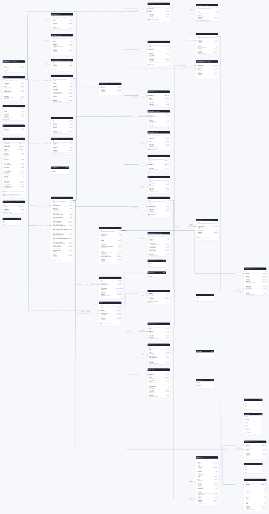

<details>
<summary>The whole schema as SQL</summary>

```sql
CREATE SCHEMA IF NOT EXISTS "public";

CREATE TYPE "ProjectType" AS ENUM ('website', 'app', 'backend');

CREATE TYPE "ProjectScope" AS ENUM ('all', 'selected');

CREATE TYPE "AccessLevel" AS ENUM ('read', 'write', 'admin');

CREATE TYPE "ClientType" AS ENUM ('read', 'write', 'root');

CREATE TYPE "Interval" AS ENUM ('hour', 'day', 'month', 'minute', 'week');

CREATE TYPE "ChartType" AS ENUM ('linear', 'bar', 'histogram', 'pie', 'metric', 'area', 'map', 'funnel', 'retention', 'conversion', 'sankey', 'distribution');

CREATE TYPE "Metric" AS ENUM ('sum', 'average', 'min', 'max', 'count');

CREATE TYPE "IntegrationType" AS ENUM ('app', 'mail', 'custom');

CREATE TYPE "ImportStatus" AS ENUM ('pending', 'processing', 'completed', 'failed');

CREATE TYPE "InsightState" AS ENUM ('active', 'suppressed', 'closed');

CREATE TABLE "__code_migrations" (
    "id" TEXT NOT NULL DEFAULT gen_random_uuid(),
    "name" TEXT NOT NULL,
    "createdAt" TIMESTAMP(3) NOT NULL DEFAULT CURRENT_TIMESTAMP,
    "updatedAt" TIMESTAMP(3) NOT NULL DEFAULT CURRENT_TIMESTAMP,

    CONSTRAINT "__code_migrations_pkey" PRIMARY KEY ("id")
);

CREATE TABLE "conversations" (
    "id" TEXT NOT NULL DEFAULT gen_random_uuid(),
    "projectId" TEXT NOT NULL,
    "organizationId" TEXT NOT NULL,
    "userId" TEXT NOT NULL,
    "title" TEXT,
    "createdAt" TIMESTAMP(3) NOT NULL DEFAULT CURRENT_TIMESTAMP,
    "updatedAt" TIMESTAMP(3) NOT NULL DEFAULT CURRENT_TIMESTAMP,

    CONSTRAINT "conversations_pkey" PRIMARY KEY ("id")
);

CREATE TABLE "chat_messages" (
    "id" TEXT NOT NULL DEFAULT gen_random_uuid(),
    "conversationId" TEXT NOT NULL,
    "role" TEXT NOT NULL,
    "parts" JSON NOT NULL,
    "metadata" JSONB,
    "createdAt" TIMESTAMP(3) NOT NULL DEFAULT CURRENT_TIMESTAMP,

    CONSTRAINT "chat_messages_pkey" PRIMARY KEY ("id")
);

CREATE TABLE "organizations" (
    "id" TEXT NOT NULL DEFAULT gen_random_uuid(),
    "name" TEXT NOT NULL,
    "slug" TEXT,
    "createdByUserId" TEXT,
    "timezone" TEXT,
    "onboarding" TEXT DEFAULT 'completed',
    "attribution" JSONB,
    "subscriptionId" TEXT,
    "subscriptionCustomerId" TEXT,
    "subscriptionPriceId" TEXT,
    "subscriptionProductId" TEXT,
    "subscriptionStatus" TEXT,
    "subscriptionStartsAt" TIMESTAMP(3),
    "subscriptionEndsAt" TIMESTAMP(3),
    "subscriptionCanceledAt" TIMESTAMP(3),
    "subscriptionCreatedByUserId" TEXT,
    "subscriptionPeriodEventsCount" INTEGER NOT NULL DEFAULT 0,
    "subscriptionPeriodEventsCountExceededAt" TIMESTAMP(3),
    "subscriptionPeriodEventsLimit" INTEGER NOT NULL DEFAULT 0,
    "subscriptionInterval" TEXT,
    "subscriptionCancelReason" TEXT,
    "subscriptionCancelComment" TEXT,
    "subscriptionSaveDiscountAppliedAt" TIMESTAMP(3),
    "subscriptionPauseAtPeriodEnd" BOOLEAN NOT NULL DEFAULT false,
    "subscriptionResumesAt" TIMESTAMP(3),
    "subscriptionFirstStartedAt" TIMESTAMP(3),
    "usageWarningSentAt" TIMESTAMP(3),
    "usageExceededSentAt" TIMESTAMP(3),
    "subscriptionDiscount" JSONB,
    "windDownStartedAt" TIMESTAMP(3),
    "windDownStep" TEXT,
    "deleteAt" TIMESTAMP(3),
    "createdAt" TIMESTAMP(3) NOT NULL DEFAULT CURRENT_TIMESTAMP,
    "updatedAt" TIMESTAMP(3) NOT NULL DEFAULT CURRENT_TIMESTAMP,

    CONSTRAINT "organizations_pkey" PRIMARY KEY ("id")
);

CREATE TABLE "users" (
    "id" TEXT NOT NULL DEFAULT gen_random_uuid(),
    "email" TEXT NOT NULL,
    "firstName" TEXT,
    "lastName" TEXT,
    "name" TEXT,
    "emailVerified" BOOLEAN NOT NULL DEFAULT false,
    "image" TEXT,
    "twoFactorEnabled" BOOLEAN NOT NULL DEFAULT false,
    "createdAt" TIMESTAMP(3) NOT NULL DEFAULT CURRENT_TIMESTAMP,
    "updatedAt" TIMESTAMP(3) NOT NULL DEFAULT CURRENT_TIMESTAMP,
    "deletedAt" TIMESTAMP(3),

    CONSTRAINT "users_pkey" PRIMARY KEY ("id")
);

CREATE TABLE "user_totp" (
    "id" TEXT NOT NULL DEFAULT gen_random_uuid(),
    "userId" TEXT NOT NULL,
    "secret" TEXT NOT NULL,
    "recoveryCodes" TEXT[],
    "enabledAt" TIMESTAMP(3),
    "createdAt" TIMESTAMP(3) NOT NULL DEFAULT CURRENT_TIMESTAMP,
    "updatedAt" TIMESTAMP(3) NOT NULL DEFAULT CURRENT_TIMESTAMP,

    CONSTRAINT "user_totp_pkey" PRIMARY KEY ("id")
);

CREATE TABLE "two_factor" (
    "id" TEXT NOT NULL DEFAULT gen_random_uuid(),
    "userId" TEXT NOT NULL,
    "secret" TEXT NOT NULL,
    "backupCodes" TEXT NOT NULL,
    "verified" BOOLEAN NOT NULL DEFAULT true,
    "failedVerificationCount" INTEGER NOT NULL DEFAULT 0,
    "lockedUntil" TIMESTAMP(3),
    "createdAt" TIMESTAMP(3) NOT NULL DEFAULT CURRENT_TIMESTAMP,
    "updatedAt" TIMESTAMP(3) NOT NULL DEFAULT CURRENT_TIMESTAMP,

    CONSTRAINT "two_factor_pkey" PRIMARY KEY ("id")
);

CREATE TABLE "two_factor_challenges" (
    "id" TEXT NOT NULL,
    "userId" TEXT NOT NULL,
    "expiresAt" TIMESTAMP(3) NOT NULL,
    "createdAt" TIMESTAMP(3) NOT NULL DEFAULT CURRENT_TIMESTAMP,

    CONSTRAINT "two_factor_challenges_pkey" PRIMARY KEY ("id")
);

CREATE TABLE "accounts" (
    "id" TEXT NOT NULL DEFAULT gen_random_uuid(),
    "userId" TEXT NOT NULL,
    "email" TEXT,
    "provider" TEXT NOT NULL,
    "providerId" TEXT,
    "accountId" TEXT,
    "idToken" TEXT,
    "accessToken" TEXT,
    "refreshToken" TEXT,
    "accessTokenExpiresAt" TIMESTAMP(3),
    "refreshTokenExpiresAt" TIMESTAMP(3),
    "scope" TEXT,
    "password" TEXT,
    "createdAt" TIMESTAMP(3) NOT NULL DEFAULT CURRENT_TIMESTAMP,
    "updatedAt" TIMESTAMP(3) NOT NULL DEFAULT CURRENT_TIMESTAMP,

    CONSTRAINT "accounts_pkey" PRIMARY KEY ("id")
);

CREATE TABLE "sessions" (
    "id" TEXT NOT NULL,
    "token" TEXT,
    "userId" TEXT NOT NULL,
    "expiresAt" TIMESTAMP(3) NOT NULL,
    "ipAddress" TEXT,
    "userAgent" TEXT,
    "createdAt" TIMESTAMP(3) NOT NULL DEFAULT CURRENT_TIMESTAMP,
    "updatedAt" TIMESTAMP(3) NOT NULL DEFAULT CURRENT_TIMESTAMP,

    CONSTRAINT "sessions_pkey" PRIMARY KEY ("id")
);

CREATE TABLE "verifications" (
    "id" TEXT NOT NULL,
    "identifier" TEXT NOT NULL,
    "value" TEXT NOT NULL,
    "expiresAt" TIMESTAMP(3) NOT NULL,
    "createdAt" TIMESTAMP(3) NOT NULL DEFAULT CURRENT_TIMESTAMP,
    "updatedAt" TIMESTAMP(3) NOT NULL DEFAULT CURRENT_TIMESTAMP,

    CONSTRAINT "verifications_pkey" PRIMARY KEY ("id")
);

CREATE TABLE "members" (
    "id" UUID NOT NULL DEFAULT gen_random_uuid(),
    "role" TEXT NOT NULL,
    "email" TEXT NOT NULL,
    "userId" TEXT,
    "invitedById" TEXT,
    "organizationId" TEXT NOT NULL,
    "projectScope" "ProjectScope" NOT NULL DEFAULT 'all',
    "meta" JSONB,
    "createdAt" TIMESTAMP(3) NOT NULL DEFAULT CURRENT_TIMESTAMP,
    "updatedAt" TIMESTAMP(3) NOT NULL DEFAULT CURRENT_TIMESTAMP,

    CONSTRAINT "members_pkey" PRIMARY KEY ("id")
);

CREATE TABLE "member_projects" (
    "memberId" UUID NOT NULL,
    "projectId" TEXT NOT NULL,
    "level" "AccessLevel",
    "createdAt" TIMESTAMP(3) NOT NULL DEFAULT CURRENT_TIMESTAMP,

    CONSTRAINT "member_projects_pkey" PRIMARY KEY ("memberId","projectId")
);

CREATE TABLE "invites" (
    "id" TEXT NOT NULL,
    "email" TEXT NOT NULL,
    "createdById" TEXT NOT NULL,
    "organizationId" TEXT NOT NULL,
    "projectAccess" JSONB NOT NULL DEFAULT '[]',
    "projectScope" "ProjectScope" NOT NULL DEFAULT 'all',
    "expiresAt" TIMESTAMP(3) NOT NULL,
    "createdAt" TIMESTAMP(3) NOT NULL DEFAULT CURRENT_TIMESTAMP,
    "updatedAt" TIMESTAMP(3) NOT NULL DEFAULT CURRENT_TIMESTAMP,
    "role" TEXT NOT NULL,

    CONSTRAINT "invites_pkey" PRIMARY KEY ("id")
);

CREATE TABLE "projects" (
    "id" TEXT NOT NULL DEFAULT gen_random_uuid(),
    "name" TEXT NOT NULL,
    "organizationId" TEXT NOT NULL,
    "eventsCount" INTEGER NOT NULL DEFAULT 0,
    "types" "ProjectType"[] DEFAULT ARRAY[]::"ProjectType"[],
    "domain" TEXT,
    "cors" TEXT[] DEFAULT ARRAY[]::TEXT[],
    "crossDomain" BOOLEAN NOT NULL DEFAULT false,
    "allowUnsafeRevenueTracking" BOOLEAN NOT NULL DEFAULT false,
    "aiStoreContent" BOOLEAN NOT NULL DEFAULT true,
    "filters" JSONB NOT NULL DEFAULT '[]',
    "firstEventAt" TIMESTAMP(3),
    "noDataNotifiedAt" TIMESTAMP(3),
    "dataStoppedNotifiedAt" TIMESTAMP(3),
    "deleteAt" TIMESTAMP(3),
    "createdAt" TIMESTAMP(3) NOT NULL DEFAULT CURRENT_TIMESTAMP,
    "updatedAt" TIMESTAMP(3) NOT NULL DEFAULT CURRENT_TIMESTAMP,

    CONSTRAINT "projects_pkey" PRIMARY KEY ("id")
);

CREATE TABLE "cohorts" (
    "id" UUID NOT NULL DEFAULT gen_random_uuid(),
    "name" TEXT NOT NULL,
    "description" TEXT,
    "projectId" TEXT NOT NULL,
    "definition" JSONB NOT NULL DEFAULT '{}',
    "isStatic" BOOLEAN NOT NULL DEFAULT false,
    "profileCount" INTEGER NOT NULL DEFAULT 0,
    "lastComputedAt" TIMESTAMP(3),
    "createdAt" TIMESTAMP(3) NOT NULL DEFAULT CURRENT_TIMESTAMP,
    "updatedAt" TIMESTAMP(3) NOT NULL DEFAULT CURRENT_TIMESTAMP,

    CONSTRAINT "cohorts_pkey" PRIMARY KEY ("id")
);

CREATE TABLE "salts" (
    "salt" TEXT NOT NULL,
    "createdAt" TIMESTAMP(3) NOT NULL DEFAULT CURRENT_TIMESTAMP,
    "updatedAt" TIMESTAMP(3) NOT NULL DEFAULT CURRENT_TIMESTAMP,

    CONSTRAINT "salts_pkey" PRIMARY KEY ("salt")
);

CREATE TABLE "clients" (
    "id" UUID NOT NULL DEFAULT gen_random_uuid(),
    "name" TEXT NOT NULL,
    "secret" TEXT,
    "type" "ClientType" NOT NULL DEFAULT 'write',
    "projectId" TEXT,
    "organizationId" TEXT NOT NULL,
    "ignoreCorsAndSecret" BOOLEAN NOT NULL DEFAULT false,
    "createdAt" TIMESTAMP(3) NOT NULL DEFAULT CURRENT_TIMESTAMP,
    "updatedAt" TIMESTAMP(3) NOT NULL DEFAULT CURRENT_TIMESTAMP,

    CONSTRAINT "clients_pkey" PRIMARY KEY ("id")
);

CREATE TABLE "dashboards" (
    "id" TEXT NOT NULL DEFAULT gen_random_uuid(),
    "name" TEXT NOT NULL,
    "organizationId" TEXT NOT NULL,
    "projectId" TEXT NOT NULL,
    "filters" JSONB NOT NULL DEFAULT '[]',
    "createdAt" TIMESTAMP(3) NOT NULL DEFAULT CURRENT_TIMESTAMP,
    "updatedAt" TIMESTAMP(3) NOT NULL DEFAULT CURRENT_TIMESTAMP,

    CONSTRAINT "dashboards_pkey" PRIMARY KEY ("id")
);

CREATE TABLE "reports" (
    "id" UUID NOT NULL DEFAULT gen_random_uuid(),
    "name" TEXT NOT NULL,
    "interval" "Interval" NOT NULL,
    "range" TEXT NOT NULL DEFAULT '30d',
    "chartType" "ChartType" NOT NULL,
    "lineType" TEXT NOT NULL DEFAULT 'monotone',
    "breakdowns" JSONB NOT NULL,
    "events" JSONB NOT NULL,
    "globalFilters" JSONB NOT NULL DEFAULT '[]',
    "formula" TEXT,
    "unit" TEXT,
    "metric" "Metric" NOT NULL DEFAULT 'sum',
    "projectId" TEXT NOT NULL,
    "previous" BOOLEAN NOT NULL DEFAULT false,
    "criteria" TEXT,
    "funnelGroup" TEXT,
    "funnelWindow" DOUBLE PRECISION,
    "options" JSONB,
    "display" JSONB,
    "visibleSeries" TEXT[],
    "startDate" TEXT,
    "endDate" TEXT,
    "dashboardId" TEXT NOT NULL,
    "createdAt" TIMESTAMP(3) NOT NULL DEFAULT CURRENT_TIMESTAMP,
    "updatedAt" TIMESTAMP(3) NOT NULL DEFAULT CURRENT_TIMESTAMP,

    CONSTRAINT "reports_pkey" PRIMARY KEY ("id")
);

CREATE TABLE "report_layouts" (
    "id" UUID NOT NULL DEFAULT gen_random_uuid(),
    "reportId" UUID NOT NULL,
    "gridColumns" INTEGER NOT NULL DEFAULT 12,
    "x" INTEGER NOT NULL DEFAULT 0,
    "y" INTEGER NOT NULL DEFAULT 0,
    "w" INTEGER NOT NULL DEFAULT 8,
    "h" INTEGER NOT NULL DEFAULT 6,
    "minW" INTEGER DEFAULT 4,
    "minH" INTEGER DEFAULT 4,
    "maxW" INTEGER,
    "maxH" INTEGER,
    "createdAt" TIMESTAMP(3) NOT NULL DEFAULT CURRENT_TIMESTAMP,
    "updatedAt" TIMESTAMP(3) NOT NULL DEFAULT CURRENT_TIMESTAMP,

    CONSTRAINT "report_layouts_pkey" PRIMARY KEY ("id")
);

CREATE TABLE "shares" (
    "id" TEXT NOT NULL,
    "projectId" TEXT NOT NULL,
    "organizationId" TEXT NOT NULL,
    "public" BOOLEAN NOT NULL DEFAULT false,
    "password" TEXT,
    "createdAt" TIMESTAMP(3) NOT NULL DEFAULT CURRENT_TIMESTAMP,
    "updatedAt" TIMESTAMP(3) NOT NULL DEFAULT CURRENT_TIMESTAMP
);

CREATE TABLE "share_dashboards" (
    "id" TEXT NOT NULL,
    "dashboardId" TEXT NOT NULL,
    "organizationId" TEXT NOT NULL,
    "projectId" TEXT NOT NULL,
    "public" BOOLEAN NOT NULL DEFAULT false,
    "password" TEXT,
    "createdAt" TIMESTAMP(3) NOT NULL DEFAULT CURRENT_TIMESTAMP,
    "updatedAt" TIMESTAMP(3) NOT NULL DEFAULT CURRENT_TIMESTAMP
);

CREATE TABLE "share_reports" (
    "id" TEXT NOT NULL,
    "reportId" UUID NOT NULL,
    "organizationId" TEXT NOT NULL,
    "projectId" TEXT NOT NULL,
    "public" BOOLEAN NOT NULL DEFAULT false,
    "password" TEXT,
    "createdAt" TIMESTAMP(3) NOT NULL DEFAULT CURRENT_TIMESTAMP,
    "updatedAt" TIMESTAMP(3) NOT NULL DEFAULT CURRENT_TIMESTAMP
);

CREATE TABLE "share_widgets" (
    "id" TEXT NOT NULL,
    "projectId" TEXT NOT NULL,
    "organizationId" TEXT NOT NULL,
    "public" BOOLEAN NOT NULL DEFAULT true,
    "options" JSONB NOT NULL,
    "createdAt" TIMESTAMP(3) NOT NULL DEFAULT CURRENT_TIMESTAMP,
    "updatedAt" TIMESTAMP(3) NOT NULL DEFAULT CURRENT_TIMESTAMP
);

CREATE TABLE "event_meta" (
    "id" UUID NOT NULL DEFAULT gen_random_uuid(),
    "name" TEXT NOT NULL,
    "conversion" BOOLEAN,
    "color" TEXT,
    "icon" TEXT,
    "projectId" TEXT NOT NULL,
    "createdAt" TIMESTAMP(3) NOT NULL DEFAULT CURRENT_TIMESTAMP,
    "updatedAt" TIMESTAMP(3) NOT NULL DEFAULT CURRENT_TIMESTAMP,

    CONSTRAINT "event_meta_pkey" PRIMARY KEY ("id")
);

CREATE TABLE "custom_events" (
    "id" UUID NOT NULL DEFAULT gen_random_uuid(),
    "name" TEXT NOT NULL,
    "items" JSONB NOT NULL,
    "projectId" TEXT NOT NULL,
    "createdAt" TIMESTAMP(3) NOT NULL DEFAULT CURRENT_TIMESTAMP,
    "updatedAt" TIMESTAMP(3) NOT NULL DEFAULT CURRENT_TIMESTAMP,

    CONSTRAINT "custom_events_pkey" PRIMARY KEY ("id")
);

CREATE TABLE "references" (
    "id" UUID NOT NULL DEFAULT gen_random_uuid(),
    "title" TEXT NOT NULL,
    "description" TEXT,
    "date" TIMESTAMP(3) NOT NULL DEFAULT CURRENT_TIMESTAMP,
    "projectId" TEXT NOT NULL,
    "createdAt" TIMESTAMP(3) NOT NULL DEFAULT CURRENT_TIMESTAMP,
    "updatedAt" TIMESTAMP(3) NOT NULL DEFAULT CURRENT_TIMESTAMP,

    CONSTRAINT "references_pkey" PRIMARY KEY ("id")
);

CREATE TABLE "notification_rules" (
    "id" UUID NOT NULL DEFAULT gen_random_uuid(),
    "name" TEXT NOT NULL,
    "projectId" TEXT NOT NULL,
    "sendToApp" BOOLEAN NOT NULL DEFAULT false,
    "sendToEmail" BOOLEAN NOT NULL DEFAULT false,
    "config" JSONB NOT NULL,
    "template" TEXT,
    "createdAt" TIMESTAMP(3) NOT NULL DEFAULT CURRENT_TIMESTAMP,
    "updatedAt" TIMESTAMP(3) NOT NULL DEFAULT CURRENT_TIMESTAMP,

    CONSTRAINT "notification_rules_pkey" PRIMARY KEY ("id")
);

CREATE TABLE "notifications" (
    "id" UUID NOT NULL DEFAULT gen_random_uuid(),
    "projectId" TEXT NOT NULL,
    "title" TEXT NOT NULL,
    "message" TEXT NOT NULL,
    "isReadAt" TIMESTAMP(3),
    "createdAt" TIMESTAMP(3) NOT NULL DEFAULT CURRENT_TIMESTAMP,
    "updatedAt" TIMESTAMP(3) NOT NULL DEFAULT CURRENT_TIMESTAMP,
    "sendToApp" BOOLEAN NOT NULL DEFAULT false,
    "sendToEmail" BOOLEAN NOT NULL DEFAULT false,
    "integrationId" UUID,
    "notificationRuleId" UUID,
    "payload" JSONB,

    CONSTRAINT "notifications_pkey" PRIMARY KEY ("id")
);

CREATE TABLE "integrations" (
    "id" UUID NOT NULL DEFAULT gen_random_uuid(),
    "name" TEXT NOT NULL,
    "config" JSONB NOT NULL,
    "organizationId" TEXT NOT NULL,
    "projectId" TEXT,
    "createdAt" TIMESTAMP(3) NOT NULL DEFAULT CURRENT_TIMESTAMP,
    "updatedAt" TIMESTAMP(3) NOT NULL DEFAULT CURRENT_TIMESTAMP,

    CONSTRAINT "integrations_pkey" PRIMARY KEY ("id")
);

CREATE TABLE "export_watermarks" (
    "id" UUID NOT NULL DEFAULT gen_random_uuid(),
    "projectId" TEXT NOT NULL,
    "integrationId" UUID NOT NULL,
    "lastInsertedAt" TIMESTAMP(3) NOT NULL,
    "lastEventId" TEXT NOT NULL DEFAULT '',
    "createdAt" TIMESTAMP(3) NOT NULL DEFAULT CURRENT_TIMESTAMP,
    "updatedAt" TIMESTAMP(3) NOT NULL DEFAULT CURRENT_TIMESTAMP,

    CONSTRAINT "export_watermarks_pkey" PRIMARY KEY ("id")
);

CREATE TABLE "reset_password" (
    "id" TEXT NOT NULL,
    "accountId" TEXT NOT NULL,
    "expiresAt" TIMESTAMP(3) NOT NULL,
    "createdAt" TIMESTAMP(3) NOT NULL DEFAULT CURRENT_TIMESTAMP,
    "updatedAt" TIMESTAMP(3) NOT NULL DEFAULT CURRENT_TIMESTAMP,

    CONSTRAINT "reset_password_pkey" PRIMARY KEY ("id")
);

CREATE TABLE "imports" (
    "id" UUID NOT NULL DEFAULT gen_random_uuid(),
    "projectId" TEXT NOT NULL,
    "jobId" TEXT,
    "status" "ImportStatus" NOT NULL,
    "statusMessage" TEXT,
    "errorMessage" TEXT,
    "config" JSONB NOT NULL,
    "totalEvents" INTEGER NOT NULL DEFAULT 0,
    "processedEvents" INTEGER NOT NULL DEFAULT 0,
    "currentStep" TEXT,
    "currentBatch" TEXT,
    "createdAt" TIMESTAMP(3) NOT NULL DEFAULT CURRENT_TIMESTAMP,
    "completedAt" TIMESTAMP(3),
    "updatedAt" TIMESTAMP(3) NOT NULL DEFAULT CURRENT_TIMESTAMP,

    CONSTRAINT "imports_pkey" PRIMARY KEY ("id")
);

CREATE TABLE "project_insights" (
    "id" UUID NOT NULL DEFAULT gen_random_uuid(),
    "projectId" TEXT NOT NULL,
    "moduleKey" TEXT NOT NULL,
    "dimensionKey" TEXT NOT NULL,
    "windowKind" TEXT NOT NULL,
    "state" "InsightState" NOT NULL DEFAULT 'active',
    "title" TEXT NOT NULL,
    "summary" TEXT,
    "displayName" TEXT NOT NULL DEFAULT '',
    "payload" JSONB NOT NULL DEFAULT '{}',
    "direction" TEXT,
    "impactScore" DOUBLE PRECISION NOT NULL DEFAULT 0,
    "severityBand" TEXT,
    "relevanceScore" DOUBLE PRECISION,
    "aiSummary" TEXT,
    "aiCategory" TEXT,
    "emailWorthy" BOOLEAN NOT NULL DEFAULT false,
    "referenceWorthy" BOOLEAN NOT NULL DEFAULT false,
    "enrichedAt" TIMESTAMP(3),
    "enrichVersion" INTEGER,
    "version" INTEGER NOT NULL DEFAULT 1,
    "threadId" UUID NOT NULL DEFAULT gen_random_uuid(),
    "windowStart" TIMESTAMP(3),
    "windowEnd" TIMESTAMP(3),
    "firstDetectedAt" TIMESTAMP(3) NOT NULL DEFAULT CURRENT_TIMESTAMP,
    "lastUpdatedAt" TIMESTAMP(3) NOT NULL DEFAULT CURRENT_TIMESTAMP,
    "lastSeenAt" TIMESTAMP(3) NOT NULL DEFAULT CURRENT_TIMESTAMP,

    CONSTRAINT "project_insights_pkey" PRIMARY KEY ("id")
);

CREATE TABLE "insight_events" (
    "id" UUID NOT NULL DEFAULT gen_random_uuid(),
    "insightId" UUID NOT NULL,
    "eventKind" TEXT NOT NULL,
    "changeFrom" JSONB,
    "changeTo" JSONB,
    "createdAt" TIMESTAMP(3) NOT NULL DEFAULT CURRENT_TIMESTAMP,

    CONSTRAINT "insight_events_pkey" PRIMARY KEY ("id")
);

CREATE TABLE "gsc_connections" (
    "id" UUID NOT NULL DEFAULT gen_random_uuid(),
    "projectId" TEXT NOT NULL,
    "siteUrl" TEXT NOT NULL DEFAULT '',
    "accessToken" TEXT NOT NULL,
    "refreshToken" TEXT NOT NULL,
    "accessTokenExpiresAt" TIMESTAMP(3),
    "lastSyncedAt" TIMESTAMP(3),
    "lastSyncStatus" TEXT,
    "lastSyncError" TEXT,
    "backfillStatus" TEXT,
    "createdAt" TIMESTAMP(3) NOT NULL DEFAULT CURRENT_TIMESTAMP,
    "updatedAt" TIMESTAMP(3) NOT NULL DEFAULT CURRENT_TIMESTAMP,

    CONSTRAINT "gsc_connections_pkey" PRIMARY KEY ("id")
);

CREATE TABLE "email_unsubscribes" (
    "id" UUID NOT NULL DEFAULT gen_random_uuid(),
    "email" TEXT NOT NULL,
    "category" TEXT NOT NULL,
    "createdAt" TIMESTAMP(3) NOT NULL DEFAULT CURRENT_TIMESTAMP,

    CONSTRAINT "email_unsubscribes_pkey" PRIMARY KEY ("id")
);

CREATE TABLE "_IntegrationToNotificationRule" (
    "A" UUID NOT NULL,
    "B" UUID NOT NULL,

    CONSTRAINT "_IntegrationToNotificationRule_AB_pkey" PRIMARY KEY ("A","B")
);

CREATE UNIQUE INDEX "__code_migrations_name_key" ON "__code_migrations"("name");

CREATE INDEX "conversations_projectId_updatedAt_idx" ON "conversations"("projectId", "updatedAt");

CREATE INDEX "conversations_userId_updatedAt_idx" ON "conversations"("userId", "updatedAt");

CREATE INDEX "chat_messages_conversationId_createdAt_idx" ON "chat_messages"("conversationId", "createdAt");

CREATE UNIQUE INDEX "organizations_slug_key" ON "organizations"("slug");

CREATE INDEX "organizations_windDownStartedAt_idx" ON "organizations"("windDownStartedAt");

CREATE UNIQUE INDEX "users_email_key" ON "users"("email");

CREATE UNIQUE INDEX "user_totp_userId_key" ON "user_totp"("userId");

CREATE UNIQUE INDEX "two_factor_userId_key" ON "two_factor"("userId");

CREATE INDEX "two_factor_challenges_userId_idx" ON "two_factor_challenges"("userId");

CREATE UNIQUE INDEX "sessions_token_key" ON "sessions"("token");

CREATE INDEX "verifications_identifier_idx" ON "verifications"("identifier");

CREATE UNIQUE INDEX "members_organizationId_userId_key" ON "members"("organizationId", "userId");

CREATE INDEX "member_projects_projectId_idx" ON "member_projects"("projectId");

CREATE INDEX "cohorts_projectId_idx" ON "cohorts"("projectId");

CREATE UNIQUE INDEX "report_layouts_reportId_key" ON "report_layouts"("reportId");

CREATE UNIQUE INDEX "shares_id_key" ON "shares"("id");

CREATE UNIQUE INDEX "shares_projectId_key" ON "shares"("projectId");

CREATE UNIQUE INDEX "share_dashboards_id_key" ON "share_dashboards"("id");

CREATE UNIQUE INDEX "share_dashboards_dashboardId_key" ON "share_dashboards"("dashboardId");

CREATE UNIQUE INDEX "share_reports_id_key" ON "share_reports"("id");

CREATE UNIQUE INDEX "share_reports_reportId_key" ON "share_reports"("reportId");

CREATE UNIQUE INDEX "share_widgets_id_key" ON "share_widgets"("id");

CREATE UNIQUE INDEX "event_meta_name_projectId_key" ON "event_meta"("name", "projectId");

CREATE UNIQUE INDEX "custom_events_projectId_name_key" ON "custom_events"("projectId", "name");

CREATE INDEX "integrations_organizationId_idx" ON "integrations"("organizationId");

CREATE INDEX "integrations_projectId_idx" ON "integrations"("projectId");

CREATE INDEX "export_watermarks_integrationId_idx" ON "export_watermarks"("integrationId");

CREATE UNIQUE INDEX "export_watermarks_projectId_integrationId_key" ON "export_watermarks"("projectId", "integrationId");

CREATE INDEX "project_insights_projectId_impactScore_idx" ON "project_insights"("projectId", "impactScore" DESC);

CREATE INDEX "project_insights_projectId_moduleKey_windowKind_state_idx" ON "project_insights"("projectId", "moduleKey", "windowKind", "state");

CREATE INDEX "project_insights_projectId_state_relevanceScore_idx" ON "project_insights"("projectId", "state", "relevanceScore" DESC);

CREATE UNIQUE INDEX "project_insights_projectId_moduleKey_dimensionKey_windowKin_key" ON "project_insights"("projectId", "moduleKey", "dimensionKey", "windowKind", "state");

CREATE INDEX "insight_events_insightId_createdAt_idx" ON "insight_events"("insightId", "createdAt");

CREATE UNIQUE INDEX "gsc_connections_projectId_key" ON "gsc_connections"("projectId");

CREATE UNIQUE INDEX "email_unsubscribes_email_category_key" ON "email_unsubscribes"("email", "category");

CREATE INDEX "_IntegrationToNotificationRule_B_index" ON "_IntegrationToNotificationRule"("B");

ALTER TABLE "conversations" ADD CONSTRAINT "conversations_projectId_fkey" FOREIGN KEY ("projectId") REFERENCES "projects"("id") ON DELETE CASCADE ON UPDATE CASCADE;

ALTER TABLE "conversations" ADD CONSTRAINT "conversations_organizationId_fkey" FOREIGN KEY ("organizationId") REFERENCES "organizations"("id") ON DELETE CASCADE ON UPDATE CASCADE;

ALTER TABLE "conversations" ADD CONSTRAINT "conversations_userId_fkey" FOREIGN KEY ("userId") REFERENCES "users"("id") ON DELETE CASCADE ON UPDATE CASCADE;

ALTER TABLE "chat_messages" ADD CONSTRAINT "chat_messages_conversationId_fkey" FOREIGN KEY ("conversationId") REFERENCES "conversations"("id") ON DELETE CASCADE ON UPDATE CASCADE;

ALTER TABLE "organizations" ADD CONSTRAINT "organizations_createdByUserId_fkey" FOREIGN KEY ("createdByUserId") REFERENCES "users"("id") ON DELETE SET NULL ON UPDATE CASCADE;

ALTER TABLE "organizations" ADD CONSTRAINT "organizations_subscriptionCreatedByUserId_fkey" FOREIGN KEY ("subscriptionCreatedByUserId") REFERENCES "users"("id") ON DELETE SET NULL ON UPDATE CASCADE;

ALTER TABLE "user_totp" ADD CONSTRAINT "user_totp_userId_fkey" FOREIGN KEY ("userId") REFERENCES "users"("id") ON DELETE CASCADE ON UPDATE CASCADE;

ALTER TABLE "two_factor" ADD CONSTRAINT "two_factor_userId_fkey" FOREIGN KEY ("userId") REFERENCES "users"("id") ON DELETE CASCADE ON UPDATE CASCADE;

ALTER TABLE "two_factor_challenges" ADD CONSTRAINT "two_factor_challenges_userId_fkey" FOREIGN KEY ("userId") REFERENCES "users"("id") ON DELETE CASCADE ON UPDATE CASCADE;

ALTER TABLE "accounts" ADD CONSTRAINT "accounts_userId_fkey" FOREIGN KEY ("userId") REFERENCES "users"("id") ON DELETE CASCADE ON UPDATE CASCADE;

ALTER TABLE "sessions" ADD CONSTRAINT "sessions_userId_fkey" FOREIGN KEY ("userId") REFERENCES "users"("id") ON DELETE CASCADE ON UPDATE CASCADE;

ALTER TABLE "members" ADD CONSTRAINT "members_userId_fkey" FOREIGN KEY ("userId") REFERENCES "users"("id") ON DELETE CASCADE ON UPDATE CASCADE;

ALTER TABLE "members" ADD CONSTRAINT "members_invitedById_fkey" FOREIGN KEY ("invitedById") REFERENCES "users"("id") ON DELETE SET NULL ON UPDATE CASCADE;

ALTER TABLE "members" ADD CONSTRAINT "members_organizationId_fkey" FOREIGN KEY ("organizationId") REFERENCES "organizations"("id") ON DELETE CASCADE ON UPDATE CASCADE;

ALTER TABLE "member_projects" ADD CONSTRAINT "member_projects_memberId_fkey" FOREIGN KEY ("memberId") REFERENCES "members"("id") ON DELETE CASCADE ON UPDATE CASCADE;

ALTER TABLE "member_projects" ADD CONSTRAINT "member_projects_projectId_fkey" FOREIGN KEY ("projectId") REFERENCES "projects"("id") ON DELETE CASCADE ON UPDATE CASCADE;

ALTER TABLE "invites" ADD CONSTRAINT "invites_createdById_fkey" FOREIGN KEY ("createdById") REFERENCES "users"("id") ON DELETE CASCADE ON UPDATE CASCADE;

ALTER TABLE "invites" ADD CONSTRAINT "invites_organizationId_fkey" FOREIGN KEY ("organizationId") REFERENCES "organizations"("id") ON DELETE CASCADE ON UPDATE CASCADE;

ALTER TABLE "projects" ADD CONSTRAINT "projects_organizationId_fkey" FOREIGN KEY ("organizationId") REFERENCES "organizations"("id") ON DELETE CASCADE ON UPDATE CASCADE;

ALTER TABLE "cohorts" ADD CONSTRAINT "cohorts_projectId_fkey" FOREIGN KEY ("projectId") REFERENCES "projects"("id") ON DELETE CASCADE ON UPDATE CASCADE;

ALTER TABLE "clients" ADD CONSTRAINT "clients_projectId_fkey" FOREIGN KEY ("projectId") REFERENCES "projects"("id") ON DELETE CASCADE ON UPDATE CASCADE;

ALTER TABLE "clients" ADD CONSTRAINT "clients_organizationId_fkey" FOREIGN KEY ("organizationId") REFERENCES "organizations"("id") ON DELETE CASCADE ON UPDATE CASCADE;

ALTER TABLE "dashboards" ADD CONSTRAINT "dashboards_organizationId_fkey" FOREIGN KEY ("organizationId") REFERENCES "organizations"("id") ON DELETE CASCADE ON UPDATE CASCADE;

ALTER TABLE "dashboards" ADD CONSTRAINT "dashboards_projectId_fkey" FOREIGN KEY ("projectId") REFERENCES "projects"("id") ON DELETE CASCADE ON UPDATE CASCADE;

ALTER TABLE "reports" ADD CONSTRAINT "reports_projectId_fkey" FOREIGN KEY ("projectId") REFERENCES "projects"("id") ON DELETE CASCADE ON UPDATE CASCADE;

ALTER TABLE "reports" ADD CONSTRAINT "reports_dashboardId_fkey" FOREIGN KEY ("dashboardId") REFERENCES "dashboards"("id") ON DELETE CASCADE ON UPDATE CASCADE;

ALTER TABLE "report_layouts" ADD CONSTRAINT "report_layouts_reportId_fkey" FOREIGN KEY ("reportId") REFERENCES "reports"("id") ON DELETE CASCADE ON UPDATE CASCADE;

ALTER TABLE "shares" ADD CONSTRAINT "shares_projectId_fkey" FOREIGN KEY ("projectId") REFERENCES "projects"("id") ON DELETE CASCADE ON UPDATE CASCADE;

ALTER TABLE "shares" ADD CONSTRAINT "shares_organizationId_fkey" FOREIGN KEY ("organizationId") REFERENCES "organizations"("id") ON DELETE CASCADE ON UPDATE CASCADE;

ALTER TABLE "share_dashboards" ADD CONSTRAINT "share_dashboards_dashboardId_fkey" FOREIGN KEY ("dashboardId") REFERENCES "dashboards"("id") ON DELETE CASCADE ON UPDATE CASCADE;

ALTER TABLE "share_dashboards" ADD CONSTRAINT "share_dashboards_organizationId_fkey" FOREIGN KEY ("organizationId") REFERENCES "organizations"("id") ON DELETE CASCADE ON UPDATE CASCADE;

ALTER TABLE "share_dashboards" ADD CONSTRAINT "share_dashboards_projectId_fkey" FOREIGN KEY ("projectId") REFERENCES "projects"("id") ON DELETE CASCADE ON UPDATE CASCADE;

ALTER TABLE "share_reports" ADD CONSTRAINT "share_reports_reportId_fkey" FOREIGN KEY ("reportId") REFERENCES "reports"("id") ON DELETE CASCADE ON UPDATE CASCADE;

ALTER TABLE "share_reports" ADD CONSTRAINT "share_reports_organizationId_fkey" FOREIGN KEY ("organizationId") REFERENCES "organizations"("id") ON DELETE CASCADE ON UPDATE CASCADE;

ALTER TABLE "share_reports" ADD CONSTRAINT "share_reports_projectId_fkey" FOREIGN KEY ("projectId") REFERENCES "projects"("id") ON DELETE CASCADE ON UPDATE CASCADE;

ALTER TABLE "share_widgets" ADD CONSTRAINT "share_widgets_projectId_fkey" FOREIGN KEY ("projectId") REFERENCES "projects"("id") ON DELETE CASCADE ON UPDATE CASCADE;

ALTER TABLE "share_widgets" ADD CONSTRAINT "share_widgets_organizationId_fkey" FOREIGN KEY ("organizationId") REFERENCES "organizations"("id") ON DELETE CASCADE ON UPDATE CASCADE;

ALTER TABLE "event_meta" ADD CONSTRAINT "event_meta_projectId_fkey" FOREIGN KEY ("projectId") REFERENCES "projects"("id") ON DELETE CASCADE ON UPDATE CASCADE;

ALTER TABLE "custom_events" ADD CONSTRAINT "custom_events_projectId_fkey" FOREIGN KEY ("projectId") REFERENCES "projects"("id") ON DELETE CASCADE ON UPDATE CASCADE;

ALTER TABLE "references" ADD CONSTRAINT "references_projectId_fkey" FOREIGN KEY ("projectId") REFERENCES "projects"("id") ON DELETE CASCADE ON UPDATE CASCADE;

ALTER TABLE "notification_rules" ADD CONSTRAINT "notification_rules_projectId_fkey" FOREIGN KEY ("projectId") REFERENCES "projects"("id") ON DELETE CASCADE ON UPDATE CASCADE;

ALTER TABLE "notifications" ADD CONSTRAINT "notifications_projectId_fkey" FOREIGN KEY ("projectId") REFERENCES "projects"("id") ON DELETE CASCADE ON UPDATE CASCADE;

ALTER TABLE "notifications" ADD CONSTRAINT "notifications_integrationId_fkey" FOREIGN KEY ("integrationId") REFERENCES "integrations"("id") ON DELETE CASCADE ON UPDATE CASCADE;

ALTER TABLE "notifications" ADD CONSTRAINT "notifications_notificationRuleId_fkey" FOREIGN KEY ("notificationRuleId") REFERENCES "notification_rules"("id") ON DELETE CASCADE ON UPDATE CASCADE;

ALTER TABLE "integrations" ADD CONSTRAINT "integrations_organizationId_fkey" FOREIGN KEY ("organizationId") REFERENCES "organizations"("id") ON DELETE CASCADE ON UPDATE CASCADE;

ALTER TABLE "integrations" ADD CONSTRAINT "integrations_projectId_fkey" FOREIGN KEY ("projectId") REFERENCES "projects"("id") ON DELETE CASCADE ON UPDATE CASCADE;

ALTER TABLE "export_watermarks" ADD CONSTRAINT "export_watermarks_projectId_fkey" FOREIGN KEY ("projectId") REFERENCES "projects"("id") ON DELETE CASCADE ON UPDATE CASCADE;

ALTER TABLE "export_watermarks" ADD CONSTRAINT "export_watermarks_integrationId_fkey" FOREIGN KEY ("integrationId") REFERENCES "integrations"("id") ON DELETE CASCADE ON UPDATE CASCADE;

ALTER TABLE "reset_password" ADD CONSTRAINT "reset_password_accountId_fkey" FOREIGN KEY ("accountId") REFERENCES "accounts"("id") ON DELETE CASCADE ON UPDATE CASCADE;

ALTER TABLE "imports" ADD CONSTRAINT "imports_projectId_fkey" FOREIGN KEY ("projectId") REFERENCES "projects"("id") ON DELETE CASCADE ON UPDATE CASCADE;

ALTER TABLE "insight_events" ADD CONSTRAINT "insight_events_insightId_fkey" FOREIGN KEY ("insightId") REFERENCES "project_insights"("id") ON DELETE CASCADE ON UPDATE CASCADE;

ALTER TABLE "gsc_connections" ADD CONSTRAINT "gsc_connections_projectId_fkey" FOREIGN KEY ("projectId") REFERENCES "projects"("id") ON DELETE CASCADE ON UPDATE CASCADE;

ALTER TABLE "_IntegrationToNotificationRule" ADD CONSTRAINT "_IntegrationToNotificationRule_A_fkey" FOREIGN KEY ("A") REFERENCES "integrations"("id") ON DELETE CASCADE ON UPDATE CASCADE;

ALTER TABLE "_IntegrationToNotificationRule" ADD CONSTRAINT "_IntegrationToNotificationRule_B_fkey" FOREIGN KEY ("B") REFERENCES "notification_rules"("id") ON DELETE CASCADE ON UPDATE CASCADE;
```

</details>

## Contents

| Model                                           | Table                   | Description |
| ----------------------------------------------- | ----------------------- | ----------- |
| [CodeMigration](#model-CodeMigration)           | `__code_migrations`     |             |
| [Conversation](#model-Conversation)             | `conversations`         |             |
| [ChatMessage](#model-ChatMessage)               | `chat_messages`         |             |
| [Organization](#model-Organization)             | `organizations`         |             |
| [User](#model-User)                             | `users`                 |             |
| [UserTotp](#model-UserTotp)                     | `user_totp`             |             |
| [TwoFactor](#model-TwoFactor)                   | `two_factor`            |             |
| [TwoFactorChallenge](#model-TwoFactorChallenge) | `two_factor_challenges` |             |
| [Account](#model-Account)                       | `accounts`              |             |
| [Session](#model-Session)                       | `sessions`              |             |
| [Verification](#model-Verification)             | `verifications`         |             |
| [Member](#model-Member)                         | `members`               |             |
| [MemberProject](#model-MemberProject)           | `member_projects`       |             |
| [Invite](#model-Invite)                         | `invites`               |             |
| [Project](#model-Project)                       | `projects`              |             |
| [Cohort](#model-Cohort)                         | `cohorts`               |             |
| [Salt](#model-Salt)                             | `salts`                 |             |
| [Client](#model-Client)                         | `clients`               |             |
| [Dashboard](#model-Dashboard)                   | `dashboards`            |             |
| [Report](#model-Report)                         | `reports`               |             |
| [ReportLayout](#model-ReportLayout)             | `report_layouts`        |             |
| [ShareOverview](#model-ShareOverview)           | `shares`                |             |
| [ShareDashboard](#model-ShareDashboard)         | `share_dashboards`      |             |
| [ShareReport](#model-ShareReport)               | `share_reports`         |             |
| [ShareWidget](#model-ShareWidget)               | `share_widgets`         |             |
| [EventMeta](#model-EventMeta)                   | `event_meta`            |             |
| [CustomEvent](#model-CustomEvent)               | `custom_events`         |             |
| [Reference](#model-Reference)                   | `references`            |             |
| [NotificationRule](#model-NotificationRule)     | `notification_rules`    |             |
| [Notification](#model-Notification)             | `notifications`         |             |
| [Integration](#model-Integration)               | `integrations`          |             |
| [ExportWatermark](#model-ExportWatermark)       | `export_watermarks`     |             |
| [ResetPassword](#model-ResetPassword)           | `reset_password`        |             |
| [Import](#model-Import)                         | `imports`               |             |
| [ProjectInsight](#model-ProjectInsight)         | `project_insights`      |             |
| [InsightEvent](#model-InsightEvent)             | `insight_events`        |             |
| [GscConnection](#model-GscConnection)           | `gsc_connections`       |             |
| [EmailUnsubscribe](#model-EmailUnsubscribe)     | `email_unsubscribes`    |             |

| Enum                                     | Name in the database | Description |
| ---------------------------------------- | -------------------- | ----------- |
| [ProjectType](#enum-ProjectType)         | `ProjectType`        |             |
| [ProjectScope](#enum-ProjectScope)       | `ProjectScope`       |             |
| [AccessLevel](#enum-AccessLevel)         | `AccessLevel`        |             |
| [ClientType](#enum-ClientType)           | `ClientType`         |             |
| [Interval](#enum-Interval)               | `Interval`           |             |
| [ChartType](#enum-ChartType)             | `ChartType`          |             |
| [Metric](#enum-Metric)                   | `Metric`             |             |
| [IntegrationType](#enum-IntegrationType) | `IntegrationType`    |             |
| [ImportStatus](#enum-ImportStatus)       | `ImportStatus`       |             |
| [InsightState](#enum-InsightState)       | `InsightState`       |             |

## Models

<a id="model-CodeMigration"></a>

### CodeMigration

Table `__code_migrations`.

| Field       | Type       | Constraints     | Default                            | Description |
| ----------- | ---------- | --------------- | ---------------------------------- | ----------- |
| `id`        | `String`   | PK NOT NULL     | `dbgenerated("gen_random_uuid()")` |             |
| `name`      | `String`   | UNIQUE NOT NULL |                                    |             |
| `createdAt` | `DateTime` | NOT NULL        | `now()`                            |             |
| `updatedAt` | `DateTime` | NOT NULL        | `now()` `@updatedAt`               |             |

#### Definition

```sql
CREATE TABLE "__code_migrations" (
    "id" TEXT NOT NULL DEFAULT gen_random_uuid(),
    "name" TEXT NOT NULL,
    "createdAt" TIMESTAMP(3) NOT NULL DEFAULT CURRENT_TIMESTAMP,
    "updatedAt" TIMESTAMP(3) NOT NULL DEFAULT CURRENT_TIMESTAMP,

    CONSTRAINT "__code_migrations_pkey" PRIMARY KEY ("id")
);

CREATE UNIQUE INDEX "__code_migrations_name_key" ON "__code_migrations"("name");
```

<details>
<summary>Queries and their SQL</summary>

**findMany**: Every row

```ts
await prisma.codeMigration.findMany();
```

```sql
SELECT
  "public"."__code_migrations"."id",
  "public"."__code_migrations"."name",
  "public"."__code_migrations"."createdAt",
  "public"."__code_migrations"."updatedAt"
FROM
  "public"."__code_migrations"
WHERE
  1 = 1
OFFSET
  $1
-- params: ["0"]
```

**count**: How many rows there are

```ts
await prisma.codeMigration.count();
```

```sql
SELECT
  COUNT(*) AS "_count$_all"
FROM
  (
    SELECT
      "public"."__code_migrations"."id"
    FROM
      "public"."__code_migrations"
    WHERE
      1 = 1
    OFFSET
      $1
  ) AS "sub"
-- params: ["0"]
```

**findUnique**: One row by what is unique to it

```ts
await prisma.codeMigration.findUnique({ where: { id: "example" } });
```

```sql
SELECT
  "public"."__code_migrations"."id",
  "public"."__code_migrations"."name",
  "public"."__code_migrations"."createdAt",
  "public"."__code_migrations"."updatedAt"
FROM
  "public"."__code_migrations"
WHERE
  (
    "public"."__code_migrations"."id" = $1
    AND 1 = 1
  )
LIMIT
  $2
OFFSET
  $3
-- params: ["example","1","0"]
```

**create**: Create a row

```ts
await prisma.codeMigration.create({ data: { name: "example" } });
```

```sql
INSERT INTO
  "public"."__code_migrations" ("name", "createdAt", "updatedAt")
VALUES
  ($1, $2, $3)
RETURNING
  "public"."__code_migrations"."id",
  "public"."__code_migrations"."name",
  "public"."__code_migrations"."createdAt",
  "public"."__code_migrations"."updatedAt"
-- params: ["example","<now()>","<now()>"]
```

**update**: Update a row

```ts
await prisma.codeMigration.update({ where: { id: "example" }, data: { name: "example" } });
```

```sql
UPDATE "public"."__code_migrations"
SET
  "name" = $1,
  "updatedAt" = $2
WHERE
  (
    "public"."__code_migrations"."id" = $3
    AND 1 = 1
  )
RETURNING
  "public"."__code_migrations"."id",
  "public"."__code_migrations"."name",
  "public"."__code_migrations"."createdAt",
  "public"."__code_migrations"."updatedAt"
-- params: ["example",{"prisma__type":"generatorCall","prisma__value":{"name":"now","args":[],"returnType":{"type":"DateTime"}}},"example"]
```

**delete**: Delete a row

```ts
await prisma.codeMigration.delete({ where: { id: "example" } });
```

```sql
DELETE FROM "public"."__code_migrations"
WHERE
  (
    "public"."__code_migrations"."id" = $1
    AND 1 = 1
  )
RETURNING
  "public"."__code_migrations"."id",
  "public"."__code_migrations"."name",
  "public"."__code_migrations"."createdAt",
  "public"."__code_migrations"."updatedAt"
-- params: ["example"]
```

</details>

<a id="model-Conversation"></a>

### Conversation

Table `conversations`.

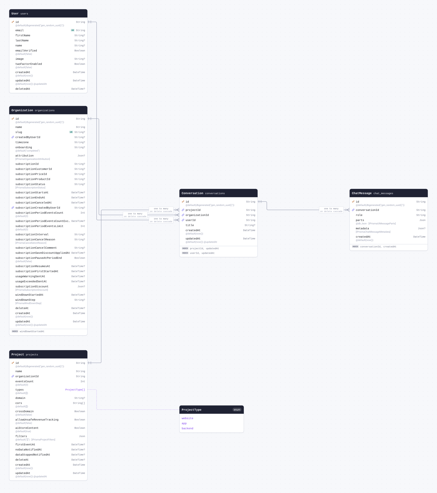

| Field            | Type       | Constraints                                       | Default                            | Description |
| ---------------- | ---------- | ------------------------------------------------- | ---------------------------------- | ----------- |
| `id`             | `String`   | PK NOT NULL                                       | `dbgenerated("gen_random_uuid()")` |             |
| `projectId`      | `String`   | NOT NULL → [Project.id](#model-Project)           |                                    |             |
| `organizationId` | `String`   | NOT NULL → [Organization.id](#model-Organization) |                                    |             |
| `userId`         | `String`   | NOT NULL → [User.id](#model-User)                 |                                    |             |
| `title`          | `String`   | NULL                                              |                                    |             |
| `createdAt`      | `DateTime` | NOT NULL                                          | `now()`                            |             |
| `updatedAt`      | `DateTime` | NOT NULL                                          | `now()` `@updatedAt`               |             |

#### Indexes

- `@@index([projectId, updatedAt])`
- `@@index([userId, updatedAt])`

#### References

- `projectId` → [Project.id](#model-Project) (many-to-one, on delete Cascade)
- `organizationId` → [Organization.id](#model-Organization) (many-to-one, on delete Cascade)
- `userId` → [User.id](#model-User) (many-to-one, on delete Cascade)

#### Referenced by

- `id` ← [ChatMessage.conversationId](#model-ChatMessage) (one-to-many, on delete Cascade)

#### Definition

```sql
CREATE TABLE "conversations" (
    "id" TEXT NOT NULL DEFAULT gen_random_uuid(),
    "projectId" TEXT NOT NULL,
    "organizationId" TEXT NOT NULL,
    "userId" TEXT NOT NULL,
    "title" TEXT,
    "createdAt" TIMESTAMP(3) NOT NULL DEFAULT CURRENT_TIMESTAMP,
    "updatedAt" TIMESTAMP(3) NOT NULL DEFAULT CURRENT_TIMESTAMP,

    CONSTRAINT "conversations_pkey" PRIMARY KEY ("id")
);

CREATE INDEX "conversations_projectId_updatedAt_idx" ON "conversations"("projectId", "updatedAt");

CREATE INDEX "conversations_userId_updatedAt_idx" ON "conversations"("userId", "updatedAt");

ALTER TABLE "conversations" ADD CONSTRAINT "conversations_projectId_fkey" FOREIGN KEY ("projectId") REFERENCES "projects"("id") ON DELETE CASCADE ON UPDATE CASCADE;

ALTER TABLE "conversations" ADD CONSTRAINT "conversations_organizationId_fkey" FOREIGN KEY ("organizationId") REFERENCES "organizations"("id") ON DELETE CASCADE ON UPDATE CASCADE;

ALTER TABLE "conversations" ADD CONSTRAINT "conversations_userId_fkey" FOREIGN KEY ("userId") REFERENCES "users"("id") ON DELETE CASCADE ON UPDATE CASCADE;
```

<details>
<summary>Queries and their SQL</summary>

**findMany**: Every row

```ts
await prisma.conversation.findMany();
```

```sql
SELECT
  "public"."conversations"."id",
  "public"."conversations"."projectId",
  "public"."conversations"."organizationId",
  "public"."conversations"."userId",
  "public"."conversations"."title",
  "public"."conversations"."createdAt",
  "public"."conversations"."updatedAt"
FROM
  "public"."conversations"
WHERE
  1 = 1
OFFSET
  $1
-- params: ["0"]
```

**count**: How many rows there are

```ts
await prisma.conversation.count();
```

```sql
SELECT
  COUNT(*) AS "_count$_all"
FROM
  (
    SELECT
      "public"."conversations"."id"
    FROM
      "public"."conversations"
    WHERE
      1 = 1
    OFFSET
      $1
  ) AS "sub"
-- params: ["0"]
```

**findMany**: Every row with its relations

```ts
await prisma.conversation.findMany({
  include: { project: true, organization: true, user: true, messages: true },
});
```

```sql
SELECT
  "public"."conversations"."id",
  "public"."conversations"."projectId",
  "public"."conversations"."organizationId",
  "public"."conversations"."userId",
  "public"."conversations"."title",
  "public"."conversations"."createdAt",
  "public"."conversations"."updatedAt"
FROM
  "public"."conversations"
WHERE
  1 = 1
OFFSET
  $1
-- params: ["0"]

SELECT
  "public"."projects"."id",
  "public"."projects"."name",
  "public"."projects"."organizationId",
  "public"."projects"."eventsCount",
  "public"."projects"."types"::text[],
  "public"."projects"."domain",
  "public"."projects"."cors",
  "public"."projects"."crossDomain",
  "public"."projects"."allowUnsafeRevenueTracking",
  "public"."projects"."aiStoreContent",
  "public"."projects"."filters",
  "public"."projects"."firstEventAt",
  "public"."projects"."noDataNotifiedAt",
  "public"."projects"."dataStoppedNotifiedAt",
  "public"."projects"."deleteAt",
  "public"."projects"."createdAt",
  "public"."projects"."updatedAt"
FROM
  "public"."projects"
WHERE
  "public"."projects"."id" IN ($1)
OFFSET
  $2
-- params: ["<projectId of the rows above>","0"]

SELECT
  "public"."organizations"."id",
  "public"."organizations"."name",
  "public"."organizations"."slug",
  "public"."organizations"."createdByUserId",
  "public"."organizations"."timezone",
  "public"."organizations"."onboarding",
  "public"."organizations"."attribution",
  "public"."organizations"."subscriptionId",
  "public"."organizations"."subscriptionCustomerId",
  "public"."organizations"."subscriptionPriceId",
  "public"."organizations"."subscriptionProductId",
  "public"."organizations"."subscriptionStatus",
  "public"."organizations"."subscriptionStartsAt",
  "public"."organizations"."subscriptionEndsAt",
  "public"."organizations"."subscriptionCanceledAt",
  "public"."organizations"."subscriptionCreatedByUserId",
  "public"."organizations"."subscriptionPeriodEventsCount",
  "public"."organizations"."subscriptionPeriodEventsCountExceededAt",
  "public"."organizations"."subscriptionPeriodEventsLimit",
  "public"."organizations"."subscriptionInterval",
  "public"."organizations"."subscriptionCancelReason",
  "public"."organizations"."subscriptionCancelComment",
  "public"."organizations"."subscriptionSaveDiscountAppliedAt",
  "public"."organizations"."subscriptionPauseAtPeriodEnd",
  "public"."organizations"."subscriptionResumesAt",
  "public"."organizations"."subscriptionFirstStartedAt",
  "public"."organizations"."usageWarningSentAt",
  "public"."organizations"."usageExceededSentAt",
  "public"."organizations"."subscriptionDiscount",
  "public"."organizations"."windDownStartedAt",
  "public"."organizations"."windDownStep",
  "public"."organizations"."deleteAt",
  "public"."organizations"."createdAt",
  "public"."organizations"."updatedAt"
FROM
  "public"."organizations"
WHERE
  "public"."organizations"."id" IN ($1)
OFFSET
  $2
-- params: ["<organizationId of the rows above>","0"]

SELECT
  "public"."users"."id",
  "public"."users"."email",
  "public"."users"."firstName",
  "public"."users"."lastName",
  "public"."users"."name",
  "public"."users"."emailVerified",
  "public"."users"."image",
  "public"."users"."twoFactorEnabled",
  "public"."users"."createdAt",
  "public"."users"."updatedAt",
  "public"."users"."deletedAt"
FROM
  "public"."users"
WHERE
  "public"."users"."id" IN ($1)
OFFSET
  $2
-- params: ["<userId of the rows above>","0"]

SELECT
  "public"."chat_messages"."id",
  "public"."chat_messages"."conversationId",
  "public"."chat_messages"."role",
  "public"."chat_messages"."parts",
  "public"."chat_messages"."metadata",
  "public"."chat_messages"."createdAt"
FROM
  "public"."chat_messages"
WHERE
  "public"."chat_messages"."conversationId" IN ($1)
OFFSET
  $2
-- params: ["<id of the rows above>","0"]
```

**findUnique**: One row by what is unique to it

```ts
await prisma.conversation.findUnique({ where: { id: "example" } });
```

```sql
SELECT
  "public"."conversations"."id",
  "public"."conversations"."projectId",
  "public"."conversations"."organizationId",
  "public"."conversations"."userId",
  "public"."conversations"."title",
  "public"."conversations"."createdAt",
  "public"."conversations"."updatedAt"
FROM
  "public"."conversations"
WHERE
  (
    "public"."conversations"."id" = $1
    AND 1 = 1
  )
LIMIT
  $2
OFFSET
  $3
-- params: ["example","1","0"]
```

**create**: Create a row

```ts
await prisma.conversation.create({
  data: { projectId: "example", organizationId: "example", userId: "example" },
});
```

```sql
INSERT INTO
  "public"."conversations" (
    "projectId",
    "organizationId",
    "userId",
    "createdAt",
    "updatedAt"
  )
VALUES
  ($1, $2, $3, $4, $5)
RETURNING
  "public"."conversations"."id",
  "public"."conversations"."projectId",
  "public"."conversations"."organizationId",
  "public"."conversations"."userId",
  "public"."conversations"."title",
  "public"."conversations"."createdAt",
  "public"."conversations"."updatedAt"
-- params: ["example","example","example","<now()>","<now()>"]
```

**update**: Update a row

```ts
await prisma.conversation.update({ where: { id: "example" }, data: { title: "example" } });
```

```sql
UPDATE "public"."conversations"
SET
  "title" = $1,
  "updatedAt" = $2
WHERE
  (
    "public"."conversations"."id" = $3
    AND 1 = 1
  )
RETURNING
  "public"."conversations"."id",
  "public"."conversations"."projectId",
  "public"."conversations"."organizationId",
  "public"."conversations"."userId",
  "public"."conversations"."title",
  "public"."conversations"."createdAt",
  "public"."conversations"."updatedAt"
-- params: ["example",{"prisma__type":"generatorCall","prisma__value":{"name":"now","args":[],"returnType":{"type":"DateTime"}}},"example"]
```

**delete**: Delete a row

```ts
await prisma.conversation.delete({ where: { id: "example" } });
```

```sql
DELETE FROM "public"."conversations"
WHERE
  (
    "public"."conversations"."id" = $1
    AND 1 = 1
  )
RETURNING
  "public"."conversations"."id",
  "public"."conversations"."projectId",
  "public"."conversations"."organizationId",
  "public"."conversations"."userId",
  "public"."conversations"."title",
  "public"."conversations"."createdAt",
  "public"."conversations"."updatedAt"
-- params: ["example"]
```

</details>

<a id="model-ChatMessage"></a>

### ChatMessage

Table `chat_messages`.

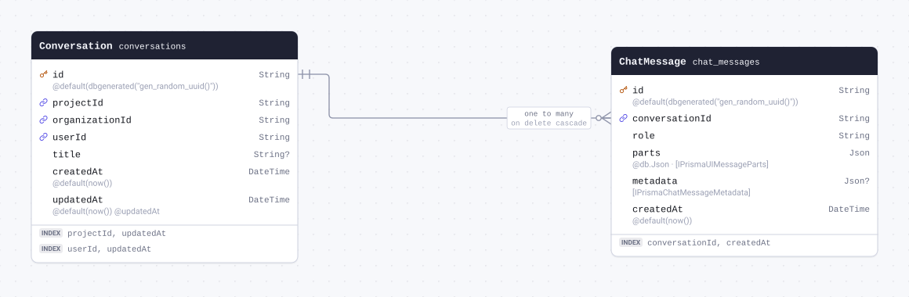

| Field            | Type              | Constraints                                       | Default                            | Description                  |
| ---------------- | ----------------- | ------------------------------------------------- | ---------------------------------- | ---------------------------- |
| `id`             | `String`          | PK NOT NULL                                       | `dbgenerated("gen_random_uuid()")` |                              |
| `conversationId` | `String`          | NOT NULL → [Conversation.id](#model-Conversation) |                                    |                              |
| `role`           | `String`          | NOT NULL                                          |                                    |                              |
| `parts`          | `Json` `@db.Json` | NOT NULL                                          |                                    | [IPrismaUIMessageParts]      |
| `metadata`       | `Json`            | NULL                                              |                                    | [IPrismaChatMessageMetadata] |
| `createdAt`      | `DateTime`        | NOT NULL                                          | `now()`                            |                              |

#### Indexes

- `@@index([conversationId, createdAt])`

#### References

- `conversationId` → [Conversation.id](#model-Conversation) (many-to-one, on delete Cascade)

#### Definition

```sql
CREATE TABLE "chat_messages" (
    "id" TEXT NOT NULL DEFAULT gen_random_uuid(),
    "conversationId" TEXT NOT NULL,
    "role" TEXT NOT NULL,
    "parts" JSON NOT NULL,
    "metadata" JSONB,
    "createdAt" TIMESTAMP(3) NOT NULL DEFAULT CURRENT_TIMESTAMP,

    CONSTRAINT "chat_messages_pkey" PRIMARY KEY ("id")
);

CREATE INDEX "chat_messages_conversationId_createdAt_idx" ON "chat_messages"("conversationId", "createdAt");

ALTER TABLE "chat_messages" ADD CONSTRAINT "chat_messages_conversationId_fkey" FOREIGN KEY ("conversationId") REFERENCES "conversations"("id") ON DELETE CASCADE ON UPDATE CASCADE;
```

<details>
<summary>Queries and their SQL</summary>

**findMany**: Every row

```ts
await prisma.chatMessage.findMany();
```

```sql
SELECT
  "public"."chat_messages"."id",
  "public"."chat_messages"."conversationId",
  "public"."chat_messages"."role",
  "public"."chat_messages"."parts",
  "public"."chat_messages"."metadata",
  "public"."chat_messages"."createdAt"
FROM
  "public"."chat_messages"
WHERE
  1 = 1
OFFSET
  $1
-- params: ["0"]
```

**count**: How many rows there are

```ts
await prisma.chatMessage.count();
```

```sql
SELECT
  COUNT(*) AS "_count$_all"
FROM
  (
    SELECT
      "public"."chat_messages"."id"
    FROM
      "public"."chat_messages"
    WHERE
      1 = 1
    OFFSET
      $1
  ) AS "sub"
-- params: ["0"]
```

**findMany**: Every row with its relations

```ts
await prisma.chatMessage.findMany({ include: { conversation: true } });
```

```sql
SELECT
  "public"."chat_messages"."id",
  "public"."chat_messages"."conversationId",
  "public"."chat_messages"."role",
  "public"."chat_messages"."parts",
  "public"."chat_messages"."metadata",
  "public"."chat_messages"."createdAt"
FROM
  "public"."chat_messages"
WHERE
  1 = 1
OFFSET
  $1
-- params: ["0"]

SELECT
  "public"."conversations"."id",
  "public"."conversations"."projectId",
  "public"."conversations"."organizationId",
  "public"."conversations"."userId",
  "public"."conversations"."title",
  "public"."conversations"."createdAt",
  "public"."conversations"."updatedAt"
FROM
  "public"."conversations"
WHERE
  "public"."conversations"."id" IN ($1)
OFFSET
  $2
-- params: ["<conversationId of the rows above>","0"]
```

**findUnique**: One row by what is unique to it

```ts
await prisma.chatMessage.findUnique({ where: { id: "example" } });
```

```sql
SELECT
  "public"."chat_messages"."id",
  "public"."chat_messages"."conversationId",
  "public"."chat_messages"."role",
  "public"."chat_messages"."parts",
  "public"."chat_messages"."metadata",
  "public"."chat_messages"."createdAt"
FROM
  "public"."chat_messages"
WHERE
  (
    "public"."chat_messages"."id" = $1
    AND 1 = 1
  )
LIMIT
  $2
OFFSET
  $3
-- params: ["example","1","0"]
```

**create**: Create a row

```ts
await prisma.chatMessage.create({
  data: { conversationId: "example", role: "example", parts: {} },
});
```

```sql
INSERT INTO
  "public"."chat_messages" ("conversationId", "role", "parts", "createdAt")
VALUES
  ($1, $2, $3, $4)
RETURNING
  "public"."chat_messages"."id",
  "public"."chat_messages"."conversationId",
  "public"."chat_messages"."role",
  "public"."chat_messages"."parts",
  "public"."chat_messages"."metadata",
  "public"."chat_messages"."createdAt"
-- params: ["example","example","{}","<now()>"]
```

**update**: Update a row

```ts
await prisma.chatMessage.update({ where: { id: "example" }, data: { role: "example" } });
```

```sql
UPDATE "public"."chat_messages"
SET
  "role" = $1
WHERE
  (
    "public"."chat_messages"."id" = $2
    AND 1 = 1
  )
RETURNING
  "public"."chat_messages"."id",
  "public"."chat_messages"."conversationId",
  "public"."chat_messages"."role",
  "public"."chat_messages"."parts",
  "public"."chat_messages"."metadata",
  "public"."chat_messages"."createdAt"
-- params: ["example","example"]
```

**delete**: Delete a row

```ts
await prisma.chatMessage.delete({ where: { id: "example" } });
```

```sql
DELETE FROM "public"."chat_messages"
WHERE
  (
    "public"."chat_messages"."id" = $1
    AND 1 = 1
  )
RETURNING
  "public"."chat_messages"."id",
  "public"."chat_messages"."conversationId",
  "public"."chat_messages"."role",
  "public"."chat_messages"."parts",
  "public"."chat_messages"."metadata",
  "public"."chat_messages"."createdAt"
-- params: ["example"]
```

</details>

<a id="model-Organization"></a>

### Organization

Table `organizations`.

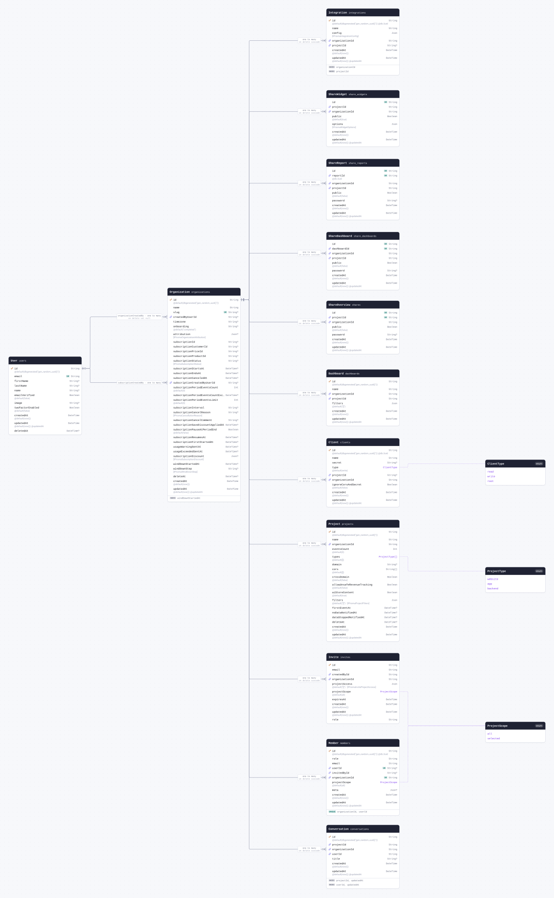

| Field                                     | Type       | Constraints                   | Default                            | Description                      |
| ----------------------------------------- | ---------- | ----------------------------- | ---------------------------------- | -------------------------------- |
| `id`                                      | `String`   | PK NOT NULL                   | `dbgenerated("gen_random_uuid()")` |                                  |
| `name`                                    | `String`   | NOT NULL                      |                                    |                                  |
| `slug`                                    | `String`   | UNIQUE NULL                   |                                    |                                  |
| `createdByUserId`                         | `String`   | NULL → [User.id](#model-User) |                                    |                                  |
| `timezone`                                | `String`   | NULL                          |                                    |                                  |
| `onboarding`                              | `String`   | NULL                          | `"completed"`                      |                                  |
| `attribution`                             | `Json`     | NULL                          |                                    | [IPrismaOrganizationAttribution] |
| `subscriptionId`                          | `String`   | NULL                          |                                    |                                  |
| `subscriptionCustomerId`                  | `String`   | NULL                          |                                    |                                  |
| `subscriptionPriceId`                     | `String`   | NULL                          |                                    |                                  |
| `subscriptionProductId`                   | `String`   | NULL                          |                                    |                                  |
| `subscriptionStatus`                      | `String`   | NULL                          |                                    | [IPrismaSubscriptionStatus]      |
| `subscriptionStartsAt`                    | `DateTime` | NULL                          |                                    |                                  |
| `subscriptionEndsAt`                      | `DateTime` | NULL                          |                                    |                                  |
| `subscriptionCanceledAt`                  | `DateTime` | NULL                          |                                    |                                  |
| `subscriptionCreatedByUserId`             | `String`   | NULL → [User.id](#model-User) |                                    |                                  |
| `subscriptionPeriodEventsCount`           | `Int`      | NOT NULL                      | `0`                                |                                  |
| `subscriptionPeriodEventsCountExceededAt` | `DateTime` | NULL                          |                                    |                                  |
| `subscriptionPeriodEventsLimit`           | `Int`      | NOT NULL                      | `0`                                |                                  |
| `subscriptionInterval`                    | `String`   | NULL                          |                                    |                                  |
| `subscriptionCancelReason`                | `String`   | NULL                          |                                    | [IPrismaCancellationReason]      |
| `subscriptionCancelComment`               | `String`   | NULL                          |                                    |                                  |
| `subscriptionSaveDiscountAppliedAt`       | `DateTime` | NULL                          |                                    |                                  |
| `subscriptionPauseAtPeriodEnd`            | `Boolean`  | NOT NULL                      | `false`                            |                                  |
| `subscriptionResumesAt`                   | `DateTime` | NULL                          |                                    |                                  |
| `subscriptionFirstStartedAt`              | `DateTime` | NULL                          |                                    |                                  |
| `usageWarningSentAt`                      | `DateTime` | NULL                          |                                    |                                  |
| `usageExceededSentAt`                     | `DateTime` | NULL                          |                                    |                                  |
| `subscriptionDiscount`                    | `Json`     | NULL                          |                                    | [IPrismaSubscriptionDiscount]    |
| `windDownStartedAt`                       | `DateTime` | NULL                          |                                    |                                  |
| `windDownStep`                            | `String`   | NULL                          |                                    | [IPrismaWindDownStep]            |
| `deleteAt`                                | `DateTime` | NULL                          |                                    |                                  |
| `createdAt`                               | `DateTime` | NOT NULL                      | `now()`                            |                                  |
| `updatedAt`                               | `DateTime` | NOT NULL                      | `now()` `@updatedAt`               |                                  |

#### Indexes

- `@@index([windDownStartedAt])`

#### References

- `createdByUserId` → [User.id](#model-User) (many-to-one, on delete SetNull)
- `subscriptionCreatedByUserId` → [User.id](#model-User) (many-to-one)

#### Referenced by

- `id` ← [Conversation.organizationId](#model-Conversation) (one-to-many, on delete Cascade)
- `id` ← [Member.organizationId](#model-Member) (one-to-many, on delete Cascade)
- `id` ← [Invite.organizationId](#model-Invite) (one-to-many, on delete Cascade)
- `id` ← [Project.organizationId](#model-Project) (one-to-many, on delete Cascade)
- `id` ← [Client.organizationId](#model-Client) (one-to-many, on delete Cascade)
- `id` ← [Dashboard.organizationId](#model-Dashboard) (one-to-many, on delete Cascade)
- `id` ← [ShareOverview.organizationId](#model-ShareOverview) (one-to-many, on delete Cascade)
- `id` ← [ShareDashboard.organizationId](#model-ShareDashboard) (one-to-many, on delete Cascade)
- `id` ← [ShareReport.organizationId](#model-ShareReport) (one-to-many, on delete Cascade)
- `id` ← [ShareWidget.organizationId](#model-ShareWidget) (one-to-many, on delete Cascade)
- `id` ← [Integration.organizationId](#model-Integration) (one-to-many, on delete Cascade)

#### Definition

```sql
CREATE TABLE "organizations" (
    "id" TEXT NOT NULL DEFAULT gen_random_uuid(),
    "name" TEXT NOT NULL,
    "slug" TEXT,
    "createdByUserId" TEXT,
    "timezone" TEXT,
    "onboarding" TEXT DEFAULT 'completed',
    "attribution" JSONB,
    "subscriptionId" TEXT,
    "subscriptionCustomerId" TEXT,
    "subscriptionPriceId" TEXT,
    "subscriptionProductId" TEXT,
    "subscriptionStatus" TEXT,
    "subscriptionStartsAt" TIMESTAMP(3),
    "subscriptionEndsAt" TIMESTAMP(3),
    "subscriptionCanceledAt" TIMESTAMP(3),
    "subscriptionCreatedByUserId" TEXT,
    "subscriptionPeriodEventsCount" INTEGER NOT NULL DEFAULT 0,
    "subscriptionPeriodEventsCountExceededAt" TIMESTAMP(3),
    "subscriptionPeriodEventsLimit" INTEGER NOT NULL DEFAULT 0,
    "subscriptionInterval" TEXT,
    "subscriptionCancelReason" TEXT,
    "subscriptionCancelComment" TEXT,
    "subscriptionSaveDiscountAppliedAt" TIMESTAMP(3),
    "subscriptionPauseAtPeriodEnd" BOOLEAN NOT NULL DEFAULT false,
    "subscriptionResumesAt" TIMESTAMP(3),
    "subscriptionFirstStartedAt" TIMESTAMP(3),
    "usageWarningSentAt" TIMESTAMP(3),
    "usageExceededSentAt" TIMESTAMP(3),
    "subscriptionDiscount" JSONB,
    "windDownStartedAt" TIMESTAMP(3),
    "windDownStep" TEXT,
    "deleteAt" TIMESTAMP(3),
    "createdAt" TIMESTAMP(3) NOT NULL DEFAULT CURRENT_TIMESTAMP,
    "updatedAt" TIMESTAMP(3) NOT NULL DEFAULT CURRENT_TIMESTAMP,

    CONSTRAINT "organizations_pkey" PRIMARY KEY ("id")
);

CREATE UNIQUE INDEX "organizations_slug_key" ON "organizations"("slug");

CREATE INDEX "organizations_windDownStartedAt_idx" ON "organizations"("windDownStartedAt");

ALTER TABLE "organizations" ADD CONSTRAINT "organizations_createdByUserId_fkey" FOREIGN KEY ("createdByUserId") REFERENCES "users"("id") ON DELETE SET NULL ON UPDATE CASCADE;

ALTER TABLE "organizations" ADD CONSTRAINT "organizations_subscriptionCreatedByUserId_fkey" FOREIGN KEY ("subscriptionCreatedByUserId") REFERENCES "users"("id") ON DELETE SET NULL ON UPDATE CASCADE;
```

<details>
<summary>Queries and their SQL</summary>

**findMany**: Every row

```ts
await prisma.organization.findMany();
```

```sql
SELECT
  "public"."organizations"."id",
  "public"."organizations"."name",
  "public"."organizations"."slug",
  "public"."organizations"."createdByUserId",
  "public"."organizations"."timezone",
  "public"."organizations"."onboarding",
  "public"."organizations"."attribution",
  "public"."organizations"."subscriptionId",
  "public"."organizations"."subscriptionCustomerId",
  "public"."organizations"."subscriptionPriceId",
  "public"."organizations"."subscriptionProductId",
  "public"."organizations"."subscriptionStatus",
  "public"."organizations"."subscriptionStartsAt",
  "public"."organizations"."subscriptionEndsAt",
  "public"."organizations"."subscriptionCanceledAt",
  "public"."organizations"."subscriptionCreatedByUserId",
  "public"."organizations"."subscriptionPeriodEventsCount",
  "public"."organizations"."subscriptionPeriodEventsCountExceededAt",
  "public"."organizations"."subscriptionPeriodEventsLimit",
  "public"."organizations"."subscriptionInterval",
  "public"."organizations"."subscriptionCancelReason",
  "public"."organizations"."subscriptionCancelComment",
  "public"."organizations"."subscriptionSaveDiscountAppliedAt",
  "public"."organizations"."subscriptionPauseAtPeriodEnd",
  "public"."organizations"."subscriptionResumesAt",
  "public"."organizations"."subscriptionFirstStartedAt",
  "public"."organizations"."usageWarningSentAt",
  "public"."organizations"."usageExceededSentAt",
  "public"."organizations"."subscriptionDiscount",
  "public"."organizations"."windDownStartedAt",
  "public"."organizations"."windDownStep",
  "public"."organizations"."deleteAt",
  "public"."organizations"."createdAt",
  "public"."organizations"."updatedAt"
FROM
  "public"."organizations"
WHERE
  1 = 1
OFFSET
  $1
-- params: ["0"]
```

**count**: How many rows there are

```ts
await prisma.organization.count();
```

```sql
SELECT
  COUNT(*) AS "_count$_all"
FROM
  (
    SELECT
      "public"."organizations"."id"
    FROM
      "public"."organizations"
    WHERE
      1 = 1
    OFFSET
      $1
  ) AS "sub"
-- params: ["0"]
```

**findMany**: Every row with its relations

```ts
await prisma.organization.findMany({
  include: {
    projects: true,
    members: true,
    createdBy: true,
    Client: true,
    Dashboard: true,
    ShareOverview: true,
    ShareDashboard: true,
    ShareReport: true,
    ShareWidget: true,
    integrations: true,
    invites: true,
    conversations: true,
    subscriptionCreatedBy: true,
  },
});
```

```sql
SELECT
  "public"."organizations"."id",
  "public"."organizations"."name",
  "public"."organizations"."slug",
  "public"."organizations"."createdByUserId",
  "public"."organizations"."timezone",
  "public"."organizations"."onboarding",
  "public"."organizations"."attribution",
  "public"."organizations"."subscriptionId",
  "public"."organizations"."subscriptionCustomerId",
  "public"."organizations"."subscriptionPriceId",
  "public"."organizations"."subscriptionProductId",
  "public"."organizations"."subscriptionStatus",
  "public"."organizations"."subscriptionStartsAt",
  "public"."organizations"."subscriptionEndsAt",
  "public"."organizations"."subscriptionCanceledAt",
  "public"."organizations"."subscriptionCreatedByUserId",
  "public"."organizations"."subscriptionPeriodEventsCount",
  "public"."organizations"."subscriptionPeriodEventsCountExceededAt",
  "public"."organizations"."subscriptionPeriodEventsLimit",
  "public"."organizations"."subscriptionInterval",
  "public"."organizations"."subscriptionCancelReason",
  "public"."organizations"."subscriptionCancelComment",
  "public"."organizations"."subscriptionSaveDiscountAppliedAt",
  "public"."organizations"."subscriptionPauseAtPeriodEnd",
  "public"."organizations"."subscriptionResumesAt",
  "public"."organizations"."subscriptionFirstStartedAt",
  "public"."organizations"."usageWarningSentAt",
  "public"."organizations"."usageExceededSentAt",
  "public"."organizations"."subscriptionDiscount",
  "public"."organizations"."windDownStartedAt",
  "public"."organizations"."windDownStep",
  "public"."organizations"."deleteAt",
  "public"."organizations"."createdAt",
  "public"."organizations"."updatedAt"
FROM
  "public"."organizations"
WHERE
  1 = 1
OFFSET
  $1
-- params: ["0"]

SELECT
  "public"."projects"."id",
  "public"."projects"."name",
  "public"."projects"."organizationId",
  "public"."projects"."eventsCount",
  "public"."projects"."types"::text[],
  "public"."projects"."domain",
  "public"."projects"."cors",
  "public"."projects"."crossDomain",
  "public"."projects"."allowUnsafeRevenueTracking",
  "public"."projects"."aiStoreContent",
  "public"."projects"."filters",
  "public"."projects"."firstEventAt",
  "public"."projects"."noDataNotifiedAt",
  "public"."projects"."dataStoppedNotifiedAt",
  "public"."projects"."deleteAt",
  "public"."projects"."createdAt",
  "public"."projects"."updatedAt"
FROM
  "public"."projects"
WHERE
  "public"."projects"."organizationId" IN ($1)
OFFSET
  $2
-- params: ["<id of the rows above>","0"]

SELECT
  "public"."members"."id",
  "public"."members"."role",
  "public"."members"."email",
  "public"."members"."userId",
  "public"."members"."invitedById",
  "public"."members"."organizationId",
  "public"."members"."projectScope"::text,
  "public"."members"."meta",
  "public"."members"."createdAt",
  "public"."members"."updatedAt"
FROM
  "public"."members"
WHERE
  "public"."members"."organizationId" IN ($1)
OFFSET
  $2
-- params: ["<id of the rows above>","0"]

SELECT
  "public"."users"."id",
  "public"."users"."email",
  "public"."users"."firstName",
  "public"."users"."lastName",
  "public"."users"."name",
  "public"."users"."emailVerified",
  "public"."users"."image",
  "public"."users"."twoFactorEnabled",
  "public"."users"."createdAt",
  "public"."users"."updatedAt",
  "public"."users"."deletedAt"
FROM
  "public"."users"
WHERE
  "public"."users"."id" IN ($1)
OFFSET
  $2
-- params: ["<createdByUserId of the rows above>","0"]

SELECT
  "public"."clients"."id",
  "public"."clients"."name",
  "public"."clients"."secret",
  "public"."clients"."type"::text,
  "public"."clients"."projectId",
  "public"."clients"."organizationId",
  "public"."clients"."ignoreCorsAndSecret",
  "public"."clients"."createdAt",
  "public"."clients"."updatedAt"
FROM
  "public"."clients"
WHERE
  "public"."clients"."organizationId" IN ($1)
OFFSET
  $2
-- params: ["<id of the rows above>","0"]

SELECT
  "public"."dashboards"."id",
  "public"."dashboards"."name",
  "public"."dashboards"."organizationId",
  "public"."dashboards"."projectId",
  "public"."dashboards"."filters",
  "public"."dashboards"."createdAt",
  "public"."dashboards"."updatedAt"
FROM
  "public"."dashboards"
WHERE
  "public"."dashboards"."organizationId" IN ($1)
OFFSET
  $2
-- params: ["<id of the rows above>","0"]

SELECT
  "public"."shares"."id",
  "public"."shares"."projectId",
  "public"."shares"."organizationId",
  "public"."shares"."public",
  "public"."shares"."password",
  "public"."shares"."createdAt",
  "public"."shares"."updatedAt"
FROM
  "public"."shares"
WHERE
  "public"."shares"."organizationId" IN ($1)
OFFSET
  $2
-- params: ["<id of the rows above>","0"]

SELECT
  "public"."share_dashboards"."id",
  "public"."share_dashboards"."dashboardId",
  "public"."share_dashboards"."organizationId",
  "public"."share_dashboards"."projectId",
  "public"."share_dashboards"."public",
  "public"."share_dashboards"."password",
  "public"."share_dashboards"."createdAt",
  "public"."share_dashboards"."updatedAt"
FROM
  "public"."share_dashboards"
WHERE
  "public"."share_dashboards"."organizationId" IN ($1)
OFFSET
  $2
-- params: ["<id of the rows above>","0"]

SELECT
  "public"."share_reports"."id",
  "public"."share_reports"."reportId",
  "public"."share_reports"."organizationId",
  "public"."share_reports"."projectId",
  "public"."share_reports"."public",
  "public"."share_reports"."password",
  "public"."share_reports"."createdAt",
  "public"."share_reports"."updatedAt"
FROM
  "public"."share_reports"
WHERE
  "public"."share_reports"."organizationId" IN ($1)
OFFSET
  $2
-- params: ["<id of the rows above>","0"]

SELECT
  "public"."share_widgets"."id",
  "public"."share_widgets"."projectId",
  "public"."share_widgets"."organizationId",
  "public"."share_widgets"."public",
  "public"."share_widgets"."options",
  "public"."share_widgets"."createdAt",
  "public"."share_widgets"."updatedAt"
FROM
  "public"."share_widgets"
WHERE
  "public"."share_widgets"."organizationId" IN ($1)
OFFSET
  $2
-- params: ["<id of the rows above>","0"]

SELECT
  "public"."integrations"."id",
  "public"."integrations"."name",
  "public"."integrations"."config",
  "public"."integrations"."organizationId",
  "public"."integrations"."projectId",
  "public"."integrations"."createdAt",
  "public"."integrations"."updatedAt"
FROM
  "public"."integrations"
WHERE
  "public"."integrations"."organizationId" IN ($1)
OFFSET
  $2
-- params: ["<id of the rows above>","0"]

SELECT
  "public"."invites"."id",
  "public"."invites"."email",
  "public"."invites"."createdById",
  "public"."invites"."organizationId",
  "public"."invites"."projectAccess",
  "public"."invites"."projectScope"::text,
  "public"."invites"."expiresAt",
  "public"."invites"."createdAt",
  "public"."invites"."updatedAt",
  "public"."invites"."role"
FROM
  "public"."invites"
WHERE
  "public"."invites"."organizationId" IN ($1)
OFFSET
  $2
-- params: ["<id of the rows above>","0"]

SELECT
  "public"."conversations"."id",
  "public"."conversations"."projectId",
  "public"."conversations"."organizationId",
  "public"."conversations"."userId",
  "public"."conversations"."title",
  "public"."conversations"."createdAt",
  "public"."conversations"."updatedAt"
FROM
  "public"."conversations"
WHERE
  "public"."conversations"."organizationId" IN ($1)
OFFSET
  $2
-- params: ["<id of the rows above>","0"]

SELECT
  "public"."users"."id",
  "public"."users"."email",
  "public"."users"."firstName",
  "public"."users"."lastName",
  "public"."users"."name",
  "public"."users"."emailVerified",
  "public"."users"."image",
  "public"."users"."twoFactorEnabled",
  "public"."users"."createdAt",
  "public"."users"."updatedAt",
  "public"."users"."deletedAt"
FROM
  "public"."users"
WHERE
  "public"."users"."id" IN ($1)
OFFSET
  $2
-- params: ["<subscriptionCreatedByUserId of the rows above>","0"]
```

**findUnique**: One row by what is unique to it

```ts
await prisma.organization.findUnique({ where: { id: "example" } });
```

```sql
SELECT
  "public"."organizations"."id",
  "public"."organizations"."name",
  "public"."organizations"."slug",
  "public"."organizations"."createdByUserId",
  "public"."organizations"."timezone",
  "public"."organizations"."onboarding",
  "public"."organizations"."attribution",
  "public"."organizations"."subscriptionId",
  "public"."organizations"."subscriptionCustomerId",
  "public"."organizations"."subscriptionPriceId",
  "public"."organizations"."subscriptionProductId",
  "public"."organizations"."subscriptionStatus",
  "public"."organizations"."subscriptionStartsAt",
  "public"."organizations"."subscriptionEndsAt",
  "public"."organizations"."subscriptionCanceledAt",
  "public"."organizations"."subscriptionCreatedByUserId",
  "public"."organizations"."subscriptionPeriodEventsCount",
  "public"."organizations"."subscriptionPeriodEventsCountExceededAt",
  "public"."organizations"."subscriptionPeriodEventsLimit",
  "public"."organizations"."subscriptionInterval",
  "public"."organizations"."subscriptionCancelReason",
  "public"."organizations"."subscriptionCancelComment",
  "public"."organizations"."subscriptionSaveDiscountAppliedAt",
  "public"."organizations"."subscriptionPauseAtPeriodEnd",
  "public"."organizations"."subscriptionResumesAt",
  "public"."organizations"."subscriptionFirstStartedAt",
  "public"."organizations"."usageWarningSentAt",
  "public"."organizations"."usageExceededSentAt",
  "public"."organizations"."subscriptionDiscount",
  "public"."organizations"."windDownStartedAt",
  "public"."organizations"."windDownStep",
  "public"."organizations"."deleteAt",
  "public"."organizations"."createdAt",
  "public"."organizations"."updatedAt"
FROM
  "public"."organizations"
WHERE
  (
    "public"."organizations"."id" = $1
    AND 1 = 1
  )
LIMIT
  $2
OFFSET
  $3
-- params: ["example","1","0"]
```

**create**: Create a row

```ts
await prisma.organization.create({ data: { name: "example" } });
```

```sql
INSERT INTO
  "public"."organizations" (
    "name",
    "onboarding",
    "subscriptionPeriodEventsCount",
    "subscriptionPeriodEventsLimit",
    "subscriptionPauseAtPeriodEnd",
    "createdAt",
    "updatedAt"
  )
VALUES
  ($1, $2, $3, $4, $5, $6, $7)
RETURNING
  "public"."organizations"."id",
  "public"."organizations"."name",
  "public"."organizations"."slug",
  "public"."organizations"."createdByUserId",
  "public"."organizations"."timezone",
  "public"."organizations"."onboarding",
  "public"."organizations"."attribution",
  "public"."organizations"."subscriptionId",
  "public"."organizations"."subscriptionCustomerId",
  "public"."organizations"."subscriptionPriceId",
  "public"."organizations"."subscriptionProductId",
  "public"."organizations"."subscriptionStatus",
  "public"."organizations"."subscriptionStartsAt",
  "public"."organizations"."subscriptionEndsAt",
  "public"."organizations"."subscriptionCanceledAt",
  "public"."organizations"."subscriptionCreatedByUserId",
  "public"."organizations"."subscriptionPeriodEventsCount",
  "public"."organizations"."subscriptionPeriodEventsCountExceededAt",
  "public"."organizations"."subscriptionPeriodEventsLimit",
  "public"."organizations"."subscriptionInterval",
  "public"."organizations"."subscriptionCancelReason",
  "public"."organizations"."subscriptionCancelComment",
  "public"."organizations"."subscriptionSaveDiscountAppliedAt",
  "public"."organizations"."subscriptionPauseAtPeriodEnd",
  "public"."organizations"."subscriptionResumesAt",
  "public"."organizations"."subscriptionFirstStartedAt",
  "public"."organizations"."usageWarningSentAt",
  "public"."organizations"."usageExceededSentAt",
  "public"."organizations"."subscriptionDiscount",
  "public"."organizations"."windDownStartedAt",
  "public"."organizations"."windDownStep",
  "public"."organizations"."deleteAt",
  "public"."organizations"."createdAt",
  "public"."organizations"."updatedAt"
-- params: ["example","completed","0","0",false,"<now()>","<now()>"]
```

**update**: Update a row

```ts
await prisma.organization.update({ where: { id: "example" }, data: { name: "example" } });
```

```sql
UPDATE "public"."organizations"
SET
  "name" = $1,
  "updatedAt" = $2
WHERE
  (
    "public"."organizations"."id" = $3
    AND 1 = 1
  )
RETURNING
  "public"."organizations"."id",
  "public"."organizations"."name",
  "public"."organizations"."slug",
  "public"."organizations"."createdByUserId",
  "public"."organizations"."timezone",
  "public"."organizations"."onboarding",
  "public"."organizations"."attribution",
  "public"."organizations"."subscriptionId",
  "public"."organizations"."subscriptionCustomerId",
  "public"."organizations"."subscriptionPriceId",
  "public"."organizations"."subscriptionProductId",
  "public"."organizations"."subscriptionStatus",
  "public"."organizations"."subscriptionStartsAt",
  "public"."organizations"."subscriptionEndsAt",
  "public"."organizations"."subscriptionCanceledAt",
  "public"."organizations"."subscriptionCreatedByUserId",
  "public"."organizations"."subscriptionPeriodEventsCount",
  "public"."organizations"."subscriptionPeriodEventsCountExceededAt",
  "public"."organizations"."subscriptionPeriodEventsLimit",
  "public"."organizations"."subscriptionInterval",
  "public"."organizations"."subscriptionCancelReason",
  "public"."organizations"."subscriptionCancelComment",
  "public"."organizations"."subscriptionSaveDiscountAppliedAt",
  "public"."organizations"."subscriptionPauseAtPeriodEnd",
  "public"."organizations"."subscriptionResumesAt",
  "public"."organizations"."subscriptionFirstStartedAt",
  "public"."organizations"."usageWarningSentAt",
  "public"."organizations"."usageExceededSentAt",
  "public"."organizations"."subscriptionDiscount",
  "public"."organizations"."windDownStartedAt",
  "public"."organizations"."windDownStep",
  "public"."organizations"."deleteAt",
  "public"."organizations"."createdAt",
  "public"."organizations"."updatedAt"
-- params: ["example",{"prisma__type":"generatorCall","prisma__value":{"name":"now","args":[],"returnType":{"type":"DateTime"}}},"example"]
```

**delete**: Delete a row

```ts
await prisma.organization.delete({ where: { id: "example" } });
```

```sql
DELETE FROM "public"."organizations"
WHERE
  (
    "public"."organizations"."id" = $1
    AND 1 = 1
  )
RETURNING
  "public"."organizations"."id",
  "public"."organizations"."name",
  "public"."organizations"."slug",
  "public"."organizations"."createdByUserId",
  "public"."organizations"."timezone",
  "public"."organizations"."onboarding",
  "public"."organizations"."attribution",
  "public"."organizations"."subscriptionId",
  "public"."organizations"."subscriptionCustomerId",
  "public"."organizations"."subscriptionPriceId",
  "public"."organizations"."subscriptionProductId",
  "public"."organizations"."subscriptionStatus",
  "public"."organizations"."subscriptionStartsAt",
  "public"."organizations"."subscriptionEndsAt",
  "public"."organizations"."subscriptionCanceledAt",
  "public"."organizations"."subscriptionCreatedByUserId",
  "public"."organizations"."subscriptionPeriodEventsCount",
  "public"."organizations"."subscriptionPeriodEventsCountExceededAt",
  "public"."organizations"."subscriptionPeriodEventsLimit",
  "public"."organizations"."subscriptionInterval",
  "public"."organizations"."subscriptionCancelReason",
  "public"."organizations"."subscriptionCancelComment",
  "public"."organizations"."subscriptionSaveDiscountAppliedAt",
  "public"."organizations"."subscriptionPauseAtPeriodEnd",
  "public"."organizations"."subscriptionResumesAt",
  "public"."organizations"."subscriptionFirstStartedAt",
  "public"."organizations"."usageWarningSentAt",
  "public"."organizations"."usageExceededSentAt",
  "public"."organizations"."subscriptionDiscount",
  "public"."organizations"."windDownStartedAt",
  "public"."organizations"."windDownStep",
  "public"."organizations"."deleteAt",
  "public"."organizations"."createdAt",
  "public"."organizations"."updatedAt"
-- params: ["example"]
```

</details>

<a id="model-User"></a>

### User

Table `users`.

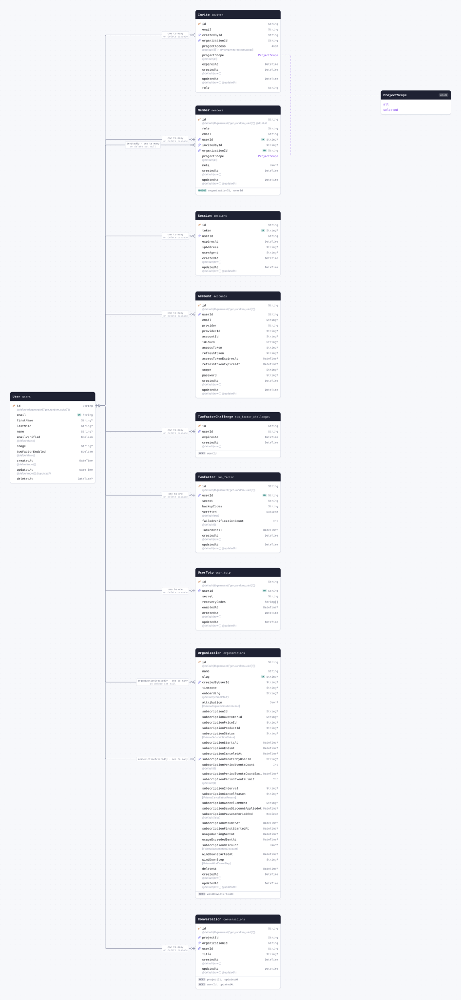

| Field              | Type       | Constraints     | Default                            | Description |
| ------------------ | ---------- | --------------- | ---------------------------------- | ----------- |
| `id`               | `String`   | PK NOT NULL     | `dbgenerated("gen_random_uuid()")` |             |
| `email`            | `String`   | UNIQUE NOT NULL |                                    |             |
| `firstName`        | `String`   | NULL            |                                    |             |
| `lastName`         | `String`   | NULL            |                                    |             |
| `name`             | `String`   | NULL            |                                    |             |
| `emailVerified`    | `Boolean`  | NOT NULL        | `false`                            |             |
| `image`            | `String`   | NULL            |                                    |             |
| `twoFactorEnabled` | `Boolean`  | NOT NULL        | `false`                            |             |
| `createdAt`        | `DateTime` | NOT NULL        | `now()`                            |             |
| `updatedAt`        | `DateTime` | NOT NULL        | `now()` `@updatedAt`               |             |
| `deletedAt`        | `DateTime` | NULL            |                                    |             |

#### Referenced by

- `id` ← [Conversation.userId](#model-Conversation) (one-to-many, on delete Cascade)
- `id` ← [Organization.createdByUserId](#model-Organization) (one-to-many, on delete SetNull)
- `id` ← [Organization.subscriptionCreatedByUserId](#model-Organization) (one-to-many)
- `id` ← [UserTotp.userId](#model-UserTotp) (one-to-one, on delete Cascade)
- `id` ← [TwoFactor.userId](#model-TwoFactor) (one-to-one, on delete Cascade)
- `id` ← [TwoFactorChallenge.userId](#model-TwoFactorChallenge) (one-to-many, on delete Cascade)
- `id` ← [Account.userId](#model-Account) (one-to-many, on delete Cascade)
- `id` ← [Session.userId](#model-Session) (one-to-many, on delete Cascade)
- `id` ← [Member.userId](#model-Member) (one-to-many, on delete Cascade)
- `id` ← [Member.invitedById](#model-Member) (one-to-many, on delete SetNull)
- `id` ← [Invite.createdById](#model-Invite) (one-to-many, on delete Cascade)

#### Definition

```sql
CREATE TABLE "users" (
    "id" TEXT NOT NULL DEFAULT gen_random_uuid(),
    "email" TEXT NOT NULL,
    "firstName" TEXT,
    "lastName" TEXT,
    "name" TEXT,
    "emailVerified" BOOLEAN NOT NULL DEFAULT false,
    "image" TEXT,
    "twoFactorEnabled" BOOLEAN NOT NULL DEFAULT false,
    "createdAt" TIMESTAMP(3) NOT NULL DEFAULT CURRENT_TIMESTAMP,
    "updatedAt" TIMESTAMP(3) NOT NULL DEFAULT CURRENT_TIMESTAMP,
    "deletedAt" TIMESTAMP(3),

    CONSTRAINT "users_pkey" PRIMARY KEY ("id")
);

CREATE UNIQUE INDEX "users_email_key" ON "users"("email");
```

<details>
<summary>Queries and their SQL</summary>

**findMany**: Every row

```ts
await prisma.user.findMany();
```

```sql
SELECT
  "public"."users"."id",
  "public"."users"."email",
  "public"."users"."firstName",
  "public"."users"."lastName",
  "public"."users"."name",
  "public"."users"."emailVerified",
  "public"."users"."image",
  "public"."users"."twoFactorEnabled",
  "public"."users"."createdAt",
  "public"."users"."updatedAt",
  "public"."users"."deletedAt"
FROM
  "public"."users"
WHERE
  1 = 1
OFFSET
  $1
-- params: ["0"]
```

**count**: How many rows there are

```ts
await prisma.user.count();
```

```sql
SELECT
  COUNT(*) AS "_count$_all"
FROM
  (
    SELECT
      "public"."users"."id"
    FROM
      "public"."users"
    WHERE
      1 = 1
    OFFSET
      $1
  ) AS "sub"
-- params: ["0"]
```

**findMany**: Every row with its relations

```ts
await prisma.user.findMany({
  include: {
    twoFactor: true,
    createdOrganizations: true,
    subscriptions: true,
    membership: true,
    sentInvites: true,
    sessions: true,
    accounts: true,
    invites: true,
    conversations: true,
    totp: true,
    twoFactorChallenges: true,
  },
});
```

```sql
SELECT
  "public"."users"."id",
  "public"."users"."email",
  "public"."users"."firstName",
  "public"."users"."lastName",
  "public"."users"."name",
  "public"."users"."emailVerified",
  "public"."users"."image",
  "public"."users"."twoFactorEnabled",
  "public"."users"."createdAt",
  "public"."users"."updatedAt",
  "public"."users"."deletedAt"
FROM
  "public"."users"
WHERE
  1 = 1
OFFSET
  $1
-- params: ["0"]

SELECT
  "public"."two_factor"."id",
  "public"."two_factor"."userId",
  "public"."two_factor"."secret",
  "public"."two_factor"."backupCodes",
  "public"."two_factor"."verified",
  "public"."two_factor"."failedVerificationCount",
  "public"."two_factor"."lockedUntil",
  "public"."two_factor"."createdAt",
  "public"."two_factor"."updatedAt"
FROM
  "public"."two_factor"
WHERE
  "public"."two_factor"."userId" IN ($1)
OFFSET
  $2
-- params: ["<id of the rows above>","0"]

SELECT
  "public"."organizations"."id",
  "public"."organizations"."name",
  "public"."organizations"."slug",
  "public"."organizations"."createdByUserId",
  "public"."organizations"."timezone",
  "public"."organizations"."onboarding",
  "public"."organizations"."attribution",
  "public"."organizations"."subscriptionId",
  "public"."organizations"."subscriptionCustomerId",
  "public"."organizations"."subscriptionPriceId",
  "public"."organizations"."subscriptionProductId",
  "public"."organizations"."subscriptionStatus",
  "public"."organizations"."subscriptionStartsAt",
  "public"."organizations"."subscriptionEndsAt",
  "public"."organizations"."subscriptionCanceledAt",
  "public"."organizations"."subscriptionCreatedByUserId",
  "public"."organizations"."subscriptionPeriodEventsCount",
  "public"."organizations"."subscriptionPeriodEventsCountExceededAt",
  "public"."organizations"."subscriptionPeriodEventsLimit",
  "public"."organizations"."subscriptionInterval",
  "public"."organizations"."subscriptionCancelReason",
  "public"."organizations"."subscriptionCancelComment",
  "public"."organizations"."subscriptionSaveDiscountAppliedAt",
  "public"."organizations"."subscriptionPauseAtPeriodEnd",
  "public"."organizations"."subscriptionResumesAt",
  "public"."organizations"."subscriptionFirstStartedAt",
  "public"."organizations"."usageWarningSentAt",
  "public"."organizations"."usageExceededSentAt",
  "public"."organizations"."subscriptionDiscount",
  "public"."organizations"."windDownStartedAt",
  "public"."organizations"."windDownStep",
  "public"."organizations"."deleteAt",
  "public"."organizations"."createdAt",
  "public"."organizations"."updatedAt"
FROM
  "public"."organizations"
WHERE
  "public"."organizations"."createdByUserId" IN ($1)
OFFSET
  $2
-- params: ["<id of the rows above>","0"]

SELECT
  "public"."organizations"."id",
  "public"."organizations"."name",
  "public"."organizations"."slug",
  "public"."organizations"."createdByUserId",
  "public"."organizations"."timezone",
  "public"."organizations"."onboarding",
  "public"."organizations"."attribution",
  "public"."organizations"."subscriptionId",
  "public"."organizations"."subscriptionCustomerId",
  "public"."organizations"."subscriptionPriceId",
  "public"."organizations"."subscriptionProductId",
  "public"."organizations"."subscriptionStatus",
  "public"."organizations"."subscriptionStartsAt",
  "public"."organizations"."subscriptionEndsAt",
  "public"."organizations"."subscriptionCanceledAt",
  "public"."organizations"."subscriptionCreatedByUserId",
  "public"."organizations"."subscriptionPeriodEventsCount",
  "public"."organizations"."subscriptionPeriodEventsCountExceededAt",
  "public"."organizations"."subscriptionPeriodEventsLimit",
  "public"."organizations"."subscriptionInterval",
  "public"."organizations"."subscriptionCancelReason",
  "public"."organizations"."subscriptionCancelComment",
  "public"."organizations"."subscriptionSaveDiscountAppliedAt",
  "public"."organizations"."subscriptionPauseAtPeriodEnd",
  "public"."organizations"."subscriptionResumesAt",
  "public"."organizations"."subscriptionFirstStartedAt",
  "public"."organizations"."usageWarningSentAt",
  "public"."organizations"."usageExceededSentAt",
  "public"."organizations"."subscriptionDiscount",
  "public"."organizations"."windDownStartedAt",
  "public"."organizations"."windDownStep",
  "public"."organizations"."deleteAt",
  "public"."organizations"."createdAt",
  "public"."organizations"."updatedAt"
FROM
  "public"."organizations"
WHERE
  "public"."organizations"."subscriptionCreatedByUserId" IN ($1)
OFFSET
  $2
-- params: ["<id of the rows above>","0"]

SELECT
  "public"."members"."id",
  "public"."members"."role",
  "public"."members"."email",
  "public"."members"."userId",
  "public"."members"."invitedById",
  "public"."members"."organizationId",
  "public"."members"."projectScope"::text,
  "public"."members"."meta",
  "public"."members"."createdAt",
  "public"."members"."updatedAt"
FROM
  "public"."members"
WHERE
  "public"."members"."userId" IN ($1)
OFFSET
  $2
-- params: ["<id of the rows above>","0"]

SELECT
  "public"."members"."id",
  "public"."members"."role",
  "public"."members"."email",
  "public"."members"."userId",
  "public"."members"."invitedById",
  "public"."members"."organizationId",
  "public"."members"."projectScope"::text,
  "public"."members"."meta",
  "public"."members"."createdAt",
  "public"."members"."updatedAt"
FROM
  "public"."members"
WHERE
  "public"."members"."invitedById" IN ($1)
OFFSET
  $2
-- params: ["<id of the rows above>","0"]

SELECT
  "public"."sessions"."id",
  "public"."sessions"."token",
  "public"."sessions"."userId",
  "public"."sessions"."expiresAt",
  "public"."sessions"."ipAddress",
  "public"."sessions"."userAgent",
  "public"."sessions"."createdAt",
  "public"."sessions"."updatedAt"
FROM
  "public"."sessions"
WHERE
  "public"."sessions"."userId" IN ($1)
OFFSET
  $2
-- params: ["<id of the rows above>","0"]

SELECT
  "public"."accounts"."id",
  "public"."accounts"."userId",
  "public"."accounts"."email",
  "public"."accounts"."provider",
  "public"."accounts"."providerId",
  "public"."accounts"."accountId",
  "public"."accounts"."idToken",
  "public"."accounts"."accessToken",
  "public"."accounts"."refreshToken",
  "public"."accounts"."accessTokenExpiresAt",
  "public"."accounts"."refreshTokenExpiresAt",
  "public"."accounts"."scope",
  "public"."accounts"."password",
  "public"."accounts"."createdAt",
  "public"."accounts"."updatedAt"
FROM
  "public"."accounts"
WHERE
  "public"."accounts"."userId" IN ($1)
OFFSET
  $2
-- params: ["<id of the rows above>","0"]

SELECT
  "public"."invites"."id",
  "public"."invites"."email",
  "public"."invites"."createdById",
  "public"."invites"."organizationId",
  "public"."invites"."projectAccess",
  "public"."invites"."projectScope"::text,
  "public"."invites"."expiresAt",
  "public"."invites"."createdAt",
  "public"."invites"."updatedAt",
  "public"."invites"."role"
FROM
  "public"."invites"
WHERE
  "public"."invites"."createdById" IN ($1)
OFFSET
  $2
-- params: ["<id of the rows above>","0"]

SELECT
  "public"."conversations"."id",
  "public"."conversations"."projectId",
  "public"."conversations"."organizationId",
  "public"."conversations"."userId",
  "public"."conversations"."title",
  "public"."conversations"."createdAt",
  "public"."conversations"."updatedAt"
FROM
  "public"."conversations"
WHERE
  "public"."conversations"."userId" IN ($1)
OFFSET
  $2
-- params: ["<id of the rows above>","0"]

SELECT
  "public"."user_totp"."id",
  "public"."user_totp"."userId",
  "public"."user_totp"."secret",
  "public"."user_totp"."recoveryCodes",
  "public"."user_totp"."enabledAt",
  "public"."user_totp"."createdAt",
  "public"."user_totp"."updatedAt"
FROM
  "public"."user_totp"
WHERE
  "public"."user_totp"."userId" IN ($1)
OFFSET
  $2
-- params: ["<id of the rows above>","0"]

SELECT
  "public"."two_factor_challenges"."id",
  "public"."two_factor_challenges"."userId",
  "public"."two_factor_challenges"."expiresAt",
  "public"."two_factor_challenges"."createdAt"
FROM
  "public"."two_factor_challenges"
WHERE
  "public"."two_factor_challenges"."userId" IN ($1)
OFFSET
  $2
-- params: ["<id of the rows above>","0"]
```

**findUnique**: One row by what is unique to it

```ts
await prisma.user.findUnique({ where: { id: "example" } });
```

```sql
SELECT
  "public"."users"."id",
  "public"."users"."email",
  "public"."users"."firstName",
  "public"."users"."lastName",
  "public"."users"."name",
  "public"."users"."emailVerified",
  "public"."users"."image",
  "public"."users"."twoFactorEnabled",
  "public"."users"."createdAt",
  "public"."users"."updatedAt",
  "public"."users"."deletedAt"
FROM
  "public"."users"
WHERE
  (
    "public"."users"."id" = $1
    AND 1 = 1
  )
LIMIT
  $2
OFFSET
  $3
-- params: ["example","1","0"]
```

**create**: Create a row

```ts
await prisma.user.create({ data: { email: "example" } });
```

```sql
INSERT INTO
  "public"."users" (
    "email",
    "emailVerified",
    "twoFactorEnabled",
    "createdAt",
    "updatedAt"
  )
VALUES
  ($1, $2, $3, $4, $5)
RETURNING
  "public"."users"."id",
  "public"."users"."email",
  "public"."users"."firstName",
  "public"."users"."lastName",
  "public"."users"."name",
  "public"."users"."emailVerified",
  "public"."users"."image",
  "public"."users"."twoFactorEnabled",
  "public"."users"."createdAt",
  "public"."users"."updatedAt",
  "public"."users"."deletedAt"
-- params: ["example",false,false,"<now()>","<now()>"]
```

**update**: Update a row

```ts
await prisma.user.update({ where: { id: "example" }, data: { email: "example" } });
```

```sql
UPDATE "public"."users"
SET
  "email" = $1,
  "updatedAt" = $2
WHERE
  (
    "public"."users"."id" = $3
    AND 1 = 1
  )
RETURNING
  "public"."users"."id",
  "public"."users"."email",
  "public"."users"."firstName",
  "public"."users"."lastName",
  "public"."users"."name",
  "public"."users"."emailVerified",
  "public"."users"."image",
  "public"."users"."twoFactorEnabled",
  "public"."users"."createdAt",
  "public"."users"."updatedAt",
  "public"."users"."deletedAt"
-- params: ["example",{"prisma__type":"generatorCall","prisma__value":{"name":"now","args":[],"returnType":{"type":"DateTime"}}},"example"]
```

**delete**: Delete a row

```ts
await prisma.user.delete({ where: { id: "example" } });
```

```sql
DELETE FROM "public"."users"
WHERE
  (
    "public"."users"."id" = $1
    AND 1 = 1
  )
RETURNING
  "public"."users"."id",
  "public"."users"."email",
  "public"."users"."firstName",
  "public"."users"."lastName",
  "public"."users"."name",
  "public"."users"."emailVerified",
  "public"."users"."image",
  "public"."users"."twoFactorEnabled",
  "public"."users"."createdAt",
  "public"."users"."updatedAt",
  "public"."users"."deletedAt"
-- params: ["example"]
```

</details>

<a id="model-UserTotp"></a>

### UserTotp

Table `user_totp`.

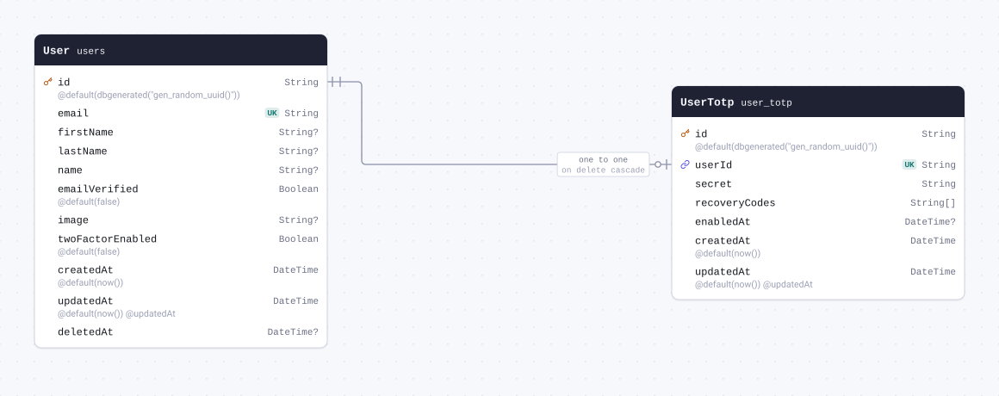

| Field           | Type       | Constraints                              | Default                            | Description |
| --------------- | ---------- | ---------------------------------------- | ---------------------------------- | ----------- |
| `id`            | `String`   | PK NOT NULL                              | `dbgenerated("gen_random_uuid()")` |             |
| `userId`        | `String`   | UNIQUE NOT NULL → [User.id](#model-User) |                                    |             |
| `secret`        | `String`   | NOT NULL                                 |                                    |             |
| `recoveryCodes` | `String[]` | NOT NULL                                 |                                    |             |
| `enabledAt`     | `DateTime` | NULL                                     |                                    |             |
| `createdAt`     | `DateTime` | NOT NULL                                 | `now()`                            |             |
| `updatedAt`     | `DateTime` | NOT NULL                                 | `now()` `@updatedAt`               |             |

#### References

- `userId` → [User.id](#model-User) (one-to-one, on delete Cascade)

#### Definition

```sql
CREATE TABLE "user_totp" (
    "id" TEXT NOT NULL DEFAULT gen_random_uuid(),
    "userId" TEXT NOT NULL,
    "secret" TEXT NOT NULL,
    "recoveryCodes" TEXT[],
    "enabledAt" TIMESTAMP(3),
    "createdAt" TIMESTAMP(3) NOT NULL DEFAULT CURRENT_TIMESTAMP,
    "updatedAt" TIMESTAMP(3) NOT NULL DEFAULT CURRENT_TIMESTAMP,

    CONSTRAINT "user_totp_pkey" PRIMARY KEY ("id")
);

CREATE UNIQUE INDEX "user_totp_userId_key" ON "user_totp"("userId");

ALTER TABLE "user_totp" ADD CONSTRAINT "user_totp_userId_fkey" FOREIGN KEY ("userId") REFERENCES "users"("id") ON DELETE CASCADE ON UPDATE CASCADE;
```

<details>
<summary>Queries and their SQL</summary>

**findMany**: Every row

```ts
await prisma.userTotp.findMany();
```

```sql
SELECT
  "public"."user_totp"."id",
  "public"."user_totp"."userId",
  "public"."user_totp"."secret",
  "public"."user_totp"."recoveryCodes",
  "public"."user_totp"."enabledAt",
  "public"."user_totp"."createdAt",
  "public"."user_totp"."updatedAt"
FROM
  "public"."user_totp"
WHERE
  1 = 1
OFFSET
  $1
-- params: ["0"]
```

**count**: How many rows there are

```ts
await prisma.userTotp.count();
```

```sql
SELECT
  COUNT(*) AS "_count$_all"
FROM
  (
    SELECT
      "public"."user_totp"."id"
    FROM
      "public"."user_totp"
    WHERE
      1 = 1
    OFFSET
      $1
  ) AS "sub"
-- params: ["0"]
```

**findMany**: Every row with its relations

```ts
await prisma.userTotp.findMany({ include: { user: true } });
```

```sql
SELECT
  "public"."user_totp"."id",
  "public"."user_totp"."userId",
  "public"."user_totp"."secret",
  "public"."user_totp"."recoveryCodes",
  "public"."user_totp"."enabledAt",
  "public"."user_totp"."createdAt",
  "public"."user_totp"."updatedAt"
FROM
  "public"."user_totp"
WHERE
  1 = 1
OFFSET
  $1
-- params: ["0"]

SELECT
  "public"."users"."id",
  "public"."users"."email",
  "public"."users"."firstName",
  "public"."users"."lastName",
  "public"."users"."name",
  "public"."users"."emailVerified",
  "public"."users"."image",
  "public"."users"."twoFactorEnabled",
  "public"."users"."createdAt",
  "public"."users"."updatedAt",
  "public"."users"."deletedAt"
FROM
  "public"."users"
WHERE
  "public"."users"."id" IN ($1)
OFFSET
  $2
-- params: ["<userId of the rows above>","0"]
```

**findUnique**: One row by what is unique to it

```ts
await prisma.userTotp.findUnique({ where: { id: "example" } });
```

```sql
SELECT
  "public"."user_totp"."id",
  "public"."user_totp"."userId",
  "public"."user_totp"."secret",
  "public"."user_totp"."recoveryCodes",
  "public"."user_totp"."enabledAt",
  "public"."user_totp"."createdAt",
  "public"."user_totp"."updatedAt"
FROM
  "public"."user_totp"
WHERE
  (
    "public"."user_totp"."id" = $1
    AND 1 = 1
  )
LIMIT
  $2
OFFSET
  $3
-- params: ["example","1","0"]
```

**create**: Create a row

```ts
await prisma.userTotp.create({
  data: { userId: "example", secret: "example", recoveryCodes: ["example"] },
});
```

```sql
INSERT INTO
  "public"."user_totp" (
    "userId",
    "secret",
    "recoveryCodes",
    "createdAt",
    "updatedAt"
  )
VALUES
  ($1, $2, $3, $4, $5)
RETURNING
  "public"."user_totp"."id",
  "public"."user_totp"."userId",
  "public"."user_totp"."secret",
  "public"."user_totp"."recoveryCodes",
  "public"."user_totp"."enabledAt",
  "public"."user_totp"."createdAt",
  "public"."user_totp"."updatedAt"
-- params: ["example","example",["example"],"<now()>","<now()>"]
```

**update**: Update a row

```ts
await prisma.userTotp.update({ where: { id: "example" }, data: { secret: "example" } });
```

```sql
UPDATE "public"."user_totp"
SET
  "secret" = $1,
  "updatedAt" = $2
WHERE
  (
    "public"."user_totp"."id" = $3
    AND 1 = 1
  )
RETURNING
  "public"."user_totp"."id",
  "public"."user_totp"."userId",
  "public"."user_totp"."secret",
  "public"."user_totp"."recoveryCodes",
  "public"."user_totp"."enabledAt",
  "public"."user_totp"."createdAt",
  "public"."user_totp"."updatedAt"
-- params: ["example",{"prisma__type":"generatorCall","prisma__value":{"name":"now","args":[],"returnType":{"type":"DateTime"}}},"example"]
```

**delete**: Delete a row

```ts
await prisma.userTotp.delete({ where: { id: "example" } });
```

```sql
DELETE FROM "public"."user_totp"
WHERE
  (
    "public"."user_totp"."id" = $1
    AND 1 = 1
  )
RETURNING
  "public"."user_totp"."id",
  "public"."user_totp"."userId",
  "public"."user_totp"."secret",
  "public"."user_totp"."recoveryCodes",
  "public"."user_totp"."enabledAt",
  "public"."user_totp"."createdAt",
  "public"."user_totp"."updatedAt"
-- params: ["example"]
```

</details>

<a id="model-TwoFactor"></a>

### TwoFactor

Table `two_factor`.

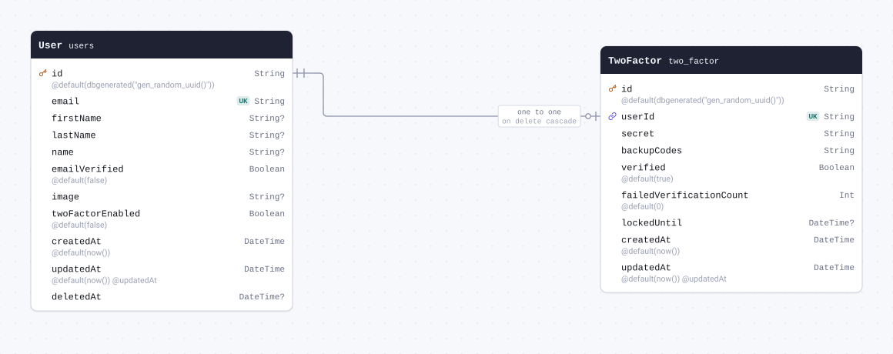

| Field                     | Type       | Constraints                              | Default                            | Description |
| ------------------------- | ---------- | ---------------------------------------- | ---------------------------------- | ----------- |
| `id`                      | `String`   | PK NOT NULL                              | `dbgenerated("gen_random_uuid()")` |             |
| `userId`                  | `String`   | UNIQUE NOT NULL → [User.id](#model-User) |                                    |             |
| `secret`                  | `String`   | NOT NULL                                 |                                    |             |
| `backupCodes`             | `String`   | NOT NULL                                 |                                    |             |
| `verified`                | `Boolean`  | NOT NULL                                 | `true`                             |             |
| `failedVerificationCount` | `Int`      | NOT NULL                                 | `0`                                |             |
| `lockedUntil`             | `DateTime` | NULL                                     |                                    |             |
| `createdAt`               | `DateTime` | NOT NULL                                 | `now()`                            |             |
| `updatedAt`               | `DateTime` | NOT NULL                                 | `now()` `@updatedAt`               |             |

#### References

- `userId` → [User.id](#model-User) (one-to-one, on delete Cascade)

#### Definition

```sql
CREATE TABLE "two_factor" (
    "id" TEXT NOT NULL DEFAULT gen_random_uuid(),
    "userId" TEXT NOT NULL,
    "secret" TEXT NOT NULL,
    "backupCodes" TEXT NOT NULL,
    "verified" BOOLEAN NOT NULL DEFAULT true,
    "failedVerificationCount" INTEGER NOT NULL DEFAULT 0,
    "lockedUntil" TIMESTAMP(3),
    "createdAt" TIMESTAMP(3) NOT NULL DEFAULT CURRENT_TIMESTAMP,
    "updatedAt" TIMESTAMP(3) NOT NULL DEFAULT CURRENT_TIMESTAMP,

    CONSTRAINT "two_factor_pkey" PRIMARY KEY ("id")
);

CREATE UNIQUE INDEX "two_factor_userId_key" ON "two_factor"("userId");

ALTER TABLE "two_factor" ADD CONSTRAINT "two_factor_userId_fkey" FOREIGN KEY ("userId") REFERENCES "users"("id") ON DELETE CASCADE ON UPDATE CASCADE;
```

<details>
<summary>Queries and their SQL</summary>

**findMany**: Every row

```ts
await prisma.twoFactor.findMany();
```

```sql
SELECT
  "public"."two_factor"."id",
  "public"."two_factor"."userId",
  "public"."two_factor"."secret",
  "public"."two_factor"."backupCodes",
  "public"."two_factor"."verified",
  "public"."two_factor"."failedVerificationCount",
  "public"."two_factor"."lockedUntil",
  "public"."two_factor"."createdAt",
  "public"."two_factor"."updatedAt"
FROM
  "public"."two_factor"
WHERE
  1 = 1
OFFSET
  $1
-- params: ["0"]
```

**count**: How many rows there are

```ts
await prisma.twoFactor.count();
```

```sql
SELECT
  COUNT(*) AS "_count$_all"
FROM
  (
    SELECT
      "public"."two_factor"."id"
    FROM
      "public"."two_factor"
    WHERE
      1 = 1
    OFFSET
      $1
  ) AS "sub"
-- params: ["0"]
```

**findMany**: Every row with its relations

```ts
await prisma.twoFactor.findMany({ include: { user: true } });
```

```sql
SELECT
  "public"."two_factor"."id",
  "public"."two_factor"."userId",
  "public"."two_factor"."secret",
  "public"."two_factor"."backupCodes",
  "public"."two_factor"."verified",
  "public"."two_factor"."failedVerificationCount",
  "public"."two_factor"."lockedUntil",
  "public"."two_factor"."createdAt",
  "public"."two_factor"."updatedAt"
FROM
  "public"."two_factor"
WHERE
  1 = 1
OFFSET
  $1
-- params: ["0"]

SELECT
  "public"."users"."id",
  "public"."users"."email",
  "public"."users"."firstName",
  "public"."users"."lastName",
  "public"."users"."name",
  "public"."users"."emailVerified",
  "public"."users"."image",
  "public"."users"."twoFactorEnabled",
  "public"."users"."createdAt",
  "public"."users"."updatedAt",
  "public"."users"."deletedAt"
FROM
  "public"."users"
WHERE
  "public"."users"."id" IN ($1)
OFFSET
  $2
-- params: ["<userId of the rows above>","0"]
```

**findUnique**: One row by what is unique to it

```ts
await prisma.twoFactor.findUnique({ where: { id: "example" } });
```

```sql
SELECT
  "public"."two_factor"."id",
  "public"."two_factor"."userId",
  "public"."two_factor"."secret",
  "public"."two_factor"."backupCodes",
  "public"."two_factor"."verified",
  "public"."two_factor"."failedVerificationCount",
  "public"."two_factor"."lockedUntil",
  "public"."two_factor"."createdAt",
  "public"."two_factor"."updatedAt"
FROM
  "public"."two_factor"
WHERE
  (
    "public"."two_factor"."id" = $1
    AND 1 = 1
  )
LIMIT
  $2
OFFSET
  $3
-- params: ["example","1","0"]
```

**create**: Create a row

```ts
await prisma.twoFactor.create({
  data: { userId: "example", secret: "example", backupCodes: "example" },
});
```

```sql
INSERT INTO
  "public"."two_factor" (
    "userId",
    "secret",
    "backupCodes",
    "verified",
    "failedVerificationCount",
    "createdAt",
    "updatedAt"
  )
VALUES
  ($1, $2, $3, $4, $5, $6, $7)
RETURNING
  "public"."two_factor"."id",
  "public"."two_factor"."userId",
  "public"."two_factor"."secret",
  "public"."two_factor"."backupCodes",
  "public"."two_factor"."verified",
  "public"."two_factor"."failedVerificationCount",
  "public"."two_factor"."lockedUntil",
  "public"."two_factor"."createdAt",
  "public"."two_factor"."updatedAt"
-- params: ["example","example","example",true,"0","<now()>","<now()>"]
```

**update**: Update a row

```ts
await prisma.twoFactor.update({ where: { id: "example" }, data: { secret: "example" } });
```

```sql
UPDATE "public"."two_factor"
SET
  "secret" = $1,
  "updatedAt" = $2
WHERE
  (
    "public"."two_factor"."id" = $3
    AND 1 = 1
  )
RETURNING
  "public"."two_factor"."id",
  "public"."two_factor"."userId",
  "public"."two_factor"."secret",
  "public"."two_factor"."backupCodes",
  "public"."two_factor"."verified",
  "public"."two_factor"."failedVerificationCount",
  "public"."two_factor"."lockedUntil",
  "public"."two_factor"."createdAt",
  "public"."two_factor"."updatedAt"
-- params: ["example",{"prisma__type":"generatorCall","prisma__value":{"name":"now","args":[],"returnType":{"type":"DateTime"}}},"example"]
```

**delete**: Delete a row

```ts
await prisma.twoFactor.delete({ where: { id: "example" } });
```

```sql
DELETE FROM "public"."two_factor"
WHERE
  (
    "public"."two_factor"."id" = $1
    AND 1 = 1
  )
RETURNING
  "public"."two_factor"."id",
  "public"."two_factor"."userId",
  "public"."two_factor"."secret",
  "public"."two_factor"."backupCodes",
  "public"."two_factor"."verified",
  "public"."two_factor"."failedVerificationCount",
  "public"."two_factor"."lockedUntil",
  "public"."two_factor"."createdAt",
  "public"."two_factor"."updatedAt"
-- params: ["example"]
```

</details>

<a id="model-TwoFactorChallenge"></a>

### TwoFactorChallenge

Table `two_factor_challenges`.

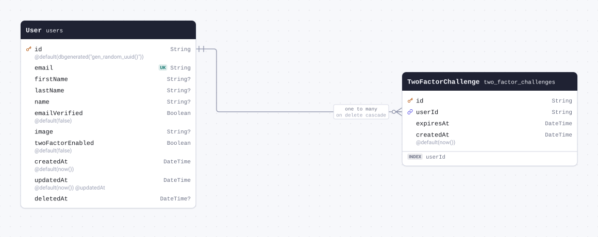

| Field       | Type       | Constraints                       | Default | Description |
| ----------- | ---------- | --------------------------------- | ------- | ----------- |
| `id`        | `String`   | PK NOT NULL                       |         |             |
| `userId`    | `String`   | NOT NULL → [User.id](#model-User) |         |             |
| `expiresAt` | `DateTime` | NOT NULL                          |         |             |
| `createdAt` | `DateTime` | NOT NULL                          | `now()` |             |

#### Indexes

- `@@index([userId])`

#### References

- `userId` → [User.id](#model-User) (many-to-one, on delete Cascade)

#### Definition

```sql
CREATE TABLE "two_factor_challenges" (
    "id" TEXT NOT NULL,
    "userId" TEXT NOT NULL,
    "expiresAt" TIMESTAMP(3) NOT NULL,
    "createdAt" TIMESTAMP(3) NOT NULL DEFAULT CURRENT_TIMESTAMP,

    CONSTRAINT "two_factor_challenges_pkey" PRIMARY KEY ("id")
);

CREATE INDEX "two_factor_challenges_userId_idx" ON "two_factor_challenges"("userId");

ALTER TABLE "two_factor_challenges" ADD CONSTRAINT "two_factor_challenges_userId_fkey" FOREIGN KEY ("userId") REFERENCES "users"("id") ON DELETE CASCADE ON UPDATE CASCADE;
```

<details>
<summary>Queries and their SQL</summary>

**findMany**: Every row

```ts
await prisma.twoFactorChallenge.findMany();
```

```sql
SELECT
  "public"."two_factor_challenges"."id",
  "public"."two_factor_challenges"."userId",
  "public"."two_factor_challenges"."expiresAt",
  "public"."two_factor_challenges"."createdAt"
FROM
  "public"."two_factor_challenges"
WHERE
  1 = 1
OFFSET
  $1
-- params: ["0"]
```

**count**: How many rows there are

```ts
await prisma.twoFactorChallenge.count();
```

```sql
SELECT
  COUNT(*) AS "_count$_all"
FROM
  (
    SELECT
      "public"."two_factor_challenges"."id"
    FROM
      "public"."two_factor_challenges"
    WHERE
      1 = 1
    OFFSET
      $1
  ) AS "sub"
-- params: ["0"]
```

**findMany**: Every row with its relations

```ts
await prisma.twoFactorChallenge.findMany({ include: { user: true } });
```

```sql
SELECT
  "public"."two_factor_challenges"."id",
  "public"."two_factor_challenges"."userId",
  "public"."two_factor_challenges"."expiresAt",
  "public"."two_factor_challenges"."createdAt"
FROM
  "public"."two_factor_challenges"
WHERE
  1 = 1
OFFSET
  $1
-- params: ["0"]

SELECT
  "public"."users"."id",
  "public"."users"."email",
  "public"."users"."firstName",
  "public"."users"."lastName",
  "public"."users"."name",
  "public"."users"."emailVerified",
  "public"."users"."image",
  "public"."users"."twoFactorEnabled",
  "public"."users"."createdAt",
  "public"."users"."updatedAt",
  "public"."users"."deletedAt"
FROM
  "public"."users"
WHERE
  "public"."users"."id" IN ($1)
OFFSET
  $2
-- params: ["<userId of the rows above>","0"]
```

**findUnique**: One row by what is unique to it

```ts
await prisma.twoFactorChallenge.findUnique({ where: { id: "example" } });
```

```sql
SELECT
  "public"."two_factor_challenges"."id",
  "public"."two_factor_challenges"."userId",
  "public"."two_factor_challenges"."expiresAt",
  "public"."two_factor_challenges"."createdAt"
FROM
  "public"."two_factor_challenges"
WHERE
  (
    "public"."two_factor_challenges"."id" = $1
    AND 1 = 1
  )
LIMIT
  $2
OFFSET
  $3
-- params: ["example","1","0"]
```

**create**: Create a row

```ts
await prisma.twoFactorChallenge.create({
  data: { id: "example", userId: "example", expiresAt: new Date("2026-01-01T00:00:00.000Z") },
});
```

```sql
INSERT INTO
  "public"."two_factor_challenges" ("id", "userId", "expiresAt", "createdAt")
VALUES
  ($1, $2, $3, $4)
RETURNING
  "public"."two_factor_challenges"."id",
  "public"."two_factor_challenges"."userId",
  "public"."two_factor_challenges"."expiresAt",
  "public"."two_factor_challenges"."createdAt"
-- params: ["example","example","2026-01-01T00:00:00.000Z","<now()>"]
```

**update**: Update a row

```ts
await prisma.twoFactorChallenge.update({
  where: { id: "example" },
  data: { expiresAt: new Date("2026-01-01T00:00:00.000Z") },
});
```

```sql
UPDATE "public"."two_factor_challenges"
SET
  "expiresAt" = $1
WHERE
  (
    "public"."two_factor_challenges"."id" = $2
    AND 1 = 1
  )
RETURNING
  "public"."two_factor_challenges"."id",
  "public"."two_factor_challenges"."userId",
  "public"."two_factor_challenges"."expiresAt",
  "public"."two_factor_challenges"."createdAt"
-- params: ["2026-01-01T00:00:00.000Z","example"]
```

**delete**: Delete a row

```ts
await prisma.twoFactorChallenge.delete({ where: { id: "example" } });
```

```sql
DELETE FROM "public"."two_factor_challenges"
WHERE
  (
    "public"."two_factor_challenges"."id" = $1
    AND 1 = 1
  )
RETURNING
  "public"."two_factor_challenges"."id",
  "public"."two_factor_challenges"."userId",
  "public"."two_factor_challenges"."expiresAt",
  "public"."two_factor_challenges"."createdAt"
-- params: ["example"]
```

</details>

<a id="model-Account"></a>

### Account

Table `accounts`.

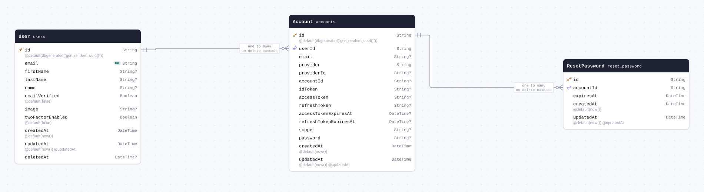

| Field                   | Type       | Constraints                       | Default                            | Description |
| ----------------------- | ---------- | --------------------------------- | ---------------------------------- | ----------- |
| `id`                    | `String`   | PK NOT NULL                       | `dbgenerated("gen_random_uuid()")` |             |
| `userId`                | `String`   | NOT NULL → [User.id](#model-User) |                                    |             |
| `email`                 | `String`   | NULL                              |                                    |             |
| `provider`              | `String`   | NOT NULL                          |                                    |             |
| `providerId`            | `String`   | NULL                              |                                    |             |
| `accountId`             | `String`   | NULL                              |                                    |             |
| `idToken`               | `String`   | NULL                              |                                    |             |
| `accessToken`           | `String`   | NULL                              |                                    |             |
| `refreshToken`          | `String`   | NULL                              |                                    |             |
| `accessTokenExpiresAt`  | `DateTime` | NULL                              |                                    |             |
| `refreshTokenExpiresAt` | `DateTime` | NULL                              |                                    |             |
| `scope`                 | `String`   | NULL                              |                                    |             |
| `password`              | `String`   | NULL                              |                                    |             |
| `createdAt`             | `DateTime` | NOT NULL                          | `now()`                            |             |
| `updatedAt`             | `DateTime` | NOT NULL                          | `now()` `@updatedAt`               |             |

#### References

- `userId` → [User.id](#model-User) (many-to-one, on delete Cascade)

#### Referenced by

- `id` ← [ResetPassword.accountId](#model-ResetPassword) (one-to-many, on delete Cascade)

#### Definition

```sql
CREATE TABLE "accounts" (
    "id" TEXT NOT NULL DEFAULT gen_random_uuid(),
    "userId" TEXT NOT NULL,
    "email" TEXT,
    "provider" TEXT NOT NULL,
    "providerId" TEXT,
    "accountId" TEXT,
    "idToken" TEXT,
    "accessToken" TEXT,
    "refreshToken" TEXT,
    "accessTokenExpiresAt" TIMESTAMP(3),
    "refreshTokenExpiresAt" TIMESTAMP(3),
    "scope" TEXT,
    "password" TEXT,
    "createdAt" TIMESTAMP(3) NOT NULL DEFAULT CURRENT_TIMESTAMP,
    "updatedAt" TIMESTAMP(3) NOT NULL DEFAULT CURRENT_TIMESTAMP,

    CONSTRAINT "accounts_pkey" PRIMARY KEY ("id")
);

ALTER TABLE "accounts" ADD CONSTRAINT "accounts_userId_fkey" FOREIGN KEY ("userId") REFERENCES "users"("id") ON DELETE CASCADE ON UPDATE CASCADE;
```

<details>
<summary>Queries and their SQL</summary>

**findMany**: Every row

```ts
await prisma.account.findMany();
```

```sql
SELECT
  "public"."accounts"."id",
  "public"."accounts"."userId",
  "public"."accounts"."email",
  "public"."accounts"."provider",
  "public"."accounts"."providerId",
  "public"."accounts"."accountId",
  "public"."accounts"."idToken",
  "public"."accounts"."accessToken",
  "public"."accounts"."refreshToken",
  "public"."accounts"."accessTokenExpiresAt",
  "public"."accounts"."refreshTokenExpiresAt",
  "public"."accounts"."scope",
  "public"."accounts"."password",
  "public"."accounts"."createdAt",
  "public"."accounts"."updatedAt"
FROM
  "public"."accounts"
WHERE
  1 = 1
OFFSET
  $1
-- params: ["0"]
```

**count**: How many rows there are

```ts
await prisma.account.count();
```

```sql
SELECT
  COUNT(*) AS "_count$_all"
FROM
  (
    SELECT
      "public"."accounts"."id"
    FROM
      "public"."accounts"
    WHERE
      1 = 1
    OFFSET
      $1
  ) AS "sub"
-- params: ["0"]
```

**findMany**: Every row with its relations

```ts
await prisma.account.findMany({ include: { user: true, resetPasswords: true } });
```

```sql
SELECT
  "public"."accounts"."id",
  "public"."accounts"."userId",
  "public"."accounts"."email",
  "public"."accounts"."provider",
  "public"."accounts"."providerId",
  "public"."accounts"."accountId",
  "public"."accounts"."idToken",
  "public"."accounts"."accessToken",
  "public"."accounts"."refreshToken",
  "public"."accounts"."accessTokenExpiresAt",
  "public"."accounts"."refreshTokenExpiresAt",
  "public"."accounts"."scope",
  "public"."accounts"."password",
  "public"."accounts"."createdAt",
  "public"."accounts"."updatedAt"
FROM
  "public"."accounts"
WHERE
  1 = 1
OFFSET
  $1
-- params: ["0"]

SELECT
  "public"."users"."id",
  "public"."users"."email",
  "public"."users"."firstName",
  "public"."users"."lastName",
  "public"."users"."name",
  "public"."users"."emailVerified",
  "public"."users"."image",
  "public"."users"."twoFactorEnabled",
  "public"."users"."createdAt",
  "public"."users"."updatedAt",
  "public"."users"."deletedAt"
FROM
  "public"."users"
WHERE
  "public"."users"."id" IN ($1)
OFFSET
  $2
-- params: ["<userId of the rows above>","0"]

SELECT
  "public"."reset_password"."id",
  "public"."reset_password"."accountId",
  "public"."reset_password"."expiresAt",
  "public"."reset_password"."createdAt",
  "public"."reset_password"."updatedAt"
FROM
  "public"."reset_password"
WHERE
  "public"."reset_password"."accountId" IN ($1)
OFFSET
  $2
-- params: ["<id of the rows above>","0"]
```

**findUnique**: One row by what is unique to it

```ts
await prisma.account.findUnique({ where: { id: "example" } });
```

```sql
SELECT
  "public"."accounts"."id",
  "public"."accounts"."userId",
  "public"."accounts"."email",
  "public"."accounts"."provider",
  "public"."accounts"."providerId",
  "public"."accounts"."accountId",
  "public"."accounts"."idToken",
  "public"."accounts"."accessToken",
  "public"."accounts"."refreshToken",
  "public"."accounts"."accessTokenExpiresAt",
  "public"."accounts"."refreshTokenExpiresAt",
  "public"."accounts"."scope",
  "public"."accounts"."password",
  "public"."accounts"."createdAt",
  "public"."accounts"."updatedAt"
FROM
  "public"."accounts"
WHERE
  (
    "public"."accounts"."id" = $1
    AND 1 = 1
  )
LIMIT
  $2
OFFSET
  $3
-- params: ["example","1","0"]
```

**create**: Create a row

```ts
await prisma.account.create({ data: { userId: "example", provider: "example" } });
```

```sql
INSERT INTO
  "public"."accounts" ("userId", "provider", "createdAt", "updatedAt")
VALUES
  ($1, $2, $3, $4)
RETURNING
  "public"."accounts"."id",
  "public"."accounts"."userId",
  "public"."accounts"."email",
  "public"."accounts"."provider",
  "public"."accounts"."providerId",
  "public"."accounts"."accountId",
  "public"."accounts"."idToken",
  "public"."accounts"."accessToken",
  "public"."accounts"."refreshToken",
  "public"."accounts"."accessTokenExpiresAt",
  "public"."accounts"."refreshTokenExpiresAt",
  "public"."accounts"."scope",
  "public"."accounts"."password",
  "public"."accounts"."createdAt",
  "public"."accounts"."updatedAt"
-- params: ["example","example","<now()>","<now()>"]
```

**update**: Update a row

```ts
await prisma.account.update({ where: { id: "example" }, data: { email: "example" } });
```

```sql
UPDATE "public"."accounts"
SET
  "email" = $1,
  "updatedAt" = $2
WHERE
  (
    "public"."accounts"."id" = $3
    AND 1 = 1
  )
RETURNING
  "public"."accounts"."id",
  "public"."accounts"."userId",
  "public"."accounts"."email",
  "public"."accounts"."provider",
  "public"."accounts"."providerId",
  "public"."accounts"."accountId",
  "public"."accounts"."idToken",
  "public"."accounts"."accessToken",
  "public"."accounts"."refreshToken",
  "public"."accounts"."accessTokenExpiresAt",
  "public"."accounts"."refreshTokenExpiresAt",
  "public"."accounts"."scope",
  "public"."accounts"."password",
  "public"."accounts"."createdAt",
  "public"."accounts"."updatedAt"
-- params: ["example",{"prisma__type":"generatorCall","prisma__value":{"name":"now","args":[],"returnType":{"type":"DateTime"}}},"example"]
```

**delete**: Delete a row

```ts
await prisma.account.delete({ where: { id: "example" } });
```

```sql
DELETE FROM "public"."accounts"
WHERE
  (
    "public"."accounts"."id" = $1
    AND 1 = 1
  )
RETURNING
  "public"."accounts"."id",
  "public"."accounts"."userId",
  "public"."accounts"."email",
  "public"."accounts"."provider",
  "public"."accounts"."providerId",
  "public"."accounts"."accountId",
  "public"."accounts"."idToken",
  "public"."accounts"."accessToken",
  "public"."accounts"."refreshToken",
  "public"."accounts"."accessTokenExpiresAt",
  "public"."accounts"."refreshTokenExpiresAt",
  "public"."accounts"."scope",
  "public"."accounts"."password",
  "public"."accounts"."createdAt",
  "public"."accounts"."updatedAt"
-- params: ["example"]
```

</details>

<a id="model-Session"></a>

### Session

Table `sessions`.

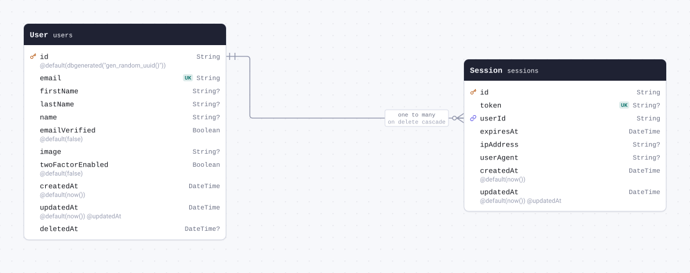

| Field       | Type       | Constraints                       | Default              | Description |
| ----------- | ---------- | --------------------------------- | -------------------- | ----------- |
| `id`        | `String`   | PK NOT NULL                       |                      |             |
| `token`     | `String`   | UNIQUE NULL                       |                      |             |
| `userId`    | `String`   | NOT NULL → [User.id](#model-User) |                      |             |
| `expiresAt` | `DateTime` | NOT NULL                          |                      |             |
| `ipAddress` | `String`   | NULL                              |                      |             |
| `userAgent` | `String`   | NULL                              |                      |             |
| `createdAt` | `DateTime` | NOT NULL                          | `now()`              |             |
| `updatedAt` | `DateTime` | NOT NULL                          | `now()` `@updatedAt` |             |

#### References

- `userId` → [User.id](#model-User) (many-to-one, on delete Cascade)

#### Definition

```sql
CREATE TABLE "sessions" (
    "id" TEXT NOT NULL,
    "token" TEXT,
    "userId" TEXT NOT NULL,
    "expiresAt" TIMESTAMP(3) NOT NULL,
    "ipAddress" TEXT,
    "userAgent" TEXT,
    "createdAt" TIMESTAMP(3) NOT NULL DEFAULT CURRENT_TIMESTAMP,
    "updatedAt" TIMESTAMP(3) NOT NULL DEFAULT CURRENT_TIMESTAMP,

    CONSTRAINT "sessions_pkey" PRIMARY KEY ("id")
);

CREATE UNIQUE INDEX "sessions_token_key" ON "sessions"("token");

ALTER TABLE "sessions" ADD CONSTRAINT "sessions_userId_fkey" FOREIGN KEY ("userId") REFERENCES "users"("id") ON DELETE CASCADE ON UPDATE CASCADE;
```

<details>
<summary>Queries and their SQL</summary>

**findMany**: Every row

```ts
await prisma.session.findMany();
```

```sql
SELECT
  "public"."sessions"."id",
  "public"."sessions"."token",
  "public"."sessions"."userId",
  "public"."sessions"."expiresAt",
  "public"."sessions"."ipAddress",
  "public"."sessions"."userAgent",
  "public"."sessions"."createdAt",
  "public"."sessions"."updatedAt"
FROM
  "public"."sessions"
WHERE
  1 = 1
OFFSET
  $1
-- params: ["0"]
```

**count**: How many rows there are

```ts
await prisma.session.count();
```

```sql
SELECT
  COUNT(*) AS "_count$_all"
FROM
  (
    SELECT
      "public"."sessions"."id"
    FROM
      "public"."sessions"
    WHERE
      1 = 1
    OFFSET
      $1
  ) AS "sub"
-- params: ["0"]
```

**findMany**: Every row with its relations

```ts
await prisma.session.findMany({ include: { user: true } });
```

```sql
SELECT
  "public"."sessions"."id",
  "public"."sessions"."token",
  "public"."sessions"."userId",
  "public"."sessions"."expiresAt",
  "public"."sessions"."ipAddress",
  "public"."sessions"."userAgent",
  "public"."sessions"."createdAt",
  "public"."sessions"."updatedAt"
FROM
  "public"."sessions"
WHERE
  1 = 1
OFFSET
  $1
-- params: ["0"]

SELECT
  "public"."users"."id",
  "public"."users"."email",
  "public"."users"."firstName",
  "public"."users"."lastName",
  "public"."users"."name",
  "public"."users"."emailVerified",
  "public"."users"."image",
  "public"."users"."twoFactorEnabled",
  "public"."users"."createdAt",
  "public"."users"."updatedAt",
  "public"."users"."deletedAt"
FROM
  "public"."users"
WHERE
  "public"."users"."id" IN ($1)
OFFSET
  $2
-- params: ["<userId of the rows above>","0"]
```

**findUnique**: One row by what is unique to it

```ts
await prisma.session.findUnique({ where: { id: "example" } });
```

```sql
SELECT
  "public"."sessions"."id",
  "public"."sessions"."token",
  "public"."sessions"."userId",
  "public"."sessions"."expiresAt",
  "public"."sessions"."ipAddress",
  "public"."sessions"."userAgent",
  "public"."sessions"."createdAt",
  "public"."sessions"."updatedAt"
FROM
  "public"."sessions"
WHERE
  (
    "public"."sessions"."id" = $1
    AND 1 = 1
  )
LIMIT
  $2
OFFSET
  $3
-- params: ["example","1","0"]
```

**create**: Create a row

```ts
await prisma.session.create({
  data: { id: "example", userId: "example", expiresAt: new Date("2026-01-01T00:00:00.000Z") },
});
```

```sql
INSERT INTO
  "public"."sessions" (
    "id",
    "userId",
    "expiresAt",
    "createdAt",
    "updatedAt"
  )
VALUES
  ($1, $2, $3, $4, $5)
RETURNING
  "public"."sessions"."id",
  "public"."sessions"."token",
  "public"."sessions"."userId",
  "public"."sessions"."expiresAt",
  "public"."sessions"."ipAddress",
  "public"."sessions"."userAgent",
  "public"."sessions"."createdAt",
  "public"."sessions"."updatedAt"
-- params: ["example","example","2026-01-01T00:00:00.000Z","<now()>","<now()>"]
```

**update**: Update a row

```ts
await prisma.session.update({ where: { id: "example" }, data: { token: "example" } });
```

```sql
UPDATE "public"."sessions"
SET
  "token" = $1,
  "updatedAt" = $2
WHERE
  (
    "public"."sessions"."id" = $3
    AND 1 = 1
  )
RETURNING
  "public"."sessions"."id",
  "public"."sessions"."token",
  "public"."sessions"."userId",
  "public"."sessions"."expiresAt",
  "public"."sessions"."ipAddress",
  "public"."sessions"."userAgent",
  "public"."sessions"."createdAt",
  "public"."sessions"."updatedAt"
-- params: ["example",{"prisma__type":"generatorCall","prisma__value":{"name":"now","args":[],"returnType":{"type":"DateTime"}}},"example"]
```

**delete**: Delete a row

```ts
await prisma.session.delete({ where: { id: "example" } });
```

```sql
DELETE FROM "public"."sessions"
WHERE
  (
    "public"."sessions"."id" = $1
    AND 1 = 1
  )
RETURNING
  "public"."sessions"."id",
  "public"."sessions"."token",
  "public"."sessions"."userId",
  "public"."sessions"."expiresAt",
  "public"."sessions"."ipAddress",
  "public"."sessions"."userAgent",
  "public"."sessions"."createdAt",
  "public"."sessions"."updatedAt"
-- params: ["example"]
```

</details>

<a id="model-Verification"></a>

### Verification

Table `verifications`.

| Field        | Type       | Constraints | Default              | Description |
| ------------ | ---------- | ----------- | -------------------- | ----------- |
| `id`         | `String`   | PK NOT NULL |                      |             |
| `identifier` | `String`   | NOT NULL    |                      |             |
| `value`      | `String`   | NOT NULL    |                      |             |
| `expiresAt`  | `DateTime` | NOT NULL    |                      |             |
| `createdAt`  | `DateTime` | NOT NULL    | `now()`              |             |
| `updatedAt`  | `DateTime` | NOT NULL    | `now()` `@updatedAt` |             |

#### Indexes

- `@@index([identifier])`

#### Definition

```sql
CREATE TABLE "verifications" (
    "id" TEXT NOT NULL,
    "identifier" TEXT NOT NULL,
    "value" TEXT NOT NULL,
    "expiresAt" TIMESTAMP(3) NOT NULL,
    "createdAt" TIMESTAMP(3) NOT NULL DEFAULT CURRENT_TIMESTAMP,
    "updatedAt" TIMESTAMP(3) NOT NULL DEFAULT CURRENT_TIMESTAMP,

    CONSTRAINT "verifications_pkey" PRIMARY KEY ("id")
);

CREATE INDEX "verifications_identifier_idx" ON "verifications"("identifier");
```

<details>
<summary>Queries and their SQL</summary>

**findMany**: Every row

```ts
await prisma.verification.findMany();
```

```sql
SELECT
  "public"."verifications"."id",
  "public"."verifications"."identifier",
  "public"."verifications"."value",
  "public"."verifications"."expiresAt",
  "public"."verifications"."createdAt",
  "public"."verifications"."updatedAt"
FROM
  "public"."verifications"
WHERE
  1 = 1
OFFSET
  $1
-- params: ["0"]
```

**count**: How many rows there are

```ts
await prisma.verification.count();
```

```sql
SELECT
  COUNT(*) AS "_count$_all"
FROM
  (
    SELECT
      "public"."verifications"."id"
    FROM
      "public"."verifications"
    WHERE
      1 = 1
    OFFSET
      $1
  ) AS "sub"
-- params: ["0"]
```

**findUnique**: One row by what is unique to it

```ts
await prisma.verification.findUnique({ where: { id: "example" } });
```

```sql
SELECT
  "public"."verifications"."id",
  "public"."verifications"."identifier",
  "public"."verifications"."value",
  "public"."verifications"."expiresAt",
  "public"."verifications"."createdAt",
  "public"."verifications"."updatedAt"
FROM
  "public"."verifications"
WHERE
  (
    "public"."verifications"."id" = $1
    AND 1 = 1
  )
LIMIT
  $2
OFFSET
  $3
-- params: ["example","1","0"]
```

**create**: Create a row

```ts
await prisma.verification.create({
  data: {
    id: "example",
    identifier: "example",
    value: "example",
    expiresAt: new Date("2026-01-01T00:00:00.000Z"),
  },
});
```

```sql
INSERT INTO
  "public"."verifications" (
    "id",
    "identifier",
    "value",
    "expiresAt",
    "createdAt",
    "updatedAt"
  )
VALUES
  ($1, $2, $3, $4, $5, $6)
RETURNING
  "public"."verifications"."id",
  "public"."verifications"."identifier",
  "public"."verifications"."value",
  "public"."verifications"."expiresAt",
  "public"."verifications"."createdAt",
  "public"."verifications"."updatedAt"
-- params: ["example","example","example","2026-01-01T00:00:00.000Z","<now()>","<now()>"]
```

**update**: Update a row

```ts
await prisma.verification.update({ where: { id: "example" }, data: { identifier: "example" } });
```

```sql
UPDATE "public"."verifications"
SET
  "identifier" = $1,
  "updatedAt" = $2
WHERE
  (
    "public"."verifications"."id" = $3
    AND 1 = 1
  )
RETURNING
  "public"."verifications"."id",
  "public"."verifications"."identifier",
  "public"."verifications"."value",
  "public"."verifications"."expiresAt",
  "public"."verifications"."createdAt",
  "public"."verifications"."updatedAt"
-- params: ["example",{"prisma__type":"generatorCall","prisma__value":{"name":"now","args":[],"returnType":{"type":"DateTime"}}},"example"]
```

**delete**: Delete a row

```ts
await prisma.verification.delete({ where: { id: "example" } });
```

```sql
DELETE FROM "public"."verifications"
WHERE
  (
    "public"."verifications"."id" = $1
    AND 1 = 1
  )
RETURNING
  "public"."verifications"."id",
  "public"."verifications"."identifier",
  "public"."verifications"."value",
  "public"."verifications"."expiresAt",
  "public"."verifications"."createdAt",
  "public"."verifications"."updatedAt"
-- params: ["example"]
```

</details>

<a id="model-Member"></a>

### Member

Table `members`.

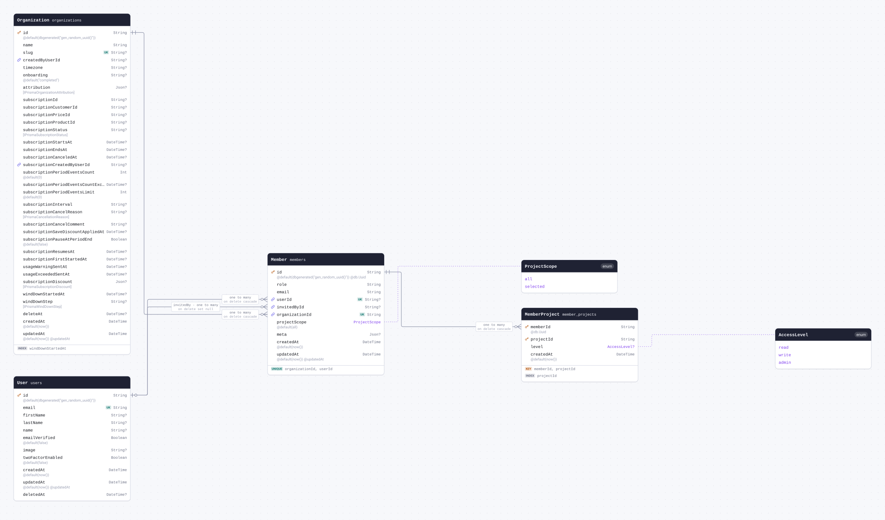

| Field            | Type                                 | Constraints                                       | Default                            | Description |
| ---------------- | ------------------------------------ | ------------------------------------------------- | ---------------------------------- | ----------- |
| `id`             | `String` `@db.Uuid`                  | PK NOT NULL                                       | `dbgenerated("gen_random_uuid()")` |             |
| `role`           | `String`                             | NOT NULL                                          |                                    |             |
| `email`          | `String`                             | NOT NULL                                          |                                    |             |
| `userId`         | `String`                             | NULL → [User.id](#model-User)                     |                                    |             |
| `invitedById`    | `String`                             | NULL → [User.id](#model-User)                     |                                    |             |
| `organizationId` | `String`                             | NOT NULL → [Organization.id](#model-Organization) |                                    |             |
| `projectScope`   | [`ProjectScope`](#enum-ProjectScope) | NOT NULL                                          | `all`                              |             |
| `meta`           | `Json`                               | NULL                                              |                                    |             |
| `createdAt`      | `DateTime`                           | NOT NULL                                          | `now()`                            |             |
| `updatedAt`      | `DateTime`                           | NOT NULL                                          | `now()` `@updatedAt`               |             |

#### Indexes

- `@@unique([organizationId, userId])`

#### References

- `userId` → [User.id](#model-User) (many-to-one, on delete Cascade)
- `invitedById` → [User.id](#model-User) (many-to-one, on delete SetNull)
- `organizationId` → [Organization.id](#model-Organization) (many-to-one, on delete Cascade)

#### Referenced by

- `id` ← [MemberProject.memberId](#model-MemberProject) (one-to-many, on delete Cascade)

#### Definition

```sql
CREATE TABLE "members" (
    "id" UUID NOT NULL DEFAULT gen_random_uuid(),
    "role" TEXT NOT NULL,
    "email" TEXT NOT NULL,
    "userId" TEXT,
    "invitedById" TEXT,
    "organizationId" TEXT NOT NULL,
    "projectScope" "ProjectScope" NOT NULL DEFAULT 'all',
    "meta" JSONB,
    "createdAt" TIMESTAMP(3) NOT NULL DEFAULT CURRENT_TIMESTAMP,
    "updatedAt" TIMESTAMP(3) NOT NULL DEFAULT CURRENT_TIMESTAMP,

    CONSTRAINT "members_pkey" PRIMARY KEY ("id")
);

CREATE UNIQUE INDEX "members_organizationId_userId_key" ON "members"("organizationId", "userId");

ALTER TABLE "members" ADD CONSTRAINT "members_userId_fkey" FOREIGN KEY ("userId") REFERENCES "users"("id") ON DELETE CASCADE ON UPDATE CASCADE;

ALTER TABLE "members" ADD CONSTRAINT "members_invitedById_fkey" FOREIGN KEY ("invitedById") REFERENCES "users"("id") ON DELETE SET NULL ON UPDATE CASCADE;

ALTER TABLE "members" ADD CONSTRAINT "members_organizationId_fkey" FOREIGN KEY ("organizationId") REFERENCES "organizations"("id") ON DELETE CASCADE ON UPDATE CASCADE;
```

<details>
<summary>Queries and their SQL</summary>

**findMany**: Every row

```ts
await prisma.member.findMany();
```

```sql
SELECT
  "public"."members"."id",
  "public"."members"."role",
  "public"."members"."email",
  "public"."members"."userId",
  "public"."members"."invitedById",
  "public"."members"."organizationId",
  "public"."members"."projectScope"::text,
  "public"."members"."meta",
  "public"."members"."createdAt",
  "public"."members"."updatedAt"
FROM
  "public"."members"
WHERE
  1 = 1
OFFSET
  $1
-- params: ["0"]
```

**count**: How many rows there are

```ts
await prisma.member.count();
```

```sql
SELECT
  COUNT(*) AS "_count$_all"
FROM
  (
    SELECT
      "public"."members"."id"
    FROM
      "public"."members"
    WHERE
      1 = 1
    OFFSET
      $1
  ) AS "sub"
-- params: ["0"]
```

**findMany**: Every row with its relations

```ts
await prisma.member.findMany({
  include: { user: true, invitedBy: true, organization: true, projects: true },
});
```

```sql
SELECT
  "public"."members"."id",
  "public"."members"."role",
  "public"."members"."email",
  "public"."members"."userId",
  "public"."members"."invitedById",
  "public"."members"."organizationId",
  "public"."members"."projectScope"::text,
  "public"."members"."meta",
  "public"."members"."createdAt",
  "public"."members"."updatedAt"
FROM
  "public"."members"
WHERE
  1 = 1
OFFSET
  $1
-- params: ["0"]

SELECT
  "public"."users"."id",
  "public"."users"."email",
  "public"."users"."firstName",
  "public"."users"."lastName",
  "public"."users"."name",
  "public"."users"."emailVerified",
  "public"."users"."image",
  "public"."users"."twoFactorEnabled",
  "public"."users"."createdAt",
  "public"."users"."updatedAt",
  "public"."users"."deletedAt"
FROM
  "public"."users"
WHERE
  "public"."users"."id" IN ($1)
OFFSET
  $2
-- params: ["<userId of the rows above>","0"]

SELECT
  "public"."users"."id",
  "public"."users"."email",
  "public"."users"."firstName",
  "public"."users"."lastName",
  "public"."users"."name",
  "public"."users"."emailVerified",
  "public"."users"."image",
  "public"."users"."twoFactorEnabled",
  "public"."users"."createdAt",
  "public"."users"."updatedAt",
  "public"."users"."deletedAt"
FROM
  "public"."users"
WHERE
  "public"."users"."id" IN ($1)
OFFSET
  $2
-- params: ["<invitedById of the rows above>","0"]

SELECT
  "public"."organizations"."id",
  "public"."organizations"."name",
  "public"."organizations"."slug",
  "public"."organizations"."createdByUserId",
  "public"."organizations"."timezone",
  "public"."organizations"."onboarding",
  "public"."organizations"."attribution",
  "public"."organizations"."subscriptionId",
  "public"."organizations"."subscriptionCustomerId",
  "public"."organizations"."subscriptionPriceId",
  "public"."organizations"."subscriptionProductId",
  "public"."organizations"."subscriptionStatus",
  "public"."organizations"."subscriptionStartsAt",
  "public"."organizations"."subscriptionEndsAt",
  "public"."organizations"."subscriptionCanceledAt",
  "public"."organizations"."subscriptionCreatedByUserId",
  "public"."organizations"."subscriptionPeriodEventsCount",
  "public"."organizations"."subscriptionPeriodEventsCountExceededAt",
  "public"."organizations"."subscriptionPeriodEventsLimit",
  "public"."organizations"."subscriptionInterval",
  "public"."organizations"."subscriptionCancelReason",
  "public"."organizations"."subscriptionCancelComment",
  "public"."organizations"."subscriptionSaveDiscountAppliedAt",
  "public"."organizations"."subscriptionPauseAtPeriodEnd",
  "public"."organizations"."subscriptionResumesAt",
  "public"."organizations"."subscriptionFirstStartedAt",
  "public"."organizations"."usageWarningSentAt",
  "public"."organizations"."usageExceededSentAt",
  "public"."organizations"."subscriptionDiscount",
  "public"."organizations"."windDownStartedAt",
  "public"."organizations"."windDownStep",
  "public"."organizations"."deleteAt",
  "public"."organizations"."createdAt",
  "public"."organizations"."updatedAt"
FROM
  "public"."organizations"
WHERE
  "public"."organizations"."id" IN ($1)
OFFSET
  $2
-- params: ["<organizationId of the rows above>","0"]

SELECT
  "public"."member_projects"."memberId",
  "public"."member_projects"."projectId",
  "public"."member_projects"."level"::text,
  "public"."member_projects"."createdAt"
FROM
  "public"."member_projects"
WHERE
  "public"."member_projects"."memberId" IN ($1)
OFFSET
  $2
-- params: ["<id of the rows above>","0"]
```

**findUnique**: One row by what is unique to it

```ts
await prisma.member.findUnique({ where: { id: "example" } });
```

```sql
SELECT
  "public"."members"."id",
  "public"."members"."role",
  "public"."members"."email",
  "public"."members"."userId",
  "public"."members"."invitedById",
  "public"."members"."organizationId",
  "public"."members"."projectScope"::text,
  "public"."members"."meta",
  "public"."members"."createdAt",
  "public"."members"."updatedAt"
FROM
  "public"."members"
WHERE
  (
    "public"."members"."id" = $1
    AND 1 = 1
  )
LIMIT
  $2
OFFSET
  $3
-- params: ["example","1","0"]
```

**create**: Create a row

```ts
await prisma.member.create({
  data: { role: "example", email: "example", organizationId: "example" },
});
```

```sql
INSERT INTO
  "public"."members" (
    "role",
    "email",
    "organizationId",
    "projectScope",
    "createdAt",
    "updatedAt"
  )
VALUES
  (
    $1,
    $2,
    $3,
    CAST($4::text AS "public"."ProjectScope"),
    $5,
    $6
  )
RETURNING
  "public"."members"."id",
  "public"."members"."role",
  "public"."members"."email",
  "public"."members"."userId",
  "public"."members"."invitedById",
  "public"."members"."organizationId",
  "public"."members"."projectScope"::text,
  "public"."members"."meta",
  "public"."members"."createdAt",
  "public"."members"."updatedAt"
-- params: ["example","example","example","all","<now()>","<now()>"]
```

**update**: Update a row

```ts
await prisma.member.update({ where: { id: "example" }, data: { role: "example" } });
```

```sql
UPDATE "public"."members"
SET
  "role" = $1,
  "updatedAt" = $2
WHERE
  (
    "public"."members"."id" = $3
    AND 1 = 1
  )
RETURNING
  "public"."members"."id",
  "public"."members"."role",
  "public"."members"."email",
  "public"."members"."userId",
  "public"."members"."invitedById",
  "public"."members"."organizationId",
  "public"."members"."projectScope"::text,
  "public"."members"."meta",
  "public"."members"."createdAt",
  "public"."members"."updatedAt"
-- params: ["example",{"prisma__type":"generatorCall","prisma__value":{"name":"now","args":[],"returnType":{"type":"DateTime"}}},"example"]
```

**delete**: Delete a row

```ts
await prisma.member.delete({ where: { id: "example" } });
```

```sql
DELETE FROM "public"."members"
WHERE
  (
    "public"."members"."id" = $1
    AND 1 = 1
  )
RETURNING
  "public"."members"."id",
  "public"."members"."role",
  "public"."members"."email",
  "public"."members"."userId",
  "public"."members"."invitedById",
  "public"."members"."organizationId",
  "public"."members"."projectScope"::text,
  "public"."members"."meta",
  "public"."members"."createdAt",
  "public"."members"."updatedAt"
-- params: ["example"]
```

</details>

<a id="model-MemberProject"></a>

### MemberProject

Table `member_projects`.

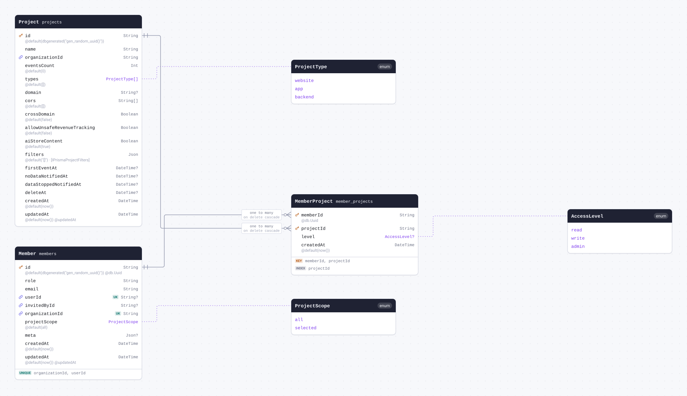

| Field       | Type                               | Constraints                                | Default | Description |
| ----------- | ---------------------------------- | ------------------------------------------ | ------- | ----------- |
| `memberId`  | `String` `@db.Uuid`                | PK NOT NULL → [Member.id](#model-Member)   |         |             |
| `projectId` | `String`                           | PK NOT NULL → [Project.id](#model-Project) |         |             |
| `level`     | [`AccessLevel`](#enum-AccessLevel) | NULL                                       |         |             |
| `createdAt` | `DateTime`                         | NOT NULL                                   | `now()` |             |

#### Indexes

- `@@id([memberId, projectId])`
- `@@index([projectId])`

#### References

- `memberId` → [Member.id](#model-Member) (many-to-one, on delete Cascade)
- `projectId` → [Project.id](#model-Project) (many-to-one, on delete Cascade)

#### Definition

```sql
CREATE TABLE "member_projects" (
    "memberId" UUID NOT NULL,
    "projectId" TEXT NOT NULL,
    "level" "AccessLevel",
    "createdAt" TIMESTAMP(3) NOT NULL DEFAULT CURRENT_TIMESTAMP,

    CONSTRAINT "member_projects_pkey" PRIMARY KEY ("memberId","projectId")
);

CREATE INDEX "member_projects_projectId_idx" ON "member_projects"("projectId");

ALTER TABLE "member_projects" ADD CONSTRAINT "member_projects_memberId_fkey" FOREIGN KEY ("memberId") REFERENCES "members"("id") ON DELETE CASCADE ON UPDATE CASCADE;

ALTER TABLE "member_projects" ADD CONSTRAINT "member_projects_projectId_fkey" FOREIGN KEY ("projectId") REFERENCES "projects"("id") ON DELETE CASCADE ON UPDATE CASCADE;
```

<details>
<summary>Queries and their SQL</summary>

**findMany**: Every row

```ts
await prisma.memberProject.findMany();
```

```sql
SELECT
  "public"."member_projects"."memberId",
  "public"."member_projects"."projectId",
  "public"."member_projects"."level"::text,
  "public"."member_projects"."createdAt"
FROM
  "public"."member_projects"
WHERE
  1 = 1
OFFSET
  $1
-- params: ["0"]
```

**count**: How many rows there are

```ts
await prisma.memberProject.count();
```

```sql
SELECT
  COUNT(*) AS "_count$_all"
FROM
  (
    SELECT
      "public"."member_projects"."memberId",
      "public"."member_projects"."projectId"
    FROM
      "public"."member_projects"
    WHERE
      1 = 1
    OFFSET
      $1
  ) AS "sub"
-- params: ["0"]
```

**findMany**: Every row with its relations

```ts
await prisma.memberProject.findMany({ include: { member: true, project: true } });
```

```sql
SELECT
  "public"."member_projects"."memberId",
  "public"."member_projects"."projectId",
  "public"."member_projects"."level"::text,
  "public"."member_projects"."createdAt"
FROM
  "public"."member_projects"
WHERE
  1 = 1
OFFSET
  $1
-- params: ["0"]

SELECT
  "public"."members"."id",
  "public"."members"."role",
  "public"."members"."email",
  "public"."members"."userId",
  "public"."members"."invitedById",
  "public"."members"."organizationId",
  "public"."members"."projectScope"::text,
  "public"."members"."meta",
  "public"."members"."createdAt",
  "public"."members"."updatedAt"
FROM
  "public"."members"
WHERE
  "public"."members"."id" IN ($1)
OFFSET
  $2
-- params: ["<memberId of the rows above>","0"]

SELECT
  "public"."projects"."id",
  "public"."projects"."name",
  "public"."projects"."organizationId",
  "public"."projects"."eventsCount",
  "public"."projects"."types"::text[],
  "public"."projects"."domain",
  "public"."projects"."cors",
  "public"."projects"."crossDomain",
  "public"."projects"."allowUnsafeRevenueTracking",
  "public"."projects"."aiStoreContent",
  "public"."projects"."filters",
  "public"."projects"."firstEventAt",
  "public"."projects"."noDataNotifiedAt",
  "public"."projects"."dataStoppedNotifiedAt",
  "public"."projects"."deleteAt",
  "public"."projects"."createdAt",
  "public"."projects"."updatedAt"
FROM
  "public"."projects"
WHERE
  "public"."projects"."id" IN ($1)
OFFSET
  $2
-- params: ["<projectId of the rows above>","0"]
```

**findUnique**: One row by what is unique to it

```ts
await prisma.memberProject.findUnique({
  where: { memberId_projectId: { memberId: "example", projectId: "example" } },
});
```

```sql
SELECT
  "public"."member_projects"."memberId",
  "public"."member_projects"."projectId",
  "public"."member_projects"."level"::text,
  "public"."member_projects"."createdAt"
FROM
  "public"."member_projects"
WHERE
  (
    (
      "public"."member_projects"."memberId" = $1
      AND "public"."member_projects"."projectId" = $2
    )
    AND 1 = 1
  )
LIMIT
  $3
OFFSET
  $4
-- params: ["example","example","1","0"]
```

**create**: Create a row

```ts
await prisma.memberProject.create({ data: { memberId: "example", projectId: "example" } });
```

```sql
INSERT INTO
  "public"."member_projects" ("memberId", "projectId", "createdAt")
VALUES
  ($1, $2, $3)
RETURNING
  "public"."member_projects"."memberId",
  "public"."member_projects"."projectId",
  "public"."member_projects"."level"::text,
  "public"."member_projects"."createdAt"
-- params: ["example","example","<now()>"]
```

**update**: Update a row

```ts
await prisma.memberProject.update({
  where: { memberId_projectId: { memberId: "example", projectId: "example" } },
  data: { level: "read" },
});
```

```sql
UPDATE "public"."member_projects"
SET
  "level" = CAST($1::text AS "public"."AccessLevel")
WHERE
  (
    (
      "public"."member_projects"."memberId" = $2
      AND "public"."member_projects"."projectId" = $3
    )
    AND 1 = 1
  )
RETURNING
  "public"."member_projects"."memberId",
  "public"."member_projects"."projectId",
  "public"."member_projects"."level"::text,
  "public"."member_projects"."createdAt"
-- params: ["read","example","example"]
```

**delete**: Delete a row

```ts
await prisma.memberProject.delete({
  where: { memberId_projectId: { memberId: "example", projectId: "example" } },
});
```

```sql
DELETE FROM "public"."member_projects"
WHERE
  (
    (
      "public"."member_projects"."memberId" = $1
      AND "public"."member_projects"."projectId" = $2
    )
    AND 1 = 1
  )
RETURNING
  "public"."member_projects"."memberId",
  "public"."member_projects"."projectId",
  "public"."member_projects"."level"::text,
  "public"."member_projects"."createdAt"
-- params: ["example","example"]
```

</details>

<a id="model-Invite"></a>

### Invite

Table `invites`.

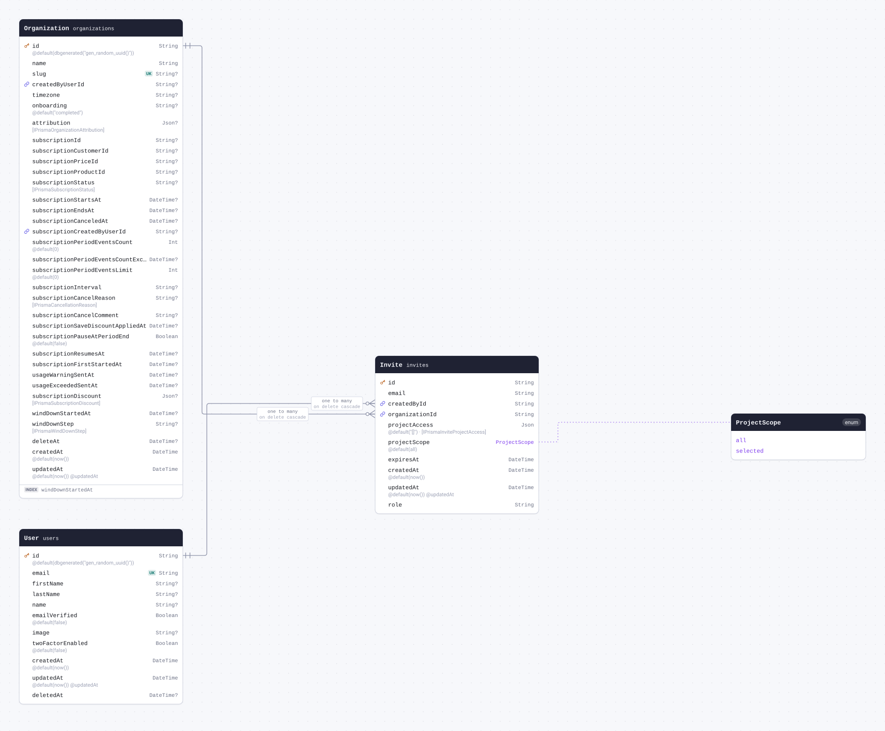

| Field            | Type                                 | Constraints                                       | Default              | Description                  |
| ---------------- | ------------------------------------ | ------------------------------------------------- | -------------------- | ---------------------------- |
| `id`             | `String`                             | PK NOT NULL                                       |                      |                              |
| `email`          | `String`                             | NOT NULL                                          |                      |                              |
| `createdById`    | `String`                             | NOT NULL → [User.id](#model-User)                 |                      |                              |
| `organizationId` | `String`                             | NOT NULL → [Organization.id](#model-Organization) |                      |                              |
| `projectAccess`  | `Json`                               | NOT NULL                                          | `"[]"`               | [IPrismaInviteProjectAccess] |
| `projectScope`   | [`ProjectScope`](#enum-ProjectScope) | NOT NULL                                          | `all`                |                              |
| `expiresAt`      | `DateTime`                           | NOT NULL                                          |                      |                              |
| `createdAt`      | `DateTime`                           | NOT NULL                                          | `now()`              |                              |
| `updatedAt`      | `DateTime`                           | NOT NULL                                          | `now()` `@updatedAt` |                              |
| `role`           | `String`                             | NOT NULL                                          |                      |                              |

#### References

- `createdById` → [User.id](#model-User) (many-to-one, on delete Cascade)
- `organizationId` → [Organization.id](#model-Organization) (many-to-one, on delete Cascade)

#### Definition

```sql
CREATE TABLE "invites" (
    "id" TEXT NOT NULL,
    "email" TEXT NOT NULL,
    "createdById" TEXT NOT NULL,
    "organizationId" TEXT NOT NULL,
    "projectAccess" JSONB NOT NULL DEFAULT '[]',
    "projectScope" "ProjectScope" NOT NULL DEFAULT 'all',
    "expiresAt" TIMESTAMP(3) NOT NULL,
    "createdAt" TIMESTAMP(3) NOT NULL DEFAULT CURRENT_TIMESTAMP,
    "updatedAt" TIMESTAMP(3) NOT NULL DEFAULT CURRENT_TIMESTAMP,
    "role" TEXT NOT NULL,

    CONSTRAINT "invites_pkey" PRIMARY KEY ("id")
);

ALTER TABLE "invites" ADD CONSTRAINT "invites_createdById_fkey" FOREIGN KEY ("createdById") REFERENCES "users"("id") ON DELETE CASCADE ON UPDATE CASCADE;

ALTER TABLE "invites" ADD CONSTRAINT "invites_organizationId_fkey" FOREIGN KEY ("organizationId") REFERENCES "organizations"("id") ON DELETE CASCADE ON UPDATE CASCADE;
```

<details>
<summary>Queries and their SQL</summary>

**findMany**: Every row

```ts
await prisma.invite.findMany();
```

```sql
SELECT
  "public"."invites"."id",
  "public"."invites"."email",
  "public"."invites"."createdById",
  "public"."invites"."organizationId",
  "public"."invites"."projectAccess",
  "public"."invites"."projectScope"::text,
  "public"."invites"."expiresAt",
  "public"."invites"."createdAt",
  "public"."invites"."updatedAt",
  "public"."invites"."role"
FROM
  "public"."invites"
WHERE
  1 = 1
OFFSET
  $1
-- params: ["0"]
```

**count**: How many rows there are

```ts
await prisma.invite.count();
```

```sql
SELECT
  COUNT(*) AS "_count$_all"
FROM
  (
    SELECT
      "public"."invites"."id"
    FROM
      "public"."invites"
    WHERE
      1 = 1
    OFFSET
      $1
  ) AS "sub"
-- params: ["0"]
```

**findMany**: Every row with its relations

```ts
await prisma.invite.findMany({ include: { createdBy: true, organization: true } });
```

```sql
SELECT
  "public"."invites"."id",
  "public"."invites"."email",
  "public"."invites"."createdById",
  "public"."invites"."organizationId",
  "public"."invites"."projectAccess",
  "public"."invites"."projectScope"::text,
  "public"."invites"."expiresAt",
  "public"."invites"."createdAt",
  "public"."invites"."updatedAt",
  "public"."invites"."role"
FROM
  "public"."invites"
WHERE
  1 = 1
OFFSET
  $1
-- params: ["0"]

SELECT
  "public"."users"."id",
  "public"."users"."email",
  "public"."users"."firstName",
  "public"."users"."lastName",
  "public"."users"."name",
  "public"."users"."emailVerified",
  "public"."users"."image",
  "public"."users"."twoFactorEnabled",
  "public"."users"."createdAt",
  "public"."users"."updatedAt",
  "public"."users"."deletedAt"
FROM
  "public"."users"
WHERE
  "public"."users"."id" IN ($1)
OFFSET
  $2
-- params: ["<createdById of the rows above>","0"]

SELECT
  "public"."organizations"."id",
  "public"."organizations"."name",
  "public"."organizations"."slug",
  "public"."organizations"."createdByUserId",
  "public"."organizations"."timezone",
  "public"."organizations"."onboarding",
  "public"."organizations"."attribution",
  "public"."organizations"."subscriptionId",
  "public"."organizations"."subscriptionCustomerId",
  "public"."organizations"."subscriptionPriceId",
  "public"."organizations"."subscriptionProductId",
  "public"."organizations"."subscriptionStatus",
  "public"."organizations"."subscriptionStartsAt",
  "public"."organizations"."subscriptionEndsAt",
  "public"."organizations"."subscriptionCanceledAt",
  "public"."organizations"."subscriptionCreatedByUserId",
  "public"."organizations"."subscriptionPeriodEventsCount",
  "public"."organizations"."subscriptionPeriodEventsCountExceededAt",
  "public"."organizations"."subscriptionPeriodEventsLimit",
  "public"."organizations"."subscriptionInterval",
  "public"."organizations"."subscriptionCancelReason",
  "public"."organizations"."subscriptionCancelComment",
  "public"."organizations"."subscriptionSaveDiscountAppliedAt",
  "public"."organizations"."subscriptionPauseAtPeriodEnd",
  "public"."organizations"."subscriptionResumesAt",
  "public"."organizations"."subscriptionFirstStartedAt",
  "public"."organizations"."usageWarningSentAt",
  "public"."organizations"."usageExceededSentAt",
  "public"."organizations"."subscriptionDiscount",
  "public"."organizations"."windDownStartedAt",
  "public"."organizations"."windDownStep",
  "public"."organizations"."deleteAt",
  "public"."organizations"."createdAt",
  "public"."organizations"."updatedAt"
FROM
  "public"."organizations"
WHERE
  "public"."organizations"."id" IN ($1)
OFFSET
  $2
-- params: ["<organizationId of the rows above>","0"]
```

**findUnique**: One row by what is unique to it

```ts
await prisma.invite.findUnique({ where: { id: "example" } });
```

```sql
SELECT
  "public"."invites"."id",
  "public"."invites"."email",
  "public"."invites"."createdById",
  "public"."invites"."organizationId",
  "public"."invites"."projectAccess",
  "public"."invites"."projectScope"::text,
  "public"."invites"."expiresAt",
  "public"."invites"."createdAt",
  "public"."invites"."updatedAt",
  "public"."invites"."role"
FROM
  "public"."invites"
WHERE
  (
    "public"."invites"."id" = $1
    AND 1 = 1
  )
LIMIT
  $2
OFFSET
  $3
-- params: ["example","1","0"]
```

**create**: Create a row

```ts
await prisma.invite.create({
  data: {
    id: "example",
    email: "example",
    createdById: "example",
    organizationId: "example",
    expiresAt: new Date("2026-01-01T00:00:00.000Z"),
    role: "example",
  },
});
```

```sql
INSERT INTO
  "public"."invites" (
    "id",
    "email",
    "createdById",
    "organizationId",
    "projectAccess",
    "projectScope",
    "expiresAt",
    "createdAt",
    "updatedAt",
    "role"
  )
VALUES
  (
    $1,
    $2,
    $3,
    $4,
    $5,
    CAST($6::text AS "public"."ProjectScope"),
    $7,
    $8,
    $9,
    $10
  )
RETURNING
  "public"."invites"."id",
  "public"."invites"."email",
  "public"."invites"."createdById",
  "public"."invites"."organizationId",
  "public"."invites"."projectAccess",
  "public"."invites"."projectScope"::text,
  "public"."invites"."expiresAt",
  "public"."invites"."createdAt",
  "public"."invites"."updatedAt",
  "public"."invites"."role"
-- params: ["example","example","example","example","[]","all","2026-01-01T00:00:00.000Z","<now()>","<now()>","example"]
```

**update**: Update a row

```ts
await prisma.invite.update({ where: { id: "example" }, data: { email: "example" } });
```

```sql
UPDATE "public"."invites"
SET
  "email" = $1,
  "updatedAt" = $2
WHERE
  (
    "public"."invites"."id" = $3
    AND 1 = 1
  )
RETURNING
  "public"."invites"."id",
  "public"."invites"."email",
  "public"."invites"."createdById",
  "public"."invites"."organizationId",
  "public"."invites"."projectAccess",
  "public"."invites"."projectScope"::text,
  "public"."invites"."expiresAt",
  "public"."invites"."createdAt",
  "public"."invites"."updatedAt",
  "public"."invites"."role"
-- params: ["example",{"prisma__type":"generatorCall","prisma__value":{"name":"now","args":[],"returnType":{"type":"DateTime"}}},"example"]
```

**delete**: Delete a row

```ts
await prisma.invite.delete({ where: { id: "example" } });
```

```sql
DELETE FROM "public"."invites"
WHERE
  (
    "public"."invites"."id" = $1
    AND 1 = 1
  )
RETURNING
  "public"."invites"."id",
  "public"."invites"."email",
  "public"."invites"."createdById",
  "public"."invites"."organizationId",
  "public"."invites"."projectAccess",
  "public"."invites"."projectScope"::text,
  "public"."invites"."expiresAt",
  "public"."invites"."createdAt",
  "public"."invites"."updatedAt",
  "public"."invites"."role"
-- params: ["example"]
```

</details>

<a id="model-Project"></a>

### Project

Table `projects`.

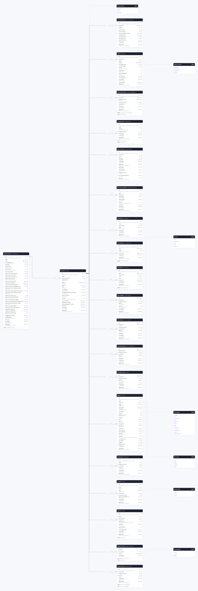

| Field                        | Type                                 | Constraints                                       | Default                            | Description             |
| ---------------------------- | ------------------------------------ | ------------------------------------------------- | ---------------------------------- | ----------------------- |
| `id`                         | `String`                             | PK NOT NULL                                       | `dbgenerated("gen_random_uuid()")` |                         |
| `name`                       | `String`                             | NOT NULL                                          |                                    |                         |
| `organizationId`             | `String`                             | NOT NULL → [Organization.id](#model-Organization) |                                    |                         |
| `eventsCount`                | `Int`                                | NOT NULL                                          | `0`                                |                         |
| `types`                      | [`ProjectType[]`](#enum-ProjectType) | NOT NULL                                          | `[]`                               |                         |
| `domain`                     | `String`                             | NULL                                              |                                    |                         |
| `cors`                       | `String[]`                           | NOT NULL                                          | `[]`                               |                         |
| `crossDomain`                | `Boolean`                            | NOT NULL                                          | `false`                            |                         |
| `allowUnsafeRevenueTracking` | `Boolean`                            | NOT NULL                                          | `false`                            |                         |
| `aiStoreContent`             | `Boolean`                            | NOT NULL                                          | `true`                             |                         |
| `filters`                    | `Json`                               | NOT NULL                                          | `"[]"`                             | [IPrismaProjectFilters] |
| `firstEventAt`               | `DateTime`                           | NULL                                              |                                    |                         |
| `noDataNotifiedAt`           | `DateTime`                           | NULL                                              |                                    |                         |
| `dataStoppedNotifiedAt`      | `DateTime`                           | NULL                                              |                                    |                         |
| `deleteAt`                   | `DateTime`                           | NULL                                              |                                    |                         |
| `createdAt`                  | `DateTime`                           | NOT NULL                                          | `now()`                            |                         |
| `updatedAt`                  | `DateTime`                           | NOT NULL                                          | `now()` `@updatedAt`               |                         |

#### References

- `organizationId` → [Organization.id](#model-Organization) (many-to-one, on delete Cascade)

#### Referenced by

- `id` ← [Conversation.projectId](#model-Conversation) (one-to-many, on delete Cascade)
- `id` ← [MemberProject.projectId](#model-MemberProject) (one-to-many, on delete Cascade)
- `id` ← [Cohort.projectId](#model-Cohort) (one-to-many, on delete Cascade)
- `id` ← [Client.projectId](#model-Client) (one-to-many, on delete Cascade)
- `id` ← [Dashboard.projectId](#model-Dashboard) (one-to-many, on delete Cascade)
- `id` ← [Report.projectId](#model-Report) (one-to-many, on delete Cascade)
- `id` ← [ShareOverview.projectId](#model-ShareOverview) (one-to-one, on delete Cascade)
- `id` ← [ShareDashboard.projectId](#model-ShareDashboard) (one-to-many, on delete Cascade)
- `id` ← [ShareReport.projectId](#model-ShareReport) (one-to-many, on delete Cascade)
- `id` ← [ShareWidget.projectId](#model-ShareWidget) (one-to-many, on delete Cascade)
- `id` ← [EventMeta.projectId](#model-EventMeta) (one-to-many, on delete Cascade)
- `id` ← [CustomEvent.projectId](#model-CustomEvent) (one-to-many, on delete Cascade)
- `id` ← [Reference.projectId](#model-Reference) (one-to-many, on delete Cascade)
- `id` ← [NotificationRule.projectId](#model-NotificationRule) (one-to-many, on delete Cascade)
- `id` ← [Notification.projectId](#model-Notification) (one-to-many, on delete Cascade)
- `id` ← [Integration.projectId](#model-Integration) (one-to-many, on delete Cascade)
- `id` ← [ExportWatermark.projectId](#model-ExportWatermark) (one-to-many, on delete Cascade)
- `id` ← [Import.projectId](#model-Import) (one-to-many, on delete Cascade)
- `id` ← [GscConnection.projectId](#model-GscConnection) (one-to-one, on delete Cascade)

#### Definition

```sql
CREATE TABLE "projects" (
    "id" TEXT NOT NULL DEFAULT gen_random_uuid(),
    "name" TEXT NOT NULL,
    "organizationId" TEXT NOT NULL,
    "eventsCount" INTEGER NOT NULL DEFAULT 0,
    "types" "ProjectType"[] DEFAULT ARRAY[]::"ProjectType"[],
    "domain" TEXT,
    "cors" TEXT[] DEFAULT ARRAY[]::TEXT[],
    "crossDomain" BOOLEAN NOT NULL DEFAULT false,
    "allowUnsafeRevenueTracking" BOOLEAN NOT NULL DEFAULT false,
    "aiStoreContent" BOOLEAN NOT NULL DEFAULT true,
    "filters" JSONB NOT NULL DEFAULT '[]',
    "firstEventAt" TIMESTAMP(3),
    "noDataNotifiedAt" TIMESTAMP(3),
    "dataStoppedNotifiedAt" TIMESTAMP(3),
    "deleteAt" TIMESTAMP(3),
    "createdAt" TIMESTAMP(3) NOT NULL DEFAULT CURRENT_TIMESTAMP,
    "updatedAt" TIMESTAMP(3) NOT NULL DEFAULT CURRENT_TIMESTAMP,

    CONSTRAINT "projects_pkey" PRIMARY KEY ("id")
);

ALTER TABLE "projects" ADD CONSTRAINT "projects_organizationId_fkey" FOREIGN KEY ("organizationId") REFERENCES "organizations"("id") ON DELETE CASCADE ON UPDATE CASCADE;
```

<details>
<summary>Queries and their SQL</summary>

**findMany**: Every row

```ts
await prisma.project.findMany();
```

```sql
SELECT
  "public"."projects"."id",
  "public"."projects"."name",
  "public"."projects"."organizationId",
  "public"."projects"."eventsCount",
  "public"."projects"."types"::text[],
  "public"."projects"."domain",
  "public"."projects"."cors",
  "public"."projects"."crossDomain",
  "public"."projects"."allowUnsafeRevenueTracking",
  "public"."projects"."aiStoreContent",
  "public"."projects"."filters",
  "public"."projects"."firstEventAt",
  "public"."projects"."noDataNotifiedAt",
  "public"."projects"."dataStoppedNotifiedAt",
  "public"."projects"."deleteAt",
  "public"."projects"."createdAt",
  "public"."projects"."updatedAt"
FROM
  "public"."projects"
WHERE
  1 = 1
OFFSET
  $1
-- params: ["0"]
```

**count**: How many rows there are

```ts
await prisma.project.count();
```

```sql
SELECT
  COUNT(*) AS "_count$_all"
FROM
  (
    SELECT
      "public"."projects"."id"
    FROM
      "public"."projects"
    WHERE
      1 = 1
    OFFSET
      $1
  ) AS "sub"
-- params: ["0"]
```

**findMany**: Every row with its relations

```ts
await prisma.project.findMany({
  include: {
    organization: true,
    clients: true,
    reports: true,
    dashboards: true,
    share: true,
    shareDashboards: true,
    shareReports: true,
    shareWidgets: true,
    meta: true,
    customEvents: true,
    references: true,
    memberProjects: true,
    notificationRules: true,
    notifications: true,
    imports: true,
    gscConnection: true,
    cohorts: true,
    exportWatermarks: true,
    integrations: true,
    conversations: true,
  },
});
```

```sql
SELECT
  "public"."projects"."id",
  "public"."projects"."name",
  "public"."projects"."organizationId",
  "public"."projects"."eventsCount",
  "public"."projects"."types"::text[],
  "public"."projects"."domain",
  "public"."projects"."cors",
  "public"."projects"."crossDomain",
  "public"."projects"."allowUnsafeRevenueTracking",
  "public"."projects"."aiStoreContent",
  "public"."projects"."filters",
  "public"."projects"."firstEventAt",
  "public"."projects"."noDataNotifiedAt",
  "public"."projects"."dataStoppedNotifiedAt",
  "public"."projects"."deleteAt",
  "public"."projects"."createdAt",
  "public"."projects"."updatedAt"
FROM
  "public"."projects"
WHERE
  1 = 1
OFFSET
  $1
-- params: ["0"]

SELECT
  "public"."organizations"."id",
  "public"."organizations"."name",
  "public"."organizations"."slug",
  "public"."organizations"."createdByUserId",
  "public"."organizations"."timezone",
  "public"."organizations"."onboarding",
  "public"."organizations"."attribution",
  "public"."organizations"."subscriptionId",
  "public"."organizations"."subscriptionCustomerId",
  "public"."organizations"."subscriptionPriceId",
  "public"."organizations"."subscriptionProductId",
  "public"."organizations"."subscriptionStatus",
  "public"."organizations"."subscriptionStartsAt",
  "public"."organizations"."subscriptionEndsAt",
  "public"."organizations"."subscriptionCanceledAt",
  "public"."organizations"."subscriptionCreatedByUserId",
  "public"."organizations"."subscriptionPeriodEventsCount",
  "public"."organizations"."subscriptionPeriodEventsCountExceededAt",
  "public"."organizations"."subscriptionPeriodEventsLimit",
  "public"."organizations"."subscriptionInterval",
  "public"."organizations"."subscriptionCancelReason",
  "public"."organizations"."subscriptionCancelComment",
  "public"."organizations"."subscriptionSaveDiscountAppliedAt",
  "public"."organizations"."subscriptionPauseAtPeriodEnd",
  "public"."organizations"."subscriptionResumesAt",
  "public"."organizations"."subscriptionFirstStartedAt",
  "public"."organizations"."usageWarningSentAt",
  "public"."organizations"."usageExceededSentAt",
  "public"."organizations"."subscriptionDiscount",
  "public"."organizations"."windDownStartedAt",
  "public"."organizations"."windDownStep",
  "public"."organizations"."deleteAt",
  "public"."organizations"."createdAt",
  "public"."organizations"."updatedAt"
FROM
  "public"."organizations"
WHERE
  "public"."organizations"."id" IN ($1)
OFFSET
  $2
-- params: ["<organizationId of the rows above>","0"]

SELECT
  "public"."clients"."id",
  "public"."clients"."name",
  "public"."clients"."secret",
  "public"."clients"."type"::text,
  "public"."clients"."projectId",
  "public"."clients"."organizationId",
  "public"."clients"."ignoreCorsAndSecret",
  "public"."clients"."createdAt",
  "public"."clients"."updatedAt"
FROM
  "public"."clients"
WHERE
  "public"."clients"."projectId" IN ($1)
OFFSET
  $2
-- params: ["<id of the rows above>","0"]

SELECT
  "public"."reports"."id",
  "public"."reports"."name",
  "public"."reports"."interval"::text,
  "public"."reports"."range",
  "public"."reports"."chartType"::text,
  "public"."reports"."lineType",
  "public"."reports"."breakdowns",
  "public"."reports"."events",
  "public"."reports"."globalFilters",
  "public"."reports"."formula",
  "public"."reports"."unit",
  "public"."reports"."metric"::text,
  "public"."reports"."projectId",
  "public"."reports"."previous",
  "public"."reports"."criteria",
  "public"."reports"."funnelGroup",
  "public"."reports"."funnelWindow",
  "public"."reports"."options",
  "public"."reports"."display",
  "public"."reports"."visibleSeries",
  "public"."reports"."startDate",
  "public"."reports"."endDate",
  "public"."reports"."dashboardId",
  "public"."reports"."createdAt",
  "public"."reports"."updatedAt"
FROM
  "public"."reports"
WHERE
  "public"."reports"."projectId" IN ($1)
OFFSET
  $2
-- params: ["<id of the rows above>","0"]

SELECT
  "public"."dashboards"."id",
  "public"."dashboards"."name",
  "public"."dashboards"."organizationId",
  "public"."dashboards"."projectId",
  "public"."dashboards"."filters",
  "public"."dashboards"."createdAt",
  "public"."dashboards"."updatedAt"
FROM
  "public"."dashboards"
WHERE
  "public"."dashboards"."projectId" IN ($1)
OFFSET
  $2
-- params: ["<id of the rows above>","0"]

SELECT
  "public"."shares"."id",
  "public"."shares"."projectId",
  "public"."shares"."organizationId",
  "public"."shares"."public",
  "public"."shares"."password",
  "public"."shares"."createdAt",
  "public"."shares"."updatedAt"
FROM
  "public"."shares"
WHERE
  "public"."shares"."projectId" IN ($1)
OFFSET
  $2
-- params: ["<id of the rows above>","0"]

SELECT
  "public"."share_dashboards"."id",
  "public"."share_dashboards"."dashboardId",
  "public"."share_dashboards"."organizationId",
  "public"."share_dashboards"."projectId",
  "public"."share_dashboards"."public",
  "public"."share_dashboards"."password",
  "public"."share_dashboards"."createdAt",
  "public"."share_dashboards"."updatedAt"
FROM
  "public"."share_dashboards"
WHERE
  "public"."share_dashboards"."projectId" IN ($1)
OFFSET
  $2
-- params: ["<id of the rows above>","0"]

SELECT
  "public"."share_reports"."id",
  "public"."share_reports"."reportId",
  "public"."share_reports"."organizationId",
  "public"."share_reports"."projectId",
  "public"."share_reports"."public",
  "public"."share_reports"."password",
  "public"."share_reports"."createdAt",
  "public"."share_reports"."updatedAt"
FROM
  "public"."share_reports"
WHERE
  "public"."share_reports"."projectId" IN ($1)
OFFSET
  $2
-- params: ["<id of the rows above>","0"]

SELECT
  "public"."share_widgets"."id",
  "public"."share_widgets"."projectId",
  "public"."share_widgets"."organizationId",
  "public"."share_widgets"."public",
  "public"."share_widgets"."options",
  "public"."share_widgets"."createdAt",
  "public"."share_widgets"."updatedAt"
FROM
  "public"."share_widgets"
WHERE
  "public"."share_widgets"."projectId" IN ($1)
OFFSET
  $2
-- params: ["<id of the rows above>","0"]

SELECT
  "public"."event_meta"."id",
  "public"."event_meta"."name",
  "public"."event_meta"."conversion",
  "public"."event_meta"."color",
  "public"."event_meta"."icon",
  "public"."event_meta"."projectId",
  "public"."event_meta"."createdAt",
  "public"."event_meta"."updatedAt"
FROM
  "public"."event_meta"
WHERE
  "public"."event_meta"."projectId" IN ($1)
OFFSET
  $2
-- params: ["<id of the rows above>","0"]

SELECT
  "public"."custom_events"."id",
  "public"."custom_events"."name",
  "public"."custom_events"."items",
  "public"."custom_events"."projectId",
  "public"."custom_events"."createdAt",
  "public"."custom_events"."updatedAt"
FROM
  "public"."custom_events"
WHERE
  "public"."custom_events"."projectId" IN ($1)
OFFSET
  $2
-- params: ["<id of the rows above>","0"]

SELECT
  "public"."references"."id",
  "public"."references"."title",
  "public"."references"."description",
  "public"."references"."date",
  "public"."references"."projectId",
  "public"."references"."createdAt",
  "public"."references"."updatedAt"
FROM
  "public"."references"
WHERE
  "public"."references"."projectId" IN ($1)
OFFSET
  $2
-- params: ["<id of the rows above>","0"]

SELECT
  "public"."member_projects"."memberId",
  "public"."member_projects"."projectId",
  "public"."member_projects"."level"::text,
  "public"."member_projects"."createdAt"
FROM
  "public"."member_projects"
WHERE
  "public"."member_projects"."projectId" IN ($1)
OFFSET
  $2
-- params: ["<id of the rows above>","0"]

SELECT
  "public"."notification_rules"."id",
  "public"."notification_rules"."name",
  "public"."notification_rules"."projectId",
  "public"."notification_rules"."sendToApp",
  "public"."notification_rules"."sendToEmail",
  "public"."notification_rules"."config",
  "public"."notification_rules"."template",
  "public"."notification_rules"."createdAt",
  "public"."notification_rules"."updatedAt"
FROM
  "public"."notification_rules"
WHERE
  "public"."notification_rules"."projectId" IN ($1)
OFFSET
  $2
-- params: ["<id of the rows above>","0"]

SELECT
  "public"."notifications"."id",
  "public"."notifications"."projectId",
  "public"."notifications"."title",
  "public"."notifications"."message",
  "public"."notifications"."isReadAt",
  "public"."notifications"."createdAt",
  "public"."notifications"."updatedAt",
  "public"."notifications"."sendToApp",
  "public"."notifications"."sendToEmail",
  "public"."notifications"."integrationId",
  "public"."notifications"."notificationRuleId",
  "public"."notifications"."payload"
FROM
  "public"."notifications"
WHERE
  "public"."notifications"."projectId" IN ($1)
OFFSET
  $2
-- params: ["<id of the rows above>","0"]

SELECT
  "public"."imports"."id",
  "public"."imports"."projectId",
  "public"."imports"."jobId",
  "public"."imports"."status"::text,
  "public"."imports"."statusMessage",
  "public"."imports"."errorMessage",
  "public"."imports"."config",
  "public"."imports"."totalEvents",
  "public"."imports"."processedEvents",
  "public"."imports"."currentStep",
  "public"."imports"."currentBatch",
  "public"."imports"."createdAt",
  "public"."imports"."completedAt",
  "public"."imports"."updatedAt"
FROM
  "public"."imports"
WHERE
  "public"."imports"."projectId" IN ($1)
OFFSET
  $2
-- params: ["<id of the rows above>","0"]

SELECT
  "public"."gsc_connections"."id",
  "public"."gsc_connections"."projectId",
  "public"."gsc_connections"."siteUrl",
  "public"."gsc_connections"."accessToken",
  "public"."gsc_connections"."refreshToken",
  "public"."gsc_connections"."accessTokenExpiresAt",
  "public"."gsc_connections"."lastSyncedAt",
  "public"."gsc_connections"."lastSyncStatus",
  "public"."gsc_connections"."lastSyncError",
  "public"."gsc_connections"."backfillStatus",
  "public"."gsc_connections"."createdAt",
  "public"."gsc_connections"."updatedAt"
FROM
  "public"."gsc_connections"
WHERE
  "public"."gsc_connections"."projectId" IN ($1)
OFFSET
  $2
-- params: ["<id of the rows above>","0"]

SELECT
  "public"."cohorts"."id",
  "public"."cohorts"."name",
  "public"."cohorts"."description",
  "public"."cohorts"."projectId",
  "public"."cohorts"."definition",
  "public"."cohorts"."isStatic",
  "public"."cohorts"."profileCount",
  "public"."cohorts"."lastComputedAt",
  "public"."cohorts"."createdAt",
  "public"."cohorts"."updatedAt"
FROM
  "public"."cohorts"
WHERE
  "public"."cohorts"."projectId" IN ($1)
OFFSET
  $2
-- params: ["<id of the rows above>","0"]

SELECT
  "public"."export_watermarks"."id",
  "public"."export_watermarks"."projectId",
  "public"."export_watermarks"."integrationId",
  "public"."export_watermarks"."lastInsertedAt",
  "public"."export_watermarks"."lastEventId",
  "public"."export_watermarks"."createdAt",
  "public"."export_watermarks"."updatedAt"
FROM
  "public"."export_watermarks"
WHERE
  "public"."export_watermarks"."projectId" IN ($1)
OFFSET
  $2
-- params: ["<id of the rows above>","0"]

SELECT
  "public"."integrations"."id",
  "public"."integrations"."name",
  "public"."integrations"."config",
  "public"."integrations"."organizationId",
  "public"."integrations"."projectId",
  "public"."integrations"."createdAt",
  "public"."integrations"."updatedAt"
FROM
  "public"."integrations"
WHERE
  "public"."integrations"."projectId" IN ($1)
OFFSET
  $2
-- params: ["<id of the rows above>","0"]

SELECT
  "public"."conversations"."id",
  "public"."conversations"."projectId",
  "public"."conversations"."organizationId",
  "public"."conversations"."userId",
  "public"."conversations"."title",
  "public"."conversations"."createdAt",
  "public"."conversations"."updatedAt"
FROM
  "public"."conversations"
WHERE
  "public"."conversations"."projectId" IN ($1)
OFFSET
  $2
-- params: ["<id of the rows above>","0"]
```

**findUnique**: One row by what is unique to it

```ts
await prisma.project.findUnique({ where: { id: "example" } });
```

```sql
SELECT
  "public"."projects"."id",
  "public"."projects"."name",
  "public"."projects"."organizationId",
  "public"."projects"."eventsCount",
  "public"."projects"."types"::text[],
  "public"."projects"."domain",
  "public"."projects"."cors",
  "public"."projects"."crossDomain",
  "public"."projects"."allowUnsafeRevenueTracking",
  "public"."projects"."aiStoreContent",
  "public"."projects"."filters",
  "public"."projects"."firstEventAt",
  "public"."projects"."noDataNotifiedAt",
  "public"."projects"."dataStoppedNotifiedAt",
  "public"."projects"."deleteAt",
  "public"."projects"."createdAt",
  "public"."projects"."updatedAt"
FROM
  "public"."projects"
WHERE
  (
    "public"."projects"."id" = $1
    AND 1 = 1
  )
LIMIT
  $2
OFFSET
  $3
-- params: ["example","1","0"]
```

**create**: Create a row

```ts
await prisma.project.create({ data: { name: "example", organizationId: "example" } });
```

```sql
INSERT INTO
  "public"."projects" (
    "name",
    "organizationId",
    "eventsCount",
    "types",
    "cors",
    "crossDomain",
    "allowUnsafeRevenueTracking",
    "aiStoreContent",
    "filters",
    "createdAt",
    "updatedAt"
  )
VALUES
  (
    $1,
    $2,
    $3,
    CAST($4::text[] AS "public"."ProjectType" []),
    $5,
    $6,
    $7,
    $8,
    $9,
    $10,
    $11
  )
RETURNING
  "public"."projects"."id",
  "public"."projects"."name",
  "public"."projects"."organizationId",
  "public"."projects"."eventsCount",
  "public"."projects"."types"::text[],
  "public"."projects"."domain",
  "public"."projects"."cors",
  "public"."projects"."crossDomain",
  "public"."projects"."allowUnsafeRevenueTracking",
  "public"."projects"."aiStoreContent",
  "public"."projects"."filters",
  "public"."projects"."firstEventAt",
  "public"."projects"."noDataNotifiedAt",
  "public"."projects"."dataStoppedNotifiedAt",
  "public"."projects"."deleteAt",
  "public"."projects"."createdAt",
  "public"."projects"."updatedAt"
-- params: ["example","example","0",[],[],false,false,true,"[]","<now()>","<now()>"]
```

**update**: Update a row

```ts
await prisma.project.update({ where: { id: "example" }, data: { name: "example" } });
```

```sql
UPDATE "public"."projects"
SET
  "name" = $1,
  "updatedAt" = $2
WHERE
  (
    "public"."projects"."id" = $3
    AND 1 = 1
  )
RETURNING
  "public"."projects"."id",
  "public"."projects"."name",
  "public"."projects"."organizationId",
  "public"."projects"."eventsCount",
  "public"."projects"."types"::text[],
  "public"."projects"."domain",
  "public"."projects"."cors",
  "public"."projects"."crossDomain",
  "public"."projects"."allowUnsafeRevenueTracking",
  "public"."projects"."aiStoreContent",
  "public"."projects"."filters",
  "public"."projects"."firstEventAt",
  "public"."projects"."noDataNotifiedAt",
  "public"."projects"."dataStoppedNotifiedAt",
  "public"."projects"."deleteAt",
  "public"."projects"."createdAt",
  "public"."projects"."updatedAt"
-- params: ["example",{"prisma__type":"generatorCall","prisma__value":{"name":"now","args":[],"returnType":{"type":"DateTime"}}},"example"]
```

**delete**: Delete a row

```ts
await prisma.project.delete({ where: { id: "example" } });
```

```sql
DELETE FROM "public"."projects"
WHERE
  (
    "public"."projects"."id" = $1
    AND 1 = 1
  )
RETURNING
  "public"."projects"."id",
  "public"."projects"."name",
  "public"."projects"."organizationId",
  "public"."projects"."eventsCount",
  "public"."projects"."types"::text[],
  "public"."projects"."domain",
  "public"."projects"."cors",
  "public"."projects"."crossDomain",
  "public"."projects"."allowUnsafeRevenueTracking",
  "public"."projects"."aiStoreContent",
  "public"."projects"."filters",
  "public"."projects"."firstEventAt",
  "public"."projects"."noDataNotifiedAt",
  "public"."projects"."dataStoppedNotifiedAt",
  "public"."projects"."deleteAt",
  "public"."projects"."createdAt",
  "public"."projects"."updatedAt"
-- params: ["example"]
```

</details>

<a id="model-Cohort"></a>

### Cohort

Table `cohorts`.

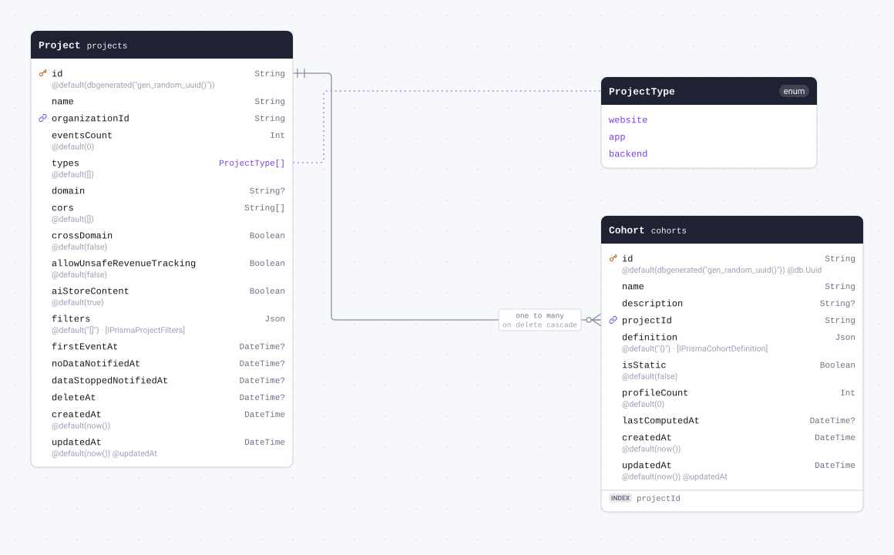

| Field            | Type                | Constraints                             | Default                            | Description               |
| ---------------- | ------------------- | --------------------------------------- | ---------------------------------- | ------------------------- |
| `id`             | `String` `@db.Uuid` | PK NOT NULL                             | `dbgenerated("gen_random_uuid()")` |                           |
| `name`           | `String`            | NOT NULL                                |                                    |                           |
| `description`    | `String`            | NULL                                    |                                    |                           |
| `projectId`      | `String`            | NOT NULL → [Project.id](#model-Project) |                                    |                           |
| `definition`     | `Json`              | NOT NULL                                | `"{}"`                             | [IPrismaCohortDefinition] |
| `isStatic`       | `Boolean`           | NOT NULL                                | `false`                            |                           |
| `profileCount`   | `Int`               | NOT NULL                                | `0`                                |                           |
| `lastComputedAt` | `DateTime`          | NULL                                    |                                    |                           |
| `createdAt`      | `DateTime`          | NOT NULL                                | `now()`                            |                           |
| `updatedAt`      | `DateTime`          | NOT NULL                                | `now()` `@updatedAt`               |                           |

#### Indexes

- `@@index([projectId])`

#### References

- `projectId` → [Project.id](#model-Project) (many-to-one, on delete Cascade)

#### Definition

```sql
CREATE TABLE "cohorts" (
    "id" UUID NOT NULL DEFAULT gen_random_uuid(),
    "name" TEXT NOT NULL,
    "description" TEXT,
    "projectId" TEXT NOT NULL,
    "definition" JSONB NOT NULL DEFAULT '{}',
    "isStatic" BOOLEAN NOT NULL DEFAULT false,
    "profileCount" INTEGER NOT NULL DEFAULT 0,
    "lastComputedAt" TIMESTAMP(3),
    "createdAt" TIMESTAMP(3) NOT NULL DEFAULT CURRENT_TIMESTAMP,
    "updatedAt" TIMESTAMP(3) NOT NULL DEFAULT CURRENT_TIMESTAMP,

    CONSTRAINT "cohorts_pkey" PRIMARY KEY ("id")
);

CREATE INDEX "cohorts_projectId_idx" ON "cohorts"("projectId");

ALTER TABLE "cohorts" ADD CONSTRAINT "cohorts_projectId_fkey" FOREIGN KEY ("projectId") REFERENCES "projects"("id") ON DELETE CASCADE ON UPDATE CASCADE;
```

<details>
<summary>Queries and their SQL</summary>

**findMany**: Every row

```ts
await prisma.cohort.findMany();
```

```sql
SELECT
  "public"."cohorts"."id",
  "public"."cohorts"."name",
  "public"."cohorts"."description",
  "public"."cohorts"."projectId",
  "public"."cohorts"."definition",
  "public"."cohorts"."isStatic",
  "public"."cohorts"."profileCount",
  "public"."cohorts"."lastComputedAt",
  "public"."cohorts"."createdAt",
  "public"."cohorts"."updatedAt"
FROM
  "public"."cohorts"
WHERE
  1 = 1
OFFSET
  $1
-- params: ["0"]
```

**count**: How many rows there are

```ts
await prisma.cohort.count();
```

```sql
SELECT
  COUNT(*) AS "_count$_all"
FROM
  (
    SELECT
      "public"."cohorts"."id"
    FROM
      "public"."cohorts"
    WHERE
      1 = 1
    OFFSET
      $1
  ) AS "sub"
-- params: ["0"]
```

**findMany**: Every row with its relations

```ts
await prisma.cohort.findMany({ include: { project: true } });
```

```sql
SELECT
  "public"."cohorts"."id",
  "public"."cohorts"."name",
  "public"."cohorts"."description",
  "public"."cohorts"."projectId",
  "public"."cohorts"."definition",
  "public"."cohorts"."isStatic",
  "public"."cohorts"."profileCount",
  "public"."cohorts"."lastComputedAt",
  "public"."cohorts"."createdAt",
  "public"."cohorts"."updatedAt"
FROM
  "public"."cohorts"
WHERE
  1 = 1
OFFSET
  $1
-- params: ["0"]

SELECT
  "public"."projects"."id",
  "public"."projects"."name",
  "public"."projects"."organizationId",
  "public"."projects"."eventsCount",
  "public"."projects"."types"::text[],
  "public"."projects"."domain",
  "public"."projects"."cors",
  "public"."projects"."crossDomain",
  "public"."projects"."allowUnsafeRevenueTracking",
  "public"."projects"."aiStoreContent",
  "public"."projects"."filters",
  "public"."projects"."firstEventAt",
  "public"."projects"."noDataNotifiedAt",
  "public"."projects"."dataStoppedNotifiedAt",
  "public"."projects"."deleteAt",
  "public"."projects"."createdAt",
  "public"."projects"."updatedAt"
FROM
  "public"."projects"
WHERE
  "public"."projects"."id" IN ($1)
OFFSET
  $2
-- params: ["<projectId of the rows above>","0"]
```

**findUnique**: One row by what is unique to it

```ts
await prisma.cohort.findUnique({ where: { id: "example" } });
```

```sql
SELECT
  "public"."cohorts"."id",
  "public"."cohorts"."name",
  "public"."cohorts"."description",
  "public"."cohorts"."projectId",
  "public"."cohorts"."definition",
  "public"."cohorts"."isStatic",
  "public"."cohorts"."profileCount",
  "public"."cohorts"."lastComputedAt",
  "public"."cohorts"."createdAt",
  "public"."cohorts"."updatedAt"
FROM
  "public"."cohorts"
WHERE
  (
    "public"."cohorts"."id" = $1
    AND 1 = 1
  )
LIMIT
  $2
OFFSET
  $3
-- params: ["example","1","0"]
```

**create**: Create a row

```ts
await prisma.cohort.create({ data: { name: "example", projectId: "example" } });
```

```sql
INSERT INTO
  "public"."cohorts" (
    "name",
    "projectId",
    "definition",
    "isStatic",
    "profileCount",
    "createdAt",
    "updatedAt"
  )
VALUES
  ($1, $2, $3, $4, $5, $6, $7)
RETURNING
  "public"."cohorts"."id",
  "public"."cohorts"."name",
  "public"."cohorts"."description",
  "public"."cohorts"."projectId",
  "public"."cohorts"."definition",
  "public"."cohorts"."isStatic",
  "public"."cohorts"."profileCount",
  "public"."cohorts"."lastComputedAt",
  "public"."cohorts"."createdAt",
  "public"."cohorts"."updatedAt"
-- params: ["example","example","{}",false,"0","<now()>","<now()>"]
```

**update**: Update a row

```ts
await prisma.cohort.update({ where: { id: "example" }, data: { name: "example" } });
```

```sql
UPDATE "public"."cohorts"
SET
  "name" = $1,
  "updatedAt" = $2
WHERE
  (
    "public"."cohorts"."id" = $3
    AND 1 = 1
  )
RETURNING
  "public"."cohorts"."id",
  "public"."cohorts"."name",
  "public"."cohorts"."description",
  "public"."cohorts"."projectId",
  "public"."cohorts"."definition",
  "public"."cohorts"."isStatic",
  "public"."cohorts"."profileCount",
  "public"."cohorts"."lastComputedAt",
  "public"."cohorts"."createdAt",
  "public"."cohorts"."updatedAt"
-- params: ["example",{"prisma__type":"generatorCall","prisma__value":{"name":"now","args":[],"returnType":{"type":"DateTime"}}},"example"]
```

**delete**: Delete a row

```ts
await prisma.cohort.delete({ where: { id: "example" } });
```

```sql
DELETE FROM "public"."cohorts"
WHERE
  (
    "public"."cohorts"."id" = $1
    AND 1 = 1
  )
RETURNING
  "public"."cohorts"."id",
  "public"."cohorts"."name",
  "public"."cohorts"."description",
  "public"."cohorts"."projectId",
  "public"."cohorts"."definition",
  "public"."cohorts"."isStatic",
  "public"."cohorts"."profileCount",
  "public"."cohorts"."lastComputedAt",
  "public"."cohorts"."createdAt",
  "public"."cohorts"."updatedAt"
-- params: ["example"]
```

</details>

<a id="model-Salt"></a>

### Salt

Table `salts`.

| Field       | Type       | Constraints | Default              | Description |
| ----------- | ---------- | ----------- | -------------------- | ----------- |
| `salt`      | `String`   | PK NOT NULL |                      |             |
| `createdAt` | `DateTime` | NOT NULL    | `now()`              |             |
| `updatedAt` | `DateTime` | NOT NULL    | `now()` `@updatedAt` |             |

#### Definition

```sql
CREATE TABLE "salts" (
    "salt" TEXT NOT NULL,
    "createdAt" TIMESTAMP(3) NOT NULL DEFAULT CURRENT_TIMESTAMP,
    "updatedAt" TIMESTAMP(3) NOT NULL DEFAULT CURRENT_TIMESTAMP,

    CONSTRAINT "salts_pkey" PRIMARY KEY ("salt")
);
```

<details>
<summary>Queries and their SQL</summary>

**findMany**: Every row

```ts
await prisma.salt.findMany();
```

```sql
SELECT
  "public"."salts"."salt",
  "public"."salts"."createdAt",
  "public"."salts"."updatedAt"
FROM
  "public"."salts"
WHERE
  1 = 1
OFFSET
  $1
-- params: ["0"]
```

**count**: How many rows there are

```ts
await prisma.salt.count();
```

```sql
SELECT
  COUNT(*) AS "_count$_all"
FROM
  (
    SELECT
      "public"."salts"."salt"
    FROM
      "public"."salts"
    WHERE
      1 = 1
    OFFSET
      $1
  ) AS "sub"
-- params: ["0"]
```

**findUnique**: One row by what is unique to it

```ts
await prisma.salt.findUnique({ where: { salt: "example" } });
```

```sql
SELECT
  "public"."salts"."salt",
  "public"."salts"."createdAt",
  "public"."salts"."updatedAt"
FROM
  "public"."salts"
WHERE
  (
    "public"."salts"."salt" = $1
    AND 1 = 1
  )
LIMIT
  $2
OFFSET
  $3
-- params: ["example","1","0"]
```

**create**: Create a row

```ts
await prisma.salt.create({ data: { salt: "example" } });
```

```sql
INSERT INTO
  "public"."salts" ("salt", "createdAt", "updatedAt")
VALUES
  ($1, $2, $3)
RETURNING
  "public"."salts"."salt",
  "public"."salts"."createdAt",
  "public"."salts"."updatedAt"
-- params: ["example","<now()>","<now()>"]
```

**update**: Update a row

```ts
await prisma.salt.update({
  where: { salt: "example" },
  data: { createdAt: new Date("2026-01-01T00:00:00.000Z") },
});
```

```sql
UPDATE "public"."salts"
SET
  "createdAt" = $1,
  "updatedAt" = $2
WHERE
  (
    "public"."salts"."salt" = $3
    AND 1 = 1
  )
RETURNING
  "public"."salts"."salt",
  "public"."salts"."createdAt",
  "public"."salts"."updatedAt"
-- params: ["2026-01-01T00:00:00.000Z",{"prisma__type":"generatorCall","prisma__value":{"name":"now","args":[],"returnType":{"type":"DateTime"}}},"example"]
```

**delete**: Delete a row

```ts
await prisma.salt.delete({ where: { salt: "example" } });
```

```sql
DELETE FROM "public"."salts"
WHERE
  (
    "public"."salts"."salt" = $1
    AND 1 = 1
  )
RETURNING
  "public"."salts"."salt",
  "public"."salts"."createdAt",
  "public"."salts"."updatedAt"
-- params: ["example"]
```

</details>

<a id="model-Client"></a>

### Client

Table `clients`.

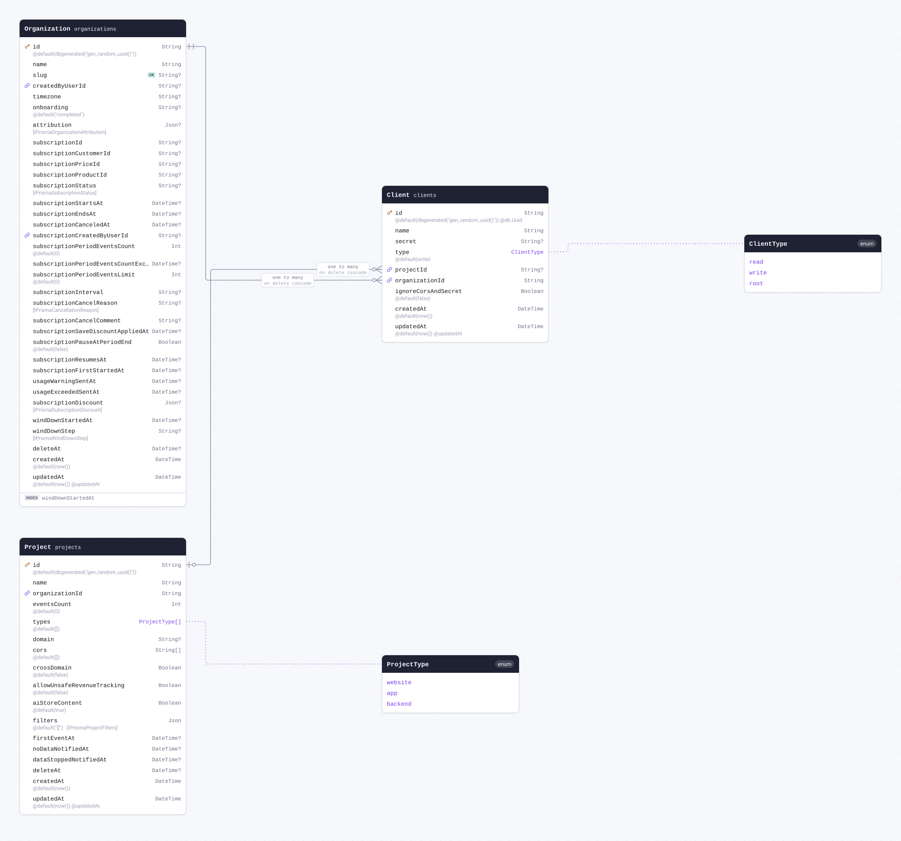

| Field                 | Type                             | Constraints                                       | Default                            | Description |
| --------------------- | -------------------------------- | ------------------------------------------------- | ---------------------------------- | ----------- |
| `id`                  | `String` `@db.Uuid`              | PK NOT NULL                                       | `dbgenerated("gen_random_uuid()")` |             |
| `name`                | `String`                         | NOT NULL                                          |                                    |             |
| `secret`              | `String`                         | NULL                                              |                                    |             |
| `type`                | [`ClientType`](#enum-ClientType) | NOT NULL                                          | `write`                            |             |
| `projectId`           | `String`                         | NULL → [Project.id](#model-Project)               |                                    |             |
| `organizationId`      | `String`                         | NOT NULL → [Organization.id](#model-Organization) |                                    |             |
| `ignoreCorsAndSecret` | `Boolean`                        | NOT NULL                                          | `false`                            |             |
| `createdAt`           | `DateTime`                       | NOT NULL                                          | `now()`                            |             |
| `updatedAt`           | `DateTime`                       | NOT NULL                                          | `now()` `@updatedAt`               |             |

#### References

- `projectId` → [Project.id](#model-Project) (many-to-one, on delete Cascade)
- `organizationId` → [Organization.id](#model-Organization) (many-to-one, on delete Cascade)

#### Definition

```sql
CREATE TABLE "clients" (
    "id" UUID NOT NULL DEFAULT gen_random_uuid(),
    "name" TEXT NOT NULL,
    "secret" TEXT,
    "type" "ClientType" NOT NULL DEFAULT 'write',
    "projectId" TEXT,
    "organizationId" TEXT NOT NULL,
    "ignoreCorsAndSecret" BOOLEAN NOT NULL DEFAULT false,
    "createdAt" TIMESTAMP(3) NOT NULL DEFAULT CURRENT_TIMESTAMP,
    "updatedAt" TIMESTAMP(3) NOT NULL DEFAULT CURRENT_TIMESTAMP,

    CONSTRAINT "clients_pkey" PRIMARY KEY ("id")
);

ALTER TABLE "clients" ADD CONSTRAINT "clients_projectId_fkey" FOREIGN KEY ("projectId") REFERENCES "projects"("id") ON DELETE CASCADE ON UPDATE CASCADE;

ALTER TABLE "clients" ADD CONSTRAINT "clients_organizationId_fkey" FOREIGN KEY ("organizationId") REFERENCES "organizations"("id") ON DELETE CASCADE ON UPDATE CASCADE;
```

<details>
<summary>Queries and their SQL</summary>

**findMany**: Every row

```ts
await prisma.client.findMany();
```

```sql
SELECT
  "public"."clients"."id",
  "public"."clients"."name",
  "public"."clients"."secret",
  "public"."clients"."type"::text,
  "public"."clients"."projectId",
  "public"."clients"."organizationId",
  "public"."clients"."ignoreCorsAndSecret",
  "public"."clients"."createdAt",
  "public"."clients"."updatedAt"
FROM
  "public"."clients"
WHERE
  1 = 1
OFFSET
  $1
-- params: ["0"]
```

**count**: How many rows there are

```ts
await prisma.client.count();
```

```sql
SELECT
  COUNT(*) AS "_count$_all"
FROM
  (
    SELECT
      "public"."clients"."id"
    FROM
      "public"."clients"
    WHERE
      1 = 1
    OFFSET
      $1
  ) AS "sub"
-- params: ["0"]
```

**findMany**: Every row with its relations

```ts
await prisma.client.findMany({ include: { project: true, organization: true } });
```

```sql
SELECT
  "public"."clients"."id",
  "public"."clients"."name",
  "public"."clients"."secret",
  "public"."clients"."type"::text,
  "public"."clients"."projectId",
  "public"."clients"."organizationId",
  "public"."clients"."ignoreCorsAndSecret",
  "public"."clients"."createdAt",
  "public"."clients"."updatedAt"
FROM
  "public"."clients"
WHERE
  1 = 1
OFFSET
  $1
-- params: ["0"]

SELECT
  "public"."projects"."id",
  "public"."projects"."name",
  "public"."projects"."organizationId",
  "public"."projects"."eventsCount",
  "public"."projects"."types"::text[],
  "public"."projects"."domain",
  "public"."projects"."cors",
  "public"."projects"."crossDomain",
  "public"."projects"."allowUnsafeRevenueTracking",
  "public"."projects"."aiStoreContent",
  "public"."projects"."filters",
  "public"."projects"."firstEventAt",
  "public"."projects"."noDataNotifiedAt",
  "public"."projects"."dataStoppedNotifiedAt",
  "public"."projects"."deleteAt",
  "public"."projects"."createdAt",
  "public"."projects"."updatedAt"
FROM
  "public"."projects"
WHERE
  "public"."projects"."id" IN ($1)
OFFSET
  $2
-- params: ["<projectId of the rows above>","0"]

SELECT
  "public"."organizations"."id",
  "public"."organizations"."name",
  "public"."organizations"."slug",
  "public"."organizations"."createdByUserId",
  "public"."organizations"."timezone",
  "public"."organizations"."onboarding",
  "public"."organizations"."attribution",
  "public"."organizations"."subscriptionId",
  "public"."organizations"."subscriptionCustomerId",
  "public"."organizations"."subscriptionPriceId",
  "public"."organizations"."subscriptionProductId",
  "public"."organizations"."subscriptionStatus",
  "public"."organizations"."subscriptionStartsAt",
  "public"."organizations"."subscriptionEndsAt",
  "public"."organizations"."subscriptionCanceledAt",
  "public"."organizations"."subscriptionCreatedByUserId",
  "public"."organizations"."subscriptionPeriodEventsCount",
  "public"."organizations"."subscriptionPeriodEventsCountExceededAt",
  "public"."organizations"."subscriptionPeriodEventsLimit",
  "public"."organizations"."subscriptionInterval",
  "public"."organizations"."subscriptionCancelReason",
  "public"."organizations"."subscriptionCancelComment",
  "public"."organizations"."subscriptionSaveDiscountAppliedAt",
  "public"."organizations"."subscriptionPauseAtPeriodEnd",
  "public"."organizations"."subscriptionResumesAt",
  "public"."organizations"."subscriptionFirstStartedAt",
  "public"."organizations"."usageWarningSentAt",
  "public"."organizations"."usageExceededSentAt",
  "public"."organizations"."subscriptionDiscount",
  "public"."organizations"."windDownStartedAt",
  "public"."organizations"."windDownStep",
  "public"."organizations"."deleteAt",
  "public"."organizations"."createdAt",
  "public"."organizations"."updatedAt"
FROM
  "public"."organizations"
WHERE
  "public"."organizations"."id" IN ($1)
OFFSET
  $2
-- params: ["<organizationId of the rows above>","0"]
```

**findUnique**: One row by what is unique to it

```ts
await prisma.client.findUnique({ where: { id: "example" } });
```

```sql
SELECT
  "public"."clients"."id",
  "public"."clients"."name",
  "public"."clients"."secret",
  "public"."clients"."type"::text,
  "public"."clients"."projectId",
  "public"."clients"."organizationId",
  "public"."clients"."ignoreCorsAndSecret",
  "public"."clients"."createdAt",
  "public"."clients"."updatedAt"
FROM
  "public"."clients"
WHERE
  (
    "public"."clients"."id" = $1
    AND 1 = 1
  )
LIMIT
  $2
OFFSET
  $3
-- params: ["example","1","0"]
```

**create**: Create a row

```ts
await prisma.client.create({ data: { name: "example", organizationId: "example" } });
```

```sql
INSERT INTO
  "public"."clients" (
    "name",
    "type",
    "organizationId",
    "ignoreCorsAndSecret",
    "createdAt",
    "updatedAt"
  )
VALUES
  (
    $1,
    CAST($2::text AS "public"."ClientType"),
    $3,
    $4,
    $5,
    $6
  )
RETURNING
  "public"."clients"."id",
  "public"."clients"."name",
  "public"."clients"."secret",
  "public"."clients"."type"::text,
  "public"."clients"."projectId",
  "public"."clients"."organizationId",
  "public"."clients"."ignoreCorsAndSecret",
  "public"."clients"."createdAt",
  "public"."clients"."updatedAt"
-- params: ["example","write","example",false,"<now()>","<now()>"]
```

**update**: Update a row

```ts
await prisma.client.update({ where: { id: "example" }, data: { name: "example" } });
```

```sql
UPDATE "public"."clients"
SET
  "name" = $1,
  "updatedAt" = $2
WHERE
  (
    "public"."clients"."id" = $3
    AND 1 = 1
  )
RETURNING
  "public"."clients"."id",
  "public"."clients"."name",
  "public"."clients"."secret",
  "public"."clients"."type"::text,
  "public"."clients"."projectId",
  "public"."clients"."organizationId",
  "public"."clients"."ignoreCorsAndSecret",
  "public"."clients"."createdAt",
  "public"."clients"."updatedAt"
-- params: ["example",{"prisma__type":"generatorCall","prisma__value":{"name":"now","args":[],"returnType":{"type":"DateTime"}}},"example"]
```

**delete**: Delete a row

```ts
await prisma.client.delete({ where: { id: "example" } });
```

```sql
DELETE FROM "public"."clients"
WHERE
  (
    "public"."clients"."id" = $1
    AND 1 = 1
  )
RETURNING
  "public"."clients"."id",
  "public"."clients"."name",
  "public"."clients"."secret",
  "public"."clients"."type"::text,
  "public"."clients"."projectId",
  "public"."clients"."organizationId",
  "public"."clients"."ignoreCorsAndSecret",
  "public"."clients"."createdAt",
  "public"."clients"."updatedAt"
-- params: ["example"]
```

</details>

<a id="model-Dashboard"></a>

### Dashboard

Table `dashboards`.

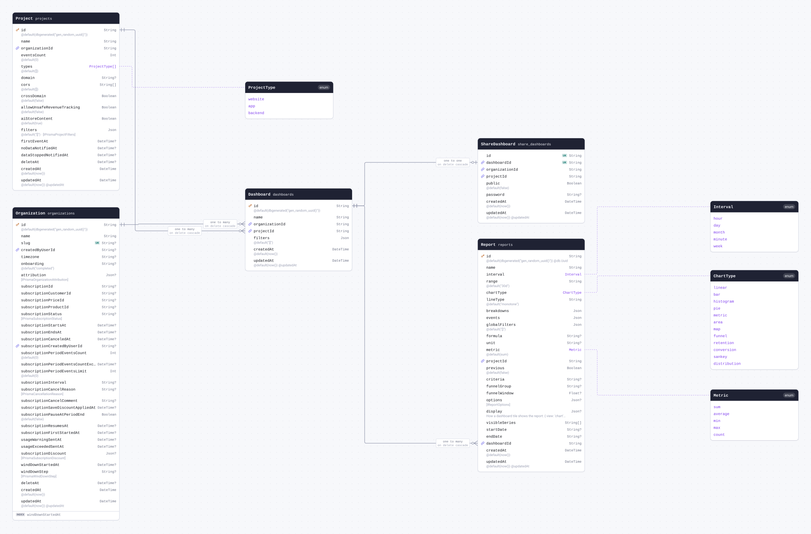

| Field            | Type       | Constraints                                       | Default                            | Description |
| ---------------- | ---------- | ------------------------------------------------- | ---------------------------------- | ----------- |
| `id`             | `String`   | PK NOT NULL                                       | `dbgenerated("gen_random_uuid()")` |             |
| `name`           | `String`   | NOT NULL                                          |                                    |             |
| `organizationId` | `String`   | NOT NULL → [Organization.id](#model-Organization) |                                    |             |
| `projectId`      | `String`   | NOT NULL → [Project.id](#model-Project)           |                                    |             |
| `filters`        | `Json`     | NOT NULL                                          | `"[]"`                             |             |
| `createdAt`      | `DateTime` | NOT NULL                                          | `now()`                            |             |
| `updatedAt`      | `DateTime` | NOT NULL                                          | `now()` `@updatedAt`               |             |

#### References

- `organizationId` → [Organization.id](#model-Organization) (many-to-one, on delete Cascade)
- `projectId` → [Project.id](#model-Project) (many-to-one, on delete Cascade)

#### Referenced by

- `id` ← [Report.dashboardId](#model-Report) (one-to-many, on delete Cascade)
- `id` ← [ShareDashboard.dashboardId](#model-ShareDashboard) (one-to-one, on delete Cascade)

#### Definition

```sql
CREATE TABLE "dashboards" (
    "id" TEXT NOT NULL DEFAULT gen_random_uuid(),
    "name" TEXT NOT NULL,
    "organizationId" TEXT NOT NULL,
    "projectId" TEXT NOT NULL,
    "filters" JSONB NOT NULL DEFAULT '[]',
    "createdAt" TIMESTAMP(3) NOT NULL DEFAULT CURRENT_TIMESTAMP,
    "updatedAt" TIMESTAMP(3) NOT NULL DEFAULT CURRENT_TIMESTAMP,

    CONSTRAINT "dashboards_pkey" PRIMARY KEY ("id")
);

ALTER TABLE "dashboards" ADD CONSTRAINT "dashboards_organizationId_fkey" FOREIGN KEY ("organizationId") REFERENCES "organizations"("id") ON DELETE CASCADE ON UPDATE CASCADE;

ALTER TABLE "dashboards" ADD CONSTRAINT "dashboards_projectId_fkey" FOREIGN KEY ("projectId") REFERENCES "projects"("id") ON DELETE CASCADE ON UPDATE CASCADE;
```

<details>
<summary>Queries and their SQL</summary>

**findMany**: Every row

```ts
await prisma.dashboard.findMany();
```

```sql
SELECT
  "public"."dashboards"."id",
  "public"."dashboards"."name",
  "public"."dashboards"."organizationId",
  "public"."dashboards"."projectId",
  "public"."dashboards"."filters",
  "public"."dashboards"."createdAt",
  "public"."dashboards"."updatedAt"
FROM
  "public"."dashboards"
WHERE
  1 = 1
OFFSET
  $1
-- params: ["0"]
```

**count**: How many rows there are

```ts
await prisma.dashboard.count();
```

```sql
SELECT
  COUNT(*) AS "_count$_all"
FROM
  (
    SELECT
      "public"."dashboards"."id"
    FROM
      "public"."dashboards"
    WHERE
      1 = 1
    OFFSET
      $1
  ) AS "sub"
-- params: ["0"]
```

**findMany**: Every row with its relations

```ts
await prisma.dashboard.findMany({
  include: { organization: true, project: true, reports: true, share: true },
});
```

```sql
SELECT
  "public"."dashboards"."id",
  "public"."dashboards"."name",
  "public"."dashboards"."organizationId",
  "public"."dashboards"."projectId",
  "public"."dashboards"."filters",
  "public"."dashboards"."createdAt",
  "public"."dashboards"."updatedAt"
FROM
  "public"."dashboards"
WHERE
  1 = 1
OFFSET
  $1
-- params: ["0"]

SELECT
  "public"."organizations"."id",
  "public"."organizations"."name",
  "public"."organizations"."slug",
  "public"."organizations"."createdByUserId",
  "public"."organizations"."timezone",
  "public"."organizations"."onboarding",
  "public"."organizations"."attribution",
  "public"."organizations"."subscriptionId",
  "public"."organizations"."subscriptionCustomerId",
  "public"."organizations"."subscriptionPriceId",
  "public"."organizations"."subscriptionProductId",
  "public"."organizations"."subscriptionStatus",
  "public"."organizations"."subscriptionStartsAt",
  "public"."organizations"."subscriptionEndsAt",
  "public"."organizations"."subscriptionCanceledAt",
  "public"."organizations"."subscriptionCreatedByUserId",
  "public"."organizations"."subscriptionPeriodEventsCount",
  "public"."organizations"."subscriptionPeriodEventsCountExceededAt",
  "public"."organizations"."subscriptionPeriodEventsLimit",
  "public"."organizations"."subscriptionInterval",
  "public"."organizations"."subscriptionCancelReason",
  "public"."organizations"."subscriptionCancelComment",
  "public"."organizations"."subscriptionSaveDiscountAppliedAt",
  "public"."organizations"."subscriptionPauseAtPeriodEnd",
  "public"."organizations"."subscriptionResumesAt",
  "public"."organizations"."subscriptionFirstStartedAt",
  "public"."organizations"."usageWarningSentAt",
  "public"."organizations"."usageExceededSentAt",
  "public"."organizations"."subscriptionDiscount",
  "public"."organizations"."windDownStartedAt",
  "public"."organizations"."windDownStep",
  "public"."organizations"."deleteAt",
  "public"."organizations"."createdAt",
  "public"."organizations"."updatedAt"
FROM
  "public"."organizations"
WHERE
  "public"."organizations"."id" IN ($1)
OFFSET
  $2
-- params: ["<organizationId of the rows above>","0"]

SELECT
  "public"."projects"."id",
  "public"."projects"."name",
  "public"."projects"."organizationId",
  "public"."projects"."eventsCount",
  "public"."projects"."types"::text[],
  "public"."projects"."domain",
  "public"."projects"."cors",
  "public"."projects"."crossDomain",
  "public"."projects"."allowUnsafeRevenueTracking",
  "public"."projects"."aiStoreContent",
  "public"."projects"."filters",
  "public"."projects"."firstEventAt",
  "public"."projects"."noDataNotifiedAt",
  "public"."projects"."dataStoppedNotifiedAt",
  "public"."projects"."deleteAt",
  "public"."projects"."createdAt",
  "public"."projects"."updatedAt"
FROM
  "public"."projects"
WHERE
  "public"."projects"."id" IN ($1)
OFFSET
  $2
-- params: ["<projectId of the rows above>","0"]

SELECT
  "public"."reports"."id",
  "public"."reports"."name",
  "public"."reports"."interval"::text,
  "public"."reports"."range",
  "public"."reports"."chartType"::text,
  "public"."reports"."lineType",
  "public"."reports"."breakdowns",
  "public"."reports"."events",
  "public"."reports"."globalFilters",
  "public"."reports"."formula",
  "public"."reports"."unit",
  "public"."reports"."metric"::text,
  "public"."reports"."projectId",
  "public"."reports"."previous",
  "public"."reports"."criteria",
  "public"."reports"."funnelGroup",
  "public"."reports"."funnelWindow",
  "public"."reports"."options",
  "public"."reports"."display",
  "public"."reports"."visibleSeries",
  "public"."reports"."startDate",
  "public"."reports"."endDate",
  "public"."reports"."dashboardId",
  "public"."reports"."createdAt",
  "public"."reports"."updatedAt"
FROM
  "public"."reports"
WHERE
  "public"."reports"."dashboardId" IN ($1)
OFFSET
  $2
-- params: ["<id of the rows above>","0"]

SELECT
  "public"."share_dashboards"."id",
  "public"."share_dashboards"."dashboardId",
  "public"."share_dashboards"."organizationId",
  "public"."share_dashboards"."projectId",
  "public"."share_dashboards"."public",
  "public"."share_dashboards"."password",
  "public"."share_dashboards"."createdAt",
  "public"."share_dashboards"."updatedAt"
FROM
  "public"."share_dashboards"
WHERE
  "public"."share_dashboards"."dashboardId" IN ($1)
OFFSET
  $2
-- params: ["<id of the rows above>","0"]
```

**findUnique**: One row by what is unique to it

```ts
await prisma.dashboard.findUnique({ where: { id: "example" } });
```

```sql
SELECT
  "public"."dashboards"."id",
  "public"."dashboards"."name",
  "public"."dashboards"."organizationId",
  "public"."dashboards"."projectId",
  "public"."dashboards"."filters",
  "public"."dashboards"."createdAt",
  "public"."dashboards"."updatedAt"
FROM
  "public"."dashboards"
WHERE
  (
    "public"."dashboards"."id" = $1
    AND 1 = 1
  )
LIMIT
  $2
OFFSET
  $3
-- params: ["example","1","0"]
```

**create**: Create a row

```ts
await prisma.dashboard.create({
  data: { name: "example", organizationId: "example", projectId: "example" },
});
```

```sql
INSERT INTO
  "public"."dashboards" (
    "name",
    "organizationId",
    "projectId",
    "filters",
    "createdAt",
    "updatedAt"
  )
VALUES
  ($1, $2, $3, $4, $5, $6)
RETURNING
  "public"."dashboards"."id",
  "public"."dashboards"."name",
  "public"."dashboards"."organizationId",
  "public"."dashboards"."projectId",
  "public"."dashboards"."filters",
  "public"."dashboards"."createdAt",
  "public"."dashboards"."updatedAt"
-- params: ["example","example","example","[]","<now()>","<now()>"]
```

**update**: Update a row

```ts
await prisma.dashboard.update({ where: { id: "example" }, data: { name: "example" } });
```

```sql
UPDATE "public"."dashboards"
SET
  "name" = $1,
  "updatedAt" = $2
WHERE
  (
    "public"."dashboards"."id" = $3
    AND 1 = 1
  )
RETURNING
  "public"."dashboards"."id",
  "public"."dashboards"."name",
  "public"."dashboards"."organizationId",
  "public"."dashboards"."projectId",
  "public"."dashboards"."filters",
  "public"."dashboards"."createdAt",
  "public"."dashboards"."updatedAt"
-- params: ["example",{"prisma__type":"generatorCall","prisma__value":{"name":"now","args":[],"returnType":{"type":"DateTime"}}},"example"]
```

**delete**: Delete a row

```ts
await prisma.dashboard.delete({ where: { id: "example" } });
```

```sql
DELETE FROM "public"."dashboards"
WHERE
  (
    "public"."dashboards"."id" = $1
    AND 1 = 1
  )
RETURNING
  "public"."dashboards"."id",
  "public"."dashboards"."name",
  "public"."dashboards"."organizationId",
  "public"."dashboards"."projectId",
  "public"."dashboards"."filters",
  "public"."dashboards"."createdAt",
  "public"."dashboards"."updatedAt"
-- params: ["example"]
```

</details>

<a id="model-Report"></a>

### Report

Table `reports`.

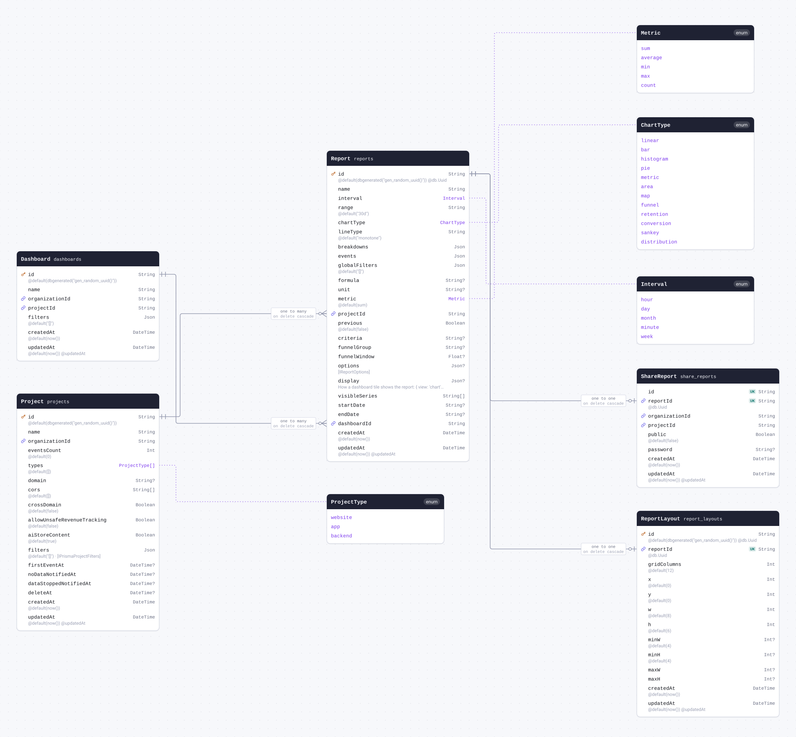

| Field           | Type                           | Constraints                                 | Default                            | Description                                                         |
| --------------- | ------------------------------ | ------------------------------------------- | ---------------------------------- | ------------------------------------------------------------------- |
| `id`            | `String` `@db.Uuid`            | PK NOT NULL                                 | `dbgenerated("gen_random_uuid()")` |                                                                     |
| `name`          | `String`                       | NOT NULL                                    |                                    |                                                                     |
| `interval`      | [`Interval`](#enum-Interval)   | NOT NULL                                    |                                    |                                                                     |
| `range`         | `String`                       | NOT NULL                                    | `"30d"`                            |                                                                     |
| `chartType`     | [`ChartType`](#enum-ChartType) | NOT NULL                                    |                                    |                                                                     |
| `lineType`      | `String`                       | NOT NULL                                    | `"monotone"`                       |                                                                     |
| `breakdowns`    | `Json`                         | NOT NULL                                    |                                    |                                                                     |
| `events`        | `Json`                         | NOT NULL                                    |                                    |                                                                     |
| `globalFilters` | `Json`                         | NOT NULL                                    | `"[]"`                             |                                                                     |
| `formula`       | `String`                       | NULL                                        |                                    |                                                                     |
| `unit`          | `String`                       | NULL                                        |                                    |                                                                     |
| `metric`        | [`Metric`](#enum-Metric)       | NOT NULL                                    | `sum`                              |                                                                     |
| `projectId`     | `String`                       | NOT NULL → [Project.id](#model-Project)     |                                    |                                                                     |
| `previous`      | `Boolean`                      | NOT NULL                                    | `false`                            |                                                                     |
| `criteria`      | `String`                       | NULL                                        |                                    |                                                                     |
| `funnelGroup`   | `String`                       | NULL                                        |                                    |                                                                     |
| `funnelWindow`  | `Float`                        | NULL                                        |                                    |                                                                     |
| `options`       | `Json`                         | NULL                                        |                                    | [IReportOptions]                                                    |
| `display`       | `Json`                         | NULL                                        |                                    | How a dashboard tile shows the report: { view: 'chart' \| 'table' } |
| `visibleSeries` | `String[]`                     | NOT NULL                                    |                                    |                                                                     |
| `startDate`     | `String`                       | NULL                                        |                                    |                                                                     |
| `endDate`       | `String`                       | NULL                                        |                                    |                                                                     |
| `dashboardId`   | `String`                       | NOT NULL → [Dashboard.id](#model-Dashboard) |                                    |                                                                     |
| `createdAt`     | `DateTime`                     | NOT NULL                                    | `now()`                            |                                                                     |
| `updatedAt`     | `DateTime`                     | NOT NULL                                    | `now()` `@updatedAt`               |                                                                     |

#### References

- `projectId` → [Project.id](#model-Project) (many-to-one, on delete Cascade)
- `dashboardId` → [Dashboard.id](#model-Dashboard) (many-to-one, on delete Cascade)

#### Referenced by

- `id` ← [ReportLayout.reportId](#model-ReportLayout) (one-to-one, on delete Cascade)
- `id` ← [ShareReport.reportId](#model-ShareReport) (one-to-one, on delete Cascade)

#### Definition

```sql
CREATE TABLE "reports" (
    "id" UUID NOT NULL DEFAULT gen_random_uuid(),
    "name" TEXT NOT NULL,
    "interval" "Interval" NOT NULL,
    "range" TEXT NOT NULL DEFAULT '30d',
    "chartType" "ChartType" NOT NULL,
    "lineType" TEXT NOT NULL DEFAULT 'monotone',
    "breakdowns" JSONB NOT NULL,
    "events" JSONB NOT NULL,
    "globalFilters" JSONB NOT NULL DEFAULT '[]',
    "formula" TEXT,
    "unit" TEXT,
    "metric" "Metric" NOT NULL DEFAULT 'sum',
    "projectId" TEXT NOT NULL,
    "previous" BOOLEAN NOT NULL DEFAULT false,
    "criteria" TEXT,
    "funnelGroup" TEXT,
    "funnelWindow" DOUBLE PRECISION,
    "options" JSONB,
    "display" JSONB,
    "visibleSeries" TEXT[],
    "startDate" TEXT,
    "endDate" TEXT,
    "dashboardId" TEXT NOT NULL,
    "createdAt" TIMESTAMP(3) NOT NULL DEFAULT CURRENT_TIMESTAMP,
    "updatedAt" TIMESTAMP(3) NOT NULL DEFAULT CURRENT_TIMESTAMP,

    CONSTRAINT "reports_pkey" PRIMARY KEY ("id")
);

ALTER TABLE "reports" ADD CONSTRAINT "reports_projectId_fkey" FOREIGN KEY ("projectId") REFERENCES "projects"("id") ON DELETE CASCADE ON UPDATE CASCADE;

ALTER TABLE "reports" ADD CONSTRAINT "reports_dashboardId_fkey" FOREIGN KEY ("dashboardId") REFERENCES "dashboards"("id") ON DELETE CASCADE ON UPDATE CASCADE;
```

<details>
<summary>Queries and their SQL</summary>

**findMany**: Every row

```ts
await prisma.report.findMany();
```

```sql
SELECT
  "public"."reports"."id",
  "public"."reports"."name",
  "public"."reports"."interval"::text,
  "public"."reports"."range",
  "public"."reports"."chartType"::text,
  "public"."reports"."lineType",
  "public"."reports"."breakdowns",
  "public"."reports"."events",
  "public"."reports"."globalFilters",
  "public"."reports"."formula",
  "public"."reports"."unit",
  "public"."reports"."metric"::text,
  "public"."reports"."projectId",
  "public"."reports"."previous",
  "public"."reports"."criteria",
  "public"."reports"."funnelGroup",
  "public"."reports"."funnelWindow",
  "public"."reports"."options",
  "public"."reports"."display",
  "public"."reports"."visibleSeries",
  "public"."reports"."startDate",
  "public"."reports"."endDate",
  "public"."reports"."dashboardId",
  "public"."reports"."createdAt",
  "public"."reports"."updatedAt"
FROM
  "public"."reports"
WHERE
  1 = 1
OFFSET
  $1
-- params: ["0"]
```

**count**: How many rows there are

```ts
await prisma.report.count();
```

```sql
SELECT
  COUNT(*) AS "_count$_all"
FROM
  (
    SELECT
      "public"."reports"."id"
    FROM
      "public"."reports"
    WHERE
      1 = 1
    OFFSET
      $1
  ) AS "sub"
-- params: ["0"]
```

**findMany**: Every row with its relations

```ts
await prisma.report.findMany({
  include: { project: true, dashboard: true, layout: true, share: true },
});
```

```sql
SELECT
  "public"."reports"."id",
  "public"."reports"."name",
  "public"."reports"."interval"::text,
  "public"."reports"."range",
  "public"."reports"."chartType"::text,
  "public"."reports"."lineType",
  "public"."reports"."breakdowns",
  "public"."reports"."events",
  "public"."reports"."globalFilters",
  "public"."reports"."formula",
  "public"."reports"."unit",
  "public"."reports"."metric"::text,
  "public"."reports"."projectId",
  "public"."reports"."previous",
  "public"."reports"."criteria",
  "public"."reports"."funnelGroup",
  "public"."reports"."funnelWindow",
  "public"."reports"."options",
  "public"."reports"."display",
  "public"."reports"."visibleSeries",
  "public"."reports"."startDate",
  "public"."reports"."endDate",
  "public"."reports"."dashboardId",
  "public"."reports"."createdAt",
  "public"."reports"."updatedAt"
FROM
  "public"."reports"
WHERE
  1 = 1
OFFSET
  $1
-- params: ["0"]

SELECT
  "public"."projects"."id",
  "public"."projects"."name",
  "public"."projects"."organizationId",
  "public"."projects"."eventsCount",
  "public"."projects"."types"::text[],
  "public"."projects"."domain",
  "public"."projects"."cors",
  "public"."projects"."crossDomain",
  "public"."projects"."allowUnsafeRevenueTracking",
  "public"."projects"."aiStoreContent",
  "public"."projects"."filters",
  "public"."projects"."firstEventAt",
  "public"."projects"."noDataNotifiedAt",
  "public"."projects"."dataStoppedNotifiedAt",
  "public"."projects"."deleteAt",
  "public"."projects"."createdAt",
  "public"."projects"."updatedAt"
FROM
  "public"."projects"
WHERE
  "public"."projects"."id" IN ($1)
OFFSET
  $2
-- params: ["<projectId of the rows above>","0"]

SELECT
  "public"."dashboards"."id",
  "public"."dashboards"."name",
  "public"."dashboards"."organizationId",
  "public"."dashboards"."projectId",
  "public"."dashboards"."filters",
  "public"."dashboards"."createdAt",
  "public"."dashboards"."updatedAt"
FROM
  "public"."dashboards"
WHERE
  "public"."dashboards"."id" IN ($1)
OFFSET
  $2
-- params: ["<dashboardId of the rows above>","0"]

SELECT
  "public"."report_layouts"."id",
  "public"."report_layouts"."reportId",
  "public"."report_layouts"."gridColumns",
  "public"."report_layouts"."x",
  "public"."report_layouts"."y",
  "public"."report_layouts"."w",
  "public"."report_layouts"."h",
  "public"."report_layouts"."minW",
  "public"."report_layouts"."minH",
  "public"."report_layouts"."maxW",
  "public"."report_layouts"."maxH",
  "public"."report_layouts"."createdAt",
  "public"."report_layouts"."updatedAt"
FROM
  "public"."report_layouts"
WHERE
  "public"."report_layouts"."reportId" IN ($1)
OFFSET
  $2
-- params: ["<id of the rows above>","0"]

SELECT
  "public"."share_reports"."id",
  "public"."share_reports"."reportId",
  "public"."share_reports"."organizationId",
  "public"."share_reports"."projectId",
  "public"."share_reports"."public",
  "public"."share_reports"."password",
  "public"."share_reports"."createdAt",
  "public"."share_reports"."updatedAt"
FROM
  "public"."share_reports"
WHERE
  "public"."share_reports"."reportId" IN ($1)
OFFSET
  $2
-- params: ["<id of the rows above>","0"]
```

**findUnique**: One row by what is unique to it

```ts
await prisma.report.findUnique({ where: { id: "example" } });
```

```sql
SELECT
  "public"."reports"."id",
  "public"."reports"."name",
  "public"."reports"."interval"::text,
  "public"."reports"."range",
  "public"."reports"."chartType"::text,
  "public"."reports"."lineType",
  "public"."reports"."breakdowns",
  "public"."reports"."events",
  "public"."reports"."globalFilters",
  "public"."reports"."formula",
  "public"."reports"."unit",
  "public"."reports"."metric"::text,
  "public"."reports"."projectId",
  "public"."reports"."previous",
  "public"."reports"."criteria",
  "public"."reports"."funnelGroup",
  "public"."reports"."funnelWindow",
  "public"."reports"."options",
  "public"."reports"."display",
  "public"."reports"."visibleSeries",
  "public"."reports"."startDate",
  "public"."reports"."endDate",
  "public"."reports"."dashboardId",
  "public"."reports"."createdAt",
  "public"."reports"."updatedAt"
FROM
  "public"."reports"
WHERE
  (
    "public"."reports"."id" = $1
    AND 1 = 1
  )
LIMIT
  $2
OFFSET
  $3
-- params: ["example","1","0"]
```

**create**: Create a row

```ts
await prisma.report.create({
  data: {
    name: "example",
    interval: "hour",
    chartType: "linear",
    breakdowns: {},
    events: {},
    projectId: "example",
    visibleSeries: ["example"],
    dashboardId: "example",
  },
});
```

```sql
INSERT INTO
  "public"."reports" (
    "name",
    "interval",
    "range",
    "chartType",
    "lineType",
    "breakdowns",
    "events",
    "globalFilters",
    "metric",
    "projectId",
    "previous",
    "visibleSeries",
    "dashboardId",
    "createdAt",
    "updatedAt"
  )
VALUES
  (
    $1,
    CAST($2::text AS "public"."Interval"),
    $3,
    CAST($4::text AS "public"."ChartType"),
    $5,
    $6,
    $7,
    $8,
    CAST($9::text AS "public"."Metric"),
    $10,
    $11,
    $12,
    $13,
    $14,
    $15
  )
RETURNING
  "public"."reports"."id",
  "public"."reports"."name",
  "public"."reports"."interval"::text,
  "public"."reports"."range",
  "public"."reports"."chartType"::text,
  "public"."reports"."lineType",
  "public"."reports"."breakdowns",
  "public"."reports"."events",
  "public"."reports"."globalFilters",
  "public"."reports"."formula",
  "public"."reports"."unit",
  "public"."reports"."metric"::text,
  "public"."reports"."projectId",
  "public"."reports"."previous",
  "public"."reports"."criteria",
  "public"."reports"."funnelGroup",
  "public"."reports"."funnelWindow",
  "public"."reports"."options",
  "public"."reports"."display",
  "public"."reports"."visibleSeries",
  "public"."reports"."startDate",
  "public"."reports"."endDate",
  "public"."reports"."dashboardId",
  "public"."reports"."createdAt",
  "public"."reports"."updatedAt"
-- params: ["example","hour","30d","linear","monotone","{}","{}","[]","sum","example",false,["example"],"example","<now()>","<now()>"]
```

**update**: Update a row

```ts
await prisma.report.update({ where: { id: "example" }, data: { name: "example" } });
```

```sql
UPDATE "public"."reports"
SET
  "name" = $1,
  "updatedAt" = $2
WHERE
  (
    "public"."reports"."id" = $3
    AND 1 = 1
  )
RETURNING
  "public"."reports"."id",
  "public"."reports"."name",
  "public"."reports"."interval"::text,
  "public"."reports"."range",
  "public"."reports"."chartType"::text,
  "public"."reports"."lineType",
  "public"."reports"."breakdowns",
  "public"."reports"."events",
  "public"."reports"."globalFilters",
  "public"."reports"."formula",
  "public"."reports"."unit",
  "public"."reports"."metric"::text,
  "public"."reports"."projectId",
  "public"."reports"."previous",
  "public"."reports"."criteria",
  "public"."reports"."funnelGroup",
  "public"."reports"."funnelWindow",
  "public"."reports"."options",
  "public"."reports"."display",
  "public"."reports"."visibleSeries",
  "public"."reports"."startDate",
  "public"."reports"."endDate",
  "public"."reports"."dashboardId",
  "public"."reports"."createdAt",
  "public"."reports"."updatedAt"
-- params: ["example",{"prisma__type":"generatorCall","prisma__value":{"name":"now","args":[],"returnType":{"type":"DateTime"}}},"example"]
```

**delete**: Delete a row

```ts
await prisma.report.delete({ where: { id: "example" } });
```

```sql
DELETE FROM "public"."reports"
WHERE
  (
    "public"."reports"."id" = $1
    AND 1 = 1
  )
RETURNING
  "public"."reports"."id",
  "public"."reports"."name",
  "public"."reports"."interval"::text,
  "public"."reports"."range",
  "public"."reports"."chartType"::text,
  "public"."reports"."lineType",
  "public"."reports"."breakdowns",
  "public"."reports"."events",
  "public"."reports"."globalFilters",
  "public"."reports"."formula",
  "public"."reports"."unit",
  "public"."reports"."metric"::text,
  "public"."reports"."projectId",
  "public"."reports"."previous",
  "public"."reports"."criteria",
  "public"."reports"."funnelGroup",
  "public"."reports"."funnelWindow",
  "public"."reports"."options",
  "public"."reports"."display",
  "public"."reports"."visibleSeries",
  "public"."reports"."startDate",
  "public"."reports"."endDate",
  "public"."reports"."dashboardId",
  "public"."reports"."createdAt",
  "public"."reports"."updatedAt"
-- params: ["example"]
```

</details>

<a id="model-ReportLayout"></a>

### ReportLayout

Table `report_layouts`.

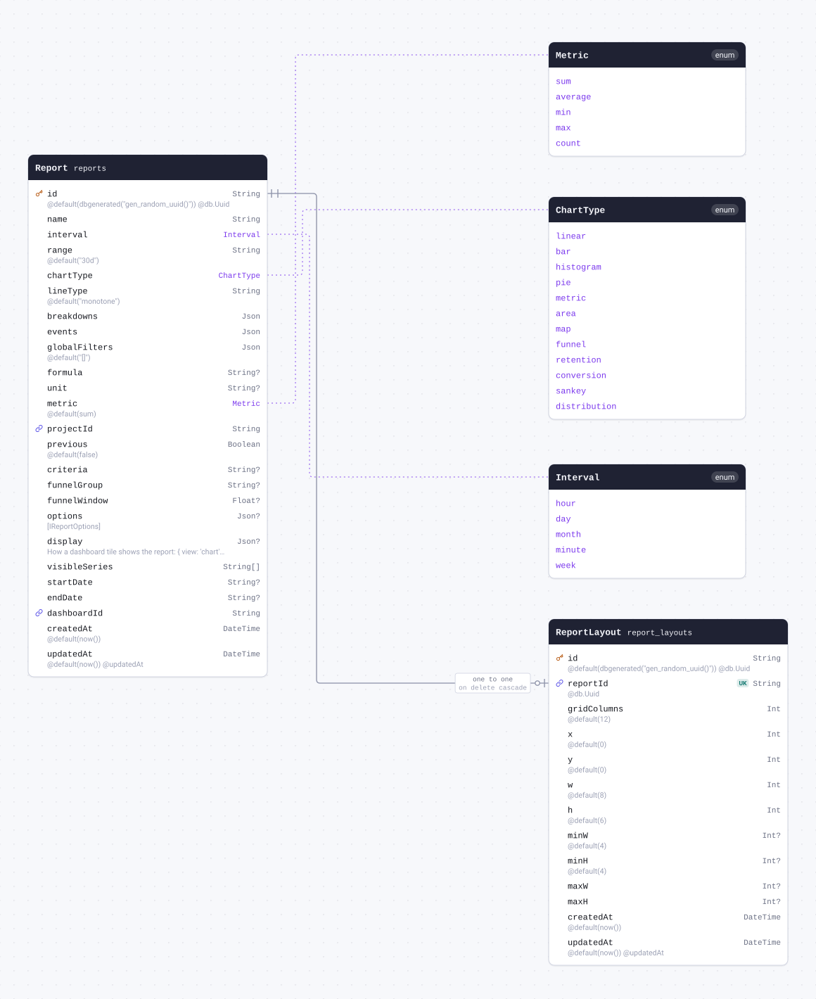

| Field         | Type                | Constraints                                  | Default                            | Description |
| ------------- | ------------------- | -------------------------------------------- | ---------------------------------- | ----------- |
| `id`          | `String` `@db.Uuid` | PK NOT NULL                                  | `dbgenerated("gen_random_uuid()")` |             |
| `reportId`    | `String` `@db.Uuid` | UNIQUE NOT NULL → [Report.id](#model-Report) |                                    |             |
| `gridColumns` | `Int`               | NOT NULL                                     | `12`                               |             |
| `x`           | `Int`               | NOT NULL                                     | `0`                                |             |
| `y`           | `Int`               | NOT NULL                                     | `0`                                |             |
| `w`           | `Int`               | NOT NULL                                     | `8`                                |             |
| `h`           | `Int`               | NOT NULL                                     | `6`                                |             |
| `minW`        | `Int`               | NULL                                         | `4`                                |             |
| `minH`        | `Int`               | NULL                                         | `4`                                |             |
| `maxW`        | `Int`               | NULL                                         |                                    |             |
| `maxH`        | `Int`               | NULL                                         |                                    |             |
| `createdAt`   | `DateTime`          | NOT NULL                                     | `now()`                            |             |
| `updatedAt`   | `DateTime`          | NOT NULL                                     | `now()` `@updatedAt`               |             |

#### References

- `reportId` → [Report.id](#model-Report) (one-to-one, on delete Cascade)

#### Definition

```sql
CREATE TABLE "report_layouts" (
    "id" UUID NOT NULL DEFAULT gen_random_uuid(),
    "reportId" UUID NOT NULL,
    "gridColumns" INTEGER NOT NULL DEFAULT 12,
    "x" INTEGER NOT NULL DEFAULT 0,
    "y" INTEGER NOT NULL DEFAULT 0,
    "w" INTEGER NOT NULL DEFAULT 8,
    "h" INTEGER NOT NULL DEFAULT 6,
    "minW" INTEGER DEFAULT 4,
    "minH" INTEGER DEFAULT 4,
    "maxW" INTEGER,
    "maxH" INTEGER,
    "createdAt" TIMESTAMP(3) NOT NULL DEFAULT CURRENT_TIMESTAMP,
    "updatedAt" TIMESTAMP(3) NOT NULL DEFAULT CURRENT_TIMESTAMP,

    CONSTRAINT "report_layouts_pkey" PRIMARY KEY ("id")
);

CREATE UNIQUE INDEX "report_layouts_reportId_key" ON "report_layouts"("reportId");

ALTER TABLE "report_layouts" ADD CONSTRAINT "report_layouts_reportId_fkey" FOREIGN KEY ("reportId") REFERENCES "reports"("id") ON DELETE CASCADE ON UPDATE CASCADE;
```

<details>
<summary>Queries and their SQL</summary>

**findMany**: Every row

```ts
await prisma.reportLayout.findMany();
```

```sql
SELECT
  "public"."report_layouts"."id",
  "public"."report_layouts"."reportId",
  "public"."report_layouts"."gridColumns",
  "public"."report_layouts"."x",
  "public"."report_layouts"."y",
  "public"."report_layouts"."w",
  "public"."report_layouts"."h",
  "public"."report_layouts"."minW",
  "public"."report_layouts"."minH",
  "public"."report_layouts"."maxW",
  "public"."report_layouts"."maxH",
  "public"."report_layouts"."createdAt",
  "public"."report_layouts"."updatedAt"
FROM
  "public"."report_layouts"
WHERE
  1 = 1
OFFSET
  $1
-- params: ["0"]
```

**count**: How many rows there are

```ts
await prisma.reportLayout.count();
```

```sql
SELECT
  COUNT(*) AS "_count$_all"
FROM
  (
    SELECT
      "public"."report_layouts"."id"
    FROM
      "public"."report_layouts"
    WHERE
      1 = 1
    OFFSET
      $1
  ) AS "sub"
-- params: ["0"]
```

**findMany**: Every row with its relations

```ts
await prisma.reportLayout.findMany({ include: { report: true } });
```

```sql
SELECT
  "public"."report_layouts"."id",
  "public"."report_layouts"."reportId",
  "public"."report_layouts"."gridColumns",
  "public"."report_layouts"."x",
  "public"."report_layouts"."y",
  "public"."report_layouts"."w",
  "public"."report_layouts"."h",
  "public"."report_layouts"."minW",
  "public"."report_layouts"."minH",
  "public"."report_layouts"."maxW",
  "public"."report_layouts"."maxH",
  "public"."report_layouts"."createdAt",
  "public"."report_layouts"."updatedAt"
FROM
  "public"."report_layouts"
WHERE
  1 = 1
OFFSET
  $1
-- params: ["0"]

SELECT
  "public"."reports"."id",
  "public"."reports"."name",
  "public"."reports"."interval"::text,
  "public"."reports"."range",
  "public"."reports"."chartType"::text,
  "public"."reports"."lineType",
  "public"."reports"."breakdowns",
  "public"."reports"."events",
  "public"."reports"."globalFilters",
  "public"."reports"."formula",
  "public"."reports"."unit",
  "public"."reports"."metric"::text,
  "public"."reports"."projectId",
  "public"."reports"."previous",
  "public"."reports"."criteria",
  "public"."reports"."funnelGroup",
  "public"."reports"."funnelWindow",
  "public"."reports"."options",
  "public"."reports"."display",
  "public"."reports"."visibleSeries",
  "public"."reports"."startDate",
  "public"."reports"."endDate",
  "public"."reports"."dashboardId",
  "public"."reports"."createdAt",
  "public"."reports"."updatedAt"
FROM
  "public"."reports"
WHERE
  "public"."reports"."id" IN ($1)
OFFSET
  $2
-- params: ["<reportId of the rows above>","0"]
```

**findUnique**: One row by what is unique to it

```ts
await prisma.reportLayout.findUnique({ where: { id: "example" } });
```

```sql
SELECT
  "public"."report_layouts"."id",
  "public"."report_layouts"."reportId",
  "public"."report_layouts"."gridColumns",
  "public"."report_layouts"."x",
  "public"."report_layouts"."y",
  "public"."report_layouts"."w",
  "public"."report_layouts"."h",
  "public"."report_layouts"."minW",
  "public"."report_layouts"."minH",
  "public"."report_layouts"."maxW",
  "public"."report_layouts"."maxH",
  "public"."report_layouts"."createdAt",
  "public"."report_layouts"."updatedAt"
FROM
  "public"."report_layouts"
WHERE
  (
    "public"."report_layouts"."id" = $1
    AND 1 = 1
  )
LIMIT
  $2
OFFSET
  $3
-- params: ["example","1","0"]
```

**create**: Create a row

```ts
await prisma.reportLayout.create({ data: { reportId: "example" } });
```

```sql
INSERT INTO
  "public"."report_layouts" (
    "reportId",
    "gridColumns",
    "x",
    "y",
    "w",
    "h",
    "minW",
    "minH",
    "createdAt",
    "updatedAt"
  )
VALUES
  ($1, $2, $3, $4, $5, $6, $7, $8, $9, $10)
RETURNING
  "public"."report_layouts"."id",
  "public"."report_layouts"."reportId",
  "public"."report_layouts"."gridColumns",
  "public"."report_layouts"."x",
  "public"."report_layouts"."y",
  "public"."report_layouts"."w",
  "public"."report_layouts"."h",
  "public"."report_layouts"."minW",
  "public"."report_layouts"."minH",
  "public"."report_layouts"."maxW",
  "public"."report_layouts"."maxH",
  "public"."report_layouts"."createdAt",
  "public"."report_layouts"."updatedAt"
-- params: ["example","12","0","0","8","6","4","4","<now()>","<now()>"]
```

**update**: Update a row

```ts
await prisma.reportLayout.update({ where: { id: "example" }, data: { gridColumns: 1 } });
```

```sql
UPDATE "public"."report_layouts"
SET
  "gridColumns" = $1,
  "updatedAt" = $2
WHERE
  (
    "public"."report_layouts"."id" = $3
    AND 1 = 1
  )
RETURNING
  "public"."report_layouts"."id",
  "public"."report_layouts"."reportId",
  "public"."report_layouts"."gridColumns",
  "public"."report_layouts"."x",
  "public"."report_layouts"."y",
  "public"."report_layouts"."w",
  "public"."report_layouts"."h",
  "public"."report_layouts"."minW",
  "public"."report_layouts"."minH",
  "public"."report_layouts"."maxW",
  "public"."report_layouts"."maxH",
  "public"."report_layouts"."createdAt",
  "public"."report_layouts"."updatedAt"
-- params: ["1",{"prisma__type":"generatorCall","prisma__value":{"name":"now","args":[],"returnType":{"type":"DateTime"}}},"example"]
```

**delete**: Delete a row

```ts
await prisma.reportLayout.delete({ where: { id: "example" } });
```

```sql
DELETE FROM "public"."report_layouts"
WHERE
  (
    "public"."report_layouts"."id" = $1
    AND 1 = 1
  )
RETURNING
  "public"."report_layouts"."id",
  "public"."report_layouts"."reportId",
  "public"."report_layouts"."gridColumns",
  "public"."report_layouts"."x",
  "public"."report_layouts"."y",
  "public"."report_layouts"."w",
  "public"."report_layouts"."h",
  "public"."report_layouts"."minW",
  "public"."report_layouts"."minH",
  "public"."report_layouts"."maxW",
  "public"."report_layouts"."maxH",
  "public"."report_layouts"."createdAt",
  "public"."report_layouts"."updatedAt"
-- params: ["example"]
```

</details>

<a id="model-ShareOverview"></a>

### ShareOverview

Table `shares`.

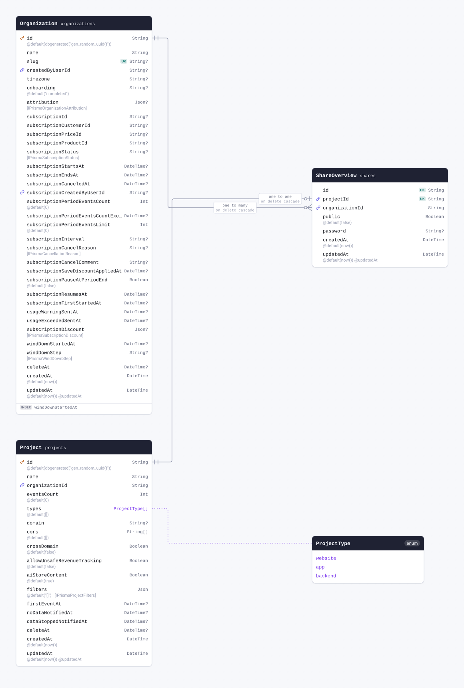

| Field            | Type       | Constraints                                       | Default              | Description |
| ---------------- | ---------- | ------------------------------------------------- | -------------------- | ----------- |
| `id`             | `String`   | UNIQUE NOT NULL                                   |                      |             |
| `projectId`      | `String`   | UNIQUE NOT NULL → [Project.id](#model-Project)    |                      |             |
| `organizationId` | `String`   | NOT NULL → [Organization.id](#model-Organization) |                      |             |
| `public`         | `Boolean`  | NOT NULL                                          | `false`              |             |
| `password`       | `String`   | NULL                                              |                      |             |
| `createdAt`      | `DateTime` | NOT NULL                                          | `now()`              |             |
| `updatedAt`      | `DateTime` | NOT NULL                                          | `now()` `@updatedAt` |             |

#### References

- `projectId` → [Project.id](#model-Project) (one-to-one, on delete Cascade)
- `organizationId` → [Organization.id](#model-Organization) (many-to-one, on delete Cascade)

#### Definition

```sql
CREATE TABLE "shares" (
    "id" TEXT NOT NULL,
    "projectId" TEXT NOT NULL,
    "organizationId" TEXT NOT NULL,
    "public" BOOLEAN NOT NULL DEFAULT false,
    "password" TEXT,
    "createdAt" TIMESTAMP(3) NOT NULL DEFAULT CURRENT_TIMESTAMP,
    "updatedAt" TIMESTAMP(3) NOT NULL DEFAULT CURRENT_TIMESTAMP
);

CREATE UNIQUE INDEX "shares_id_key" ON "shares"("id");

CREATE UNIQUE INDEX "shares_projectId_key" ON "shares"("projectId");

ALTER TABLE "shares" ADD CONSTRAINT "shares_projectId_fkey" FOREIGN KEY ("projectId") REFERENCES "projects"("id") ON DELETE CASCADE ON UPDATE CASCADE;

ALTER TABLE "shares" ADD CONSTRAINT "shares_organizationId_fkey" FOREIGN KEY ("organizationId") REFERENCES "organizations"("id") ON DELETE CASCADE ON UPDATE CASCADE;
```

<details>
<summary>Queries and their SQL</summary>

**findMany**: Every row

```ts
await prisma.shareOverview.findMany();
```

```sql
SELECT
  "public"."shares"."id",
  "public"."shares"."projectId",
  "public"."shares"."organizationId",
  "public"."shares"."public",
  "public"."shares"."password",
  "public"."shares"."createdAt",
  "public"."shares"."updatedAt"
FROM
  "public"."shares"
WHERE
  1 = 1
OFFSET
  $1
-- params: ["0"]
```

**count**: How many rows there are

```ts
await prisma.shareOverview.count();
```

```sql
SELECT
  COUNT(*) AS "_count$_all"
FROM
  (
    SELECT
      "public"."shares"."id"
    FROM
      "public"."shares"
    WHERE
      1 = 1
    OFFSET
      $1
  ) AS "sub"
-- params: ["0"]
```

**findMany**: Every row with its relations

```ts
await prisma.shareOverview.findMany({ include: { project: true, organization: true } });
```

```sql
SELECT
  "public"."shares"."id",
  "public"."shares"."projectId",
  "public"."shares"."organizationId",
  "public"."shares"."public",
  "public"."shares"."password",
  "public"."shares"."createdAt",
  "public"."shares"."updatedAt"
FROM
  "public"."shares"
WHERE
  1 = 1
OFFSET
  $1
-- params: ["0"]

SELECT
  "public"."projects"."id",
  "public"."projects"."name",
  "public"."projects"."organizationId",
  "public"."projects"."eventsCount",
  "public"."projects"."types"::text[],
  "public"."projects"."domain",
  "public"."projects"."cors",
  "public"."projects"."crossDomain",
  "public"."projects"."allowUnsafeRevenueTracking",
  "public"."projects"."aiStoreContent",
  "public"."projects"."filters",
  "public"."projects"."firstEventAt",
  "public"."projects"."noDataNotifiedAt",
  "public"."projects"."dataStoppedNotifiedAt",
  "public"."projects"."deleteAt",
  "public"."projects"."createdAt",
  "public"."projects"."updatedAt"
FROM
  "public"."projects"
WHERE
  "public"."projects"."id" IN ($1)
OFFSET
  $2
-- params: ["<projectId of the rows above>","0"]

SELECT
  "public"."organizations"."id",
  "public"."organizations"."name",
  "public"."organizations"."slug",
  "public"."organizations"."createdByUserId",
  "public"."organizations"."timezone",
  "public"."organizations"."onboarding",
  "public"."organizations"."attribution",
  "public"."organizations"."subscriptionId",
  "public"."organizations"."subscriptionCustomerId",
  "public"."organizations"."subscriptionPriceId",
  "public"."organizations"."subscriptionProductId",
  "public"."organizations"."subscriptionStatus",
  "public"."organizations"."subscriptionStartsAt",
  "public"."organizations"."subscriptionEndsAt",
  "public"."organizations"."subscriptionCanceledAt",
  "public"."organizations"."subscriptionCreatedByUserId",
  "public"."organizations"."subscriptionPeriodEventsCount",
  "public"."organizations"."subscriptionPeriodEventsCountExceededAt",
  "public"."organizations"."subscriptionPeriodEventsLimit",
  "public"."organizations"."subscriptionInterval",
  "public"."organizations"."subscriptionCancelReason",
  "public"."organizations"."subscriptionCancelComment",
  "public"."organizations"."subscriptionSaveDiscountAppliedAt",
  "public"."organizations"."subscriptionPauseAtPeriodEnd",
  "public"."organizations"."subscriptionResumesAt",
  "public"."organizations"."subscriptionFirstStartedAt",
  "public"."organizations"."usageWarningSentAt",
  "public"."organizations"."usageExceededSentAt",
  "public"."organizations"."subscriptionDiscount",
  "public"."organizations"."windDownStartedAt",
  "public"."organizations"."windDownStep",
  "public"."organizations"."deleteAt",
  "public"."organizations"."createdAt",
  "public"."organizations"."updatedAt"
FROM
  "public"."organizations"
WHERE
  "public"."organizations"."id" IN ($1)
OFFSET
  $2
-- params: ["<organizationId of the rows above>","0"]
```

**findUnique**: One row by what is unique to it

```ts
await prisma.shareOverview.findUnique({ where: { id: "example" } });
```

```sql
SELECT
  "public"."shares"."id",
  "public"."shares"."projectId",
  "public"."shares"."organizationId",
  "public"."shares"."public",
  "public"."shares"."password",
  "public"."shares"."createdAt",
  "public"."shares"."updatedAt"
FROM
  "public"."shares"
WHERE
  (
    "public"."shares"."id" = $1
    AND 1 = 1
  )
LIMIT
  $2
OFFSET
  $3
-- params: ["example","1","0"]
```

**create**: Create a row

```ts
await prisma.shareOverview.create({
  data: { id: "example", projectId: "example", organizationId: "example" },
});
```

```sql
INSERT INTO
  "public"."shares" (
    "id",
    "projectId",
    "organizationId",
    "public",
    "createdAt",
    "updatedAt"
  )
VALUES
  ($1, $2, $3, $4, $5, $6)
RETURNING
  "public"."shares"."id",
  "public"."shares"."projectId",
  "public"."shares"."organizationId",
  "public"."shares"."public",
  "public"."shares"."password",
  "public"."shares"."createdAt",
  "public"."shares"."updatedAt"
-- params: ["example","example","example",false,"<now()>","<now()>"]
```

**update**: Update a row

```ts
await prisma.shareOverview.update({ where: { id: "example" }, data: { public: true } });
```

```sql
UPDATE "public"."shares"
SET
  "public" = $1,
  "updatedAt" = $2
WHERE
  (
    "public"."shares"."id" = $3
    AND 1 = 1
  )
RETURNING
  "public"."shares"."id",
  "public"."shares"."projectId",
  "public"."shares"."organizationId",
  "public"."shares"."public",
  "public"."shares"."password",
  "public"."shares"."createdAt",
  "public"."shares"."updatedAt"
-- params: [true,{"prisma__type":"generatorCall","prisma__value":{"name":"now","args":[],"returnType":{"type":"DateTime"}}},"example"]
```

**delete**: Delete a row

```ts
await prisma.shareOverview.delete({ where: { id: "example" } });
```

```sql
DELETE FROM "public"."shares"
WHERE
  (
    "public"."shares"."id" = $1
    AND 1 = 1
  )
RETURNING
  "public"."shares"."id",
  "public"."shares"."projectId",
  "public"."shares"."organizationId",
  "public"."shares"."public",
  "public"."shares"."password",
  "public"."shares"."createdAt",
  "public"."shares"."updatedAt"
-- params: ["example"]
```

</details>

<a id="model-ShareDashboard"></a>

### ShareDashboard

Table `share_dashboards`.

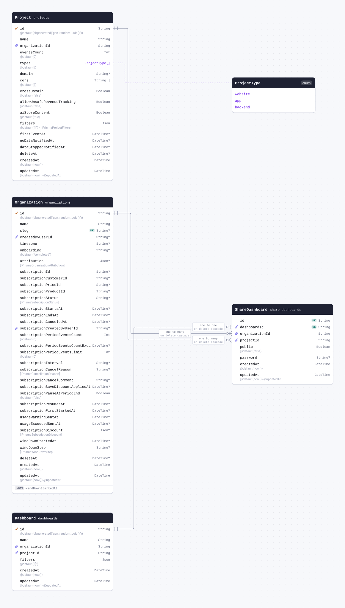

| Field            | Type       | Constraints                                        | Default              | Description |
| ---------------- | ---------- | -------------------------------------------------- | -------------------- | ----------- |
| `id`             | `String`   | UNIQUE NOT NULL                                    |                      |             |
| `dashboardId`    | `String`   | UNIQUE NOT NULL → [Dashboard.id](#model-Dashboard) |                      |             |
| `organizationId` | `String`   | NOT NULL → [Organization.id](#model-Organization)  |                      |             |
| `projectId`      | `String`   | NOT NULL → [Project.id](#model-Project)            |                      |             |
| `public`         | `Boolean`  | NOT NULL                                           | `false`              |             |
| `password`       | `String`   | NULL                                               |                      |             |
| `createdAt`      | `DateTime` | NOT NULL                                           | `now()`              |             |
| `updatedAt`      | `DateTime` | NOT NULL                                           | `now()` `@updatedAt` |             |

#### References

- `dashboardId` → [Dashboard.id](#model-Dashboard) (one-to-one, on delete Cascade)
- `organizationId` → [Organization.id](#model-Organization) (many-to-one, on delete Cascade)
- `projectId` → [Project.id](#model-Project) (many-to-one, on delete Cascade)

#### Definition

```sql
CREATE TABLE "share_dashboards" (
    "id" TEXT NOT NULL,
    "dashboardId" TEXT NOT NULL,
    "organizationId" TEXT NOT NULL,
    "projectId" TEXT NOT NULL,
    "public" BOOLEAN NOT NULL DEFAULT false,
    "password" TEXT,
    "createdAt" TIMESTAMP(3) NOT NULL DEFAULT CURRENT_TIMESTAMP,
    "updatedAt" TIMESTAMP(3) NOT NULL DEFAULT CURRENT_TIMESTAMP
);

CREATE UNIQUE INDEX "share_dashboards_id_key" ON "share_dashboards"("id");

CREATE UNIQUE INDEX "share_dashboards_dashboardId_key" ON "share_dashboards"("dashboardId");

ALTER TABLE "share_dashboards" ADD CONSTRAINT "share_dashboards_dashboardId_fkey" FOREIGN KEY ("dashboardId") REFERENCES "dashboards"("id") ON DELETE CASCADE ON UPDATE CASCADE;

ALTER TABLE "share_dashboards" ADD CONSTRAINT "share_dashboards_organizationId_fkey" FOREIGN KEY ("organizationId") REFERENCES "organizations"("id") ON DELETE CASCADE ON UPDATE CASCADE;

ALTER TABLE "share_dashboards" ADD CONSTRAINT "share_dashboards_projectId_fkey" FOREIGN KEY ("projectId") REFERENCES "projects"("id") ON DELETE CASCADE ON UPDATE CASCADE;
```

<details>
<summary>Queries and their SQL</summary>

**findMany**: Every row

```ts
await prisma.shareDashboard.findMany();
```

```sql
SELECT
  "public"."share_dashboards"."id",
  "public"."share_dashboards"."dashboardId",
  "public"."share_dashboards"."organizationId",
  "public"."share_dashboards"."projectId",
  "public"."share_dashboards"."public",
  "public"."share_dashboards"."password",
  "public"."share_dashboards"."createdAt",
  "public"."share_dashboards"."updatedAt"
FROM
  "public"."share_dashboards"
WHERE
  1 = 1
OFFSET
  $1
-- params: ["0"]
```

**count**: How many rows there are

```ts
await prisma.shareDashboard.count();
```

```sql
SELECT
  COUNT(*) AS "_count$_all"
FROM
  (
    SELECT
      "public"."share_dashboards"."id"
    FROM
      "public"."share_dashboards"
    WHERE
      1 = 1
    OFFSET
      $1
  ) AS "sub"
-- params: ["0"]
```

**findMany**: Every row with its relations

```ts
await prisma.shareDashboard.findMany({
  include: { dashboard: true, organization: true, project: true },
});
```

```sql
SELECT
  "public"."share_dashboards"."id",
  "public"."share_dashboards"."dashboardId",
  "public"."share_dashboards"."organizationId",
  "public"."share_dashboards"."projectId",
  "public"."share_dashboards"."public",
  "public"."share_dashboards"."password",
  "public"."share_dashboards"."createdAt",
  "public"."share_dashboards"."updatedAt"
FROM
  "public"."share_dashboards"
WHERE
  1 = 1
OFFSET
  $1
-- params: ["0"]

SELECT
  "public"."dashboards"."id",
  "public"."dashboards"."name",
  "public"."dashboards"."organizationId",
  "public"."dashboards"."projectId",
  "public"."dashboards"."filters",
  "public"."dashboards"."createdAt",
  "public"."dashboards"."updatedAt"
FROM
  "public"."dashboards"
WHERE
  "public"."dashboards"."id" IN ($1)
OFFSET
  $2
-- params: ["<dashboardId of the rows above>","0"]

SELECT
  "public"."organizations"."id",
  "public"."organizations"."name",
  "public"."organizations"."slug",
  "public"."organizations"."createdByUserId",
  "public"."organizations"."timezone",
  "public"."organizations"."onboarding",
  "public"."organizations"."attribution",
  "public"."organizations"."subscriptionId",
  "public"."organizations"."subscriptionCustomerId",
  "public"."organizations"."subscriptionPriceId",
  "public"."organizations"."subscriptionProductId",
  "public"."organizations"."subscriptionStatus",
  "public"."organizations"."subscriptionStartsAt",
  "public"."organizations"."subscriptionEndsAt",
  "public"."organizations"."subscriptionCanceledAt",
  "public"."organizations"."subscriptionCreatedByUserId",
  "public"."organizations"."subscriptionPeriodEventsCount",
  "public"."organizations"."subscriptionPeriodEventsCountExceededAt",
  "public"."organizations"."subscriptionPeriodEventsLimit",
  "public"."organizations"."subscriptionInterval",
  "public"."organizations"."subscriptionCancelReason",
  "public"."organizations"."subscriptionCancelComment",
  "public"."organizations"."subscriptionSaveDiscountAppliedAt",
  "public"."organizations"."subscriptionPauseAtPeriodEnd",
  "public"."organizations"."subscriptionResumesAt",
  "public"."organizations"."subscriptionFirstStartedAt",
  "public"."organizations"."usageWarningSentAt",
  "public"."organizations"."usageExceededSentAt",
  "public"."organizations"."subscriptionDiscount",
  "public"."organizations"."windDownStartedAt",
  "public"."organizations"."windDownStep",
  "public"."organizations"."deleteAt",
  "public"."organizations"."createdAt",
  "public"."organizations"."updatedAt"
FROM
  "public"."organizations"
WHERE
  "public"."organizations"."id" IN ($1)
OFFSET
  $2
-- params: ["<organizationId of the rows above>","0"]

SELECT
  "public"."projects"."id",
  "public"."projects"."name",
  "public"."projects"."organizationId",
  "public"."projects"."eventsCount",
  "public"."projects"."types"::text[],
  "public"."projects"."domain",
  "public"."projects"."cors",
  "public"."projects"."crossDomain",
  "public"."projects"."allowUnsafeRevenueTracking",
  "public"."projects"."aiStoreContent",
  "public"."projects"."filters",
  "public"."projects"."firstEventAt",
  "public"."projects"."noDataNotifiedAt",
  "public"."projects"."dataStoppedNotifiedAt",
  "public"."projects"."deleteAt",
  "public"."projects"."createdAt",
  "public"."projects"."updatedAt"
FROM
  "public"."projects"
WHERE
  "public"."projects"."id" IN ($1)
OFFSET
  $2
-- params: ["<projectId of the rows above>","0"]
```

**findUnique**: One row by what is unique to it

```ts
await prisma.shareDashboard.findUnique({ where: { id: "example" } });
```

```sql
SELECT
  "public"."share_dashboards"."id",
  "public"."share_dashboards"."dashboardId",
  "public"."share_dashboards"."organizationId",
  "public"."share_dashboards"."projectId",
  "public"."share_dashboards"."public",
  "public"."share_dashboards"."password",
  "public"."share_dashboards"."createdAt",
  "public"."share_dashboards"."updatedAt"
FROM
  "public"."share_dashboards"
WHERE
  (
    "public"."share_dashboards"."id" = $1
    AND 1 = 1
  )
LIMIT
  $2
OFFSET
  $3
-- params: ["example","1","0"]
```

**create**: Create a row

```ts
await prisma.shareDashboard.create({
  data: { id: "example", dashboardId: "example", organizationId: "example", projectId: "example" },
});
```

```sql
INSERT INTO
  "public"."share_dashboards" (
    "id",
    "dashboardId",
    "organizationId",
    "projectId",
    "public",
    "createdAt",
    "updatedAt"
  )
VALUES
  ($1, $2, $3, $4, $5, $6, $7)
RETURNING
  "public"."share_dashboards"."id",
  "public"."share_dashboards"."dashboardId",
  "public"."share_dashboards"."organizationId",
  "public"."share_dashboards"."projectId",
  "public"."share_dashboards"."public",
  "public"."share_dashboards"."password",
  "public"."share_dashboards"."createdAt",
  "public"."share_dashboards"."updatedAt"
-- params: ["example","example","example","example",false,"<now()>","<now()>"]
```

**update**: Update a row

```ts
await prisma.shareDashboard.update({ where: { id: "example" }, data: { public: true } });
```

```sql
UPDATE "public"."share_dashboards"
SET
  "public" = $1,
  "updatedAt" = $2
WHERE
  (
    "public"."share_dashboards"."id" = $3
    AND 1 = 1
  )
RETURNING
  "public"."share_dashboards"."id",
  "public"."share_dashboards"."dashboardId",
  "public"."share_dashboards"."organizationId",
  "public"."share_dashboards"."projectId",
  "public"."share_dashboards"."public",
  "public"."share_dashboards"."password",
  "public"."share_dashboards"."createdAt",
  "public"."share_dashboards"."updatedAt"
-- params: [true,{"prisma__type":"generatorCall","prisma__value":{"name":"now","args":[],"returnType":{"type":"DateTime"}}},"example"]
```

**delete**: Delete a row

```ts
await prisma.shareDashboard.delete({ where: { id: "example" } });
```

```sql
DELETE FROM "public"."share_dashboards"
WHERE
  (
    "public"."share_dashboards"."id" = $1
    AND 1 = 1
  )
RETURNING
  "public"."share_dashboards"."id",
  "public"."share_dashboards"."dashboardId",
  "public"."share_dashboards"."organizationId",
  "public"."share_dashboards"."projectId",
  "public"."share_dashboards"."public",
  "public"."share_dashboards"."password",
  "public"."share_dashboards"."createdAt",
  "public"."share_dashboards"."updatedAt"
-- params: ["example"]
```

</details>

<a id="model-ShareReport"></a>

### ShareReport

Table `share_reports`.

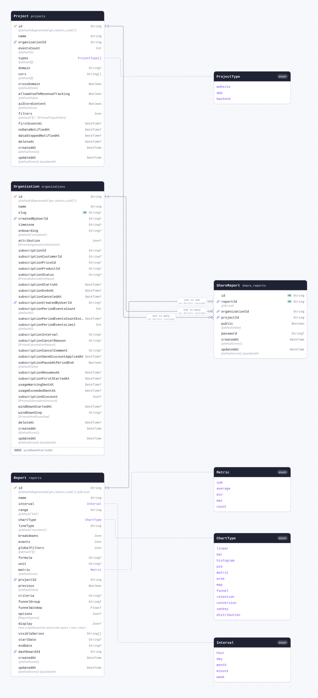

| Field            | Type                | Constraints                                       | Default              | Description |
| ---------------- | ------------------- | ------------------------------------------------- | -------------------- | ----------- |
| `id`             | `String`            | UNIQUE NOT NULL                                   |                      |             |
| `reportId`       | `String` `@db.Uuid` | UNIQUE NOT NULL → [Report.id](#model-Report)      |                      |             |
| `organizationId` | `String`            | NOT NULL → [Organization.id](#model-Organization) |                      |             |
| `projectId`      | `String`            | NOT NULL → [Project.id](#model-Project)           |                      |             |
| `public`         | `Boolean`           | NOT NULL                                          | `false`              |             |
| `password`       | `String`            | NULL                                              |                      |             |
| `createdAt`      | `DateTime`          | NOT NULL                                          | `now()`              |             |
| `updatedAt`      | `DateTime`          | NOT NULL                                          | `now()` `@updatedAt` |             |

#### References

- `reportId` → [Report.id](#model-Report) (one-to-one, on delete Cascade)
- `organizationId` → [Organization.id](#model-Organization) (many-to-one, on delete Cascade)
- `projectId` → [Project.id](#model-Project) (many-to-one, on delete Cascade)

#### Definition

```sql
CREATE TABLE "share_reports" (
    "id" TEXT NOT NULL,
    "reportId" UUID NOT NULL,
    "organizationId" TEXT NOT NULL,
    "projectId" TEXT NOT NULL,
    "public" BOOLEAN NOT NULL DEFAULT false,
    "password" TEXT,
    "createdAt" TIMESTAMP(3) NOT NULL DEFAULT CURRENT_TIMESTAMP,
    "updatedAt" TIMESTAMP(3) NOT NULL DEFAULT CURRENT_TIMESTAMP
);

CREATE UNIQUE INDEX "share_reports_id_key" ON "share_reports"("id");

CREATE UNIQUE INDEX "share_reports_reportId_key" ON "share_reports"("reportId");

ALTER TABLE "share_reports" ADD CONSTRAINT "share_reports_reportId_fkey" FOREIGN KEY ("reportId") REFERENCES "reports"("id") ON DELETE CASCADE ON UPDATE CASCADE;

ALTER TABLE "share_reports" ADD CONSTRAINT "share_reports_organizationId_fkey" FOREIGN KEY ("organizationId") REFERENCES "organizations"("id") ON DELETE CASCADE ON UPDATE CASCADE;

ALTER TABLE "share_reports" ADD CONSTRAINT "share_reports_projectId_fkey" FOREIGN KEY ("projectId") REFERENCES "projects"("id") ON DELETE CASCADE ON UPDATE CASCADE;
```

<details>
<summary>Queries and their SQL</summary>

**findMany**: Every row

```ts
await prisma.shareReport.findMany();
```

```sql
SELECT
  "public"."share_reports"."id",
  "public"."share_reports"."reportId",
  "public"."share_reports"."organizationId",
  "public"."share_reports"."projectId",
  "public"."share_reports"."public",
  "public"."share_reports"."password",
  "public"."share_reports"."createdAt",
  "public"."share_reports"."updatedAt"
FROM
  "public"."share_reports"
WHERE
  1 = 1
OFFSET
  $1
-- params: ["0"]
```

**count**: How many rows there are

```ts
await prisma.shareReport.count();
```

```sql
SELECT
  COUNT(*) AS "_count$_all"
FROM
  (
    SELECT
      "public"."share_reports"."id"
    FROM
      "public"."share_reports"
    WHERE
      1 = 1
    OFFSET
      $1
  ) AS "sub"
-- params: ["0"]
```

**findMany**: Every row with its relations

```ts
await prisma.shareReport.findMany({ include: { report: true, organization: true, project: true } });
```

```sql
SELECT
  "public"."share_reports"."id",
  "public"."share_reports"."reportId",
  "public"."share_reports"."organizationId",
  "public"."share_reports"."projectId",
  "public"."share_reports"."public",
  "public"."share_reports"."password",
  "public"."share_reports"."createdAt",
  "public"."share_reports"."updatedAt"
FROM
  "public"."share_reports"
WHERE
  1 = 1
OFFSET
  $1
-- params: ["0"]

SELECT
  "public"."reports"."id",
  "public"."reports"."name",
  "public"."reports"."interval"::text,
  "public"."reports"."range",
  "public"."reports"."chartType"::text,
  "public"."reports"."lineType",
  "public"."reports"."breakdowns",
  "public"."reports"."events",
  "public"."reports"."globalFilters",
  "public"."reports"."formula",
  "public"."reports"."unit",
  "public"."reports"."metric"::text,
  "public"."reports"."projectId",
  "public"."reports"."previous",
  "public"."reports"."criteria",
  "public"."reports"."funnelGroup",
  "public"."reports"."funnelWindow",
  "public"."reports"."options",
  "public"."reports"."display",
  "public"."reports"."visibleSeries",
  "public"."reports"."startDate",
  "public"."reports"."endDate",
  "public"."reports"."dashboardId",
  "public"."reports"."createdAt",
  "public"."reports"."updatedAt"
FROM
  "public"."reports"
WHERE
  "public"."reports"."id" IN ($1)
OFFSET
  $2
-- params: ["<reportId of the rows above>","0"]

SELECT
  "public"."organizations"."id",
  "public"."organizations"."name",
  "public"."organizations"."slug",
  "public"."organizations"."createdByUserId",
  "public"."organizations"."timezone",
  "public"."organizations"."onboarding",
  "public"."organizations"."attribution",
  "public"."organizations"."subscriptionId",
  "public"."organizations"."subscriptionCustomerId",
  "public"."organizations"."subscriptionPriceId",
  "public"."organizations"."subscriptionProductId",
  "public"."organizations"."subscriptionStatus",
  "public"."organizations"."subscriptionStartsAt",
  "public"."organizations"."subscriptionEndsAt",
  "public"."organizations"."subscriptionCanceledAt",
  "public"."organizations"."subscriptionCreatedByUserId",
  "public"."organizations"."subscriptionPeriodEventsCount",
  "public"."organizations"."subscriptionPeriodEventsCountExceededAt",
  "public"."organizations"."subscriptionPeriodEventsLimit",
  "public"."organizations"."subscriptionInterval",
  "public"."organizations"."subscriptionCancelReason",
  "public"."organizations"."subscriptionCancelComment",
  "public"."organizations"."subscriptionSaveDiscountAppliedAt",
  "public"."organizations"."subscriptionPauseAtPeriodEnd",
  "public"."organizations"."subscriptionResumesAt",
  "public"."organizations"."subscriptionFirstStartedAt",
  "public"."organizations"."usageWarningSentAt",
  "public"."organizations"."usageExceededSentAt",
  "public"."organizations"."subscriptionDiscount",
  "public"."organizations"."windDownStartedAt",
  "public"."organizations"."windDownStep",
  "public"."organizations"."deleteAt",
  "public"."organizations"."createdAt",
  "public"."organizations"."updatedAt"
FROM
  "public"."organizations"
WHERE
  "public"."organizations"."id" IN ($1)
OFFSET
  $2
-- params: ["<organizationId of the rows above>","0"]

SELECT
  "public"."projects"."id",
  "public"."projects"."name",
  "public"."projects"."organizationId",
  "public"."projects"."eventsCount",
  "public"."projects"."types"::text[],
  "public"."projects"."domain",
  "public"."projects"."cors",
  "public"."projects"."crossDomain",
  "public"."projects"."allowUnsafeRevenueTracking",
  "public"."projects"."aiStoreContent",
  "public"."projects"."filters",
  "public"."projects"."firstEventAt",
  "public"."projects"."noDataNotifiedAt",
  "public"."projects"."dataStoppedNotifiedAt",
  "public"."projects"."deleteAt",
  "public"."projects"."createdAt",
  "public"."projects"."updatedAt"
FROM
  "public"."projects"
WHERE
  "public"."projects"."id" IN ($1)
OFFSET
  $2
-- params: ["<projectId of the rows above>","0"]
```

**findUnique**: One row by what is unique to it

```ts
await prisma.shareReport.findUnique({ where: { id: "example" } });
```

```sql
SELECT
  "public"."share_reports"."id",
  "public"."share_reports"."reportId",
  "public"."share_reports"."organizationId",
  "public"."share_reports"."projectId",
  "public"."share_reports"."public",
  "public"."share_reports"."password",
  "public"."share_reports"."createdAt",
  "public"."share_reports"."updatedAt"
FROM
  "public"."share_reports"
WHERE
  (
    "public"."share_reports"."id" = $1
    AND 1 = 1
  )
LIMIT
  $2
OFFSET
  $3
-- params: ["example","1","0"]
```

**create**: Create a row

```ts
await prisma.shareReport.create({
  data: { id: "example", reportId: "example", organizationId: "example", projectId: "example" },
});
```

```sql
INSERT INTO
  "public"."share_reports" (
    "id",
    "reportId",
    "organizationId",
    "projectId",
    "public",
    "createdAt",
    "updatedAt"
  )
VALUES
  ($1, $2, $3, $4, $5, $6, $7)
RETURNING
  "public"."share_reports"."id",
  "public"."share_reports"."reportId",
  "public"."share_reports"."organizationId",
  "public"."share_reports"."projectId",
  "public"."share_reports"."public",
  "public"."share_reports"."password",
  "public"."share_reports"."createdAt",
  "public"."share_reports"."updatedAt"
-- params: ["example","example","example","example",false,"<now()>","<now()>"]
```

**update**: Update a row

```ts
await prisma.shareReport.update({ where: { id: "example" }, data: { public: true } });
```

```sql
UPDATE "public"."share_reports"
SET
  "public" = $1,
  "updatedAt" = $2
WHERE
  (
    "public"."share_reports"."id" = $3
    AND 1 = 1
  )
RETURNING
  "public"."share_reports"."id",
  "public"."share_reports"."reportId",
  "public"."share_reports"."organizationId",
  "public"."share_reports"."projectId",
  "public"."share_reports"."public",
  "public"."share_reports"."password",
  "public"."share_reports"."createdAt",
  "public"."share_reports"."updatedAt"
-- params: [true,{"prisma__type":"generatorCall","prisma__value":{"name":"now","args":[],"returnType":{"type":"DateTime"}}},"example"]
```

**delete**: Delete a row

```ts
await prisma.shareReport.delete({ where: { id: "example" } });
```

```sql
DELETE FROM "public"."share_reports"
WHERE
  (
    "public"."share_reports"."id" = $1
    AND 1 = 1
  )
RETURNING
  "public"."share_reports"."id",
  "public"."share_reports"."reportId",
  "public"."share_reports"."organizationId",
  "public"."share_reports"."projectId",
  "public"."share_reports"."public",
  "public"."share_reports"."password",
  "public"."share_reports"."createdAt",
  "public"."share_reports"."updatedAt"
-- params: ["example"]
```

</details>

<a id="model-ShareWidget"></a>

### ShareWidget

Table `share_widgets`.

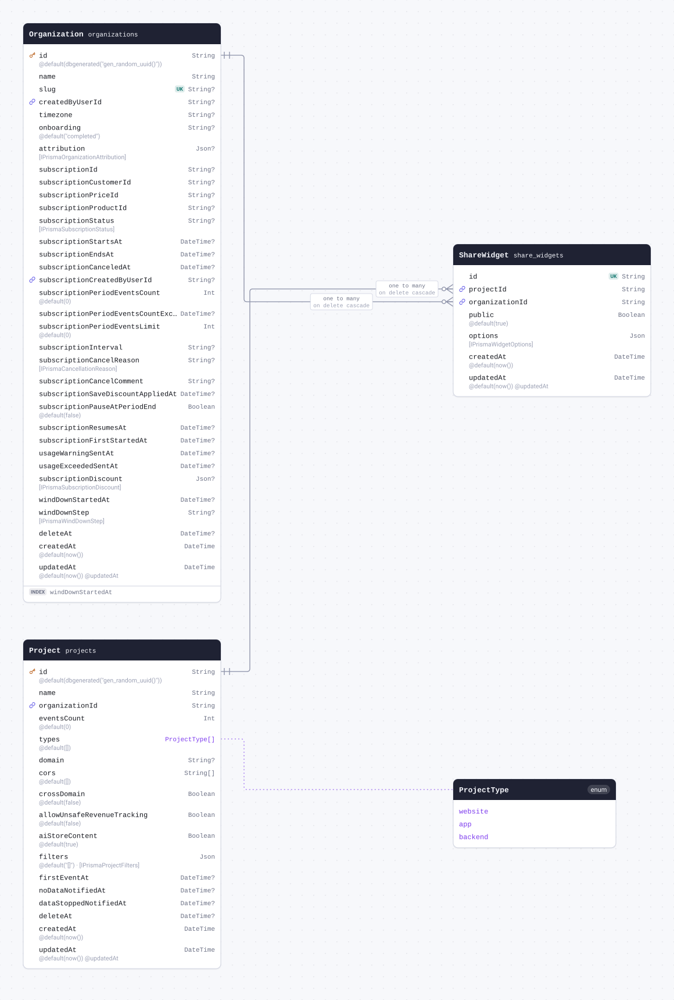

| Field            | Type       | Constraints                                       | Default              | Description            |
| ---------------- | ---------- | ------------------------------------------------- | -------------------- | ---------------------- |
| `id`             | `String`   | UNIQUE NOT NULL                                   |                      |                        |
| `projectId`      | `String`   | NOT NULL → [Project.id](#model-Project)           |                      |                        |
| `organizationId` | `String`   | NOT NULL → [Organization.id](#model-Organization) |                      |                        |
| `public`         | `Boolean`  | NOT NULL                                          | `true`               |                        |
| `options`        | `Json`     | NOT NULL                                          |                      | [IPrismaWidgetOptions] |
| `createdAt`      | `DateTime` | NOT NULL                                          | `now()`              |                        |
| `updatedAt`      | `DateTime` | NOT NULL                                          | `now()` `@updatedAt` |                        |

#### References

- `projectId` → [Project.id](#model-Project) (many-to-one, on delete Cascade)
- `organizationId` → [Organization.id](#model-Organization) (many-to-one, on delete Cascade)

#### Definition

```sql
CREATE TABLE "share_widgets" (
    "id" TEXT NOT NULL,
    "projectId" TEXT NOT NULL,
    "organizationId" TEXT NOT NULL,
    "public" BOOLEAN NOT NULL DEFAULT true,
    "options" JSONB NOT NULL,
    "createdAt" TIMESTAMP(3) NOT NULL DEFAULT CURRENT_TIMESTAMP,
    "updatedAt" TIMESTAMP(3) NOT NULL DEFAULT CURRENT_TIMESTAMP
);

CREATE UNIQUE INDEX "share_widgets_id_key" ON "share_widgets"("id");

ALTER TABLE "share_widgets" ADD CONSTRAINT "share_widgets_projectId_fkey" FOREIGN KEY ("projectId") REFERENCES "projects"("id") ON DELETE CASCADE ON UPDATE CASCADE;

ALTER TABLE "share_widgets" ADD CONSTRAINT "share_widgets_organizationId_fkey" FOREIGN KEY ("organizationId") REFERENCES "organizations"("id") ON DELETE CASCADE ON UPDATE CASCADE;
```

<details>
<summary>Queries and their SQL</summary>

**findMany**: Every row

```ts
await prisma.shareWidget.findMany();
```

```sql
SELECT
  "public"."share_widgets"."id",
  "public"."share_widgets"."projectId",
  "public"."share_widgets"."organizationId",
  "public"."share_widgets"."public",
  "public"."share_widgets"."options",
  "public"."share_widgets"."createdAt",
  "public"."share_widgets"."updatedAt"
FROM
  "public"."share_widgets"
WHERE
  1 = 1
OFFSET
  $1
-- params: ["0"]
```

**count**: How many rows there are

```ts
await prisma.shareWidget.count();
```

```sql
SELECT
  COUNT(*) AS "_count$_all"
FROM
  (
    SELECT
      "public"."share_widgets"."id"
    FROM
      "public"."share_widgets"
    WHERE
      1 = 1
    OFFSET
      $1
  ) AS "sub"
-- params: ["0"]
```

**findMany**: Every row with its relations

```ts
await prisma.shareWidget.findMany({ include: { project: true, organization: true } });
```

```sql
SELECT
  "public"."share_widgets"."id",
  "public"."share_widgets"."projectId",
  "public"."share_widgets"."organizationId",
  "public"."share_widgets"."public",
  "public"."share_widgets"."options",
  "public"."share_widgets"."createdAt",
  "public"."share_widgets"."updatedAt"
FROM
  "public"."share_widgets"
WHERE
  1 = 1
OFFSET
  $1
-- params: ["0"]

SELECT
  "public"."projects"."id",
  "public"."projects"."name",
  "public"."projects"."organizationId",
  "public"."projects"."eventsCount",
  "public"."projects"."types"::text[],
  "public"."projects"."domain",
  "public"."projects"."cors",
  "public"."projects"."crossDomain",
  "public"."projects"."allowUnsafeRevenueTracking",
  "public"."projects"."aiStoreContent",
  "public"."projects"."filters",
  "public"."projects"."firstEventAt",
  "public"."projects"."noDataNotifiedAt",
  "public"."projects"."dataStoppedNotifiedAt",
  "public"."projects"."deleteAt",
  "public"."projects"."createdAt",
  "public"."projects"."updatedAt"
FROM
  "public"."projects"
WHERE
  "public"."projects"."id" IN ($1)
OFFSET
  $2
-- params: ["<projectId of the rows above>","0"]

SELECT
  "public"."organizations"."id",
  "public"."organizations"."name",
  "public"."organizations"."slug",
  "public"."organizations"."createdByUserId",
  "public"."organizations"."timezone",
  "public"."organizations"."onboarding",
  "public"."organizations"."attribution",
  "public"."organizations"."subscriptionId",
  "public"."organizations"."subscriptionCustomerId",
  "public"."organizations"."subscriptionPriceId",
  "public"."organizations"."subscriptionProductId",
  "public"."organizations"."subscriptionStatus",
  "public"."organizations"."subscriptionStartsAt",
  "public"."organizations"."subscriptionEndsAt",
  "public"."organizations"."subscriptionCanceledAt",
  "public"."organizations"."subscriptionCreatedByUserId",
  "public"."organizations"."subscriptionPeriodEventsCount",
  "public"."organizations"."subscriptionPeriodEventsCountExceededAt",
  "public"."organizations"."subscriptionPeriodEventsLimit",
  "public"."organizations"."subscriptionInterval",
  "public"."organizations"."subscriptionCancelReason",
  "public"."organizations"."subscriptionCancelComment",
  "public"."organizations"."subscriptionSaveDiscountAppliedAt",
  "public"."organizations"."subscriptionPauseAtPeriodEnd",
  "public"."organizations"."subscriptionResumesAt",
  "public"."organizations"."subscriptionFirstStartedAt",
  "public"."organizations"."usageWarningSentAt",
  "public"."organizations"."usageExceededSentAt",
  "public"."organizations"."subscriptionDiscount",
  "public"."organizations"."windDownStartedAt",
  "public"."organizations"."windDownStep",
  "public"."organizations"."deleteAt",
  "public"."organizations"."createdAt",
  "public"."organizations"."updatedAt"
FROM
  "public"."organizations"
WHERE
  "public"."organizations"."id" IN ($1)
OFFSET
  $2
-- params: ["<organizationId of the rows above>","0"]
```

**findUnique**: One row by what is unique to it

```ts
await prisma.shareWidget.findUnique({ where: { id: "example" } });
```

```sql
SELECT
  "public"."share_widgets"."id",
  "public"."share_widgets"."projectId",
  "public"."share_widgets"."organizationId",
  "public"."share_widgets"."public",
  "public"."share_widgets"."options",
  "public"."share_widgets"."createdAt",
  "public"."share_widgets"."updatedAt"
FROM
  "public"."share_widgets"
WHERE
  (
    "public"."share_widgets"."id" = $1
    AND 1 = 1
  )
LIMIT
  $2
OFFSET
  $3
-- params: ["example","1","0"]
```

**create**: Create a row

```ts
await prisma.shareWidget.create({
  data: { id: "example", projectId: "example", organizationId: "example", options: {} },
});
```

```sql
INSERT INTO
  "public"."share_widgets" (
    "id",
    "projectId",
    "organizationId",
    "public",
    "options",
    "createdAt",
    "updatedAt"
  )
VALUES
  ($1, $2, $3, $4, $5, $6, $7)
RETURNING
  "public"."share_widgets"."id",
  "public"."share_widgets"."projectId",
  "public"."share_widgets"."organizationId",
  "public"."share_widgets"."public",
  "public"."share_widgets"."options",
  "public"."share_widgets"."createdAt",
  "public"."share_widgets"."updatedAt"
-- params: ["example","example","example",true,"{}","<now()>","<now()>"]
```

**update**: Update a row

```ts
await prisma.shareWidget.update({ where: { id: "example" }, data: { public: true } });
```

```sql
UPDATE "public"."share_widgets"
SET
  "public" = $1,
  "updatedAt" = $2
WHERE
  (
    "public"."share_widgets"."id" = $3
    AND 1 = 1
  )
RETURNING
  "public"."share_widgets"."id",
  "public"."share_widgets"."projectId",
  "public"."share_widgets"."organizationId",
  "public"."share_widgets"."public",
  "public"."share_widgets"."options",
  "public"."share_widgets"."createdAt",
  "public"."share_widgets"."updatedAt"
-- params: [true,{"prisma__type":"generatorCall","prisma__value":{"name":"now","args":[],"returnType":{"type":"DateTime"}}},"example"]
```

**delete**: Delete a row

```ts
await prisma.shareWidget.delete({ where: { id: "example" } });
```

```sql
DELETE FROM "public"."share_widgets"
WHERE
  (
    "public"."share_widgets"."id" = $1
    AND 1 = 1
  )
RETURNING
  "public"."share_widgets"."id",
  "public"."share_widgets"."projectId",
  "public"."share_widgets"."organizationId",
  "public"."share_widgets"."public",
  "public"."share_widgets"."options",
  "public"."share_widgets"."createdAt",
  "public"."share_widgets"."updatedAt"
-- params: ["example"]
```

</details>

<a id="model-EventMeta"></a>

### EventMeta

Table `event_meta`.

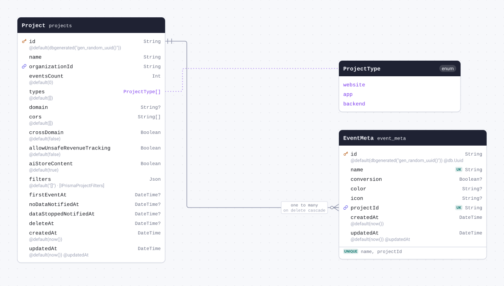

| Field        | Type                | Constraints                             | Default                            | Description |
| ------------ | ------------------- | --------------------------------------- | ---------------------------------- | ----------- |
| `id`         | `String` `@db.Uuid` | PK NOT NULL                             | `dbgenerated("gen_random_uuid()")` |             |
| `name`       | `String`            | NOT NULL                                |                                    |             |
| `conversion` | `Boolean`           | NULL                                    |                                    |             |
| `color`      | `String`            | NULL                                    |                                    |             |
| `icon`       | `String`            | NULL                                    |                                    |             |
| `projectId`  | `String`            | NOT NULL → [Project.id](#model-Project) |                                    |             |
| `createdAt`  | `DateTime`          | NOT NULL                                | `now()`                            |             |
| `updatedAt`  | `DateTime`          | NOT NULL                                | `now()` `@updatedAt`               |             |

#### Indexes

- `@@unique([name, projectId])`

#### References

- `projectId` → [Project.id](#model-Project) (many-to-one, on delete Cascade)

#### Definition

```sql
CREATE TABLE "event_meta" (
    "id" UUID NOT NULL DEFAULT gen_random_uuid(),
    "name" TEXT NOT NULL,
    "conversion" BOOLEAN,
    "color" TEXT,
    "icon" TEXT,
    "projectId" TEXT NOT NULL,
    "createdAt" TIMESTAMP(3) NOT NULL DEFAULT CURRENT_TIMESTAMP,
    "updatedAt" TIMESTAMP(3) NOT NULL DEFAULT CURRENT_TIMESTAMP,

    CONSTRAINT "event_meta_pkey" PRIMARY KEY ("id")
);

CREATE UNIQUE INDEX "event_meta_name_projectId_key" ON "event_meta"("name", "projectId");

ALTER TABLE "event_meta" ADD CONSTRAINT "event_meta_projectId_fkey" FOREIGN KEY ("projectId") REFERENCES "projects"("id") ON DELETE CASCADE ON UPDATE CASCADE;
```

<details>
<summary>Queries and their SQL</summary>

**findMany**: Every row

```ts
await prisma.eventMeta.findMany();
```

```sql
SELECT
  "public"."event_meta"."id",
  "public"."event_meta"."name",
  "public"."event_meta"."conversion",
  "public"."event_meta"."color",
  "public"."event_meta"."icon",
  "public"."event_meta"."projectId",
  "public"."event_meta"."createdAt",
  "public"."event_meta"."updatedAt"
FROM
  "public"."event_meta"
WHERE
  1 = 1
OFFSET
  $1
-- params: ["0"]
```

**count**: How many rows there are

```ts
await prisma.eventMeta.count();
```

```sql
SELECT
  COUNT(*) AS "_count$_all"
FROM
  (
    SELECT
      "public"."event_meta"."id"
    FROM
      "public"."event_meta"
    WHERE
      1 = 1
    OFFSET
      $1
  ) AS "sub"
-- params: ["0"]
```

**findMany**: Every row with its relations

```ts
await prisma.eventMeta.findMany({ include: { project: true } });
```

```sql
SELECT
  "public"."event_meta"."id",
  "public"."event_meta"."name",
  "public"."event_meta"."conversion",
  "public"."event_meta"."color",
  "public"."event_meta"."icon",
  "public"."event_meta"."projectId",
  "public"."event_meta"."createdAt",
  "public"."event_meta"."updatedAt"
FROM
  "public"."event_meta"
WHERE
  1 = 1
OFFSET
  $1
-- params: ["0"]

SELECT
  "public"."projects"."id",
  "public"."projects"."name",
  "public"."projects"."organizationId",
  "public"."projects"."eventsCount",
  "public"."projects"."types"::text[],
  "public"."projects"."domain",
  "public"."projects"."cors",
  "public"."projects"."crossDomain",
  "public"."projects"."allowUnsafeRevenueTracking",
  "public"."projects"."aiStoreContent",
  "public"."projects"."filters",
  "public"."projects"."firstEventAt",
  "public"."projects"."noDataNotifiedAt",
  "public"."projects"."dataStoppedNotifiedAt",
  "public"."projects"."deleteAt",
  "public"."projects"."createdAt",
  "public"."projects"."updatedAt"
FROM
  "public"."projects"
WHERE
  "public"."projects"."id" IN ($1)
OFFSET
  $2
-- params: ["<projectId of the rows above>","0"]
```

**findUnique**: One row by what is unique to it

```ts
await prisma.eventMeta.findUnique({ where: { id: "example" } });
```

```sql
SELECT
  "public"."event_meta"."id",
  "public"."event_meta"."name",
  "public"."event_meta"."conversion",
  "public"."event_meta"."color",
  "public"."event_meta"."icon",
  "public"."event_meta"."projectId",
  "public"."event_meta"."createdAt",
  "public"."event_meta"."updatedAt"
FROM
  "public"."event_meta"
WHERE
  (
    "public"."event_meta"."id" = $1
    AND 1 = 1
  )
LIMIT
  $2
OFFSET
  $3
-- params: ["example","1","0"]
```

**create**: Create a row

```ts
await prisma.eventMeta.create({ data: { name: "example", projectId: "example" } });
```

```sql
INSERT INTO
  "public"."event_meta" ("name", "projectId", "createdAt", "updatedAt")
VALUES
  ($1, $2, $3, $4)
RETURNING
  "public"."event_meta"."id",
  "public"."event_meta"."name",
  "public"."event_meta"."conversion",
  "public"."event_meta"."color",
  "public"."event_meta"."icon",
  "public"."event_meta"."projectId",
  "public"."event_meta"."createdAt",
  "public"."event_meta"."updatedAt"
-- params: ["example","example","<now()>","<now()>"]
```

**update**: Update a row

```ts
await prisma.eventMeta.update({ where: { id: "example" }, data: { name: "example" } });
```

```sql
UPDATE "public"."event_meta"
SET
  "name" = $1,
  "updatedAt" = $2
WHERE
  (
    "public"."event_meta"."id" = $3
    AND 1 = 1
  )
RETURNING
  "public"."event_meta"."id",
  "public"."event_meta"."name",
  "public"."event_meta"."conversion",
  "public"."event_meta"."color",
  "public"."event_meta"."icon",
  "public"."event_meta"."projectId",
  "public"."event_meta"."createdAt",
  "public"."event_meta"."updatedAt"
-- params: ["example",{"prisma__type":"generatorCall","prisma__value":{"name":"now","args":[],"returnType":{"type":"DateTime"}}},"example"]
```

**delete**: Delete a row

```ts
await prisma.eventMeta.delete({ where: { id: "example" } });
```

```sql
DELETE FROM "public"."event_meta"
WHERE
  (
    "public"."event_meta"."id" = $1
    AND 1 = 1
  )
RETURNING
  "public"."event_meta"."id",
  "public"."event_meta"."name",
  "public"."event_meta"."conversion",
  "public"."event_meta"."color",
  "public"."event_meta"."icon",
  "public"."event_meta"."projectId",
  "public"."event_meta"."createdAt",
  "public"."event_meta"."updatedAt"
-- params: ["example"]
```

</details>

<a id="model-CustomEvent"></a>

### CustomEvent

Table `custom_events`.

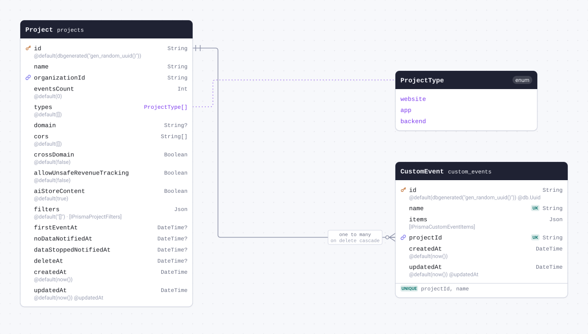

| Field       | Type                | Constraints                             | Default                            | Description               |
| ----------- | ------------------- | --------------------------------------- | ---------------------------------- | ------------------------- |
| `id`        | `String` `@db.Uuid` | PK NOT NULL                             | `dbgenerated("gen_random_uuid()")` |                           |
| `name`      | `String`            | NOT NULL                                |                                    |                           |
| `items`     | `Json`              | NOT NULL                                |                                    | [IPrismaCustomEventItems] |
| `projectId` | `String`            | NOT NULL → [Project.id](#model-Project) |                                    |                           |
| `createdAt` | `DateTime`          | NOT NULL                                | `now()`                            |                           |
| `updatedAt` | `DateTime`          | NOT NULL                                | `now()` `@updatedAt`               |                           |

#### Indexes

- `@@unique([projectId, name])`

#### References

- `projectId` → [Project.id](#model-Project) (many-to-one, on delete Cascade)

#### Definition

```sql
CREATE TABLE "custom_events" (
    "id" UUID NOT NULL DEFAULT gen_random_uuid(),
    "name" TEXT NOT NULL,
    "items" JSONB NOT NULL,
    "projectId" TEXT NOT NULL,
    "createdAt" TIMESTAMP(3) NOT NULL DEFAULT CURRENT_TIMESTAMP,
    "updatedAt" TIMESTAMP(3) NOT NULL DEFAULT CURRENT_TIMESTAMP,

    CONSTRAINT "custom_events_pkey" PRIMARY KEY ("id")
);

CREATE UNIQUE INDEX "custom_events_projectId_name_key" ON "custom_events"("projectId", "name");

ALTER TABLE "custom_events" ADD CONSTRAINT "custom_events_projectId_fkey" FOREIGN KEY ("projectId") REFERENCES "projects"("id") ON DELETE CASCADE ON UPDATE CASCADE;
```

<details>
<summary>Queries and their SQL</summary>

**findMany**: Every row

```ts
await prisma.customEvent.findMany();
```

```sql
SELECT
  "public"."custom_events"."id",
  "public"."custom_events"."name",
  "public"."custom_events"."items",
  "public"."custom_events"."projectId",
  "public"."custom_events"."createdAt",
  "public"."custom_events"."updatedAt"
FROM
  "public"."custom_events"
WHERE
  1 = 1
OFFSET
  $1
-- params: ["0"]
```

**count**: How many rows there are

```ts
await prisma.customEvent.count();
```

```sql
SELECT
  COUNT(*) AS "_count$_all"
FROM
  (
    SELECT
      "public"."custom_events"."id"
    FROM
      "public"."custom_events"
    WHERE
      1 = 1
    OFFSET
      $1
  ) AS "sub"
-- params: ["0"]
```

**findMany**: Every row with its relations

```ts
await prisma.customEvent.findMany({ include: { project: true } });
```

```sql
SELECT
  "public"."custom_events"."id",
  "public"."custom_events"."name",
  "public"."custom_events"."items",
  "public"."custom_events"."projectId",
  "public"."custom_events"."createdAt",
  "public"."custom_events"."updatedAt"
FROM
  "public"."custom_events"
WHERE
  1 = 1
OFFSET
  $1
-- params: ["0"]

SELECT
  "public"."projects"."id",
  "public"."projects"."name",
  "public"."projects"."organizationId",
  "public"."projects"."eventsCount",
  "public"."projects"."types"::text[],
  "public"."projects"."domain",
  "public"."projects"."cors",
  "public"."projects"."crossDomain",
  "public"."projects"."allowUnsafeRevenueTracking",
  "public"."projects"."aiStoreContent",
  "public"."projects"."filters",
  "public"."projects"."firstEventAt",
  "public"."projects"."noDataNotifiedAt",
  "public"."projects"."dataStoppedNotifiedAt",
  "public"."projects"."deleteAt",
  "public"."projects"."createdAt",
  "public"."projects"."updatedAt"
FROM
  "public"."projects"
WHERE
  "public"."projects"."id" IN ($1)
OFFSET
  $2
-- params: ["<projectId of the rows above>","0"]
```

**findUnique**: One row by what is unique to it

```ts
await prisma.customEvent.findUnique({ where: { id: "example" } });
```

```sql
SELECT
  "public"."custom_events"."id",
  "public"."custom_events"."name",
  "public"."custom_events"."items",
  "public"."custom_events"."projectId",
  "public"."custom_events"."createdAt",
  "public"."custom_events"."updatedAt"
FROM
  "public"."custom_events"
WHERE
  (
    "public"."custom_events"."id" = $1
    AND 1 = 1
  )
LIMIT
  $2
OFFSET
  $3
-- params: ["example","1","0"]
```

**create**: Create a row

```ts
await prisma.customEvent.create({ data: { name: "example", items: {}, projectId: "example" } });
```

```sql
INSERT INTO
  "public"."custom_events" (
    "name",
    "items",
    "projectId",
    "createdAt",
    "updatedAt"
  )
VALUES
  ($1, $2, $3, $4, $5)
RETURNING
  "public"."custom_events"."id",
  "public"."custom_events"."name",
  "public"."custom_events"."items",
  "public"."custom_events"."projectId",
  "public"."custom_events"."createdAt",
  "public"."custom_events"."updatedAt"
-- params: ["example","{}","example","<now()>","<now()>"]
```

**update**: Update a row

```ts
await prisma.customEvent.update({ where: { id: "example" }, data: { name: "example" } });
```

```sql
UPDATE "public"."custom_events"
SET
  "name" = $1,
  "updatedAt" = $2
WHERE
  (
    "public"."custom_events"."id" = $3
    AND 1 = 1
  )
RETURNING
  "public"."custom_events"."id",
  "public"."custom_events"."name",
  "public"."custom_events"."items",
  "public"."custom_events"."projectId",
  "public"."custom_events"."createdAt",
  "public"."custom_events"."updatedAt"
-- params: ["example",{"prisma__type":"generatorCall","prisma__value":{"name":"now","args":[],"returnType":{"type":"DateTime"}}},"example"]
```

**delete**: Delete a row

```ts
await prisma.customEvent.delete({ where: { id: "example" } });
```

```sql
DELETE FROM "public"."custom_events"
WHERE
  (
    "public"."custom_events"."id" = $1
    AND 1 = 1
  )
RETURNING
  "public"."custom_events"."id",
  "public"."custom_events"."name",
  "public"."custom_events"."items",
  "public"."custom_events"."projectId",
  "public"."custom_events"."createdAt",
  "public"."custom_events"."updatedAt"
-- params: ["example"]
```

</details>

<a id="model-Reference"></a>

### Reference

Table `references`.

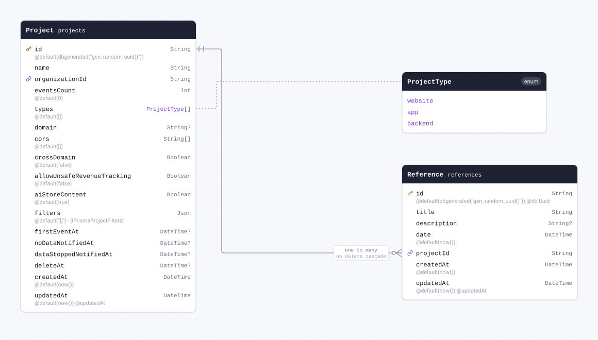

| Field         | Type                | Constraints                             | Default                            | Description |
| ------------- | ------------------- | --------------------------------------- | ---------------------------------- | ----------- |
| `id`          | `String` `@db.Uuid` | PK NOT NULL                             | `dbgenerated("gen_random_uuid()")` |             |
| `title`       | `String`            | NOT NULL                                |                                    |             |
| `description` | `String`            | NULL                                    |                                    |             |
| `date`        | `DateTime`          | NOT NULL                                | `now()`                            |             |
| `projectId`   | `String`            | NOT NULL → [Project.id](#model-Project) |                                    |             |
| `createdAt`   | `DateTime`          | NOT NULL                                | `now()`                            |             |
| `updatedAt`   | `DateTime`          | NOT NULL                                | `now()` `@updatedAt`               |             |

#### References

- `projectId` → [Project.id](#model-Project) (many-to-one, on delete Cascade)

#### Definition

```sql
CREATE TABLE "references" (
    "id" UUID NOT NULL DEFAULT gen_random_uuid(),
    "title" TEXT NOT NULL,
    "description" TEXT,
    "date" TIMESTAMP(3) NOT NULL DEFAULT CURRENT_TIMESTAMP,
    "projectId" TEXT NOT NULL,
    "createdAt" TIMESTAMP(3) NOT NULL DEFAULT CURRENT_TIMESTAMP,
    "updatedAt" TIMESTAMP(3) NOT NULL DEFAULT CURRENT_TIMESTAMP,

    CONSTRAINT "references_pkey" PRIMARY KEY ("id")
);

ALTER TABLE "references" ADD CONSTRAINT "references_projectId_fkey" FOREIGN KEY ("projectId") REFERENCES "projects"("id") ON DELETE CASCADE ON UPDATE CASCADE;
```

<details>
<summary>Queries and their SQL</summary>

**findMany**: Every row

```ts
await prisma.reference.findMany();
```

```sql
SELECT
  "public"."references"."id",
  "public"."references"."title",
  "public"."references"."description",
  "public"."references"."date",
  "public"."references"."projectId",
  "public"."references"."createdAt",
  "public"."references"."updatedAt"
FROM
  "public"."references"
WHERE
  1 = 1
OFFSET
  $1
-- params: ["0"]
```

**count**: How many rows there are

```ts
await prisma.reference.count();
```

```sql
SELECT
  COUNT(*) AS "_count$_all"
FROM
  (
    SELECT
      "public"."references"."id"
    FROM
      "public"."references"
    WHERE
      1 = 1
    OFFSET
      $1
  ) AS "sub"
-- params: ["0"]
```

**findMany**: Every row with its relations

```ts
await prisma.reference.findMany({ include: { project: true } });
```

```sql
SELECT
  "public"."references"."id",
  "public"."references"."title",
  "public"."references"."description",
  "public"."references"."date",
  "public"."references"."projectId",
  "public"."references"."createdAt",
  "public"."references"."updatedAt"
FROM
  "public"."references"
WHERE
  1 = 1
OFFSET
  $1
-- params: ["0"]

SELECT
  "public"."projects"."id",
  "public"."projects"."name",
  "public"."projects"."organizationId",
  "public"."projects"."eventsCount",
  "public"."projects"."types"::text[],
  "public"."projects"."domain",
  "public"."projects"."cors",
  "public"."projects"."crossDomain",
  "public"."projects"."allowUnsafeRevenueTracking",
  "public"."projects"."aiStoreContent",
  "public"."projects"."filters",
  "public"."projects"."firstEventAt",
  "public"."projects"."noDataNotifiedAt",
  "public"."projects"."dataStoppedNotifiedAt",
  "public"."projects"."deleteAt",
  "public"."projects"."createdAt",
  "public"."projects"."updatedAt"
FROM
  "public"."projects"
WHERE
  "public"."projects"."id" IN ($1)
OFFSET
  $2
-- params: ["<projectId of the rows above>","0"]
```

**findUnique**: One row by what is unique to it

```ts
await prisma.reference.findUnique({ where: { id: "example" } });
```

```sql
SELECT
  "public"."references"."id",
  "public"."references"."title",
  "public"."references"."description",
  "public"."references"."date",
  "public"."references"."projectId",
  "public"."references"."createdAt",
  "public"."references"."updatedAt"
FROM
  "public"."references"
WHERE
  (
    "public"."references"."id" = $1
    AND 1 = 1
  )
LIMIT
  $2
OFFSET
  $3
-- params: ["example","1","0"]
```

**create**: Create a row

```ts
await prisma.reference.create({ data: { title: "example", projectId: "example" } });
```

```sql
INSERT INTO
  "public"."references" (
    "title",
    "date",
    "projectId",
    "createdAt",
    "updatedAt"
  )
VALUES
  ($1, $2, $3, $4, $5)
RETURNING
  "public"."references"."id",
  "public"."references"."title",
  "public"."references"."description",
  "public"."references"."date",
  "public"."references"."projectId",
  "public"."references"."createdAt",
  "public"."references"."updatedAt"
-- params: ["example","<now()>","example","<now()>","<now()>"]
```

**update**: Update a row

```ts
await prisma.reference.update({ where: { id: "example" }, data: { title: "example" } });
```

```sql
UPDATE "public"."references"
SET
  "title" = $1,
  "updatedAt" = $2
WHERE
  (
    "public"."references"."id" = $3
    AND 1 = 1
  )
RETURNING
  "public"."references"."id",
  "public"."references"."title",
  "public"."references"."description",
  "public"."references"."date",
  "public"."references"."projectId",
  "public"."references"."createdAt",
  "public"."references"."updatedAt"
-- params: ["example",{"prisma__type":"generatorCall","prisma__value":{"name":"now","args":[],"returnType":{"type":"DateTime"}}},"example"]
```

**delete**: Delete a row

```ts
await prisma.reference.delete({ where: { id: "example" } });
```

```sql
DELETE FROM "public"."references"
WHERE
  (
    "public"."references"."id" = $1
    AND 1 = 1
  )
RETURNING
  "public"."references"."id",
  "public"."references"."title",
  "public"."references"."description",
  "public"."references"."date",
  "public"."references"."projectId",
  "public"."references"."createdAt",
  "public"."references"."updatedAt"
-- params: ["example"]
```

</details>

<a id="model-NotificationRule"></a>

### NotificationRule

Table `notification_rules`.

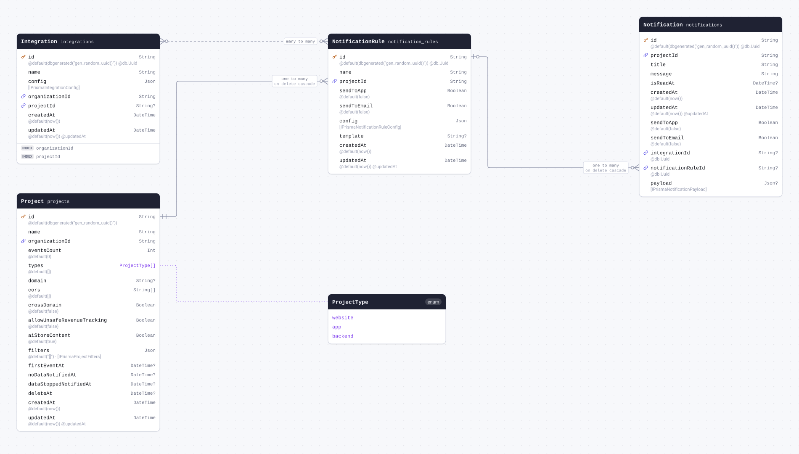

| Field         | Type                | Constraints                             | Default                            | Description                     |
| ------------- | ------------------- | --------------------------------------- | ---------------------------------- | ------------------------------- |
| `id`          | `String` `@db.Uuid` | PK NOT NULL                             | `dbgenerated("gen_random_uuid()")` |                                 |
| `name`        | `String`            | NOT NULL                                |                                    |                                 |
| `projectId`   | `String`            | NOT NULL → [Project.id](#model-Project) |                                    |                                 |
| `sendToApp`   | `Boolean`           | NOT NULL                                | `false`                            |                                 |
| `sendToEmail` | `Boolean`           | NOT NULL                                | `false`                            |                                 |
| `config`      | `Json`              | NOT NULL                                |                                    | [IPrismaNotificationRuleConfig] |
| `template`    | `String`            | NULL                                    |                                    |                                 |
| `createdAt`   | `DateTime`          | NOT NULL                                | `now()`                            |                                 |
| `updatedAt`   | `DateTime`          | NOT NULL                                | `now()` `@updatedAt`               |                                 |

#### References

- `projectId` → [Project.id](#model-Project) (many-to-one, on delete Cascade)

#### Referenced by

- `id` ← [Notification.notificationRuleId](#model-Notification) (one-to-many, on delete Cascade)

#### Many to many

- `integrations` ↔ [Integration.notificationRules](#model-Integration) through `_IntegrationToNotificationRule`

#### Definition

```sql
CREATE TABLE "notification_rules" (
    "id" UUID NOT NULL DEFAULT gen_random_uuid(),
    "name" TEXT NOT NULL,
    "projectId" TEXT NOT NULL,
    "sendToApp" BOOLEAN NOT NULL DEFAULT false,
    "sendToEmail" BOOLEAN NOT NULL DEFAULT false,
    "config" JSONB NOT NULL,
    "template" TEXT,
    "createdAt" TIMESTAMP(3) NOT NULL DEFAULT CURRENT_TIMESTAMP,
    "updatedAt" TIMESTAMP(3) NOT NULL DEFAULT CURRENT_TIMESTAMP,

    CONSTRAINT "notification_rules_pkey" PRIMARY KEY ("id")
);

ALTER TABLE "notification_rules" ADD CONSTRAINT "notification_rules_projectId_fkey" FOREIGN KEY ("projectId") REFERENCES "projects"("id") ON DELETE CASCADE ON UPDATE CASCADE;
```

<details>
<summary>Queries and their SQL</summary>

**findMany**: Every row

```ts
await prisma.notificationRule.findMany();
```

```sql
SELECT
  "public"."notification_rules"."id",
  "public"."notification_rules"."name",
  "public"."notification_rules"."projectId",
  "public"."notification_rules"."sendToApp",
  "public"."notification_rules"."sendToEmail",
  "public"."notification_rules"."config",
  "public"."notification_rules"."template",
  "public"."notification_rules"."createdAt",
  "public"."notification_rules"."updatedAt"
FROM
  "public"."notification_rules"
WHERE
  1 = 1
OFFSET
  $1
-- params: ["0"]
```

**count**: How many rows there are

```ts
await prisma.notificationRule.count();
```

```sql
SELECT
  COUNT(*) AS "_count$_all"
FROM
  (
    SELECT
      "public"."notification_rules"."id"
    FROM
      "public"."notification_rules"
    WHERE
      1 = 1
    OFFSET
      $1
  ) AS "sub"
-- params: ["0"]
```

**findMany**: Every row with its relations

```ts
await prisma.notificationRule.findMany({
  include: { project: true, integrations: true, notifications: true },
});
```

```sql
SELECT
  "public"."notification_rules"."id",
  "public"."notification_rules"."name",
  "public"."notification_rules"."projectId",
  "public"."notification_rules"."sendToApp",
  "public"."notification_rules"."sendToEmail",
  "public"."notification_rules"."config",
  "public"."notification_rules"."template",
  "public"."notification_rules"."createdAt",
  "public"."notification_rules"."updatedAt"
FROM
  "public"."notification_rules"
WHERE
  1 = 1
OFFSET
  $1
-- params: ["0"]

SELECT
  "public"."projects"."id",
  "public"."projects"."name",
  "public"."projects"."organizationId",
  "public"."projects"."eventsCount",
  "public"."projects"."types"::text[],
  "public"."projects"."domain",
  "public"."projects"."cors",
  "public"."projects"."crossDomain",
  "public"."projects"."allowUnsafeRevenueTracking",
  "public"."projects"."aiStoreContent",
  "public"."projects"."filters",
  "public"."projects"."firstEventAt",
  "public"."projects"."noDataNotifiedAt",
  "public"."projects"."dataStoppedNotifiedAt",
  "public"."projects"."deleteAt",
  "public"."projects"."createdAt",
  "public"."projects"."updatedAt"
FROM
  "public"."projects"
WHERE
  "public"."projects"."id" IN ($1)
OFFSET
  $2
-- params: ["<projectId of the rows above>","0"]

SELECT
  "public"."integrations"."id",
  "public"."integrations"."name",
  "public"."integrations"."config",
  "public"."integrations"."organizationId",
  "public"."integrations"."projectId",
  "public"."integrations"."createdAt",
  "public"."integrations"."updatedAt",
  "t0"."B" AS "IntegrationToNotificationRule@NotificationRule"
FROM
  "public"."integrations"
  INNER JOIN "public"."_IntegrationToNotificationRule" AS "t0" ON "t0"."A" = "public"."integrations"."id"
WHERE
  (
    1 = 1
    AND "t0"."B" IN ($1)
  )
OFFSET
  $2
-- params: ["<id of the rows above>","0"]

SELECT
  "public"."notifications"."id",
  "public"."notifications"."projectId",
  "public"."notifications"."title",
  "public"."notifications"."message",
  "public"."notifications"."isReadAt",
  "public"."notifications"."createdAt",
  "public"."notifications"."updatedAt",
  "public"."notifications"."sendToApp",
  "public"."notifications"."sendToEmail",
  "public"."notifications"."integrationId",
  "public"."notifications"."notificationRuleId",
  "public"."notifications"."payload"
FROM
  "public"."notifications"
WHERE
  "public"."notifications"."notificationRuleId" IN ($1)
OFFSET
  $2
-- params: ["<id of the rows above>","0"]
```

**findUnique**: One row by what is unique to it

```ts
await prisma.notificationRule.findUnique({ where: { id: "example" } });
```

```sql
SELECT
  "public"."notification_rules"."id",
  "public"."notification_rules"."name",
  "public"."notification_rules"."projectId",
  "public"."notification_rules"."sendToApp",
  "public"."notification_rules"."sendToEmail",
  "public"."notification_rules"."config",
  "public"."notification_rules"."template",
  "public"."notification_rules"."createdAt",
  "public"."notification_rules"."updatedAt"
FROM
  "public"."notification_rules"
WHERE
  (
    "public"."notification_rules"."id" = $1
    AND 1 = 1
  )
LIMIT
  $2
OFFSET
  $3
-- params: ["example","1","0"]
```

**create**: Create a row

```ts
await prisma.notificationRule.create({
  data: { name: "example", projectId: "example", config: {} },
});
```

```sql
INSERT INTO
  "public"."notification_rules" (
    "name",
    "projectId",
    "sendToApp",
    "sendToEmail",
    "config",
    "createdAt",
    "updatedAt"
  )
VALUES
  ($1, $2, $3, $4, $5, $6, $7)
RETURNING
  "public"."notification_rules"."id",
  "public"."notification_rules"."name",
  "public"."notification_rules"."projectId",
  "public"."notification_rules"."sendToApp",
  "public"."notification_rules"."sendToEmail",
  "public"."notification_rules"."config",
  "public"."notification_rules"."template",
  "public"."notification_rules"."createdAt",
  "public"."notification_rules"."updatedAt"
-- params: ["example","example",false,false,"{}","<now()>","<now()>"]
```

**update**: Update a row

```ts
await prisma.notificationRule.update({ where: { id: "example" }, data: { name: "example" } });
```

```sql
UPDATE "public"."notification_rules"
SET
  "name" = $1,
  "updatedAt" = $2
WHERE
  (
    "public"."notification_rules"."id" = $3
    AND 1 = 1
  )
RETURNING
  "public"."notification_rules"."id",
  "public"."notification_rules"."name",
  "public"."notification_rules"."projectId",
  "public"."notification_rules"."sendToApp",
  "public"."notification_rules"."sendToEmail",
  "public"."notification_rules"."config",
  "public"."notification_rules"."template",
  "public"."notification_rules"."createdAt",
  "public"."notification_rules"."updatedAt"
-- params: ["example",{"prisma__type":"generatorCall","prisma__value":{"name":"now","args":[],"returnType":{"type":"DateTime"}}},"example"]
```

**delete**: Delete a row

```ts
await prisma.notificationRule.delete({ where: { id: "example" } });
```

```sql
DELETE FROM "public"."notification_rules"
WHERE
  (
    "public"."notification_rules"."id" = $1
    AND 1 = 1
  )
RETURNING
  "public"."notification_rules"."id",
  "public"."notification_rules"."name",
  "public"."notification_rules"."projectId",
  "public"."notification_rules"."sendToApp",
  "public"."notification_rules"."sendToEmail",
  "public"."notification_rules"."config",
  "public"."notification_rules"."template",
  "public"."notification_rules"."createdAt",
  "public"."notification_rules"."updatedAt"
-- params: ["example"]
```

</details>

<a id="model-Notification"></a>

### Notification

Table `notifications`.

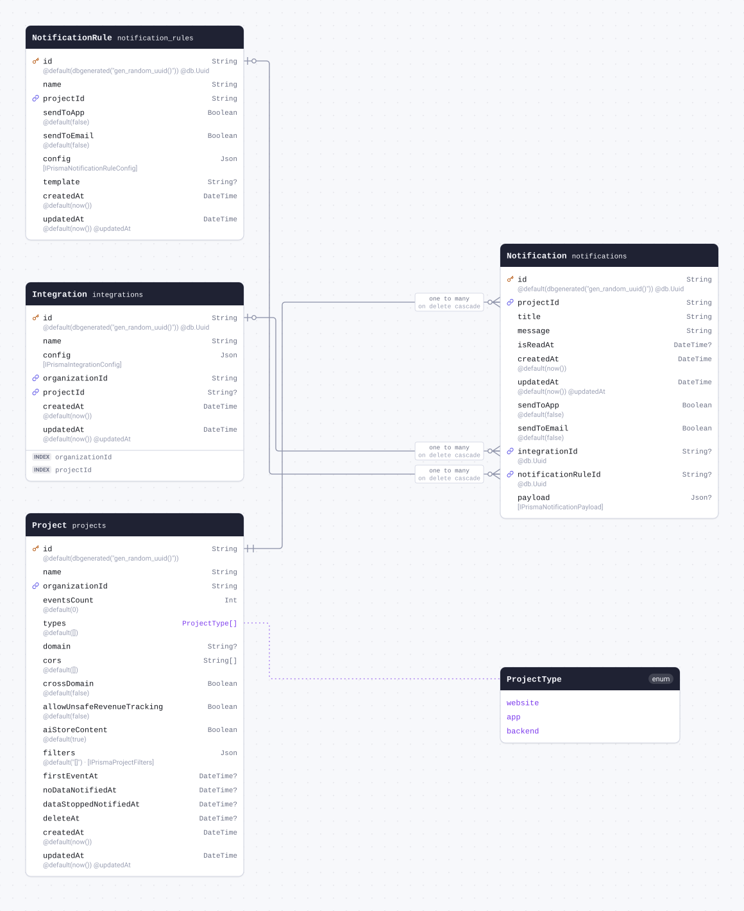

| Field                | Type                | Constraints                                           | Default                            | Description                  |
| -------------------- | ------------------- | ----------------------------------------------------- | ---------------------------------- | ---------------------------- |
| `id`                 | `String` `@db.Uuid` | PK NOT NULL                                           | `dbgenerated("gen_random_uuid()")` |                              |
| `projectId`          | `String`            | NOT NULL → [Project.id](#model-Project)               |                                    |                              |
| `title`              | `String`            | NOT NULL                                              |                                    |                              |
| `message`            | `String`            | NOT NULL                                              |                                    |                              |
| `isReadAt`           | `DateTime`          | NULL                                                  |                                    |                              |
| `createdAt`          | `DateTime`          | NOT NULL                                              | `now()`                            |                              |
| `updatedAt`          | `DateTime`          | NOT NULL                                              | `now()` `@updatedAt`               |                              |
| `sendToApp`          | `Boolean`           | NOT NULL                                              | `false`                            |                              |
| `sendToEmail`        | `Boolean`           | NOT NULL                                              | `false`                            |                              |
| `integrationId`      | `String` `@db.Uuid` | NULL → [Integration.id](#model-Integration)           |                                    |                              |
| `notificationRuleId` | `String` `@db.Uuid` | NULL → [NotificationRule.id](#model-NotificationRule) |                                    |                              |
| `payload`            | `Json`              | NULL                                                  |                                    | [IPrismaNotificationPayload] |

#### References

- `projectId` → [Project.id](#model-Project) (many-to-one, on delete Cascade)
- `integrationId` → [Integration.id](#model-Integration) (many-to-one, on delete Cascade)
- `notificationRuleId` → [NotificationRule.id](#model-NotificationRule) (many-to-one, on delete Cascade)

#### Definition

```sql
CREATE TABLE "notifications" (
    "id" UUID NOT NULL DEFAULT gen_random_uuid(),
    "projectId" TEXT NOT NULL,
    "title" TEXT NOT NULL,
    "message" TEXT NOT NULL,
    "isReadAt" TIMESTAMP(3),
    "createdAt" TIMESTAMP(3) NOT NULL DEFAULT CURRENT_TIMESTAMP,
    "updatedAt" TIMESTAMP(3) NOT NULL DEFAULT CURRENT_TIMESTAMP,
    "sendToApp" BOOLEAN NOT NULL DEFAULT false,
    "sendToEmail" BOOLEAN NOT NULL DEFAULT false,
    "integrationId" UUID,
    "notificationRuleId" UUID,
    "payload" JSONB,

    CONSTRAINT "notifications_pkey" PRIMARY KEY ("id")
);

ALTER TABLE "notifications" ADD CONSTRAINT "notifications_projectId_fkey" FOREIGN KEY ("projectId") REFERENCES "projects"("id") ON DELETE CASCADE ON UPDATE CASCADE;

ALTER TABLE "notifications" ADD CONSTRAINT "notifications_integrationId_fkey" FOREIGN KEY ("integrationId") REFERENCES "integrations"("id") ON DELETE CASCADE ON UPDATE CASCADE;

ALTER TABLE "notifications" ADD CONSTRAINT "notifications_notificationRuleId_fkey" FOREIGN KEY ("notificationRuleId") REFERENCES "notification_rules"("id") ON DELETE CASCADE ON UPDATE CASCADE;
```

<details>
<summary>Queries and their SQL</summary>

**findMany**: Every row

```ts
await prisma.notification.findMany();
```

```sql
SELECT
  "public"."notifications"."id",
  "public"."notifications"."projectId",
  "public"."notifications"."title",
  "public"."notifications"."message",
  "public"."notifications"."isReadAt",
  "public"."notifications"."createdAt",
  "public"."notifications"."updatedAt",
  "public"."notifications"."sendToApp",
  "public"."notifications"."sendToEmail",
  "public"."notifications"."integrationId",
  "public"."notifications"."notificationRuleId",
  "public"."notifications"."payload"
FROM
  "public"."notifications"
WHERE
  1 = 1
OFFSET
  $1
-- params: ["0"]
```

**count**: How many rows there are

```ts
await prisma.notification.count();
```

```sql
SELECT
  COUNT(*) AS "_count$_all"
FROM
  (
    SELECT
      "public"."notifications"."id"
    FROM
      "public"."notifications"
    WHERE
      1 = 1
    OFFSET
      $1
  ) AS "sub"
-- params: ["0"]
```

**findMany**: Every row with its relations

```ts
await prisma.notification.findMany({
  include: { project: true, integration: true, notificationRule: true },
});
```

```sql
SELECT
  "public"."notifications"."id",
  "public"."notifications"."projectId",
  "public"."notifications"."title",
  "public"."notifications"."message",
  "public"."notifications"."isReadAt",
  "public"."notifications"."createdAt",
  "public"."notifications"."updatedAt",
  "public"."notifications"."sendToApp",
  "public"."notifications"."sendToEmail",
  "public"."notifications"."integrationId",
  "public"."notifications"."notificationRuleId",
  "public"."notifications"."payload"
FROM
  "public"."notifications"
WHERE
  1 = 1
OFFSET
  $1
-- params: ["0"]

SELECT
  "public"."projects"."id",
  "public"."projects"."name",
  "public"."projects"."organizationId",
  "public"."projects"."eventsCount",
  "public"."projects"."types"::text[],
  "public"."projects"."domain",
  "public"."projects"."cors",
  "public"."projects"."crossDomain",
  "public"."projects"."allowUnsafeRevenueTracking",
  "public"."projects"."aiStoreContent",
  "public"."projects"."filters",
  "public"."projects"."firstEventAt",
  "public"."projects"."noDataNotifiedAt",
  "public"."projects"."dataStoppedNotifiedAt",
  "public"."projects"."deleteAt",
  "public"."projects"."createdAt",
  "public"."projects"."updatedAt"
FROM
  "public"."projects"
WHERE
  "public"."projects"."id" IN ($1)
OFFSET
  $2
-- params: ["<projectId of the rows above>","0"]

SELECT
  "public"."integrations"."id",
  "public"."integrations"."name",
  "public"."integrations"."config",
  "public"."integrations"."organizationId",
  "public"."integrations"."projectId",
  "public"."integrations"."createdAt",
  "public"."integrations"."updatedAt"
FROM
  "public"."integrations"
WHERE
  "public"."integrations"."id" IN ($1)
OFFSET
  $2
-- params: ["<integrationId of the rows above>","0"]

SELECT
  "public"."notification_rules"."id",
  "public"."notification_rules"."name",
  "public"."notification_rules"."projectId",
  "public"."notification_rules"."sendToApp",
  "public"."notification_rules"."sendToEmail",
  "public"."notification_rules"."config",
  "public"."notification_rules"."template",
  "public"."notification_rules"."createdAt",
  "public"."notification_rules"."updatedAt"
FROM
  "public"."notification_rules"
WHERE
  "public"."notification_rules"."id" IN ($1)
OFFSET
  $2
-- params: ["<notificationRuleId of the rows above>","0"]
```

**findUnique**: One row by what is unique to it

```ts
await prisma.notification.findUnique({ where: { id: "example" } });
```

```sql
SELECT
  "public"."notifications"."id",
  "public"."notifications"."projectId",
  "public"."notifications"."title",
  "public"."notifications"."message",
  "public"."notifications"."isReadAt",
  "public"."notifications"."createdAt",
  "public"."notifications"."updatedAt",
  "public"."notifications"."sendToApp",
  "public"."notifications"."sendToEmail",
  "public"."notifications"."integrationId",
  "public"."notifications"."notificationRuleId",
  "public"."notifications"."payload"
FROM
  "public"."notifications"
WHERE
  (
    "public"."notifications"."id" = $1
    AND 1 = 1
  )
LIMIT
  $2
OFFSET
  $3
-- params: ["example","1","0"]
```

**create**: Create a row

```ts
await prisma.notification.create({
  data: { projectId: "example", title: "example", message: "example" },
});
```

```sql
INSERT INTO
  "public"."notifications" (
    "projectId",
    "title",
    "message",
    "createdAt",
    "updatedAt",
    "sendToApp",
    "sendToEmail"
  )
VALUES
  ($1, $2, $3, $4, $5, $6, $7)
RETURNING
  "public"."notifications"."id",
  "public"."notifications"."projectId",
  "public"."notifications"."title",
  "public"."notifications"."message",
  "public"."notifications"."isReadAt",
  "public"."notifications"."createdAt",
  "public"."notifications"."updatedAt",
  "public"."notifications"."sendToApp",
  "public"."notifications"."sendToEmail",
  "public"."notifications"."integrationId",
  "public"."notifications"."notificationRuleId",
  "public"."notifications"."payload"
-- params: ["example","example","example","<now()>","<now()>",false,false]
```

**update**: Update a row

```ts
await prisma.notification.update({ where: { id: "example" }, data: { title: "example" } });
```

```sql
UPDATE "public"."notifications"
SET
  "title" = $1,
  "updatedAt" = $2
WHERE
  (
    "public"."notifications"."id" = $3
    AND 1 = 1
  )
RETURNING
  "public"."notifications"."id",
  "public"."notifications"."projectId",
  "public"."notifications"."title",
  "public"."notifications"."message",
  "public"."notifications"."isReadAt",
  "public"."notifications"."createdAt",
  "public"."notifications"."updatedAt",
  "public"."notifications"."sendToApp",
  "public"."notifications"."sendToEmail",
  "public"."notifications"."integrationId",
  "public"."notifications"."notificationRuleId",
  "public"."notifications"."payload"
-- params: ["example",{"prisma__type":"generatorCall","prisma__value":{"name":"now","args":[],"returnType":{"type":"DateTime"}}},"example"]
```

**delete**: Delete a row

```ts
await prisma.notification.delete({ where: { id: "example" } });
```

```sql
DELETE FROM "public"."notifications"
WHERE
  (
    "public"."notifications"."id" = $1
    AND 1 = 1
  )
RETURNING
  "public"."notifications"."id",
  "public"."notifications"."projectId",
  "public"."notifications"."title",
  "public"."notifications"."message",
  "public"."notifications"."isReadAt",
  "public"."notifications"."createdAt",
  "public"."notifications"."updatedAt",
  "public"."notifications"."sendToApp",
  "public"."notifications"."sendToEmail",
  "public"."notifications"."integrationId",
  "public"."notifications"."notificationRuleId",
  "public"."notifications"."payload"
-- params: ["example"]
```

</details>

<a id="model-Integration"></a>

### Integration

Table `integrations`.

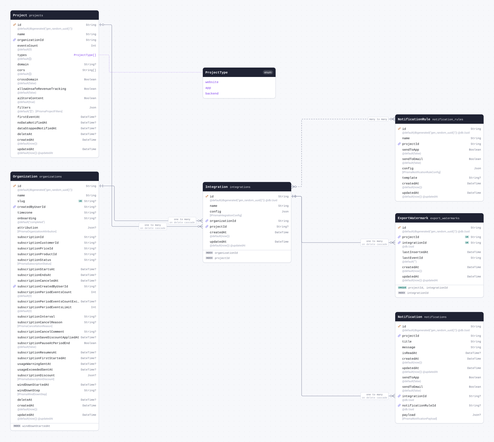

| Field            | Type                | Constraints                                       | Default                            | Description                |
| ---------------- | ------------------- | ------------------------------------------------- | ---------------------------------- | -------------------------- |
| `id`             | `String` `@db.Uuid` | PK NOT NULL                                       | `dbgenerated("gen_random_uuid()")` |                            |
| `name`           | `String`            | NOT NULL                                          |                                    |                            |
| `config`         | `Json`              | NOT NULL                                          |                                    | [IPrismaIntegrationConfig] |
| `organizationId` | `String`            | NOT NULL → [Organization.id](#model-Organization) |                                    |                            |
| `projectId`      | `String`            | NULL → [Project.id](#model-Project)               |                                    |                            |
| `createdAt`      | `DateTime`          | NOT NULL                                          | `now()`                            |                            |
| `updatedAt`      | `DateTime`          | NOT NULL                                          | `now()` `@updatedAt`               |                            |

#### Indexes

- `@@index([organizationId])`
- `@@index([projectId])`

#### References

- `organizationId` → [Organization.id](#model-Organization) (many-to-one, on delete Cascade)
- `projectId` → [Project.id](#model-Project) (many-to-one, on delete Cascade)

#### Referenced by

- `id` ← [Notification.integrationId](#model-Notification) (one-to-many, on delete Cascade)
- `id` ← [ExportWatermark.integrationId](#model-ExportWatermark) (one-to-many, on delete Cascade)

#### Many to many

- `notificationRules` ↔ [NotificationRule.integrations](#model-NotificationRule) through `_IntegrationToNotificationRule`

#### Definition

```sql
CREATE TABLE "integrations" (
    "id" UUID NOT NULL DEFAULT gen_random_uuid(),
    "name" TEXT NOT NULL,
    "config" JSONB NOT NULL,
    "organizationId" TEXT NOT NULL,
    "projectId" TEXT,
    "createdAt" TIMESTAMP(3) NOT NULL DEFAULT CURRENT_TIMESTAMP,
    "updatedAt" TIMESTAMP(3) NOT NULL DEFAULT CURRENT_TIMESTAMP,

    CONSTRAINT "integrations_pkey" PRIMARY KEY ("id")
);

CREATE INDEX "integrations_organizationId_idx" ON "integrations"("organizationId");

CREATE INDEX "integrations_projectId_idx" ON "integrations"("projectId");

ALTER TABLE "integrations" ADD CONSTRAINT "integrations_organizationId_fkey" FOREIGN KEY ("organizationId") REFERENCES "organizations"("id") ON DELETE CASCADE ON UPDATE CASCADE;

ALTER TABLE "integrations" ADD CONSTRAINT "integrations_projectId_fkey" FOREIGN KEY ("projectId") REFERENCES "projects"("id") ON DELETE CASCADE ON UPDATE CASCADE;
```

<details>
<summary>Queries and their SQL</summary>

**findMany**: Every row

```ts
await prisma.integration.findMany();
```

```sql
SELECT
  "public"."integrations"."id",
  "public"."integrations"."name",
  "public"."integrations"."config",
  "public"."integrations"."organizationId",
  "public"."integrations"."projectId",
  "public"."integrations"."createdAt",
  "public"."integrations"."updatedAt"
FROM
  "public"."integrations"
WHERE
  1 = 1
OFFSET
  $1
-- params: ["0"]
```

**count**: How many rows there are

```ts
await prisma.integration.count();
```

```sql
SELECT
  COUNT(*) AS "_count$_all"
FROM
  (
    SELECT
      "public"."integrations"."id"
    FROM
      "public"."integrations"
    WHERE
      1 = 1
    OFFSET
      $1
  ) AS "sub"
-- params: ["0"]
```

**findMany**: Every row with its relations

```ts
await prisma.integration.findMany({
  include: {
    organization: true,
    project: true,
    notificationRules: true,
    notifications: true,
    exportWatermarks: true,
  },
});
```

```sql
SELECT
  "public"."integrations"."id",
  "public"."integrations"."name",
  "public"."integrations"."config",
  "public"."integrations"."organizationId",
  "public"."integrations"."projectId",
  "public"."integrations"."createdAt",
  "public"."integrations"."updatedAt"
FROM
  "public"."integrations"
WHERE
  1 = 1
OFFSET
  $1
-- params: ["0"]

SELECT
  "public"."organizations"."id",
  "public"."organizations"."name",
  "public"."organizations"."slug",
  "public"."organizations"."createdByUserId",
  "public"."organizations"."timezone",
  "public"."organizations"."onboarding",
  "public"."organizations"."attribution",
  "public"."organizations"."subscriptionId",
  "public"."organizations"."subscriptionCustomerId",
  "public"."organizations"."subscriptionPriceId",
  "public"."organizations"."subscriptionProductId",
  "public"."organizations"."subscriptionStatus",
  "public"."organizations"."subscriptionStartsAt",
  "public"."organizations"."subscriptionEndsAt",
  "public"."organizations"."subscriptionCanceledAt",
  "public"."organizations"."subscriptionCreatedByUserId",
  "public"."organizations"."subscriptionPeriodEventsCount",
  "public"."organizations"."subscriptionPeriodEventsCountExceededAt",
  "public"."organizations"."subscriptionPeriodEventsLimit",
  "public"."organizations"."subscriptionInterval",
  "public"."organizations"."subscriptionCancelReason",
  "public"."organizations"."subscriptionCancelComment",
  "public"."organizations"."subscriptionSaveDiscountAppliedAt",
  "public"."organizations"."subscriptionPauseAtPeriodEnd",
  "public"."organizations"."subscriptionResumesAt",
  "public"."organizations"."subscriptionFirstStartedAt",
  "public"."organizations"."usageWarningSentAt",
  "public"."organizations"."usageExceededSentAt",
  "public"."organizations"."subscriptionDiscount",
  "public"."organizations"."windDownStartedAt",
  "public"."organizations"."windDownStep",
  "public"."organizations"."deleteAt",
  "public"."organizations"."createdAt",
  "public"."organizations"."updatedAt"
FROM
  "public"."organizations"
WHERE
  "public"."organizations"."id" IN ($1)
OFFSET
  $2
-- params: ["<organizationId of the rows above>","0"]

SELECT
  "public"."projects"."id",
  "public"."projects"."name",
  "public"."projects"."organizationId",
  "public"."projects"."eventsCount",
  "public"."projects"."types"::text[],
  "public"."projects"."domain",
  "public"."projects"."cors",
  "public"."projects"."crossDomain",
  "public"."projects"."allowUnsafeRevenueTracking",
  "public"."projects"."aiStoreContent",
  "public"."projects"."filters",
  "public"."projects"."firstEventAt",
  "public"."projects"."noDataNotifiedAt",
  "public"."projects"."dataStoppedNotifiedAt",
  "public"."projects"."deleteAt",
  "public"."projects"."createdAt",
  "public"."projects"."updatedAt"
FROM
  "public"."projects"
WHERE
  "public"."projects"."id" IN ($1)
OFFSET
  $2
-- params: ["<projectId of the rows above>","0"]

SELECT
  "public"."notification_rules"."id",
  "public"."notification_rules"."name",
  "public"."notification_rules"."projectId",
  "public"."notification_rules"."sendToApp",
  "public"."notification_rules"."sendToEmail",
  "public"."notification_rules"."config",
  "public"."notification_rules"."template",
  "public"."notification_rules"."createdAt",
  "public"."notification_rules"."updatedAt",
  "t0"."A" AS "IntegrationToNotificationRule@Integration"
FROM
  "public"."notification_rules"
  INNER JOIN "public"."_IntegrationToNotificationRule" AS "t0" ON "t0"."B" = "public"."notification_rules"."id"
WHERE
  (
    1 = 1
    AND "t0"."A" IN ($1)
  )
OFFSET
  $2
-- params: ["<id of the rows above>","0"]

SELECT
  "public"."notifications"."id",
  "public"."notifications"."projectId",
  "public"."notifications"."title",
  "public"."notifications"."message",
  "public"."notifications"."isReadAt",
  "public"."notifications"."createdAt",
  "public"."notifications"."updatedAt",
  "public"."notifications"."sendToApp",
  "public"."notifications"."sendToEmail",
  "public"."notifications"."integrationId",
  "public"."notifications"."notificationRuleId",
  "public"."notifications"."payload"
FROM
  "public"."notifications"
WHERE
  "public"."notifications"."integrationId" IN ($1)
OFFSET
  $2
-- params: ["<id of the rows above>","0"]

SELECT
  "public"."export_watermarks"."id",
  "public"."export_watermarks"."projectId",
  "public"."export_watermarks"."integrationId",
  "public"."export_watermarks"."lastInsertedAt",
  "public"."export_watermarks"."lastEventId",
  "public"."export_watermarks"."createdAt",
  "public"."export_watermarks"."updatedAt"
FROM
  "public"."export_watermarks"
WHERE
  "public"."export_watermarks"."integrationId" IN ($1)
OFFSET
  $2
-- params: ["<id of the rows above>","0"]
```

**findUnique**: One row by what is unique to it

```ts
await prisma.integration.findUnique({ where: { id: "example" } });
```

```sql
SELECT
  "public"."integrations"."id",
  "public"."integrations"."name",
  "public"."integrations"."config",
  "public"."integrations"."organizationId",
  "public"."integrations"."projectId",
  "public"."integrations"."createdAt",
  "public"."integrations"."updatedAt"
FROM
  "public"."integrations"
WHERE
  (
    "public"."integrations"."id" = $1
    AND 1 = 1
  )
LIMIT
  $2
OFFSET
  $3
-- params: ["example","1","0"]
```

**create**: Create a row

```ts
await prisma.integration.create({
  data: { name: "example", config: {}, organizationId: "example" },
});
```

```sql
INSERT INTO
  "public"."integrations" (
    "name",
    "config",
    "organizationId",
    "createdAt",
    "updatedAt"
  )
VALUES
  ($1, $2, $3, $4, $5)
RETURNING
  "public"."integrations"."id",
  "public"."integrations"."name",
  "public"."integrations"."config",
  "public"."integrations"."organizationId",
  "public"."integrations"."projectId",
  "public"."integrations"."createdAt",
  "public"."integrations"."updatedAt"
-- params: ["example","{}","example","<now()>","<now()>"]
```

**update**: Update a row

```ts
await prisma.integration.update({ where: { id: "example" }, data: { name: "example" } });
```

```sql
UPDATE "public"."integrations"
SET
  "name" = $1,
  "updatedAt" = $2
WHERE
  (
    "public"."integrations"."id" = $3
    AND 1 = 1
  )
RETURNING
  "public"."integrations"."id",
  "public"."integrations"."name",
  "public"."integrations"."config",
  "public"."integrations"."organizationId",
  "public"."integrations"."projectId",
  "public"."integrations"."createdAt",
  "public"."integrations"."updatedAt"
-- params: ["example",{"prisma__type":"generatorCall","prisma__value":{"name":"now","args":[],"returnType":{"type":"DateTime"}}},"example"]
```

**delete**: Delete a row

```ts
await prisma.integration.delete({ where: { id: "example" } });
```

```sql
DELETE FROM "public"."integrations"
WHERE
  (
    "public"."integrations"."id" = $1
    AND 1 = 1
  )
RETURNING
  "public"."integrations"."id",
  "public"."integrations"."name",
  "public"."integrations"."config",
  "public"."integrations"."organizationId",
  "public"."integrations"."projectId",
  "public"."integrations"."createdAt",
  "public"."integrations"."updatedAt"
-- params: ["example"]
```

</details>

<a id="model-ExportWatermark"></a>

### ExportWatermark

Table `export_watermarks`.

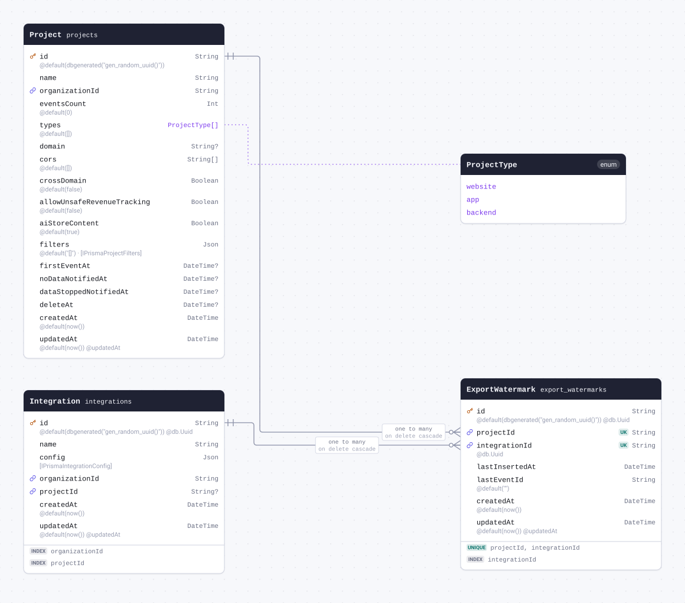

| Field            | Type                | Constraints                                     | Default                            | Description |
| ---------------- | ------------------- | ----------------------------------------------- | ---------------------------------- | ----------- |
| `id`             | `String` `@db.Uuid` | PK NOT NULL                                     | `dbgenerated("gen_random_uuid()")` |             |
| `projectId`      | `String`            | NOT NULL → [Project.id](#model-Project)         |                                    |             |
| `integrationId`  | `String` `@db.Uuid` | NOT NULL → [Integration.id](#model-Integration) |                                    |             |
| `lastInsertedAt` | `DateTime`          | NOT NULL                                        |                                    |             |
| `lastEventId`    | `String`            | NOT NULL                                        | `""`                               |             |
| `createdAt`      | `DateTime`          | NOT NULL                                        | `now()`                            |             |
| `updatedAt`      | `DateTime`          | NOT NULL                                        | `now()` `@updatedAt`               |             |

#### Indexes

- `@@index([integrationId])`
- `@@unique([projectId, integrationId])`

#### References

- `projectId` → [Project.id](#model-Project) (many-to-one, on delete Cascade)
- `integrationId` → [Integration.id](#model-Integration) (many-to-one, on delete Cascade)

#### Definition

```sql
CREATE TABLE "export_watermarks" (
    "id" UUID NOT NULL DEFAULT gen_random_uuid(),
    "projectId" TEXT NOT NULL,
    "integrationId" UUID NOT NULL,
    "lastInsertedAt" TIMESTAMP(3) NOT NULL,
    "lastEventId" TEXT NOT NULL DEFAULT '',
    "createdAt" TIMESTAMP(3) NOT NULL DEFAULT CURRENT_TIMESTAMP,
    "updatedAt" TIMESTAMP(3) NOT NULL DEFAULT CURRENT_TIMESTAMP,

    CONSTRAINT "export_watermarks_pkey" PRIMARY KEY ("id")
);

CREATE INDEX "export_watermarks_integrationId_idx" ON "export_watermarks"("integrationId");

CREATE UNIQUE INDEX "export_watermarks_projectId_integrationId_key" ON "export_watermarks"("projectId", "integrationId");

ALTER TABLE "export_watermarks" ADD CONSTRAINT "export_watermarks_projectId_fkey" FOREIGN KEY ("projectId") REFERENCES "projects"("id") ON DELETE CASCADE ON UPDATE CASCADE;

ALTER TABLE "export_watermarks" ADD CONSTRAINT "export_watermarks_integrationId_fkey" FOREIGN KEY ("integrationId") REFERENCES "integrations"("id") ON DELETE CASCADE ON UPDATE CASCADE;
```

<details>
<summary>Queries and their SQL</summary>

**findMany**: Every row

```ts
await prisma.exportWatermark.findMany();
```

```sql
SELECT
  "public"."export_watermarks"."id",
  "public"."export_watermarks"."projectId",
  "public"."export_watermarks"."integrationId",
  "public"."export_watermarks"."lastInsertedAt",
  "public"."export_watermarks"."lastEventId",
  "public"."export_watermarks"."createdAt",
  "public"."export_watermarks"."updatedAt"
FROM
  "public"."export_watermarks"
WHERE
  1 = 1
OFFSET
  $1
-- params: ["0"]
```

**count**: How many rows there are

```ts
await prisma.exportWatermark.count();
```

```sql
SELECT
  COUNT(*) AS "_count$_all"
FROM
  (
    SELECT
      "public"."export_watermarks"."id"
    FROM
      "public"."export_watermarks"
    WHERE
      1 = 1
    OFFSET
      $1
  ) AS "sub"
-- params: ["0"]
```

**findMany**: Every row with its relations

```ts
await prisma.exportWatermark.findMany({ include: { project: true, integration: true } });
```

```sql
SELECT
  "public"."export_watermarks"."id",
  "public"."export_watermarks"."projectId",
  "public"."export_watermarks"."integrationId",
  "public"."export_watermarks"."lastInsertedAt",
  "public"."export_watermarks"."lastEventId",
  "public"."export_watermarks"."createdAt",
  "public"."export_watermarks"."updatedAt"
FROM
  "public"."export_watermarks"
WHERE
  1 = 1
OFFSET
  $1
-- params: ["0"]

SELECT
  "public"."projects"."id",
  "public"."projects"."name",
  "public"."projects"."organizationId",
  "public"."projects"."eventsCount",
  "public"."projects"."types"::text[],
  "public"."projects"."domain",
  "public"."projects"."cors",
  "public"."projects"."crossDomain",
  "public"."projects"."allowUnsafeRevenueTracking",
  "public"."projects"."aiStoreContent",
  "public"."projects"."filters",
  "public"."projects"."firstEventAt",
  "public"."projects"."noDataNotifiedAt",
  "public"."projects"."dataStoppedNotifiedAt",
  "public"."projects"."deleteAt",
  "public"."projects"."createdAt",
  "public"."projects"."updatedAt"
FROM
  "public"."projects"
WHERE
  "public"."projects"."id" IN ($1)
OFFSET
  $2
-- params: ["<projectId of the rows above>","0"]

SELECT
  "public"."integrations"."id",
  "public"."integrations"."name",
  "public"."integrations"."config",
  "public"."integrations"."organizationId",
  "public"."integrations"."projectId",
  "public"."integrations"."createdAt",
  "public"."integrations"."updatedAt"
FROM
  "public"."integrations"
WHERE
  "public"."integrations"."id" IN ($1)
OFFSET
  $2
-- params: ["<integrationId of the rows above>","0"]
```

**findUnique**: One row by what is unique to it

```ts
await prisma.exportWatermark.findUnique({ where: { id: "example" } });
```

```sql
SELECT
  "public"."export_watermarks"."id",
  "public"."export_watermarks"."projectId",
  "public"."export_watermarks"."integrationId",
  "public"."export_watermarks"."lastInsertedAt",
  "public"."export_watermarks"."lastEventId",
  "public"."export_watermarks"."createdAt",
  "public"."export_watermarks"."updatedAt"
FROM
  "public"."export_watermarks"
WHERE
  (
    "public"."export_watermarks"."id" = $1
    AND 1 = 1
  )
LIMIT
  $2
OFFSET
  $3
-- params: ["example","1","0"]
```

**create**: Create a row

```ts
await prisma.exportWatermark.create({
  data: {
    projectId: "example",
    integrationId: "example",
    lastInsertedAt: new Date("2026-01-01T00:00:00.000Z"),
  },
});
```

```sql
INSERT INTO
  "public"."export_watermarks" (
    "projectId",
    "integrationId",
    "lastInsertedAt",
    "lastEventId",
    "createdAt",
    "updatedAt"
  )
VALUES
  ($1, $2, $3, $4, $5, $6)
RETURNING
  "public"."export_watermarks"."id",
  "public"."export_watermarks"."projectId",
  "public"."export_watermarks"."integrationId",
  "public"."export_watermarks"."lastInsertedAt",
  "public"."export_watermarks"."lastEventId",
  "public"."export_watermarks"."createdAt",
  "public"."export_watermarks"."updatedAt"
-- params: ["example","example","2026-01-01T00:00:00.000Z","","<now()>","<now()>"]
```

**update**: Update a row

```ts
await prisma.exportWatermark.update({
  where: { id: "example" },
  data: { lastInsertedAt: new Date("2026-01-01T00:00:00.000Z") },
});
```

```sql
UPDATE "public"."export_watermarks"
SET
  "lastInsertedAt" = $1,
  "updatedAt" = $2
WHERE
  (
    "public"."export_watermarks"."id" = $3
    AND 1 = 1
  )
RETURNING
  "public"."export_watermarks"."id",
  "public"."export_watermarks"."projectId",
  "public"."export_watermarks"."integrationId",
  "public"."export_watermarks"."lastInsertedAt",
  "public"."export_watermarks"."lastEventId",
  "public"."export_watermarks"."createdAt",
  "public"."export_watermarks"."updatedAt"
-- params: ["2026-01-01T00:00:00.000Z",{"prisma__type":"generatorCall","prisma__value":{"name":"now","args":[],"returnType":{"type":"DateTime"}}},"example"]
```

**delete**: Delete a row

```ts
await prisma.exportWatermark.delete({ where: { id: "example" } });
```

```sql
DELETE FROM "public"."export_watermarks"
WHERE
  (
    "public"."export_watermarks"."id" = $1
    AND 1 = 1
  )
RETURNING
  "public"."export_watermarks"."id",
  "public"."export_watermarks"."projectId",
  "public"."export_watermarks"."integrationId",
  "public"."export_watermarks"."lastInsertedAt",
  "public"."export_watermarks"."lastEventId",
  "public"."export_watermarks"."createdAt",
  "public"."export_watermarks"."updatedAt"
-- params: ["example"]
```

</details>

<a id="model-ResetPassword"></a>

### ResetPassword

Table `reset_password`.

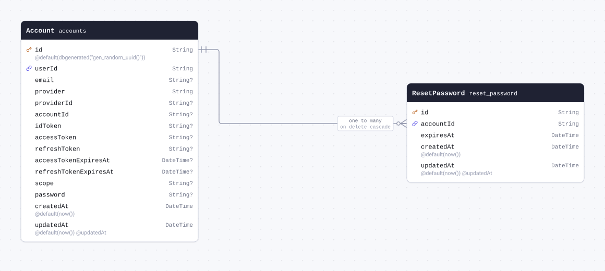

| Field       | Type       | Constraints                             | Default              | Description |
| ----------- | ---------- | --------------------------------------- | -------------------- | ----------- |
| `id`        | `String`   | PK NOT NULL                             |                      |             |
| `accountId` | `String`   | NOT NULL → [Account.id](#model-Account) |                      |             |
| `expiresAt` | `DateTime` | NOT NULL                                |                      |             |
| `createdAt` | `DateTime` | NOT NULL                                | `now()`              |             |
| `updatedAt` | `DateTime` | NOT NULL                                | `now()` `@updatedAt` |             |

#### References

- `accountId` → [Account.id](#model-Account) (many-to-one, on delete Cascade)

#### Definition

```sql
CREATE TABLE "reset_password" (
    "id" TEXT NOT NULL,
    "accountId" TEXT NOT NULL,
    "expiresAt" TIMESTAMP(3) NOT NULL,
    "createdAt" TIMESTAMP(3) NOT NULL DEFAULT CURRENT_TIMESTAMP,
    "updatedAt" TIMESTAMP(3) NOT NULL DEFAULT CURRENT_TIMESTAMP,

    CONSTRAINT "reset_password_pkey" PRIMARY KEY ("id")
);

ALTER TABLE "reset_password" ADD CONSTRAINT "reset_password_accountId_fkey" FOREIGN KEY ("accountId") REFERENCES "accounts"("id") ON DELETE CASCADE ON UPDATE CASCADE;
```

<details>
<summary>Queries and their SQL</summary>

**findMany**: Every row

```ts
await prisma.resetPassword.findMany();
```

```sql
SELECT
  "public"."reset_password"."id",
  "public"."reset_password"."accountId",
  "public"."reset_password"."expiresAt",
  "public"."reset_password"."createdAt",
  "public"."reset_password"."updatedAt"
FROM
  "public"."reset_password"
WHERE
  1 = 1
OFFSET
  $1
-- params: ["0"]
```

**count**: How many rows there are

```ts
await prisma.resetPassword.count();
```

```sql
SELECT
  COUNT(*) AS "_count$_all"
FROM
  (
    SELECT
      "public"."reset_password"."id"
    FROM
      "public"."reset_password"
    WHERE
      1 = 1
    OFFSET
      $1
  ) AS "sub"
-- params: ["0"]
```

**findMany**: Every row with its relations

```ts
await prisma.resetPassword.findMany({ include: { account: true } });
```

```sql
SELECT
  "public"."reset_password"."id",
  "public"."reset_password"."accountId",
  "public"."reset_password"."expiresAt",
  "public"."reset_password"."createdAt",
  "public"."reset_password"."updatedAt"
FROM
  "public"."reset_password"
WHERE
  1 = 1
OFFSET
  $1
-- params: ["0"]

SELECT
  "public"."accounts"."id",
  "public"."accounts"."userId",
  "public"."accounts"."email",
  "public"."accounts"."provider",
  "public"."accounts"."providerId",
  "public"."accounts"."accountId",
  "public"."accounts"."idToken",
  "public"."accounts"."accessToken",
  "public"."accounts"."refreshToken",
  "public"."accounts"."accessTokenExpiresAt",
  "public"."accounts"."refreshTokenExpiresAt",
  "public"."accounts"."scope",
  "public"."accounts"."password",
  "public"."accounts"."createdAt",
  "public"."accounts"."updatedAt"
FROM
  "public"."accounts"
WHERE
  "public"."accounts"."id" IN ($1)
OFFSET
  $2
-- params: ["<accountId of the rows above>","0"]
```

**findUnique**: One row by what is unique to it

```ts
await prisma.resetPassword.findUnique({ where: { id: "example" } });
```

```sql
SELECT
  "public"."reset_password"."id",
  "public"."reset_password"."accountId",
  "public"."reset_password"."expiresAt",
  "public"."reset_password"."createdAt",
  "public"."reset_password"."updatedAt"
FROM
  "public"."reset_password"
WHERE
  (
    "public"."reset_password"."id" = $1
    AND 1 = 1
  )
LIMIT
  $2
OFFSET
  $3
-- params: ["example","1","0"]
```

**create**: Create a row

```ts
await prisma.resetPassword.create({
  data: { id: "example", accountId: "example", expiresAt: new Date("2026-01-01T00:00:00.000Z") },
});
```

```sql
INSERT INTO
  "public"."reset_password" (
    "id",
    "accountId",
    "expiresAt",
    "createdAt",
    "updatedAt"
  )
VALUES
  ($1, $2, $3, $4, $5)
RETURNING
  "public"."reset_password"."id",
  "public"."reset_password"."accountId",
  "public"."reset_password"."expiresAt",
  "public"."reset_password"."createdAt",
  "public"."reset_password"."updatedAt"
-- params: ["example","example","2026-01-01T00:00:00.000Z","<now()>","<now()>"]
```

**update**: Update a row

```ts
await prisma.resetPassword.update({
  where: { id: "example" },
  data: { expiresAt: new Date("2026-01-01T00:00:00.000Z") },
});
```

```sql
UPDATE "public"."reset_password"
SET
  "expiresAt" = $1,
  "updatedAt" = $2
WHERE
  (
    "public"."reset_password"."id" = $3
    AND 1 = 1
  )
RETURNING
  "public"."reset_password"."id",
  "public"."reset_password"."accountId",
  "public"."reset_password"."expiresAt",
  "public"."reset_password"."createdAt",
  "public"."reset_password"."updatedAt"
-- params: ["2026-01-01T00:00:00.000Z",{"prisma__type":"generatorCall","prisma__value":{"name":"now","args":[],"returnType":{"type":"DateTime"}}},"example"]
```

**delete**: Delete a row

```ts
await prisma.resetPassword.delete({ where: { id: "example" } });
```

```sql
DELETE FROM "public"."reset_password"
WHERE
  (
    "public"."reset_password"."id" = $1
    AND 1 = 1
  )
RETURNING
  "public"."reset_password"."id",
  "public"."reset_password"."accountId",
  "public"."reset_password"."expiresAt",
  "public"."reset_password"."createdAt",
  "public"."reset_password"."updatedAt"
-- params: ["example"]
```

</details>

<a id="model-Import"></a>

### Import

Table `imports`.

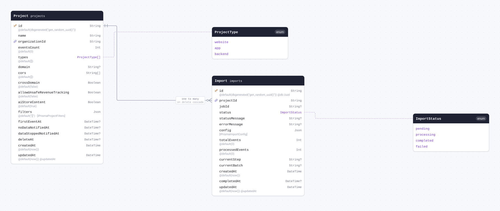

| Field             | Type                                 | Constraints                             | Default                            | Description           |
| ----------------- | ------------------------------------ | --------------------------------------- | ---------------------------------- | --------------------- |
| `id`              | `String` `@db.Uuid`                  | PK NOT NULL                             | `dbgenerated("gen_random_uuid()")` |                       |
| `projectId`       | `String`                             | NOT NULL → [Project.id](#model-Project) |                                    |                       |
| `jobId`           | `String`                             | NULL                                    |                                    |                       |
| `status`          | [`ImportStatus`](#enum-ImportStatus) | NOT NULL                                |                                    |                       |
| `statusMessage`   | `String`                             | NULL                                    |                                    |                       |
| `errorMessage`    | `String`                             | NULL                                    |                                    |                       |
| `config`          | `Json`                               | NOT NULL                                |                                    | [IPrismaImportConfig] |
| `totalEvents`     | `Int`                                | NOT NULL                                | `0`                                |                       |
| `processedEvents` | `Int`                                | NOT NULL                                | `0`                                |                       |
| `currentStep`     | `String`                             | NULL                                    |                                    |                       |
| `currentBatch`    | `String`                             | NULL                                    |                                    |                       |
| `createdAt`       | `DateTime`                           | NOT NULL                                | `now()`                            |                       |
| `completedAt`     | `DateTime`                           | NULL                                    |                                    |                       |
| `updatedAt`       | `DateTime`                           | NOT NULL                                | `now()` `@updatedAt`               |                       |

#### References

- `projectId` → [Project.id](#model-Project) (many-to-one, on delete Cascade)

#### Definition

```sql
CREATE TABLE "imports" (
    "id" UUID NOT NULL DEFAULT gen_random_uuid(),
    "projectId" TEXT NOT NULL,
    "jobId" TEXT,
    "status" "ImportStatus" NOT NULL,
    "statusMessage" TEXT,
    "errorMessage" TEXT,
    "config" JSONB NOT NULL,
    "totalEvents" INTEGER NOT NULL DEFAULT 0,
    "processedEvents" INTEGER NOT NULL DEFAULT 0,
    "currentStep" TEXT,
    "currentBatch" TEXT,
    "createdAt" TIMESTAMP(3) NOT NULL DEFAULT CURRENT_TIMESTAMP,
    "completedAt" TIMESTAMP(3),
    "updatedAt" TIMESTAMP(3) NOT NULL DEFAULT CURRENT_TIMESTAMP,

    CONSTRAINT "imports_pkey" PRIMARY KEY ("id")
);

ALTER TABLE "imports" ADD CONSTRAINT "imports_projectId_fkey" FOREIGN KEY ("projectId") REFERENCES "projects"("id") ON DELETE CASCADE ON UPDATE CASCADE;
```

<details>
<summary>Queries and their SQL</summary>

**findMany**: Every row

```ts
await prisma.import.findMany();
```

```sql
SELECT
  "public"."imports"."id",
  "public"."imports"."projectId",
  "public"."imports"."jobId",
  "public"."imports"."status"::text,
  "public"."imports"."statusMessage",
  "public"."imports"."errorMessage",
  "public"."imports"."config",
  "public"."imports"."totalEvents",
  "public"."imports"."processedEvents",
  "public"."imports"."currentStep",
  "public"."imports"."currentBatch",
  "public"."imports"."createdAt",
  "public"."imports"."completedAt",
  "public"."imports"."updatedAt"
FROM
  "public"."imports"
WHERE
  1 = 1
OFFSET
  $1
-- params: ["0"]
```

**count**: How many rows there are

```ts
await prisma.import.count();
```

```sql
SELECT
  COUNT(*) AS "_count$_all"
FROM
  (
    SELECT
      "public"."imports"."id"
    FROM
      "public"."imports"
    WHERE
      1 = 1
    OFFSET
      $1
  ) AS "sub"
-- params: ["0"]
```

**findMany**: Every row with its relations

```ts
await prisma.import.findMany({ include: { project: true } });
```

```sql
SELECT
  "public"."imports"."id",
  "public"."imports"."projectId",
  "public"."imports"."jobId",
  "public"."imports"."status"::text,
  "public"."imports"."statusMessage",
  "public"."imports"."errorMessage",
  "public"."imports"."config",
  "public"."imports"."totalEvents",
  "public"."imports"."processedEvents",
  "public"."imports"."currentStep",
  "public"."imports"."currentBatch",
  "public"."imports"."createdAt",
  "public"."imports"."completedAt",
  "public"."imports"."updatedAt"
FROM
  "public"."imports"
WHERE
  1 = 1
OFFSET
  $1
-- params: ["0"]

SELECT
  "public"."projects"."id",
  "public"."projects"."name",
  "public"."projects"."organizationId",
  "public"."projects"."eventsCount",
  "public"."projects"."types"::text[],
  "public"."projects"."domain",
  "public"."projects"."cors",
  "public"."projects"."crossDomain",
  "public"."projects"."allowUnsafeRevenueTracking",
  "public"."projects"."aiStoreContent",
  "public"."projects"."filters",
  "public"."projects"."firstEventAt",
  "public"."projects"."noDataNotifiedAt",
  "public"."projects"."dataStoppedNotifiedAt",
  "public"."projects"."deleteAt",
  "public"."projects"."createdAt",
  "public"."projects"."updatedAt"
FROM
  "public"."projects"
WHERE
  "public"."projects"."id" IN ($1)
OFFSET
  $2
-- params: ["<projectId of the rows above>","0"]
```

**findUnique**: One row by what is unique to it

```ts
await prisma.import.findUnique({ where: { id: "example" } });
```

```sql
SELECT
  "public"."imports"."id",
  "public"."imports"."projectId",
  "public"."imports"."jobId",
  "public"."imports"."status"::text,
  "public"."imports"."statusMessage",
  "public"."imports"."errorMessage",
  "public"."imports"."config",
  "public"."imports"."totalEvents",
  "public"."imports"."processedEvents",
  "public"."imports"."currentStep",
  "public"."imports"."currentBatch",
  "public"."imports"."createdAt",
  "public"."imports"."completedAt",
  "public"."imports"."updatedAt"
FROM
  "public"."imports"
WHERE
  (
    "public"."imports"."id" = $1
    AND 1 = 1
  )
LIMIT
  $2
OFFSET
  $3
-- params: ["example","1","0"]
```

**create**: Create a row

```ts
await prisma.import.create({ data: { projectId: "example", status: "pending", config: {} } });
```

```sql
INSERT INTO
  "public"."imports" (
    "projectId",
    "status",
    "config",
    "totalEvents",
    "processedEvents",
    "createdAt",
    "updatedAt"
  )
VALUES
  (
    $1,
    CAST($2::text AS "public"."ImportStatus"),
    $3,
    $4,
    $5,
    $6,
    $7
  )
RETURNING
  "public"."imports"."id",
  "public"."imports"."projectId",
  "public"."imports"."jobId",
  "public"."imports"."status"::text,
  "public"."imports"."statusMessage",
  "public"."imports"."errorMessage",
  "public"."imports"."config",
  "public"."imports"."totalEvents",
  "public"."imports"."processedEvents",
  "public"."imports"."currentStep",
  "public"."imports"."currentBatch",
  "public"."imports"."createdAt",
  "public"."imports"."completedAt",
  "public"."imports"."updatedAt"
-- params: ["example","pending","{}","0","0","<now()>","<now()>"]
```

**update**: Update a row

```ts
await prisma.import.update({ where: { id: "example" }, data: { jobId: "example" } });
```

```sql
UPDATE "public"."imports"
SET
  "jobId" = $1,
  "updatedAt" = $2
WHERE
  (
    "public"."imports"."id" = $3
    AND 1 = 1
  )
RETURNING
  "public"."imports"."id",
  "public"."imports"."projectId",
  "public"."imports"."jobId",
  "public"."imports"."status"::text,
  "public"."imports"."statusMessage",
  "public"."imports"."errorMessage",
  "public"."imports"."config",
  "public"."imports"."totalEvents",
  "public"."imports"."processedEvents",
  "public"."imports"."currentStep",
  "public"."imports"."currentBatch",
  "public"."imports"."createdAt",
  "public"."imports"."completedAt",
  "public"."imports"."updatedAt"
-- params: ["example",{"prisma__type":"generatorCall","prisma__value":{"name":"now","args":[],"returnType":{"type":"DateTime"}}},"example"]
```

**delete**: Delete a row

```ts
await prisma.import.delete({ where: { id: "example" } });
```

```sql
DELETE FROM "public"."imports"
WHERE
  (
    "public"."imports"."id" = $1
    AND 1 = 1
  )
RETURNING
  "public"."imports"."id",
  "public"."imports"."projectId",
  "public"."imports"."jobId",
  "public"."imports"."status"::text,
  "public"."imports"."statusMessage",
  "public"."imports"."errorMessage",
  "public"."imports"."config",
  "public"."imports"."totalEvents",
  "public"."imports"."processedEvents",
  "public"."imports"."currentStep",
  "public"."imports"."currentBatch",
  "public"."imports"."createdAt",
  "public"."imports"."completedAt",
  "public"."imports"."updatedAt"
-- params: ["example"]
```

</details>

<a id="model-ProjectInsight"></a>

### ProjectInsight

Table `project_insights`.


| Field             | Type                                 | Constraints | Default                            | Description                    |
| ----------------- | ------------------------------------ | ----------- | ---------------------------------- | ------------------------------ |
| `id`              | `String` `@db.Uuid`                  | PK NOT NULL | `dbgenerated("gen_random_uuid()")` |                                |
| `projectId`       | `String`                             | NOT NULL    |                                    |                                |
| `moduleKey`       | `String`                             | NOT NULL    |                                    |                                |
| `dimensionKey`    | `String`                             | NOT NULL    |                                    |                                |
| `windowKind`      | `String`                             | NOT NULL    |                                    |                                |
| `state`           | [`InsightState`](#enum-InsightState) | NOT NULL    | `active`                           |                                |
| `title`           | `String`                             | NOT NULL    |                                    |                                |
| `summary`         | `String`                             | NULL        |                                    |                                |
| `displayName`     | `String`                             | NOT NULL    | `""`                               |                                |
| `payload`         | `Json`                               | NOT NULL    | `"{}"`                             | [IPrismaProjectInsightPayload] |
| `direction`       | `String`                             | NULL        |                                    |                                |
| `impactScore`     | `Float`                              | NOT NULL    | `0`                                |                                |
| `severityBand`    | `String`                             | NULL        |                                    |                                |
| `relevanceScore`  | `Float`                              | NULL        |                                    |                                |
| `aiSummary`       | `String`                             | NULL        |                                    |                                |
| `aiCategory`      | `String`                             | NULL        |                                    |                                |
| `emailWorthy`     | `Boolean`                            | NOT NULL    | `false`                            |                                |
| `referenceWorthy` | `Boolean`                            | NOT NULL    | `false`                            |                                |
| `enrichedAt`      | `DateTime`                           | NULL        |                                    |                                |
| `enrichVersion`   | `Int`                                | NULL        |                                    |                                |
| `version`         | `Int`                                | NOT NULL    | `1`                                |                                |
| `threadId`        | `String` `@db.Uuid`                  | NOT NULL    | `dbgenerated("gen_random_uuid()")` |                                |
| `windowStart`     | `DateTime`                           | NULL        |                                    |                                |
| `windowEnd`       | `DateTime`                           | NULL        |                                    |                                |
| `firstDetectedAt` | `DateTime`                           | NOT NULL    | `now()`                            |                                |
| `lastUpdatedAt`   | `DateTime`                           | NOT NULL    | `now()` `@updatedAt`               |                                |
| `lastSeenAt`      | `DateTime`                           | NOT NULL    | `now()`                            |                                |

#### Indexes

- `@@index([projectId, impactScore])`
- `@@index([projectId, moduleKey, windowKind, state])`
- `@@index([projectId, state, relevanceScore])`
- `@@unique([projectId, moduleKey, dimensionKey, windowKind, state])`

#### Referenced by

- `id` ← [InsightEvent.insightId](#model-InsightEvent) (one-to-many, on delete Cascade)

#### Definition

```sql
CREATE TABLE "project_insights" (
    "id" UUID NOT NULL DEFAULT gen_random_uuid(),
    "projectId" TEXT NOT NULL,
    "moduleKey" TEXT NOT NULL,
    "dimensionKey" TEXT NOT NULL,
    "windowKind" TEXT NOT NULL,
    "state" "InsightState" NOT NULL DEFAULT 'active',
    "title" TEXT NOT NULL,
    "summary" TEXT,
    "displayName" TEXT NOT NULL DEFAULT '',
    "payload" JSONB NOT NULL DEFAULT '{}',
    "direction" TEXT,
    "impactScore" DOUBLE PRECISION NOT NULL DEFAULT 0,
    "severityBand" TEXT,
    "relevanceScore" DOUBLE PRECISION,
    "aiSummary" TEXT,
    "aiCategory" TEXT,
    "emailWorthy" BOOLEAN NOT NULL DEFAULT false,
    "referenceWorthy" BOOLEAN NOT NULL DEFAULT false,
    "enrichedAt" TIMESTAMP(3),
    "enrichVersion" INTEGER,
    "version" INTEGER NOT NULL DEFAULT 1,
    "threadId" UUID NOT NULL DEFAULT gen_random_uuid(),
    "windowStart" TIMESTAMP(3),
    "windowEnd" TIMESTAMP(3),
    "firstDetectedAt" TIMESTAMP(3) NOT NULL DEFAULT CURRENT_TIMESTAMP,
    "lastUpdatedAt" TIMESTAMP(3) NOT NULL DEFAULT CURRENT_TIMESTAMP,
    "lastSeenAt" TIMESTAMP(3) NOT NULL DEFAULT CURRENT_TIMESTAMP,

    CONSTRAINT "project_insights_pkey" PRIMARY KEY ("id")
);

CREATE INDEX "project_insights_projectId_impactScore_idx" ON "project_insights"("projectId", "impactScore" DESC);

CREATE INDEX "project_insights_projectId_moduleKey_windowKind_state_idx" ON "project_insights"("projectId", "moduleKey", "windowKind", "state");

CREATE INDEX "project_insights_projectId_state_relevanceScore_idx" ON "project_insights"("projectId", "state", "relevanceScore" DESC);

CREATE UNIQUE INDEX "project_insights_projectId_moduleKey_dimensionKey_windowKin_key" ON "project_insights"("projectId", "moduleKey", "dimensionKey", "windowKind", "state");
```

<details>
<summary>Queries and their SQL</summary>

**findMany**: Every row

```ts
await prisma.projectInsight.findMany();
```

```sql
SELECT
  "public"."project_insights"."id",
  "public"."project_insights"."projectId",
  "public"."project_insights"."moduleKey",
  "public"."project_insights"."dimensionKey",
  "public"."project_insights"."windowKind",
  "public"."project_insights"."state"::text,
  "public"."project_insights"."title",
  "public"."project_insights"."summary",
  "public"."project_insights"."displayName",
  "public"."project_insights"."payload",
  "public"."project_insights"."direction",
  "public"."project_insights"."impactScore",
  "public"."project_insights"."severityBand",
  "public"."project_insights"."relevanceScore",
  "public"."project_insights"."aiSummary",
  "public"."project_insights"."aiCategory",
  "public"."project_insights"."emailWorthy",
  "public"."project_insights"."referenceWorthy",
  "public"."project_insights"."enrichedAt",
  "public"."project_insights"."enrichVersion",
  "public"."project_insights"."version",
  "public"."project_insights"."threadId",
  "public"."project_insights"."windowStart",
  "public"."project_insights"."windowEnd",
  "public"."project_insights"."firstDetectedAt",
  "public"."project_insights"."lastUpdatedAt",
  "public"."project_insights"."lastSeenAt"
FROM
  "public"."project_insights"
WHERE
  1 = 1
OFFSET
  $1
-- params: ["0"]
```

**count**: How many rows there are

```ts
await prisma.projectInsight.count();
```

```sql
SELECT
  COUNT(*) AS "_count$_all"
FROM
  (
    SELECT
      "public"."project_insights"."id"
    FROM
      "public"."project_insights"
    WHERE
      1 = 1
    OFFSET
      $1
  ) AS "sub"
-- params: ["0"]
```

**findMany**: Every row with its relations

```ts
await prisma.projectInsight.findMany({ include: { events: true } });
```

```sql
SELECT
  "public"."project_insights"."id",
  "public"."project_insights"."projectId",
  "public"."project_insights"."moduleKey",
  "public"."project_insights"."dimensionKey",
  "public"."project_insights"."windowKind",
  "public"."project_insights"."state"::text,
  "public"."project_insights"."title",
  "public"."project_insights"."summary",
  "public"."project_insights"."displayName",
  "public"."project_insights"."payload",
  "public"."project_insights"."direction",
  "public"."project_insights"."impactScore",
  "public"."project_insights"."severityBand",
  "public"."project_insights"."relevanceScore",
  "public"."project_insights"."aiSummary",
  "public"."project_insights"."aiCategory",
  "public"."project_insights"."emailWorthy",
  "public"."project_insights"."referenceWorthy",
  "public"."project_insights"."enrichedAt",
  "public"."project_insights"."enrichVersion",
  "public"."project_insights"."version",
  "public"."project_insights"."threadId",
  "public"."project_insights"."windowStart",
  "public"."project_insights"."windowEnd",
  "public"."project_insights"."firstDetectedAt",
  "public"."project_insights"."lastUpdatedAt",
  "public"."project_insights"."lastSeenAt"
FROM
  "public"."project_insights"
WHERE
  1 = 1
OFFSET
  $1
-- params: ["0"]

SELECT
  "public"."insight_events"."id",
  "public"."insight_events"."insightId",
  "public"."insight_events"."eventKind",
  "public"."insight_events"."changeFrom",
  "public"."insight_events"."changeTo",
  "public"."insight_events"."createdAt"
FROM
  "public"."insight_events"
WHERE
  "public"."insight_events"."insightId" IN ($1)
OFFSET
  $2
-- params: ["<id of the rows above>","0"]
```

**findUnique**: One row by what is unique to it

```ts
await prisma.projectInsight.findUnique({ where: { id: "example" } });
```

```sql
SELECT
  "public"."project_insights"."id",
  "public"."project_insights"."projectId",
  "public"."project_insights"."moduleKey",
  "public"."project_insights"."dimensionKey",
  "public"."project_insights"."windowKind",
  "public"."project_insights"."state"::text,
  "public"."project_insights"."title",
  "public"."project_insights"."summary",
  "public"."project_insights"."displayName",
  "public"."project_insights"."payload",
  "public"."project_insights"."direction",
  "public"."project_insights"."impactScore",
  "public"."project_insights"."severityBand",
  "public"."project_insights"."relevanceScore",
  "public"."project_insights"."aiSummary",
  "public"."project_insights"."aiCategory",
  "public"."project_insights"."emailWorthy",
  "public"."project_insights"."referenceWorthy",
  "public"."project_insights"."enrichedAt",
  "public"."project_insights"."enrichVersion",
  "public"."project_insights"."version",
  "public"."project_insights"."threadId",
  "public"."project_insights"."windowStart",
  "public"."project_insights"."windowEnd",
  "public"."project_insights"."firstDetectedAt",
  "public"."project_insights"."lastUpdatedAt",
  "public"."project_insights"."lastSeenAt"
FROM
  "public"."project_insights"
WHERE
  (
    "public"."project_insights"."id" = $1
    AND 1 = 1
  )
LIMIT
  $2
OFFSET
  $3
-- params: ["example","1","0"]
```

**create**: Create a row

```ts
await prisma.projectInsight.create({
  data: {
    projectId: "example",
    moduleKey: "example",
    dimensionKey: "example",
    windowKind: "example",
    title: "example",
  },
});
```

```sql
INSERT INTO
  "public"."project_insights" (
    "projectId",
    "moduleKey",
    "dimensionKey",
    "windowKind",
    "state",
    "title",
    "displayName",
    "payload",
    "impactScore",
    "emailWorthy",
    "referenceWorthy",
    "version",
    "firstDetectedAt",
    "lastUpdatedAt",
    "lastSeenAt"
  )
VALUES
  (
    $1,
    $2,
    $3,
    $4,
    CAST($5::text AS "public"."InsightState"),
    $6,
    $7,
    $8,
    $9,
    $10,
    $11,
    $12,
    $13,
    $14,
    $15
  )
RETURNING
  "public"."project_insights"."id",
  "public"."project_insights"."projectId",
  "public"."project_insights"."moduleKey",
  "public"."project_insights"."dimensionKey",
  "public"."project_insights"."windowKind",
  "public"."project_insights"."state"::text,
  "public"."project_insights"."title",
  "public"."project_insights"."summary",
  "public"."project_insights"."displayName",
  "public"."project_insights"."payload",
  "public"."project_insights"."direction",
  "public"."project_insights"."impactScore",
  "public"."project_insights"."severityBand",
  "public"."project_insights"."relevanceScore",
  "public"."project_insights"."aiSummary",
  "public"."project_insights"."aiCategory",
  "public"."project_insights"."emailWorthy",
  "public"."project_insights"."referenceWorthy",
  "public"."project_insights"."enrichedAt",
  "public"."project_insights"."enrichVersion",
  "public"."project_insights"."version",
  "public"."project_insights"."threadId",
  "public"."project_insights"."windowStart",
  "public"."project_insights"."windowEnd",
  "public"."project_insights"."firstDetectedAt",
  "public"."project_insights"."lastUpdatedAt",
  "public"."project_insights"."lastSeenAt"
-- params: ["example","example","example","example","active","example","","{}","0",false,false,"1","<now()>","<now()>","<now()>"]
```

**update**: Update a row

```ts
await prisma.projectInsight.update({ where: { id: "example" }, data: { projectId: "example" } });
```

```sql
UPDATE "public"."project_insights"
SET
  "projectId" = $1,
  "lastUpdatedAt" = $2
WHERE
  (
    "public"."project_insights"."id" = $3
    AND 1 = 1
  )
RETURNING
  "public"."project_insights"."id",
  "public"."project_insights"."projectId",
  "public"."project_insights"."moduleKey",
  "public"."project_insights"."dimensionKey",
  "public"."project_insights"."windowKind",
  "public"."project_insights"."state"::text,
  "public"."project_insights"."title",
  "public"."project_insights"."summary",
  "public"."project_insights"."displayName",
  "public"."project_insights"."payload",
  "public"."project_insights"."direction",
  "public"."project_insights"."impactScore",
  "public"."project_insights"."severityBand",
  "public"."project_insights"."relevanceScore",
  "public"."project_insights"."aiSummary",
  "public"."project_insights"."aiCategory",
  "public"."project_insights"."emailWorthy",
  "public"."project_insights"."referenceWorthy",
  "public"."project_insights"."enrichedAt",
  "public"."project_insights"."enrichVersion",
  "public"."project_insights"."version",
  "public"."project_insights"."threadId",
  "public"."project_insights"."windowStart",
  "public"."project_insights"."windowEnd",
  "public"."project_insights"."firstDetectedAt",
  "public"."project_insights"."lastUpdatedAt",
  "public"."project_insights"."lastSeenAt"
-- params: ["example",{"prisma__type":"generatorCall","prisma__value":{"name":"now","args":[],"returnType":{"type":"DateTime"}}},"example"]
```

**delete**: Delete a row

```ts
await prisma.projectInsight.delete({ where: { id: "example" } });
```

```sql
DELETE FROM "public"."project_insights"
WHERE
  (
    "public"."project_insights"."id" = $1
    AND 1 = 1
  )
RETURNING
  "public"."project_insights"."id",
  "public"."project_insights"."projectId",
  "public"."project_insights"."moduleKey",
  "public"."project_insights"."dimensionKey",
  "public"."project_insights"."windowKind",
  "public"."project_insights"."state"::text,
  "public"."project_insights"."title",
  "public"."project_insights"."summary",
  "public"."project_insights"."displayName",
  "public"."project_insights"."payload",
  "public"."project_insights"."direction",
  "public"."project_insights"."impactScore",
  "public"."project_insights"."severityBand",
  "public"."project_insights"."relevanceScore",
  "public"."project_insights"."aiSummary",
  "public"."project_insights"."aiCategory",
  "public"."project_insights"."emailWorthy",
  "public"."project_insights"."referenceWorthy",
  "public"."project_insights"."enrichedAt",
  "public"."project_insights"."enrichVersion",
  "public"."project_insights"."version",
  "public"."project_insights"."threadId",
  "public"."project_insights"."windowStart",
  "public"."project_insights"."windowEnd",
  "public"."project_insights"."firstDetectedAt",
  "public"."project_insights"."lastUpdatedAt",
  "public"."project_insights"."lastSeenAt"
-- params: ["example"]
```

</details>

<a id="model-InsightEvent"></a>

### InsightEvent

Table `insight_events`.

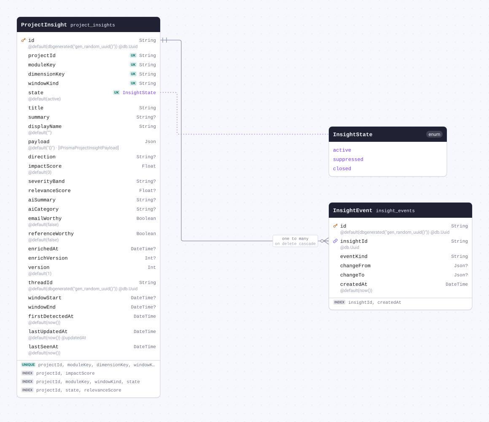

| Field        | Type                | Constraints                                           | Default                            | Description |
| ------------ | ------------------- | ----------------------------------------------------- | ---------------------------------- | ----------- |
| `id`         | `String` `@db.Uuid` | PK NOT NULL                                           | `dbgenerated("gen_random_uuid()")` |             |
| `insightId`  | `String` `@db.Uuid` | NOT NULL → [ProjectInsight.id](#model-ProjectInsight) |                                    |             |
| `eventKind`  | `String`            | NOT NULL                                              |                                    |             |
| `changeFrom` | `Json`              | NULL                                                  |                                    |             |
| `changeTo`   | `Json`              | NULL                                                  |                                    |             |
| `createdAt`  | `DateTime`          | NOT NULL                                              | `now()`                            |             |

#### Indexes

- `@@index([insightId, createdAt])`

#### References

- `insightId` → [ProjectInsight.id](#model-ProjectInsight) (many-to-one, on delete Cascade)

#### Definition

```sql
CREATE TABLE "insight_events" (
    "id" UUID NOT NULL DEFAULT gen_random_uuid(),
    "insightId" UUID NOT NULL,
    "eventKind" TEXT NOT NULL,
    "changeFrom" JSONB,
    "changeTo" JSONB,
    "createdAt" TIMESTAMP(3) NOT NULL DEFAULT CURRENT_TIMESTAMP,

    CONSTRAINT "insight_events_pkey" PRIMARY KEY ("id")
);

CREATE INDEX "insight_events_insightId_createdAt_idx" ON "insight_events"("insightId", "createdAt");

ALTER TABLE "insight_events" ADD CONSTRAINT "insight_events_insightId_fkey" FOREIGN KEY ("insightId") REFERENCES "project_insights"("id") ON DELETE CASCADE ON UPDATE CASCADE;
```

<details>
<summary>Queries and their SQL</summary>

**findMany**: Every row

```ts
await prisma.insightEvent.findMany();
```

```sql
SELECT
  "public"."insight_events"."id",
  "public"."insight_events"."insightId",
  "public"."insight_events"."eventKind",
  "public"."insight_events"."changeFrom",
  "public"."insight_events"."changeTo",
  "public"."insight_events"."createdAt"
FROM
  "public"."insight_events"
WHERE
  1 = 1
OFFSET
  $1
-- params: ["0"]
```

**count**: How many rows there are

```ts
await prisma.insightEvent.count();
```

```sql
SELECT
  COUNT(*) AS "_count$_all"
FROM
  (
    SELECT
      "public"."insight_events"."id"
    FROM
      "public"."insight_events"
    WHERE
      1 = 1
    OFFSET
      $1
  ) AS "sub"
-- params: ["0"]
```

**findMany**: Every row with its relations

```ts
await prisma.insightEvent.findMany({ include: { insight: true } });
```

```sql
SELECT
  "public"."insight_events"."id",
  "public"."insight_events"."insightId",
  "public"."insight_events"."eventKind",
  "public"."insight_events"."changeFrom",
  "public"."insight_events"."changeTo",
  "public"."insight_events"."createdAt"
FROM
  "public"."insight_events"
WHERE
  1 = 1
OFFSET
  $1
-- params: ["0"]

SELECT
  "public"."project_insights"."id",
  "public"."project_insights"."projectId",
  "public"."project_insights"."moduleKey",
  "public"."project_insights"."dimensionKey",
  "public"."project_insights"."windowKind",
  "public"."project_insights"."state"::text,
  "public"."project_insights"."title",
  "public"."project_insights"."summary",
  "public"."project_insights"."displayName",
  "public"."project_insights"."payload",
  "public"."project_insights"."direction",
  "public"."project_insights"."impactScore",
  "public"."project_insights"."severityBand",
  "public"."project_insights"."relevanceScore",
  "public"."project_insights"."aiSummary",
  "public"."project_insights"."aiCategory",
  "public"."project_insights"."emailWorthy",
  "public"."project_insights"."referenceWorthy",
  "public"."project_insights"."enrichedAt",
  "public"."project_insights"."enrichVersion",
  "public"."project_insights"."version",
  "public"."project_insights"."threadId",
  "public"."project_insights"."windowStart",
  "public"."project_insights"."windowEnd",
  "public"."project_insights"."firstDetectedAt",
  "public"."project_insights"."lastUpdatedAt",
  "public"."project_insights"."lastSeenAt"
FROM
  "public"."project_insights"
WHERE
  "public"."project_insights"."id" IN ($1)
OFFSET
  $2
-- params: ["<insightId of the rows above>","0"]
```

**findUnique**: One row by what is unique to it

```ts
await prisma.insightEvent.findUnique({ where: { id: "example" } });
```

```sql
SELECT
  "public"."insight_events"."id",
  "public"."insight_events"."insightId",
  "public"."insight_events"."eventKind",
  "public"."insight_events"."changeFrom",
  "public"."insight_events"."changeTo",
  "public"."insight_events"."createdAt"
FROM
  "public"."insight_events"
WHERE
  (
    "public"."insight_events"."id" = $1
    AND 1 = 1
  )
LIMIT
  $2
OFFSET
  $3
-- params: ["example","1","0"]
```

**create**: Create a row

```ts
await prisma.insightEvent.create({ data: { insightId: "example", eventKind: "example" } });
```

```sql
INSERT INTO
  "public"."insight_events" ("insightId", "eventKind", "createdAt")
VALUES
  ($1, $2, $3)
RETURNING
  "public"."insight_events"."id",
  "public"."insight_events"."insightId",
  "public"."insight_events"."eventKind",
  "public"."insight_events"."changeFrom",
  "public"."insight_events"."changeTo",
  "public"."insight_events"."createdAt"
-- params: ["example","example","<now()>"]
```

**update**: Update a row

```ts
await prisma.insightEvent.update({ where: { id: "example" }, data: { eventKind: "example" } });
```

```sql
UPDATE "public"."insight_events"
SET
  "eventKind" = $1
WHERE
  (
    "public"."insight_events"."id" = $2
    AND 1 = 1
  )
RETURNING
  "public"."insight_events"."id",
  "public"."insight_events"."insightId",
  "public"."insight_events"."eventKind",
  "public"."insight_events"."changeFrom",
  "public"."insight_events"."changeTo",
  "public"."insight_events"."createdAt"
-- params: ["example","example"]
```

**delete**: Delete a row

```ts
await prisma.insightEvent.delete({ where: { id: "example" } });
```

```sql
DELETE FROM "public"."insight_events"
WHERE
  (
    "public"."insight_events"."id" = $1
    AND 1 = 1
  )
RETURNING
  "public"."insight_events"."id",
  "public"."insight_events"."insightId",
  "public"."insight_events"."eventKind",
  "public"."insight_events"."changeFrom",
  "public"."insight_events"."changeTo",
  "public"."insight_events"."createdAt"
-- params: ["example"]
```

</details>

<a id="model-GscConnection"></a>

### GscConnection

Table `gsc_connections`.

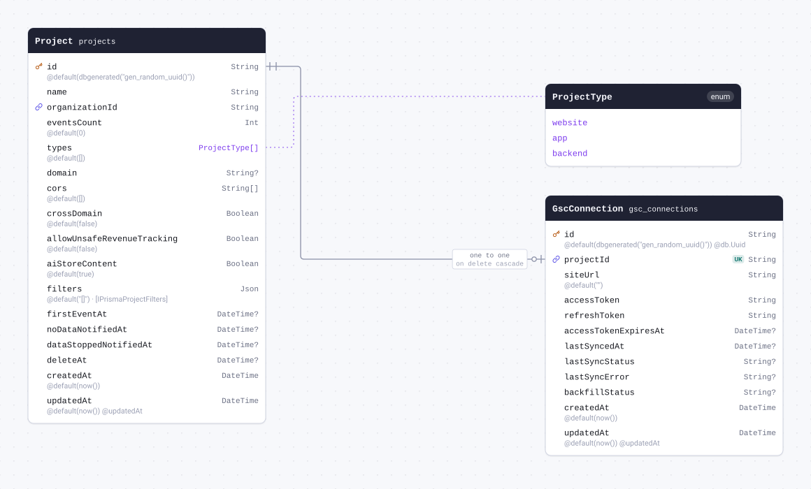

| Field                  | Type                | Constraints                                    | Default                            | Description |
| ---------------------- | ------------------- | ---------------------------------------------- | ---------------------------------- | ----------- |
| `id`                   | `String` `@db.Uuid` | PK NOT NULL                                    | `dbgenerated("gen_random_uuid()")` |             |
| `projectId`            | `String`            | UNIQUE NOT NULL → [Project.id](#model-Project) |                                    |             |
| `siteUrl`              | `String`            | NOT NULL                                       | `""`                               |             |
| `accessToken`          | `String`            | NOT NULL                                       |                                    |             |
| `refreshToken`         | `String`            | NOT NULL                                       |                                    |             |
| `accessTokenExpiresAt` | `DateTime`          | NULL                                           |                                    |             |
| `lastSyncedAt`         | `DateTime`          | NULL                                           |                                    |             |
| `lastSyncStatus`       | `String`            | NULL                                           |                                    |             |
| `lastSyncError`        | `String`            | NULL                                           |                                    |             |
| `backfillStatus`       | `String`            | NULL                                           |                                    |             |
| `createdAt`            | `DateTime`          | NOT NULL                                       | `now()`                            |             |
| `updatedAt`            | `DateTime`          | NOT NULL                                       | `now()` `@updatedAt`               |             |

#### References

- `projectId` → [Project.id](#model-Project) (one-to-one, on delete Cascade)

#### Definition

```sql
CREATE TABLE "gsc_connections" (
    "id" UUID NOT NULL DEFAULT gen_random_uuid(),
    "projectId" TEXT NOT NULL,
    "siteUrl" TEXT NOT NULL DEFAULT '',
    "accessToken" TEXT NOT NULL,
    "refreshToken" TEXT NOT NULL,
    "accessTokenExpiresAt" TIMESTAMP(3),
    "lastSyncedAt" TIMESTAMP(3),
    "lastSyncStatus" TEXT,
    "lastSyncError" TEXT,
    "backfillStatus" TEXT,
    "createdAt" TIMESTAMP(3) NOT NULL DEFAULT CURRENT_TIMESTAMP,
    "updatedAt" TIMESTAMP(3) NOT NULL DEFAULT CURRENT_TIMESTAMP,

    CONSTRAINT "gsc_connections_pkey" PRIMARY KEY ("id")
);

CREATE UNIQUE INDEX "gsc_connections_projectId_key" ON "gsc_connections"("projectId");

ALTER TABLE "gsc_connections" ADD CONSTRAINT "gsc_connections_projectId_fkey" FOREIGN KEY ("projectId") REFERENCES "projects"("id") ON DELETE CASCADE ON UPDATE CASCADE;
```

<details>
<summary>Queries and their SQL</summary>

**findMany**: Every row

```ts
await prisma.gscConnection.findMany();
```

```sql
SELECT
  "public"."gsc_connections"."id",
  "public"."gsc_connections"."projectId",
  "public"."gsc_connections"."siteUrl",
  "public"."gsc_connections"."accessToken",
  "public"."gsc_connections"."refreshToken",
  "public"."gsc_connections"."accessTokenExpiresAt",
  "public"."gsc_connections"."lastSyncedAt",
  "public"."gsc_connections"."lastSyncStatus",
  "public"."gsc_connections"."lastSyncError",
  "public"."gsc_connections"."backfillStatus",
  "public"."gsc_connections"."createdAt",
  "public"."gsc_connections"."updatedAt"
FROM
  "public"."gsc_connections"
WHERE
  1 = 1
OFFSET
  $1
-- params: ["0"]
```

**count**: How many rows there are

```ts
await prisma.gscConnection.count();
```

```sql
SELECT
  COUNT(*) AS "_count$_all"
FROM
  (
    SELECT
      "public"."gsc_connections"."id"
    FROM
      "public"."gsc_connections"
    WHERE
      1 = 1
    OFFSET
      $1
  ) AS "sub"
-- params: ["0"]
```

**findMany**: Every row with its relations

```ts
await prisma.gscConnection.findMany({ include: { project: true } });
```

```sql
SELECT
  "public"."gsc_connections"."id",
  "public"."gsc_connections"."projectId",
  "public"."gsc_connections"."siteUrl",
  "public"."gsc_connections"."accessToken",
  "public"."gsc_connections"."refreshToken",
  "public"."gsc_connections"."accessTokenExpiresAt",
  "public"."gsc_connections"."lastSyncedAt",
  "public"."gsc_connections"."lastSyncStatus",
  "public"."gsc_connections"."lastSyncError",
  "public"."gsc_connections"."backfillStatus",
  "public"."gsc_connections"."createdAt",
  "public"."gsc_connections"."updatedAt"
FROM
  "public"."gsc_connections"
WHERE
  1 = 1
OFFSET
  $1
-- params: ["0"]

SELECT
  "public"."projects"."id",
  "public"."projects"."name",
  "public"."projects"."organizationId",
  "public"."projects"."eventsCount",
  "public"."projects"."types"::text[],
  "public"."projects"."domain",
  "public"."projects"."cors",
  "public"."projects"."crossDomain",
  "public"."projects"."allowUnsafeRevenueTracking",
  "public"."projects"."aiStoreContent",
  "public"."projects"."filters",
  "public"."projects"."firstEventAt",
  "public"."projects"."noDataNotifiedAt",
  "public"."projects"."dataStoppedNotifiedAt",
  "public"."projects"."deleteAt",
  "public"."projects"."createdAt",
  "public"."projects"."updatedAt"
FROM
  "public"."projects"
WHERE
  "public"."projects"."id" IN ($1)
OFFSET
  $2
-- params: ["<projectId of the rows above>","0"]
```

**findUnique**: One row by what is unique to it

```ts
await prisma.gscConnection.findUnique({ where: { id: "example" } });
```

```sql
SELECT
  "public"."gsc_connections"."id",
  "public"."gsc_connections"."projectId",
  "public"."gsc_connections"."siteUrl",
  "public"."gsc_connections"."accessToken",
  "public"."gsc_connections"."refreshToken",
  "public"."gsc_connections"."accessTokenExpiresAt",
  "public"."gsc_connections"."lastSyncedAt",
  "public"."gsc_connections"."lastSyncStatus",
  "public"."gsc_connections"."lastSyncError",
  "public"."gsc_connections"."backfillStatus",
  "public"."gsc_connections"."createdAt",
  "public"."gsc_connections"."updatedAt"
FROM
  "public"."gsc_connections"
WHERE
  (
    "public"."gsc_connections"."id" = $1
    AND 1 = 1
  )
LIMIT
  $2
OFFSET
  $3
-- params: ["example","1","0"]
```

**create**: Create a row

```ts
await prisma.gscConnection.create({
  data: { projectId: "example", accessToken: "example", refreshToken: "example" },
});
```

```sql
INSERT INTO
  "public"."gsc_connections" (
    "projectId",
    "siteUrl",
    "accessToken",
    "refreshToken",
    "createdAt",
    "updatedAt"
  )
VALUES
  ($1, $2, $3, $4, $5, $6)
RETURNING
  "public"."gsc_connections"."id",
  "public"."gsc_connections"."projectId",
  "public"."gsc_connections"."siteUrl",
  "public"."gsc_connections"."accessToken",
  "public"."gsc_connections"."refreshToken",
  "public"."gsc_connections"."accessTokenExpiresAt",
  "public"."gsc_connections"."lastSyncedAt",
  "public"."gsc_connections"."lastSyncStatus",
  "public"."gsc_connections"."lastSyncError",
  "public"."gsc_connections"."backfillStatus",
  "public"."gsc_connections"."createdAt",
  "public"."gsc_connections"."updatedAt"
-- params: ["example","","example","example","<now()>","<now()>"]
```

**update**: Update a row

```ts
await prisma.gscConnection.update({ where: { id: "example" }, data: { siteUrl: "example" } });
```

```sql
UPDATE "public"."gsc_connections"
SET
  "siteUrl" = $1,
  "updatedAt" = $2
WHERE
  (
    "public"."gsc_connections"."id" = $3
    AND 1 = 1
  )
RETURNING
  "public"."gsc_connections"."id",
  "public"."gsc_connections"."projectId",
  "public"."gsc_connections"."siteUrl",
  "public"."gsc_connections"."accessToken",
  "public"."gsc_connections"."refreshToken",
  "public"."gsc_connections"."accessTokenExpiresAt",
  "public"."gsc_connections"."lastSyncedAt",
  "public"."gsc_connections"."lastSyncStatus",
  "public"."gsc_connections"."lastSyncError",
  "public"."gsc_connections"."backfillStatus",
  "public"."gsc_connections"."createdAt",
  "public"."gsc_connections"."updatedAt"
-- params: ["example",{"prisma__type":"generatorCall","prisma__value":{"name":"now","args":[],"returnType":{"type":"DateTime"}}},"example"]
```

**delete**: Delete a row

```ts
await prisma.gscConnection.delete({ where: { id: "example" } });
```

```sql
DELETE FROM "public"."gsc_connections"
WHERE
  (
    "public"."gsc_connections"."id" = $1
    AND 1 = 1
  )
RETURNING
  "public"."gsc_connections"."id",
  "public"."gsc_connections"."projectId",
  "public"."gsc_connections"."siteUrl",
  "public"."gsc_connections"."accessToken",
  "public"."gsc_connections"."refreshToken",
  "public"."gsc_connections"."accessTokenExpiresAt",
  "public"."gsc_connections"."lastSyncedAt",
  "public"."gsc_connections"."lastSyncStatus",
  "public"."gsc_connections"."lastSyncError",
  "public"."gsc_connections"."backfillStatus",
  "public"."gsc_connections"."createdAt",
  "public"."gsc_connections"."updatedAt"
-- params: ["example"]
```

</details>

<a id="model-EmailUnsubscribe"></a>

### EmailUnsubscribe

Table `email_unsubscribes`.

| Field       | Type                | Constraints | Default                            | Description |
| ----------- | ------------------- | ----------- | ---------------------------------- | ----------- |
| `id`        | `String` `@db.Uuid` | PK NOT NULL | `dbgenerated("gen_random_uuid()")` |             |
| `email`     | `String`            | NOT NULL    |                                    |             |
| `category`  | `String`            | NOT NULL    |                                    |             |
| `createdAt` | `DateTime`          | NOT NULL    | `now()`                            |             |

#### Indexes

- `@@unique([email, category])`

#### Definition

```sql
CREATE TABLE "email_unsubscribes" (
    "id" UUID NOT NULL DEFAULT gen_random_uuid(),
    "email" TEXT NOT NULL,
    "category" TEXT NOT NULL,
    "createdAt" TIMESTAMP(3) NOT NULL DEFAULT CURRENT_TIMESTAMP,

    CONSTRAINT "email_unsubscribes_pkey" PRIMARY KEY ("id")
);

CREATE UNIQUE INDEX "email_unsubscribes_email_category_key" ON "email_unsubscribes"("email", "category");
```

<details>
<summary>Queries and their SQL</summary>

**findMany**: Every row

```ts
await prisma.emailUnsubscribe.findMany();
```

```sql
SELECT
  "public"."email_unsubscribes"."id",
  "public"."email_unsubscribes"."email",
  "public"."email_unsubscribes"."category",
  "public"."email_unsubscribes"."createdAt"
FROM
  "public"."email_unsubscribes"
WHERE
  1 = 1
OFFSET
  $1
-- params: ["0"]
```

**count**: How many rows there are

```ts
await prisma.emailUnsubscribe.count();
```

```sql
SELECT
  COUNT(*) AS "_count$_all"
FROM
  (
    SELECT
      "public"."email_unsubscribes"."id"
    FROM
      "public"."email_unsubscribes"
    WHERE
      1 = 1
    OFFSET
      $1
  ) AS "sub"
-- params: ["0"]
```

**findUnique**: One row by what is unique to it

```ts
await prisma.emailUnsubscribe.findUnique({ where: { id: "example" } });
```

```sql
SELECT
  "public"."email_unsubscribes"."id",
  "public"."email_unsubscribes"."email",
  "public"."email_unsubscribes"."category",
  "public"."email_unsubscribes"."createdAt"
FROM
  "public"."email_unsubscribes"
WHERE
  (
    "public"."email_unsubscribes"."id" = $1
    AND 1 = 1
  )
LIMIT
  $2
OFFSET
  $3
-- params: ["example","1","0"]
```

**create**: Create a row

```ts
await prisma.emailUnsubscribe.create({ data: { email: "example", category: "example" } });
```

```sql
INSERT INTO
  "public"."email_unsubscribes" ("email", "category", "createdAt")
VALUES
  ($1, $2, $3)
RETURNING
  "public"."email_unsubscribes"."id",
  "public"."email_unsubscribes"."email",
  "public"."email_unsubscribes"."category",
  "public"."email_unsubscribes"."createdAt"
-- params: ["example","example","<now()>"]
```

**update**: Update a row

```ts
await prisma.emailUnsubscribe.update({ where: { id: "example" }, data: { email: "example" } });
```

```sql
UPDATE "public"."email_unsubscribes"
SET
  "email" = $1
WHERE
  (
    "public"."email_unsubscribes"."id" = $2
    AND 1 = 1
  )
RETURNING
  "public"."email_unsubscribes"."id",
  "public"."email_unsubscribes"."email",
  "public"."email_unsubscribes"."category",
  "public"."email_unsubscribes"."createdAt"
-- params: ["example","example"]
```

**delete**: Delete a row

```ts
await prisma.emailUnsubscribe.delete({ where: { id: "example" } });
```

```sql
DELETE FROM "public"."email_unsubscribes"
WHERE
  (
    "public"."email_unsubscribes"."id" = $1
    AND 1 = 1
  )
RETURNING
  "public"."email_unsubscribes"."id",
  "public"."email_unsubscribes"."email",
  "public"."email_unsubscribes"."category",
  "public"."email_unsubscribes"."createdAt"
-- params: ["example"]
```

</details>

## Enums

<a id="enum-ProjectType"></a>

### ProjectType

- `website`
- `app`
- `backend`

#### Definition

```sql
CREATE TYPE "ProjectType" AS ENUM ('website', 'app', 'backend');
```

<a id="enum-ProjectScope"></a>

### ProjectScope

- `all`
- `selected`

#### Definition

```sql
CREATE TYPE "ProjectScope" AS ENUM ('all', 'selected');
```

<a id="enum-AccessLevel"></a>

### AccessLevel

- `read`
- `write`
- `admin`

#### Definition

```sql
CREATE TYPE "AccessLevel" AS ENUM ('read', 'write', 'admin');
```

<a id="enum-ClientType"></a>

### ClientType

- `read`
- `write`
- `root`

#### Definition

```sql
CREATE TYPE "ClientType" AS ENUM ('read', 'write', 'root');
```

<a id="enum-Interval"></a>

### Interval

- `hour`
- `day`
- `month`
- `minute`
- `week`

#### Definition

```sql
CREATE TYPE "Interval" AS ENUM ('hour', 'day', 'month', 'minute', 'week');
```

<a id="enum-ChartType"></a>

### ChartType

- `linear`
- `bar`
- `histogram`
- `pie`
- `metric`
- `area`
- `map`
- `funnel`
- `retention`
- `conversion`
- `sankey`
- `distribution`

#### Definition

```sql
CREATE TYPE "ChartType" AS ENUM ('linear', 'bar', 'histogram', 'pie', 'metric', 'area', 'map', 'funnel', 'retention', 'conversion', 'sankey', 'distribution');
```

<a id="enum-Metric"></a>

### Metric

- `sum`
- `average`
- `min`
- `max`
- `count`

#### Definition

```sql
CREATE TYPE "Metric" AS ENUM ('sum', 'average', 'min', 'max', 'count');
```

<a id="enum-IntegrationType"></a>

### IntegrationType

- `app`
- `mail`
- `custom`

#### Definition

```sql
CREATE TYPE "IntegrationType" AS ENUM ('app', 'mail', 'custom');
```

<a id="enum-ImportStatus"></a>

### ImportStatus

- `pending`
- `processing`
- `completed`
- `failed`

#### Definition

```sql
CREATE TYPE "ImportStatus" AS ENUM ('pending', 'processing', 'completed', 'failed');
```

<a id="enum-InsightState"></a>

### InsightState

- `active`
- `suppressed`
- `closed`

#### Definition

```sql
CREATE TYPE "InsightState" AS ENUM ('active', 'suppressed', 'closed');
```
