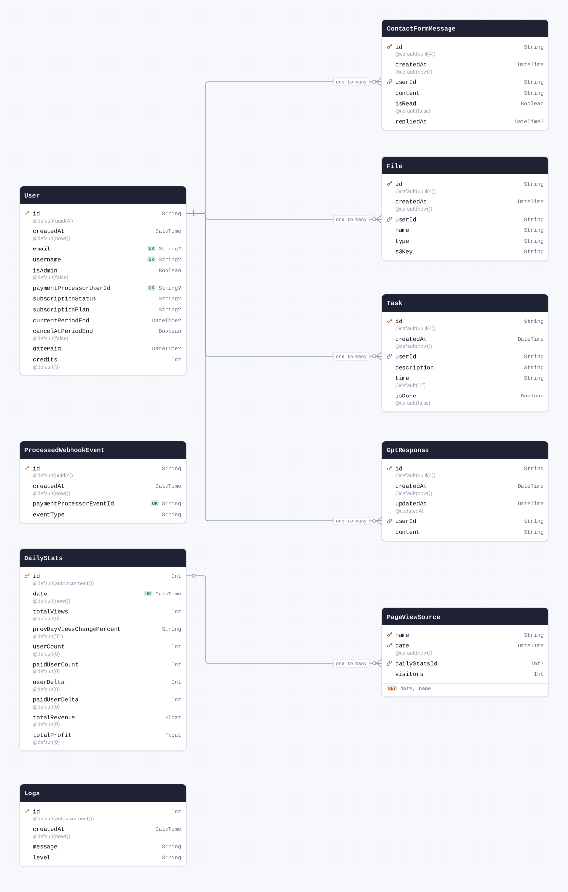
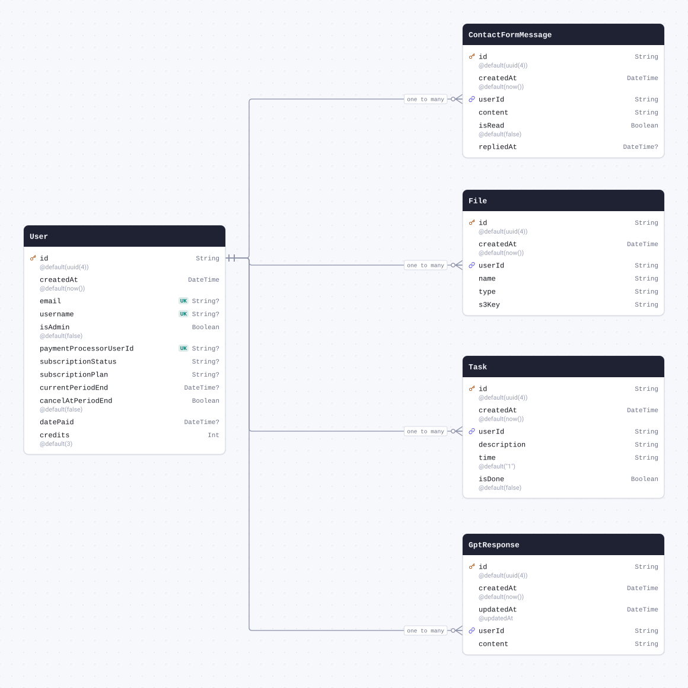
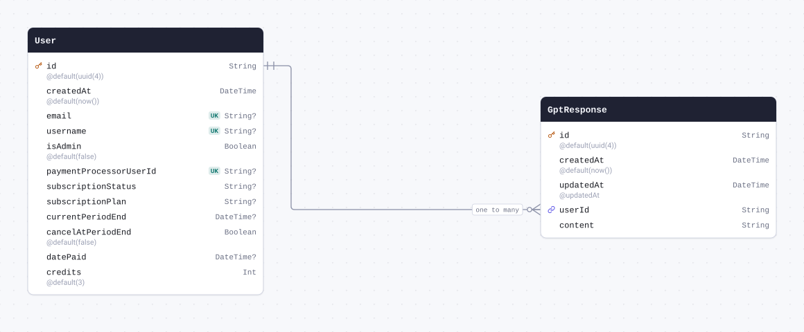
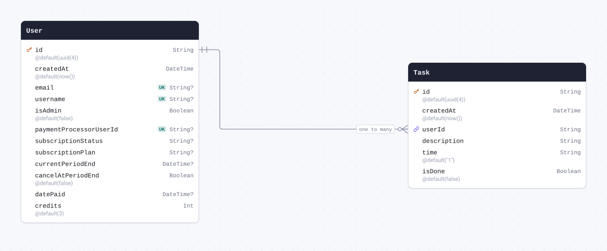
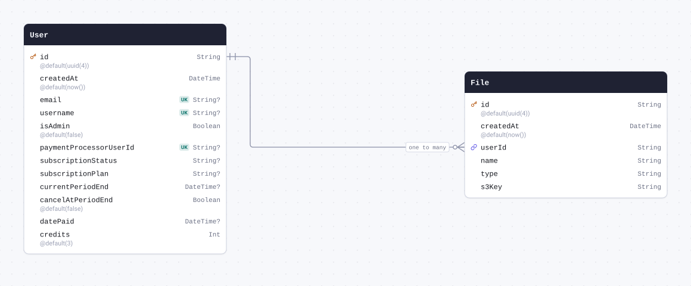
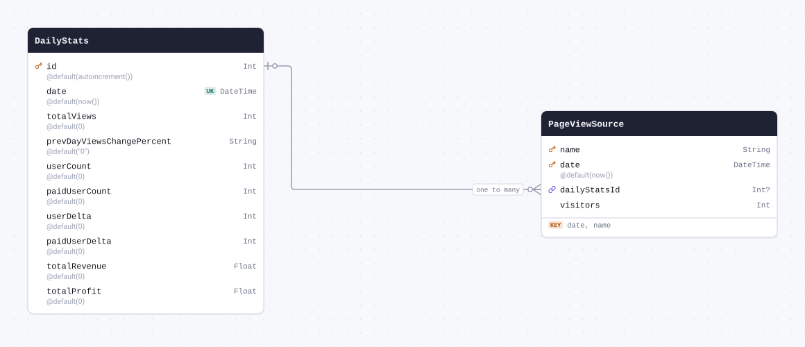
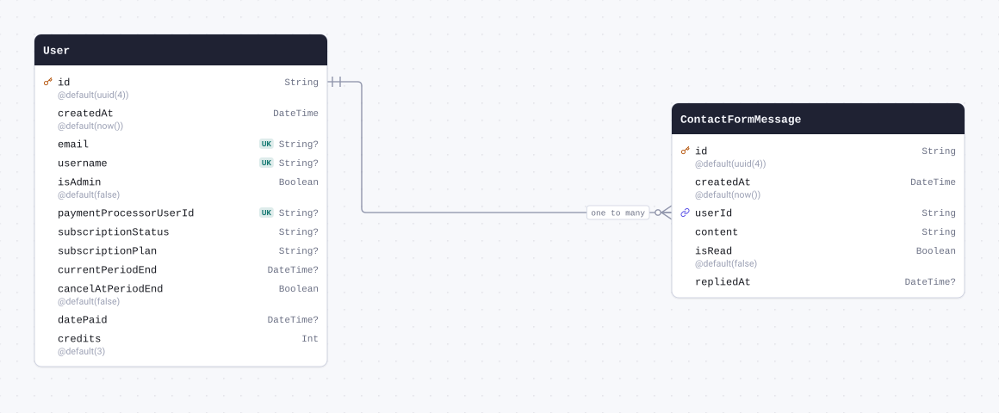

# Schema docs



<details>
<summary>The whole schema as SQL</summary>

```sql
CREATE SCHEMA IF NOT EXISTS "public";

CREATE TABLE "User" (
    "id" TEXT NOT NULL,
    "createdAt" TIMESTAMP(3) NOT NULL DEFAULT CURRENT_TIMESTAMP,
    "email" TEXT,
    "username" TEXT,
    "isAdmin" BOOLEAN NOT NULL DEFAULT false,
    "paymentProcessorUserId" TEXT,
    "subscriptionStatus" TEXT,
    "subscriptionPlan" TEXT,
    "currentPeriodEnd" TIMESTAMP(3),
    "cancelAtPeriodEnd" BOOLEAN NOT NULL DEFAULT false,
    "datePaid" TIMESTAMP(3),
    "credits" INTEGER NOT NULL DEFAULT 3,

    CONSTRAINT "User_pkey" PRIMARY KEY ("id")
);

CREATE TABLE "ProcessedWebhookEvent" (
    "id" TEXT NOT NULL,
    "createdAt" TIMESTAMP(3) NOT NULL DEFAULT CURRENT_TIMESTAMP,
    "paymentProcessorEventId" TEXT NOT NULL,
    "eventType" TEXT NOT NULL,

    CONSTRAINT "ProcessedWebhookEvent_pkey" PRIMARY KEY ("id")
);

CREATE TABLE "GptResponse" (
    "id" TEXT NOT NULL,
    "createdAt" TIMESTAMP(3) NOT NULL DEFAULT CURRENT_TIMESTAMP,
    "updatedAt" TIMESTAMP(3) NOT NULL,
    "userId" TEXT NOT NULL,
    "content" TEXT NOT NULL,

    CONSTRAINT "GptResponse_pkey" PRIMARY KEY ("id")
);

CREATE TABLE "Task" (
    "id" TEXT NOT NULL,
    "createdAt" TIMESTAMP(3) NOT NULL DEFAULT CURRENT_TIMESTAMP,
    "userId" TEXT NOT NULL,
    "description" TEXT NOT NULL,
    "time" TEXT NOT NULL DEFAULT '1',
    "isDone" BOOLEAN NOT NULL DEFAULT false,

    CONSTRAINT "Task_pkey" PRIMARY KEY ("id")
);

CREATE TABLE "File" (
    "id" TEXT NOT NULL,
    "createdAt" TIMESTAMP(3) NOT NULL DEFAULT CURRENT_TIMESTAMP,
    "userId" TEXT NOT NULL,
    "name" TEXT NOT NULL,
    "type" TEXT NOT NULL,
    "s3Key" TEXT NOT NULL,

    CONSTRAINT "File_pkey" PRIMARY KEY ("id")
);

CREATE TABLE "DailyStats" (
    "id" SERIAL NOT NULL,
    "date" TIMESTAMP(3) NOT NULL DEFAULT CURRENT_TIMESTAMP,
    "totalViews" INTEGER NOT NULL DEFAULT 0,
    "prevDayViewsChangePercent" TEXT NOT NULL DEFAULT '0',
    "userCount" INTEGER NOT NULL DEFAULT 0,
    "paidUserCount" INTEGER NOT NULL DEFAULT 0,
    "userDelta" INTEGER NOT NULL DEFAULT 0,
    "paidUserDelta" INTEGER NOT NULL DEFAULT 0,
    "totalRevenue" DOUBLE PRECISION NOT NULL DEFAULT 0,
    "totalProfit" DOUBLE PRECISION NOT NULL DEFAULT 0,

    CONSTRAINT "DailyStats_pkey" PRIMARY KEY ("id")
);

CREATE TABLE "PageViewSource" (
    "name" TEXT NOT NULL,
    "date" TIMESTAMP(3) NOT NULL DEFAULT CURRENT_TIMESTAMP,
    "dailyStatsId" INTEGER,
    "visitors" INTEGER NOT NULL,

    CONSTRAINT "PageViewSource_pkey" PRIMARY KEY ("date","name")
);

CREATE TABLE "Logs" (
    "id" SERIAL NOT NULL,
    "createdAt" TIMESTAMP(3) NOT NULL DEFAULT CURRENT_TIMESTAMP,
    "message" TEXT NOT NULL,
    "level" TEXT NOT NULL,

    CONSTRAINT "Logs_pkey" PRIMARY KEY ("id")
);

CREATE TABLE "ContactFormMessage" (
    "id" TEXT NOT NULL,
    "createdAt" TIMESTAMP(3) NOT NULL DEFAULT CURRENT_TIMESTAMP,
    "userId" TEXT NOT NULL,
    "content" TEXT NOT NULL,
    "isRead" BOOLEAN NOT NULL DEFAULT false,
    "repliedAt" TIMESTAMP(3),

    CONSTRAINT "ContactFormMessage_pkey" PRIMARY KEY ("id")
);

CREATE UNIQUE INDEX "User_email_key" ON "User"("email");

CREATE UNIQUE INDEX "User_username_key" ON "User"("username");

CREATE UNIQUE INDEX "User_paymentProcessorUserId_key" ON "User"("paymentProcessorUserId");

CREATE UNIQUE INDEX "ProcessedWebhookEvent_paymentProcessorEventId_key" ON "ProcessedWebhookEvent"("paymentProcessorEventId");

CREATE UNIQUE INDEX "DailyStats_date_key" ON "DailyStats"("date");

ALTER TABLE "GptResponse" ADD CONSTRAINT "GptResponse_userId_fkey" FOREIGN KEY ("userId") REFERENCES "User"("id") ON DELETE RESTRICT ON UPDATE CASCADE;

ALTER TABLE "Task" ADD CONSTRAINT "Task_userId_fkey" FOREIGN KEY ("userId") REFERENCES "User"("id") ON DELETE RESTRICT ON UPDATE CASCADE;

ALTER TABLE "File" ADD CONSTRAINT "File_userId_fkey" FOREIGN KEY ("userId") REFERENCES "User"("id") ON DELETE RESTRICT ON UPDATE CASCADE;

ALTER TABLE "PageViewSource" ADD CONSTRAINT "PageViewSource_dailyStatsId_fkey" FOREIGN KEY ("dailyStatsId") REFERENCES "DailyStats"("id") ON DELETE SET NULL ON UPDATE CASCADE;

ALTER TABLE "ContactFormMessage" ADD CONSTRAINT "ContactFormMessage_userId_fkey" FOREIGN KEY ("userId") REFERENCES "User"("id") ON DELETE RESTRICT ON UPDATE CASCADE;
```

</details>

## Contents

| Model                                                 | Table                   | Description |
| ----------------------------------------------------- | ----------------------- | ----------- |
| [User](#model-User)                                   | `User`                  |             |
| [ProcessedWebhookEvent](#model-ProcessedWebhookEvent) | `ProcessedWebhookEvent` |             |
| [GptResponse](#model-GptResponse)                     | `GptResponse`           |             |
| [Task](#model-Task)                                   | `Task`                  |             |
| [File](#model-File)                                   | `File`                  |             |
| [DailyStats](#model-DailyStats)                       | `DailyStats`            |             |
| [PageViewSource](#model-PageViewSource)               | `PageViewSource`        |             |
| [Logs](#model-Logs)                                   | `Logs`                  |             |
| [ContactFormMessage](#model-ContactFormMessage)       | `ContactFormMessage`    |             |

## Models

<a id="model-User"></a>

### User



| Field                    | Type       | Constraints | Default   | Description |
| ------------------------ | ---------- | ----------- | --------- | ----------- |
| `id`                     | `String`   | PK NOT NULL | `uuid(4)` |             |
| `createdAt`              | `DateTime` | NOT NULL    | `now()`   |             |
| `email`                  | `String`   | UNIQUE NULL |           |             |
| `username`               | `String`   | UNIQUE NULL |           |             |
| `isAdmin`                | `Boolean`  | NOT NULL    | `false`   |             |
| `paymentProcessorUserId` | `String`   | UNIQUE NULL |           |             |
| `subscriptionStatus`     | `String`   | NULL        |           |             |
| `subscriptionPlan`       | `String`   | NULL        |           |             |
| `currentPeriodEnd`       | `DateTime` | NULL        |           |             |
| `cancelAtPeriodEnd`      | `Boolean`  | NOT NULL    | `false`   |             |
| `datePaid`               | `DateTime` | NULL        |           |             |
| `credits`                | `Int`      | NOT NULL    | `3`       |             |

#### Referenced by

- `id` ← [GptResponse.userId](#model-GptResponse) (one-to-many)
- `id` ← [Task.userId](#model-Task) (one-to-many)
- `id` ← [File.userId](#model-File) (one-to-many)
- `id` ← [ContactFormMessage.userId](#model-ContactFormMessage) (one-to-many)

#### Definition

```sql
CREATE TABLE "User" (
    "id" TEXT NOT NULL,
    "createdAt" TIMESTAMP(3) NOT NULL DEFAULT CURRENT_TIMESTAMP,
    "email" TEXT,
    "username" TEXT,
    "isAdmin" BOOLEAN NOT NULL DEFAULT false,
    "paymentProcessorUserId" TEXT,
    "subscriptionStatus" TEXT,
    "subscriptionPlan" TEXT,
    "currentPeriodEnd" TIMESTAMP(3),
    "cancelAtPeriodEnd" BOOLEAN NOT NULL DEFAULT false,
    "datePaid" TIMESTAMP(3),
    "credits" INTEGER NOT NULL DEFAULT 3,

    CONSTRAINT "User_pkey" PRIMARY KEY ("id")
);

CREATE UNIQUE INDEX "User_email_key" ON "User"("email");

CREATE UNIQUE INDEX "User_username_key" ON "User"("username");

CREATE UNIQUE INDEX "User_paymentProcessorUserId_key" ON "User"("paymentProcessorUserId");
```

<details>
<summary>Queries and their SQL</summary>

**findMany**: Every row

```ts
await prisma.user.findMany();
```

```sql
SELECT
  "public"."User"."id",
  "public"."User"."createdAt",
  "public"."User"."email",
  "public"."User"."username",
  "public"."User"."isAdmin",
  "public"."User"."paymentProcessorUserId",
  "public"."User"."subscriptionStatus",
  "public"."User"."subscriptionPlan",
  "public"."User"."currentPeriodEnd",
  "public"."User"."cancelAtPeriodEnd",
  "public"."User"."datePaid",
  "public"."User"."credits"
FROM
  "public"."User"
WHERE
  1 = 1
OFFSET
  $1
-- params: ["0"]
```

**count**: How many rows there are

```ts
await prisma.user.count();
```

```sql
SELECT
  COUNT(*) AS "_count$_all"
FROM
  (
    SELECT
      "public"."User"."id"
    FROM
      "public"."User"
    WHERE
      1 = 1
    OFFSET
      $1
  ) AS "sub"
-- params: ["0"]
```

**findMany**: Every row with its relations

```ts
await prisma.user.findMany({
  include: { gptResponses: true, contactFormMessages: true, tasks: true, files: true },
});
```

```sql
SELECT
  "public"."User"."id",
  "public"."User"."createdAt",
  "public"."User"."email",
  "public"."User"."username",
  "public"."User"."isAdmin",
  "public"."User"."paymentProcessorUserId",
  "public"."User"."subscriptionStatus",
  "public"."User"."subscriptionPlan",
  "public"."User"."currentPeriodEnd",
  "public"."User"."cancelAtPeriodEnd",
  "public"."User"."datePaid",
  "public"."User"."credits"
FROM
  "public"."User"
WHERE
  1 = 1
OFFSET
  $1
-- params: ["0"]

SELECT
  "public"."GptResponse"."id",
  "public"."GptResponse"."createdAt",
  "public"."GptResponse"."updatedAt",
  "public"."GptResponse"."userId",
  "public"."GptResponse"."content"
FROM
  "public"."GptResponse"
WHERE
  "public"."GptResponse"."userId" IN ($1)
OFFSET
  $2
-- params: ["<id of the rows above>","0"]

SELECT
  "public"."ContactFormMessage"."id",
  "public"."ContactFormMessage"."createdAt",
  "public"."ContactFormMessage"."userId",
  "public"."ContactFormMessage"."content",
  "public"."ContactFormMessage"."isRead",
  "public"."ContactFormMessage"."repliedAt"
FROM
  "public"."ContactFormMessage"
WHERE
  "public"."ContactFormMessage"."userId" IN ($1)
OFFSET
  $2
-- params: ["<id of the rows above>","0"]

SELECT
  "public"."Task"."id",
  "public"."Task"."createdAt",
  "public"."Task"."userId",
  "public"."Task"."description",
  "public"."Task"."time",
  "public"."Task"."isDone"
FROM
  "public"."Task"
WHERE
  "public"."Task"."userId" IN ($1)
OFFSET
  $2
-- params: ["<id of the rows above>","0"]

SELECT
  "public"."File"."id",
  "public"."File"."createdAt",
  "public"."File"."userId",
  "public"."File"."name",
  "public"."File"."type",
  "public"."File"."s3Key"
FROM
  "public"."File"
WHERE
  "public"."File"."userId" IN ($1)
OFFSET
  $2
-- params: ["<id of the rows above>","0"]
```

**findUnique**: One row by what is unique to it

```ts
await prisma.user.findUnique({ where: { id: "example" } });
```

```sql
SELECT
  "public"."User"."id",
  "public"."User"."createdAt",
  "public"."User"."email",
  "public"."User"."username",
  "public"."User"."isAdmin",
  "public"."User"."paymentProcessorUserId",
  "public"."User"."subscriptionStatus",
  "public"."User"."subscriptionPlan",
  "public"."User"."currentPeriodEnd",
  "public"."User"."cancelAtPeriodEnd",
  "public"."User"."datePaid",
  "public"."User"."credits"
FROM
  "public"."User"
WHERE
  (
    "public"."User"."id" = $1
    AND 1 = 1
  )
LIMIT
  $2
OFFSET
  $3
-- params: ["example","1","0"]
```

**create**: Create a row

```ts
await prisma.user.create({ data: {} });
```

```sql
INSERT INTO
  "public"."User" (
    "id",
    "createdAt",
    "isAdmin",
    "cancelAtPeriodEnd",
    "credits"
  )
VALUES
  ($1, $2, $3, $4, $5)
RETURNING
  "public"."User"."id",
  "public"."User"."createdAt",
  "public"."User"."email",
  "public"."User"."username",
  "public"."User"."isAdmin",
  "public"."User"."paymentProcessorUserId",
  "public"."User"."subscriptionStatus",
  "public"."User"."subscriptionPlan",
  "public"."User"."currentPeriodEnd",
  "public"."User"."cancelAtPeriodEnd",
  "public"."User"."datePaid",
  "public"."User"."credits"
-- params: ["<uuid(4)>","<now()>",false,false,"3"]
```

**update**: Update a row

```ts
await prisma.user.update({
  where: { id: "example" },
  data: { createdAt: new Date("2026-01-01T00:00:00.000Z") },
});
```

```sql
UPDATE "public"."User"
SET
  "createdAt" = $1
WHERE
  (
    "public"."User"."id" = $2
    AND 1 = 1
  )
RETURNING
  "public"."User"."id",
  "public"."User"."createdAt",
  "public"."User"."email",
  "public"."User"."username",
  "public"."User"."isAdmin",
  "public"."User"."paymentProcessorUserId",
  "public"."User"."subscriptionStatus",
  "public"."User"."subscriptionPlan",
  "public"."User"."currentPeriodEnd",
  "public"."User"."cancelAtPeriodEnd",
  "public"."User"."datePaid",
  "public"."User"."credits"
-- params: ["2026-01-01T00:00:00.000Z","example"]
```

**delete**: Delete a row

```ts
await prisma.user.delete({ where: { id: "example" } });
```

```sql
DELETE FROM "public"."User"
WHERE
  (
    "public"."User"."id" = $1
    AND 1 = 1
  )
RETURNING
  "public"."User"."id",
  "public"."User"."createdAt",
  "public"."User"."email",
  "public"."User"."username",
  "public"."User"."isAdmin",
  "public"."User"."paymentProcessorUserId",
  "public"."User"."subscriptionStatus",
  "public"."User"."subscriptionPlan",
  "public"."User"."currentPeriodEnd",
  "public"."User"."cancelAtPeriodEnd",
  "public"."User"."datePaid",
  "public"."User"."credits"
-- params: ["example"]
```

</details>

<a id="model-ProcessedWebhookEvent"></a>

### ProcessedWebhookEvent

| Field                     | Type       | Constraints     | Default   | Description |
| ------------------------- | ---------- | --------------- | --------- | ----------- |
| `id`                      | `String`   | PK NOT NULL     | `uuid(4)` |             |
| `createdAt`               | `DateTime` | NOT NULL        | `now()`   |             |
| `paymentProcessorEventId` | `String`   | UNIQUE NOT NULL |           |             |
| `eventType`               | `String`   | NOT NULL        |           |             |

#### Definition

```sql
CREATE TABLE "ProcessedWebhookEvent" (
    "id" TEXT NOT NULL,
    "createdAt" TIMESTAMP(3) NOT NULL DEFAULT CURRENT_TIMESTAMP,
    "paymentProcessorEventId" TEXT NOT NULL,
    "eventType" TEXT NOT NULL,

    CONSTRAINT "ProcessedWebhookEvent_pkey" PRIMARY KEY ("id")
);

CREATE UNIQUE INDEX "ProcessedWebhookEvent_paymentProcessorEventId_key" ON "ProcessedWebhookEvent"("paymentProcessorEventId");
```

<details>
<summary>Queries and their SQL</summary>

**findMany**: Every row

```ts
await prisma.processedWebhookEvent.findMany();
```

```sql
SELECT
  "public"."ProcessedWebhookEvent"."id",
  "public"."ProcessedWebhookEvent"."createdAt",
  "public"."ProcessedWebhookEvent"."paymentProcessorEventId",
  "public"."ProcessedWebhookEvent"."eventType"
FROM
  "public"."ProcessedWebhookEvent"
WHERE
  1 = 1
OFFSET
  $1
-- params: ["0"]
```

**count**: How many rows there are

```ts
await prisma.processedWebhookEvent.count();
```

```sql
SELECT
  COUNT(*) AS "_count$_all"
FROM
  (
    SELECT
      "public"."ProcessedWebhookEvent"."id"
    FROM
      "public"."ProcessedWebhookEvent"
    WHERE
      1 = 1
    OFFSET
      $1
  ) AS "sub"
-- params: ["0"]
```

**findUnique**: One row by what is unique to it

```ts
await prisma.processedWebhookEvent.findUnique({ where: { id: "example" } });
```

```sql
SELECT
  "public"."ProcessedWebhookEvent"."id",
  "public"."ProcessedWebhookEvent"."createdAt",
  "public"."ProcessedWebhookEvent"."paymentProcessorEventId",
  "public"."ProcessedWebhookEvent"."eventType"
FROM
  "public"."ProcessedWebhookEvent"
WHERE
  (
    "public"."ProcessedWebhookEvent"."id" = $1
    AND 1 = 1
  )
LIMIT
  $2
OFFSET
  $3
-- params: ["example","1","0"]
```

**create**: Create a row

```ts
await prisma.processedWebhookEvent.create({
  data: { paymentProcessorEventId: "example", eventType: "example" },
});
```

```sql
INSERT INTO
  "public"."ProcessedWebhookEvent" (
    "id",
    "createdAt",
    "paymentProcessorEventId",
    "eventType"
  )
VALUES
  ($1, $2, $3, $4)
RETURNING
  "public"."ProcessedWebhookEvent"."id",
  "public"."ProcessedWebhookEvent"."createdAt",
  "public"."ProcessedWebhookEvent"."paymentProcessorEventId",
  "public"."ProcessedWebhookEvent"."eventType"
-- params: ["<uuid(4)>","<now()>","example","example"]
```

**update**: Update a row

```ts
await prisma.processedWebhookEvent.update({
  where: { id: "example" },
  data: { createdAt: new Date("2026-01-01T00:00:00.000Z") },
});
```

```sql
UPDATE "public"."ProcessedWebhookEvent"
SET
  "createdAt" = $1
WHERE
  (
    "public"."ProcessedWebhookEvent"."id" = $2
    AND 1 = 1
  )
RETURNING
  "public"."ProcessedWebhookEvent"."id",
  "public"."ProcessedWebhookEvent"."createdAt",
  "public"."ProcessedWebhookEvent"."paymentProcessorEventId",
  "public"."ProcessedWebhookEvent"."eventType"
-- params: ["2026-01-01T00:00:00.000Z","example"]
```

**delete**: Delete a row

```ts
await prisma.processedWebhookEvent.delete({ where: { id: "example" } });
```

```sql
DELETE FROM "public"."ProcessedWebhookEvent"
WHERE
  (
    "public"."ProcessedWebhookEvent"."id" = $1
    AND 1 = 1
  )
RETURNING
  "public"."ProcessedWebhookEvent"."id",
  "public"."ProcessedWebhookEvent"."createdAt",
  "public"."ProcessedWebhookEvent"."paymentProcessorEventId",
  "public"."ProcessedWebhookEvent"."eventType"
-- params: ["example"]
```

</details>

<a id="model-GptResponse"></a>

### GptResponse



| Field       | Type       | Constraints                       | Default      | Description |
| ----------- | ---------- | --------------------------------- | ------------ | ----------- |
| `id`        | `String`   | PK NOT NULL                       | `uuid(4)`    |             |
| `createdAt` | `DateTime` | NOT NULL                          | `now()`      |             |
| `updatedAt` | `DateTime` | NOT NULL                          | `@updatedAt` |             |
| `userId`    | `String`   | NOT NULL → [User.id](#model-User) |              |             |
| `content`   | `String`   | NOT NULL                          |              |             |

#### References

- `userId` → [User.id](#model-User) (many-to-one)

#### Definition

```sql
CREATE TABLE "GptResponse" (
    "id" TEXT NOT NULL,
    "createdAt" TIMESTAMP(3) NOT NULL DEFAULT CURRENT_TIMESTAMP,
    "updatedAt" TIMESTAMP(3) NOT NULL,
    "userId" TEXT NOT NULL,
    "content" TEXT NOT NULL,

    CONSTRAINT "GptResponse_pkey" PRIMARY KEY ("id")
);

ALTER TABLE "GptResponse" ADD CONSTRAINT "GptResponse_userId_fkey" FOREIGN KEY ("userId") REFERENCES "User"("id") ON DELETE RESTRICT ON UPDATE CASCADE;
```

<details>
<summary>Queries and their SQL</summary>

**findMany**: Every row

```ts
await prisma.gptResponse.findMany();
```

```sql
SELECT
  "public"."GptResponse"."id",
  "public"."GptResponse"."createdAt",
  "public"."GptResponse"."updatedAt",
  "public"."GptResponse"."userId",
  "public"."GptResponse"."content"
FROM
  "public"."GptResponse"
WHERE
  1 = 1
OFFSET
  $1
-- params: ["0"]
```

**count**: How many rows there are

```ts
await prisma.gptResponse.count();
```

```sql
SELECT
  COUNT(*) AS "_count$_all"
FROM
  (
    SELECT
      "public"."GptResponse"."id"
    FROM
      "public"."GptResponse"
    WHERE
      1 = 1
    OFFSET
      $1
  ) AS "sub"
-- params: ["0"]
```

**findMany**: Every row with its relations

```ts
await prisma.gptResponse.findMany({ include: { user: true } });
```

```sql
SELECT
  "public"."GptResponse"."id",
  "public"."GptResponse"."createdAt",
  "public"."GptResponse"."updatedAt",
  "public"."GptResponse"."userId",
  "public"."GptResponse"."content"
FROM
  "public"."GptResponse"
WHERE
  1 = 1
OFFSET
  $1
-- params: ["0"]

SELECT
  "public"."User"."id",
  "public"."User"."createdAt",
  "public"."User"."email",
  "public"."User"."username",
  "public"."User"."isAdmin",
  "public"."User"."paymentProcessorUserId",
  "public"."User"."subscriptionStatus",
  "public"."User"."subscriptionPlan",
  "public"."User"."currentPeriodEnd",
  "public"."User"."cancelAtPeriodEnd",
  "public"."User"."datePaid",
  "public"."User"."credits"
FROM
  "public"."User"
WHERE
  "public"."User"."id" IN ($1)
OFFSET
  $2
-- params: ["<userId of the rows above>","0"]
```

**findUnique**: One row by what is unique to it

```ts
await prisma.gptResponse.findUnique({ where: { id: "example" } });
```

```sql
SELECT
  "public"."GptResponse"."id",
  "public"."GptResponse"."createdAt",
  "public"."GptResponse"."updatedAt",
  "public"."GptResponse"."userId",
  "public"."GptResponse"."content"
FROM
  "public"."GptResponse"
WHERE
  (
    "public"."GptResponse"."id" = $1
    AND 1 = 1
  )
LIMIT
  $2
OFFSET
  $3
-- params: ["example","1","0"]
```

**create**: Create a row

```ts
await prisma.gptResponse.create({ data: { userId: "example", content: "example" } });
```

```sql
INSERT INTO
  "public"."GptResponse" (
    "id",
    "createdAt",
    "updatedAt",
    "userId",
    "content"
  )
VALUES
  ($1, $2, $3, $4, $5)
RETURNING
  "public"."GptResponse"."id",
  "public"."GptResponse"."createdAt",
  "public"."GptResponse"."updatedAt",
  "public"."GptResponse"."userId",
  "public"."GptResponse"."content"
-- params: ["<uuid(4)>","<now()>","<now()>","example","example"]
```

**update**: Update a row

```ts
await prisma.gptResponse.update({
  where: { id: "example" },
  data: { createdAt: new Date("2026-01-01T00:00:00.000Z") },
});
```

```sql
UPDATE "public"."GptResponse"
SET
  "createdAt" = $1,
  "updatedAt" = $2
WHERE
  (
    "public"."GptResponse"."id" = $3
    AND 1 = 1
  )
RETURNING
  "public"."GptResponse"."id",
  "public"."GptResponse"."createdAt",
  "public"."GptResponse"."updatedAt",
  "public"."GptResponse"."userId",
  "public"."GptResponse"."content"
-- params: ["2026-01-01T00:00:00.000Z",{"prisma__type":"generatorCall","prisma__value":{"name":"now","args":[],"returnType":{"type":"DateTime"}}},"example"]
```

**delete**: Delete a row

```ts
await prisma.gptResponse.delete({ where: { id: "example" } });
```

```sql
DELETE FROM "public"."GptResponse"
WHERE
  (
    "public"."GptResponse"."id" = $1
    AND 1 = 1
  )
RETURNING
  "public"."GptResponse"."id",
  "public"."GptResponse"."createdAt",
  "public"."GptResponse"."updatedAt",
  "public"."GptResponse"."userId",
  "public"."GptResponse"."content"
-- params: ["example"]
```

</details>

<a id="model-Task"></a>

### Task



| Field         | Type       | Constraints                       | Default   | Description |
| ------------- | ---------- | --------------------------------- | --------- | ----------- |
| `id`          | `String`   | PK NOT NULL                       | `uuid(4)` |             |
| `createdAt`   | `DateTime` | NOT NULL                          | `now()`   |             |
| `userId`      | `String`   | NOT NULL → [User.id](#model-User) |           |             |
| `description` | `String`   | NOT NULL                          |           |             |
| `time`        | `String`   | NOT NULL                          | `"1"`     |             |
| `isDone`      | `Boolean`  | NOT NULL                          | `false`   |             |

#### References

- `userId` → [User.id](#model-User) (many-to-one)

#### Definition

```sql
CREATE TABLE "Task" (
    "id" TEXT NOT NULL,
    "createdAt" TIMESTAMP(3) NOT NULL DEFAULT CURRENT_TIMESTAMP,
    "userId" TEXT NOT NULL,
    "description" TEXT NOT NULL,
    "time" TEXT NOT NULL DEFAULT '1',
    "isDone" BOOLEAN NOT NULL DEFAULT false,

    CONSTRAINT "Task_pkey" PRIMARY KEY ("id")
);

ALTER TABLE "Task" ADD CONSTRAINT "Task_userId_fkey" FOREIGN KEY ("userId") REFERENCES "User"("id") ON DELETE RESTRICT ON UPDATE CASCADE;
```

<details>
<summary>Queries and their SQL</summary>

**findMany**: Every row

```ts
await prisma.task.findMany();
```

```sql
SELECT
  "public"."Task"."id",
  "public"."Task"."createdAt",
  "public"."Task"."userId",
  "public"."Task"."description",
  "public"."Task"."time",
  "public"."Task"."isDone"
FROM
  "public"."Task"
WHERE
  1 = 1
OFFSET
  $1
-- params: ["0"]
```

**count**: How many rows there are

```ts
await prisma.task.count();
```

```sql
SELECT
  COUNT(*) AS "_count$_all"
FROM
  (
    SELECT
      "public"."Task"."id"
    FROM
      "public"."Task"
    WHERE
      1 = 1
    OFFSET
      $1
  ) AS "sub"
-- params: ["0"]
```

**findMany**: Every row with its relations

```ts
await prisma.task.findMany({ include: { user: true } });
```

```sql
SELECT
  "public"."Task"."id",
  "public"."Task"."createdAt",
  "public"."Task"."userId",
  "public"."Task"."description",
  "public"."Task"."time",
  "public"."Task"."isDone"
FROM
  "public"."Task"
WHERE
  1 = 1
OFFSET
  $1
-- params: ["0"]

SELECT
  "public"."User"."id",
  "public"."User"."createdAt",
  "public"."User"."email",
  "public"."User"."username",
  "public"."User"."isAdmin",
  "public"."User"."paymentProcessorUserId",
  "public"."User"."subscriptionStatus",
  "public"."User"."subscriptionPlan",
  "public"."User"."currentPeriodEnd",
  "public"."User"."cancelAtPeriodEnd",
  "public"."User"."datePaid",
  "public"."User"."credits"
FROM
  "public"."User"
WHERE
  "public"."User"."id" IN ($1)
OFFSET
  $2
-- params: ["<userId of the rows above>","0"]
```

**findUnique**: One row by what is unique to it

```ts
await prisma.task.findUnique({ where: { id: "example" } });
```

```sql
SELECT
  "public"."Task"."id",
  "public"."Task"."createdAt",
  "public"."Task"."userId",
  "public"."Task"."description",
  "public"."Task"."time",
  "public"."Task"."isDone"
FROM
  "public"."Task"
WHERE
  (
    "public"."Task"."id" = $1
    AND 1 = 1
  )
LIMIT
  $2
OFFSET
  $3
-- params: ["example","1","0"]
```

**create**: Create a row

```ts
await prisma.task.create({ data: { userId: "example", description: "example" } });
```

```sql
INSERT INTO
  "public"."Task" (
    "id",
    "createdAt",
    "userId",
    "description",
    "time",
    "isDone"
  )
VALUES
  ($1, $2, $3, $4, $5, $6)
RETURNING
  "public"."Task"."id",
  "public"."Task"."createdAt",
  "public"."Task"."userId",
  "public"."Task"."description",
  "public"."Task"."time",
  "public"."Task"."isDone"
-- params: ["<uuid(4)>","<now()>","example","example","1",false]
```

**update**: Update a row

```ts
await prisma.task.update({
  where: { id: "example" },
  data: { createdAt: new Date("2026-01-01T00:00:00.000Z") },
});
```

```sql
UPDATE "public"."Task"
SET
  "createdAt" = $1
WHERE
  (
    "public"."Task"."id" = $2
    AND 1 = 1
  )
RETURNING
  "public"."Task"."id",
  "public"."Task"."createdAt",
  "public"."Task"."userId",
  "public"."Task"."description",
  "public"."Task"."time",
  "public"."Task"."isDone"
-- params: ["2026-01-01T00:00:00.000Z","example"]
```

**delete**: Delete a row

```ts
await prisma.task.delete({ where: { id: "example" } });
```

```sql
DELETE FROM "public"."Task"
WHERE
  (
    "public"."Task"."id" = $1
    AND 1 = 1
  )
RETURNING
  "public"."Task"."id",
  "public"."Task"."createdAt",
  "public"."Task"."userId",
  "public"."Task"."description",
  "public"."Task"."time",
  "public"."Task"."isDone"
-- params: ["example"]
```

</details>

<a id="model-File"></a>

### File



| Field       | Type       | Constraints                       | Default   | Description |
| ----------- | ---------- | --------------------------------- | --------- | ----------- |
| `id`        | `String`   | PK NOT NULL                       | `uuid(4)` |             |
| `createdAt` | `DateTime` | NOT NULL                          | `now()`   |             |
| `userId`    | `String`   | NOT NULL → [User.id](#model-User) |           |             |
| `name`      | `String`   | NOT NULL                          |           |             |
| `type`      | `String`   | NOT NULL                          |           |             |
| `s3Key`     | `String`   | NOT NULL                          |           |             |

#### References

- `userId` → [User.id](#model-User) (many-to-one)

#### Definition

```sql
CREATE TABLE "File" (
    "id" TEXT NOT NULL,
    "createdAt" TIMESTAMP(3) NOT NULL DEFAULT CURRENT_TIMESTAMP,
    "userId" TEXT NOT NULL,
    "name" TEXT NOT NULL,
    "type" TEXT NOT NULL,
    "s3Key" TEXT NOT NULL,

    CONSTRAINT "File_pkey" PRIMARY KEY ("id")
);

ALTER TABLE "File" ADD CONSTRAINT "File_userId_fkey" FOREIGN KEY ("userId") REFERENCES "User"("id") ON DELETE RESTRICT ON UPDATE CASCADE;
```

<details>
<summary>Queries and their SQL</summary>

**findMany**: Every row

```ts
await prisma.file.findMany();
```

```sql
SELECT
  "public"."File"."id",
  "public"."File"."createdAt",
  "public"."File"."userId",
  "public"."File"."name",
  "public"."File"."type",
  "public"."File"."s3Key"
FROM
  "public"."File"
WHERE
  1 = 1
OFFSET
  $1
-- params: ["0"]
```

**count**: How many rows there are

```ts
await prisma.file.count();
```

```sql
SELECT
  COUNT(*) AS "_count$_all"
FROM
  (
    SELECT
      "public"."File"."id"
    FROM
      "public"."File"
    WHERE
      1 = 1
    OFFSET
      $1
  ) AS "sub"
-- params: ["0"]
```

**findMany**: Every row with its relations

```ts
await prisma.file.findMany({ include: { user: true } });
```

```sql
SELECT
  "public"."File"."id",
  "public"."File"."createdAt",
  "public"."File"."userId",
  "public"."File"."name",
  "public"."File"."type",
  "public"."File"."s3Key"
FROM
  "public"."File"
WHERE
  1 = 1
OFFSET
  $1
-- params: ["0"]

SELECT
  "public"."User"."id",
  "public"."User"."createdAt",
  "public"."User"."email",
  "public"."User"."username",
  "public"."User"."isAdmin",
  "public"."User"."paymentProcessorUserId",
  "public"."User"."subscriptionStatus",
  "public"."User"."subscriptionPlan",
  "public"."User"."currentPeriodEnd",
  "public"."User"."cancelAtPeriodEnd",
  "public"."User"."datePaid",
  "public"."User"."credits"
FROM
  "public"."User"
WHERE
  "public"."User"."id" IN ($1)
OFFSET
  $2
-- params: ["<userId of the rows above>","0"]
```

**findUnique**: One row by what is unique to it

```ts
await prisma.file.findUnique({ where: { id: "example" } });
```

```sql
SELECT
  "public"."File"."id",
  "public"."File"."createdAt",
  "public"."File"."userId",
  "public"."File"."name",
  "public"."File"."type",
  "public"."File"."s3Key"
FROM
  "public"."File"
WHERE
  (
    "public"."File"."id" = $1
    AND 1 = 1
  )
LIMIT
  $2
OFFSET
  $3
-- params: ["example","1","0"]
```

**create**: Create a row

```ts
await prisma.file.create({
  data: { userId: "example", name: "example", type: "example", s3Key: "example" },
});
```

```sql
INSERT INTO
  "public"."File" (
    "id",
    "createdAt",
    "userId",
    "name",
    "type",
    "s3Key"
  )
VALUES
  ($1, $2, $3, $4, $5, $6)
RETURNING
  "public"."File"."id",
  "public"."File"."createdAt",
  "public"."File"."userId",
  "public"."File"."name",
  "public"."File"."type",
  "public"."File"."s3Key"
-- params: ["<uuid(4)>","<now()>","example","example","example","example"]
```

**update**: Update a row

```ts
await prisma.file.update({
  where: { id: "example" },
  data: { createdAt: new Date("2026-01-01T00:00:00.000Z") },
});
```

```sql
UPDATE "public"."File"
SET
  "createdAt" = $1
WHERE
  (
    "public"."File"."id" = $2
    AND 1 = 1
  )
RETURNING
  "public"."File"."id",
  "public"."File"."createdAt",
  "public"."File"."userId",
  "public"."File"."name",
  "public"."File"."type",
  "public"."File"."s3Key"
-- params: ["2026-01-01T00:00:00.000Z","example"]
```

**delete**: Delete a row

```ts
await prisma.file.delete({ where: { id: "example" } });
```

```sql
DELETE FROM "public"."File"
WHERE
  (
    "public"."File"."id" = $1
    AND 1 = 1
  )
RETURNING
  "public"."File"."id",
  "public"."File"."createdAt",
  "public"."File"."userId",
  "public"."File"."name",
  "public"."File"."type",
  "public"."File"."s3Key"
-- params: ["example"]
```

</details>

<a id="model-DailyStats"></a>

### DailyStats



| Field                       | Type       | Constraints     | Default           | Description |
| --------------------------- | ---------- | --------------- | ----------------- | ----------- |
| `id`                        | `Int`      | PK NOT NULL     | `autoincrement()` |             |
| `date`                      | `DateTime` | UNIQUE NOT NULL | `now()`           |             |
| `totalViews`                | `Int`      | NOT NULL        | `0`               |             |
| `prevDayViewsChangePercent` | `String`   | NOT NULL        | `"0"`             |             |
| `userCount`                 | `Int`      | NOT NULL        | `0`               |             |
| `paidUserCount`             | `Int`      | NOT NULL        | `0`               |             |
| `userDelta`                 | `Int`      | NOT NULL        | `0`               |             |
| `paidUserDelta`             | `Int`      | NOT NULL        | `0`               |             |
| `totalRevenue`              | `Float`    | NOT NULL        | `0`               |             |
| `totalProfit`               | `Float`    | NOT NULL        | `0`               |             |

#### Referenced by

- `id` ← [PageViewSource.dailyStatsId](#model-PageViewSource) (one-to-many)

#### Definition

```sql
CREATE TABLE "DailyStats" (
    "id" SERIAL NOT NULL,
    "date" TIMESTAMP(3) NOT NULL DEFAULT CURRENT_TIMESTAMP,
    "totalViews" INTEGER NOT NULL DEFAULT 0,
    "prevDayViewsChangePercent" TEXT NOT NULL DEFAULT '0',
    "userCount" INTEGER NOT NULL DEFAULT 0,
    "paidUserCount" INTEGER NOT NULL DEFAULT 0,
    "userDelta" INTEGER NOT NULL DEFAULT 0,
    "paidUserDelta" INTEGER NOT NULL DEFAULT 0,
    "totalRevenue" DOUBLE PRECISION NOT NULL DEFAULT 0,
    "totalProfit" DOUBLE PRECISION NOT NULL DEFAULT 0,

    CONSTRAINT "DailyStats_pkey" PRIMARY KEY ("id")
);

CREATE UNIQUE INDEX "DailyStats_date_key" ON "DailyStats"("date");
```

<details>
<summary>Queries and their SQL</summary>

**findMany**: Every row

```ts
await prisma.dailyStats.findMany();
```

```sql
SELECT
  "public"."DailyStats"."id",
  "public"."DailyStats"."date",
  "public"."DailyStats"."totalViews",
  "public"."DailyStats"."prevDayViewsChangePercent",
  "public"."DailyStats"."userCount",
  "public"."DailyStats"."paidUserCount",
  "public"."DailyStats"."userDelta",
  "public"."DailyStats"."paidUserDelta",
  "public"."DailyStats"."totalRevenue",
  "public"."DailyStats"."totalProfit"
FROM
  "public"."DailyStats"
WHERE
  1 = 1
OFFSET
  $1
-- params: ["0"]
```

**count**: How many rows there are

```ts
await prisma.dailyStats.count();
```

```sql
SELECT
  COUNT(*) AS "_count$_all"
FROM
  (
    SELECT
      "public"."DailyStats"."id"
    FROM
      "public"."DailyStats"
    WHERE
      1 = 1
    OFFSET
      $1
  ) AS "sub"
-- params: ["0"]
```

**findMany**: Every row with its relations

```ts
await prisma.dailyStats.findMany({ include: { sources: true } });
```

```sql
SELECT
  "public"."DailyStats"."id",
  "public"."DailyStats"."date",
  "public"."DailyStats"."totalViews",
  "public"."DailyStats"."prevDayViewsChangePercent",
  "public"."DailyStats"."userCount",
  "public"."DailyStats"."paidUserCount",
  "public"."DailyStats"."userDelta",
  "public"."DailyStats"."paidUserDelta",
  "public"."DailyStats"."totalRevenue",
  "public"."DailyStats"."totalProfit"
FROM
  "public"."DailyStats"
WHERE
  1 = 1
OFFSET
  $1
-- params: ["0"]

SELECT
  "public"."PageViewSource"."date",
  "public"."PageViewSource"."name",
  "public"."PageViewSource"."dailyStatsId",
  "public"."PageViewSource"."visitors"
FROM
  "public"."PageViewSource"
WHERE
  "public"."PageViewSource"."dailyStatsId" IN ($1)
OFFSET
  $2
-- params: ["<id of the rows above>","0"]
```

**findUnique**: One row by what is unique to it

```ts
await prisma.dailyStats.findUnique({ where: { id: 1 } });
```

```sql
SELECT
  "public"."DailyStats"."id",
  "public"."DailyStats"."date",
  "public"."DailyStats"."totalViews",
  "public"."DailyStats"."prevDayViewsChangePercent",
  "public"."DailyStats"."userCount",
  "public"."DailyStats"."paidUserCount",
  "public"."DailyStats"."userDelta",
  "public"."DailyStats"."paidUserDelta",
  "public"."DailyStats"."totalRevenue",
  "public"."DailyStats"."totalProfit"
FROM
  "public"."DailyStats"
WHERE
  (
    "public"."DailyStats"."id" = $1
    AND 1 = 1
  )
LIMIT
  $2
OFFSET
  $3
-- params: ["1","1","0"]
```

**create**: Create a row

```ts
await prisma.dailyStats.create({ data: {} });
```

```sql
INSERT INTO
  "public"."DailyStats" (
    "date",
    "totalViews",
    "prevDayViewsChangePercent",
    "userCount",
    "paidUserCount",
    "userDelta",
    "paidUserDelta",
    "totalRevenue",
    "totalProfit"
  )
VALUES
  ($1, $2, $3, $4, $5, $6, $7, $8, $9)
RETURNING
  "public"."DailyStats"."id",
  "public"."DailyStats"."date",
  "public"."DailyStats"."totalViews",
  "public"."DailyStats"."prevDayViewsChangePercent",
  "public"."DailyStats"."userCount",
  "public"."DailyStats"."paidUserCount",
  "public"."DailyStats"."userDelta",
  "public"."DailyStats"."paidUserDelta",
  "public"."DailyStats"."totalRevenue",
  "public"."DailyStats"."totalProfit"
-- params: ["<now()>","0","0","0","0","0","0","0","0"]
```

**update**: Update a row

```ts
await prisma.dailyStats.update({
  where: { id: 1 },
  data: { date: new Date("2026-01-01T00:00:00.000Z") },
});
```

```sql
UPDATE "public"."DailyStats"
SET
  "date" = $1
WHERE
  (
    "public"."DailyStats"."id" = $2
    AND 1 = 1
  )
RETURNING
  "public"."DailyStats"."id",
  "public"."DailyStats"."date",
  "public"."DailyStats"."totalViews",
  "public"."DailyStats"."prevDayViewsChangePercent",
  "public"."DailyStats"."userCount",
  "public"."DailyStats"."paidUserCount",
  "public"."DailyStats"."userDelta",
  "public"."DailyStats"."paidUserDelta",
  "public"."DailyStats"."totalRevenue",
  "public"."DailyStats"."totalProfit"
-- params: ["2026-01-01T00:00:00.000Z","1"]
```

**delete**: Delete a row

```ts
await prisma.dailyStats.delete({ where: { id: 1 } });
```

```sql
DELETE FROM "public"."DailyStats"
WHERE
  (
    "public"."DailyStats"."id" = $1
    AND 1 = 1
  )
RETURNING
  "public"."DailyStats"."id",
  "public"."DailyStats"."date",
  "public"."DailyStats"."totalViews",
  "public"."DailyStats"."prevDayViewsChangePercent",
  "public"."DailyStats"."userCount",
  "public"."DailyStats"."paidUserCount",
  "public"."DailyStats"."userDelta",
  "public"."DailyStats"."paidUserDelta",
  "public"."DailyStats"."totalRevenue",
  "public"."DailyStats"."totalProfit"
-- params: ["1"]
```

</details>

<a id="model-PageViewSource"></a>

### PageViewSource


| Field          | Type       | Constraints                               | Default | Description |
| -------------- | ---------- | ----------------------------------------- | ------- | ----------- |
| `name`         | `String`   | PK NOT NULL                               |         |             |
| `date`         | `DateTime` | PK NOT NULL                               | `now()` |             |
| `dailyStatsId` | `Int`      | NULL → [DailyStats.id](#model-DailyStats) |         |             |
| `visitors`     | `Int`      | NOT NULL                                  |         |             |

#### Indexes

- `@@id([date, name])`

#### References

- `dailyStatsId` → [DailyStats.id](#model-DailyStats) (many-to-one)

#### Definition

```sql
CREATE TABLE "PageViewSource" (
    "name" TEXT NOT NULL,
    "date" TIMESTAMP(3) NOT NULL DEFAULT CURRENT_TIMESTAMP,
    "dailyStatsId" INTEGER,
    "visitors" INTEGER NOT NULL,

    CONSTRAINT "PageViewSource_pkey" PRIMARY KEY ("date","name")
);

ALTER TABLE "PageViewSource" ADD CONSTRAINT "PageViewSource_dailyStatsId_fkey" FOREIGN KEY ("dailyStatsId") REFERENCES "DailyStats"("id") ON DELETE SET NULL ON UPDATE CASCADE;
```

<details>
<summary>Queries and their SQL</summary>

**findMany**: Every row

```ts
await prisma.pageViewSource.findMany();
```

```sql
SELECT
  "public"."PageViewSource"."date",
  "public"."PageViewSource"."name",
  "public"."PageViewSource"."dailyStatsId",
  "public"."PageViewSource"."visitors"
FROM
  "public"."PageViewSource"
WHERE
  1 = 1
OFFSET
  $1
-- params: ["0"]
```

**count**: How many rows there are

```ts
await prisma.pageViewSource.count();
```

```sql
SELECT
  COUNT(*) AS "_count$_all"
FROM
  (
    SELECT
      "public"."PageViewSource"."date",
      "public"."PageViewSource"."name"
    FROM
      "public"."PageViewSource"
    WHERE
      1 = 1
    OFFSET
      $1
  ) AS "sub"
-- params: ["0"]
```

**findMany**: Every row with its relations

```ts
await prisma.pageViewSource.findMany({ include: { dailyStats: true } });
```

```sql
SELECT
  "public"."PageViewSource"."date",
  "public"."PageViewSource"."name",
  "public"."PageViewSource"."dailyStatsId",
  "public"."PageViewSource"."visitors"
FROM
  "public"."PageViewSource"
WHERE
  1 = 1
OFFSET
  $1
-- params: ["0"]

SELECT
  "public"."DailyStats"."id",
  "public"."DailyStats"."date",
  "public"."DailyStats"."totalViews",
  "public"."DailyStats"."prevDayViewsChangePercent",
  "public"."DailyStats"."userCount",
  "public"."DailyStats"."paidUserCount",
  "public"."DailyStats"."userDelta",
  "public"."DailyStats"."paidUserDelta",
  "public"."DailyStats"."totalRevenue",
  "public"."DailyStats"."totalProfit"
FROM
  "public"."DailyStats"
WHERE
  "public"."DailyStats"."id" IN ($1)
OFFSET
  $2
-- params: ["<dailyStatsId of the rows above>","0"]
```

**findUnique**: One row by what is unique to it

```ts
await prisma.pageViewSource.findUnique({
  where: { date_name: { date: new Date("2026-01-01T00:00:00.000Z"), name: "example" } },
});
```

```sql
SELECT
  "public"."PageViewSource"."date",
  "public"."PageViewSource"."name",
  "public"."PageViewSource"."dailyStatsId",
  "public"."PageViewSource"."visitors"
FROM
  "public"."PageViewSource"
WHERE
  (
    (
      "public"."PageViewSource"."date" = $1
      AND "public"."PageViewSource"."name" = $2
    )
    AND 1 = 1
  )
LIMIT
  $3
OFFSET
  $4
-- params: ["2026-01-01T00:00:00.000Z","example","1","0"]
```

**create**: Create a row

```ts
await prisma.pageViewSource.create({ data: { name: "example", visitors: 1 } });
```

```sql
INSERT INTO
  "public"."PageViewSource" ("name", "date", "visitors")
VALUES
  ($1, $2, $3)
RETURNING
  "public"."PageViewSource"."date",
  "public"."PageViewSource"."name",
  "public"."PageViewSource"."dailyStatsId",
  "public"."PageViewSource"."visitors"
-- params: ["example","<now()>","1"]
```

**update**: Update a row

```ts
await prisma.pageViewSource.update({
  where: { date_name: { date: new Date("2026-01-01T00:00:00.000Z"), name: "example" } },
  data: { visitors: 1 },
});
```

```sql
UPDATE "public"."PageViewSource"
SET
  "visitors" = $1
WHERE
  (
    (
      "public"."PageViewSource"."date" = $2
      AND "public"."PageViewSource"."name" = $3
    )
    AND 1 = 1
  )
RETURNING
  "public"."PageViewSource"."date",
  "public"."PageViewSource"."name",
  "public"."PageViewSource"."dailyStatsId",
  "public"."PageViewSource"."visitors"
-- params: ["1","2026-01-01T00:00:00.000Z","example"]
```

**delete**: Delete a row

```ts
await prisma.pageViewSource.delete({
  where: { date_name: { date: new Date("2026-01-01T00:00:00.000Z"), name: "example" } },
});
```

```sql
DELETE FROM "public"."PageViewSource"
WHERE
  (
    (
      "public"."PageViewSource"."date" = $1
      AND "public"."PageViewSource"."name" = $2
    )
    AND 1 = 1
  )
RETURNING
  "public"."PageViewSource"."date",
  "public"."PageViewSource"."name",
  "public"."PageViewSource"."dailyStatsId",
  "public"."PageViewSource"."visitors"
-- params: ["2026-01-01T00:00:00.000Z","example"]
```

</details>

<a id="model-Logs"></a>

### Logs

| Field       | Type       | Constraints | Default           | Description |
| ----------- | ---------- | ----------- | ----------------- | ----------- |
| `id`        | `Int`      | PK NOT NULL | `autoincrement()` |             |
| `createdAt` | `DateTime` | NOT NULL    | `now()`           |             |
| `message`   | `String`   | NOT NULL    |                   |             |
| `level`     | `String`   | NOT NULL    |                   |             |

#### Definition

```sql
CREATE TABLE "Logs" (
    "id" SERIAL NOT NULL,
    "createdAt" TIMESTAMP(3) NOT NULL DEFAULT CURRENT_TIMESTAMP,
    "message" TEXT NOT NULL,
    "level" TEXT NOT NULL,

    CONSTRAINT "Logs_pkey" PRIMARY KEY ("id")
);
```

<details>
<summary>Queries and their SQL</summary>

**findMany**: Every row

```ts
await prisma.logs.findMany();
```

```sql
SELECT
  "public"."Logs"."id",
  "public"."Logs"."createdAt",
  "public"."Logs"."message",
  "public"."Logs"."level"
FROM
  "public"."Logs"
WHERE
  1 = 1
OFFSET
  $1
-- params: ["0"]
```

**count**: How many rows there are

```ts
await prisma.logs.count();
```

```sql
SELECT
  COUNT(*) AS "_count$_all"
FROM
  (
    SELECT
      "public"."Logs"."id"
    FROM
      "public"."Logs"
    WHERE
      1 = 1
    OFFSET
      $1
  ) AS "sub"
-- params: ["0"]
```

**findUnique**: One row by what is unique to it

```ts
await prisma.logs.findUnique({ where: { id: 1 } });
```

```sql
SELECT
  "public"."Logs"."id",
  "public"."Logs"."createdAt",
  "public"."Logs"."message",
  "public"."Logs"."level"
FROM
  "public"."Logs"
WHERE
  (
    "public"."Logs"."id" = $1
    AND 1 = 1
  )
LIMIT
  $2
OFFSET
  $3
-- params: ["1","1","0"]
```

**create**: Create a row

```ts
await prisma.logs.create({ data: { message: "example", level: "example" } });
```

```sql
INSERT INTO
  "public"."Logs" ("createdAt", "message", "level")
VALUES
  ($1, $2, $3)
RETURNING
  "public"."Logs"."id",
  "public"."Logs"."createdAt",
  "public"."Logs"."message",
  "public"."Logs"."level"
-- params: ["<now()>","example","example"]
```

**update**: Update a row

```ts
await prisma.logs.update({
  where: { id: 1 },
  data: { createdAt: new Date("2026-01-01T00:00:00.000Z") },
});
```

```sql
UPDATE "public"."Logs"
SET
  "createdAt" = $1
WHERE
  (
    "public"."Logs"."id" = $2
    AND 1 = 1
  )
RETURNING
  "public"."Logs"."id",
  "public"."Logs"."createdAt",
  "public"."Logs"."message",
  "public"."Logs"."level"
-- params: ["2026-01-01T00:00:00.000Z","1"]
```

**delete**: Delete a row

```ts
await prisma.logs.delete({ where: { id: 1 } });
```

```sql
DELETE FROM "public"."Logs"
WHERE
  (
    "public"."Logs"."id" = $1
    AND 1 = 1
  )
RETURNING
  "public"."Logs"."id",
  "public"."Logs"."createdAt",
  "public"."Logs"."message",
  "public"."Logs"."level"
-- params: ["1"]
```

</details>

<a id="model-ContactFormMessage"></a>

### ContactFormMessage



| Field       | Type       | Constraints                       | Default   | Description |
| ----------- | ---------- | --------------------------------- | --------- | ----------- |
| `id`        | `String`   | PK NOT NULL                       | `uuid(4)` |             |
| `createdAt` | `DateTime` | NOT NULL                          | `now()`   |             |
| `userId`    | `String`   | NOT NULL → [User.id](#model-User) |           |             |
| `content`   | `String`   | NOT NULL                          |           |             |
| `isRead`    | `Boolean`  | NOT NULL                          | `false`   |             |
| `repliedAt` | `DateTime` | NULL                              |           |             |

#### References

- `userId` → [User.id](#model-User) (many-to-one)

#### Definition

```sql
CREATE TABLE "ContactFormMessage" (
    "id" TEXT NOT NULL,
    "createdAt" TIMESTAMP(3) NOT NULL DEFAULT CURRENT_TIMESTAMP,
    "userId" TEXT NOT NULL,
    "content" TEXT NOT NULL,
    "isRead" BOOLEAN NOT NULL DEFAULT false,
    "repliedAt" TIMESTAMP(3),

    CONSTRAINT "ContactFormMessage_pkey" PRIMARY KEY ("id")
);

ALTER TABLE "ContactFormMessage" ADD CONSTRAINT "ContactFormMessage_userId_fkey" FOREIGN KEY ("userId") REFERENCES "User"("id") ON DELETE RESTRICT ON UPDATE CASCADE;
```

<details>
<summary>Queries and their SQL</summary>

**findMany**: Every row

```ts
await prisma.contactFormMessage.findMany();
```

```sql
SELECT
  "public"."ContactFormMessage"."id",
  "public"."ContactFormMessage"."createdAt",
  "public"."ContactFormMessage"."userId",
  "public"."ContactFormMessage"."content",
  "public"."ContactFormMessage"."isRead",
  "public"."ContactFormMessage"."repliedAt"
FROM
  "public"."ContactFormMessage"
WHERE
  1 = 1
OFFSET
  $1
-- params: ["0"]
```

**count**: How many rows there are

```ts
await prisma.contactFormMessage.count();
```

```sql
SELECT
  COUNT(*) AS "_count$_all"
FROM
  (
    SELECT
      "public"."ContactFormMessage"."id"
    FROM
      "public"."ContactFormMessage"
    WHERE
      1 = 1
    OFFSET
      $1
  ) AS "sub"
-- params: ["0"]
```

**findMany**: Every row with its relations

```ts
await prisma.contactFormMessage.findMany({ include: { user: true } });
```

```sql
SELECT
  "public"."ContactFormMessage"."id",
  "public"."ContactFormMessage"."createdAt",
  "public"."ContactFormMessage"."userId",
  "public"."ContactFormMessage"."content",
  "public"."ContactFormMessage"."isRead",
  "public"."ContactFormMessage"."repliedAt"
FROM
  "public"."ContactFormMessage"
WHERE
  1 = 1
OFFSET
  $1
-- params: ["0"]

SELECT
  "public"."User"."id",
  "public"."User"."createdAt",
  "public"."User"."email",
  "public"."User"."username",
  "public"."User"."isAdmin",
  "public"."User"."paymentProcessorUserId",
  "public"."User"."subscriptionStatus",
  "public"."User"."subscriptionPlan",
  "public"."User"."currentPeriodEnd",
  "public"."User"."cancelAtPeriodEnd",
  "public"."User"."datePaid",
  "public"."User"."credits"
FROM
  "public"."User"
WHERE
  "public"."User"."id" IN ($1)
OFFSET
  $2
-- params: ["<userId of the rows above>","0"]
```

**findUnique**: One row by what is unique to it

```ts
await prisma.contactFormMessage.findUnique({ where: { id: "example" } });
```

```sql
SELECT
  "public"."ContactFormMessage"."id",
  "public"."ContactFormMessage"."createdAt",
  "public"."ContactFormMessage"."userId",
  "public"."ContactFormMessage"."content",
  "public"."ContactFormMessage"."isRead",
  "public"."ContactFormMessage"."repliedAt"
FROM
  "public"."ContactFormMessage"
WHERE
  (
    "public"."ContactFormMessage"."id" = $1
    AND 1 = 1
  )
LIMIT
  $2
OFFSET
  $3
-- params: ["example","1","0"]
```

**create**: Create a row

```ts
await prisma.contactFormMessage.create({ data: { userId: "example", content: "example" } });
```

```sql
INSERT INTO
  "public"."ContactFormMessage" ("id", "createdAt", "userId", "content", "isRead")
VALUES
  ($1, $2, $3, $4, $5)
RETURNING
  "public"."ContactFormMessage"."id",
  "public"."ContactFormMessage"."createdAt",
  "public"."ContactFormMessage"."userId",
  "public"."ContactFormMessage"."content",
  "public"."ContactFormMessage"."isRead",
  "public"."ContactFormMessage"."repliedAt"
-- params: ["<uuid(4)>","<now()>","example","example",false]
```

**update**: Update a row

```ts
await prisma.contactFormMessage.update({
  where: { id: "example" },
  data: { createdAt: new Date("2026-01-01T00:00:00.000Z") },
});
```

```sql
UPDATE "public"."ContactFormMessage"
SET
  "createdAt" = $1
WHERE
  (
    "public"."ContactFormMessage"."id" = $2
    AND 1 = 1
  )
RETURNING
  "public"."ContactFormMessage"."id",
  "public"."ContactFormMessage"."createdAt",
  "public"."ContactFormMessage"."userId",
  "public"."ContactFormMessage"."content",
  "public"."ContactFormMessage"."isRead",
  "public"."ContactFormMessage"."repliedAt"
-- params: ["2026-01-01T00:00:00.000Z","example"]
```

**delete**: Delete a row

```ts
await prisma.contactFormMessage.delete({ where: { id: "example" } });
```

```sql
DELETE FROM "public"."ContactFormMessage"
WHERE
  (
    "public"."ContactFormMessage"."id" = $1
    AND 1 = 1
  )
RETURNING
  "public"."ContactFormMessage"."id",
  "public"."ContactFormMessage"."createdAt",
  "public"."ContactFormMessage"."userId",
  "public"."ContactFormMessage"."content",
  "public"."ContactFormMessage"."isRead",
  "public"."ContactFormMessage"."repliedAt"
-- params: ["example"]
```

</details>
