# Schema docs

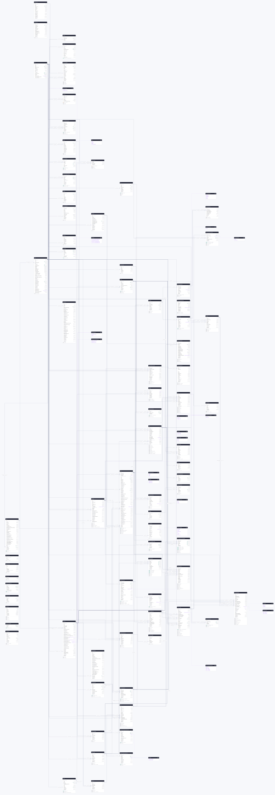

<details>
<summary>The whole schema as SQL</summary>

```sql
CREATE SCHEMA IF NOT EXISTS "public";

CREATE TYPE "ConversationVisibility" AS ENUM ('PRIVATE', 'PUBLIC_LINK', 'PUBLIC_GROUP', 'PUBLIC_DOCUMENT', 'PUBLIC_DATAROOM');

CREATE TYPE "ParticipantRole" AS ENUM ('OWNER', 'PARTICIPANT');

CREATE TYPE "FaqVisibility" AS ENUM ('PUBLIC_DATAROOM', 'PUBLIC_LINK', 'PUBLIC_DOCUMENT');

CREATE TYPE "FaqStatus" AS ENUM ('DRAFT', 'PUBLISHED', 'ARCHIVED');

CREATE TYPE "ItemType" AS ENUM ('DATAROOM_DOCUMENT', 'DATAROOM_FOLDER');

CREATE TYPE "DefaultPermissionStrategy" AS ENUM ('INHERIT_FROM_PARENT', 'ASK_EVERY_TIME', 'HIDDEN_BY_DEFAULT');

CREATE TYPE "RootItemAccess" AS ENUM ('VIEW_ONLY', 'VIEW_AND_DOWNLOAD', 'HIDDEN');

CREATE TYPE "DocumentStorageType" AS ENUM ('S3_PATH', 'VERCEL_BLOB');

CREATE TYPE "LinkType" AS ENUM ('DOCUMENT_LINK', 'DATAROOM_LINK', 'WORKFLOW_LINK');

CREATE TYPE "LinkAudienceType" AS ENUM ('GENERAL', 'GROUP', 'TEAM');

CREATE TYPE "CustomFieldType" AS ENUM ('SHORT_TEXT', 'LONG_TEXT', 'NUMBER', 'PHONE_NUMBER', 'URL', 'CHECKBOX', 'SELECT', 'MULTI_SELECT');

CREATE TYPE "ReferralTrack" AS ENUM ('AFFILIATE', 'PARTNER_DISCOUNT');

CREATE TYPE "ViewType" AS ENUM ('DOCUMENT_VIEW', 'DATAROOM_VIEW');

CREATE TYPE "DownloadType" AS ENUM ('SINGLE', 'BULK', 'FOLDER');

CREATE TYPE "EmailType" AS ENUM ('FIRST_DAY_DOMAIN_REMINDER_EMAIL', 'FIRST_DOMAIN_INVALID_EMAIL', 'SECOND_DOMAIN_INVALID_EMAIL', 'FIRST_TRIAL_END_REMINDER_EMAIL', 'FINAL_TRIAL_END_REMINDER_EMAIL');

CREATE TYPE "TagType" AS ENUM ('LINK_TAG', 'DOCUMENT_TAG', 'DATAROOM_TAG');

CREATE TYPE "InvitationStatus" AS ENUM ('SENT', 'FAILED', 'BOUNCED');

CREATE TYPE "Role" AS ENUM ('ADMIN', 'MANAGER', 'MEMBER', 'DATAROOM_MEMBER');

CREATE TYPE "WorkflowStepType" AS ENUM ('ROUTER');

CREATE TYPE "ExecutionStatus" AS ENUM ('PENDING', 'IN_PROGRESS', 'COMPLETED', 'FAILED', 'BLOCKED');

CREATE TABLE "DocumentAnnotation" (
    "id" TEXT NOT NULL,
    "title" TEXT NOT NULL,
    "content" JSONB NOT NULL,
    "pages" INTEGER[],
    "documentId" TEXT NOT NULL,
    "teamId" TEXT NOT NULL,
    "createdById" TEXT NOT NULL,
    "isVisible" BOOLEAN NOT NULL DEFAULT true,
    "createdAt" TIMESTAMP(3) NOT NULL DEFAULT CURRENT_TIMESTAMP,
    "updatedAt" TIMESTAMP(3) NOT NULL,

    CONSTRAINT "DocumentAnnotation_pkey" PRIMARY KEY ("id")
);

CREATE TABLE "AnnotationImage" (
    "id" TEXT NOT NULL,
    "filename" TEXT NOT NULL,
    "url" TEXT NOT NULL,
    "size" INTEGER,
    "mimeType" TEXT,
    "annotationId" TEXT NOT NULL,
    "createdAt" TIMESTAMP(3) NOT NULL DEFAULT CURRENT_TIMESTAMP,

    CONSTRAINT "AnnotationImage_pkey" PRIMARY KEY ("id")
);

CREATE TABLE "Brand" (
    "id" TEXT NOT NULL,
    "logo" TEXT,
    "hideLogo" BOOLEAN NOT NULL DEFAULT false,
    "banner" TEXT,
    "brandColor" TEXT,
    "accentColor" TEXT,
    "accentButtonColor" TEXT,
    "applyAccentColorToDataroomView" BOOLEAN NOT NULL DEFAULT false,
    "welcomeMessage" TEXT,
    "ctaLabel" TEXT,
    "ctaUrl" TEXT,
    "privacyPolicyUrl" TEXT,
    "cardLayout" TEXT NOT NULL DEFAULT 'LIST',
    "showFolderTree" BOOLEAN NOT NULL DEFAULT true,
    "viewerLayoutPreset" TEXT NOT NULL DEFAULT 'STANDARD',
    "viewerHeaderStyle" TEXT NOT NULL DEFAULT 'DEFAULT',
    "hideFolderIconsInMain" BOOLEAN NOT NULL DEFAULT false,
    "customLinkPreviewEnabled" BOOLEAN NOT NULL DEFAULT false,
    "linkPreviewTitle" TEXT,
    "linkPreviewDescription" TEXT,
    "linkPreviewImage" TEXT,
    "linkPreviewFavicon" TEXT,
    "defaultLanguage" TEXT NOT NULL DEFAULT 'en',
    "name" TEXT NOT NULL DEFAULT 'Default',
    "teamId" TEXT NOT NULL,
    "createdAt" TIMESTAMP(3) NOT NULL DEFAULT CURRENT_TIMESTAMP,
    "updatedAt" TIMESTAMP(3) NOT NULL,

    CONSTRAINT "Brand_pkey" PRIMARY KEY ("id")
);

CREATE TABLE "Conversation" (
    "id" TEXT NOT NULL,
    "title" TEXT,
    "isEnabled" BOOLEAN NOT NULL DEFAULT true,
    "visibilityMode" "ConversationVisibility" NOT NULL DEFAULT 'PRIVATE',
    "dataroomId" TEXT NOT NULL,
    "dataroomDocumentId" TEXT,
    "documentVersionNumber" INTEGER,
    "documentPageNumber" INTEGER,
    "linkId" TEXT,
    "viewerGroupId" TEXT,
    "questionId" TEXT,
    "origin" TEXT NOT NULL DEFAULT 'visitor',
    "category" TEXT,
    "priority" TEXT,
    "recipientViewerId" TEXT,
    "initialViewId" TEXT,
    "teamId" TEXT NOT NULL,
    "lastMessageAt" TIMESTAMP(3),
    "createdAt" TIMESTAMP(3) NOT NULL DEFAULT CURRENT_TIMESTAMP,
    "updatedAt" TIMESTAMP(3) NOT NULL,

    CONSTRAINT "Conversation_pkey" PRIMARY KEY ("id")
);

CREATE TABLE "DataroomQuestion" (
    "id" TEXT NOT NULL,
    "content" TEXT NOT NULL,
    "category" TEXT,
    "priority" TEXT,
    "status" TEXT NOT NULL DEFAULT 'unanswered',
    "orderIndex" INTEGER,
    "importBatchId" TEXT,
    "dataroomId" TEXT NOT NULL,
    "teamId" TEXT NOT NULL,
    "createdByUserId" TEXT,
    "dataroomDocumentId" TEXT,
    "documentPageNumber" INTEGER,
    "createdAt" TIMESTAMP(3) NOT NULL DEFAULT CURRENT_TIMESTAMP,
    "updatedAt" TIMESTAMP(3) NOT NULL,

    CONSTRAINT "DataroomQuestion_pkey" PRIMARY KEY ("id")
);

CREATE TABLE "DataroomQuestionAssignment" (
    "id" TEXT NOT NULL,
    "questionId" TEXT NOT NULL,
    "linkId" TEXT,
    "groupId" TEXT,
    "viewerId" TEXT,
    "email" TEXT,
    "createdAt" TIMESTAMP(3) NOT NULL DEFAULT CURRENT_TIMESTAMP,

    CONSTRAINT "DataroomQuestionAssignment_pkey" PRIMARY KEY ("id")
);

CREATE TABLE "ConversationParticipant" (
    "id" TEXT NOT NULL,
    "conversationId" TEXT NOT NULL,
    "role" "ParticipantRole" NOT NULL DEFAULT 'PARTICIPANT',
    "viewerId" TEXT,
    "userId" TEXT,
    "receiveNotifications" BOOLEAN NOT NULL DEFAULT false,
    "createdAt" TIMESTAMP(3) NOT NULL DEFAULT CURRENT_TIMESTAMP,

    CONSTRAINT "ConversationParticipant_pkey" PRIMARY KEY ("id")
);

CREATE TABLE "Message" (
    "id" TEXT NOT NULL,
    "content" TEXT NOT NULL,
    "conversationId" TEXT NOT NULL,
    "userId" TEXT,
    "viewerId" TEXT,
    "viewId" TEXT,
    "isRead" BOOLEAN NOT NULL DEFAULT false,
    "isInternalNote" BOOLEAN NOT NULL DEFAULT false,
    "createdAt" TIMESTAMP(3) NOT NULL DEFAULT CURRENT_TIMESTAMP,
    "updatedAt" TIMESTAMP(3) NOT NULL,

    CONSTRAINT "Message_pkey" PRIMARY KEY ("id")
);

CREATE TABLE "ConversationView" (
    "id" TEXT NOT NULL,
    "conversationId" TEXT NOT NULL,
    "viewId" TEXT NOT NULL,
    "createdAt" TIMESTAMP(3) NOT NULL DEFAULT CURRENT_TIMESTAMP,

    CONSTRAINT "ConversationView_pkey" PRIMARY KEY ("id")
);

CREATE TABLE "DataroomFaqItem" (
    "id" TEXT NOT NULL,
    "title" TEXT,
    "editedQuestion" TEXT NOT NULL,
    "originalQuestion" TEXT,
    "answer" TEXT NOT NULL,
    "description" TEXT,
    "dataroomId" TEXT NOT NULL,
    "linkId" TEXT,
    "dataroomDocumentId" TEXT,
    "sourceConversationId" TEXT,
    "questionMessageId" TEXT,
    "answerMessageId" TEXT,
    "teamId" TEXT NOT NULL,
    "publishedByUserId" TEXT NOT NULL,
    "visibilityMode" "FaqVisibility" NOT NULL DEFAULT 'PUBLIC_DATAROOM',
    "status" "FaqStatus" NOT NULL DEFAULT 'PUBLISHED',
    "isAnonymized" BOOLEAN NOT NULL DEFAULT true,
    "viewCount" INTEGER NOT NULL DEFAULT 0,
    "tags" TEXT[] DEFAULT ARRAY[]::TEXT[],
    "documentPageNumber" INTEGER,
    "documentVersionNumber" INTEGER,
    "createdAt" TIMESTAMP(3) NOT NULL DEFAULT CURRENT_TIMESTAMP,
    "updatedAt" TIMESTAMP(3) NOT NULL,

    CONSTRAINT "DataroomFaqItem_pkey" PRIMARY KEY ("id")
);

CREATE TABLE "Dataroom" (
    "id" TEXT NOT NULL,
    "pId" TEXT NOT NULL,
    "name" TEXT NOT NULL,
    "internalName" TEXT,
    "description" TEXT,
    "teamId" TEXT NOT NULL,
    "brandId" TEXT,
    "conversationsEnabled" BOOLEAN NOT NULL DEFAULT false,
    "agentsEnabled" BOOLEAN NOT NULL DEFAULT false,
    "vectorStoreId" TEXT,
    "requestListEnabled" BOOLEAN NOT NULL DEFAULT false,
    "enableChangeNotifications" BOOLEAN NOT NULL DEFAULT false,
    "enableVisitorUploadChangeNotifications" BOOLEAN NOT NULL DEFAULT false,
    "defaultPermissionStrategy" "DefaultPermissionStrategy" NOT NULL DEFAULT 'INHERIT_FROM_PARENT',
    "defaultShowBanner" BOOLEAN NOT NULL DEFAULT true,
    "defaultGroupPermissionStrategy" "DefaultPermissionStrategy" NOT NULL DEFAULT 'INHERIT_FROM_PARENT',
    "defaultRootItemAccess" "RootItemAccess" NOT NULL DEFAULT 'VIEW_ONLY',
    "defaultGroupRootItemAccess" "RootItemAccess" NOT NULL DEFAULT 'VIEW_ONLY',
    "allowBulkDownload" BOOLEAN NOT NULL DEFAULT true,
    "showLastUpdated" BOOLEAN NOT NULL DEFAULT true,
    "introductionEnabled" BOOLEAN NOT NULL DEFAULT false,
    "introductionContent" JSONB,
    "isFrozen" BOOLEAN NOT NULL DEFAULT false,
    "frozenAt" TIMESTAMP(3),
    "frozenBy" TEXT,
    "freezeArchiveUrl" TEXT,
    "freezeArchiveHash" TEXT,
    "createdAt" TIMESTAMP(3) NOT NULL DEFAULT CURRENT_TIMESTAMP,
    "updatedAt" TIMESTAMP(3) NOT NULL,

    CONSTRAINT "Dataroom_pkey" PRIMARY KEY ("id")
);

CREATE TABLE "TaskList" (
    "id" TEXT NOT NULL,
    "name" TEXT NOT NULL,
    "orderIndex" INTEGER,
    "dataroomId" TEXT NOT NULL,
    "teamId" TEXT NOT NULL,
    "createdAt" TIMESTAMP(3) NOT NULL DEFAULT CURRENT_TIMESTAMP,
    "updatedAt" TIMESTAMP(3) NOT NULL,

    CONSTRAINT "TaskList_pkey" PRIMARY KEY ("id")
);

CREATE TABLE "Task" (
    "id" TEXT NOT NULL,
    "title" TEXT NOT NULL,
    "description" TEXT,
    "type" TEXT NOT NULL DEFAULT 'TODO',
    "status" TEXT NOT NULL DEFAULT 'OPEN',
    "category" TEXT,
    "dueDate" TIMESTAMP(3),
    "orderIndex" INTEGER,
    "taskListId" TEXT NOT NULL,
    "dataroomId" TEXT NOT NULL,
    "teamId" TEXT NOT NULL,
    "uploadFolderId" TEXT,
    "createdByUserId" TEXT,
    "lastActivityNotifiedAt" TIMESTAMP(3),
    "createdAt" TIMESTAMP(3) NOT NULL DEFAULT CURRENT_TIMESTAMP,
    "updatedAt" TIMESTAMP(3) NOT NULL,

    CONSTRAINT "Task_pkey" PRIMARY KEY ("id")
);

CREATE TABLE "TaskAssignment" (
    "id" TEXT NOT NULL,
    "taskId" TEXT NOT NULL,
    "viewerId" TEXT,
    "groupId" TEXT,
    "linkId" TEXT,
    "email" TEXT,
    "notifiedAt" TIMESTAMP(3),
    "lastReminderAt" TIMESTAMP(3),
    "createdAt" TIMESTAMP(3) NOT NULL DEFAULT CURRENT_TIMESTAMP,
    "updatedAt" TIMESTAMP(3) NOT NULL,

    CONSTRAINT "TaskAssignment_pkey" PRIMARY KEY ("id")
);

CREATE TABLE "TaskActivity" (
    "id" TEXT NOT NULL,
    "taskId" TEXT NOT NULL,
    "type" TEXT NOT NULL,
    "comment" TEXT,
    "fromStatus" TEXT,
    "toStatus" TEXT,
    "userId" TEXT,
    "viewerId" TEXT,
    "viewId" TEXT,
    "createdAt" TIMESTAMP(3) NOT NULL DEFAULT CURRENT_TIMESTAMP,

    CONSTRAINT "TaskActivity_pkey" PRIMARY KEY ("id")
);

CREATE TABLE "DataroomDocument" (
    "id" TEXT NOT NULL,
    "dataroomId" TEXT NOT NULL,
    "documentId" TEXT NOT NULL,
    "folderId" TEXT,
    "orderIndex" INTEGER,
    "hierarchicalIndex" TEXT,
    "vectorStoreFileId" TEXT,
    "createdAt" TIMESTAMP(3) NOT NULL DEFAULT CURRENT_TIMESTAMP,
    "updatedAt" TIMESTAMP(3) NOT NULL,

    CONSTRAINT "DataroomDocument_pkey" PRIMARY KEY ("id")
);

CREATE TABLE "DataroomFolder" (
    "id" TEXT NOT NULL,
    "name" TEXT NOT NULL,
    "path" TEXT NOT NULL,
    "parentId" TEXT,
    "icon" TEXT,
    "color" TEXT,
    "dataroomId" TEXT NOT NULL,
    "orderIndex" INTEGER,
    "hierarchicalIndex" TEXT,
    "createdAt" TIMESTAMP(3) NOT NULL DEFAULT CURRENT_TIMESTAMP,
    "updatedAt" TIMESTAMP(3) NOT NULL,

    CONSTRAINT "DataroomFolder_pkey" PRIMARY KEY ("id")
);

CREATE TABLE "DataroomBrand" (
    "id" TEXT NOT NULL,
    "logo" TEXT,
    "hideLogo" BOOLEAN,
    "banner" TEXT,
    "brandColor" TEXT,
    "accentColor" TEXT,
    "accentButtonColor" TEXT,
    "applyAccentColorToDataroomView" BOOLEAN NOT NULL DEFAULT false,
    "welcomeMessage" TEXT,
    "cardLayout" TEXT NOT NULL DEFAULT 'LIST',
    "showFolderTree" BOOLEAN NOT NULL DEFAULT true,
    "viewerLayoutPreset" TEXT NOT NULL DEFAULT 'STANDARD',
    "viewerHeaderStyle" TEXT NOT NULL DEFAULT 'DEFAULT',
    "hideFolderIconsInMain" BOOLEAN NOT NULL DEFAULT false,
    "ctaLabel" TEXT,
    "ctaUrl" TEXT,
    "customLinkPreviewEnabled" BOOLEAN NOT NULL DEFAULT false,
    "linkPreviewTitle" TEXT,
    "linkPreviewDescription" TEXT,
    "linkPreviewImage" TEXT,
    "linkPreviewFavicon" TEXT,
    "defaultLanguage" TEXT NOT NULL DEFAULT 'en',
    "dataroomId" TEXT NOT NULL,
    "createdAt" TIMESTAMP(3) NOT NULL DEFAULT CURRENT_TIMESTAMP,
    "updatedAt" TIMESTAMP(3) NOT NULL,

    CONSTRAINT "DataroomBrand_pkey" PRIMARY KEY ("id")
);

CREATE TABLE "ViewerGroup" (
    "id" TEXT NOT NULL,
    "name" TEXT NOT NULL,
    "domains" TEXT[],
    "allowAll" BOOLEAN NOT NULL DEFAULT false,
    "dataroomId" TEXT NOT NULL,
    "teamId" TEXT NOT NULL,
    "createdAt" TIMESTAMP(3) NOT NULL DEFAULT CURRENT_TIMESTAMP,
    "updatedAt" TIMESTAMP(3) NOT NULL,

    CONSTRAINT "ViewerGroup_pkey" PRIMARY KEY ("id")
);

CREATE TABLE "ViewerGroupMembership" (
    "id" TEXT NOT NULL,
    "viewerId" TEXT NOT NULL,
    "groupId" TEXT NOT NULL,
    "createdAt" TIMESTAMP(3) NOT NULL DEFAULT CURRENT_TIMESTAMP,
    "updatedAt" TIMESTAMP(3) NOT NULL,

    CONSTRAINT "ViewerGroupMembership_pkey" PRIMARY KEY ("id")
);

CREATE TABLE "ViewerGroupAccessControls" (
    "id" TEXT NOT NULL,
    "groupId" TEXT NOT NULL,
    "itemId" TEXT NOT NULL,
    "itemType" "ItemType" NOT NULL,
    "canView" BOOLEAN NOT NULL DEFAULT true,
    "canDownload" BOOLEAN NOT NULL DEFAULT false,
    "createdAt" TIMESTAMP(3) NOT NULL DEFAULT CURRENT_TIMESTAMP,
    "updatedAt" TIMESTAMP(3) NOT NULL,

    CONSTRAINT "ViewerGroupAccessControls_pkey" PRIMARY KEY ("id")
);

CREATE TABLE "PermissionGroup" (
    "id" TEXT NOT NULL,
    "name" TEXT NOT NULL,
    "description" TEXT,
    "dataroomId" TEXT NOT NULL,
    "teamId" TEXT NOT NULL,
    "createdAt" TIMESTAMP(3) NOT NULL DEFAULT CURRENT_TIMESTAMP,
    "updatedAt" TIMESTAMP(3) NOT NULL,

    CONSTRAINT "PermissionGroup_pkey" PRIMARY KEY ("id")
);

CREATE TABLE "PermissionGroupAccessControls" (
    "id" TEXT NOT NULL,
    "groupId" TEXT NOT NULL,
    "itemId" TEXT NOT NULL,
    "itemType" "ItemType" NOT NULL,
    "canView" BOOLEAN NOT NULL DEFAULT true,
    "canDownload" BOOLEAN NOT NULL DEFAULT false,
    "canDownloadOriginal" BOOLEAN NOT NULL DEFAULT false,
    "createdAt" TIMESTAMP(3) NOT NULL DEFAULT CURRENT_TIMESTAMP,
    "updatedAt" TIMESTAMP(3) NOT NULL,

    CONSTRAINT "PermissionGroupAccessControls_pkey" PRIMARY KEY ("id")
);

CREATE TABLE "Document" (
    "id" TEXT NOT NULL,
    "name" TEXT NOT NULL,
    "description" TEXT,
    "file" TEXT NOT NULL,
    "originalFile" TEXT,
    "type" TEXT,
    "contentType" TEXT,
    "storageType" "DocumentStorageType" NOT NULL DEFAULT 'VERCEL_BLOB',
    "numPages" INTEGER,
    "teamId" TEXT NOT NULL,
    "ownerId" TEXT,
    "assistantEnabled" BOOLEAN NOT NULL DEFAULT false,
    "advancedExcelEnabled" BOOLEAN NOT NULL DEFAULT false,
    "agentsEnabled" BOOLEAN NOT NULL DEFAULT false,
    "downloadOnly" BOOLEAN NOT NULL DEFAULT false,
    "hiddenInAllDocuments" BOOLEAN NOT NULL DEFAULT false,
    "createdAt" TIMESTAMP(3) NOT NULL DEFAULT CURRENT_TIMESTAMP,
    "updatedAt" TIMESTAMP(3) NOT NULL,
    "folderId" TEXT,
    "isExternalUpload" BOOLEAN NOT NULL DEFAULT false,

    CONSTRAINT "Document_pkey" PRIMARY KEY ("id")
);

CREATE TABLE "DocumentVersion" (
    "id" TEXT NOT NULL,
    "versionNumber" INTEGER NOT NULL,
    "documentId" TEXT NOT NULL,
    "file" TEXT NOT NULL,
    "originalFile" TEXT,
    "type" TEXT,
    "contentType" TEXT,
    "fileSize" BIGINT,
    "storageType" "DocumentStorageType" NOT NULL DEFAULT 'VERCEL_BLOB',
    "numPages" INTEGER,
    "isPrimary" BOOLEAN NOT NULL DEFAULT false,
    "isVertical" BOOLEAN NOT NULL DEFAULT false,
    "fileId" TEXT,
    "vectorStoreFileId" TEXT,
    "hasPages" BOOLEAN NOT NULL DEFAULT false,
    "length" INTEGER,
    "createdAt" TIMESTAMP(3) NOT NULL DEFAULT CURRENT_TIMESTAMP,
    "updatedAt" TIMESTAMP(3) NOT NULL,

    CONSTRAINT "DocumentVersion_pkey" PRIMARY KEY ("id")
);

CREATE TABLE "DocumentPage" (
    "id" TEXT NOT NULL,
    "versionId" TEXT NOT NULL,
    "pageNumber" INTEGER NOT NULL,
    "embeddedLinks" TEXT[],
    "pageLinks" JSONB,
    "metadata" JSONB,
    "file" TEXT NOT NULL,
    "storageType" "DocumentStorageType" NOT NULL DEFAULT 'VERCEL_BLOB',
    "createdAt" TIMESTAMP(3) NOT NULL DEFAULT CURRENT_TIMESTAMP,
    "updatedAt" TIMESTAMP(3) NOT NULL,

    CONSTRAINT "DocumentPage_pkey" PRIMARY KEY ("id")
);

CREATE TABLE "Folder" (
    "id" TEXT NOT NULL,
    "name" TEXT NOT NULL,
    "path" TEXT NOT NULL,
    "parentId" TEXT,
    "hiddenInAllDocuments" BOOLEAN NOT NULL DEFAULT false,
    "icon" TEXT,
    "color" TEXT,
    "teamId" TEXT NOT NULL,
    "createdAt" TIMESTAMP(3) NOT NULL DEFAULT CURRENT_TIMESTAMP,
    "updatedAt" TIMESTAMP(3) NOT NULL,

    CONSTRAINT "Folder_pkey" PRIMARY KEY ("id")
);

CREATE TABLE "DocumentUpload" (
    "id" TEXT NOT NULL,
    "documentId" TEXT NOT NULL,
    "teamId" TEXT NOT NULL,
    "viewerId" TEXT,
    "viewId" TEXT,
    "linkId" TEXT NOT NULL,
    "dataroomId" TEXT,
    "dataroomDocumentId" TEXT,
    "taskId" TEXT,
    "originalFilename" TEXT,
    "fileSize" BIGINT,
    "numPages" INTEGER,
    "mimeType" TEXT,
    "uploadedAt" TIMESTAMP(3) NOT NULL DEFAULT CURRENT_TIMESTAMP,
    "createdAt" TIMESTAMP(3) NOT NULL DEFAULT CURRENT_TIMESTAMP,
    "updatedAt" TIMESTAMP(3) NOT NULL,

    CONSTRAINT "DocumentUpload_pkey" PRIMARY KEY ("id")
);

CREATE TABLE "PendingDocumentUpload" (
    "id" TEXT NOT NULL,
    "uploadId" TEXT NOT NULL,
    "teamId" TEXT NOT NULL,
    "tokenId" TEXT NOT NULL,
    "key" TEXT NOT NULL,
    "contentType" TEXT NOT NULL,
    "storageType" "DocumentStorageType" NOT NULL DEFAULT 'S3_PATH',
    "expiresAt" TIMESTAMP(3) NOT NULL,
    "consumedAt" TIMESTAMP(3),
    "createdAt" TIMESTAMP(3) NOT NULL DEFAULT CURRENT_TIMESTAMP,

    CONSTRAINT "PendingDocumentUpload_pkey" PRIMARY KEY ("id")
);

CREATE TABLE "Integration" (
    "id" TEXT NOT NULL,
    "name" TEXT NOT NULL,
    "slug" TEXT NOT NULL,
    "description" TEXT,
    "readme" TEXT,
    "developer" TEXT NOT NULL,
    "website" TEXT NOT NULL,
    "logo" TEXT,
    "screenshots" JSONB,
    "verified" BOOLEAN NOT NULL DEFAULT false,
    "installUrl" TEXT,
    "category" TEXT,
    "comingSoon" BOOLEAN NOT NULL DEFAULT false,
    "createdAt" TIMESTAMP(3) NOT NULL DEFAULT CURRENT_TIMESTAMP,
    "updatedAt" TIMESTAMP(3) NOT NULL,

    CONSTRAINT "Integration_pkey" PRIMARY KEY ("id")
);

CREATE TABLE "InstalledIntegration" (
    "id" TEXT NOT NULL,
    "credentials" JSONB,
    "configuration" JSONB,
    "enabled" BOOLEAN NOT NULL DEFAULT true,
    "integrationId" TEXT NOT NULL,
    "userId" TEXT,
    "teamId" TEXT NOT NULL,
    "createdAt" TIMESTAMP(3) NOT NULL DEFAULT CURRENT_TIMESTAMP,
    "updatedAt" TIMESTAMP(3) NOT NULL,

    CONSTRAINT "InstalledIntegration_pkey" PRIMARY KEY ("id")
);

CREATE TABLE "jackson_index" (
    "id" SERIAL NOT NULL,
    "key" TEXT NOT NULL,
    "storeKey" TEXT NOT NULL,

    CONSTRAINT "jackson_index_pkey" PRIMARY KEY ("id")
);

CREATE TABLE "jackson_store" (
    "key" TEXT NOT NULL,
    "value" TEXT NOT NULL,
    "iv" TEXT,
    "tag" TEXT,
    "namespace" TEXT,
    "createdAt" TIMESTAMP(0) NOT NULL DEFAULT CURRENT_TIMESTAMP,
    "modifiedAt" TIMESTAMP(0),

    CONSTRAINT "jackson_store_pkey" PRIMARY KEY ("key")
);

CREATE TABLE "jackson_ttl" (
    "key" TEXT NOT NULL,
    "expiresAt" BIGINT NOT NULL,

    CONSTRAINT "jackson_ttl_pkey" PRIMARY KEY ("key")
);

CREATE TABLE "Link" (
    "id" TEXT NOT NULL,
    "documentId" TEXT,
    "dataroomId" TEXT,
    "linkType" "LinkType" NOT NULL DEFAULT 'DOCUMENT_LINK',
    "url" TEXT,
    "name" TEXT,
    "slug" TEXT,
    "expiresAt" TIMESTAMP(3),
    "password" TEXT,
    "allowList" TEXT[],
    "denyList" TEXT[],
    "emailProtected" BOOLEAN NOT NULL DEFAULT true,
    "emailAuthenticated" BOOLEAN NOT NULL DEFAULT false,
    "allowDownload" BOOLEAN DEFAULT false,
    "isArchived" BOOLEAN NOT NULL DEFAULT false,
    "deletedAt" TIMESTAMP(3),
    "domainId" TEXT,
    "domainSlug" TEXT,
    "createdAt" TIMESTAMP(3) NOT NULL DEFAULT CURRENT_TIMESTAMP,
    "updatedAt" TIMESTAMP(3) NOT NULL,
    "enableNotification" BOOLEAN DEFAULT true,
    "enableFeedback" BOOLEAN DEFAULT false,
    "enableQuestion" BOOLEAN DEFAULT false,
    "enableScreenshotProtection" BOOLEAN DEFAULT false,
    "enableConfidentialView" BOOLEAN DEFAULT false,
    "enableAgreement" BOOLEAN DEFAULT false,
    "agreementId" TEXT,
    "showBanner" BOOLEAN DEFAULT false,
    "enableWatermark" BOOLEAN DEFAULT false,
    "watermarkConfig" JSONB,
    "audienceType" "LinkAudienceType" NOT NULL DEFAULT 'GENERAL',
    "groupId" TEXT,
    "permissionGroupId" TEXT,
    "metaTitle" TEXT,
    "metaDescription" TEXT,
    "metaImage" TEXT,
    "metaFavicon" TEXT,
    "enableCustomMetatag" BOOLEAN DEFAULT false,
    "welcomeMessage" TEXT,
    "enableConversation" BOOLEAN NOT NULL DEFAULT false,
    "enableAIAgents" BOOLEAN DEFAULT false,
    "enableUpload" BOOLEAN DEFAULT false,
    "isFileRequestOnly" BOOLEAN DEFAULT false,
    "uploadFolderId" TEXT,
    "uploadFolderIds" TEXT[] DEFAULT ARRAY[]::TEXT[],
    "enableIndexFile" BOOLEAN DEFAULT false,
    "teamId" TEXT,
    "brandId" TEXT,
    "ownerId" TEXT,

    CONSTRAINT "Link_pkey" PRIMARY KEY ("id")
);

CREATE TABLE "LinkPreset" (
    "id" TEXT NOT NULL,
    "name" TEXT NOT NULL,
    "teamId" TEXT NOT NULL,
    "pId" TEXT,
    "enableCustomMetaTag" BOOLEAN DEFAULT false,
    "metaTitle" TEXT,
    "metaDescription" TEXT,
    "metaImage" TEXT,
    "metaFavicon" TEXT,
    "enableNotification" BOOLEAN DEFAULT false,
    "emailProtected" BOOLEAN DEFAULT true,
    "emailAuthenticated" BOOLEAN DEFAULT false,
    "allowDownload" BOOLEAN DEFAULT false,
    "enableAllowList" BOOLEAN DEFAULT false,
    "allowList" TEXT[],
    "enableDenyList" BOOLEAN DEFAULT false,
    "denyList" TEXT[],
    "expiresIn" INTEGER,
    "enableScreenshotProtection" BOOLEAN DEFAULT false,
    "enableConfidentialView" BOOLEAN DEFAULT false,
    "expiresAt" TIMESTAMP(3),
    "enablePassword" BOOLEAN DEFAULT false,
    "password" TEXT,
    "enableWatermark" BOOLEAN DEFAULT false,
    "watermarkConfig" JSONB,
    "enableAgreement" BOOLEAN DEFAULT false,
    "agreementId" TEXT,
    "enableCustomFields" BOOLEAN DEFAULT false,
    "customFields" JSONB,
    "showBanner" BOOLEAN DEFAULT false,
    "welcomeMessage" TEXT,
    "isDefault" BOOLEAN NOT NULL DEFAULT false,
    "createdAt" TIMESTAMP(3) NOT NULL DEFAULT CURRENT_TIMESTAMP,
    "updatedAt" TIMESTAMP(3) NOT NULL,

    CONSTRAINT "LinkPreset_pkey" PRIMARY KEY ("id")
);

CREATE TABLE "VisitorGroup" (
    "id" TEXT NOT NULL,
    "name" TEXT NOT NULL,
    "emails" TEXT[],
    "teamId" TEXT NOT NULL,
    "createdAt" TIMESTAMP(3) NOT NULL DEFAULT CURRENT_TIMESTAMP,
    "updatedAt" TIMESTAMP(3) NOT NULL,

    CONSTRAINT "VisitorGroup_pkey" PRIMARY KEY ("id")
);

CREATE TABLE "LinkVisitorGroup" (
    "id" TEXT NOT NULL,
    "linkId" TEXT NOT NULL,
    "visitorGroupId" TEXT NOT NULL,
    "createdAt" TIMESTAMP(3) NOT NULL DEFAULT CURRENT_TIMESTAMP,

    CONSTRAINT "LinkVisitorGroup_pkey" PRIMARY KEY ("id")
);

CREATE TABLE "CustomField" (
    "id" TEXT NOT NULL,
    "createdAt" TIMESTAMP(3) NOT NULL DEFAULT CURRENT_TIMESTAMP,
    "updatedAt" TIMESTAMP(3) NOT NULL,
    "type" "CustomFieldType" NOT NULL,
    "identifier" TEXT NOT NULL,
    "label" TEXT NOT NULL,
    "placeholder" TEXT,
    "required" BOOLEAN NOT NULL DEFAULT false,
    "disabled" BOOLEAN NOT NULL DEFAULT false,
    "linkId" TEXT NOT NULL,
    "orderIndex" INTEGER NOT NULL DEFAULT 0,

    CONSTRAINT "CustomField_pkey" PRIMARY KEY ("id")
);

CREATE TABLE "CustomFieldResponse" (
    "id" TEXT NOT NULL,
    "data" JSONB NOT NULL,
    "viewId" TEXT NOT NULL,
    "createdAt" TIMESTAMP(3) NOT NULL DEFAULT CURRENT_TIMESTAMP,
    "updatedAt" TIMESTAMP(3) NOT NULL,

    CONSTRAINT "CustomFieldResponse_pkey" PRIMARY KEY ("id")
);

CREATE TABLE "NotificationPreference" (
    "id" TEXT NOT NULL,
    "userId" TEXT NOT NULL,
    "teamId" TEXT NOT NULL,
    "type" TEXT NOT NULL,
    "frequency" TEXT NOT NULL DEFAULT 'IMMEDIATE',
    "scope" TEXT NOT NULL DEFAULT 'ALL',
    "createdAt" TIMESTAMP(3) NOT NULL DEFAULT CURRENT_TIMESTAMP,
    "updatedAt" TIMESTAMP(3) NOT NULL,

    CONSTRAINT "NotificationPreference_pkey" PRIMARY KEY ("id")
);

CREATE TABLE "OAuthClient" (
    "id" TEXT NOT NULL,
    "clientId" TEXT NOT NULL,
    "clientName" TEXT NOT NULL,
    "clientUri" TEXT,
    "logoUri" TEXT,
    "redirectUris" TEXT[],
    "grantTypes" TEXT[],
    "scopes" TEXT NOT NULL,
    "tokenAuthMethod" TEXT NOT NULL,
    "hashedSecret" TEXT,
    "registrationType" TEXT NOT NULL,
    "metadataUrl" TEXT,
    "createdAt" TIMESTAMP(3) NOT NULL DEFAULT CURRENT_TIMESTAMP,
    "updatedAt" TIMESTAMP(3) NOT NULL,

    CONSTRAINT "OAuthClient_pkey" PRIMARY KEY ("id")
);

CREATE TABLE "OAuthClientApproval" (
    "id" TEXT NOT NULL,
    "userId" TEXT NOT NULL,
    "clientId" TEXT NOT NULL,
    "approvedAt" TIMESTAMP(3) NOT NULL DEFAULT CURRENT_TIMESTAMP,
    "revokedAt" TIMESTAMP(3),
    "clientMetadataHash" TEXT,

    CONSTRAINT "OAuthClientApproval_pkey" PRIMARY KEY ("id")
);

CREATE TABLE "OAuthGrantTeam" (
    "id" TEXT NOT NULL,
    "grantId" TEXT NOT NULL,
    "teamId" TEXT NOT NULL,
    "userId" TEXT NOT NULL,
    "createdAt" TIMESTAMP(3) NOT NULL DEFAULT CURRENT_TIMESTAMP,

    CONSTRAINT "OAuthGrantTeam_pkey" PRIMARY KEY ("id")
);

CREATE TABLE "OAuthRecord" (
    "id" TEXT NOT NULL,
    "kind" TEXT NOT NULL,
    "payload" JSONB NOT NULL,
    "grantId" TEXT,
    "userCode" TEXT,
    "uid" TEXT,
    "expiresAt" TIMESTAMP(3),
    "consumedAt" TIMESTAMP(3),
    "createdAt" TIMESTAMP(3) NOT NULL DEFAULT CURRENT_TIMESTAMP,

    CONSTRAINT "OAuthRecord_pkey" PRIMARY KEY ("id")
);

CREATE TABLE "DocumentRedactionJob" (
    "id" TEXT NOT NULL,
    "documentId" TEXT NOT NULL,
    "documentVersionId" TEXT NOT NULL,
    "teamId" TEXT NOT NULL,
    "createdById" TEXT NOT NULL,
    "status" TEXT NOT NULL DEFAULT 'PENDING',
    "customTerms" TEXT[],
    "reasons" TEXT[],
    "resultVersionId" TEXT,
    "error" TEXT,
    "detectRunId" TEXT,
    "applyRunId" TEXT,
    "createdAt" TIMESTAMP(3) NOT NULL DEFAULT CURRENT_TIMESTAMP,
    "updatedAt" TIMESTAMP(3) NOT NULL,

    CONSTRAINT "DocumentRedactionJob_pkey" PRIMARY KEY ("id")
);

CREATE TABLE "DocumentRedaction" (
    "id" TEXT NOT NULL,
    "jobId" TEXT NOT NULL,
    "pageNumber" INTEGER NOT NULL,
    "x" DOUBLE PRECISION NOT NULL,
    "y" DOUBLE PRECISION NOT NULL,
    "width" DOUBLE PRECISION NOT NULL,
    "height" DOUBLE PRECISION NOT NULL,
    "textPreview" TEXT,
    "category" TEXT,
    "confidence" TEXT,
    "reason" TEXT,
    "source" TEXT NOT NULL DEFAULT 'AI',
    "status" TEXT NOT NULL DEFAULT 'PENDING',
    "createdAt" TIMESTAMP(3) NOT NULL DEFAULT CURRENT_TIMESTAMP,
    "updatedAt" TIMESTAMP(3) NOT NULL,

    CONSTRAINT "DocumentRedaction_pkey" PRIMARY KEY ("id")
);

CREATE TABLE "ReferralInvite" (
    "id" TEXT NOT NULL,
    "userId" TEXT NOT NULL,
    "teamId" TEXT,
    "scopeId" TEXT NOT NULL,
    "email" TEXT NOT NULL,
    "referralLink" TEXT,
    "sentAt" TIMESTAMP(3) NOT NULL DEFAULT CURRENT_TIMESTAMP,

    CONSTRAINT "ReferralInvite_pkey" PRIMARY KEY ("id")
);

CREATE TABLE "Account" (
    "id" TEXT NOT NULL,
    "userId" TEXT NOT NULL,
    "type" TEXT NOT NULL,
    "provider" TEXT NOT NULL,
    "providerAccountId" TEXT NOT NULL,
    "refresh_token" TEXT,
    "access_token" TEXT,
    "expires_at" INTEGER,
    "token_type" TEXT,
    "scope" TEXT,
    "id_token" TEXT,
    "session_state" TEXT,

    CONSTRAINT "Account_pkey" PRIMARY KEY ("id")
);

CREATE TABLE "Session" (
    "id" TEXT NOT NULL,
    "sessionToken" TEXT NOT NULL,
    "userId" TEXT NOT NULL,
    "expires" TIMESTAMP(3) NOT NULL,

    CONSTRAINT "Session_pkey" PRIMARY KEY ("id")
);

CREATE TABLE "User" (
    "id" TEXT NOT NULL,
    "name" TEXT,
    "email" TEXT,
    "emailVerified" TIMESTAMP(3),
    "image" TEXT,
    "createdAt" TIMESTAMP(3) NOT NULL DEFAULT CURRENT_TIMESTAMP,
    "contactId" TEXT,
    "plan" TEXT NOT NULL DEFAULT 'free',
    "stripeId" TEXT,
    "subscriptionId" TEXT,
    "startsAt" TIMESTAMP(3),
    "endsAt" TIMESTAMP(3),
    "referralTrack" "ReferralTrack",
    "referralTrackSelectedAt" TIMESTAMP(3),
    "referralProfile" JSONB,

    CONSTRAINT "User_pkey" PRIMARY KEY ("id")
);

CREATE TABLE "VerificationToken" (
    "identifier" TEXT NOT NULL,
    "token" TEXT NOT NULL,
    "expires" TIMESTAMP(3) NOT NULL
);

CREATE TABLE "Domain" (
    "id" TEXT NOT NULL,
    "slug" TEXT NOT NULL,
    "userId" TEXT,
    "teamId" TEXT NOT NULL,
    "verified" BOOLEAN NOT NULL DEFAULT false,
    "isDefault" BOOLEAN NOT NULL DEFAULT false,
    "redirectUrl" TEXT,
    "lastChecked" TIMESTAMP(3) NOT NULL DEFAULT CURRENT_TIMESTAMP,
    "createdAt" TIMESTAMP(3) NOT NULL DEFAULT CURRENT_TIMESTAMP,
    "updatedAt" TIMESTAMP(3) NOT NULL,

    CONSTRAINT "Domain_pkey" PRIMARY KEY ("id")
);

CREATE TABLE "View" (
    "id" TEXT NOT NULL,
    "linkId" TEXT NOT NULL,
    "documentId" TEXT,
    "dataroomId" TEXT,
    "dataroomViewId" TEXT,
    "viewerEmail" TEXT,
    "viewerName" TEXT,
    "verified" BOOLEAN NOT NULL DEFAULT false,
    "viewedAt" TIMESTAMP(3) NOT NULL DEFAULT CURRENT_TIMESTAMP,
    "downloadedAt" TIMESTAMP(3),
    "downloadType" "DownloadType",
    "downloadMetadata" JSONB,
    "viewType" "ViewType" NOT NULL DEFAULT 'DOCUMENT_VIEW',
    "viewerId" TEXT,
    "groupId" TEXT,
    "isArchived" BOOLEAN NOT NULL DEFAULT false,
    "teamId" TEXT,

    CONSTRAINT "View_pkey" PRIMARY KEY ("id")
);

CREATE TABLE "Viewer" (
    "id" TEXT NOT NULL,
    "email" TEXT NOT NULL,
    "verified" BOOLEAN NOT NULL DEFAULT false,
    "invitedAt" TIMESTAMP(3),
    "notificationPreferences" JSONB,
    "dataroomId" TEXT,
    "teamId" TEXT NOT NULL,
    "createdAt" TIMESTAMP(3) NOT NULL DEFAULT CURRENT_TIMESTAMP,
    "updatedAt" TIMESTAMP(3) NOT NULL,

    CONSTRAINT "Viewer_pkey" PRIMARY KEY ("id")
);

CREATE TABLE "Reaction" (
    "id" TEXT NOT NULL,
    "viewId" TEXT NOT NULL,
    "pageNumber" INTEGER NOT NULL,
    "type" TEXT NOT NULL,
    "createdAt" TIMESTAMP(3) NOT NULL DEFAULT CURRENT_TIMESTAMP,

    CONSTRAINT "Reaction_pkey" PRIMARY KEY ("id")
);

CREATE TABLE "Invitation" (
    "email" TEXT NOT NULL,
    "expires" TIMESTAMP(3) NOT NULL,
    "teamId" TEXT NOT NULL,
    "createdAt" TIMESTAMP(3) NOT NULL DEFAULT CURRENT_TIMESTAMP,
    "token" TEXT NOT NULL,
    "role" "Role" NOT NULL DEFAULT 'MEMBER',
    "dataroomIds" TEXT[] DEFAULT ARRAY[]::TEXT[]
);

CREATE TABLE "SentEmail" (
    "id" TEXT NOT NULL,
    "type" "EmailType" NOT NULL,
    "recipient" TEXT NOT NULL,
    "marketing" BOOLEAN NOT NULL DEFAULT false,
    "createdAt" TIMESTAMP(3) NOT NULL DEFAULT CURRENT_TIMESTAMP,
    "teamId" TEXT NOT NULL,
    "domainSlug" TEXT,

    CONSTRAINT "SentEmail_pkey" PRIMARY KEY ("id")
);

CREATE TABLE "Chat" (
    "id" TEXT NOT NULL,
    "title" TEXT,
    "teamId" TEXT NOT NULL,
    "documentId" TEXT,
    "dataroomId" TEXT,
    "linkId" TEXT,
    "viewId" TEXT,
    "userId" TEXT,
    "viewerId" TEXT,
    "vectorStoreId" TEXT,
    "createdAt" TIMESTAMP(3) NOT NULL DEFAULT CURRENT_TIMESTAMP,
    "updatedAt" TIMESTAMP(3) NOT NULL,
    "lastMessageAt" TIMESTAMP(3),

    CONSTRAINT "Chat_pkey" PRIMARY KEY ("id")
);

CREATE TABLE "ChatMessage" (
    "id" TEXT NOT NULL,
    "chatId" TEXT NOT NULL,
    "role" TEXT NOT NULL,
    "content" TEXT NOT NULL,
    "metadata" JSONB,
    "createdAt" TIMESTAMP(3) NOT NULL DEFAULT CURRENT_TIMESTAMP,

    CONSTRAINT "ChatMessage_pkey" PRIMARY KEY ("id")
);

CREATE TABLE "Feedback" (
    "id" TEXT NOT NULL,
    "linkId" TEXT NOT NULL,
    "data" JSONB NOT NULL,
    "createdAt" TIMESTAMP(3) NOT NULL DEFAULT CURRENT_TIMESTAMP,
    "updatedAt" TIMESTAMP(3) NOT NULL,

    CONSTRAINT "Feedback_pkey" PRIMARY KEY ("id")
);

CREATE TABLE "FeedbackResponse" (
    "id" TEXT NOT NULL,
    "feedbackId" TEXT NOT NULL,
    "data" JSONB NOT NULL,
    "viewId" TEXT NOT NULL,
    "createdAt" TIMESTAMP(3) NOT NULL DEFAULT CURRENT_TIMESTAMP,
    "updatedAt" TIMESTAMP(3) NOT NULL,

    CONSTRAINT "FeedbackResponse_pkey" PRIMARY KEY ("id")
);

CREATE TABLE "Agreement" (
    "id" TEXT NOT NULL,
    "name" TEXT NOT NULL,
    "content" TEXT NOT NULL,
    "contentType" TEXT NOT NULL DEFAULT 'LINK',
    "signingProvider" TEXT NOT NULL DEFAULT 'LEGACY',
    "signingExternalId" TEXT,
    "signingEnvelopeId" TEXT,
    "signingTemplateId" TEXT,
    "requireName" BOOLEAN NOT NULL DEFAULT true,
    "teamId" TEXT NOT NULL,
    "createdAt" TIMESTAMP(3) NOT NULL DEFAULT CURRENT_TIMESTAMP,
    "updatedAt" TIMESTAMP(3) NOT NULL,
    "deletedAt" TIMESTAMP(3),
    "deletedBy" TEXT,

    CONSTRAINT "Agreement_pkey" PRIMARY KEY ("id")
);

CREATE TABLE "AgreementResponse" (
    "id" TEXT NOT NULL,
    "agreementId" TEXT NOT NULL,
    "viewId" TEXT,
    "linkId" TEXT,
    "signerEmail" TEXT,
    "signerName" TEXT,
    "signingStatus" TEXT NOT NULL DEFAULT 'PENDING',
    "signingExternalId" TEXT,
    "signingEnvelopeId" TEXT,
    "signingDocumentId" INTEGER,
    "signedAt" TIMESTAMP(3),
    "completedAt" TIMESTAMP(3),
    "signedFileKey" TEXT,
    "signedFileName" TEXT,
    "signedFileStorageType" "DocumentStorageType",
    "createdAt" TIMESTAMP(3) NOT NULL DEFAULT CURRENT_TIMESTAMP,
    "updatedAt" TIMESTAMP(3) NOT NULL,

    CONSTRAINT "AgreementResponse_pkey" PRIMARY KEY ("id")
);

CREATE TABLE "IncomingWebhook" (
    "id" TEXT NOT NULL,
    "externalId" TEXT NOT NULL,
    "name" TEXT NOT NULL,
    "secret" TEXT,
    "source" TEXT,
    "actions" TEXT,
    "consecutiveFailures" INTEGER NOT NULL DEFAULT 0,
    "lastFailedAt" TIMESTAMP(3),
    "disabledAt" TIMESTAMP(3),
    "teamId" TEXT NOT NULL,
    "createdAt" TIMESTAMP(3) NOT NULL DEFAULT CURRENT_TIMESTAMP,
    "updatedAt" TIMESTAMP(3) NOT NULL,

    CONSTRAINT "IncomingWebhook_pkey" PRIMARY KEY ("id")
);

CREATE TABLE "RestrictedToken" (
    "id" TEXT NOT NULL,
    "name" TEXT NOT NULL,
    "hashedKey" TEXT NOT NULL,
    "partialKey" TEXT NOT NULL,
    "scopes" TEXT,
    "mode" TEXT NOT NULL DEFAULT 'live',
    "source" TEXT NOT NULL DEFAULT 'dashboard',
    "subjectType" TEXT NOT NULL DEFAULT 'user',
    "clientId" TEXT,
    "expires" TIMESTAMP(3),
    "lastUsed" TIMESTAMP(3),
    "rateLimit" INTEGER NOT NULL DEFAULT 60,
    "userId" TEXT NOT NULL,
    "teamId" TEXT NOT NULL,
    "createdAt" TIMESTAMP(3) NOT NULL DEFAULT CURRENT_TIMESTAMP,
    "updatedAt" TIMESTAMP(3) NOT NULL,

    CONSTRAINT "RestrictedToken_pkey" PRIMARY KEY ("id")
);

CREATE TABLE "Webhook" (
    "id" TEXT NOT NULL,
    "pId" TEXT NOT NULL,
    "name" TEXT NOT NULL,
    "url" TEXT NOT NULL,
    "secret" TEXT NOT NULL,
    "triggers" JSONB NOT NULL,
    "teamId" TEXT NOT NULL,
    "createdAt" TIMESTAMP(3) NOT NULL DEFAULT CURRENT_TIMESTAMP,
    "updatedAt" TIMESTAMP(3) NOT NULL,

    CONSTRAINT "Webhook_pkey" PRIMARY KEY ("id")
);

CREATE TABLE "YearInReview" (
    "id" TEXT NOT NULL,
    "teamId" TEXT NOT NULL,
    "status" TEXT NOT NULL DEFAULT 'pending',
    "attempts" INTEGER NOT NULL DEFAULT 0,
    "lastAttempted" TIMESTAMP(3),
    "error" TEXT,
    "stats" JSONB NOT NULL,
    "createdAt" TIMESTAMP(3) NOT NULL DEFAULT CURRENT_TIMESTAMP,
    "updatedAt" TIMESTAMP(3) NOT NULL,

    CONSTRAINT "YearInReview_pkey" PRIMARY KEY ("id")
);

CREATE TABLE "Tag" (
    "id" TEXT NOT NULL,
    "name" TEXT NOT NULL,
    "color" TEXT NOT NULL,
    "description" TEXT,
    "teamId" TEXT NOT NULL,
    "createdBy" TEXT,
    "createdAt" TIMESTAMP(3) NOT NULL DEFAULT CURRENT_TIMESTAMP,
    "updatedAt" TIMESTAMP(3) NOT NULL,

    CONSTRAINT "Tag_pkey" PRIMARY KEY ("id")
);

CREATE TABLE "TagItem" (
    "id" TEXT NOT NULL,
    "tagId" TEXT NOT NULL,
    "itemType" "TagType" NOT NULL,
    "linkId" TEXT,
    "documentId" TEXT,
    "dataroomId" TEXT,
    "taggedBy" TEXT,
    "createdAt" TIMESTAMP(3) NOT NULL DEFAULT CURRENT_TIMESTAMP,
    "updatedAt" TIMESTAMP(3) NOT NULL,

    CONSTRAINT "TagItem_pkey" PRIMARY KEY ("id")
);

CREATE TABLE "ViewerInvitation" (
    "id" TEXT NOT NULL,
    "viewerId" TEXT NOT NULL,
    "linkId" TEXT NOT NULL,
    "groupId" TEXT,
    "invitedBy" TEXT NOT NULL,
    "customMessage" TEXT,
    "sentAt" TIMESTAMP(3) NOT NULL DEFAULT CURRENT_TIMESTAMP,
    "status" "InvitationStatus" NOT NULL DEFAULT 'SENT',
    "createdAt" TIMESTAMP(3) NOT NULL DEFAULT CURRENT_TIMESTAMP,

    CONSTRAINT "ViewerInvitation_pkey" PRIMARY KEY ("id")
);

CREATE TABLE "Team" (
    "id" TEXT NOT NULL,
    "name" TEXT NOT NULL,
    "slug" TEXT,
    "defaultBrandId" TEXT,
    "plan" TEXT NOT NULL DEFAULT 'free',
    "stripeId" TEXT,
    "subscriptionId" TEXT,
    "startsAt" TIMESTAMP(3),
    "endsAt" TIMESTAMP(3),
    "pausedAt" TIMESTAMP(3),
    "pauseStartsAt" TIMESTAMP(3),
    "pauseEndsAt" TIMESTAMP(3),
    "cancelledAt" TIMESTAMP(3),
    "trialStartedAt" TIMESTAMP(3),
    "trialEndsAt" TIMESTAMP(3),
    "trialReminderRunId" TEXT,
    "trialExpiredRunId" TEXT,
    "limits" JSONB,
    "enableExcelAdvancedMode" BOOLEAN NOT NULL DEFAULT false,
    "replicateDataroomFolders" BOOLEAN NOT NULL DEFAULT true,
    "timezone" TEXT NOT NULL DEFAULT 'Etc/UTC',
    "ssoEnabled" BOOLEAN NOT NULL DEFAULT false,
    "ssoEmailDomain" TEXT,
    "ssoEnforcedAt" TIMESTAMP(3),
    "surveyData" JSONB,
    "agentsEnabled" BOOLEAN NOT NULL DEFAULT false,
    "vectorStoreId" TEXT,
    "createdAt" TIMESTAMP(3) NOT NULL DEFAULT CURRENT_TIMESTAMP,
    "updatedAt" TIMESTAMP(3) NOT NULL,
    "ignoredDomains" TEXT[],
    "globalBlockList" TEXT[],
    "referralTrack" "ReferralTrack",
    "referralTrackSelectedAt" TIMESTAMP(3),
    "referralProfile" JSONB,

    CONSTRAINT "Team_pkey" PRIMARY KEY ("id")
);

CREATE TABLE "UserDataroom" (
    "userId" TEXT NOT NULL,
    "teamId" TEXT NOT NULL,
    "dataroomId" TEXT NOT NULL,
    "createdAt" TIMESTAMP(3) NOT NULL DEFAULT CURRENT_TIMESTAMP,

    CONSTRAINT "UserDataroom_pkey" PRIMARY KEY ("userId","dataroomId")
);

CREATE TABLE "UserTeam" (
    "role" "Role" NOT NULL DEFAULT 'MEMBER',
    "status" TEXT NOT NULL DEFAULT 'ACTIVE',
    "userId" TEXT NOT NULL,
    "teamId" TEXT NOT NULL,
    "blockedAt" TIMESTAMP(3),
    "notificationPreferences" JSONB,

    CONSTRAINT "UserTeam_pkey" PRIMARY KEY ("userId","teamId")
);

CREATE TABLE "Workflow" (
    "id" TEXT NOT NULL,
    "name" TEXT NOT NULL,
    "description" TEXT,
    "entryLinkId" TEXT NOT NULL,
    "teamId" TEXT NOT NULL,
    "isActive" BOOLEAN NOT NULL DEFAULT true,
    "createdAt" TIMESTAMP(3) NOT NULL DEFAULT CURRENT_TIMESTAMP,
    "updatedAt" TIMESTAMP(3) NOT NULL,

    CONSTRAINT "Workflow_pkey" PRIMARY KEY ("id")
);

CREATE TABLE "WorkflowStep" (
    "id" TEXT NOT NULL,
    "workflowId" TEXT NOT NULL,
    "name" TEXT NOT NULL,
    "stepOrder" INTEGER NOT NULL,
    "stepType" "WorkflowStepType" NOT NULL DEFAULT 'ROUTER',
    "conditions" JSONB NOT NULL,
    "actions" JSONB NOT NULL,
    "createdAt" TIMESTAMP(3) NOT NULL DEFAULT CURRENT_TIMESTAMP,
    "updatedAt" TIMESTAMP(3) NOT NULL,

    CONSTRAINT "WorkflowStep_pkey" PRIMARY KEY ("id")
);

CREATE TABLE "WorkflowExecution" (
    "id" TEXT NOT NULL,
    "workflowId" TEXT NOT NULL,
    "visitorEmail" TEXT,
    "visitorIp" TEXT,
    "status" "ExecutionStatus" NOT NULL,
    "startedAt" TIMESTAMP(3) NOT NULL DEFAULT CURRENT_TIMESTAMP,
    "completedAt" TIMESTAMP(3),
    "result" JSONB,
    "metadata" JSONB,

    CONSTRAINT "WorkflowExecution_pkey" PRIMARY KEY ("id")
);

CREATE TABLE "WorkflowStepLog" (
    "id" TEXT NOT NULL,
    "executionId" TEXT NOT NULL,
    "workflowStepId" TEXT NOT NULL,
    "conditionsMatched" BOOLEAN NOT NULL,
    "conditionResults" JSONB,
    "actionsExecuted" JSONB,
    "executedAt" TIMESTAMP(3) NOT NULL DEFAULT CURRENT_TIMESTAMP,
    "duration" INTEGER,
    "error" TEXT,

    CONSTRAINT "WorkflowStepLog_pkey" PRIMARY KEY ("id")
);

CREATE INDEX "DocumentAnnotation_documentId_idx" ON "DocumentAnnotation"("documentId");

CREATE INDEX "DocumentAnnotation_teamId_idx" ON "DocumentAnnotation"("teamId");

CREATE INDEX "DocumentAnnotation_createdById_idx" ON "DocumentAnnotation"("createdById");

CREATE INDEX "AnnotationImage_annotationId_idx" ON "AnnotationImage"("annotationId");

CREATE INDEX "Brand_teamId_idx" ON "Brand"("teamId");

CREATE UNIQUE INDEX "Brand_teamId_name_key" ON "Brand"("teamId", "name");

CREATE INDEX "Conversation_dataroomId_idx" ON "Conversation"("dataroomId");

CREATE INDEX "Conversation_dataroomDocumentId_idx" ON "Conversation"("dataroomDocumentId");

CREATE INDEX "Conversation_linkId_idx" ON "Conversation"("linkId");

CREATE INDEX "Conversation_teamId_idx" ON "Conversation"("teamId");

CREATE INDEX "Conversation_viewerGroupId_idx" ON "Conversation"("viewerGroupId");

CREATE INDEX "Conversation_initialViewId_idx" ON "Conversation"("initialViewId");

CREATE INDEX "Conversation_questionId_idx" ON "Conversation"("questionId");

CREATE INDEX "Conversation_recipientViewerId_idx" ON "Conversation"("recipientViewerId");

CREATE UNIQUE INDEX "Conversation_questionId_recipientViewerId_key" ON "Conversation"("questionId", "recipientViewerId");

CREATE INDEX "DataroomQuestion_dataroomId_idx" ON "DataroomQuestion"("dataroomId");

CREATE INDEX "DataroomQuestion_teamId_idx" ON "DataroomQuestion"("teamId");

CREATE INDEX "DataroomQuestion_status_idx" ON "DataroomQuestion"("status");

CREATE INDEX "DataroomQuestion_importBatchId_idx" ON "DataroomQuestion"("importBatchId");

CREATE INDEX "DataroomQuestion_dataroomDocumentId_idx" ON "DataroomQuestion"("dataroomDocumentId");

CREATE INDEX "DataroomQuestion_createdByUserId_idx" ON "DataroomQuestion"("createdByUserId");

CREATE INDEX "DataroomQuestionAssignment_questionId_idx" ON "DataroomQuestionAssignment"("questionId");

CREATE INDEX "DataroomQuestionAssignment_linkId_idx" ON "DataroomQuestionAssignment"("linkId");

CREATE INDEX "DataroomQuestionAssignment_groupId_idx" ON "DataroomQuestionAssignment"("groupId");

CREATE INDEX "DataroomQuestionAssignment_viewerId_idx" ON "DataroomQuestionAssignment"("viewerId");

CREATE UNIQUE INDEX "DataroomQuestionAssignment_questionId_linkId_key" ON "DataroomQuestionAssignment"("questionId", "linkId");

CREATE UNIQUE INDEX "DataroomQuestionAssignment_questionId_groupId_key" ON "DataroomQuestionAssignment"("questionId", "groupId");

CREATE UNIQUE INDEX "DataroomQuestionAssignment_questionId_viewerId_key" ON "DataroomQuestionAssignment"("questionId", "viewerId");

CREATE UNIQUE INDEX "DataroomQuestionAssignment_questionId_email_key" ON "DataroomQuestionAssignment"("questionId", "email");

CREATE INDEX "ConversationParticipant_conversationId_idx" ON "ConversationParticipant"("conversationId");

CREATE INDEX "ConversationParticipant_viewerId_idx" ON "ConversationParticipant"("viewerId");

CREATE INDEX "ConversationParticipant_userId_idx" ON "ConversationParticipant"("userId");

CREATE UNIQUE INDEX "ConversationParticipant_conversationId_viewerId_key" ON "ConversationParticipant"("conversationId", "viewerId");

CREATE UNIQUE INDEX "ConversationParticipant_conversationId_userId_key" ON "ConversationParticipant"("conversationId", "userId");

CREATE INDEX "Message_conversationId_idx" ON "Message"("conversationId");

CREATE INDEX "Message_userId_idx" ON "Message"("userId");

CREATE INDEX "Message_viewerId_idx" ON "Message"("viewerId");

CREATE INDEX "Message_viewId_idx" ON "Message"("viewId");

CREATE INDEX "ConversationView_conversationId_idx" ON "ConversationView"("conversationId");

CREATE INDEX "ConversationView_viewId_idx" ON "ConversationView"("viewId");

CREATE UNIQUE INDEX "ConversationView_conversationId_viewId_key" ON "ConversationView"("conversationId", "viewId");

CREATE INDEX "DataroomFaqItem_dataroomId_idx" ON "DataroomFaqItem"("dataroomId");

CREATE INDEX "DataroomFaqItem_linkId_idx" ON "DataroomFaqItem"("linkId");

CREATE INDEX "DataroomFaqItem_dataroomDocumentId_idx" ON "DataroomFaqItem"("dataroomDocumentId");

CREATE INDEX "DataroomFaqItem_sourceConversationId_idx" ON "DataroomFaqItem"("sourceConversationId");

CREATE INDEX "DataroomFaqItem_teamId_idx" ON "DataroomFaqItem"("teamId");

CREATE INDEX "DataroomFaqItem_publishedByUserId_idx" ON "DataroomFaqItem"("publishedByUserId");

CREATE INDEX "DataroomFaqItem_status_idx" ON "DataroomFaqItem"("status");

CREATE INDEX "DataroomFaqItem_visibilityMode_idx" ON "DataroomFaqItem"("visibilityMode");

CREATE INDEX "DataroomFaqItem_createdAt_idx" ON "DataroomFaqItem"("createdAt");

CREATE UNIQUE INDEX "Dataroom_pId_key" ON "Dataroom"("pId");

CREATE INDEX "Dataroom_teamId_idx" ON "Dataroom"("teamId");

CREATE INDEX "Dataroom_brandId_idx" ON "Dataroom"("brandId");

CREATE INDEX "TaskList_dataroomId_idx" ON "TaskList"("dataroomId");

CREATE INDEX "TaskList_teamId_idx" ON "TaskList"("teamId");

CREATE INDEX "TaskList_dataroomId_orderIndex_idx" ON "TaskList"("dataroomId", "orderIndex");

CREATE INDEX "Task_taskListId_idx" ON "Task"("taskListId");

CREATE INDEX "Task_dataroomId_idx" ON "Task"("dataroomId");

CREATE INDEX "Task_teamId_idx" ON "Task"("teamId");

CREATE INDEX "Task_uploadFolderId_idx" ON "Task"("uploadFolderId");

CREATE INDEX "Task_taskListId_orderIndex_idx" ON "Task"("taskListId", "orderIndex");

CREATE INDEX "TaskAssignment_taskId_idx" ON "TaskAssignment"("taskId");

CREATE INDEX "TaskAssignment_viewerId_idx" ON "TaskAssignment"("viewerId");

CREATE INDEX "TaskAssignment_groupId_idx" ON "TaskAssignment"("groupId");

CREATE INDEX "TaskAssignment_linkId_idx" ON "TaskAssignment"("linkId");

CREATE UNIQUE INDEX "TaskAssignment_taskId_viewerId_key" ON "TaskAssignment"("taskId", "viewerId");

CREATE UNIQUE INDEX "TaskAssignment_taskId_groupId_key" ON "TaskAssignment"("taskId", "groupId");

CREATE UNIQUE INDEX "TaskAssignment_taskId_linkId_key" ON "TaskAssignment"("taskId", "linkId");

CREATE UNIQUE INDEX "TaskAssignment_taskId_email_key" ON "TaskAssignment"("taskId", "email");

CREATE INDEX "TaskActivity_taskId_idx" ON "TaskActivity"("taskId");

CREATE INDEX "TaskActivity_userId_idx" ON "TaskActivity"("userId");

CREATE INDEX "TaskActivity_viewerId_idx" ON "TaskActivity"("viewerId");

CREATE INDEX "TaskActivity_viewId_idx" ON "TaskActivity"("viewId");

CREATE INDEX "TaskActivity_taskId_createdAt_idx" ON "TaskActivity"("taskId", "createdAt");

CREATE INDEX "DataroomDocument_folderId_idx" ON "DataroomDocument"("folderId");

CREATE INDEX "DataroomDocument_dataroomId_folderId_orderIndex_idx" ON "DataroomDocument"("dataroomId", "folderId", "orderIndex");

CREATE INDEX "DataroomDocument_documentId_idx" ON "DataroomDocument"("documentId");

CREATE UNIQUE INDEX "DataroomDocument_dataroomId_documentId_key" ON "DataroomDocument"("dataroomId", "documentId");

CREATE INDEX "DataroomFolder_parentId_idx" ON "DataroomFolder"("parentId");

CREATE INDEX "DataroomFolder_dataroomId_parentId_orderIndex_idx" ON "DataroomFolder"("dataroomId", "parentId", "orderIndex");

CREATE UNIQUE INDEX "DataroomFolder_dataroomId_path_key" ON "DataroomFolder"("dataroomId", "path");

CREATE UNIQUE INDEX "DataroomBrand_dataroomId_key" ON "DataroomBrand"("dataroomId");

CREATE INDEX "ViewerGroup_dataroomId_idx" ON "ViewerGroup"("dataroomId");

CREATE INDEX "ViewerGroup_teamId_idx" ON "ViewerGroup"("teamId");

CREATE INDEX "ViewerGroup_dataroomId_createdAt_idx" ON "ViewerGroup"("dataroomId", "createdAt");

CREATE INDEX "ViewerGroupMembership_viewerId_idx" ON "ViewerGroupMembership"("viewerId");

CREATE INDEX "ViewerGroupMembership_groupId_idx" ON "ViewerGroupMembership"("groupId");

CREATE UNIQUE INDEX "ViewerGroupMembership_viewerId_groupId_key" ON "ViewerGroupMembership"("viewerId", "groupId");

CREATE INDEX "ViewerGroupAccessControls_groupId_idx" ON "ViewerGroupAccessControls"("groupId");

CREATE UNIQUE INDEX "ViewerGroupAccessControls_groupId_itemId_key" ON "ViewerGroupAccessControls"("groupId", "itemId");

CREATE INDEX "PermissionGroup_dataroomId_idx" ON "PermissionGroup"("dataroomId");

CREATE INDEX "PermissionGroup_teamId_idx" ON "PermissionGroup"("teamId");

CREATE INDEX "PermissionGroupAccessControls_groupId_idx" ON "PermissionGroupAccessControls"("groupId");

CREATE UNIQUE INDEX "PermissionGroupAccessControls_groupId_itemId_key" ON "PermissionGroupAccessControls"("groupId", "itemId");

CREATE INDEX "Document_ownerId_idx" ON "Document"("ownerId");

CREATE INDEX "Document_teamId_idx" ON "Document"("teamId");

CREATE INDEX "Document_folderId_idx" ON "Document"("folderId");

CREATE INDEX "Document_teamId_folderId_idx" ON "Document"("teamId", "folderId");

CREATE INDEX "Document_teamId_name_idx" ON "Document"("teamId", "name");

CREATE INDEX "Document_teamId_hiddenInAllDocuments_idx" ON "Document"("teamId", "hiddenInAllDocuments");

CREATE INDEX "DocumentVersion_documentId_idx" ON "DocumentVersion"("documentId");

CREATE INDEX "DocumentVersion_documentId_isPrimary_idx" ON "DocumentVersion"("documentId", "isPrimary");

CREATE INDEX "DocumentVersion_documentId_createdAt_idx" ON "DocumentVersion"("documentId", "createdAt" DESC);

CREATE INDEX "DocumentVersion_documentId_isPrimary_createdAt_idx" ON "DocumentVersion"("documentId", "isPrimary", "createdAt");

CREATE UNIQUE INDEX "DocumentVersion_versionNumber_documentId_key" ON "DocumentVersion"("versionNumber", "documentId");

CREATE INDEX "DocumentPage_versionId_idx" ON "DocumentPage"("versionId");

CREATE UNIQUE INDEX "DocumentPage_pageNumber_versionId_key" ON "DocumentPage"("pageNumber", "versionId");

CREATE INDEX "Folder_parentId_idx" ON "Folder"("parentId");

CREATE INDEX "Folder_teamId_hiddenInAllDocuments_idx" ON "Folder"("teamId", "hiddenInAllDocuments");

CREATE UNIQUE INDEX "Folder_teamId_path_key" ON "Folder"("teamId", "path");

CREATE INDEX "DocumentUpload_documentId_idx" ON "DocumentUpload"("documentId");

CREATE INDEX "DocumentUpload_viewerId_idx" ON "DocumentUpload"("viewerId");

CREATE INDEX "DocumentUpload_viewId_idx" ON "DocumentUpload"("viewId");

CREATE INDEX "DocumentUpload_linkId_idx" ON "DocumentUpload"("linkId");

CREATE INDEX "DocumentUpload_teamId_idx" ON "DocumentUpload"("teamId");

CREATE INDEX "DocumentUpload_dataroomId_idx" ON "DocumentUpload"("dataroomId");

CREATE INDEX "DocumentUpload_dataroomDocumentId_idx" ON "DocumentUpload"("dataroomDocumentId");

CREATE INDEX "DocumentUpload_taskId_idx" ON "DocumentUpload"("taskId");

CREATE UNIQUE INDEX "PendingDocumentUpload_uploadId_key" ON "PendingDocumentUpload"("uploadId");

CREATE INDEX "PendingDocumentUpload_teamId_expiresAt_idx" ON "PendingDocumentUpload"("teamId", "expiresAt");

CREATE INDEX "PendingDocumentUpload_tokenId_expiresAt_idx" ON "PendingDocumentUpload"("tokenId", "expiresAt");

CREATE UNIQUE INDEX "Integration_slug_key" ON "Integration"("slug");

CREATE INDEX "InstalledIntegration_teamId_idx" ON "InstalledIntegration"("teamId");

CREATE INDEX "InstalledIntegration_integrationId_idx" ON "InstalledIntegration"("integrationId");

CREATE UNIQUE INDEX "InstalledIntegration_teamId_integrationId_key" ON "InstalledIntegration"("teamId", "integrationId");

CREATE INDEX "_jackson_index_key_store" ON "jackson_index"("key", "storeKey");

CREATE INDEX "_jackson_store_namespace" ON "jackson_store"("namespace");

CREATE INDEX "_jackson_ttl_expires_at" ON "jackson_ttl"("expiresAt");

CREATE UNIQUE INDEX "Link_url_key" ON "Link"("url");

CREATE INDEX "Link_documentId_idx" ON "Link"("documentId");

CREATE INDEX "Link_teamId_idx" ON "Link"("teamId");

CREATE INDEX "Link_documentId_isArchived_idx" ON "Link"("documentId", "isArchived");

CREATE INDEX "Link_permissionGroupId_idx" ON "Link"("permissionGroupId");

CREATE INDEX "Link_deletedAt_idx" ON "Link"("deletedAt");

CREATE INDEX "Link_ownerId_idx" ON "Link"("ownerId");

CREATE INDEX "Link_brandId_idx" ON "Link"("brandId");

CREATE UNIQUE INDEX "Link_domainSlug_slug_key" ON "Link"("domainSlug", "slug");

CREATE UNIQUE INDEX "LinkPreset_pId_key" ON "LinkPreset"("pId");

CREATE INDEX "LinkPreset_teamId_idx" ON "LinkPreset"("teamId");

CREATE INDEX "VisitorGroup_teamId_idx" ON "VisitorGroup"("teamId");

CREATE INDEX "LinkVisitorGroup_linkId_idx" ON "LinkVisitorGroup"("linkId");

CREATE INDEX "LinkVisitorGroup_visitorGroupId_idx" ON "LinkVisitorGroup"("visitorGroupId");

CREATE UNIQUE INDEX "LinkVisitorGroup_linkId_visitorGroupId_key" ON "LinkVisitorGroup"("linkId", "visitorGroupId");

CREATE INDEX "CustomField_linkId_idx" ON "CustomField"("linkId");

CREATE UNIQUE INDEX "CustomFieldResponse_viewId_key" ON "CustomFieldResponse"("viewId");

CREATE INDEX "CustomFieldResponse_viewId_idx" ON "CustomFieldResponse"("viewId");

CREATE INDEX "NotificationPreference_userId_teamId_idx" ON "NotificationPreference"("userId", "teamId");

CREATE UNIQUE INDEX "NotificationPreference_userId_teamId_type_key" ON "NotificationPreference"("userId", "teamId", "type");

CREATE UNIQUE INDEX "OAuthClient_clientId_key" ON "OAuthClient"("clientId");

CREATE INDEX "OAuthClient_clientId_idx" ON "OAuthClient"("clientId");

CREATE INDEX "OAuthClientApproval_clientId_idx" ON "OAuthClientApproval"("clientId");

CREATE UNIQUE INDEX "OAuthClientApproval_userId_clientId_key" ON "OAuthClientApproval"("userId", "clientId");

CREATE UNIQUE INDEX "OAuthGrantTeam_grantId_key" ON "OAuthGrantTeam"("grantId");

CREATE INDEX "OAuthGrantTeam_grantId_idx" ON "OAuthGrantTeam"("grantId");

CREATE INDEX "OAuthRecord_kind_idx" ON "OAuthRecord"("kind");

CREATE INDEX "OAuthRecord_grantId_idx" ON "OAuthRecord"("grantId");

CREATE INDEX "OAuthRecord_userCode_idx" ON "OAuthRecord"("userCode");

CREATE INDEX "OAuthRecord_uid_idx" ON "OAuthRecord"("uid");

CREATE INDEX "OAuthRecord_expiresAt_idx" ON "OAuthRecord"("expiresAt");

CREATE INDEX "DocumentRedactionJob_documentId_idx" ON "DocumentRedactionJob"("documentId");

CREATE INDEX "DocumentRedactionJob_documentVersionId_idx" ON "DocumentRedactionJob"("documentVersionId");

CREATE INDEX "DocumentRedactionJob_teamId_idx" ON "DocumentRedactionJob"("teamId");

CREATE INDEX "DocumentRedactionJob_teamId_status_idx" ON "DocumentRedactionJob"("teamId", "status");

CREATE INDEX "DocumentRedaction_jobId_idx" ON "DocumentRedaction"("jobId");

CREATE INDEX "DocumentRedaction_jobId_pageNumber_idx" ON "DocumentRedaction"("jobId", "pageNumber");

CREATE INDEX "DocumentRedaction_jobId_status_idx" ON "DocumentRedaction"("jobId", "status");

CREATE INDEX "ReferralInvite_userId_idx" ON "ReferralInvite"("userId");

CREATE INDEX "ReferralInvite_teamId_idx" ON "ReferralInvite"("teamId");

CREATE UNIQUE INDEX "ReferralInvite_scopeId_email_key" ON "ReferralInvite"("scopeId", "email");

CREATE UNIQUE INDEX "Account_provider_providerAccountId_key" ON "Account"("provider", "providerAccountId");

CREATE UNIQUE INDEX "Session_sessionToken_key" ON "Session"("sessionToken");

CREATE UNIQUE INDEX "User_email_key" ON "User"("email");

CREATE UNIQUE INDEX "User_stripeId_key" ON "User"("stripeId");

CREATE UNIQUE INDEX "User_subscriptionId_key" ON "User"("subscriptionId");

CREATE UNIQUE INDEX "VerificationToken_token_key" ON "VerificationToken"("token");

CREATE UNIQUE INDEX "VerificationToken_identifier_token_key" ON "VerificationToken"("identifier", "token");

CREATE UNIQUE INDEX "Domain_slug_key" ON "Domain"("slug");

CREATE INDEX "Domain_userId_idx" ON "Domain"("userId");

CREATE INDEX "Domain_teamId_idx" ON "Domain"("teamId");

CREATE INDEX "View_linkId_idx" ON "View"("linkId");

CREATE INDEX "View_documentId_idx" ON "View"("documentId");

CREATE INDEX "View_dataroomId_idx" ON "View"("dataroomId");

CREATE INDEX "View_dataroomViewId_idx" ON "View"("dataroomViewId");

CREATE INDEX "View_viewerId_idx" ON "View"("viewerId");

CREATE INDEX "View_groupId_idx" ON "View"("groupId");

CREATE INDEX "View_teamId_idx" ON "View"("teamId");

CREATE INDEX "View_viewedAt_idx" ON "View"("viewedAt" DESC);

CREATE INDEX "View_viewerId_documentId_idx" ON "View"("viewerId", "documentId");

CREATE INDEX "View_viewerEmail_idx" ON "View"("viewerEmail");

CREATE INDEX "View_documentId_isArchived_idx" ON "View"("documentId", "isArchived");

CREATE INDEX "View_documentId_viewedAt_idx" ON "View"("documentId", "viewedAt" DESC);

CREATE INDEX "Viewer_teamId_idx" ON "Viewer"("teamId");

CREATE INDEX "Viewer_dataroomId_idx" ON "Viewer"("dataroomId");

CREATE UNIQUE INDEX "Viewer_teamId_email_key" ON "Viewer"("teamId", "email");

CREATE INDEX "Reaction_viewId_idx" ON "Reaction"("viewId");

CREATE INDEX "Reaction_viewId_type_idx" ON "Reaction"("viewId", "type");

CREATE UNIQUE INDEX "Invitation_token_key" ON "Invitation"("token");

CREATE UNIQUE INDEX "Invitation_email_teamId_key" ON "Invitation"("email", "teamId");

CREATE INDEX "SentEmail_teamId_idx" ON "SentEmail"("teamId");

CREATE INDEX "Chat_teamId_idx" ON "Chat"("teamId");

CREATE INDEX "Chat_documentId_idx" ON "Chat"("documentId");

CREATE INDEX "Chat_dataroomId_idx" ON "Chat"("dataroomId");

CREATE INDEX "Chat_linkId_idx" ON "Chat"("linkId");

CREATE INDEX "Chat_userId_idx" ON "Chat"("userId");

CREATE INDEX "Chat_viewerId_idx" ON "Chat"("viewerId");

CREATE INDEX "Chat_viewId_idx" ON "Chat"("viewId");

CREATE INDEX "Chat_createdAt_idx" ON "Chat"("createdAt" DESC);

CREATE INDEX "ChatMessage_chatId_idx" ON "ChatMessage"("chatId");

CREATE INDEX "ChatMessage_chatId_createdAt_idx" ON "ChatMessage"("chatId", "createdAt");

CREATE UNIQUE INDEX "Feedback_linkId_key" ON "Feedback"("linkId");

CREATE INDEX "Feedback_linkId_idx" ON "Feedback"("linkId");

CREATE UNIQUE INDEX "FeedbackResponse_viewId_key" ON "FeedbackResponse"("viewId");

CREATE INDEX "FeedbackResponse_feedbackId_idx" ON "FeedbackResponse"("feedbackId");

CREATE INDEX "FeedbackResponse_viewId_idx" ON "FeedbackResponse"("viewId");

CREATE UNIQUE INDEX "Agreement_signingExternalId_key" ON "Agreement"("signingExternalId");

CREATE INDEX "Agreement_teamId_idx" ON "Agreement"("teamId");

CREATE UNIQUE INDEX "AgreementResponse_viewId_key" ON "AgreementResponse"("viewId");

CREATE UNIQUE INDEX "AgreementResponse_signingExternalId_key" ON "AgreementResponse"("signingExternalId");

CREATE INDEX "AgreementResponse_agreementId_idx" ON "AgreementResponse"("agreementId");

CREATE INDEX "AgreementResponse_viewId_idx" ON "AgreementResponse"("viewId");

CREATE INDEX "AgreementResponse_linkId_idx" ON "AgreementResponse"("linkId");

CREATE INDEX "AgreementResponse_signerEmail_idx" ON "AgreementResponse"("signerEmail");

CREATE UNIQUE INDEX "IncomingWebhook_externalId_key" ON "IncomingWebhook"("externalId");

CREATE INDEX "IncomingWebhook_teamId_idx" ON "IncomingWebhook"("teamId");

CREATE UNIQUE INDEX "RestrictedToken_hashedKey_key" ON "RestrictedToken"("hashedKey");

CREATE INDEX "RestrictedToken_userId_idx" ON "RestrictedToken"("userId");

CREATE INDEX "RestrictedToken_teamId_idx" ON "RestrictedToken"("teamId");

CREATE INDEX "RestrictedToken_hashedKey_idx" ON "RestrictedToken"("hashedKey");

CREATE INDEX "RestrictedToken_clientId_idx" ON "RestrictedToken"("clientId");

CREATE UNIQUE INDEX "Webhook_pId_key" ON "Webhook"("pId");

CREATE INDEX "Webhook_teamId_idx" ON "Webhook"("teamId");

CREATE INDEX "YearInReview_status_attempts_idx" ON "YearInReview"("status", "attempts");

CREATE INDEX "YearInReview_teamId_idx" ON "YearInReview"("teamId");

CREATE INDEX "Tag_teamId_idx" ON "Tag"("teamId");

CREATE INDEX "Tag_name_idx" ON "Tag"("name");

CREATE INDEX "Tag_id_idx" ON "Tag"("id");

CREATE UNIQUE INDEX "Tag_teamId_name_key" ON "Tag"("teamId", "name");

CREATE INDEX "TagItem_tagId_linkId_idx" ON "TagItem"("tagId", "linkId");

CREATE INDEX "TagItem_tagId_documentId_idx" ON "TagItem"("tagId", "documentId");

CREATE INDEX "TagItem_tagId_dataroomId_idx" ON "TagItem"("tagId", "dataroomId");

CREATE INDEX "ViewerInvitation_viewerId_idx" ON "ViewerInvitation"("viewerId");

CREATE INDEX "ViewerInvitation_linkId_idx" ON "ViewerInvitation"("linkId");

CREATE INDEX "ViewerInvitation_groupId_idx" ON "ViewerInvitation"("groupId");

CREATE UNIQUE INDEX "Team_slug_key" ON "Team"("slug");

CREATE UNIQUE INDEX "Team_stripeId_key" ON "Team"("stripeId");

CREATE UNIQUE INDEX "Team_subscriptionId_key" ON "Team"("subscriptionId");

CREATE UNIQUE INDEX "Team_ssoEmailDomain_key" ON "Team"("ssoEmailDomain");

CREATE INDEX "Team_defaultBrandId_idx" ON "Team"("defaultBrandId");

CREATE INDEX "UserDataroom_userId_idx" ON "UserDataroom"("userId");

CREATE INDEX "UserDataroom_teamId_idx" ON "UserDataroom"("teamId");

CREATE INDEX "UserDataroom_dataroomId_idx" ON "UserDataroom"("dataroomId");

CREATE INDEX "UserTeam_userId_idx" ON "UserTeam"("userId");

CREATE INDEX "UserTeam_teamId_idx" ON "UserTeam"("teamId");

CREATE UNIQUE INDEX "Workflow_entryLinkId_key" ON "Workflow"("entryLinkId");

CREATE INDEX "Workflow_entryLinkId_idx" ON "Workflow"("entryLinkId");

CREATE INDEX "Workflow_teamId_idx" ON "Workflow"("teamId");

CREATE INDEX "Workflow_isActive_idx" ON "Workflow"("isActive");

CREATE INDEX "WorkflowStep_workflowId_idx" ON "WorkflowStep"("workflowId");

CREATE UNIQUE INDEX "WorkflowStep_workflowId_stepOrder_key" ON "WorkflowStep"("workflowId", "stepOrder");

CREATE INDEX "WorkflowExecution_workflowId_startedAt_idx" ON "WorkflowExecution"("workflowId", "startedAt");

CREATE INDEX "WorkflowExecution_visitorEmail_idx" ON "WorkflowExecution"("visitorEmail");

CREATE INDEX "WorkflowExecution_status_idx" ON "WorkflowExecution"("status");

CREATE INDEX "WorkflowStepLog_executionId_idx" ON "WorkflowStepLog"("executionId");

CREATE INDEX "WorkflowStepLog_workflowStepId_idx" ON "WorkflowStepLog"("workflowStepId");

ALTER TABLE "DocumentAnnotation" ADD CONSTRAINT "DocumentAnnotation_documentId_fkey" FOREIGN KEY ("documentId") REFERENCES "Document"("id") ON DELETE CASCADE ON UPDATE CASCADE;

ALTER TABLE "DocumentAnnotation" ADD CONSTRAINT "DocumentAnnotation_teamId_fkey" FOREIGN KEY ("teamId") REFERENCES "Team"("id") ON DELETE CASCADE ON UPDATE CASCADE;

ALTER TABLE "DocumentAnnotation" ADD CONSTRAINT "DocumentAnnotation_createdById_fkey" FOREIGN KEY ("createdById") REFERENCES "User"("id") ON DELETE CASCADE ON UPDATE CASCADE;

ALTER TABLE "AnnotationImage" ADD CONSTRAINT "AnnotationImage_annotationId_fkey" FOREIGN KEY ("annotationId") REFERENCES "DocumentAnnotation"("id") ON DELETE CASCADE ON UPDATE CASCADE;

ALTER TABLE "Brand" ADD CONSTRAINT "Brand_teamId_fkey" FOREIGN KEY ("teamId") REFERENCES "Team"("id") ON DELETE CASCADE ON UPDATE CASCADE;

ALTER TABLE "Conversation" ADD CONSTRAINT "Conversation_dataroomId_fkey" FOREIGN KEY ("dataroomId") REFERENCES "Dataroom"("id") ON DELETE CASCADE ON UPDATE CASCADE;

ALTER TABLE "Conversation" ADD CONSTRAINT "Conversation_dataroomDocumentId_fkey" FOREIGN KEY ("dataroomDocumentId") REFERENCES "DataroomDocument"("id") ON DELETE SET NULL ON UPDATE CASCADE;

ALTER TABLE "Conversation" ADD CONSTRAINT "Conversation_linkId_fkey" FOREIGN KEY ("linkId") REFERENCES "Link"("id") ON DELETE SET NULL ON UPDATE CASCADE;

ALTER TABLE "Conversation" ADD CONSTRAINT "Conversation_viewerGroupId_fkey" FOREIGN KEY ("viewerGroupId") REFERENCES "ViewerGroup"("id") ON DELETE SET NULL ON UPDATE CASCADE;

ALTER TABLE "Conversation" ADD CONSTRAINT "Conversation_questionId_fkey" FOREIGN KEY ("questionId") REFERENCES "DataroomQuestion"("id") ON DELETE CASCADE ON UPDATE CASCADE;

ALTER TABLE "Conversation" ADD CONSTRAINT "Conversation_recipientViewerId_fkey" FOREIGN KEY ("recipientViewerId") REFERENCES "Viewer"("id") ON DELETE SET NULL ON UPDATE CASCADE;

ALTER TABLE "Conversation" ADD CONSTRAINT "Conversation_initialViewId_fkey" FOREIGN KEY ("initialViewId") REFERENCES "View"("id") ON DELETE SET NULL ON UPDATE CASCADE;

ALTER TABLE "Conversation" ADD CONSTRAINT "Conversation_teamId_fkey" FOREIGN KEY ("teamId") REFERENCES "Team"("id") ON DELETE CASCADE ON UPDATE CASCADE;

ALTER TABLE "DataroomQuestion" ADD CONSTRAINT "DataroomQuestion_dataroomId_fkey" FOREIGN KEY ("dataroomId") REFERENCES "Dataroom"("id") ON DELETE CASCADE ON UPDATE CASCADE;

ALTER TABLE "DataroomQuestion" ADD CONSTRAINT "DataroomQuestion_teamId_fkey" FOREIGN KEY ("teamId") REFERENCES "Team"("id") ON DELETE CASCADE ON UPDATE CASCADE;

ALTER TABLE "DataroomQuestion" ADD CONSTRAINT "DataroomQuestion_createdByUserId_fkey" FOREIGN KEY ("createdByUserId") REFERENCES "User"("id") ON DELETE SET NULL ON UPDATE CASCADE;

ALTER TABLE "DataroomQuestion" ADD CONSTRAINT "DataroomQuestion_dataroomDocumentId_fkey" FOREIGN KEY ("dataroomDocumentId") REFERENCES "DataroomDocument"("id") ON DELETE SET NULL ON UPDATE CASCADE;

ALTER TABLE "DataroomQuestionAssignment" ADD CONSTRAINT "DataroomQuestionAssignment_questionId_fkey" FOREIGN KEY ("questionId") REFERENCES "DataroomQuestion"("id") ON DELETE CASCADE ON UPDATE CASCADE;

ALTER TABLE "DataroomQuestionAssignment" ADD CONSTRAINT "DataroomQuestionAssignment_linkId_fkey" FOREIGN KEY ("linkId") REFERENCES "Link"("id") ON DELETE CASCADE ON UPDATE CASCADE;

ALTER TABLE "DataroomQuestionAssignment" ADD CONSTRAINT "DataroomQuestionAssignment_groupId_fkey" FOREIGN KEY ("groupId") REFERENCES "ViewerGroup"("id") ON DELETE CASCADE ON UPDATE CASCADE;

ALTER TABLE "DataroomQuestionAssignment" ADD CONSTRAINT "DataroomQuestionAssignment_viewerId_fkey" FOREIGN KEY ("viewerId") REFERENCES "Viewer"("id") ON DELETE CASCADE ON UPDATE CASCADE;

ALTER TABLE "ConversationParticipant" ADD CONSTRAINT "ConversationParticipant_conversationId_fkey" FOREIGN KEY ("conversationId") REFERENCES "Conversation"("id") ON DELETE CASCADE ON UPDATE CASCADE;

ALTER TABLE "ConversationParticipant" ADD CONSTRAINT "ConversationParticipant_viewerId_fkey" FOREIGN KEY ("viewerId") REFERENCES "Viewer"("id") ON DELETE SET NULL ON UPDATE CASCADE;

ALTER TABLE "ConversationParticipant" ADD CONSTRAINT "ConversationParticipant_userId_fkey" FOREIGN KEY ("userId") REFERENCES "User"("id") ON DELETE SET NULL ON UPDATE CASCADE;

ALTER TABLE "Message" ADD CONSTRAINT "Message_conversationId_fkey" FOREIGN KEY ("conversationId") REFERENCES "Conversation"("id") ON DELETE CASCADE ON UPDATE CASCADE;

ALTER TABLE "Message" ADD CONSTRAINT "Message_userId_fkey" FOREIGN KEY ("userId") REFERENCES "User"("id") ON DELETE SET NULL ON UPDATE CASCADE;

ALTER TABLE "Message" ADD CONSTRAINT "Message_viewerId_fkey" FOREIGN KEY ("viewerId") REFERENCES "Viewer"("id") ON DELETE SET NULL ON UPDATE CASCADE;

ALTER TABLE "Message" ADD CONSTRAINT "Message_viewId_fkey" FOREIGN KEY ("viewId") REFERENCES "View"("id") ON DELETE SET NULL ON UPDATE CASCADE;

ALTER TABLE "ConversationView" ADD CONSTRAINT "ConversationView_conversationId_fkey" FOREIGN KEY ("conversationId") REFERENCES "Conversation"("id") ON DELETE CASCADE ON UPDATE CASCADE;

ALTER TABLE "ConversationView" ADD CONSTRAINT "ConversationView_viewId_fkey" FOREIGN KEY ("viewId") REFERENCES "View"("id") ON DELETE CASCADE ON UPDATE CASCADE;

ALTER TABLE "DataroomFaqItem" ADD CONSTRAINT "DataroomFaqItem_dataroomId_fkey" FOREIGN KEY ("dataroomId") REFERENCES "Dataroom"("id") ON DELETE CASCADE ON UPDATE CASCADE;

ALTER TABLE "DataroomFaqItem" ADD CONSTRAINT "DataroomFaqItem_linkId_fkey" FOREIGN KEY ("linkId") REFERENCES "Link"("id") ON DELETE SET NULL ON UPDATE CASCADE;

ALTER TABLE "DataroomFaqItem" ADD CONSTRAINT "DataroomFaqItem_dataroomDocumentId_fkey" FOREIGN KEY ("dataroomDocumentId") REFERENCES "DataroomDocument"("id") ON DELETE SET NULL ON UPDATE CASCADE;

ALTER TABLE "DataroomFaqItem" ADD CONSTRAINT "DataroomFaqItem_sourceConversationId_fkey" FOREIGN KEY ("sourceConversationId") REFERENCES "Conversation"("id") ON DELETE SET NULL ON UPDATE CASCADE;

ALTER TABLE "DataroomFaqItem" ADD CONSTRAINT "DataroomFaqItem_questionMessageId_fkey" FOREIGN KEY ("questionMessageId") REFERENCES "Message"("id") ON DELETE SET NULL ON UPDATE CASCADE;

ALTER TABLE "DataroomFaqItem" ADD CONSTRAINT "DataroomFaqItem_answerMessageId_fkey" FOREIGN KEY ("answerMessageId") REFERENCES "Message"("id") ON DELETE SET NULL ON UPDATE CASCADE;

ALTER TABLE "DataroomFaqItem" ADD CONSTRAINT "DataroomFaqItem_teamId_fkey" FOREIGN KEY ("teamId") REFERENCES "Team"("id") ON DELETE CASCADE ON UPDATE CASCADE;

ALTER TABLE "DataroomFaqItem" ADD CONSTRAINT "DataroomFaqItem_publishedByUserId_fkey" FOREIGN KEY ("publishedByUserId") REFERENCES "User"("id") ON DELETE CASCADE ON UPDATE CASCADE;

ALTER TABLE "Dataroom" ADD CONSTRAINT "Dataroom_teamId_fkey" FOREIGN KEY ("teamId") REFERENCES "Team"("id") ON DELETE CASCADE ON UPDATE CASCADE;

ALTER TABLE "Dataroom" ADD CONSTRAINT "Dataroom_brandId_fkey" FOREIGN KEY ("brandId") REFERENCES "Brand"("id") ON DELETE SET NULL ON UPDATE CASCADE;

ALTER TABLE "Dataroom" ADD CONSTRAINT "Dataroom_frozenBy_fkey" FOREIGN KEY ("frozenBy") REFERENCES "User"("id") ON DELETE SET NULL ON UPDATE CASCADE;

ALTER TABLE "TaskList" ADD CONSTRAINT "TaskList_dataroomId_fkey" FOREIGN KEY ("dataroomId") REFERENCES "Dataroom"("id") ON DELETE CASCADE ON UPDATE CASCADE;

ALTER TABLE "TaskList" ADD CONSTRAINT "TaskList_teamId_fkey" FOREIGN KEY ("teamId") REFERENCES "Team"("id") ON DELETE CASCADE ON UPDATE CASCADE;

ALTER TABLE "Task" ADD CONSTRAINT "Task_taskListId_fkey" FOREIGN KEY ("taskListId") REFERENCES "TaskList"("id") ON DELETE CASCADE ON UPDATE CASCADE;

ALTER TABLE "Task" ADD CONSTRAINT "Task_dataroomId_fkey" FOREIGN KEY ("dataroomId") REFERENCES "Dataroom"("id") ON DELETE CASCADE ON UPDATE CASCADE;

ALTER TABLE "Task" ADD CONSTRAINT "Task_teamId_fkey" FOREIGN KEY ("teamId") REFERENCES "Team"("id") ON DELETE CASCADE ON UPDATE CASCADE;

ALTER TABLE "Task" ADD CONSTRAINT "Task_uploadFolderId_fkey" FOREIGN KEY ("uploadFolderId") REFERENCES "DataroomFolder"("id") ON DELETE SET NULL ON UPDATE CASCADE;

ALTER TABLE "Task" ADD CONSTRAINT "Task_createdByUserId_fkey" FOREIGN KEY ("createdByUserId") REFERENCES "User"("id") ON DELETE SET NULL ON UPDATE CASCADE;

ALTER TABLE "TaskAssignment" ADD CONSTRAINT "TaskAssignment_taskId_fkey" FOREIGN KEY ("taskId") REFERENCES "Task"("id") ON DELETE CASCADE ON UPDATE CASCADE;

ALTER TABLE "TaskAssignment" ADD CONSTRAINT "TaskAssignment_viewerId_fkey" FOREIGN KEY ("viewerId") REFERENCES "Viewer"("id") ON DELETE CASCADE ON UPDATE CASCADE;

ALTER TABLE "TaskAssignment" ADD CONSTRAINT "TaskAssignment_groupId_fkey" FOREIGN KEY ("groupId") REFERENCES "ViewerGroup"("id") ON DELETE CASCADE ON UPDATE CASCADE;

ALTER TABLE "TaskAssignment" ADD CONSTRAINT "TaskAssignment_linkId_fkey" FOREIGN KEY ("linkId") REFERENCES "Link"("id") ON DELETE CASCADE ON UPDATE CASCADE;

ALTER TABLE "TaskActivity" ADD CONSTRAINT "TaskActivity_taskId_fkey" FOREIGN KEY ("taskId") REFERENCES "Task"("id") ON DELETE CASCADE ON UPDATE CASCADE;

ALTER TABLE "TaskActivity" ADD CONSTRAINT "TaskActivity_userId_fkey" FOREIGN KEY ("userId") REFERENCES "User"("id") ON DELETE SET NULL ON UPDATE CASCADE;

ALTER TABLE "TaskActivity" ADD CONSTRAINT "TaskActivity_viewerId_fkey" FOREIGN KEY ("viewerId") REFERENCES "Viewer"("id") ON DELETE SET NULL ON UPDATE CASCADE;

ALTER TABLE "TaskActivity" ADD CONSTRAINT "TaskActivity_viewId_fkey" FOREIGN KEY ("viewId") REFERENCES "View"("id") ON DELETE SET NULL ON UPDATE CASCADE;

ALTER TABLE "DataroomDocument" ADD CONSTRAINT "DataroomDocument_dataroomId_fkey" FOREIGN KEY ("dataroomId") REFERENCES "Dataroom"("id") ON DELETE CASCADE ON UPDATE CASCADE;

ALTER TABLE "DataroomDocument" ADD CONSTRAINT "DataroomDocument_documentId_fkey" FOREIGN KEY ("documentId") REFERENCES "Document"("id") ON DELETE CASCADE ON UPDATE CASCADE;

ALTER TABLE "DataroomDocument" ADD CONSTRAINT "DataroomDocument_folderId_fkey" FOREIGN KEY ("folderId") REFERENCES "DataroomFolder"("id") ON DELETE SET NULL ON UPDATE CASCADE;

ALTER TABLE "DataroomFolder" ADD CONSTRAINT "DataroomFolder_parentId_fkey" FOREIGN KEY ("parentId") REFERENCES "DataroomFolder"("id") ON DELETE SET NULL ON UPDATE CASCADE;

ALTER TABLE "DataroomFolder" ADD CONSTRAINT "DataroomFolder_dataroomId_fkey" FOREIGN KEY ("dataroomId") REFERENCES "Dataroom"("id") ON DELETE CASCADE ON UPDATE CASCADE;

ALTER TABLE "DataroomBrand" ADD CONSTRAINT "DataroomBrand_dataroomId_fkey" FOREIGN KEY ("dataroomId") REFERENCES "Dataroom"("id") ON DELETE CASCADE ON UPDATE CASCADE;

ALTER TABLE "ViewerGroup" ADD CONSTRAINT "ViewerGroup_dataroomId_fkey" FOREIGN KEY ("dataroomId") REFERENCES "Dataroom"("id") ON DELETE CASCADE ON UPDATE CASCADE;

ALTER TABLE "ViewerGroup" ADD CONSTRAINT "ViewerGroup_teamId_fkey" FOREIGN KEY ("teamId") REFERENCES "Team"("id") ON DELETE CASCADE ON UPDATE CASCADE;

ALTER TABLE "ViewerGroupMembership" ADD CONSTRAINT "ViewerGroupMembership_viewerId_fkey" FOREIGN KEY ("viewerId") REFERENCES "Viewer"("id") ON DELETE CASCADE ON UPDATE CASCADE;

ALTER TABLE "ViewerGroupMembership" ADD CONSTRAINT "ViewerGroupMembership_groupId_fkey" FOREIGN KEY ("groupId") REFERENCES "ViewerGroup"("id") ON DELETE CASCADE ON UPDATE CASCADE;

ALTER TABLE "ViewerGroupAccessControls" ADD CONSTRAINT "ViewerGroupAccessControls_groupId_fkey" FOREIGN KEY ("groupId") REFERENCES "ViewerGroup"("id") ON DELETE CASCADE ON UPDATE CASCADE;

ALTER TABLE "PermissionGroup" ADD CONSTRAINT "PermissionGroup_dataroomId_fkey" FOREIGN KEY ("dataroomId") REFERENCES "Dataroom"("id") ON DELETE CASCADE ON UPDATE CASCADE;

ALTER TABLE "PermissionGroup" ADD CONSTRAINT "PermissionGroup_teamId_fkey" FOREIGN KEY ("teamId") REFERENCES "Team"("id") ON DELETE CASCADE ON UPDATE CASCADE;

ALTER TABLE "PermissionGroupAccessControls" ADD CONSTRAINT "PermissionGroupAccessControls_groupId_fkey" FOREIGN KEY ("groupId") REFERENCES "PermissionGroup"("id") ON DELETE CASCADE ON UPDATE CASCADE;

ALTER TABLE "Document" ADD CONSTRAINT "Document_ownerId_fkey" FOREIGN KEY ("ownerId") REFERENCES "User"("id") ON DELETE SET NULL ON UPDATE CASCADE;

ALTER TABLE "Document" ADD CONSTRAINT "Document_teamId_fkey" FOREIGN KEY ("teamId") REFERENCES "Team"("id") ON DELETE CASCADE ON UPDATE CASCADE;

ALTER TABLE "Document" ADD CONSTRAINT "Document_folderId_fkey" FOREIGN KEY ("folderId") REFERENCES "Folder"("id") ON DELETE SET NULL ON UPDATE CASCADE;

ALTER TABLE "DocumentVersion" ADD CONSTRAINT "DocumentVersion_documentId_fkey" FOREIGN KEY ("documentId") REFERENCES "Document"("id") ON DELETE CASCADE ON UPDATE CASCADE;

ALTER TABLE "DocumentPage" ADD CONSTRAINT "DocumentPage_versionId_fkey" FOREIGN KEY ("versionId") REFERENCES "DocumentVersion"("id") ON DELETE CASCADE ON UPDATE CASCADE;

ALTER TABLE "Folder" ADD CONSTRAINT "Folder_parentId_fkey" FOREIGN KEY ("parentId") REFERENCES "Folder"("id") ON DELETE SET NULL ON UPDATE CASCADE;

ALTER TABLE "Folder" ADD CONSTRAINT "Folder_teamId_fkey" FOREIGN KEY ("teamId") REFERENCES "Team"("id") ON DELETE CASCADE ON UPDATE CASCADE;

ALTER TABLE "DocumentUpload" ADD CONSTRAINT "DocumentUpload_documentId_fkey" FOREIGN KEY ("documentId") REFERENCES "Document"("id") ON DELETE CASCADE ON UPDATE CASCADE;

ALTER TABLE "DocumentUpload" ADD CONSTRAINT "DocumentUpload_teamId_fkey" FOREIGN KEY ("teamId") REFERENCES "Team"("id") ON DELETE CASCADE ON UPDATE CASCADE;

ALTER TABLE "DocumentUpload" ADD CONSTRAINT "DocumentUpload_viewerId_fkey" FOREIGN KEY ("viewerId") REFERENCES "Viewer"("id") ON DELETE SET NULL ON UPDATE CASCADE;

ALTER TABLE "DocumentUpload" ADD CONSTRAINT "DocumentUpload_viewId_fkey" FOREIGN KEY ("viewId") REFERENCES "View"("id") ON DELETE SET NULL ON UPDATE CASCADE;

ALTER TABLE "DocumentUpload" ADD CONSTRAINT "DocumentUpload_linkId_fkey" FOREIGN KEY ("linkId") REFERENCES "Link"("id") ON DELETE CASCADE ON UPDATE CASCADE;

ALTER TABLE "DocumentUpload" ADD CONSTRAINT "DocumentUpload_dataroomId_fkey" FOREIGN KEY ("dataroomId") REFERENCES "Dataroom"("id") ON DELETE SET NULL ON UPDATE CASCADE;

ALTER TABLE "DocumentUpload" ADD CONSTRAINT "DocumentUpload_dataroomDocumentId_fkey" FOREIGN KEY ("dataroomDocumentId") REFERENCES "DataroomDocument"("id") ON DELETE SET NULL ON UPDATE CASCADE;

ALTER TABLE "DocumentUpload" ADD CONSTRAINT "DocumentUpload_taskId_fkey" FOREIGN KEY ("taskId") REFERENCES "Task"("id") ON DELETE SET NULL ON UPDATE CASCADE;

ALTER TABLE "InstalledIntegration" ADD CONSTRAINT "InstalledIntegration_integrationId_fkey" FOREIGN KEY ("integrationId") REFERENCES "Integration"("id") ON DELETE CASCADE ON UPDATE CASCADE;

ALTER TABLE "InstalledIntegration" ADD CONSTRAINT "InstalledIntegration_userId_fkey" FOREIGN KEY ("userId") REFERENCES "User"("id") ON DELETE SET NULL ON UPDATE CASCADE;

ALTER TABLE "InstalledIntegration" ADD CONSTRAINT "InstalledIntegration_teamId_fkey" FOREIGN KEY ("teamId") REFERENCES "Team"("id") ON DELETE CASCADE ON UPDATE CASCADE;

ALTER TABLE "Link" ADD CONSTRAINT "Link_documentId_fkey" FOREIGN KEY ("documentId") REFERENCES "Document"("id") ON DELETE CASCADE ON UPDATE CASCADE;

ALTER TABLE "Link" ADD CONSTRAINT "Link_dataroomId_fkey" FOREIGN KEY ("dataroomId") REFERENCES "Dataroom"("id") ON DELETE CASCADE ON UPDATE CASCADE;

ALTER TABLE "Link" ADD CONSTRAINT "Link_domainId_fkey" FOREIGN KEY ("domainId") REFERENCES "Domain"("id") ON DELETE SET NULL ON UPDATE CASCADE;

ALTER TABLE "Link" ADD CONSTRAINT "Link_agreementId_fkey" FOREIGN KEY ("agreementId") REFERENCES "Agreement"("id") ON DELETE SET NULL ON UPDATE CASCADE;

ALTER TABLE "Link" ADD CONSTRAINT "Link_groupId_fkey" FOREIGN KEY ("groupId") REFERENCES "ViewerGroup"("id") ON DELETE SET NULL ON UPDATE CASCADE;

ALTER TABLE "Link" ADD CONSTRAINT "Link_permissionGroupId_fkey" FOREIGN KEY ("permissionGroupId") REFERENCES "PermissionGroup"("id") ON DELETE SET NULL ON UPDATE CASCADE;

ALTER TABLE "Link" ADD CONSTRAINT "Link_teamId_fkey" FOREIGN KEY ("teamId") REFERENCES "Team"("id") ON DELETE CASCADE ON UPDATE CASCADE;

ALTER TABLE "Link" ADD CONSTRAINT "Link_brandId_fkey" FOREIGN KEY ("brandId") REFERENCES "Brand"("id") ON DELETE SET NULL ON UPDATE CASCADE;

ALTER TABLE "Link" ADD CONSTRAINT "Link_ownerId_fkey" FOREIGN KEY ("ownerId") REFERENCES "User"("id") ON DELETE SET NULL ON UPDATE CASCADE;

ALTER TABLE "LinkPreset" ADD CONSTRAINT "LinkPreset_teamId_fkey" FOREIGN KEY ("teamId") REFERENCES "Team"("id") ON DELETE CASCADE ON UPDATE CASCADE;

ALTER TABLE "VisitorGroup" ADD CONSTRAINT "VisitorGroup_teamId_fkey" FOREIGN KEY ("teamId") REFERENCES "Team"("id") ON DELETE CASCADE ON UPDATE CASCADE;

ALTER TABLE "LinkVisitorGroup" ADD CONSTRAINT "LinkVisitorGroup_linkId_fkey" FOREIGN KEY ("linkId") REFERENCES "Link"("id") ON DELETE CASCADE ON UPDATE CASCADE;

ALTER TABLE "LinkVisitorGroup" ADD CONSTRAINT "LinkVisitorGroup_visitorGroupId_fkey" FOREIGN KEY ("visitorGroupId") REFERENCES "VisitorGroup"("id") ON DELETE CASCADE ON UPDATE CASCADE;

ALTER TABLE "CustomField" ADD CONSTRAINT "CustomField_linkId_fkey" FOREIGN KEY ("linkId") REFERENCES "Link"("id") ON DELETE CASCADE ON UPDATE CASCADE;

ALTER TABLE "CustomFieldResponse" ADD CONSTRAINT "CustomFieldResponse_viewId_fkey" FOREIGN KEY ("viewId") REFERENCES "View"("id") ON DELETE CASCADE ON UPDATE CASCADE;

ALTER TABLE "NotificationPreference" ADD CONSTRAINT "NotificationPreference_userId_fkey" FOREIGN KEY ("userId") REFERENCES "User"("id") ON DELETE CASCADE ON UPDATE CASCADE;

ALTER TABLE "NotificationPreference" ADD CONSTRAINT "NotificationPreference_teamId_fkey" FOREIGN KEY ("teamId") REFERENCES "Team"("id") ON DELETE CASCADE ON UPDATE CASCADE;

ALTER TABLE "DocumentRedactionJob" ADD CONSTRAINT "DocumentRedactionJob_documentId_fkey" FOREIGN KEY ("documentId") REFERENCES "Document"("id") ON DELETE CASCADE ON UPDATE CASCADE;

ALTER TABLE "DocumentRedactionJob" ADD CONSTRAINT "DocumentRedactionJob_documentVersionId_fkey" FOREIGN KEY ("documentVersionId") REFERENCES "DocumentVersion"("id") ON DELETE CASCADE ON UPDATE CASCADE;

ALTER TABLE "DocumentRedactionJob" ADD CONSTRAINT "DocumentRedactionJob_teamId_fkey" FOREIGN KEY ("teamId") REFERENCES "Team"("id") ON DELETE CASCADE ON UPDATE CASCADE;

ALTER TABLE "DocumentRedactionJob" ADD CONSTRAINT "DocumentRedactionJob_createdById_fkey" FOREIGN KEY ("createdById") REFERENCES "User"("id") ON DELETE RESTRICT ON UPDATE CASCADE;

ALTER TABLE "DocumentRedaction" ADD CONSTRAINT "DocumentRedaction_jobId_fkey" FOREIGN KEY ("jobId") REFERENCES "DocumentRedactionJob"("id") ON DELETE CASCADE ON UPDATE CASCADE;

ALTER TABLE "ReferralInvite" ADD CONSTRAINT "ReferralInvite_userId_fkey" FOREIGN KEY ("userId") REFERENCES "User"("id") ON DELETE CASCADE ON UPDATE CASCADE;

ALTER TABLE "ReferralInvite" ADD CONSTRAINT "ReferralInvite_teamId_fkey" FOREIGN KEY ("teamId") REFERENCES "Team"("id") ON DELETE CASCADE ON UPDATE CASCADE;

ALTER TABLE "Account" ADD CONSTRAINT "Account_userId_fkey" FOREIGN KEY ("userId") REFERENCES "User"("id") ON DELETE CASCADE ON UPDATE CASCADE;

ALTER TABLE "Session" ADD CONSTRAINT "Session_userId_fkey" FOREIGN KEY ("userId") REFERENCES "User"("id") ON DELETE CASCADE ON UPDATE CASCADE;

ALTER TABLE "Domain" ADD CONSTRAINT "Domain_userId_fkey" FOREIGN KEY ("userId") REFERENCES "User"("id") ON DELETE SET NULL ON UPDATE CASCADE;

ALTER TABLE "Domain" ADD CONSTRAINT "Domain_teamId_fkey" FOREIGN KEY ("teamId") REFERENCES "Team"("id") ON DELETE CASCADE ON UPDATE CASCADE;

ALTER TABLE "View" ADD CONSTRAINT "View_linkId_fkey" FOREIGN KEY ("linkId") REFERENCES "Link"("id") ON DELETE CASCADE ON UPDATE CASCADE;

ALTER TABLE "View" ADD CONSTRAINT "View_documentId_fkey" FOREIGN KEY ("documentId") REFERENCES "Document"("id") ON DELETE CASCADE ON UPDATE CASCADE;

ALTER TABLE "View" ADD CONSTRAINT "View_dataroomId_fkey" FOREIGN KEY ("dataroomId") REFERENCES "Dataroom"("id") ON DELETE CASCADE ON UPDATE CASCADE;

ALTER TABLE "View" ADD CONSTRAINT "View_viewerId_fkey" FOREIGN KEY ("viewerId") REFERENCES "Viewer"("id") ON DELETE CASCADE ON UPDATE CASCADE;

ALTER TABLE "View" ADD CONSTRAINT "View_groupId_fkey" FOREIGN KEY ("groupId") REFERENCES "ViewerGroup"("id") ON DELETE SET NULL ON UPDATE CASCADE;

ALTER TABLE "View" ADD CONSTRAINT "View_teamId_fkey" FOREIGN KEY ("teamId") REFERENCES "Team"("id") ON DELETE CASCADE ON UPDATE CASCADE;

ALTER TABLE "Viewer" ADD CONSTRAINT "Viewer_dataroomId_fkey" FOREIGN KEY ("dataroomId") REFERENCES "Dataroom"("id") ON DELETE SET NULL ON UPDATE CASCADE;

ALTER TABLE "Viewer" ADD CONSTRAINT "Viewer_teamId_fkey" FOREIGN KEY ("teamId") REFERENCES "Team"("id") ON DELETE CASCADE ON UPDATE CASCADE;

ALTER TABLE "Reaction" ADD CONSTRAINT "Reaction_viewId_fkey" FOREIGN KEY ("viewId") REFERENCES "View"("id") ON DELETE CASCADE ON UPDATE CASCADE;

ALTER TABLE "Invitation" ADD CONSTRAINT "Invitation_teamId_fkey" FOREIGN KEY ("teamId") REFERENCES "Team"("id") ON DELETE CASCADE ON UPDATE CASCADE;

ALTER TABLE "SentEmail" ADD CONSTRAINT "SentEmail_teamId_fkey" FOREIGN KEY ("teamId") REFERENCES "Team"("id") ON DELETE CASCADE ON UPDATE CASCADE;

ALTER TABLE "Chat" ADD CONSTRAINT "Chat_teamId_fkey" FOREIGN KEY ("teamId") REFERENCES "Team"("id") ON DELETE CASCADE ON UPDATE CASCADE;

ALTER TABLE "Chat" ADD CONSTRAINT "Chat_documentId_fkey" FOREIGN KEY ("documentId") REFERENCES "Document"("id") ON DELETE CASCADE ON UPDATE CASCADE;

ALTER TABLE "Chat" ADD CONSTRAINT "Chat_dataroomId_fkey" FOREIGN KEY ("dataroomId") REFERENCES "Dataroom"("id") ON DELETE CASCADE ON UPDATE CASCADE;

ALTER TABLE "Chat" ADD CONSTRAINT "Chat_linkId_fkey" FOREIGN KEY ("linkId") REFERENCES "Link"("id") ON DELETE CASCADE ON UPDATE CASCADE;

ALTER TABLE "Chat" ADD CONSTRAINT "Chat_viewId_fkey" FOREIGN KEY ("viewId") REFERENCES "View"("id") ON DELETE CASCADE ON UPDATE CASCADE;

ALTER TABLE "Chat" ADD CONSTRAINT "Chat_userId_fkey" FOREIGN KEY ("userId") REFERENCES "User"("id") ON DELETE CASCADE ON UPDATE CASCADE;

ALTER TABLE "Chat" ADD CONSTRAINT "Chat_viewerId_fkey" FOREIGN KEY ("viewerId") REFERENCES "Viewer"("id") ON DELETE CASCADE ON UPDATE CASCADE;

ALTER TABLE "ChatMessage" ADD CONSTRAINT "ChatMessage_chatId_fkey" FOREIGN KEY ("chatId") REFERENCES "Chat"("id") ON DELETE CASCADE ON UPDATE CASCADE;

ALTER TABLE "Feedback" ADD CONSTRAINT "Feedback_linkId_fkey" FOREIGN KEY ("linkId") REFERENCES "Link"("id") ON DELETE CASCADE ON UPDATE CASCADE;

ALTER TABLE "FeedbackResponse" ADD CONSTRAINT "FeedbackResponse_feedbackId_fkey" FOREIGN KEY ("feedbackId") REFERENCES "Feedback"("id") ON DELETE CASCADE ON UPDATE CASCADE;

ALTER TABLE "FeedbackResponse" ADD CONSTRAINT "FeedbackResponse_viewId_fkey" FOREIGN KEY ("viewId") REFERENCES "View"("id") ON DELETE CASCADE ON UPDATE CASCADE;

ALTER TABLE "Agreement" ADD CONSTRAINT "Agreement_teamId_fkey" FOREIGN KEY ("teamId") REFERENCES "Team"("id") ON DELETE CASCADE ON UPDATE CASCADE;

ALTER TABLE "AgreementResponse" ADD CONSTRAINT "AgreementResponse_agreementId_fkey" FOREIGN KEY ("agreementId") REFERENCES "Agreement"("id") ON DELETE CASCADE ON UPDATE CASCADE;

ALTER TABLE "AgreementResponse" ADD CONSTRAINT "AgreementResponse_viewId_fkey" FOREIGN KEY ("viewId") REFERENCES "View"("id") ON DELETE CASCADE ON UPDATE CASCADE;

ALTER TABLE "IncomingWebhook" ADD CONSTRAINT "IncomingWebhook_teamId_fkey" FOREIGN KEY ("teamId") REFERENCES "Team"("id") ON DELETE CASCADE ON UPDATE CASCADE;

ALTER TABLE "RestrictedToken" ADD CONSTRAINT "RestrictedToken_userId_fkey" FOREIGN KEY ("userId") REFERENCES "User"("id") ON DELETE CASCADE ON UPDATE CASCADE;

ALTER TABLE "RestrictedToken" ADD CONSTRAINT "RestrictedToken_teamId_fkey" FOREIGN KEY ("teamId") REFERENCES "Team"("id") ON DELETE CASCADE ON UPDATE CASCADE;

ALTER TABLE "RestrictedToken" ADD CONSTRAINT "RestrictedToken_clientId_fkey" FOREIGN KEY ("clientId") REFERENCES "OAuthClient"("id") ON DELETE SET NULL ON UPDATE CASCADE;

ALTER TABLE "Webhook" ADD CONSTRAINT "Webhook_teamId_fkey" FOREIGN KEY ("teamId") REFERENCES "Team"("id") ON DELETE CASCADE ON UPDATE CASCADE;

ALTER TABLE "Tag" ADD CONSTRAINT "Tag_teamId_fkey" FOREIGN KEY ("teamId") REFERENCES "Team"("id") ON DELETE CASCADE ON UPDATE CASCADE;

ALTER TABLE "TagItem" ADD CONSTRAINT "TagItem_tagId_fkey" FOREIGN KEY ("tagId") REFERENCES "Tag"("id") ON DELETE CASCADE ON UPDATE CASCADE;

ALTER TABLE "TagItem" ADD CONSTRAINT "TagItem_linkId_fkey" FOREIGN KEY ("linkId") REFERENCES "Link"("id") ON DELETE CASCADE ON UPDATE CASCADE;

ALTER TABLE "TagItem" ADD CONSTRAINT "TagItem_documentId_fkey" FOREIGN KEY ("documentId") REFERENCES "Document"("id") ON DELETE CASCADE ON UPDATE CASCADE;

ALTER TABLE "TagItem" ADD CONSTRAINT "TagItem_dataroomId_fkey" FOREIGN KEY ("dataroomId") REFERENCES "Dataroom"("id") ON DELETE CASCADE ON UPDATE CASCADE;

ALTER TABLE "ViewerInvitation" ADD CONSTRAINT "ViewerInvitation_viewerId_fkey" FOREIGN KEY ("viewerId") REFERENCES "Viewer"("id") ON DELETE CASCADE ON UPDATE CASCADE;

ALTER TABLE "ViewerInvitation" ADD CONSTRAINT "ViewerInvitation_linkId_fkey" FOREIGN KEY ("linkId") REFERENCES "Link"("id") ON DELETE CASCADE ON UPDATE CASCADE;

ALTER TABLE "ViewerInvitation" ADD CONSTRAINT "ViewerInvitation_groupId_fkey" FOREIGN KEY ("groupId") REFERENCES "ViewerGroup"("id") ON DELETE SET NULL ON UPDATE CASCADE;

ALTER TABLE "Team" ADD CONSTRAINT "Team_defaultBrandId_fkey" FOREIGN KEY ("defaultBrandId") REFERENCES "Brand"("id") ON DELETE SET NULL ON UPDATE CASCADE;

ALTER TABLE "UserDataroom" ADD CONSTRAINT "UserDataroom_userId_fkey" FOREIGN KEY ("userId") REFERENCES "User"("id") ON DELETE CASCADE ON UPDATE CASCADE;

ALTER TABLE "UserDataroom" ADD CONSTRAINT "UserDataroom_teamId_fkey" FOREIGN KEY ("teamId") REFERENCES "Team"("id") ON DELETE CASCADE ON UPDATE CASCADE;

ALTER TABLE "UserDataroom" ADD CONSTRAINT "UserDataroom_dataroomId_fkey" FOREIGN KEY ("dataroomId") REFERENCES "Dataroom"("id") ON DELETE CASCADE ON UPDATE CASCADE;

ALTER TABLE "UserTeam" ADD CONSTRAINT "UserTeam_userId_fkey" FOREIGN KEY ("userId") REFERENCES "User"("id") ON DELETE CASCADE ON UPDATE CASCADE;

ALTER TABLE "UserTeam" ADD CONSTRAINT "UserTeam_teamId_fkey" FOREIGN KEY ("teamId") REFERENCES "Team"("id") ON DELETE CASCADE ON UPDATE CASCADE;

ALTER TABLE "Workflow" ADD CONSTRAINT "Workflow_entryLinkId_fkey" FOREIGN KEY ("entryLinkId") REFERENCES "Link"("id") ON DELETE CASCADE ON UPDATE CASCADE;

ALTER TABLE "Workflow" ADD CONSTRAINT "Workflow_teamId_fkey" FOREIGN KEY ("teamId") REFERENCES "Team"("id") ON DELETE CASCADE ON UPDATE CASCADE;

ALTER TABLE "WorkflowStep" ADD CONSTRAINT "WorkflowStep_workflowId_fkey" FOREIGN KEY ("workflowId") REFERENCES "Workflow"("id") ON DELETE CASCADE ON UPDATE CASCADE;

ALTER TABLE "WorkflowExecution" ADD CONSTRAINT "WorkflowExecution_workflowId_fkey" FOREIGN KEY ("workflowId") REFERENCES "Workflow"("id") ON DELETE CASCADE ON UPDATE CASCADE;

ALTER TABLE "WorkflowStepLog" ADD CONSTRAINT "WorkflowStepLog_executionId_fkey" FOREIGN KEY ("executionId") REFERENCES "WorkflowExecution"("id") ON DELETE CASCADE ON UPDATE CASCADE;

ALTER TABLE "WorkflowStepLog" ADD CONSTRAINT "WorkflowStepLog_workflowStepId_fkey" FOREIGN KEY ("workflowStepId") REFERENCES "WorkflowStep"("id") ON DELETE CASCADE ON UPDATE CASCADE;
```

</details>

## Contents

| Model                                                                 | Table                           | Description |
| --------------------------------------------------------------------- | ------------------------------- | ----------- |
| [DocumentAnnotation](#model-DocumentAnnotation)                       | `DocumentAnnotation`            |             |
| [AnnotationImage](#model-AnnotationImage)                             | `AnnotationImage`               |             |
| [Brand](#model-Brand)                                                 | `Brand`                         |             |
| [Conversation](#model-Conversation)                                   | `Conversation`                  |             |
| [DataroomQuestion](#model-DataroomQuestion)                           | `DataroomQuestion`              |             |
| [DataroomQuestionAssignment](#model-DataroomQuestionAssignment)       | `DataroomQuestionAssignment`    |             |
| [ConversationParticipant](#model-ConversationParticipant)             | `ConversationParticipant`       |             |
| [Message](#model-Message)                                             | `Message`                       |             |
| [ConversationView](#model-ConversationView)                           | `ConversationView`              |             |
| [DataroomFaqItem](#model-DataroomFaqItem)                             | `DataroomFaqItem`               |             |
| [Dataroom](#model-Dataroom)                                           | `Dataroom`                      |             |
| [TaskList](#model-TaskList)                                           | `TaskList`                      |             |
| [Task](#model-Task)                                                   | `Task`                          |             |
| [TaskAssignment](#model-TaskAssignment)                               | `TaskAssignment`                |             |
| [TaskActivity](#model-TaskActivity)                                   | `TaskActivity`                  |             |
| [DataroomDocument](#model-DataroomDocument)                           | `DataroomDocument`              |             |
| [DataroomFolder](#model-DataroomFolder)                               | `DataroomFolder`                |             |
| [DataroomBrand](#model-DataroomBrand)                                 | `DataroomBrand`                 |             |
| [ViewerGroup](#model-ViewerGroup)                                     | `ViewerGroup`                   |             |
| [ViewerGroupMembership](#model-ViewerGroupMembership)                 | `ViewerGroupMembership`         |             |
| [ViewerGroupAccessControls](#model-ViewerGroupAccessControls)         | `ViewerGroupAccessControls`     |             |
| [PermissionGroup](#model-PermissionGroup)                             | `PermissionGroup`               |             |
| [PermissionGroupAccessControls](#model-PermissionGroupAccessControls) | `PermissionGroupAccessControls` |             |
| [Document](#model-Document)                                           | `Document`                      |             |
| [DocumentVersion](#model-DocumentVersion)                             | `DocumentVersion`               |             |
| [DocumentPage](#model-DocumentPage)                                   | `DocumentPage`                  |             |
| [Folder](#model-Folder)                                               | `Folder`                        |             |
| [DocumentUpload](#model-DocumentUpload)                               | `DocumentUpload`                |             |
| [PendingDocumentUpload](#model-PendingDocumentUpload)                 | `PendingDocumentUpload`         |             |
| [Integration](#model-Integration)                                     | `Integration`                   |             |
| [InstalledIntegration](#model-InstalledIntegration)                   | `InstalledIntegration`          |             |
| [jackson_index](#model-jackson_index)                                 | `jackson_index`                 |             |
| [jackson_store](#model-jackson_store)                                 | `jackson_store`                 |             |
| [jackson_ttl](#model-jackson_ttl)                                     | `jackson_ttl`                   |             |
| [Link](#model-Link)                                                   | `Link`                          |             |
| [LinkPreset](#model-LinkPreset)                                       | `LinkPreset`                    |             |
| [VisitorGroup](#model-VisitorGroup)                                   | `VisitorGroup`                  |             |
| [LinkVisitorGroup](#model-LinkVisitorGroup)                           | `LinkVisitorGroup`              |             |
| [CustomField](#model-CustomField)                                     | `CustomField`                   |             |
| [CustomFieldResponse](#model-CustomFieldResponse)                     | `CustomFieldResponse`           |             |
| [NotificationPreference](#model-NotificationPreference)               | `NotificationPreference`        |             |
| [OAuthClient](#model-OAuthClient)                                     | `OAuthClient`                   |             |
| [OAuthClientApproval](#model-OAuthClientApproval)                     | `OAuthClientApproval`           |             |
| [OAuthGrantTeam](#model-OAuthGrantTeam)                               | `OAuthGrantTeam`                |             |
| [OAuthRecord](#model-OAuthRecord)                                     | `OAuthRecord`                   |             |
| [DocumentRedactionJob](#model-DocumentRedactionJob)                   | `DocumentRedactionJob`          |             |
| [DocumentRedaction](#model-DocumentRedaction)                         | `DocumentRedaction`             |             |
| [ReferralInvite](#model-ReferralInvite)                               | `ReferralInvite`                |             |
| [Account](#model-Account)                                             | `Account`                       |             |
| [Session](#model-Session)                                             | `Session`                       |             |
| [User](#model-User)                                                   | `User`                          |             |
| [VerificationToken](#model-VerificationToken)                         | `VerificationToken`             |             |
| [Domain](#model-Domain)                                               | `Domain`                        |             |
| [View](#model-View)                                                   | `View`                          |             |
| [Viewer](#model-Viewer)                                               | `Viewer`                        |             |
| [Reaction](#model-Reaction)                                           | `Reaction`                      |             |
| [Invitation](#model-Invitation)                                       | `Invitation`                    |             |
| [SentEmail](#model-SentEmail)                                         | `SentEmail`                     |             |
| [Chat](#model-Chat)                                                   | `Chat`                          |             |
| [ChatMessage](#model-ChatMessage)                                     | `ChatMessage`                   |             |
| [Feedback](#model-Feedback)                                           | `Feedback`                      |             |
| [FeedbackResponse](#model-FeedbackResponse)                           | `FeedbackResponse`              |             |
| [Agreement](#model-Agreement)                                         | `Agreement`                     |             |
| [AgreementResponse](#model-AgreementResponse)                         | `AgreementResponse`             |             |
| [IncomingWebhook](#model-IncomingWebhook)                             | `IncomingWebhook`               |             |
| [RestrictedToken](#model-RestrictedToken)                             | `RestrictedToken`               |             |
| [Webhook](#model-Webhook)                                             | `Webhook`                       |             |
| [YearInReview](#model-YearInReview)                                   | `YearInReview`                  |             |
| [Tag](#model-Tag)                                                     | `Tag`                           |             |
| [TagItem](#model-TagItem)                                             | `TagItem`                       |             |
| [ViewerInvitation](#model-ViewerInvitation)                           | `ViewerInvitation`              |             |
| [Team](#model-Team)                                                   | `Team`                          |             |
| [UserDataroom](#model-UserDataroom)                                   | `UserDataroom`                  |             |
| [UserTeam](#model-UserTeam)                                           | `UserTeam`                      |             |
| [Workflow](#model-Workflow)                                           | `Workflow`                      |             |
| [WorkflowStep](#model-WorkflowStep)                                   | `WorkflowStep`                  |             |
| [WorkflowExecution](#model-WorkflowExecution)                         | `WorkflowExecution`             |             |
| [WorkflowStepLog](#model-WorkflowStepLog)                             | `WorkflowStepLog`               |             |

| Enum                                                         | Name in the database        | Description |
| ------------------------------------------------------------ | --------------------------- | ----------- |
| [ConversationVisibility](#enum-ConversationVisibility)       | `ConversationVisibility`    |             |
| [ParticipantRole](#enum-ParticipantRole)                     | `ParticipantRole`           |             |
| [FaqVisibility](#enum-FaqVisibility)                         | `FaqVisibility`             |             |
| [FaqStatus](#enum-FaqStatus)                                 | `FaqStatus`                 |             |
| [ItemType](#enum-ItemType)                                   | `ItemType`                  |             |
| [DefaultPermissionStrategy](#enum-DefaultPermissionStrategy) | `DefaultPermissionStrategy` |             |
| [RootItemAccess](#enum-RootItemAccess)                       | `RootItemAccess`            |             |
| [DocumentStorageType](#enum-DocumentStorageType)             | `DocumentStorageType`       |             |
| [LinkType](#enum-LinkType)                                   | `LinkType`                  |             |
| [LinkAudienceType](#enum-LinkAudienceType)                   | `LinkAudienceType`          |             |
| [CustomFieldType](#enum-CustomFieldType)                     | `CustomFieldType`           |             |
| [ReferralTrack](#enum-ReferralTrack)                         | `ReferralTrack`             |             |
| [ViewType](#enum-ViewType)                                   | `ViewType`                  |             |
| [DownloadType](#enum-DownloadType)                           | `DownloadType`              |             |
| [EmailType](#enum-EmailType)                                 | `EmailType`                 |             |
| [TagType](#enum-TagType)                                     | `TagType`                   |             |
| [InvitationStatus](#enum-InvitationStatus)                   | `InvitationStatus`          |             |
| [Role](#enum-Role)                                           | `Role`                      |             |
| [WorkflowStepType](#enum-WorkflowStepType)                   | `WorkflowStepType`          |             |
| [ExecutionStatus](#enum-ExecutionStatus)                     | `ExecutionStatus`           |             |

## Models

<a id="model-DocumentAnnotation"></a>

### DocumentAnnotation

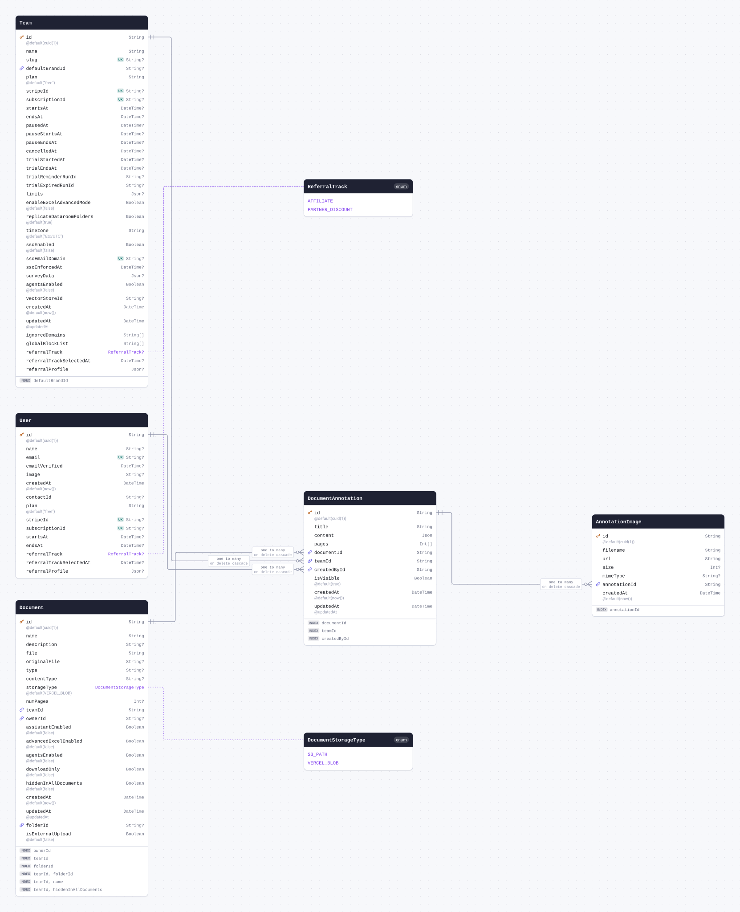

| Field         | Type       | Constraints                               | Default      | Description |
| ------------- | ---------- | ----------------------------------------- | ------------ | ----------- |
| `id`          | `String`   | PK NOT NULL                               | `cuid(1)`    |             |
| `title`       | `String`   | NOT NULL                                  |              |             |
| `content`     | `Json`     | NOT NULL                                  |              |             |
| `pages`       | `Int[]`    | NOT NULL                                  |              |             |
| `documentId`  | `String`   | NOT NULL → [Document.id](#model-Document) |              |             |
| `teamId`      | `String`   | NOT NULL → [Team.id](#model-Team)         |              |             |
| `createdById` | `String`   | NOT NULL → [User.id](#model-User)         |              |             |
| `isVisible`   | `Boolean`  | NOT NULL                                  | `true`       |             |
| `createdAt`   | `DateTime` | NOT NULL                                  | `now()`      |             |
| `updatedAt`   | `DateTime` | NOT NULL                                  | `@updatedAt` |             |

#### Indexes

- `@@index([documentId])`
- `@@index([teamId])`
- `@@index([createdById])`

#### References

- `documentId` → [Document.id](#model-Document) (many-to-one, on delete Cascade)
- `teamId` → [Team.id](#model-Team) (many-to-one, on delete Cascade)
- `createdById` → [User.id](#model-User) (many-to-one, on delete Cascade)

#### Referenced by

- `id` ← [AnnotationImage.annotationId](#model-AnnotationImage) (one-to-many, on delete Cascade)

#### Definition

```sql
CREATE TABLE "DocumentAnnotation" (
    "id" TEXT NOT NULL,
    "title" TEXT NOT NULL,
    "content" JSONB NOT NULL,
    "pages" INTEGER[],
    "documentId" TEXT NOT NULL,
    "teamId" TEXT NOT NULL,
    "createdById" TEXT NOT NULL,
    "isVisible" BOOLEAN NOT NULL DEFAULT true,
    "createdAt" TIMESTAMP(3) NOT NULL DEFAULT CURRENT_TIMESTAMP,
    "updatedAt" TIMESTAMP(3) NOT NULL,

    CONSTRAINT "DocumentAnnotation_pkey" PRIMARY KEY ("id")
);

CREATE INDEX "DocumentAnnotation_documentId_idx" ON "DocumentAnnotation"("documentId");

CREATE INDEX "DocumentAnnotation_teamId_idx" ON "DocumentAnnotation"("teamId");

CREATE INDEX "DocumentAnnotation_createdById_idx" ON "DocumentAnnotation"("createdById");

ALTER TABLE "DocumentAnnotation" ADD CONSTRAINT "DocumentAnnotation_documentId_fkey" FOREIGN KEY ("documentId") REFERENCES "Document"("id") ON DELETE CASCADE ON UPDATE CASCADE;

ALTER TABLE "DocumentAnnotation" ADD CONSTRAINT "DocumentAnnotation_teamId_fkey" FOREIGN KEY ("teamId") REFERENCES "Team"("id") ON DELETE CASCADE ON UPDATE CASCADE;

ALTER TABLE "DocumentAnnotation" ADD CONSTRAINT "DocumentAnnotation_createdById_fkey" FOREIGN KEY ("createdById") REFERENCES "User"("id") ON DELETE CASCADE ON UPDATE CASCADE;
```

<details>
<summary>Queries and their SQL</summary>

**findMany**: Every row

```ts
await prisma.documentAnnotation.findMany();
```

```sql
SELECT
  "public"."DocumentAnnotation"."id",
  "public"."DocumentAnnotation"."title",
  "public"."DocumentAnnotation"."content",
  "public"."DocumentAnnotation"."pages",
  "public"."DocumentAnnotation"."documentId",
  "public"."DocumentAnnotation"."teamId",
  "public"."DocumentAnnotation"."createdById",
  "public"."DocumentAnnotation"."isVisible",
  "public"."DocumentAnnotation"."createdAt",
  "public"."DocumentAnnotation"."updatedAt"
FROM
  "public"."DocumentAnnotation"
WHERE
  1 = 1
OFFSET
  $1
-- params: ["0"]
```

**count**: How many rows there are

```ts
await prisma.documentAnnotation.count();
```

```sql
SELECT
  COUNT(*) AS "_count$_all"
FROM
  (
    SELECT
      "public"."DocumentAnnotation"."id"
    FROM
      "public"."DocumentAnnotation"
    WHERE
      1 = 1
    OFFSET
      $1
  ) AS "sub"
-- params: ["0"]
```

**findMany**: Every row with its relations

```ts
await prisma.documentAnnotation.findMany({
  include: { document: true, team: true, createdBy: true, images: true },
});
```

```sql
SELECT
  "public"."DocumentAnnotation"."id",
  "public"."DocumentAnnotation"."title",
  "public"."DocumentAnnotation"."content",
  "public"."DocumentAnnotation"."pages",
  "public"."DocumentAnnotation"."documentId",
  "public"."DocumentAnnotation"."teamId",
  "public"."DocumentAnnotation"."createdById",
  "public"."DocumentAnnotation"."isVisible",
  "public"."DocumentAnnotation"."createdAt",
  "public"."DocumentAnnotation"."updatedAt"
FROM
  "public"."DocumentAnnotation"
WHERE
  1 = 1
OFFSET
  $1
-- params: ["0"]

SELECT
  "public"."Document"."id",
  "public"."Document"."name",
  "public"."Document"."description",
  "public"."Document"."file",
  "public"."Document"."originalFile",
  "public"."Document"."type",
  "public"."Document"."contentType",
  "public"."Document"."storageType"::text,
  "public"."Document"."numPages",
  "public"."Document"."teamId",
  "public"."Document"."ownerId",
  "public"."Document"."assistantEnabled",
  "public"."Document"."advancedExcelEnabled",
  "public"."Document"."agentsEnabled",
  "public"."Document"."downloadOnly",
  "public"."Document"."hiddenInAllDocuments",
  "public"."Document"."createdAt",
  "public"."Document"."updatedAt",
  "public"."Document"."folderId",
  "public"."Document"."isExternalUpload"
FROM
  "public"."Document"
WHERE
  "public"."Document"."id" IN ($1)
OFFSET
  $2
-- params: ["<documentId of the rows above>","0"]

SELECT
  "public"."Team"."id",
  "public"."Team"."name",
  "public"."Team"."slug",
  "public"."Team"."defaultBrandId",
  "public"."Team"."plan",
  "public"."Team"."stripeId",
  "public"."Team"."subscriptionId",
  "public"."Team"."startsAt",
  "public"."Team"."endsAt",
  "public"."Team"."pausedAt",
  "public"."Team"."pauseStartsAt",
  "public"."Team"."pauseEndsAt",
  "public"."Team"."cancelledAt",
  "public"."Team"."trialStartedAt",
  "public"."Team"."trialEndsAt",
  "public"."Team"."trialReminderRunId",
  "public"."Team"."trialExpiredRunId",
  "public"."Team"."limits",
  "public"."Team"."enableExcelAdvancedMode",
  "public"."Team"."replicateDataroomFolders",
  "public"."Team"."timezone",
  "public"."Team"."ssoEnabled",
  "public"."Team"."ssoEmailDomain",
  "public"."Team"."ssoEnforcedAt",
  "public"."Team"."surveyData",
  "public"."Team"."agentsEnabled",
  "public"."Team"."vectorStoreId",
  "public"."Team"."createdAt",
  "public"."Team"."updatedAt",
  "public"."Team"."ignoredDomains",
  "public"."Team"."globalBlockList",
  "public"."Team"."referralTrack"::text,
  "public"."Team"."referralTrackSelectedAt",
  "public"."Team"."referralProfile"
FROM
  "public"."Team"
WHERE
  "public"."Team"."id" IN ($1)
OFFSET
  $2
-- params: ["<teamId of the rows above>","0"]

SELECT
  "public"."User"."id",
  "public"."User"."name",
  "public"."User"."email",
  "public"."User"."emailVerified",
  "public"."User"."image",
  "public"."User"."createdAt",
  "public"."User"."contactId",
  "public"."User"."plan",
  "public"."User"."stripeId",
  "public"."User"."subscriptionId",
  "public"."User"."startsAt",
  "public"."User"."endsAt",
  "public"."User"."referralTrack"::text,
  "public"."User"."referralTrackSelectedAt",
  "public"."User"."referralProfile"
FROM
  "public"."User"
WHERE
  "public"."User"."id" IN ($1)
OFFSET
  $2
-- params: ["<createdById of the rows above>","0"]

SELECT
  "public"."AnnotationImage"."id",
  "public"."AnnotationImage"."filename",
  "public"."AnnotationImage"."url",
  "public"."AnnotationImage"."size",
  "public"."AnnotationImage"."mimeType",
  "public"."AnnotationImage"."annotationId",
  "public"."AnnotationImage"."createdAt"
FROM
  "public"."AnnotationImage"
WHERE
  "public"."AnnotationImage"."annotationId" IN ($1)
OFFSET
  $2
-- params: ["<id of the rows above>","0"]
```

**findUnique**: One row by what is unique to it

```ts
await prisma.documentAnnotation.findUnique({ where: { id: "example" } });
```

```sql
SELECT
  "public"."DocumentAnnotation"."id",
  "public"."DocumentAnnotation"."title",
  "public"."DocumentAnnotation"."content",
  "public"."DocumentAnnotation"."pages",
  "public"."DocumentAnnotation"."documentId",
  "public"."DocumentAnnotation"."teamId",
  "public"."DocumentAnnotation"."createdById",
  "public"."DocumentAnnotation"."isVisible",
  "public"."DocumentAnnotation"."createdAt",
  "public"."DocumentAnnotation"."updatedAt"
FROM
  "public"."DocumentAnnotation"
WHERE
  (
    "public"."DocumentAnnotation"."id" = $1
    AND 1 = 1
  )
LIMIT
  $2
OFFSET
  $3
-- params: ["example","1","0"]
```

**create**: Create a row

```ts
await prisma.documentAnnotation.create({
  data: {
    title: "example",
    content: {},
    pages: [1],
    documentId: "example",
    teamId: "example",
    createdById: "example",
  },
});
```

```sql
INSERT INTO
  "public"."DocumentAnnotation" (
    "id",
    "title",
    "content",
    "pages",
    "documentId",
    "teamId",
    "createdById",
    "isVisible",
    "createdAt",
    "updatedAt"
  )
VALUES
  ($1, $2, $3, $4, $5, $6, $7, $8, $9, $10)
RETURNING
  "public"."DocumentAnnotation"."id",
  "public"."DocumentAnnotation"."title",
  "public"."DocumentAnnotation"."content",
  "public"."DocumentAnnotation"."pages",
  "public"."DocumentAnnotation"."documentId",
  "public"."DocumentAnnotation"."teamId",
  "public"."DocumentAnnotation"."createdById",
  "public"."DocumentAnnotation"."isVisible",
  "public"."DocumentAnnotation"."createdAt",
  "public"."DocumentAnnotation"."updatedAt"
-- params: ["<cuid(1)>","example","{}",["1"],"example","example","example",true,"<now()>","<now()>"]
```

**update**: Update a row

```ts
await prisma.documentAnnotation.update({ where: { id: "example" }, data: { title: "example" } });
```

```sql
UPDATE "public"."DocumentAnnotation"
SET
  "title" = $1,
  "updatedAt" = $2
WHERE
  (
    "public"."DocumentAnnotation"."id" = $3
    AND 1 = 1
  )
RETURNING
  "public"."DocumentAnnotation"."id",
  "public"."DocumentAnnotation"."title",
  "public"."DocumentAnnotation"."content",
  "public"."DocumentAnnotation"."pages",
  "public"."DocumentAnnotation"."documentId",
  "public"."DocumentAnnotation"."teamId",
  "public"."DocumentAnnotation"."createdById",
  "public"."DocumentAnnotation"."isVisible",
  "public"."DocumentAnnotation"."createdAt",
  "public"."DocumentAnnotation"."updatedAt"
-- params: ["example",{"prisma__type":"generatorCall","prisma__value":{"name":"now","args":[],"returnType":{"type":"DateTime"}}},"example"]
```

**delete**: Delete a row

```ts
await prisma.documentAnnotation.delete({ where: { id: "example" } });
```

```sql
DELETE FROM "public"."DocumentAnnotation"
WHERE
  (
    "public"."DocumentAnnotation"."id" = $1
    AND 1 = 1
  )
RETURNING
  "public"."DocumentAnnotation"."id",
  "public"."DocumentAnnotation"."title",
  "public"."DocumentAnnotation"."content",
  "public"."DocumentAnnotation"."pages",
  "public"."DocumentAnnotation"."documentId",
  "public"."DocumentAnnotation"."teamId",
  "public"."DocumentAnnotation"."createdById",
  "public"."DocumentAnnotation"."isVisible",
  "public"."DocumentAnnotation"."createdAt",
  "public"."DocumentAnnotation"."updatedAt"
-- params: ["example"]
```

</details>

<a id="model-AnnotationImage"></a>

### AnnotationImage

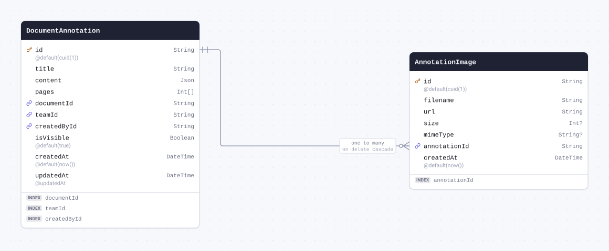

| Field          | Type       | Constraints                                                   | Default   | Description |
| -------------- | ---------- | ------------------------------------------------------------- | --------- | ----------- |
| `id`           | `String`   | PK NOT NULL                                                   | `cuid(1)` |             |
| `filename`     | `String`   | NOT NULL                                                      |           |             |
| `url`          | `String`   | NOT NULL                                                      |           |             |
| `size`         | `Int`      | NULL                                                          |           |             |
| `mimeType`     | `String`   | NULL                                                          |           |             |
| `annotationId` | `String`   | NOT NULL → [DocumentAnnotation.id](#model-DocumentAnnotation) |           |             |
| `createdAt`    | `DateTime` | NOT NULL                                                      | `now()`   |             |

#### Indexes

- `@@index([annotationId])`

#### References

- `annotationId` → [DocumentAnnotation.id](#model-DocumentAnnotation) (many-to-one, on delete Cascade)

#### Definition

```sql
CREATE TABLE "AnnotationImage" (
    "id" TEXT NOT NULL,
    "filename" TEXT NOT NULL,
    "url" TEXT NOT NULL,
    "size" INTEGER,
    "mimeType" TEXT,
    "annotationId" TEXT NOT NULL,
    "createdAt" TIMESTAMP(3) NOT NULL DEFAULT CURRENT_TIMESTAMP,

    CONSTRAINT "AnnotationImage_pkey" PRIMARY KEY ("id")
);

CREATE INDEX "AnnotationImage_annotationId_idx" ON "AnnotationImage"("annotationId");

ALTER TABLE "AnnotationImage" ADD CONSTRAINT "AnnotationImage_annotationId_fkey" FOREIGN KEY ("annotationId") REFERENCES "DocumentAnnotation"("id") ON DELETE CASCADE ON UPDATE CASCADE;
```

<details>
<summary>Queries and their SQL</summary>

**findMany**: Every row

```ts
await prisma.annotationImage.findMany();
```

```sql
SELECT
  "public"."AnnotationImage"."id",
  "public"."AnnotationImage"."filename",
  "public"."AnnotationImage"."url",
  "public"."AnnotationImage"."size",
  "public"."AnnotationImage"."mimeType",
  "public"."AnnotationImage"."annotationId",
  "public"."AnnotationImage"."createdAt"
FROM
  "public"."AnnotationImage"
WHERE
  1 = 1
OFFSET
  $1
-- params: ["0"]
```

**count**: How many rows there are

```ts
await prisma.annotationImage.count();
```

```sql
SELECT
  COUNT(*) AS "_count$_all"
FROM
  (
    SELECT
      "public"."AnnotationImage"."id"
    FROM
      "public"."AnnotationImage"
    WHERE
      1 = 1
    OFFSET
      $1
  ) AS "sub"
-- params: ["0"]
```

**findMany**: Every row with its relations

```ts
await prisma.annotationImage.findMany({ include: { annotation: true } });
```

```sql
SELECT
  "public"."AnnotationImage"."id",
  "public"."AnnotationImage"."filename",
  "public"."AnnotationImage"."url",
  "public"."AnnotationImage"."size",
  "public"."AnnotationImage"."mimeType",
  "public"."AnnotationImage"."annotationId",
  "public"."AnnotationImage"."createdAt"
FROM
  "public"."AnnotationImage"
WHERE
  1 = 1
OFFSET
  $1
-- params: ["0"]

SELECT
  "public"."DocumentAnnotation"."id",
  "public"."DocumentAnnotation"."title",
  "public"."DocumentAnnotation"."content",
  "public"."DocumentAnnotation"."pages",
  "public"."DocumentAnnotation"."documentId",
  "public"."DocumentAnnotation"."teamId",
  "public"."DocumentAnnotation"."createdById",
  "public"."DocumentAnnotation"."isVisible",
  "public"."DocumentAnnotation"."createdAt",
  "public"."DocumentAnnotation"."updatedAt"
FROM
  "public"."DocumentAnnotation"
WHERE
  "public"."DocumentAnnotation"."id" IN ($1)
OFFSET
  $2
-- params: ["<annotationId of the rows above>","0"]
```

**findUnique**: One row by what is unique to it

```ts
await prisma.annotationImage.findUnique({ where: { id: "example" } });
```

```sql
SELECT
  "public"."AnnotationImage"."id",
  "public"."AnnotationImage"."filename",
  "public"."AnnotationImage"."url",
  "public"."AnnotationImage"."size",
  "public"."AnnotationImage"."mimeType",
  "public"."AnnotationImage"."annotationId",
  "public"."AnnotationImage"."createdAt"
FROM
  "public"."AnnotationImage"
WHERE
  (
    "public"."AnnotationImage"."id" = $1
    AND 1 = 1
  )
LIMIT
  $2
OFFSET
  $3
-- params: ["example","1","0"]
```

**create**: Create a row

```ts
await prisma.annotationImage.create({
  data: { filename: "example", url: "example", annotationId: "example" },
});
```

```sql
INSERT INTO
  "public"."AnnotationImage" (
    "id",
    "filename",
    "url",
    "annotationId",
    "createdAt"
  )
VALUES
  ($1, $2, $3, $4, $5)
RETURNING
  "public"."AnnotationImage"."id",
  "public"."AnnotationImage"."filename",
  "public"."AnnotationImage"."url",
  "public"."AnnotationImage"."size",
  "public"."AnnotationImage"."mimeType",
  "public"."AnnotationImage"."annotationId",
  "public"."AnnotationImage"."createdAt"
-- params: ["<cuid(1)>","example","example","example","<now()>"]
```

**update**: Update a row

```ts
await prisma.annotationImage.update({ where: { id: "example" }, data: { filename: "example" } });
```

```sql
UPDATE "public"."AnnotationImage"
SET
  "filename" = $1
WHERE
  (
    "public"."AnnotationImage"."id" = $2
    AND 1 = 1
  )
RETURNING
  "public"."AnnotationImage"."id",
  "public"."AnnotationImage"."filename",
  "public"."AnnotationImage"."url",
  "public"."AnnotationImage"."size",
  "public"."AnnotationImage"."mimeType",
  "public"."AnnotationImage"."annotationId",
  "public"."AnnotationImage"."createdAt"
-- params: ["example","example"]
```

**delete**: Delete a row

```ts
await prisma.annotationImage.delete({ where: { id: "example" } });
```

```sql
DELETE FROM "public"."AnnotationImage"
WHERE
  (
    "public"."AnnotationImage"."id" = $1
    AND 1 = 1
  )
RETURNING
  "public"."AnnotationImage"."id",
  "public"."AnnotationImage"."filename",
  "public"."AnnotationImage"."url",
  "public"."AnnotationImage"."size",
  "public"."AnnotationImage"."mimeType",
  "public"."AnnotationImage"."annotationId",
  "public"."AnnotationImage"."createdAt"
-- params: ["example"]
```

</details>

<a id="model-Brand"></a>

### Brand

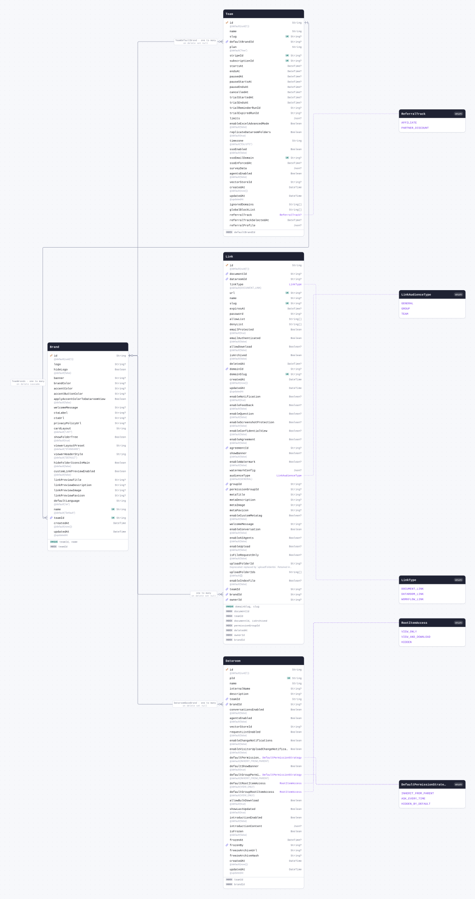

| Field                            | Type       | Constraints                       | Default      | Description |
| -------------------------------- | ---------- | --------------------------------- | ------------ | ----------- |
| `id`                             | `String`   | PK NOT NULL                       | `cuid(1)`    |             |
| `logo`                           | `String`   | NULL                              |              |             |
| `hideLogo`                       | `Boolean`  | NOT NULL                          | `false`      |             |
| `banner`                         | `String`   | NULL                              |              |             |
| `brandColor`                     | `String`   | NULL                              |              |             |
| `accentColor`                    | `String`   | NULL                              |              |             |
| `accentButtonColor`              | `String`   | NULL                              |              |             |
| `applyAccentColorToDataroomView` | `Boolean`  | NOT NULL                          | `false`      |             |
| `welcomeMessage`                 | `String`   | NULL                              |              |             |
| `ctaLabel`                       | `String`   | NULL                              |              |             |
| `ctaUrl`                         | `String`   | NULL                              |              |             |
| `privacyPolicyUrl`               | `String`   | NULL                              |              |             |
| `cardLayout`                     | `String`   | NOT NULL                          | `"LIST"`     |             |
| `showFolderTree`                 | `Boolean`  | NOT NULL                          | `true`       |             |
| `viewerLayoutPreset`             | `String`   | NOT NULL                          | `"STANDARD"` |             |
| `viewerHeaderStyle`              | `String`   | NOT NULL                          | `"DEFAULT"`  |             |
| `hideFolderIconsInMain`          | `Boolean`  | NOT NULL                          | `false`      |             |
| `customLinkPreviewEnabled`       | `Boolean`  | NOT NULL                          | `false`      |             |
| `linkPreviewTitle`               | `String`   | NULL                              |              |             |
| `linkPreviewDescription`         | `String`   | NULL                              |              |             |
| `linkPreviewImage`               | `String`   | NULL                              |              |             |
| `linkPreviewFavicon`             | `String`   | NULL                              |              |             |
| `defaultLanguage`                | `String`   | NOT NULL                          | `"en"`       |             |
| `name`                           | `String`   | NOT NULL                          | `"Default"`  |             |
| `teamId`                         | `String`   | NOT NULL → [Team.id](#model-Team) |              |             |
| `createdAt`                      | `DateTime` | NOT NULL                          | `now()`      |             |
| `updatedAt`                      | `DateTime` | NOT NULL                          | `@updatedAt` |             |

#### Indexes

- `@@index([teamId])`
- `@@unique([teamId, name])`

#### References

- `teamId` → [Team.id](#model-Team) (many-to-one, on delete Cascade)

#### Referenced by

- `id` ← [Dataroom.brandId](#model-Dataroom) (one-to-many, on delete SetNull)
- `id` ← [Link.brandId](#model-Link) (one-to-many, on delete SetNull)
- `id` ← [Team.defaultBrandId](#model-Team) (one-to-many, on delete SetNull)

#### Definition

```sql
CREATE TABLE "Brand" (
    "id" TEXT NOT NULL,
    "logo" TEXT,
    "hideLogo" BOOLEAN NOT NULL DEFAULT false,
    "banner" TEXT,
    "brandColor" TEXT,
    "accentColor" TEXT,
    "accentButtonColor" TEXT,
    "applyAccentColorToDataroomView" BOOLEAN NOT NULL DEFAULT false,
    "welcomeMessage" TEXT,
    "ctaLabel" TEXT,
    "ctaUrl" TEXT,
    "privacyPolicyUrl" TEXT,
    "cardLayout" TEXT NOT NULL DEFAULT 'LIST',
    "showFolderTree" BOOLEAN NOT NULL DEFAULT true,
    "viewerLayoutPreset" TEXT NOT NULL DEFAULT 'STANDARD',
    "viewerHeaderStyle" TEXT NOT NULL DEFAULT 'DEFAULT',
    "hideFolderIconsInMain" BOOLEAN NOT NULL DEFAULT false,
    "customLinkPreviewEnabled" BOOLEAN NOT NULL DEFAULT false,
    "linkPreviewTitle" TEXT,
    "linkPreviewDescription" TEXT,
    "linkPreviewImage" TEXT,
    "linkPreviewFavicon" TEXT,
    "defaultLanguage" TEXT NOT NULL DEFAULT 'en',
    "name" TEXT NOT NULL DEFAULT 'Default',
    "teamId" TEXT NOT NULL,
    "createdAt" TIMESTAMP(3) NOT NULL DEFAULT CURRENT_TIMESTAMP,
    "updatedAt" TIMESTAMP(3) NOT NULL,

    CONSTRAINT "Brand_pkey" PRIMARY KEY ("id")
);

CREATE INDEX "Brand_teamId_idx" ON "Brand"("teamId");

CREATE UNIQUE INDEX "Brand_teamId_name_key" ON "Brand"("teamId", "name");

ALTER TABLE "Brand" ADD CONSTRAINT "Brand_teamId_fkey" FOREIGN KEY ("teamId") REFERENCES "Team"("id") ON DELETE CASCADE ON UPDATE CASCADE;
```

<details>
<summary>Queries and their SQL</summary>

**findMany**: Every row

```ts
await prisma.brand.findMany();
```

```sql
SELECT
  "public"."Brand"."id",
  "public"."Brand"."logo",
  "public"."Brand"."hideLogo",
  "public"."Brand"."banner",
  "public"."Brand"."brandColor",
  "public"."Brand"."accentColor",
  "public"."Brand"."accentButtonColor",
  "public"."Brand"."applyAccentColorToDataroomView",
  "public"."Brand"."welcomeMessage",
  "public"."Brand"."ctaLabel",
  "public"."Brand"."ctaUrl",
  "public"."Brand"."privacyPolicyUrl",
  "public"."Brand"."cardLayout",
  "public"."Brand"."showFolderTree",
  "public"."Brand"."viewerLayoutPreset",
  "public"."Brand"."viewerHeaderStyle",
  "public"."Brand"."hideFolderIconsInMain",
  "public"."Brand"."customLinkPreviewEnabled",
  "public"."Brand"."linkPreviewTitle",
  "public"."Brand"."linkPreviewDescription",
  "public"."Brand"."linkPreviewImage",
  "public"."Brand"."linkPreviewFavicon",
  "public"."Brand"."defaultLanguage",
  "public"."Brand"."name",
  "public"."Brand"."teamId",
  "public"."Brand"."createdAt",
  "public"."Brand"."updatedAt"
FROM
  "public"."Brand"
WHERE
  1 = 1
OFFSET
  $1
-- params: ["0"]
```

**count**: How many rows there are

```ts
await prisma.brand.count();
```

```sql
SELECT
  COUNT(*) AS "_count$_all"
FROM
  (
    SELECT
      "public"."Brand"."id"
    FROM
      "public"."Brand"
    WHERE
      1 = 1
    OFFSET
      $1
  ) AS "sub"
-- params: ["0"]
```

**findMany**: Every row with its relations

```ts
await prisma.brand.findMany({
  include: { team: true, defaultForTeam: true, links: true, datarooms: true },
});
```

```sql
SELECT
  "public"."Brand"."id",
  "public"."Brand"."logo",
  "public"."Brand"."hideLogo",
  "public"."Brand"."banner",
  "public"."Brand"."brandColor",
  "public"."Brand"."accentColor",
  "public"."Brand"."accentButtonColor",
  "public"."Brand"."applyAccentColorToDataroomView",
  "public"."Brand"."welcomeMessage",
  "public"."Brand"."ctaLabel",
  "public"."Brand"."ctaUrl",
  "public"."Brand"."privacyPolicyUrl",
  "public"."Brand"."cardLayout",
  "public"."Brand"."showFolderTree",
  "public"."Brand"."viewerLayoutPreset",
  "public"."Brand"."viewerHeaderStyle",
  "public"."Brand"."hideFolderIconsInMain",
  "public"."Brand"."customLinkPreviewEnabled",
  "public"."Brand"."linkPreviewTitle",
  "public"."Brand"."linkPreviewDescription",
  "public"."Brand"."linkPreviewImage",
  "public"."Brand"."linkPreviewFavicon",
  "public"."Brand"."defaultLanguage",
  "public"."Brand"."name",
  "public"."Brand"."teamId",
  "public"."Brand"."createdAt",
  "public"."Brand"."updatedAt"
FROM
  "public"."Brand"
WHERE
  1 = 1
OFFSET
  $1
-- params: ["0"]

SELECT
  "public"."Team"."id",
  "public"."Team"."name",
  "public"."Team"."slug",
  "public"."Team"."defaultBrandId",
  "public"."Team"."plan",
  "public"."Team"."stripeId",
  "public"."Team"."subscriptionId",
  "public"."Team"."startsAt",
  "public"."Team"."endsAt",
  "public"."Team"."pausedAt",
  "public"."Team"."pauseStartsAt",
  "public"."Team"."pauseEndsAt",
  "public"."Team"."cancelledAt",
  "public"."Team"."trialStartedAt",
  "public"."Team"."trialEndsAt",
  "public"."Team"."trialReminderRunId",
  "public"."Team"."trialExpiredRunId",
  "public"."Team"."limits",
  "public"."Team"."enableExcelAdvancedMode",
  "public"."Team"."replicateDataroomFolders",
  "public"."Team"."timezone",
  "public"."Team"."ssoEnabled",
  "public"."Team"."ssoEmailDomain",
  "public"."Team"."ssoEnforcedAt",
  "public"."Team"."surveyData",
  "public"."Team"."agentsEnabled",
  "public"."Team"."vectorStoreId",
  "public"."Team"."createdAt",
  "public"."Team"."updatedAt",
  "public"."Team"."ignoredDomains",
  "public"."Team"."globalBlockList",
  "public"."Team"."referralTrack"::text,
  "public"."Team"."referralTrackSelectedAt",
  "public"."Team"."referralProfile"
FROM
  "public"."Team"
WHERE
  "public"."Team"."id" IN ($1)
OFFSET
  $2
-- params: ["<teamId of the rows above>","0"]

SELECT
  "public"."Team"."id",
  "public"."Team"."name",
  "public"."Team"."slug",
  "public"."Team"."defaultBrandId",
  "public"."Team"."plan",
  "public"."Team"."stripeId",
  "public"."Team"."subscriptionId",
  "public"."Team"."startsAt",
  "public"."Team"."endsAt",
  "public"."Team"."pausedAt",
  "public"."Team"."pauseStartsAt",
  "public"."Team"."pauseEndsAt",
  "public"."Team"."cancelledAt",
  "public"."Team"."trialStartedAt",
  "public"."Team"."trialEndsAt",
  "public"."Team"."trialReminderRunId",
  "public"."Team"."trialExpiredRunId",
  "public"."Team"."limits",
  "public"."Team"."enableExcelAdvancedMode",
  "public"."Team"."replicateDataroomFolders",
  "public"."Team"."timezone",
  "public"."Team"."ssoEnabled",
  "public"."Team"."ssoEmailDomain",
  "public"."Team"."ssoEnforcedAt",
  "public"."Team"."surveyData",
  "public"."Team"."agentsEnabled",
  "public"."Team"."vectorStoreId",
  "public"."Team"."createdAt",
  "public"."Team"."updatedAt",
  "public"."Team"."ignoredDomains",
  "public"."Team"."globalBlockList",
  "public"."Team"."referralTrack"::text,
  "public"."Team"."referralTrackSelectedAt",
  "public"."Team"."referralProfile"
FROM
  "public"."Team"
WHERE
  "public"."Team"."defaultBrandId" IN ($1)
OFFSET
  $2
-- params: ["<id of the rows above>","0"]

SELECT
  "public"."Link"."id",
  "public"."Link"."documentId",
  "public"."Link"."dataroomId",
  "public"."Link"."linkType"::text,
  "public"."Link"."url",
  "public"."Link"."name",
  "public"."Link"."slug",
  "public"."Link"."expiresAt",
  "public"."Link"."password",
  "public"."Link"."allowList",
  "public"."Link"."denyList",
  "public"."Link"."emailProtected",
  "public"."Link"."emailAuthenticated",
  "public"."Link"."allowDownload",
  "public"."Link"."isArchived",
  "public"."Link"."deletedAt",
  "public"."Link"."domainId",
  "public"."Link"."domainSlug",
  "public"."Link"."createdAt",
  "public"."Link"."updatedAt",
  "public"."Link"."enableNotification",
  "public"."Link"."enableFeedback",
  "public"."Link"."enableQuestion",
  "public"."Link"."enableScreenshotProtection",
  "public"."Link"."enableConfidentialView",
  "public"."Link"."enableAgreement",
  "public"."Link"."agreementId",
  "public"."Link"."showBanner",
  "public"."Link"."enableWatermark",
  "public"."Link"."watermarkConfig",
  "public"."Link"."audienceType"::text,
  "public"."Link"."groupId",
  "public"."Link"."permissionGroupId",
  "public"."Link"."metaTitle",
  "public"."Link"."metaDescription",
  "public"."Link"."metaImage",
  "public"."Link"."metaFavicon",
  "public"."Link"."enableCustomMetatag",
  "public"."Link"."welcomeMessage",
  "public"."Link"."enableConversation",
  "public"."Link"."enableAIAgents",
  "public"."Link"."enableUpload",
  "public"."Link"."isFileRequestOnly",
  "public"."Link"."uploadFolderId",
  "public"."Link"."uploadFolderIds",
  "public"."Link"."enableIndexFile",
  "public"."Link"."teamId",
  "public"."Link"."brandId",
  "public"."Link"."ownerId"
FROM
  "public"."Link"
WHERE
  "public"."Link"."brandId" IN ($1)
OFFSET
  $2
-- params: ["<id of the rows above>","0"]

SELECT
  "public"."Dataroom"."id",
  "public"."Dataroom"."pId",
  "public"."Dataroom"."name",
  "public"."Dataroom"."internalName",
  "public"."Dataroom"."description",
  "public"."Dataroom"."teamId",
  "public"."Dataroom"."brandId",
  "public"."Dataroom"."conversationsEnabled",
  "public"."Dataroom"."agentsEnabled",
  "public"."Dataroom"."vectorStoreId",
  "public"."Dataroom"."requestListEnabled",
  "public"."Dataroom"."enableChangeNotifications",
  "public"."Dataroom"."enableVisitorUploadChangeNotifications",
  "public"."Dataroom"."defaultPermissionStrategy"::text,
  "public"."Dataroom"."defaultShowBanner",
  "public"."Dataroom"."defaultGroupPermissionStrategy"::text,
  "public"."Dataroom"."defaultRootItemAccess"::text,
  "public"."Dataroom"."defaultGroupRootItemAccess"::text,
  "public"."Dataroom"."allowBulkDownload",
  "public"."Dataroom"."showLastUpdated",
  "public"."Dataroom"."introductionEnabled",
  "public"."Dataroom"."introductionContent",
  "public"."Dataroom"."isFrozen",
  "public"."Dataroom"."frozenAt",
  "public"."Dataroom"."frozenBy",
  "public"."Dataroom"."freezeArchiveUrl",
  "public"."Dataroom"."freezeArchiveHash",
  "public"."Dataroom"."createdAt",
  "public"."Dataroom"."updatedAt"
FROM
  "public"."Dataroom"
WHERE
  "public"."Dataroom"."brandId" IN ($1)
OFFSET
  $2
-- params: ["<id of the rows above>","0"]
```

**findUnique**: One row by what is unique to it

```ts
await prisma.brand.findUnique({ where: { id: "example" } });
```

```sql
SELECT
  "public"."Brand"."id",
  "public"."Brand"."logo",
  "public"."Brand"."hideLogo",
  "public"."Brand"."banner",
  "public"."Brand"."brandColor",
  "public"."Brand"."accentColor",
  "public"."Brand"."accentButtonColor",
  "public"."Brand"."applyAccentColorToDataroomView",
  "public"."Brand"."welcomeMessage",
  "public"."Brand"."ctaLabel",
  "public"."Brand"."ctaUrl",
  "public"."Brand"."privacyPolicyUrl",
  "public"."Brand"."cardLayout",
  "public"."Brand"."showFolderTree",
  "public"."Brand"."viewerLayoutPreset",
  "public"."Brand"."viewerHeaderStyle",
  "public"."Brand"."hideFolderIconsInMain",
  "public"."Brand"."customLinkPreviewEnabled",
  "public"."Brand"."linkPreviewTitle",
  "public"."Brand"."linkPreviewDescription",
  "public"."Brand"."linkPreviewImage",
  "public"."Brand"."linkPreviewFavicon",
  "public"."Brand"."defaultLanguage",
  "public"."Brand"."name",
  "public"."Brand"."teamId",
  "public"."Brand"."createdAt",
  "public"."Brand"."updatedAt"
FROM
  "public"."Brand"
WHERE
  (
    "public"."Brand"."id" = $1
    AND 1 = 1
  )
LIMIT
  $2
OFFSET
  $3
-- params: ["example","1","0"]
```

**create**: Create a row

```ts
await prisma.brand.create({ data: { teamId: "example" } });
```

```sql
INSERT INTO
  "public"."Brand" (
    "id",
    "hideLogo",
    "applyAccentColorToDataroomView",
    "cardLayout",
    "showFolderTree",
    "viewerLayoutPreset",
    "viewerHeaderStyle",
    "hideFolderIconsInMain",
    "customLinkPreviewEnabled",
    "defaultLanguage",
    "name",
    "teamId",
    "createdAt",
    "updatedAt"
  )
VALUES
  (
    $1,
    $2,
    $3,
    $4,
    $5,
    $6,
    $7,
    $8,
    $9,
    $10,
    $11,
    $12,
    $13,
    $14
  )
RETURNING
  "public"."Brand"."id",
  "public"."Brand"."logo",
  "public"."Brand"."hideLogo",
  "public"."Brand"."banner",
  "public"."Brand"."brandColor",
  "public"."Brand"."accentColor",
  "public"."Brand"."accentButtonColor",
  "public"."Brand"."applyAccentColorToDataroomView",
  "public"."Brand"."welcomeMessage",
  "public"."Brand"."ctaLabel",
  "public"."Brand"."ctaUrl",
  "public"."Brand"."privacyPolicyUrl",
  "public"."Brand"."cardLayout",
  "public"."Brand"."showFolderTree",
  "public"."Brand"."viewerLayoutPreset",
  "public"."Brand"."viewerHeaderStyle",
  "public"."Brand"."hideFolderIconsInMain",
  "public"."Brand"."customLinkPreviewEnabled",
  "public"."Brand"."linkPreviewTitle",
  "public"."Brand"."linkPreviewDescription",
  "public"."Brand"."linkPreviewImage",
  "public"."Brand"."linkPreviewFavicon",
  "public"."Brand"."defaultLanguage",
  "public"."Brand"."name",
  "public"."Brand"."teamId",
  "public"."Brand"."createdAt",
  "public"."Brand"."updatedAt"
-- params: ["<cuid(1)>",false,false,"LIST",true,"STANDARD","DEFAULT",false,false,"en","Default","example","<now()>","<now()>"]
```

**update**: Update a row

```ts
await prisma.brand.update({ where: { id: "example" }, data: { logo: "example" } });
```

```sql
UPDATE "public"."Brand"
SET
  "logo" = $1,
  "updatedAt" = $2
WHERE
  (
    "public"."Brand"."id" = $3
    AND 1 = 1
  )
RETURNING
  "public"."Brand"."id",
  "public"."Brand"."logo",
  "public"."Brand"."hideLogo",
  "public"."Brand"."banner",
  "public"."Brand"."brandColor",
  "public"."Brand"."accentColor",
  "public"."Brand"."accentButtonColor",
  "public"."Brand"."applyAccentColorToDataroomView",
  "public"."Brand"."welcomeMessage",
  "public"."Brand"."ctaLabel",
  "public"."Brand"."ctaUrl",
  "public"."Brand"."privacyPolicyUrl",
  "public"."Brand"."cardLayout",
  "public"."Brand"."showFolderTree",
  "public"."Brand"."viewerLayoutPreset",
  "public"."Brand"."viewerHeaderStyle",
  "public"."Brand"."hideFolderIconsInMain",
  "public"."Brand"."customLinkPreviewEnabled",
  "public"."Brand"."linkPreviewTitle",
  "public"."Brand"."linkPreviewDescription",
  "public"."Brand"."linkPreviewImage",
  "public"."Brand"."linkPreviewFavicon",
  "public"."Brand"."defaultLanguage",
  "public"."Brand"."name",
  "public"."Brand"."teamId",
  "public"."Brand"."createdAt",
  "public"."Brand"."updatedAt"
-- params: ["example",{"prisma__type":"generatorCall","prisma__value":{"name":"now","args":[],"returnType":{"type":"DateTime"}}},"example"]
```

**delete**: Delete a row

```ts
await prisma.brand.delete({ where: { id: "example" } });
```

```sql
DELETE FROM "public"."Brand"
WHERE
  (
    "public"."Brand"."id" = $1
    AND 1 = 1
  )
RETURNING
  "public"."Brand"."id",
  "public"."Brand"."logo",
  "public"."Brand"."hideLogo",
  "public"."Brand"."banner",
  "public"."Brand"."brandColor",
  "public"."Brand"."accentColor",
  "public"."Brand"."accentButtonColor",
  "public"."Brand"."applyAccentColorToDataroomView",
  "public"."Brand"."welcomeMessage",
  "public"."Brand"."ctaLabel",
  "public"."Brand"."ctaUrl",
  "public"."Brand"."privacyPolicyUrl",
  "public"."Brand"."cardLayout",
  "public"."Brand"."showFolderTree",
  "public"."Brand"."viewerLayoutPreset",
  "public"."Brand"."viewerHeaderStyle",
  "public"."Brand"."hideFolderIconsInMain",
  "public"."Brand"."customLinkPreviewEnabled",
  "public"."Brand"."linkPreviewTitle",
  "public"."Brand"."linkPreviewDescription",
  "public"."Brand"."linkPreviewImage",
  "public"."Brand"."linkPreviewFavicon",
  "public"."Brand"."defaultLanguage",
  "public"."Brand"."name",
  "public"."Brand"."teamId",
  "public"."Brand"."createdAt",
  "public"."Brand"."updatedAt"
-- params: ["example"]
```

</details>

<a id="model-Conversation"></a>

### Conversation

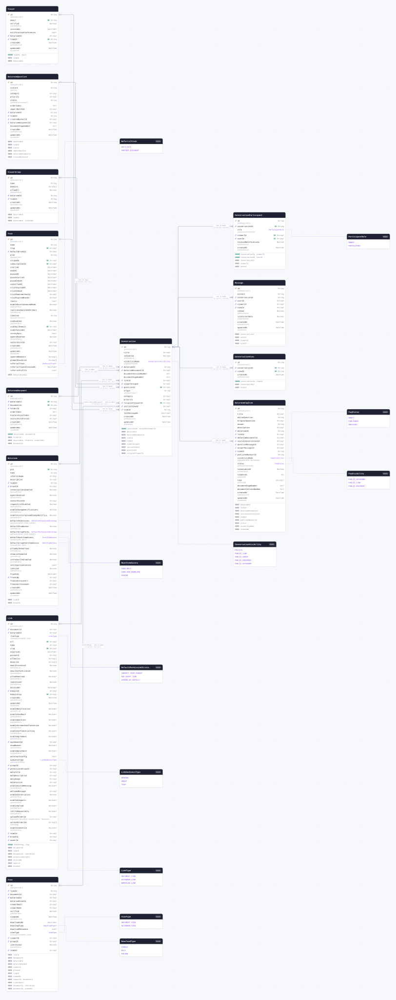

| Field                   | Type                                                     | Constraints                                           | Default      | Description |
| ----------------------- | -------------------------------------------------------- | ----------------------------------------------------- | ------------ | ----------- |
| `id`                    | `String`                                                 | PK NOT NULL                                           | `cuid(1)`    |             |
| `title`                 | `String`                                                 | NULL                                                  |              |             |
| `isEnabled`             | `Boolean`                                                | NOT NULL                                              | `true`       |             |
| `visibilityMode`        | [`ConversationVisibility`](#enum-ConversationVisibility) | NOT NULL                                              | `PRIVATE`    |             |
| `dataroomId`            | `String`                                                 | NOT NULL → [Dataroom.id](#model-Dataroom)             |              |             |
| `dataroomDocumentId`    | `String`                                                 | NULL → [DataroomDocument.id](#model-DataroomDocument) |              |             |
| `documentVersionNumber` | `Int`                                                    | NULL                                                  |              |             |
| `documentPageNumber`    | `Int`                                                    | NULL                                                  |              |             |
| `linkId`                | `String`                                                 | NULL → [Link.id](#model-Link)                         |              |             |
| `viewerGroupId`         | `String`                                                 | NULL → [ViewerGroup.id](#model-ViewerGroup)           |              |             |
| `questionId`            | `String`                                                 | NULL → [DataroomQuestion.id](#model-DataroomQuestion) |              |             |
| `origin`                | `String`                                                 | NOT NULL                                              | `"visitor"`  |             |
| `category`              | `String`                                                 | NULL                                                  |              |             |
| `priority`              | `String`                                                 | NULL                                                  |              |             |
| `recipientViewerId`     | `String`                                                 | NULL → [Viewer.id](#model-Viewer)                     |              |             |
| `initialViewId`         | `String`                                                 | NULL → [View.id](#model-View)                         |              |             |
| `teamId`                | `String`                                                 | NOT NULL → [Team.id](#model-Team)                     |              |             |
| `lastMessageAt`         | `DateTime`                                               | NULL                                                  |              |             |
| `createdAt`             | `DateTime`                                               | NOT NULL                                              | `now()`      |             |
| `updatedAt`             | `DateTime`                                               | NOT NULL                                              | `@updatedAt` |             |

#### Indexes

- `@@index([dataroomId])`
- `@@index([dataroomDocumentId])`
- `@@index([linkId])`
- `@@index([teamId])`
- `@@index([viewerGroupId])`
- `@@index([initialViewId])`
- `@@index([questionId])`
- `@@index([recipientViewerId])`
- `@@unique([questionId, recipientViewerId])`

#### References

- `dataroomId` → [Dataroom.id](#model-Dataroom) (many-to-one, on delete Cascade)
- `dataroomDocumentId` → [DataroomDocument.id](#model-DataroomDocument) (many-to-one, on delete SetNull)
- `linkId` → [Link.id](#model-Link) (many-to-one, on delete SetNull)
- `viewerGroupId` → [ViewerGroup.id](#model-ViewerGroup) (many-to-one, on delete SetNull)
- `questionId` → [DataroomQuestion.id](#model-DataroomQuestion) (many-to-one, on delete Cascade)
- `recipientViewerId` → [Viewer.id](#model-Viewer) (many-to-one, on delete SetNull)
- `initialViewId` → [View.id](#model-View) (many-to-one, on delete SetNull)
- `teamId` → [Team.id](#model-Team) (many-to-one, on delete Cascade)

#### Referenced by

- `id` ← [ConversationParticipant.conversationId](#model-ConversationParticipant) (one-to-many, on delete Cascade)
- `id` ← [Message.conversationId](#model-Message) (one-to-many, on delete Cascade)
- `id` ← [ConversationView.conversationId](#model-ConversationView) (one-to-many, on delete Cascade)
- `id` ← [DataroomFaqItem.sourceConversationId](#model-DataroomFaqItem) (one-to-many, on delete SetNull)

#### Definition

```sql
CREATE TABLE "Conversation" (
    "id" TEXT NOT NULL,
    "title" TEXT,
    "isEnabled" BOOLEAN NOT NULL DEFAULT true,
    "visibilityMode" "ConversationVisibility" NOT NULL DEFAULT 'PRIVATE',
    "dataroomId" TEXT NOT NULL,
    "dataroomDocumentId" TEXT,
    "documentVersionNumber" INTEGER,
    "documentPageNumber" INTEGER,
    "linkId" TEXT,
    "viewerGroupId" TEXT,
    "questionId" TEXT,
    "origin" TEXT NOT NULL DEFAULT 'visitor',
    "category" TEXT,
    "priority" TEXT,
    "recipientViewerId" TEXT,
    "initialViewId" TEXT,
    "teamId" TEXT NOT NULL,
    "lastMessageAt" TIMESTAMP(3),
    "createdAt" TIMESTAMP(3) NOT NULL DEFAULT CURRENT_TIMESTAMP,
    "updatedAt" TIMESTAMP(3) NOT NULL,

    CONSTRAINT "Conversation_pkey" PRIMARY KEY ("id")
);

CREATE INDEX "Conversation_dataroomId_idx" ON "Conversation"("dataroomId");

CREATE INDEX "Conversation_dataroomDocumentId_idx" ON "Conversation"("dataroomDocumentId");

CREATE INDEX "Conversation_linkId_idx" ON "Conversation"("linkId");

CREATE INDEX "Conversation_teamId_idx" ON "Conversation"("teamId");

CREATE INDEX "Conversation_viewerGroupId_idx" ON "Conversation"("viewerGroupId");

CREATE INDEX "Conversation_initialViewId_idx" ON "Conversation"("initialViewId");

CREATE INDEX "Conversation_questionId_idx" ON "Conversation"("questionId");

CREATE INDEX "Conversation_recipientViewerId_idx" ON "Conversation"("recipientViewerId");

CREATE UNIQUE INDEX "Conversation_questionId_recipientViewerId_key" ON "Conversation"("questionId", "recipientViewerId");

ALTER TABLE "Conversation" ADD CONSTRAINT "Conversation_dataroomId_fkey" FOREIGN KEY ("dataroomId") REFERENCES "Dataroom"("id") ON DELETE CASCADE ON UPDATE CASCADE;

ALTER TABLE "Conversation" ADD CONSTRAINT "Conversation_dataroomDocumentId_fkey" FOREIGN KEY ("dataroomDocumentId") REFERENCES "DataroomDocument"("id") ON DELETE SET NULL ON UPDATE CASCADE;

ALTER TABLE "Conversation" ADD CONSTRAINT "Conversation_linkId_fkey" FOREIGN KEY ("linkId") REFERENCES "Link"("id") ON DELETE SET NULL ON UPDATE CASCADE;

ALTER TABLE "Conversation" ADD CONSTRAINT "Conversation_viewerGroupId_fkey" FOREIGN KEY ("viewerGroupId") REFERENCES "ViewerGroup"("id") ON DELETE SET NULL ON UPDATE CASCADE;

ALTER TABLE "Conversation" ADD CONSTRAINT "Conversation_questionId_fkey" FOREIGN KEY ("questionId") REFERENCES "DataroomQuestion"("id") ON DELETE CASCADE ON UPDATE CASCADE;

ALTER TABLE "Conversation" ADD CONSTRAINT "Conversation_recipientViewerId_fkey" FOREIGN KEY ("recipientViewerId") REFERENCES "Viewer"("id") ON DELETE SET NULL ON UPDATE CASCADE;

ALTER TABLE "Conversation" ADD CONSTRAINT "Conversation_initialViewId_fkey" FOREIGN KEY ("initialViewId") REFERENCES "View"("id") ON DELETE SET NULL ON UPDATE CASCADE;

ALTER TABLE "Conversation" ADD CONSTRAINT "Conversation_teamId_fkey" FOREIGN KEY ("teamId") REFERENCES "Team"("id") ON DELETE CASCADE ON UPDATE CASCADE;
```

<details>
<summary>Queries and their SQL</summary>

**findMany**: Every row

```ts
await prisma.conversation.findMany();
```

```sql
SELECT
  "public"."Conversation"."id",
  "public"."Conversation"."title",
  "public"."Conversation"."isEnabled",
  "public"."Conversation"."visibilityMode"::text,
  "public"."Conversation"."dataroomId",
  "public"."Conversation"."dataroomDocumentId",
  "public"."Conversation"."documentVersionNumber",
  "public"."Conversation"."documentPageNumber",
  "public"."Conversation"."linkId",
  "public"."Conversation"."viewerGroupId",
  "public"."Conversation"."questionId",
  "public"."Conversation"."origin",
  "public"."Conversation"."category",
  "public"."Conversation"."priority",
  "public"."Conversation"."recipientViewerId",
  "public"."Conversation"."initialViewId",
  "public"."Conversation"."teamId",
  "public"."Conversation"."lastMessageAt",
  "public"."Conversation"."createdAt",
  "public"."Conversation"."updatedAt"
FROM
  "public"."Conversation"
WHERE
  1 = 1
OFFSET
  $1
-- params: ["0"]
```

**count**: How many rows there are

```ts
await prisma.conversation.count();
```

```sql
SELECT
  COUNT(*) AS "_count$_all"
FROM
  (
    SELECT
      "public"."Conversation"."id"
    FROM
      "public"."Conversation"
    WHERE
      1 = 1
    OFFSET
      $1
  ) AS "sub"
-- params: ["0"]
```

**findMany**: Every row with its relations

```ts
await prisma.conversation.findMany({
  include: {
    dataroom: true,
    dataroomDocument: true,
    link: true,
    viewerGroup: true,
    question: true,
    recipientViewer: true,
    initialView: true,
    team: true,
    views: true,
    participants: true,
    messages: true,
    faqItems: true,
  },
});
```

```sql
SELECT
  "public"."Conversation"."id",
  "public"."Conversation"."title",
  "public"."Conversation"."isEnabled",
  "public"."Conversation"."visibilityMode"::text,
  "public"."Conversation"."dataroomId",
  "public"."Conversation"."dataroomDocumentId",
  "public"."Conversation"."documentVersionNumber",
  "public"."Conversation"."documentPageNumber",
  "public"."Conversation"."linkId",
  "public"."Conversation"."viewerGroupId",
  "public"."Conversation"."questionId",
  "public"."Conversation"."origin",
  "public"."Conversation"."category",
  "public"."Conversation"."priority",
  "public"."Conversation"."recipientViewerId",
  "public"."Conversation"."initialViewId",
  "public"."Conversation"."teamId",
  "public"."Conversation"."lastMessageAt",
  "public"."Conversation"."createdAt",
  "public"."Conversation"."updatedAt"
FROM
  "public"."Conversation"
WHERE
  1 = 1
OFFSET
  $1
-- params: ["0"]

SELECT
  "public"."Dataroom"."id",
  "public"."Dataroom"."pId",
  "public"."Dataroom"."name",
  "public"."Dataroom"."internalName",
  "public"."Dataroom"."description",
  "public"."Dataroom"."teamId",
  "public"."Dataroom"."brandId",
  "public"."Dataroom"."conversationsEnabled",
  "public"."Dataroom"."agentsEnabled",
  "public"."Dataroom"."vectorStoreId",
  "public"."Dataroom"."requestListEnabled",
  "public"."Dataroom"."enableChangeNotifications",
  "public"."Dataroom"."enableVisitorUploadChangeNotifications",
  "public"."Dataroom"."defaultPermissionStrategy"::text,
  "public"."Dataroom"."defaultShowBanner",
  "public"."Dataroom"."defaultGroupPermissionStrategy"::text,
  "public"."Dataroom"."defaultRootItemAccess"::text,
  "public"."Dataroom"."defaultGroupRootItemAccess"::text,
  "public"."Dataroom"."allowBulkDownload",
  "public"."Dataroom"."showLastUpdated",
  "public"."Dataroom"."introductionEnabled",
  "public"."Dataroom"."introductionContent",
  "public"."Dataroom"."isFrozen",
  "public"."Dataroom"."frozenAt",
  "public"."Dataroom"."frozenBy",
  "public"."Dataroom"."freezeArchiveUrl",
  "public"."Dataroom"."freezeArchiveHash",
  "public"."Dataroom"."createdAt",
  "public"."Dataroom"."updatedAt"
FROM
  "public"."Dataroom"
WHERE
  "public"."Dataroom"."id" IN ($1)
OFFSET
  $2
-- params: ["<dataroomId of the rows above>","0"]

SELECT
  "public"."DataroomDocument"."id",
  "public"."DataroomDocument"."dataroomId",
  "public"."DataroomDocument"."documentId",
  "public"."DataroomDocument"."folderId",
  "public"."DataroomDocument"."orderIndex",
  "public"."DataroomDocument"."hierarchicalIndex",
  "public"."DataroomDocument"."vectorStoreFileId",
  "public"."DataroomDocument"."createdAt",
  "public"."DataroomDocument"."updatedAt"
FROM
  "public"."DataroomDocument"
WHERE
  "public"."DataroomDocument"."id" IN ($1)
OFFSET
  $2
-- params: ["<dataroomDocumentId of the rows above>","0"]

SELECT
  "public"."Link"."id",
  "public"."Link"."documentId",
  "public"."Link"."dataroomId",
  "public"."Link"."linkType"::text,
  "public"."Link"."url",
  "public"."Link"."name",
  "public"."Link"."slug",
  "public"."Link"."expiresAt",
  "public"."Link"."password",
  "public"."Link"."allowList",
  "public"."Link"."denyList",
  "public"."Link"."emailProtected",
  "public"."Link"."emailAuthenticated",
  "public"."Link"."allowDownload",
  "public"."Link"."isArchived",
  "public"."Link"."deletedAt",
  "public"."Link"."domainId",
  "public"."Link"."domainSlug",
  "public"."Link"."createdAt",
  "public"."Link"."updatedAt",
  "public"."Link"."enableNotification",
  "public"."Link"."enableFeedback",
  "public"."Link"."enableQuestion",
  "public"."Link"."enableScreenshotProtection",
  "public"."Link"."enableConfidentialView",
  "public"."Link"."enableAgreement",
  "public"."Link"."agreementId",
  "public"."Link"."showBanner",
  "public"."Link"."enableWatermark",
  "public"."Link"."watermarkConfig",
  "public"."Link"."audienceType"::text,
  "public"."Link"."groupId",
  "public"."Link"."permissionGroupId",
  "public"."Link"."metaTitle",
  "public"."Link"."metaDescription",
  "public"."Link"."metaImage",
  "public"."Link"."metaFavicon",
  "public"."Link"."enableCustomMetatag",
  "public"."Link"."welcomeMessage",
  "public"."Link"."enableConversation",
  "public"."Link"."enableAIAgents",
  "public"."Link"."enableUpload",
  "public"."Link"."isFileRequestOnly",
  "public"."Link"."uploadFolderId",
  "public"."Link"."uploadFolderIds",
  "public"."Link"."enableIndexFile",
  "public"."Link"."teamId",
  "public"."Link"."brandId",
  "public"."Link"."ownerId"
FROM
  "public"."Link"
WHERE
  "public"."Link"."id" IN ($1)
OFFSET
  $2
-- params: ["<linkId of the rows above>","0"]

SELECT
  "public"."ViewerGroup"."id",
  "public"."ViewerGroup"."name",
  "public"."ViewerGroup"."domains",
  "public"."ViewerGroup"."allowAll",
  "public"."ViewerGroup"."dataroomId",
  "public"."ViewerGroup"."teamId",
  "public"."ViewerGroup"."createdAt",
  "public"."ViewerGroup"."updatedAt"
FROM
  "public"."ViewerGroup"
WHERE
  "public"."ViewerGroup"."id" IN ($1)
OFFSET
  $2
-- params: ["<viewerGroupId of the rows above>","0"]

SELECT
  "public"."DataroomQuestion"."id",
  "public"."DataroomQuestion"."content",
  "public"."DataroomQuestion"."category",
  "public"."DataroomQuestion"."priority",
  "public"."DataroomQuestion"."status",
  "public"."DataroomQuestion"."orderIndex",
  "public"."DataroomQuestion"."importBatchId",
  "public"."DataroomQuestion"."dataroomId",
  "public"."DataroomQuestion"."teamId",
  "public"."DataroomQuestion"."createdByUserId",
  "public"."DataroomQuestion"."dataroomDocumentId",
  "public"."DataroomQuestion"."documentPageNumber",
  "public"."DataroomQuestion"."createdAt",
  "public"."DataroomQuestion"."updatedAt"
FROM
  "public"."DataroomQuestion"
WHERE
  "public"."DataroomQuestion"."id" IN ($1)
OFFSET
  $2
-- params: ["<questionId of the rows above>","0"]

SELECT
  "public"."Viewer"."id",
  "public"."Viewer"."email",
  "public"."Viewer"."verified",
  "public"."Viewer"."invitedAt",
  "public"."Viewer"."notificationPreferences",
  "public"."Viewer"."dataroomId",
  "public"."Viewer"."teamId",
  "public"."Viewer"."createdAt",
  "public"."Viewer"."updatedAt"
FROM
  "public"."Viewer"
WHERE
  "public"."Viewer"."id" IN ($1)
OFFSET
  $2
-- params: ["<recipientViewerId of the rows above>","0"]

SELECT
  "public"."View"."id",
  "public"."View"."linkId",
  "public"."View"."documentId",
  "public"."View"."dataroomId",
  "public"."View"."dataroomViewId",
  "public"."View"."viewerEmail",
  "public"."View"."viewerName",
  "public"."View"."verified",
  "public"."View"."viewedAt",
  "public"."View"."downloadedAt",
  "public"."View"."downloadType"::text,
  "public"."View"."downloadMetadata",
  "public"."View"."viewType"::text,
  "public"."View"."viewerId",
  "public"."View"."groupId",
  "public"."View"."isArchived",
  "public"."View"."teamId"
FROM
  "public"."View"
WHERE
  "public"."View"."id" IN ($1)
OFFSET
  $2
-- params: ["<initialViewId of the rows above>","0"]

SELECT
  "public"."Team"."id",
  "public"."Team"."name",
  "public"."Team"."slug",
  "public"."Team"."defaultBrandId",
  "public"."Team"."plan",
  "public"."Team"."stripeId",
  "public"."Team"."subscriptionId",
  "public"."Team"."startsAt",
  "public"."Team"."endsAt",
  "public"."Team"."pausedAt",
  "public"."Team"."pauseStartsAt",
  "public"."Team"."pauseEndsAt",
  "public"."Team"."cancelledAt",
  "public"."Team"."trialStartedAt",
  "public"."Team"."trialEndsAt",
  "public"."Team"."trialReminderRunId",
  "public"."Team"."trialExpiredRunId",
  "public"."Team"."limits",
  "public"."Team"."enableExcelAdvancedMode",
  "public"."Team"."replicateDataroomFolders",
  "public"."Team"."timezone",
  "public"."Team"."ssoEnabled",
  "public"."Team"."ssoEmailDomain",
  "public"."Team"."ssoEnforcedAt",
  "public"."Team"."surveyData",
  "public"."Team"."agentsEnabled",
  "public"."Team"."vectorStoreId",
  "public"."Team"."createdAt",
  "public"."Team"."updatedAt",
  "public"."Team"."ignoredDomains",
  "public"."Team"."globalBlockList",
  "public"."Team"."referralTrack"::text,
  "public"."Team"."referralTrackSelectedAt",
  "public"."Team"."referralProfile"
FROM
  "public"."Team"
WHERE
  "public"."Team"."id" IN ($1)
OFFSET
  $2
-- params: ["<teamId of the rows above>","0"]

SELECT
  "public"."ConversationView"."id",
  "public"."ConversationView"."conversationId",
  "public"."ConversationView"."viewId",
  "public"."ConversationView"."createdAt"
FROM
  "public"."ConversationView"
WHERE
  "public"."ConversationView"."conversationId" IN ($1)
OFFSET
  $2
-- params: ["<id of the rows above>","0"]

SELECT
  "public"."ConversationParticipant"."id",
  "public"."ConversationParticipant"."conversationId",
  "public"."ConversationParticipant"."role"::text,
  "public"."ConversationParticipant"."viewerId",
  "public"."ConversationParticipant"."userId",
  "public"."ConversationParticipant"."receiveNotifications",
  "public"."ConversationParticipant"."createdAt"
FROM
  "public"."ConversationParticipant"
WHERE
  "public"."ConversationParticipant"."conversationId" IN ($1)
OFFSET
  $2
-- params: ["<id of the rows above>","0"]

SELECT
  "public"."Message"."id",
  "public"."Message"."content",
  "public"."Message"."conversationId",
  "public"."Message"."userId",
  "public"."Message"."viewerId",
  "public"."Message"."viewId",
  "public"."Message"."isRead",
  "public"."Message"."isInternalNote",
  "public"."Message"."createdAt",
  "public"."Message"."updatedAt"
FROM
  "public"."Message"
WHERE
  "public"."Message"."conversationId" IN ($1)
OFFSET
  $2
-- params: ["<id of the rows above>","0"]

SELECT
  "public"."DataroomFaqItem"."id",
  "public"."DataroomFaqItem"."title",
  "public"."DataroomFaqItem"."editedQuestion",
  "public"."DataroomFaqItem"."originalQuestion",
  "public"."DataroomFaqItem"."answer",
  "public"."DataroomFaqItem"."description",
  "public"."DataroomFaqItem"."dataroomId",
  "public"."DataroomFaqItem"."linkId",
  "public"."DataroomFaqItem"."dataroomDocumentId",
  "public"."DataroomFaqItem"."sourceConversationId",
  "public"."DataroomFaqItem"."questionMessageId",
  "public"."DataroomFaqItem"."answerMessageId",
  "public"."DataroomFaqItem"."teamId",
  "public"."DataroomFaqItem"."publishedByUserId",
  "public"."DataroomFaqItem"."visibilityMode"::text,
  "public"."DataroomFaqItem"."status"::text,
  "public"."DataroomFaqItem"."isAnonymized",
  "public"."DataroomFaqItem"."viewCount",
  "public"."DataroomFaqItem"."tags",
  "public"."DataroomFaqItem"."documentPageNumber",
  "public"."DataroomFaqItem"."documentVersionNumber",
  "public"."DataroomFaqItem"."createdAt",
  "public"."DataroomFaqItem"."updatedAt"
FROM
  "public"."DataroomFaqItem"
WHERE
  "public"."DataroomFaqItem"."sourceConversationId" IN ($1)
OFFSET
  $2
-- params: ["<id of the rows above>","0"]
```

**findUnique**: One row by what is unique to it

```ts
await prisma.conversation.findUnique({ where: { id: "example" } });
```

```sql
SELECT
  "public"."Conversation"."id",
  "public"."Conversation"."title",
  "public"."Conversation"."isEnabled",
  "public"."Conversation"."visibilityMode"::text,
  "public"."Conversation"."dataroomId",
  "public"."Conversation"."dataroomDocumentId",
  "public"."Conversation"."documentVersionNumber",
  "public"."Conversation"."documentPageNumber",
  "public"."Conversation"."linkId",
  "public"."Conversation"."viewerGroupId",
  "public"."Conversation"."questionId",
  "public"."Conversation"."origin",
  "public"."Conversation"."category",
  "public"."Conversation"."priority",
  "public"."Conversation"."recipientViewerId",
  "public"."Conversation"."initialViewId",
  "public"."Conversation"."teamId",
  "public"."Conversation"."lastMessageAt",
  "public"."Conversation"."createdAt",
  "public"."Conversation"."updatedAt"
FROM
  "public"."Conversation"
WHERE
  (
    "public"."Conversation"."id" = $1
    AND 1 = 1
  )
LIMIT
  $2
OFFSET
  $3
-- params: ["example","1","0"]
```

**create**: Create a row

```ts
await prisma.conversation.create({ data: { dataroomId: "example", teamId: "example" } });
```

```sql
INSERT INTO
  "public"."Conversation" (
    "id",
    "isEnabled",
    "visibilityMode",
    "dataroomId",
    "origin",
    "teamId",
    "createdAt",
    "updatedAt"
  )
VALUES
  (
    $1,
    $2,
    CAST($3::text AS "public"."ConversationVisibility"),
    $4,
    $5,
    $6,
    $7,
    $8
  )
RETURNING
  "public"."Conversation"."id",
  "public"."Conversation"."title",
  "public"."Conversation"."isEnabled",
  "public"."Conversation"."visibilityMode"::text,
  "public"."Conversation"."dataroomId",
  "public"."Conversation"."dataroomDocumentId",
  "public"."Conversation"."documentVersionNumber",
  "public"."Conversation"."documentPageNumber",
  "public"."Conversation"."linkId",
  "public"."Conversation"."viewerGroupId",
  "public"."Conversation"."questionId",
  "public"."Conversation"."origin",
  "public"."Conversation"."category",
  "public"."Conversation"."priority",
  "public"."Conversation"."recipientViewerId",
  "public"."Conversation"."initialViewId",
  "public"."Conversation"."teamId",
  "public"."Conversation"."lastMessageAt",
  "public"."Conversation"."createdAt",
  "public"."Conversation"."updatedAt"
-- params: ["<cuid(1)>",true,"PRIVATE","example","visitor","example","<now()>","<now()>"]
```

**update**: Update a row

```ts
await prisma.conversation.update({ where: { id: "example" }, data: { title: "example" } });
```

```sql
UPDATE "public"."Conversation"
SET
  "title" = $1,
  "updatedAt" = $2
WHERE
  (
    "public"."Conversation"."id" = $3
    AND 1 = 1
  )
RETURNING
  "public"."Conversation"."id",
  "public"."Conversation"."title",
  "public"."Conversation"."isEnabled",
  "public"."Conversation"."visibilityMode"::text,
  "public"."Conversation"."dataroomId",
  "public"."Conversation"."dataroomDocumentId",
  "public"."Conversation"."documentVersionNumber",
  "public"."Conversation"."documentPageNumber",
  "public"."Conversation"."linkId",
  "public"."Conversation"."viewerGroupId",
  "public"."Conversation"."questionId",
  "public"."Conversation"."origin",
  "public"."Conversation"."category",
  "public"."Conversation"."priority",
  "public"."Conversation"."recipientViewerId",
  "public"."Conversation"."initialViewId",
  "public"."Conversation"."teamId",
  "public"."Conversation"."lastMessageAt",
  "public"."Conversation"."createdAt",
  "public"."Conversation"."updatedAt"
-- params: ["example",{"prisma__type":"generatorCall","prisma__value":{"name":"now","args":[],"returnType":{"type":"DateTime"}}},"example"]
```

**delete**: Delete a row

```ts
await prisma.conversation.delete({ where: { id: "example" } });
```

```sql
DELETE FROM "public"."Conversation"
WHERE
  (
    "public"."Conversation"."id" = $1
    AND 1 = 1
  )
RETURNING
  "public"."Conversation"."id",
  "public"."Conversation"."title",
  "public"."Conversation"."isEnabled",
  "public"."Conversation"."visibilityMode"::text,
  "public"."Conversation"."dataroomId",
  "public"."Conversation"."dataroomDocumentId",
  "public"."Conversation"."documentVersionNumber",
  "public"."Conversation"."documentPageNumber",
  "public"."Conversation"."linkId",
  "public"."Conversation"."viewerGroupId",
  "public"."Conversation"."questionId",
  "public"."Conversation"."origin",
  "public"."Conversation"."category",
  "public"."Conversation"."priority",
  "public"."Conversation"."recipientViewerId",
  "public"."Conversation"."initialViewId",
  "public"."Conversation"."teamId",
  "public"."Conversation"."lastMessageAt",
  "public"."Conversation"."createdAt",
  "public"."Conversation"."updatedAt"
-- params: ["example"]
```

</details>

<a id="model-DataroomQuestion"></a>

### DataroomQuestion

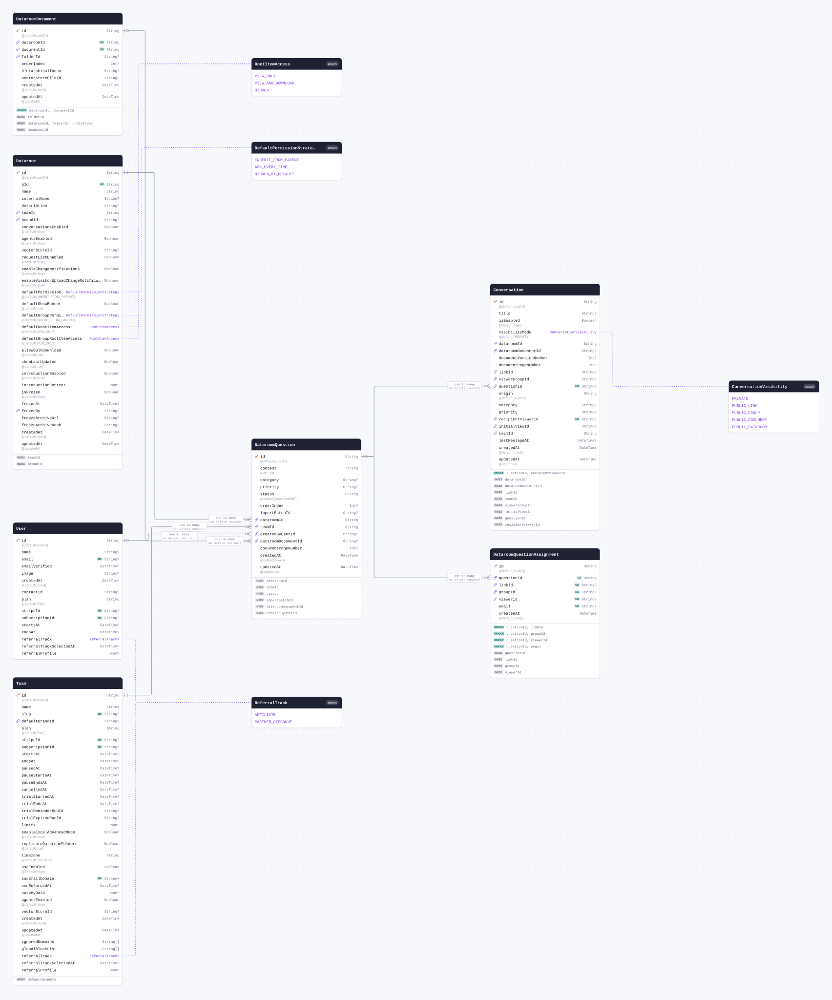

| Field                | Type                | Constraints                                           | Default        | Description |
| -------------------- | ------------------- | ----------------------------------------------------- | -------------- | ----------- |
| `id`                 | `String`            | PK NOT NULL                                           | `cuid(1)`      |             |
| `content`            | `String` `@db.Text` | NOT NULL                                              |                |             |
| `category`           | `String`            | NULL                                                  |                |             |
| `priority`           | `String`            | NULL                                                  |                |             |
| `status`             | `String`            | NOT NULL                                              | `"unanswered"` |             |
| `orderIndex`         | `Int`               | NULL                                                  |                |             |
| `importBatchId`      | `String`            | NULL                                                  |                |             |
| `dataroomId`         | `String`            | NOT NULL → [Dataroom.id](#model-Dataroom)             |                |             |
| `teamId`             | `String`            | NOT NULL → [Team.id](#model-Team)                     |                |             |
| `createdByUserId`    | `String`            | NULL → [User.id](#model-User)                         |                |             |
| `dataroomDocumentId` | `String`            | NULL → [DataroomDocument.id](#model-DataroomDocument) |                |             |
| `documentPageNumber` | `Int`               | NULL                                                  |                |             |
| `createdAt`          | `DateTime`          | NOT NULL                                              | `now()`        |             |
| `updatedAt`          | `DateTime`          | NOT NULL                                              | `@updatedAt`   |             |

#### Indexes

- `@@index([dataroomId])`
- `@@index([teamId])`
- `@@index([status])`
- `@@index([importBatchId])`
- `@@index([dataroomDocumentId])`
- `@@index([createdByUserId])`

#### References

- `dataroomId` → [Dataroom.id](#model-Dataroom) (many-to-one, on delete Cascade)
- `teamId` → [Team.id](#model-Team) (many-to-one, on delete Cascade)
- `createdByUserId` → [User.id](#model-User) (many-to-one, on delete SetNull)
- `dataroomDocumentId` → [DataroomDocument.id](#model-DataroomDocument) (many-to-one, on delete SetNull)

#### Referenced by

- `id` ← [Conversation.questionId](#model-Conversation) (one-to-many, on delete Cascade)
- `id` ← [DataroomQuestionAssignment.questionId](#model-DataroomQuestionAssignment) (one-to-many, on delete Cascade)

#### Definition

```sql
CREATE TABLE "DataroomQuestion" (
    "id" TEXT NOT NULL,
    "content" TEXT NOT NULL,
    "category" TEXT,
    "priority" TEXT,
    "status" TEXT NOT NULL DEFAULT 'unanswered',
    "orderIndex" INTEGER,
    "importBatchId" TEXT,
    "dataroomId" TEXT NOT NULL,
    "teamId" TEXT NOT NULL,
    "createdByUserId" TEXT,
    "dataroomDocumentId" TEXT,
    "documentPageNumber" INTEGER,
    "createdAt" TIMESTAMP(3) NOT NULL DEFAULT CURRENT_TIMESTAMP,
    "updatedAt" TIMESTAMP(3) NOT NULL,

    CONSTRAINT "DataroomQuestion_pkey" PRIMARY KEY ("id")
);

CREATE INDEX "DataroomQuestion_dataroomId_idx" ON "DataroomQuestion"("dataroomId");

CREATE INDEX "DataroomQuestion_teamId_idx" ON "DataroomQuestion"("teamId");

CREATE INDEX "DataroomQuestion_status_idx" ON "DataroomQuestion"("status");

CREATE INDEX "DataroomQuestion_importBatchId_idx" ON "DataroomQuestion"("importBatchId");

CREATE INDEX "DataroomQuestion_dataroomDocumentId_idx" ON "DataroomQuestion"("dataroomDocumentId");

CREATE INDEX "DataroomQuestion_createdByUserId_idx" ON "DataroomQuestion"("createdByUserId");

ALTER TABLE "DataroomQuestion" ADD CONSTRAINT "DataroomQuestion_dataroomId_fkey" FOREIGN KEY ("dataroomId") REFERENCES "Dataroom"("id") ON DELETE CASCADE ON UPDATE CASCADE;

ALTER TABLE "DataroomQuestion" ADD CONSTRAINT "DataroomQuestion_teamId_fkey" FOREIGN KEY ("teamId") REFERENCES "Team"("id") ON DELETE CASCADE ON UPDATE CASCADE;

ALTER TABLE "DataroomQuestion" ADD CONSTRAINT "DataroomQuestion_createdByUserId_fkey" FOREIGN KEY ("createdByUserId") REFERENCES "User"("id") ON DELETE SET NULL ON UPDATE CASCADE;

ALTER TABLE "DataroomQuestion" ADD CONSTRAINT "DataroomQuestion_dataroomDocumentId_fkey" FOREIGN KEY ("dataroomDocumentId") REFERENCES "DataroomDocument"("id") ON DELETE SET NULL ON UPDATE CASCADE;
```

<details>
<summary>Queries and their SQL</summary>

**findMany**: Every row

```ts
await prisma.dataroomQuestion.findMany();
```

```sql
SELECT
  "public"."DataroomQuestion"."id",
  "public"."DataroomQuestion"."content",
  "public"."DataroomQuestion"."category",
  "public"."DataroomQuestion"."priority",
  "public"."DataroomQuestion"."status",
  "public"."DataroomQuestion"."orderIndex",
  "public"."DataroomQuestion"."importBatchId",
  "public"."DataroomQuestion"."dataroomId",
  "public"."DataroomQuestion"."teamId",
  "public"."DataroomQuestion"."createdByUserId",
  "public"."DataroomQuestion"."dataroomDocumentId",
  "public"."DataroomQuestion"."documentPageNumber",
  "public"."DataroomQuestion"."createdAt",
  "public"."DataroomQuestion"."updatedAt"
FROM
  "public"."DataroomQuestion"
WHERE
  1 = 1
OFFSET
  $1
-- params: ["0"]
```

**count**: How many rows there are

```ts
await prisma.dataroomQuestion.count();
```

```sql
SELECT
  COUNT(*) AS "_count$_all"
FROM
  (
    SELECT
      "public"."DataroomQuestion"."id"
    FROM
      "public"."DataroomQuestion"
    WHERE
      1 = 1
    OFFSET
      $1
  ) AS "sub"
-- params: ["0"]
```

**findMany**: Every row with its relations

```ts
await prisma.dataroomQuestion.findMany({
  include: {
    dataroom: true,
    team: true,
    createdByUser: true,
    dataroomDocument: true,
    assignments: true,
    conversations: true,
  },
});
```

```sql
SELECT
  "public"."DataroomQuestion"."id",
  "public"."DataroomQuestion"."content",
  "public"."DataroomQuestion"."category",
  "public"."DataroomQuestion"."priority",
  "public"."DataroomQuestion"."status",
  "public"."DataroomQuestion"."orderIndex",
  "public"."DataroomQuestion"."importBatchId",
  "public"."DataroomQuestion"."dataroomId",
  "public"."DataroomQuestion"."teamId",
  "public"."DataroomQuestion"."createdByUserId",
  "public"."DataroomQuestion"."dataroomDocumentId",
  "public"."DataroomQuestion"."documentPageNumber",
  "public"."DataroomQuestion"."createdAt",
  "public"."DataroomQuestion"."updatedAt"
FROM
  "public"."DataroomQuestion"
WHERE
  1 = 1
OFFSET
  $1
-- params: ["0"]

SELECT
  "public"."Dataroom"."id",
  "public"."Dataroom"."pId",
  "public"."Dataroom"."name",
  "public"."Dataroom"."internalName",
  "public"."Dataroom"."description",
  "public"."Dataroom"."teamId",
  "public"."Dataroom"."brandId",
  "public"."Dataroom"."conversationsEnabled",
  "public"."Dataroom"."agentsEnabled",
  "public"."Dataroom"."vectorStoreId",
  "public"."Dataroom"."requestListEnabled",
  "public"."Dataroom"."enableChangeNotifications",
  "public"."Dataroom"."enableVisitorUploadChangeNotifications",
  "public"."Dataroom"."defaultPermissionStrategy"::text,
  "public"."Dataroom"."defaultShowBanner",
  "public"."Dataroom"."defaultGroupPermissionStrategy"::text,
  "public"."Dataroom"."defaultRootItemAccess"::text,
  "public"."Dataroom"."defaultGroupRootItemAccess"::text,
  "public"."Dataroom"."allowBulkDownload",
  "public"."Dataroom"."showLastUpdated",
  "public"."Dataroom"."introductionEnabled",
  "public"."Dataroom"."introductionContent",
  "public"."Dataroom"."isFrozen",
  "public"."Dataroom"."frozenAt",
  "public"."Dataroom"."frozenBy",
  "public"."Dataroom"."freezeArchiveUrl",
  "public"."Dataroom"."freezeArchiveHash",
  "public"."Dataroom"."createdAt",
  "public"."Dataroom"."updatedAt"
FROM
  "public"."Dataroom"
WHERE
  "public"."Dataroom"."id" IN ($1)
OFFSET
  $2
-- params: ["<dataroomId of the rows above>","0"]

SELECT
  "public"."Team"."id",
  "public"."Team"."name",
  "public"."Team"."slug",
  "public"."Team"."defaultBrandId",
  "public"."Team"."plan",
  "public"."Team"."stripeId",
  "public"."Team"."subscriptionId",
  "public"."Team"."startsAt",
  "public"."Team"."endsAt",
  "public"."Team"."pausedAt",
  "public"."Team"."pauseStartsAt",
  "public"."Team"."pauseEndsAt",
  "public"."Team"."cancelledAt",
  "public"."Team"."trialStartedAt",
  "public"."Team"."trialEndsAt",
  "public"."Team"."trialReminderRunId",
  "public"."Team"."trialExpiredRunId",
  "public"."Team"."limits",
  "public"."Team"."enableExcelAdvancedMode",
  "public"."Team"."replicateDataroomFolders",
  "public"."Team"."timezone",
  "public"."Team"."ssoEnabled",
  "public"."Team"."ssoEmailDomain",
  "public"."Team"."ssoEnforcedAt",
  "public"."Team"."surveyData",
  "public"."Team"."agentsEnabled",
  "public"."Team"."vectorStoreId",
  "public"."Team"."createdAt",
  "public"."Team"."updatedAt",
  "public"."Team"."ignoredDomains",
  "public"."Team"."globalBlockList",
  "public"."Team"."referralTrack"::text,
  "public"."Team"."referralTrackSelectedAt",
  "public"."Team"."referralProfile"
FROM
  "public"."Team"
WHERE
  "public"."Team"."id" IN ($1)
OFFSET
  $2
-- params: ["<teamId of the rows above>","0"]

SELECT
  "public"."User"."id",
  "public"."User"."name",
  "public"."User"."email",
  "public"."User"."emailVerified",
  "public"."User"."image",
  "public"."User"."createdAt",
  "public"."User"."contactId",
  "public"."User"."plan",
  "public"."User"."stripeId",
  "public"."User"."subscriptionId",
  "public"."User"."startsAt",
  "public"."User"."endsAt",
  "public"."User"."referralTrack"::text,
  "public"."User"."referralTrackSelectedAt",
  "public"."User"."referralProfile"
FROM
  "public"."User"
WHERE
  "public"."User"."id" IN ($1)
OFFSET
  $2
-- params: ["<createdByUserId of the rows above>","0"]

SELECT
  "public"."DataroomDocument"."id",
  "public"."DataroomDocument"."dataroomId",
  "public"."DataroomDocument"."documentId",
  "public"."DataroomDocument"."folderId",
  "public"."DataroomDocument"."orderIndex",
  "public"."DataroomDocument"."hierarchicalIndex",
  "public"."DataroomDocument"."vectorStoreFileId",
  "public"."DataroomDocument"."createdAt",
  "public"."DataroomDocument"."updatedAt"
FROM
  "public"."DataroomDocument"
WHERE
  "public"."DataroomDocument"."id" IN ($1)
OFFSET
  $2
-- params: ["<dataroomDocumentId of the rows above>","0"]

SELECT
  "public"."DataroomQuestionAssignment"."id",
  "public"."DataroomQuestionAssignment"."questionId",
  "public"."DataroomQuestionAssignment"."linkId",
  "public"."DataroomQuestionAssignment"."groupId",
  "public"."DataroomQuestionAssignment"."viewerId",
  "public"."DataroomQuestionAssignment"."email",
  "public"."DataroomQuestionAssignment"."createdAt"
FROM
  "public"."DataroomQuestionAssignment"
WHERE
  "public"."DataroomQuestionAssignment"."questionId" IN ($1)
OFFSET
  $2
-- params: ["<id of the rows above>","0"]

SELECT
  "public"."Conversation"."id",
  "public"."Conversation"."title",
  "public"."Conversation"."isEnabled",
  "public"."Conversation"."visibilityMode"::text,
  "public"."Conversation"."dataroomId",
  "public"."Conversation"."dataroomDocumentId",
  "public"."Conversation"."documentVersionNumber",
  "public"."Conversation"."documentPageNumber",
  "public"."Conversation"."linkId",
  "public"."Conversation"."viewerGroupId",
  "public"."Conversation"."questionId",
  "public"."Conversation"."origin",
  "public"."Conversation"."category",
  "public"."Conversation"."priority",
  "public"."Conversation"."recipientViewerId",
  "public"."Conversation"."initialViewId",
  "public"."Conversation"."teamId",
  "public"."Conversation"."lastMessageAt",
  "public"."Conversation"."createdAt",
  "public"."Conversation"."updatedAt"
FROM
  "public"."Conversation"
WHERE
  "public"."Conversation"."questionId" IN ($1)
OFFSET
  $2
-- params: ["<id of the rows above>","0"]
```

**findUnique**: One row by what is unique to it

```ts
await prisma.dataroomQuestion.findUnique({ where: { id: "example" } });
```

```sql
SELECT
  "public"."DataroomQuestion"."id",
  "public"."DataroomQuestion"."content",
  "public"."DataroomQuestion"."category",
  "public"."DataroomQuestion"."priority",
  "public"."DataroomQuestion"."status",
  "public"."DataroomQuestion"."orderIndex",
  "public"."DataroomQuestion"."importBatchId",
  "public"."DataroomQuestion"."dataroomId",
  "public"."DataroomQuestion"."teamId",
  "public"."DataroomQuestion"."createdByUserId",
  "public"."DataroomQuestion"."dataroomDocumentId",
  "public"."DataroomQuestion"."documentPageNumber",
  "public"."DataroomQuestion"."createdAt",
  "public"."DataroomQuestion"."updatedAt"
FROM
  "public"."DataroomQuestion"
WHERE
  (
    "public"."DataroomQuestion"."id" = $1
    AND 1 = 1
  )
LIMIT
  $2
OFFSET
  $3
-- params: ["example","1","0"]
```

**create**: Create a row

```ts
await prisma.dataroomQuestion.create({
  data: { content: "example", dataroomId: "example", teamId: "example" },
});
```

```sql
INSERT INTO
  "public"."DataroomQuestion" (
    "id",
    "content",
    "status",
    "dataroomId",
    "teamId",
    "createdAt",
    "updatedAt"
  )
VALUES
  ($1, $2, $3, $4, $5, $6, $7)
RETURNING
  "public"."DataroomQuestion"."id",
  "public"."DataroomQuestion"."content",
  "public"."DataroomQuestion"."category",
  "public"."DataroomQuestion"."priority",
  "public"."DataroomQuestion"."status",
  "public"."DataroomQuestion"."orderIndex",
  "public"."DataroomQuestion"."importBatchId",
  "public"."DataroomQuestion"."dataroomId",
  "public"."DataroomQuestion"."teamId",
  "public"."DataroomQuestion"."createdByUserId",
  "public"."DataroomQuestion"."dataroomDocumentId",
  "public"."DataroomQuestion"."documentPageNumber",
  "public"."DataroomQuestion"."createdAt",
  "public"."DataroomQuestion"."updatedAt"
-- params: ["<cuid(1)>","example","unanswered","example","example","<now()>","<now()>"]
```

**update**: Update a row

```ts
await prisma.dataroomQuestion.update({ where: { id: "example" }, data: { content: "example" } });
```

```sql
UPDATE "public"."DataroomQuestion"
SET
  "content" = $1,
  "updatedAt" = $2
WHERE
  (
    "public"."DataroomQuestion"."id" = $3
    AND 1 = 1
  )
RETURNING
  "public"."DataroomQuestion"."id",
  "public"."DataroomQuestion"."content",
  "public"."DataroomQuestion"."category",
  "public"."DataroomQuestion"."priority",
  "public"."DataroomQuestion"."status",
  "public"."DataroomQuestion"."orderIndex",
  "public"."DataroomQuestion"."importBatchId",
  "public"."DataroomQuestion"."dataroomId",
  "public"."DataroomQuestion"."teamId",
  "public"."DataroomQuestion"."createdByUserId",
  "public"."DataroomQuestion"."dataroomDocumentId",
  "public"."DataroomQuestion"."documentPageNumber",
  "public"."DataroomQuestion"."createdAt",
  "public"."DataroomQuestion"."updatedAt"
-- params: ["example",{"prisma__type":"generatorCall","prisma__value":{"name":"now","args":[],"returnType":{"type":"DateTime"}}},"example"]
```

**delete**: Delete a row

```ts
await prisma.dataroomQuestion.delete({ where: { id: "example" } });
```

```sql
DELETE FROM "public"."DataroomQuestion"
WHERE
  (
    "public"."DataroomQuestion"."id" = $1
    AND 1 = 1
  )
RETURNING
  "public"."DataroomQuestion"."id",
  "public"."DataroomQuestion"."content",
  "public"."DataroomQuestion"."category",
  "public"."DataroomQuestion"."priority",
  "public"."DataroomQuestion"."status",
  "public"."DataroomQuestion"."orderIndex",
  "public"."DataroomQuestion"."importBatchId",
  "public"."DataroomQuestion"."dataroomId",
  "public"."DataroomQuestion"."teamId",
  "public"."DataroomQuestion"."createdByUserId",
  "public"."DataroomQuestion"."dataroomDocumentId",
  "public"."DataroomQuestion"."documentPageNumber",
  "public"."DataroomQuestion"."createdAt",
  "public"."DataroomQuestion"."updatedAt"
-- params: ["example"]
```

</details>

<a id="model-DataroomQuestionAssignment"></a>

### DataroomQuestionAssignment

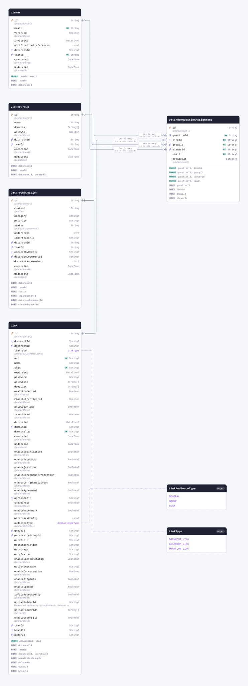

| Field        | Type       | Constraints                                               | Default   | Description |
| ------------ | ---------- | --------------------------------------------------------- | --------- | ----------- |
| `id`         | `String`   | PK NOT NULL                                               | `cuid(1)` |             |
| `questionId` | `String`   | NOT NULL → [DataroomQuestion.id](#model-DataroomQuestion) |           |             |
| `linkId`     | `String`   | NULL → [Link.id](#model-Link)                             |           |             |
| `groupId`    | `String`   | NULL → [ViewerGroup.id](#model-ViewerGroup)               |           |             |
| `viewerId`   | `String`   | NULL → [Viewer.id](#model-Viewer)                         |           |             |
| `email`      | `String`   | NULL                                                      |           |             |
| `createdAt`  | `DateTime` | NOT NULL                                                  | `now()`   |             |

#### Indexes

- `@@index([questionId])`
- `@@index([linkId])`
- `@@index([groupId])`
- `@@index([viewerId])`
- `@@unique([questionId, linkId])`
- `@@unique([questionId, groupId])`
- `@@unique([questionId, viewerId])`
- `@@unique([questionId, email])`

#### References

- `questionId` → [DataroomQuestion.id](#model-DataroomQuestion) (many-to-one, on delete Cascade)
- `linkId` → [Link.id](#model-Link) (many-to-one, on delete Cascade)
- `groupId` → [ViewerGroup.id](#model-ViewerGroup) (many-to-one, on delete Cascade)
- `viewerId` → [Viewer.id](#model-Viewer) (many-to-one, on delete Cascade)

#### Definition

```sql
CREATE TABLE "DataroomQuestionAssignment" (
    "id" TEXT NOT NULL,
    "questionId" TEXT NOT NULL,
    "linkId" TEXT,
    "groupId" TEXT,
    "viewerId" TEXT,
    "email" TEXT,
    "createdAt" TIMESTAMP(3) NOT NULL DEFAULT CURRENT_TIMESTAMP,

    CONSTRAINT "DataroomQuestionAssignment_pkey" PRIMARY KEY ("id")
);

CREATE INDEX "DataroomQuestionAssignment_questionId_idx" ON "DataroomQuestionAssignment"("questionId");

CREATE INDEX "DataroomQuestionAssignment_linkId_idx" ON "DataroomQuestionAssignment"("linkId");

CREATE INDEX "DataroomQuestionAssignment_groupId_idx" ON "DataroomQuestionAssignment"("groupId");

CREATE INDEX "DataroomQuestionAssignment_viewerId_idx" ON "DataroomQuestionAssignment"("viewerId");

CREATE UNIQUE INDEX "DataroomQuestionAssignment_questionId_linkId_key" ON "DataroomQuestionAssignment"("questionId", "linkId");

CREATE UNIQUE INDEX "DataroomQuestionAssignment_questionId_groupId_key" ON "DataroomQuestionAssignment"("questionId", "groupId");

CREATE UNIQUE INDEX "DataroomQuestionAssignment_questionId_viewerId_key" ON "DataroomQuestionAssignment"("questionId", "viewerId");

CREATE UNIQUE INDEX "DataroomQuestionAssignment_questionId_email_key" ON "DataroomQuestionAssignment"("questionId", "email");

ALTER TABLE "DataroomQuestionAssignment" ADD CONSTRAINT "DataroomQuestionAssignment_questionId_fkey" FOREIGN KEY ("questionId") REFERENCES "DataroomQuestion"("id") ON DELETE CASCADE ON UPDATE CASCADE;

ALTER TABLE "DataroomQuestionAssignment" ADD CONSTRAINT "DataroomQuestionAssignment_linkId_fkey" FOREIGN KEY ("linkId") REFERENCES "Link"("id") ON DELETE CASCADE ON UPDATE CASCADE;

ALTER TABLE "DataroomQuestionAssignment" ADD CONSTRAINT "DataroomQuestionAssignment_groupId_fkey" FOREIGN KEY ("groupId") REFERENCES "ViewerGroup"("id") ON DELETE CASCADE ON UPDATE CASCADE;

ALTER TABLE "DataroomQuestionAssignment" ADD CONSTRAINT "DataroomQuestionAssignment_viewerId_fkey" FOREIGN KEY ("viewerId") REFERENCES "Viewer"("id") ON DELETE CASCADE ON UPDATE CASCADE;
```

<details>
<summary>Queries and their SQL</summary>

**findMany**: Every row

```ts
await prisma.dataroomQuestionAssignment.findMany();
```

```sql
SELECT
  "public"."DataroomQuestionAssignment"."id",
  "public"."DataroomQuestionAssignment"."questionId",
  "public"."DataroomQuestionAssignment"."linkId",
  "public"."DataroomQuestionAssignment"."groupId",
  "public"."DataroomQuestionAssignment"."viewerId",
  "public"."DataroomQuestionAssignment"."email",
  "public"."DataroomQuestionAssignment"."createdAt"
FROM
  "public"."DataroomQuestionAssignment"
WHERE
  1 = 1
OFFSET
  $1
-- params: ["0"]
```

**count**: How many rows there are

```ts
await prisma.dataroomQuestionAssignment.count();
```

```sql
SELECT
  COUNT(*) AS "_count$_all"
FROM
  (
    SELECT
      "public"."DataroomQuestionAssignment"."id"
    FROM
      "public"."DataroomQuestionAssignment"
    WHERE
      1 = 1
    OFFSET
      $1
  ) AS "sub"
-- params: ["0"]
```

**findMany**: Every row with its relations

```ts
await prisma.dataroomQuestionAssignment.findMany({
  include: { question: true, link: true, group: true, viewer: true },
});
```

```sql
SELECT
  "public"."DataroomQuestionAssignment"."id",
  "public"."DataroomQuestionAssignment"."questionId",
  "public"."DataroomQuestionAssignment"."linkId",
  "public"."DataroomQuestionAssignment"."groupId",
  "public"."DataroomQuestionAssignment"."viewerId",
  "public"."DataroomQuestionAssignment"."email",
  "public"."DataroomQuestionAssignment"."createdAt"
FROM
  "public"."DataroomQuestionAssignment"
WHERE
  1 = 1
OFFSET
  $1
-- params: ["0"]

SELECT
  "public"."DataroomQuestion"."id",
  "public"."DataroomQuestion"."content",
  "public"."DataroomQuestion"."category",
  "public"."DataroomQuestion"."priority",
  "public"."DataroomQuestion"."status",
  "public"."DataroomQuestion"."orderIndex",
  "public"."DataroomQuestion"."importBatchId",
  "public"."DataroomQuestion"."dataroomId",
  "public"."DataroomQuestion"."teamId",
  "public"."DataroomQuestion"."createdByUserId",
  "public"."DataroomQuestion"."dataroomDocumentId",
  "public"."DataroomQuestion"."documentPageNumber",
  "public"."DataroomQuestion"."createdAt",
  "public"."DataroomQuestion"."updatedAt"
FROM
  "public"."DataroomQuestion"
WHERE
  "public"."DataroomQuestion"."id" IN ($1)
OFFSET
  $2
-- params: ["<questionId of the rows above>","0"]

SELECT
  "public"."Link"."id",
  "public"."Link"."documentId",
  "public"."Link"."dataroomId",
  "public"."Link"."linkType"::text,
  "public"."Link"."url",
  "public"."Link"."name",
  "public"."Link"."slug",
  "public"."Link"."expiresAt",
  "public"."Link"."password",
  "public"."Link"."allowList",
  "public"."Link"."denyList",
  "public"."Link"."emailProtected",
  "public"."Link"."emailAuthenticated",
  "public"."Link"."allowDownload",
  "public"."Link"."isArchived",
  "public"."Link"."deletedAt",
  "public"."Link"."domainId",
  "public"."Link"."domainSlug",
  "public"."Link"."createdAt",
  "public"."Link"."updatedAt",
  "public"."Link"."enableNotification",
  "public"."Link"."enableFeedback",
  "public"."Link"."enableQuestion",
  "public"."Link"."enableScreenshotProtection",
  "public"."Link"."enableConfidentialView",
  "public"."Link"."enableAgreement",
  "public"."Link"."agreementId",
  "public"."Link"."showBanner",
  "public"."Link"."enableWatermark",
  "public"."Link"."watermarkConfig",
  "public"."Link"."audienceType"::text,
  "public"."Link"."groupId",
  "public"."Link"."permissionGroupId",
  "public"."Link"."metaTitle",
  "public"."Link"."metaDescription",
  "public"."Link"."metaImage",
  "public"."Link"."metaFavicon",
  "public"."Link"."enableCustomMetatag",
  "public"."Link"."welcomeMessage",
  "public"."Link"."enableConversation",
  "public"."Link"."enableAIAgents",
  "public"."Link"."enableUpload",
  "public"."Link"."isFileRequestOnly",
  "public"."Link"."uploadFolderId",
  "public"."Link"."uploadFolderIds",
  "public"."Link"."enableIndexFile",
  "public"."Link"."teamId",
  "public"."Link"."brandId",
  "public"."Link"."ownerId"
FROM
  "public"."Link"
WHERE
  "public"."Link"."id" IN ($1)
OFFSET
  $2
-- params: ["<linkId of the rows above>","0"]

SELECT
  "public"."ViewerGroup"."id",
  "public"."ViewerGroup"."name",
  "public"."ViewerGroup"."domains",
  "public"."ViewerGroup"."allowAll",
  "public"."ViewerGroup"."dataroomId",
  "public"."ViewerGroup"."teamId",
  "public"."ViewerGroup"."createdAt",
  "public"."ViewerGroup"."updatedAt"
FROM
  "public"."ViewerGroup"
WHERE
  "public"."ViewerGroup"."id" IN ($1)
OFFSET
  $2
-- params: ["<groupId of the rows above>","0"]

SELECT
  "public"."Viewer"."id",
  "public"."Viewer"."email",
  "public"."Viewer"."verified",
  "public"."Viewer"."invitedAt",
  "public"."Viewer"."notificationPreferences",
  "public"."Viewer"."dataroomId",
  "public"."Viewer"."teamId",
  "public"."Viewer"."createdAt",
  "public"."Viewer"."updatedAt"
FROM
  "public"."Viewer"
WHERE
  "public"."Viewer"."id" IN ($1)
OFFSET
  $2
-- params: ["<viewerId of the rows above>","0"]
```

**findUnique**: One row by what is unique to it

```ts
await prisma.dataroomQuestionAssignment.findUnique({ where: { id: "example" } });
```

```sql
SELECT
  "public"."DataroomQuestionAssignment"."id",
  "public"."DataroomQuestionAssignment"."questionId",
  "public"."DataroomQuestionAssignment"."linkId",
  "public"."DataroomQuestionAssignment"."groupId",
  "public"."DataroomQuestionAssignment"."viewerId",
  "public"."DataroomQuestionAssignment"."email",
  "public"."DataroomQuestionAssignment"."createdAt"
FROM
  "public"."DataroomQuestionAssignment"
WHERE
  (
    "public"."DataroomQuestionAssignment"."id" = $1
    AND 1 = 1
  )
LIMIT
  $2
OFFSET
  $3
-- params: ["example","1","0"]
```

**create**: Create a row

```ts
await prisma.dataroomQuestionAssignment.create({ data: { questionId: "example" } });
```

```sql
INSERT INTO
  "public"."DataroomQuestionAssignment" ("id", "questionId", "createdAt")
VALUES
  ($1, $2, $3)
RETURNING
  "public"."DataroomQuestionAssignment"."id",
  "public"."DataroomQuestionAssignment"."questionId",
  "public"."DataroomQuestionAssignment"."linkId",
  "public"."DataroomQuestionAssignment"."groupId",
  "public"."DataroomQuestionAssignment"."viewerId",
  "public"."DataroomQuestionAssignment"."email",
  "public"."DataroomQuestionAssignment"."createdAt"
-- params: ["<cuid(1)>","example","<now()>"]
```

**update**: Update a row

```ts
await prisma.dataroomQuestionAssignment.update({
  where: { id: "example" },
  data: { email: "example" },
});
```

```sql
UPDATE "public"."DataroomQuestionAssignment"
SET
  "email" = $1
WHERE
  (
    "public"."DataroomQuestionAssignment"."id" = $2
    AND 1 = 1
  )
RETURNING
  "public"."DataroomQuestionAssignment"."id",
  "public"."DataroomQuestionAssignment"."questionId",
  "public"."DataroomQuestionAssignment"."linkId",
  "public"."DataroomQuestionAssignment"."groupId",
  "public"."DataroomQuestionAssignment"."viewerId",
  "public"."DataroomQuestionAssignment"."email",
  "public"."DataroomQuestionAssignment"."createdAt"
-- params: ["example","example"]
```

**delete**: Delete a row

```ts
await prisma.dataroomQuestionAssignment.delete({ where: { id: "example" } });
```

```sql
DELETE FROM "public"."DataroomQuestionAssignment"
WHERE
  (
    "public"."DataroomQuestionAssignment"."id" = $1
    AND 1 = 1
  )
RETURNING
  "public"."DataroomQuestionAssignment"."id",
  "public"."DataroomQuestionAssignment"."questionId",
  "public"."DataroomQuestionAssignment"."linkId",
  "public"."DataroomQuestionAssignment"."groupId",
  "public"."DataroomQuestionAssignment"."viewerId",
  "public"."DataroomQuestionAssignment"."email",
  "public"."DataroomQuestionAssignment"."createdAt"
-- params: ["example"]
```

</details>

<a id="model-ConversationParticipant"></a>

### ConversationParticipant

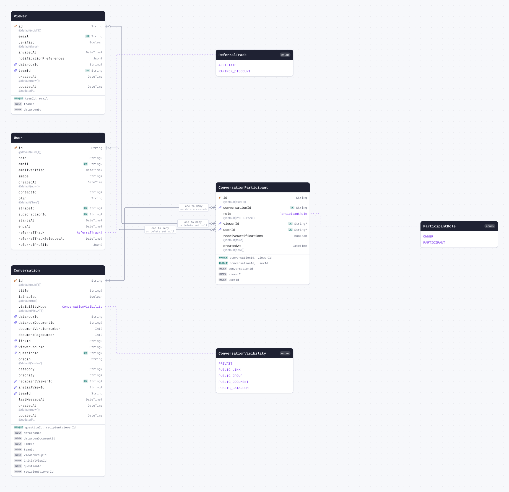

| Field                  | Type                                       | Constraints                                       | Default       | Description |
| ---------------------- | ------------------------------------------ | ------------------------------------------------- | ------------- | ----------- |
| `id`                   | `String`                                   | PK NOT NULL                                       | `cuid(1)`     |             |
| `conversationId`       | `String`                                   | NOT NULL → [Conversation.id](#model-Conversation) |               |             |
| `role`                 | [`ParticipantRole`](#enum-ParticipantRole) | NOT NULL                                          | `PARTICIPANT` |             |
| `viewerId`             | `String`                                   | NULL → [Viewer.id](#model-Viewer)                 |               |             |
| `userId`               | `String`                                   | NULL → [User.id](#model-User)                     |               |             |
| `receiveNotifications` | `Boolean`                                  | NOT NULL                                          | `false`       |             |
| `createdAt`            | `DateTime`                                 | NOT NULL                                          | `now()`       |             |

#### Indexes

- `@@index([conversationId])`
- `@@index([viewerId])`
- `@@index([userId])`
- `@@unique([conversationId, viewerId])`
- `@@unique([conversationId, userId])`

#### References

- `conversationId` → [Conversation.id](#model-Conversation) (many-to-one, on delete Cascade)
- `viewerId` → [Viewer.id](#model-Viewer) (many-to-one, on delete SetNull)
- `userId` → [User.id](#model-User) (many-to-one, on delete SetNull)

#### Definition

```sql
CREATE TABLE "ConversationParticipant" (
    "id" TEXT NOT NULL,
    "conversationId" TEXT NOT NULL,
    "role" "ParticipantRole" NOT NULL DEFAULT 'PARTICIPANT',
    "viewerId" TEXT,
    "userId" TEXT,
    "receiveNotifications" BOOLEAN NOT NULL DEFAULT false,
    "createdAt" TIMESTAMP(3) NOT NULL DEFAULT CURRENT_TIMESTAMP,

    CONSTRAINT "ConversationParticipant_pkey" PRIMARY KEY ("id")
);

CREATE INDEX "ConversationParticipant_conversationId_idx" ON "ConversationParticipant"("conversationId");

CREATE INDEX "ConversationParticipant_viewerId_idx" ON "ConversationParticipant"("viewerId");

CREATE INDEX "ConversationParticipant_userId_idx" ON "ConversationParticipant"("userId");

CREATE UNIQUE INDEX "ConversationParticipant_conversationId_viewerId_key" ON "ConversationParticipant"("conversationId", "viewerId");

CREATE UNIQUE INDEX "ConversationParticipant_conversationId_userId_key" ON "ConversationParticipant"("conversationId", "userId");

ALTER TABLE "ConversationParticipant" ADD CONSTRAINT "ConversationParticipant_conversationId_fkey" FOREIGN KEY ("conversationId") REFERENCES "Conversation"("id") ON DELETE CASCADE ON UPDATE CASCADE;

ALTER TABLE "ConversationParticipant" ADD CONSTRAINT "ConversationParticipant_viewerId_fkey" FOREIGN KEY ("viewerId") REFERENCES "Viewer"("id") ON DELETE SET NULL ON UPDATE CASCADE;

ALTER TABLE "ConversationParticipant" ADD CONSTRAINT "ConversationParticipant_userId_fkey" FOREIGN KEY ("userId") REFERENCES "User"("id") ON DELETE SET NULL ON UPDATE CASCADE;
```

<details>
<summary>Queries and their SQL</summary>

**findMany**: Every row

```ts
await prisma.conversationParticipant.findMany();
```

```sql
SELECT
  "public"."ConversationParticipant"."id",
  "public"."ConversationParticipant"."conversationId",
  "public"."ConversationParticipant"."role"::text,
  "public"."ConversationParticipant"."viewerId",
  "public"."ConversationParticipant"."userId",
  "public"."ConversationParticipant"."receiveNotifications",
  "public"."ConversationParticipant"."createdAt"
FROM
  "public"."ConversationParticipant"
WHERE
  1 = 1
OFFSET
  $1
-- params: ["0"]
```

**count**: How many rows there are

```ts
await prisma.conversationParticipant.count();
```

```sql
SELECT
  COUNT(*) AS "_count$_all"
FROM
  (
    SELECT
      "public"."ConversationParticipant"."id"
    FROM
      "public"."ConversationParticipant"
    WHERE
      1 = 1
    OFFSET
      $1
  ) AS "sub"
-- params: ["0"]
```

**findMany**: Every row with its relations

```ts
await prisma.conversationParticipant.findMany({
  include: { conversation: true, viewer: true, user: true },
});
```

```sql
SELECT
  "public"."ConversationParticipant"."id",
  "public"."ConversationParticipant"."conversationId",
  "public"."ConversationParticipant"."role"::text,
  "public"."ConversationParticipant"."viewerId",
  "public"."ConversationParticipant"."userId",
  "public"."ConversationParticipant"."receiveNotifications",
  "public"."ConversationParticipant"."createdAt"
FROM
  "public"."ConversationParticipant"
WHERE
  1 = 1
OFFSET
  $1
-- params: ["0"]

SELECT
  "public"."Conversation"."id",
  "public"."Conversation"."title",
  "public"."Conversation"."isEnabled",
  "public"."Conversation"."visibilityMode"::text,
  "public"."Conversation"."dataroomId",
  "public"."Conversation"."dataroomDocumentId",
  "public"."Conversation"."documentVersionNumber",
  "public"."Conversation"."documentPageNumber",
  "public"."Conversation"."linkId",
  "public"."Conversation"."viewerGroupId",
  "public"."Conversation"."questionId",
  "public"."Conversation"."origin",
  "public"."Conversation"."category",
  "public"."Conversation"."priority",
  "public"."Conversation"."recipientViewerId",
  "public"."Conversation"."initialViewId",
  "public"."Conversation"."teamId",
  "public"."Conversation"."lastMessageAt",
  "public"."Conversation"."createdAt",
  "public"."Conversation"."updatedAt"
FROM
  "public"."Conversation"
WHERE
  "public"."Conversation"."id" IN ($1)
OFFSET
  $2
-- params: ["<conversationId of the rows above>","0"]

SELECT
  "public"."Viewer"."id",
  "public"."Viewer"."email",
  "public"."Viewer"."verified",
  "public"."Viewer"."invitedAt",
  "public"."Viewer"."notificationPreferences",
  "public"."Viewer"."dataroomId",
  "public"."Viewer"."teamId",
  "public"."Viewer"."createdAt",
  "public"."Viewer"."updatedAt"
FROM
  "public"."Viewer"
WHERE
  "public"."Viewer"."id" IN ($1)
OFFSET
  $2
-- params: ["<viewerId of the rows above>","0"]

SELECT
  "public"."User"."id",
  "public"."User"."name",
  "public"."User"."email",
  "public"."User"."emailVerified",
  "public"."User"."image",
  "public"."User"."createdAt",
  "public"."User"."contactId",
  "public"."User"."plan",
  "public"."User"."stripeId",
  "public"."User"."subscriptionId",
  "public"."User"."startsAt",
  "public"."User"."endsAt",
  "public"."User"."referralTrack"::text,
  "public"."User"."referralTrackSelectedAt",
  "public"."User"."referralProfile"
FROM
  "public"."User"
WHERE
  "public"."User"."id" IN ($1)
OFFSET
  $2
-- params: ["<userId of the rows above>","0"]
```

**findUnique**: One row by what is unique to it

```ts
await prisma.conversationParticipant.findUnique({ where: { id: "example" } });
```

```sql
SELECT
  "public"."ConversationParticipant"."id",
  "public"."ConversationParticipant"."conversationId",
  "public"."ConversationParticipant"."role"::text,
  "public"."ConversationParticipant"."viewerId",
  "public"."ConversationParticipant"."userId",
  "public"."ConversationParticipant"."receiveNotifications",
  "public"."ConversationParticipant"."createdAt"
FROM
  "public"."ConversationParticipant"
WHERE
  (
    "public"."ConversationParticipant"."id" = $1
    AND 1 = 1
  )
LIMIT
  $2
OFFSET
  $3
-- params: ["example","1","0"]
```

**create**: Create a row

```ts
await prisma.conversationParticipant.create({ data: { conversationId: "example" } });
```

```sql
INSERT INTO
  "public"."ConversationParticipant" (
    "id",
    "conversationId",
    "role",
    "receiveNotifications",
    "createdAt"
  )
VALUES
  (
    $1,
    $2,
    CAST($3::text AS "public"."ParticipantRole"),
    $4,
    $5
  )
RETURNING
  "public"."ConversationParticipant"."id",
  "public"."ConversationParticipant"."conversationId",
  "public"."ConversationParticipant"."role"::text,
  "public"."ConversationParticipant"."viewerId",
  "public"."ConversationParticipant"."userId",
  "public"."ConversationParticipant"."receiveNotifications",
  "public"."ConversationParticipant"."createdAt"
-- params: ["<cuid(1)>","example","PARTICIPANT",false,"<now()>"]
```

**update**: Update a row

```ts
await prisma.conversationParticipant.update({ where: { id: "example" }, data: { role: "OWNER" } });
```

```sql
UPDATE "public"."ConversationParticipant"
SET
  "role" = CAST($1::text AS "public"."ParticipantRole")
WHERE
  (
    "public"."ConversationParticipant"."id" = $2
    AND 1 = 1
  )
RETURNING
  "public"."ConversationParticipant"."id",
  "public"."ConversationParticipant"."conversationId",
  "public"."ConversationParticipant"."role"::text,
  "public"."ConversationParticipant"."viewerId",
  "public"."ConversationParticipant"."userId",
  "public"."ConversationParticipant"."receiveNotifications",
  "public"."ConversationParticipant"."createdAt"
-- params: ["OWNER","example"]
```

**delete**: Delete a row

```ts
await prisma.conversationParticipant.delete({ where: { id: "example" } });
```

```sql
DELETE FROM "public"."ConversationParticipant"
WHERE
  (
    "public"."ConversationParticipant"."id" = $1
    AND 1 = 1
  )
RETURNING
  "public"."ConversationParticipant"."id",
  "public"."ConversationParticipant"."conversationId",
  "public"."ConversationParticipant"."role"::text,
  "public"."ConversationParticipant"."viewerId",
  "public"."ConversationParticipant"."userId",
  "public"."ConversationParticipant"."receiveNotifications",
  "public"."ConversationParticipant"."createdAt"
-- params: ["example"]
```

</details>

<a id="model-Message"></a>

### Message

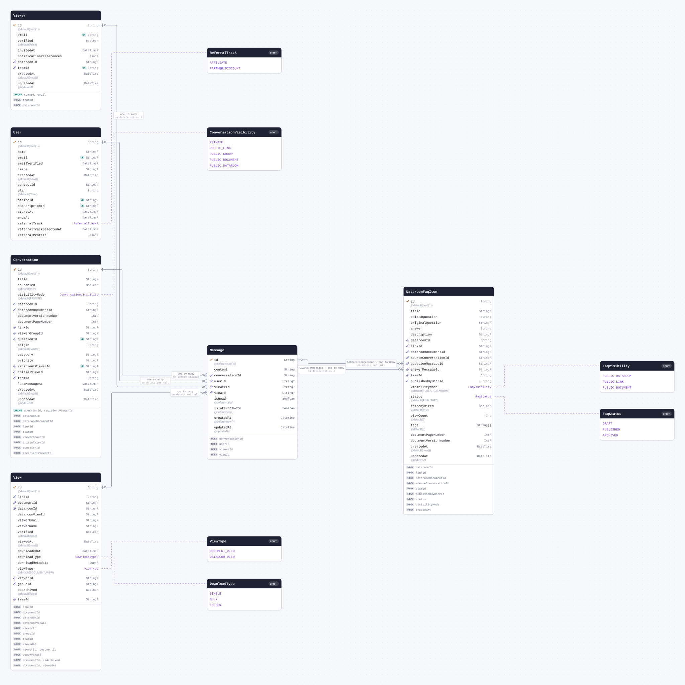

| Field            | Type       | Constraints                                       | Default      | Description |
| ---------------- | ---------- | ------------------------------------------------- | ------------ | ----------- |
| `id`             | `String`   | PK NOT NULL                                       | `cuid(1)`    |             |
| `content`        | `String`   | NOT NULL                                          |              |             |
| `conversationId` | `String`   | NOT NULL → [Conversation.id](#model-Conversation) |              |             |
| `userId`         | `String`   | NULL → [User.id](#model-User)                     |              |             |
| `viewerId`       | `String`   | NULL → [Viewer.id](#model-Viewer)                 |              |             |
| `viewId`         | `String`   | NULL → [View.id](#model-View)                     |              |             |
| `isRead`         | `Boolean`  | NOT NULL                                          | `false`      |             |
| `isInternalNote` | `Boolean`  | NOT NULL                                          | `false`      |             |
| `createdAt`      | `DateTime` | NOT NULL                                          | `now()`      |             |
| `updatedAt`      | `DateTime` | NOT NULL                                          | `@updatedAt` |             |

#### Indexes

- `@@index([conversationId])`
- `@@index([userId])`
- `@@index([viewerId])`
- `@@index([viewId])`

#### References

- `conversationId` → [Conversation.id](#model-Conversation) (many-to-one, on delete Cascade)
- `userId` → [User.id](#model-User) (many-to-one, on delete SetNull)
- `viewerId` → [Viewer.id](#model-Viewer) (many-to-one, on delete SetNull)
- `viewId` → [View.id](#model-View) (many-to-one, on delete SetNull)

#### Referenced by

- `id` ← [DataroomFaqItem.questionMessageId](#model-DataroomFaqItem) (one-to-many, on delete SetNull)
- `id` ← [DataroomFaqItem.answerMessageId](#model-DataroomFaqItem) (one-to-many, on delete SetNull)

#### Definition

```sql
CREATE TABLE "Message" (
    "id" TEXT NOT NULL,
    "content" TEXT NOT NULL,
    "conversationId" TEXT NOT NULL,
    "userId" TEXT,
    "viewerId" TEXT,
    "viewId" TEXT,
    "isRead" BOOLEAN NOT NULL DEFAULT false,
    "isInternalNote" BOOLEAN NOT NULL DEFAULT false,
    "createdAt" TIMESTAMP(3) NOT NULL DEFAULT CURRENT_TIMESTAMP,
    "updatedAt" TIMESTAMP(3) NOT NULL,

    CONSTRAINT "Message_pkey" PRIMARY KEY ("id")
);

CREATE INDEX "Message_conversationId_idx" ON "Message"("conversationId");

CREATE INDEX "Message_userId_idx" ON "Message"("userId");

CREATE INDEX "Message_viewerId_idx" ON "Message"("viewerId");

CREATE INDEX "Message_viewId_idx" ON "Message"("viewId");

ALTER TABLE "Message" ADD CONSTRAINT "Message_conversationId_fkey" FOREIGN KEY ("conversationId") REFERENCES "Conversation"("id") ON DELETE CASCADE ON UPDATE CASCADE;

ALTER TABLE "Message" ADD CONSTRAINT "Message_userId_fkey" FOREIGN KEY ("userId") REFERENCES "User"("id") ON DELETE SET NULL ON UPDATE CASCADE;

ALTER TABLE "Message" ADD CONSTRAINT "Message_viewerId_fkey" FOREIGN KEY ("viewerId") REFERENCES "Viewer"("id") ON DELETE SET NULL ON UPDATE CASCADE;

ALTER TABLE "Message" ADD CONSTRAINT "Message_viewId_fkey" FOREIGN KEY ("viewId") REFERENCES "View"("id") ON DELETE SET NULL ON UPDATE CASCADE;
```

<details>
<summary>Queries and their SQL</summary>

**findMany**: Every row

```ts
await prisma.message.findMany();
```

```sql
SELECT
  "public"."Message"."id",
  "public"."Message"."content",
  "public"."Message"."conversationId",
  "public"."Message"."userId",
  "public"."Message"."viewerId",
  "public"."Message"."viewId",
  "public"."Message"."isRead",
  "public"."Message"."isInternalNote",
  "public"."Message"."createdAt",
  "public"."Message"."updatedAt"
FROM
  "public"."Message"
WHERE
  1 = 1
OFFSET
  $1
-- params: ["0"]
```

**count**: How many rows there are

```ts
await prisma.message.count();
```

```sql
SELECT
  COUNT(*) AS "_count$_all"
FROM
  (
    SELECT
      "public"."Message"."id"
    FROM
      "public"."Message"
    WHERE
      1 = 1
    OFFSET
      $1
  ) AS "sub"
-- params: ["0"]
```

**findMany**: Every row with its relations

```ts
await prisma.message.findMany({
  include: {
    conversation: true,
    user: true,
    viewer: true,
    view: true,
    faqAsQuestion: true,
    faqAsAnswer: true,
  },
});
```

```sql
SELECT
  "public"."Message"."id",
  "public"."Message"."content",
  "public"."Message"."conversationId",
  "public"."Message"."userId",
  "public"."Message"."viewerId",
  "public"."Message"."viewId",
  "public"."Message"."isRead",
  "public"."Message"."isInternalNote",
  "public"."Message"."createdAt",
  "public"."Message"."updatedAt"
FROM
  "public"."Message"
WHERE
  1 = 1
OFFSET
  $1
-- params: ["0"]

SELECT
  "public"."Conversation"."id",
  "public"."Conversation"."title",
  "public"."Conversation"."isEnabled",
  "public"."Conversation"."visibilityMode"::text,
  "public"."Conversation"."dataroomId",
  "public"."Conversation"."dataroomDocumentId",
  "public"."Conversation"."documentVersionNumber",
  "public"."Conversation"."documentPageNumber",
  "public"."Conversation"."linkId",
  "public"."Conversation"."viewerGroupId",
  "public"."Conversation"."questionId",
  "public"."Conversation"."origin",
  "public"."Conversation"."category",
  "public"."Conversation"."priority",
  "public"."Conversation"."recipientViewerId",
  "public"."Conversation"."initialViewId",
  "public"."Conversation"."teamId",
  "public"."Conversation"."lastMessageAt",
  "public"."Conversation"."createdAt",
  "public"."Conversation"."updatedAt"
FROM
  "public"."Conversation"
WHERE
  "public"."Conversation"."id" IN ($1)
OFFSET
  $2
-- params: ["<conversationId of the rows above>","0"]

SELECT
  "public"."User"."id",
  "public"."User"."name",
  "public"."User"."email",
  "public"."User"."emailVerified",
  "public"."User"."image",
  "public"."User"."createdAt",
  "public"."User"."contactId",
  "public"."User"."plan",
  "public"."User"."stripeId",
  "public"."User"."subscriptionId",
  "public"."User"."startsAt",
  "public"."User"."endsAt",
  "public"."User"."referralTrack"::text,
  "public"."User"."referralTrackSelectedAt",
  "public"."User"."referralProfile"
FROM
  "public"."User"
WHERE
  "public"."User"."id" IN ($1)
OFFSET
  $2
-- params: ["<userId of the rows above>","0"]

SELECT
  "public"."Viewer"."id",
  "public"."Viewer"."email",
  "public"."Viewer"."verified",
  "public"."Viewer"."invitedAt",
  "public"."Viewer"."notificationPreferences",
  "public"."Viewer"."dataroomId",
  "public"."Viewer"."teamId",
  "public"."Viewer"."createdAt",
  "public"."Viewer"."updatedAt"
FROM
  "public"."Viewer"
WHERE
  "public"."Viewer"."id" IN ($1)
OFFSET
  $2
-- params: ["<viewerId of the rows above>","0"]

SELECT
  "public"."View"."id",
  "public"."View"."linkId",
  "public"."View"."documentId",
  "public"."View"."dataroomId",
  "public"."View"."dataroomViewId",
  "public"."View"."viewerEmail",
  "public"."View"."viewerName",
  "public"."View"."verified",
  "public"."View"."viewedAt",
  "public"."View"."downloadedAt",
  "public"."View"."downloadType"::text,
  "public"."View"."downloadMetadata",
  "public"."View"."viewType"::text,
  "public"."View"."viewerId",
  "public"."View"."groupId",
  "public"."View"."isArchived",
  "public"."View"."teamId"
FROM
  "public"."View"
WHERE
  "public"."View"."id" IN ($1)
OFFSET
  $2
-- params: ["<viewId of the rows above>","0"]

SELECT
  "public"."DataroomFaqItem"."id",
  "public"."DataroomFaqItem"."title",
  "public"."DataroomFaqItem"."editedQuestion",
  "public"."DataroomFaqItem"."originalQuestion",
  "public"."DataroomFaqItem"."answer",
  "public"."DataroomFaqItem"."description",
  "public"."DataroomFaqItem"."dataroomId",
  "public"."DataroomFaqItem"."linkId",
  "public"."DataroomFaqItem"."dataroomDocumentId",
  "public"."DataroomFaqItem"."sourceConversationId",
  "public"."DataroomFaqItem"."questionMessageId",
  "public"."DataroomFaqItem"."answerMessageId",
  "public"."DataroomFaqItem"."teamId",
  "public"."DataroomFaqItem"."publishedByUserId",
  "public"."DataroomFaqItem"."visibilityMode"::text,
  "public"."DataroomFaqItem"."status"::text,
  "public"."DataroomFaqItem"."isAnonymized",
  "public"."DataroomFaqItem"."viewCount",
  "public"."DataroomFaqItem"."tags",
  "public"."DataroomFaqItem"."documentPageNumber",
  "public"."DataroomFaqItem"."documentVersionNumber",
  "public"."DataroomFaqItem"."createdAt",
  "public"."DataroomFaqItem"."updatedAt"
FROM
  "public"."DataroomFaqItem"
WHERE
  "public"."DataroomFaqItem"."questionMessageId" IN ($1)
OFFSET
  $2
-- params: ["<id of the rows above>","0"]

SELECT
  "public"."DataroomFaqItem"."id",
  "public"."DataroomFaqItem"."title",
  "public"."DataroomFaqItem"."editedQuestion",
  "public"."DataroomFaqItem"."originalQuestion",
  "public"."DataroomFaqItem"."answer",
  "public"."DataroomFaqItem"."description",
  "public"."DataroomFaqItem"."dataroomId",
  "public"."DataroomFaqItem"."linkId",
  "public"."DataroomFaqItem"."dataroomDocumentId",
  "public"."DataroomFaqItem"."sourceConversationId",
  "public"."DataroomFaqItem"."questionMessageId",
  "public"."DataroomFaqItem"."answerMessageId",
  "public"."DataroomFaqItem"."teamId",
  "public"."DataroomFaqItem"."publishedByUserId",
  "public"."DataroomFaqItem"."visibilityMode"::text,
  "public"."DataroomFaqItem"."status"::text,
  "public"."DataroomFaqItem"."isAnonymized",
  "public"."DataroomFaqItem"."viewCount",
  "public"."DataroomFaqItem"."tags",
  "public"."DataroomFaqItem"."documentPageNumber",
  "public"."DataroomFaqItem"."documentVersionNumber",
  "public"."DataroomFaqItem"."createdAt",
  "public"."DataroomFaqItem"."updatedAt"
FROM
  "public"."DataroomFaqItem"
WHERE
  "public"."DataroomFaqItem"."answerMessageId" IN ($1)
OFFSET
  $2
-- params: ["<id of the rows above>","0"]
```

**findUnique**: One row by what is unique to it

```ts
await prisma.message.findUnique({ where: { id: "example" } });
```

```sql
SELECT
  "public"."Message"."id",
  "public"."Message"."content",
  "public"."Message"."conversationId",
  "public"."Message"."userId",
  "public"."Message"."viewerId",
  "public"."Message"."viewId",
  "public"."Message"."isRead",
  "public"."Message"."isInternalNote",
  "public"."Message"."createdAt",
  "public"."Message"."updatedAt"
FROM
  "public"."Message"
WHERE
  (
    "public"."Message"."id" = $1
    AND 1 = 1
  )
LIMIT
  $2
OFFSET
  $3
-- params: ["example","1","0"]
```

**create**: Create a row

```ts
await prisma.message.create({ data: { content: "example", conversationId: "example" } });
```

```sql
INSERT INTO
  "public"."Message" (
    "id",
    "content",
    "conversationId",
    "isRead",
    "isInternalNote",
    "createdAt",
    "updatedAt"
  )
VALUES
  ($1, $2, $3, $4, $5, $6, $7)
RETURNING
  "public"."Message"."id",
  "public"."Message"."content",
  "public"."Message"."conversationId",
  "public"."Message"."userId",
  "public"."Message"."viewerId",
  "public"."Message"."viewId",
  "public"."Message"."isRead",
  "public"."Message"."isInternalNote",
  "public"."Message"."createdAt",
  "public"."Message"."updatedAt"
-- params: ["<cuid(1)>","example","example",false,false,"<now()>","<now()>"]
```

**update**: Update a row

```ts
await prisma.message.update({ where: { id: "example" }, data: { content: "example" } });
```

```sql
UPDATE "public"."Message"
SET
  "content" = $1,
  "updatedAt" = $2
WHERE
  (
    "public"."Message"."id" = $3
    AND 1 = 1
  )
RETURNING
  "public"."Message"."id",
  "public"."Message"."content",
  "public"."Message"."conversationId",
  "public"."Message"."userId",
  "public"."Message"."viewerId",
  "public"."Message"."viewId",
  "public"."Message"."isRead",
  "public"."Message"."isInternalNote",
  "public"."Message"."createdAt",
  "public"."Message"."updatedAt"
-- params: ["example",{"prisma__type":"generatorCall","prisma__value":{"name":"now","args":[],"returnType":{"type":"DateTime"}}},"example"]
```

**delete**: Delete a row

```ts
await prisma.message.delete({ where: { id: "example" } });
```

```sql
DELETE FROM "public"."Message"
WHERE
  (
    "public"."Message"."id" = $1
    AND 1 = 1
  )
RETURNING
  "public"."Message"."id",
  "public"."Message"."content",
  "public"."Message"."conversationId",
  "public"."Message"."userId",
  "public"."Message"."viewerId",
  "public"."Message"."viewId",
  "public"."Message"."isRead",
  "public"."Message"."isInternalNote",
  "public"."Message"."createdAt",
  "public"."Message"."updatedAt"
-- params: ["example"]
```

</details>

<a id="model-ConversationView"></a>

### ConversationView

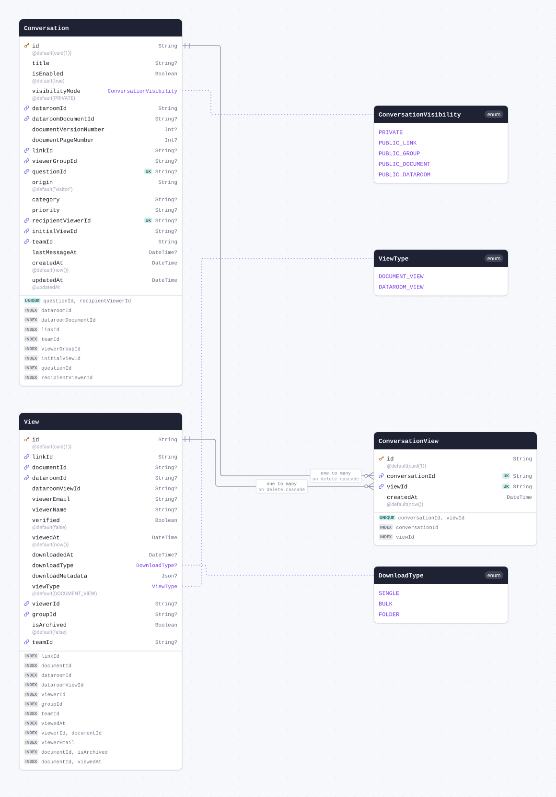

| Field            | Type       | Constraints                                       | Default   | Description |
| ---------------- | ---------- | ------------------------------------------------- | --------- | ----------- |
| `id`             | `String`   | PK NOT NULL                                       | `cuid(1)` |             |
| `conversationId` | `String`   | NOT NULL → [Conversation.id](#model-Conversation) |           |             |
| `viewId`         | `String`   | NOT NULL → [View.id](#model-View)                 |           |             |
| `createdAt`      | `DateTime` | NOT NULL                                          | `now()`   |             |

#### Indexes

- `@@index([conversationId])`
- `@@index([viewId])`
- `@@unique([conversationId, viewId])`

#### References

- `conversationId` → [Conversation.id](#model-Conversation) (many-to-one, on delete Cascade)
- `viewId` → [View.id](#model-View) (many-to-one, on delete Cascade)

#### Definition

```sql
CREATE TABLE "ConversationView" (
    "id" TEXT NOT NULL,
    "conversationId" TEXT NOT NULL,
    "viewId" TEXT NOT NULL,
    "createdAt" TIMESTAMP(3) NOT NULL DEFAULT CURRENT_TIMESTAMP,

    CONSTRAINT "ConversationView_pkey" PRIMARY KEY ("id")
);

CREATE INDEX "ConversationView_conversationId_idx" ON "ConversationView"("conversationId");

CREATE INDEX "ConversationView_viewId_idx" ON "ConversationView"("viewId");

CREATE UNIQUE INDEX "ConversationView_conversationId_viewId_key" ON "ConversationView"("conversationId", "viewId");

ALTER TABLE "ConversationView" ADD CONSTRAINT "ConversationView_conversationId_fkey" FOREIGN KEY ("conversationId") REFERENCES "Conversation"("id") ON DELETE CASCADE ON UPDATE CASCADE;

ALTER TABLE "ConversationView" ADD CONSTRAINT "ConversationView_viewId_fkey" FOREIGN KEY ("viewId") REFERENCES "View"("id") ON DELETE CASCADE ON UPDATE CASCADE;
```

<details>
<summary>Queries and their SQL</summary>

**findMany**: Every row

```ts
await prisma.conversationView.findMany();
```

```sql
SELECT
  "public"."ConversationView"."id",
  "public"."ConversationView"."conversationId",
  "public"."ConversationView"."viewId",
  "public"."ConversationView"."createdAt"
FROM
  "public"."ConversationView"
WHERE
  1 = 1
OFFSET
  $1
-- params: ["0"]
```

**count**: How many rows there are

```ts
await prisma.conversationView.count();
```

```sql
SELECT
  COUNT(*) AS "_count$_all"
FROM
  (
    SELECT
      "public"."ConversationView"."id"
    FROM
      "public"."ConversationView"
    WHERE
      1 = 1
    OFFSET
      $1
  ) AS "sub"
-- params: ["0"]
```

**findMany**: Every row with its relations

```ts
await prisma.conversationView.findMany({ include: { conversation: true, view: true } });
```

```sql
SELECT
  "public"."ConversationView"."id",
  "public"."ConversationView"."conversationId",
  "public"."ConversationView"."viewId",
  "public"."ConversationView"."createdAt"
FROM
  "public"."ConversationView"
WHERE
  1 = 1
OFFSET
  $1
-- params: ["0"]

SELECT
  "public"."Conversation"."id",
  "public"."Conversation"."title",
  "public"."Conversation"."isEnabled",
  "public"."Conversation"."visibilityMode"::text,
  "public"."Conversation"."dataroomId",
  "public"."Conversation"."dataroomDocumentId",
  "public"."Conversation"."documentVersionNumber",
  "public"."Conversation"."documentPageNumber",
  "public"."Conversation"."linkId",
  "public"."Conversation"."viewerGroupId",
  "public"."Conversation"."questionId",
  "public"."Conversation"."origin",
  "public"."Conversation"."category",
  "public"."Conversation"."priority",
  "public"."Conversation"."recipientViewerId",
  "public"."Conversation"."initialViewId",
  "public"."Conversation"."teamId",
  "public"."Conversation"."lastMessageAt",
  "public"."Conversation"."createdAt",
  "public"."Conversation"."updatedAt"
FROM
  "public"."Conversation"
WHERE
  "public"."Conversation"."id" IN ($1)
OFFSET
  $2
-- params: ["<conversationId of the rows above>","0"]

SELECT
  "public"."View"."id",
  "public"."View"."linkId",
  "public"."View"."documentId",
  "public"."View"."dataroomId",
  "public"."View"."dataroomViewId",
  "public"."View"."viewerEmail",
  "public"."View"."viewerName",
  "public"."View"."verified",
  "public"."View"."viewedAt",
  "public"."View"."downloadedAt",
  "public"."View"."downloadType"::text,
  "public"."View"."downloadMetadata",
  "public"."View"."viewType"::text,
  "public"."View"."viewerId",
  "public"."View"."groupId",
  "public"."View"."isArchived",
  "public"."View"."teamId"
FROM
  "public"."View"
WHERE
  "public"."View"."id" IN ($1)
OFFSET
  $2
-- params: ["<viewId of the rows above>","0"]
```

**findUnique**: One row by what is unique to it

```ts
await prisma.conversationView.findUnique({ where: { id: "example" } });
```

```sql
SELECT
  "public"."ConversationView"."id",
  "public"."ConversationView"."conversationId",
  "public"."ConversationView"."viewId",
  "public"."ConversationView"."createdAt"
FROM
  "public"."ConversationView"
WHERE
  (
    "public"."ConversationView"."id" = $1
    AND 1 = 1
  )
LIMIT
  $2
OFFSET
  $3
-- params: ["example","1","0"]
```

**create**: Create a row

```ts
await prisma.conversationView.create({ data: { conversationId: "example", viewId: "example" } });
```

```sql
INSERT INTO
  "public"."ConversationView" ("id", "conversationId", "viewId", "createdAt")
VALUES
  ($1, $2, $3, $4)
RETURNING
  "public"."ConversationView"."id",
  "public"."ConversationView"."conversationId",
  "public"."ConversationView"."viewId",
  "public"."ConversationView"."createdAt"
-- params: ["<cuid(1)>","example","example","<now()>"]
```

**update**: Update a row

```ts
await prisma.conversationView.update({
  where: { id: "example" },
  data: { createdAt: new Date("2026-01-01T00:00:00.000Z") },
});
```

```sql
UPDATE "public"."ConversationView"
SET
  "createdAt" = $1
WHERE
  (
    "public"."ConversationView"."id" = $2
    AND 1 = 1
  )
RETURNING
  "public"."ConversationView"."id",
  "public"."ConversationView"."conversationId",
  "public"."ConversationView"."viewId",
  "public"."ConversationView"."createdAt"
-- params: ["2026-01-01T00:00:00.000Z","example"]
```

**delete**: Delete a row

```ts
await prisma.conversationView.delete({ where: { id: "example" } });
```

```sql
DELETE FROM "public"."ConversationView"
WHERE
  (
    "public"."ConversationView"."id" = $1
    AND 1 = 1
  )
RETURNING
  "public"."ConversationView"."id",
  "public"."ConversationView"."conversationId",
  "public"."ConversationView"."viewId",
  "public"."ConversationView"."createdAt"
-- params: ["example"]
```

</details>

<a id="model-DataroomFaqItem"></a>

### DataroomFaqItem

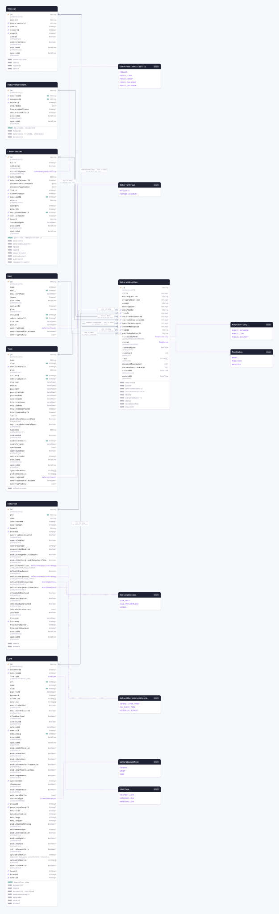

| Field                   | Type                                   | Constraints                                           | Default           | Description |
| ----------------------- | -------------------------------------- | ----------------------------------------------------- | ----------------- | ----------- |
| `id`                    | `String`                               | PK NOT NULL                                           | `cuid(1)`         |             |
| `title`                 | `String`                               | NULL                                                  |                   |             |
| `editedQuestion`        | `String`                               | NOT NULL                                              |                   |             |
| `originalQuestion`      | `String`                               | NULL                                                  |                   |             |
| `answer`                | `String`                               | NOT NULL                                              |                   |             |
| `description`           | `String`                               | NULL                                                  |                   |             |
| `dataroomId`            | `String`                               | NOT NULL → [Dataroom.id](#model-Dataroom)             |                   |             |
| `linkId`                | `String`                               | NULL → [Link.id](#model-Link)                         |                   |             |
| `dataroomDocumentId`    | `String`                               | NULL → [DataroomDocument.id](#model-DataroomDocument) |                   |             |
| `sourceConversationId`  | `String`                               | NULL → [Conversation.id](#model-Conversation)         |                   |             |
| `questionMessageId`     | `String`                               | NULL → [Message.id](#model-Message)                   |                   |             |
| `answerMessageId`       | `String`                               | NULL → [Message.id](#model-Message)                   |                   |             |
| `teamId`                | `String`                               | NOT NULL → [Team.id](#model-Team)                     |                   |             |
| `publishedByUserId`     | `String`                               | NOT NULL → [User.id](#model-User)                     |                   |             |
| `visibilityMode`        | [`FaqVisibility`](#enum-FaqVisibility) | NOT NULL                                              | `PUBLIC_DATAROOM` |             |
| `status`                | [`FaqStatus`](#enum-FaqStatus)         | NOT NULL                                              | `PUBLISHED`       |             |
| `isAnonymized`          | `Boolean`                              | NOT NULL                                              | `true`            |             |
| `viewCount`             | `Int`                                  | NOT NULL                                              | `0`               |             |
| `tags`                  | `String[]`                             | NOT NULL                                              | `[]`              |             |
| `documentPageNumber`    | `Int`                                  | NULL                                                  |                   |             |
| `documentVersionNumber` | `Int`                                  | NULL                                                  |                   |             |
| `createdAt`             | `DateTime`                             | NOT NULL                                              | `now()`           |             |
| `updatedAt`             | `DateTime`                             | NOT NULL                                              | `@updatedAt`      |             |

#### Indexes

- `@@index([dataroomId])`
- `@@index([linkId])`
- `@@index([dataroomDocumentId])`
- `@@index([sourceConversationId])`
- `@@index([teamId])`
- `@@index([publishedByUserId])`
- `@@index([status])`
- `@@index([visibilityMode])`
- `@@index([createdAt])`

#### References

- `dataroomId` → [Dataroom.id](#model-Dataroom) (many-to-one, on delete Cascade)
- `linkId` → [Link.id](#model-Link) (many-to-one, on delete SetNull)
- `dataroomDocumentId` → [DataroomDocument.id](#model-DataroomDocument) (many-to-one, on delete SetNull)
- `sourceConversationId` → [Conversation.id](#model-Conversation) (many-to-one, on delete SetNull)
- `questionMessageId` → [Message.id](#model-Message) (many-to-one, on delete SetNull)
- `answerMessageId` → [Message.id](#model-Message) (many-to-one, on delete SetNull)
- `teamId` → [Team.id](#model-Team) (many-to-one, on delete Cascade)
- `publishedByUserId` → [User.id](#model-User) (many-to-one, on delete Cascade)

#### Definition

```sql
CREATE TABLE "DataroomFaqItem" (
    "id" TEXT NOT NULL,
    "title" TEXT,
    "editedQuestion" TEXT NOT NULL,
    "originalQuestion" TEXT,
    "answer" TEXT NOT NULL,
    "description" TEXT,
    "dataroomId" TEXT NOT NULL,
    "linkId" TEXT,
    "dataroomDocumentId" TEXT,
    "sourceConversationId" TEXT,
    "questionMessageId" TEXT,
    "answerMessageId" TEXT,
    "teamId" TEXT NOT NULL,
    "publishedByUserId" TEXT NOT NULL,
    "visibilityMode" "FaqVisibility" NOT NULL DEFAULT 'PUBLIC_DATAROOM',
    "status" "FaqStatus" NOT NULL DEFAULT 'PUBLISHED',
    "isAnonymized" BOOLEAN NOT NULL DEFAULT true,
    "viewCount" INTEGER NOT NULL DEFAULT 0,
    "tags" TEXT[] DEFAULT ARRAY[]::TEXT[],
    "documentPageNumber" INTEGER,
    "documentVersionNumber" INTEGER,
    "createdAt" TIMESTAMP(3) NOT NULL DEFAULT CURRENT_TIMESTAMP,
    "updatedAt" TIMESTAMP(3) NOT NULL,

    CONSTRAINT "DataroomFaqItem_pkey" PRIMARY KEY ("id")
);

CREATE INDEX "DataroomFaqItem_dataroomId_idx" ON "DataroomFaqItem"("dataroomId");

CREATE INDEX "DataroomFaqItem_linkId_idx" ON "DataroomFaqItem"("linkId");

CREATE INDEX "DataroomFaqItem_dataroomDocumentId_idx" ON "DataroomFaqItem"("dataroomDocumentId");

CREATE INDEX "DataroomFaqItem_sourceConversationId_idx" ON "DataroomFaqItem"("sourceConversationId");

CREATE INDEX "DataroomFaqItem_teamId_idx" ON "DataroomFaqItem"("teamId");

CREATE INDEX "DataroomFaqItem_publishedByUserId_idx" ON "DataroomFaqItem"("publishedByUserId");

CREATE INDEX "DataroomFaqItem_status_idx" ON "DataroomFaqItem"("status");

CREATE INDEX "DataroomFaqItem_visibilityMode_idx" ON "DataroomFaqItem"("visibilityMode");

CREATE INDEX "DataroomFaqItem_createdAt_idx" ON "DataroomFaqItem"("createdAt");

ALTER TABLE "DataroomFaqItem" ADD CONSTRAINT "DataroomFaqItem_dataroomId_fkey" FOREIGN KEY ("dataroomId") REFERENCES "Dataroom"("id") ON DELETE CASCADE ON UPDATE CASCADE;

ALTER TABLE "DataroomFaqItem" ADD CONSTRAINT "DataroomFaqItem_linkId_fkey" FOREIGN KEY ("linkId") REFERENCES "Link"("id") ON DELETE SET NULL ON UPDATE CASCADE;

ALTER TABLE "DataroomFaqItem" ADD CONSTRAINT "DataroomFaqItem_dataroomDocumentId_fkey" FOREIGN KEY ("dataroomDocumentId") REFERENCES "DataroomDocument"("id") ON DELETE SET NULL ON UPDATE CASCADE;

ALTER TABLE "DataroomFaqItem" ADD CONSTRAINT "DataroomFaqItem_sourceConversationId_fkey" FOREIGN KEY ("sourceConversationId") REFERENCES "Conversation"("id") ON DELETE SET NULL ON UPDATE CASCADE;

ALTER TABLE "DataroomFaqItem" ADD CONSTRAINT "DataroomFaqItem_questionMessageId_fkey" FOREIGN KEY ("questionMessageId") REFERENCES "Message"("id") ON DELETE SET NULL ON UPDATE CASCADE;

ALTER TABLE "DataroomFaqItem" ADD CONSTRAINT "DataroomFaqItem_answerMessageId_fkey" FOREIGN KEY ("answerMessageId") REFERENCES "Message"("id") ON DELETE SET NULL ON UPDATE CASCADE;

ALTER TABLE "DataroomFaqItem" ADD CONSTRAINT "DataroomFaqItem_teamId_fkey" FOREIGN KEY ("teamId") REFERENCES "Team"("id") ON DELETE CASCADE ON UPDATE CASCADE;

ALTER TABLE "DataroomFaqItem" ADD CONSTRAINT "DataroomFaqItem_publishedByUserId_fkey" FOREIGN KEY ("publishedByUserId") REFERENCES "User"("id") ON DELETE CASCADE ON UPDATE CASCADE;
```

<details>
<summary>Queries and their SQL</summary>

**findMany**: Every row

```ts
await prisma.dataroomFaqItem.findMany();
```

```sql
SELECT
  "public"."DataroomFaqItem"."id",
  "public"."DataroomFaqItem"."title",
  "public"."DataroomFaqItem"."editedQuestion",
  "public"."DataroomFaqItem"."originalQuestion",
  "public"."DataroomFaqItem"."answer",
  "public"."DataroomFaqItem"."description",
  "public"."DataroomFaqItem"."dataroomId",
  "public"."DataroomFaqItem"."linkId",
  "public"."DataroomFaqItem"."dataroomDocumentId",
  "public"."DataroomFaqItem"."sourceConversationId",
  "public"."DataroomFaqItem"."questionMessageId",
  "public"."DataroomFaqItem"."answerMessageId",
  "public"."DataroomFaqItem"."teamId",
  "public"."DataroomFaqItem"."publishedByUserId",
  "public"."DataroomFaqItem"."visibilityMode"::text,
  "public"."DataroomFaqItem"."status"::text,
  "public"."DataroomFaqItem"."isAnonymized",
  "public"."DataroomFaqItem"."viewCount",
  "public"."DataroomFaqItem"."tags",
  "public"."DataroomFaqItem"."documentPageNumber",
  "public"."DataroomFaqItem"."documentVersionNumber",
  "public"."DataroomFaqItem"."createdAt",
  "public"."DataroomFaqItem"."updatedAt"
FROM
  "public"."DataroomFaqItem"
WHERE
  1 = 1
OFFSET
  $1
-- params: ["0"]
```

**count**: How many rows there are

```ts
await prisma.dataroomFaqItem.count();
```

```sql
SELECT
  COUNT(*) AS "_count$_all"
FROM
  (
    SELECT
      "public"."DataroomFaqItem"."id"
    FROM
      "public"."DataroomFaqItem"
    WHERE
      1 = 1
    OFFSET
      $1
  ) AS "sub"
-- params: ["0"]
```

**findMany**: Every row with its relations

```ts
await prisma.dataroomFaqItem.findMany({
  include: {
    dataroom: true,
    link: true,
    dataroomDocument: true,
    sourceConversation: true,
    questionMessage: true,
    answerMessage: true,
    team: true,
    publishedByUser: true,
  },
});
```

```sql
SELECT
  "public"."DataroomFaqItem"."id",
  "public"."DataroomFaqItem"."title",
  "public"."DataroomFaqItem"."editedQuestion",
  "public"."DataroomFaqItem"."originalQuestion",
  "public"."DataroomFaqItem"."answer",
  "public"."DataroomFaqItem"."description",
  "public"."DataroomFaqItem"."dataroomId",
  "public"."DataroomFaqItem"."linkId",
  "public"."DataroomFaqItem"."dataroomDocumentId",
  "public"."DataroomFaqItem"."sourceConversationId",
  "public"."DataroomFaqItem"."questionMessageId",
  "public"."DataroomFaqItem"."answerMessageId",
  "public"."DataroomFaqItem"."teamId",
  "public"."DataroomFaqItem"."publishedByUserId",
  "public"."DataroomFaqItem"."visibilityMode"::text,
  "public"."DataroomFaqItem"."status"::text,
  "public"."DataroomFaqItem"."isAnonymized",
  "public"."DataroomFaqItem"."viewCount",
  "public"."DataroomFaqItem"."tags",
  "public"."DataroomFaqItem"."documentPageNumber",
  "public"."DataroomFaqItem"."documentVersionNumber",
  "public"."DataroomFaqItem"."createdAt",
  "public"."DataroomFaqItem"."updatedAt"
FROM
  "public"."DataroomFaqItem"
WHERE
  1 = 1
OFFSET
  $1
-- params: ["0"]

SELECT
  "public"."Dataroom"."id",
  "public"."Dataroom"."pId",
  "public"."Dataroom"."name",
  "public"."Dataroom"."internalName",
  "public"."Dataroom"."description",
  "public"."Dataroom"."teamId",
  "public"."Dataroom"."brandId",
  "public"."Dataroom"."conversationsEnabled",
  "public"."Dataroom"."agentsEnabled",
  "public"."Dataroom"."vectorStoreId",
  "public"."Dataroom"."requestListEnabled",
  "public"."Dataroom"."enableChangeNotifications",
  "public"."Dataroom"."enableVisitorUploadChangeNotifications",
  "public"."Dataroom"."defaultPermissionStrategy"::text,
  "public"."Dataroom"."defaultShowBanner",
  "public"."Dataroom"."defaultGroupPermissionStrategy"::text,
  "public"."Dataroom"."defaultRootItemAccess"::text,
  "public"."Dataroom"."defaultGroupRootItemAccess"::text,
  "public"."Dataroom"."allowBulkDownload",
  "public"."Dataroom"."showLastUpdated",
  "public"."Dataroom"."introductionEnabled",
  "public"."Dataroom"."introductionContent",
  "public"."Dataroom"."isFrozen",
  "public"."Dataroom"."frozenAt",
  "public"."Dataroom"."frozenBy",
  "public"."Dataroom"."freezeArchiveUrl",
  "public"."Dataroom"."freezeArchiveHash",
  "public"."Dataroom"."createdAt",
  "public"."Dataroom"."updatedAt"
FROM
  "public"."Dataroom"
WHERE
  "public"."Dataroom"."id" IN ($1)
OFFSET
  $2
-- params: ["<dataroomId of the rows above>","0"]

SELECT
  "public"."Link"."id",
  "public"."Link"."documentId",
  "public"."Link"."dataroomId",
  "public"."Link"."linkType"::text,
  "public"."Link"."url",
  "public"."Link"."name",
  "public"."Link"."slug",
  "public"."Link"."expiresAt",
  "public"."Link"."password",
  "public"."Link"."allowList",
  "public"."Link"."denyList",
  "public"."Link"."emailProtected",
  "public"."Link"."emailAuthenticated",
  "public"."Link"."allowDownload",
  "public"."Link"."isArchived",
  "public"."Link"."deletedAt",
  "public"."Link"."domainId",
  "public"."Link"."domainSlug",
  "public"."Link"."createdAt",
  "public"."Link"."updatedAt",
  "public"."Link"."enableNotification",
  "public"."Link"."enableFeedback",
  "public"."Link"."enableQuestion",
  "public"."Link"."enableScreenshotProtection",
  "public"."Link"."enableConfidentialView",
  "public"."Link"."enableAgreement",
  "public"."Link"."agreementId",
  "public"."Link"."showBanner",
  "public"."Link"."enableWatermark",
  "public"."Link"."watermarkConfig",
  "public"."Link"."audienceType"::text,
  "public"."Link"."groupId",
  "public"."Link"."permissionGroupId",
  "public"."Link"."metaTitle",
  "public"."Link"."metaDescription",
  "public"."Link"."metaImage",
  "public"."Link"."metaFavicon",
  "public"."Link"."enableCustomMetatag",
  "public"."Link"."welcomeMessage",
  "public"."Link"."enableConversation",
  "public"."Link"."enableAIAgents",
  "public"."Link"."enableUpload",
  "public"."Link"."isFileRequestOnly",
  "public"."Link"."uploadFolderId",
  "public"."Link"."uploadFolderIds",
  "public"."Link"."enableIndexFile",
  "public"."Link"."teamId",
  "public"."Link"."brandId",
  "public"."Link"."ownerId"
FROM
  "public"."Link"
WHERE
  "public"."Link"."id" IN ($1)
OFFSET
  $2
-- params: ["<linkId of the rows above>","0"]

SELECT
  "public"."DataroomDocument"."id",
  "public"."DataroomDocument"."dataroomId",
  "public"."DataroomDocument"."documentId",
  "public"."DataroomDocument"."folderId",
  "public"."DataroomDocument"."orderIndex",
  "public"."DataroomDocument"."hierarchicalIndex",
  "public"."DataroomDocument"."vectorStoreFileId",
  "public"."DataroomDocument"."createdAt",
  "public"."DataroomDocument"."updatedAt"
FROM
  "public"."DataroomDocument"
WHERE
  "public"."DataroomDocument"."id" IN ($1)
OFFSET
  $2
-- params: ["<dataroomDocumentId of the rows above>","0"]

SELECT
  "public"."Conversation"."id",
  "public"."Conversation"."title",
  "public"."Conversation"."isEnabled",
  "public"."Conversation"."visibilityMode"::text,
  "public"."Conversation"."dataroomId",
  "public"."Conversation"."dataroomDocumentId",
  "public"."Conversation"."documentVersionNumber",
  "public"."Conversation"."documentPageNumber",
  "public"."Conversation"."linkId",
  "public"."Conversation"."viewerGroupId",
  "public"."Conversation"."questionId",
  "public"."Conversation"."origin",
  "public"."Conversation"."category",
  "public"."Conversation"."priority",
  "public"."Conversation"."recipientViewerId",
  "public"."Conversation"."initialViewId",
  "public"."Conversation"."teamId",
  "public"."Conversation"."lastMessageAt",
  "public"."Conversation"."createdAt",
  "public"."Conversation"."updatedAt"
FROM
  "public"."Conversation"
WHERE
  "public"."Conversation"."id" IN ($1)
OFFSET
  $2
-- params: ["<sourceConversationId of the rows above>","0"]

SELECT
  "public"."Message"."id",
  "public"."Message"."content",
  "public"."Message"."conversationId",
  "public"."Message"."userId",
  "public"."Message"."viewerId",
  "public"."Message"."viewId",
  "public"."Message"."isRead",
  "public"."Message"."isInternalNote",
  "public"."Message"."createdAt",
  "public"."Message"."updatedAt"
FROM
  "public"."Message"
WHERE
  "public"."Message"."id" IN ($1)
OFFSET
  $2
-- params: ["<questionMessageId of the rows above>","0"]

SELECT
  "public"."Message"."id",
  "public"."Message"."content",
  "public"."Message"."conversationId",
  "public"."Message"."userId",
  "public"."Message"."viewerId",
  "public"."Message"."viewId",
  "public"."Message"."isRead",
  "public"."Message"."isInternalNote",
  "public"."Message"."createdAt",
  "public"."Message"."updatedAt"
FROM
  "public"."Message"
WHERE
  "public"."Message"."id" IN ($1)
OFFSET
  $2
-- params: ["<answerMessageId of the rows above>","0"]

SELECT
  "public"."Team"."id",
  "public"."Team"."name",
  "public"."Team"."slug",
  "public"."Team"."defaultBrandId",
  "public"."Team"."plan",
  "public"."Team"."stripeId",
  "public"."Team"."subscriptionId",
  "public"."Team"."startsAt",
  "public"."Team"."endsAt",
  "public"."Team"."pausedAt",
  "public"."Team"."pauseStartsAt",
  "public"."Team"."pauseEndsAt",
  "public"."Team"."cancelledAt",
  "public"."Team"."trialStartedAt",
  "public"."Team"."trialEndsAt",
  "public"."Team"."trialReminderRunId",
  "public"."Team"."trialExpiredRunId",
  "public"."Team"."limits",
  "public"."Team"."enableExcelAdvancedMode",
  "public"."Team"."replicateDataroomFolders",
  "public"."Team"."timezone",
  "public"."Team"."ssoEnabled",
  "public"."Team"."ssoEmailDomain",
  "public"."Team"."ssoEnforcedAt",
  "public"."Team"."surveyData",
  "public"."Team"."agentsEnabled",
  "public"."Team"."vectorStoreId",
  "public"."Team"."createdAt",
  "public"."Team"."updatedAt",
  "public"."Team"."ignoredDomains",
  "public"."Team"."globalBlockList",
  "public"."Team"."referralTrack"::text,
  "public"."Team"."referralTrackSelectedAt",
  "public"."Team"."referralProfile"
FROM
  "public"."Team"
WHERE
  "public"."Team"."id" IN ($1)
OFFSET
  $2
-- params: ["<teamId of the rows above>","0"]

SELECT
  "public"."User"."id",
  "public"."User"."name",
  "public"."User"."email",
  "public"."User"."emailVerified",
  "public"."User"."image",
  "public"."User"."createdAt",
  "public"."User"."contactId",
  "public"."User"."plan",
  "public"."User"."stripeId",
  "public"."User"."subscriptionId",
  "public"."User"."startsAt",
  "public"."User"."endsAt",
  "public"."User"."referralTrack"::text,
  "public"."User"."referralTrackSelectedAt",
  "public"."User"."referralProfile"
FROM
  "public"."User"
WHERE
  "public"."User"."id" IN ($1)
OFFSET
  $2
-- params: ["<publishedByUserId of the rows above>","0"]
```

**findUnique**: One row by what is unique to it

```ts
await prisma.dataroomFaqItem.findUnique({ where: { id: "example" } });
```

```sql
SELECT
  "public"."DataroomFaqItem"."id",
  "public"."DataroomFaqItem"."title",
  "public"."DataroomFaqItem"."editedQuestion",
  "public"."DataroomFaqItem"."originalQuestion",
  "public"."DataroomFaqItem"."answer",
  "public"."DataroomFaqItem"."description",
  "public"."DataroomFaqItem"."dataroomId",
  "public"."DataroomFaqItem"."linkId",
  "public"."DataroomFaqItem"."dataroomDocumentId",
  "public"."DataroomFaqItem"."sourceConversationId",
  "public"."DataroomFaqItem"."questionMessageId",
  "public"."DataroomFaqItem"."answerMessageId",
  "public"."DataroomFaqItem"."teamId",
  "public"."DataroomFaqItem"."publishedByUserId",
  "public"."DataroomFaqItem"."visibilityMode"::text,
  "public"."DataroomFaqItem"."status"::text,
  "public"."DataroomFaqItem"."isAnonymized",
  "public"."DataroomFaqItem"."viewCount",
  "public"."DataroomFaqItem"."tags",
  "public"."DataroomFaqItem"."documentPageNumber",
  "public"."DataroomFaqItem"."documentVersionNumber",
  "public"."DataroomFaqItem"."createdAt",
  "public"."DataroomFaqItem"."updatedAt"
FROM
  "public"."DataroomFaqItem"
WHERE
  (
    "public"."DataroomFaqItem"."id" = $1
    AND 1 = 1
  )
LIMIT
  $2
OFFSET
  $3
-- params: ["example","1","0"]
```

**create**: Create a row

```ts
await prisma.dataroomFaqItem.create({
  data: {
    editedQuestion: "example",
    answer: "example",
    dataroomId: "example",
    teamId: "example",
    publishedByUserId: "example",
  },
});
```

```sql
INSERT INTO
  "public"."DataroomFaqItem" (
    "id",
    "editedQuestion",
    "answer",
    "dataroomId",
    "teamId",
    "publishedByUserId",
    "visibilityMode",
    "status",
    "isAnonymized",
    "viewCount",
    "tags",
    "createdAt",
    "updatedAt"
  )
VALUES
  (
    $1,
    $2,
    $3,
    $4,
    $5,
    $6,
    CAST($7::text AS "public"."FaqVisibility"),
    CAST($8::text AS "public"."FaqStatus"),
    $9,
    $10,
    $11,
    $12,
    $13
  )
RETURNING
  "public"."DataroomFaqItem"."id",
  "public"."DataroomFaqItem"."title",
  "public"."DataroomFaqItem"."editedQuestion",
  "public"."DataroomFaqItem"."originalQuestion",
  "public"."DataroomFaqItem"."answer",
  "public"."DataroomFaqItem"."description",
  "public"."DataroomFaqItem"."dataroomId",
  "public"."DataroomFaqItem"."linkId",
  "public"."DataroomFaqItem"."dataroomDocumentId",
  "public"."DataroomFaqItem"."sourceConversationId",
  "public"."DataroomFaqItem"."questionMessageId",
  "public"."DataroomFaqItem"."answerMessageId",
  "public"."DataroomFaqItem"."teamId",
  "public"."DataroomFaqItem"."publishedByUserId",
  "public"."DataroomFaqItem"."visibilityMode"::text,
  "public"."DataroomFaqItem"."status"::text,
  "public"."DataroomFaqItem"."isAnonymized",
  "public"."DataroomFaqItem"."viewCount",
  "public"."DataroomFaqItem"."tags",
  "public"."DataroomFaqItem"."documentPageNumber",
  "public"."DataroomFaqItem"."documentVersionNumber",
  "public"."DataroomFaqItem"."createdAt",
  "public"."DataroomFaqItem"."updatedAt"
-- params: ["<cuid(1)>","example","example","example","example","example","PUBLIC_DATAROOM","PUBLISHED",true,"0",[],"<now()>","<now()>"]
```

**update**: Update a row

```ts
await prisma.dataroomFaqItem.update({ where: { id: "example" }, data: { title: "example" } });
```

```sql
UPDATE "public"."DataroomFaqItem"
SET
  "title" = $1,
  "updatedAt" = $2
WHERE
  (
    "public"."DataroomFaqItem"."id" = $3
    AND 1 = 1
  )
RETURNING
  "public"."DataroomFaqItem"."id",
  "public"."DataroomFaqItem"."title",
  "public"."DataroomFaqItem"."editedQuestion",
  "public"."DataroomFaqItem"."originalQuestion",
  "public"."DataroomFaqItem"."answer",
  "public"."DataroomFaqItem"."description",
  "public"."DataroomFaqItem"."dataroomId",
  "public"."DataroomFaqItem"."linkId",
  "public"."DataroomFaqItem"."dataroomDocumentId",
  "public"."DataroomFaqItem"."sourceConversationId",
  "public"."DataroomFaqItem"."questionMessageId",
  "public"."DataroomFaqItem"."answerMessageId",
  "public"."DataroomFaqItem"."teamId",
  "public"."DataroomFaqItem"."publishedByUserId",
  "public"."DataroomFaqItem"."visibilityMode"::text,
  "public"."DataroomFaqItem"."status"::text,
  "public"."DataroomFaqItem"."isAnonymized",
  "public"."DataroomFaqItem"."viewCount",
  "public"."DataroomFaqItem"."tags",
  "public"."DataroomFaqItem"."documentPageNumber",
  "public"."DataroomFaqItem"."documentVersionNumber",
  "public"."DataroomFaqItem"."createdAt",
  "public"."DataroomFaqItem"."updatedAt"
-- params: ["example",{"prisma__type":"generatorCall","prisma__value":{"name":"now","args":[],"returnType":{"type":"DateTime"}}},"example"]
```

**delete**: Delete a row

```ts
await prisma.dataroomFaqItem.delete({ where: { id: "example" } });
```

```sql
DELETE FROM "public"."DataroomFaqItem"
WHERE
  (
    "public"."DataroomFaqItem"."id" = $1
    AND 1 = 1
  )
RETURNING
  "public"."DataroomFaqItem"."id",
  "public"."DataroomFaqItem"."title",
  "public"."DataroomFaqItem"."editedQuestion",
  "public"."DataroomFaqItem"."originalQuestion",
  "public"."DataroomFaqItem"."answer",
  "public"."DataroomFaqItem"."description",
  "public"."DataroomFaqItem"."dataroomId",
  "public"."DataroomFaqItem"."linkId",
  "public"."DataroomFaqItem"."dataroomDocumentId",
  "public"."DataroomFaqItem"."sourceConversationId",
  "public"."DataroomFaqItem"."questionMessageId",
  "public"."DataroomFaqItem"."answerMessageId",
  "public"."DataroomFaqItem"."teamId",
  "public"."DataroomFaqItem"."publishedByUserId",
  "public"."DataroomFaqItem"."visibilityMode"::text,
  "public"."DataroomFaqItem"."status"::text,
  "public"."DataroomFaqItem"."isAnonymized",
  "public"."DataroomFaqItem"."viewCount",
  "public"."DataroomFaqItem"."tags",
  "public"."DataroomFaqItem"."documentPageNumber",
  "public"."DataroomFaqItem"."documentVersionNumber",
  "public"."DataroomFaqItem"."createdAt",
  "public"."DataroomFaqItem"."updatedAt"
-- params: ["example"]
```

</details>

<a id="model-Dataroom"></a>

### Dataroom

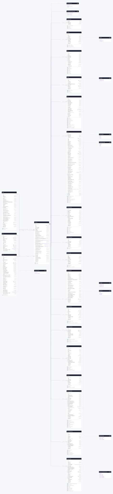

| Field                                    | Type                                                           | Constraints                       | Default               | Description |
| ---------------------------------------- | -------------------------------------------------------------- | --------------------------------- | --------------------- | ----------- |
| `id`                                     | `String`                                                       | PK NOT NULL                       | `cuid(1)`             |             |
| `pId`                                    | `String`                                                       | UNIQUE NOT NULL                   |                       |             |
| `name`                                   | `String`                                                       | NOT NULL                          |                       |             |
| `internalName`                           | `String`                                                       | NULL                              |                       |             |
| `description`                            | `String`                                                       | NULL                              |                       |             |
| `teamId`                                 | `String`                                                       | NOT NULL → [Team.id](#model-Team) |                       |             |
| `brandId`                                | `String`                                                       | NULL → [Brand.id](#model-Brand)   |                       |             |
| `conversationsEnabled`                   | `Boolean`                                                      | NOT NULL                          | `false`               |             |
| `agentsEnabled`                          | `Boolean`                                                      | NOT NULL                          | `false`               |             |
| `vectorStoreId`                          | `String`                                                       | NULL                              |                       |             |
| `requestListEnabled`                     | `Boolean`                                                      | NOT NULL                          | `false`               |             |
| `enableChangeNotifications`              | `Boolean`                                                      | NOT NULL                          | `false`               |             |
| `enableVisitorUploadChangeNotifications` | `Boolean`                                                      | NOT NULL                          | `false`               |             |
| `defaultPermissionStrategy`              | [`DefaultPermissionStrategy`](#enum-DefaultPermissionStrategy) | NOT NULL                          | `INHERIT_FROM_PARENT` |             |
| `defaultShowBanner`                      | `Boolean`                                                      | NOT NULL                          | `true`                |             |
| `defaultGroupPermissionStrategy`         | [`DefaultPermissionStrategy`](#enum-DefaultPermissionStrategy) | NOT NULL                          | `INHERIT_FROM_PARENT` |             |
| `defaultRootItemAccess`                  | [`RootItemAccess`](#enum-RootItemAccess)                       | NOT NULL                          | `VIEW_ONLY`           |             |
| `defaultGroupRootItemAccess`             | [`RootItemAccess`](#enum-RootItemAccess)                       | NOT NULL                          | `VIEW_ONLY`           |             |
| `allowBulkDownload`                      | `Boolean`                                                      | NOT NULL                          | `true`                |             |
| `showLastUpdated`                        | `Boolean`                                                      | NOT NULL                          | `true`                |             |
| `introductionEnabled`                    | `Boolean`                                                      | NOT NULL                          | `false`               |             |
| `introductionContent`                    | `Json`                                                         | NULL                              |                       |             |
| `isFrozen`                               | `Boolean`                                                      | NOT NULL                          | `false`               |             |
| `frozenAt`                               | `DateTime`                                                     | NULL                              |                       |             |
| `frozenBy`                               | `String`                                                       | NULL → [User.id](#model-User)     |                       |             |
| `freezeArchiveUrl`                       | `String`                                                       | NULL                              |                       |             |
| `freezeArchiveHash`                      | `String`                                                       | NULL                              |                       |             |
| `createdAt`                              | `DateTime`                                                     | NOT NULL                          | `now()`               |             |
| `updatedAt`                              | `DateTime`                                                     | NOT NULL                          | `@updatedAt`          |             |

#### Indexes

- `@@index([teamId])`
- `@@index([brandId])`

#### References

- `teamId` → [Team.id](#model-Team) (many-to-one, on delete Cascade)
- `brandId` → [Brand.id](#model-Brand) (many-to-one, on delete SetNull)
- `frozenBy` → [User.id](#model-User) (many-to-one, on delete SetNull)

#### Referenced by

- `id` ← [Conversation.dataroomId](#model-Conversation) (one-to-many, on delete Cascade)
- `id` ← [DataroomQuestion.dataroomId](#model-DataroomQuestion) (one-to-many, on delete Cascade)
- `id` ← [DataroomFaqItem.dataroomId](#model-DataroomFaqItem) (one-to-many, on delete Cascade)
- `id` ← [TaskList.dataroomId](#model-TaskList) (one-to-many, on delete Cascade)
- `id` ← [Task.dataroomId](#model-Task) (one-to-many, on delete Cascade)
- `id` ← [DataroomDocument.dataroomId](#model-DataroomDocument) (one-to-many, on delete Cascade)
- `id` ← [DataroomFolder.dataroomId](#model-DataroomFolder) (one-to-many, on delete Cascade)
- `id` ← [DataroomBrand.dataroomId](#model-DataroomBrand) (one-to-one, on delete Cascade)
- `id` ← [ViewerGroup.dataroomId](#model-ViewerGroup) (one-to-many, on delete Cascade)
- `id` ← [PermissionGroup.dataroomId](#model-PermissionGroup) (one-to-many, on delete Cascade)
- `id` ← [DocumentUpload.dataroomId](#model-DocumentUpload) (one-to-many, on delete SetNull)
- `id` ← [Link.dataroomId](#model-Link) (one-to-many, on delete Cascade)
- `id` ← [View.dataroomId](#model-View) (one-to-many, on delete Cascade)
- `id` ← [Viewer.dataroomId](#model-Viewer) (one-to-many, on delete SetNull)
- `id` ← [Chat.dataroomId](#model-Chat) (one-to-many, on delete Cascade)
- `id` ← [TagItem.dataroomId](#model-TagItem) (one-to-many, on delete Cascade)
- `id` ← [UserDataroom.dataroomId](#model-UserDataroom) (one-to-many, on delete Cascade)

#### Definition

```sql
CREATE TABLE "Dataroom" (
    "id" TEXT NOT NULL,
    "pId" TEXT NOT NULL,
    "name" TEXT NOT NULL,
    "internalName" TEXT,
    "description" TEXT,
    "teamId" TEXT NOT NULL,
    "brandId" TEXT,
    "conversationsEnabled" BOOLEAN NOT NULL DEFAULT false,
    "agentsEnabled" BOOLEAN NOT NULL DEFAULT false,
    "vectorStoreId" TEXT,
    "requestListEnabled" BOOLEAN NOT NULL DEFAULT false,
    "enableChangeNotifications" BOOLEAN NOT NULL DEFAULT false,
    "enableVisitorUploadChangeNotifications" BOOLEAN NOT NULL DEFAULT false,
    "defaultPermissionStrategy" "DefaultPermissionStrategy" NOT NULL DEFAULT 'INHERIT_FROM_PARENT',
    "defaultShowBanner" BOOLEAN NOT NULL DEFAULT true,
    "defaultGroupPermissionStrategy" "DefaultPermissionStrategy" NOT NULL DEFAULT 'INHERIT_FROM_PARENT',
    "defaultRootItemAccess" "RootItemAccess" NOT NULL DEFAULT 'VIEW_ONLY',
    "defaultGroupRootItemAccess" "RootItemAccess" NOT NULL DEFAULT 'VIEW_ONLY',
    "allowBulkDownload" BOOLEAN NOT NULL DEFAULT true,
    "showLastUpdated" BOOLEAN NOT NULL DEFAULT true,
    "introductionEnabled" BOOLEAN NOT NULL DEFAULT false,
    "introductionContent" JSONB,
    "isFrozen" BOOLEAN NOT NULL DEFAULT false,
    "frozenAt" TIMESTAMP(3),
    "frozenBy" TEXT,
    "freezeArchiveUrl" TEXT,
    "freezeArchiveHash" TEXT,
    "createdAt" TIMESTAMP(3) NOT NULL DEFAULT CURRENT_TIMESTAMP,
    "updatedAt" TIMESTAMP(3) NOT NULL,

    CONSTRAINT "Dataroom_pkey" PRIMARY KEY ("id")
);

CREATE UNIQUE INDEX "Dataroom_pId_key" ON "Dataroom"("pId");

CREATE INDEX "Dataroom_teamId_idx" ON "Dataroom"("teamId");

CREATE INDEX "Dataroom_brandId_idx" ON "Dataroom"("brandId");

ALTER TABLE "Dataroom" ADD CONSTRAINT "Dataroom_teamId_fkey" FOREIGN KEY ("teamId") REFERENCES "Team"("id") ON DELETE CASCADE ON UPDATE CASCADE;

ALTER TABLE "Dataroom" ADD CONSTRAINT "Dataroom_brandId_fkey" FOREIGN KEY ("brandId") REFERENCES "Brand"("id") ON DELETE SET NULL ON UPDATE CASCADE;

ALTER TABLE "Dataroom" ADD CONSTRAINT "Dataroom_frozenBy_fkey" FOREIGN KEY ("frozenBy") REFERENCES "User"("id") ON DELETE SET NULL ON UPDATE CASCADE;
```

<details>
<summary>Queries and their SQL</summary>

**findMany**: Every row

```ts
await prisma.dataroom.findMany();
```

```sql
SELECT
  "public"."Dataroom"."id",
  "public"."Dataroom"."pId",
  "public"."Dataroom"."name",
  "public"."Dataroom"."internalName",
  "public"."Dataroom"."description",
  "public"."Dataroom"."teamId",
  "public"."Dataroom"."brandId",
  "public"."Dataroom"."conversationsEnabled",
  "public"."Dataroom"."agentsEnabled",
  "public"."Dataroom"."vectorStoreId",
  "public"."Dataroom"."requestListEnabled",
  "public"."Dataroom"."enableChangeNotifications",
  "public"."Dataroom"."enableVisitorUploadChangeNotifications",
  "public"."Dataroom"."defaultPermissionStrategy"::text,
  "public"."Dataroom"."defaultShowBanner",
  "public"."Dataroom"."defaultGroupPermissionStrategy"::text,
  "public"."Dataroom"."defaultRootItemAccess"::text,
  "public"."Dataroom"."defaultGroupRootItemAccess"::text,
  "public"."Dataroom"."allowBulkDownload",
  "public"."Dataroom"."showLastUpdated",
  "public"."Dataroom"."introductionEnabled",
  "public"."Dataroom"."introductionContent",
  "public"."Dataroom"."isFrozen",
  "public"."Dataroom"."frozenAt",
  "public"."Dataroom"."frozenBy",
  "public"."Dataroom"."freezeArchiveUrl",
  "public"."Dataroom"."freezeArchiveHash",
  "public"."Dataroom"."createdAt",
  "public"."Dataroom"."updatedAt"
FROM
  "public"."Dataroom"
WHERE
  1 = 1
OFFSET
  $1
-- params: ["0"]
```

**count**: How many rows there are

```ts
await prisma.dataroom.count();
```

```sql
SELECT
  COUNT(*) AS "_count$_all"
FROM
  (
    SELECT
      "public"."Dataroom"."id"
    FROM
      "public"."Dataroom"
    WHERE
      1 = 1
    OFFSET
      $1
  ) AS "sub"
-- params: ["0"]
```

**findMany**: Every row with its relations

```ts
await prisma.dataroom.findMany({
  include: {
    team: true,
    documents: true,
    folders: true,
    links: true,
    views: true,
    viewers: true,
    viewerGroups: true,
    brand: true,
    baseBrand: true,
    userDatarooms: true,
    permissionGroups: true,
    conversations: true,
    questions: true,
    faqItems: true,
    chats: true,
    uploadedDocuments: true,
    tags: true,
    taskLists: true,
    tasks: true,
    frozenByUser: true,
  },
});
```

```sql
SELECT
  "public"."Dataroom"."id",
  "public"."Dataroom"."pId",
  "public"."Dataroom"."name",
  "public"."Dataroom"."internalName",
  "public"."Dataroom"."description",
  "public"."Dataroom"."teamId",
  "public"."Dataroom"."brandId",
  "public"."Dataroom"."conversationsEnabled",
  "public"."Dataroom"."agentsEnabled",
  "public"."Dataroom"."vectorStoreId",
  "public"."Dataroom"."requestListEnabled",
  "public"."Dataroom"."enableChangeNotifications",
  "public"."Dataroom"."enableVisitorUploadChangeNotifications",
  "public"."Dataroom"."defaultPermissionStrategy"::text,
  "public"."Dataroom"."defaultShowBanner",
  "public"."Dataroom"."defaultGroupPermissionStrategy"::text,
  "public"."Dataroom"."defaultRootItemAccess"::text,
  "public"."Dataroom"."defaultGroupRootItemAccess"::text,
  "public"."Dataroom"."allowBulkDownload",
  "public"."Dataroom"."showLastUpdated",
  "public"."Dataroom"."introductionEnabled",
  "public"."Dataroom"."introductionContent",
  "public"."Dataroom"."isFrozen",
  "public"."Dataroom"."frozenAt",
  "public"."Dataroom"."frozenBy",
  "public"."Dataroom"."freezeArchiveUrl",
  "public"."Dataroom"."freezeArchiveHash",
  "public"."Dataroom"."createdAt",
  "public"."Dataroom"."updatedAt"
FROM
  "public"."Dataroom"
WHERE
  1 = 1
OFFSET
  $1
-- params: ["0"]

SELECT
  "public"."Team"."id",
  "public"."Team"."name",
  "public"."Team"."slug",
  "public"."Team"."defaultBrandId",
  "public"."Team"."plan",
  "public"."Team"."stripeId",
  "public"."Team"."subscriptionId",
  "public"."Team"."startsAt",
  "public"."Team"."endsAt",
  "public"."Team"."pausedAt",
  "public"."Team"."pauseStartsAt",
  "public"."Team"."pauseEndsAt",
  "public"."Team"."cancelledAt",
  "public"."Team"."trialStartedAt",
  "public"."Team"."trialEndsAt",
  "public"."Team"."trialReminderRunId",
  "public"."Team"."trialExpiredRunId",
  "public"."Team"."limits",
  "public"."Team"."enableExcelAdvancedMode",
  "public"."Team"."replicateDataroomFolders",
  "public"."Team"."timezone",
  "public"."Team"."ssoEnabled",
  "public"."Team"."ssoEmailDomain",
  "public"."Team"."ssoEnforcedAt",
  "public"."Team"."surveyData",
  "public"."Team"."agentsEnabled",
  "public"."Team"."vectorStoreId",
  "public"."Team"."createdAt",
  "public"."Team"."updatedAt",
  "public"."Team"."ignoredDomains",
  "public"."Team"."globalBlockList",
  "public"."Team"."referralTrack"::text,
  "public"."Team"."referralTrackSelectedAt",
  "public"."Team"."referralProfile"
FROM
  "public"."Team"
WHERE
  "public"."Team"."id" IN ($1)
OFFSET
  $2
-- params: ["<teamId of the rows above>","0"]

SELECT
  "public"."DataroomDocument"."id",
  "public"."DataroomDocument"."dataroomId",
  "public"."DataroomDocument"."documentId",
  "public"."DataroomDocument"."folderId",
  "public"."DataroomDocument"."orderIndex",
  "public"."DataroomDocument"."hierarchicalIndex",
  "public"."DataroomDocument"."vectorStoreFileId",
  "public"."DataroomDocument"."createdAt",
  "public"."DataroomDocument"."updatedAt"
FROM
  "public"."DataroomDocument"
WHERE
  "public"."DataroomDocument"."dataroomId" IN ($1)
OFFSET
  $2
-- params: ["<id of the rows above>","0"]

SELECT
  "public"."DataroomFolder"."id",
  "public"."DataroomFolder"."name",
  "public"."DataroomFolder"."path",
  "public"."DataroomFolder"."parentId",
  "public"."DataroomFolder"."icon",
  "public"."DataroomFolder"."color",
  "public"."DataroomFolder"."dataroomId",
  "public"."DataroomFolder"."orderIndex",
  "public"."DataroomFolder"."hierarchicalIndex",
  "public"."DataroomFolder"."createdAt",
  "public"."DataroomFolder"."updatedAt"
FROM
  "public"."DataroomFolder"
WHERE
  "public"."DataroomFolder"."dataroomId" IN ($1)
OFFSET
  $2
-- params: ["<id of the rows above>","0"]

SELECT
  "public"."Link"."id",
  "public"."Link"."documentId",
  "public"."Link"."dataroomId",
  "public"."Link"."linkType"::text,
  "public"."Link"."url",
  "public"."Link"."name",
  "public"."Link"."slug",
  "public"."Link"."expiresAt",
  "public"."Link"."password",
  "public"."Link"."allowList",
  "public"."Link"."denyList",
  "public"."Link"."emailProtected",
  "public"."Link"."emailAuthenticated",
  "public"."Link"."allowDownload",
  "public"."Link"."isArchived",
  "public"."Link"."deletedAt",
  "public"."Link"."domainId",
  "public"."Link"."domainSlug",
  "public"."Link"."createdAt",
  "public"."Link"."updatedAt",
  "public"."Link"."enableNotification",
  "public"."Link"."enableFeedback",
  "public"."Link"."enableQuestion",
  "public"."Link"."enableScreenshotProtection",
  "public"."Link"."enableConfidentialView",
  "public"."Link"."enableAgreement",
  "public"."Link"."agreementId",
  "public"."Link"."showBanner",
  "public"."Link"."enableWatermark",
  "public"."Link"."watermarkConfig",
  "public"."Link"."audienceType"::text,
  "public"."Link"."groupId",
  "public"."Link"."permissionGroupId",
  "public"."Link"."metaTitle",
  "public"."Link"."metaDescription",
  "public"."Link"."metaImage",
  "public"."Link"."metaFavicon",
  "public"."Link"."enableCustomMetatag",
  "public"."Link"."welcomeMessage",
  "public"."Link"."enableConversation",
  "public"."Link"."enableAIAgents",
  "public"."Link"."enableUpload",
  "public"."Link"."isFileRequestOnly",
  "public"."Link"."uploadFolderId",
  "public"."Link"."uploadFolderIds",
  "public"."Link"."enableIndexFile",
  "public"."Link"."teamId",
  "public"."Link"."brandId",
  "public"."Link"."ownerId"
FROM
  "public"."Link"
WHERE
  "public"."Link"."dataroomId" IN ($1)
OFFSET
  $2
-- params: ["<id of the rows above>","0"]

SELECT
  "public"."View"."id",
  "public"."View"."linkId",
  "public"."View"."documentId",
  "public"."View"."dataroomId",
  "public"."View"."dataroomViewId",
  "public"."View"."viewerEmail",
  "public"."View"."viewerName",
  "public"."View"."verified",
  "public"."View"."viewedAt",
  "public"."View"."downloadedAt",
  "public"."View"."downloadType"::text,
  "public"."View"."downloadMetadata",
  "public"."View"."viewType"::text,
  "public"."View"."viewerId",
  "public"."View"."groupId",
  "public"."View"."isArchived",
  "public"."View"."teamId"
FROM
  "public"."View"
WHERE
  "public"."View"."dataroomId" IN ($1)
OFFSET
  $2
-- params: ["<id of the rows above>","0"]

SELECT
  "public"."Viewer"."id",
  "public"."Viewer"."email",
  "public"."Viewer"."verified",
  "public"."Viewer"."invitedAt",
  "public"."Viewer"."notificationPreferences",
  "public"."Viewer"."dataroomId",
  "public"."Viewer"."teamId",
  "public"."Viewer"."createdAt",
  "public"."Viewer"."updatedAt"
FROM
  "public"."Viewer"
WHERE
  "public"."Viewer"."dataroomId" IN ($1)
OFFSET
  $2
-- params: ["<id of the rows above>","0"]

SELECT
  "public"."ViewerGroup"."id",
  "public"."ViewerGroup"."name",
  "public"."ViewerGroup"."domains",
  "public"."ViewerGroup"."allowAll",
  "public"."ViewerGroup"."dataroomId",
  "public"."ViewerGroup"."teamId",
  "public"."ViewerGroup"."createdAt",
  "public"."ViewerGroup"."updatedAt"
FROM
  "public"."ViewerGroup"
WHERE
  "public"."ViewerGroup"."dataroomId" IN ($1)
OFFSET
  $2
-- params: ["<id of the rows above>","0"]

SELECT
  "public"."DataroomBrand"."id",
  "public"."DataroomBrand"."logo",
  "public"."DataroomBrand"."hideLogo",
  "public"."DataroomBrand"."banner",
  "public"."DataroomBrand"."brandColor",
  "public"."DataroomBrand"."accentColor",
  "public"."DataroomBrand"."accentButtonColor",
  "public"."DataroomBrand"."applyAccentColorToDataroomView",
  "public"."DataroomBrand"."welcomeMessage",
  "public"."DataroomBrand"."cardLayout",
  "public"."DataroomBrand"."showFolderTree",
  "public"."DataroomBrand"."viewerLayoutPreset",
  "public"."DataroomBrand"."viewerHeaderStyle",
  "public"."DataroomBrand"."hideFolderIconsInMain",
  "public"."DataroomBrand"."ctaLabel",
  "public"."DataroomBrand"."ctaUrl",
  "public"."DataroomBrand"."customLinkPreviewEnabled",
  "public"."DataroomBrand"."linkPreviewTitle",
  "public"."DataroomBrand"."linkPreviewDescription",
  "public"."DataroomBrand"."linkPreviewImage",
  "public"."DataroomBrand"."linkPreviewFavicon",
  "public"."DataroomBrand"."defaultLanguage",
  "public"."DataroomBrand"."dataroomId",
  "public"."DataroomBrand"."createdAt",
  "public"."DataroomBrand"."updatedAt"
FROM
  "public"."DataroomBrand"
WHERE
  "public"."DataroomBrand"."dataroomId" IN ($1)
OFFSET
  $2
-- params: ["<id of the rows above>","0"]

SELECT
  "public"."Brand"."id",
  "public"."Brand"."logo",
  "public"."Brand"."hideLogo",
  "public"."Brand"."banner",
  "public"."Brand"."brandColor",
  "public"."Brand"."accentColor",
  "public"."Brand"."accentButtonColor",
  "public"."Brand"."applyAccentColorToDataroomView",
  "public"."Brand"."welcomeMessage",
  "public"."Brand"."ctaLabel",
  "public"."Brand"."ctaUrl",
  "public"."Brand"."privacyPolicyUrl",
  "public"."Brand"."cardLayout",
  "public"."Brand"."showFolderTree",
  "public"."Brand"."viewerLayoutPreset",
  "public"."Brand"."viewerHeaderStyle",
  "public"."Brand"."hideFolderIconsInMain",
  "public"."Brand"."customLinkPreviewEnabled",
  "public"."Brand"."linkPreviewTitle",
  "public"."Brand"."linkPreviewDescription",
  "public"."Brand"."linkPreviewImage",
  "public"."Brand"."linkPreviewFavicon",
  "public"."Brand"."defaultLanguage",
  "public"."Brand"."name",
  "public"."Brand"."teamId",
  "public"."Brand"."createdAt",
  "public"."Brand"."updatedAt"
FROM
  "public"."Brand"
WHERE
  "public"."Brand"."id" IN ($1)
OFFSET
  $2
-- params: ["<brandId of the rows above>","0"]

SELECT
  "public"."UserDataroom"."userId",
  "public"."UserDataroom"."dataroomId",
  "public"."UserDataroom"."teamId",
  "public"."UserDataroom"."createdAt"
FROM
  "public"."UserDataroom"
WHERE
  "public"."UserDataroom"."dataroomId" IN ($1)
OFFSET
  $2
-- params: ["<id of the rows above>","0"]

SELECT
  "public"."PermissionGroup"."id",
  "public"."PermissionGroup"."name",
  "public"."PermissionGroup"."description",
  "public"."PermissionGroup"."dataroomId",
  "public"."PermissionGroup"."teamId",
  "public"."PermissionGroup"."createdAt",
  "public"."PermissionGroup"."updatedAt"
FROM
  "public"."PermissionGroup"
WHERE
  "public"."PermissionGroup"."dataroomId" IN ($1)
OFFSET
  $2
-- params: ["<id of the rows above>","0"]

SELECT
  "public"."Conversation"."id",
  "public"."Conversation"."title",
  "public"."Conversation"."isEnabled",
  "public"."Conversation"."visibilityMode"::text,
  "public"."Conversation"."dataroomId",
  "public"."Conversation"."dataroomDocumentId",
  "public"."Conversation"."documentVersionNumber",
  "public"."Conversation"."documentPageNumber",
  "public"."Conversation"."linkId",
  "public"."Conversation"."viewerGroupId",
  "public"."Conversation"."questionId",
  "public"."Conversation"."origin",
  "public"."Conversation"."category",
  "public"."Conversation"."priority",
  "public"."Conversation"."recipientViewerId",
  "public"."Conversation"."initialViewId",
  "public"."Conversation"."teamId",
  "public"."Conversation"."lastMessageAt",
  "public"."Conversation"."createdAt",
  "public"."Conversation"."updatedAt"
FROM
  "public"."Conversation"
WHERE
  "public"."Conversation"."dataroomId" IN ($1)
OFFSET
  $2
-- params: ["<id of the rows above>","0"]

SELECT
  "public"."DataroomQuestion"."id",
  "public"."DataroomQuestion"."content",
  "public"."DataroomQuestion"."category",
  "public"."DataroomQuestion"."priority",
  "public"."DataroomQuestion"."status",
  "public"."DataroomQuestion"."orderIndex",
  "public"."DataroomQuestion"."importBatchId",
  "public"."DataroomQuestion"."dataroomId",
  "public"."DataroomQuestion"."teamId",
  "public"."DataroomQuestion"."createdByUserId",
  "public"."DataroomQuestion"."dataroomDocumentId",
  "public"."DataroomQuestion"."documentPageNumber",
  "public"."DataroomQuestion"."createdAt",
  "public"."DataroomQuestion"."updatedAt"
FROM
  "public"."DataroomQuestion"
WHERE
  "public"."DataroomQuestion"."dataroomId" IN ($1)
OFFSET
  $2
-- params: ["<id of the rows above>","0"]

SELECT
  "public"."DataroomFaqItem"."id",
  "public"."DataroomFaqItem"."title",
  "public"."DataroomFaqItem"."editedQuestion",
  "public"."DataroomFaqItem"."originalQuestion",
  "public"."DataroomFaqItem"."answer",
  "public"."DataroomFaqItem"."description",
  "public"."DataroomFaqItem"."dataroomId",
  "public"."DataroomFaqItem"."linkId",
  "public"."DataroomFaqItem"."dataroomDocumentId",
  "public"."DataroomFaqItem"."sourceConversationId",
  "public"."DataroomFaqItem"."questionMessageId",
  "public"."DataroomFaqItem"."answerMessageId",
  "public"."DataroomFaqItem"."teamId",
  "public"."DataroomFaqItem"."publishedByUserId",
  "public"."DataroomFaqItem"."visibilityMode"::text,
  "public"."DataroomFaqItem"."status"::text,
  "public"."DataroomFaqItem"."isAnonymized",
  "public"."DataroomFaqItem"."viewCount",
  "public"."DataroomFaqItem"."tags",
  "public"."DataroomFaqItem"."documentPageNumber",
  "public"."DataroomFaqItem"."documentVersionNumber",
  "public"."DataroomFaqItem"."createdAt",
  "public"."DataroomFaqItem"."updatedAt"
FROM
  "public"."DataroomFaqItem"
WHERE
  "public"."DataroomFaqItem"."dataroomId" IN ($1)
OFFSET
  $2
-- params: ["<id of the rows above>","0"]

SELECT
  "public"."Chat"."id",
  "public"."Chat"."title",
  "public"."Chat"."teamId",
  "public"."Chat"."documentId",
  "public"."Chat"."dataroomId",
  "public"."Chat"."linkId",
  "public"."Chat"."viewId",
  "public"."Chat"."userId",
  "public"."Chat"."viewerId",
  "public"."Chat"."vectorStoreId",
  "public"."Chat"."createdAt",
  "public"."Chat"."updatedAt",
  "public"."Chat"."lastMessageAt"
FROM
  "public"."Chat"
WHERE
  "public"."Chat"."dataroomId" IN ($1)
OFFSET
  $2
-- params: ["<id of the rows above>","0"]

SELECT
  "public"."DocumentUpload"."id",
  "public"."DocumentUpload"."documentId",
  "public"."DocumentUpload"."teamId",
  "public"."DocumentUpload"."viewerId",
  "public"."DocumentUpload"."viewId",
  "public"."DocumentUpload"."linkId",
  "public"."DocumentUpload"."dataroomId",
  "public"."DocumentUpload"."dataroomDocumentId",
  "public"."DocumentUpload"."taskId",
  "public"."DocumentUpload"."originalFilename",
  "public"."DocumentUpload"."fileSize",
  "public"."DocumentUpload"."numPages",
  "public"."DocumentUpload"."mimeType",
  "public"."DocumentUpload"."uploadedAt",
  "public"."DocumentUpload"."createdAt",
  "public"."DocumentUpload"."updatedAt"
FROM
  "public"."DocumentUpload"
WHERE
  "public"."DocumentUpload"."dataroomId" IN ($1)
OFFSET
  $2
-- params: ["<id of the rows above>","0"]

SELECT
  "public"."TagItem"."id",
  "public"."TagItem"."tagId",
  "public"."TagItem"."itemType"::text,
  "public"."TagItem"."linkId",
  "public"."TagItem"."documentId",
  "public"."TagItem"."dataroomId",
  "public"."TagItem"."taggedBy",
  "public"."TagItem"."createdAt",
  "public"."TagItem"."updatedAt"
FROM
  "public"."TagItem"
WHERE
  "public"."TagItem"."dataroomId" IN ($1)
OFFSET
  $2
-- params: ["<id of the rows above>","0"]

SELECT
  "public"."TaskList"."id",
  "public"."TaskList"."name",
  "public"."TaskList"."orderIndex",
  "public"."TaskList"."dataroomId",
  "public"."TaskList"."teamId",
  "public"."TaskList"."createdAt",
  "public"."TaskList"."updatedAt"
FROM
  "public"."TaskList"
WHERE
  "public"."TaskList"."dataroomId" IN ($1)
OFFSET
  $2
-- params: ["<id of the rows above>","0"]

SELECT
  "public"."Task"."id",
  "public"."Task"."title",
  "public"."Task"."description",
  "public"."Task"."type",
  "public"."Task"."status",
  "public"."Task"."category",
  "public"."Task"."dueDate",
  "public"."Task"."orderIndex",
  "public"."Task"."taskListId",
  "public"."Task"."dataroomId",
  "public"."Task"."teamId",
  "public"."Task"."uploadFolderId",
  "public"."Task"."createdByUserId",
  "public"."Task"."lastActivityNotifiedAt",
  "public"."Task"."createdAt",
  "public"."Task"."updatedAt"
FROM
  "public"."Task"
WHERE
  "public"."Task"."dataroomId" IN ($1)
OFFSET
  $2
-- params: ["<id of the rows above>","0"]

SELECT
  "public"."User"."id",
  "public"."User"."name",
  "public"."User"."email",
  "public"."User"."emailVerified",
  "public"."User"."image",
  "public"."User"."createdAt",
  "public"."User"."contactId",
  "public"."User"."plan",
  "public"."User"."stripeId",
  "public"."User"."subscriptionId",
  "public"."User"."startsAt",
  "public"."User"."endsAt",
  "public"."User"."referralTrack"::text,
  "public"."User"."referralTrackSelectedAt",
  "public"."User"."referralProfile"
FROM
  "public"."User"
WHERE
  "public"."User"."id" IN ($1)
OFFSET
  $2
-- params: ["<frozenBy of the rows above>","0"]
```

**findUnique**: One row by what is unique to it

```ts
await prisma.dataroom.findUnique({ where: { id: "example" } });
```

```sql
SELECT
  "public"."Dataroom"."id",
  "public"."Dataroom"."pId",
  "public"."Dataroom"."name",
  "public"."Dataroom"."internalName",
  "public"."Dataroom"."description",
  "public"."Dataroom"."teamId",
  "public"."Dataroom"."brandId",
  "public"."Dataroom"."conversationsEnabled",
  "public"."Dataroom"."agentsEnabled",
  "public"."Dataroom"."vectorStoreId",
  "public"."Dataroom"."requestListEnabled",
  "public"."Dataroom"."enableChangeNotifications",
  "public"."Dataroom"."enableVisitorUploadChangeNotifications",
  "public"."Dataroom"."defaultPermissionStrategy"::text,
  "public"."Dataroom"."defaultShowBanner",
  "public"."Dataroom"."defaultGroupPermissionStrategy"::text,
  "public"."Dataroom"."defaultRootItemAccess"::text,
  "public"."Dataroom"."defaultGroupRootItemAccess"::text,
  "public"."Dataroom"."allowBulkDownload",
  "public"."Dataroom"."showLastUpdated",
  "public"."Dataroom"."introductionEnabled",
  "public"."Dataroom"."introductionContent",
  "public"."Dataroom"."isFrozen",
  "public"."Dataroom"."frozenAt",
  "public"."Dataroom"."frozenBy",
  "public"."Dataroom"."freezeArchiveUrl",
  "public"."Dataroom"."freezeArchiveHash",
  "public"."Dataroom"."createdAt",
  "public"."Dataroom"."updatedAt"
FROM
  "public"."Dataroom"
WHERE
  (
    "public"."Dataroom"."id" = $1
    AND 1 = 1
  )
LIMIT
  $2
OFFSET
  $3
-- params: ["example","1","0"]
```

**create**: Create a row

```ts
await prisma.dataroom.create({ data: { pId: "example", name: "example", teamId: "example" } });
```

```sql
INSERT INTO
  "public"."Dataroom" (
    "id",
    "pId",
    "name",
    "teamId",
    "conversationsEnabled",
    "agentsEnabled",
    "requestListEnabled",
    "enableChangeNotifications",
    "enableVisitorUploadChangeNotifications",
    "defaultPermissionStrategy",
    "defaultShowBanner",
    "defaultGroupPermissionStrategy",
    "defaultRootItemAccess",
    "defaultGroupRootItemAccess",
    "allowBulkDownload",
    "showLastUpdated",
    "introductionEnabled",
    "isFrozen",
    "createdAt",
    "updatedAt"
  )
VALUES
  (
    $1,
    $2,
    $3,
    $4,
    $5,
    $6,
    $7,
    $8,
    $9,
    CAST($10::text AS "public"."DefaultPermissionStrategy"),
    $11,
    CAST($12::text AS "public"."DefaultPermissionStrategy"),
    CAST($13::text AS "public"."RootItemAccess"),
    CAST($14::text AS "public"."RootItemAccess"),
    $15,
    $16,
    $17,
    $18,
    $19,
    $20
  )
RETURNING
  "public"."Dataroom"."id",
  "public"."Dataroom"."pId",
  "public"."Dataroom"."name",
  "public"."Dataroom"."internalName",
  "public"."Dataroom"."description",
  "public"."Dataroom"."teamId",
  "public"."Dataroom"."brandId",
  "public"."Dataroom"."conversationsEnabled",
  "public"."Dataroom"."agentsEnabled",
  "public"."Dataroom"."vectorStoreId",
  "public"."Dataroom"."requestListEnabled",
  "public"."Dataroom"."enableChangeNotifications",
  "public"."Dataroom"."enableVisitorUploadChangeNotifications",
  "public"."Dataroom"."defaultPermissionStrategy"::text,
  "public"."Dataroom"."defaultShowBanner",
  "public"."Dataroom"."defaultGroupPermissionStrategy"::text,
  "public"."Dataroom"."defaultRootItemAccess"::text,
  "public"."Dataroom"."defaultGroupRootItemAccess"::text,
  "public"."Dataroom"."allowBulkDownload",
  "public"."Dataroom"."showLastUpdated",
  "public"."Dataroom"."introductionEnabled",
  "public"."Dataroom"."introductionContent",
  "public"."Dataroom"."isFrozen",
  "public"."Dataroom"."frozenAt",
  "public"."Dataroom"."frozenBy",
  "public"."Dataroom"."freezeArchiveUrl",
  "public"."Dataroom"."freezeArchiveHash",
  "public"."Dataroom"."createdAt",
  "public"."Dataroom"."updatedAt"
-- params: ["<cuid(1)>","example","example","example",false,false,false,false,false,"INHERIT_FROM_PARENT",true,"INHERIT_FROM_PARENT","VIEW_ONLY","VIEW_ONLY",true,true,false,false,"<now()>","<now()>"]
```

**update**: Update a row

```ts
await prisma.dataroom.update({ where: { id: "example" }, data: { pId: "example" } });
```

```sql
UPDATE "public"."Dataroom"
SET
  "pId" = $1,
  "updatedAt" = $2
WHERE
  (
    "public"."Dataroom"."id" = $3
    AND 1 = 1
  )
RETURNING
  "public"."Dataroom"."id",
  "public"."Dataroom"."pId",
  "public"."Dataroom"."name",
  "public"."Dataroom"."internalName",
  "public"."Dataroom"."description",
  "public"."Dataroom"."teamId",
  "public"."Dataroom"."brandId",
  "public"."Dataroom"."conversationsEnabled",
  "public"."Dataroom"."agentsEnabled",
  "public"."Dataroom"."vectorStoreId",
  "public"."Dataroom"."requestListEnabled",
  "public"."Dataroom"."enableChangeNotifications",
  "public"."Dataroom"."enableVisitorUploadChangeNotifications",
  "public"."Dataroom"."defaultPermissionStrategy"::text,
  "public"."Dataroom"."defaultShowBanner",
  "public"."Dataroom"."defaultGroupPermissionStrategy"::text,
  "public"."Dataroom"."defaultRootItemAccess"::text,
  "public"."Dataroom"."defaultGroupRootItemAccess"::text,
  "public"."Dataroom"."allowBulkDownload",
  "public"."Dataroom"."showLastUpdated",
  "public"."Dataroom"."introductionEnabled",
  "public"."Dataroom"."introductionContent",
  "public"."Dataroom"."isFrozen",
  "public"."Dataroom"."frozenAt",
  "public"."Dataroom"."frozenBy",
  "public"."Dataroom"."freezeArchiveUrl",
  "public"."Dataroom"."freezeArchiveHash",
  "public"."Dataroom"."createdAt",
  "public"."Dataroom"."updatedAt"
-- params: ["example",{"prisma__type":"generatorCall","prisma__value":{"name":"now","args":[],"returnType":{"type":"DateTime"}}},"example"]
```

**delete**: Delete a row

```ts
await prisma.dataroom.delete({ where: { id: "example" } });
```

```sql
DELETE FROM "public"."Dataroom"
WHERE
  (
    "public"."Dataroom"."id" = $1
    AND 1 = 1
  )
RETURNING
  "public"."Dataroom"."id",
  "public"."Dataroom"."pId",
  "public"."Dataroom"."name",
  "public"."Dataroom"."internalName",
  "public"."Dataroom"."description",
  "public"."Dataroom"."teamId",
  "public"."Dataroom"."brandId",
  "public"."Dataroom"."conversationsEnabled",
  "public"."Dataroom"."agentsEnabled",
  "public"."Dataroom"."vectorStoreId",
  "public"."Dataroom"."requestListEnabled",
  "public"."Dataroom"."enableChangeNotifications",
  "public"."Dataroom"."enableVisitorUploadChangeNotifications",
  "public"."Dataroom"."defaultPermissionStrategy"::text,
  "public"."Dataroom"."defaultShowBanner",
  "public"."Dataroom"."defaultGroupPermissionStrategy"::text,
  "public"."Dataroom"."defaultRootItemAccess"::text,
  "public"."Dataroom"."defaultGroupRootItemAccess"::text,
  "public"."Dataroom"."allowBulkDownload",
  "public"."Dataroom"."showLastUpdated",
  "public"."Dataroom"."introductionEnabled",
  "public"."Dataroom"."introductionContent",
  "public"."Dataroom"."isFrozen",
  "public"."Dataroom"."frozenAt",
  "public"."Dataroom"."frozenBy",
  "public"."Dataroom"."freezeArchiveUrl",
  "public"."Dataroom"."freezeArchiveHash",
  "public"."Dataroom"."createdAt",
  "public"."Dataroom"."updatedAt"
-- params: ["example"]
```

</details>

<a id="model-TaskList"></a>

### TaskList

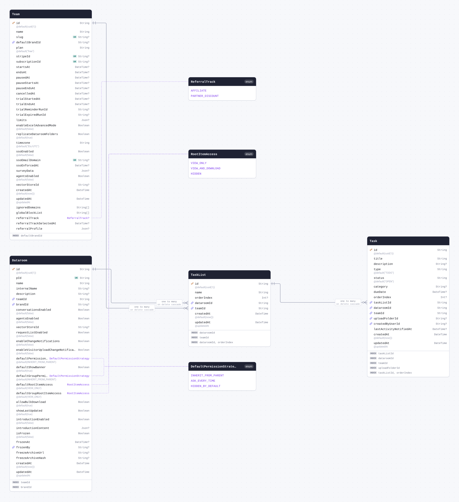

| Field        | Type       | Constraints                               | Default      | Description |
| ------------ | ---------- | ----------------------------------------- | ------------ | ----------- |
| `id`         | `String`   | PK NOT NULL                               | `cuid(1)`    |             |
| `name`       | `String`   | NOT NULL                                  |              |             |
| `orderIndex` | `Int`      | NULL                                      |              |             |
| `dataroomId` | `String`   | NOT NULL → [Dataroom.id](#model-Dataroom) |              |             |
| `teamId`     | `String`   | NOT NULL → [Team.id](#model-Team)         |              |             |
| `createdAt`  | `DateTime` | NOT NULL                                  | `now()`      |             |
| `updatedAt`  | `DateTime` | NOT NULL                                  | `@updatedAt` |             |

#### Indexes

- `@@index([dataroomId])`
- `@@index([teamId])`
- `@@index([dataroomId, orderIndex])`

#### References

- `dataroomId` → [Dataroom.id](#model-Dataroom) (many-to-one, on delete Cascade)
- `teamId` → [Team.id](#model-Team) (many-to-one, on delete Cascade)

#### Referenced by

- `id` ← [Task.taskListId](#model-Task) (one-to-many, on delete Cascade)

#### Definition

```sql
CREATE TABLE "TaskList" (
    "id" TEXT NOT NULL,
    "name" TEXT NOT NULL,
    "orderIndex" INTEGER,
    "dataroomId" TEXT NOT NULL,
    "teamId" TEXT NOT NULL,
    "createdAt" TIMESTAMP(3) NOT NULL DEFAULT CURRENT_TIMESTAMP,
    "updatedAt" TIMESTAMP(3) NOT NULL,

    CONSTRAINT "TaskList_pkey" PRIMARY KEY ("id")
);

CREATE INDEX "TaskList_dataroomId_idx" ON "TaskList"("dataroomId");

CREATE INDEX "TaskList_teamId_idx" ON "TaskList"("teamId");

CREATE INDEX "TaskList_dataroomId_orderIndex_idx" ON "TaskList"("dataroomId", "orderIndex");

ALTER TABLE "TaskList" ADD CONSTRAINT "TaskList_dataroomId_fkey" FOREIGN KEY ("dataroomId") REFERENCES "Dataroom"("id") ON DELETE CASCADE ON UPDATE CASCADE;

ALTER TABLE "TaskList" ADD CONSTRAINT "TaskList_teamId_fkey" FOREIGN KEY ("teamId") REFERENCES "Team"("id") ON DELETE CASCADE ON UPDATE CASCADE;
```

<details>
<summary>Queries and their SQL</summary>

**findMany**: Every row

```ts
await prisma.taskList.findMany();
```

```sql
SELECT
  "public"."TaskList"."id",
  "public"."TaskList"."name",
  "public"."TaskList"."orderIndex",
  "public"."TaskList"."dataroomId",
  "public"."TaskList"."teamId",
  "public"."TaskList"."createdAt",
  "public"."TaskList"."updatedAt"
FROM
  "public"."TaskList"
WHERE
  1 = 1
OFFSET
  $1
-- params: ["0"]
```

**count**: How many rows there are

```ts
await prisma.taskList.count();
```

```sql
SELECT
  COUNT(*) AS "_count$_all"
FROM
  (
    SELECT
      "public"."TaskList"."id"
    FROM
      "public"."TaskList"
    WHERE
      1 = 1
    OFFSET
      $1
  ) AS "sub"
-- params: ["0"]
```

**findMany**: Every row with its relations

```ts
await prisma.taskList.findMany({ include: { dataroom: true, team: true, tasks: true } });
```

```sql
SELECT
  "public"."TaskList"."id",
  "public"."TaskList"."name",
  "public"."TaskList"."orderIndex",
  "public"."TaskList"."dataroomId",
  "public"."TaskList"."teamId",
  "public"."TaskList"."createdAt",
  "public"."TaskList"."updatedAt"
FROM
  "public"."TaskList"
WHERE
  1 = 1
OFFSET
  $1
-- params: ["0"]

SELECT
  "public"."Dataroom"."id",
  "public"."Dataroom"."pId",
  "public"."Dataroom"."name",
  "public"."Dataroom"."internalName",
  "public"."Dataroom"."description",
  "public"."Dataroom"."teamId",
  "public"."Dataroom"."brandId",
  "public"."Dataroom"."conversationsEnabled",
  "public"."Dataroom"."agentsEnabled",
  "public"."Dataroom"."vectorStoreId",
  "public"."Dataroom"."requestListEnabled",
  "public"."Dataroom"."enableChangeNotifications",
  "public"."Dataroom"."enableVisitorUploadChangeNotifications",
  "public"."Dataroom"."defaultPermissionStrategy"::text,
  "public"."Dataroom"."defaultShowBanner",
  "public"."Dataroom"."defaultGroupPermissionStrategy"::text,
  "public"."Dataroom"."defaultRootItemAccess"::text,
  "public"."Dataroom"."defaultGroupRootItemAccess"::text,
  "public"."Dataroom"."allowBulkDownload",
  "public"."Dataroom"."showLastUpdated",
  "public"."Dataroom"."introductionEnabled",
  "public"."Dataroom"."introductionContent",
  "public"."Dataroom"."isFrozen",
  "public"."Dataroom"."frozenAt",
  "public"."Dataroom"."frozenBy",
  "public"."Dataroom"."freezeArchiveUrl",
  "public"."Dataroom"."freezeArchiveHash",
  "public"."Dataroom"."createdAt",
  "public"."Dataroom"."updatedAt"
FROM
  "public"."Dataroom"
WHERE
  "public"."Dataroom"."id" IN ($1)
OFFSET
  $2
-- params: ["<dataroomId of the rows above>","0"]

SELECT
  "public"."Team"."id",
  "public"."Team"."name",
  "public"."Team"."slug",
  "public"."Team"."defaultBrandId",
  "public"."Team"."plan",
  "public"."Team"."stripeId",
  "public"."Team"."subscriptionId",
  "public"."Team"."startsAt",
  "public"."Team"."endsAt",
  "public"."Team"."pausedAt",
  "public"."Team"."pauseStartsAt",
  "public"."Team"."pauseEndsAt",
  "public"."Team"."cancelledAt",
  "public"."Team"."trialStartedAt",
  "public"."Team"."trialEndsAt",
  "public"."Team"."trialReminderRunId",
  "public"."Team"."trialExpiredRunId",
  "public"."Team"."limits",
  "public"."Team"."enableExcelAdvancedMode",
  "public"."Team"."replicateDataroomFolders",
  "public"."Team"."timezone",
  "public"."Team"."ssoEnabled",
  "public"."Team"."ssoEmailDomain",
  "public"."Team"."ssoEnforcedAt",
  "public"."Team"."surveyData",
  "public"."Team"."agentsEnabled",
  "public"."Team"."vectorStoreId",
  "public"."Team"."createdAt",
  "public"."Team"."updatedAt",
  "public"."Team"."ignoredDomains",
  "public"."Team"."globalBlockList",
  "public"."Team"."referralTrack"::text,
  "public"."Team"."referralTrackSelectedAt",
  "public"."Team"."referralProfile"
FROM
  "public"."Team"
WHERE
  "public"."Team"."id" IN ($1)
OFFSET
  $2
-- params: ["<teamId of the rows above>","0"]

SELECT
  "public"."Task"."id",
  "public"."Task"."title",
  "public"."Task"."description",
  "public"."Task"."type",
  "public"."Task"."status",
  "public"."Task"."category",
  "public"."Task"."dueDate",
  "public"."Task"."orderIndex",
  "public"."Task"."taskListId",
  "public"."Task"."dataroomId",
  "public"."Task"."teamId",
  "public"."Task"."uploadFolderId",
  "public"."Task"."createdByUserId",
  "public"."Task"."lastActivityNotifiedAt",
  "public"."Task"."createdAt",
  "public"."Task"."updatedAt"
FROM
  "public"."Task"
WHERE
  "public"."Task"."taskListId" IN ($1)
OFFSET
  $2
-- params: ["<id of the rows above>","0"]
```

**findUnique**: One row by what is unique to it

```ts
await prisma.taskList.findUnique({ where: { id: "example" } });
```

```sql
SELECT
  "public"."TaskList"."id",
  "public"."TaskList"."name",
  "public"."TaskList"."orderIndex",
  "public"."TaskList"."dataroomId",
  "public"."TaskList"."teamId",
  "public"."TaskList"."createdAt",
  "public"."TaskList"."updatedAt"
FROM
  "public"."TaskList"
WHERE
  (
    "public"."TaskList"."id" = $1
    AND 1 = 1
  )
LIMIT
  $2
OFFSET
  $3
-- params: ["example","1","0"]
```

**create**: Create a row

```ts
await prisma.taskList.create({
  data: { name: "example", dataroomId: "example", teamId: "example" },
});
```

```sql
INSERT INTO
  "public"."TaskList" (
    "id",
    "name",
    "dataroomId",
    "teamId",
    "createdAt",
    "updatedAt"
  )
VALUES
  ($1, $2, $3, $4, $5, $6)
RETURNING
  "public"."TaskList"."id",
  "public"."TaskList"."name",
  "public"."TaskList"."orderIndex",
  "public"."TaskList"."dataroomId",
  "public"."TaskList"."teamId",
  "public"."TaskList"."createdAt",
  "public"."TaskList"."updatedAt"
-- params: ["<cuid(1)>","example","example","example","<now()>","<now()>"]
```

**update**: Update a row

```ts
await prisma.taskList.update({ where: { id: "example" }, data: { name: "example" } });
```

```sql
UPDATE "public"."TaskList"
SET
  "name" = $1,
  "updatedAt" = $2
WHERE
  (
    "public"."TaskList"."id" = $3
    AND 1 = 1
  )
RETURNING
  "public"."TaskList"."id",
  "public"."TaskList"."name",
  "public"."TaskList"."orderIndex",
  "public"."TaskList"."dataroomId",
  "public"."TaskList"."teamId",
  "public"."TaskList"."createdAt",
  "public"."TaskList"."updatedAt"
-- params: ["example",{"prisma__type":"generatorCall","prisma__value":{"name":"now","args":[],"returnType":{"type":"DateTime"}}},"example"]
```

**delete**: Delete a row

```ts
await prisma.taskList.delete({ where: { id: "example" } });
```

```sql
DELETE FROM "public"."TaskList"
WHERE
  (
    "public"."TaskList"."id" = $1
    AND 1 = 1
  )
RETURNING
  "public"."TaskList"."id",
  "public"."TaskList"."name",
  "public"."TaskList"."orderIndex",
  "public"."TaskList"."dataroomId",
  "public"."TaskList"."teamId",
  "public"."TaskList"."createdAt",
  "public"."TaskList"."updatedAt"
-- params: ["example"]
```

</details>

<a id="model-Task"></a>

### Task

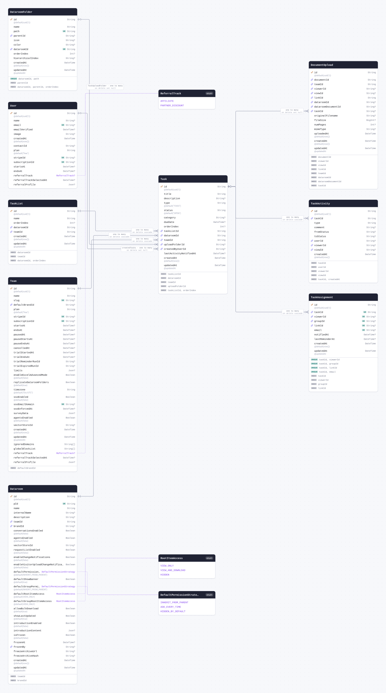

| Field                    | Type       | Constraints                                       | Default      | Description |
| ------------------------ | ---------- | ------------------------------------------------- | ------------ | ----------- |
| `id`                     | `String`   | PK NOT NULL                                       | `cuid(1)`    |             |
| `title`                  | `String`   | NOT NULL                                          |              |             |
| `description`            | `String`   | NULL                                              |              |             |
| `type`                   | `String`   | NOT NULL                                          | `"TODO"`     |             |
| `status`                 | `String`   | NOT NULL                                          | `"OPEN"`     |             |
| `category`               | `String`   | NULL                                              |              |             |
| `dueDate`                | `DateTime` | NULL                                              |              |             |
| `orderIndex`             | `Int`      | NULL                                              |              |             |
| `taskListId`             | `String`   | NOT NULL → [TaskList.id](#model-TaskList)         |              |             |
| `dataroomId`             | `String`   | NOT NULL → [Dataroom.id](#model-Dataroom)         |              |             |
| `teamId`                 | `String`   | NOT NULL → [Team.id](#model-Team)                 |              |             |
| `uploadFolderId`         | `String`   | NULL → [DataroomFolder.id](#model-DataroomFolder) |              |             |
| `createdByUserId`        | `String`   | NULL → [User.id](#model-User)                     |              |             |
| `lastActivityNotifiedAt` | `DateTime` | NULL                                              |              |             |
| `createdAt`              | `DateTime` | NOT NULL                                          | `now()`      |             |
| `updatedAt`              | `DateTime` | NOT NULL                                          | `@updatedAt` |             |

#### Indexes

- `@@index([taskListId])`
- `@@index([dataroomId])`
- `@@index([teamId])`
- `@@index([uploadFolderId])`
- `@@index([taskListId, orderIndex])`

#### References

- `taskListId` → [TaskList.id](#model-TaskList) (many-to-one, on delete Cascade)
- `dataroomId` → [Dataroom.id](#model-Dataroom) (many-to-one, on delete Cascade)
- `teamId` → [Team.id](#model-Team) (many-to-one, on delete Cascade)
- `uploadFolderId` → [DataroomFolder.id](#model-DataroomFolder) (many-to-one, on delete SetNull)
- `createdByUserId` → [User.id](#model-User) (many-to-one, on delete SetNull)

#### Referenced by

- `id` ← [TaskAssignment.taskId](#model-TaskAssignment) (one-to-many, on delete Cascade)
- `id` ← [TaskActivity.taskId](#model-TaskActivity) (one-to-many, on delete Cascade)
- `id` ← [DocumentUpload.taskId](#model-DocumentUpload) (one-to-many, on delete SetNull)

#### Definition

```sql
CREATE TABLE "Task" (
    "id" TEXT NOT NULL,
    "title" TEXT NOT NULL,
    "description" TEXT,
    "type" TEXT NOT NULL DEFAULT 'TODO',
    "status" TEXT NOT NULL DEFAULT 'OPEN',
    "category" TEXT,
    "dueDate" TIMESTAMP(3),
    "orderIndex" INTEGER,
    "taskListId" TEXT NOT NULL,
    "dataroomId" TEXT NOT NULL,
    "teamId" TEXT NOT NULL,
    "uploadFolderId" TEXT,
    "createdByUserId" TEXT,
    "lastActivityNotifiedAt" TIMESTAMP(3),
    "createdAt" TIMESTAMP(3) NOT NULL DEFAULT CURRENT_TIMESTAMP,
    "updatedAt" TIMESTAMP(3) NOT NULL,

    CONSTRAINT "Task_pkey" PRIMARY KEY ("id")
);

CREATE INDEX "Task_taskListId_idx" ON "Task"("taskListId");

CREATE INDEX "Task_dataroomId_idx" ON "Task"("dataroomId");

CREATE INDEX "Task_teamId_idx" ON "Task"("teamId");

CREATE INDEX "Task_uploadFolderId_idx" ON "Task"("uploadFolderId");

CREATE INDEX "Task_taskListId_orderIndex_idx" ON "Task"("taskListId", "orderIndex");

ALTER TABLE "Task" ADD CONSTRAINT "Task_taskListId_fkey" FOREIGN KEY ("taskListId") REFERENCES "TaskList"("id") ON DELETE CASCADE ON UPDATE CASCADE;

ALTER TABLE "Task" ADD CONSTRAINT "Task_dataroomId_fkey" FOREIGN KEY ("dataroomId") REFERENCES "Dataroom"("id") ON DELETE CASCADE ON UPDATE CASCADE;

ALTER TABLE "Task" ADD CONSTRAINT "Task_teamId_fkey" FOREIGN KEY ("teamId") REFERENCES "Team"("id") ON DELETE CASCADE ON UPDATE CASCADE;

ALTER TABLE "Task" ADD CONSTRAINT "Task_uploadFolderId_fkey" FOREIGN KEY ("uploadFolderId") REFERENCES "DataroomFolder"("id") ON DELETE SET NULL ON UPDATE CASCADE;

ALTER TABLE "Task" ADD CONSTRAINT "Task_createdByUserId_fkey" FOREIGN KEY ("createdByUserId") REFERENCES "User"("id") ON DELETE SET NULL ON UPDATE CASCADE;
```

<details>
<summary>Queries and their SQL</summary>

**findMany**: Every row

```ts
await prisma.task.findMany();
```

```sql
SELECT
  "public"."Task"."id",
  "public"."Task"."title",
  "public"."Task"."description",
  "public"."Task"."type",
  "public"."Task"."status",
  "public"."Task"."category",
  "public"."Task"."dueDate",
  "public"."Task"."orderIndex",
  "public"."Task"."taskListId",
  "public"."Task"."dataroomId",
  "public"."Task"."teamId",
  "public"."Task"."uploadFolderId",
  "public"."Task"."createdByUserId",
  "public"."Task"."lastActivityNotifiedAt",
  "public"."Task"."createdAt",
  "public"."Task"."updatedAt"
FROM
  "public"."Task"
WHERE
  1 = 1
OFFSET
  $1
-- params: ["0"]
```

**count**: How many rows there are

```ts
await prisma.task.count();
```

```sql
SELECT
  COUNT(*) AS "_count$_all"
FROM
  (
    SELECT
      "public"."Task"."id"
    FROM
      "public"."Task"
    WHERE
      1 = 1
    OFFSET
      $1
  ) AS "sub"
-- params: ["0"]
```

**findMany**: Every row with its relations

```ts
await prisma.task.findMany({
  include: {
    taskList: true,
    dataroom: true,
    team: true,
    uploadFolder: true,
    createdByUser: true,
    assignments: true,
    activities: true,
    uploads: true,
  },
});
```

```sql
SELECT
  "public"."Task"."id",
  "public"."Task"."title",
  "public"."Task"."description",
  "public"."Task"."type",
  "public"."Task"."status",
  "public"."Task"."category",
  "public"."Task"."dueDate",
  "public"."Task"."orderIndex",
  "public"."Task"."taskListId",
  "public"."Task"."dataroomId",
  "public"."Task"."teamId",
  "public"."Task"."uploadFolderId",
  "public"."Task"."createdByUserId",
  "public"."Task"."lastActivityNotifiedAt",
  "public"."Task"."createdAt",
  "public"."Task"."updatedAt"
FROM
  "public"."Task"
WHERE
  1 = 1
OFFSET
  $1
-- params: ["0"]

SELECT
  "public"."TaskList"."id",
  "public"."TaskList"."name",
  "public"."TaskList"."orderIndex",
  "public"."TaskList"."dataroomId",
  "public"."TaskList"."teamId",
  "public"."TaskList"."createdAt",
  "public"."TaskList"."updatedAt"
FROM
  "public"."TaskList"
WHERE
  "public"."TaskList"."id" IN ($1)
OFFSET
  $2
-- params: ["<taskListId of the rows above>","0"]

SELECT
  "public"."Dataroom"."id",
  "public"."Dataroom"."pId",
  "public"."Dataroom"."name",
  "public"."Dataroom"."internalName",
  "public"."Dataroom"."description",
  "public"."Dataroom"."teamId",
  "public"."Dataroom"."brandId",
  "public"."Dataroom"."conversationsEnabled",
  "public"."Dataroom"."agentsEnabled",
  "public"."Dataroom"."vectorStoreId",
  "public"."Dataroom"."requestListEnabled",
  "public"."Dataroom"."enableChangeNotifications",
  "public"."Dataroom"."enableVisitorUploadChangeNotifications",
  "public"."Dataroom"."defaultPermissionStrategy"::text,
  "public"."Dataroom"."defaultShowBanner",
  "public"."Dataroom"."defaultGroupPermissionStrategy"::text,
  "public"."Dataroom"."defaultRootItemAccess"::text,
  "public"."Dataroom"."defaultGroupRootItemAccess"::text,
  "public"."Dataroom"."allowBulkDownload",
  "public"."Dataroom"."showLastUpdated",
  "public"."Dataroom"."introductionEnabled",
  "public"."Dataroom"."introductionContent",
  "public"."Dataroom"."isFrozen",
  "public"."Dataroom"."frozenAt",
  "public"."Dataroom"."frozenBy",
  "public"."Dataroom"."freezeArchiveUrl",
  "public"."Dataroom"."freezeArchiveHash",
  "public"."Dataroom"."createdAt",
  "public"."Dataroom"."updatedAt"
FROM
  "public"."Dataroom"
WHERE
  "public"."Dataroom"."id" IN ($1)
OFFSET
  $2
-- params: ["<dataroomId of the rows above>","0"]

SELECT
  "public"."Team"."id",
  "public"."Team"."name",
  "public"."Team"."slug",
  "public"."Team"."defaultBrandId",
  "public"."Team"."plan",
  "public"."Team"."stripeId",
  "public"."Team"."subscriptionId",
  "public"."Team"."startsAt",
  "public"."Team"."endsAt",
  "public"."Team"."pausedAt",
  "public"."Team"."pauseStartsAt",
  "public"."Team"."pauseEndsAt",
  "public"."Team"."cancelledAt",
  "public"."Team"."trialStartedAt",
  "public"."Team"."trialEndsAt",
  "public"."Team"."trialReminderRunId",
  "public"."Team"."trialExpiredRunId",
  "public"."Team"."limits",
  "public"."Team"."enableExcelAdvancedMode",
  "public"."Team"."replicateDataroomFolders",
  "public"."Team"."timezone",
  "public"."Team"."ssoEnabled",
  "public"."Team"."ssoEmailDomain",
  "public"."Team"."ssoEnforcedAt",
  "public"."Team"."surveyData",
  "public"."Team"."agentsEnabled",
  "public"."Team"."vectorStoreId",
  "public"."Team"."createdAt",
  "public"."Team"."updatedAt",
  "public"."Team"."ignoredDomains",
  "public"."Team"."globalBlockList",
  "public"."Team"."referralTrack"::text,
  "public"."Team"."referralTrackSelectedAt",
  "public"."Team"."referralProfile"
FROM
  "public"."Team"
WHERE
  "public"."Team"."id" IN ($1)
OFFSET
  $2
-- params: ["<teamId of the rows above>","0"]

SELECT
  "public"."DataroomFolder"."id",
  "public"."DataroomFolder"."name",
  "public"."DataroomFolder"."path",
  "public"."DataroomFolder"."parentId",
  "public"."DataroomFolder"."icon",
  "public"."DataroomFolder"."color",
  "public"."DataroomFolder"."dataroomId",
  "public"."DataroomFolder"."orderIndex",
  "public"."DataroomFolder"."hierarchicalIndex",
  "public"."DataroomFolder"."createdAt",
  "public"."DataroomFolder"."updatedAt"
FROM
  "public"."DataroomFolder"
WHERE
  "public"."DataroomFolder"."id" IN ($1)
OFFSET
  $2
-- params: ["<uploadFolderId of the rows above>","0"]

SELECT
  "public"."User"."id",
  "public"."User"."name",
  "public"."User"."email",
  "public"."User"."emailVerified",
  "public"."User"."image",
  "public"."User"."createdAt",
  "public"."User"."contactId",
  "public"."User"."plan",
  "public"."User"."stripeId",
  "public"."User"."subscriptionId",
  "public"."User"."startsAt",
  "public"."User"."endsAt",
  "public"."User"."referralTrack"::text,
  "public"."User"."referralTrackSelectedAt",
  "public"."User"."referralProfile"
FROM
  "public"."User"
WHERE
  "public"."User"."id" IN ($1)
OFFSET
  $2
-- params: ["<createdByUserId of the rows above>","0"]

SELECT
  "public"."TaskAssignment"."id",
  "public"."TaskAssignment"."taskId",
  "public"."TaskAssignment"."viewerId",
  "public"."TaskAssignment"."groupId",
  "public"."TaskAssignment"."linkId",
  "public"."TaskAssignment"."email",
  "public"."TaskAssignment"."notifiedAt",
  "public"."TaskAssignment"."lastReminderAt",
  "public"."TaskAssignment"."createdAt",
  "public"."TaskAssignment"."updatedAt"
FROM
  "public"."TaskAssignment"
WHERE
  "public"."TaskAssignment"."taskId" IN ($1)
OFFSET
  $2
-- params: ["<id of the rows above>","0"]

SELECT
  "public"."TaskActivity"."id",
  "public"."TaskActivity"."taskId",
  "public"."TaskActivity"."type",
  "public"."TaskActivity"."comment",
  "public"."TaskActivity"."fromStatus",
  "public"."TaskActivity"."toStatus",
  "public"."TaskActivity"."userId",
  "public"."TaskActivity"."viewerId",
  "public"."TaskActivity"."viewId",
  "public"."TaskActivity"."createdAt"
FROM
  "public"."TaskActivity"
WHERE
  "public"."TaskActivity"."taskId" IN ($1)
OFFSET
  $2
-- params: ["<id of the rows above>","0"]

SELECT
  "public"."DocumentUpload"."id",
  "public"."DocumentUpload"."documentId",
  "public"."DocumentUpload"."teamId",
  "public"."DocumentUpload"."viewerId",
  "public"."DocumentUpload"."viewId",
  "public"."DocumentUpload"."linkId",
  "public"."DocumentUpload"."dataroomId",
  "public"."DocumentUpload"."dataroomDocumentId",
  "public"."DocumentUpload"."taskId",
  "public"."DocumentUpload"."originalFilename",
  "public"."DocumentUpload"."fileSize",
  "public"."DocumentUpload"."numPages",
  "public"."DocumentUpload"."mimeType",
  "public"."DocumentUpload"."uploadedAt",
  "public"."DocumentUpload"."createdAt",
  "public"."DocumentUpload"."updatedAt"
FROM
  "public"."DocumentUpload"
WHERE
  "public"."DocumentUpload"."taskId" IN ($1)
OFFSET
  $2
-- params: ["<id of the rows above>","0"]
```

**findUnique**: One row by what is unique to it

```ts
await prisma.task.findUnique({ where: { id: "example" } });
```

```sql
SELECT
  "public"."Task"."id",
  "public"."Task"."title",
  "public"."Task"."description",
  "public"."Task"."type",
  "public"."Task"."status",
  "public"."Task"."category",
  "public"."Task"."dueDate",
  "public"."Task"."orderIndex",
  "public"."Task"."taskListId",
  "public"."Task"."dataroomId",
  "public"."Task"."teamId",
  "public"."Task"."uploadFolderId",
  "public"."Task"."createdByUserId",
  "public"."Task"."lastActivityNotifiedAt",
  "public"."Task"."createdAt",
  "public"."Task"."updatedAt"
FROM
  "public"."Task"
WHERE
  (
    "public"."Task"."id" = $1
    AND 1 = 1
  )
LIMIT
  $2
OFFSET
  $3
-- params: ["example","1","0"]
```

**create**: Create a row

```ts
await prisma.task.create({
  data: { title: "example", taskListId: "example", dataroomId: "example", teamId: "example" },
});
```

```sql
INSERT INTO
  "public"."Task" (
    "id",
    "title",
    "type",
    "status",
    "taskListId",
    "dataroomId",
    "teamId",
    "createdAt",
    "updatedAt"
  )
VALUES
  ($1, $2, $3, $4, $5, $6, $7, $8, $9)
RETURNING
  "public"."Task"."id",
  "public"."Task"."title",
  "public"."Task"."description",
  "public"."Task"."type",
  "public"."Task"."status",
  "public"."Task"."category",
  "public"."Task"."dueDate",
  "public"."Task"."orderIndex",
  "public"."Task"."taskListId",
  "public"."Task"."dataroomId",
  "public"."Task"."teamId",
  "public"."Task"."uploadFolderId",
  "public"."Task"."createdByUserId",
  "public"."Task"."lastActivityNotifiedAt",
  "public"."Task"."createdAt",
  "public"."Task"."updatedAt"
-- params: ["<cuid(1)>","example","TODO","OPEN","example","example","example","<now()>","<now()>"]
```

**update**: Update a row

```ts
await prisma.task.update({ where: { id: "example" }, data: { title: "example" } });
```

```sql
UPDATE "public"."Task"
SET
  "title" = $1,
  "updatedAt" = $2
WHERE
  (
    "public"."Task"."id" = $3
    AND 1 = 1
  )
RETURNING
  "public"."Task"."id",
  "public"."Task"."title",
  "public"."Task"."description",
  "public"."Task"."type",
  "public"."Task"."status",
  "public"."Task"."category",
  "public"."Task"."dueDate",
  "public"."Task"."orderIndex",
  "public"."Task"."taskListId",
  "public"."Task"."dataroomId",
  "public"."Task"."teamId",
  "public"."Task"."uploadFolderId",
  "public"."Task"."createdByUserId",
  "public"."Task"."lastActivityNotifiedAt",
  "public"."Task"."createdAt",
  "public"."Task"."updatedAt"
-- params: ["example",{"prisma__type":"generatorCall","prisma__value":{"name":"now","args":[],"returnType":{"type":"DateTime"}}},"example"]
```

**delete**: Delete a row

```ts
await prisma.task.delete({ where: { id: "example" } });
```

```sql
DELETE FROM "public"."Task"
WHERE
  (
    "public"."Task"."id" = $1
    AND 1 = 1
  )
RETURNING
  "public"."Task"."id",
  "public"."Task"."title",
  "public"."Task"."description",
  "public"."Task"."type",
  "public"."Task"."status",
  "public"."Task"."category",
  "public"."Task"."dueDate",
  "public"."Task"."orderIndex",
  "public"."Task"."taskListId",
  "public"."Task"."dataroomId",
  "public"."Task"."teamId",
  "public"."Task"."uploadFolderId",
  "public"."Task"."createdByUserId",
  "public"."Task"."lastActivityNotifiedAt",
  "public"."Task"."createdAt",
  "public"."Task"."updatedAt"
-- params: ["example"]
```

</details>

<a id="model-TaskAssignment"></a>

### TaskAssignment

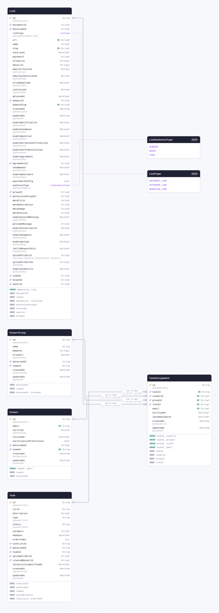

| Field            | Type       | Constraints                                 | Default      | Description |
| ---------------- | ---------- | ------------------------------------------- | ------------ | ----------- |
| `id`             | `String`   | PK NOT NULL                                 | `cuid(1)`    |             |
| `taskId`         | `String`   | NOT NULL → [Task.id](#model-Task)           |              |             |
| `viewerId`       | `String`   | NULL → [Viewer.id](#model-Viewer)           |              |             |
| `groupId`        | `String`   | NULL → [ViewerGroup.id](#model-ViewerGroup) |              |             |
| `linkId`         | `String`   | NULL → [Link.id](#model-Link)               |              |             |
| `email`          | `String`   | NULL                                        |              |             |
| `notifiedAt`     | `DateTime` | NULL                                        |              |             |
| `lastReminderAt` | `DateTime` | NULL                                        |              |             |
| `createdAt`      | `DateTime` | NOT NULL                                    | `now()`      |             |
| `updatedAt`      | `DateTime` | NOT NULL                                    | `@updatedAt` |             |

#### Indexes

- `@@index([taskId])`
- `@@index([viewerId])`
- `@@index([groupId])`
- `@@index([linkId])`
- `@@unique([taskId, viewerId])`
- `@@unique([taskId, groupId])`
- `@@unique([taskId, linkId])`
- `@@unique([taskId, email])`

#### References

- `taskId` → [Task.id](#model-Task) (many-to-one, on delete Cascade)
- `viewerId` → [Viewer.id](#model-Viewer) (many-to-one, on delete Cascade)
- `groupId` → [ViewerGroup.id](#model-ViewerGroup) (many-to-one, on delete Cascade)
- `linkId` → [Link.id](#model-Link) (many-to-one, on delete Cascade)

#### Definition

```sql
CREATE TABLE "TaskAssignment" (
    "id" TEXT NOT NULL,
    "taskId" TEXT NOT NULL,
    "viewerId" TEXT,
    "groupId" TEXT,
    "linkId" TEXT,
    "email" TEXT,
    "notifiedAt" TIMESTAMP(3),
    "lastReminderAt" TIMESTAMP(3),
    "createdAt" TIMESTAMP(3) NOT NULL DEFAULT CURRENT_TIMESTAMP,
    "updatedAt" TIMESTAMP(3) NOT NULL,

    CONSTRAINT "TaskAssignment_pkey" PRIMARY KEY ("id")
);

CREATE INDEX "TaskAssignment_taskId_idx" ON "TaskAssignment"("taskId");

CREATE INDEX "TaskAssignment_viewerId_idx" ON "TaskAssignment"("viewerId");

CREATE INDEX "TaskAssignment_groupId_idx" ON "TaskAssignment"("groupId");

CREATE INDEX "TaskAssignment_linkId_idx" ON "TaskAssignment"("linkId");

CREATE UNIQUE INDEX "TaskAssignment_taskId_viewerId_key" ON "TaskAssignment"("taskId", "viewerId");

CREATE UNIQUE INDEX "TaskAssignment_taskId_groupId_key" ON "TaskAssignment"("taskId", "groupId");

CREATE UNIQUE INDEX "TaskAssignment_taskId_linkId_key" ON "TaskAssignment"("taskId", "linkId");

CREATE UNIQUE INDEX "TaskAssignment_taskId_email_key" ON "TaskAssignment"("taskId", "email");

ALTER TABLE "TaskAssignment" ADD CONSTRAINT "TaskAssignment_taskId_fkey" FOREIGN KEY ("taskId") REFERENCES "Task"("id") ON DELETE CASCADE ON UPDATE CASCADE;

ALTER TABLE "TaskAssignment" ADD CONSTRAINT "TaskAssignment_viewerId_fkey" FOREIGN KEY ("viewerId") REFERENCES "Viewer"("id") ON DELETE CASCADE ON UPDATE CASCADE;

ALTER TABLE "TaskAssignment" ADD CONSTRAINT "TaskAssignment_groupId_fkey" FOREIGN KEY ("groupId") REFERENCES "ViewerGroup"("id") ON DELETE CASCADE ON UPDATE CASCADE;

ALTER TABLE "TaskAssignment" ADD CONSTRAINT "TaskAssignment_linkId_fkey" FOREIGN KEY ("linkId") REFERENCES "Link"("id") ON DELETE CASCADE ON UPDATE CASCADE;
```

<details>
<summary>Queries and their SQL</summary>

**findMany**: Every row

```ts
await prisma.taskAssignment.findMany();
```

```sql
SELECT
  "public"."TaskAssignment"."id",
  "public"."TaskAssignment"."taskId",
  "public"."TaskAssignment"."viewerId",
  "public"."TaskAssignment"."groupId",
  "public"."TaskAssignment"."linkId",
  "public"."TaskAssignment"."email",
  "public"."TaskAssignment"."notifiedAt",
  "public"."TaskAssignment"."lastReminderAt",
  "public"."TaskAssignment"."createdAt",
  "public"."TaskAssignment"."updatedAt"
FROM
  "public"."TaskAssignment"
WHERE
  1 = 1
OFFSET
  $1
-- params: ["0"]
```

**count**: How many rows there are

```ts
await prisma.taskAssignment.count();
```

```sql
SELECT
  COUNT(*) AS "_count$_all"
FROM
  (
    SELECT
      "public"."TaskAssignment"."id"
    FROM
      "public"."TaskAssignment"
    WHERE
      1 = 1
    OFFSET
      $1
  ) AS "sub"
-- params: ["0"]
```

**findMany**: Every row with its relations

```ts
await prisma.taskAssignment.findMany({
  include: { task: true, viewer: true, group: true, link: true },
});
```

```sql
SELECT
  "public"."TaskAssignment"."id",
  "public"."TaskAssignment"."taskId",
  "public"."TaskAssignment"."viewerId",
  "public"."TaskAssignment"."groupId",
  "public"."TaskAssignment"."linkId",
  "public"."TaskAssignment"."email",
  "public"."TaskAssignment"."notifiedAt",
  "public"."TaskAssignment"."lastReminderAt",
  "public"."TaskAssignment"."createdAt",
  "public"."TaskAssignment"."updatedAt"
FROM
  "public"."TaskAssignment"
WHERE
  1 = 1
OFFSET
  $1
-- params: ["0"]

SELECT
  "public"."Task"."id",
  "public"."Task"."title",
  "public"."Task"."description",
  "public"."Task"."type",
  "public"."Task"."status",
  "public"."Task"."category",
  "public"."Task"."dueDate",
  "public"."Task"."orderIndex",
  "public"."Task"."taskListId",
  "public"."Task"."dataroomId",
  "public"."Task"."teamId",
  "public"."Task"."uploadFolderId",
  "public"."Task"."createdByUserId",
  "public"."Task"."lastActivityNotifiedAt",
  "public"."Task"."createdAt",
  "public"."Task"."updatedAt"
FROM
  "public"."Task"
WHERE
  "public"."Task"."id" IN ($1)
OFFSET
  $2
-- params: ["<taskId of the rows above>","0"]

SELECT
  "public"."Viewer"."id",
  "public"."Viewer"."email",
  "public"."Viewer"."verified",
  "public"."Viewer"."invitedAt",
  "public"."Viewer"."notificationPreferences",
  "public"."Viewer"."dataroomId",
  "public"."Viewer"."teamId",
  "public"."Viewer"."createdAt",
  "public"."Viewer"."updatedAt"
FROM
  "public"."Viewer"
WHERE
  "public"."Viewer"."id" IN ($1)
OFFSET
  $2
-- params: ["<viewerId of the rows above>","0"]

SELECT
  "public"."ViewerGroup"."id",
  "public"."ViewerGroup"."name",
  "public"."ViewerGroup"."domains",
  "public"."ViewerGroup"."allowAll",
  "public"."ViewerGroup"."dataroomId",
  "public"."ViewerGroup"."teamId",
  "public"."ViewerGroup"."createdAt",
  "public"."ViewerGroup"."updatedAt"
FROM
  "public"."ViewerGroup"
WHERE
  "public"."ViewerGroup"."id" IN ($1)
OFFSET
  $2
-- params: ["<groupId of the rows above>","0"]

SELECT
  "public"."Link"."id",
  "public"."Link"."documentId",
  "public"."Link"."dataroomId",
  "public"."Link"."linkType"::text,
  "public"."Link"."url",
  "public"."Link"."name",
  "public"."Link"."slug",
  "public"."Link"."expiresAt",
  "public"."Link"."password",
  "public"."Link"."allowList",
  "public"."Link"."denyList",
  "public"."Link"."emailProtected",
  "public"."Link"."emailAuthenticated",
  "public"."Link"."allowDownload",
  "public"."Link"."isArchived",
  "public"."Link"."deletedAt",
  "public"."Link"."domainId",
  "public"."Link"."domainSlug",
  "public"."Link"."createdAt",
  "public"."Link"."updatedAt",
  "public"."Link"."enableNotification",
  "public"."Link"."enableFeedback",
  "public"."Link"."enableQuestion",
  "public"."Link"."enableScreenshotProtection",
  "public"."Link"."enableConfidentialView",
  "public"."Link"."enableAgreement",
  "public"."Link"."agreementId",
  "public"."Link"."showBanner",
  "public"."Link"."enableWatermark",
  "public"."Link"."watermarkConfig",
  "public"."Link"."audienceType"::text,
  "public"."Link"."groupId",
  "public"."Link"."permissionGroupId",
  "public"."Link"."metaTitle",
  "public"."Link"."metaDescription",
  "public"."Link"."metaImage",
  "public"."Link"."metaFavicon",
  "public"."Link"."enableCustomMetatag",
  "public"."Link"."welcomeMessage",
  "public"."Link"."enableConversation",
  "public"."Link"."enableAIAgents",
  "public"."Link"."enableUpload",
  "public"."Link"."isFileRequestOnly",
  "public"."Link"."uploadFolderId",
  "public"."Link"."uploadFolderIds",
  "public"."Link"."enableIndexFile",
  "public"."Link"."teamId",
  "public"."Link"."brandId",
  "public"."Link"."ownerId"
FROM
  "public"."Link"
WHERE
  "public"."Link"."id" IN ($1)
OFFSET
  $2
-- params: ["<linkId of the rows above>","0"]
```

**findUnique**: One row by what is unique to it

```ts
await prisma.taskAssignment.findUnique({ where: { id: "example" } });
```

```sql
SELECT
  "public"."TaskAssignment"."id",
  "public"."TaskAssignment"."taskId",
  "public"."TaskAssignment"."viewerId",
  "public"."TaskAssignment"."groupId",
  "public"."TaskAssignment"."linkId",
  "public"."TaskAssignment"."email",
  "public"."TaskAssignment"."notifiedAt",
  "public"."TaskAssignment"."lastReminderAt",
  "public"."TaskAssignment"."createdAt",
  "public"."TaskAssignment"."updatedAt"
FROM
  "public"."TaskAssignment"
WHERE
  (
    "public"."TaskAssignment"."id" = $1
    AND 1 = 1
  )
LIMIT
  $2
OFFSET
  $3
-- params: ["example","1","0"]
```

**create**: Create a row

```ts
await prisma.taskAssignment.create({ data: { taskId: "example" } });
```

```sql
INSERT INTO
  "public"."TaskAssignment" ("id", "taskId", "createdAt", "updatedAt")
VALUES
  ($1, $2, $3, $4)
RETURNING
  "public"."TaskAssignment"."id",
  "public"."TaskAssignment"."taskId",
  "public"."TaskAssignment"."viewerId",
  "public"."TaskAssignment"."groupId",
  "public"."TaskAssignment"."linkId",
  "public"."TaskAssignment"."email",
  "public"."TaskAssignment"."notifiedAt",
  "public"."TaskAssignment"."lastReminderAt",
  "public"."TaskAssignment"."createdAt",
  "public"."TaskAssignment"."updatedAt"
-- params: ["<cuid(1)>","example","<now()>","<now()>"]
```

**update**: Update a row

```ts
await prisma.taskAssignment.update({ where: { id: "example" }, data: { email: "example" } });
```

```sql
UPDATE "public"."TaskAssignment"
SET
  "email" = $1,
  "updatedAt" = $2
WHERE
  (
    "public"."TaskAssignment"."id" = $3
    AND 1 = 1
  )
RETURNING
  "public"."TaskAssignment"."id",
  "public"."TaskAssignment"."taskId",
  "public"."TaskAssignment"."viewerId",
  "public"."TaskAssignment"."groupId",
  "public"."TaskAssignment"."linkId",
  "public"."TaskAssignment"."email",
  "public"."TaskAssignment"."notifiedAt",
  "public"."TaskAssignment"."lastReminderAt",
  "public"."TaskAssignment"."createdAt",
  "public"."TaskAssignment"."updatedAt"
-- params: ["example",{"prisma__type":"generatorCall","prisma__value":{"name":"now","args":[],"returnType":{"type":"DateTime"}}},"example"]
```

**delete**: Delete a row

```ts
await prisma.taskAssignment.delete({ where: { id: "example" } });
```

```sql
DELETE FROM "public"."TaskAssignment"
WHERE
  (
    "public"."TaskAssignment"."id" = $1
    AND 1 = 1
  )
RETURNING
  "public"."TaskAssignment"."id",
  "public"."TaskAssignment"."taskId",
  "public"."TaskAssignment"."viewerId",
  "public"."TaskAssignment"."groupId",
  "public"."TaskAssignment"."linkId",
  "public"."TaskAssignment"."email",
  "public"."TaskAssignment"."notifiedAt",
  "public"."TaskAssignment"."lastReminderAt",
  "public"."TaskAssignment"."createdAt",
  "public"."TaskAssignment"."updatedAt"
-- params: ["example"]
```

</details>

<a id="model-TaskActivity"></a>

### TaskActivity

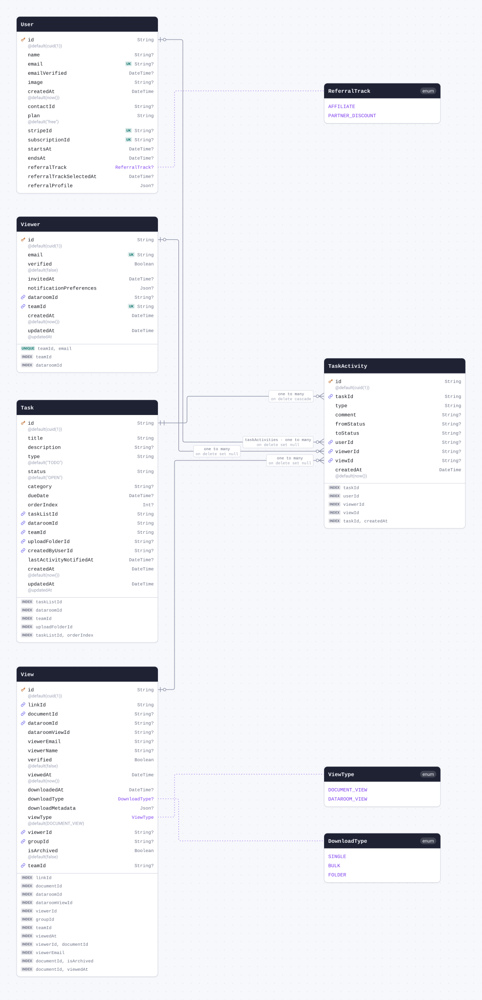

| Field        | Type       | Constraints                       | Default   | Description |
| ------------ | ---------- | --------------------------------- | --------- | ----------- |
| `id`         | `String`   | PK NOT NULL                       | `cuid(1)` |             |
| `taskId`     | `String`   | NOT NULL → [Task.id](#model-Task) |           |             |
| `type`       | `String`   | NOT NULL                          |           |             |
| `comment`    | `String`   | NULL                              |           |             |
| `fromStatus` | `String`   | NULL                              |           |             |
| `toStatus`   | `String`   | NULL                              |           |             |
| `userId`     | `String`   | NULL → [User.id](#model-User)     |           |             |
| `viewerId`   | `String`   | NULL → [Viewer.id](#model-Viewer) |           |             |
| `viewId`     | `String`   | NULL → [View.id](#model-View)     |           |             |
| `createdAt`  | `DateTime` | NOT NULL                          | `now()`   |             |

#### Indexes

- `@@index([taskId])`
- `@@index([userId])`
- `@@index([viewerId])`
- `@@index([viewId])`
- `@@index([taskId, createdAt])`

#### References

- `taskId` → [Task.id](#model-Task) (many-to-one, on delete Cascade)
- `userId` → [User.id](#model-User) (many-to-one, on delete SetNull)
- `viewerId` → [Viewer.id](#model-Viewer) (many-to-one, on delete SetNull)
- `viewId` → [View.id](#model-View) (many-to-one, on delete SetNull)

#### Definition

```sql
CREATE TABLE "TaskActivity" (
    "id" TEXT NOT NULL,
    "taskId" TEXT NOT NULL,
    "type" TEXT NOT NULL,
    "comment" TEXT,
    "fromStatus" TEXT,
    "toStatus" TEXT,
    "userId" TEXT,
    "viewerId" TEXT,
    "viewId" TEXT,
    "createdAt" TIMESTAMP(3) NOT NULL DEFAULT CURRENT_TIMESTAMP,

    CONSTRAINT "TaskActivity_pkey" PRIMARY KEY ("id")
);

CREATE INDEX "TaskActivity_taskId_idx" ON "TaskActivity"("taskId");

CREATE INDEX "TaskActivity_userId_idx" ON "TaskActivity"("userId");

CREATE INDEX "TaskActivity_viewerId_idx" ON "TaskActivity"("viewerId");

CREATE INDEX "TaskActivity_viewId_idx" ON "TaskActivity"("viewId");

CREATE INDEX "TaskActivity_taskId_createdAt_idx" ON "TaskActivity"("taskId", "createdAt");

ALTER TABLE "TaskActivity" ADD CONSTRAINT "TaskActivity_taskId_fkey" FOREIGN KEY ("taskId") REFERENCES "Task"("id") ON DELETE CASCADE ON UPDATE CASCADE;

ALTER TABLE "TaskActivity" ADD CONSTRAINT "TaskActivity_userId_fkey" FOREIGN KEY ("userId") REFERENCES "User"("id") ON DELETE SET NULL ON UPDATE CASCADE;

ALTER TABLE "TaskActivity" ADD CONSTRAINT "TaskActivity_viewerId_fkey" FOREIGN KEY ("viewerId") REFERENCES "Viewer"("id") ON DELETE SET NULL ON UPDATE CASCADE;

ALTER TABLE "TaskActivity" ADD CONSTRAINT "TaskActivity_viewId_fkey" FOREIGN KEY ("viewId") REFERENCES "View"("id") ON DELETE SET NULL ON UPDATE CASCADE;
```

<details>
<summary>Queries and their SQL</summary>

**findMany**: Every row

```ts
await prisma.taskActivity.findMany();
```

```sql
SELECT
  "public"."TaskActivity"."id",
  "public"."TaskActivity"."taskId",
  "public"."TaskActivity"."type",
  "public"."TaskActivity"."comment",
  "public"."TaskActivity"."fromStatus",
  "public"."TaskActivity"."toStatus",
  "public"."TaskActivity"."userId",
  "public"."TaskActivity"."viewerId",
  "public"."TaskActivity"."viewId",
  "public"."TaskActivity"."createdAt"
FROM
  "public"."TaskActivity"
WHERE
  1 = 1
OFFSET
  $1
-- params: ["0"]
```

**count**: How many rows there are

```ts
await prisma.taskActivity.count();
```

```sql
SELECT
  COUNT(*) AS "_count$_all"
FROM
  (
    SELECT
      "public"."TaskActivity"."id"
    FROM
      "public"."TaskActivity"
    WHERE
      1 = 1
    OFFSET
      $1
  ) AS "sub"
-- params: ["0"]
```

**findMany**: Every row with its relations

```ts
await prisma.taskActivity.findMany({
  include: { task: true, user: true, viewer: true, view: true },
});
```

```sql
SELECT
  "public"."TaskActivity"."id",
  "public"."TaskActivity"."taskId",
  "public"."TaskActivity"."type",
  "public"."TaskActivity"."comment",
  "public"."TaskActivity"."fromStatus",
  "public"."TaskActivity"."toStatus",
  "public"."TaskActivity"."userId",
  "public"."TaskActivity"."viewerId",
  "public"."TaskActivity"."viewId",
  "public"."TaskActivity"."createdAt"
FROM
  "public"."TaskActivity"
WHERE
  1 = 1
OFFSET
  $1
-- params: ["0"]

SELECT
  "public"."Task"."id",
  "public"."Task"."title",
  "public"."Task"."description",
  "public"."Task"."type",
  "public"."Task"."status",
  "public"."Task"."category",
  "public"."Task"."dueDate",
  "public"."Task"."orderIndex",
  "public"."Task"."taskListId",
  "public"."Task"."dataroomId",
  "public"."Task"."teamId",
  "public"."Task"."uploadFolderId",
  "public"."Task"."createdByUserId",
  "public"."Task"."lastActivityNotifiedAt",
  "public"."Task"."createdAt",
  "public"."Task"."updatedAt"
FROM
  "public"."Task"
WHERE
  "public"."Task"."id" IN ($1)
OFFSET
  $2
-- params: ["<taskId of the rows above>","0"]

SELECT
  "public"."User"."id",
  "public"."User"."name",
  "public"."User"."email",
  "public"."User"."emailVerified",
  "public"."User"."image",
  "public"."User"."createdAt",
  "public"."User"."contactId",
  "public"."User"."plan",
  "public"."User"."stripeId",
  "public"."User"."subscriptionId",
  "public"."User"."startsAt",
  "public"."User"."endsAt",
  "public"."User"."referralTrack"::text,
  "public"."User"."referralTrackSelectedAt",
  "public"."User"."referralProfile"
FROM
  "public"."User"
WHERE
  "public"."User"."id" IN ($1)
OFFSET
  $2
-- params: ["<userId of the rows above>","0"]

SELECT
  "public"."Viewer"."id",
  "public"."Viewer"."email",
  "public"."Viewer"."verified",
  "public"."Viewer"."invitedAt",
  "public"."Viewer"."notificationPreferences",
  "public"."Viewer"."dataroomId",
  "public"."Viewer"."teamId",
  "public"."Viewer"."createdAt",
  "public"."Viewer"."updatedAt"
FROM
  "public"."Viewer"
WHERE
  "public"."Viewer"."id" IN ($1)
OFFSET
  $2
-- params: ["<viewerId of the rows above>","0"]

SELECT
  "public"."View"."id",
  "public"."View"."linkId",
  "public"."View"."documentId",
  "public"."View"."dataroomId",
  "public"."View"."dataroomViewId",
  "public"."View"."viewerEmail",
  "public"."View"."viewerName",
  "public"."View"."verified",
  "public"."View"."viewedAt",
  "public"."View"."downloadedAt",
  "public"."View"."downloadType"::text,
  "public"."View"."downloadMetadata",
  "public"."View"."viewType"::text,
  "public"."View"."viewerId",
  "public"."View"."groupId",
  "public"."View"."isArchived",
  "public"."View"."teamId"
FROM
  "public"."View"
WHERE
  "public"."View"."id" IN ($1)
OFFSET
  $2
-- params: ["<viewId of the rows above>","0"]
```

**findUnique**: One row by what is unique to it

```ts
await prisma.taskActivity.findUnique({ where: { id: "example" } });
```

```sql
SELECT
  "public"."TaskActivity"."id",
  "public"."TaskActivity"."taskId",
  "public"."TaskActivity"."type",
  "public"."TaskActivity"."comment",
  "public"."TaskActivity"."fromStatus",
  "public"."TaskActivity"."toStatus",
  "public"."TaskActivity"."userId",
  "public"."TaskActivity"."viewerId",
  "public"."TaskActivity"."viewId",
  "public"."TaskActivity"."createdAt"
FROM
  "public"."TaskActivity"
WHERE
  (
    "public"."TaskActivity"."id" = $1
    AND 1 = 1
  )
LIMIT
  $2
OFFSET
  $3
-- params: ["example","1","0"]
```

**create**: Create a row

```ts
await prisma.taskActivity.create({ data: { taskId: "example", type: "example" } });
```

```sql
INSERT INTO
  "public"."TaskActivity" ("id", "taskId", "type", "createdAt")
VALUES
  ($1, $2, $3, $4)
RETURNING
  "public"."TaskActivity"."id",
  "public"."TaskActivity"."taskId",
  "public"."TaskActivity"."type",
  "public"."TaskActivity"."comment",
  "public"."TaskActivity"."fromStatus",
  "public"."TaskActivity"."toStatus",
  "public"."TaskActivity"."userId",
  "public"."TaskActivity"."viewerId",
  "public"."TaskActivity"."viewId",
  "public"."TaskActivity"."createdAt"
-- params: ["<cuid(1)>","example","example","<now()>"]
```

**update**: Update a row

```ts
await prisma.taskActivity.update({ where: { id: "example" }, data: { type: "example" } });
```

```sql
UPDATE "public"."TaskActivity"
SET
  "type" = $1
WHERE
  (
    "public"."TaskActivity"."id" = $2
    AND 1 = 1
  )
RETURNING
  "public"."TaskActivity"."id",
  "public"."TaskActivity"."taskId",
  "public"."TaskActivity"."type",
  "public"."TaskActivity"."comment",
  "public"."TaskActivity"."fromStatus",
  "public"."TaskActivity"."toStatus",
  "public"."TaskActivity"."userId",
  "public"."TaskActivity"."viewerId",
  "public"."TaskActivity"."viewId",
  "public"."TaskActivity"."createdAt"
-- params: ["example","example"]
```

**delete**: Delete a row

```ts
await prisma.taskActivity.delete({ where: { id: "example" } });
```

```sql
DELETE FROM "public"."TaskActivity"
WHERE
  (
    "public"."TaskActivity"."id" = $1
    AND 1 = 1
  )
RETURNING
  "public"."TaskActivity"."id",
  "public"."TaskActivity"."taskId",
  "public"."TaskActivity"."type",
  "public"."TaskActivity"."comment",
  "public"."TaskActivity"."fromStatus",
  "public"."TaskActivity"."toStatus",
  "public"."TaskActivity"."userId",
  "public"."TaskActivity"."viewerId",
  "public"."TaskActivity"."viewId",
  "public"."TaskActivity"."createdAt"
-- params: ["example"]
```

</details>

<a id="model-DataroomDocument"></a>

### DataroomDocument

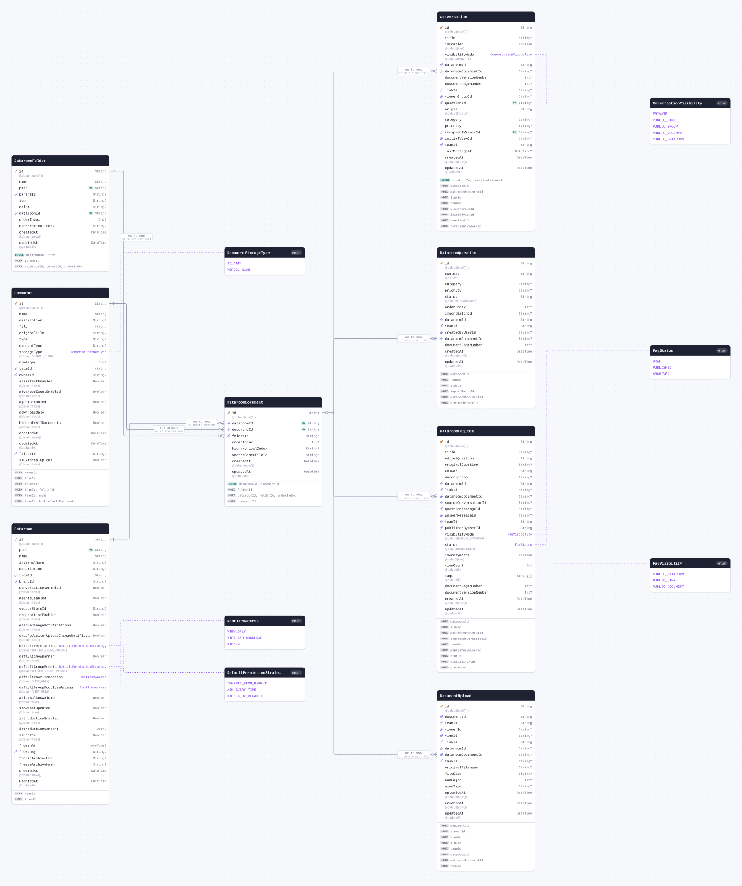

| Field               | Type       | Constraints                                       | Default      | Description |
| ------------------- | ---------- | ------------------------------------------------- | ------------ | ----------- |
| `id`                | `String`   | PK NOT NULL                                       | `cuid(1)`    |             |
| `dataroomId`        | `String`   | NOT NULL → [Dataroom.id](#model-Dataroom)         |              |             |
| `documentId`        | `String`   | NOT NULL → [Document.id](#model-Document)         |              |             |
| `folderId`          | `String`   | NULL → [DataroomFolder.id](#model-DataroomFolder) |              |             |
| `orderIndex`        | `Int`      | NULL                                              |              |             |
| `hierarchicalIndex` | `String`   | NULL                                              |              |             |
| `vectorStoreFileId` | `String`   | NULL                                              |              |             |
| `createdAt`         | `DateTime` | NOT NULL                                          | `now()`      |             |
| `updatedAt`         | `DateTime` | NOT NULL                                          | `@updatedAt` |             |

#### Indexes

- `@@index([folderId])`
- `@@index([dataroomId, folderId, orderIndex])`
- `@@index([documentId])`
- `@@unique([dataroomId, documentId])`

#### References

- `dataroomId` → [Dataroom.id](#model-Dataroom) (many-to-one, on delete Cascade)
- `documentId` → [Document.id](#model-Document) (many-to-one, on delete Cascade)
- `folderId` → [DataroomFolder.id](#model-DataroomFolder) (many-to-one, on delete SetNull)

#### Referenced by

- `id` ← [Conversation.dataroomDocumentId](#model-Conversation) (one-to-many, on delete SetNull)
- `id` ← [DataroomQuestion.dataroomDocumentId](#model-DataroomQuestion) (one-to-many, on delete SetNull)
- `id` ← [DataroomFaqItem.dataroomDocumentId](#model-DataroomFaqItem) (one-to-many, on delete SetNull)
- `id` ← [DocumentUpload.dataroomDocumentId](#model-DocumentUpload) (one-to-many, on delete SetNull)

#### Definition

```sql
CREATE TABLE "DataroomDocument" (
    "id" TEXT NOT NULL,
    "dataroomId" TEXT NOT NULL,
    "documentId" TEXT NOT NULL,
    "folderId" TEXT,
    "orderIndex" INTEGER,
    "hierarchicalIndex" TEXT,
    "vectorStoreFileId" TEXT,
    "createdAt" TIMESTAMP(3) NOT NULL DEFAULT CURRENT_TIMESTAMP,
    "updatedAt" TIMESTAMP(3) NOT NULL,

    CONSTRAINT "DataroomDocument_pkey" PRIMARY KEY ("id")
);

CREATE INDEX "DataroomDocument_folderId_idx" ON "DataroomDocument"("folderId");

CREATE INDEX "DataroomDocument_dataroomId_folderId_orderIndex_idx" ON "DataroomDocument"("dataroomId", "folderId", "orderIndex");

CREATE INDEX "DataroomDocument_documentId_idx" ON "DataroomDocument"("documentId");

CREATE UNIQUE INDEX "DataroomDocument_dataroomId_documentId_key" ON "DataroomDocument"("dataroomId", "documentId");

ALTER TABLE "DataroomDocument" ADD CONSTRAINT "DataroomDocument_dataroomId_fkey" FOREIGN KEY ("dataroomId") REFERENCES "Dataroom"("id") ON DELETE CASCADE ON UPDATE CASCADE;

ALTER TABLE "DataroomDocument" ADD CONSTRAINT "DataroomDocument_documentId_fkey" FOREIGN KEY ("documentId") REFERENCES "Document"("id") ON DELETE CASCADE ON UPDATE CASCADE;

ALTER TABLE "DataroomDocument" ADD CONSTRAINT "DataroomDocument_folderId_fkey" FOREIGN KEY ("folderId") REFERENCES "DataroomFolder"("id") ON DELETE SET NULL ON UPDATE CASCADE;
```

<details>
<summary>Queries and their SQL</summary>

**findMany**: Every row

```ts
await prisma.dataroomDocument.findMany();
```

```sql
SELECT
  "public"."DataroomDocument"."id",
  "public"."DataroomDocument"."dataroomId",
  "public"."DataroomDocument"."documentId",
  "public"."DataroomDocument"."folderId",
  "public"."DataroomDocument"."orderIndex",
  "public"."DataroomDocument"."hierarchicalIndex",
  "public"."DataroomDocument"."vectorStoreFileId",
  "public"."DataroomDocument"."createdAt",
  "public"."DataroomDocument"."updatedAt"
FROM
  "public"."DataroomDocument"
WHERE
  1 = 1
OFFSET
  $1
-- params: ["0"]
```

**count**: How many rows there are

```ts
await prisma.dataroomDocument.count();
```

```sql
SELECT
  COUNT(*) AS "_count$_all"
FROM
  (
    SELECT
      "public"."DataroomDocument"."id"
    FROM
      "public"."DataroomDocument"
    WHERE
      1 = 1
    OFFSET
      $1
  ) AS "sub"
-- params: ["0"]
```

**findMany**: Every row with its relations

```ts
await prisma.dataroomDocument.findMany({
  include: {
    dataroom: true,
    document: true,
    folder: true,
    conversations: true,
    questions: true,
    dataroomFAQs: true,
    uploadedDocuments: true,
  },
});
```

```sql
SELECT
  "public"."DataroomDocument"."id",
  "public"."DataroomDocument"."dataroomId",
  "public"."DataroomDocument"."documentId",
  "public"."DataroomDocument"."folderId",
  "public"."DataroomDocument"."orderIndex",
  "public"."DataroomDocument"."hierarchicalIndex",
  "public"."DataroomDocument"."vectorStoreFileId",
  "public"."DataroomDocument"."createdAt",
  "public"."DataroomDocument"."updatedAt"
FROM
  "public"."DataroomDocument"
WHERE
  1 = 1
OFFSET
  $1
-- params: ["0"]

SELECT
  "public"."Dataroom"."id",
  "public"."Dataroom"."pId",
  "public"."Dataroom"."name",
  "public"."Dataroom"."internalName",
  "public"."Dataroom"."description",
  "public"."Dataroom"."teamId",
  "public"."Dataroom"."brandId",
  "public"."Dataroom"."conversationsEnabled",
  "public"."Dataroom"."agentsEnabled",
  "public"."Dataroom"."vectorStoreId",
  "public"."Dataroom"."requestListEnabled",
  "public"."Dataroom"."enableChangeNotifications",
  "public"."Dataroom"."enableVisitorUploadChangeNotifications",
  "public"."Dataroom"."defaultPermissionStrategy"::text,
  "public"."Dataroom"."defaultShowBanner",
  "public"."Dataroom"."defaultGroupPermissionStrategy"::text,
  "public"."Dataroom"."defaultRootItemAccess"::text,
  "public"."Dataroom"."defaultGroupRootItemAccess"::text,
  "public"."Dataroom"."allowBulkDownload",
  "public"."Dataroom"."showLastUpdated",
  "public"."Dataroom"."introductionEnabled",
  "public"."Dataroom"."introductionContent",
  "public"."Dataroom"."isFrozen",
  "public"."Dataroom"."frozenAt",
  "public"."Dataroom"."frozenBy",
  "public"."Dataroom"."freezeArchiveUrl",
  "public"."Dataroom"."freezeArchiveHash",
  "public"."Dataroom"."createdAt",
  "public"."Dataroom"."updatedAt"
FROM
  "public"."Dataroom"
WHERE
  "public"."Dataroom"."id" IN ($1)
OFFSET
  $2
-- params: ["<dataroomId of the rows above>","0"]

SELECT
  "public"."Document"."id",
  "public"."Document"."name",
  "public"."Document"."description",
  "public"."Document"."file",
  "public"."Document"."originalFile",
  "public"."Document"."type",
  "public"."Document"."contentType",
  "public"."Document"."storageType"::text,
  "public"."Document"."numPages",
  "public"."Document"."teamId",
  "public"."Document"."ownerId",
  "public"."Document"."assistantEnabled",
  "public"."Document"."advancedExcelEnabled",
  "public"."Document"."agentsEnabled",
  "public"."Document"."downloadOnly",
  "public"."Document"."hiddenInAllDocuments",
  "public"."Document"."createdAt",
  "public"."Document"."updatedAt",
  "public"."Document"."folderId",
  "public"."Document"."isExternalUpload"
FROM
  "public"."Document"
WHERE
  "public"."Document"."id" IN ($1)
OFFSET
  $2
-- params: ["<documentId of the rows above>","0"]

SELECT
  "public"."DataroomFolder"."id",
  "public"."DataroomFolder"."name",
  "public"."DataroomFolder"."path",
  "public"."DataroomFolder"."parentId",
  "public"."DataroomFolder"."icon",
  "public"."DataroomFolder"."color",
  "public"."DataroomFolder"."dataroomId",
  "public"."DataroomFolder"."orderIndex",
  "public"."DataroomFolder"."hierarchicalIndex",
  "public"."DataroomFolder"."createdAt",
  "public"."DataroomFolder"."updatedAt"
FROM
  "public"."DataroomFolder"
WHERE
  "public"."DataroomFolder"."id" IN ($1)
OFFSET
  $2
-- params: ["<folderId of the rows above>","0"]

SELECT
  "public"."Conversation"."id",
  "public"."Conversation"."title",
  "public"."Conversation"."isEnabled",
  "public"."Conversation"."visibilityMode"::text,
  "public"."Conversation"."dataroomId",
  "public"."Conversation"."dataroomDocumentId",
  "public"."Conversation"."documentVersionNumber",
  "public"."Conversation"."documentPageNumber",
  "public"."Conversation"."linkId",
  "public"."Conversation"."viewerGroupId",
  "public"."Conversation"."questionId",
  "public"."Conversation"."origin",
  "public"."Conversation"."category",
  "public"."Conversation"."priority",
  "public"."Conversation"."recipientViewerId",
  "public"."Conversation"."initialViewId",
  "public"."Conversation"."teamId",
  "public"."Conversation"."lastMessageAt",
  "public"."Conversation"."createdAt",
  "public"."Conversation"."updatedAt"
FROM
  "public"."Conversation"
WHERE
  "public"."Conversation"."dataroomDocumentId" IN ($1)
OFFSET
  $2
-- params: ["<id of the rows above>","0"]

SELECT
  "public"."DataroomQuestion"."id",
  "public"."DataroomQuestion"."content",
  "public"."DataroomQuestion"."category",
  "public"."DataroomQuestion"."priority",
  "public"."DataroomQuestion"."status",
  "public"."DataroomQuestion"."orderIndex",
  "public"."DataroomQuestion"."importBatchId",
  "public"."DataroomQuestion"."dataroomId",
  "public"."DataroomQuestion"."teamId",
  "public"."DataroomQuestion"."createdByUserId",
  "public"."DataroomQuestion"."dataroomDocumentId",
  "public"."DataroomQuestion"."documentPageNumber",
  "public"."DataroomQuestion"."createdAt",
  "public"."DataroomQuestion"."updatedAt"
FROM
  "public"."DataroomQuestion"
WHERE
  "public"."DataroomQuestion"."dataroomDocumentId" IN ($1)
OFFSET
  $2
-- params: ["<id of the rows above>","0"]

SELECT
  "public"."DataroomFaqItem"."id",
  "public"."DataroomFaqItem"."title",
  "public"."DataroomFaqItem"."editedQuestion",
  "public"."DataroomFaqItem"."originalQuestion",
  "public"."DataroomFaqItem"."answer",
  "public"."DataroomFaqItem"."description",
  "public"."DataroomFaqItem"."dataroomId",
  "public"."DataroomFaqItem"."linkId",
  "public"."DataroomFaqItem"."dataroomDocumentId",
  "public"."DataroomFaqItem"."sourceConversationId",
  "public"."DataroomFaqItem"."questionMessageId",
  "public"."DataroomFaqItem"."answerMessageId",
  "public"."DataroomFaqItem"."teamId",
  "public"."DataroomFaqItem"."publishedByUserId",
  "public"."DataroomFaqItem"."visibilityMode"::text,
  "public"."DataroomFaqItem"."status"::text,
  "public"."DataroomFaqItem"."isAnonymized",
  "public"."DataroomFaqItem"."viewCount",
  "public"."DataroomFaqItem"."tags",
  "public"."DataroomFaqItem"."documentPageNumber",
  "public"."DataroomFaqItem"."documentVersionNumber",
  "public"."DataroomFaqItem"."createdAt",
  "public"."DataroomFaqItem"."updatedAt"
FROM
  "public"."DataroomFaqItem"
WHERE
  "public"."DataroomFaqItem"."dataroomDocumentId" IN ($1)
OFFSET
  $2
-- params: ["<id of the rows above>","0"]

SELECT
  "public"."DocumentUpload"."id",
  "public"."DocumentUpload"."documentId",
  "public"."DocumentUpload"."teamId",
  "public"."DocumentUpload"."viewerId",
  "public"."DocumentUpload"."viewId",
  "public"."DocumentUpload"."linkId",
  "public"."DocumentUpload"."dataroomId",
  "public"."DocumentUpload"."dataroomDocumentId",
  "public"."DocumentUpload"."taskId",
  "public"."DocumentUpload"."originalFilename",
  "public"."DocumentUpload"."fileSize",
  "public"."DocumentUpload"."numPages",
  "public"."DocumentUpload"."mimeType",
  "public"."DocumentUpload"."uploadedAt",
  "public"."DocumentUpload"."createdAt",
  "public"."DocumentUpload"."updatedAt"
FROM
  "public"."DocumentUpload"
WHERE
  "public"."DocumentUpload"."dataroomDocumentId" IN ($1)
OFFSET
  $2
-- params: ["<id of the rows above>","0"]
```

**findUnique**: One row by what is unique to it

```ts
await prisma.dataroomDocument.findUnique({ where: { id: "example" } });
```

```sql
SELECT
  "public"."DataroomDocument"."id",
  "public"."DataroomDocument"."dataroomId",
  "public"."DataroomDocument"."documentId",
  "public"."DataroomDocument"."folderId",
  "public"."DataroomDocument"."orderIndex",
  "public"."DataroomDocument"."hierarchicalIndex",
  "public"."DataroomDocument"."vectorStoreFileId",
  "public"."DataroomDocument"."createdAt",
  "public"."DataroomDocument"."updatedAt"
FROM
  "public"."DataroomDocument"
WHERE
  (
    "public"."DataroomDocument"."id" = $1
    AND 1 = 1
  )
LIMIT
  $2
OFFSET
  $3
-- params: ["example","1","0"]
```

**create**: Create a row

```ts
await prisma.dataroomDocument.create({ data: { dataroomId: "example", documentId: "example" } });
```

```sql
INSERT INTO
  "public"."DataroomDocument" (
    "id",
    "dataroomId",
    "documentId",
    "createdAt",
    "updatedAt"
  )
VALUES
  ($1, $2, $3, $4, $5)
RETURNING
  "public"."DataroomDocument"."id",
  "public"."DataroomDocument"."dataroomId",
  "public"."DataroomDocument"."documentId",
  "public"."DataroomDocument"."folderId",
  "public"."DataroomDocument"."orderIndex",
  "public"."DataroomDocument"."hierarchicalIndex",
  "public"."DataroomDocument"."vectorStoreFileId",
  "public"."DataroomDocument"."createdAt",
  "public"."DataroomDocument"."updatedAt"
-- params: ["<cuid(1)>","example","example","<now()>","<now()>"]
```

**update**: Update a row

```ts
await prisma.dataroomDocument.update({ where: { id: "example" }, data: { orderIndex: 1 } });
```

```sql
UPDATE "public"."DataroomDocument"
SET
  "orderIndex" = $1,
  "updatedAt" = $2
WHERE
  (
    "public"."DataroomDocument"."id" = $3
    AND 1 = 1
  )
RETURNING
  "public"."DataroomDocument"."id",
  "public"."DataroomDocument"."dataroomId",
  "public"."DataroomDocument"."documentId",
  "public"."DataroomDocument"."folderId",
  "public"."DataroomDocument"."orderIndex",
  "public"."DataroomDocument"."hierarchicalIndex",
  "public"."DataroomDocument"."vectorStoreFileId",
  "public"."DataroomDocument"."createdAt",
  "public"."DataroomDocument"."updatedAt"
-- params: ["1",{"prisma__type":"generatorCall","prisma__value":{"name":"now","args":[],"returnType":{"type":"DateTime"}}},"example"]
```

**delete**: Delete a row

```ts
await prisma.dataroomDocument.delete({ where: { id: "example" } });
```

```sql
DELETE FROM "public"."DataroomDocument"
WHERE
  (
    "public"."DataroomDocument"."id" = $1
    AND 1 = 1
  )
RETURNING
  "public"."DataroomDocument"."id",
  "public"."DataroomDocument"."dataroomId",
  "public"."DataroomDocument"."documentId",
  "public"."DataroomDocument"."folderId",
  "public"."DataroomDocument"."orderIndex",
  "public"."DataroomDocument"."hierarchicalIndex",
  "public"."DataroomDocument"."vectorStoreFileId",
  "public"."DataroomDocument"."createdAt",
  "public"."DataroomDocument"."updatedAt"
-- params: ["example"]
```

</details>

<a id="model-DataroomFolder"></a>

### DataroomFolder

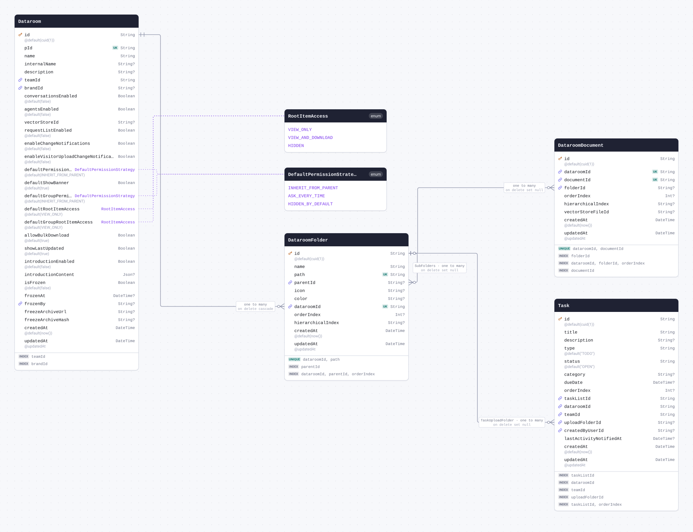

| Field               | Type       | Constraints                                       | Default      | Description |
| ------------------- | ---------- | ------------------------------------------------- | ------------ | ----------- |
| `id`                | `String`   | PK NOT NULL                                       | `cuid(1)`    |             |
| `name`              | `String`   | NOT NULL                                          |              |             |
| `path`              | `String`   | NOT NULL                                          |              |             |
| `parentId`          | `String`   | NULL → [DataroomFolder.id](#model-DataroomFolder) |              |             |
| `icon`              | `String`   | NULL                                              |              |             |
| `color`             | `String`   | NULL                                              |              |             |
| `dataroomId`        | `String`   | NOT NULL → [Dataroom.id](#model-Dataroom)         |              |             |
| `orderIndex`        | `Int`      | NULL                                              |              |             |
| `hierarchicalIndex` | `String`   | NULL                                              |              |             |
| `createdAt`         | `DateTime` | NOT NULL                                          | `now()`      |             |
| `updatedAt`         | `DateTime` | NOT NULL                                          | `@updatedAt` |             |

#### Indexes

- `@@index([parentId])`
- `@@index([dataroomId, parentId, orderIndex])`
- `@@unique([dataroomId, path])`

#### References

- `parentId` → [DataroomFolder.id](#model-DataroomFolder) (many-to-one, on delete SetNull)
- `dataroomId` → [Dataroom.id](#model-Dataroom) (many-to-one, on delete Cascade)

#### Referenced by

- `id` ← [Task.uploadFolderId](#model-Task) (one-to-many, on delete SetNull)
- `id` ← [DataroomDocument.folderId](#model-DataroomDocument) (one-to-many, on delete SetNull)
- `id` ← [DataroomFolder.parentId](#model-DataroomFolder) (one-to-many, on delete SetNull)

#### Definition

```sql
CREATE TABLE "DataroomFolder" (
    "id" TEXT NOT NULL,
    "name" TEXT NOT NULL,
    "path" TEXT NOT NULL,
    "parentId" TEXT,
    "icon" TEXT,
    "color" TEXT,
    "dataroomId" TEXT NOT NULL,
    "orderIndex" INTEGER,
    "hierarchicalIndex" TEXT,
    "createdAt" TIMESTAMP(3) NOT NULL DEFAULT CURRENT_TIMESTAMP,
    "updatedAt" TIMESTAMP(3) NOT NULL,

    CONSTRAINT "DataroomFolder_pkey" PRIMARY KEY ("id")
);

CREATE INDEX "DataroomFolder_parentId_idx" ON "DataroomFolder"("parentId");

CREATE INDEX "DataroomFolder_dataroomId_parentId_orderIndex_idx" ON "DataroomFolder"("dataroomId", "parentId", "orderIndex");

CREATE UNIQUE INDEX "DataroomFolder_dataroomId_path_key" ON "DataroomFolder"("dataroomId", "path");

ALTER TABLE "DataroomFolder" ADD CONSTRAINT "DataroomFolder_parentId_fkey" FOREIGN KEY ("parentId") REFERENCES "DataroomFolder"("id") ON DELETE SET NULL ON UPDATE CASCADE;

ALTER TABLE "DataroomFolder" ADD CONSTRAINT "DataroomFolder_dataroomId_fkey" FOREIGN KEY ("dataroomId") REFERENCES "Dataroom"("id") ON DELETE CASCADE ON UPDATE CASCADE;
```

<details>
<summary>Queries and their SQL</summary>

**findMany**: Every row

```ts
await prisma.dataroomFolder.findMany();
```

```sql
SELECT
  "public"."DataroomFolder"."id",
  "public"."DataroomFolder"."name",
  "public"."DataroomFolder"."path",
  "public"."DataroomFolder"."parentId",
  "public"."DataroomFolder"."icon",
  "public"."DataroomFolder"."color",
  "public"."DataroomFolder"."dataroomId",
  "public"."DataroomFolder"."orderIndex",
  "public"."DataroomFolder"."hierarchicalIndex",
  "public"."DataroomFolder"."createdAt",
  "public"."DataroomFolder"."updatedAt"
FROM
  "public"."DataroomFolder"
WHERE
  1 = 1
OFFSET
  $1
-- params: ["0"]
```

**count**: How many rows there are

```ts
await prisma.dataroomFolder.count();
```

```sql
SELECT
  COUNT(*) AS "_count$_all"
FROM
  (
    SELECT
      "public"."DataroomFolder"."id"
    FROM
      "public"."DataroomFolder"
    WHERE
      1 = 1
    OFFSET
      $1
  ) AS "sub"
-- params: ["0"]
```

**findMany**: Every row with its relations

```ts
await prisma.dataroomFolder.findMany({
  include: {
    documents: true,
    childFolders: true,
    parentFolder: true,
    uploadTasks: true,
    dataroom: true,
  },
});
```

```sql
SELECT
  "public"."DataroomFolder"."id",
  "public"."DataroomFolder"."name",
  "public"."DataroomFolder"."path",
  "public"."DataroomFolder"."parentId",
  "public"."DataroomFolder"."icon",
  "public"."DataroomFolder"."color",
  "public"."DataroomFolder"."dataroomId",
  "public"."DataroomFolder"."orderIndex",
  "public"."DataroomFolder"."hierarchicalIndex",
  "public"."DataroomFolder"."createdAt",
  "public"."DataroomFolder"."updatedAt"
FROM
  "public"."DataroomFolder"
WHERE
  1 = 1
OFFSET
  $1
-- params: ["0"]

SELECT
  "public"."DataroomDocument"."id",
  "public"."DataroomDocument"."dataroomId",
  "public"."DataroomDocument"."documentId",
  "public"."DataroomDocument"."folderId",
  "public"."DataroomDocument"."orderIndex",
  "public"."DataroomDocument"."hierarchicalIndex",
  "public"."DataroomDocument"."vectorStoreFileId",
  "public"."DataroomDocument"."createdAt",
  "public"."DataroomDocument"."updatedAt"
FROM
  "public"."DataroomDocument"
WHERE
  "public"."DataroomDocument"."folderId" IN ($1)
OFFSET
  $2
-- params: ["<id of the rows above>","0"]

SELECT
  "public"."DataroomFolder"."id",
  "public"."DataroomFolder"."name",
  "public"."DataroomFolder"."path",
  "public"."DataroomFolder"."parentId",
  "public"."DataroomFolder"."icon",
  "public"."DataroomFolder"."color",
  "public"."DataroomFolder"."dataroomId",
  "public"."DataroomFolder"."orderIndex",
  "public"."DataroomFolder"."hierarchicalIndex",
  "public"."DataroomFolder"."createdAt",
  "public"."DataroomFolder"."updatedAt"
FROM
  "public"."DataroomFolder"
WHERE
  "public"."DataroomFolder"."parentId" IN ($1)
OFFSET
  $2
-- params: ["<id of the rows above>","0"]

SELECT
  "public"."DataroomFolder"."id",
  "public"."DataroomFolder"."name",
  "public"."DataroomFolder"."path",
  "public"."DataroomFolder"."parentId",
  "public"."DataroomFolder"."icon",
  "public"."DataroomFolder"."color",
  "public"."DataroomFolder"."dataroomId",
  "public"."DataroomFolder"."orderIndex",
  "public"."DataroomFolder"."hierarchicalIndex",
  "public"."DataroomFolder"."createdAt",
  "public"."DataroomFolder"."updatedAt"
FROM
  "public"."DataroomFolder"
WHERE
  "public"."DataroomFolder"."id" IN ($1)
OFFSET
  $2
-- params: ["<parentId of the rows above>","0"]

SELECT
  "public"."Task"."id",
  "public"."Task"."title",
  "public"."Task"."description",
  "public"."Task"."type",
  "public"."Task"."status",
  "public"."Task"."category",
  "public"."Task"."dueDate",
  "public"."Task"."orderIndex",
  "public"."Task"."taskListId",
  "public"."Task"."dataroomId",
  "public"."Task"."teamId",
  "public"."Task"."uploadFolderId",
  "public"."Task"."createdByUserId",
  "public"."Task"."lastActivityNotifiedAt",
  "public"."Task"."createdAt",
  "public"."Task"."updatedAt"
FROM
  "public"."Task"
WHERE
  "public"."Task"."uploadFolderId" IN ($1)
OFFSET
  $2
-- params: ["<id of the rows above>","0"]

SELECT
  "public"."Dataroom"."id",
  "public"."Dataroom"."pId",
  "public"."Dataroom"."name",
  "public"."Dataroom"."internalName",
  "public"."Dataroom"."description",
  "public"."Dataroom"."teamId",
  "public"."Dataroom"."brandId",
  "public"."Dataroom"."conversationsEnabled",
  "public"."Dataroom"."agentsEnabled",
  "public"."Dataroom"."vectorStoreId",
  "public"."Dataroom"."requestListEnabled",
  "public"."Dataroom"."enableChangeNotifications",
  "public"."Dataroom"."enableVisitorUploadChangeNotifications",
  "public"."Dataroom"."defaultPermissionStrategy"::text,
  "public"."Dataroom"."defaultShowBanner",
  "public"."Dataroom"."defaultGroupPermissionStrategy"::text,
  "public"."Dataroom"."defaultRootItemAccess"::text,
  "public"."Dataroom"."defaultGroupRootItemAccess"::text,
  "public"."Dataroom"."allowBulkDownload",
  "public"."Dataroom"."showLastUpdated",
  "public"."Dataroom"."introductionEnabled",
  "public"."Dataroom"."introductionContent",
  "public"."Dataroom"."isFrozen",
  "public"."Dataroom"."frozenAt",
  "public"."Dataroom"."frozenBy",
  "public"."Dataroom"."freezeArchiveUrl",
  "public"."Dataroom"."freezeArchiveHash",
  "public"."Dataroom"."createdAt",
  "public"."Dataroom"."updatedAt"
FROM
  "public"."Dataroom"
WHERE
  "public"."Dataroom"."id" IN ($1)
OFFSET
  $2
-- params: ["<dataroomId of the rows above>","0"]
```

**findUnique**: One row by what is unique to it

```ts
await prisma.dataroomFolder.findUnique({ where: { id: "example" } });
```

```sql
SELECT
  "public"."DataroomFolder"."id",
  "public"."DataroomFolder"."name",
  "public"."DataroomFolder"."path",
  "public"."DataroomFolder"."parentId",
  "public"."DataroomFolder"."icon",
  "public"."DataroomFolder"."color",
  "public"."DataroomFolder"."dataroomId",
  "public"."DataroomFolder"."orderIndex",
  "public"."DataroomFolder"."hierarchicalIndex",
  "public"."DataroomFolder"."createdAt",
  "public"."DataroomFolder"."updatedAt"
FROM
  "public"."DataroomFolder"
WHERE
  (
    "public"."DataroomFolder"."id" = $1
    AND 1 = 1
  )
LIMIT
  $2
OFFSET
  $3
-- params: ["example","1","0"]
```

**create**: Create a row

```ts
await prisma.dataroomFolder.create({
  data: { name: "example", path: "example", dataroomId: "example" },
});
```

```sql
INSERT INTO
  "public"."DataroomFolder" (
    "id",
    "name",
    "path",
    "dataroomId",
    "createdAt",
    "updatedAt"
  )
VALUES
  ($1, $2, $3, $4, $5, $6)
RETURNING
  "public"."DataroomFolder"."id",
  "public"."DataroomFolder"."name",
  "public"."DataroomFolder"."path",
  "public"."DataroomFolder"."parentId",
  "public"."DataroomFolder"."icon",
  "public"."DataroomFolder"."color",
  "public"."DataroomFolder"."dataroomId",
  "public"."DataroomFolder"."orderIndex",
  "public"."DataroomFolder"."hierarchicalIndex",
  "public"."DataroomFolder"."createdAt",
  "public"."DataroomFolder"."updatedAt"
-- params: ["<cuid(1)>","example","example","example","<now()>","<now()>"]
```

**update**: Update a row

```ts
await prisma.dataroomFolder.update({ where: { id: "example" }, data: { name: "example" } });
```

```sql
UPDATE "public"."DataroomFolder"
SET
  "name" = $1,
  "updatedAt" = $2
WHERE
  (
    "public"."DataroomFolder"."id" = $3
    AND 1 = 1
  )
RETURNING
  "public"."DataroomFolder"."id",
  "public"."DataroomFolder"."name",
  "public"."DataroomFolder"."path",
  "public"."DataroomFolder"."parentId",
  "public"."DataroomFolder"."icon",
  "public"."DataroomFolder"."color",
  "public"."DataroomFolder"."dataroomId",
  "public"."DataroomFolder"."orderIndex",
  "public"."DataroomFolder"."hierarchicalIndex",
  "public"."DataroomFolder"."createdAt",
  "public"."DataroomFolder"."updatedAt"
-- params: ["example",{"prisma__type":"generatorCall","prisma__value":{"name":"now","args":[],"returnType":{"type":"DateTime"}}},"example"]
```

**delete**: Delete a row

```ts
await prisma.dataroomFolder.delete({ where: { id: "example" } });
```

```sql
DELETE FROM "public"."DataroomFolder"
WHERE
  (
    "public"."DataroomFolder"."id" = $1
    AND 1 = 1
  )
RETURNING
  "public"."DataroomFolder"."id",
  "public"."DataroomFolder"."name",
  "public"."DataroomFolder"."path",
  "public"."DataroomFolder"."parentId",
  "public"."DataroomFolder"."icon",
  "public"."DataroomFolder"."color",
  "public"."DataroomFolder"."dataroomId",
  "public"."DataroomFolder"."orderIndex",
  "public"."DataroomFolder"."hierarchicalIndex",
  "public"."DataroomFolder"."createdAt",
  "public"."DataroomFolder"."updatedAt"
-- params: ["example"]
```

</details>

<a id="model-DataroomBrand"></a>

### DataroomBrand

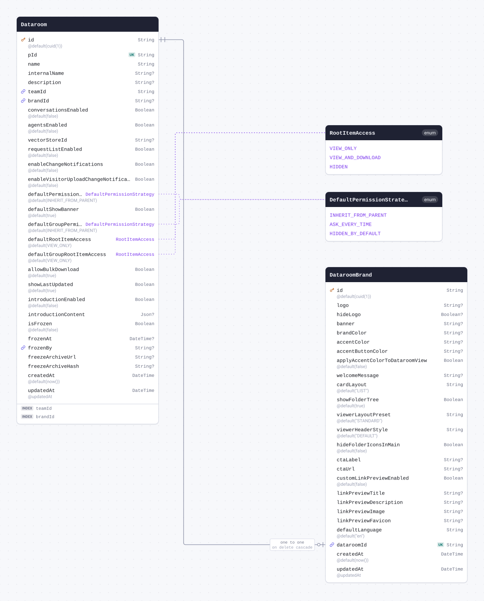

| Field                            | Type       | Constraints                                      | Default      | Description |
| -------------------------------- | ---------- | ------------------------------------------------ | ------------ | ----------- |
| `id`                             | `String`   | PK NOT NULL                                      | `cuid(1)`    |             |
| `logo`                           | `String`   | NULL                                             |              |             |
| `hideLogo`                       | `Boolean`  | NULL                                             |              |             |
| `banner`                         | `String`   | NULL                                             |              |             |
| `brandColor`                     | `String`   | NULL                                             |              |             |
| `accentColor`                    | `String`   | NULL                                             |              |             |
| `accentButtonColor`              | `String`   | NULL                                             |              |             |
| `applyAccentColorToDataroomView` | `Boolean`  | NOT NULL                                         | `false`      |             |
| `welcomeMessage`                 | `String`   | NULL                                             |              |             |
| `cardLayout`                     | `String`   | NOT NULL                                         | `"LIST"`     |             |
| `showFolderTree`                 | `Boolean`  | NOT NULL                                         | `true`       |             |
| `viewerLayoutPreset`             | `String`   | NOT NULL                                         | `"STANDARD"` |             |
| `viewerHeaderStyle`              | `String`   | NOT NULL                                         | `"DEFAULT"`  |             |
| `hideFolderIconsInMain`          | `Boolean`  | NOT NULL                                         | `false`      |             |
| `ctaLabel`                       | `String`   | NULL                                             |              |             |
| `ctaUrl`                         | `String`   | NULL                                             |              |             |
| `customLinkPreviewEnabled`       | `Boolean`  | NOT NULL                                         | `false`      |             |
| `linkPreviewTitle`               | `String`   | NULL                                             |              |             |
| `linkPreviewDescription`         | `String`   | NULL                                             |              |             |
| `linkPreviewImage`               | `String`   | NULL                                             |              |             |
| `linkPreviewFavicon`             | `String`   | NULL                                             |              |             |
| `defaultLanguage`                | `String`   | NOT NULL                                         | `"en"`       |             |
| `dataroomId`                     | `String`   | UNIQUE NOT NULL → [Dataroom.id](#model-Dataroom) |              |             |
| `createdAt`                      | `DateTime` | NOT NULL                                         | `now()`      |             |
| `updatedAt`                      | `DateTime` | NOT NULL                                         | `@updatedAt` |             |

#### References

- `dataroomId` → [Dataroom.id](#model-Dataroom) (one-to-one, on delete Cascade)

#### Definition

```sql
CREATE TABLE "DataroomBrand" (
    "id" TEXT NOT NULL,
    "logo" TEXT,
    "hideLogo" BOOLEAN,
    "banner" TEXT,
    "brandColor" TEXT,
    "accentColor" TEXT,
    "accentButtonColor" TEXT,
    "applyAccentColorToDataroomView" BOOLEAN NOT NULL DEFAULT false,
    "welcomeMessage" TEXT,
    "cardLayout" TEXT NOT NULL DEFAULT 'LIST',
    "showFolderTree" BOOLEAN NOT NULL DEFAULT true,
    "viewerLayoutPreset" TEXT NOT NULL DEFAULT 'STANDARD',
    "viewerHeaderStyle" TEXT NOT NULL DEFAULT 'DEFAULT',
    "hideFolderIconsInMain" BOOLEAN NOT NULL DEFAULT false,
    "ctaLabel" TEXT,
    "ctaUrl" TEXT,
    "customLinkPreviewEnabled" BOOLEAN NOT NULL DEFAULT false,
    "linkPreviewTitle" TEXT,
    "linkPreviewDescription" TEXT,
    "linkPreviewImage" TEXT,
    "linkPreviewFavicon" TEXT,
    "defaultLanguage" TEXT NOT NULL DEFAULT 'en',
    "dataroomId" TEXT NOT NULL,
    "createdAt" TIMESTAMP(3) NOT NULL DEFAULT CURRENT_TIMESTAMP,
    "updatedAt" TIMESTAMP(3) NOT NULL,

    CONSTRAINT "DataroomBrand_pkey" PRIMARY KEY ("id")
);

CREATE UNIQUE INDEX "DataroomBrand_dataroomId_key" ON "DataroomBrand"("dataroomId");

ALTER TABLE "DataroomBrand" ADD CONSTRAINT "DataroomBrand_dataroomId_fkey" FOREIGN KEY ("dataroomId") REFERENCES "Dataroom"("id") ON DELETE CASCADE ON UPDATE CASCADE;
```

<details>
<summary>Queries and their SQL</summary>

**findMany**: Every row

```ts
await prisma.dataroomBrand.findMany();
```

```sql
SELECT
  "public"."DataroomBrand"."id",
  "public"."DataroomBrand"."logo",
  "public"."DataroomBrand"."hideLogo",
  "public"."DataroomBrand"."banner",
  "public"."DataroomBrand"."brandColor",
  "public"."DataroomBrand"."accentColor",
  "public"."DataroomBrand"."accentButtonColor",
  "public"."DataroomBrand"."applyAccentColorToDataroomView",
  "public"."DataroomBrand"."welcomeMessage",
  "public"."DataroomBrand"."cardLayout",
  "public"."DataroomBrand"."showFolderTree",
  "public"."DataroomBrand"."viewerLayoutPreset",
  "public"."DataroomBrand"."viewerHeaderStyle",
  "public"."DataroomBrand"."hideFolderIconsInMain",
  "public"."DataroomBrand"."ctaLabel",
  "public"."DataroomBrand"."ctaUrl",
  "public"."DataroomBrand"."customLinkPreviewEnabled",
  "public"."DataroomBrand"."linkPreviewTitle",
  "public"."DataroomBrand"."linkPreviewDescription",
  "public"."DataroomBrand"."linkPreviewImage",
  "public"."DataroomBrand"."linkPreviewFavicon",
  "public"."DataroomBrand"."defaultLanguage",
  "public"."DataroomBrand"."dataroomId",
  "public"."DataroomBrand"."createdAt",
  "public"."DataroomBrand"."updatedAt"
FROM
  "public"."DataroomBrand"
WHERE
  1 = 1
OFFSET
  $1
-- params: ["0"]
```

**count**: How many rows there are

```ts
await prisma.dataroomBrand.count();
```

```sql
SELECT
  COUNT(*) AS "_count$_all"
FROM
  (
    SELECT
      "public"."DataroomBrand"."id"
    FROM
      "public"."DataroomBrand"
    WHERE
      1 = 1
    OFFSET
      $1
  ) AS "sub"
-- params: ["0"]
```

**findMany**: Every row with its relations

```ts
await prisma.dataroomBrand.findMany({ include: { dataroom: true } });
```

```sql
SELECT
  "public"."DataroomBrand"."id",
  "public"."DataroomBrand"."logo",
  "public"."DataroomBrand"."hideLogo",
  "public"."DataroomBrand"."banner",
  "public"."DataroomBrand"."brandColor",
  "public"."DataroomBrand"."accentColor",
  "public"."DataroomBrand"."accentButtonColor",
  "public"."DataroomBrand"."applyAccentColorToDataroomView",
  "public"."DataroomBrand"."welcomeMessage",
  "public"."DataroomBrand"."cardLayout",
  "public"."DataroomBrand"."showFolderTree",
  "public"."DataroomBrand"."viewerLayoutPreset",
  "public"."DataroomBrand"."viewerHeaderStyle",
  "public"."DataroomBrand"."hideFolderIconsInMain",
  "public"."DataroomBrand"."ctaLabel",
  "public"."DataroomBrand"."ctaUrl",
  "public"."DataroomBrand"."customLinkPreviewEnabled",
  "public"."DataroomBrand"."linkPreviewTitle",
  "public"."DataroomBrand"."linkPreviewDescription",
  "public"."DataroomBrand"."linkPreviewImage",
  "public"."DataroomBrand"."linkPreviewFavicon",
  "public"."DataroomBrand"."defaultLanguage",
  "public"."DataroomBrand"."dataroomId",
  "public"."DataroomBrand"."createdAt",
  "public"."DataroomBrand"."updatedAt"
FROM
  "public"."DataroomBrand"
WHERE
  1 = 1
OFFSET
  $1
-- params: ["0"]

SELECT
  "public"."Dataroom"."id",
  "public"."Dataroom"."pId",
  "public"."Dataroom"."name",
  "public"."Dataroom"."internalName",
  "public"."Dataroom"."description",
  "public"."Dataroom"."teamId",
  "public"."Dataroom"."brandId",
  "public"."Dataroom"."conversationsEnabled",
  "public"."Dataroom"."agentsEnabled",
  "public"."Dataroom"."vectorStoreId",
  "public"."Dataroom"."requestListEnabled",
  "public"."Dataroom"."enableChangeNotifications",
  "public"."Dataroom"."enableVisitorUploadChangeNotifications",
  "public"."Dataroom"."defaultPermissionStrategy"::text,
  "public"."Dataroom"."defaultShowBanner",
  "public"."Dataroom"."defaultGroupPermissionStrategy"::text,
  "public"."Dataroom"."defaultRootItemAccess"::text,
  "public"."Dataroom"."defaultGroupRootItemAccess"::text,
  "public"."Dataroom"."allowBulkDownload",
  "public"."Dataroom"."showLastUpdated",
  "public"."Dataroom"."introductionEnabled",
  "public"."Dataroom"."introductionContent",
  "public"."Dataroom"."isFrozen",
  "public"."Dataroom"."frozenAt",
  "public"."Dataroom"."frozenBy",
  "public"."Dataroom"."freezeArchiveUrl",
  "public"."Dataroom"."freezeArchiveHash",
  "public"."Dataroom"."createdAt",
  "public"."Dataroom"."updatedAt"
FROM
  "public"."Dataroom"
WHERE
  "public"."Dataroom"."id" IN ($1)
OFFSET
  $2
-- params: ["<dataroomId of the rows above>","0"]
```

**findUnique**: One row by what is unique to it

```ts
await prisma.dataroomBrand.findUnique({ where: { id: "example" } });
```

```sql
SELECT
  "public"."DataroomBrand"."id",
  "public"."DataroomBrand"."logo",
  "public"."DataroomBrand"."hideLogo",
  "public"."DataroomBrand"."banner",
  "public"."DataroomBrand"."brandColor",
  "public"."DataroomBrand"."accentColor",
  "public"."DataroomBrand"."accentButtonColor",
  "public"."DataroomBrand"."applyAccentColorToDataroomView",
  "public"."DataroomBrand"."welcomeMessage",
  "public"."DataroomBrand"."cardLayout",
  "public"."DataroomBrand"."showFolderTree",
  "public"."DataroomBrand"."viewerLayoutPreset",
  "public"."DataroomBrand"."viewerHeaderStyle",
  "public"."DataroomBrand"."hideFolderIconsInMain",
  "public"."DataroomBrand"."ctaLabel",
  "public"."DataroomBrand"."ctaUrl",
  "public"."DataroomBrand"."customLinkPreviewEnabled",
  "public"."DataroomBrand"."linkPreviewTitle",
  "public"."DataroomBrand"."linkPreviewDescription",
  "public"."DataroomBrand"."linkPreviewImage",
  "public"."DataroomBrand"."linkPreviewFavicon",
  "public"."DataroomBrand"."defaultLanguage",
  "public"."DataroomBrand"."dataroomId",
  "public"."DataroomBrand"."createdAt",
  "public"."DataroomBrand"."updatedAt"
FROM
  "public"."DataroomBrand"
WHERE
  (
    "public"."DataroomBrand"."id" = $1
    AND 1 = 1
  )
LIMIT
  $2
OFFSET
  $3
-- params: ["example","1","0"]
```

**create**: Create a row

```ts
await prisma.dataroomBrand.create({ data: { dataroomId: "example" } });
```

```sql
INSERT INTO
  "public"."DataroomBrand" (
    "id",
    "applyAccentColorToDataroomView",
    "cardLayout",
    "showFolderTree",
    "viewerLayoutPreset",
    "viewerHeaderStyle",
    "hideFolderIconsInMain",
    "customLinkPreviewEnabled",
    "defaultLanguage",
    "dataroomId",
    "createdAt",
    "updatedAt"
  )
VALUES
  ($1, $2, $3, $4, $5, $6, $7, $8, $9, $10, $11, $12)
RETURNING
  "public"."DataroomBrand"."id",
  "public"."DataroomBrand"."logo",
  "public"."DataroomBrand"."hideLogo",
  "public"."DataroomBrand"."banner",
  "public"."DataroomBrand"."brandColor",
  "public"."DataroomBrand"."accentColor",
  "public"."DataroomBrand"."accentButtonColor",
  "public"."DataroomBrand"."applyAccentColorToDataroomView",
  "public"."DataroomBrand"."welcomeMessage",
  "public"."DataroomBrand"."cardLayout",
  "public"."DataroomBrand"."showFolderTree",
  "public"."DataroomBrand"."viewerLayoutPreset",
  "public"."DataroomBrand"."viewerHeaderStyle",
  "public"."DataroomBrand"."hideFolderIconsInMain",
  "public"."DataroomBrand"."ctaLabel",
  "public"."DataroomBrand"."ctaUrl",
  "public"."DataroomBrand"."customLinkPreviewEnabled",
  "public"."DataroomBrand"."linkPreviewTitle",
  "public"."DataroomBrand"."linkPreviewDescription",
  "public"."DataroomBrand"."linkPreviewImage",
  "public"."DataroomBrand"."linkPreviewFavicon",
  "public"."DataroomBrand"."defaultLanguage",
  "public"."DataroomBrand"."dataroomId",
  "public"."DataroomBrand"."createdAt",
  "public"."DataroomBrand"."updatedAt"
-- params: ["<cuid(1)>",false,"LIST",true,"STANDARD","DEFAULT",false,false,"en","example","<now()>","<now()>"]
```

**update**: Update a row

```ts
await prisma.dataroomBrand.update({ where: { id: "example" }, data: { logo: "example" } });
```

```sql
UPDATE "public"."DataroomBrand"
SET
  "logo" = $1,
  "updatedAt" = $2
WHERE
  (
    "public"."DataroomBrand"."id" = $3
    AND 1 = 1
  )
RETURNING
  "public"."DataroomBrand"."id",
  "public"."DataroomBrand"."logo",
  "public"."DataroomBrand"."hideLogo",
  "public"."DataroomBrand"."banner",
  "public"."DataroomBrand"."brandColor",
  "public"."DataroomBrand"."accentColor",
  "public"."DataroomBrand"."accentButtonColor",
  "public"."DataroomBrand"."applyAccentColorToDataroomView",
  "public"."DataroomBrand"."welcomeMessage",
  "public"."DataroomBrand"."cardLayout",
  "public"."DataroomBrand"."showFolderTree",
  "public"."DataroomBrand"."viewerLayoutPreset",
  "public"."DataroomBrand"."viewerHeaderStyle",
  "public"."DataroomBrand"."hideFolderIconsInMain",
  "public"."DataroomBrand"."ctaLabel",
  "public"."DataroomBrand"."ctaUrl",
  "public"."DataroomBrand"."customLinkPreviewEnabled",
  "public"."DataroomBrand"."linkPreviewTitle",
  "public"."DataroomBrand"."linkPreviewDescription",
  "public"."DataroomBrand"."linkPreviewImage",
  "public"."DataroomBrand"."linkPreviewFavicon",
  "public"."DataroomBrand"."defaultLanguage",
  "public"."DataroomBrand"."dataroomId",
  "public"."DataroomBrand"."createdAt",
  "public"."DataroomBrand"."updatedAt"
-- params: ["example",{"prisma__type":"generatorCall","prisma__value":{"name":"now","args":[],"returnType":{"type":"DateTime"}}},"example"]
```

**delete**: Delete a row

```ts
await prisma.dataroomBrand.delete({ where: { id: "example" } });
```

```sql
DELETE FROM "public"."DataroomBrand"
WHERE
  (
    "public"."DataroomBrand"."id" = $1
    AND 1 = 1
  )
RETURNING
  "public"."DataroomBrand"."id",
  "public"."DataroomBrand"."logo",
  "public"."DataroomBrand"."hideLogo",
  "public"."DataroomBrand"."banner",
  "public"."DataroomBrand"."brandColor",
  "public"."DataroomBrand"."accentColor",
  "public"."DataroomBrand"."accentButtonColor",
  "public"."DataroomBrand"."applyAccentColorToDataroomView",
  "public"."DataroomBrand"."welcomeMessage",
  "public"."DataroomBrand"."cardLayout",
  "public"."DataroomBrand"."showFolderTree",
  "public"."DataroomBrand"."viewerLayoutPreset",
  "public"."DataroomBrand"."viewerHeaderStyle",
  "public"."DataroomBrand"."hideFolderIconsInMain",
  "public"."DataroomBrand"."ctaLabel",
  "public"."DataroomBrand"."ctaUrl",
  "public"."DataroomBrand"."customLinkPreviewEnabled",
  "public"."DataroomBrand"."linkPreviewTitle",
  "public"."DataroomBrand"."linkPreviewDescription",
  "public"."DataroomBrand"."linkPreviewImage",
  "public"."DataroomBrand"."linkPreviewFavicon",
  "public"."DataroomBrand"."defaultLanguage",
  "public"."DataroomBrand"."dataroomId",
  "public"."DataroomBrand"."createdAt",
  "public"."DataroomBrand"."updatedAt"
-- params: ["example"]
```

</details>

<a id="model-ViewerGroup"></a>

### ViewerGroup

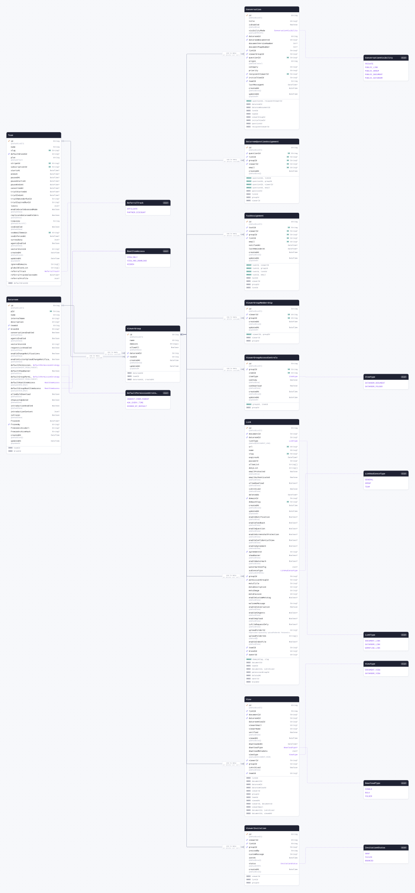

| Field        | Type       | Constraints                               | Default      | Description |
| ------------ | ---------- | ----------------------------------------- | ------------ | ----------- |
| `id`         | `String`   | PK NOT NULL                               | `cuid(1)`    |             |
| `name`       | `String`   | NOT NULL                                  |              |             |
| `domains`    | `String[]` | NOT NULL                                  |              |             |
| `allowAll`   | `Boolean`  | NOT NULL                                  | `false`      |             |
| `dataroomId` | `String`   | NOT NULL → [Dataroom.id](#model-Dataroom) |              |             |
| `teamId`     | `String`   | NOT NULL → [Team.id](#model-Team)         |              |             |
| `createdAt`  | `DateTime` | NOT NULL                                  | `now()`      |             |
| `updatedAt`  | `DateTime` | NOT NULL                                  | `@updatedAt` |             |

#### Indexes

- `@@index([dataroomId])`
- `@@index([teamId])`
- `@@index([dataroomId, createdAt])`

#### References

- `dataroomId` → [Dataroom.id](#model-Dataroom) (many-to-one, on delete Cascade)
- `teamId` → [Team.id](#model-Team) (many-to-one, on delete Cascade)

#### Referenced by

- `id` ← [Conversation.viewerGroupId](#model-Conversation) (one-to-many, on delete SetNull)
- `id` ← [DataroomQuestionAssignment.groupId](#model-DataroomQuestionAssignment) (one-to-many, on delete Cascade)
- `id` ← [TaskAssignment.groupId](#model-TaskAssignment) (one-to-many, on delete Cascade)
- `id` ← [ViewerGroupMembership.groupId](#model-ViewerGroupMembership) (one-to-many, on delete Cascade)
- `id` ← [ViewerGroupAccessControls.groupId](#model-ViewerGroupAccessControls) (one-to-many, on delete Cascade)
- `id` ← [Link.groupId](#model-Link) (one-to-many, on delete SetNull)
- `id` ← [View.groupId](#model-View) (one-to-many, on delete SetNull)
- `id` ← [ViewerInvitation.groupId](#model-ViewerInvitation) (one-to-many, on delete SetNull)

#### Definition

```sql
CREATE TABLE "ViewerGroup" (
    "id" TEXT NOT NULL,
    "name" TEXT NOT NULL,
    "domains" TEXT[],
    "allowAll" BOOLEAN NOT NULL DEFAULT false,
    "dataroomId" TEXT NOT NULL,
    "teamId" TEXT NOT NULL,
    "createdAt" TIMESTAMP(3) NOT NULL DEFAULT CURRENT_TIMESTAMP,
    "updatedAt" TIMESTAMP(3) NOT NULL,

    CONSTRAINT "ViewerGroup_pkey" PRIMARY KEY ("id")
);

CREATE INDEX "ViewerGroup_dataroomId_idx" ON "ViewerGroup"("dataroomId");

CREATE INDEX "ViewerGroup_teamId_idx" ON "ViewerGroup"("teamId");

CREATE INDEX "ViewerGroup_dataroomId_createdAt_idx" ON "ViewerGroup"("dataroomId", "createdAt");

ALTER TABLE "ViewerGroup" ADD CONSTRAINT "ViewerGroup_dataroomId_fkey" FOREIGN KEY ("dataroomId") REFERENCES "Dataroom"("id") ON DELETE CASCADE ON UPDATE CASCADE;

ALTER TABLE "ViewerGroup" ADD CONSTRAINT "ViewerGroup_teamId_fkey" FOREIGN KEY ("teamId") REFERENCES "Team"("id") ON DELETE CASCADE ON UPDATE CASCADE;
```

<details>
<summary>Queries and their SQL</summary>

**findMany**: Every row

```ts
await prisma.viewerGroup.findMany();
```

```sql
SELECT
  "public"."ViewerGroup"."id",
  "public"."ViewerGroup"."name",
  "public"."ViewerGroup"."domains",
  "public"."ViewerGroup"."allowAll",
  "public"."ViewerGroup"."dataroomId",
  "public"."ViewerGroup"."teamId",
  "public"."ViewerGroup"."createdAt",
  "public"."ViewerGroup"."updatedAt"
FROM
  "public"."ViewerGroup"
WHERE
  1 = 1
OFFSET
  $1
-- params: ["0"]
```

**count**: How many rows there are

```ts
await prisma.viewerGroup.count();
```

```sql
SELECT
  COUNT(*) AS "_count$_all"
FROM
  (
    SELECT
      "public"."ViewerGroup"."id"
    FROM
      "public"."ViewerGroup"
    WHERE
      1 = 1
    OFFSET
      $1
  ) AS "sub"
-- params: ["0"]
```

**findMany**: Every row with its relations

```ts
await prisma.viewerGroup.findMany({
  include: {
    members: true,
    links: true,
    accessControls: true,
    dataroom: true,
    team: true,
    views: true,
    conversations: true,
    invitations: true,
    questionAssignments: true,
    taskAssignments: true,
  },
});
```

```sql
SELECT
  "public"."ViewerGroup"."id",
  "public"."ViewerGroup"."name",
  "public"."ViewerGroup"."domains",
  "public"."ViewerGroup"."allowAll",
  "public"."ViewerGroup"."dataroomId",
  "public"."ViewerGroup"."teamId",
  "public"."ViewerGroup"."createdAt",
  "public"."ViewerGroup"."updatedAt"
FROM
  "public"."ViewerGroup"
WHERE
  1 = 1
OFFSET
  $1
-- params: ["0"]

SELECT
  "public"."ViewerGroupMembership"."id",
  "public"."ViewerGroupMembership"."viewerId",
  "public"."ViewerGroupMembership"."groupId",
  "public"."ViewerGroupMembership"."createdAt",
  "public"."ViewerGroupMembership"."updatedAt"
FROM
  "public"."ViewerGroupMembership"
WHERE
  "public"."ViewerGroupMembership"."groupId" IN ($1)
OFFSET
  $2
-- params: ["<id of the rows above>","0"]

SELECT
  "public"."Link"."id",
  "public"."Link"."documentId",
  "public"."Link"."dataroomId",
  "public"."Link"."linkType"::text,
  "public"."Link"."url",
  "public"."Link"."name",
  "public"."Link"."slug",
  "public"."Link"."expiresAt",
  "public"."Link"."password",
  "public"."Link"."allowList",
  "public"."Link"."denyList",
  "public"."Link"."emailProtected",
  "public"."Link"."emailAuthenticated",
  "public"."Link"."allowDownload",
  "public"."Link"."isArchived",
  "public"."Link"."deletedAt",
  "public"."Link"."domainId",
  "public"."Link"."domainSlug",
  "public"."Link"."createdAt",
  "public"."Link"."updatedAt",
  "public"."Link"."enableNotification",
  "public"."Link"."enableFeedback",
  "public"."Link"."enableQuestion",
  "public"."Link"."enableScreenshotProtection",
  "public"."Link"."enableConfidentialView",
  "public"."Link"."enableAgreement",
  "public"."Link"."agreementId",
  "public"."Link"."showBanner",
  "public"."Link"."enableWatermark",
  "public"."Link"."watermarkConfig",
  "public"."Link"."audienceType"::text,
  "public"."Link"."groupId",
  "public"."Link"."permissionGroupId",
  "public"."Link"."metaTitle",
  "public"."Link"."metaDescription",
  "public"."Link"."metaImage",
  "public"."Link"."metaFavicon",
  "public"."Link"."enableCustomMetatag",
  "public"."Link"."welcomeMessage",
  "public"."Link"."enableConversation",
  "public"."Link"."enableAIAgents",
  "public"."Link"."enableUpload",
  "public"."Link"."isFileRequestOnly",
  "public"."Link"."uploadFolderId",
  "public"."Link"."uploadFolderIds",
  "public"."Link"."enableIndexFile",
  "public"."Link"."teamId",
  "public"."Link"."brandId",
  "public"."Link"."ownerId"
FROM
  "public"."Link"
WHERE
  "public"."Link"."groupId" IN ($1)
OFFSET
  $2
-- params: ["<id of the rows above>","0"]

SELECT
  "public"."ViewerGroupAccessControls"."id",
  "public"."ViewerGroupAccessControls"."groupId",
  "public"."ViewerGroupAccessControls"."itemId",
  "public"."ViewerGroupAccessControls"."itemType"::text,
  "public"."ViewerGroupAccessControls"."canView",
  "public"."ViewerGroupAccessControls"."canDownload",
  "public"."ViewerGroupAccessControls"."createdAt",
  "public"."ViewerGroupAccessControls"."updatedAt"
FROM
  "public"."ViewerGroupAccessControls"
WHERE
  "public"."ViewerGroupAccessControls"."groupId" IN ($1)
OFFSET
  $2
-- params: ["<id of the rows above>","0"]

SELECT
  "public"."Dataroom"."id",
  "public"."Dataroom"."pId",
  "public"."Dataroom"."name",
  "public"."Dataroom"."internalName",
  "public"."Dataroom"."description",
  "public"."Dataroom"."teamId",
  "public"."Dataroom"."brandId",
  "public"."Dataroom"."conversationsEnabled",
  "public"."Dataroom"."agentsEnabled",
  "public"."Dataroom"."vectorStoreId",
  "public"."Dataroom"."requestListEnabled",
  "public"."Dataroom"."enableChangeNotifications",
  "public"."Dataroom"."enableVisitorUploadChangeNotifications",
  "public"."Dataroom"."defaultPermissionStrategy"::text,
  "public"."Dataroom"."defaultShowBanner",
  "public"."Dataroom"."defaultGroupPermissionStrategy"::text,
  "public"."Dataroom"."defaultRootItemAccess"::text,
  "public"."Dataroom"."defaultGroupRootItemAccess"::text,
  "public"."Dataroom"."allowBulkDownload",
  "public"."Dataroom"."showLastUpdated",
  "public"."Dataroom"."introductionEnabled",
  "public"."Dataroom"."introductionContent",
  "public"."Dataroom"."isFrozen",
  "public"."Dataroom"."frozenAt",
  "public"."Dataroom"."frozenBy",
  "public"."Dataroom"."freezeArchiveUrl",
  "public"."Dataroom"."freezeArchiveHash",
  "public"."Dataroom"."createdAt",
  "public"."Dataroom"."updatedAt"
FROM
  "public"."Dataroom"
WHERE
  "public"."Dataroom"."id" IN ($1)
OFFSET
  $2
-- params: ["<dataroomId of the rows above>","0"]

SELECT
  "public"."Team"."id",
  "public"."Team"."name",
  "public"."Team"."slug",
  "public"."Team"."defaultBrandId",
  "public"."Team"."plan",
  "public"."Team"."stripeId",
  "public"."Team"."subscriptionId",
  "public"."Team"."startsAt",
  "public"."Team"."endsAt",
  "public"."Team"."pausedAt",
  "public"."Team"."pauseStartsAt",
  "public"."Team"."pauseEndsAt",
  "public"."Team"."cancelledAt",
  "public"."Team"."trialStartedAt",
  "public"."Team"."trialEndsAt",
  "public"."Team"."trialReminderRunId",
  "public"."Team"."trialExpiredRunId",
  "public"."Team"."limits",
  "public"."Team"."enableExcelAdvancedMode",
  "public"."Team"."replicateDataroomFolders",
  "public"."Team"."timezone",
  "public"."Team"."ssoEnabled",
  "public"."Team"."ssoEmailDomain",
  "public"."Team"."ssoEnforcedAt",
  "public"."Team"."surveyData",
  "public"."Team"."agentsEnabled",
  "public"."Team"."vectorStoreId",
  "public"."Team"."createdAt",
  "public"."Team"."updatedAt",
  "public"."Team"."ignoredDomains",
  "public"."Team"."globalBlockList",
  "public"."Team"."referralTrack"::text,
  "public"."Team"."referralTrackSelectedAt",
  "public"."Team"."referralProfile"
FROM
  "public"."Team"
WHERE
  "public"."Team"."id" IN ($1)
OFFSET
  $2
-- params: ["<teamId of the rows above>","0"]

SELECT
  "public"."View"."id",
  "public"."View"."linkId",
  "public"."View"."documentId",
  "public"."View"."dataroomId",
  "public"."View"."dataroomViewId",
  "public"."View"."viewerEmail",
  "public"."View"."viewerName",
  "public"."View"."verified",
  "public"."View"."viewedAt",
  "public"."View"."downloadedAt",
  "public"."View"."downloadType"::text,
  "public"."View"."downloadMetadata",
  "public"."View"."viewType"::text,
  "public"."View"."viewerId",
  "public"."View"."groupId",
  "public"."View"."isArchived",
  "public"."View"."teamId"
FROM
  "public"."View"
WHERE
  "public"."View"."groupId" IN ($1)
OFFSET
  $2
-- params: ["<id of the rows above>","0"]

SELECT
  "public"."Conversation"."id",
  "public"."Conversation"."title",
  "public"."Conversation"."isEnabled",
  "public"."Conversation"."visibilityMode"::text,
  "public"."Conversation"."dataroomId",
  "public"."Conversation"."dataroomDocumentId",
  "public"."Conversation"."documentVersionNumber",
  "public"."Conversation"."documentPageNumber",
  "public"."Conversation"."linkId",
  "public"."Conversation"."viewerGroupId",
  "public"."Conversation"."questionId",
  "public"."Conversation"."origin",
  "public"."Conversation"."category",
  "public"."Conversation"."priority",
  "public"."Conversation"."recipientViewerId",
  "public"."Conversation"."initialViewId",
  "public"."Conversation"."teamId",
  "public"."Conversation"."lastMessageAt",
  "public"."Conversation"."createdAt",
  "public"."Conversation"."updatedAt"
FROM
  "public"."Conversation"
WHERE
  "public"."Conversation"."viewerGroupId" IN ($1)
OFFSET
  $2
-- params: ["<id of the rows above>","0"]

SELECT
  "public"."ViewerInvitation"."id",
  "public"."ViewerInvitation"."viewerId",
  "public"."ViewerInvitation"."linkId",
  "public"."ViewerInvitation"."groupId",
  "public"."ViewerInvitation"."invitedBy",
  "public"."ViewerInvitation"."customMessage",
  "public"."ViewerInvitation"."sentAt",
  "public"."ViewerInvitation"."status"::text,
  "public"."ViewerInvitation"."createdAt"
FROM
  "public"."ViewerInvitation"
WHERE
  "public"."ViewerInvitation"."groupId" IN ($1)
OFFSET
  $2
-- params: ["<id of the rows above>","0"]

SELECT
  "public"."DataroomQuestionAssignment"."id",
  "public"."DataroomQuestionAssignment"."questionId",
  "public"."DataroomQuestionAssignment"."linkId",
  "public"."DataroomQuestionAssignment"."groupId",
  "public"."DataroomQuestionAssignment"."viewerId",
  "public"."DataroomQuestionAssignment"."email",
  "public"."DataroomQuestionAssignment"."createdAt"
FROM
  "public"."DataroomQuestionAssignment"
WHERE
  "public"."DataroomQuestionAssignment"."groupId" IN ($1)
OFFSET
  $2
-- params: ["<id of the rows above>","0"]

SELECT
  "public"."TaskAssignment"."id",
  "public"."TaskAssignment"."taskId",
  "public"."TaskAssignment"."viewerId",
  "public"."TaskAssignment"."groupId",
  "public"."TaskAssignment"."linkId",
  "public"."TaskAssignment"."email",
  "public"."TaskAssignment"."notifiedAt",
  "public"."TaskAssignment"."lastReminderAt",
  "public"."TaskAssignment"."createdAt",
  "public"."TaskAssignment"."updatedAt"
FROM
  "public"."TaskAssignment"
WHERE
  "public"."TaskAssignment"."groupId" IN ($1)
OFFSET
  $2
-- params: ["<id of the rows above>","0"]
```

**findUnique**: One row by what is unique to it

```ts
await prisma.viewerGroup.findUnique({ where: { id: "example" } });
```

```sql
SELECT
  "public"."ViewerGroup"."id",
  "public"."ViewerGroup"."name",
  "public"."ViewerGroup"."domains",
  "public"."ViewerGroup"."allowAll",
  "public"."ViewerGroup"."dataroomId",
  "public"."ViewerGroup"."teamId",
  "public"."ViewerGroup"."createdAt",
  "public"."ViewerGroup"."updatedAt"
FROM
  "public"."ViewerGroup"
WHERE
  (
    "public"."ViewerGroup"."id" = $1
    AND 1 = 1
  )
LIMIT
  $2
OFFSET
  $3
-- params: ["example","1","0"]
```

**create**: Create a row

```ts
await prisma.viewerGroup.create({
  data: { name: "example", domains: ["example"], dataroomId: "example", teamId: "example" },
});
```

```sql
INSERT INTO
  "public"."ViewerGroup" (
    "id",
    "name",
    "domains",
    "allowAll",
    "dataroomId",
    "teamId",
    "createdAt",
    "updatedAt"
  )
VALUES
  ($1, $2, $3, $4, $5, $6, $7, $8)
RETURNING
  "public"."ViewerGroup"."id",
  "public"."ViewerGroup"."name",
  "public"."ViewerGroup"."domains",
  "public"."ViewerGroup"."allowAll",
  "public"."ViewerGroup"."dataroomId",
  "public"."ViewerGroup"."teamId",
  "public"."ViewerGroup"."createdAt",
  "public"."ViewerGroup"."updatedAt"
-- params: ["<cuid(1)>","example",["example"],false,"example","example","<now()>","<now()>"]
```

**update**: Update a row

```ts
await prisma.viewerGroup.update({ where: { id: "example" }, data: { name: "example" } });
```

```sql
UPDATE "public"."ViewerGroup"
SET
  "name" = $1,
  "updatedAt" = $2
WHERE
  (
    "public"."ViewerGroup"."id" = $3
    AND 1 = 1
  )
RETURNING
  "public"."ViewerGroup"."id",
  "public"."ViewerGroup"."name",
  "public"."ViewerGroup"."domains",
  "public"."ViewerGroup"."allowAll",
  "public"."ViewerGroup"."dataroomId",
  "public"."ViewerGroup"."teamId",
  "public"."ViewerGroup"."createdAt",
  "public"."ViewerGroup"."updatedAt"
-- params: ["example",{"prisma__type":"generatorCall","prisma__value":{"name":"now","args":[],"returnType":{"type":"DateTime"}}},"example"]
```

**delete**: Delete a row

```ts
await prisma.viewerGroup.delete({ where: { id: "example" } });
```

```sql
DELETE FROM "public"."ViewerGroup"
WHERE
  (
    "public"."ViewerGroup"."id" = $1
    AND 1 = 1
  )
RETURNING
  "public"."ViewerGroup"."id",
  "public"."ViewerGroup"."name",
  "public"."ViewerGroup"."domains",
  "public"."ViewerGroup"."allowAll",
  "public"."ViewerGroup"."dataroomId",
  "public"."ViewerGroup"."teamId",
  "public"."ViewerGroup"."createdAt",
  "public"."ViewerGroup"."updatedAt"
-- params: ["example"]
```

</details>

<a id="model-ViewerGroupMembership"></a>

### ViewerGroupMembership

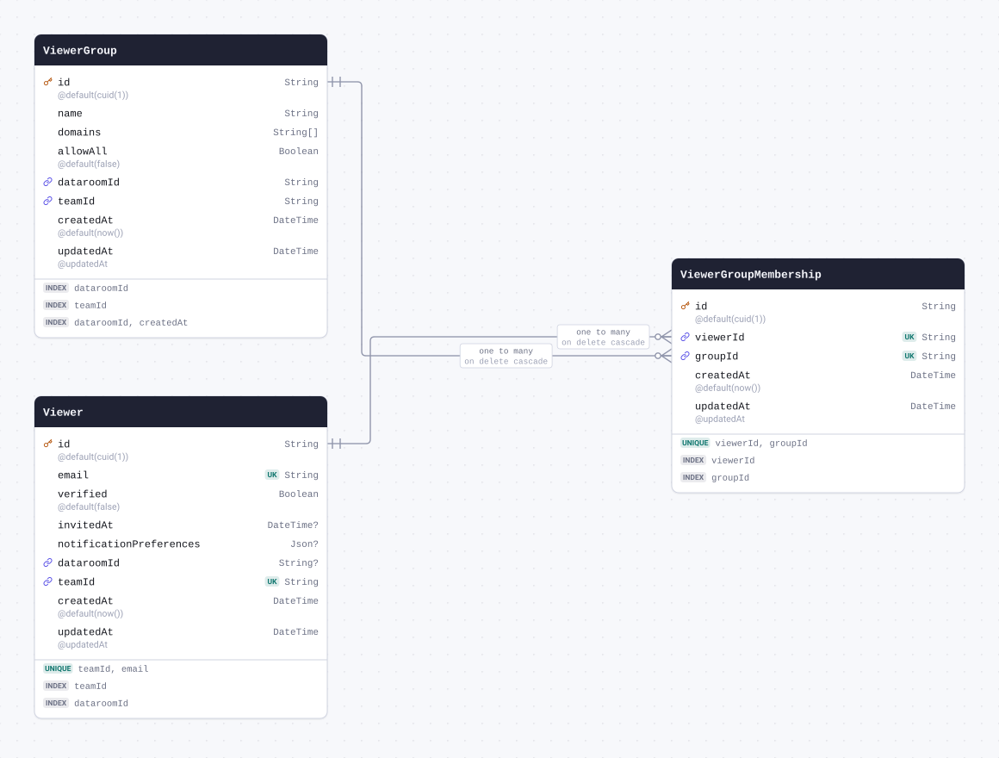

| Field       | Type       | Constraints                                     | Default      | Description |
| ----------- | ---------- | ----------------------------------------------- | ------------ | ----------- |
| `id`        | `String`   | PK NOT NULL                                     | `cuid(1)`    |             |
| `viewerId`  | `String`   | NOT NULL → [Viewer.id](#model-Viewer)           |              |             |
| `groupId`   | `String`   | NOT NULL → [ViewerGroup.id](#model-ViewerGroup) |              |             |
| `createdAt` | `DateTime` | NOT NULL                                        | `now()`      |             |
| `updatedAt` | `DateTime` | NOT NULL                                        | `@updatedAt` |             |

#### Indexes

- `@@index([viewerId])`
- `@@index([groupId])`
- `@@unique([viewerId, groupId])`

#### References

- `viewerId` → [Viewer.id](#model-Viewer) (many-to-one, on delete Cascade)
- `groupId` → [ViewerGroup.id](#model-ViewerGroup) (many-to-one, on delete Cascade)

#### Definition

```sql
CREATE TABLE "ViewerGroupMembership" (
    "id" TEXT NOT NULL,
    "viewerId" TEXT NOT NULL,
    "groupId" TEXT NOT NULL,
    "createdAt" TIMESTAMP(3) NOT NULL DEFAULT CURRENT_TIMESTAMP,
    "updatedAt" TIMESTAMP(3) NOT NULL,

    CONSTRAINT "ViewerGroupMembership_pkey" PRIMARY KEY ("id")
);

CREATE INDEX "ViewerGroupMembership_viewerId_idx" ON "ViewerGroupMembership"("viewerId");

CREATE INDEX "ViewerGroupMembership_groupId_idx" ON "ViewerGroupMembership"("groupId");

CREATE UNIQUE INDEX "ViewerGroupMembership_viewerId_groupId_key" ON "ViewerGroupMembership"("viewerId", "groupId");

ALTER TABLE "ViewerGroupMembership" ADD CONSTRAINT "ViewerGroupMembership_viewerId_fkey" FOREIGN KEY ("viewerId") REFERENCES "Viewer"("id") ON DELETE CASCADE ON UPDATE CASCADE;

ALTER TABLE "ViewerGroupMembership" ADD CONSTRAINT "ViewerGroupMembership_groupId_fkey" FOREIGN KEY ("groupId") REFERENCES "ViewerGroup"("id") ON DELETE CASCADE ON UPDATE CASCADE;
```

<details>
<summary>Queries and their SQL</summary>

**findMany**: Every row

```ts
await prisma.viewerGroupMembership.findMany();
```

```sql
SELECT
  "public"."ViewerGroupMembership"."id",
  "public"."ViewerGroupMembership"."viewerId",
  "public"."ViewerGroupMembership"."groupId",
  "public"."ViewerGroupMembership"."createdAt",
  "public"."ViewerGroupMembership"."updatedAt"
FROM
  "public"."ViewerGroupMembership"
WHERE
  1 = 1
OFFSET
  $1
-- params: ["0"]
```

**count**: How many rows there are

```ts
await prisma.viewerGroupMembership.count();
```

```sql
SELECT
  COUNT(*) AS "_count$_all"
FROM
  (
    SELECT
      "public"."ViewerGroupMembership"."id"
    FROM
      "public"."ViewerGroupMembership"
    WHERE
      1 = 1
    OFFSET
      $1
  ) AS "sub"
-- params: ["0"]
```

**findMany**: Every row with its relations

```ts
await prisma.viewerGroupMembership.findMany({ include: { viewer: true, group: true } });
```

```sql
SELECT
  "public"."ViewerGroupMembership"."id",
  "public"."ViewerGroupMembership"."viewerId",
  "public"."ViewerGroupMembership"."groupId",
  "public"."ViewerGroupMembership"."createdAt",
  "public"."ViewerGroupMembership"."updatedAt"
FROM
  "public"."ViewerGroupMembership"
WHERE
  1 = 1
OFFSET
  $1
-- params: ["0"]

SELECT
  "public"."Viewer"."id",
  "public"."Viewer"."email",
  "public"."Viewer"."verified",
  "public"."Viewer"."invitedAt",
  "public"."Viewer"."notificationPreferences",
  "public"."Viewer"."dataroomId",
  "public"."Viewer"."teamId",
  "public"."Viewer"."createdAt",
  "public"."Viewer"."updatedAt"
FROM
  "public"."Viewer"
WHERE
  "public"."Viewer"."id" IN ($1)
OFFSET
  $2
-- params: ["<viewerId of the rows above>","0"]

SELECT
  "public"."ViewerGroup"."id",
  "public"."ViewerGroup"."name",
  "public"."ViewerGroup"."domains",
  "public"."ViewerGroup"."allowAll",
  "public"."ViewerGroup"."dataroomId",
  "public"."ViewerGroup"."teamId",
  "public"."ViewerGroup"."createdAt",
  "public"."ViewerGroup"."updatedAt"
FROM
  "public"."ViewerGroup"
WHERE
  "public"."ViewerGroup"."id" IN ($1)
OFFSET
  $2
-- params: ["<groupId of the rows above>","0"]
```

**findUnique**: One row by what is unique to it

```ts
await prisma.viewerGroupMembership.findUnique({ where: { id: "example" } });
```

```sql
SELECT
  "public"."ViewerGroupMembership"."id",
  "public"."ViewerGroupMembership"."viewerId",
  "public"."ViewerGroupMembership"."groupId",
  "public"."ViewerGroupMembership"."createdAt",
  "public"."ViewerGroupMembership"."updatedAt"
FROM
  "public"."ViewerGroupMembership"
WHERE
  (
    "public"."ViewerGroupMembership"."id" = $1
    AND 1 = 1
  )
LIMIT
  $2
OFFSET
  $3
-- params: ["example","1","0"]
```

**create**: Create a row

```ts
await prisma.viewerGroupMembership.create({ data: { viewerId: "example", groupId: "example" } });
```

```sql
INSERT INTO
  "public"."ViewerGroupMembership" (
    "id",
    "viewerId",
    "groupId",
    "createdAt",
    "updatedAt"
  )
VALUES
  ($1, $2, $3, $4, $5)
RETURNING
  "public"."ViewerGroupMembership"."id",
  "public"."ViewerGroupMembership"."viewerId",
  "public"."ViewerGroupMembership"."groupId",
  "public"."ViewerGroupMembership"."createdAt",
  "public"."ViewerGroupMembership"."updatedAt"
-- params: ["<cuid(1)>","example","example","<now()>","<now()>"]
```

**update**: Update a row

```ts
await prisma.viewerGroupMembership.update({
  where: { id: "example" },
  data: { createdAt: new Date("2026-01-01T00:00:00.000Z") },
});
```

```sql
UPDATE "public"."ViewerGroupMembership"
SET
  "createdAt" = $1,
  "updatedAt" = $2
WHERE
  (
    "public"."ViewerGroupMembership"."id" = $3
    AND 1 = 1
  )
RETURNING
  "public"."ViewerGroupMembership"."id",
  "public"."ViewerGroupMembership"."viewerId",
  "public"."ViewerGroupMembership"."groupId",
  "public"."ViewerGroupMembership"."createdAt",
  "public"."ViewerGroupMembership"."updatedAt"
-- params: ["2026-01-01T00:00:00.000Z",{"prisma__type":"generatorCall","prisma__value":{"name":"now","args":[],"returnType":{"type":"DateTime"}}},"example"]
```

**delete**: Delete a row

```ts
await prisma.viewerGroupMembership.delete({ where: { id: "example" } });
```

```sql
DELETE FROM "public"."ViewerGroupMembership"
WHERE
  (
    "public"."ViewerGroupMembership"."id" = $1
    AND 1 = 1
  )
RETURNING
  "public"."ViewerGroupMembership"."id",
  "public"."ViewerGroupMembership"."viewerId",
  "public"."ViewerGroupMembership"."groupId",
  "public"."ViewerGroupMembership"."createdAt",
  "public"."ViewerGroupMembership"."updatedAt"
-- params: ["example"]
```

</details>

<a id="model-ViewerGroupAccessControls"></a>

### ViewerGroupAccessControls

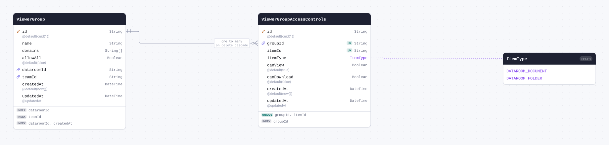

| Field         | Type                         | Constraints                                     | Default      | Description |
| ------------- | ---------------------------- | ----------------------------------------------- | ------------ | ----------- |
| `id`          | `String`                     | PK NOT NULL                                     | `cuid(1)`    |             |
| `groupId`     | `String`                     | NOT NULL → [ViewerGroup.id](#model-ViewerGroup) |              |             |
| `itemId`      | `String`                     | NOT NULL                                        |              |             |
| `itemType`    | [`ItemType`](#enum-ItemType) | NOT NULL                                        |              |             |
| `canView`     | `Boolean`                    | NOT NULL                                        | `true`       |             |
| `canDownload` | `Boolean`                    | NOT NULL                                        | `false`      |             |
| `createdAt`   | `DateTime`                   | NOT NULL                                        | `now()`      |             |
| `updatedAt`   | `DateTime`                   | NOT NULL                                        | `@updatedAt` |             |

#### Indexes

- `@@index([groupId])`
- `@@unique([groupId, itemId])`

#### References

- `groupId` → [ViewerGroup.id](#model-ViewerGroup) (many-to-one, on delete Cascade)

#### Definition

```sql
CREATE TABLE "ViewerGroupAccessControls" (
    "id" TEXT NOT NULL,
    "groupId" TEXT NOT NULL,
    "itemId" TEXT NOT NULL,
    "itemType" "ItemType" NOT NULL,
    "canView" BOOLEAN NOT NULL DEFAULT true,
    "canDownload" BOOLEAN NOT NULL DEFAULT false,
    "createdAt" TIMESTAMP(3) NOT NULL DEFAULT CURRENT_TIMESTAMP,
    "updatedAt" TIMESTAMP(3) NOT NULL,

    CONSTRAINT "ViewerGroupAccessControls_pkey" PRIMARY KEY ("id")
);

CREATE INDEX "ViewerGroupAccessControls_groupId_idx" ON "ViewerGroupAccessControls"("groupId");

CREATE UNIQUE INDEX "ViewerGroupAccessControls_groupId_itemId_key" ON "ViewerGroupAccessControls"("groupId", "itemId");

ALTER TABLE "ViewerGroupAccessControls" ADD CONSTRAINT "ViewerGroupAccessControls_groupId_fkey" FOREIGN KEY ("groupId") REFERENCES "ViewerGroup"("id") ON DELETE CASCADE ON UPDATE CASCADE;
```

<details>
<summary>Queries and their SQL</summary>

**findMany**: Every row

```ts
await prisma.viewerGroupAccessControls.findMany();
```

```sql
SELECT
  "public"."ViewerGroupAccessControls"."id",
  "public"."ViewerGroupAccessControls"."groupId",
  "public"."ViewerGroupAccessControls"."itemId",
  "public"."ViewerGroupAccessControls"."itemType"::text,
  "public"."ViewerGroupAccessControls"."canView",
  "public"."ViewerGroupAccessControls"."canDownload",
  "public"."ViewerGroupAccessControls"."createdAt",
  "public"."ViewerGroupAccessControls"."updatedAt"
FROM
  "public"."ViewerGroupAccessControls"
WHERE
  1 = 1
OFFSET
  $1
-- params: ["0"]
```

**count**: How many rows there are

```ts
await prisma.viewerGroupAccessControls.count();
```

```sql
SELECT
  COUNT(*) AS "_count$_all"
FROM
  (
    SELECT
      "public"."ViewerGroupAccessControls"."id"
    FROM
      "public"."ViewerGroupAccessControls"
    WHERE
      1 = 1
    OFFSET
      $1
  ) AS "sub"
-- params: ["0"]
```

**findMany**: Every row with its relations

```ts
await prisma.viewerGroupAccessControls.findMany({ include: { group: true } });
```

```sql
SELECT
  "public"."ViewerGroupAccessControls"."id",
  "public"."ViewerGroupAccessControls"."groupId",
  "public"."ViewerGroupAccessControls"."itemId",
  "public"."ViewerGroupAccessControls"."itemType"::text,
  "public"."ViewerGroupAccessControls"."canView",
  "public"."ViewerGroupAccessControls"."canDownload",
  "public"."ViewerGroupAccessControls"."createdAt",
  "public"."ViewerGroupAccessControls"."updatedAt"
FROM
  "public"."ViewerGroupAccessControls"
WHERE
  1 = 1
OFFSET
  $1
-- params: ["0"]

SELECT
  "public"."ViewerGroup"."id",
  "public"."ViewerGroup"."name",
  "public"."ViewerGroup"."domains",
  "public"."ViewerGroup"."allowAll",
  "public"."ViewerGroup"."dataroomId",
  "public"."ViewerGroup"."teamId",
  "public"."ViewerGroup"."createdAt",
  "public"."ViewerGroup"."updatedAt"
FROM
  "public"."ViewerGroup"
WHERE
  "public"."ViewerGroup"."id" IN ($1)
OFFSET
  $2
-- params: ["<groupId of the rows above>","0"]
```

**findUnique**: One row by what is unique to it

```ts
await prisma.viewerGroupAccessControls.findUnique({ where: { id: "example" } });
```

```sql
SELECT
  "public"."ViewerGroupAccessControls"."id",
  "public"."ViewerGroupAccessControls"."groupId",
  "public"."ViewerGroupAccessControls"."itemId",
  "public"."ViewerGroupAccessControls"."itemType"::text,
  "public"."ViewerGroupAccessControls"."canView",
  "public"."ViewerGroupAccessControls"."canDownload",
  "public"."ViewerGroupAccessControls"."createdAt",
  "public"."ViewerGroupAccessControls"."updatedAt"
FROM
  "public"."ViewerGroupAccessControls"
WHERE
  (
    "public"."ViewerGroupAccessControls"."id" = $1
    AND 1 = 1
  )
LIMIT
  $2
OFFSET
  $3
-- params: ["example","1","0"]
```

**create**: Create a row

```ts
await prisma.viewerGroupAccessControls.create({
  data: { groupId: "example", itemId: "example", itemType: "DATAROOM_DOCUMENT" },
});
```

```sql
INSERT INTO
  "public"."ViewerGroupAccessControls" (
    "id",
    "groupId",
    "itemId",
    "itemType",
    "canView",
    "canDownload",
    "createdAt",
    "updatedAt"
  )
VALUES
  (
    $1,
    $2,
    $3,
    CAST($4::text AS "public"."ItemType"),
    $5,
    $6,
    $7,
    $8
  )
RETURNING
  "public"."ViewerGroupAccessControls"."id",
  "public"."ViewerGroupAccessControls"."groupId",
  "public"."ViewerGroupAccessControls"."itemId",
  "public"."ViewerGroupAccessControls"."itemType"::text,
  "public"."ViewerGroupAccessControls"."canView",
  "public"."ViewerGroupAccessControls"."canDownload",
  "public"."ViewerGroupAccessControls"."createdAt",
  "public"."ViewerGroupAccessControls"."updatedAt"
-- params: ["<cuid(1)>","example","example","DATAROOM_DOCUMENT",true,false,"<now()>","<now()>"]
```

**update**: Update a row

```ts
await prisma.viewerGroupAccessControls.update({
  where: { id: "example" },
  data: { itemId: "example" },
});
```

```sql
UPDATE "public"."ViewerGroupAccessControls"
SET
  "itemId" = $1,
  "updatedAt" = $2
WHERE
  (
    "public"."ViewerGroupAccessControls"."id" = $3
    AND 1 = 1
  )
RETURNING
  "public"."ViewerGroupAccessControls"."id",
  "public"."ViewerGroupAccessControls"."groupId",
  "public"."ViewerGroupAccessControls"."itemId",
  "public"."ViewerGroupAccessControls"."itemType"::text,
  "public"."ViewerGroupAccessControls"."canView",
  "public"."ViewerGroupAccessControls"."canDownload",
  "public"."ViewerGroupAccessControls"."createdAt",
  "public"."ViewerGroupAccessControls"."updatedAt"
-- params: ["example",{"prisma__type":"generatorCall","prisma__value":{"name":"now","args":[],"returnType":{"type":"DateTime"}}},"example"]
```

**delete**: Delete a row

```ts
await prisma.viewerGroupAccessControls.delete({ where: { id: "example" } });
```

```sql
DELETE FROM "public"."ViewerGroupAccessControls"
WHERE
  (
    "public"."ViewerGroupAccessControls"."id" = $1
    AND 1 = 1
  )
RETURNING
  "public"."ViewerGroupAccessControls"."id",
  "public"."ViewerGroupAccessControls"."groupId",
  "public"."ViewerGroupAccessControls"."itemId",
  "public"."ViewerGroupAccessControls"."itemType"::text,
  "public"."ViewerGroupAccessControls"."canView",
  "public"."ViewerGroupAccessControls"."canDownload",
  "public"."ViewerGroupAccessControls"."createdAt",
  "public"."ViewerGroupAccessControls"."updatedAt"
-- params: ["example"]
```

</details>

<a id="model-PermissionGroup"></a>

### PermissionGroup

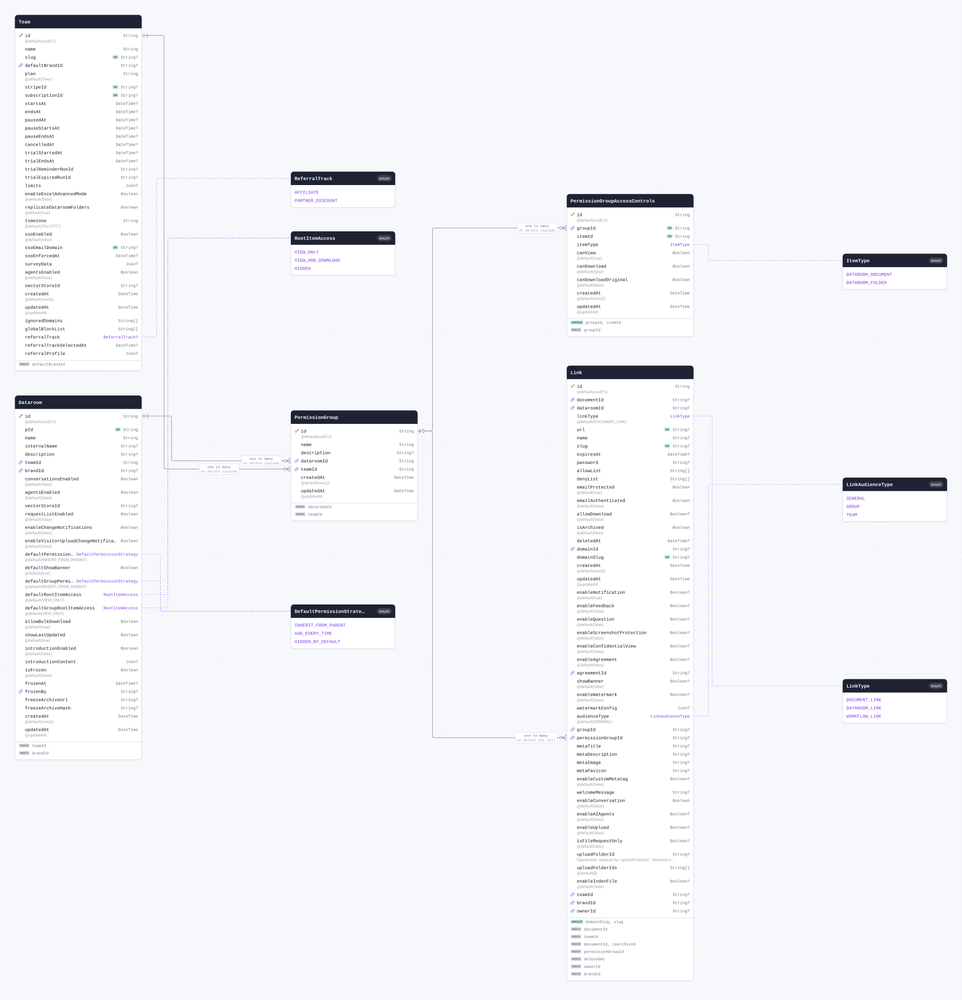

| Field         | Type       | Constraints                               | Default      | Description |
| ------------- | ---------- | ----------------------------------------- | ------------ | ----------- |
| `id`          | `String`   | PK NOT NULL                               | `cuid(1)`    |             |
| `name`        | `String`   | NOT NULL                                  |              |             |
| `description` | `String`   | NULL                                      |              |             |
| `dataroomId`  | `String`   | NOT NULL → [Dataroom.id](#model-Dataroom) |              |             |
| `teamId`      | `String`   | NOT NULL → [Team.id](#model-Team)         |              |             |
| `createdAt`   | `DateTime` | NOT NULL                                  | `now()`      |             |
| `updatedAt`   | `DateTime` | NOT NULL                                  | `@updatedAt` |             |

#### Indexes

- `@@index([dataroomId])`
- `@@index([teamId])`

#### References

- `dataroomId` → [Dataroom.id](#model-Dataroom) (many-to-one, on delete Cascade)
- `teamId` → [Team.id](#model-Team) (many-to-one, on delete Cascade)

#### Referenced by

- `id` ← [PermissionGroupAccessControls.groupId](#model-PermissionGroupAccessControls) (one-to-many, on delete Cascade)
- `id` ← [Link.permissionGroupId](#model-Link) (one-to-many, on delete SetNull)

#### Definition

```sql
CREATE TABLE "PermissionGroup" (
    "id" TEXT NOT NULL,
    "name" TEXT NOT NULL,
    "description" TEXT,
    "dataroomId" TEXT NOT NULL,
    "teamId" TEXT NOT NULL,
    "createdAt" TIMESTAMP(3) NOT NULL DEFAULT CURRENT_TIMESTAMP,
    "updatedAt" TIMESTAMP(3) NOT NULL,

    CONSTRAINT "PermissionGroup_pkey" PRIMARY KEY ("id")
);

CREATE INDEX "PermissionGroup_dataroomId_idx" ON "PermissionGroup"("dataroomId");

CREATE INDEX "PermissionGroup_teamId_idx" ON "PermissionGroup"("teamId");

ALTER TABLE "PermissionGroup" ADD CONSTRAINT "PermissionGroup_dataroomId_fkey" FOREIGN KEY ("dataroomId") REFERENCES "Dataroom"("id") ON DELETE CASCADE ON UPDATE CASCADE;

ALTER TABLE "PermissionGroup" ADD CONSTRAINT "PermissionGroup_teamId_fkey" FOREIGN KEY ("teamId") REFERENCES "Team"("id") ON DELETE CASCADE ON UPDATE CASCADE;
```

<details>
<summary>Queries and their SQL</summary>

**findMany**: Every row

```ts
await prisma.permissionGroup.findMany();
```

```sql
SELECT
  "public"."PermissionGroup"."id",
  "public"."PermissionGroup"."name",
  "public"."PermissionGroup"."description",
  "public"."PermissionGroup"."dataroomId",
  "public"."PermissionGroup"."teamId",
  "public"."PermissionGroup"."createdAt",
  "public"."PermissionGroup"."updatedAt"
FROM
  "public"."PermissionGroup"
WHERE
  1 = 1
OFFSET
  $1
-- params: ["0"]
```

**count**: How many rows there are

```ts
await prisma.permissionGroup.count();
```

```sql
SELECT
  COUNT(*) AS "_count$_all"
FROM
  (
    SELECT
      "public"."PermissionGroup"."id"
    FROM
      "public"."PermissionGroup"
    WHERE
      1 = 1
    OFFSET
      $1
  ) AS "sub"
-- params: ["0"]
```

**findMany**: Every row with its relations

```ts
await prisma.permissionGroup.findMany({
  include: { links: true, accessControls: true, dataroom: true, team: true },
});
```

```sql
SELECT
  "public"."PermissionGroup"."id",
  "public"."PermissionGroup"."name",
  "public"."PermissionGroup"."description",
  "public"."PermissionGroup"."dataroomId",
  "public"."PermissionGroup"."teamId",
  "public"."PermissionGroup"."createdAt",
  "public"."PermissionGroup"."updatedAt"
FROM
  "public"."PermissionGroup"
WHERE
  1 = 1
OFFSET
  $1
-- params: ["0"]

SELECT
  "public"."Link"."id",
  "public"."Link"."documentId",
  "public"."Link"."dataroomId",
  "public"."Link"."linkType"::text,
  "public"."Link"."url",
  "public"."Link"."name",
  "public"."Link"."slug",
  "public"."Link"."expiresAt",
  "public"."Link"."password",
  "public"."Link"."allowList",
  "public"."Link"."denyList",
  "public"."Link"."emailProtected",
  "public"."Link"."emailAuthenticated",
  "public"."Link"."allowDownload",
  "public"."Link"."isArchived",
  "public"."Link"."deletedAt",
  "public"."Link"."domainId",
  "public"."Link"."domainSlug",
  "public"."Link"."createdAt",
  "public"."Link"."updatedAt",
  "public"."Link"."enableNotification",
  "public"."Link"."enableFeedback",
  "public"."Link"."enableQuestion",
  "public"."Link"."enableScreenshotProtection",
  "public"."Link"."enableConfidentialView",
  "public"."Link"."enableAgreement",
  "public"."Link"."agreementId",
  "public"."Link"."showBanner",
  "public"."Link"."enableWatermark",
  "public"."Link"."watermarkConfig",
  "public"."Link"."audienceType"::text,
  "public"."Link"."groupId",
  "public"."Link"."permissionGroupId",
  "public"."Link"."metaTitle",
  "public"."Link"."metaDescription",
  "public"."Link"."metaImage",
  "public"."Link"."metaFavicon",
  "public"."Link"."enableCustomMetatag",
  "public"."Link"."welcomeMessage",
  "public"."Link"."enableConversation",
  "public"."Link"."enableAIAgents",
  "public"."Link"."enableUpload",
  "public"."Link"."isFileRequestOnly",
  "public"."Link"."uploadFolderId",
  "public"."Link"."uploadFolderIds",
  "public"."Link"."enableIndexFile",
  "public"."Link"."teamId",
  "public"."Link"."brandId",
  "public"."Link"."ownerId"
FROM
  "public"."Link"
WHERE
  "public"."Link"."permissionGroupId" IN ($1)
OFFSET
  $2
-- params: ["<id of the rows above>","0"]

SELECT
  "public"."PermissionGroupAccessControls"."id",
  "public"."PermissionGroupAccessControls"."groupId",
  "public"."PermissionGroupAccessControls"."itemId",
  "public"."PermissionGroupAccessControls"."itemType"::text,
  "public"."PermissionGroupAccessControls"."canView",
  "public"."PermissionGroupAccessControls"."canDownload",
  "public"."PermissionGroupAccessControls"."canDownloadOriginal",
  "public"."PermissionGroupAccessControls"."createdAt",
  "public"."PermissionGroupAccessControls"."updatedAt"
FROM
  "public"."PermissionGroupAccessControls"
WHERE
  "public"."PermissionGroupAccessControls"."groupId" IN ($1)
OFFSET
  $2
-- params: ["<id of the rows above>","0"]

SELECT
  "public"."Dataroom"."id",
  "public"."Dataroom"."pId",
  "public"."Dataroom"."name",
  "public"."Dataroom"."internalName",
  "public"."Dataroom"."description",
  "public"."Dataroom"."teamId",
  "public"."Dataroom"."brandId",
  "public"."Dataroom"."conversationsEnabled",
  "public"."Dataroom"."agentsEnabled",
  "public"."Dataroom"."vectorStoreId",
  "public"."Dataroom"."requestListEnabled",
  "public"."Dataroom"."enableChangeNotifications",
  "public"."Dataroom"."enableVisitorUploadChangeNotifications",
  "public"."Dataroom"."defaultPermissionStrategy"::text,
  "public"."Dataroom"."defaultShowBanner",
  "public"."Dataroom"."defaultGroupPermissionStrategy"::text,
  "public"."Dataroom"."defaultRootItemAccess"::text,
  "public"."Dataroom"."defaultGroupRootItemAccess"::text,
  "public"."Dataroom"."allowBulkDownload",
  "public"."Dataroom"."showLastUpdated",
  "public"."Dataroom"."introductionEnabled",
  "public"."Dataroom"."introductionContent",
  "public"."Dataroom"."isFrozen",
  "public"."Dataroom"."frozenAt",
  "public"."Dataroom"."frozenBy",
  "public"."Dataroom"."freezeArchiveUrl",
  "public"."Dataroom"."freezeArchiveHash",
  "public"."Dataroom"."createdAt",
  "public"."Dataroom"."updatedAt"
FROM
  "public"."Dataroom"
WHERE
  "public"."Dataroom"."id" IN ($1)
OFFSET
  $2
-- params: ["<dataroomId of the rows above>","0"]

SELECT
  "public"."Team"."id",
  "public"."Team"."name",
  "public"."Team"."slug",
  "public"."Team"."defaultBrandId",
  "public"."Team"."plan",
  "public"."Team"."stripeId",
  "public"."Team"."subscriptionId",
  "public"."Team"."startsAt",
  "public"."Team"."endsAt",
  "public"."Team"."pausedAt",
  "public"."Team"."pauseStartsAt",
  "public"."Team"."pauseEndsAt",
  "public"."Team"."cancelledAt",
  "public"."Team"."trialStartedAt",
  "public"."Team"."trialEndsAt",
  "public"."Team"."trialReminderRunId",
  "public"."Team"."trialExpiredRunId",
  "public"."Team"."limits",
  "public"."Team"."enableExcelAdvancedMode",
  "public"."Team"."replicateDataroomFolders",
  "public"."Team"."timezone",
  "public"."Team"."ssoEnabled",
  "public"."Team"."ssoEmailDomain",
  "public"."Team"."ssoEnforcedAt",
  "public"."Team"."surveyData",
  "public"."Team"."agentsEnabled",
  "public"."Team"."vectorStoreId",
  "public"."Team"."createdAt",
  "public"."Team"."updatedAt",
  "public"."Team"."ignoredDomains",
  "public"."Team"."globalBlockList",
  "public"."Team"."referralTrack"::text,
  "public"."Team"."referralTrackSelectedAt",
  "public"."Team"."referralProfile"
FROM
  "public"."Team"
WHERE
  "public"."Team"."id" IN ($1)
OFFSET
  $2
-- params: ["<teamId of the rows above>","0"]
```

**findUnique**: One row by what is unique to it

```ts
await prisma.permissionGroup.findUnique({ where: { id: "example" } });
```

```sql
SELECT
  "public"."PermissionGroup"."id",
  "public"."PermissionGroup"."name",
  "public"."PermissionGroup"."description",
  "public"."PermissionGroup"."dataroomId",
  "public"."PermissionGroup"."teamId",
  "public"."PermissionGroup"."createdAt",
  "public"."PermissionGroup"."updatedAt"
FROM
  "public"."PermissionGroup"
WHERE
  (
    "public"."PermissionGroup"."id" = $1
    AND 1 = 1
  )
LIMIT
  $2
OFFSET
  $3
-- params: ["example","1","0"]
```

**create**: Create a row

```ts
await prisma.permissionGroup.create({
  data: { name: "example", dataroomId: "example", teamId: "example" },
});
```

```sql
INSERT INTO
  "public"."PermissionGroup" (
    "id",
    "name",
    "dataroomId",
    "teamId",
    "createdAt",
    "updatedAt"
  )
VALUES
  ($1, $2, $3, $4, $5, $6)
RETURNING
  "public"."PermissionGroup"."id",
  "public"."PermissionGroup"."name",
  "public"."PermissionGroup"."description",
  "public"."PermissionGroup"."dataroomId",
  "public"."PermissionGroup"."teamId",
  "public"."PermissionGroup"."createdAt",
  "public"."PermissionGroup"."updatedAt"
-- params: ["<cuid(1)>","example","example","example","<now()>","<now()>"]
```

**update**: Update a row

```ts
await prisma.permissionGroup.update({ where: { id: "example" }, data: { name: "example" } });
```

```sql
UPDATE "public"."PermissionGroup"
SET
  "name" = $1,
  "updatedAt" = $2
WHERE
  (
    "public"."PermissionGroup"."id" = $3
    AND 1 = 1
  )
RETURNING
  "public"."PermissionGroup"."id",
  "public"."PermissionGroup"."name",
  "public"."PermissionGroup"."description",
  "public"."PermissionGroup"."dataroomId",
  "public"."PermissionGroup"."teamId",
  "public"."PermissionGroup"."createdAt",
  "public"."PermissionGroup"."updatedAt"
-- params: ["example",{"prisma__type":"generatorCall","prisma__value":{"name":"now","args":[],"returnType":{"type":"DateTime"}}},"example"]
```

**delete**: Delete a row

```ts
await prisma.permissionGroup.delete({ where: { id: "example" } });
```

```sql
DELETE FROM "public"."PermissionGroup"
WHERE
  (
    "public"."PermissionGroup"."id" = $1
    AND 1 = 1
  )
RETURNING
  "public"."PermissionGroup"."id",
  "public"."PermissionGroup"."name",
  "public"."PermissionGroup"."description",
  "public"."PermissionGroup"."dataroomId",
  "public"."PermissionGroup"."teamId",
  "public"."PermissionGroup"."createdAt",
  "public"."PermissionGroup"."updatedAt"
-- params: ["example"]
```

</details>

<a id="model-PermissionGroupAccessControls"></a>

### PermissionGroupAccessControls

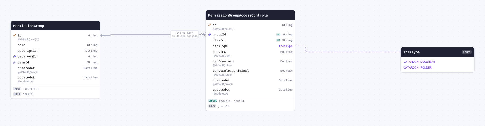

| Field                 | Type                         | Constraints                                             | Default      | Description |
| --------------------- | ---------------------------- | ------------------------------------------------------- | ------------ | ----------- |
| `id`                  | `String`                     | PK NOT NULL                                             | `cuid(1)`    |             |
| `groupId`             | `String`                     | NOT NULL → [PermissionGroup.id](#model-PermissionGroup) |              |             |
| `itemId`              | `String`                     | NOT NULL                                                |              |             |
| `itemType`            | [`ItemType`](#enum-ItemType) | NOT NULL                                                |              |             |
| `canView`             | `Boolean`                    | NOT NULL                                                | `true`       |             |
| `canDownload`         | `Boolean`                    | NOT NULL                                                | `false`      |             |
| `canDownloadOriginal` | `Boolean`                    | NOT NULL                                                | `false`      |             |
| `createdAt`           | `DateTime`                   | NOT NULL                                                | `now()`      |             |
| `updatedAt`           | `DateTime`                   | NOT NULL                                                | `@updatedAt` |             |

#### Indexes

- `@@index([groupId])`
- `@@unique([groupId, itemId])`

#### References

- `groupId` → [PermissionGroup.id](#model-PermissionGroup) (many-to-one, on delete Cascade)

#### Definition

```sql
CREATE TABLE "PermissionGroupAccessControls" (
    "id" TEXT NOT NULL,
    "groupId" TEXT NOT NULL,
    "itemId" TEXT NOT NULL,
    "itemType" "ItemType" NOT NULL,
    "canView" BOOLEAN NOT NULL DEFAULT true,
    "canDownload" BOOLEAN NOT NULL DEFAULT false,
    "canDownloadOriginal" BOOLEAN NOT NULL DEFAULT false,
    "createdAt" TIMESTAMP(3) NOT NULL DEFAULT CURRENT_TIMESTAMP,
    "updatedAt" TIMESTAMP(3) NOT NULL,

    CONSTRAINT "PermissionGroupAccessControls_pkey" PRIMARY KEY ("id")
);

CREATE INDEX "PermissionGroupAccessControls_groupId_idx" ON "PermissionGroupAccessControls"("groupId");

CREATE UNIQUE INDEX "PermissionGroupAccessControls_groupId_itemId_key" ON "PermissionGroupAccessControls"("groupId", "itemId");

ALTER TABLE "PermissionGroupAccessControls" ADD CONSTRAINT "PermissionGroupAccessControls_groupId_fkey" FOREIGN KEY ("groupId") REFERENCES "PermissionGroup"("id") ON DELETE CASCADE ON UPDATE CASCADE;
```

<details>
<summary>Queries and their SQL</summary>

**findMany**: Every row

```ts
await prisma.permissionGroupAccessControls.findMany();
```

```sql
SELECT
  "public"."PermissionGroupAccessControls"."id",
  "public"."PermissionGroupAccessControls"."groupId",
  "public"."PermissionGroupAccessControls"."itemId",
  "public"."PermissionGroupAccessControls"."itemType"::text,
  "public"."PermissionGroupAccessControls"."canView",
  "public"."PermissionGroupAccessControls"."canDownload",
  "public"."PermissionGroupAccessControls"."canDownloadOriginal",
  "public"."PermissionGroupAccessControls"."createdAt",
  "public"."PermissionGroupAccessControls"."updatedAt"
FROM
  "public"."PermissionGroupAccessControls"
WHERE
  1 = 1
OFFSET
  $1
-- params: ["0"]
```

**count**: How many rows there are

```ts
await prisma.permissionGroupAccessControls.count();
```

```sql
SELECT
  COUNT(*) AS "_count$_all"
FROM
  (
    SELECT
      "public"."PermissionGroupAccessControls"."id"
    FROM
      "public"."PermissionGroupAccessControls"
    WHERE
      1 = 1
    OFFSET
      $1
  ) AS "sub"
-- params: ["0"]
```

**findMany**: Every row with its relations

```ts
await prisma.permissionGroupAccessControls.findMany({ include: { group: true } });
```

```sql
SELECT
  "public"."PermissionGroupAccessControls"."id",
  "public"."PermissionGroupAccessControls"."groupId",
  "public"."PermissionGroupAccessControls"."itemId",
  "public"."PermissionGroupAccessControls"."itemType"::text,
  "public"."PermissionGroupAccessControls"."canView",
  "public"."PermissionGroupAccessControls"."canDownload",
  "public"."PermissionGroupAccessControls"."canDownloadOriginal",
  "public"."PermissionGroupAccessControls"."createdAt",
  "public"."PermissionGroupAccessControls"."updatedAt"
FROM
  "public"."PermissionGroupAccessControls"
WHERE
  1 = 1
OFFSET
  $1
-- params: ["0"]

SELECT
  "public"."PermissionGroup"."id",
  "public"."PermissionGroup"."name",
  "public"."PermissionGroup"."description",
  "public"."PermissionGroup"."dataroomId",
  "public"."PermissionGroup"."teamId",
  "public"."PermissionGroup"."createdAt",
  "public"."PermissionGroup"."updatedAt"
FROM
  "public"."PermissionGroup"
WHERE
  "public"."PermissionGroup"."id" IN ($1)
OFFSET
  $2
-- params: ["<groupId of the rows above>","0"]
```

**findUnique**: One row by what is unique to it

```ts
await prisma.permissionGroupAccessControls.findUnique({ where: { id: "example" } });
```

```sql
SELECT
  "public"."PermissionGroupAccessControls"."id",
  "public"."PermissionGroupAccessControls"."groupId",
  "public"."PermissionGroupAccessControls"."itemId",
  "public"."PermissionGroupAccessControls"."itemType"::text,
  "public"."PermissionGroupAccessControls"."canView",
  "public"."PermissionGroupAccessControls"."canDownload",
  "public"."PermissionGroupAccessControls"."canDownloadOriginal",
  "public"."PermissionGroupAccessControls"."createdAt",
  "public"."PermissionGroupAccessControls"."updatedAt"
FROM
  "public"."PermissionGroupAccessControls"
WHERE
  (
    "public"."PermissionGroupAccessControls"."id" = $1
    AND 1 = 1
  )
LIMIT
  $2
OFFSET
  $3
-- params: ["example","1","0"]
```

**create**: Create a row

```ts
await prisma.permissionGroupAccessControls.create({
  data: { groupId: "example", itemId: "example", itemType: "DATAROOM_DOCUMENT" },
});
```

```sql
INSERT INTO
  "public"."PermissionGroupAccessControls" (
    "id",
    "groupId",
    "itemId",
    "itemType",
    "canView",
    "canDownload",
    "canDownloadOriginal",
    "createdAt",
    "updatedAt"
  )
VALUES
  (
    $1,
    $2,
    $3,
    CAST($4::text AS "public"."ItemType"),
    $5,
    $6,
    $7,
    $8,
    $9
  )
RETURNING
  "public"."PermissionGroupAccessControls"."id",
  "public"."PermissionGroupAccessControls"."groupId",
  "public"."PermissionGroupAccessControls"."itemId",
  "public"."PermissionGroupAccessControls"."itemType"::text,
  "public"."PermissionGroupAccessControls"."canView",
  "public"."PermissionGroupAccessControls"."canDownload",
  "public"."PermissionGroupAccessControls"."canDownloadOriginal",
  "public"."PermissionGroupAccessControls"."createdAt",
  "public"."PermissionGroupAccessControls"."updatedAt"
-- params: ["<cuid(1)>","example","example","DATAROOM_DOCUMENT",true,false,false,"<now()>","<now()>"]
```

**update**: Update a row

```ts
await prisma.permissionGroupAccessControls.update({
  where: { id: "example" },
  data: { itemId: "example" },
});
```

```sql
UPDATE "public"."PermissionGroupAccessControls"
SET
  "itemId" = $1,
  "updatedAt" = $2
WHERE
  (
    "public"."PermissionGroupAccessControls"."id" = $3
    AND 1 = 1
  )
RETURNING
  "public"."PermissionGroupAccessControls"."id",
  "public"."PermissionGroupAccessControls"."groupId",
  "public"."PermissionGroupAccessControls"."itemId",
  "public"."PermissionGroupAccessControls"."itemType"::text,
  "public"."PermissionGroupAccessControls"."canView",
  "public"."PermissionGroupAccessControls"."canDownload",
  "public"."PermissionGroupAccessControls"."canDownloadOriginal",
  "public"."PermissionGroupAccessControls"."createdAt",
  "public"."PermissionGroupAccessControls"."updatedAt"
-- params: ["example",{"prisma__type":"generatorCall","prisma__value":{"name":"now","args":[],"returnType":{"type":"DateTime"}}},"example"]
```

**delete**: Delete a row

```ts
await prisma.permissionGroupAccessControls.delete({ where: { id: "example" } });
```

```sql
DELETE FROM "public"."PermissionGroupAccessControls"
WHERE
  (
    "public"."PermissionGroupAccessControls"."id" = $1
    AND 1 = 1
  )
RETURNING
  "public"."PermissionGroupAccessControls"."id",
  "public"."PermissionGroupAccessControls"."groupId",
  "public"."PermissionGroupAccessControls"."itemId",
  "public"."PermissionGroupAccessControls"."itemType"::text,
  "public"."PermissionGroupAccessControls"."canView",
  "public"."PermissionGroupAccessControls"."canDownload",
  "public"."PermissionGroupAccessControls"."canDownloadOriginal",
  "public"."PermissionGroupAccessControls"."createdAt",
  "public"."PermissionGroupAccessControls"."updatedAt"
-- params: ["example"]
```

</details>

<a id="model-Document"></a>

### Document

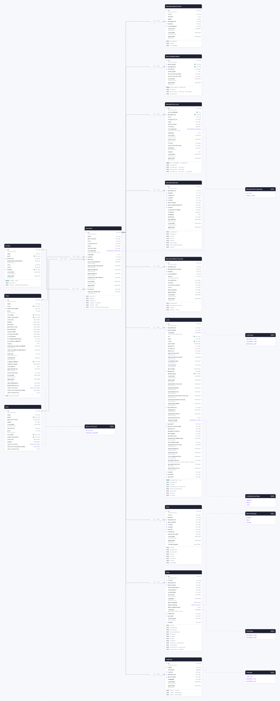

| Field                  | Type                                               | Constraints                       | Default       | Description |
| ---------------------- | -------------------------------------------------- | --------------------------------- | ------------- | ----------- |
| `id`                   | `String`                                           | PK NOT NULL                       | `cuid(1)`     |             |
| `name`                 | `String`                                           | NOT NULL                          |               |             |
| `description`          | `String`                                           | NULL                              |               |             |
| `file`                 | `String`                                           | NOT NULL                          |               |             |
| `originalFile`         | `String`                                           | NULL                              |               |             |
| `type`                 | `String`                                           | NULL                              |               |             |
| `contentType`          | `String`                                           | NULL                              |               |             |
| `storageType`          | [`DocumentStorageType`](#enum-DocumentStorageType) | NOT NULL                          | `VERCEL_BLOB` |             |
| `numPages`             | `Int`                                              | NULL                              |               |             |
| `teamId`               | `String`                                           | NOT NULL → [Team.id](#model-Team) |               |             |
| `ownerId`              | `String`                                           | NULL → [User.id](#model-User)     |               |             |
| `assistantEnabled`     | `Boolean`                                          | NOT NULL                          | `false`       |             |
| `advancedExcelEnabled` | `Boolean`                                          | NOT NULL                          | `false`       |             |
| `agentsEnabled`        | `Boolean`                                          | NOT NULL                          | `false`       |             |
| `downloadOnly`         | `Boolean`                                          | NOT NULL                          | `false`       |             |
| `hiddenInAllDocuments` | `Boolean`                                          | NOT NULL                          | `false`       |             |
| `createdAt`            | `DateTime`                                         | NOT NULL                          | `now()`       |             |
| `updatedAt`            | `DateTime`                                         | NOT NULL                          | `@updatedAt`  |             |
| `folderId`             | `String`                                           | NULL → [Folder.id](#model-Folder) |               |             |
| `isExternalUpload`     | `Boolean`                                          | NOT NULL                          | `false`       |             |

#### Indexes

- `@@index([ownerId])`
- `@@index([teamId])`
- `@@index([folderId])`
- `@@index([teamId, folderId])`
- `@@index([teamId, name])`
- `@@index([teamId, hiddenInAllDocuments])`

#### References

- `ownerId` → [User.id](#model-User) (many-to-one, on delete SetNull)
- `teamId` → [Team.id](#model-Team) (many-to-one, on delete Cascade)
- `folderId` → [Folder.id](#model-Folder) (many-to-one, on delete SetNull)

#### Referenced by

- `id` ← [DocumentAnnotation.documentId](#model-DocumentAnnotation) (one-to-many, on delete Cascade)
- `id` ← [DataroomDocument.documentId](#model-DataroomDocument) (one-to-many, on delete Cascade)
- `id` ← [DocumentVersion.documentId](#model-DocumentVersion) (one-to-many, on delete Cascade)
- `id` ← [DocumentUpload.documentId](#model-DocumentUpload) (one-to-many, on delete Cascade)
- `id` ← [Link.documentId](#model-Link) (one-to-many, on delete Cascade)
- `id` ← [DocumentRedactionJob.documentId](#model-DocumentRedactionJob) (one-to-many, on delete Cascade)
- `id` ← [View.documentId](#model-View) (one-to-many, on delete Cascade)
- `id` ← [Chat.documentId](#model-Chat) (one-to-many, on delete Cascade)
- `id` ← [TagItem.documentId](#model-TagItem) (one-to-many, on delete Cascade)

#### Definition

```sql
CREATE TABLE "Document" (
    "id" TEXT NOT NULL,
    "name" TEXT NOT NULL,
    "description" TEXT,
    "file" TEXT NOT NULL,
    "originalFile" TEXT,
    "type" TEXT,
    "contentType" TEXT,
    "storageType" "DocumentStorageType" NOT NULL DEFAULT 'VERCEL_BLOB',
    "numPages" INTEGER,
    "teamId" TEXT NOT NULL,
    "ownerId" TEXT,
    "assistantEnabled" BOOLEAN NOT NULL DEFAULT false,
    "advancedExcelEnabled" BOOLEAN NOT NULL DEFAULT false,
    "agentsEnabled" BOOLEAN NOT NULL DEFAULT false,
    "downloadOnly" BOOLEAN NOT NULL DEFAULT false,
    "hiddenInAllDocuments" BOOLEAN NOT NULL DEFAULT false,
    "createdAt" TIMESTAMP(3) NOT NULL DEFAULT CURRENT_TIMESTAMP,
    "updatedAt" TIMESTAMP(3) NOT NULL,
    "folderId" TEXT,
    "isExternalUpload" BOOLEAN NOT NULL DEFAULT false,

    CONSTRAINT "Document_pkey" PRIMARY KEY ("id")
);

CREATE INDEX "Document_ownerId_idx" ON "Document"("ownerId");

CREATE INDEX "Document_teamId_idx" ON "Document"("teamId");

CREATE INDEX "Document_folderId_idx" ON "Document"("folderId");

CREATE INDEX "Document_teamId_folderId_idx" ON "Document"("teamId", "folderId");

CREATE INDEX "Document_teamId_name_idx" ON "Document"("teamId", "name");

CREATE INDEX "Document_teamId_hiddenInAllDocuments_idx" ON "Document"("teamId", "hiddenInAllDocuments");

ALTER TABLE "Document" ADD CONSTRAINT "Document_ownerId_fkey" FOREIGN KEY ("ownerId") REFERENCES "User"("id") ON DELETE SET NULL ON UPDATE CASCADE;

ALTER TABLE "Document" ADD CONSTRAINT "Document_teamId_fkey" FOREIGN KEY ("teamId") REFERENCES "Team"("id") ON DELETE CASCADE ON UPDATE CASCADE;

ALTER TABLE "Document" ADD CONSTRAINT "Document_folderId_fkey" FOREIGN KEY ("folderId") REFERENCES "Folder"("id") ON DELETE SET NULL ON UPDATE CASCADE;
```

<details>
<summary>Queries and their SQL</summary>

**findMany**: Every row

```ts
await prisma.document.findMany();
```

```sql
SELECT
  "public"."Document"."id",
  "public"."Document"."name",
  "public"."Document"."description",
  "public"."Document"."file",
  "public"."Document"."originalFile",
  "public"."Document"."type",
  "public"."Document"."contentType",
  "public"."Document"."storageType"::text,
  "public"."Document"."numPages",
  "public"."Document"."teamId",
  "public"."Document"."ownerId",
  "public"."Document"."assistantEnabled",
  "public"."Document"."advancedExcelEnabled",
  "public"."Document"."agentsEnabled",
  "public"."Document"."downloadOnly",
  "public"."Document"."hiddenInAllDocuments",
  "public"."Document"."createdAt",
  "public"."Document"."updatedAt",
  "public"."Document"."folderId",
  "public"."Document"."isExternalUpload"
FROM
  "public"."Document"
WHERE
  1 = 1
OFFSET
  $1
-- params: ["0"]
```

**count**: How many rows there are

```ts
await prisma.document.count();
```

```sql
SELECT
  COUNT(*) AS "_count$_all"
FROM
  (
    SELECT
      "public"."Document"."id"
    FROM
      "public"."Document"
    WHERE
      1 = 1
    OFFSET
      $1
  ) AS "sub"
-- params: ["0"]
```

**findMany**: Every row with its relations

```ts
await prisma.document.findMany({
  include: {
    owner: true,
    team: true,
    links: true,
    views: true,
    versions: true,
    chats: true,
    folder: true,
    datarooms: true,
    tags: true,
    annotations: true,
    redactionJobs: true,
    uploadedDocument: true,
  },
});
```

```sql
SELECT
  "public"."Document"."id",
  "public"."Document"."name",
  "public"."Document"."description",
  "public"."Document"."file",
  "public"."Document"."originalFile",
  "public"."Document"."type",
  "public"."Document"."contentType",
  "public"."Document"."storageType"::text,
  "public"."Document"."numPages",
  "public"."Document"."teamId",
  "public"."Document"."ownerId",
  "public"."Document"."assistantEnabled",
  "public"."Document"."advancedExcelEnabled",
  "public"."Document"."agentsEnabled",
  "public"."Document"."downloadOnly",
  "public"."Document"."hiddenInAllDocuments",
  "public"."Document"."createdAt",
  "public"."Document"."updatedAt",
  "public"."Document"."folderId",
  "public"."Document"."isExternalUpload"
FROM
  "public"."Document"
WHERE
  1 = 1
OFFSET
  $1
-- params: ["0"]

SELECT
  "public"."User"."id",
  "public"."User"."name",
  "public"."User"."email",
  "public"."User"."emailVerified",
  "public"."User"."image",
  "public"."User"."createdAt",
  "public"."User"."contactId",
  "public"."User"."plan",
  "public"."User"."stripeId",
  "public"."User"."subscriptionId",
  "public"."User"."startsAt",
  "public"."User"."endsAt",
  "public"."User"."referralTrack"::text,
  "public"."User"."referralTrackSelectedAt",
  "public"."User"."referralProfile"
FROM
  "public"."User"
WHERE
  "public"."User"."id" IN ($1)
OFFSET
  $2
-- params: ["<ownerId of the rows above>","0"]

SELECT
  "public"."Team"."id",
  "public"."Team"."name",
  "public"."Team"."slug",
  "public"."Team"."defaultBrandId",
  "public"."Team"."plan",
  "public"."Team"."stripeId",
  "public"."Team"."subscriptionId",
  "public"."Team"."startsAt",
  "public"."Team"."endsAt",
  "public"."Team"."pausedAt",
  "public"."Team"."pauseStartsAt",
  "public"."Team"."pauseEndsAt",
  "public"."Team"."cancelledAt",
  "public"."Team"."trialStartedAt",
  "public"."Team"."trialEndsAt",
  "public"."Team"."trialReminderRunId",
  "public"."Team"."trialExpiredRunId",
  "public"."Team"."limits",
  "public"."Team"."enableExcelAdvancedMode",
  "public"."Team"."replicateDataroomFolders",
  "public"."Team"."timezone",
  "public"."Team"."ssoEnabled",
  "public"."Team"."ssoEmailDomain",
  "public"."Team"."ssoEnforcedAt",
  "public"."Team"."surveyData",
  "public"."Team"."agentsEnabled",
  "public"."Team"."vectorStoreId",
  "public"."Team"."createdAt",
  "public"."Team"."updatedAt",
  "public"."Team"."ignoredDomains",
  "public"."Team"."globalBlockList",
  "public"."Team"."referralTrack"::text,
  "public"."Team"."referralTrackSelectedAt",
  "public"."Team"."referralProfile"
FROM
  "public"."Team"
WHERE
  "public"."Team"."id" IN ($1)
OFFSET
  $2
-- params: ["<teamId of the rows above>","0"]

SELECT
  "public"."Link"."id",
  "public"."Link"."documentId",
  "public"."Link"."dataroomId",
  "public"."Link"."linkType"::text,
  "public"."Link"."url",
  "public"."Link"."name",
  "public"."Link"."slug",
  "public"."Link"."expiresAt",
  "public"."Link"."password",
  "public"."Link"."allowList",
  "public"."Link"."denyList",
  "public"."Link"."emailProtected",
  "public"."Link"."emailAuthenticated",
  "public"."Link"."allowDownload",
  "public"."Link"."isArchived",
  "public"."Link"."deletedAt",
  "public"."Link"."domainId",
  "public"."Link"."domainSlug",
  "public"."Link"."createdAt",
  "public"."Link"."updatedAt",
  "public"."Link"."enableNotification",
  "public"."Link"."enableFeedback",
  "public"."Link"."enableQuestion",
  "public"."Link"."enableScreenshotProtection",
  "public"."Link"."enableConfidentialView",
  "public"."Link"."enableAgreement",
  "public"."Link"."agreementId",
  "public"."Link"."showBanner",
  "public"."Link"."enableWatermark",
  "public"."Link"."watermarkConfig",
  "public"."Link"."audienceType"::text,
  "public"."Link"."groupId",
  "public"."Link"."permissionGroupId",
  "public"."Link"."metaTitle",
  "public"."Link"."metaDescription",
  "public"."Link"."metaImage",
  "public"."Link"."metaFavicon",
  "public"."Link"."enableCustomMetatag",
  "public"."Link"."welcomeMessage",
  "public"."Link"."enableConversation",
  "public"."Link"."enableAIAgents",
  "public"."Link"."enableUpload",
  "public"."Link"."isFileRequestOnly",
  "public"."Link"."uploadFolderId",
  "public"."Link"."uploadFolderIds",
  "public"."Link"."enableIndexFile",
  "public"."Link"."teamId",
  "public"."Link"."brandId",
  "public"."Link"."ownerId"
FROM
  "public"."Link"
WHERE
  "public"."Link"."documentId" IN ($1)
OFFSET
  $2
-- params: ["<id of the rows above>","0"]

SELECT
  "public"."View"."id",
  "public"."View"."linkId",
  "public"."View"."documentId",
  "public"."View"."dataroomId",
  "public"."View"."dataroomViewId",
  "public"."View"."viewerEmail",
  "public"."View"."viewerName",
  "public"."View"."verified",
  "public"."View"."viewedAt",
  "public"."View"."downloadedAt",
  "public"."View"."downloadType"::text,
  "public"."View"."downloadMetadata",
  "public"."View"."viewType"::text,
  "public"."View"."viewerId",
  "public"."View"."groupId",
  "public"."View"."isArchived",
  "public"."View"."teamId"
FROM
  "public"."View"
WHERE
  "public"."View"."documentId" IN ($1)
OFFSET
  $2
-- params: ["<id of the rows above>","0"]

SELECT
  "public"."DocumentVersion"."id",
  "public"."DocumentVersion"."versionNumber",
  "public"."DocumentVersion"."documentId",
  "public"."DocumentVersion"."file",
  "public"."DocumentVersion"."originalFile",
  "public"."DocumentVersion"."type",
  "public"."DocumentVersion"."contentType",
  "public"."DocumentVersion"."fileSize",
  "public"."DocumentVersion"."storageType"::text,
  "public"."DocumentVersion"."numPages",
  "public"."DocumentVersion"."isPrimary",
  "public"."DocumentVersion"."isVertical",
  "public"."DocumentVersion"."fileId",
  "public"."DocumentVersion"."vectorStoreFileId",
  "public"."DocumentVersion"."hasPages",
  "public"."DocumentVersion"."length",
  "public"."DocumentVersion"."createdAt",
  "public"."DocumentVersion"."updatedAt"
FROM
  "public"."DocumentVersion"
WHERE
  "public"."DocumentVersion"."documentId" IN ($1)
OFFSET
  $2
-- params: ["<id of the rows above>","0"]

SELECT
  "public"."Chat"."id",
  "public"."Chat"."title",
  "public"."Chat"."teamId",
  "public"."Chat"."documentId",
  "public"."Chat"."dataroomId",
  "public"."Chat"."linkId",
  "public"."Chat"."viewId",
  "public"."Chat"."userId",
  "public"."Chat"."viewerId",
  "public"."Chat"."vectorStoreId",
  "public"."Chat"."createdAt",
  "public"."Chat"."updatedAt",
  "public"."Chat"."lastMessageAt"
FROM
  "public"."Chat"
WHERE
  "public"."Chat"."documentId" IN ($1)
OFFSET
  $2
-- params: ["<id of the rows above>","0"]

SELECT
  "public"."Folder"."id",
  "public"."Folder"."name",
  "public"."Folder"."path",
  "public"."Folder"."parentId",
  "public"."Folder"."hiddenInAllDocuments",
  "public"."Folder"."icon",
  "public"."Folder"."color",
  "public"."Folder"."teamId",
  "public"."Folder"."createdAt",
  "public"."Folder"."updatedAt"
FROM
  "public"."Folder"
WHERE
  "public"."Folder"."id" IN ($1)
OFFSET
  $2
-- params: ["<folderId of the rows above>","0"]

SELECT
  "public"."DataroomDocument"."id",
  "public"."DataroomDocument"."dataroomId",
  "public"."DataroomDocument"."documentId",
  "public"."DataroomDocument"."folderId",
  "public"."DataroomDocument"."orderIndex",
  "public"."DataroomDocument"."hierarchicalIndex",
  "public"."DataroomDocument"."vectorStoreFileId",
  "public"."DataroomDocument"."createdAt",
  "public"."DataroomDocument"."updatedAt"
FROM
  "public"."DataroomDocument"
WHERE
  "public"."DataroomDocument"."documentId" IN ($1)
OFFSET
  $2
-- params: ["<id of the rows above>","0"]

SELECT
  "public"."TagItem"."id",
  "public"."TagItem"."tagId",
  "public"."TagItem"."itemType"::text,
  "public"."TagItem"."linkId",
  "public"."TagItem"."documentId",
  "public"."TagItem"."dataroomId",
  "public"."TagItem"."taggedBy",
  "public"."TagItem"."createdAt",
  "public"."TagItem"."updatedAt"
FROM
  "public"."TagItem"
WHERE
  "public"."TagItem"."documentId" IN ($1)
OFFSET
  $2
-- params: ["<id of the rows above>","0"]

SELECT
  "public"."DocumentAnnotation"."id",
  "public"."DocumentAnnotation"."title",
  "public"."DocumentAnnotation"."content",
  "public"."DocumentAnnotation"."pages",
  "public"."DocumentAnnotation"."documentId",
  "public"."DocumentAnnotation"."teamId",
  "public"."DocumentAnnotation"."createdById",
  "public"."DocumentAnnotation"."isVisible",
  "public"."DocumentAnnotation"."createdAt",
  "public"."DocumentAnnotation"."updatedAt"
FROM
  "public"."DocumentAnnotation"
WHERE
  "public"."DocumentAnnotation"."documentId" IN ($1)
OFFSET
  $2
-- params: ["<id of the rows above>","0"]

SELECT
  "public"."DocumentRedactionJob"."id",
  "public"."DocumentRedactionJob"."documentId",
  "public"."DocumentRedactionJob"."documentVersionId",
  "public"."DocumentRedactionJob"."teamId",
  "public"."DocumentRedactionJob"."createdById",
  "public"."DocumentRedactionJob"."status",
  "public"."DocumentRedactionJob"."customTerms",
  "public"."DocumentRedactionJob"."reasons",
  "public"."DocumentRedactionJob"."resultVersionId",
  "public"."DocumentRedactionJob"."error",
  "public"."DocumentRedactionJob"."detectRunId",
  "public"."DocumentRedactionJob"."applyRunId",
  "public"."DocumentRedactionJob"."createdAt",
  "public"."DocumentRedactionJob"."updatedAt"
FROM
  "public"."DocumentRedactionJob"
WHERE
  "public"."DocumentRedactionJob"."documentId" IN ($1)
OFFSET
  $2
-- params: ["<id of the rows above>","0"]

SELECT
  "public"."DocumentUpload"."id",
  "public"."DocumentUpload"."documentId",
  "public"."DocumentUpload"."teamId",
  "public"."DocumentUpload"."viewerId",
  "public"."DocumentUpload"."viewId",
  "public"."DocumentUpload"."linkId",
  "public"."DocumentUpload"."dataroomId",
  "public"."DocumentUpload"."dataroomDocumentId",
  "public"."DocumentUpload"."taskId",
  "public"."DocumentUpload"."originalFilename",
  "public"."DocumentUpload"."fileSize",
  "public"."DocumentUpload"."numPages",
  "public"."DocumentUpload"."mimeType",
  "public"."DocumentUpload"."uploadedAt",
  "public"."DocumentUpload"."createdAt",
  "public"."DocumentUpload"."updatedAt"
FROM
  "public"."DocumentUpload"
WHERE
  "public"."DocumentUpload"."documentId" IN ($1)
OFFSET
  $2
-- params: ["<id of the rows above>","0"]
```

**findUnique**: One row by what is unique to it

```ts
await prisma.document.findUnique({ where: { id: "example" } });
```

```sql
SELECT
  "public"."Document"."id",
  "public"."Document"."name",
  "public"."Document"."description",
  "public"."Document"."file",
  "public"."Document"."originalFile",
  "public"."Document"."type",
  "public"."Document"."contentType",
  "public"."Document"."storageType"::text,
  "public"."Document"."numPages",
  "public"."Document"."teamId",
  "public"."Document"."ownerId",
  "public"."Document"."assistantEnabled",
  "public"."Document"."advancedExcelEnabled",
  "public"."Document"."agentsEnabled",
  "public"."Document"."downloadOnly",
  "public"."Document"."hiddenInAllDocuments",
  "public"."Document"."createdAt",
  "public"."Document"."updatedAt",
  "public"."Document"."folderId",
  "public"."Document"."isExternalUpload"
FROM
  "public"."Document"
WHERE
  (
    "public"."Document"."id" = $1
    AND 1 = 1
  )
LIMIT
  $2
OFFSET
  $3
-- params: ["example","1","0"]
```

**create**: Create a row

```ts
await prisma.document.create({ data: { name: "example", file: "example", teamId: "example" } });
```

```sql
INSERT INTO
  "public"."Document" (
    "id",
    "name",
    "file",
    "storageType",
    "teamId",
    "assistantEnabled",
    "advancedExcelEnabled",
    "agentsEnabled",
    "downloadOnly",
    "hiddenInAllDocuments",
    "createdAt",
    "updatedAt",
    "isExternalUpload"
  )
VALUES
  (
    $1,
    $2,
    $3,
    CAST($4::text AS "public"."DocumentStorageType"),
    $5,
    $6,
    $7,
    $8,
    $9,
    $10,
    $11,
    $12,
    $13
  )
RETURNING
  "public"."Document"."id",
  "public"."Document"."name",
  "public"."Document"."description",
  "public"."Document"."file",
  "public"."Document"."originalFile",
  "public"."Document"."type",
  "public"."Document"."contentType",
  "public"."Document"."storageType"::text,
  "public"."Document"."numPages",
  "public"."Document"."teamId",
  "public"."Document"."ownerId",
  "public"."Document"."assistantEnabled",
  "public"."Document"."advancedExcelEnabled",
  "public"."Document"."agentsEnabled",
  "public"."Document"."downloadOnly",
  "public"."Document"."hiddenInAllDocuments",
  "public"."Document"."createdAt",
  "public"."Document"."updatedAt",
  "public"."Document"."folderId",
  "public"."Document"."isExternalUpload"
-- params: ["<cuid(1)>","example","example","VERCEL_BLOB","example",false,false,false,false,false,"<now()>","<now()>",false]
```

**update**: Update a row

```ts
await prisma.document.update({ where: { id: "example" }, data: { name: "example" } });
```

```sql
UPDATE "public"."Document"
SET
  "name" = $1,
  "updatedAt" = $2
WHERE
  (
    "public"."Document"."id" = $3
    AND 1 = 1
  )
RETURNING
  "public"."Document"."id",
  "public"."Document"."name",
  "public"."Document"."description",
  "public"."Document"."file",
  "public"."Document"."originalFile",
  "public"."Document"."type",
  "public"."Document"."contentType",
  "public"."Document"."storageType"::text,
  "public"."Document"."numPages",
  "public"."Document"."teamId",
  "public"."Document"."ownerId",
  "public"."Document"."assistantEnabled",
  "public"."Document"."advancedExcelEnabled",
  "public"."Document"."agentsEnabled",
  "public"."Document"."downloadOnly",
  "public"."Document"."hiddenInAllDocuments",
  "public"."Document"."createdAt",
  "public"."Document"."updatedAt",
  "public"."Document"."folderId",
  "public"."Document"."isExternalUpload"
-- params: ["example",{"prisma__type":"generatorCall","prisma__value":{"name":"now","args":[],"returnType":{"type":"DateTime"}}},"example"]
```

**delete**: Delete a row

```ts
await prisma.document.delete({ where: { id: "example" } });
```

```sql
DELETE FROM "public"."Document"
WHERE
  (
    "public"."Document"."id" = $1
    AND 1 = 1
  )
RETURNING
  "public"."Document"."id",
  "public"."Document"."name",
  "public"."Document"."description",
  "public"."Document"."file",
  "public"."Document"."originalFile",
  "public"."Document"."type",
  "public"."Document"."contentType",
  "public"."Document"."storageType"::text,
  "public"."Document"."numPages",
  "public"."Document"."teamId",
  "public"."Document"."ownerId",
  "public"."Document"."assistantEnabled",
  "public"."Document"."advancedExcelEnabled",
  "public"."Document"."agentsEnabled",
  "public"."Document"."downloadOnly",
  "public"."Document"."hiddenInAllDocuments",
  "public"."Document"."createdAt",
  "public"."Document"."updatedAt",
  "public"."Document"."folderId",
  "public"."Document"."isExternalUpload"
-- params: ["example"]
```

</details>

<a id="model-DocumentVersion"></a>

### DocumentVersion

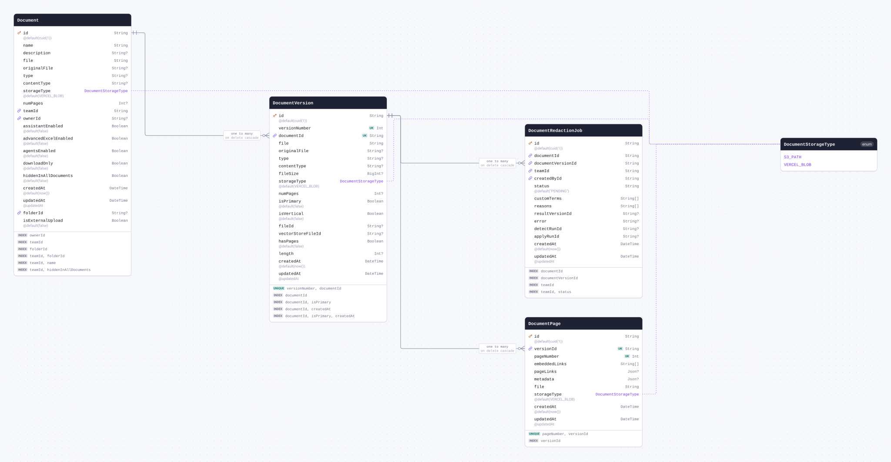

| Field               | Type                                               | Constraints                               | Default       | Description |
| ------------------- | -------------------------------------------------- | ----------------------------------------- | ------------- | ----------- |
| `id`                | `String`                                           | PK NOT NULL                               | `cuid(1)`     |             |
| `versionNumber`     | `Int`                                              | NOT NULL                                  |               |             |
| `documentId`        | `String`                                           | NOT NULL → [Document.id](#model-Document) |               |             |
| `file`              | `String`                                           | NOT NULL                                  |               |             |
| `originalFile`      | `String`                                           | NULL                                      |               |             |
| `type`              | `String`                                           | NULL                                      |               |             |
| `contentType`       | `String`                                           | NULL                                      |               |             |
| `fileSize`          | `BigInt`                                           | NULL                                      |               |             |
| `storageType`       | [`DocumentStorageType`](#enum-DocumentStorageType) | NOT NULL                                  | `VERCEL_BLOB` |             |
| `numPages`          | `Int`                                              | NULL                                      |               |             |
| `isPrimary`         | `Boolean`                                          | NOT NULL                                  | `false`       |             |
| `isVertical`        | `Boolean`                                          | NOT NULL                                  | `false`       |             |
| `fileId`            | `String`                                           | NULL                                      |               |             |
| `vectorStoreFileId` | `String`                                           | NULL                                      |               |             |
| `hasPages`          | `Boolean`                                          | NOT NULL                                  | `false`       |             |
| `length`            | `Int`                                              | NULL                                      |               |             |
| `createdAt`         | `DateTime`                                         | NOT NULL                                  | `now()`       |             |
| `updatedAt`         | `DateTime`                                         | NOT NULL                                  | `@updatedAt`  |             |

#### Indexes

- `@@index([documentId])`
- `@@index([documentId, isPrimary])`
- `@@index([documentId, createdAt])`
- `@@index([documentId, isPrimary, createdAt])`
- `@@unique([versionNumber, documentId])`

#### References

- `documentId` → [Document.id](#model-Document) (many-to-one, on delete Cascade)

#### Referenced by

- `id` ← [DocumentPage.versionId](#model-DocumentPage) (one-to-many, on delete Cascade)
- `id` ← [DocumentRedactionJob.documentVersionId](#model-DocumentRedactionJob) (one-to-many, on delete Cascade)

#### Definition

```sql
CREATE TABLE "DocumentVersion" (
    "id" TEXT NOT NULL,
    "versionNumber" INTEGER NOT NULL,
    "documentId" TEXT NOT NULL,
    "file" TEXT NOT NULL,
    "originalFile" TEXT,
    "type" TEXT,
    "contentType" TEXT,
    "fileSize" BIGINT,
    "storageType" "DocumentStorageType" NOT NULL DEFAULT 'VERCEL_BLOB',
    "numPages" INTEGER,
    "isPrimary" BOOLEAN NOT NULL DEFAULT false,
    "isVertical" BOOLEAN NOT NULL DEFAULT false,
    "fileId" TEXT,
    "vectorStoreFileId" TEXT,
    "hasPages" BOOLEAN NOT NULL DEFAULT false,
    "length" INTEGER,
    "createdAt" TIMESTAMP(3) NOT NULL DEFAULT CURRENT_TIMESTAMP,
    "updatedAt" TIMESTAMP(3) NOT NULL,

    CONSTRAINT "DocumentVersion_pkey" PRIMARY KEY ("id")
);

CREATE INDEX "DocumentVersion_documentId_idx" ON "DocumentVersion"("documentId");

CREATE INDEX "DocumentVersion_documentId_isPrimary_idx" ON "DocumentVersion"("documentId", "isPrimary");

CREATE INDEX "DocumentVersion_documentId_createdAt_idx" ON "DocumentVersion"("documentId", "createdAt" DESC);

CREATE INDEX "DocumentVersion_documentId_isPrimary_createdAt_idx" ON "DocumentVersion"("documentId", "isPrimary", "createdAt");

CREATE UNIQUE INDEX "DocumentVersion_versionNumber_documentId_key" ON "DocumentVersion"("versionNumber", "documentId");

ALTER TABLE "DocumentVersion" ADD CONSTRAINT "DocumentVersion_documentId_fkey" FOREIGN KEY ("documentId") REFERENCES "Document"("id") ON DELETE CASCADE ON UPDATE CASCADE;
```

<details>
<summary>Queries and their SQL</summary>

**findMany**: Every row

```ts
await prisma.documentVersion.findMany();
```

```sql
SELECT
  "public"."DocumentVersion"."id",
  "public"."DocumentVersion"."versionNumber",
  "public"."DocumentVersion"."documentId",
  "public"."DocumentVersion"."file",
  "public"."DocumentVersion"."originalFile",
  "public"."DocumentVersion"."type",
  "public"."DocumentVersion"."contentType",
  "public"."DocumentVersion"."fileSize",
  "public"."DocumentVersion"."storageType"::text,
  "public"."DocumentVersion"."numPages",
  "public"."DocumentVersion"."isPrimary",
  "public"."DocumentVersion"."isVertical",
  "public"."DocumentVersion"."fileId",
  "public"."DocumentVersion"."vectorStoreFileId",
  "public"."DocumentVersion"."hasPages",
  "public"."DocumentVersion"."length",
  "public"."DocumentVersion"."createdAt",
  "public"."DocumentVersion"."updatedAt"
FROM
  "public"."DocumentVersion"
WHERE
  1 = 1
OFFSET
  $1
-- params: ["0"]
```

**count**: How many rows there are

```ts
await prisma.documentVersion.count();
```

```sql
SELECT
  COUNT(*) AS "_count$_all"
FROM
  (
    SELECT
      "public"."DocumentVersion"."id"
    FROM
      "public"."DocumentVersion"
    WHERE
      1 = 1
    OFFSET
      $1
  ) AS "sub"
-- params: ["0"]
```

**findMany**: Every row with its relations

```ts
await prisma.documentVersion.findMany({
  include: { document: true, pages: true, redactionJobs: true },
});
```

```sql
SELECT
  "public"."DocumentVersion"."id",
  "public"."DocumentVersion"."versionNumber",
  "public"."DocumentVersion"."documentId",
  "public"."DocumentVersion"."file",
  "public"."DocumentVersion"."originalFile",
  "public"."DocumentVersion"."type",
  "public"."DocumentVersion"."contentType",
  "public"."DocumentVersion"."fileSize",
  "public"."DocumentVersion"."storageType"::text,
  "public"."DocumentVersion"."numPages",
  "public"."DocumentVersion"."isPrimary",
  "public"."DocumentVersion"."isVertical",
  "public"."DocumentVersion"."fileId",
  "public"."DocumentVersion"."vectorStoreFileId",
  "public"."DocumentVersion"."hasPages",
  "public"."DocumentVersion"."length",
  "public"."DocumentVersion"."createdAt",
  "public"."DocumentVersion"."updatedAt"
FROM
  "public"."DocumentVersion"
WHERE
  1 = 1
OFFSET
  $1
-- params: ["0"]

SELECT
  "public"."Document"."id",
  "public"."Document"."name",
  "public"."Document"."description",
  "public"."Document"."file",
  "public"."Document"."originalFile",
  "public"."Document"."type",
  "public"."Document"."contentType",
  "public"."Document"."storageType"::text,
  "public"."Document"."numPages",
  "public"."Document"."teamId",
  "public"."Document"."ownerId",
  "public"."Document"."assistantEnabled",
  "public"."Document"."advancedExcelEnabled",
  "public"."Document"."agentsEnabled",
  "public"."Document"."downloadOnly",
  "public"."Document"."hiddenInAllDocuments",
  "public"."Document"."createdAt",
  "public"."Document"."updatedAt",
  "public"."Document"."folderId",
  "public"."Document"."isExternalUpload"
FROM
  "public"."Document"
WHERE
  "public"."Document"."id" IN ($1)
OFFSET
  $2
-- params: ["<documentId of the rows above>","0"]

SELECT
  "public"."DocumentPage"."id",
  "public"."DocumentPage"."versionId",
  "public"."DocumentPage"."pageNumber",
  "public"."DocumentPage"."embeddedLinks",
  "public"."DocumentPage"."pageLinks",
  "public"."DocumentPage"."metadata",
  "public"."DocumentPage"."file",
  "public"."DocumentPage"."storageType"::text,
  "public"."DocumentPage"."createdAt",
  "public"."DocumentPage"."updatedAt"
FROM
  "public"."DocumentPage"
WHERE
  "public"."DocumentPage"."versionId" IN ($1)
OFFSET
  $2
-- params: ["<id of the rows above>","0"]

SELECT
  "public"."DocumentRedactionJob"."id",
  "public"."DocumentRedactionJob"."documentId",
  "public"."DocumentRedactionJob"."documentVersionId",
  "public"."DocumentRedactionJob"."teamId",
  "public"."DocumentRedactionJob"."createdById",
  "public"."DocumentRedactionJob"."status",
  "public"."DocumentRedactionJob"."customTerms",
  "public"."DocumentRedactionJob"."reasons",
  "public"."DocumentRedactionJob"."resultVersionId",
  "public"."DocumentRedactionJob"."error",
  "public"."DocumentRedactionJob"."detectRunId",
  "public"."DocumentRedactionJob"."applyRunId",
  "public"."DocumentRedactionJob"."createdAt",
  "public"."DocumentRedactionJob"."updatedAt"
FROM
  "public"."DocumentRedactionJob"
WHERE
  "public"."DocumentRedactionJob"."documentVersionId" IN ($1)
OFFSET
  $2
-- params: ["<id of the rows above>","0"]
```

**findUnique**: One row by what is unique to it

```ts
await prisma.documentVersion.findUnique({ where: { id: "example" } });
```

```sql
SELECT
  "public"."DocumentVersion"."id",
  "public"."DocumentVersion"."versionNumber",
  "public"."DocumentVersion"."documentId",
  "public"."DocumentVersion"."file",
  "public"."DocumentVersion"."originalFile",
  "public"."DocumentVersion"."type",
  "public"."DocumentVersion"."contentType",
  "public"."DocumentVersion"."fileSize",
  "public"."DocumentVersion"."storageType"::text,
  "public"."DocumentVersion"."numPages",
  "public"."DocumentVersion"."isPrimary",
  "public"."DocumentVersion"."isVertical",
  "public"."DocumentVersion"."fileId",
  "public"."DocumentVersion"."vectorStoreFileId",
  "public"."DocumentVersion"."hasPages",
  "public"."DocumentVersion"."length",
  "public"."DocumentVersion"."createdAt",
  "public"."DocumentVersion"."updatedAt"
FROM
  "public"."DocumentVersion"
WHERE
  (
    "public"."DocumentVersion"."id" = $1
    AND 1 = 1
  )
LIMIT
  $2
OFFSET
  $3
-- params: ["example","1","0"]
```

**create**: Create a row

```ts
await prisma.documentVersion.create({
  data: { versionNumber: 1, documentId: "example", file: "example" },
});
```

```sql
INSERT INTO
  "public"."DocumentVersion" (
    "id",
    "versionNumber",
    "documentId",
    "file",
    "storageType",
    "isPrimary",
    "isVertical",
    "hasPages",
    "createdAt",
    "updatedAt"
  )
VALUES
  (
    $1,
    $2,
    $3,
    $4,
    CAST($5::text AS "public"."DocumentStorageType"),
    $6,
    $7,
    $8,
    $9,
    $10
  )
RETURNING
  "public"."DocumentVersion"."id",
  "public"."DocumentVersion"."versionNumber",
  "public"."DocumentVersion"."documentId",
  "public"."DocumentVersion"."file",
  "public"."DocumentVersion"."originalFile",
  "public"."DocumentVersion"."type",
  "public"."DocumentVersion"."contentType",
  "public"."DocumentVersion"."fileSize",
  "public"."DocumentVersion"."storageType"::text,
  "public"."DocumentVersion"."numPages",
  "public"."DocumentVersion"."isPrimary",
  "public"."DocumentVersion"."isVertical",
  "public"."DocumentVersion"."fileId",
  "public"."DocumentVersion"."vectorStoreFileId",
  "public"."DocumentVersion"."hasPages",
  "public"."DocumentVersion"."length",
  "public"."DocumentVersion"."createdAt",
  "public"."DocumentVersion"."updatedAt"
-- params: ["<cuid(1)>","1","example","example","VERCEL_BLOB",false,false,false,"<now()>","<now()>"]
```

**update**: Update a row

```ts
await prisma.documentVersion.update({ where: { id: "example" }, data: { versionNumber: 1 } });
```

```sql
UPDATE "public"."DocumentVersion"
SET
  "versionNumber" = $1,
  "updatedAt" = $2
WHERE
  (
    "public"."DocumentVersion"."id" = $3
    AND 1 = 1
  )
RETURNING
  "public"."DocumentVersion"."id",
  "public"."DocumentVersion"."versionNumber",
  "public"."DocumentVersion"."documentId",
  "public"."DocumentVersion"."file",
  "public"."DocumentVersion"."originalFile",
  "public"."DocumentVersion"."type",
  "public"."DocumentVersion"."contentType",
  "public"."DocumentVersion"."fileSize",
  "public"."DocumentVersion"."storageType"::text,
  "public"."DocumentVersion"."numPages",
  "public"."DocumentVersion"."isPrimary",
  "public"."DocumentVersion"."isVertical",
  "public"."DocumentVersion"."fileId",
  "public"."DocumentVersion"."vectorStoreFileId",
  "public"."DocumentVersion"."hasPages",
  "public"."DocumentVersion"."length",
  "public"."DocumentVersion"."createdAt",
  "public"."DocumentVersion"."updatedAt"
-- params: ["1",{"prisma__type":"generatorCall","prisma__value":{"name":"now","args":[],"returnType":{"type":"DateTime"}}},"example"]
```

**delete**: Delete a row

```ts
await prisma.documentVersion.delete({ where: { id: "example" } });
```

```sql
DELETE FROM "public"."DocumentVersion"
WHERE
  (
    "public"."DocumentVersion"."id" = $1
    AND 1 = 1
  )
RETURNING
  "public"."DocumentVersion"."id",
  "public"."DocumentVersion"."versionNumber",
  "public"."DocumentVersion"."documentId",
  "public"."DocumentVersion"."file",
  "public"."DocumentVersion"."originalFile",
  "public"."DocumentVersion"."type",
  "public"."DocumentVersion"."contentType",
  "public"."DocumentVersion"."fileSize",
  "public"."DocumentVersion"."storageType"::text,
  "public"."DocumentVersion"."numPages",
  "public"."DocumentVersion"."isPrimary",
  "public"."DocumentVersion"."isVertical",
  "public"."DocumentVersion"."fileId",
  "public"."DocumentVersion"."vectorStoreFileId",
  "public"."DocumentVersion"."hasPages",
  "public"."DocumentVersion"."length",
  "public"."DocumentVersion"."createdAt",
  "public"."DocumentVersion"."updatedAt"
-- params: ["example"]
```

</details>

<a id="model-DocumentPage"></a>

### DocumentPage

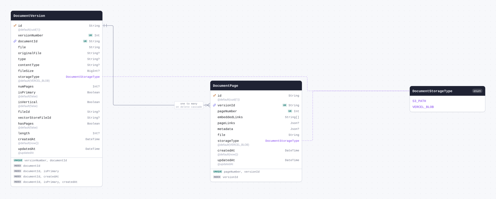

| Field           | Type                                               | Constraints                                             | Default       | Description |
| --------------- | -------------------------------------------------- | ------------------------------------------------------- | ------------- | ----------- |
| `id`            | `String`                                           | PK NOT NULL                                             | `cuid(1)`     |             |
| `versionId`     | `String`                                           | NOT NULL → [DocumentVersion.id](#model-DocumentVersion) |               |             |
| `pageNumber`    | `Int`                                              | NOT NULL                                                |               |             |
| `embeddedLinks` | `String[]`                                         | NOT NULL                                                |               |             |
| `pageLinks`     | `Json`                                             | NULL                                                    |               |             |
| `metadata`      | `Json`                                             | NULL                                                    |               |             |
| `file`          | `String`                                           | NOT NULL                                                |               |             |
| `storageType`   | [`DocumentStorageType`](#enum-DocumentStorageType) | NOT NULL                                                | `VERCEL_BLOB` |             |
| `createdAt`     | `DateTime`                                         | NOT NULL                                                | `now()`       |             |
| `updatedAt`     | `DateTime`                                         | NOT NULL                                                | `@updatedAt`  |             |

#### Indexes

- `@@index([versionId])`
- `@@unique([pageNumber, versionId])`

#### References

- `versionId` → [DocumentVersion.id](#model-DocumentVersion) (many-to-one, on delete Cascade)

#### Definition

```sql
CREATE TABLE "DocumentPage" (
    "id" TEXT NOT NULL,
    "versionId" TEXT NOT NULL,
    "pageNumber" INTEGER NOT NULL,
    "embeddedLinks" TEXT[],
    "pageLinks" JSONB,
    "metadata" JSONB,
    "file" TEXT NOT NULL,
    "storageType" "DocumentStorageType" NOT NULL DEFAULT 'VERCEL_BLOB',
    "createdAt" TIMESTAMP(3) NOT NULL DEFAULT CURRENT_TIMESTAMP,
    "updatedAt" TIMESTAMP(3) NOT NULL,

    CONSTRAINT "DocumentPage_pkey" PRIMARY KEY ("id")
);

CREATE INDEX "DocumentPage_versionId_idx" ON "DocumentPage"("versionId");

CREATE UNIQUE INDEX "DocumentPage_pageNumber_versionId_key" ON "DocumentPage"("pageNumber", "versionId");

ALTER TABLE "DocumentPage" ADD CONSTRAINT "DocumentPage_versionId_fkey" FOREIGN KEY ("versionId") REFERENCES "DocumentVersion"("id") ON DELETE CASCADE ON UPDATE CASCADE;
```

<details>
<summary>Queries and their SQL</summary>

**findMany**: Every row

```ts
await prisma.documentPage.findMany();
```

```sql
SELECT
  "public"."DocumentPage"."id",
  "public"."DocumentPage"."versionId",
  "public"."DocumentPage"."pageNumber",
  "public"."DocumentPage"."embeddedLinks",
  "public"."DocumentPage"."pageLinks",
  "public"."DocumentPage"."metadata",
  "public"."DocumentPage"."file",
  "public"."DocumentPage"."storageType"::text,
  "public"."DocumentPage"."createdAt",
  "public"."DocumentPage"."updatedAt"
FROM
  "public"."DocumentPage"
WHERE
  1 = 1
OFFSET
  $1
-- params: ["0"]
```

**count**: How many rows there are

```ts
await prisma.documentPage.count();
```

```sql
SELECT
  COUNT(*) AS "_count$_all"
FROM
  (
    SELECT
      "public"."DocumentPage"."id"
    FROM
      "public"."DocumentPage"
    WHERE
      1 = 1
    OFFSET
      $1
  ) AS "sub"
-- params: ["0"]
```

**findMany**: Every row with its relations

```ts
await prisma.documentPage.findMany({ include: { version: true } });
```

```sql
SELECT
  "public"."DocumentPage"."id",
  "public"."DocumentPage"."versionId",
  "public"."DocumentPage"."pageNumber",
  "public"."DocumentPage"."embeddedLinks",
  "public"."DocumentPage"."pageLinks",
  "public"."DocumentPage"."metadata",
  "public"."DocumentPage"."file",
  "public"."DocumentPage"."storageType"::text,
  "public"."DocumentPage"."createdAt",
  "public"."DocumentPage"."updatedAt"
FROM
  "public"."DocumentPage"
WHERE
  1 = 1
OFFSET
  $1
-- params: ["0"]

SELECT
  "public"."DocumentVersion"."id",
  "public"."DocumentVersion"."versionNumber",
  "public"."DocumentVersion"."documentId",
  "public"."DocumentVersion"."file",
  "public"."DocumentVersion"."originalFile",
  "public"."DocumentVersion"."type",
  "public"."DocumentVersion"."contentType",
  "public"."DocumentVersion"."fileSize",
  "public"."DocumentVersion"."storageType"::text,
  "public"."DocumentVersion"."numPages",
  "public"."DocumentVersion"."isPrimary",
  "public"."DocumentVersion"."isVertical",
  "public"."DocumentVersion"."fileId",
  "public"."DocumentVersion"."vectorStoreFileId",
  "public"."DocumentVersion"."hasPages",
  "public"."DocumentVersion"."length",
  "public"."DocumentVersion"."createdAt",
  "public"."DocumentVersion"."updatedAt"
FROM
  "public"."DocumentVersion"
WHERE
  "public"."DocumentVersion"."id" IN ($1)
OFFSET
  $2
-- params: ["<versionId of the rows above>","0"]
```

**findUnique**: One row by what is unique to it

```ts
await prisma.documentPage.findUnique({ where: { id: "example" } });
```

```sql
SELECT
  "public"."DocumentPage"."id",
  "public"."DocumentPage"."versionId",
  "public"."DocumentPage"."pageNumber",
  "public"."DocumentPage"."embeddedLinks",
  "public"."DocumentPage"."pageLinks",
  "public"."DocumentPage"."metadata",
  "public"."DocumentPage"."file",
  "public"."DocumentPage"."storageType"::text,
  "public"."DocumentPage"."createdAt",
  "public"."DocumentPage"."updatedAt"
FROM
  "public"."DocumentPage"
WHERE
  (
    "public"."DocumentPage"."id" = $1
    AND 1 = 1
  )
LIMIT
  $2
OFFSET
  $3
-- params: ["example","1","0"]
```

**create**: Create a row

```ts
await prisma.documentPage.create({
  data: { versionId: "example", pageNumber: 1, embeddedLinks: ["example"], file: "example" },
});
```

```sql
INSERT INTO
  "public"."DocumentPage" (
    "id",
    "versionId",
    "pageNumber",
    "embeddedLinks",
    "file",
    "storageType",
    "createdAt",
    "updatedAt"
  )
VALUES
  (
    $1,
    $2,
    $3,
    $4,
    $5,
    CAST($6::text AS "public"."DocumentStorageType"),
    $7,
    $8
  )
RETURNING
  "public"."DocumentPage"."id",
  "public"."DocumentPage"."versionId",
  "public"."DocumentPage"."pageNumber",
  "public"."DocumentPage"."embeddedLinks",
  "public"."DocumentPage"."pageLinks",
  "public"."DocumentPage"."metadata",
  "public"."DocumentPage"."file",
  "public"."DocumentPage"."storageType"::text,
  "public"."DocumentPage"."createdAt",
  "public"."DocumentPage"."updatedAt"
-- params: ["<cuid(1)>","example","1",["example"],"example","VERCEL_BLOB","<now()>","<now()>"]
```

**update**: Update a row

```ts
await prisma.documentPage.update({ where: { id: "example" }, data: { pageNumber: 1 } });
```

```sql
UPDATE "public"."DocumentPage"
SET
  "pageNumber" = $1,
  "updatedAt" = $2
WHERE
  (
    "public"."DocumentPage"."id" = $3
    AND 1 = 1
  )
RETURNING
  "public"."DocumentPage"."id",
  "public"."DocumentPage"."versionId",
  "public"."DocumentPage"."pageNumber",
  "public"."DocumentPage"."embeddedLinks",
  "public"."DocumentPage"."pageLinks",
  "public"."DocumentPage"."metadata",
  "public"."DocumentPage"."file",
  "public"."DocumentPage"."storageType"::text,
  "public"."DocumentPage"."createdAt",
  "public"."DocumentPage"."updatedAt"
-- params: ["1",{"prisma__type":"generatorCall","prisma__value":{"name":"now","args":[],"returnType":{"type":"DateTime"}}},"example"]
```

**delete**: Delete a row

```ts
await prisma.documentPage.delete({ where: { id: "example" } });
```

```sql
DELETE FROM "public"."DocumentPage"
WHERE
  (
    "public"."DocumentPage"."id" = $1
    AND 1 = 1
  )
RETURNING
  "public"."DocumentPage"."id",
  "public"."DocumentPage"."versionId",
  "public"."DocumentPage"."pageNumber",
  "public"."DocumentPage"."embeddedLinks",
  "public"."DocumentPage"."pageLinks",
  "public"."DocumentPage"."metadata",
  "public"."DocumentPage"."file",
  "public"."DocumentPage"."storageType"::text,
  "public"."DocumentPage"."createdAt",
  "public"."DocumentPage"."updatedAt"
-- params: ["example"]
```

</details>

<a id="model-Folder"></a>

### Folder

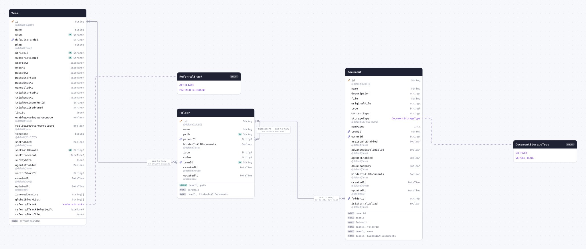

| Field                  | Type       | Constraints                       | Default      | Description |
| ---------------------- | ---------- | --------------------------------- | ------------ | ----------- |
| `id`                   | `String`   | PK NOT NULL                       | `cuid(1)`    |             |
| `name`                 | `String`   | NOT NULL                          |              |             |
| `path`                 | `String`   | NOT NULL                          |              |             |
| `parentId`             | `String`   | NULL → [Folder.id](#model-Folder) |              |             |
| `hiddenInAllDocuments` | `Boolean`  | NOT NULL                          | `false`      |             |
| `icon`                 | `String`   | NULL                              |              |             |
| `color`                | `String`   | NULL                              |              |             |
| `teamId`               | `String`   | NOT NULL → [Team.id](#model-Team) |              |             |
| `createdAt`            | `DateTime` | NOT NULL                          | `now()`      |             |
| `updatedAt`            | `DateTime` | NOT NULL                          | `@updatedAt` |             |

#### Indexes

- `@@index([parentId])`
- `@@index([teamId, hiddenInAllDocuments])`
- `@@unique([teamId, path])`

#### References

- `parentId` → [Folder.id](#model-Folder) (many-to-one, on delete SetNull)
- `teamId` → [Team.id](#model-Team) (many-to-one, on delete Cascade)

#### Referenced by

- `id` ← [Document.folderId](#model-Document) (one-to-many, on delete SetNull)
- `id` ← [Folder.parentId](#model-Folder) (one-to-many, on delete SetNull)

#### Definition

```sql
CREATE TABLE "Folder" (
    "id" TEXT NOT NULL,
    "name" TEXT NOT NULL,
    "path" TEXT NOT NULL,
    "parentId" TEXT,
    "hiddenInAllDocuments" BOOLEAN NOT NULL DEFAULT false,
    "icon" TEXT,
    "color" TEXT,
    "teamId" TEXT NOT NULL,
    "createdAt" TIMESTAMP(3) NOT NULL DEFAULT CURRENT_TIMESTAMP,
    "updatedAt" TIMESTAMP(3) NOT NULL,

    CONSTRAINT "Folder_pkey" PRIMARY KEY ("id")
);

CREATE INDEX "Folder_parentId_idx" ON "Folder"("parentId");

CREATE INDEX "Folder_teamId_hiddenInAllDocuments_idx" ON "Folder"("teamId", "hiddenInAllDocuments");

CREATE UNIQUE INDEX "Folder_teamId_path_key" ON "Folder"("teamId", "path");

ALTER TABLE "Folder" ADD CONSTRAINT "Folder_parentId_fkey" FOREIGN KEY ("parentId") REFERENCES "Folder"("id") ON DELETE SET NULL ON UPDATE CASCADE;

ALTER TABLE "Folder" ADD CONSTRAINT "Folder_teamId_fkey" FOREIGN KEY ("teamId") REFERENCES "Team"("id") ON DELETE CASCADE ON UPDATE CASCADE;
```

<details>
<summary>Queries and their SQL</summary>

**findMany**: Every row

```ts
await prisma.folder.findMany();
```

```sql
SELECT
  "public"."Folder"."id",
  "public"."Folder"."name",
  "public"."Folder"."path",
  "public"."Folder"."parentId",
  "public"."Folder"."hiddenInAllDocuments",
  "public"."Folder"."icon",
  "public"."Folder"."color",
  "public"."Folder"."teamId",
  "public"."Folder"."createdAt",
  "public"."Folder"."updatedAt"
FROM
  "public"."Folder"
WHERE
  1 = 1
OFFSET
  $1
-- params: ["0"]
```

**count**: How many rows there are

```ts
await prisma.folder.count();
```

```sql
SELECT
  COUNT(*) AS "_count$_all"
FROM
  (
    SELECT
      "public"."Folder"."id"
    FROM
      "public"."Folder"
    WHERE
      1 = 1
    OFFSET
      $1
  ) AS "sub"
-- params: ["0"]
```

**findMany**: Every row with its relations

```ts
await prisma.folder.findMany({
  include: { documents: true, childFolders: true, parentFolder: true, team: true },
});
```

```sql
SELECT
  "public"."Folder"."id",
  "public"."Folder"."name",
  "public"."Folder"."path",
  "public"."Folder"."parentId",
  "public"."Folder"."hiddenInAllDocuments",
  "public"."Folder"."icon",
  "public"."Folder"."color",
  "public"."Folder"."teamId",
  "public"."Folder"."createdAt",
  "public"."Folder"."updatedAt"
FROM
  "public"."Folder"
WHERE
  1 = 1
OFFSET
  $1
-- params: ["0"]

SELECT
  "public"."Document"."id",
  "public"."Document"."name",
  "public"."Document"."description",
  "public"."Document"."file",
  "public"."Document"."originalFile",
  "public"."Document"."type",
  "public"."Document"."contentType",
  "public"."Document"."storageType"::text,
  "public"."Document"."numPages",
  "public"."Document"."teamId",
  "public"."Document"."ownerId",
  "public"."Document"."assistantEnabled",
  "public"."Document"."advancedExcelEnabled",
  "public"."Document"."agentsEnabled",
  "public"."Document"."downloadOnly",
  "public"."Document"."hiddenInAllDocuments",
  "public"."Document"."createdAt",
  "public"."Document"."updatedAt",
  "public"."Document"."folderId",
  "public"."Document"."isExternalUpload"
FROM
  "public"."Document"
WHERE
  "public"."Document"."folderId" IN ($1)
OFFSET
  $2
-- params: ["<id of the rows above>","0"]

SELECT
  "public"."Folder"."id",
  "public"."Folder"."name",
  "public"."Folder"."path",
  "public"."Folder"."parentId",
  "public"."Folder"."hiddenInAllDocuments",
  "public"."Folder"."icon",
  "public"."Folder"."color",
  "public"."Folder"."teamId",
  "public"."Folder"."createdAt",
  "public"."Folder"."updatedAt"
FROM
  "public"."Folder"
WHERE
  "public"."Folder"."parentId" IN ($1)
OFFSET
  $2
-- params: ["<id of the rows above>","0"]

SELECT
  "public"."Folder"."id",
  "public"."Folder"."name",
  "public"."Folder"."path",
  "public"."Folder"."parentId",
  "public"."Folder"."hiddenInAllDocuments",
  "public"."Folder"."icon",
  "public"."Folder"."color",
  "public"."Folder"."teamId",
  "public"."Folder"."createdAt",
  "public"."Folder"."updatedAt"
FROM
  "public"."Folder"
WHERE
  "public"."Folder"."id" IN ($1)
OFFSET
  $2
-- params: ["<parentId of the rows above>","0"]

SELECT
  "public"."Team"."id",
  "public"."Team"."name",
  "public"."Team"."slug",
  "public"."Team"."defaultBrandId",
  "public"."Team"."plan",
  "public"."Team"."stripeId",
  "public"."Team"."subscriptionId",
  "public"."Team"."startsAt",
  "public"."Team"."endsAt",
  "public"."Team"."pausedAt",
  "public"."Team"."pauseStartsAt",
  "public"."Team"."pauseEndsAt",
  "public"."Team"."cancelledAt",
  "public"."Team"."trialStartedAt",
  "public"."Team"."trialEndsAt",
  "public"."Team"."trialReminderRunId",
  "public"."Team"."trialExpiredRunId",
  "public"."Team"."limits",
  "public"."Team"."enableExcelAdvancedMode",
  "public"."Team"."replicateDataroomFolders",
  "public"."Team"."timezone",
  "public"."Team"."ssoEnabled",
  "public"."Team"."ssoEmailDomain",
  "public"."Team"."ssoEnforcedAt",
  "public"."Team"."surveyData",
  "public"."Team"."agentsEnabled",
  "public"."Team"."vectorStoreId",
  "public"."Team"."createdAt",
  "public"."Team"."updatedAt",
  "public"."Team"."ignoredDomains",
  "public"."Team"."globalBlockList",
  "public"."Team"."referralTrack"::text,
  "public"."Team"."referralTrackSelectedAt",
  "public"."Team"."referralProfile"
FROM
  "public"."Team"
WHERE
  "public"."Team"."id" IN ($1)
OFFSET
  $2
-- params: ["<teamId of the rows above>","0"]
```

**findUnique**: One row by what is unique to it

```ts
await prisma.folder.findUnique({ where: { id: "example" } });
```

```sql
SELECT
  "public"."Folder"."id",
  "public"."Folder"."name",
  "public"."Folder"."path",
  "public"."Folder"."parentId",
  "public"."Folder"."hiddenInAllDocuments",
  "public"."Folder"."icon",
  "public"."Folder"."color",
  "public"."Folder"."teamId",
  "public"."Folder"."createdAt",
  "public"."Folder"."updatedAt"
FROM
  "public"."Folder"
WHERE
  (
    "public"."Folder"."id" = $1
    AND 1 = 1
  )
LIMIT
  $2
OFFSET
  $3
-- params: ["example","1","0"]
```

**create**: Create a row

```ts
await prisma.folder.create({ data: { name: "example", path: "example", teamId: "example" } });
```

```sql
INSERT INTO
  "public"."Folder" (
    "id",
    "name",
    "path",
    "hiddenInAllDocuments",
    "teamId",
    "createdAt",
    "updatedAt"
  )
VALUES
  ($1, $2, $3, $4, $5, $6, $7)
RETURNING
  "public"."Folder"."id",
  "public"."Folder"."name",
  "public"."Folder"."path",
  "public"."Folder"."parentId",
  "public"."Folder"."hiddenInAllDocuments",
  "public"."Folder"."icon",
  "public"."Folder"."color",
  "public"."Folder"."teamId",
  "public"."Folder"."createdAt",
  "public"."Folder"."updatedAt"
-- params: ["<cuid(1)>","example","example",false,"example","<now()>","<now()>"]
```

**update**: Update a row

```ts
await prisma.folder.update({ where: { id: "example" }, data: { name: "example" } });
```

```sql
UPDATE "public"."Folder"
SET
  "name" = $1,
  "updatedAt" = $2
WHERE
  (
    "public"."Folder"."id" = $3
    AND 1 = 1
  )
RETURNING
  "public"."Folder"."id",
  "public"."Folder"."name",
  "public"."Folder"."path",
  "public"."Folder"."parentId",
  "public"."Folder"."hiddenInAllDocuments",
  "public"."Folder"."icon",
  "public"."Folder"."color",
  "public"."Folder"."teamId",
  "public"."Folder"."createdAt",
  "public"."Folder"."updatedAt"
-- params: ["example",{"prisma__type":"generatorCall","prisma__value":{"name":"now","args":[],"returnType":{"type":"DateTime"}}},"example"]
```

**delete**: Delete a row

```ts
await prisma.folder.delete({ where: { id: "example" } });
```

```sql
DELETE FROM "public"."Folder"
WHERE
  (
    "public"."Folder"."id" = $1
    AND 1 = 1
  )
RETURNING
  "public"."Folder"."id",
  "public"."Folder"."name",
  "public"."Folder"."path",
  "public"."Folder"."parentId",
  "public"."Folder"."hiddenInAllDocuments",
  "public"."Folder"."icon",
  "public"."Folder"."color",
  "public"."Folder"."teamId",
  "public"."Folder"."createdAt",
  "public"."Folder"."updatedAt"
-- params: ["example"]
```

</details>

<a id="model-DocumentUpload"></a>

### DocumentUpload

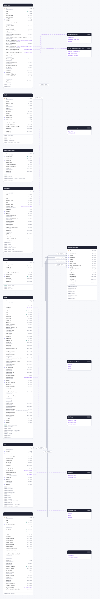

| Field                | Type       | Constraints                                           | Default      | Description |
| -------------------- | ---------- | ----------------------------------------------------- | ------------ | ----------- |
| `id`                 | `String`   | PK NOT NULL                                           | `cuid(1)`    |             |
| `documentId`         | `String`   | NOT NULL → [Document.id](#model-Document)             |              |             |
| `teamId`             | `String`   | NOT NULL → [Team.id](#model-Team)                     |              |             |
| `viewerId`           | `String`   | NULL → [Viewer.id](#model-Viewer)                     |              |             |
| `viewId`             | `String`   | NULL → [View.id](#model-View)                         |              |             |
| `linkId`             | `String`   | NOT NULL → [Link.id](#model-Link)                     |              |             |
| `dataroomId`         | `String`   | NULL → [Dataroom.id](#model-Dataroom)                 |              |             |
| `dataroomDocumentId` | `String`   | NULL → [DataroomDocument.id](#model-DataroomDocument) |              |             |
| `taskId`             | `String`   | NULL → [Task.id](#model-Task)                         |              |             |
| `originalFilename`   | `String`   | NULL                                                  |              |             |
| `fileSize`           | `BigInt`   | NULL                                                  |              |             |
| `numPages`           | `Int`      | NULL                                                  |              |             |
| `mimeType`           | `String`   | NULL                                                  |              |             |
| `uploadedAt`         | `DateTime` | NOT NULL                                              | `now()`      |             |
| `createdAt`          | `DateTime` | NOT NULL                                              | `now()`      |             |
| `updatedAt`          | `DateTime` | NOT NULL                                              | `@updatedAt` |             |

#### Indexes

- `@@index([documentId])`
- `@@index([viewerId])`
- `@@index([viewId])`
- `@@index([linkId])`
- `@@index([teamId])`
- `@@index([dataroomId])`
- `@@index([dataroomDocumentId])`
- `@@index([taskId])`

#### References

- `documentId` → [Document.id](#model-Document) (many-to-one, on delete Cascade)
- `teamId` → [Team.id](#model-Team) (many-to-one, on delete Cascade)
- `viewerId` → [Viewer.id](#model-Viewer) (many-to-one, on delete SetNull)
- `viewId` → [View.id](#model-View) (many-to-one, on delete SetNull)
- `linkId` → [Link.id](#model-Link) (many-to-one, on delete Cascade)
- `dataroomId` → [Dataroom.id](#model-Dataroom) (many-to-one, on delete SetNull)
- `dataroomDocumentId` → [DataroomDocument.id](#model-DataroomDocument) (many-to-one, on delete SetNull)
- `taskId` → [Task.id](#model-Task) (many-to-one, on delete SetNull)

#### Definition

```sql
CREATE TABLE "DocumentUpload" (
    "id" TEXT NOT NULL,
    "documentId" TEXT NOT NULL,
    "teamId" TEXT NOT NULL,
    "viewerId" TEXT,
    "viewId" TEXT,
    "linkId" TEXT NOT NULL,
    "dataroomId" TEXT,
    "dataroomDocumentId" TEXT,
    "taskId" TEXT,
    "originalFilename" TEXT,
    "fileSize" BIGINT,
    "numPages" INTEGER,
    "mimeType" TEXT,
    "uploadedAt" TIMESTAMP(3) NOT NULL DEFAULT CURRENT_TIMESTAMP,
    "createdAt" TIMESTAMP(3) NOT NULL DEFAULT CURRENT_TIMESTAMP,
    "updatedAt" TIMESTAMP(3) NOT NULL,

    CONSTRAINT "DocumentUpload_pkey" PRIMARY KEY ("id")
);

CREATE INDEX "DocumentUpload_documentId_idx" ON "DocumentUpload"("documentId");

CREATE INDEX "DocumentUpload_viewerId_idx" ON "DocumentUpload"("viewerId");

CREATE INDEX "DocumentUpload_viewId_idx" ON "DocumentUpload"("viewId");

CREATE INDEX "DocumentUpload_linkId_idx" ON "DocumentUpload"("linkId");

CREATE INDEX "DocumentUpload_teamId_idx" ON "DocumentUpload"("teamId");

CREATE INDEX "DocumentUpload_dataroomId_idx" ON "DocumentUpload"("dataroomId");

CREATE INDEX "DocumentUpload_dataroomDocumentId_idx" ON "DocumentUpload"("dataroomDocumentId");

CREATE INDEX "DocumentUpload_taskId_idx" ON "DocumentUpload"("taskId");

ALTER TABLE "DocumentUpload" ADD CONSTRAINT "DocumentUpload_documentId_fkey" FOREIGN KEY ("documentId") REFERENCES "Document"("id") ON DELETE CASCADE ON UPDATE CASCADE;

ALTER TABLE "DocumentUpload" ADD CONSTRAINT "DocumentUpload_teamId_fkey" FOREIGN KEY ("teamId") REFERENCES "Team"("id") ON DELETE CASCADE ON UPDATE CASCADE;

ALTER TABLE "DocumentUpload" ADD CONSTRAINT "DocumentUpload_viewerId_fkey" FOREIGN KEY ("viewerId") REFERENCES "Viewer"("id") ON DELETE SET NULL ON UPDATE CASCADE;

ALTER TABLE "DocumentUpload" ADD CONSTRAINT "DocumentUpload_viewId_fkey" FOREIGN KEY ("viewId") REFERENCES "View"("id") ON DELETE SET NULL ON UPDATE CASCADE;

ALTER TABLE "DocumentUpload" ADD CONSTRAINT "DocumentUpload_linkId_fkey" FOREIGN KEY ("linkId") REFERENCES "Link"("id") ON DELETE CASCADE ON UPDATE CASCADE;

ALTER TABLE "DocumentUpload" ADD CONSTRAINT "DocumentUpload_dataroomId_fkey" FOREIGN KEY ("dataroomId") REFERENCES "Dataroom"("id") ON DELETE SET NULL ON UPDATE CASCADE;

ALTER TABLE "DocumentUpload" ADD CONSTRAINT "DocumentUpload_dataroomDocumentId_fkey" FOREIGN KEY ("dataroomDocumentId") REFERENCES "DataroomDocument"("id") ON DELETE SET NULL ON UPDATE CASCADE;

ALTER TABLE "DocumentUpload" ADD CONSTRAINT "DocumentUpload_taskId_fkey" FOREIGN KEY ("taskId") REFERENCES "Task"("id") ON DELETE SET NULL ON UPDATE CASCADE;
```

<details>
<summary>Queries and their SQL</summary>

**findMany**: Every row

```ts
await prisma.documentUpload.findMany();
```

```sql
SELECT
  "public"."DocumentUpload"."id",
  "public"."DocumentUpload"."documentId",
  "public"."DocumentUpload"."teamId",
  "public"."DocumentUpload"."viewerId",
  "public"."DocumentUpload"."viewId",
  "public"."DocumentUpload"."linkId",
  "public"."DocumentUpload"."dataroomId",
  "public"."DocumentUpload"."dataroomDocumentId",
  "public"."DocumentUpload"."taskId",
  "public"."DocumentUpload"."originalFilename",
  "public"."DocumentUpload"."fileSize",
  "public"."DocumentUpload"."numPages",
  "public"."DocumentUpload"."mimeType",
  "public"."DocumentUpload"."uploadedAt",
  "public"."DocumentUpload"."createdAt",
  "public"."DocumentUpload"."updatedAt"
FROM
  "public"."DocumentUpload"
WHERE
  1 = 1
OFFSET
  $1
-- params: ["0"]
```

**count**: How many rows there are

```ts
await prisma.documentUpload.count();
```

```sql
SELECT
  COUNT(*) AS "_count$_all"
FROM
  (
    SELECT
      "public"."DocumentUpload"."id"
    FROM
      "public"."DocumentUpload"
    WHERE
      1 = 1
    OFFSET
      $1
  ) AS "sub"
-- params: ["0"]
```

**findMany**: Every row with its relations

```ts
await prisma.documentUpload.findMany({
  include: {
    document: true,
    team: true,
    viewer: true,
    view: true,
    link: true,
    dataroom: true,
    dataroomDocument: true,
    task: true,
  },
});
```

```sql
SELECT
  "public"."DocumentUpload"."id",
  "public"."DocumentUpload"."documentId",
  "public"."DocumentUpload"."teamId",
  "public"."DocumentUpload"."viewerId",
  "public"."DocumentUpload"."viewId",
  "public"."DocumentUpload"."linkId",
  "public"."DocumentUpload"."dataroomId",
  "public"."DocumentUpload"."dataroomDocumentId",
  "public"."DocumentUpload"."taskId",
  "public"."DocumentUpload"."originalFilename",
  "public"."DocumentUpload"."fileSize",
  "public"."DocumentUpload"."numPages",
  "public"."DocumentUpload"."mimeType",
  "public"."DocumentUpload"."uploadedAt",
  "public"."DocumentUpload"."createdAt",
  "public"."DocumentUpload"."updatedAt"
FROM
  "public"."DocumentUpload"
WHERE
  1 = 1
OFFSET
  $1
-- params: ["0"]

SELECT
  "public"."Document"."id",
  "public"."Document"."name",
  "public"."Document"."description",
  "public"."Document"."file",
  "public"."Document"."originalFile",
  "public"."Document"."type",
  "public"."Document"."contentType",
  "public"."Document"."storageType"::text,
  "public"."Document"."numPages",
  "public"."Document"."teamId",
  "public"."Document"."ownerId",
  "public"."Document"."assistantEnabled",
  "public"."Document"."advancedExcelEnabled",
  "public"."Document"."agentsEnabled",
  "public"."Document"."downloadOnly",
  "public"."Document"."hiddenInAllDocuments",
  "public"."Document"."createdAt",
  "public"."Document"."updatedAt",
  "public"."Document"."folderId",
  "public"."Document"."isExternalUpload"
FROM
  "public"."Document"
WHERE
  "public"."Document"."id" IN ($1)
OFFSET
  $2
-- params: ["<documentId of the rows above>","0"]

SELECT
  "public"."Team"."id",
  "public"."Team"."name",
  "public"."Team"."slug",
  "public"."Team"."defaultBrandId",
  "public"."Team"."plan",
  "public"."Team"."stripeId",
  "public"."Team"."subscriptionId",
  "public"."Team"."startsAt",
  "public"."Team"."endsAt",
  "public"."Team"."pausedAt",
  "public"."Team"."pauseStartsAt",
  "public"."Team"."pauseEndsAt",
  "public"."Team"."cancelledAt",
  "public"."Team"."trialStartedAt",
  "public"."Team"."trialEndsAt",
  "public"."Team"."trialReminderRunId",
  "public"."Team"."trialExpiredRunId",
  "public"."Team"."limits",
  "public"."Team"."enableExcelAdvancedMode",
  "public"."Team"."replicateDataroomFolders",
  "public"."Team"."timezone",
  "public"."Team"."ssoEnabled",
  "public"."Team"."ssoEmailDomain",
  "public"."Team"."ssoEnforcedAt",
  "public"."Team"."surveyData",
  "public"."Team"."agentsEnabled",
  "public"."Team"."vectorStoreId",
  "public"."Team"."createdAt",
  "public"."Team"."updatedAt",
  "public"."Team"."ignoredDomains",
  "public"."Team"."globalBlockList",
  "public"."Team"."referralTrack"::text,
  "public"."Team"."referralTrackSelectedAt",
  "public"."Team"."referralProfile"
FROM
  "public"."Team"
WHERE
  "public"."Team"."id" IN ($1)
OFFSET
  $2
-- params: ["<teamId of the rows above>","0"]

SELECT
  "public"."Viewer"."id",
  "public"."Viewer"."email",
  "public"."Viewer"."verified",
  "public"."Viewer"."invitedAt",
  "public"."Viewer"."notificationPreferences",
  "public"."Viewer"."dataroomId",
  "public"."Viewer"."teamId",
  "public"."Viewer"."createdAt",
  "public"."Viewer"."updatedAt"
FROM
  "public"."Viewer"
WHERE
  "public"."Viewer"."id" IN ($1)
OFFSET
  $2
-- params: ["<viewerId of the rows above>","0"]

SELECT
  "public"."View"."id",
  "public"."View"."linkId",
  "public"."View"."documentId",
  "public"."View"."dataroomId",
  "public"."View"."dataroomViewId",
  "public"."View"."viewerEmail",
  "public"."View"."viewerName",
  "public"."View"."verified",
  "public"."View"."viewedAt",
  "public"."View"."downloadedAt",
  "public"."View"."downloadType"::text,
  "public"."View"."downloadMetadata",
  "public"."View"."viewType"::text,
  "public"."View"."viewerId",
  "public"."View"."groupId",
  "public"."View"."isArchived",
  "public"."View"."teamId"
FROM
  "public"."View"
WHERE
  "public"."View"."id" IN ($1)
OFFSET
  $2
-- params: ["<viewId of the rows above>","0"]

SELECT
  "public"."Link"."id",
  "public"."Link"."documentId",
  "public"."Link"."dataroomId",
  "public"."Link"."linkType"::text,
  "public"."Link"."url",
  "public"."Link"."name",
  "public"."Link"."slug",
  "public"."Link"."expiresAt",
  "public"."Link"."password",
  "public"."Link"."allowList",
  "public"."Link"."denyList",
  "public"."Link"."emailProtected",
  "public"."Link"."emailAuthenticated",
  "public"."Link"."allowDownload",
  "public"."Link"."isArchived",
  "public"."Link"."deletedAt",
  "public"."Link"."domainId",
  "public"."Link"."domainSlug",
  "public"."Link"."createdAt",
  "public"."Link"."updatedAt",
  "public"."Link"."enableNotification",
  "public"."Link"."enableFeedback",
  "public"."Link"."enableQuestion",
  "public"."Link"."enableScreenshotProtection",
  "public"."Link"."enableConfidentialView",
  "public"."Link"."enableAgreement",
  "public"."Link"."agreementId",
  "public"."Link"."showBanner",
  "public"."Link"."enableWatermark",
  "public"."Link"."watermarkConfig",
  "public"."Link"."audienceType"::text,
  "public"."Link"."groupId",
  "public"."Link"."permissionGroupId",
  "public"."Link"."metaTitle",
  "public"."Link"."metaDescription",
  "public"."Link"."metaImage",
  "public"."Link"."metaFavicon",
  "public"."Link"."enableCustomMetatag",
  "public"."Link"."welcomeMessage",
  "public"."Link"."enableConversation",
  "public"."Link"."enableAIAgents",
  "public"."Link"."enableUpload",
  "public"."Link"."isFileRequestOnly",
  "public"."Link"."uploadFolderId",
  "public"."Link"."uploadFolderIds",
  "public"."Link"."enableIndexFile",
  "public"."Link"."teamId",
  "public"."Link"."brandId",
  "public"."Link"."ownerId"
FROM
  "public"."Link"
WHERE
  "public"."Link"."id" IN ($1)
OFFSET
  $2
-- params: ["<linkId of the rows above>","0"]

SELECT
  "public"."Dataroom"."id",
  "public"."Dataroom"."pId",
  "public"."Dataroom"."name",
  "public"."Dataroom"."internalName",
  "public"."Dataroom"."description",
  "public"."Dataroom"."teamId",
  "public"."Dataroom"."brandId",
  "public"."Dataroom"."conversationsEnabled",
  "public"."Dataroom"."agentsEnabled",
  "public"."Dataroom"."vectorStoreId",
  "public"."Dataroom"."requestListEnabled",
  "public"."Dataroom"."enableChangeNotifications",
  "public"."Dataroom"."enableVisitorUploadChangeNotifications",
  "public"."Dataroom"."defaultPermissionStrategy"::text,
  "public"."Dataroom"."defaultShowBanner",
  "public"."Dataroom"."defaultGroupPermissionStrategy"::text,
  "public"."Dataroom"."defaultRootItemAccess"::text,
  "public"."Dataroom"."defaultGroupRootItemAccess"::text,
  "public"."Dataroom"."allowBulkDownload",
  "public"."Dataroom"."showLastUpdated",
  "public"."Dataroom"."introductionEnabled",
  "public"."Dataroom"."introductionContent",
  "public"."Dataroom"."isFrozen",
  "public"."Dataroom"."frozenAt",
  "public"."Dataroom"."frozenBy",
  "public"."Dataroom"."freezeArchiveUrl",
  "public"."Dataroom"."freezeArchiveHash",
  "public"."Dataroom"."createdAt",
  "public"."Dataroom"."updatedAt"
FROM
  "public"."Dataroom"
WHERE
  "public"."Dataroom"."id" IN ($1)
OFFSET
  $2
-- params: ["<dataroomId of the rows above>","0"]

SELECT
  "public"."DataroomDocument"."id",
  "public"."DataroomDocument"."dataroomId",
  "public"."DataroomDocument"."documentId",
  "public"."DataroomDocument"."folderId",
  "public"."DataroomDocument"."orderIndex",
  "public"."DataroomDocument"."hierarchicalIndex",
  "public"."DataroomDocument"."vectorStoreFileId",
  "public"."DataroomDocument"."createdAt",
  "public"."DataroomDocument"."updatedAt"
FROM
  "public"."DataroomDocument"
WHERE
  "public"."DataroomDocument"."id" IN ($1)
OFFSET
  $2
-- params: ["<dataroomDocumentId of the rows above>","0"]

SELECT
  "public"."Task"."id",
  "public"."Task"."title",
  "public"."Task"."description",
  "public"."Task"."type",
  "public"."Task"."status",
  "public"."Task"."category",
  "public"."Task"."dueDate",
  "public"."Task"."orderIndex",
  "public"."Task"."taskListId",
  "public"."Task"."dataroomId",
  "public"."Task"."teamId",
  "public"."Task"."uploadFolderId",
  "public"."Task"."createdByUserId",
  "public"."Task"."lastActivityNotifiedAt",
  "public"."Task"."createdAt",
  "public"."Task"."updatedAt"
FROM
  "public"."Task"
WHERE
  "public"."Task"."id" IN ($1)
OFFSET
  $2
-- params: ["<taskId of the rows above>","0"]
```

**findUnique**: One row by what is unique to it

```ts
await prisma.documentUpload.findUnique({ where: { id: "example" } });
```

```sql
SELECT
  "public"."DocumentUpload"."id",
  "public"."DocumentUpload"."documentId",
  "public"."DocumentUpload"."teamId",
  "public"."DocumentUpload"."viewerId",
  "public"."DocumentUpload"."viewId",
  "public"."DocumentUpload"."linkId",
  "public"."DocumentUpload"."dataroomId",
  "public"."DocumentUpload"."dataroomDocumentId",
  "public"."DocumentUpload"."taskId",
  "public"."DocumentUpload"."originalFilename",
  "public"."DocumentUpload"."fileSize",
  "public"."DocumentUpload"."numPages",
  "public"."DocumentUpload"."mimeType",
  "public"."DocumentUpload"."uploadedAt",
  "public"."DocumentUpload"."createdAt",
  "public"."DocumentUpload"."updatedAt"
FROM
  "public"."DocumentUpload"
WHERE
  (
    "public"."DocumentUpload"."id" = $1
    AND 1 = 1
  )
LIMIT
  $2
OFFSET
  $3
-- params: ["example","1","0"]
```

**create**: Create a row

```ts
await prisma.documentUpload.create({
  data: { documentId: "example", teamId: "example", linkId: "example" },
});
```

```sql
INSERT INTO
  "public"."DocumentUpload" (
    "id",
    "documentId",
    "teamId",
    "linkId",
    "uploadedAt",
    "createdAt",
    "updatedAt"
  )
VALUES
  ($1, $2, $3, $4, $5, $6, $7)
RETURNING
  "public"."DocumentUpload"."id",
  "public"."DocumentUpload"."documentId",
  "public"."DocumentUpload"."teamId",
  "public"."DocumentUpload"."viewerId",
  "public"."DocumentUpload"."viewId",
  "public"."DocumentUpload"."linkId",
  "public"."DocumentUpload"."dataroomId",
  "public"."DocumentUpload"."dataroomDocumentId",
  "public"."DocumentUpload"."taskId",
  "public"."DocumentUpload"."originalFilename",
  "public"."DocumentUpload"."fileSize",
  "public"."DocumentUpload"."numPages",
  "public"."DocumentUpload"."mimeType",
  "public"."DocumentUpload"."uploadedAt",
  "public"."DocumentUpload"."createdAt",
  "public"."DocumentUpload"."updatedAt"
-- params: ["<cuid(1)>","example","example","example","<now()>","<now()>","<now()>"]
```

**update**: Update a row

```ts
await prisma.documentUpload.update({
  where: { id: "example" },
  data: { originalFilename: "example" },
});
```

```sql
UPDATE "public"."DocumentUpload"
SET
  "originalFilename" = $1,
  "updatedAt" = $2
WHERE
  (
    "public"."DocumentUpload"."id" = $3
    AND 1 = 1
  )
RETURNING
  "public"."DocumentUpload"."id",
  "public"."DocumentUpload"."documentId",
  "public"."DocumentUpload"."teamId",
  "public"."DocumentUpload"."viewerId",
  "public"."DocumentUpload"."viewId",
  "public"."DocumentUpload"."linkId",
  "public"."DocumentUpload"."dataroomId",
  "public"."DocumentUpload"."dataroomDocumentId",
  "public"."DocumentUpload"."taskId",
  "public"."DocumentUpload"."originalFilename",
  "public"."DocumentUpload"."fileSize",
  "public"."DocumentUpload"."numPages",
  "public"."DocumentUpload"."mimeType",
  "public"."DocumentUpload"."uploadedAt",
  "public"."DocumentUpload"."createdAt",
  "public"."DocumentUpload"."updatedAt"
-- params: ["example",{"prisma__type":"generatorCall","prisma__value":{"name":"now","args":[],"returnType":{"type":"DateTime"}}},"example"]
```

**delete**: Delete a row

```ts
await prisma.documentUpload.delete({ where: { id: "example" } });
```

```sql
DELETE FROM "public"."DocumentUpload"
WHERE
  (
    "public"."DocumentUpload"."id" = $1
    AND 1 = 1
  )
RETURNING
  "public"."DocumentUpload"."id",
  "public"."DocumentUpload"."documentId",
  "public"."DocumentUpload"."teamId",
  "public"."DocumentUpload"."viewerId",
  "public"."DocumentUpload"."viewId",
  "public"."DocumentUpload"."linkId",
  "public"."DocumentUpload"."dataroomId",
  "public"."DocumentUpload"."dataroomDocumentId",
  "public"."DocumentUpload"."taskId",
  "public"."DocumentUpload"."originalFilename",
  "public"."DocumentUpload"."fileSize",
  "public"."DocumentUpload"."numPages",
  "public"."DocumentUpload"."mimeType",
  "public"."DocumentUpload"."uploadedAt",
  "public"."DocumentUpload"."createdAt",
  "public"."DocumentUpload"."updatedAt"
-- params: ["example"]
```

</details>

<a id="model-PendingDocumentUpload"></a>

### PendingDocumentUpload

| Field         | Type                                               | Constraints     | Default   | Description |
| ------------- | -------------------------------------------------- | --------------- | --------- | ----------- |
| `id`          | `String`                                           | PK NOT NULL     | `cuid(1)` |             |
| `uploadId`    | `String`                                           | UNIQUE NOT NULL |           |             |
| `teamId`      | `String`                                           | NOT NULL        |           |             |
| `tokenId`     | `String`                                           | NOT NULL        |           |             |
| `key`         | `String`                                           | NOT NULL        |           |             |
| `contentType` | `String`                                           | NOT NULL        |           |             |
| `storageType` | [`DocumentStorageType`](#enum-DocumentStorageType) | NOT NULL        | `S3_PATH` |             |
| `expiresAt`   | `DateTime`                                         | NOT NULL        |           |             |
| `consumedAt`  | `DateTime`                                         | NULL            |           |             |
| `createdAt`   | `DateTime`                                         | NOT NULL        | `now()`   |             |

#### Indexes

- `@@index([teamId, expiresAt])`
- `@@index([tokenId, expiresAt])`

#### Definition

```sql
CREATE TABLE "PendingDocumentUpload" (
    "id" TEXT NOT NULL,
    "uploadId" TEXT NOT NULL,
    "teamId" TEXT NOT NULL,
    "tokenId" TEXT NOT NULL,
    "key" TEXT NOT NULL,
    "contentType" TEXT NOT NULL,
    "storageType" "DocumentStorageType" NOT NULL DEFAULT 'S3_PATH',
    "expiresAt" TIMESTAMP(3) NOT NULL,
    "consumedAt" TIMESTAMP(3),
    "createdAt" TIMESTAMP(3) NOT NULL DEFAULT CURRENT_TIMESTAMP,

    CONSTRAINT "PendingDocumentUpload_pkey" PRIMARY KEY ("id")
);

CREATE UNIQUE INDEX "PendingDocumentUpload_uploadId_key" ON "PendingDocumentUpload"("uploadId");

CREATE INDEX "PendingDocumentUpload_teamId_expiresAt_idx" ON "PendingDocumentUpload"("teamId", "expiresAt");

CREATE INDEX "PendingDocumentUpload_tokenId_expiresAt_idx" ON "PendingDocumentUpload"("tokenId", "expiresAt");
```

<details>
<summary>Queries and their SQL</summary>

**findMany**: Every row

```ts
await prisma.pendingDocumentUpload.findMany();
```

```sql
SELECT
  "public"."PendingDocumentUpload"."id",
  "public"."PendingDocumentUpload"."uploadId",
  "public"."PendingDocumentUpload"."teamId",
  "public"."PendingDocumentUpload"."tokenId",
  "public"."PendingDocumentUpload"."key",
  "public"."PendingDocumentUpload"."contentType",
  "public"."PendingDocumentUpload"."storageType"::text,
  "public"."PendingDocumentUpload"."expiresAt",
  "public"."PendingDocumentUpload"."consumedAt",
  "public"."PendingDocumentUpload"."createdAt"
FROM
  "public"."PendingDocumentUpload"
WHERE
  1 = 1
OFFSET
  $1
-- params: ["0"]
```

**count**: How many rows there are

```ts
await prisma.pendingDocumentUpload.count();
```

```sql
SELECT
  COUNT(*) AS "_count$_all"
FROM
  (
    SELECT
      "public"."PendingDocumentUpload"."id"
    FROM
      "public"."PendingDocumentUpload"
    WHERE
      1 = 1
    OFFSET
      $1
  ) AS "sub"
-- params: ["0"]
```

**findUnique**: One row by what is unique to it

```ts
await prisma.pendingDocumentUpload.findUnique({ where: { id: "example" } });
```

```sql
SELECT
  "public"."PendingDocumentUpload"."id",
  "public"."PendingDocumentUpload"."uploadId",
  "public"."PendingDocumentUpload"."teamId",
  "public"."PendingDocumentUpload"."tokenId",
  "public"."PendingDocumentUpload"."key",
  "public"."PendingDocumentUpload"."contentType",
  "public"."PendingDocumentUpload"."storageType"::text,
  "public"."PendingDocumentUpload"."expiresAt",
  "public"."PendingDocumentUpload"."consumedAt",
  "public"."PendingDocumentUpload"."createdAt"
FROM
  "public"."PendingDocumentUpload"
WHERE
  (
    "public"."PendingDocumentUpload"."id" = $1
    AND 1 = 1
  )
LIMIT
  $2
OFFSET
  $3
-- params: ["example","1","0"]
```

**create**: Create a row

```ts
await prisma.pendingDocumentUpload.create({
  data: {
    uploadId: "example",
    teamId: "example",
    tokenId: "example",
    key: "example",
    contentType: "example",
    expiresAt: new Date("2026-01-01T00:00:00.000Z"),
  },
});
```

```sql
INSERT INTO
  "public"."PendingDocumentUpload" (
    "id",
    "uploadId",
    "teamId",
    "tokenId",
    "key",
    "contentType",
    "storageType",
    "expiresAt",
    "createdAt"
  )
VALUES
  (
    $1,
    $2,
    $3,
    $4,
    $5,
    $6,
    CAST($7::text AS "public"."DocumentStorageType"),
    $8,
    $9
  )
RETURNING
  "public"."PendingDocumentUpload"."id",
  "public"."PendingDocumentUpload"."uploadId",
  "public"."PendingDocumentUpload"."teamId",
  "public"."PendingDocumentUpload"."tokenId",
  "public"."PendingDocumentUpload"."key",
  "public"."PendingDocumentUpload"."contentType",
  "public"."PendingDocumentUpload"."storageType"::text,
  "public"."PendingDocumentUpload"."expiresAt",
  "public"."PendingDocumentUpload"."consumedAt",
  "public"."PendingDocumentUpload"."createdAt"
-- params: ["<cuid(1)>","example","example","example","example","example","S3_PATH","2026-01-01T00:00:00.000Z","<now()>"]
```

**update**: Update a row

```ts
await prisma.pendingDocumentUpload.update({
  where: { id: "example" },
  data: { uploadId: "example" },
});
```

```sql
UPDATE "public"."PendingDocumentUpload"
SET
  "uploadId" = $1
WHERE
  (
    "public"."PendingDocumentUpload"."id" = $2
    AND 1 = 1
  )
RETURNING
  "public"."PendingDocumentUpload"."id",
  "public"."PendingDocumentUpload"."uploadId",
  "public"."PendingDocumentUpload"."teamId",
  "public"."PendingDocumentUpload"."tokenId",
  "public"."PendingDocumentUpload"."key",
  "public"."PendingDocumentUpload"."contentType",
  "public"."PendingDocumentUpload"."storageType"::text,
  "public"."PendingDocumentUpload"."expiresAt",
  "public"."PendingDocumentUpload"."consumedAt",
  "public"."PendingDocumentUpload"."createdAt"
-- params: ["example","example"]
```

**delete**: Delete a row

```ts
await prisma.pendingDocumentUpload.delete({ where: { id: "example" } });
```

```sql
DELETE FROM "public"."PendingDocumentUpload"
WHERE
  (
    "public"."PendingDocumentUpload"."id" = $1
    AND 1 = 1
  )
RETURNING
  "public"."PendingDocumentUpload"."id",
  "public"."PendingDocumentUpload"."uploadId",
  "public"."PendingDocumentUpload"."teamId",
  "public"."PendingDocumentUpload"."tokenId",
  "public"."PendingDocumentUpload"."key",
  "public"."PendingDocumentUpload"."contentType",
  "public"."PendingDocumentUpload"."storageType"::text,
  "public"."PendingDocumentUpload"."expiresAt",
  "public"."PendingDocumentUpload"."consumedAt",
  "public"."PendingDocumentUpload"."createdAt"
-- params: ["example"]
```

</details>

<a id="model-Integration"></a>

### Integration

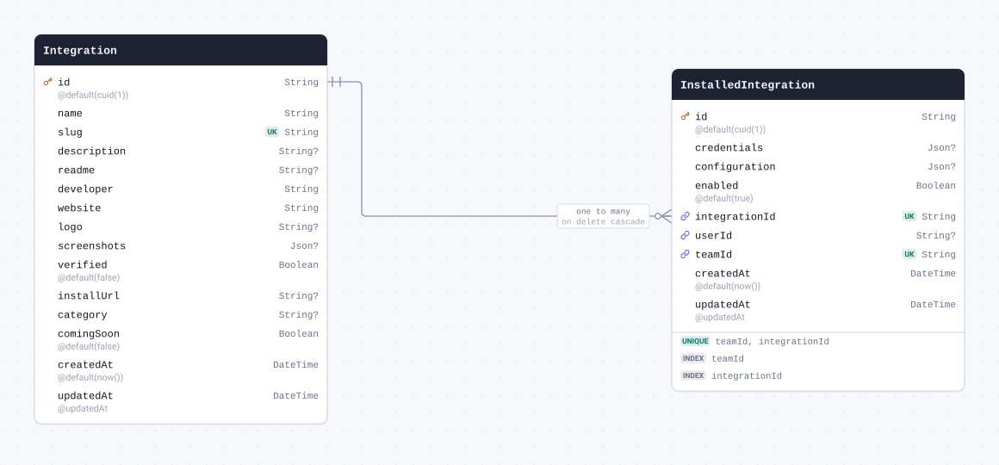

| Field         | Type       | Constraints     | Default      | Description |
| ------------- | ---------- | --------------- | ------------ | ----------- |
| `id`          | `String`   | PK NOT NULL     | `cuid(1)`    |             |
| `name`        | `String`   | NOT NULL        |              |             |
| `slug`        | `String`   | UNIQUE NOT NULL |              |             |
| `description` | `String`   | NULL            |              |             |
| `readme`      | `String`   | NULL            |              |             |
| `developer`   | `String`   | NOT NULL        |              |             |
| `website`     | `String`   | NOT NULL        |              |             |
| `logo`        | `String`   | NULL            |              |             |
| `screenshots` | `Json`     | NULL            |              |             |
| `verified`    | `Boolean`  | NOT NULL        | `false`      |             |
| `installUrl`  | `String`   | NULL            |              |             |
| `category`    | `String`   | NULL            |              |             |
| `comingSoon`  | `Boolean`  | NOT NULL        | `false`      |             |
| `createdAt`   | `DateTime` | NOT NULL        | `now()`      |             |
| `updatedAt`   | `DateTime` | NOT NULL        | `@updatedAt` |             |

#### Referenced by

- `id` ← [InstalledIntegration.integrationId](#model-InstalledIntegration) (one-to-many, on delete Cascade)

#### Definition

```sql
CREATE TABLE "Integration" (
    "id" TEXT NOT NULL,
    "name" TEXT NOT NULL,
    "slug" TEXT NOT NULL,
    "description" TEXT,
    "readme" TEXT,
    "developer" TEXT NOT NULL,
    "website" TEXT NOT NULL,
    "logo" TEXT,
    "screenshots" JSONB,
    "verified" BOOLEAN NOT NULL DEFAULT false,
    "installUrl" TEXT,
    "category" TEXT,
    "comingSoon" BOOLEAN NOT NULL DEFAULT false,
    "createdAt" TIMESTAMP(3) NOT NULL DEFAULT CURRENT_TIMESTAMP,
    "updatedAt" TIMESTAMP(3) NOT NULL,

    CONSTRAINT "Integration_pkey" PRIMARY KEY ("id")
);

CREATE UNIQUE INDEX "Integration_slug_key" ON "Integration"("slug");
```

<details>
<summary>Queries and their SQL</summary>

**findMany**: Every row

```ts
await prisma.integration.findMany();
```

```sql
SELECT
  "public"."Integration"."id",
  "public"."Integration"."name",
  "public"."Integration"."slug",
  "public"."Integration"."description",
  "public"."Integration"."readme",
  "public"."Integration"."developer",
  "public"."Integration"."website",
  "public"."Integration"."logo",
  "public"."Integration"."screenshots",
  "public"."Integration"."verified",
  "public"."Integration"."installUrl",
  "public"."Integration"."category",
  "public"."Integration"."comingSoon",
  "public"."Integration"."createdAt",
  "public"."Integration"."updatedAt"
FROM
  "public"."Integration"
WHERE
  1 = 1
OFFSET
  $1
-- params: ["0"]
```

**count**: How many rows there are

```ts
await prisma.integration.count();
```

```sql
SELECT
  COUNT(*) AS "_count$_all"
FROM
  (
    SELECT
      "public"."Integration"."id"
    FROM
      "public"."Integration"
    WHERE
      1 = 1
    OFFSET
      $1
  ) AS "sub"
-- params: ["0"]
```

**findMany**: Every row with its relations

```ts
await prisma.integration.findMany({ include: { installedIntegrations: true } });
```

```sql
SELECT
  "public"."Integration"."id",
  "public"."Integration"."name",
  "public"."Integration"."slug",
  "public"."Integration"."description",
  "public"."Integration"."readme",
  "public"."Integration"."developer",
  "public"."Integration"."website",
  "public"."Integration"."logo",
  "public"."Integration"."screenshots",
  "public"."Integration"."verified",
  "public"."Integration"."installUrl",
  "public"."Integration"."category",
  "public"."Integration"."comingSoon",
  "public"."Integration"."createdAt",
  "public"."Integration"."updatedAt"
FROM
  "public"."Integration"
WHERE
  1 = 1
OFFSET
  $1
-- params: ["0"]

SELECT
  "public"."InstalledIntegration"."id",
  "public"."InstalledIntegration"."credentials",
  "public"."InstalledIntegration"."configuration",
  "public"."InstalledIntegration"."enabled",
  "public"."InstalledIntegration"."integrationId",
  "public"."InstalledIntegration"."userId",
  "public"."InstalledIntegration"."teamId",
  "public"."InstalledIntegration"."createdAt",
  "public"."InstalledIntegration"."updatedAt"
FROM
  "public"."InstalledIntegration"
WHERE
  "public"."InstalledIntegration"."integrationId" IN ($1)
OFFSET
  $2
-- params: ["<id of the rows above>","0"]
```

**findUnique**: One row by what is unique to it

```ts
await prisma.integration.findUnique({ where: { id: "example" } });
```

```sql
SELECT
  "public"."Integration"."id",
  "public"."Integration"."name",
  "public"."Integration"."slug",
  "public"."Integration"."description",
  "public"."Integration"."readme",
  "public"."Integration"."developer",
  "public"."Integration"."website",
  "public"."Integration"."logo",
  "public"."Integration"."screenshots",
  "public"."Integration"."verified",
  "public"."Integration"."installUrl",
  "public"."Integration"."category",
  "public"."Integration"."comingSoon",
  "public"."Integration"."createdAt",
  "public"."Integration"."updatedAt"
FROM
  "public"."Integration"
WHERE
  (
    "public"."Integration"."id" = $1
    AND 1 = 1
  )
LIMIT
  $2
OFFSET
  $3
-- params: ["example","1","0"]
```

**create**: Create a row

```ts
await prisma.integration.create({
  data: { name: "example", slug: "example", developer: "example", website: "example" },
});
```

```sql
INSERT INTO
  "public"."Integration" (
    "id",
    "name",
    "slug",
    "developer",
    "website",
    "verified",
    "comingSoon",
    "createdAt",
    "updatedAt"
  )
VALUES
  ($1, $2, $3, $4, $5, $6, $7, $8, $9)
RETURNING
  "public"."Integration"."id",
  "public"."Integration"."name",
  "public"."Integration"."slug",
  "public"."Integration"."description",
  "public"."Integration"."readme",
  "public"."Integration"."developer",
  "public"."Integration"."website",
  "public"."Integration"."logo",
  "public"."Integration"."screenshots",
  "public"."Integration"."verified",
  "public"."Integration"."installUrl",
  "public"."Integration"."category",
  "public"."Integration"."comingSoon",
  "public"."Integration"."createdAt",
  "public"."Integration"."updatedAt"
-- params: ["<cuid(1)>","example","example","example","example",false,false,"<now()>","<now()>"]
```

**update**: Update a row

```ts
await prisma.integration.update({ where: { id: "example" }, data: { name: "example" } });
```

```sql
UPDATE "public"."Integration"
SET
  "name" = $1,
  "updatedAt" = $2
WHERE
  (
    "public"."Integration"."id" = $3
    AND 1 = 1
  )
RETURNING
  "public"."Integration"."id",
  "public"."Integration"."name",
  "public"."Integration"."slug",
  "public"."Integration"."description",
  "public"."Integration"."readme",
  "public"."Integration"."developer",
  "public"."Integration"."website",
  "public"."Integration"."logo",
  "public"."Integration"."screenshots",
  "public"."Integration"."verified",
  "public"."Integration"."installUrl",
  "public"."Integration"."category",
  "public"."Integration"."comingSoon",
  "public"."Integration"."createdAt",
  "public"."Integration"."updatedAt"
-- params: ["example",{"prisma__type":"generatorCall","prisma__value":{"name":"now","args":[],"returnType":{"type":"DateTime"}}},"example"]
```

**delete**: Delete a row

```ts
await prisma.integration.delete({ where: { id: "example" } });
```

```sql
DELETE FROM "public"."Integration"
WHERE
  (
    "public"."Integration"."id" = $1
    AND 1 = 1
  )
RETURNING
  "public"."Integration"."id",
  "public"."Integration"."name",
  "public"."Integration"."slug",
  "public"."Integration"."description",
  "public"."Integration"."readme",
  "public"."Integration"."developer",
  "public"."Integration"."website",
  "public"."Integration"."logo",
  "public"."Integration"."screenshots",
  "public"."Integration"."verified",
  "public"."Integration"."installUrl",
  "public"."Integration"."category",
  "public"."Integration"."comingSoon",
  "public"."Integration"."createdAt",
  "public"."Integration"."updatedAt"
-- params: ["example"]
```

</details>

<a id="model-InstalledIntegration"></a>

### InstalledIntegration

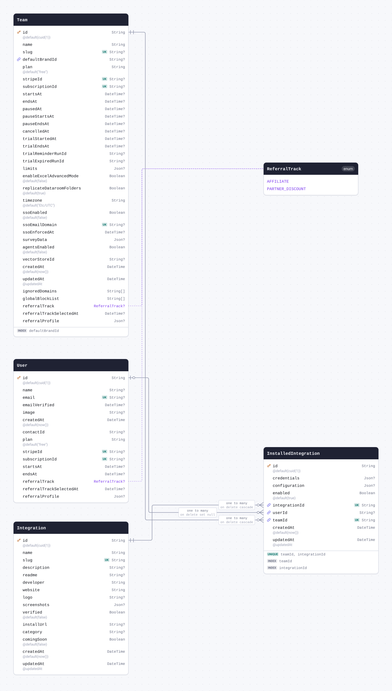

| Field           | Type       | Constraints                                     | Default      | Description |
| --------------- | ---------- | ----------------------------------------------- | ------------ | ----------- |
| `id`            | `String`   | PK NOT NULL                                     | `cuid(1)`    |             |
| `credentials`   | `Json`     | NULL                                            |              |             |
| `configuration` | `Json`     | NULL                                            |              |             |
| `enabled`       | `Boolean`  | NOT NULL                                        | `true`       |             |
| `integrationId` | `String`   | NOT NULL → [Integration.id](#model-Integration) |              |             |
| `userId`        | `String`   | NULL → [User.id](#model-User)                   |              |             |
| `teamId`        | `String`   | NOT NULL → [Team.id](#model-Team)               |              |             |
| `createdAt`     | `DateTime` | NOT NULL                                        | `now()`      |             |
| `updatedAt`     | `DateTime` | NOT NULL                                        | `@updatedAt` |             |

#### Indexes

- `@@index([teamId])`
- `@@index([integrationId])`
- `@@unique([teamId, integrationId])`

#### References

- `integrationId` → [Integration.id](#model-Integration) (many-to-one, on delete Cascade)
- `userId` → [User.id](#model-User) (many-to-one, on delete SetNull)
- `teamId` → [Team.id](#model-Team) (many-to-one, on delete Cascade)

#### Definition

```sql
CREATE TABLE "InstalledIntegration" (
    "id" TEXT NOT NULL,
    "credentials" JSONB,
    "configuration" JSONB,
    "enabled" BOOLEAN NOT NULL DEFAULT true,
    "integrationId" TEXT NOT NULL,
    "userId" TEXT,
    "teamId" TEXT NOT NULL,
    "createdAt" TIMESTAMP(3) NOT NULL DEFAULT CURRENT_TIMESTAMP,
    "updatedAt" TIMESTAMP(3) NOT NULL,

    CONSTRAINT "InstalledIntegration_pkey" PRIMARY KEY ("id")
);

CREATE INDEX "InstalledIntegration_teamId_idx" ON "InstalledIntegration"("teamId");

CREATE INDEX "InstalledIntegration_integrationId_idx" ON "InstalledIntegration"("integrationId");

CREATE UNIQUE INDEX "InstalledIntegration_teamId_integrationId_key" ON "InstalledIntegration"("teamId", "integrationId");

ALTER TABLE "InstalledIntegration" ADD CONSTRAINT "InstalledIntegration_integrationId_fkey" FOREIGN KEY ("integrationId") REFERENCES "Integration"("id") ON DELETE CASCADE ON UPDATE CASCADE;

ALTER TABLE "InstalledIntegration" ADD CONSTRAINT "InstalledIntegration_userId_fkey" FOREIGN KEY ("userId") REFERENCES "User"("id") ON DELETE SET NULL ON UPDATE CASCADE;

ALTER TABLE "InstalledIntegration" ADD CONSTRAINT "InstalledIntegration_teamId_fkey" FOREIGN KEY ("teamId") REFERENCES "Team"("id") ON DELETE CASCADE ON UPDATE CASCADE;
```

<details>
<summary>Queries and their SQL</summary>

**findMany**: Every row

```ts
await prisma.installedIntegration.findMany();
```

```sql
SELECT
  "public"."InstalledIntegration"."id",
  "public"."InstalledIntegration"."credentials",
  "public"."InstalledIntegration"."configuration",
  "public"."InstalledIntegration"."enabled",
  "public"."InstalledIntegration"."integrationId",
  "public"."InstalledIntegration"."userId",
  "public"."InstalledIntegration"."teamId",
  "public"."InstalledIntegration"."createdAt",
  "public"."InstalledIntegration"."updatedAt"
FROM
  "public"."InstalledIntegration"
WHERE
  1 = 1
OFFSET
  $1
-- params: ["0"]
```

**count**: How many rows there are

```ts
await prisma.installedIntegration.count();
```

```sql
SELECT
  COUNT(*) AS "_count$_all"
FROM
  (
    SELECT
      "public"."InstalledIntegration"."id"
    FROM
      "public"."InstalledIntegration"
    WHERE
      1 = 1
    OFFSET
      $1
  ) AS "sub"
-- params: ["0"]
```

**findMany**: Every row with its relations

```ts
await prisma.installedIntegration.findMany({
  include: { integration: true, user: true, team: true },
});
```

```sql
SELECT
  "public"."InstalledIntegration"."id",
  "public"."InstalledIntegration"."credentials",
  "public"."InstalledIntegration"."configuration",
  "public"."InstalledIntegration"."enabled",
  "public"."InstalledIntegration"."integrationId",
  "public"."InstalledIntegration"."userId",
  "public"."InstalledIntegration"."teamId",
  "public"."InstalledIntegration"."createdAt",
  "public"."InstalledIntegration"."updatedAt"
FROM
  "public"."InstalledIntegration"
WHERE
  1 = 1
OFFSET
  $1
-- params: ["0"]

SELECT
  "public"."Integration"."id",
  "public"."Integration"."name",
  "public"."Integration"."slug",
  "public"."Integration"."description",
  "public"."Integration"."readme",
  "public"."Integration"."developer",
  "public"."Integration"."website",
  "public"."Integration"."logo",
  "public"."Integration"."screenshots",
  "public"."Integration"."verified",
  "public"."Integration"."installUrl",
  "public"."Integration"."category",
  "public"."Integration"."comingSoon",
  "public"."Integration"."createdAt",
  "public"."Integration"."updatedAt"
FROM
  "public"."Integration"
WHERE
  "public"."Integration"."id" IN ($1)
OFFSET
  $2
-- params: ["<integrationId of the rows above>","0"]

SELECT
  "public"."User"."id",
  "public"."User"."name",
  "public"."User"."email",
  "public"."User"."emailVerified",
  "public"."User"."image",
  "public"."User"."createdAt",
  "public"."User"."contactId",
  "public"."User"."plan",
  "public"."User"."stripeId",
  "public"."User"."subscriptionId",
  "public"."User"."startsAt",
  "public"."User"."endsAt",
  "public"."User"."referralTrack"::text,
  "public"."User"."referralTrackSelectedAt",
  "public"."User"."referralProfile"
FROM
  "public"."User"
WHERE
  "public"."User"."id" IN ($1)
OFFSET
  $2
-- params: ["<userId of the rows above>","0"]

SELECT
  "public"."Team"."id",
  "public"."Team"."name",
  "public"."Team"."slug",
  "public"."Team"."defaultBrandId",
  "public"."Team"."plan",
  "public"."Team"."stripeId",
  "public"."Team"."subscriptionId",
  "public"."Team"."startsAt",
  "public"."Team"."endsAt",
  "public"."Team"."pausedAt",
  "public"."Team"."pauseStartsAt",
  "public"."Team"."pauseEndsAt",
  "public"."Team"."cancelledAt",
  "public"."Team"."trialStartedAt",
  "public"."Team"."trialEndsAt",
  "public"."Team"."trialReminderRunId",
  "public"."Team"."trialExpiredRunId",
  "public"."Team"."limits",
  "public"."Team"."enableExcelAdvancedMode",
  "public"."Team"."replicateDataroomFolders",
  "public"."Team"."timezone",
  "public"."Team"."ssoEnabled",
  "public"."Team"."ssoEmailDomain",
  "public"."Team"."ssoEnforcedAt",
  "public"."Team"."surveyData",
  "public"."Team"."agentsEnabled",
  "public"."Team"."vectorStoreId",
  "public"."Team"."createdAt",
  "public"."Team"."updatedAt",
  "public"."Team"."ignoredDomains",
  "public"."Team"."globalBlockList",
  "public"."Team"."referralTrack"::text,
  "public"."Team"."referralTrackSelectedAt",
  "public"."Team"."referralProfile"
FROM
  "public"."Team"
WHERE
  "public"."Team"."id" IN ($1)
OFFSET
  $2
-- params: ["<teamId of the rows above>","0"]
```

**findUnique**: One row by what is unique to it

```ts
await prisma.installedIntegration.findUnique({ where: { id: "example" } });
```

```sql
SELECT
  "public"."InstalledIntegration"."id",
  "public"."InstalledIntegration"."credentials",
  "public"."InstalledIntegration"."configuration",
  "public"."InstalledIntegration"."enabled",
  "public"."InstalledIntegration"."integrationId",
  "public"."InstalledIntegration"."userId",
  "public"."InstalledIntegration"."teamId",
  "public"."InstalledIntegration"."createdAt",
  "public"."InstalledIntegration"."updatedAt"
FROM
  "public"."InstalledIntegration"
WHERE
  (
    "public"."InstalledIntegration"."id" = $1
    AND 1 = 1
  )
LIMIT
  $2
OFFSET
  $3
-- params: ["example","1","0"]
```

**create**: Create a row

```ts
await prisma.installedIntegration.create({ data: { integrationId: "example", teamId: "example" } });
```

```sql
INSERT INTO
  "public"."InstalledIntegration" (
    "id",
    "enabled",
    "integrationId",
    "teamId",
    "createdAt",
    "updatedAt"
  )
VALUES
  ($1, $2, $3, $4, $5, $6)
RETURNING
  "public"."InstalledIntegration"."id",
  "public"."InstalledIntegration"."credentials",
  "public"."InstalledIntegration"."configuration",
  "public"."InstalledIntegration"."enabled",
  "public"."InstalledIntegration"."integrationId",
  "public"."InstalledIntegration"."userId",
  "public"."InstalledIntegration"."teamId",
  "public"."InstalledIntegration"."createdAt",
  "public"."InstalledIntegration"."updatedAt"
-- params: ["<cuid(1)>",true,"example","example","<now()>","<now()>"]
```

**update**: Update a row

```ts
await prisma.installedIntegration.update({ where: { id: "example" }, data: { credentials: {} } });
```

```sql
UPDATE "public"."InstalledIntegration"
SET
  "credentials" = $1,
  "updatedAt" = $2
WHERE
  (
    "public"."InstalledIntegration"."id" = $3
    AND 1 = 1
  )
RETURNING
  "public"."InstalledIntegration"."id",
  "public"."InstalledIntegration"."credentials",
  "public"."InstalledIntegration"."configuration",
  "public"."InstalledIntegration"."enabled",
  "public"."InstalledIntegration"."integrationId",
  "public"."InstalledIntegration"."userId",
  "public"."InstalledIntegration"."teamId",
  "public"."InstalledIntegration"."createdAt",
  "public"."InstalledIntegration"."updatedAt"
-- params: ["{}",{"prisma__type":"generatorCall","prisma__value":{"name":"now","args":[],"returnType":{"type":"DateTime"}}},"example"]
```

**delete**: Delete a row

```ts
await prisma.installedIntegration.delete({ where: { id: "example" } });
```

```sql
DELETE FROM "public"."InstalledIntegration"
WHERE
  (
    "public"."InstalledIntegration"."id" = $1
    AND 1 = 1
  )
RETURNING
  "public"."InstalledIntegration"."id",
  "public"."InstalledIntegration"."credentials",
  "public"."InstalledIntegration"."configuration",
  "public"."InstalledIntegration"."enabled",
  "public"."InstalledIntegration"."integrationId",
  "public"."InstalledIntegration"."userId",
  "public"."InstalledIntegration"."teamId",
  "public"."InstalledIntegration"."createdAt",
  "public"."InstalledIntegration"."updatedAt"
-- params: ["example"]
```

</details>

<a id="model-jackson_index"></a>

### jackson_index

| Field      | Type     | Constraints | Default           | Description |
| ---------- | -------- | ----------- | ----------------- | ----------- |
| `id`       | `Int`    | PK NOT NULL | `autoincrement()` |             |
| `key`      | `String` | NOT NULL    |                   |             |
| `storeKey` | `String` | NOT NULL    |                   |             |

#### Indexes

- `@@index([key, storeKey], map: "_jackson_index_key_store")`

#### Definition

```sql
CREATE TABLE "jackson_index" (
    "id" SERIAL NOT NULL,
    "key" TEXT NOT NULL,
    "storeKey" TEXT NOT NULL,

    CONSTRAINT "jackson_index_pkey" PRIMARY KEY ("id")
);

CREATE INDEX "_jackson_index_key_store" ON "jackson_index"("key", "storeKey");
```

<details>
<summary>Queries and their SQL</summary>

**findMany**: Every row

```ts
await prisma.jackson_index.findMany();
```

```sql
SELECT
  "public"."jackson_index"."id",
  "public"."jackson_index"."key",
  "public"."jackson_index"."storeKey"
FROM
  "public"."jackson_index"
WHERE
  1 = 1
OFFSET
  $1
-- params: ["0"]
```

**count**: How many rows there are

```ts
await prisma.jackson_index.count();
```

```sql
SELECT
  COUNT(*) AS "_count$_all"
FROM
  (
    SELECT
      "public"."jackson_index"."id"
    FROM
      "public"."jackson_index"
    WHERE
      1 = 1
    OFFSET
      $1
  ) AS "sub"
-- params: ["0"]
```

**findUnique**: One row by what is unique to it

```ts
await prisma.jackson_index.findUnique({ where: { id: 1 } });
```

```sql
SELECT
  "public"."jackson_index"."id",
  "public"."jackson_index"."key",
  "public"."jackson_index"."storeKey"
FROM
  "public"."jackson_index"
WHERE
  (
    "public"."jackson_index"."id" = $1
    AND 1 = 1
  )
LIMIT
  $2
OFFSET
  $3
-- params: ["1","1","0"]
```

**create**: Create a row

```ts
await prisma.jackson_index.create({ data: { key: "example", storeKey: "example" } });
```

```sql
INSERT INTO
  "public"."jackson_index" ("key", "storeKey")
VALUES
  ($1, $2)
RETURNING
  "public"."jackson_index"."id",
  "public"."jackson_index"."key",
  "public"."jackson_index"."storeKey"
-- params: ["example","example"]
```

**update**: Update a row

```ts
await prisma.jackson_index.update({ where: { id: 1 }, data: { key: "example" } });
```

```sql
UPDATE "public"."jackson_index"
SET
  "key" = $1
WHERE
  (
    "public"."jackson_index"."id" = $2
    AND 1 = 1
  )
RETURNING
  "public"."jackson_index"."id",
  "public"."jackson_index"."key",
  "public"."jackson_index"."storeKey"
-- params: ["example","1"]
```

**delete**: Delete a row

```ts
await prisma.jackson_index.delete({ where: { id: 1 } });
```

```sql
DELETE FROM "public"."jackson_index"
WHERE
  (
    "public"."jackson_index"."id" = $1
    AND 1 = 1
  )
RETURNING
  "public"."jackson_index"."id",
  "public"."jackson_index"."key",
  "public"."jackson_index"."storeKey"
-- params: ["1"]
```

</details>

<a id="model-jackson_store"></a>

### jackson_store

| Field        | Type                          | Constraints | Default | Description |
| ------------ | ----------------------------- | ----------- | ------- | ----------- |
| `key`        | `String`                      | PK NOT NULL |         |             |
| `value`      | `String`                      | NOT NULL    |         |             |
| `iv`         | `String`                      | NULL        |         |             |
| `tag`        | `String`                      | NULL        |         |             |
| `namespace`  | `String`                      | NULL        |         |             |
| `createdAt`  | `DateTime` `@db.Timestamp(0)` | NOT NULL    | `now()` |             |
| `modifiedAt` | `DateTime` `@db.Timestamp(0)` | NULL        |         |             |

#### Indexes

- `@@index([namespace], map: "_jackson_store_namespace")`

#### Definition

```sql
CREATE TABLE "jackson_store" (
    "key" TEXT NOT NULL,
    "value" TEXT NOT NULL,
    "iv" TEXT,
    "tag" TEXT,
    "namespace" TEXT,
    "createdAt" TIMESTAMP(0) NOT NULL DEFAULT CURRENT_TIMESTAMP,
    "modifiedAt" TIMESTAMP(0),

    CONSTRAINT "jackson_store_pkey" PRIMARY KEY ("key")
);

CREATE INDEX "_jackson_store_namespace" ON "jackson_store"("namespace");
```

<details>
<summary>Queries and their SQL</summary>

**findMany**: Every row

```ts
await prisma.jackson_store.findMany();
```

```sql
SELECT
  "public"."jackson_store"."key",
  "public"."jackson_store"."value",
  "public"."jackson_store"."iv",
  "public"."jackson_store"."tag",
  "public"."jackson_store"."namespace",
  "public"."jackson_store"."createdAt",
  "public"."jackson_store"."modifiedAt"
FROM
  "public"."jackson_store"
WHERE
  1 = 1
OFFSET
  $1
-- params: ["0"]
```

**count**: How many rows there are

```ts
await prisma.jackson_store.count();
```

```sql
SELECT
  COUNT(*) AS "_count$_all"
FROM
  (
    SELECT
      "public"."jackson_store"."key"
    FROM
      "public"."jackson_store"
    WHERE
      1 = 1
    OFFSET
      $1
  ) AS "sub"
-- params: ["0"]
```

**findUnique**: One row by what is unique to it

```ts
await prisma.jackson_store.findUnique({ where: { key: "example" } });
```

```sql
SELECT
  "public"."jackson_store"."key",
  "public"."jackson_store"."value",
  "public"."jackson_store"."iv",
  "public"."jackson_store"."tag",
  "public"."jackson_store"."namespace",
  "public"."jackson_store"."createdAt",
  "public"."jackson_store"."modifiedAt"
FROM
  "public"."jackson_store"
WHERE
  (
    "public"."jackson_store"."key" = $1
    AND 1 = 1
  )
LIMIT
  $2
OFFSET
  $3
-- params: ["example","1","0"]
```

**create**: Create a row

```ts
await prisma.jackson_store.create({ data: { key: "example", value: "example" } });
```

```sql
INSERT INTO
  "public"."jackson_store" ("key", "value", "createdAt")
VALUES
  ($1, $2, $3)
RETURNING
  "public"."jackson_store"."key",
  "public"."jackson_store"."value",
  "public"."jackson_store"."iv",
  "public"."jackson_store"."tag",
  "public"."jackson_store"."namespace",
  "public"."jackson_store"."createdAt",
  "public"."jackson_store"."modifiedAt"
-- params: ["example","example","<now()>"]
```

**update**: Update a row

```ts
await prisma.jackson_store.update({ where: { key: "example" }, data: { value: "example" } });
```

```sql
UPDATE "public"."jackson_store"
SET
  "value" = $1
WHERE
  (
    "public"."jackson_store"."key" = $2
    AND 1 = 1
  )
RETURNING
  "public"."jackson_store"."key",
  "public"."jackson_store"."value",
  "public"."jackson_store"."iv",
  "public"."jackson_store"."tag",
  "public"."jackson_store"."namespace",
  "public"."jackson_store"."createdAt",
  "public"."jackson_store"."modifiedAt"
-- params: ["example","example"]
```

**delete**: Delete a row

```ts
await prisma.jackson_store.delete({ where: { key: "example" } });
```

```sql
DELETE FROM "public"."jackson_store"
WHERE
  (
    "public"."jackson_store"."key" = $1
    AND 1 = 1
  )
RETURNING
  "public"."jackson_store"."key",
  "public"."jackson_store"."value",
  "public"."jackson_store"."iv",
  "public"."jackson_store"."tag",
  "public"."jackson_store"."namespace",
  "public"."jackson_store"."createdAt",
  "public"."jackson_store"."modifiedAt"
-- params: ["example"]
```

</details>

<a id="model-jackson_ttl"></a>

### jackson_ttl

| Field       | Type     | Constraints | Default | Description |
| ----------- | -------- | ----------- | ------- | ----------- |
| `key`       | `String` | PK NOT NULL |         |             |
| `expiresAt` | `BigInt` | NOT NULL    |         |             |

#### Indexes

- `@@index([expiresAt], map: "_jackson_ttl_expires_at")`

#### Definition

```sql
CREATE TABLE "jackson_ttl" (
    "key" TEXT NOT NULL,
    "expiresAt" BIGINT NOT NULL,

    CONSTRAINT "jackson_ttl_pkey" PRIMARY KEY ("key")
);

CREATE INDEX "_jackson_ttl_expires_at" ON "jackson_ttl"("expiresAt");
```

<details>
<summary>Queries and their SQL</summary>

**findMany**: Every row

```ts
await prisma.jackson_ttl.findMany();
```

```sql
SELECT
  "public"."jackson_ttl"."key",
  "public"."jackson_ttl"."expiresAt"
FROM
  "public"."jackson_ttl"
WHERE
  1 = 1
OFFSET
  $1
-- params: ["0"]
```

**count**: How many rows there are

```ts
await prisma.jackson_ttl.count();
```

```sql
SELECT
  COUNT(*) AS "_count$_all"
FROM
  (
    SELECT
      "public"."jackson_ttl"."key"
    FROM
      "public"."jackson_ttl"
    WHERE
      1 = 1
    OFFSET
      $1
  ) AS "sub"
-- params: ["0"]
```

**findUnique**: One row by what is unique to it

```ts
await prisma.jackson_ttl.findUnique({ where: { key: "example" } });
```

```sql
SELECT
  "public"."jackson_ttl"."key",
  "public"."jackson_ttl"."expiresAt"
FROM
  "public"."jackson_ttl"
WHERE
  (
    "public"."jackson_ttl"."key" = $1
    AND 1 = 1
  )
LIMIT
  $2
OFFSET
  $3
-- params: ["example","1","0"]
```

**create**: Create a row

```ts
await prisma.jackson_ttl.create({ data: { key: "example", expiresAt: 1n } });
```

```sql
INSERT INTO
  "public"."jackson_ttl" ("key", "expiresAt")
VALUES
  ($1, $2)
RETURNING
  "public"."jackson_ttl"."key",
  "public"."jackson_ttl"."expiresAt"
-- params: ["example","1"]
```

**update**: Update a row

```ts
await prisma.jackson_ttl.update({ where: { key: "example" }, data: { expiresAt: 1n } });
```

```sql
UPDATE "public"."jackson_ttl"
SET
  "expiresAt" = $1
WHERE
  (
    "public"."jackson_ttl"."key" = $2
    AND 1 = 1
  )
RETURNING
  "public"."jackson_ttl"."key",
  "public"."jackson_ttl"."expiresAt"
-- params: ["1","example"]
```

**delete**: Delete a row

```ts
await prisma.jackson_ttl.delete({ where: { key: "example" } });
```

```sql
DELETE FROM "public"."jackson_ttl"
WHERE
  (
    "public"."jackson_ttl"."key" = $1
    AND 1 = 1
  )
RETURNING
  "public"."jackson_ttl"."key",
  "public"."jackson_ttl"."expiresAt"
-- params: ["example"]
```

</details>

<a id="model-Link"></a>

### Link

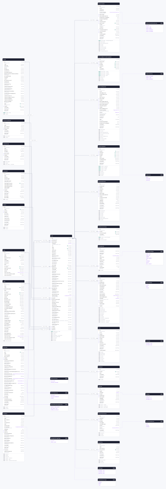

| Field                        | Type                                         | Constraints                                         | Default         | Description                                                                                                                                       |
| ---------------------------- | -------------------------------------------- | --------------------------------------------------- | --------------- | ------------------------------------------------------------------------------------------------------------------------------------------------- |
| `id`                         | `String`                                     | PK NOT NULL                                         | `cuid(1)`       |                                                                                                                                                   |
| `documentId`                 | `String`                                     | NULL → [Document.id](#model-Document)               |                 |                                                                                                                                                   |
| `dataroomId`                 | `String`                                     | NULL → [Dataroom.id](#model-Dataroom)               |                 |                                                                                                                                                   |
| `linkType`                   | [`LinkType`](#enum-LinkType)                 | NOT NULL                                            | `DOCUMENT_LINK` |                                                                                                                                                   |
| `url`                        | `String`                                     | UNIQUE NULL                                         |                 |                                                                                                                                                   |
| `name`                       | `String`                                     | NULL                                                |                 |                                                                                                                                                   |
| `slug`                       | `String`                                     | NULL                                                |                 |                                                                                                                                                   |
| `expiresAt`                  | `DateTime`                                   | NULL                                                |                 |                                                                                                                                                   |
| `password`                   | `String`                                     | NULL                                                |                 |                                                                                                                                                   |
| `allowList`                  | `String[]`                                   | NOT NULL                                            |                 |                                                                                                                                                   |
| `denyList`                   | `String[]`                                   | NOT NULL                                            |                 |                                                                                                                                                   |
| `emailProtected`             | `Boolean`                                    | NOT NULL                                            | `true`          |                                                                                                                                                   |
| `emailAuthenticated`         | `Boolean`                                    | NOT NULL                                            | `false`         |                                                                                                                                                   |
| `allowDownload`              | `Boolean`                                    | NULL                                                | `false`         |                                                                                                                                                   |
| `isArchived`                 | `Boolean`                                    | NOT NULL                                            | `false`         |                                                                                                                                                   |
| `deletedAt`                  | `DateTime`                                   | NULL                                                |                 |                                                                                                                                                   |
| `domainId`                   | `String`                                     | NULL → [Domain.id](#model-Domain)                   |                 |                                                                                                                                                   |
| `domainSlug`                 | `String`                                     | NULL                                                |                 |                                                                                                                                                   |
| `createdAt`                  | `DateTime`                                   | NOT NULL                                            | `now()`         |                                                                                                                                                   |
| `updatedAt`                  | `DateTime`                                   | NOT NULL                                            | `@updatedAt`    |                                                                                                                                                   |
| `enableNotification`         | `Boolean`                                    | NULL                                                | `true`          |                                                                                                                                                   |
| `enableFeedback`             | `Boolean`                                    | NULL                                                | `false`         |                                                                                                                                                   |
| `enableQuestion`             | `Boolean`                                    | NULL                                                | `false`         |                                                                                                                                                   |
| `enableScreenshotProtection` | `Boolean`                                    | NULL                                                | `false`         |                                                                                                                                                   |
| `enableConfidentialView`     | `Boolean`                                    | NULL                                                | `false`         |                                                                                                                                                   |
| `enableAgreement`            | `Boolean`                                    | NULL                                                | `false`         |                                                                                                                                                   |
| `agreementId`                | `String`                                     | NULL → [Agreement.id](#model-Agreement)             |                 |                                                                                                                                                   |
| `showBanner`                 | `Boolean`                                    | NULL                                                | `false`         |                                                                                                                                                   |
| `enableWatermark`            | `Boolean`                                    | NULL                                                | `false`         |                                                                                                                                                   |
| `watermarkConfig`            | `Json`                                       | NULL                                                |                 |                                                                                                                                                   |
| `audienceType`               | [`LinkAudienceType`](#enum-LinkAudienceType) | NOT NULL                                            | `GENERAL`       |                                                                                                                                                   |
| `groupId`                    | `String`                                     | NULL → [ViewerGroup.id](#model-ViewerGroup)         |                 |                                                                                                                                                   |
| `permissionGroupId`          | `String`                                     | NULL → [PermissionGroup.id](#model-PermissionGroup) |                 |                                                                                                                                                   |
| `metaTitle`                  | `String`                                     | NULL                                                |                 |                                                                                                                                                   |
| `metaDescription`            | `String`                                     | NULL                                                |                 |                                                                                                                                                   |
| `metaImage`                  | `String`                                     | NULL                                                |                 |                                                                                                                                                   |
| `metaFavicon`                | `String`                                     | NULL                                                |                 |                                                                                                                                                   |
| `enableCustomMetatag`        | `Boolean`                                    | NULL                                                | `false`         |                                                                                                                                                   |
| `welcomeMessage`             | `String`                                     | NULL                                                |                 |                                                                                                                                                   |
| `enableConversation`         | `Boolean`                                    | NOT NULL                                            | `false`         |                                                                                                                                                   |
| `enableAIAgents`             | `Boolean`                                    | NULL                                                | `false`         |                                                                                                                                                   |
| `enableUpload`               | `Boolean`                                    | NULL                                                | `false`         |                                                                                                                                                   |
| `isFileRequestOnly`          | `Boolean`                                    | NULL                                                | `false`         |                                                                                                                                                   |
| `uploadFolderId`             | `String`                                     | NULL                                                |                 | Deprecated: replaced by `uploadFolderIds`. Retained in the DB only so old rows can be inspected; no application code reads or writes this column. |
| `uploadFolderIds`            | `String[]`                                   | NOT NULL                                            | `[]`            |                                                                                                                                                   |
| `enableIndexFile`            | `Boolean`                                    | NULL                                                | `false`         |                                                                                                                                                   |
| `teamId`                     | `String`                                     | NULL → [Team.id](#model-Team)                       |                 |                                                                                                                                                   |
| `brandId`                    | `String`                                     | NULL → [Brand.id](#model-Brand)                     |                 |                                                                                                                                                   |
| `ownerId`                    | `String`                                     | NULL → [User.id](#model-User)                       |                 |                                                                                                                                                   |

#### Indexes

- `@@index([documentId])`
- `@@index([teamId])`
- `@@index([documentId, isArchived])`
- `@@index([permissionGroupId])`
- `@@index([deletedAt])`
- `@@index([ownerId])`
- `@@index([brandId])`
- `@@unique([domainSlug, slug])`

#### References

- `documentId` → [Document.id](#model-Document) (many-to-one, on delete Cascade)
- `dataroomId` → [Dataroom.id](#model-Dataroom) (many-to-one, on delete Cascade)
- `domainId` → [Domain.id](#model-Domain) (many-to-one, on delete SetNull)
- `agreementId` → [Agreement.id](#model-Agreement) (many-to-one, on delete SetNull)
- `groupId` → [ViewerGroup.id](#model-ViewerGroup) (many-to-one, on delete SetNull)
- `permissionGroupId` → [PermissionGroup.id](#model-PermissionGroup) (many-to-one, on delete SetNull)
- `teamId` → [Team.id](#model-Team) (many-to-one, on delete Cascade)
- `brandId` → [Brand.id](#model-Brand) (many-to-one, on delete SetNull)
- `ownerId` → [User.id](#model-User) (many-to-one, on delete SetNull)

#### Referenced by

- `id` ← [Conversation.linkId](#model-Conversation) (one-to-many, on delete SetNull)
- `id` ← [DataroomQuestionAssignment.linkId](#model-DataroomQuestionAssignment) (one-to-many, on delete Cascade)
- `id` ← [DataroomFaqItem.linkId](#model-DataroomFaqItem) (one-to-many, on delete SetNull)
- `id` ← [TaskAssignment.linkId](#model-TaskAssignment) (one-to-many, on delete Cascade)
- `id` ← [DocumentUpload.linkId](#model-DocumentUpload) (one-to-many, on delete Cascade)
- `id` ← [LinkVisitorGroup.linkId](#model-LinkVisitorGroup) (one-to-many, on delete Cascade)
- `id` ← [CustomField.linkId](#model-CustomField) (one-to-many, on delete Cascade)
- `id` ← [View.linkId](#model-View) (one-to-many, on delete Cascade)
- `id` ← [Chat.linkId](#model-Chat) (one-to-many, on delete Cascade)
- `id` ← [Feedback.linkId](#model-Feedback) (one-to-one, on delete Cascade)
- `id` ← [TagItem.linkId](#model-TagItem) (one-to-many, on delete Cascade)
- `id` ← [ViewerInvitation.linkId](#model-ViewerInvitation) (one-to-many, on delete Cascade)
- `id` ← [Workflow.entryLinkId](#model-Workflow) (one-to-one, on delete Cascade)

#### Definition

```sql
CREATE TABLE "Link" (
    "id" TEXT NOT NULL,
    "documentId" TEXT,
    "dataroomId" TEXT,
    "linkType" "LinkType" NOT NULL DEFAULT 'DOCUMENT_LINK',
    "url" TEXT,
    "name" TEXT,
    "slug" TEXT,
    "expiresAt" TIMESTAMP(3),
    "password" TEXT,
    "allowList" TEXT[],
    "denyList" TEXT[],
    "emailProtected" BOOLEAN NOT NULL DEFAULT true,
    "emailAuthenticated" BOOLEAN NOT NULL DEFAULT false,
    "allowDownload" BOOLEAN DEFAULT false,
    "isArchived" BOOLEAN NOT NULL DEFAULT false,
    "deletedAt" TIMESTAMP(3),
    "domainId" TEXT,
    "domainSlug" TEXT,
    "createdAt" TIMESTAMP(3) NOT NULL DEFAULT CURRENT_TIMESTAMP,
    "updatedAt" TIMESTAMP(3) NOT NULL,
    "enableNotification" BOOLEAN DEFAULT true,
    "enableFeedback" BOOLEAN DEFAULT false,
    "enableQuestion" BOOLEAN DEFAULT false,
    "enableScreenshotProtection" BOOLEAN DEFAULT false,
    "enableConfidentialView" BOOLEAN DEFAULT false,
    "enableAgreement" BOOLEAN DEFAULT false,
    "agreementId" TEXT,
    "showBanner" BOOLEAN DEFAULT false,
    "enableWatermark" BOOLEAN DEFAULT false,
    "watermarkConfig" JSONB,
    "audienceType" "LinkAudienceType" NOT NULL DEFAULT 'GENERAL',
    "groupId" TEXT,
    "permissionGroupId" TEXT,
    "metaTitle" TEXT,
    "metaDescription" TEXT,
    "metaImage" TEXT,
    "metaFavicon" TEXT,
    "enableCustomMetatag" BOOLEAN DEFAULT false,
    "welcomeMessage" TEXT,
    "enableConversation" BOOLEAN NOT NULL DEFAULT false,
    "enableAIAgents" BOOLEAN DEFAULT false,
    "enableUpload" BOOLEAN DEFAULT false,
    "isFileRequestOnly" BOOLEAN DEFAULT false,
    "uploadFolderId" TEXT,
    "uploadFolderIds" TEXT[] DEFAULT ARRAY[]::TEXT[],
    "enableIndexFile" BOOLEAN DEFAULT false,
    "teamId" TEXT,
    "brandId" TEXT,
    "ownerId" TEXT,

    CONSTRAINT "Link_pkey" PRIMARY KEY ("id")
);

CREATE UNIQUE INDEX "Link_url_key" ON "Link"("url");

CREATE INDEX "Link_documentId_idx" ON "Link"("documentId");

CREATE INDEX "Link_teamId_idx" ON "Link"("teamId");

CREATE INDEX "Link_documentId_isArchived_idx" ON "Link"("documentId", "isArchived");

CREATE INDEX "Link_permissionGroupId_idx" ON "Link"("permissionGroupId");

CREATE INDEX "Link_deletedAt_idx" ON "Link"("deletedAt");

CREATE INDEX "Link_ownerId_idx" ON "Link"("ownerId");

CREATE INDEX "Link_brandId_idx" ON "Link"("brandId");

CREATE UNIQUE INDEX "Link_domainSlug_slug_key" ON "Link"("domainSlug", "slug");

ALTER TABLE "Link" ADD CONSTRAINT "Link_documentId_fkey" FOREIGN KEY ("documentId") REFERENCES "Document"("id") ON DELETE CASCADE ON UPDATE CASCADE;

ALTER TABLE "Link" ADD CONSTRAINT "Link_dataroomId_fkey" FOREIGN KEY ("dataroomId") REFERENCES "Dataroom"("id") ON DELETE CASCADE ON UPDATE CASCADE;

ALTER TABLE "Link" ADD CONSTRAINT "Link_domainId_fkey" FOREIGN KEY ("domainId") REFERENCES "Domain"("id") ON DELETE SET NULL ON UPDATE CASCADE;

ALTER TABLE "Link" ADD CONSTRAINT "Link_agreementId_fkey" FOREIGN KEY ("agreementId") REFERENCES "Agreement"("id") ON DELETE SET NULL ON UPDATE CASCADE;

ALTER TABLE "Link" ADD CONSTRAINT "Link_groupId_fkey" FOREIGN KEY ("groupId") REFERENCES "ViewerGroup"("id") ON DELETE SET NULL ON UPDATE CASCADE;

ALTER TABLE "Link" ADD CONSTRAINT "Link_permissionGroupId_fkey" FOREIGN KEY ("permissionGroupId") REFERENCES "PermissionGroup"("id") ON DELETE SET NULL ON UPDATE CASCADE;

ALTER TABLE "Link" ADD CONSTRAINT "Link_teamId_fkey" FOREIGN KEY ("teamId") REFERENCES "Team"("id") ON DELETE CASCADE ON UPDATE CASCADE;

ALTER TABLE "Link" ADD CONSTRAINT "Link_brandId_fkey" FOREIGN KEY ("brandId") REFERENCES "Brand"("id") ON DELETE SET NULL ON UPDATE CASCADE;

ALTER TABLE "Link" ADD CONSTRAINT "Link_ownerId_fkey" FOREIGN KEY ("ownerId") REFERENCES "User"("id") ON DELETE SET NULL ON UPDATE CASCADE;
```

<details>
<summary>Queries and their SQL</summary>

**findMany**: Every row

```ts
await prisma.link.findMany();
```

```sql
SELECT
  "public"."Link"."id",
  "public"."Link"."documentId",
  "public"."Link"."dataroomId",
  "public"."Link"."linkType"::text,
  "public"."Link"."url",
  "public"."Link"."name",
  "public"."Link"."slug",
  "public"."Link"."expiresAt",
  "public"."Link"."password",
  "public"."Link"."allowList",
  "public"."Link"."denyList",
  "public"."Link"."emailProtected",
  "public"."Link"."emailAuthenticated",
  "public"."Link"."allowDownload",
  "public"."Link"."isArchived",
  "public"."Link"."deletedAt",
  "public"."Link"."domainId",
  "public"."Link"."domainSlug",
  "public"."Link"."createdAt",
  "public"."Link"."updatedAt",
  "public"."Link"."enableNotification",
  "public"."Link"."enableFeedback",
  "public"."Link"."enableQuestion",
  "public"."Link"."enableScreenshotProtection",
  "public"."Link"."enableConfidentialView",
  "public"."Link"."enableAgreement",
  "public"."Link"."agreementId",
  "public"."Link"."showBanner",
  "public"."Link"."enableWatermark",
  "public"."Link"."watermarkConfig",
  "public"."Link"."audienceType"::text,
  "public"."Link"."groupId",
  "public"."Link"."permissionGroupId",
  "public"."Link"."metaTitle",
  "public"."Link"."metaDescription",
  "public"."Link"."metaImage",
  "public"."Link"."metaFavicon",
  "public"."Link"."enableCustomMetatag",
  "public"."Link"."welcomeMessage",
  "public"."Link"."enableConversation",
  "public"."Link"."enableAIAgents",
  "public"."Link"."enableUpload",
  "public"."Link"."isFileRequestOnly",
  "public"."Link"."uploadFolderId",
  "public"."Link"."uploadFolderIds",
  "public"."Link"."enableIndexFile",
  "public"."Link"."teamId",
  "public"."Link"."brandId",
  "public"."Link"."ownerId"
FROM
  "public"."Link"
WHERE
  1 = 1
OFFSET
  $1
-- params: ["0"]
```

**count**: How many rows there are

```ts
await prisma.link.count();
```

```sql
SELECT
  COUNT(*) AS "_count$_all"
FROM
  (
    SELECT
      "public"."Link"."id"
    FROM
      "public"."Link"
    WHERE
      1 = 1
    OFFSET
      $1
  ) AS "sub"
-- params: ["0"]
```

**findMany**: Every row with its relations

```ts
await prisma.link.findMany({
  include: {
    document: true,
    dataroom: true,
    views: true,
    domain: true,
    feedback: true,
    agreement: true,
    group: true,
    permissionGroup: true,
    conversations: true,
    questionAssignments: true,
    dataroomFaqItems: true,
    chats: true,
    uploadedDocuments: true,
    team: true,
    brand: true,
    owner: true,
    customFields: true,
    tags: true,
    viewerInvitations: true,
    visitorGroups: true,
    taskAssignments: true,
    workflow: true,
  },
});
```

```sql
SELECT
  "public"."Link"."id",
  "public"."Link"."documentId",
  "public"."Link"."dataroomId",
  "public"."Link"."linkType"::text,
  "public"."Link"."url",
  "public"."Link"."name",
  "public"."Link"."slug",
  "public"."Link"."expiresAt",
  "public"."Link"."password",
  "public"."Link"."allowList",
  "public"."Link"."denyList",
  "public"."Link"."emailProtected",
  "public"."Link"."emailAuthenticated",
  "public"."Link"."allowDownload",
  "public"."Link"."isArchived",
  "public"."Link"."deletedAt",
  "public"."Link"."domainId",
  "public"."Link"."domainSlug",
  "public"."Link"."createdAt",
  "public"."Link"."updatedAt",
  "public"."Link"."enableNotification",
  "public"."Link"."enableFeedback",
  "public"."Link"."enableQuestion",
  "public"."Link"."enableScreenshotProtection",
  "public"."Link"."enableConfidentialView",
  "public"."Link"."enableAgreement",
  "public"."Link"."agreementId",
  "public"."Link"."showBanner",
  "public"."Link"."enableWatermark",
  "public"."Link"."watermarkConfig",
  "public"."Link"."audienceType"::text,
  "public"."Link"."groupId",
  "public"."Link"."permissionGroupId",
  "public"."Link"."metaTitle",
  "public"."Link"."metaDescription",
  "public"."Link"."metaImage",
  "public"."Link"."metaFavicon",
  "public"."Link"."enableCustomMetatag",
  "public"."Link"."welcomeMessage",
  "public"."Link"."enableConversation",
  "public"."Link"."enableAIAgents",
  "public"."Link"."enableUpload",
  "public"."Link"."isFileRequestOnly",
  "public"."Link"."uploadFolderId",
  "public"."Link"."uploadFolderIds",
  "public"."Link"."enableIndexFile",
  "public"."Link"."teamId",
  "public"."Link"."brandId",
  "public"."Link"."ownerId"
FROM
  "public"."Link"
WHERE
  1 = 1
OFFSET
  $1
-- params: ["0"]

SELECT
  "public"."Document"."id",
  "public"."Document"."name",
  "public"."Document"."description",
  "public"."Document"."file",
  "public"."Document"."originalFile",
  "public"."Document"."type",
  "public"."Document"."contentType",
  "public"."Document"."storageType"::text,
  "public"."Document"."numPages",
  "public"."Document"."teamId",
  "public"."Document"."ownerId",
  "public"."Document"."assistantEnabled",
  "public"."Document"."advancedExcelEnabled",
  "public"."Document"."agentsEnabled",
  "public"."Document"."downloadOnly",
  "public"."Document"."hiddenInAllDocuments",
  "public"."Document"."createdAt",
  "public"."Document"."updatedAt",
  "public"."Document"."folderId",
  "public"."Document"."isExternalUpload"
FROM
  "public"."Document"
WHERE
  "public"."Document"."id" IN ($1)
OFFSET
  $2
-- params: ["<documentId of the rows above>","0"]

SELECT
  "public"."Dataroom"."id",
  "public"."Dataroom"."pId",
  "public"."Dataroom"."name",
  "public"."Dataroom"."internalName",
  "public"."Dataroom"."description",
  "public"."Dataroom"."teamId",
  "public"."Dataroom"."brandId",
  "public"."Dataroom"."conversationsEnabled",
  "public"."Dataroom"."agentsEnabled",
  "public"."Dataroom"."vectorStoreId",
  "public"."Dataroom"."requestListEnabled",
  "public"."Dataroom"."enableChangeNotifications",
  "public"."Dataroom"."enableVisitorUploadChangeNotifications",
  "public"."Dataroom"."defaultPermissionStrategy"::text,
  "public"."Dataroom"."defaultShowBanner",
  "public"."Dataroom"."defaultGroupPermissionStrategy"::text,
  "public"."Dataroom"."defaultRootItemAccess"::text,
  "public"."Dataroom"."defaultGroupRootItemAccess"::text,
  "public"."Dataroom"."allowBulkDownload",
  "public"."Dataroom"."showLastUpdated",
  "public"."Dataroom"."introductionEnabled",
  "public"."Dataroom"."introductionContent",
  "public"."Dataroom"."isFrozen",
  "public"."Dataroom"."frozenAt",
  "public"."Dataroom"."frozenBy",
  "public"."Dataroom"."freezeArchiveUrl",
  "public"."Dataroom"."freezeArchiveHash",
  "public"."Dataroom"."createdAt",
  "public"."Dataroom"."updatedAt"
FROM
  "public"."Dataroom"
WHERE
  "public"."Dataroom"."id" IN ($1)
OFFSET
  $2
-- params: ["<dataroomId of the rows above>","0"]

SELECT
  "public"."View"."id",
  "public"."View"."linkId",
  "public"."View"."documentId",
  "public"."View"."dataroomId",
  "public"."View"."dataroomViewId",
  "public"."View"."viewerEmail",
  "public"."View"."viewerName",
  "public"."View"."verified",
  "public"."View"."viewedAt",
  "public"."View"."downloadedAt",
  "public"."View"."downloadType"::text,
  "public"."View"."downloadMetadata",
  "public"."View"."viewType"::text,
  "public"."View"."viewerId",
  "public"."View"."groupId",
  "public"."View"."isArchived",
  "public"."View"."teamId"
FROM
  "public"."View"
WHERE
  "public"."View"."linkId" IN ($1)
OFFSET
  $2
-- params: ["<id of the rows above>","0"]

SELECT
  "public"."Domain"."id",
  "public"."Domain"."slug",
  "public"."Domain"."userId",
  "public"."Domain"."teamId",
  "public"."Domain"."verified",
  "public"."Domain"."isDefault",
  "public"."Domain"."redirectUrl",
  "public"."Domain"."lastChecked",
  "public"."Domain"."createdAt",
  "public"."Domain"."updatedAt"
FROM
  "public"."Domain"
WHERE
  "public"."Domain"."id" IN ($1)
OFFSET
  $2
-- params: ["<domainId of the rows above>","0"]

SELECT
  "public"."Feedback"."id",
  "public"."Feedback"."linkId",
  "public"."Feedback"."data",
  "public"."Feedback"."createdAt",
  "public"."Feedback"."updatedAt"
FROM
  "public"."Feedback"
WHERE
  "public"."Feedback"."linkId" IN ($1)
OFFSET
  $2
-- params: ["<id of the rows above>","0"]

SELECT
  "public"."Agreement"."id",
  "public"."Agreement"."name",
  "public"."Agreement"."content",
  "public"."Agreement"."contentType",
  "public"."Agreement"."signingProvider",
  "public"."Agreement"."signingExternalId",
  "public"."Agreement"."signingEnvelopeId",
  "public"."Agreement"."signingTemplateId",
  "public"."Agreement"."requireName",
  "public"."Agreement"."teamId",
  "public"."Agreement"."createdAt",
  "public"."Agreement"."updatedAt",
  "public"."Agreement"."deletedAt",
  "public"."Agreement"."deletedBy"
FROM
  "public"."Agreement"
WHERE
  "public"."Agreement"."id" IN ($1)
OFFSET
  $2
-- params: ["<agreementId of the rows above>","0"]

SELECT
  "public"."ViewerGroup"."id",
  "public"."ViewerGroup"."name",
  "public"."ViewerGroup"."domains",
  "public"."ViewerGroup"."allowAll",
  "public"."ViewerGroup"."dataroomId",
  "public"."ViewerGroup"."teamId",
  "public"."ViewerGroup"."createdAt",
  "public"."ViewerGroup"."updatedAt"
FROM
  "public"."ViewerGroup"
WHERE
  "public"."ViewerGroup"."id" IN ($1)
OFFSET
  $2
-- params: ["<groupId of the rows above>","0"]

SELECT
  "public"."PermissionGroup"."id",
  "public"."PermissionGroup"."name",
  "public"."PermissionGroup"."description",
  "public"."PermissionGroup"."dataroomId",
  "public"."PermissionGroup"."teamId",
  "public"."PermissionGroup"."createdAt",
  "public"."PermissionGroup"."updatedAt"
FROM
  "public"."PermissionGroup"
WHERE
  "public"."PermissionGroup"."id" IN ($1)
OFFSET
  $2
-- params: ["<permissionGroupId of the rows above>","0"]

SELECT
  "public"."Conversation"."id",
  "public"."Conversation"."title",
  "public"."Conversation"."isEnabled",
  "public"."Conversation"."visibilityMode"::text,
  "public"."Conversation"."dataroomId",
  "public"."Conversation"."dataroomDocumentId",
  "public"."Conversation"."documentVersionNumber",
  "public"."Conversation"."documentPageNumber",
  "public"."Conversation"."linkId",
  "public"."Conversation"."viewerGroupId",
  "public"."Conversation"."questionId",
  "public"."Conversation"."origin",
  "public"."Conversation"."category",
  "public"."Conversation"."priority",
  "public"."Conversation"."recipientViewerId",
  "public"."Conversation"."initialViewId",
  "public"."Conversation"."teamId",
  "public"."Conversation"."lastMessageAt",
  "public"."Conversation"."createdAt",
  "public"."Conversation"."updatedAt"
FROM
  "public"."Conversation"
WHERE
  "public"."Conversation"."linkId" IN ($1)
OFFSET
  $2
-- params: ["<id of the rows above>","0"]

SELECT
  "public"."DataroomQuestionAssignment"."id",
  "public"."DataroomQuestionAssignment"."questionId",
  "public"."DataroomQuestionAssignment"."linkId",
  "public"."DataroomQuestionAssignment"."groupId",
  "public"."DataroomQuestionAssignment"."viewerId",
  "public"."DataroomQuestionAssignment"."email",
  "public"."DataroomQuestionAssignment"."createdAt"
FROM
  "public"."DataroomQuestionAssignment"
WHERE
  "public"."DataroomQuestionAssignment"."linkId" IN ($1)
OFFSET
  $2
-- params: ["<id of the rows above>","0"]

SELECT
  "public"."DataroomFaqItem"."id",
  "public"."DataroomFaqItem"."title",
  "public"."DataroomFaqItem"."editedQuestion",
  "public"."DataroomFaqItem"."originalQuestion",
  "public"."DataroomFaqItem"."answer",
  "public"."DataroomFaqItem"."description",
  "public"."DataroomFaqItem"."dataroomId",
  "public"."DataroomFaqItem"."linkId",
  "public"."DataroomFaqItem"."dataroomDocumentId",
  "public"."DataroomFaqItem"."sourceConversationId",
  "public"."DataroomFaqItem"."questionMessageId",
  "public"."DataroomFaqItem"."answerMessageId",
  "public"."DataroomFaqItem"."teamId",
  "public"."DataroomFaqItem"."publishedByUserId",
  "public"."DataroomFaqItem"."visibilityMode"::text,
  "public"."DataroomFaqItem"."status"::text,
  "public"."DataroomFaqItem"."isAnonymized",
  "public"."DataroomFaqItem"."viewCount",
  "public"."DataroomFaqItem"."tags",
  "public"."DataroomFaqItem"."documentPageNumber",
  "public"."DataroomFaqItem"."documentVersionNumber",
  "public"."DataroomFaqItem"."createdAt",
  "public"."DataroomFaqItem"."updatedAt"
FROM
  "public"."DataroomFaqItem"
WHERE
  "public"."DataroomFaqItem"."linkId" IN ($1)
OFFSET
  $2
-- params: ["<id of the rows above>","0"]

SELECT
  "public"."Chat"."id",
  "public"."Chat"."title",
  "public"."Chat"."teamId",
  "public"."Chat"."documentId",
  "public"."Chat"."dataroomId",
  "public"."Chat"."linkId",
  "public"."Chat"."viewId",
  "public"."Chat"."userId",
  "public"."Chat"."viewerId",
  "public"."Chat"."vectorStoreId",
  "public"."Chat"."createdAt",
  "public"."Chat"."updatedAt",
  "public"."Chat"."lastMessageAt"
FROM
  "public"."Chat"
WHERE
  "public"."Chat"."linkId" IN ($1)
OFFSET
  $2
-- params: ["<id of the rows above>","0"]

SELECT
  "public"."DocumentUpload"."id",
  "public"."DocumentUpload"."documentId",
  "public"."DocumentUpload"."teamId",
  "public"."DocumentUpload"."viewerId",
  "public"."DocumentUpload"."viewId",
  "public"."DocumentUpload"."linkId",
  "public"."DocumentUpload"."dataroomId",
  "public"."DocumentUpload"."dataroomDocumentId",
  "public"."DocumentUpload"."taskId",
  "public"."DocumentUpload"."originalFilename",
  "public"."DocumentUpload"."fileSize",
  "public"."DocumentUpload"."numPages",
  "public"."DocumentUpload"."mimeType",
  "public"."DocumentUpload"."uploadedAt",
  "public"."DocumentUpload"."createdAt",
  "public"."DocumentUpload"."updatedAt"
FROM
  "public"."DocumentUpload"
WHERE
  "public"."DocumentUpload"."linkId" IN ($1)
OFFSET
  $2
-- params: ["<id of the rows above>","0"]

SELECT
  "public"."Team"."id",
  "public"."Team"."name",
  "public"."Team"."slug",
  "public"."Team"."defaultBrandId",
  "public"."Team"."plan",
  "public"."Team"."stripeId",
  "public"."Team"."subscriptionId",
  "public"."Team"."startsAt",
  "public"."Team"."endsAt",
  "public"."Team"."pausedAt",
  "public"."Team"."pauseStartsAt",
  "public"."Team"."pauseEndsAt",
  "public"."Team"."cancelledAt",
  "public"."Team"."trialStartedAt",
  "public"."Team"."trialEndsAt",
  "public"."Team"."trialReminderRunId",
  "public"."Team"."trialExpiredRunId",
  "public"."Team"."limits",
  "public"."Team"."enableExcelAdvancedMode",
  "public"."Team"."replicateDataroomFolders",
  "public"."Team"."timezone",
  "public"."Team"."ssoEnabled",
  "public"."Team"."ssoEmailDomain",
  "public"."Team"."ssoEnforcedAt",
  "public"."Team"."surveyData",
  "public"."Team"."agentsEnabled",
  "public"."Team"."vectorStoreId",
  "public"."Team"."createdAt",
  "public"."Team"."updatedAt",
  "public"."Team"."ignoredDomains",
  "public"."Team"."globalBlockList",
  "public"."Team"."referralTrack"::text,
  "public"."Team"."referralTrackSelectedAt",
  "public"."Team"."referralProfile"
FROM
  "public"."Team"
WHERE
  "public"."Team"."id" IN ($1)
OFFSET
  $2
-- params: ["<teamId of the rows above>","0"]

SELECT
  "public"."Brand"."id",
  "public"."Brand"."logo",
  "public"."Brand"."hideLogo",
  "public"."Brand"."banner",
  "public"."Brand"."brandColor",
  "public"."Brand"."accentColor",
  "public"."Brand"."accentButtonColor",
  "public"."Brand"."applyAccentColorToDataroomView",
  "public"."Brand"."welcomeMessage",
  "public"."Brand"."ctaLabel",
  "public"."Brand"."ctaUrl",
  "public"."Brand"."privacyPolicyUrl",
  "public"."Brand"."cardLayout",
  "public"."Brand"."showFolderTree",
  "public"."Brand"."viewerLayoutPreset",
  "public"."Brand"."viewerHeaderStyle",
  "public"."Brand"."hideFolderIconsInMain",
  "public"."Brand"."customLinkPreviewEnabled",
  "public"."Brand"."linkPreviewTitle",
  "public"."Brand"."linkPreviewDescription",
  "public"."Brand"."linkPreviewImage",
  "public"."Brand"."linkPreviewFavicon",
  "public"."Brand"."defaultLanguage",
  "public"."Brand"."name",
  "public"."Brand"."teamId",
  "public"."Brand"."createdAt",
  "public"."Brand"."updatedAt"
FROM
  "public"."Brand"
WHERE
  "public"."Brand"."id" IN ($1)
OFFSET
  $2
-- params: ["<brandId of the rows above>","0"]

SELECT
  "public"."User"."id",
  "public"."User"."name",
  "public"."User"."email",
  "public"."User"."emailVerified",
  "public"."User"."image",
  "public"."User"."createdAt",
  "public"."User"."contactId",
  "public"."User"."plan",
  "public"."User"."stripeId",
  "public"."User"."subscriptionId",
  "public"."User"."startsAt",
  "public"."User"."endsAt",
  "public"."User"."referralTrack"::text,
  "public"."User"."referralTrackSelectedAt",
  "public"."User"."referralProfile"
FROM
  "public"."User"
WHERE
  "public"."User"."id" IN ($1)
OFFSET
  $2
-- params: ["<ownerId of the rows above>","0"]

SELECT
  "public"."CustomField"."id",
  "public"."CustomField"."createdAt",
  "public"."CustomField"."updatedAt",
  "public"."CustomField"."type"::text,
  "public"."CustomField"."identifier",
  "public"."CustomField"."label",
  "public"."CustomField"."placeholder",
  "public"."CustomField"."required",
  "public"."CustomField"."disabled",
  "public"."CustomField"."linkId",
  "public"."CustomField"."orderIndex"
FROM
  "public"."CustomField"
WHERE
  "public"."CustomField"."linkId" IN ($1)
OFFSET
  $2
-- params: ["<id of the rows above>","0"]

SELECT
  "public"."TagItem"."id",
  "public"."TagItem"."tagId",
  "public"."TagItem"."itemType"::text,
  "public"."TagItem"."linkId",
  "public"."TagItem"."documentId",
  "public"."TagItem"."dataroomId",
  "public"."TagItem"."taggedBy",
  "public"."TagItem"."createdAt",
  "public"."TagItem"."updatedAt"
FROM
  "public"."TagItem"
WHERE
  "public"."TagItem"."linkId" IN ($1)
OFFSET
  $2
-- params: ["<id of the rows above>","0"]

SELECT
  "public"."ViewerInvitation"."id",
  "public"."ViewerInvitation"."viewerId",
  "public"."ViewerInvitation"."linkId",
  "public"."ViewerInvitation"."groupId",
  "public"."ViewerInvitation"."invitedBy",
  "public"."ViewerInvitation"."customMessage",
  "public"."ViewerInvitation"."sentAt",
  "public"."ViewerInvitation"."status"::text,
  "public"."ViewerInvitation"."createdAt"
FROM
  "public"."ViewerInvitation"
WHERE
  "public"."ViewerInvitation"."linkId" IN ($1)
OFFSET
  $2
-- params: ["<id of the rows above>","0"]

SELECT
  "public"."LinkVisitorGroup"."id",
  "public"."LinkVisitorGroup"."linkId",
  "public"."LinkVisitorGroup"."visitorGroupId",
  "public"."LinkVisitorGroup"."createdAt"
FROM
  "public"."LinkVisitorGroup"
WHERE
  "public"."LinkVisitorGroup"."linkId" IN ($1)
OFFSET
  $2
-- params: ["<id of the rows above>","0"]

SELECT
  "public"."TaskAssignment"."id",
  "public"."TaskAssignment"."taskId",
  "public"."TaskAssignment"."viewerId",
  "public"."TaskAssignment"."groupId",
  "public"."TaskAssignment"."linkId",
  "public"."TaskAssignment"."email",
  "public"."TaskAssignment"."notifiedAt",
  "public"."TaskAssignment"."lastReminderAt",
  "public"."TaskAssignment"."createdAt",
  "public"."TaskAssignment"."updatedAt"
FROM
  "public"."TaskAssignment"
WHERE
  "public"."TaskAssignment"."linkId" IN ($1)
OFFSET
  $2
-- params: ["<id of the rows above>","0"]

SELECT
  "public"."Workflow"."id",
  "public"."Workflow"."name",
  "public"."Workflow"."description",
  "public"."Workflow"."entryLinkId",
  "public"."Workflow"."teamId",
  "public"."Workflow"."isActive",
  "public"."Workflow"."createdAt",
  "public"."Workflow"."updatedAt"
FROM
  "public"."Workflow"
WHERE
  "public"."Workflow"."entryLinkId" IN ($1)
OFFSET
  $2
-- params: ["<id of the rows above>","0"]
```

**findUnique**: One row by what is unique to it

```ts
await prisma.link.findUnique({ where: { id: "example" } });
```

```sql
SELECT
  "public"."Link"."id",
  "public"."Link"."documentId",
  "public"."Link"."dataroomId",
  "public"."Link"."linkType"::text,
  "public"."Link"."url",
  "public"."Link"."name",
  "public"."Link"."slug",
  "public"."Link"."expiresAt",
  "public"."Link"."password",
  "public"."Link"."allowList",
  "public"."Link"."denyList",
  "public"."Link"."emailProtected",
  "public"."Link"."emailAuthenticated",
  "public"."Link"."allowDownload",
  "public"."Link"."isArchived",
  "public"."Link"."deletedAt",
  "public"."Link"."domainId",
  "public"."Link"."domainSlug",
  "public"."Link"."createdAt",
  "public"."Link"."updatedAt",
  "public"."Link"."enableNotification",
  "public"."Link"."enableFeedback",
  "public"."Link"."enableQuestion",
  "public"."Link"."enableScreenshotProtection",
  "public"."Link"."enableConfidentialView",
  "public"."Link"."enableAgreement",
  "public"."Link"."agreementId",
  "public"."Link"."showBanner",
  "public"."Link"."enableWatermark",
  "public"."Link"."watermarkConfig",
  "public"."Link"."audienceType"::text,
  "public"."Link"."groupId",
  "public"."Link"."permissionGroupId",
  "public"."Link"."metaTitle",
  "public"."Link"."metaDescription",
  "public"."Link"."metaImage",
  "public"."Link"."metaFavicon",
  "public"."Link"."enableCustomMetatag",
  "public"."Link"."welcomeMessage",
  "public"."Link"."enableConversation",
  "public"."Link"."enableAIAgents",
  "public"."Link"."enableUpload",
  "public"."Link"."isFileRequestOnly",
  "public"."Link"."uploadFolderId",
  "public"."Link"."uploadFolderIds",
  "public"."Link"."enableIndexFile",
  "public"."Link"."teamId",
  "public"."Link"."brandId",
  "public"."Link"."ownerId"
FROM
  "public"."Link"
WHERE
  (
    "public"."Link"."id" = $1
    AND 1 = 1
  )
LIMIT
  $2
OFFSET
  $3
-- params: ["example","1","0"]
```

**create**: Create a row

```ts
await prisma.link.create({ data: { allowList: ["example"], denyList: ["example"] } });
```

```sql
INSERT INTO
  "public"."Link" (
    "id",
    "linkType",
    "allowList",
    "denyList",
    "emailProtected",
    "emailAuthenticated",
    "allowDownload",
    "isArchived",
    "createdAt",
    "updatedAt",
    "enableNotification",
    "enableFeedback",
    "enableQuestion",
    "enableScreenshotProtection",
    "enableConfidentialView",
    "enableAgreement",
    "showBanner",
    "enableWatermark",
    "audienceType",
    "enableCustomMetatag",
    "enableConversation",
    "enableAIAgents",
    "enableUpload",
    "isFileRequestOnly",
    "uploadFolderIds",
    "enableIndexFile"
  )
VALUES
  (
    $1,
    CAST($2::text AS "public"."LinkType"),
    $3,
    $4,
    $5,
    $6,
    $7,
    $8,
    $9,
    $10,
    $11,
    $12,
    $13,
    $14,
    $15,
    $16,
    $17,
    $18,
    CAST($19::text AS "public"."LinkAudienceType"),
    $20,
    $21,
    $22,
    $23,
    $24,
    $25,
    $26
  )
RETURNING
  "public"."Link"."id",
  "public"."Link"."documentId",
  "public"."Link"."dataroomId",
  "public"."Link"."linkType"::text,
  "public"."Link"."url",
  "public"."Link"."name",
  "public"."Link"."slug",
  "public"."Link"."expiresAt",
  "public"."Link"."password",
  "public"."Link"."allowList",
  "public"."Link"."denyList",
  "public"."Link"."emailProtected",
  "public"."Link"."emailAuthenticated",
  "public"."Link"."allowDownload",
  "public"."Link"."isArchived",
  "public"."Link"."deletedAt",
  "public"."Link"."domainId",
  "public"."Link"."domainSlug",
  "public"."Link"."createdAt",
  "public"."Link"."updatedAt",
  "public"."Link"."enableNotification",
  "public"."Link"."enableFeedback",
  "public"."Link"."enableQuestion",
  "public"."Link"."enableScreenshotProtection",
  "public"."Link"."enableConfidentialView",
  "public"."Link"."enableAgreement",
  "public"."Link"."agreementId",
  "public"."Link"."showBanner",
  "public"."Link"."enableWatermark",
  "public"."Link"."watermarkConfig",
  "public"."Link"."audienceType"::text,
  "public"."Link"."groupId",
  "public"."Link"."permissionGroupId",
  "public"."Link"."metaTitle",
  "public"."Link"."metaDescription",
  "public"."Link"."metaImage",
  "public"."Link"."metaFavicon",
  "public"."Link"."enableCustomMetatag",
  "public"."Link"."welcomeMessage",
  "public"."Link"."enableConversation",
  "public"."Link"."enableAIAgents",
  "public"."Link"."enableUpload",
  "public"."Link"."isFileRequestOnly",
  "public"."Link"."uploadFolderId",
  "public"."Link"."uploadFolderIds",
  "public"."Link"."enableIndexFile",
  "public"."Link"."teamId",
  "public"."Link"."brandId",
  "public"."Link"."ownerId"
-- params: ["<cuid(1)>","DOCUMENT_LINK",["example"],["example"],true,false,false,false,"<now()>","<now()>",true,false,false,false,false,false,false,false,"GENERAL",false,false,false,false,false,[],false]
```

**update**: Update a row

```ts
await prisma.link.update({ where: { id: "example" }, data: { linkType: "DOCUMENT_LINK" } });
```

```sql
UPDATE "public"."Link"
SET
  "linkType" = CAST($1::text AS "public"."LinkType"),
  "updatedAt" = $2
WHERE
  (
    "public"."Link"."id" = $3
    AND 1 = 1
  )
RETURNING
  "public"."Link"."id",
  "public"."Link"."documentId",
  "public"."Link"."dataroomId",
  "public"."Link"."linkType"::text,
  "public"."Link"."url",
  "public"."Link"."name",
  "public"."Link"."slug",
  "public"."Link"."expiresAt",
  "public"."Link"."password",
  "public"."Link"."allowList",
  "public"."Link"."denyList",
  "public"."Link"."emailProtected",
  "public"."Link"."emailAuthenticated",
  "public"."Link"."allowDownload",
  "public"."Link"."isArchived",
  "public"."Link"."deletedAt",
  "public"."Link"."domainId",
  "public"."Link"."domainSlug",
  "public"."Link"."createdAt",
  "public"."Link"."updatedAt",
  "public"."Link"."enableNotification",
  "public"."Link"."enableFeedback",
  "public"."Link"."enableQuestion",
  "public"."Link"."enableScreenshotProtection",
  "public"."Link"."enableConfidentialView",
  "public"."Link"."enableAgreement",
  "public"."Link"."agreementId",
  "public"."Link"."showBanner",
  "public"."Link"."enableWatermark",
  "public"."Link"."watermarkConfig",
  "public"."Link"."audienceType"::text,
  "public"."Link"."groupId",
  "public"."Link"."permissionGroupId",
  "public"."Link"."metaTitle",
  "public"."Link"."metaDescription",
  "public"."Link"."metaImage",
  "public"."Link"."metaFavicon",
  "public"."Link"."enableCustomMetatag",
  "public"."Link"."welcomeMessage",
  "public"."Link"."enableConversation",
  "public"."Link"."enableAIAgents",
  "public"."Link"."enableUpload",
  "public"."Link"."isFileRequestOnly",
  "public"."Link"."uploadFolderId",
  "public"."Link"."uploadFolderIds",
  "public"."Link"."enableIndexFile",
  "public"."Link"."teamId",
  "public"."Link"."brandId",
  "public"."Link"."ownerId"
-- params: ["DOCUMENT_LINK",{"prisma__type":"generatorCall","prisma__value":{"name":"now","args":[],"returnType":{"type":"DateTime"}}},"example"]
```

**delete**: Delete a row

```ts
await prisma.link.delete({ where: { id: "example" } });
```

```sql
DELETE FROM "public"."Link"
WHERE
  (
    "public"."Link"."id" = $1
    AND 1 = 1
  )
RETURNING
  "public"."Link"."id",
  "public"."Link"."documentId",
  "public"."Link"."dataroomId",
  "public"."Link"."linkType"::text,
  "public"."Link"."url",
  "public"."Link"."name",
  "public"."Link"."slug",
  "public"."Link"."expiresAt",
  "public"."Link"."password",
  "public"."Link"."allowList",
  "public"."Link"."denyList",
  "public"."Link"."emailProtected",
  "public"."Link"."emailAuthenticated",
  "public"."Link"."allowDownload",
  "public"."Link"."isArchived",
  "public"."Link"."deletedAt",
  "public"."Link"."domainId",
  "public"."Link"."domainSlug",
  "public"."Link"."createdAt",
  "public"."Link"."updatedAt",
  "public"."Link"."enableNotification",
  "public"."Link"."enableFeedback",
  "public"."Link"."enableQuestion",
  "public"."Link"."enableScreenshotProtection",
  "public"."Link"."enableConfidentialView",
  "public"."Link"."enableAgreement",
  "public"."Link"."agreementId",
  "public"."Link"."showBanner",
  "public"."Link"."enableWatermark",
  "public"."Link"."watermarkConfig",
  "public"."Link"."audienceType"::text,
  "public"."Link"."groupId",
  "public"."Link"."permissionGroupId",
  "public"."Link"."metaTitle",
  "public"."Link"."metaDescription",
  "public"."Link"."metaImage",
  "public"."Link"."metaFavicon",
  "public"."Link"."enableCustomMetatag",
  "public"."Link"."welcomeMessage",
  "public"."Link"."enableConversation",
  "public"."Link"."enableAIAgents",
  "public"."Link"."enableUpload",
  "public"."Link"."isFileRequestOnly",
  "public"."Link"."uploadFolderId",
  "public"."Link"."uploadFolderIds",
  "public"."Link"."enableIndexFile",
  "public"."Link"."teamId",
  "public"."Link"."brandId",
  "public"."Link"."ownerId"
-- params: ["example"]
```

</details>

<a id="model-LinkPreset"></a>

### LinkPreset

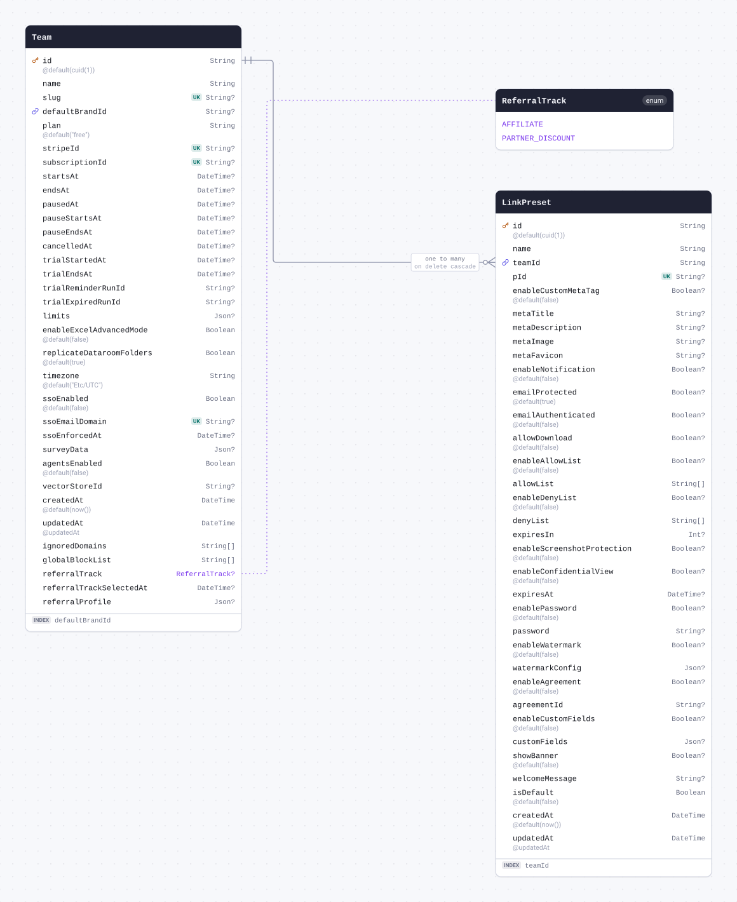

| Field                        | Type       | Constraints                       | Default      | Description |
| ---------------------------- | ---------- | --------------------------------- | ------------ | ----------- |
| `id`                         | `String`   | PK NOT NULL                       | `cuid(1)`    |             |
| `name`                       | `String`   | NOT NULL                          |              |             |
| `teamId`                     | `String`   | NOT NULL → [Team.id](#model-Team) |              |             |
| `pId`                        | `String`   | UNIQUE NULL                       |              |             |
| `enableCustomMetaTag`        | `Boolean`  | NULL                              | `false`      |             |
| `metaTitle`                  | `String`   | NULL                              |              |             |
| `metaDescription`            | `String`   | NULL                              |              |             |
| `metaImage`                  | `String`   | NULL                              |              |             |
| `metaFavicon`                | `String`   | NULL                              |              |             |
| `enableNotification`         | `Boolean`  | NULL                              | `false`      |             |
| `emailProtected`             | `Boolean`  | NULL                              | `true`       |             |
| `emailAuthenticated`         | `Boolean`  | NULL                              | `false`      |             |
| `allowDownload`              | `Boolean`  | NULL                              | `false`      |             |
| `enableAllowList`            | `Boolean`  | NULL                              | `false`      |             |
| `allowList`                  | `String[]` | NOT NULL                          |              |             |
| `enableDenyList`             | `Boolean`  | NULL                              | `false`      |             |
| `denyList`                   | `String[]` | NOT NULL                          |              |             |
| `expiresIn`                  | `Int`      | NULL                              |              |             |
| `enableScreenshotProtection` | `Boolean`  | NULL                              | `false`      |             |
| `enableConfidentialView`     | `Boolean`  | NULL                              | `false`      |             |
| `expiresAt`                  | `DateTime` | NULL                              |              |             |
| `enablePassword`             | `Boolean`  | NULL                              | `false`      |             |
| `password`                   | `String`   | NULL                              |              |             |
| `enableWatermark`            | `Boolean`  | NULL                              | `false`      |             |
| `watermarkConfig`            | `Json`     | NULL                              |              |             |
| `enableAgreement`            | `Boolean`  | NULL                              | `false`      |             |
| `agreementId`                | `String`   | NULL                              |              |             |
| `enableCustomFields`         | `Boolean`  | NULL                              | `false`      |             |
| `customFields`               | `Json`     | NULL                              |              |             |
| `showBanner`                 | `Boolean`  | NULL                              | `false`      |             |
| `welcomeMessage`             | `String`   | NULL                              |              |             |
| `isDefault`                  | `Boolean`  | NOT NULL                          | `false`      |             |
| `createdAt`                  | `DateTime` | NOT NULL                          | `now()`      |             |
| `updatedAt`                  | `DateTime` | NOT NULL                          | `@updatedAt` |             |

#### Indexes

- `@@index([teamId])`

#### References

- `teamId` → [Team.id](#model-Team) (many-to-one, on delete Cascade)

#### Definition

```sql
CREATE TABLE "LinkPreset" (
    "id" TEXT NOT NULL,
    "name" TEXT NOT NULL,
    "teamId" TEXT NOT NULL,
    "pId" TEXT,
    "enableCustomMetaTag" BOOLEAN DEFAULT false,
    "metaTitle" TEXT,
    "metaDescription" TEXT,
    "metaImage" TEXT,
    "metaFavicon" TEXT,
    "enableNotification" BOOLEAN DEFAULT false,
    "emailProtected" BOOLEAN DEFAULT true,
    "emailAuthenticated" BOOLEAN DEFAULT false,
    "allowDownload" BOOLEAN DEFAULT false,
    "enableAllowList" BOOLEAN DEFAULT false,
    "allowList" TEXT[],
    "enableDenyList" BOOLEAN DEFAULT false,
    "denyList" TEXT[],
    "expiresIn" INTEGER,
    "enableScreenshotProtection" BOOLEAN DEFAULT false,
    "enableConfidentialView" BOOLEAN DEFAULT false,
    "expiresAt" TIMESTAMP(3),
    "enablePassword" BOOLEAN DEFAULT false,
    "password" TEXT,
    "enableWatermark" BOOLEAN DEFAULT false,
    "watermarkConfig" JSONB,
    "enableAgreement" BOOLEAN DEFAULT false,
    "agreementId" TEXT,
    "enableCustomFields" BOOLEAN DEFAULT false,
    "customFields" JSONB,
    "showBanner" BOOLEAN DEFAULT false,
    "welcomeMessage" TEXT,
    "isDefault" BOOLEAN NOT NULL DEFAULT false,
    "createdAt" TIMESTAMP(3) NOT NULL DEFAULT CURRENT_TIMESTAMP,
    "updatedAt" TIMESTAMP(3) NOT NULL,

    CONSTRAINT "LinkPreset_pkey" PRIMARY KEY ("id")
);

CREATE UNIQUE INDEX "LinkPreset_pId_key" ON "LinkPreset"("pId");

CREATE INDEX "LinkPreset_teamId_idx" ON "LinkPreset"("teamId");

ALTER TABLE "LinkPreset" ADD CONSTRAINT "LinkPreset_teamId_fkey" FOREIGN KEY ("teamId") REFERENCES "Team"("id") ON DELETE CASCADE ON UPDATE CASCADE;
```

<details>
<summary>Queries and their SQL</summary>

**findMany**: Every row

```ts
await prisma.linkPreset.findMany();
```

```sql
SELECT
  "public"."LinkPreset"."id",
  "public"."LinkPreset"."name",
  "public"."LinkPreset"."teamId",
  "public"."LinkPreset"."pId",
  "public"."LinkPreset"."enableCustomMetaTag",
  "public"."LinkPreset"."metaTitle",
  "public"."LinkPreset"."metaDescription",
  "public"."LinkPreset"."metaImage",
  "public"."LinkPreset"."metaFavicon",
  "public"."LinkPreset"."enableNotification",
  "public"."LinkPreset"."emailProtected",
  "public"."LinkPreset"."emailAuthenticated",
  "public"."LinkPreset"."allowDownload",
  "public"."LinkPreset"."enableAllowList",
  "public"."LinkPreset"."allowList",
  "public"."LinkPreset"."enableDenyList",
  "public"."LinkPreset"."denyList",
  "public"."LinkPreset"."expiresIn",
  "public"."LinkPreset"."enableScreenshotProtection",
  "public"."LinkPreset"."enableConfidentialView",
  "public"."LinkPreset"."expiresAt",
  "public"."LinkPreset"."enablePassword",
  "public"."LinkPreset"."password",
  "public"."LinkPreset"."enableWatermark",
  "public"."LinkPreset"."watermarkConfig",
  "public"."LinkPreset"."enableAgreement",
  "public"."LinkPreset"."agreementId",
  "public"."LinkPreset"."enableCustomFields",
  "public"."LinkPreset"."customFields",
  "public"."LinkPreset"."showBanner",
  "public"."LinkPreset"."welcomeMessage",
  "public"."LinkPreset"."isDefault",
  "public"."LinkPreset"."createdAt",
  "public"."LinkPreset"."updatedAt"
FROM
  "public"."LinkPreset"
WHERE
  1 = 1
OFFSET
  $1
-- params: ["0"]
```

**count**: How many rows there are

```ts
await prisma.linkPreset.count();
```

```sql
SELECT
  COUNT(*) AS "_count$_all"
FROM
  (
    SELECT
      "public"."LinkPreset"."id"
    FROM
      "public"."LinkPreset"
    WHERE
      1 = 1
    OFFSET
      $1
  ) AS "sub"
-- params: ["0"]
```

**findMany**: Every row with its relations

```ts
await prisma.linkPreset.findMany({ include: { team: true } });
```

```sql
SELECT
  "public"."LinkPreset"."id",
  "public"."LinkPreset"."name",
  "public"."LinkPreset"."teamId",
  "public"."LinkPreset"."pId",
  "public"."LinkPreset"."enableCustomMetaTag",
  "public"."LinkPreset"."metaTitle",
  "public"."LinkPreset"."metaDescription",
  "public"."LinkPreset"."metaImage",
  "public"."LinkPreset"."metaFavicon",
  "public"."LinkPreset"."enableNotification",
  "public"."LinkPreset"."emailProtected",
  "public"."LinkPreset"."emailAuthenticated",
  "public"."LinkPreset"."allowDownload",
  "public"."LinkPreset"."enableAllowList",
  "public"."LinkPreset"."allowList",
  "public"."LinkPreset"."enableDenyList",
  "public"."LinkPreset"."denyList",
  "public"."LinkPreset"."expiresIn",
  "public"."LinkPreset"."enableScreenshotProtection",
  "public"."LinkPreset"."enableConfidentialView",
  "public"."LinkPreset"."expiresAt",
  "public"."LinkPreset"."enablePassword",
  "public"."LinkPreset"."password",
  "public"."LinkPreset"."enableWatermark",
  "public"."LinkPreset"."watermarkConfig",
  "public"."LinkPreset"."enableAgreement",
  "public"."LinkPreset"."agreementId",
  "public"."LinkPreset"."enableCustomFields",
  "public"."LinkPreset"."customFields",
  "public"."LinkPreset"."showBanner",
  "public"."LinkPreset"."welcomeMessage",
  "public"."LinkPreset"."isDefault",
  "public"."LinkPreset"."createdAt",
  "public"."LinkPreset"."updatedAt"
FROM
  "public"."LinkPreset"
WHERE
  1 = 1
OFFSET
  $1
-- params: ["0"]

SELECT
  "public"."Team"."id",
  "public"."Team"."name",
  "public"."Team"."slug",
  "public"."Team"."defaultBrandId",
  "public"."Team"."plan",
  "public"."Team"."stripeId",
  "public"."Team"."subscriptionId",
  "public"."Team"."startsAt",
  "public"."Team"."endsAt",
  "public"."Team"."pausedAt",
  "public"."Team"."pauseStartsAt",
  "public"."Team"."pauseEndsAt",
  "public"."Team"."cancelledAt",
  "public"."Team"."trialStartedAt",
  "public"."Team"."trialEndsAt",
  "public"."Team"."trialReminderRunId",
  "public"."Team"."trialExpiredRunId",
  "public"."Team"."limits",
  "public"."Team"."enableExcelAdvancedMode",
  "public"."Team"."replicateDataroomFolders",
  "public"."Team"."timezone",
  "public"."Team"."ssoEnabled",
  "public"."Team"."ssoEmailDomain",
  "public"."Team"."ssoEnforcedAt",
  "public"."Team"."surveyData",
  "public"."Team"."agentsEnabled",
  "public"."Team"."vectorStoreId",
  "public"."Team"."createdAt",
  "public"."Team"."updatedAt",
  "public"."Team"."ignoredDomains",
  "public"."Team"."globalBlockList",
  "public"."Team"."referralTrack"::text,
  "public"."Team"."referralTrackSelectedAt",
  "public"."Team"."referralProfile"
FROM
  "public"."Team"
WHERE
  "public"."Team"."id" IN ($1)
OFFSET
  $2
-- params: ["<teamId of the rows above>","0"]
```

**findUnique**: One row by what is unique to it

```ts
await prisma.linkPreset.findUnique({ where: { id: "example" } });
```

```sql
SELECT
  "public"."LinkPreset"."id",
  "public"."LinkPreset"."name",
  "public"."LinkPreset"."teamId",
  "public"."LinkPreset"."pId",
  "public"."LinkPreset"."enableCustomMetaTag",
  "public"."LinkPreset"."metaTitle",
  "public"."LinkPreset"."metaDescription",
  "public"."LinkPreset"."metaImage",
  "public"."LinkPreset"."metaFavicon",
  "public"."LinkPreset"."enableNotification",
  "public"."LinkPreset"."emailProtected",
  "public"."LinkPreset"."emailAuthenticated",
  "public"."LinkPreset"."allowDownload",
  "public"."LinkPreset"."enableAllowList",
  "public"."LinkPreset"."allowList",
  "public"."LinkPreset"."enableDenyList",
  "public"."LinkPreset"."denyList",
  "public"."LinkPreset"."expiresIn",
  "public"."LinkPreset"."enableScreenshotProtection",
  "public"."LinkPreset"."enableConfidentialView",
  "public"."LinkPreset"."expiresAt",
  "public"."LinkPreset"."enablePassword",
  "public"."LinkPreset"."password",
  "public"."LinkPreset"."enableWatermark",
  "public"."LinkPreset"."watermarkConfig",
  "public"."LinkPreset"."enableAgreement",
  "public"."LinkPreset"."agreementId",
  "public"."LinkPreset"."enableCustomFields",
  "public"."LinkPreset"."customFields",
  "public"."LinkPreset"."showBanner",
  "public"."LinkPreset"."welcomeMessage",
  "public"."LinkPreset"."isDefault",
  "public"."LinkPreset"."createdAt",
  "public"."LinkPreset"."updatedAt"
FROM
  "public"."LinkPreset"
WHERE
  (
    "public"."LinkPreset"."id" = $1
    AND 1 = 1
  )
LIMIT
  $2
OFFSET
  $3
-- params: ["example","1","0"]
```

**create**: Create a row

```ts
await prisma.linkPreset.create({
  data: { name: "example", teamId: "example", allowList: ["example"], denyList: ["example"] },
});
```

```sql
INSERT INTO
  "public"."LinkPreset" (
    "id",
    "name",
    "teamId",
    "enableCustomMetaTag",
    "enableNotification",
    "emailProtected",
    "emailAuthenticated",
    "allowDownload",
    "enableAllowList",
    "allowList",
    "enableDenyList",
    "denyList",
    "enableScreenshotProtection",
    "enableConfidentialView",
    "enablePassword",
    "enableWatermark",
    "enableAgreement",
    "enableCustomFields",
    "showBanner",
    "isDefault",
    "createdAt",
    "updatedAt"
  )
VALUES
  (
    $1,
    $2,
    $3,
    $4,
    $5,
    $6,
    $7,
    $8,
    $9,
    $10,
    $11,
    $12,
    $13,
    $14,
    $15,
    $16,
    $17,
    $18,
    $19,
    $20,
    $21,
    $22
  )
RETURNING
  "public"."LinkPreset"."id",
  "public"."LinkPreset"."name",
  "public"."LinkPreset"."teamId",
  "public"."LinkPreset"."pId",
  "public"."LinkPreset"."enableCustomMetaTag",
  "public"."LinkPreset"."metaTitle",
  "public"."LinkPreset"."metaDescription",
  "public"."LinkPreset"."metaImage",
  "public"."LinkPreset"."metaFavicon",
  "public"."LinkPreset"."enableNotification",
  "public"."LinkPreset"."emailProtected",
  "public"."LinkPreset"."emailAuthenticated",
  "public"."LinkPreset"."allowDownload",
  "public"."LinkPreset"."enableAllowList",
  "public"."LinkPreset"."allowList",
  "public"."LinkPreset"."enableDenyList",
  "public"."LinkPreset"."denyList",
  "public"."LinkPreset"."expiresIn",
  "public"."LinkPreset"."enableScreenshotProtection",
  "public"."LinkPreset"."enableConfidentialView",
  "public"."LinkPreset"."expiresAt",
  "public"."LinkPreset"."enablePassword",
  "public"."LinkPreset"."password",
  "public"."LinkPreset"."enableWatermark",
  "public"."LinkPreset"."watermarkConfig",
  "public"."LinkPreset"."enableAgreement",
  "public"."LinkPreset"."agreementId",
  "public"."LinkPreset"."enableCustomFields",
  "public"."LinkPreset"."customFields",
  "public"."LinkPreset"."showBanner",
  "public"."LinkPreset"."welcomeMessage",
  "public"."LinkPreset"."isDefault",
  "public"."LinkPreset"."createdAt",
  "public"."LinkPreset"."updatedAt"
-- params: ["<cuid(1)>","example","example",false,false,true,false,false,false,["example"],false,["example"],false,false,false,false,false,false,false,false,"<now()>","<now()>"]
```

**update**: Update a row

```ts
await prisma.linkPreset.update({ where: { id: "example" }, data: { name: "example" } });
```

```sql
UPDATE "public"."LinkPreset"
SET
  "name" = $1,
  "updatedAt" = $2
WHERE
  (
    "public"."LinkPreset"."id" = $3
    AND 1 = 1
  )
RETURNING
  "public"."LinkPreset"."id",
  "public"."LinkPreset"."name",
  "public"."LinkPreset"."teamId",
  "public"."LinkPreset"."pId",
  "public"."LinkPreset"."enableCustomMetaTag",
  "public"."LinkPreset"."metaTitle",
  "public"."LinkPreset"."metaDescription",
  "public"."LinkPreset"."metaImage",
  "public"."LinkPreset"."metaFavicon",
  "public"."LinkPreset"."enableNotification",
  "public"."LinkPreset"."emailProtected",
  "public"."LinkPreset"."emailAuthenticated",
  "public"."LinkPreset"."allowDownload",
  "public"."LinkPreset"."enableAllowList",
  "public"."LinkPreset"."allowList",
  "public"."LinkPreset"."enableDenyList",
  "public"."LinkPreset"."denyList",
  "public"."LinkPreset"."expiresIn",
  "public"."LinkPreset"."enableScreenshotProtection",
  "public"."LinkPreset"."enableConfidentialView",
  "public"."LinkPreset"."expiresAt",
  "public"."LinkPreset"."enablePassword",
  "public"."LinkPreset"."password",
  "public"."LinkPreset"."enableWatermark",
  "public"."LinkPreset"."watermarkConfig",
  "public"."LinkPreset"."enableAgreement",
  "public"."LinkPreset"."agreementId",
  "public"."LinkPreset"."enableCustomFields",
  "public"."LinkPreset"."customFields",
  "public"."LinkPreset"."showBanner",
  "public"."LinkPreset"."welcomeMessage",
  "public"."LinkPreset"."isDefault",
  "public"."LinkPreset"."createdAt",
  "public"."LinkPreset"."updatedAt"
-- params: ["example",{"prisma__type":"generatorCall","prisma__value":{"name":"now","args":[],"returnType":{"type":"DateTime"}}},"example"]
```

**delete**: Delete a row

```ts
await prisma.linkPreset.delete({ where: { id: "example" } });
```

```sql
DELETE FROM "public"."LinkPreset"
WHERE
  (
    "public"."LinkPreset"."id" = $1
    AND 1 = 1
  )
RETURNING
  "public"."LinkPreset"."id",
  "public"."LinkPreset"."name",
  "public"."LinkPreset"."teamId",
  "public"."LinkPreset"."pId",
  "public"."LinkPreset"."enableCustomMetaTag",
  "public"."LinkPreset"."metaTitle",
  "public"."LinkPreset"."metaDescription",
  "public"."LinkPreset"."metaImage",
  "public"."LinkPreset"."metaFavicon",
  "public"."LinkPreset"."enableNotification",
  "public"."LinkPreset"."emailProtected",
  "public"."LinkPreset"."emailAuthenticated",
  "public"."LinkPreset"."allowDownload",
  "public"."LinkPreset"."enableAllowList",
  "public"."LinkPreset"."allowList",
  "public"."LinkPreset"."enableDenyList",
  "public"."LinkPreset"."denyList",
  "public"."LinkPreset"."expiresIn",
  "public"."LinkPreset"."enableScreenshotProtection",
  "public"."LinkPreset"."enableConfidentialView",
  "public"."LinkPreset"."expiresAt",
  "public"."LinkPreset"."enablePassword",
  "public"."LinkPreset"."password",
  "public"."LinkPreset"."enableWatermark",
  "public"."LinkPreset"."watermarkConfig",
  "public"."LinkPreset"."enableAgreement",
  "public"."LinkPreset"."agreementId",
  "public"."LinkPreset"."enableCustomFields",
  "public"."LinkPreset"."customFields",
  "public"."LinkPreset"."showBanner",
  "public"."LinkPreset"."welcomeMessage",
  "public"."LinkPreset"."isDefault",
  "public"."LinkPreset"."createdAt",
  "public"."LinkPreset"."updatedAt"
-- params: ["example"]
```

</details>

<a id="model-VisitorGroup"></a>

### VisitorGroup

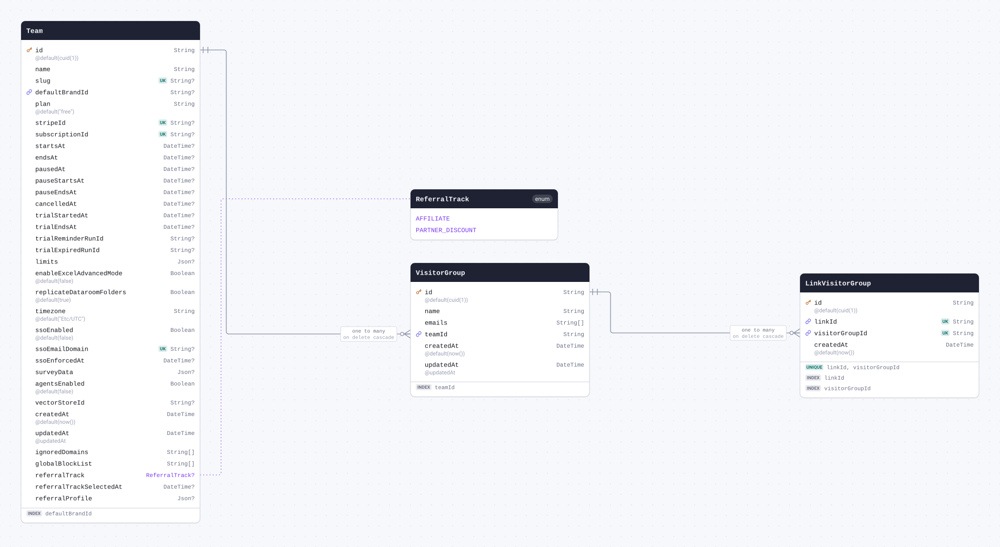

| Field       | Type       | Constraints                       | Default      | Description |
| ----------- | ---------- | --------------------------------- | ------------ | ----------- |
| `id`        | `String`   | PK NOT NULL                       | `cuid(1)`    |             |
| `name`      | `String`   | NOT NULL                          |              |             |
| `emails`    | `String[]` | NOT NULL                          |              |             |
| `teamId`    | `String`   | NOT NULL → [Team.id](#model-Team) |              |             |
| `createdAt` | `DateTime` | NOT NULL                          | `now()`      |             |
| `updatedAt` | `DateTime` | NOT NULL                          | `@updatedAt` |             |

#### Indexes

- `@@index([teamId])`

#### References

- `teamId` → [Team.id](#model-Team) (many-to-one, on delete Cascade)

#### Referenced by

- `id` ← [LinkVisitorGroup.visitorGroupId](#model-LinkVisitorGroup) (one-to-many, on delete Cascade)

#### Definition

```sql
CREATE TABLE "VisitorGroup" (
    "id" TEXT NOT NULL,
    "name" TEXT NOT NULL,
    "emails" TEXT[],
    "teamId" TEXT NOT NULL,
    "createdAt" TIMESTAMP(3) NOT NULL DEFAULT CURRENT_TIMESTAMP,
    "updatedAt" TIMESTAMP(3) NOT NULL,

    CONSTRAINT "VisitorGroup_pkey" PRIMARY KEY ("id")
);

CREATE INDEX "VisitorGroup_teamId_idx" ON "VisitorGroup"("teamId");

ALTER TABLE "VisitorGroup" ADD CONSTRAINT "VisitorGroup_teamId_fkey" FOREIGN KEY ("teamId") REFERENCES "Team"("id") ON DELETE CASCADE ON UPDATE CASCADE;
```

<details>
<summary>Queries and their SQL</summary>

**findMany**: Every row

```ts
await prisma.visitorGroup.findMany();
```

```sql
SELECT
  "public"."VisitorGroup"."id",
  "public"."VisitorGroup"."name",
  "public"."VisitorGroup"."emails",
  "public"."VisitorGroup"."teamId",
  "public"."VisitorGroup"."createdAt",
  "public"."VisitorGroup"."updatedAt"
FROM
  "public"."VisitorGroup"
WHERE
  1 = 1
OFFSET
  $1
-- params: ["0"]
```

**count**: How many rows there are

```ts
await prisma.visitorGroup.count();
```

```sql
SELECT
  COUNT(*) AS "_count$_all"
FROM
  (
    SELECT
      "public"."VisitorGroup"."id"
    FROM
      "public"."VisitorGroup"
    WHERE
      1 = 1
    OFFSET
      $1
  ) AS "sub"
-- params: ["0"]
```

**findMany**: Every row with its relations

```ts
await prisma.visitorGroup.findMany({ include: { team: true, links: true } });
```

```sql
SELECT
  "public"."VisitorGroup"."id",
  "public"."VisitorGroup"."name",
  "public"."VisitorGroup"."emails",
  "public"."VisitorGroup"."teamId",
  "public"."VisitorGroup"."createdAt",
  "public"."VisitorGroup"."updatedAt"
FROM
  "public"."VisitorGroup"
WHERE
  1 = 1
OFFSET
  $1
-- params: ["0"]

SELECT
  "public"."Team"."id",
  "public"."Team"."name",
  "public"."Team"."slug",
  "public"."Team"."defaultBrandId",
  "public"."Team"."plan",
  "public"."Team"."stripeId",
  "public"."Team"."subscriptionId",
  "public"."Team"."startsAt",
  "public"."Team"."endsAt",
  "public"."Team"."pausedAt",
  "public"."Team"."pauseStartsAt",
  "public"."Team"."pauseEndsAt",
  "public"."Team"."cancelledAt",
  "public"."Team"."trialStartedAt",
  "public"."Team"."trialEndsAt",
  "public"."Team"."trialReminderRunId",
  "public"."Team"."trialExpiredRunId",
  "public"."Team"."limits",
  "public"."Team"."enableExcelAdvancedMode",
  "public"."Team"."replicateDataroomFolders",
  "public"."Team"."timezone",
  "public"."Team"."ssoEnabled",
  "public"."Team"."ssoEmailDomain",
  "public"."Team"."ssoEnforcedAt",
  "public"."Team"."surveyData",
  "public"."Team"."agentsEnabled",
  "public"."Team"."vectorStoreId",
  "public"."Team"."createdAt",
  "public"."Team"."updatedAt",
  "public"."Team"."ignoredDomains",
  "public"."Team"."globalBlockList",
  "public"."Team"."referralTrack"::text,
  "public"."Team"."referralTrackSelectedAt",
  "public"."Team"."referralProfile"
FROM
  "public"."Team"
WHERE
  "public"."Team"."id" IN ($1)
OFFSET
  $2
-- params: ["<teamId of the rows above>","0"]

SELECT
  "public"."LinkVisitorGroup"."id",
  "public"."LinkVisitorGroup"."linkId",
  "public"."LinkVisitorGroup"."visitorGroupId",
  "public"."LinkVisitorGroup"."createdAt"
FROM
  "public"."LinkVisitorGroup"
WHERE
  "public"."LinkVisitorGroup"."visitorGroupId" IN ($1)
OFFSET
  $2
-- params: ["<id of the rows above>","0"]
```

**findUnique**: One row by what is unique to it

```ts
await prisma.visitorGroup.findUnique({ where: { id: "example" } });
```

```sql
SELECT
  "public"."VisitorGroup"."id",
  "public"."VisitorGroup"."name",
  "public"."VisitorGroup"."emails",
  "public"."VisitorGroup"."teamId",
  "public"."VisitorGroup"."createdAt",
  "public"."VisitorGroup"."updatedAt"
FROM
  "public"."VisitorGroup"
WHERE
  (
    "public"."VisitorGroup"."id" = $1
    AND 1 = 1
  )
LIMIT
  $2
OFFSET
  $3
-- params: ["example","1","0"]
```

**create**: Create a row

```ts
await prisma.visitorGroup.create({
  data: { name: "example", emails: ["example"], teamId: "example" },
});
```

```sql
INSERT INTO
  "public"."VisitorGroup" (
    "id",
    "name",
    "emails",
    "teamId",
    "createdAt",
    "updatedAt"
  )
VALUES
  ($1, $2, $3, $4, $5, $6)
RETURNING
  "public"."VisitorGroup"."id",
  "public"."VisitorGroup"."name",
  "public"."VisitorGroup"."emails",
  "public"."VisitorGroup"."teamId",
  "public"."VisitorGroup"."createdAt",
  "public"."VisitorGroup"."updatedAt"
-- params: ["<cuid(1)>","example",["example"],"example","<now()>","<now()>"]
```

**update**: Update a row

```ts
await prisma.visitorGroup.update({ where: { id: "example" }, data: { name: "example" } });
```

```sql
UPDATE "public"."VisitorGroup"
SET
  "name" = $1,
  "updatedAt" = $2
WHERE
  (
    "public"."VisitorGroup"."id" = $3
    AND 1 = 1
  )
RETURNING
  "public"."VisitorGroup"."id",
  "public"."VisitorGroup"."name",
  "public"."VisitorGroup"."emails",
  "public"."VisitorGroup"."teamId",
  "public"."VisitorGroup"."createdAt",
  "public"."VisitorGroup"."updatedAt"
-- params: ["example",{"prisma__type":"generatorCall","prisma__value":{"name":"now","args":[],"returnType":{"type":"DateTime"}}},"example"]
```

**delete**: Delete a row

```ts
await prisma.visitorGroup.delete({ where: { id: "example" } });
```

```sql
DELETE FROM "public"."VisitorGroup"
WHERE
  (
    "public"."VisitorGroup"."id" = $1
    AND 1 = 1
  )
RETURNING
  "public"."VisitorGroup"."id",
  "public"."VisitorGroup"."name",
  "public"."VisitorGroup"."emails",
  "public"."VisitorGroup"."teamId",
  "public"."VisitorGroup"."createdAt",
  "public"."VisitorGroup"."updatedAt"
-- params: ["example"]
```

</details>

<a id="model-LinkVisitorGroup"></a>

### LinkVisitorGroup

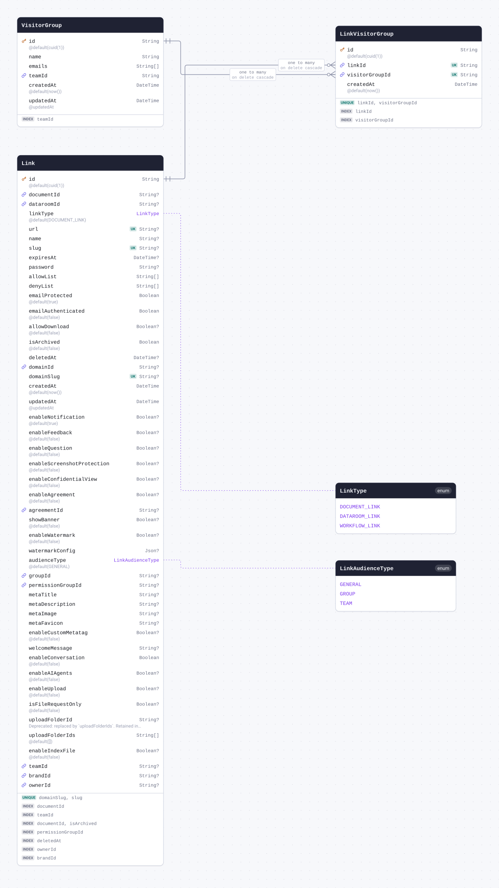

| Field            | Type       | Constraints                                       | Default   | Description |
| ---------------- | ---------- | ------------------------------------------------- | --------- | ----------- |
| `id`             | `String`   | PK NOT NULL                                       | `cuid(1)` |             |
| `linkId`         | `String`   | NOT NULL → [Link.id](#model-Link)                 |           |             |
| `visitorGroupId` | `String`   | NOT NULL → [VisitorGroup.id](#model-VisitorGroup) |           |             |
| `createdAt`      | `DateTime` | NOT NULL                                          | `now()`   |             |

#### Indexes

- `@@index([linkId])`
- `@@index([visitorGroupId])`
- `@@unique([linkId, visitorGroupId])`

#### References

- `linkId` → [Link.id](#model-Link) (many-to-one, on delete Cascade)
- `visitorGroupId` → [VisitorGroup.id](#model-VisitorGroup) (many-to-one, on delete Cascade)

#### Definition

```sql
CREATE TABLE "LinkVisitorGroup" (
    "id" TEXT NOT NULL,
    "linkId" TEXT NOT NULL,
    "visitorGroupId" TEXT NOT NULL,
    "createdAt" TIMESTAMP(3) NOT NULL DEFAULT CURRENT_TIMESTAMP,

    CONSTRAINT "LinkVisitorGroup_pkey" PRIMARY KEY ("id")
);

CREATE INDEX "LinkVisitorGroup_linkId_idx" ON "LinkVisitorGroup"("linkId");

CREATE INDEX "LinkVisitorGroup_visitorGroupId_idx" ON "LinkVisitorGroup"("visitorGroupId");

CREATE UNIQUE INDEX "LinkVisitorGroup_linkId_visitorGroupId_key" ON "LinkVisitorGroup"("linkId", "visitorGroupId");

ALTER TABLE "LinkVisitorGroup" ADD CONSTRAINT "LinkVisitorGroup_linkId_fkey" FOREIGN KEY ("linkId") REFERENCES "Link"("id") ON DELETE CASCADE ON UPDATE CASCADE;

ALTER TABLE "LinkVisitorGroup" ADD CONSTRAINT "LinkVisitorGroup_visitorGroupId_fkey" FOREIGN KEY ("visitorGroupId") REFERENCES "VisitorGroup"("id") ON DELETE CASCADE ON UPDATE CASCADE;
```

<details>
<summary>Queries and their SQL</summary>

**findMany**: Every row

```ts
await prisma.linkVisitorGroup.findMany();
```

```sql
SELECT
  "public"."LinkVisitorGroup"."id",
  "public"."LinkVisitorGroup"."linkId",
  "public"."LinkVisitorGroup"."visitorGroupId",
  "public"."LinkVisitorGroup"."createdAt"
FROM
  "public"."LinkVisitorGroup"
WHERE
  1 = 1
OFFSET
  $1
-- params: ["0"]
```

**count**: How many rows there are

```ts
await prisma.linkVisitorGroup.count();
```

```sql
SELECT
  COUNT(*) AS "_count$_all"
FROM
  (
    SELECT
      "public"."LinkVisitorGroup"."id"
    FROM
      "public"."LinkVisitorGroup"
    WHERE
      1 = 1
    OFFSET
      $1
  ) AS "sub"
-- params: ["0"]
```

**findMany**: Every row with its relations

```ts
await prisma.linkVisitorGroup.findMany({ include: { link: true, visitorGroup: true } });
```

```sql
SELECT
  "public"."LinkVisitorGroup"."id",
  "public"."LinkVisitorGroup"."linkId",
  "public"."LinkVisitorGroup"."visitorGroupId",
  "public"."LinkVisitorGroup"."createdAt"
FROM
  "public"."LinkVisitorGroup"
WHERE
  1 = 1
OFFSET
  $1
-- params: ["0"]

SELECT
  "public"."Link"."id",
  "public"."Link"."documentId",
  "public"."Link"."dataroomId",
  "public"."Link"."linkType"::text,
  "public"."Link"."url",
  "public"."Link"."name",
  "public"."Link"."slug",
  "public"."Link"."expiresAt",
  "public"."Link"."password",
  "public"."Link"."allowList",
  "public"."Link"."denyList",
  "public"."Link"."emailProtected",
  "public"."Link"."emailAuthenticated",
  "public"."Link"."allowDownload",
  "public"."Link"."isArchived",
  "public"."Link"."deletedAt",
  "public"."Link"."domainId",
  "public"."Link"."domainSlug",
  "public"."Link"."createdAt",
  "public"."Link"."updatedAt",
  "public"."Link"."enableNotification",
  "public"."Link"."enableFeedback",
  "public"."Link"."enableQuestion",
  "public"."Link"."enableScreenshotProtection",
  "public"."Link"."enableConfidentialView",
  "public"."Link"."enableAgreement",
  "public"."Link"."agreementId",
  "public"."Link"."showBanner",
  "public"."Link"."enableWatermark",
  "public"."Link"."watermarkConfig",
  "public"."Link"."audienceType"::text,
  "public"."Link"."groupId",
  "public"."Link"."permissionGroupId",
  "public"."Link"."metaTitle",
  "public"."Link"."metaDescription",
  "public"."Link"."metaImage",
  "public"."Link"."metaFavicon",
  "public"."Link"."enableCustomMetatag",
  "public"."Link"."welcomeMessage",
  "public"."Link"."enableConversation",
  "public"."Link"."enableAIAgents",
  "public"."Link"."enableUpload",
  "public"."Link"."isFileRequestOnly",
  "public"."Link"."uploadFolderId",
  "public"."Link"."uploadFolderIds",
  "public"."Link"."enableIndexFile",
  "public"."Link"."teamId",
  "public"."Link"."brandId",
  "public"."Link"."ownerId"
FROM
  "public"."Link"
WHERE
  "public"."Link"."id" IN ($1)
OFFSET
  $2
-- params: ["<linkId of the rows above>","0"]

SELECT
  "public"."VisitorGroup"."id",
  "public"."VisitorGroup"."name",
  "public"."VisitorGroup"."emails",
  "public"."VisitorGroup"."teamId",
  "public"."VisitorGroup"."createdAt",
  "public"."VisitorGroup"."updatedAt"
FROM
  "public"."VisitorGroup"
WHERE
  "public"."VisitorGroup"."id" IN ($1)
OFFSET
  $2
-- params: ["<visitorGroupId of the rows above>","0"]
```

**findUnique**: One row by what is unique to it

```ts
await prisma.linkVisitorGroup.findUnique({ where: { id: "example" } });
```

```sql
SELECT
  "public"."LinkVisitorGroup"."id",
  "public"."LinkVisitorGroup"."linkId",
  "public"."LinkVisitorGroup"."visitorGroupId",
  "public"."LinkVisitorGroup"."createdAt"
FROM
  "public"."LinkVisitorGroup"
WHERE
  (
    "public"."LinkVisitorGroup"."id" = $1
    AND 1 = 1
  )
LIMIT
  $2
OFFSET
  $3
-- params: ["example","1","0"]
```

**create**: Create a row

```ts
await prisma.linkVisitorGroup.create({ data: { linkId: "example", visitorGroupId: "example" } });
```

```sql
INSERT INTO
  "public"."LinkVisitorGroup" ("id", "linkId", "visitorGroupId", "createdAt")
VALUES
  ($1, $2, $3, $4)
RETURNING
  "public"."LinkVisitorGroup"."id",
  "public"."LinkVisitorGroup"."linkId",
  "public"."LinkVisitorGroup"."visitorGroupId",
  "public"."LinkVisitorGroup"."createdAt"
-- params: ["<cuid(1)>","example","example","<now()>"]
```

**update**: Update a row

```ts
await prisma.linkVisitorGroup.update({
  where: { id: "example" },
  data: { createdAt: new Date("2026-01-01T00:00:00.000Z") },
});
```

```sql
UPDATE "public"."LinkVisitorGroup"
SET
  "createdAt" = $1
WHERE
  (
    "public"."LinkVisitorGroup"."id" = $2
    AND 1 = 1
  )
RETURNING
  "public"."LinkVisitorGroup"."id",
  "public"."LinkVisitorGroup"."linkId",
  "public"."LinkVisitorGroup"."visitorGroupId",
  "public"."LinkVisitorGroup"."createdAt"
-- params: ["2026-01-01T00:00:00.000Z","example"]
```

**delete**: Delete a row

```ts
await prisma.linkVisitorGroup.delete({ where: { id: "example" } });
```

```sql
DELETE FROM "public"."LinkVisitorGroup"
WHERE
  (
    "public"."LinkVisitorGroup"."id" = $1
    AND 1 = 1
  )
RETURNING
  "public"."LinkVisitorGroup"."id",
  "public"."LinkVisitorGroup"."linkId",
  "public"."LinkVisitorGroup"."visitorGroupId",
  "public"."LinkVisitorGroup"."createdAt"
-- params: ["example"]
```

</details>

<a id="model-CustomField"></a>

### CustomField

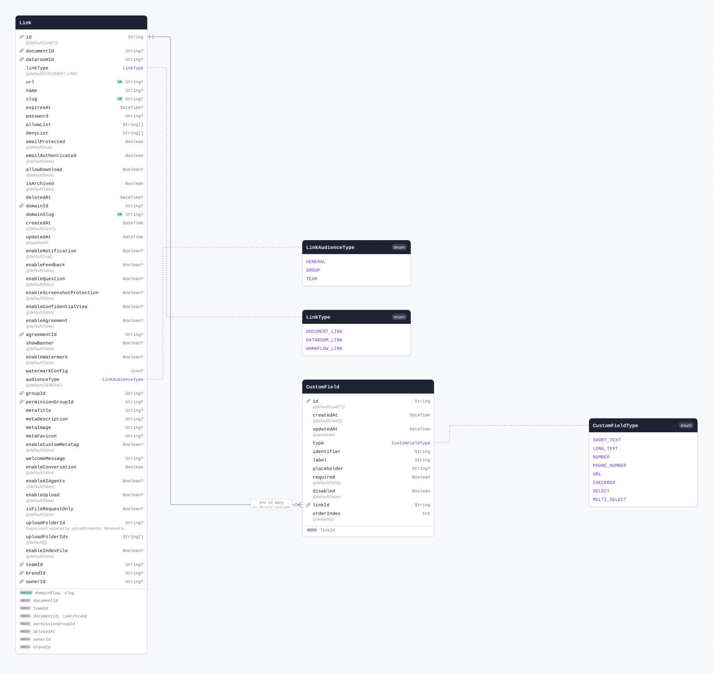

| Field         | Type                                       | Constraints                       | Default      | Description |
| ------------- | ------------------------------------------ | --------------------------------- | ------------ | ----------- |
| `id`          | `String`                                   | PK NOT NULL                       | `cuid(1)`    |             |
| `createdAt`   | `DateTime`                                 | NOT NULL                          | `now()`      |             |
| `updatedAt`   | `DateTime`                                 | NOT NULL                          | `@updatedAt` |             |
| `type`        | [`CustomFieldType`](#enum-CustomFieldType) | NOT NULL                          |              |             |
| `identifier`  | `String`                                   | NOT NULL                          |              |             |
| `label`       | `String`                                   | NOT NULL                          |              |             |
| `placeholder` | `String`                                   | NULL                              |              |             |
| `required`    | `Boolean`                                  | NOT NULL                          | `false`      |             |
| `disabled`    | `Boolean`                                  | NOT NULL                          | `false`      |             |
| `linkId`      | `String`                                   | NOT NULL → [Link.id](#model-Link) |              |             |
| `orderIndex`  | `Int`                                      | NOT NULL                          | `0`          |             |

#### Indexes

- `@@index([linkId])`

#### References

- `linkId` → [Link.id](#model-Link) (many-to-one, on delete Cascade)

#### Definition

```sql
CREATE TABLE "CustomField" (
    "id" TEXT NOT NULL,
    "createdAt" TIMESTAMP(3) NOT NULL DEFAULT CURRENT_TIMESTAMP,
    "updatedAt" TIMESTAMP(3) NOT NULL,
    "type" "CustomFieldType" NOT NULL,
    "identifier" TEXT NOT NULL,
    "label" TEXT NOT NULL,
    "placeholder" TEXT,
    "required" BOOLEAN NOT NULL DEFAULT false,
    "disabled" BOOLEAN NOT NULL DEFAULT false,
    "linkId" TEXT NOT NULL,
    "orderIndex" INTEGER NOT NULL DEFAULT 0,

    CONSTRAINT "CustomField_pkey" PRIMARY KEY ("id")
);

CREATE INDEX "CustomField_linkId_idx" ON "CustomField"("linkId");

ALTER TABLE "CustomField" ADD CONSTRAINT "CustomField_linkId_fkey" FOREIGN KEY ("linkId") REFERENCES "Link"("id") ON DELETE CASCADE ON UPDATE CASCADE;
```

<details>
<summary>Queries and their SQL</summary>

**findMany**: Every row

```ts
await prisma.customField.findMany();
```

```sql
SELECT
  "public"."CustomField"."id",
  "public"."CustomField"."createdAt",
  "public"."CustomField"."updatedAt",
  "public"."CustomField"."type"::text,
  "public"."CustomField"."identifier",
  "public"."CustomField"."label",
  "public"."CustomField"."placeholder",
  "public"."CustomField"."required",
  "public"."CustomField"."disabled",
  "public"."CustomField"."linkId",
  "public"."CustomField"."orderIndex"
FROM
  "public"."CustomField"
WHERE
  1 = 1
OFFSET
  $1
-- params: ["0"]
```

**count**: How many rows there are

```ts
await prisma.customField.count();
```

```sql
SELECT
  COUNT(*) AS "_count$_all"
FROM
  (
    SELECT
      "public"."CustomField"."id"
    FROM
      "public"."CustomField"
    WHERE
      1 = 1
    OFFSET
      $1
  ) AS "sub"
-- params: ["0"]
```

**findMany**: Every row with its relations

```ts
await prisma.customField.findMany({ include: { link: true } });
```

```sql
SELECT
  "public"."CustomField"."id",
  "public"."CustomField"."createdAt",
  "public"."CustomField"."updatedAt",
  "public"."CustomField"."type"::text,
  "public"."CustomField"."identifier",
  "public"."CustomField"."label",
  "public"."CustomField"."placeholder",
  "public"."CustomField"."required",
  "public"."CustomField"."disabled",
  "public"."CustomField"."linkId",
  "public"."CustomField"."orderIndex"
FROM
  "public"."CustomField"
WHERE
  1 = 1
OFFSET
  $1
-- params: ["0"]

SELECT
  "public"."Link"."id",
  "public"."Link"."documentId",
  "public"."Link"."dataroomId",
  "public"."Link"."linkType"::text,
  "public"."Link"."url",
  "public"."Link"."name",
  "public"."Link"."slug",
  "public"."Link"."expiresAt",
  "public"."Link"."password",
  "public"."Link"."allowList",
  "public"."Link"."denyList",
  "public"."Link"."emailProtected",
  "public"."Link"."emailAuthenticated",
  "public"."Link"."allowDownload",
  "public"."Link"."isArchived",
  "public"."Link"."deletedAt",
  "public"."Link"."domainId",
  "public"."Link"."domainSlug",
  "public"."Link"."createdAt",
  "public"."Link"."updatedAt",
  "public"."Link"."enableNotification",
  "public"."Link"."enableFeedback",
  "public"."Link"."enableQuestion",
  "public"."Link"."enableScreenshotProtection",
  "public"."Link"."enableConfidentialView",
  "public"."Link"."enableAgreement",
  "public"."Link"."agreementId",
  "public"."Link"."showBanner",
  "public"."Link"."enableWatermark",
  "public"."Link"."watermarkConfig",
  "public"."Link"."audienceType"::text,
  "public"."Link"."groupId",
  "public"."Link"."permissionGroupId",
  "public"."Link"."metaTitle",
  "public"."Link"."metaDescription",
  "public"."Link"."metaImage",
  "public"."Link"."metaFavicon",
  "public"."Link"."enableCustomMetatag",
  "public"."Link"."welcomeMessage",
  "public"."Link"."enableConversation",
  "public"."Link"."enableAIAgents",
  "public"."Link"."enableUpload",
  "public"."Link"."isFileRequestOnly",
  "public"."Link"."uploadFolderId",
  "public"."Link"."uploadFolderIds",
  "public"."Link"."enableIndexFile",
  "public"."Link"."teamId",
  "public"."Link"."brandId",
  "public"."Link"."ownerId"
FROM
  "public"."Link"
WHERE
  "public"."Link"."id" IN ($1)
OFFSET
  $2
-- params: ["<linkId of the rows above>","0"]
```

**findUnique**: One row by what is unique to it

```ts
await prisma.customField.findUnique({ where: { id: "example" } });
```

```sql
SELECT
  "public"."CustomField"."id",
  "public"."CustomField"."createdAt",
  "public"."CustomField"."updatedAt",
  "public"."CustomField"."type"::text,
  "public"."CustomField"."identifier",
  "public"."CustomField"."label",
  "public"."CustomField"."placeholder",
  "public"."CustomField"."required",
  "public"."CustomField"."disabled",
  "public"."CustomField"."linkId",
  "public"."CustomField"."orderIndex"
FROM
  "public"."CustomField"
WHERE
  (
    "public"."CustomField"."id" = $1
    AND 1 = 1
  )
LIMIT
  $2
OFFSET
  $3
-- params: ["example","1","0"]
```

**create**: Create a row

```ts
await prisma.customField.create({
  data: { type: "SHORT_TEXT", identifier: "example", label: "example", linkId: "example" },
});
```

```sql
INSERT INTO
  "public"."CustomField" (
    "id",
    "createdAt",
    "updatedAt",
    "type",
    "identifier",
    "label",
    "required",
    "disabled",
    "linkId",
    "orderIndex"
  )
VALUES
  (
    $1,
    $2,
    $3,
    CAST($4::text AS "public"."CustomFieldType"),
    $5,
    $6,
    $7,
    $8,
    $9,
    $10
  )
RETURNING
  "public"."CustomField"."id",
  "public"."CustomField"."createdAt",
  "public"."CustomField"."updatedAt",
  "public"."CustomField"."type"::text,
  "public"."CustomField"."identifier",
  "public"."CustomField"."label",
  "public"."CustomField"."placeholder",
  "public"."CustomField"."required",
  "public"."CustomField"."disabled",
  "public"."CustomField"."linkId",
  "public"."CustomField"."orderIndex"
-- params: ["<cuid(1)>","<now()>","<now()>","SHORT_TEXT","example","example",false,false,"example","0"]
```

**update**: Update a row

```ts
await prisma.customField.update({
  where: { id: "example" },
  data: { createdAt: new Date("2026-01-01T00:00:00.000Z") },
});
```

```sql
UPDATE "public"."CustomField"
SET
  "createdAt" = $1,
  "updatedAt" = $2
WHERE
  (
    "public"."CustomField"."id" = $3
    AND 1 = 1
  )
RETURNING
  "public"."CustomField"."id",
  "public"."CustomField"."createdAt",
  "public"."CustomField"."updatedAt",
  "public"."CustomField"."type"::text,
  "public"."CustomField"."identifier",
  "public"."CustomField"."label",
  "public"."CustomField"."placeholder",
  "public"."CustomField"."required",
  "public"."CustomField"."disabled",
  "public"."CustomField"."linkId",
  "public"."CustomField"."orderIndex"
-- params: ["2026-01-01T00:00:00.000Z",{"prisma__type":"generatorCall","prisma__value":{"name":"now","args":[],"returnType":{"type":"DateTime"}}},"example"]
```

**delete**: Delete a row

```ts
await prisma.customField.delete({ where: { id: "example" } });
```

```sql
DELETE FROM "public"."CustomField"
WHERE
  (
    "public"."CustomField"."id" = $1
    AND 1 = 1
  )
RETURNING
  "public"."CustomField"."id",
  "public"."CustomField"."createdAt",
  "public"."CustomField"."updatedAt",
  "public"."CustomField"."type"::text,
  "public"."CustomField"."identifier",
  "public"."CustomField"."label",
  "public"."CustomField"."placeholder",
  "public"."CustomField"."required",
  "public"."CustomField"."disabled",
  "public"."CustomField"."linkId",
  "public"."CustomField"."orderIndex"
-- params: ["example"]
```

</details>

<a id="model-CustomFieldResponse"></a>

### CustomFieldResponse

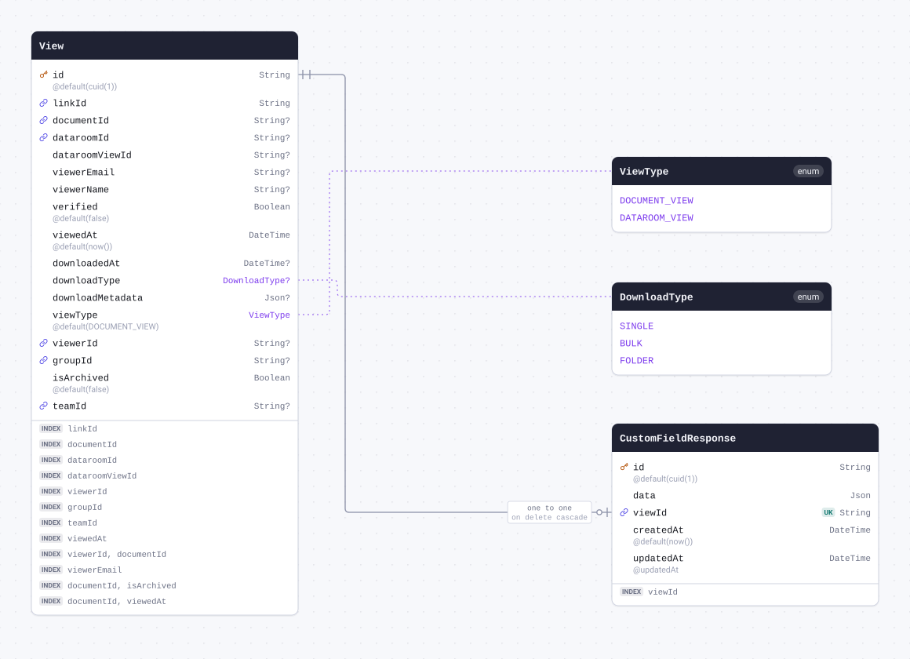

| Field       | Type       | Constraints                              | Default      | Description |
| ----------- | ---------- | ---------------------------------------- | ------------ | ----------- |
| `id`        | `String`   | PK NOT NULL                              | `cuid(1)`    |             |
| `data`      | `Json`     | NOT NULL                                 |              |             |
| `viewId`    | `String`   | UNIQUE NOT NULL → [View.id](#model-View) |              |             |
| `createdAt` | `DateTime` | NOT NULL                                 | `now()`      |             |
| `updatedAt` | `DateTime` | NOT NULL                                 | `@updatedAt` |             |

#### Indexes

- `@@index([viewId])`

#### References

- `viewId` → [View.id](#model-View) (one-to-one, on delete Cascade)

#### Definition

```sql
CREATE TABLE "CustomFieldResponse" (
    "id" TEXT NOT NULL,
    "data" JSONB NOT NULL,
    "viewId" TEXT NOT NULL,
    "createdAt" TIMESTAMP(3) NOT NULL DEFAULT CURRENT_TIMESTAMP,
    "updatedAt" TIMESTAMP(3) NOT NULL,

    CONSTRAINT "CustomFieldResponse_pkey" PRIMARY KEY ("id")
);

CREATE UNIQUE INDEX "CustomFieldResponse_viewId_key" ON "CustomFieldResponse"("viewId");

CREATE INDEX "CustomFieldResponse_viewId_idx" ON "CustomFieldResponse"("viewId");

ALTER TABLE "CustomFieldResponse" ADD CONSTRAINT "CustomFieldResponse_viewId_fkey" FOREIGN KEY ("viewId") REFERENCES "View"("id") ON DELETE CASCADE ON UPDATE CASCADE;
```

<details>
<summary>Queries and their SQL</summary>

**findMany**: Every row

```ts
await prisma.customFieldResponse.findMany();
```

```sql
SELECT
  "public"."CustomFieldResponse"."id",
  "public"."CustomFieldResponse"."data",
  "public"."CustomFieldResponse"."viewId",
  "public"."CustomFieldResponse"."createdAt",
  "public"."CustomFieldResponse"."updatedAt"
FROM
  "public"."CustomFieldResponse"
WHERE
  1 = 1
OFFSET
  $1
-- params: ["0"]
```

**count**: How many rows there are

```ts
await prisma.customFieldResponse.count();
```

```sql
SELECT
  COUNT(*) AS "_count$_all"
FROM
  (
    SELECT
      "public"."CustomFieldResponse"."id"
    FROM
      "public"."CustomFieldResponse"
    WHERE
      1 = 1
    OFFSET
      $1
  ) AS "sub"
-- params: ["0"]
```

**findMany**: Every row with its relations

```ts
await prisma.customFieldResponse.findMany({ include: { view: true } });
```

```sql
SELECT
  "public"."CustomFieldResponse"."id",
  "public"."CustomFieldResponse"."data",
  "public"."CustomFieldResponse"."viewId",
  "public"."CustomFieldResponse"."createdAt",
  "public"."CustomFieldResponse"."updatedAt"
FROM
  "public"."CustomFieldResponse"
WHERE
  1 = 1
OFFSET
  $1
-- params: ["0"]

SELECT
  "public"."View"."id",
  "public"."View"."linkId",
  "public"."View"."documentId",
  "public"."View"."dataroomId",
  "public"."View"."dataroomViewId",
  "public"."View"."viewerEmail",
  "public"."View"."viewerName",
  "public"."View"."verified",
  "public"."View"."viewedAt",
  "public"."View"."downloadedAt",
  "public"."View"."downloadType"::text,
  "public"."View"."downloadMetadata",
  "public"."View"."viewType"::text,
  "public"."View"."viewerId",
  "public"."View"."groupId",
  "public"."View"."isArchived",
  "public"."View"."teamId"
FROM
  "public"."View"
WHERE
  "public"."View"."id" IN ($1)
OFFSET
  $2
-- params: ["<viewId of the rows above>","0"]
```

**findUnique**: One row by what is unique to it

```ts
await prisma.customFieldResponse.findUnique({ where: { id: "example" } });
```

```sql
SELECT
  "public"."CustomFieldResponse"."id",
  "public"."CustomFieldResponse"."data",
  "public"."CustomFieldResponse"."viewId",
  "public"."CustomFieldResponse"."createdAt",
  "public"."CustomFieldResponse"."updatedAt"
FROM
  "public"."CustomFieldResponse"
WHERE
  (
    "public"."CustomFieldResponse"."id" = $1
    AND 1 = 1
  )
LIMIT
  $2
OFFSET
  $3
-- params: ["example","1","0"]
```

**create**: Create a row

```ts
await prisma.customFieldResponse.create({ data: { data: {}, viewId: "example" } });
```

```sql
INSERT INTO
  "public"."CustomFieldResponse" ("id", "data", "viewId", "createdAt", "updatedAt")
VALUES
  ($1, $2, $3, $4, $5)
RETURNING
  "public"."CustomFieldResponse"."id",
  "public"."CustomFieldResponse"."data",
  "public"."CustomFieldResponse"."viewId",
  "public"."CustomFieldResponse"."createdAt",
  "public"."CustomFieldResponse"."updatedAt"
-- params: ["<cuid(1)>","{}","example","<now()>","<now()>"]
```

**update**: Update a row

```ts
await prisma.customFieldResponse.update({ where: { id: "example" }, data: { data: {} } });
```

```sql
UPDATE "public"."CustomFieldResponse"
SET
  "data" = $1,
  "updatedAt" = $2
WHERE
  (
    "public"."CustomFieldResponse"."id" = $3
    AND 1 = 1
  )
RETURNING
  "public"."CustomFieldResponse"."id",
  "public"."CustomFieldResponse"."data",
  "public"."CustomFieldResponse"."viewId",
  "public"."CustomFieldResponse"."createdAt",
  "public"."CustomFieldResponse"."updatedAt"
-- params: ["{}",{"prisma__type":"generatorCall","prisma__value":{"name":"now","args":[],"returnType":{"type":"DateTime"}}},"example"]
```

**delete**: Delete a row

```ts
await prisma.customFieldResponse.delete({ where: { id: "example" } });
```

```sql
DELETE FROM "public"."CustomFieldResponse"
WHERE
  (
    "public"."CustomFieldResponse"."id" = $1
    AND 1 = 1
  )
RETURNING
  "public"."CustomFieldResponse"."id",
  "public"."CustomFieldResponse"."data",
  "public"."CustomFieldResponse"."viewId",
  "public"."CustomFieldResponse"."createdAt",
  "public"."CustomFieldResponse"."updatedAt"
-- params: ["example"]
```

</details>

<a id="model-NotificationPreference"></a>

### NotificationPreference

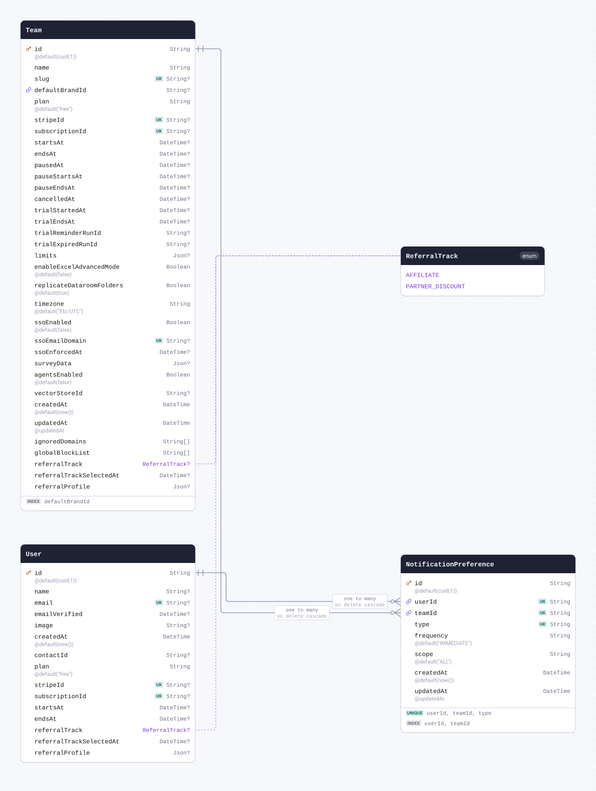

| Field       | Type       | Constraints                       | Default       | Description |
| ----------- | ---------- | --------------------------------- | ------------- | ----------- |
| `id`        | `String`   | PK NOT NULL                       | `cuid(1)`     |             |
| `userId`    | `String`   | NOT NULL → [User.id](#model-User) |               |             |
| `teamId`    | `String`   | NOT NULL → [Team.id](#model-Team) |               |             |
| `type`      | `String`   | NOT NULL                          |               |             |
| `frequency` | `String`   | NOT NULL                          | `"IMMEDIATE"` |             |
| `scope`     | `String`   | NOT NULL                          | `"ALL"`       |             |
| `createdAt` | `DateTime` | NOT NULL                          | `now()`       |             |
| `updatedAt` | `DateTime` | NOT NULL                          | `@updatedAt`  |             |

#### Indexes

- `@@index([userId, teamId])`
- `@@unique([userId, teamId, type])`

#### References

- `userId` → [User.id](#model-User) (many-to-one, on delete Cascade)
- `teamId` → [Team.id](#model-Team) (many-to-one, on delete Cascade)

#### Definition

```sql
CREATE TABLE "NotificationPreference" (
    "id" TEXT NOT NULL,
    "userId" TEXT NOT NULL,
    "teamId" TEXT NOT NULL,
    "type" TEXT NOT NULL,
    "frequency" TEXT NOT NULL DEFAULT 'IMMEDIATE',
    "scope" TEXT NOT NULL DEFAULT 'ALL',
    "createdAt" TIMESTAMP(3) NOT NULL DEFAULT CURRENT_TIMESTAMP,
    "updatedAt" TIMESTAMP(3) NOT NULL,

    CONSTRAINT "NotificationPreference_pkey" PRIMARY KEY ("id")
);

CREATE INDEX "NotificationPreference_userId_teamId_idx" ON "NotificationPreference"("userId", "teamId");

CREATE UNIQUE INDEX "NotificationPreference_userId_teamId_type_key" ON "NotificationPreference"("userId", "teamId", "type");

ALTER TABLE "NotificationPreference" ADD CONSTRAINT "NotificationPreference_userId_fkey" FOREIGN KEY ("userId") REFERENCES "User"("id") ON DELETE CASCADE ON UPDATE CASCADE;

ALTER TABLE "NotificationPreference" ADD CONSTRAINT "NotificationPreference_teamId_fkey" FOREIGN KEY ("teamId") REFERENCES "Team"("id") ON DELETE CASCADE ON UPDATE CASCADE;
```

<details>
<summary>Queries and their SQL</summary>

**findMany**: Every row

```ts
await prisma.notificationPreference.findMany();
```

```sql
SELECT
  "public"."NotificationPreference"."id",
  "public"."NotificationPreference"."userId",
  "public"."NotificationPreference"."teamId",
  "public"."NotificationPreference"."type",
  "public"."NotificationPreference"."frequency",
  "public"."NotificationPreference"."scope",
  "public"."NotificationPreference"."createdAt",
  "public"."NotificationPreference"."updatedAt"
FROM
  "public"."NotificationPreference"
WHERE
  1 = 1
OFFSET
  $1
-- params: ["0"]
```

**count**: How many rows there are

```ts
await prisma.notificationPreference.count();
```

```sql
SELECT
  COUNT(*) AS "_count$_all"
FROM
  (
    SELECT
      "public"."NotificationPreference"."id"
    FROM
      "public"."NotificationPreference"
    WHERE
      1 = 1
    OFFSET
      $1
  ) AS "sub"
-- params: ["0"]
```

**findMany**: Every row with its relations

```ts
await prisma.notificationPreference.findMany({ include: { user: true, team: true } });
```

```sql
SELECT
  "public"."NotificationPreference"."id",
  "public"."NotificationPreference"."userId",
  "public"."NotificationPreference"."teamId",
  "public"."NotificationPreference"."type",
  "public"."NotificationPreference"."frequency",
  "public"."NotificationPreference"."scope",
  "public"."NotificationPreference"."createdAt",
  "public"."NotificationPreference"."updatedAt"
FROM
  "public"."NotificationPreference"
WHERE
  1 = 1
OFFSET
  $1
-- params: ["0"]

SELECT
  "public"."User"."id",
  "public"."User"."name",
  "public"."User"."email",
  "public"."User"."emailVerified",
  "public"."User"."image",
  "public"."User"."createdAt",
  "public"."User"."contactId",
  "public"."User"."plan",
  "public"."User"."stripeId",
  "public"."User"."subscriptionId",
  "public"."User"."startsAt",
  "public"."User"."endsAt",
  "public"."User"."referralTrack"::text,
  "public"."User"."referralTrackSelectedAt",
  "public"."User"."referralProfile"
FROM
  "public"."User"
WHERE
  "public"."User"."id" IN ($1)
OFFSET
  $2
-- params: ["<userId of the rows above>","0"]

SELECT
  "public"."Team"."id",
  "public"."Team"."name",
  "public"."Team"."slug",
  "public"."Team"."defaultBrandId",
  "public"."Team"."plan",
  "public"."Team"."stripeId",
  "public"."Team"."subscriptionId",
  "public"."Team"."startsAt",
  "public"."Team"."endsAt",
  "public"."Team"."pausedAt",
  "public"."Team"."pauseStartsAt",
  "public"."Team"."pauseEndsAt",
  "public"."Team"."cancelledAt",
  "public"."Team"."trialStartedAt",
  "public"."Team"."trialEndsAt",
  "public"."Team"."trialReminderRunId",
  "public"."Team"."trialExpiredRunId",
  "public"."Team"."limits",
  "public"."Team"."enableExcelAdvancedMode",
  "public"."Team"."replicateDataroomFolders",
  "public"."Team"."timezone",
  "public"."Team"."ssoEnabled",
  "public"."Team"."ssoEmailDomain",
  "public"."Team"."ssoEnforcedAt",
  "public"."Team"."surveyData",
  "public"."Team"."agentsEnabled",
  "public"."Team"."vectorStoreId",
  "public"."Team"."createdAt",
  "public"."Team"."updatedAt",
  "public"."Team"."ignoredDomains",
  "public"."Team"."globalBlockList",
  "public"."Team"."referralTrack"::text,
  "public"."Team"."referralTrackSelectedAt",
  "public"."Team"."referralProfile"
FROM
  "public"."Team"
WHERE
  "public"."Team"."id" IN ($1)
OFFSET
  $2
-- params: ["<teamId of the rows above>","0"]
```

**findUnique**: One row by what is unique to it

```ts
await prisma.notificationPreference.findUnique({ where: { id: "example" } });
```

```sql
SELECT
  "public"."NotificationPreference"."id",
  "public"."NotificationPreference"."userId",
  "public"."NotificationPreference"."teamId",
  "public"."NotificationPreference"."type",
  "public"."NotificationPreference"."frequency",
  "public"."NotificationPreference"."scope",
  "public"."NotificationPreference"."createdAt",
  "public"."NotificationPreference"."updatedAt"
FROM
  "public"."NotificationPreference"
WHERE
  (
    "public"."NotificationPreference"."id" = $1
    AND 1 = 1
  )
LIMIT
  $2
OFFSET
  $3
-- params: ["example","1","0"]
```

**create**: Create a row

```ts
await prisma.notificationPreference.create({
  data: { userId: "example", teamId: "example", type: "example" },
});
```

```sql
INSERT INTO
  "public"."NotificationPreference" (
    "id",
    "userId",
    "teamId",
    "type",
    "frequency",
    "scope",
    "createdAt",
    "updatedAt"
  )
VALUES
  ($1, $2, $3, $4, $5, $6, $7, $8)
RETURNING
  "public"."NotificationPreference"."id",
  "public"."NotificationPreference"."userId",
  "public"."NotificationPreference"."teamId",
  "public"."NotificationPreference"."type",
  "public"."NotificationPreference"."frequency",
  "public"."NotificationPreference"."scope",
  "public"."NotificationPreference"."createdAt",
  "public"."NotificationPreference"."updatedAt"
-- params: ["<cuid(1)>","example","example","example","IMMEDIATE","ALL","<now()>","<now()>"]
```

**update**: Update a row

```ts
await prisma.notificationPreference.update({ where: { id: "example" }, data: { type: "example" } });
```

```sql
UPDATE "public"."NotificationPreference"
SET
  "type" = $1,
  "updatedAt" = $2
WHERE
  (
    "public"."NotificationPreference"."id" = $3
    AND 1 = 1
  )
RETURNING
  "public"."NotificationPreference"."id",
  "public"."NotificationPreference"."userId",
  "public"."NotificationPreference"."teamId",
  "public"."NotificationPreference"."type",
  "public"."NotificationPreference"."frequency",
  "public"."NotificationPreference"."scope",
  "public"."NotificationPreference"."createdAt",
  "public"."NotificationPreference"."updatedAt"
-- params: ["example",{"prisma__type":"generatorCall","prisma__value":{"name":"now","args":[],"returnType":{"type":"DateTime"}}},"example"]
```

**delete**: Delete a row

```ts
await prisma.notificationPreference.delete({ where: { id: "example" } });
```

```sql
DELETE FROM "public"."NotificationPreference"
WHERE
  (
    "public"."NotificationPreference"."id" = $1
    AND 1 = 1
  )
RETURNING
  "public"."NotificationPreference"."id",
  "public"."NotificationPreference"."userId",
  "public"."NotificationPreference"."teamId",
  "public"."NotificationPreference"."type",
  "public"."NotificationPreference"."frequency",
  "public"."NotificationPreference"."scope",
  "public"."NotificationPreference"."createdAt",
  "public"."NotificationPreference"."updatedAt"
-- params: ["example"]
```

</details>

<a id="model-OAuthClient"></a>

### OAuthClient

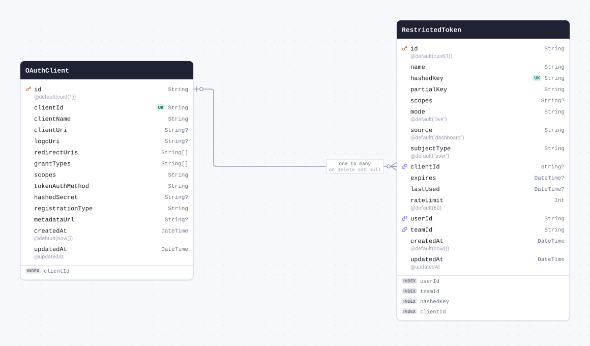

| Field              | Type       | Constraints     | Default      | Description |
| ------------------ | ---------- | --------------- | ------------ | ----------- |
| `id`               | `String`   | PK NOT NULL     | `cuid(1)`    |             |
| `clientId`         | `String`   | UNIQUE NOT NULL |              |             |
| `clientName`       | `String`   | NOT NULL        |              |             |
| `clientUri`        | `String`   | NULL            |              |             |
| `logoUri`          | `String`   | NULL            |              |             |
| `redirectUris`     | `String[]` | NOT NULL        |              |             |
| `grantTypes`       | `String[]` | NOT NULL        |              |             |
| `scopes`           | `String`   | NOT NULL        |              |             |
| `tokenAuthMethod`  | `String`   | NOT NULL        |              |             |
| `hashedSecret`     | `String`   | NULL            |              |             |
| `registrationType` | `String`   | NOT NULL        |              |             |
| `metadataUrl`      | `String`   | NULL            |              |             |
| `createdAt`        | `DateTime` | NOT NULL        | `now()`      |             |
| `updatedAt`        | `DateTime` | NOT NULL        | `@updatedAt` |             |

#### Indexes

- `@@index([clientId])`

#### Referenced by

- `id` ← [RestrictedToken.clientId](#model-RestrictedToken) (one-to-many, on delete SetNull)

#### Definition

```sql
CREATE TABLE "OAuthClient" (
    "id" TEXT NOT NULL,
    "clientId" TEXT NOT NULL,
    "clientName" TEXT NOT NULL,
    "clientUri" TEXT,
    "logoUri" TEXT,
    "redirectUris" TEXT[],
    "grantTypes" TEXT[],
    "scopes" TEXT NOT NULL,
    "tokenAuthMethod" TEXT NOT NULL,
    "hashedSecret" TEXT,
    "registrationType" TEXT NOT NULL,
    "metadataUrl" TEXT,
    "createdAt" TIMESTAMP(3) NOT NULL DEFAULT CURRENT_TIMESTAMP,
    "updatedAt" TIMESTAMP(3) NOT NULL,

    CONSTRAINT "OAuthClient_pkey" PRIMARY KEY ("id")
);

CREATE UNIQUE INDEX "OAuthClient_clientId_key" ON "OAuthClient"("clientId");

CREATE INDEX "OAuthClient_clientId_idx" ON "OAuthClient"("clientId");
```

<details>
<summary>Queries and their SQL</summary>

**findMany**: Every row

```ts
await prisma.oAuthClient.findMany();
```

```sql
SELECT
  "public"."OAuthClient"."id",
  "public"."OAuthClient"."clientId",
  "public"."OAuthClient"."clientName",
  "public"."OAuthClient"."clientUri",
  "public"."OAuthClient"."logoUri",
  "public"."OAuthClient"."redirectUris",
  "public"."OAuthClient"."grantTypes",
  "public"."OAuthClient"."scopes",
  "public"."OAuthClient"."tokenAuthMethod",
  "public"."OAuthClient"."hashedSecret",
  "public"."OAuthClient"."registrationType",
  "public"."OAuthClient"."metadataUrl",
  "public"."OAuthClient"."createdAt",
  "public"."OAuthClient"."updatedAt"
FROM
  "public"."OAuthClient"
WHERE
  1 = 1
OFFSET
  $1
-- params: ["0"]
```

**count**: How many rows there are

```ts
await prisma.oAuthClient.count();
```

```sql
SELECT
  COUNT(*) AS "_count$_all"
FROM
  (
    SELECT
      "public"."OAuthClient"."id"
    FROM
      "public"."OAuthClient"
    WHERE
      1 = 1
    OFFSET
      $1
  ) AS "sub"
-- params: ["0"]
```

**findMany**: Every row with its relations

```ts
await prisma.oAuthClient.findMany({ include: { tokens: true } });
```

```sql
SELECT
  "public"."OAuthClient"."id",
  "public"."OAuthClient"."clientId",
  "public"."OAuthClient"."clientName",
  "public"."OAuthClient"."clientUri",
  "public"."OAuthClient"."logoUri",
  "public"."OAuthClient"."redirectUris",
  "public"."OAuthClient"."grantTypes",
  "public"."OAuthClient"."scopes",
  "public"."OAuthClient"."tokenAuthMethod",
  "public"."OAuthClient"."hashedSecret",
  "public"."OAuthClient"."registrationType",
  "public"."OAuthClient"."metadataUrl",
  "public"."OAuthClient"."createdAt",
  "public"."OAuthClient"."updatedAt"
FROM
  "public"."OAuthClient"
WHERE
  1 = 1
OFFSET
  $1
-- params: ["0"]

SELECT
  "public"."RestrictedToken"."id",
  "public"."RestrictedToken"."name",
  "public"."RestrictedToken"."hashedKey",
  "public"."RestrictedToken"."partialKey",
  "public"."RestrictedToken"."scopes",
  "public"."RestrictedToken"."mode",
  "public"."RestrictedToken"."source",
  "public"."RestrictedToken"."subjectType",
  "public"."RestrictedToken"."clientId",
  "public"."RestrictedToken"."expires",
  "public"."RestrictedToken"."lastUsed",
  "public"."RestrictedToken"."rateLimit",
  "public"."RestrictedToken"."userId",
  "public"."RestrictedToken"."teamId",
  "public"."RestrictedToken"."createdAt",
  "public"."RestrictedToken"."updatedAt"
FROM
  "public"."RestrictedToken"
WHERE
  "public"."RestrictedToken"."clientId" IN ($1)
OFFSET
  $2
-- params: ["<id of the rows above>","0"]
```

**findUnique**: One row by what is unique to it

```ts
await prisma.oAuthClient.findUnique({ where: { id: "example" } });
```

```sql
SELECT
  "public"."OAuthClient"."id",
  "public"."OAuthClient"."clientId",
  "public"."OAuthClient"."clientName",
  "public"."OAuthClient"."clientUri",
  "public"."OAuthClient"."logoUri",
  "public"."OAuthClient"."redirectUris",
  "public"."OAuthClient"."grantTypes",
  "public"."OAuthClient"."scopes",
  "public"."OAuthClient"."tokenAuthMethod",
  "public"."OAuthClient"."hashedSecret",
  "public"."OAuthClient"."registrationType",
  "public"."OAuthClient"."metadataUrl",
  "public"."OAuthClient"."createdAt",
  "public"."OAuthClient"."updatedAt"
FROM
  "public"."OAuthClient"
WHERE
  (
    "public"."OAuthClient"."id" = $1
    AND 1 = 1
  )
LIMIT
  $2
OFFSET
  $3
-- params: ["example","1","0"]
```

**create**: Create a row

```ts
await prisma.oAuthClient.create({
  data: {
    clientId: "example",
    clientName: "example",
    redirectUris: ["example"],
    grantTypes: ["example"],
    scopes: "example",
    tokenAuthMethod: "example",
    registrationType: "example",
  },
});
```

```sql
INSERT INTO
  "public"."OAuthClient" (
    "id",
    "clientId",
    "clientName",
    "redirectUris",
    "grantTypes",
    "scopes",
    "tokenAuthMethod",
    "registrationType",
    "createdAt",
    "updatedAt"
  )
VALUES
  ($1, $2, $3, $4, $5, $6, $7, $8, $9, $10)
RETURNING
  "public"."OAuthClient"."id",
  "public"."OAuthClient"."clientId",
  "public"."OAuthClient"."clientName",
  "public"."OAuthClient"."clientUri",
  "public"."OAuthClient"."logoUri",
  "public"."OAuthClient"."redirectUris",
  "public"."OAuthClient"."grantTypes",
  "public"."OAuthClient"."scopes",
  "public"."OAuthClient"."tokenAuthMethod",
  "public"."OAuthClient"."hashedSecret",
  "public"."OAuthClient"."registrationType",
  "public"."OAuthClient"."metadataUrl",
  "public"."OAuthClient"."createdAt",
  "public"."OAuthClient"."updatedAt"
-- params: ["<cuid(1)>","example","example",["example"],["example"],"example","example","example","<now()>","<now()>"]
```

**update**: Update a row

```ts
await prisma.oAuthClient.update({ where: { id: "example" }, data: { clientId: "example" } });
```

```sql
UPDATE "public"."OAuthClient"
SET
  "clientId" = $1,
  "updatedAt" = $2
WHERE
  (
    "public"."OAuthClient"."id" = $3
    AND 1 = 1
  )
RETURNING
  "public"."OAuthClient"."id",
  "public"."OAuthClient"."clientId",
  "public"."OAuthClient"."clientName",
  "public"."OAuthClient"."clientUri",
  "public"."OAuthClient"."logoUri",
  "public"."OAuthClient"."redirectUris",
  "public"."OAuthClient"."grantTypes",
  "public"."OAuthClient"."scopes",
  "public"."OAuthClient"."tokenAuthMethod",
  "public"."OAuthClient"."hashedSecret",
  "public"."OAuthClient"."registrationType",
  "public"."OAuthClient"."metadataUrl",
  "public"."OAuthClient"."createdAt",
  "public"."OAuthClient"."updatedAt"
-- params: ["example",{"prisma__type":"generatorCall","prisma__value":{"name":"now","args":[],"returnType":{"type":"DateTime"}}},"example"]
```

**delete**: Delete a row

```ts
await prisma.oAuthClient.delete({ where: { id: "example" } });
```

```sql
DELETE FROM "public"."OAuthClient"
WHERE
  (
    "public"."OAuthClient"."id" = $1
    AND 1 = 1
  )
RETURNING
  "public"."OAuthClient"."id",
  "public"."OAuthClient"."clientId",
  "public"."OAuthClient"."clientName",
  "public"."OAuthClient"."clientUri",
  "public"."OAuthClient"."logoUri",
  "public"."OAuthClient"."redirectUris",
  "public"."OAuthClient"."grantTypes",
  "public"."OAuthClient"."scopes",
  "public"."OAuthClient"."tokenAuthMethod",
  "public"."OAuthClient"."hashedSecret",
  "public"."OAuthClient"."registrationType",
  "public"."OAuthClient"."metadataUrl",
  "public"."OAuthClient"."createdAt",
  "public"."OAuthClient"."updatedAt"
-- params: ["example"]
```

</details>

<a id="model-OAuthClientApproval"></a>

### OAuthClientApproval

| Field                | Type       | Constraints | Default   | Description |
| -------------------- | ---------- | ----------- | --------- | ----------- |
| `id`                 | `String`   | PK NOT NULL | `cuid(1)` |             |
| `userId`             | `String`   | NOT NULL    |           |             |
| `clientId`           | `String`   | NOT NULL    |           |             |
| `approvedAt`         | `DateTime` | NOT NULL    | `now()`   |             |
| `revokedAt`          | `DateTime` | NULL        |           |             |
| `clientMetadataHash` | `String`   | NULL        |           |             |

#### Indexes

- `@@index([clientId])`
- `@@unique([userId, clientId])`

#### Definition

```sql
CREATE TABLE "OAuthClientApproval" (
    "id" TEXT NOT NULL,
    "userId" TEXT NOT NULL,
    "clientId" TEXT NOT NULL,
    "approvedAt" TIMESTAMP(3) NOT NULL DEFAULT CURRENT_TIMESTAMP,
    "revokedAt" TIMESTAMP(3),
    "clientMetadataHash" TEXT,

    CONSTRAINT "OAuthClientApproval_pkey" PRIMARY KEY ("id")
);

CREATE INDEX "OAuthClientApproval_clientId_idx" ON "OAuthClientApproval"("clientId");

CREATE UNIQUE INDEX "OAuthClientApproval_userId_clientId_key" ON "OAuthClientApproval"("userId", "clientId");
```

<details>
<summary>Queries and their SQL</summary>

**findMany**: Every row

```ts
await prisma.oAuthClientApproval.findMany();
```

```sql
SELECT
  "public"."OAuthClientApproval"."id",
  "public"."OAuthClientApproval"."userId",
  "public"."OAuthClientApproval"."clientId",
  "public"."OAuthClientApproval"."approvedAt",
  "public"."OAuthClientApproval"."revokedAt",
  "public"."OAuthClientApproval"."clientMetadataHash"
FROM
  "public"."OAuthClientApproval"
WHERE
  1 = 1
OFFSET
  $1
-- params: ["0"]
```

**count**: How many rows there are

```ts
await prisma.oAuthClientApproval.count();
```

```sql
SELECT
  COUNT(*) AS "_count$_all"
FROM
  (
    SELECT
      "public"."OAuthClientApproval"."id"
    FROM
      "public"."OAuthClientApproval"
    WHERE
      1 = 1
    OFFSET
      $1
  ) AS "sub"
-- params: ["0"]
```

**findUnique**: One row by what is unique to it

```ts
await prisma.oAuthClientApproval.findUnique({ where: { id: "example" } });
```

```sql
SELECT
  "public"."OAuthClientApproval"."id",
  "public"."OAuthClientApproval"."userId",
  "public"."OAuthClientApproval"."clientId",
  "public"."OAuthClientApproval"."approvedAt",
  "public"."OAuthClientApproval"."revokedAt",
  "public"."OAuthClientApproval"."clientMetadataHash"
FROM
  "public"."OAuthClientApproval"
WHERE
  (
    "public"."OAuthClientApproval"."id" = $1
    AND 1 = 1
  )
LIMIT
  $2
OFFSET
  $3
-- params: ["example","1","0"]
```

**create**: Create a row

```ts
await prisma.oAuthClientApproval.create({ data: { userId: "example", clientId: "example" } });
```

```sql
INSERT INTO
  "public"."OAuthClientApproval" ("id", "userId", "clientId", "approvedAt")
VALUES
  ($1, $2, $3, $4)
RETURNING
  "public"."OAuthClientApproval"."id",
  "public"."OAuthClientApproval"."userId",
  "public"."OAuthClientApproval"."clientId",
  "public"."OAuthClientApproval"."approvedAt",
  "public"."OAuthClientApproval"."revokedAt",
  "public"."OAuthClientApproval"."clientMetadataHash"
-- params: ["<cuid(1)>","example","example","<now()>"]
```

**update**: Update a row

```ts
await prisma.oAuthClientApproval.update({ where: { id: "example" }, data: { userId: "example" } });
```

```sql
UPDATE "public"."OAuthClientApproval"
SET
  "userId" = $1
WHERE
  (
    "public"."OAuthClientApproval"."id" = $2
    AND 1 = 1
  )
RETURNING
  "public"."OAuthClientApproval"."id",
  "public"."OAuthClientApproval"."userId",
  "public"."OAuthClientApproval"."clientId",
  "public"."OAuthClientApproval"."approvedAt",
  "public"."OAuthClientApproval"."revokedAt",
  "public"."OAuthClientApproval"."clientMetadataHash"
-- params: ["example","example"]
```

**delete**: Delete a row

```ts
await prisma.oAuthClientApproval.delete({ where: { id: "example" } });
```

```sql
DELETE FROM "public"."OAuthClientApproval"
WHERE
  (
    "public"."OAuthClientApproval"."id" = $1
    AND 1 = 1
  )
RETURNING
  "public"."OAuthClientApproval"."id",
  "public"."OAuthClientApproval"."userId",
  "public"."OAuthClientApproval"."clientId",
  "public"."OAuthClientApproval"."approvedAt",
  "public"."OAuthClientApproval"."revokedAt",
  "public"."OAuthClientApproval"."clientMetadataHash"
-- params: ["example"]
```

</details>

<a id="model-OAuthGrantTeam"></a>

### OAuthGrantTeam

| Field       | Type       | Constraints     | Default   | Description |
| ----------- | ---------- | --------------- | --------- | ----------- |
| `id`        | `String`   | PK NOT NULL     | `cuid(1)` |             |
| `grantId`   | `String`   | UNIQUE NOT NULL |           |             |
| `teamId`    | `String`   | NOT NULL        |           |             |
| `userId`    | `String`   | NOT NULL        |           |             |
| `createdAt` | `DateTime` | NOT NULL        | `now()`   |             |

#### Indexes

- `@@index([grantId])`

#### Definition

```sql
CREATE TABLE "OAuthGrantTeam" (
    "id" TEXT NOT NULL,
    "grantId" TEXT NOT NULL,
    "teamId" TEXT NOT NULL,
    "userId" TEXT NOT NULL,
    "createdAt" TIMESTAMP(3) NOT NULL DEFAULT CURRENT_TIMESTAMP,

    CONSTRAINT "OAuthGrantTeam_pkey" PRIMARY KEY ("id")
);

CREATE UNIQUE INDEX "OAuthGrantTeam_grantId_key" ON "OAuthGrantTeam"("grantId");

CREATE INDEX "OAuthGrantTeam_grantId_idx" ON "OAuthGrantTeam"("grantId");
```

<details>
<summary>Queries and their SQL</summary>

**findMany**: Every row

```ts
await prisma.oAuthGrantTeam.findMany();
```

```sql
SELECT
  "public"."OAuthGrantTeam"."id",
  "public"."OAuthGrantTeam"."grantId",
  "public"."OAuthGrantTeam"."teamId",
  "public"."OAuthGrantTeam"."userId",
  "public"."OAuthGrantTeam"."createdAt"
FROM
  "public"."OAuthGrantTeam"
WHERE
  1 = 1
OFFSET
  $1
-- params: ["0"]
```

**count**: How many rows there are

```ts
await prisma.oAuthGrantTeam.count();
```

```sql
SELECT
  COUNT(*) AS "_count$_all"
FROM
  (
    SELECT
      "public"."OAuthGrantTeam"."id"
    FROM
      "public"."OAuthGrantTeam"
    WHERE
      1 = 1
    OFFSET
      $1
  ) AS "sub"
-- params: ["0"]
```

**findUnique**: One row by what is unique to it

```ts
await prisma.oAuthGrantTeam.findUnique({ where: { id: "example" } });
```

```sql
SELECT
  "public"."OAuthGrantTeam"."id",
  "public"."OAuthGrantTeam"."grantId",
  "public"."OAuthGrantTeam"."teamId",
  "public"."OAuthGrantTeam"."userId",
  "public"."OAuthGrantTeam"."createdAt"
FROM
  "public"."OAuthGrantTeam"
WHERE
  (
    "public"."OAuthGrantTeam"."id" = $1
    AND 1 = 1
  )
LIMIT
  $2
OFFSET
  $3
-- params: ["example","1","0"]
```

**create**: Create a row

```ts
await prisma.oAuthGrantTeam.create({
  data: { grantId: "example", teamId: "example", userId: "example" },
});
```

```sql
INSERT INTO
  "public"."OAuthGrantTeam" ("id", "grantId", "teamId", "userId", "createdAt")
VALUES
  ($1, $2, $3, $4, $5)
RETURNING
  "public"."OAuthGrantTeam"."id",
  "public"."OAuthGrantTeam"."grantId",
  "public"."OAuthGrantTeam"."teamId",
  "public"."OAuthGrantTeam"."userId",
  "public"."OAuthGrantTeam"."createdAt"
-- params: ["<cuid(1)>","example","example","example","<now()>"]
```

**update**: Update a row

```ts
await prisma.oAuthGrantTeam.update({ where: { id: "example" }, data: { grantId: "example" } });
```

```sql
UPDATE "public"."OAuthGrantTeam"
SET
  "grantId" = $1
WHERE
  (
    "public"."OAuthGrantTeam"."id" = $2
    AND 1 = 1
  )
RETURNING
  "public"."OAuthGrantTeam"."id",
  "public"."OAuthGrantTeam"."grantId",
  "public"."OAuthGrantTeam"."teamId",
  "public"."OAuthGrantTeam"."userId",
  "public"."OAuthGrantTeam"."createdAt"
-- params: ["example","example"]
```

**delete**: Delete a row

```ts
await prisma.oAuthGrantTeam.delete({ where: { id: "example" } });
```

```sql
DELETE FROM "public"."OAuthGrantTeam"
WHERE
  (
    "public"."OAuthGrantTeam"."id" = $1
    AND 1 = 1
  )
RETURNING
  "public"."OAuthGrantTeam"."id",
  "public"."OAuthGrantTeam"."grantId",
  "public"."OAuthGrantTeam"."teamId",
  "public"."OAuthGrantTeam"."userId",
  "public"."OAuthGrantTeam"."createdAt"
-- params: ["example"]
```

</details>

<a id="model-OAuthRecord"></a>

### OAuthRecord

| Field        | Type       | Constraints | Default | Description |
| ------------ | ---------- | ----------- | ------- | ----------- |
| `id`         | `String`   | PK NOT NULL |         |             |
| `kind`       | `String`   | NOT NULL    |         |             |
| `payload`    | `Json`     | NOT NULL    |         |             |
| `grantId`    | `String`   | NULL        |         |             |
| `userCode`   | `String`   | NULL        |         |             |
| `uid`        | `String`   | NULL        |         |             |
| `expiresAt`  | `DateTime` | NULL        |         |             |
| `consumedAt` | `DateTime` | NULL        |         |             |
| `createdAt`  | `DateTime` | NOT NULL    | `now()` |             |

#### Indexes

- `@@index([kind])`
- `@@index([grantId])`
- `@@index([userCode])`
- `@@index([uid])`
- `@@index([expiresAt])`

#### Definition

```sql
CREATE TABLE "OAuthRecord" (
    "id" TEXT NOT NULL,
    "kind" TEXT NOT NULL,
    "payload" JSONB NOT NULL,
    "grantId" TEXT,
    "userCode" TEXT,
    "uid" TEXT,
    "expiresAt" TIMESTAMP(3),
    "consumedAt" TIMESTAMP(3),
    "createdAt" TIMESTAMP(3) NOT NULL DEFAULT CURRENT_TIMESTAMP,

    CONSTRAINT "OAuthRecord_pkey" PRIMARY KEY ("id")
);

CREATE INDEX "OAuthRecord_kind_idx" ON "OAuthRecord"("kind");

CREATE INDEX "OAuthRecord_grantId_idx" ON "OAuthRecord"("grantId");

CREATE INDEX "OAuthRecord_userCode_idx" ON "OAuthRecord"("userCode");

CREATE INDEX "OAuthRecord_uid_idx" ON "OAuthRecord"("uid");

CREATE INDEX "OAuthRecord_expiresAt_idx" ON "OAuthRecord"("expiresAt");
```

<details>
<summary>Queries and their SQL</summary>

**findMany**: Every row

```ts
await prisma.oAuthRecord.findMany();
```

```sql
SELECT
  "public"."OAuthRecord"."id",
  "public"."OAuthRecord"."kind",
  "public"."OAuthRecord"."payload",
  "public"."OAuthRecord"."grantId",
  "public"."OAuthRecord"."userCode",
  "public"."OAuthRecord"."uid",
  "public"."OAuthRecord"."expiresAt",
  "public"."OAuthRecord"."consumedAt",
  "public"."OAuthRecord"."createdAt"
FROM
  "public"."OAuthRecord"
WHERE
  1 = 1
OFFSET
  $1
-- params: ["0"]
```

**count**: How many rows there are

```ts
await prisma.oAuthRecord.count();
```

```sql
SELECT
  COUNT(*) AS "_count$_all"
FROM
  (
    SELECT
      "public"."OAuthRecord"."id"
    FROM
      "public"."OAuthRecord"
    WHERE
      1 = 1
    OFFSET
      $1
  ) AS "sub"
-- params: ["0"]
```

**findUnique**: One row by what is unique to it

```ts
await prisma.oAuthRecord.findUnique({ where: { id: "example" } });
```

```sql
SELECT
  "public"."OAuthRecord"."id",
  "public"."OAuthRecord"."kind",
  "public"."OAuthRecord"."payload",
  "public"."OAuthRecord"."grantId",
  "public"."OAuthRecord"."userCode",
  "public"."OAuthRecord"."uid",
  "public"."OAuthRecord"."expiresAt",
  "public"."OAuthRecord"."consumedAt",
  "public"."OAuthRecord"."createdAt"
FROM
  "public"."OAuthRecord"
WHERE
  (
    "public"."OAuthRecord"."id" = $1
    AND 1 = 1
  )
LIMIT
  $2
OFFSET
  $3
-- params: ["example","1","0"]
```

**create**: Create a row

```ts
await prisma.oAuthRecord.create({ data: { id: "example", kind: "example", payload: {} } });
```

```sql
INSERT INTO
  "public"."OAuthRecord" ("id", "kind", "payload", "createdAt")
VALUES
  ($1, $2, $3, $4)
RETURNING
  "public"."OAuthRecord"."id",
  "public"."OAuthRecord"."kind",
  "public"."OAuthRecord"."payload",
  "public"."OAuthRecord"."grantId",
  "public"."OAuthRecord"."userCode",
  "public"."OAuthRecord"."uid",
  "public"."OAuthRecord"."expiresAt",
  "public"."OAuthRecord"."consumedAt",
  "public"."OAuthRecord"."createdAt"
-- params: ["example","example","{}","<now()>"]
```

**update**: Update a row

```ts
await prisma.oAuthRecord.update({ where: { id: "example" }, data: { kind: "example" } });
```

```sql
UPDATE "public"."OAuthRecord"
SET
  "kind" = $1
WHERE
  (
    "public"."OAuthRecord"."id" = $2
    AND 1 = 1
  )
RETURNING
  "public"."OAuthRecord"."id",
  "public"."OAuthRecord"."kind",
  "public"."OAuthRecord"."payload",
  "public"."OAuthRecord"."grantId",
  "public"."OAuthRecord"."userCode",
  "public"."OAuthRecord"."uid",
  "public"."OAuthRecord"."expiresAt",
  "public"."OAuthRecord"."consumedAt",
  "public"."OAuthRecord"."createdAt"
-- params: ["example","example"]
```

**delete**: Delete a row

```ts
await prisma.oAuthRecord.delete({ where: { id: "example" } });
```

```sql
DELETE FROM "public"."OAuthRecord"
WHERE
  (
    "public"."OAuthRecord"."id" = $1
    AND 1 = 1
  )
RETURNING
  "public"."OAuthRecord"."id",
  "public"."OAuthRecord"."kind",
  "public"."OAuthRecord"."payload",
  "public"."OAuthRecord"."grantId",
  "public"."OAuthRecord"."userCode",
  "public"."OAuthRecord"."uid",
  "public"."OAuthRecord"."expiresAt",
  "public"."OAuthRecord"."consumedAt",
  "public"."OAuthRecord"."createdAt"
-- params: ["example"]
```

</details>

<a id="model-DocumentRedactionJob"></a>

### DocumentRedactionJob

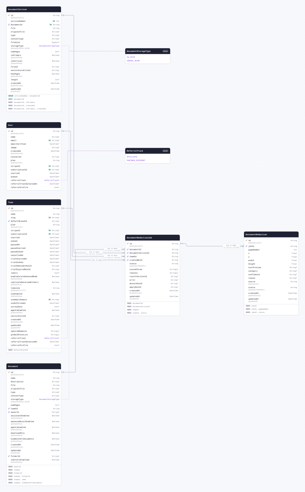

| Field               | Type       | Constraints                                             | Default      | Description |
| ------------------- | ---------- | ------------------------------------------------------- | ------------ | ----------- |
| `id`                | `String`   | PK NOT NULL                                             | `cuid(1)`    |             |
| `documentId`        | `String`   | NOT NULL → [Document.id](#model-Document)               |              |             |
| `documentVersionId` | `String`   | NOT NULL → [DocumentVersion.id](#model-DocumentVersion) |              |             |
| `teamId`            | `String`   | NOT NULL → [Team.id](#model-Team)                       |              |             |
| `createdById`       | `String`   | NOT NULL → [User.id](#model-User)                       |              |             |
| `status`            | `String`   | NOT NULL                                                | `"PENDING"`  |             |
| `customTerms`       | `String[]` | NOT NULL                                                |              |             |
| `reasons`           | `String[]` | NOT NULL                                                |              |             |
| `resultVersionId`   | `String`   | NULL                                                    |              |             |
| `error`             | `String`   | NULL                                                    |              |             |
| `detectRunId`       | `String`   | NULL                                                    |              |             |
| `applyRunId`        | `String`   | NULL                                                    |              |             |
| `createdAt`         | `DateTime` | NOT NULL                                                | `now()`      |             |
| `updatedAt`         | `DateTime` | NOT NULL                                                | `@updatedAt` |             |

#### Indexes

- `@@index([documentId])`
- `@@index([documentVersionId])`
- `@@index([teamId])`
- `@@index([teamId, status])`

#### References

- `documentId` → [Document.id](#model-Document) (many-to-one, on delete Cascade)
- `documentVersionId` → [DocumentVersion.id](#model-DocumentVersion) (many-to-one, on delete Cascade)
- `teamId` → [Team.id](#model-Team) (many-to-one, on delete Cascade)
- `createdById` → [User.id](#model-User) (many-to-one)

#### Referenced by

- `id` ← [DocumentRedaction.jobId](#model-DocumentRedaction) (one-to-many, on delete Cascade)

#### Definition

```sql
CREATE TABLE "DocumentRedactionJob" (
    "id" TEXT NOT NULL,
    "documentId" TEXT NOT NULL,
    "documentVersionId" TEXT NOT NULL,
    "teamId" TEXT NOT NULL,
    "createdById" TEXT NOT NULL,
    "status" TEXT NOT NULL DEFAULT 'PENDING',
    "customTerms" TEXT[],
    "reasons" TEXT[],
    "resultVersionId" TEXT,
    "error" TEXT,
    "detectRunId" TEXT,
    "applyRunId" TEXT,
    "createdAt" TIMESTAMP(3) NOT NULL DEFAULT CURRENT_TIMESTAMP,
    "updatedAt" TIMESTAMP(3) NOT NULL,

    CONSTRAINT "DocumentRedactionJob_pkey" PRIMARY KEY ("id")
);

CREATE INDEX "DocumentRedactionJob_documentId_idx" ON "DocumentRedactionJob"("documentId");

CREATE INDEX "DocumentRedactionJob_documentVersionId_idx" ON "DocumentRedactionJob"("documentVersionId");

CREATE INDEX "DocumentRedactionJob_teamId_idx" ON "DocumentRedactionJob"("teamId");

CREATE INDEX "DocumentRedactionJob_teamId_status_idx" ON "DocumentRedactionJob"("teamId", "status");

ALTER TABLE "DocumentRedactionJob" ADD CONSTRAINT "DocumentRedactionJob_documentId_fkey" FOREIGN KEY ("documentId") REFERENCES "Document"("id") ON DELETE CASCADE ON UPDATE CASCADE;

ALTER TABLE "DocumentRedactionJob" ADD CONSTRAINT "DocumentRedactionJob_documentVersionId_fkey" FOREIGN KEY ("documentVersionId") REFERENCES "DocumentVersion"("id") ON DELETE CASCADE ON UPDATE CASCADE;

ALTER TABLE "DocumentRedactionJob" ADD CONSTRAINT "DocumentRedactionJob_teamId_fkey" FOREIGN KEY ("teamId") REFERENCES "Team"("id") ON DELETE CASCADE ON UPDATE CASCADE;

ALTER TABLE "DocumentRedactionJob" ADD CONSTRAINT "DocumentRedactionJob_createdById_fkey" FOREIGN KEY ("createdById") REFERENCES "User"("id") ON DELETE RESTRICT ON UPDATE CASCADE;
```

<details>
<summary>Queries and their SQL</summary>

**findMany**: Every row

```ts
await prisma.documentRedactionJob.findMany();
```

```sql
SELECT
  "public"."DocumentRedactionJob"."id",
  "public"."DocumentRedactionJob"."documentId",
  "public"."DocumentRedactionJob"."documentVersionId",
  "public"."DocumentRedactionJob"."teamId",
  "public"."DocumentRedactionJob"."createdById",
  "public"."DocumentRedactionJob"."status",
  "public"."DocumentRedactionJob"."customTerms",
  "public"."DocumentRedactionJob"."reasons",
  "public"."DocumentRedactionJob"."resultVersionId",
  "public"."DocumentRedactionJob"."error",
  "public"."DocumentRedactionJob"."detectRunId",
  "public"."DocumentRedactionJob"."applyRunId",
  "public"."DocumentRedactionJob"."createdAt",
  "public"."DocumentRedactionJob"."updatedAt"
FROM
  "public"."DocumentRedactionJob"
WHERE
  1 = 1
OFFSET
  $1
-- params: ["0"]
```

**count**: How many rows there are

```ts
await prisma.documentRedactionJob.count();
```

```sql
SELECT
  COUNT(*) AS "_count$_all"
FROM
  (
    SELECT
      "public"."DocumentRedactionJob"."id"
    FROM
      "public"."DocumentRedactionJob"
    WHERE
      1 = 1
    OFFSET
      $1
  ) AS "sub"
-- params: ["0"]
```

**findMany**: Every row with its relations

```ts
await prisma.documentRedactionJob.findMany({
  include: { document: true, documentVersion: true, team: true, createdBy: true, redactions: true },
});
```

```sql
SELECT
  "public"."DocumentRedactionJob"."id",
  "public"."DocumentRedactionJob"."documentId",
  "public"."DocumentRedactionJob"."documentVersionId",
  "public"."DocumentRedactionJob"."teamId",
  "public"."DocumentRedactionJob"."createdById",
  "public"."DocumentRedactionJob"."status",
  "public"."DocumentRedactionJob"."customTerms",
  "public"."DocumentRedactionJob"."reasons",
  "public"."DocumentRedactionJob"."resultVersionId",
  "public"."DocumentRedactionJob"."error",
  "public"."DocumentRedactionJob"."detectRunId",
  "public"."DocumentRedactionJob"."applyRunId",
  "public"."DocumentRedactionJob"."createdAt",
  "public"."DocumentRedactionJob"."updatedAt"
FROM
  "public"."DocumentRedactionJob"
WHERE
  1 = 1
OFFSET
  $1
-- params: ["0"]

SELECT
  "public"."Document"."id",
  "public"."Document"."name",
  "public"."Document"."description",
  "public"."Document"."file",
  "public"."Document"."originalFile",
  "public"."Document"."type",
  "public"."Document"."contentType",
  "public"."Document"."storageType"::text,
  "public"."Document"."numPages",
  "public"."Document"."teamId",
  "public"."Document"."ownerId",
  "public"."Document"."assistantEnabled",
  "public"."Document"."advancedExcelEnabled",
  "public"."Document"."agentsEnabled",
  "public"."Document"."downloadOnly",
  "public"."Document"."hiddenInAllDocuments",
  "public"."Document"."createdAt",
  "public"."Document"."updatedAt",
  "public"."Document"."folderId",
  "public"."Document"."isExternalUpload"
FROM
  "public"."Document"
WHERE
  "public"."Document"."id" IN ($1)
OFFSET
  $2
-- params: ["<documentId of the rows above>","0"]

SELECT
  "public"."DocumentVersion"."id",
  "public"."DocumentVersion"."versionNumber",
  "public"."DocumentVersion"."documentId",
  "public"."DocumentVersion"."file",
  "public"."DocumentVersion"."originalFile",
  "public"."DocumentVersion"."type",
  "public"."DocumentVersion"."contentType",
  "public"."DocumentVersion"."fileSize",
  "public"."DocumentVersion"."storageType"::text,
  "public"."DocumentVersion"."numPages",
  "public"."DocumentVersion"."isPrimary",
  "public"."DocumentVersion"."isVertical",
  "public"."DocumentVersion"."fileId",
  "public"."DocumentVersion"."vectorStoreFileId",
  "public"."DocumentVersion"."hasPages",
  "public"."DocumentVersion"."length",
  "public"."DocumentVersion"."createdAt",
  "public"."DocumentVersion"."updatedAt"
FROM
  "public"."DocumentVersion"
WHERE
  "public"."DocumentVersion"."id" IN ($1)
OFFSET
  $2
-- params: ["<documentVersionId of the rows above>","0"]

SELECT
  "public"."Team"."id",
  "public"."Team"."name",
  "public"."Team"."slug",
  "public"."Team"."defaultBrandId",
  "public"."Team"."plan",
  "public"."Team"."stripeId",
  "public"."Team"."subscriptionId",
  "public"."Team"."startsAt",
  "public"."Team"."endsAt",
  "public"."Team"."pausedAt",
  "public"."Team"."pauseStartsAt",
  "public"."Team"."pauseEndsAt",
  "public"."Team"."cancelledAt",
  "public"."Team"."trialStartedAt",
  "public"."Team"."trialEndsAt",
  "public"."Team"."trialReminderRunId",
  "public"."Team"."trialExpiredRunId",
  "public"."Team"."limits",
  "public"."Team"."enableExcelAdvancedMode",
  "public"."Team"."replicateDataroomFolders",
  "public"."Team"."timezone",
  "public"."Team"."ssoEnabled",
  "public"."Team"."ssoEmailDomain",
  "public"."Team"."ssoEnforcedAt",
  "public"."Team"."surveyData",
  "public"."Team"."agentsEnabled",
  "public"."Team"."vectorStoreId",
  "public"."Team"."createdAt",
  "public"."Team"."updatedAt",
  "public"."Team"."ignoredDomains",
  "public"."Team"."globalBlockList",
  "public"."Team"."referralTrack"::text,
  "public"."Team"."referralTrackSelectedAt",
  "public"."Team"."referralProfile"
FROM
  "public"."Team"
WHERE
  "public"."Team"."id" IN ($1)
OFFSET
  $2
-- params: ["<teamId of the rows above>","0"]

SELECT
  "public"."User"."id",
  "public"."User"."name",
  "public"."User"."email",
  "public"."User"."emailVerified",
  "public"."User"."image",
  "public"."User"."createdAt",
  "public"."User"."contactId",
  "public"."User"."plan",
  "public"."User"."stripeId",
  "public"."User"."subscriptionId",
  "public"."User"."startsAt",
  "public"."User"."endsAt",
  "public"."User"."referralTrack"::text,
  "public"."User"."referralTrackSelectedAt",
  "public"."User"."referralProfile"
FROM
  "public"."User"
WHERE
  "public"."User"."id" IN ($1)
OFFSET
  $2
-- params: ["<createdById of the rows above>","0"]

SELECT
  "public"."DocumentRedaction"."id",
  "public"."DocumentRedaction"."jobId",
  "public"."DocumentRedaction"."pageNumber",
  "public"."DocumentRedaction"."x",
  "public"."DocumentRedaction"."y",
  "public"."DocumentRedaction"."width",
  "public"."DocumentRedaction"."height",
  "public"."DocumentRedaction"."textPreview",
  "public"."DocumentRedaction"."category",
  "public"."DocumentRedaction"."confidence",
  "public"."DocumentRedaction"."reason",
  "public"."DocumentRedaction"."source",
  "public"."DocumentRedaction"."status",
  "public"."DocumentRedaction"."createdAt",
  "public"."DocumentRedaction"."updatedAt"
FROM
  "public"."DocumentRedaction"
WHERE
  "public"."DocumentRedaction"."jobId" IN ($1)
OFFSET
  $2
-- params: ["<id of the rows above>","0"]
```

**findUnique**: One row by what is unique to it

```ts
await prisma.documentRedactionJob.findUnique({ where: { id: "example" } });
```

```sql
SELECT
  "public"."DocumentRedactionJob"."id",
  "public"."DocumentRedactionJob"."documentId",
  "public"."DocumentRedactionJob"."documentVersionId",
  "public"."DocumentRedactionJob"."teamId",
  "public"."DocumentRedactionJob"."createdById",
  "public"."DocumentRedactionJob"."status",
  "public"."DocumentRedactionJob"."customTerms",
  "public"."DocumentRedactionJob"."reasons",
  "public"."DocumentRedactionJob"."resultVersionId",
  "public"."DocumentRedactionJob"."error",
  "public"."DocumentRedactionJob"."detectRunId",
  "public"."DocumentRedactionJob"."applyRunId",
  "public"."DocumentRedactionJob"."createdAt",
  "public"."DocumentRedactionJob"."updatedAt"
FROM
  "public"."DocumentRedactionJob"
WHERE
  (
    "public"."DocumentRedactionJob"."id" = $1
    AND 1 = 1
  )
LIMIT
  $2
OFFSET
  $3
-- params: ["example","1","0"]
```

**create**: Create a row

```ts
await prisma.documentRedactionJob.create({
  data: {
    documentId: "example",
    documentVersionId: "example",
    teamId: "example",
    createdById: "example",
    customTerms: ["example"],
    reasons: ["example"],
  },
});
```

```sql
INSERT INTO
  "public"."DocumentRedactionJob" (
    "id",
    "documentId",
    "documentVersionId",
    "teamId",
    "createdById",
    "status",
    "customTerms",
    "reasons",
    "createdAt",
    "updatedAt"
  )
VALUES
  ($1, $2, $3, $4, $5, $6, $7, $8, $9, $10)
RETURNING
  "public"."DocumentRedactionJob"."id",
  "public"."DocumentRedactionJob"."documentId",
  "public"."DocumentRedactionJob"."documentVersionId",
  "public"."DocumentRedactionJob"."teamId",
  "public"."DocumentRedactionJob"."createdById",
  "public"."DocumentRedactionJob"."status",
  "public"."DocumentRedactionJob"."customTerms",
  "public"."DocumentRedactionJob"."reasons",
  "public"."DocumentRedactionJob"."resultVersionId",
  "public"."DocumentRedactionJob"."error",
  "public"."DocumentRedactionJob"."detectRunId",
  "public"."DocumentRedactionJob"."applyRunId",
  "public"."DocumentRedactionJob"."createdAt",
  "public"."DocumentRedactionJob"."updatedAt"
-- params: ["<cuid(1)>","example","example","example","example","PENDING",["example"],["example"],"<now()>","<now()>"]
```

**update**: Update a row

```ts
await prisma.documentRedactionJob.update({ where: { id: "example" }, data: { status: "example" } });
```

```sql
UPDATE "public"."DocumentRedactionJob"
SET
  "status" = $1,
  "updatedAt" = $2
WHERE
  (
    "public"."DocumentRedactionJob"."id" = $3
    AND 1 = 1
  )
RETURNING
  "public"."DocumentRedactionJob"."id",
  "public"."DocumentRedactionJob"."documentId",
  "public"."DocumentRedactionJob"."documentVersionId",
  "public"."DocumentRedactionJob"."teamId",
  "public"."DocumentRedactionJob"."createdById",
  "public"."DocumentRedactionJob"."status",
  "public"."DocumentRedactionJob"."customTerms",
  "public"."DocumentRedactionJob"."reasons",
  "public"."DocumentRedactionJob"."resultVersionId",
  "public"."DocumentRedactionJob"."error",
  "public"."DocumentRedactionJob"."detectRunId",
  "public"."DocumentRedactionJob"."applyRunId",
  "public"."DocumentRedactionJob"."createdAt",
  "public"."DocumentRedactionJob"."updatedAt"
-- params: ["example",{"prisma__type":"generatorCall","prisma__value":{"name":"now","args":[],"returnType":{"type":"DateTime"}}},"example"]
```

**delete**: Delete a row

```ts
await prisma.documentRedactionJob.delete({ where: { id: "example" } });
```

```sql
DELETE FROM "public"."DocumentRedactionJob"
WHERE
  (
    "public"."DocumentRedactionJob"."id" = $1
    AND 1 = 1
  )
RETURNING
  "public"."DocumentRedactionJob"."id",
  "public"."DocumentRedactionJob"."documentId",
  "public"."DocumentRedactionJob"."documentVersionId",
  "public"."DocumentRedactionJob"."teamId",
  "public"."DocumentRedactionJob"."createdById",
  "public"."DocumentRedactionJob"."status",
  "public"."DocumentRedactionJob"."customTerms",
  "public"."DocumentRedactionJob"."reasons",
  "public"."DocumentRedactionJob"."resultVersionId",
  "public"."DocumentRedactionJob"."error",
  "public"."DocumentRedactionJob"."detectRunId",
  "public"."DocumentRedactionJob"."applyRunId",
  "public"."DocumentRedactionJob"."createdAt",
  "public"."DocumentRedactionJob"."updatedAt"
-- params: ["example"]
```

</details>

<a id="model-DocumentRedaction"></a>

### DocumentRedaction

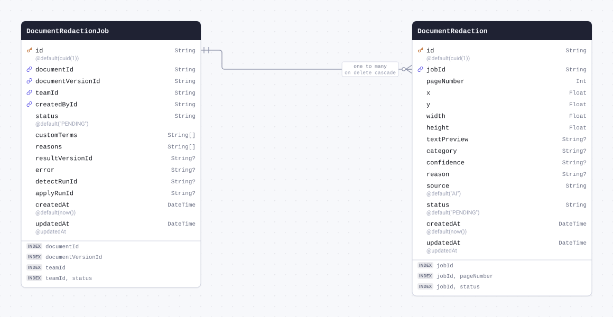

| Field         | Type       | Constraints                                                       | Default      | Description |
| ------------- | ---------- | ----------------------------------------------------------------- | ------------ | ----------- |
| `id`          | `String`   | PK NOT NULL                                                       | `cuid(1)`    |             |
| `jobId`       | `String`   | NOT NULL → [DocumentRedactionJob.id](#model-DocumentRedactionJob) |              |             |
| `pageNumber`  | `Int`      | NOT NULL                                                          |              |             |
| `x`           | `Float`    | NOT NULL                                                          |              |             |
| `y`           | `Float`    | NOT NULL                                                          |              |             |
| `width`       | `Float`    | NOT NULL                                                          |              |             |
| `height`      | `Float`    | NOT NULL                                                          |              |             |
| `textPreview` | `String`   | NULL                                                              |              |             |
| `category`    | `String`   | NULL                                                              |              |             |
| `confidence`  | `String`   | NULL                                                              |              |             |
| `reason`      | `String`   | NULL                                                              |              |             |
| `source`      | `String`   | NOT NULL                                                          | `"AI"`       |             |
| `status`      | `String`   | NOT NULL                                                          | `"PENDING"`  |             |
| `createdAt`   | `DateTime` | NOT NULL                                                          | `now()`      |             |
| `updatedAt`   | `DateTime` | NOT NULL                                                          | `@updatedAt` |             |

#### Indexes

- `@@index([jobId])`
- `@@index([jobId, pageNumber])`
- `@@index([jobId, status])`

#### References

- `jobId` → [DocumentRedactionJob.id](#model-DocumentRedactionJob) (many-to-one, on delete Cascade)

#### Definition

```sql
CREATE TABLE "DocumentRedaction" (
    "id" TEXT NOT NULL,
    "jobId" TEXT NOT NULL,
    "pageNumber" INTEGER NOT NULL,
    "x" DOUBLE PRECISION NOT NULL,
    "y" DOUBLE PRECISION NOT NULL,
    "width" DOUBLE PRECISION NOT NULL,
    "height" DOUBLE PRECISION NOT NULL,
    "textPreview" TEXT,
    "category" TEXT,
    "confidence" TEXT,
    "reason" TEXT,
    "source" TEXT NOT NULL DEFAULT 'AI',
    "status" TEXT NOT NULL DEFAULT 'PENDING',
    "createdAt" TIMESTAMP(3) NOT NULL DEFAULT CURRENT_TIMESTAMP,
    "updatedAt" TIMESTAMP(3) NOT NULL,

    CONSTRAINT "DocumentRedaction_pkey" PRIMARY KEY ("id")
);

CREATE INDEX "DocumentRedaction_jobId_idx" ON "DocumentRedaction"("jobId");

CREATE INDEX "DocumentRedaction_jobId_pageNumber_idx" ON "DocumentRedaction"("jobId", "pageNumber");

CREATE INDEX "DocumentRedaction_jobId_status_idx" ON "DocumentRedaction"("jobId", "status");

ALTER TABLE "DocumentRedaction" ADD CONSTRAINT "DocumentRedaction_jobId_fkey" FOREIGN KEY ("jobId") REFERENCES "DocumentRedactionJob"("id") ON DELETE CASCADE ON UPDATE CASCADE;
```

<details>
<summary>Queries and their SQL</summary>

**findMany**: Every row

```ts
await prisma.documentRedaction.findMany();
```

```sql
SELECT
  "public"."DocumentRedaction"."id",
  "public"."DocumentRedaction"."jobId",
  "public"."DocumentRedaction"."pageNumber",
  "public"."DocumentRedaction"."x",
  "public"."DocumentRedaction"."y",
  "public"."DocumentRedaction"."width",
  "public"."DocumentRedaction"."height",
  "public"."DocumentRedaction"."textPreview",
  "public"."DocumentRedaction"."category",
  "public"."DocumentRedaction"."confidence",
  "public"."DocumentRedaction"."reason",
  "public"."DocumentRedaction"."source",
  "public"."DocumentRedaction"."status",
  "public"."DocumentRedaction"."createdAt",
  "public"."DocumentRedaction"."updatedAt"
FROM
  "public"."DocumentRedaction"
WHERE
  1 = 1
OFFSET
  $1
-- params: ["0"]
```

**count**: How many rows there are

```ts
await prisma.documentRedaction.count();
```

```sql
SELECT
  COUNT(*) AS "_count$_all"
FROM
  (
    SELECT
      "public"."DocumentRedaction"."id"
    FROM
      "public"."DocumentRedaction"
    WHERE
      1 = 1
    OFFSET
      $1
  ) AS "sub"
-- params: ["0"]
```

**findMany**: Every row with its relations

```ts
await prisma.documentRedaction.findMany({ include: { job: true } });
```

```sql
SELECT
  "public"."DocumentRedaction"."id",
  "public"."DocumentRedaction"."jobId",
  "public"."DocumentRedaction"."pageNumber",
  "public"."DocumentRedaction"."x",
  "public"."DocumentRedaction"."y",
  "public"."DocumentRedaction"."width",
  "public"."DocumentRedaction"."height",
  "public"."DocumentRedaction"."textPreview",
  "public"."DocumentRedaction"."category",
  "public"."DocumentRedaction"."confidence",
  "public"."DocumentRedaction"."reason",
  "public"."DocumentRedaction"."source",
  "public"."DocumentRedaction"."status",
  "public"."DocumentRedaction"."createdAt",
  "public"."DocumentRedaction"."updatedAt"
FROM
  "public"."DocumentRedaction"
WHERE
  1 = 1
OFFSET
  $1
-- params: ["0"]

SELECT
  "public"."DocumentRedactionJob"."id",
  "public"."DocumentRedactionJob"."documentId",
  "public"."DocumentRedactionJob"."documentVersionId",
  "public"."DocumentRedactionJob"."teamId",
  "public"."DocumentRedactionJob"."createdById",
  "public"."DocumentRedactionJob"."status",
  "public"."DocumentRedactionJob"."customTerms",
  "public"."DocumentRedactionJob"."reasons",
  "public"."DocumentRedactionJob"."resultVersionId",
  "public"."DocumentRedactionJob"."error",
  "public"."DocumentRedactionJob"."detectRunId",
  "public"."DocumentRedactionJob"."applyRunId",
  "public"."DocumentRedactionJob"."createdAt",
  "public"."DocumentRedactionJob"."updatedAt"
FROM
  "public"."DocumentRedactionJob"
WHERE
  "public"."DocumentRedactionJob"."id" IN ($1)
OFFSET
  $2
-- params: ["<jobId of the rows above>","0"]
```

**findUnique**: One row by what is unique to it

```ts
await prisma.documentRedaction.findUnique({ where: { id: "example" } });
```

```sql
SELECT
  "public"."DocumentRedaction"."id",
  "public"."DocumentRedaction"."jobId",
  "public"."DocumentRedaction"."pageNumber",
  "public"."DocumentRedaction"."x",
  "public"."DocumentRedaction"."y",
  "public"."DocumentRedaction"."width",
  "public"."DocumentRedaction"."height",
  "public"."DocumentRedaction"."textPreview",
  "public"."DocumentRedaction"."category",
  "public"."DocumentRedaction"."confidence",
  "public"."DocumentRedaction"."reason",
  "public"."DocumentRedaction"."source",
  "public"."DocumentRedaction"."status",
  "public"."DocumentRedaction"."createdAt",
  "public"."DocumentRedaction"."updatedAt"
FROM
  "public"."DocumentRedaction"
WHERE
  (
    "public"."DocumentRedaction"."id" = $1
    AND 1 = 1
  )
LIMIT
  $2
OFFSET
  $3
-- params: ["example","1","0"]
```

**create**: Create a row

```ts
await prisma.documentRedaction.create({
  data: { jobId: "example", pageNumber: 1, x: 1.5, y: 1.5, width: 1.5, height: 1.5 },
});
```

```sql
INSERT INTO
  "public"."DocumentRedaction" (
    "id",
    "jobId",
    "pageNumber",
    "x",
    "y",
    "width",
    "height",
    "source",
    "status",
    "createdAt",
    "updatedAt"
  )
VALUES
  ($1, $2, $3, $4, $5, $6, $7, $8, $9, $10, $11)
RETURNING
  "public"."DocumentRedaction"."id",
  "public"."DocumentRedaction"."jobId",
  "public"."DocumentRedaction"."pageNumber",
  "public"."DocumentRedaction"."x",
  "public"."DocumentRedaction"."y",
  "public"."DocumentRedaction"."width",
  "public"."DocumentRedaction"."height",
  "public"."DocumentRedaction"."textPreview",
  "public"."DocumentRedaction"."category",
  "public"."DocumentRedaction"."confidence",
  "public"."DocumentRedaction"."reason",
  "public"."DocumentRedaction"."source",
  "public"."DocumentRedaction"."status",
  "public"."DocumentRedaction"."createdAt",
  "public"."DocumentRedaction"."updatedAt"
-- params: ["<cuid(1)>","example","1","1.5","1.5","1.5","1.5","AI","PENDING","<now()>","<now()>"]
```

**update**: Update a row

```ts
await prisma.documentRedaction.update({ where: { id: "example" }, data: { pageNumber: 1 } });
```

```sql
UPDATE "public"."DocumentRedaction"
SET
  "pageNumber" = $1,
  "updatedAt" = $2
WHERE
  (
    "public"."DocumentRedaction"."id" = $3
    AND 1 = 1
  )
RETURNING
  "public"."DocumentRedaction"."id",
  "public"."DocumentRedaction"."jobId",
  "public"."DocumentRedaction"."pageNumber",
  "public"."DocumentRedaction"."x",
  "public"."DocumentRedaction"."y",
  "public"."DocumentRedaction"."width",
  "public"."DocumentRedaction"."height",
  "public"."DocumentRedaction"."textPreview",
  "public"."DocumentRedaction"."category",
  "public"."DocumentRedaction"."confidence",
  "public"."DocumentRedaction"."reason",
  "public"."DocumentRedaction"."source",
  "public"."DocumentRedaction"."status",
  "public"."DocumentRedaction"."createdAt",
  "public"."DocumentRedaction"."updatedAt"
-- params: ["1",{"prisma__type":"generatorCall","prisma__value":{"name":"now","args":[],"returnType":{"type":"DateTime"}}},"example"]
```

**delete**: Delete a row

```ts
await prisma.documentRedaction.delete({ where: { id: "example" } });
```

```sql
DELETE FROM "public"."DocumentRedaction"
WHERE
  (
    "public"."DocumentRedaction"."id" = $1
    AND 1 = 1
  )
RETURNING
  "public"."DocumentRedaction"."id",
  "public"."DocumentRedaction"."jobId",
  "public"."DocumentRedaction"."pageNumber",
  "public"."DocumentRedaction"."x",
  "public"."DocumentRedaction"."y",
  "public"."DocumentRedaction"."width",
  "public"."DocumentRedaction"."height",
  "public"."DocumentRedaction"."textPreview",
  "public"."DocumentRedaction"."category",
  "public"."DocumentRedaction"."confidence",
  "public"."DocumentRedaction"."reason",
  "public"."DocumentRedaction"."source",
  "public"."DocumentRedaction"."status",
  "public"."DocumentRedaction"."createdAt",
  "public"."DocumentRedaction"."updatedAt"
-- params: ["example"]
```

</details>

<a id="model-ReferralInvite"></a>

### ReferralInvite

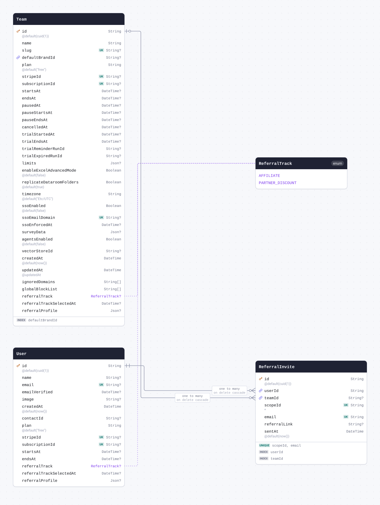

| Field          | Type       | Constraints                       | Default   | Description                                                                                                                                                                                                                                                                                                                                              |
| -------------- | ---------- | --------------------------------- | --------- | -------------------------------------------------------------------------------------------------------------------------------------------------------------------------------------------------------------------------------------------------------------------------------------------------------------------------------------------------------- |
| `id`           | `String`   | PK NOT NULL                       | `cuid(1)` |                                                                                                                                                                                                                                                                                                                                                          |
| `userId`       | `String`   | NOT NULL → [User.id](#model-User) |           |                                                                                                                                                                                                                                                                                                                                                          |
| `teamId`       | `String`   | NULL → [Team.id](#model-Team)     |           |                                                                                                                                                                                                                                                                                                                                                          |
| `scopeId`      | `String`   | NOT NULL                          |           | * * Whose cap and discount this invite counts against — the fund's team, or the * sender alone. One non-null key rather than a pair of nullable ones: on a * nullable teamId every personal invite is distinct to Postgres, so the two * keys guarded different scopes and a member could not invite a company both * for their fund and for themselves. |
| `email`        | `String`   | NOT NULL                          |           |                                                                                                                                                                                                                                                                                                                                                          |
| `referralLink` | `String`   | NULL                              |           |                                                                                                                                                                                                                                                                                                                                                          |
| `sentAt`       | `DateTime` | NOT NULL                          | `now()`   |                                                                                                                                                                                                                                                                                                                                                          |

#### Indexes

- `@@index([userId])`
- `@@index([teamId])`
- `@@unique([scopeId, email])`

#### References

- `userId` → [User.id](#model-User) (many-to-one, on delete Cascade)
- `teamId` → [Team.id](#model-Team) (many-to-one, on delete Cascade)

#### Definition

```sql
CREATE TABLE "ReferralInvite" (
    "id" TEXT NOT NULL,
    "userId" TEXT NOT NULL,
    "teamId" TEXT,
    "scopeId" TEXT NOT NULL,
    "email" TEXT NOT NULL,
    "referralLink" TEXT,
    "sentAt" TIMESTAMP(3) NOT NULL DEFAULT CURRENT_TIMESTAMP,

    CONSTRAINT "ReferralInvite_pkey" PRIMARY KEY ("id")
);

CREATE INDEX "ReferralInvite_userId_idx" ON "ReferralInvite"("userId");

CREATE INDEX "ReferralInvite_teamId_idx" ON "ReferralInvite"("teamId");

CREATE UNIQUE INDEX "ReferralInvite_scopeId_email_key" ON "ReferralInvite"("scopeId", "email");

ALTER TABLE "ReferralInvite" ADD CONSTRAINT "ReferralInvite_userId_fkey" FOREIGN KEY ("userId") REFERENCES "User"("id") ON DELETE CASCADE ON UPDATE CASCADE;

ALTER TABLE "ReferralInvite" ADD CONSTRAINT "ReferralInvite_teamId_fkey" FOREIGN KEY ("teamId") REFERENCES "Team"("id") ON DELETE CASCADE ON UPDATE CASCADE;
```

<details>
<summary>Queries and their SQL</summary>

**findMany**: Every row

```ts
await prisma.referralInvite.findMany();
```

```sql
SELECT
  "public"."ReferralInvite"."id",
  "public"."ReferralInvite"."userId",
  "public"."ReferralInvite"."teamId",
  "public"."ReferralInvite"."scopeId",
  "public"."ReferralInvite"."email",
  "public"."ReferralInvite"."referralLink",
  "public"."ReferralInvite"."sentAt"
FROM
  "public"."ReferralInvite"
WHERE
  1 = 1
OFFSET
  $1
-- params: ["0"]
```

**count**: How many rows there are

```ts
await prisma.referralInvite.count();
```

```sql
SELECT
  COUNT(*) AS "_count$_all"
FROM
  (
    SELECT
      "public"."ReferralInvite"."id"
    FROM
      "public"."ReferralInvite"
    WHERE
      1 = 1
    OFFSET
      $1
  ) AS "sub"
-- params: ["0"]
```

**findMany**: Every row with its relations

```ts
await prisma.referralInvite.findMany({ include: { user: true, team: true } });
```

```sql
SELECT
  "public"."ReferralInvite"."id",
  "public"."ReferralInvite"."userId",
  "public"."ReferralInvite"."teamId",
  "public"."ReferralInvite"."scopeId",
  "public"."ReferralInvite"."email",
  "public"."ReferralInvite"."referralLink",
  "public"."ReferralInvite"."sentAt"
FROM
  "public"."ReferralInvite"
WHERE
  1 = 1
OFFSET
  $1
-- params: ["0"]

SELECT
  "public"."User"."id",
  "public"."User"."name",
  "public"."User"."email",
  "public"."User"."emailVerified",
  "public"."User"."image",
  "public"."User"."createdAt",
  "public"."User"."contactId",
  "public"."User"."plan",
  "public"."User"."stripeId",
  "public"."User"."subscriptionId",
  "public"."User"."startsAt",
  "public"."User"."endsAt",
  "public"."User"."referralTrack"::text,
  "public"."User"."referralTrackSelectedAt",
  "public"."User"."referralProfile"
FROM
  "public"."User"
WHERE
  "public"."User"."id" IN ($1)
OFFSET
  $2
-- params: ["<userId of the rows above>","0"]

SELECT
  "public"."Team"."id",
  "public"."Team"."name",
  "public"."Team"."slug",
  "public"."Team"."defaultBrandId",
  "public"."Team"."plan",
  "public"."Team"."stripeId",
  "public"."Team"."subscriptionId",
  "public"."Team"."startsAt",
  "public"."Team"."endsAt",
  "public"."Team"."pausedAt",
  "public"."Team"."pauseStartsAt",
  "public"."Team"."pauseEndsAt",
  "public"."Team"."cancelledAt",
  "public"."Team"."trialStartedAt",
  "public"."Team"."trialEndsAt",
  "public"."Team"."trialReminderRunId",
  "public"."Team"."trialExpiredRunId",
  "public"."Team"."limits",
  "public"."Team"."enableExcelAdvancedMode",
  "public"."Team"."replicateDataroomFolders",
  "public"."Team"."timezone",
  "public"."Team"."ssoEnabled",
  "public"."Team"."ssoEmailDomain",
  "public"."Team"."ssoEnforcedAt",
  "public"."Team"."surveyData",
  "public"."Team"."agentsEnabled",
  "public"."Team"."vectorStoreId",
  "public"."Team"."createdAt",
  "public"."Team"."updatedAt",
  "public"."Team"."ignoredDomains",
  "public"."Team"."globalBlockList",
  "public"."Team"."referralTrack"::text,
  "public"."Team"."referralTrackSelectedAt",
  "public"."Team"."referralProfile"
FROM
  "public"."Team"
WHERE
  "public"."Team"."id" IN ($1)
OFFSET
  $2
-- params: ["<teamId of the rows above>","0"]
```

**findUnique**: One row by what is unique to it

```ts
await prisma.referralInvite.findUnique({ where: { id: "example" } });
```

```sql
SELECT
  "public"."ReferralInvite"."id",
  "public"."ReferralInvite"."userId",
  "public"."ReferralInvite"."teamId",
  "public"."ReferralInvite"."scopeId",
  "public"."ReferralInvite"."email",
  "public"."ReferralInvite"."referralLink",
  "public"."ReferralInvite"."sentAt"
FROM
  "public"."ReferralInvite"
WHERE
  (
    "public"."ReferralInvite"."id" = $1
    AND 1 = 1
  )
LIMIT
  $2
OFFSET
  $3
-- params: ["example","1","0"]
```

**create**: Create a row

```ts
await prisma.referralInvite.create({
  data: { userId: "example", scopeId: "example", email: "example" },
});
```

```sql
INSERT INTO
  "public"."ReferralInvite" ("id", "userId", "scopeId", "email", "sentAt")
VALUES
  ($1, $2, $3, $4, $5)
RETURNING
  "public"."ReferralInvite"."id",
  "public"."ReferralInvite"."userId",
  "public"."ReferralInvite"."teamId",
  "public"."ReferralInvite"."scopeId",
  "public"."ReferralInvite"."email",
  "public"."ReferralInvite"."referralLink",
  "public"."ReferralInvite"."sentAt"
-- params: ["<cuid(1)>","example","example","example","<now()>"]
```

**update**: Update a row

```ts
await prisma.referralInvite.update({ where: { id: "example" }, data: { scopeId: "example" } });
```

```sql
UPDATE "public"."ReferralInvite"
SET
  "scopeId" = $1
WHERE
  (
    "public"."ReferralInvite"."id" = $2
    AND 1 = 1
  )
RETURNING
  "public"."ReferralInvite"."id",
  "public"."ReferralInvite"."userId",
  "public"."ReferralInvite"."teamId",
  "public"."ReferralInvite"."scopeId",
  "public"."ReferralInvite"."email",
  "public"."ReferralInvite"."referralLink",
  "public"."ReferralInvite"."sentAt"
-- params: ["example","example"]
```

**delete**: Delete a row

```ts
await prisma.referralInvite.delete({ where: { id: "example" } });
```

```sql
DELETE FROM "public"."ReferralInvite"
WHERE
  (
    "public"."ReferralInvite"."id" = $1
    AND 1 = 1
  )
RETURNING
  "public"."ReferralInvite"."id",
  "public"."ReferralInvite"."userId",
  "public"."ReferralInvite"."teamId",
  "public"."ReferralInvite"."scopeId",
  "public"."ReferralInvite"."email",
  "public"."ReferralInvite"."referralLink",
  "public"."ReferralInvite"."sentAt"
-- params: ["example"]
```

</details>

<a id="model-Account"></a>

### Account

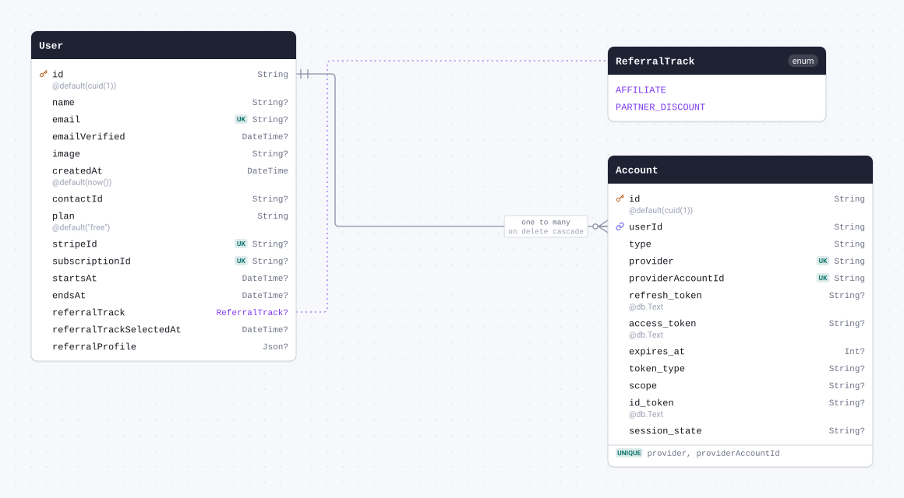

| Field               | Type                | Constraints                       | Default   | Description |
| ------------------- | ------------------- | --------------------------------- | --------- | ----------- |
| `id`                | `String`            | PK NOT NULL                       | `cuid(1)` |             |
| `userId`            | `String`            | NOT NULL → [User.id](#model-User) |           |             |
| `type`              | `String`            | NOT NULL                          |           |             |
| `provider`          | `String`            | NOT NULL                          |           |             |
| `providerAccountId` | `String`            | NOT NULL                          |           |             |
| `refresh_token`     | `String` `@db.Text` | NULL                              |           |             |
| `access_token`      | `String` `@db.Text` | NULL                              |           |             |
| `expires_at`        | `Int`               | NULL                              |           |             |
| `token_type`        | `String`            | NULL                              |           |             |
| `scope`             | `String`            | NULL                              |           |             |
| `id_token`          | `String` `@db.Text` | NULL                              |           |             |
| `session_state`     | `String`            | NULL                              |           |             |

#### Indexes

- `@@unique([provider, providerAccountId])`

#### References

- `userId` → [User.id](#model-User) (many-to-one, on delete Cascade)

#### Definition

```sql
CREATE TABLE "Account" (
    "id" TEXT NOT NULL,
    "userId" TEXT NOT NULL,
    "type" TEXT NOT NULL,
    "provider" TEXT NOT NULL,
    "providerAccountId" TEXT NOT NULL,
    "refresh_token" TEXT,
    "access_token" TEXT,
    "expires_at" INTEGER,
    "token_type" TEXT,
    "scope" TEXT,
    "id_token" TEXT,
    "session_state" TEXT,

    CONSTRAINT "Account_pkey" PRIMARY KEY ("id")
);

CREATE UNIQUE INDEX "Account_provider_providerAccountId_key" ON "Account"("provider", "providerAccountId");

ALTER TABLE "Account" ADD CONSTRAINT "Account_userId_fkey" FOREIGN KEY ("userId") REFERENCES "User"("id") ON DELETE CASCADE ON UPDATE CASCADE;
```

<details>
<summary>Queries and their SQL</summary>

**findMany**: Every row

```ts
await prisma.account.findMany();
```

```sql
SELECT
  "public"."Account"."id",
  "public"."Account"."userId",
  "public"."Account"."type",
  "public"."Account"."provider",
  "public"."Account"."providerAccountId",
  "public"."Account"."refresh_token",
  "public"."Account"."access_token",
  "public"."Account"."expires_at",
  "public"."Account"."token_type",
  "public"."Account"."scope",
  "public"."Account"."id_token",
  "public"."Account"."session_state"
FROM
  "public"."Account"
WHERE
  1 = 1
OFFSET
  $1
-- params: ["0"]
```

**count**: How many rows there are

```ts
await prisma.account.count();
```

```sql
SELECT
  COUNT(*) AS "_count$_all"
FROM
  (
    SELECT
      "public"."Account"."id"
    FROM
      "public"."Account"
    WHERE
      1 = 1
    OFFSET
      $1
  ) AS "sub"
-- params: ["0"]
```

**findMany**: Every row with its relations

```ts
await prisma.account.findMany({ include: { user: true } });
```

```sql
SELECT
  "public"."Account"."id",
  "public"."Account"."userId",
  "public"."Account"."type",
  "public"."Account"."provider",
  "public"."Account"."providerAccountId",
  "public"."Account"."refresh_token",
  "public"."Account"."access_token",
  "public"."Account"."expires_at",
  "public"."Account"."token_type",
  "public"."Account"."scope",
  "public"."Account"."id_token",
  "public"."Account"."session_state"
FROM
  "public"."Account"
WHERE
  1 = 1
OFFSET
  $1
-- params: ["0"]

SELECT
  "public"."User"."id",
  "public"."User"."name",
  "public"."User"."email",
  "public"."User"."emailVerified",
  "public"."User"."image",
  "public"."User"."createdAt",
  "public"."User"."contactId",
  "public"."User"."plan",
  "public"."User"."stripeId",
  "public"."User"."subscriptionId",
  "public"."User"."startsAt",
  "public"."User"."endsAt",
  "public"."User"."referralTrack"::text,
  "public"."User"."referralTrackSelectedAt",
  "public"."User"."referralProfile"
FROM
  "public"."User"
WHERE
  "public"."User"."id" IN ($1)
OFFSET
  $2
-- params: ["<userId of the rows above>","0"]
```

**findUnique**: One row by what is unique to it

```ts
await prisma.account.findUnique({ where: { id: "example" } });
```

```sql
SELECT
  "public"."Account"."id",
  "public"."Account"."userId",
  "public"."Account"."type",
  "public"."Account"."provider",
  "public"."Account"."providerAccountId",
  "public"."Account"."refresh_token",
  "public"."Account"."access_token",
  "public"."Account"."expires_at",
  "public"."Account"."token_type",
  "public"."Account"."scope",
  "public"."Account"."id_token",
  "public"."Account"."session_state"
FROM
  "public"."Account"
WHERE
  (
    "public"."Account"."id" = $1
    AND 1 = 1
  )
LIMIT
  $2
OFFSET
  $3
-- params: ["example","1","0"]
```

**create**: Create a row

```ts
await prisma.account.create({
  data: { userId: "example", type: "example", provider: "example", providerAccountId: "example" },
});
```

```sql
INSERT INTO
  "public"."Account" (
    "id",
    "userId",
    "type",
    "provider",
    "providerAccountId"
  )
VALUES
  ($1, $2, $3, $4, $5)
RETURNING
  "public"."Account"."id",
  "public"."Account"."userId",
  "public"."Account"."type",
  "public"."Account"."provider",
  "public"."Account"."providerAccountId",
  "public"."Account"."refresh_token",
  "public"."Account"."access_token",
  "public"."Account"."expires_at",
  "public"."Account"."token_type",
  "public"."Account"."scope",
  "public"."Account"."id_token",
  "public"."Account"."session_state"
-- params: ["<cuid(1)>","example","example","example","example"]
```

**update**: Update a row

```ts
await prisma.account.update({ where: { id: "example" }, data: { type: "example" } });
```

```sql
UPDATE "public"."Account"
SET
  "type" = $1
WHERE
  (
    "public"."Account"."id" = $2
    AND 1 = 1
  )
RETURNING
  "public"."Account"."id",
  "public"."Account"."userId",
  "public"."Account"."type",
  "public"."Account"."provider",
  "public"."Account"."providerAccountId",
  "public"."Account"."refresh_token",
  "public"."Account"."access_token",
  "public"."Account"."expires_at",
  "public"."Account"."token_type",
  "public"."Account"."scope",
  "public"."Account"."id_token",
  "public"."Account"."session_state"
-- params: ["example","example"]
```

**delete**: Delete a row

```ts
await prisma.account.delete({ where: { id: "example" } });
```

```sql
DELETE FROM "public"."Account"
WHERE
  (
    "public"."Account"."id" = $1
    AND 1 = 1
  )
RETURNING
  "public"."Account"."id",
  "public"."Account"."userId",
  "public"."Account"."type",
  "public"."Account"."provider",
  "public"."Account"."providerAccountId",
  "public"."Account"."refresh_token",
  "public"."Account"."access_token",
  "public"."Account"."expires_at",
  "public"."Account"."token_type",
  "public"."Account"."scope",
  "public"."Account"."id_token",
  "public"."Account"."session_state"
-- params: ["example"]
```

</details>

<a id="model-Session"></a>

### Session

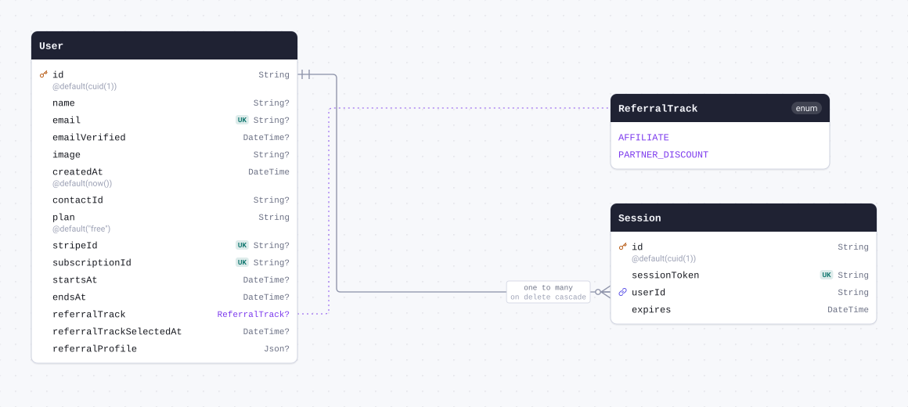

| Field          | Type       | Constraints                       | Default   | Description |
| -------------- | ---------- | --------------------------------- | --------- | ----------- |
| `id`           | `String`   | PK NOT NULL                       | `cuid(1)` |             |
| `sessionToken` | `String`   | UNIQUE NOT NULL                   |           |             |
| `userId`       | `String`   | NOT NULL → [User.id](#model-User) |           |             |
| `expires`      | `DateTime` | NOT NULL                          |           |             |

#### References

- `userId` → [User.id](#model-User) (many-to-one, on delete Cascade)

#### Definition

```sql
CREATE TABLE "Session" (
    "id" TEXT NOT NULL,
    "sessionToken" TEXT NOT NULL,
    "userId" TEXT NOT NULL,
    "expires" TIMESTAMP(3) NOT NULL,

    CONSTRAINT "Session_pkey" PRIMARY KEY ("id")
);

CREATE UNIQUE INDEX "Session_sessionToken_key" ON "Session"("sessionToken");

ALTER TABLE "Session" ADD CONSTRAINT "Session_userId_fkey" FOREIGN KEY ("userId") REFERENCES "User"("id") ON DELETE CASCADE ON UPDATE CASCADE;
```

<details>
<summary>Queries and their SQL</summary>

**findMany**: Every row

```ts
await prisma.session.findMany();
```

```sql
SELECT
  "public"."Session"."id",
  "public"."Session"."sessionToken",
  "public"."Session"."userId",
  "public"."Session"."expires"
FROM
  "public"."Session"
WHERE
  1 = 1
OFFSET
  $1
-- params: ["0"]
```

**count**: How many rows there are

```ts
await prisma.session.count();
```

```sql
SELECT
  COUNT(*) AS "_count$_all"
FROM
  (
    SELECT
      "public"."Session"."id"
    FROM
      "public"."Session"
    WHERE
      1 = 1
    OFFSET
      $1
  ) AS "sub"
-- params: ["0"]
```

**findMany**: Every row with its relations

```ts
await prisma.session.findMany({ include: { user: true } });
```

```sql
SELECT
  "public"."Session"."id",
  "public"."Session"."sessionToken",
  "public"."Session"."userId",
  "public"."Session"."expires"
FROM
  "public"."Session"
WHERE
  1 = 1
OFFSET
  $1
-- params: ["0"]

SELECT
  "public"."User"."id",
  "public"."User"."name",
  "public"."User"."email",
  "public"."User"."emailVerified",
  "public"."User"."image",
  "public"."User"."createdAt",
  "public"."User"."contactId",
  "public"."User"."plan",
  "public"."User"."stripeId",
  "public"."User"."subscriptionId",
  "public"."User"."startsAt",
  "public"."User"."endsAt",
  "public"."User"."referralTrack"::text,
  "public"."User"."referralTrackSelectedAt",
  "public"."User"."referralProfile"
FROM
  "public"."User"
WHERE
  "public"."User"."id" IN ($1)
OFFSET
  $2
-- params: ["<userId of the rows above>","0"]
```

**findUnique**: One row by what is unique to it

```ts
await prisma.session.findUnique({ where: { id: "example" } });
```

```sql
SELECT
  "public"."Session"."id",
  "public"."Session"."sessionToken",
  "public"."Session"."userId",
  "public"."Session"."expires"
FROM
  "public"."Session"
WHERE
  (
    "public"."Session"."id" = $1
    AND 1 = 1
  )
LIMIT
  $2
OFFSET
  $3
-- params: ["example","1","0"]
```

**create**: Create a row

```ts
await prisma.session.create({
  data: {
    sessionToken: "example",
    userId: "example",
    expires: new Date("2026-01-01T00:00:00.000Z"),
  },
});
```

```sql
INSERT INTO
  "public"."Session" ("id", "sessionToken", "userId", "expires")
VALUES
  ($1, $2, $3, $4)
RETURNING
  "public"."Session"."id",
  "public"."Session"."sessionToken",
  "public"."Session"."userId",
  "public"."Session"."expires"
-- params: ["<cuid(1)>","example","example","2026-01-01T00:00:00.000Z"]
```

**update**: Update a row

```ts
await prisma.session.update({ where: { id: "example" }, data: { sessionToken: "example" } });
```

```sql
UPDATE "public"."Session"
SET
  "sessionToken" = $1
WHERE
  (
    "public"."Session"."id" = $2
    AND 1 = 1
  )
RETURNING
  "public"."Session"."id",
  "public"."Session"."sessionToken",
  "public"."Session"."userId",
  "public"."Session"."expires"
-- params: ["example","example"]
```

**delete**: Delete a row

```ts
await prisma.session.delete({ where: { id: "example" } });
```

```sql
DELETE FROM "public"."Session"
WHERE
  (
    "public"."Session"."id" = $1
    AND 1 = 1
  )
RETURNING
  "public"."Session"."id",
  "public"."Session"."sessionToken",
  "public"."Session"."userId",
  "public"."Session"."expires"
-- params: ["example"]
```

</details>

<a id="model-User"></a>

### User

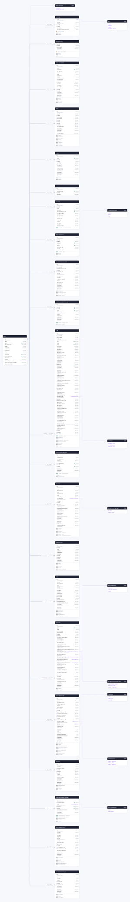

| Field                     | Type                                   | Constraints | Default   | Description |
| ------------------------- | -------------------------------------- | ----------- | --------- | ----------- |
| `id`                      | `String`                               | PK NOT NULL | `cuid(1)` |             |
| `name`                    | `String`                               | NULL        |           |             |
| `email`                   | `String`                               | UNIQUE NULL |           |             |
| `emailVerified`           | `DateTime`                             | NULL        |           |             |
| `image`                   | `String`                               | NULL        |           |             |
| `createdAt`               | `DateTime`                             | NOT NULL    | `now()`   |             |
| `contactId`               | `String`                               | NULL        |           |             |
| `plan`                    | `String`                               | NOT NULL    | `"free"`  |             |
| `stripeId`                | `String`                               | UNIQUE NULL |           |             |
| `subscriptionId`          | `String`                               | UNIQUE NULL |           |             |
| `startsAt`                | `DateTime`                             | NULL        |           |             |
| `endsAt`                  | `DateTime`                             | NULL        |           |             |
| `referralTrack`           | [`ReferralTrack`](#enum-ReferralTrack) | NULL        |           |             |
| `referralTrackSelectedAt` | `DateTime`                             | NULL        |           |             |
| `referralProfile`         | `Json`                                 | NULL        |           |             |

#### Referenced by

- `id` ← [DocumentAnnotation.createdById](#model-DocumentAnnotation) (one-to-many, on delete Cascade)
- `id` ← [DataroomQuestion.createdByUserId](#model-DataroomQuestion) (one-to-many, on delete SetNull)
- `id` ← [ConversationParticipant.userId](#model-ConversationParticipant) (one-to-many, on delete SetNull)
- `id` ← [Message.userId](#model-Message) (one-to-many, on delete SetNull)
- `id` ← [DataroomFaqItem.publishedByUserId](#model-DataroomFaqItem) (one-to-many, on delete Cascade)
- `id` ← [Dataroom.frozenBy](#model-Dataroom) (one-to-many, on delete SetNull)
- `id` ← [Task.createdByUserId](#model-Task) (one-to-many, on delete SetNull)
- `id` ← [TaskActivity.userId](#model-TaskActivity) (one-to-many, on delete SetNull)
- `id` ← [Document.ownerId](#model-Document) (one-to-many, on delete SetNull)
- `id` ← [InstalledIntegration.userId](#model-InstalledIntegration) (one-to-many, on delete SetNull)
- `id` ← [Link.ownerId](#model-Link) (one-to-many, on delete SetNull)
- `id` ← [NotificationPreference.userId](#model-NotificationPreference) (one-to-many, on delete Cascade)
- `id` ← [DocumentRedactionJob.createdById](#model-DocumentRedactionJob) (one-to-many)
- `id` ← [ReferralInvite.userId](#model-ReferralInvite) (one-to-many, on delete Cascade)
- `id` ← [Account.userId](#model-Account) (one-to-many, on delete Cascade)
- `id` ← [Session.userId](#model-Session) (one-to-many, on delete Cascade)
- `id` ← [Domain.userId](#model-Domain) (one-to-many, on delete SetNull)
- `id` ← [Chat.userId](#model-Chat) (one-to-many, on delete Cascade)
- `id` ← [RestrictedToken.userId](#model-RestrictedToken) (one-to-many, on delete Cascade)
- `id` ← [UserDataroom.userId](#model-UserDataroom) (one-to-many, on delete Cascade)
- `id` ← [UserTeam.userId](#model-UserTeam) (one-to-many, on delete Cascade)

#### Definition

```sql
CREATE TABLE "User" (
    "id" TEXT NOT NULL,
    "name" TEXT,
    "email" TEXT,
    "emailVerified" TIMESTAMP(3),
    "image" TEXT,
    "createdAt" TIMESTAMP(3) NOT NULL DEFAULT CURRENT_TIMESTAMP,
    "contactId" TEXT,
    "plan" TEXT NOT NULL DEFAULT 'free',
    "stripeId" TEXT,
    "subscriptionId" TEXT,
    "startsAt" TIMESTAMP(3),
    "endsAt" TIMESTAMP(3),
    "referralTrack" "ReferralTrack",
    "referralTrackSelectedAt" TIMESTAMP(3),
    "referralProfile" JSONB,

    CONSTRAINT "User_pkey" PRIMARY KEY ("id")
);

CREATE UNIQUE INDEX "User_email_key" ON "User"("email");

CREATE UNIQUE INDEX "User_stripeId_key" ON "User"("stripeId");

CREATE UNIQUE INDEX "User_subscriptionId_key" ON "User"("subscriptionId");
```

<details>
<summary>Queries and their SQL</summary>

**findMany**: Every row

```ts
await prisma.user.findMany();
```

```sql
SELECT
  "public"."User"."id",
  "public"."User"."name",
  "public"."User"."email",
  "public"."User"."emailVerified",
  "public"."User"."image",
  "public"."User"."createdAt",
  "public"."User"."contactId",
  "public"."User"."plan",
  "public"."User"."stripeId",
  "public"."User"."subscriptionId",
  "public"."User"."startsAt",
  "public"."User"."endsAt",
  "public"."User"."referralTrack"::text,
  "public"."User"."referralTrackSelectedAt",
  "public"."User"."referralProfile"
FROM
  "public"."User"
WHERE
  1 = 1
OFFSET
  $1
-- params: ["0"]
```

**count**: How many rows there are

```ts
await prisma.user.count();
```

```sql
SELECT
  COUNT(*) AS "_count$_all"
FROM
  (
    SELECT
      "public"."User"."id"
    FROM
      "public"."User"
    WHERE
      1 = 1
    OFFSET
      $1
  ) AS "sub"
-- params: ["0"]
```

**findMany**: Every row with its relations

```ts
await prisma.user.findMany({
  include: {
    accounts: true,
    sessions: true,
    documents: true,
    teams: true,
    userDatarooms: true,
    domains: true,
    chats: true,
    restrictedTokens: true,
    participatedConversations: true,
    messages: true,
    createdDataroomQuestions: true,
    publishedFaqItems: true,
    createdAnnotations: true,
    createdRedactionJobs: true,
    installedIntegrations: true,
    links: true,
    frozenDatarooms: true,
    createdTasks: true,
    taskActivities: true,
    notificationPreferences: true,
    referralInvites: true,
  },
});
```

```sql
SELECT
  "public"."User"."id",
  "public"."User"."name",
  "public"."User"."email",
  "public"."User"."emailVerified",
  "public"."User"."image",
  "public"."User"."createdAt",
  "public"."User"."contactId",
  "public"."User"."plan",
  "public"."User"."stripeId",
  "public"."User"."subscriptionId",
  "public"."User"."startsAt",
  "public"."User"."endsAt",
  "public"."User"."referralTrack"::text,
  "public"."User"."referralTrackSelectedAt",
  "public"."User"."referralProfile"
FROM
  "public"."User"
WHERE
  1 = 1
OFFSET
  $1
-- params: ["0"]

SELECT
  "public"."Account"."id",
  "public"."Account"."userId",
  "public"."Account"."type",
  "public"."Account"."provider",
  "public"."Account"."providerAccountId",
  "public"."Account"."refresh_token",
  "public"."Account"."access_token",
  "public"."Account"."expires_at",
  "public"."Account"."token_type",
  "public"."Account"."scope",
  "public"."Account"."id_token",
  "public"."Account"."session_state"
FROM
  "public"."Account"
WHERE
  "public"."Account"."userId" IN ($1)
OFFSET
  $2
-- params: ["<id of the rows above>","0"]

SELECT
  "public"."Session"."id",
  "public"."Session"."sessionToken",
  "public"."Session"."userId",
  "public"."Session"."expires"
FROM
  "public"."Session"
WHERE
  "public"."Session"."userId" IN ($1)
OFFSET
  $2
-- params: ["<id of the rows above>","0"]

SELECT
  "public"."Document"."id",
  "public"."Document"."name",
  "public"."Document"."description",
  "public"."Document"."file",
  "public"."Document"."originalFile",
  "public"."Document"."type",
  "public"."Document"."contentType",
  "public"."Document"."storageType"::text,
  "public"."Document"."numPages",
  "public"."Document"."teamId",
  "public"."Document"."ownerId",
  "public"."Document"."assistantEnabled",
  "public"."Document"."advancedExcelEnabled",
  "public"."Document"."agentsEnabled",
  "public"."Document"."downloadOnly",
  "public"."Document"."hiddenInAllDocuments",
  "public"."Document"."createdAt",
  "public"."Document"."updatedAt",
  "public"."Document"."folderId",
  "public"."Document"."isExternalUpload"
FROM
  "public"."Document"
WHERE
  "public"."Document"."ownerId" IN ($1)
OFFSET
  $2
-- params: ["<id of the rows above>","0"]

SELECT
  "public"."UserTeam"."userId",
  "public"."UserTeam"."teamId",
  "public"."UserTeam"."role"::text,
  "public"."UserTeam"."status",
  "public"."UserTeam"."blockedAt",
  "public"."UserTeam"."notificationPreferences"
FROM
  "public"."UserTeam"
WHERE
  "public"."UserTeam"."userId" IN ($1)
OFFSET
  $2
-- params: ["<id of the rows above>","0"]

SELECT
  "public"."UserDataroom"."userId",
  "public"."UserDataroom"."dataroomId",
  "public"."UserDataroom"."teamId",
  "public"."UserDataroom"."createdAt"
FROM
  "public"."UserDataroom"
WHERE
  "public"."UserDataroom"."userId" IN ($1)
OFFSET
  $2
-- params: ["<id of the rows above>","0"]

SELECT
  "public"."Domain"."id",
  "public"."Domain"."slug",
  "public"."Domain"."userId",
  "public"."Domain"."teamId",
  "public"."Domain"."verified",
  "public"."Domain"."isDefault",
  "public"."Domain"."redirectUrl",
  "public"."Domain"."lastChecked",
  "public"."Domain"."createdAt",
  "public"."Domain"."updatedAt"
FROM
  "public"."Domain"
WHERE
  "public"."Domain"."userId" IN ($1)
OFFSET
  $2
-- params: ["<id of the rows above>","0"]

SELECT
  "public"."Chat"."id",
  "public"."Chat"."title",
  "public"."Chat"."teamId",
  "public"."Chat"."documentId",
  "public"."Chat"."dataroomId",
  "public"."Chat"."linkId",
  "public"."Chat"."viewId",
  "public"."Chat"."userId",
  "public"."Chat"."viewerId",
  "public"."Chat"."vectorStoreId",
  "public"."Chat"."createdAt",
  "public"."Chat"."updatedAt",
  "public"."Chat"."lastMessageAt"
FROM
  "public"."Chat"
WHERE
  "public"."Chat"."userId" IN ($1)
OFFSET
  $2
-- params: ["<id of the rows above>","0"]

SELECT
  "public"."RestrictedToken"."id",
  "public"."RestrictedToken"."name",
  "public"."RestrictedToken"."hashedKey",
  "public"."RestrictedToken"."partialKey",
  "public"."RestrictedToken"."scopes",
  "public"."RestrictedToken"."mode",
  "public"."RestrictedToken"."source",
  "public"."RestrictedToken"."subjectType",
  "public"."RestrictedToken"."clientId",
  "public"."RestrictedToken"."expires",
  "public"."RestrictedToken"."lastUsed",
  "public"."RestrictedToken"."rateLimit",
  "public"."RestrictedToken"."userId",
  "public"."RestrictedToken"."teamId",
  "public"."RestrictedToken"."createdAt",
  "public"."RestrictedToken"."updatedAt"
FROM
  "public"."RestrictedToken"
WHERE
  "public"."RestrictedToken"."userId" IN ($1)
OFFSET
  $2
-- params: ["<id of the rows above>","0"]

SELECT
  "public"."ConversationParticipant"."id",
  "public"."ConversationParticipant"."conversationId",
  "public"."ConversationParticipant"."role"::text,
  "public"."ConversationParticipant"."viewerId",
  "public"."ConversationParticipant"."userId",
  "public"."ConversationParticipant"."receiveNotifications",
  "public"."ConversationParticipant"."createdAt"
FROM
  "public"."ConversationParticipant"
WHERE
  "public"."ConversationParticipant"."userId" IN ($1)
OFFSET
  $2
-- params: ["<id of the rows above>","0"]

SELECT
  "public"."Message"."id",
  "public"."Message"."content",
  "public"."Message"."conversationId",
  "public"."Message"."userId",
  "public"."Message"."viewerId",
  "public"."Message"."viewId",
  "public"."Message"."isRead",
  "public"."Message"."isInternalNote",
  "public"."Message"."createdAt",
  "public"."Message"."updatedAt"
FROM
  "public"."Message"
WHERE
  "public"."Message"."userId" IN ($1)
OFFSET
  $2
-- params: ["<id of the rows above>","0"]

SELECT
  "public"."DataroomQuestion"."id",
  "public"."DataroomQuestion"."content",
  "public"."DataroomQuestion"."category",
  "public"."DataroomQuestion"."priority",
  "public"."DataroomQuestion"."status",
  "public"."DataroomQuestion"."orderIndex",
  "public"."DataroomQuestion"."importBatchId",
  "public"."DataroomQuestion"."dataroomId",
  "public"."DataroomQuestion"."teamId",
  "public"."DataroomQuestion"."createdByUserId",
  "public"."DataroomQuestion"."dataroomDocumentId",
  "public"."DataroomQuestion"."documentPageNumber",
  "public"."DataroomQuestion"."createdAt",
  "public"."DataroomQuestion"."updatedAt"
FROM
  "public"."DataroomQuestion"
WHERE
  "public"."DataroomQuestion"."createdByUserId" IN ($1)
OFFSET
  $2
-- params: ["<id of the rows above>","0"]

SELECT
  "public"."DataroomFaqItem"."id",
  "public"."DataroomFaqItem"."title",
  "public"."DataroomFaqItem"."editedQuestion",
  "public"."DataroomFaqItem"."originalQuestion",
  "public"."DataroomFaqItem"."answer",
  "public"."DataroomFaqItem"."description",
  "public"."DataroomFaqItem"."dataroomId",
  "public"."DataroomFaqItem"."linkId",
  "public"."DataroomFaqItem"."dataroomDocumentId",
  "public"."DataroomFaqItem"."sourceConversationId",
  "public"."DataroomFaqItem"."questionMessageId",
  "public"."DataroomFaqItem"."answerMessageId",
  "public"."DataroomFaqItem"."teamId",
  "public"."DataroomFaqItem"."publishedByUserId",
  "public"."DataroomFaqItem"."visibilityMode"::text,
  "public"."DataroomFaqItem"."status"::text,
  "public"."DataroomFaqItem"."isAnonymized",
  "public"."DataroomFaqItem"."viewCount",
  "public"."DataroomFaqItem"."tags",
  "public"."DataroomFaqItem"."documentPageNumber",
  "public"."DataroomFaqItem"."documentVersionNumber",
  "public"."DataroomFaqItem"."createdAt",
  "public"."DataroomFaqItem"."updatedAt"
FROM
  "public"."DataroomFaqItem"
WHERE
  "public"."DataroomFaqItem"."publishedByUserId" IN ($1)
OFFSET
  $2
-- params: ["<id of the rows above>","0"]

SELECT
  "public"."DocumentAnnotation"."id",
  "public"."DocumentAnnotation"."title",
  "public"."DocumentAnnotation"."content",
  "public"."DocumentAnnotation"."pages",
  "public"."DocumentAnnotation"."documentId",
  "public"."DocumentAnnotation"."teamId",
  "public"."DocumentAnnotation"."createdById",
  "public"."DocumentAnnotation"."isVisible",
  "public"."DocumentAnnotation"."createdAt",
  "public"."DocumentAnnotation"."updatedAt"
FROM
  "public"."DocumentAnnotation"
WHERE
  "public"."DocumentAnnotation"."createdById" IN ($1)
OFFSET
  $2
-- params: ["<id of the rows above>","0"]

SELECT
  "public"."DocumentRedactionJob"."id",
  "public"."DocumentRedactionJob"."documentId",
  "public"."DocumentRedactionJob"."documentVersionId",
  "public"."DocumentRedactionJob"."teamId",
  "public"."DocumentRedactionJob"."createdById",
  "public"."DocumentRedactionJob"."status",
  "public"."DocumentRedactionJob"."customTerms",
  "public"."DocumentRedactionJob"."reasons",
  "public"."DocumentRedactionJob"."resultVersionId",
  "public"."DocumentRedactionJob"."error",
  "public"."DocumentRedactionJob"."detectRunId",
  "public"."DocumentRedactionJob"."applyRunId",
  "public"."DocumentRedactionJob"."createdAt",
  "public"."DocumentRedactionJob"."updatedAt"
FROM
  "public"."DocumentRedactionJob"
WHERE
  "public"."DocumentRedactionJob"."createdById" IN ($1)
OFFSET
  $2
-- params: ["<id of the rows above>","0"]

SELECT
  "public"."InstalledIntegration"."id",
  "public"."InstalledIntegration"."credentials",
  "public"."InstalledIntegration"."configuration",
  "public"."InstalledIntegration"."enabled",
  "public"."InstalledIntegration"."integrationId",
  "public"."InstalledIntegration"."userId",
  "public"."InstalledIntegration"."teamId",
  "public"."InstalledIntegration"."createdAt",
  "public"."InstalledIntegration"."updatedAt"
FROM
  "public"."InstalledIntegration"
WHERE
  "public"."InstalledIntegration"."userId" IN ($1)
OFFSET
  $2
-- params: ["<id of the rows above>","0"]

SELECT
  "public"."Link"."id",
  "public"."Link"."documentId",
  "public"."Link"."dataroomId",
  "public"."Link"."linkType"::text,
  "public"."Link"."url",
  "public"."Link"."name",
  "public"."Link"."slug",
  "public"."Link"."expiresAt",
  "public"."Link"."password",
  "public"."Link"."allowList",
  "public"."Link"."denyList",
  "public"."Link"."emailProtected",
  "public"."Link"."emailAuthenticated",
  "public"."Link"."allowDownload",
  "public"."Link"."isArchived",
  "public"."Link"."deletedAt",
  "public"."Link"."domainId",
  "public"."Link"."domainSlug",
  "public"."Link"."createdAt",
  "public"."Link"."updatedAt",
  "public"."Link"."enableNotification",
  "public"."Link"."enableFeedback",
  "public"."Link"."enableQuestion",
  "public"."Link"."enableScreenshotProtection",
  "public"."Link"."enableConfidentialView",
  "public"."Link"."enableAgreement",
  "public"."Link"."agreementId",
  "public"."Link"."showBanner",
  "public"."Link"."enableWatermark",
  "public"."Link"."watermarkConfig",
  "public"."Link"."audienceType"::text,
  "public"."Link"."groupId",
  "public"."Link"."permissionGroupId",
  "public"."Link"."metaTitle",
  "public"."Link"."metaDescription",
  "public"."Link"."metaImage",
  "public"."Link"."metaFavicon",
  "public"."Link"."enableCustomMetatag",
  "public"."Link"."welcomeMessage",
  "public"."Link"."enableConversation",
  "public"."Link"."enableAIAgents",
  "public"."Link"."enableUpload",
  "public"."Link"."isFileRequestOnly",
  "public"."Link"."uploadFolderId",
  "public"."Link"."uploadFolderIds",
  "public"."Link"."enableIndexFile",
  "public"."Link"."teamId",
  "public"."Link"."brandId",
  "public"."Link"."ownerId"
FROM
  "public"."Link"
WHERE
  "public"."Link"."ownerId" IN ($1)
OFFSET
  $2
-- params: ["<id of the rows above>","0"]

SELECT
  "public"."Dataroom"."id",
  "public"."Dataroom"."pId",
  "public"."Dataroom"."name",
  "public"."Dataroom"."internalName",
  "public"."Dataroom"."description",
  "public"."Dataroom"."teamId",
  "public"."Dataroom"."brandId",
  "public"."Dataroom"."conversationsEnabled",
  "public"."Dataroom"."agentsEnabled",
  "public"."Dataroom"."vectorStoreId",
  "public"."Dataroom"."requestListEnabled",
  "public"."Dataroom"."enableChangeNotifications",
  "public"."Dataroom"."enableVisitorUploadChangeNotifications",
  "public"."Dataroom"."defaultPermissionStrategy"::text,
  "public"."Dataroom"."defaultShowBanner",
  "public"."Dataroom"."defaultGroupPermissionStrategy"::text,
  "public"."Dataroom"."defaultRootItemAccess"::text,
  "public"."Dataroom"."defaultGroupRootItemAccess"::text,
  "public"."Dataroom"."allowBulkDownload",
  "public"."Dataroom"."showLastUpdated",
  "public"."Dataroom"."introductionEnabled",
  "public"."Dataroom"."introductionContent",
  "public"."Dataroom"."isFrozen",
  "public"."Dataroom"."frozenAt",
  "public"."Dataroom"."frozenBy",
  "public"."Dataroom"."freezeArchiveUrl",
  "public"."Dataroom"."freezeArchiveHash",
  "public"."Dataroom"."createdAt",
  "public"."Dataroom"."updatedAt"
FROM
  "public"."Dataroom"
WHERE
  "public"."Dataroom"."frozenBy" IN ($1)
OFFSET
  $2
-- params: ["<id of the rows above>","0"]

SELECT
  "public"."Task"."id",
  "public"."Task"."title",
  "public"."Task"."description",
  "public"."Task"."type",
  "public"."Task"."status",
  "public"."Task"."category",
  "public"."Task"."dueDate",
  "public"."Task"."orderIndex",
  "public"."Task"."taskListId",
  "public"."Task"."dataroomId",
  "public"."Task"."teamId",
  "public"."Task"."uploadFolderId",
  "public"."Task"."createdByUserId",
  "public"."Task"."lastActivityNotifiedAt",
  "public"."Task"."createdAt",
  "public"."Task"."updatedAt"
FROM
  "public"."Task"
WHERE
  "public"."Task"."createdByUserId" IN ($1)
OFFSET
  $2
-- params: ["<id of the rows above>","0"]

SELECT
  "public"."TaskActivity"."id",
  "public"."TaskActivity"."taskId",
  "public"."TaskActivity"."type",
  "public"."TaskActivity"."comment",
  "public"."TaskActivity"."fromStatus",
  "public"."TaskActivity"."toStatus",
  "public"."TaskActivity"."userId",
  "public"."TaskActivity"."viewerId",
  "public"."TaskActivity"."viewId",
  "public"."TaskActivity"."createdAt"
FROM
  "public"."TaskActivity"
WHERE
  "public"."TaskActivity"."userId" IN ($1)
OFFSET
  $2
-- params: ["<id of the rows above>","0"]

SELECT
  "public"."NotificationPreference"."id",
  "public"."NotificationPreference"."userId",
  "public"."NotificationPreference"."teamId",
  "public"."NotificationPreference"."type",
  "public"."NotificationPreference"."frequency",
  "public"."NotificationPreference"."scope",
  "public"."NotificationPreference"."createdAt",
  "public"."NotificationPreference"."updatedAt"
FROM
  "public"."NotificationPreference"
WHERE
  "public"."NotificationPreference"."userId" IN ($1)
OFFSET
  $2
-- params: ["<id of the rows above>","0"]

SELECT
  "public"."ReferralInvite"."id",
  "public"."ReferralInvite"."userId",
  "public"."ReferralInvite"."teamId",
  "public"."ReferralInvite"."scopeId",
  "public"."ReferralInvite"."email",
  "public"."ReferralInvite"."referralLink",
  "public"."ReferralInvite"."sentAt"
FROM
  "public"."ReferralInvite"
WHERE
  "public"."ReferralInvite"."userId" IN ($1)
OFFSET
  $2
-- params: ["<id of the rows above>","0"]
```

**findUnique**: One row by what is unique to it

```ts
await prisma.user.findUnique({ where: { id: "example" } });
```

```sql
SELECT
  "public"."User"."id",
  "public"."User"."name",
  "public"."User"."email",
  "public"."User"."emailVerified",
  "public"."User"."image",
  "public"."User"."createdAt",
  "public"."User"."contactId",
  "public"."User"."plan",
  "public"."User"."stripeId",
  "public"."User"."subscriptionId",
  "public"."User"."startsAt",
  "public"."User"."endsAt",
  "public"."User"."referralTrack"::text,
  "public"."User"."referralTrackSelectedAt",
  "public"."User"."referralProfile"
FROM
  "public"."User"
WHERE
  (
    "public"."User"."id" = $1
    AND 1 = 1
  )
LIMIT
  $2
OFFSET
  $3
-- params: ["example","1","0"]
```

**create**: Create a row

```ts
await prisma.user.create({ data: {} });
```

```sql
INSERT INTO
  "public"."User" ("id", "createdAt", "plan")
VALUES
  ($1, $2, $3)
RETURNING
  "public"."User"."id",
  "public"."User"."name",
  "public"."User"."email",
  "public"."User"."emailVerified",
  "public"."User"."image",
  "public"."User"."createdAt",
  "public"."User"."contactId",
  "public"."User"."plan",
  "public"."User"."stripeId",
  "public"."User"."subscriptionId",
  "public"."User"."startsAt",
  "public"."User"."endsAt",
  "public"."User"."referralTrack"::text,
  "public"."User"."referralTrackSelectedAt",
  "public"."User"."referralProfile"
-- params: ["<cuid(1)>","<now()>","free"]
```

**update**: Update a row

```ts
await prisma.user.update({ where: { id: "example" }, data: { name: "example" } });
```

```sql
UPDATE "public"."User"
SET
  "name" = $1
WHERE
  (
    "public"."User"."id" = $2
    AND 1 = 1
  )
RETURNING
  "public"."User"."id",
  "public"."User"."name",
  "public"."User"."email",
  "public"."User"."emailVerified",
  "public"."User"."image",
  "public"."User"."createdAt",
  "public"."User"."contactId",
  "public"."User"."plan",
  "public"."User"."stripeId",
  "public"."User"."subscriptionId",
  "public"."User"."startsAt",
  "public"."User"."endsAt",
  "public"."User"."referralTrack"::text,
  "public"."User"."referralTrackSelectedAt",
  "public"."User"."referralProfile"
-- params: ["example","example"]
```

**delete**: Delete a row

```ts
await prisma.user.delete({ where: { id: "example" } });
```

```sql
DELETE FROM "public"."User"
WHERE
  (
    "public"."User"."id" = $1
    AND 1 = 1
  )
RETURNING
  "public"."User"."id",
  "public"."User"."name",
  "public"."User"."email",
  "public"."User"."emailVerified",
  "public"."User"."image",
  "public"."User"."createdAt",
  "public"."User"."contactId",
  "public"."User"."plan",
  "public"."User"."stripeId",
  "public"."User"."subscriptionId",
  "public"."User"."startsAt",
  "public"."User"."endsAt",
  "public"."User"."referralTrack"::text,
  "public"."User"."referralTrackSelectedAt",
  "public"."User"."referralProfile"
-- params: ["example"]
```

</details>

<a id="model-VerificationToken"></a>

### VerificationToken

| Field        | Type       | Constraints     | Default | Description |
| ------------ | ---------- | --------------- | ------- | ----------- |
| `identifier` | `String`   | NOT NULL        |         |             |
| `token`      | `String`   | UNIQUE NOT NULL |         |             |
| `expires`    | `DateTime` | NOT NULL        |         |             |

#### Indexes

- `@@unique([identifier, token])`

#### Definition

```sql
CREATE TABLE "VerificationToken" (
    "identifier" TEXT NOT NULL,
    "token" TEXT NOT NULL,
    "expires" TIMESTAMP(3) NOT NULL
);

CREATE UNIQUE INDEX "VerificationToken_token_key" ON "VerificationToken"("token");

CREATE UNIQUE INDEX "VerificationToken_identifier_token_key" ON "VerificationToken"("identifier", "token");
```

<details>
<summary>Queries and their SQL</summary>

**findMany**: Every row

```ts
await prisma.verificationToken.findMany();
```

```sql
SELECT
  "public"."VerificationToken"."token",
  "public"."VerificationToken"."identifier",
  "public"."VerificationToken"."expires"
FROM
  "public"."VerificationToken"
WHERE
  1 = 1
OFFSET
  $1
-- params: ["0"]
```

**count**: How many rows there are

```ts
await prisma.verificationToken.count();
```

```sql
SELECT
  COUNT(*) AS "_count$_all"
FROM
  (
    SELECT
      "public"."VerificationToken"."token"
    FROM
      "public"."VerificationToken"
    WHERE
      1 = 1
    OFFSET
      $1
  ) AS "sub"
-- params: ["0"]
```

**findUnique**: One row by what is unique to it

```ts
await prisma.verificationToken.findUnique({ where: { token: "example" } });
```

```sql
SELECT
  "public"."VerificationToken"."token",
  "public"."VerificationToken"."identifier",
  "public"."VerificationToken"."expires"
FROM
  "public"."VerificationToken"
WHERE
  (
    "public"."VerificationToken"."token" = $1
    AND 1 = 1
  )
LIMIT
  $2
OFFSET
  $3
-- params: ["example","1","0"]
```

**create**: Create a row

```ts
await prisma.verificationToken.create({
  data: { identifier: "example", token: "example", expires: new Date("2026-01-01T00:00:00.000Z") },
});
```

```sql
INSERT INTO
  "public"."VerificationToken" ("identifier", "token", "expires")
VALUES
  ($1, $2, $3)
RETURNING
  "public"."VerificationToken"."token",
  "public"."VerificationToken"."identifier",
  "public"."VerificationToken"."expires"
-- params: ["example","example","2026-01-01T00:00:00.000Z"]
```

**update**: Update a row

```ts
await prisma.verificationToken.update({
  where: { token: "example" },
  data: { identifier: "example" },
});
```

```sql
UPDATE "public"."VerificationToken"
SET
  "identifier" = $1
WHERE
  (
    "public"."VerificationToken"."token" = $2
    AND 1 = 1
  )
RETURNING
  "public"."VerificationToken"."token",
  "public"."VerificationToken"."identifier",
  "public"."VerificationToken"."expires"
-- params: ["example","example"]
```

**delete**: Delete a row

```ts
await prisma.verificationToken.delete({ where: { token: "example" } });
```

```sql
DELETE FROM "public"."VerificationToken"
WHERE
  (
    "public"."VerificationToken"."token" = $1
    AND 1 = 1
  )
RETURNING
  "public"."VerificationToken"."token",
  "public"."VerificationToken"."identifier",
  "public"."VerificationToken"."expires"
-- params: ["example"]
```

</details>

<a id="model-Domain"></a>

### Domain

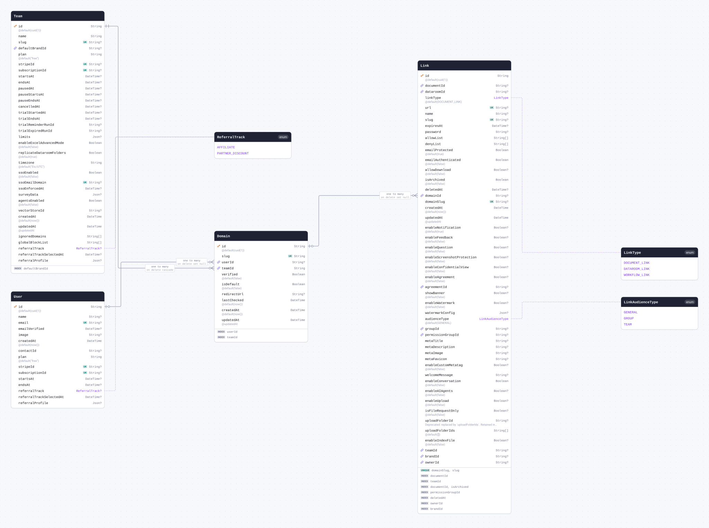

| Field         | Type       | Constraints                       | Default      | Description |
| ------------- | ---------- | --------------------------------- | ------------ | ----------- |
| `id`          | `String`   | PK NOT NULL                       | `cuid(1)`    |             |
| `slug`        | `String`   | UNIQUE NOT NULL                   |              |             |
| `userId`      | `String`   | NULL → [User.id](#model-User)     |              |             |
| `teamId`      | `String`   | NOT NULL → [Team.id](#model-Team) |              |             |
| `verified`    | `Boolean`  | NOT NULL                          | `false`      |             |
| `isDefault`   | `Boolean`  | NOT NULL                          | `false`      |             |
| `redirectUrl` | `String`   | NULL                              |              |             |
| `lastChecked` | `DateTime` | NOT NULL                          | `now()`      |             |
| `createdAt`   | `DateTime` | NOT NULL                          | `now()`      |             |
| `updatedAt`   | `DateTime` | NOT NULL                          | `@updatedAt` |             |

#### Indexes

- `@@index([userId])`
- `@@index([teamId])`

#### References

- `userId` → [User.id](#model-User) (many-to-one, on delete SetNull)
- `teamId` → [Team.id](#model-Team) (many-to-one, on delete Cascade)

#### Referenced by

- `id` ← [Link.domainId](#model-Link) (one-to-many, on delete SetNull)

#### Definition

```sql
CREATE TABLE "Domain" (
    "id" TEXT NOT NULL,
    "slug" TEXT NOT NULL,
    "userId" TEXT,
    "teamId" TEXT NOT NULL,
    "verified" BOOLEAN NOT NULL DEFAULT false,
    "isDefault" BOOLEAN NOT NULL DEFAULT false,
    "redirectUrl" TEXT,
    "lastChecked" TIMESTAMP(3) NOT NULL DEFAULT CURRENT_TIMESTAMP,
    "createdAt" TIMESTAMP(3) NOT NULL DEFAULT CURRENT_TIMESTAMP,
    "updatedAt" TIMESTAMP(3) NOT NULL,

    CONSTRAINT "Domain_pkey" PRIMARY KEY ("id")
);

CREATE UNIQUE INDEX "Domain_slug_key" ON "Domain"("slug");

CREATE INDEX "Domain_userId_idx" ON "Domain"("userId");

CREATE INDEX "Domain_teamId_idx" ON "Domain"("teamId");

ALTER TABLE "Domain" ADD CONSTRAINT "Domain_userId_fkey" FOREIGN KEY ("userId") REFERENCES "User"("id") ON DELETE SET NULL ON UPDATE CASCADE;

ALTER TABLE "Domain" ADD CONSTRAINT "Domain_teamId_fkey" FOREIGN KEY ("teamId") REFERENCES "Team"("id") ON DELETE CASCADE ON UPDATE CASCADE;
```

<details>
<summary>Queries and their SQL</summary>

**findMany**: Every row

```ts
await prisma.domain.findMany();
```

```sql
SELECT
  "public"."Domain"."id",
  "public"."Domain"."slug",
  "public"."Domain"."userId",
  "public"."Domain"."teamId",
  "public"."Domain"."verified",
  "public"."Domain"."isDefault",
  "public"."Domain"."redirectUrl",
  "public"."Domain"."lastChecked",
  "public"."Domain"."createdAt",
  "public"."Domain"."updatedAt"
FROM
  "public"."Domain"
WHERE
  1 = 1
OFFSET
  $1
-- params: ["0"]
```

**count**: How many rows there are

```ts
await prisma.domain.count();
```

```sql
SELECT
  COUNT(*) AS "_count$_all"
FROM
  (
    SELECT
      "public"."Domain"."id"
    FROM
      "public"."Domain"
    WHERE
      1 = 1
    OFFSET
      $1
  ) AS "sub"
-- params: ["0"]
```

**findMany**: Every row with its relations

```ts
await prisma.domain.findMany({ include: { user: true, Team: true, links: true } });
```

```sql
SELECT
  "public"."Domain"."id",
  "public"."Domain"."slug",
  "public"."Domain"."userId",
  "public"."Domain"."teamId",
  "public"."Domain"."verified",
  "public"."Domain"."isDefault",
  "public"."Domain"."redirectUrl",
  "public"."Domain"."lastChecked",
  "public"."Domain"."createdAt",
  "public"."Domain"."updatedAt"
FROM
  "public"."Domain"
WHERE
  1 = 1
OFFSET
  $1
-- params: ["0"]

SELECT
  "public"."User"."id",
  "public"."User"."name",
  "public"."User"."email",
  "public"."User"."emailVerified",
  "public"."User"."image",
  "public"."User"."createdAt",
  "public"."User"."contactId",
  "public"."User"."plan",
  "public"."User"."stripeId",
  "public"."User"."subscriptionId",
  "public"."User"."startsAt",
  "public"."User"."endsAt",
  "public"."User"."referralTrack"::text,
  "public"."User"."referralTrackSelectedAt",
  "public"."User"."referralProfile"
FROM
  "public"."User"
WHERE
  "public"."User"."id" IN ($1)
OFFSET
  $2
-- params: ["<userId of the rows above>","0"]

SELECT
  "public"."Team"."id",
  "public"."Team"."name",
  "public"."Team"."slug",
  "public"."Team"."defaultBrandId",
  "public"."Team"."plan",
  "public"."Team"."stripeId",
  "public"."Team"."subscriptionId",
  "public"."Team"."startsAt",
  "public"."Team"."endsAt",
  "public"."Team"."pausedAt",
  "public"."Team"."pauseStartsAt",
  "public"."Team"."pauseEndsAt",
  "public"."Team"."cancelledAt",
  "public"."Team"."trialStartedAt",
  "public"."Team"."trialEndsAt",
  "public"."Team"."trialReminderRunId",
  "public"."Team"."trialExpiredRunId",
  "public"."Team"."limits",
  "public"."Team"."enableExcelAdvancedMode",
  "public"."Team"."replicateDataroomFolders",
  "public"."Team"."timezone",
  "public"."Team"."ssoEnabled",
  "public"."Team"."ssoEmailDomain",
  "public"."Team"."ssoEnforcedAt",
  "public"."Team"."surveyData",
  "public"."Team"."agentsEnabled",
  "public"."Team"."vectorStoreId",
  "public"."Team"."createdAt",
  "public"."Team"."updatedAt",
  "public"."Team"."ignoredDomains",
  "public"."Team"."globalBlockList",
  "public"."Team"."referralTrack"::text,
  "public"."Team"."referralTrackSelectedAt",
  "public"."Team"."referralProfile"
FROM
  "public"."Team"
WHERE
  "public"."Team"."id" IN ($1)
OFFSET
  $2
-- params: ["<teamId of the rows above>","0"]

SELECT
  "public"."Link"."id",
  "public"."Link"."documentId",
  "public"."Link"."dataroomId",
  "public"."Link"."linkType"::text,
  "public"."Link"."url",
  "public"."Link"."name",
  "public"."Link"."slug",
  "public"."Link"."expiresAt",
  "public"."Link"."password",
  "public"."Link"."allowList",
  "public"."Link"."denyList",
  "public"."Link"."emailProtected",
  "public"."Link"."emailAuthenticated",
  "public"."Link"."allowDownload",
  "public"."Link"."isArchived",
  "public"."Link"."deletedAt",
  "public"."Link"."domainId",
  "public"."Link"."domainSlug",
  "public"."Link"."createdAt",
  "public"."Link"."updatedAt",
  "public"."Link"."enableNotification",
  "public"."Link"."enableFeedback",
  "public"."Link"."enableQuestion",
  "public"."Link"."enableScreenshotProtection",
  "public"."Link"."enableConfidentialView",
  "public"."Link"."enableAgreement",
  "public"."Link"."agreementId",
  "public"."Link"."showBanner",
  "public"."Link"."enableWatermark",
  "public"."Link"."watermarkConfig",
  "public"."Link"."audienceType"::text,
  "public"."Link"."groupId",
  "public"."Link"."permissionGroupId",
  "public"."Link"."metaTitle",
  "public"."Link"."metaDescription",
  "public"."Link"."metaImage",
  "public"."Link"."metaFavicon",
  "public"."Link"."enableCustomMetatag",
  "public"."Link"."welcomeMessage",
  "public"."Link"."enableConversation",
  "public"."Link"."enableAIAgents",
  "public"."Link"."enableUpload",
  "public"."Link"."isFileRequestOnly",
  "public"."Link"."uploadFolderId",
  "public"."Link"."uploadFolderIds",
  "public"."Link"."enableIndexFile",
  "public"."Link"."teamId",
  "public"."Link"."brandId",
  "public"."Link"."ownerId"
FROM
  "public"."Link"
WHERE
  "public"."Link"."domainId" IN ($1)
OFFSET
  $2
-- params: ["<id of the rows above>","0"]
```

**findUnique**: One row by what is unique to it

```ts
await prisma.domain.findUnique({ where: { id: "example" } });
```

```sql
SELECT
  "public"."Domain"."id",
  "public"."Domain"."slug",
  "public"."Domain"."userId",
  "public"."Domain"."teamId",
  "public"."Domain"."verified",
  "public"."Domain"."isDefault",
  "public"."Domain"."redirectUrl",
  "public"."Domain"."lastChecked",
  "public"."Domain"."createdAt",
  "public"."Domain"."updatedAt"
FROM
  "public"."Domain"
WHERE
  (
    "public"."Domain"."id" = $1
    AND 1 = 1
  )
LIMIT
  $2
OFFSET
  $3
-- params: ["example","1","0"]
```

**create**: Create a row

```ts
await prisma.domain.create({ data: { slug: "example", teamId: "example" } });
```

```sql
INSERT INTO
  "public"."Domain" (
    "id",
    "slug",
    "teamId",
    "verified",
    "isDefault",
    "lastChecked",
    "createdAt",
    "updatedAt"
  )
VALUES
  ($1, $2, $3, $4, $5, $6, $7, $8)
RETURNING
  "public"."Domain"."id",
  "public"."Domain"."slug",
  "public"."Domain"."userId",
  "public"."Domain"."teamId",
  "public"."Domain"."verified",
  "public"."Domain"."isDefault",
  "public"."Domain"."redirectUrl",
  "public"."Domain"."lastChecked",
  "public"."Domain"."createdAt",
  "public"."Domain"."updatedAt"
-- params: ["<cuid(1)>","example","example",false,false,"<now()>","<now()>","<now()>"]
```

**update**: Update a row

```ts
await prisma.domain.update({ where: { id: "example" }, data: { slug: "example" } });
```

```sql
UPDATE "public"."Domain"
SET
  "slug" = $1,
  "updatedAt" = $2
WHERE
  (
    "public"."Domain"."id" = $3
    AND 1 = 1
  )
RETURNING
  "public"."Domain"."id",
  "public"."Domain"."slug",
  "public"."Domain"."userId",
  "public"."Domain"."teamId",
  "public"."Domain"."verified",
  "public"."Domain"."isDefault",
  "public"."Domain"."redirectUrl",
  "public"."Domain"."lastChecked",
  "public"."Domain"."createdAt",
  "public"."Domain"."updatedAt"
-- params: ["example",{"prisma__type":"generatorCall","prisma__value":{"name":"now","args":[],"returnType":{"type":"DateTime"}}},"example"]
```

**delete**: Delete a row

```ts
await prisma.domain.delete({ where: { id: "example" } });
```

```sql
DELETE FROM "public"."Domain"
WHERE
  (
    "public"."Domain"."id" = $1
    AND 1 = 1
  )
RETURNING
  "public"."Domain"."id",
  "public"."Domain"."slug",
  "public"."Domain"."userId",
  "public"."Domain"."teamId",
  "public"."Domain"."verified",
  "public"."Domain"."isDefault",
  "public"."Domain"."redirectUrl",
  "public"."Domain"."lastChecked",
  "public"."Domain"."createdAt",
  "public"."Domain"."updatedAt"
-- params: ["example"]
```

</details>

<a id="model-View"></a>

### View

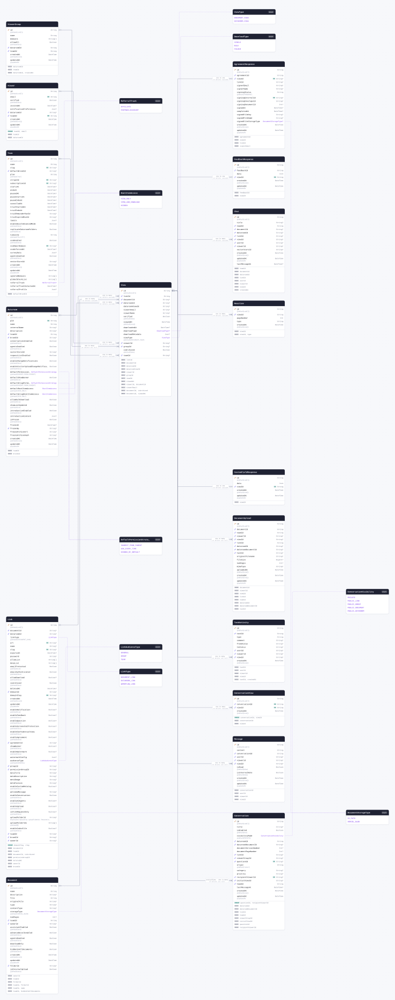

| Field              | Type                                 | Constraints                                 | Default         | Description |
| ------------------ | ------------------------------------ | ------------------------------------------- | --------------- | ----------- |
| `id`               | `String`                             | PK NOT NULL                                 | `cuid(1)`       |             |
| `linkId`           | `String`                             | NOT NULL → [Link.id](#model-Link)           |                 |             |
| `documentId`       | `String`                             | NULL → [Document.id](#model-Document)       |                 |             |
| `dataroomId`       | `String`                             | NULL → [Dataroom.id](#model-Dataroom)       |                 |             |
| `dataroomViewId`   | `String`                             | NULL                                        |                 |             |
| `viewerEmail`      | `String`                             | NULL                                        |                 |             |
| `viewerName`       | `String`                             | NULL                                        |                 |             |
| `verified`         | `Boolean`                            | NOT NULL                                    | `false`         |             |
| `viewedAt`         | `DateTime`                           | NOT NULL                                    | `now()`         |             |
| `downloadedAt`     | `DateTime`                           | NULL                                        |                 |             |
| `downloadType`     | [`DownloadType`](#enum-DownloadType) | NULL                                        |                 |             |
| `downloadMetadata` | `Json`                               | NULL                                        |                 |             |
| `viewType`         | [`ViewType`](#enum-ViewType)         | NOT NULL                                    | `DOCUMENT_VIEW` |             |
| `viewerId`         | `String`                             | NULL → [Viewer.id](#model-Viewer)           |                 |             |
| `groupId`          | `String`                             | NULL → [ViewerGroup.id](#model-ViewerGroup) |                 |             |
| `isArchived`       | `Boolean`                            | NOT NULL                                    | `false`         |             |
| `teamId`           | `String`                             | NULL → [Team.id](#model-Team)               |                 |             |

#### Indexes

- `@@index([linkId])`
- `@@index([documentId])`
- `@@index([dataroomId])`
- `@@index([dataroomViewId])`
- `@@index([viewerId])`
- `@@index([groupId])`
- `@@index([teamId])`
- `@@index([viewedAt])`
- `@@index([viewerId, documentId])`
- `@@index([viewerEmail])`
- `@@index([documentId, isArchived])`
- `@@index([documentId, viewedAt])`

#### References

- `linkId` → [Link.id](#model-Link) (many-to-one, on delete Cascade)
- `documentId` → [Document.id](#model-Document) (many-to-one, on delete Cascade)
- `dataroomId` → [Dataroom.id](#model-Dataroom) (many-to-one, on delete Cascade)
- `viewerId` → [Viewer.id](#model-Viewer) (many-to-one, on delete Cascade)
- `groupId` → [ViewerGroup.id](#model-ViewerGroup) (many-to-one, on delete SetNull)
- `teamId` → [Team.id](#model-Team) (many-to-one, on delete Cascade)

#### Referenced by

- `id` ← [Conversation.initialViewId](#model-Conversation) (one-to-many, on delete SetNull)
- `id` ← [Message.viewId](#model-Message) (one-to-many, on delete SetNull)
- `id` ← [ConversationView.viewId](#model-ConversationView) (one-to-many, on delete Cascade)
- `id` ← [TaskActivity.viewId](#model-TaskActivity) (one-to-many, on delete SetNull)
- `id` ← [DocumentUpload.viewId](#model-DocumentUpload) (one-to-many, on delete SetNull)
- `id` ← [CustomFieldResponse.viewId](#model-CustomFieldResponse) (one-to-one, on delete Cascade)
- `id` ← [Reaction.viewId](#model-Reaction) (one-to-many, on delete Cascade)
- `id` ← [Chat.viewId](#model-Chat) (one-to-many, on delete Cascade)
- `id` ← [FeedbackResponse.viewId](#model-FeedbackResponse) (one-to-one, on delete Cascade)
- `id` ← [AgreementResponse.viewId](#model-AgreementResponse) (one-to-one, on delete Cascade)

#### Definition

```sql
CREATE TABLE "View" (
    "id" TEXT NOT NULL,
    "linkId" TEXT NOT NULL,
    "documentId" TEXT,
    "dataroomId" TEXT,
    "dataroomViewId" TEXT,
    "viewerEmail" TEXT,
    "viewerName" TEXT,
    "verified" BOOLEAN NOT NULL DEFAULT false,
    "viewedAt" TIMESTAMP(3) NOT NULL DEFAULT CURRENT_TIMESTAMP,
    "downloadedAt" TIMESTAMP(3),
    "downloadType" "DownloadType",
    "downloadMetadata" JSONB,
    "viewType" "ViewType" NOT NULL DEFAULT 'DOCUMENT_VIEW',
    "viewerId" TEXT,
    "groupId" TEXT,
    "isArchived" BOOLEAN NOT NULL DEFAULT false,
    "teamId" TEXT,

    CONSTRAINT "View_pkey" PRIMARY KEY ("id")
);

CREATE INDEX "View_linkId_idx" ON "View"("linkId");

CREATE INDEX "View_documentId_idx" ON "View"("documentId");

CREATE INDEX "View_dataroomId_idx" ON "View"("dataroomId");

CREATE INDEX "View_dataroomViewId_idx" ON "View"("dataroomViewId");

CREATE INDEX "View_viewerId_idx" ON "View"("viewerId");

CREATE INDEX "View_groupId_idx" ON "View"("groupId");

CREATE INDEX "View_teamId_idx" ON "View"("teamId");

CREATE INDEX "View_viewedAt_idx" ON "View"("viewedAt" DESC);

CREATE INDEX "View_viewerId_documentId_idx" ON "View"("viewerId", "documentId");

CREATE INDEX "View_viewerEmail_idx" ON "View"("viewerEmail");

CREATE INDEX "View_documentId_isArchived_idx" ON "View"("documentId", "isArchived");

CREATE INDEX "View_documentId_viewedAt_idx" ON "View"("documentId", "viewedAt" DESC);

ALTER TABLE "View" ADD CONSTRAINT "View_linkId_fkey" FOREIGN KEY ("linkId") REFERENCES "Link"("id") ON DELETE CASCADE ON UPDATE CASCADE;

ALTER TABLE "View" ADD CONSTRAINT "View_documentId_fkey" FOREIGN KEY ("documentId") REFERENCES "Document"("id") ON DELETE CASCADE ON UPDATE CASCADE;

ALTER TABLE "View" ADD CONSTRAINT "View_dataroomId_fkey" FOREIGN KEY ("dataroomId") REFERENCES "Dataroom"("id") ON DELETE CASCADE ON UPDATE CASCADE;

ALTER TABLE "View" ADD CONSTRAINT "View_viewerId_fkey" FOREIGN KEY ("viewerId") REFERENCES "Viewer"("id") ON DELETE CASCADE ON UPDATE CASCADE;

ALTER TABLE "View" ADD CONSTRAINT "View_groupId_fkey" FOREIGN KEY ("groupId") REFERENCES "ViewerGroup"("id") ON DELETE SET NULL ON UPDATE CASCADE;

ALTER TABLE "View" ADD CONSTRAINT "View_teamId_fkey" FOREIGN KEY ("teamId") REFERENCES "Team"("id") ON DELETE CASCADE ON UPDATE CASCADE;
```

<details>
<summary>Queries and their SQL</summary>

**findMany**: Every row

```ts
await prisma.view.findMany();
```

```sql
SELECT
  "public"."View"."id",
  "public"."View"."linkId",
  "public"."View"."documentId",
  "public"."View"."dataroomId",
  "public"."View"."dataroomViewId",
  "public"."View"."viewerEmail",
  "public"."View"."viewerName",
  "public"."View"."verified",
  "public"."View"."viewedAt",
  "public"."View"."downloadedAt",
  "public"."View"."downloadType"::text,
  "public"."View"."downloadMetadata",
  "public"."View"."viewType"::text,
  "public"."View"."viewerId",
  "public"."View"."groupId",
  "public"."View"."isArchived",
  "public"."View"."teamId"
FROM
  "public"."View"
WHERE
  1 = 1
OFFSET
  $1
-- params: ["0"]
```

**count**: How many rows there are

```ts
await prisma.view.count();
```

```sql
SELECT
  COUNT(*) AS "_count$_all"
FROM
  (
    SELECT
      "public"."View"."id"
    FROM
      "public"."View"
    WHERE
      1 = 1
    OFFSET
      $1
  ) AS "sub"
-- params: ["0"]
```

**findMany**: Every row with its relations

```ts
await prisma.view.findMany({
  include: {
    link: true,
    document: true,
    dataroom: true,
    reactions: true,
    viewer: true,
    group: true,
    feedbackResponse: true,
    agreementResponse: true,
    customFieldResponse: true,
    conversationViews: true,
    messages: true,
    initialConversations: true,
    uploadedDocuments: true,
    taskActivities: true,
    chats: true,
    team: true,
  },
});
```

```sql
SELECT
  "public"."View"."id",
  "public"."View"."linkId",
  "public"."View"."documentId",
  "public"."View"."dataroomId",
  "public"."View"."dataroomViewId",
  "public"."View"."viewerEmail",
  "public"."View"."viewerName",
  "public"."View"."verified",
  "public"."View"."viewedAt",
  "public"."View"."downloadedAt",
  "public"."View"."downloadType"::text,
  "public"."View"."downloadMetadata",
  "public"."View"."viewType"::text,
  "public"."View"."viewerId",
  "public"."View"."groupId",
  "public"."View"."isArchived",
  "public"."View"."teamId"
FROM
  "public"."View"
WHERE
  1 = 1
OFFSET
  $1
-- params: ["0"]

SELECT
  "public"."Link"."id",
  "public"."Link"."documentId",
  "public"."Link"."dataroomId",
  "public"."Link"."linkType"::text,
  "public"."Link"."url",
  "public"."Link"."name",
  "public"."Link"."slug",
  "public"."Link"."expiresAt",
  "public"."Link"."password",
  "public"."Link"."allowList",
  "public"."Link"."denyList",
  "public"."Link"."emailProtected",
  "public"."Link"."emailAuthenticated",
  "public"."Link"."allowDownload",
  "public"."Link"."isArchived",
  "public"."Link"."deletedAt",
  "public"."Link"."domainId",
  "public"."Link"."domainSlug",
  "public"."Link"."createdAt",
  "public"."Link"."updatedAt",
  "public"."Link"."enableNotification",
  "public"."Link"."enableFeedback",
  "public"."Link"."enableQuestion",
  "public"."Link"."enableScreenshotProtection",
  "public"."Link"."enableConfidentialView",
  "public"."Link"."enableAgreement",
  "public"."Link"."agreementId",
  "public"."Link"."showBanner",
  "public"."Link"."enableWatermark",
  "public"."Link"."watermarkConfig",
  "public"."Link"."audienceType"::text,
  "public"."Link"."groupId",
  "public"."Link"."permissionGroupId",
  "public"."Link"."metaTitle",
  "public"."Link"."metaDescription",
  "public"."Link"."metaImage",
  "public"."Link"."metaFavicon",
  "public"."Link"."enableCustomMetatag",
  "public"."Link"."welcomeMessage",
  "public"."Link"."enableConversation",
  "public"."Link"."enableAIAgents",
  "public"."Link"."enableUpload",
  "public"."Link"."isFileRequestOnly",
  "public"."Link"."uploadFolderId",
  "public"."Link"."uploadFolderIds",
  "public"."Link"."enableIndexFile",
  "public"."Link"."teamId",
  "public"."Link"."brandId",
  "public"."Link"."ownerId"
FROM
  "public"."Link"
WHERE
  "public"."Link"."id" IN ($1)
OFFSET
  $2
-- params: ["<linkId of the rows above>","0"]

SELECT
  "public"."Document"."id",
  "public"."Document"."name",
  "public"."Document"."description",
  "public"."Document"."file",
  "public"."Document"."originalFile",
  "public"."Document"."type",
  "public"."Document"."contentType",
  "public"."Document"."storageType"::text,
  "public"."Document"."numPages",
  "public"."Document"."teamId",
  "public"."Document"."ownerId",
  "public"."Document"."assistantEnabled",
  "public"."Document"."advancedExcelEnabled",
  "public"."Document"."agentsEnabled",
  "public"."Document"."downloadOnly",
  "public"."Document"."hiddenInAllDocuments",
  "public"."Document"."createdAt",
  "public"."Document"."updatedAt",
  "public"."Document"."folderId",
  "public"."Document"."isExternalUpload"
FROM
  "public"."Document"
WHERE
  "public"."Document"."id" IN ($1)
OFFSET
  $2
-- params: ["<documentId of the rows above>","0"]

SELECT
  "public"."Dataroom"."id",
  "public"."Dataroom"."pId",
  "public"."Dataroom"."name",
  "public"."Dataroom"."internalName",
  "public"."Dataroom"."description",
  "public"."Dataroom"."teamId",
  "public"."Dataroom"."brandId",
  "public"."Dataroom"."conversationsEnabled",
  "public"."Dataroom"."agentsEnabled",
  "public"."Dataroom"."vectorStoreId",
  "public"."Dataroom"."requestListEnabled",
  "public"."Dataroom"."enableChangeNotifications",
  "public"."Dataroom"."enableVisitorUploadChangeNotifications",
  "public"."Dataroom"."defaultPermissionStrategy"::text,
  "public"."Dataroom"."defaultShowBanner",
  "public"."Dataroom"."defaultGroupPermissionStrategy"::text,
  "public"."Dataroom"."defaultRootItemAccess"::text,
  "public"."Dataroom"."defaultGroupRootItemAccess"::text,
  "public"."Dataroom"."allowBulkDownload",
  "public"."Dataroom"."showLastUpdated",
  "public"."Dataroom"."introductionEnabled",
  "public"."Dataroom"."introductionContent",
  "public"."Dataroom"."isFrozen",
  "public"."Dataroom"."frozenAt",
  "public"."Dataroom"."frozenBy",
  "public"."Dataroom"."freezeArchiveUrl",
  "public"."Dataroom"."freezeArchiveHash",
  "public"."Dataroom"."createdAt",
  "public"."Dataroom"."updatedAt"
FROM
  "public"."Dataroom"
WHERE
  "public"."Dataroom"."id" IN ($1)
OFFSET
  $2
-- params: ["<dataroomId of the rows above>","0"]

SELECT
  "public"."Reaction"."id",
  "public"."Reaction"."viewId",
  "public"."Reaction"."pageNumber",
  "public"."Reaction"."type",
  "public"."Reaction"."createdAt"
FROM
  "public"."Reaction"
WHERE
  "public"."Reaction"."viewId" IN ($1)
OFFSET
  $2
-- params: ["<id of the rows above>","0"]

SELECT
  "public"."Viewer"."id",
  "public"."Viewer"."email",
  "public"."Viewer"."verified",
  "public"."Viewer"."invitedAt",
  "public"."Viewer"."notificationPreferences",
  "public"."Viewer"."dataroomId",
  "public"."Viewer"."teamId",
  "public"."Viewer"."createdAt",
  "public"."Viewer"."updatedAt"
FROM
  "public"."Viewer"
WHERE
  "public"."Viewer"."id" IN ($1)
OFFSET
  $2
-- params: ["<viewerId of the rows above>","0"]

SELECT
  "public"."ViewerGroup"."id",
  "public"."ViewerGroup"."name",
  "public"."ViewerGroup"."domains",
  "public"."ViewerGroup"."allowAll",
  "public"."ViewerGroup"."dataroomId",
  "public"."ViewerGroup"."teamId",
  "public"."ViewerGroup"."createdAt",
  "public"."ViewerGroup"."updatedAt"
FROM
  "public"."ViewerGroup"
WHERE
  "public"."ViewerGroup"."id" IN ($1)
OFFSET
  $2
-- params: ["<groupId of the rows above>","0"]

SELECT
  "public"."FeedbackResponse"."id",
  "public"."FeedbackResponse"."feedbackId",
  "public"."FeedbackResponse"."data",
  "public"."FeedbackResponse"."viewId",
  "public"."FeedbackResponse"."createdAt",
  "public"."FeedbackResponse"."updatedAt"
FROM
  "public"."FeedbackResponse"
WHERE
  "public"."FeedbackResponse"."viewId" IN ($1)
OFFSET
  $2
-- params: ["<id of the rows above>","0"]

SELECT
  "public"."AgreementResponse"."id",
  "public"."AgreementResponse"."agreementId",
  "public"."AgreementResponse"."viewId",
  "public"."AgreementResponse"."linkId",
  "public"."AgreementResponse"."signerEmail",
  "public"."AgreementResponse"."signerName",
  "public"."AgreementResponse"."signingStatus",
  "public"."AgreementResponse"."signingExternalId",
  "public"."AgreementResponse"."signingEnvelopeId",
  "public"."AgreementResponse"."signingDocumentId",
  "public"."AgreementResponse"."signedAt",
  "public"."AgreementResponse"."completedAt",
  "public"."AgreementResponse"."signedFileKey",
  "public"."AgreementResponse"."signedFileName",
  "public"."AgreementResponse"."signedFileStorageType"::text,
  "public"."AgreementResponse"."createdAt",
  "public"."AgreementResponse"."updatedAt"
FROM
  "public"."AgreementResponse"
WHERE
  "public"."AgreementResponse"."viewId" IN ($1)
OFFSET
  $2
-- params: ["<id of the rows above>","0"]

SELECT
  "public"."CustomFieldResponse"."id",
  "public"."CustomFieldResponse"."data",
  "public"."CustomFieldResponse"."viewId",
  "public"."CustomFieldResponse"."createdAt",
  "public"."CustomFieldResponse"."updatedAt"
FROM
  "public"."CustomFieldResponse"
WHERE
  "public"."CustomFieldResponse"."viewId" IN ($1)
OFFSET
  $2
-- params: ["<id of the rows above>","0"]

SELECT
  "public"."ConversationView"."id",
  "public"."ConversationView"."conversationId",
  "public"."ConversationView"."viewId",
  "public"."ConversationView"."createdAt"
FROM
  "public"."ConversationView"
WHERE
  "public"."ConversationView"."viewId" IN ($1)
OFFSET
  $2
-- params: ["<id of the rows above>","0"]

SELECT
  "public"."Message"."id",
  "public"."Message"."content",
  "public"."Message"."conversationId",
  "public"."Message"."userId",
  "public"."Message"."viewerId",
  "public"."Message"."viewId",
  "public"."Message"."isRead",
  "public"."Message"."isInternalNote",
  "public"."Message"."createdAt",
  "public"."Message"."updatedAt"
FROM
  "public"."Message"
WHERE
  "public"."Message"."viewId" IN ($1)
OFFSET
  $2
-- params: ["<id of the rows above>","0"]

SELECT
  "public"."Conversation"."id",
  "public"."Conversation"."title",
  "public"."Conversation"."isEnabled",
  "public"."Conversation"."visibilityMode"::text,
  "public"."Conversation"."dataroomId",
  "public"."Conversation"."dataroomDocumentId",
  "public"."Conversation"."documentVersionNumber",
  "public"."Conversation"."documentPageNumber",
  "public"."Conversation"."linkId",
  "public"."Conversation"."viewerGroupId",
  "public"."Conversation"."questionId",
  "public"."Conversation"."origin",
  "public"."Conversation"."category",
  "public"."Conversation"."priority",
  "public"."Conversation"."recipientViewerId",
  "public"."Conversation"."initialViewId",
  "public"."Conversation"."teamId",
  "public"."Conversation"."lastMessageAt",
  "public"."Conversation"."createdAt",
  "public"."Conversation"."updatedAt"
FROM
  "public"."Conversation"
WHERE
  "public"."Conversation"."initialViewId" IN ($1)
OFFSET
  $2
-- params: ["<id of the rows above>","0"]

SELECT
  "public"."DocumentUpload"."id",
  "public"."DocumentUpload"."documentId",
  "public"."DocumentUpload"."teamId",
  "public"."DocumentUpload"."viewerId",
  "public"."DocumentUpload"."viewId",
  "public"."DocumentUpload"."linkId",
  "public"."DocumentUpload"."dataroomId",
  "public"."DocumentUpload"."dataroomDocumentId",
  "public"."DocumentUpload"."taskId",
  "public"."DocumentUpload"."originalFilename",
  "public"."DocumentUpload"."fileSize",
  "public"."DocumentUpload"."numPages",
  "public"."DocumentUpload"."mimeType",
  "public"."DocumentUpload"."uploadedAt",
  "public"."DocumentUpload"."createdAt",
  "public"."DocumentUpload"."updatedAt"
FROM
  "public"."DocumentUpload"
WHERE
  "public"."DocumentUpload"."viewId" IN ($1)
OFFSET
  $2
-- params: ["<id of the rows above>","0"]

SELECT
  "public"."TaskActivity"."id",
  "public"."TaskActivity"."taskId",
  "public"."TaskActivity"."type",
  "public"."TaskActivity"."comment",
  "public"."TaskActivity"."fromStatus",
  "public"."TaskActivity"."toStatus",
  "public"."TaskActivity"."userId",
  "public"."TaskActivity"."viewerId",
  "public"."TaskActivity"."viewId",
  "public"."TaskActivity"."createdAt"
FROM
  "public"."TaskActivity"
WHERE
  "public"."TaskActivity"."viewId" IN ($1)
OFFSET
  $2
-- params: ["<id of the rows above>","0"]

SELECT
  "public"."Chat"."id",
  "public"."Chat"."title",
  "public"."Chat"."teamId",
  "public"."Chat"."documentId",
  "public"."Chat"."dataroomId",
  "public"."Chat"."linkId",
  "public"."Chat"."viewId",
  "public"."Chat"."userId",
  "public"."Chat"."viewerId",
  "public"."Chat"."vectorStoreId",
  "public"."Chat"."createdAt",
  "public"."Chat"."updatedAt",
  "public"."Chat"."lastMessageAt"
FROM
  "public"."Chat"
WHERE
  "public"."Chat"."viewId" IN ($1)
OFFSET
  $2
-- params: ["<id of the rows above>","0"]

SELECT
  "public"."Team"."id",
  "public"."Team"."name",
  "public"."Team"."slug",
  "public"."Team"."defaultBrandId",
  "public"."Team"."plan",
  "public"."Team"."stripeId",
  "public"."Team"."subscriptionId",
  "public"."Team"."startsAt",
  "public"."Team"."endsAt",
  "public"."Team"."pausedAt",
  "public"."Team"."pauseStartsAt",
  "public"."Team"."pauseEndsAt",
  "public"."Team"."cancelledAt",
  "public"."Team"."trialStartedAt",
  "public"."Team"."trialEndsAt",
  "public"."Team"."trialReminderRunId",
  "public"."Team"."trialExpiredRunId",
  "public"."Team"."limits",
  "public"."Team"."enableExcelAdvancedMode",
  "public"."Team"."replicateDataroomFolders",
  "public"."Team"."timezone",
  "public"."Team"."ssoEnabled",
  "public"."Team"."ssoEmailDomain",
  "public"."Team"."ssoEnforcedAt",
  "public"."Team"."surveyData",
  "public"."Team"."agentsEnabled",
  "public"."Team"."vectorStoreId",
  "public"."Team"."createdAt",
  "public"."Team"."updatedAt",
  "public"."Team"."ignoredDomains",
  "public"."Team"."globalBlockList",
  "public"."Team"."referralTrack"::text,
  "public"."Team"."referralTrackSelectedAt",
  "public"."Team"."referralProfile"
FROM
  "public"."Team"
WHERE
  "public"."Team"."id" IN ($1)
OFFSET
  $2
-- params: ["<teamId of the rows above>","0"]
```

**findUnique**: One row by what is unique to it

```ts
await prisma.view.findUnique({ where: { id: "example" } });
```

```sql
SELECT
  "public"."View"."id",
  "public"."View"."linkId",
  "public"."View"."documentId",
  "public"."View"."dataroomId",
  "public"."View"."dataroomViewId",
  "public"."View"."viewerEmail",
  "public"."View"."viewerName",
  "public"."View"."verified",
  "public"."View"."viewedAt",
  "public"."View"."downloadedAt",
  "public"."View"."downloadType"::text,
  "public"."View"."downloadMetadata",
  "public"."View"."viewType"::text,
  "public"."View"."viewerId",
  "public"."View"."groupId",
  "public"."View"."isArchived",
  "public"."View"."teamId"
FROM
  "public"."View"
WHERE
  (
    "public"."View"."id" = $1
    AND 1 = 1
  )
LIMIT
  $2
OFFSET
  $3
-- params: ["example","1","0"]
```

**create**: Create a row

```ts
await prisma.view.create({ data: { linkId: "example" } });
```

```sql
INSERT INTO
  "public"."View" (
    "id",
    "linkId",
    "verified",
    "viewedAt",
    "viewType",
    "isArchived"
  )
VALUES
  (
    $1,
    $2,
    $3,
    $4,
    CAST($5::text AS "public"."ViewType"),
    $6
  )
RETURNING
  "public"."View"."id",
  "public"."View"."linkId",
  "public"."View"."documentId",
  "public"."View"."dataroomId",
  "public"."View"."dataroomViewId",
  "public"."View"."viewerEmail",
  "public"."View"."viewerName",
  "public"."View"."verified",
  "public"."View"."viewedAt",
  "public"."View"."downloadedAt",
  "public"."View"."downloadType"::text,
  "public"."View"."downloadMetadata",
  "public"."View"."viewType"::text,
  "public"."View"."viewerId",
  "public"."View"."groupId",
  "public"."View"."isArchived",
  "public"."View"."teamId"
-- params: ["<cuid(1)>","example",false,"<now()>","DOCUMENT_VIEW",false]
```

**update**: Update a row

```ts
await prisma.view.update({ where: { id: "example" }, data: { dataroomViewId: "example" } });
```

```sql
UPDATE "public"."View"
SET
  "dataroomViewId" = $1
WHERE
  (
    "public"."View"."id" = $2
    AND 1 = 1
  )
RETURNING
  "public"."View"."id",
  "public"."View"."linkId",
  "public"."View"."documentId",
  "public"."View"."dataroomId",
  "public"."View"."dataroomViewId",
  "public"."View"."viewerEmail",
  "public"."View"."viewerName",
  "public"."View"."verified",
  "public"."View"."viewedAt",
  "public"."View"."downloadedAt",
  "public"."View"."downloadType"::text,
  "public"."View"."downloadMetadata",
  "public"."View"."viewType"::text,
  "public"."View"."viewerId",
  "public"."View"."groupId",
  "public"."View"."isArchived",
  "public"."View"."teamId"
-- params: ["example","example"]
```

**delete**: Delete a row

```ts
await prisma.view.delete({ where: { id: "example" } });
```

```sql
DELETE FROM "public"."View"
WHERE
  (
    "public"."View"."id" = $1
    AND 1 = 1
  )
RETURNING
  "public"."View"."id",
  "public"."View"."linkId",
  "public"."View"."documentId",
  "public"."View"."dataroomId",
  "public"."View"."dataroomViewId",
  "public"."View"."viewerEmail",
  "public"."View"."viewerName",
  "public"."View"."verified",
  "public"."View"."viewedAt",
  "public"."View"."downloadedAt",
  "public"."View"."downloadType"::text,
  "public"."View"."downloadMetadata",
  "public"."View"."viewType"::text,
  "public"."View"."viewerId",
  "public"."View"."groupId",
  "public"."View"."isArchived",
  "public"."View"."teamId"
-- params: ["example"]
```

</details>

<a id="model-Viewer"></a>

### Viewer

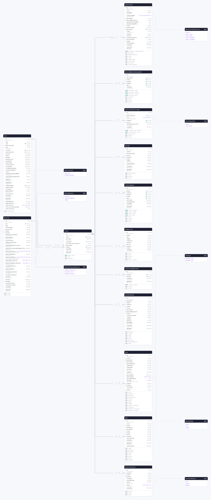

| Field                     | Type       | Constraints                           | Default      | Description |
| ------------------------- | ---------- | ------------------------------------- | ------------ | ----------- |
| `id`                      | `String`   | PK NOT NULL                           | `cuid(1)`    |             |
| `email`                   | `String`   | NOT NULL                              |              |             |
| `verified`                | `Boolean`  | NOT NULL                              | `false`      |             |
| `invitedAt`               | `DateTime` | NULL                                  |              |             |
| `notificationPreferences` | `Json`     | NULL                                  |              |             |
| `dataroomId`              | `String`   | NULL → [Dataroom.id](#model-Dataroom) |              |             |
| `teamId`                  | `String`   | NOT NULL → [Team.id](#model-Team)     |              |             |
| `createdAt`               | `DateTime` | NOT NULL                              | `now()`      |             |
| `updatedAt`               | `DateTime` | NOT NULL                              | `@updatedAt` |             |

#### Indexes

- `@@index([teamId])`
- `@@index([dataroomId])`
- `@@unique([teamId, email])`

#### References

- `dataroomId` → [Dataroom.id](#model-Dataroom) (many-to-one, on delete SetNull)
- `teamId` → [Team.id](#model-Team) (many-to-one, on delete Cascade)

#### Referenced by

- `id` ← [Conversation.recipientViewerId](#model-Conversation) (one-to-many, on delete SetNull)
- `id` ← [DataroomQuestionAssignment.viewerId](#model-DataroomQuestionAssignment) (one-to-many, on delete Cascade)
- `id` ← [ConversationParticipant.viewerId](#model-ConversationParticipant) (one-to-many, on delete SetNull)
- `id` ← [Message.viewerId](#model-Message) (one-to-many, on delete SetNull)
- `id` ← [TaskAssignment.viewerId](#model-TaskAssignment) (one-to-many, on delete Cascade)
- `id` ← [TaskActivity.viewerId](#model-TaskActivity) (one-to-many, on delete SetNull)
- `id` ← [ViewerGroupMembership.viewerId](#model-ViewerGroupMembership) (one-to-many, on delete Cascade)
- `id` ← [DocumentUpload.viewerId](#model-DocumentUpload) (one-to-many, on delete SetNull)
- `id` ← [View.viewerId](#model-View) (one-to-many, on delete Cascade)
- `id` ← [Chat.viewerId](#model-Chat) (one-to-many, on delete Cascade)
- `id` ← [ViewerInvitation.viewerId](#model-ViewerInvitation) (one-to-many, on delete Cascade)

#### Definition

```sql
CREATE TABLE "Viewer" (
    "id" TEXT NOT NULL,
    "email" TEXT NOT NULL,
    "verified" BOOLEAN NOT NULL DEFAULT false,
    "invitedAt" TIMESTAMP(3),
    "notificationPreferences" JSONB,
    "dataroomId" TEXT,
    "teamId" TEXT NOT NULL,
    "createdAt" TIMESTAMP(3) NOT NULL DEFAULT CURRENT_TIMESTAMP,
    "updatedAt" TIMESTAMP(3) NOT NULL,

    CONSTRAINT "Viewer_pkey" PRIMARY KEY ("id")
);

CREATE INDEX "Viewer_teamId_idx" ON "Viewer"("teamId");

CREATE INDEX "Viewer_dataroomId_idx" ON "Viewer"("dataroomId");

CREATE UNIQUE INDEX "Viewer_teamId_email_key" ON "Viewer"("teamId", "email");

ALTER TABLE "Viewer" ADD CONSTRAINT "Viewer_dataroomId_fkey" FOREIGN KEY ("dataroomId") REFERENCES "Dataroom"("id") ON DELETE SET NULL ON UPDATE CASCADE;

ALTER TABLE "Viewer" ADD CONSTRAINT "Viewer_teamId_fkey" FOREIGN KEY ("teamId") REFERENCES "Team"("id") ON DELETE CASCADE ON UPDATE CASCADE;
```

<details>
<summary>Queries and their SQL</summary>

**findMany**: Every row

```ts
await prisma.viewer.findMany();
```

```sql
SELECT
  "public"."Viewer"."id",
  "public"."Viewer"."email",
  "public"."Viewer"."verified",
  "public"."Viewer"."invitedAt",
  "public"."Viewer"."notificationPreferences",
  "public"."Viewer"."dataroomId",
  "public"."Viewer"."teamId",
  "public"."Viewer"."createdAt",
  "public"."Viewer"."updatedAt"
FROM
  "public"."Viewer"
WHERE
  1 = 1
OFFSET
  $1
-- params: ["0"]
```

**count**: How many rows there are

```ts
await prisma.viewer.count();
```

```sql
SELECT
  COUNT(*) AS "_count$_all"
FROM
  (
    SELECT
      "public"."Viewer"."id"
    FROM
      "public"."Viewer"
    WHERE
      1 = 1
    OFFSET
      $1
  ) AS "sub"
-- params: ["0"]
```

**findMany**: Every row with its relations

```ts
await prisma.viewer.findMany({
  include: {
    dataroom: true,
    team: true,
    views: true,
    groups: true,
    invitations: true,
    participatedConversations: true,
    messages: true,
    recipientConversations: true,
    questionAssignments: true,
    uploadedDocuments: true,
    taskAssignments: true,
    taskActivities: true,
    chats: true,
  },
});
```

```sql
SELECT
  "public"."Viewer"."id",
  "public"."Viewer"."email",
  "public"."Viewer"."verified",
  "public"."Viewer"."invitedAt",
  "public"."Viewer"."notificationPreferences",
  "public"."Viewer"."dataroomId",
  "public"."Viewer"."teamId",
  "public"."Viewer"."createdAt",
  "public"."Viewer"."updatedAt"
FROM
  "public"."Viewer"
WHERE
  1 = 1
OFFSET
  $1
-- params: ["0"]

SELECT
  "public"."Dataroom"."id",
  "public"."Dataroom"."pId",
  "public"."Dataroom"."name",
  "public"."Dataroom"."internalName",
  "public"."Dataroom"."description",
  "public"."Dataroom"."teamId",
  "public"."Dataroom"."brandId",
  "public"."Dataroom"."conversationsEnabled",
  "public"."Dataroom"."agentsEnabled",
  "public"."Dataroom"."vectorStoreId",
  "public"."Dataroom"."requestListEnabled",
  "public"."Dataroom"."enableChangeNotifications",
  "public"."Dataroom"."enableVisitorUploadChangeNotifications",
  "public"."Dataroom"."defaultPermissionStrategy"::text,
  "public"."Dataroom"."defaultShowBanner",
  "public"."Dataroom"."defaultGroupPermissionStrategy"::text,
  "public"."Dataroom"."defaultRootItemAccess"::text,
  "public"."Dataroom"."defaultGroupRootItemAccess"::text,
  "public"."Dataroom"."allowBulkDownload",
  "public"."Dataroom"."showLastUpdated",
  "public"."Dataroom"."introductionEnabled",
  "public"."Dataroom"."introductionContent",
  "public"."Dataroom"."isFrozen",
  "public"."Dataroom"."frozenAt",
  "public"."Dataroom"."frozenBy",
  "public"."Dataroom"."freezeArchiveUrl",
  "public"."Dataroom"."freezeArchiveHash",
  "public"."Dataroom"."createdAt",
  "public"."Dataroom"."updatedAt"
FROM
  "public"."Dataroom"
WHERE
  "public"."Dataroom"."id" IN ($1)
OFFSET
  $2
-- params: ["<dataroomId of the rows above>","0"]

SELECT
  "public"."Team"."id",
  "public"."Team"."name",
  "public"."Team"."slug",
  "public"."Team"."defaultBrandId",
  "public"."Team"."plan",
  "public"."Team"."stripeId",
  "public"."Team"."subscriptionId",
  "public"."Team"."startsAt",
  "public"."Team"."endsAt",
  "public"."Team"."pausedAt",
  "public"."Team"."pauseStartsAt",
  "public"."Team"."pauseEndsAt",
  "public"."Team"."cancelledAt",
  "public"."Team"."trialStartedAt",
  "public"."Team"."trialEndsAt",
  "public"."Team"."trialReminderRunId",
  "public"."Team"."trialExpiredRunId",
  "public"."Team"."limits",
  "public"."Team"."enableExcelAdvancedMode",
  "public"."Team"."replicateDataroomFolders",
  "public"."Team"."timezone",
  "public"."Team"."ssoEnabled",
  "public"."Team"."ssoEmailDomain",
  "public"."Team"."ssoEnforcedAt",
  "public"."Team"."surveyData",
  "public"."Team"."agentsEnabled",
  "public"."Team"."vectorStoreId",
  "public"."Team"."createdAt",
  "public"."Team"."updatedAt",
  "public"."Team"."ignoredDomains",
  "public"."Team"."globalBlockList",
  "public"."Team"."referralTrack"::text,
  "public"."Team"."referralTrackSelectedAt",
  "public"."Team"."referralProfile"
FROM
  "public"."Team"
WHERE
  "public"."Team"."id" IN ($1)
OFFSET
  $2
-- params: ["<teamId of the rows above>","0"]

SELECT
  "public"."View"."id",
  "public"."View"."linkId",
  "public"."View"."documentId",
  "public"."View"."dataroomId",
  "public"."View"."dataroomViewId",
  "public"."View"."viewerEmail",
  "public"."View"."viewerName",
  "public"."View"."verified",
  "public"."View"."viewedAt",
  "public"."View"."downloadedAt",
  "public"."View"."downloadType"::text,
  "public"."View"."downloadMetadata",
  "public"."View"."viewType"::text,
  "public"."View"."viewerId",
  "public"."View"."groupId",
  "public"."View"."isArchived",
  "public"."View"."teamId"
FROM
  "public"."View"
WHERE
  "public"."View"."viewerId" IN ($1)
OFFSET
  $2
-- params: ["<id of the rows above>","0"]

SELECT
  "public"."ViewerGroupMembership"."id",
  "public"."ViewerGroupMembership"."viewerId",
  "public"."ViewerGroupMembership"."groupId",
  "public"."ViewerGroupMembership"."createdAt",
  "public"."ViewerGroupMembership"."updatedAt"
FROM
  "public"."ViewerGroupMembership"
WHERE
  "public"."ViewerGroupMembership"."viewerId" IN ($1)
OFFSET
  $2
-- params: ["<id of the rows above>","0"]

SELECT
  "public"."ViewerInvitation"."id",
  "public"."ViewerInvitation"."viewerId",
  "public"."ViewerInvitation"."linkId",
  "public"."ViewerInvitation"."groupId",
  "public"."ViewerInvitation"."invitedBy",
  "public"."ViewerInvitation"."customMessage",
  "public"."ViewerInvitation"."sentAt",
  "public"."ViewerInvitation"."status"::text,
  "public"."ViewerInvitation"."createdAt"
FROM
  "public"."ViewerInvitation"
WHERE
  "public"."ViewerInvitation"."viewerId" IN ($1)
OFFSET
  $2
-- params: ["<id of the rows above>","0"]

SELECT
  "public"."ConversationParticipant"."id",
  "public"."ConversationParticipant"."conversationId",
  "public"."ConversationParticipant"."role"::text,
  "public"."ConversationParticipant"."viewerId",
  "public"."ConversationParticipant"."userId",
  "public"."ConversationParticipant"."receiveNotifications",
  "public"."ConversationParticipant"."createdAt"
FROM
  "public"."ConversationParticipant"
WHERE
  "public"."ConversationParticipant"."viewerId" IN ($1)
OFFSET
  $2
-- params: ["<id of the rows above>","0"]

SELECT
  "public"."Message"."id",
  "public"."Message"."content",
  "public"."Message"."conversationId",
  "public"."Message"."userId",
  "public"."Message"."viewerId",
  "public"."Message"."viewId",
  "public"."Message"."isRead",
  "public"."Message"."isInternalNote",
  "public"."Message"."createdAt",
  "public"."Message"."updatedAt"
FROM
  "public"."Message"
WHERE
  "public"."Message"."viewerId" IN ($1)
OFFSET
  $2
-- params: ["<id of the rows above>","0"]

SELECT
  "public"."Conversation"."id",
  "public"."Conversation"."title",
  "public"."Conversation"."isEnabled",
  "public"."Conversation"."visibilityMode"::text,
  "public"."Conversation"."dataroomId",
  "public"."Conversation"."dataroomDocumentId",
  "public"."Conversation"."documentVersionNumber",
  "public"."Conversation"."documentPageNumber",
  "public"."Conversation"."linkId",
  "public"."Conversation"."viewerGroupId",
  "public"."Conversation"."questionId",
  "public"."Conversation"."origin",
  "public"."Conversation"."category",
  "public"."Conversation"."priority",
  "public"."Conversation"."recipientViewerId",
  "public"."Conversation"."initialViewId",
  "public"."Conversation"."teamId",
  "public"."Conversation"."lastMessageAt",
  "public"."Conversation"."createdAt",
  "public"."Conversation"."updatedAt"
FROM
  "public"."Conversation"
WHERE
  "public"."Conversation"."recipientViewerId" IN ($1)
OFFSET
  $2
-- params: ["<id of the rows above>","0"]

SELECT
  "public"."DataroomQuestionAssignment"."id",
  "public"."DataroomQuestionAssignment"."questionId",
  "public"."DataroomQuestionAssignment"."linkId",
  "public"."DataroomQuestionAssignment"."groupId",
  "public"."DataroomQuestionAssignment"."viewerId",
  "public"."DataroomQuestionAssignment"."email",
  "public"."DataroomQuestionAssignment"."createdAt"
FROM
  "public"."DataroomQuestionAssignment"
WHERE
  "public"."DataroomQuestionAssignment"."viewerId" IN ($1)
OFFSET
  $2
-- params: ["<id of the rows above>","0"]

SELECT
  "public"."DocumentUpload"."id",
  "public"."DocumentUpload"."documentId",
  "public"."DocumentUpload"."teamId",
  "public"."DocumentUpload"."viewerId",
  "public"."DocumentUpload"."viewId",
  "public"."DocumentUpload"."linkId",
  "public"."DocumentUpload"."dataroomId",
  "public"."DocumentUpload"."dataroomDocumentId",
  "public"."DocumentUpload"."taskId",
  "public"."DocumentUpload"."originalFilename",
  "public"."DocumentUpload"."fileSize",
  "public"."DocumentUpload"."numPages",
  "public"."DocumentUpload"."mimeType",
  "public"."DocumentUpload"."uploadedAt",
  "public"."DocumentUpload"."createdAt",
  "public"."DocumentUpload"."updatedAt"
FROM
  "public"."DocumentUpload"
WHERE
  "public"."DocumentUpload"."viewerId" IN ($1)
OFFSET
  $2
-- params: ["<id of the rows above>","0"]

SELECT
  "public"."TaskAssignment"."id",
  "public"."TaskAssignment"."taskId",
  "public"."TaskAssignment"."viewerId",
  "public"."TaskAssignment"."groupId",
  "public"."TaskAssignment"."linkId",
  "public"."TaskAssignment"."email",
  "public"."TaskAssignment"."notifiedAt",
  "public"."TaskAssignment"."lastReminderAt",
  "public"."TaskAssignment"."createdAt",
  "public"."TaskAssignment"."updatedAt"
FROM
  "public"."TaskAssignment"
WHERE
  "public"."TaskAssignment"."viewerId" IN ($1)
OFFSET
  $2
-- params: ["<id of the rows above>","0"]

SELECT
  "public"."TaskActivity"."id",
  "public"."TaskActivity"."taskId",
  "public"."TaskActivity"."type",
  "public"."TaskActivity"."comment",
  "public"."TaskActivity"."fromStatus",
  "public"."TaskActivity"."toStatus",
  "public"."TaskActivity"."userId",
  "public"."TaskActivity"."viewerId",
  "public"."TaskActivity"."viewId",
  "public"."TaskActivity"."createdAt"
FROM
  "public"."TaskActivity"
WHERE
  "public"."TaskActivity"."viewerId" IN ($1)
OFFSET
  $2
-- params: ["<id of the rows above>","0"]

SELECT
  "public"."Chat"."id",
  "public"."Chat"."title",
  "public"."Chat"."teamId",
  "public"."Chat"."documentId",
  "public"."Chat"."dataroomId",
  "public"."Chat"."linkId",
  "public"."Chat"."viewId",
  "public"."Chat"."userId",
  "public"."Chat"."viewerId",
  "public"."Chat"."vectorStoreId",
  "public"."Chat"."createdAt",
  "public"."Chat"."updatedAt",
  "public"."Chat"."lastMessageAt"
FROM
  "public"."Chat"
WHERE
  "public"."Chat"."viewerId" IN ($1)
OFFSET
  $2
-- params: ["<id of the rows above>","0"]
```

**findUnique**: One row by what is unique to it

```ts
await prisma.viewer.findUnique({ where: { id: "example" } });
```

```sql
SELECT
  "public"."Viewer"."id",
  "public"."Viewer"."email",
  "public"."Viewer"."verified",
  "public"."Viewer"."invitedAt",
  "public"."Viewer"."notificationPreferences",
  "public"."Viewer"."dataroomId",
  "public"."Viewer"."teamId",
  "public"."Viewer"."createdAt",
  "public"."Viewer"."updatedAt"
FROM
  "public"."Viewer"
WHERE
  (
    "public"."Viewer"."id" = $1
    AND 1 = 1
  )
LIMIT
  $2
OFFSET
  $3
-- params: ["example","1","0"]
```

**create**: Create a row

```ts
await prisma.viewer.create({ data: { email: "example", teamId: "example" } });
```

```sql
INSERT INTO
  "public"."Viewer" (
    "id",
    "email",
    "verified",
    "teamId",
    "createdAt",
    "updatedAt"
  )
VALUES
  ($1, $2, $3, $4, $5, $6)
RETURNING
  "public"."Viewer"."id",
  "public"."Viewer"."email",
  "public"."Viewer"."verified",
  "public"."Viewer"."invitedAt",
  "public"."Viewer"."notificationPreferences",
  "public"."Viewer"."dataroomId",
  "public"."Viewer"."teamId",
  "public"."Viewer"."createdAt",
  "public"."Viewer"."updatedAt"
-- params: ["<cuid(1)>","example",false,"example","<now()>","<now()>"]
```

**update**: Update a row

```ts
await prisma.viewer.update({ where: { id: "example" }, data: { email: "example" } });
```

```sql
UPDATE "public"."Viewer"
SET
  "email" = $1,
  "updatedAt" = $2
WHERE
  (
    "public"."Viewer"."id" = $3
    AND 1 = 1
  )
RETURNING
  "public"."Viewer"."id",
  "public"."Viewer"."email",
  "public"."Viewer"."verified",
  "public"."Viewer"."invitedAt",
  "public"."Viewer"."notificationPreferences",
  "public"."Viewer"."dataroomId",
  "public"."Viewer"."teamId",
  "public"."Viewer"."createdAt",
  "public"."Viewer"."updatedAt"
-- params: ["example",{"prisma__type":"generatorCall","prisma__value":{"name":"now","args":[],"returnType":{"type":"DateTime"}}},"example"]
```

**delete**: Delete a row

```ts
await prisma.viewer.delete({ where: { id: "example" } });
```

```sql
DELETE FROM "public"."Viewer"
WHERE
  (
    "public"."Viewer"."id" = $1
    AND 1 = 1
  )
RETURNING
  "public"."Viewer"."id",
  "public"."Viewer"."email",
  "public"."Viewer"."verified",
  "public"."Viewer"."invitedAt",
  "public"."Viewer"."notificationPreferences",
  "public"."Viewer"."dataroomId",
  "public"."Viewer"."teamId",
  "public"."Viewer"."createdAt",
  "public"."Viewer"."updatedAt"
-- params: ["example"]
```

</details>

<a id="model-Reaction"></a>

### Reaction

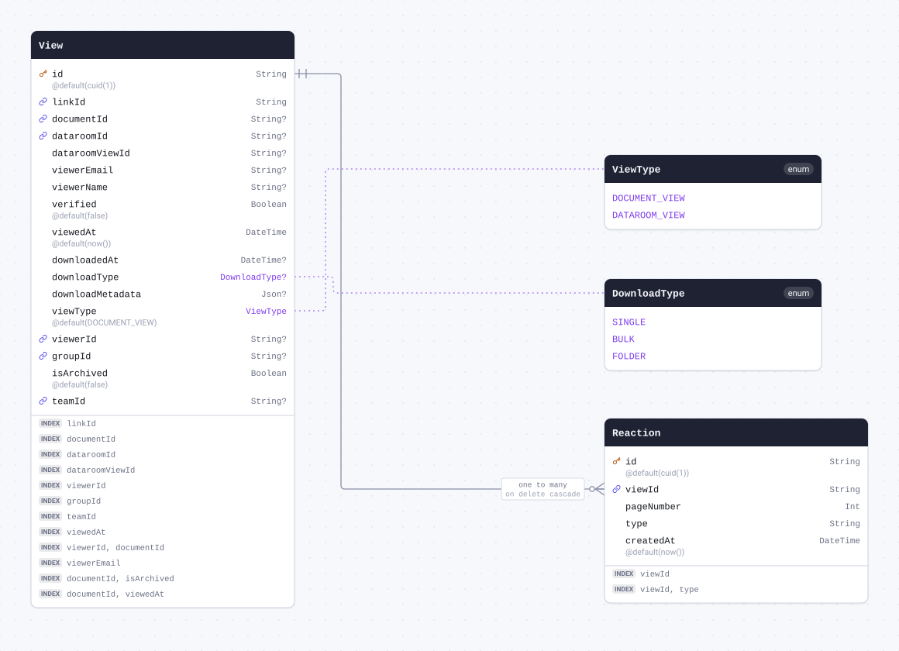

| Field        | Type       | Constraints                       | Default   | Description |
| ------------ | ---------- | --------------------------------- | --------- | ----------- |
| `id`         | `String`   | PK NOT NULL                       | `cuid(1)` |             |
| `viewId`     | `String`   | NOT NULL → [View.id](#model-View) |           |             |
| `pageNumber` | `Int`      | NOT NULL                          |           |             |
| `type`       | `String`   | NOT NULL                          |           |             |
| `createdAt`  | `DateTime` | NOT NULL                          | `now()`   |             |

#### Indexes

- `@@index([viewId])`
- `@@index([viewId, type])`

#### References

- `viewId` → [View.id](#model-View) (many-to-one, on delete Cascade)

#### Definition

```sql
CREATE TABLE "Reaction" (
    "id" TEXT NOT NULL,
    "viewId" TEXT NOT NULL,
    "pageNumber" INTEGER NOT NULL,
    "type" TEXT NOT NULL,
    "createdAt" TIMESTAMP(3) NOT NULL DEFAULT CURRENT_TIMESTAMP,

    CONSTRAINT "Reaction_pkey" PRIMARY KEY ("id")
);

CREATE INDEX "Reaction_viewId_idx" ON "Reaction"("viewId");

CREATE INDEX "Reaction_viewId_type_idx" ON "Reaction"("viewId", "type");

ALTER TABLE "Reaction" ADD CONSTRAINT "Reaction_viewId_fkey" FOREIGN KEY ("viewId") REFERENCES "View"("id") ON DELETE CASCADE ON UPDATE CASCADE;
```

<details>
<summary>Queries and their SQL</summary>

**findMany**: Every row

```ts
await prisma.reaction.findMany();
```

```sql
SELECT
  "public"."Reaction"."id",
  "public"."Reaction"."viewId",
  "public"."Reaction"."pageNumber",
  "public"."Reaction"."type",
  "public"."Reaction"."createdAt"
FROM
  "public"."Reaction"
WHERE
  1 = 1
OFFSET
  $1
-- params: ["0"]
```

**count**: How many rows there are

```ts
await prisma.reaction.count();
```

```sql
SELECT
  COUNT(*) AS "_count$_all"
FROM
  (
    SELECT
      "public"."Reaction"."id"
    FROM
      "public"."Reaction"
    WHERE
      1 = 1
    OFFSET
      $1
  ) AS "sub"
-- params: ["0"]
```

**findMany**: Every row with its relations

```ts
await prisma.reaction.findMany({ include: { view: true } });
```

```sql
SELECT
  "public"."Reaction"."id",
  "public"."Reaction"."viewId",
  "public"."Reaction"."pageNumber",
  "public"."Reaction"."type",
  "public"."Reaction"."createdAt"
FROM
  "public"."Reaction"
WHERE
  1 = 1
OFFSET
  $1
-- params: ["0"]

SELECT
  "public"."View"."id",
  "public"."View"."linkId",
  "public"."View"."documentId",
  "public"."View"."dataroomId",
  "public"."View"."dataroomViewId",
  "public"."View"."viewerEmail",
  "public"."View"."viewerName",
  "public"."View"."verified",
  "public"."View"."viewedAt",
  "public"."View"."downloadedAt",
  "public"."View"."downloadType"::text,
  "public"."View"."downloadMetadata",
  "public"."View"."viewType"::text,
  "public"."View"."viewerId",
  "public"."View"."groupId",
  "public"."View"."isArchived",
  "public"."View"."teamId"
FROM
  "public"."View"
WHERE
  "public"."View"."id" IN ($1)
OFFSET
  $2
-- params: ["<viewId of the rows above>","0"]
```

**findUnique**: One row by what is unique to it

```ts
await prisma.reaction.findUnique({ where: { id: "example" } });
```

```sql
SELECT
  "public"."Reaction"."id",
  "public"."Reaction"."viewId",
  "public"."Reaction"."pageNumber",
  "public"."Reaction"."type",
  "public"."Reaction"."createdAt"
FROM
  "public"."Reaction"
WHERE
  (
    "public"."Reaction"."id" = $1
    AND 1 = 1
  )
LIMIT
  $2
OFFSET
  $3
-- params: ["example","1","0"]
```

**create**: Create a row

```ts
await prisma.reaction.create({ data: { viewId: "example", pageNumber: 1, type: "example" } });
```

```sql
INSERT INTO
  "public"."Reaction" ("id", "viewId", "pageNumber", "type", "createdAt")
VALUES
  ($1, $2, $3, $4, $5)
RETURNING
  "public"."Reaction"."id",
  "public"."Reaction"."viewId",
  "public"."Reaction"."pageNumber",
  "public"."Reaction"."type",
  "public"."Reaction"."createdAt"
-- params: ["<cuid(1)>","example","1","example","<now()>"]
```

**update**: Update a row

```ts
await prisma.reaction.update({ where: { id: "example" }, data: { pageNumber: 1 } });
```

```sql
UPDATE "public"."Reaction"
SET
  "pageNumber" = $1
WHERE
  (
    "public"."Reaction"."id" = $2
    AND 1 = 1
  )
RETURNING
  "public"."Reaction"."id",
  "public"."Reaction"."viewId",
  "public"."Reaction"."pageNumber",
  "public"."Reaction"."type",
  "public"."Reaction"."createdAt"
-- params: ["1","example"]
```

**delete**: Delete a row

```ts
await prisma.reaction.delete({ where: { id: "example" } });
```

```sql
DELETE FROM "public"."Reaction"
WHERE
  (
    "public"."Reaction"."id" = $1
    AND 1 = 1
  )
RETURNING
  "public"."Reaction"."id",
  "public"."Reaction"."viewId",
  "public"."Reaction"."pageNumber",
  "public"."Reaction"."type",
  "public"."Reaction"."createdAt"
-- params: ["example"]
```

</details>

<a id="model-Invitation"></a>

### Invitation

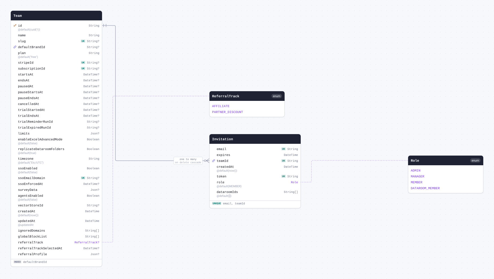

| Field         | Type                 | Constraints                       | Default  | Description |
| ------------- | -------------------- | --------------------------------- | -------- | ----------- |
| `email`       | `String`             | NOT NULL                          |          |             |
| `expires`     | `DateTime`           | NOT NULL                          |          |             |
| `teamId`      | `String`             | NOT NULL → [Team.id](#model-Team) |          |             |
| `createdAt`   | `DateTime`           | NOT NULL                          | `now()`  |             |
| `token`       | `String`             | UNIQUE NOT NULL                   |          |             |
| `role`        | [`Role`](#enum-Role) | NOT NULL                          | `MEMBER` |             |
| `dataroomIds` | `String[]`           | NOT NULL                          | `[]`     |             |

#### Indexes

- `@@unique([email, teamId])`

#### References

- `teamId` → [Team.id](#model-Team) (many-to-one, on delete Cascade)

#### Definition

```sql
CREATE TABLE "Invitation" (
    "email" TEXT NOT NULL,
    "expires" TIMESTAMP(3) NOT NULL,
    "teamId" TEXT NOT NULL,
    "createdAt" TIMESTAMP(3) NOT NULL DEFAULT CURRENT_TIMESTAMP,
    "token" TEXT NOT NULL,
    "role" "Role" NOT NULL DEFAULT 'MEMBER',
    "dataroomIds" TEXT[] DEFAULT ARRAY[]::TEXT[]
);

CREATE UNIQUE INDEX "Invitation_token_key" ON "Invitation"("token");

CREATE UNIQUE INDEX "Invitation_email_teamId_key" ON "Invitation"("email", "teamId");

ALTER TABLE "Invitation" ADD CONSTRAINT "Invitation_teamId_fkey" FOREIGN KEY ("teamId") REFERENCES "Team"("id") ON DELETE CASCADE ON UPDATE CASCADE;
```

<details>
<summary>Queries and their SQL</summary>

**findMany**: Every row

```ts
await prisma.invitation.findMany();
```

```sql
SELECT
  "public"."Invitation"."token",
  "public"."Invitation"."email",
  "public"."Invitation"."expires",
  "public"."Invitation"."teamId",
  "public"."Invitation"."createdAt",
  "public"."Invitation"."role"::text,
  "public"."Invitation"."dataroomIds"
FROM
  "public"."Invitation"
WHERE
  1 = 1
OFFSET
  $1
-- params: ["0"]
```

**count**: How many rows there are

```ts
await prisma.invitation.count();
```

```sql
SELECT
  COUNT(*) AS "_count$_all"
FROM
  (
    SELECT
      "public"."Invitation"."token"
    FROM
      "public"."Invitation"
    WHERE
      1 = 1
    OFFSET
      $1
  ) AS "sub"
-- params: ["0"]
```

**findMany**: Every row with its relations

```ts
await prisma.invitation.findMany({ include: { team: true } });
```

```sql
SELECT
  "public"."Invitation"."token",
  "public"."Invitation"."email",
  "public"."Invitation"."expires",
  "public"."Invitation"."teamId",
  "public"."Invitation"."createdAt",
  "public"."Invitation"."role"::text,
  "public"."Invitation"."dataroomIds"
FROM
  "public"."Invitation"
WHERE
  1 = 1
OFFSET
  $1
-- params: ["0"]

SELECT
  "public"."Team"."id",
  "public"."Team"."name",
  "public"."Team"."slug",
  "public"."Team"."defaultBrandId",
  "public"."Team"."plan",
  "public"."Team"."stripeId",
  "public"."Team"."subscriptionId",
  "public"."Team"."startsAt",
  "public"."Team"."endsAt",
  "public"."Team"."pausedAt",
  "public"."Team"."pauseStartsAt",
  "public"."Team"."pauseEndsAt",
  "public"."Team"."cancelledAt",
  "public"."Team"."trialStartedAt",
  "public"."Team"."trialEndsAt",
  "public"."Team"."trialReminderRunId",
  "public"."Team"."trialExpiredRunId",
  "public"."Team"."limits",
  "public"."Team"."enableExcelAdvancedMode",
  "public"."Team"."replicateDataroomFolders",
  "public"."Team"."timezone",
  "public"."Team"."ssoEnabled",
  "public"."Team"."ssoEmailDomain",
  "public"."Team"."ssoEnforcedAt",
  "public"."Team"."surveyData",
  "public"."Team"."agentsEnabled",
  "public"."Team"."vectorStoreId",
  "public"."Team"."createdAt",
  "public"."Team"."updatedAt",
  "public"."Team"."ignoredDomains",
  "public"."Team"."globalBlockList",
  "public"."Team"."referralTrack"::text,
  "public"."Team"."referralTrackSelectedAt",
  "public"."Team"."referralProfile"
FROM
  "public"."Team"
WHERE
  "public"."Team"."id" IN ($1)
OFFSET
  $2
-- params: ["<teamId of the rows above>","0"]
```

**findUnique**: One row by what is unique to it

```ts
await prisma.invitation.findUnique({ where: { token: "example" } });
```

```sql
SELECT
  "public"."Invitation"."token",
  "public"."Invitation"."email",
  "public"."Invitation"."expires",
  "public"."Invitation"."teamId",
  "public"."Invitation"."createdAt",
  "public"."Invitation"."role"::text,
  "public"."Invitation"."dataroomIds"
FROM
  "public"."Invitation"
WHERE
  (
    "public"."Invitation"."token" = $1
    AND 1 = 1
  )
LIMIT
  $2
OFFSET
  $3
-- params: ["example","1","0"]
```

**create**: Create a row

```ts
await prisma.invitation.create({
  data: {
    email: "example",
    expires: new Date("2026-01-01T00:00:00.000Z"),
    teamId: "example",
    token: "example",
  },
});
```

```sql
INSERT INTO
  "public"."Invitation" (
    "email",
    "expires",
    "teamId",
    "createdAt",
    "token",
    "role",
    "dataroomIds"
  )
VALUES
  (
    $1,
    $2,
    $3,
    $4,
    $5,
    CAST($6::text AS "public"."Role"),
    $7
  )
RETURNING
  "public"."Invitation"."token",
  "public"."Invitation"."email",
  "public"."Invitation"."expires",
  "public"."Invitation"."teamId",
  "public"."Invitation"."createdAt",
  "public"."Invitation"."role"::text,
  "public"."Invitation"."dataroomIds"
-- params: ["example","2026-01-01T00:00:00.000Z","example","<now()>","example","MEMBER",[]]
```

**update**: Update a row

```ts
await prisma.invitation.update({ where: { token: "example" }, data: { email: "example" } });
```

```sql
UPDATE "public"."Invitation"
SET
  "email" = $1
WHERE
  (
    "public"."Invitation"."token" = $2
    AND 1 = 1
  )
RETURNING
  "public"."Invitation"."token",
  "public"."Invitation"."email",
  "public"."Invitation"."expires",
  "public"."Invitation"."teamId",
  "public"."Invitation"."createdAt",
  "public"."Invitation"."role"::text,
  "public"."Invitation"."dataroomIds"
-- params: ["example","example"]
```

**delete**: Delete a row

```ts
await prisma.invitation.delete({ where: { token: "example" } });
```

```sql
DELETE FROM "public"."Invitation"
WHERE
  (
    "public"."Invitation"."token" = $1
    AND 1 = 1
  )
RETURNING
  "public"."Invitation"."token",
  "public"."Invitation"."email",
  "public"."Invitation"."expires",
  "public"."Invitation"."teamId",
  "public"."Invitation"."createdAt",
  "public"."Invitation"."role"::text,
  "public"."Invitation"."dataroomIds"
-- params: ["example"]
```

</details>

<a id="model-SentEmail"></a>

### SentEmail


| Field        | Type                           | Constraints                       | Default   | Description |
| ------------ | ------------------------------ | --------------------------------- | --------- | ----------- |
| `id`         | `String`                       | PK NOT NULL                       | `cuid(1)` |             |
| `type`       | [`EmailType`](#enum-EmailType) | NOT NULL                          |           |             |
| `recipient`  | `String`                       | NOT NULL                          |           |             |
| `marketing`  | `Boolean`                      | NOT NULL                          | `false`   |             |
| `createdAt`  | `DateTime`                     | NOT NULL                          | `now()`   |             |
| `teamId`     | `String`                       | NOT NULL → [Team.id](#model-Team) |           |             |
| `domainSlug` | `String`                       | NULL                              |           |             |

#### Indexes

- `@@index([teamId])`

#### References

- `teamId` → [Team.id](#model-Team) (many-to-one, on delete Cascade)

#### Definition

```sql
CREATE TABLE "SentEmail" (
    "id" TEXT NOT NULL,
    "type" "EmailType" NOT NULL,
    "recipient" TEXT NOT NULL,
    "marketing" BOOLEAN NOT NULL DEFAULT false,
    "createdAt" TIMESTAMP(3) NOT NULL DEFAULT CURRENT_TIMESTAMP,
    "teamId" TEXT NOT NULL,
    "domainSlug" TEXT,

    CONSTRAINT "SentEmail_pkey" PRIMARY KEY ("id")
);

CREATE INDEX "SentEmail_teamId_idx" ON "SentEmail"("teamId");

ALTER TABLE "SentEmail" ADD CONSTRAINT "SentEmail_teamId_fkey" FOREIGN KEY ("teamId") REFERENCES "Team"("id") ON DELETE CASCADE ON UPDATE CASCADE;
```

<details>
<summary>Queries and their SQL</summary>

**findMany**: Every row

```ts
await prisma.sentEmail.findMany();
```

```sql
SELECT
  "public"."SentEmail"."id",
  "public"."SentEmail"."type"::text,
  "public"."SentEmail"."recipient",
  "public"."SentEmail"."marketing",
  "public"."SentEmail"."createdAt",
  "public"."SentEmail"."teamId",
  "public"."SentEmail"."domainSlug"
FROM
  "public"."SentEmail"
WHERE
  1 = 1
OFFSET
  $1
-- params: ["0"]
```

**count**: How many rows there are

```ts
await prisma.sentEmail.count();
```

```sql
SELECT
  COUNT(*) AS "_count$_all"
FROM
  (
    SELECT
      "public"."SentEmail"."id"
    FROM
      "public"."SentEmail"
    WHERE
      1 = 1
    OFFSET
      $1
  ) AS "sub"
-- params: ["0"]
```

**findMany**: Every row with its relations

```ts
await prisma.sentEmail.findMany({ include: { team: true } });
```

```sql
SELECT
  "public"."SentEmail"."id",
  "public"."SentEmail"."type"::text,
  "public"."SentEmail"."recipient",
  "public"."SentEmail"."marketing",
  "public"."SentEmail"."createdAt",
  "public"."SentEmail"."teamId",
  "public"."SentEmail"."domainSlug"
FROM
  "public"."SentEmail"
WHERE
  1 = 1
OFFSET
  $1
-- params: ["0"]

SELECT
  "public"."Team"."id",
  "public"."Team"."name",
  "public"."Team"."slug",
  "public"."Team"."defaultBrandId",
  "public"."Team"."plan",
  "public"."Team"."stripeId",
  "public"."Team"."subscriptionId",
  "public"."Team"."startsAt",
  "public"."Team"."endsAt",
  "public"."Team"."pausedAt",
  "public"."Team"."pauseStartsAt",
  "public"."Team"."pauseEndsAt",
  "public"."Team"."cancelledAt",
  "public"."Team"."trialStartedAt",
  "public"."Team"."trialEndsAt",
  "public"."Team"."trialReminderRunId",
  "public"."Team"."trialExpiredRunId",
  "public"."Team"."limits",
  "public"."Team"."enableExcelAdvancedMode",
  "public"."Team"."replicateDataroomFolders",
  "public"."Team"."timezone",
  "public"."Team"."ssoEnabled",
  "public"."Team"."ssoEmailDomain",
  "public"."Team"."ssoEnforcedAt",
  "public"."Team"."surveyData",
  "public"."Team"."agentsEnabled",
  "public"."Team"."vectorStoreId",
  "public"."Team"."createdAt",
  "public"."Team"."updatedAt",
  "public"."Team"."ignoredDomains",
  "public"."Team"."globalBlockList",
  "public"."Team"."referralTrack"::text,
  "public"."Team"."referralTrackSelectedAt",
  "public"."Team"."referralProfile"
FROM
  "public"."Team"
WHERE
  "public"."Team"."id" IN ($1)
OFFSET
  $2
-- params: ["<teamId of the rows above>","0"]
```

**findUnique**: One row by what is unique to it

```ts
await prisma.sentEmail.findUnique({ where: { id: "example" } });
```

```sql
SELECT
  "public"."SentEmail"."id",
  "public"."SentEmail"."type"::text,
  "public"."SentEmail"."recipient",
  "public"."SentEmail"."marketing",
  "public"."SentEmail"."createdAt",
  "public"."SentEmail"."teamId",
  "public"."SentEmail"."domainSlug"
FROM
  "public"."SentEmail"
WHERE
  (
    "public"."SentEmail"."id" = $1
    AND 1 = 1
  )
LIMIT
  $2
OFFSET
  $3
-- params: ["example","1","0"]
```

**create**: Create a row

```ts
await prisma.sentEmail.create({
  data: { type: "FIRST_DAY_DOMAIN_REMINDER_EMAIL", recipient: "example", teamId: "example" },
});
```

```sql
INSERT INTO
  "public"."SentEmail" (
    "id",
    "type",
    "recipient",
    "marketing",
    "createdAt",
    "teamId"
  )
VALUES
  (
    $1,
    CAST($2::text AS "public"."EmailType"),
    $3,
    $4,
    $5,
    $6
  )
RETURNING
  "public"."SentEmail"."id",
  "public"."SentEmail"."type"::text,
  "public"."SentEmail"."recipient",
  "public"."SentEmail"."marketing",
  "public"."SentEmail"."createdAt",
  "public"."SentEmail"."teamId",
  "public"."SentEmail"."domainSlug"
-- params: ["<cuid(1)>","FIRST_DAY_DOMAIN_REMINDER_EMAIL","example",false,"<now()>","example"]
```

**update**: Update a row

```ts
await prisma.sentEmail.update({
  where: { id: "example" },
  data: { type: "FIRST_DAY_DOMAIN_REMINDER_EMAIL" },
});
```

```sql
UPDATE "public"."SentEmail"
SET
  "type" = CAST($1::text AS "public"."EmailType")
WHERE
  (
    "public"."SentEmail"."id" = $2
    AND 1 = 1
  )
RETURNING
  "public"."SentEmail"."id",
  "public"."SentEmail"."type"::text,
  "public"."SentEmail"."recipient",
  "public"."SentEmail"."marketing",
  "public"."SentEmail"."createdAt",
  "public"."SentEmail"."teamId",
  "public"."SentEmail"."domainSlug"
-- params: ["FIRST_DAY_DOMAIN_REMINDER_EMAIL","example"]
```

**delete**: Delete a row

```ts
await prisma.sentEmail.delete({ where: { id: "example" } });
```

```sql
DELETE FROM "public"."SentEmail"
WHERE
  (
    "public"."SentEmail"."id" = $1
    AND 1 = 1
  )
RETURNING
  "public"."SentEmail"."id",
  "public"."SentEmail"."type"::text,
  "public"."SentEmail"."recipient",
  "public"."SentEmail"."marketing",
  "public"."SentEmail"."createdAt",
  "public"."SentEmail"."teamId",
  "public"."SentEmail"."domainSlug"
-- params: ["example"]
```

</details>

<a id="model-Chat"></a>

### Chat


| Field           | Type       | Constraints                           | Default      | Description |
| --------------- | ---------- | ------------------------------------- | ------------ | ----------- |
| `id`            | `String`   | PK NOT NULL                           | `cuid(1)`    |             |
| `title`         | `String`   | NULL                                  |              |             |
| `teamId`        | `String`   | NOT NULL → [Team.id](#model-Team)     |              |             |
| `documentId`    | `String`   | NULL → [Document.id](#model-Document) |              |             |
| `dataroomId`    | `String`   | NULL → [Dataroom.id](#model-Dataroom) |              |             |
| `linkId`        | `String`   | NULL → [Link.id](#model-Link)         |              |             |
| `viewId`        | `String`   | NULL → [View.id](#model-View)         |              |             |
| `userId`        | `String`   | NULL → [User.id](#model-User)         |              |             |
| `viewerId`      | `String`   | NULL → [Viewer.id](#model-Viewer)     |              |             |
| `vectorStoreId` | `String`   | NULL                                  |              |             |
| `createdAt`     | `DateTime` | NOT NULL                              | `now()`      |             |
| `updatedAt`     | `DateTime` | NOT NULL                              | `@updatedAt` |             |
| `lastMessageAt` | `DateTime` | NULL                                  |              |             |

#### Indexes

- `@@index([teamId])`
- `@@index([documentId])`
- `@@index([dataroomId])`
- `@@index([linkId])`
- `@@index([userId])`
- `@@index([viewerId])`
- `@@index([viewId])`
- `@@index([createdAt])`

#### References

- `teamId` → [Team.id](#model-Team) (many-to-one, on delete Cascade)
- `documentId` → [Document.id](#model-Document) (many-to-one, on delete Cascade)
- `dataroomId` → [Dataroom.id](#model-Dataroom) (many-to-one, on delete Cascade)
- `linkId` → [Link.id](#model-Link) (many-to-one, on delete Cascade)
- `viewId` → [View.id](#model-View) (many-to-one, on delete Cascade)
- `userId` → [User.id](#model-User) (many-to-one, on delete Cascade)
- `viewerId` → [Viewer.id](#model-Viewer) (many-to-one, on delete Cascade)

#### Referenced by

- `id` ← [ChatMessage.chatId](#model-ChatMessage) (one-to-many, on delete Cascade)

#### Definition

```sql
CREATE TABLE "Chat" (
    "id" TEXT NOT NULL,
    "title" TEXT,
    "teamId" TEXT NOT NULL,
    "documentId" TEXT,
    "dataroomId" TEXT,
    "linkId" TEXT,
    "viewId" TEXT,
    "userId" TEXT,
    "viewerId" TEXT,
    "vectorStoreId" TEXT,
    "createdAt" TIMESTAMP(3) NOT NULL DEFAULT CURRENT_TIMESTAMP,
    "updatedAt" TIMESTAMP(3) NOT NULL,
    "lastMessageAt" TIMESTAMP(3),

    CONSTRAINT "Chat_pkey" PRIMARY KEY ("id")
);

CREATE INDEX "Chat_teamId_idx" ON "Chat"("teamId");

CREATE INDEX "Chat_documentId_idx" ON "Chat"("documentId");

CREATE INDEX "Chat_dataroomId_idx" ON "Chat"("dataroomId");

CREATE INDEX "Chat_linkId_idx" ON "Chat"("linkId");

CREATE INDEX "Chat_userId_idx" ON "Chat"("userId");

CREATE INDEX "Chat_viewerId_idx" ON "Chat"("viewerId");

CREATE INDEX "Chat_viewId_idx" ON "Chat"("viewId");

CREATE INDEX "Chat_createdAt_idx" ON "Chat"("createdAt" DESC);

ALTER TABLE "Chat" ADD CONSTRAINT "Chat_teamId_fkey" FOREIGN KEY ("teamId") REFERENCES "Team"("id") ON DELETE CASCADE ON UPDATE CASCADE;

ALTER TABLE "Chat" ADD CONSTRAINT "Chat_documentId_fkey" FOREIGN KEY ("documentId") REFERENCES "Document"("id") ON DELETE CASCADE ON UPDATE CASCADE;

ALTER TABLE "Chat" ADD CONSTRAINT "Chat_dataroomId_fkey" FOREIGN KEY ("dataroomId") REFERENCES "Dataroom"("id") ON DELETE CASCADE ON UPDATE CASCADE;

ALTER TABLE "Chat" ADD CONSTRAINT "Chat_linkId_fkey" FOREIGN KEY ("linkId") REFERENCES "Link"("id") ON DELETE CASCADE ON UPDATE CASCADE;

ALTER TABLE "Chat" ADD CONSTRAINT "Chat_viewId_fkey" FOREIGN KEY ("viewId") REFERENCES "View"("id") ON DELETE CASCADE ON UPDATE CASCADE;

ALTER TABLE "Chat" ADD CONSTRAINT "Chat_userId_fkey" FOREIGN KEY ("userId") REFERENCES "User"("id") ON DELETE CASCADE ON UPDATE CASCADE;

ALTER TABLE "Chat" ADD CONSTRAINT "Chat_viewerId_fkey" FOREIGN KEY ("viewerId") REFERENCES "Viewer"("id") ON DELETE CASCADE ON UPDATE CASCADE;
```

<details>
<summary>Queries and their SQL</summary>

**findMany**: Every row

```ts
await prisma.chat.findMany();
```

```sql
SELECT
  "public"."Chat"."id",
  "public"."Chat"."title",
  "public"."Chat"."teamId",
  "public"."Chat"."documentId",
  "public"."Chat"."dataroomId",
  "public"."Chat"."linkId",
  "public"."Chat"."viewId",
  "public"."Chat"."userId",
  "public"."Chat"."viewerId",
  "public"."Chat"."vectorStoreId",
  "public"."Chat"."createdAt",
  "public"."Chat"."updatedAt",
  "public"."Chat"."lastMessageAt"
FROM
  "public"."Chat"
WHERE
  1 = 1
OFFSET
  $1
-- params: ["0"]
```

**count**: How many rows there are

```ts
await prisma.chat.count();
```

```sql
SELECT
  COUNT(*) AS "_count$_all"
FROM
  (
    SELECT
      "public"."Chat"."id"
    FROM
      "public"."Chat"
    WHERE
      1 = 1
    OFFSET
      $1
  ) AS "sub"
-- params: ["0"]
```

**findMany**: Every row with its relations

```ts
await prisma.chat.findMany({
  include: {
    team: true,
    document: true,
    dataroom: true,
    link: true,
    view: true,
    user: true,
    viewer: true,
    messages: true,
  },
});
```

```sql
SELECT
  "public"."Chat"."id",
  "public"."Chat"."title",
  "public"."Chat"."teamId",
  "public"."Chat"."documentId",
  "public"."Chat"."dataroomId",
  "public"."Chat"."linkId",
  "public"."Chat"."viewId",
  "public"."Chat"."userId",
  "public"."Chat"."viewerId",
  "public"."Chat"."vectorStoreId",
  "public"."Chat"."createdAt",
  "public"."Chat"."updatedAt",
  "public"."Chat"."lastMessageAt"
FROM
  "public"."Chat"
WHERE
  1 = 1
OFFSET
  $1
-- params: ["0"]

SELECT
  "public"."Team"."id",
  "public"."Team"."name",
  "public"."Team"."slug",
  "public"."Team"."defaultBrandId",
  "public"."Team"."plan",
  "public"."Team"."stripeId",
  "public"."Team"."subscriptionId",
  "public"."Team"."startsAt",
  "public"."Team"."endsAt",
  "public"."Team"."pausedAt",
  "public"."Team"."pauseStartsAt",
  "public"."Team"."pauseEndsAt",
  "public"."Team"."cancelledAt",
  "public"."Team"."trialStartedAt",
  "public"."Team"."trialEndsAt",
  "public"."Team"."trialReminderRunId",
  "public"."Team"."trialExpiredRunId",
  "public"."Team"."limits",
  "public"."Team"."enableExcelAdvancedMode",
  "public"."Team"."replicateDataroomFolders",
  "public"."Team"."timezone",
  "public"."Team"."ssoEnabled",
  "public"."Team"."ssoEmailDomain",
  "public"."Team"."ssoEnforcedAt",
  "public"."Team"."surveyData",
  "public"."Team"."agentsEnabled",
  "public"."Team"."vectorStoreId",
  "public"."Team"."createdAt",
  "public"."Team"."updatedAt",
  "public"."Team"."ignoredDomains",
  "public"."Team"."globalBlockList",
  "public"."Team"."referralTrack"::text,
  "public"."Team"."referralTrackSelectedAt",
  "public"."Team"."referralProfile"
FROM
  "public"."Team"
WHERE
  "public"."Team"."id" IN ($1)
OFFSET
  $2
-- params: ["<teamId of the rows above>","0"]

SELECT
  "public"."Document"."id",
  "public"."Document"."name",
  "public"."Document"."description",
  "public"."Document"."file",
  "public"."Document"."originalFile",
  "public"."Document"."type",
  "public"."Document"."contentType",
  "public"."Document"."storageType"::text,
  "public"."Document"."numPages",
  "public"."Document"."teamId",
  "public"."Document"."ownerId",
  "public"."Document"."assistantEnabled",
  "public"."Document"."advancedExcelEnabled",
  "public"."Document"."agentsEnabled",
  "public"."Document"."downloadOnly",
  "public"."Document"."hiddenInAllDocuments",
  "public"."Document"."createdAt",
  "public"."Document"."updatedAt",
  "public"."Document"."folderId",
  "public"."Document"."isExternalUpload"
FROM
  "public"."Document"
WHERE
  "public"."Document"."id" IN ($1)
OFFSET
  $2
-- params: ["<documentId of the rows above>","0"]

SELECT
  "public"."Dataroom"."id",
  "public"."Dataroom"."pId",
  "public"."Dataroom"."name",
  "public"."Dataroom"."internalName",
  "public"."Dataroom"."description",
  "public"."Dataroom"."teamId",
  "public"."Dataroom"."brandId",
  "public"."Dataroom"."conversationsEnabled",
  "public"."Dataroom"."agentsEnabled",
  "public"."Dataroom"."vectorStoreId",
  "public"."Dataroom"."requestListEnabled",
  "public"."Dataroom"."enableChangeNotifications",
  "public"."Dataroom"."enableVisitorUploadChangeNotifications",
  "public"."Dataroom"."defaultPermissionStrategy"::text,
  "public"."Dataroom"."defaultShowBanner",
  "public"."Dataroom"."defaultGroupPermissionStrategy"::text,
  "public"."Dataroom"."defaultRootItemAccess"::text,
  "public"."Dataroom"."defaultGroupRootItemAccess"::text,
  "public"."Dataroom"."allowBulkDownload",
  "public"."Dataroom"."showLastUpdated",
  "public"."Dataroom"."introductionEnabled",
  "public"."Dataroom"."introductionContent",
  "public"."Dataroom"."isFrozen",
  "public"."Dataroom"."frozenAt",
  "public"."Dataroom"."frozenBy",
  "public"."Dataroom"."freezeArchiveUrl",
  "public"."Dataroom"."freezeArchiveHash",
  "public"."Dataroom"."createdAt",
  "public"."Dataroom"."updatedAt"
FROM
  "public"."Dataroom"
WHERE
  "public"."Dataroom"."id" IN ($1)
OFFSET
  $2
-- params: ["<dataroomId of the rows above>","0"]

SELECT
  "public"."Link"."id",
  "public"."Link"."documentId",
  "public"."Link"."dataroomId",
  "public"."Link"."linkType"::text,
  "public"."Link"."url",
  "public"."Link"."name",
  "public"."Link"."slug",
  "public"."Link"."expiresAt",
  "public"."Link"."password",
  "public"."Link"."allowList",
  "public"."Link"."denyList",
  "public"."Link"."emailProtected",
  "public"."Link"."emailAuthenticated",
  "public"."Link"."allowDownload",
  "public"."Link"."isArchived",
  "public"."Link"."deletedAt",
  "public"."Link"."domainId",
  "public"."Link"."domainSlug",
  "public"."Link"."createdAt",
  "public"."Link"."updatedAt",
  "public"."Link"."enableNotification",
  "public"."Link"."enableFeedback",
  "public"."Link"."enableQuestion",
  "public"."Link"."enableScreenshotProtection",
  "public"."Link"."enableConfidentialView",
  "public"."Link"."enableAgreement",
  "public"."Link"."agreementId",
  "public"."Link"."showBanner",
  "public"."Link"."enableWatermark",
  "public"."Link"."watermarkConfig",
  "public"."Link"."audienceType"::text,
  "public"."Link"."groupId",
  "public"."Link"."permissionGroupId",
  "public"."Link"."metaTitle",
  "public"."Link"."metaDescription",
  "public"."Link"."metaImage",
  "public"."Link"."metaFavicon",
  "public"."Link"."enableCustomMetatag",
  "public"."Link"."welcomeMessage",
  "public"."Link"."enableConversation",
  "public"."Link"."enableAIAgents",
  "public"."Link"."enableUpload",
  "public"."Link"."isFileRequestOnly",
  "public"."Link"."uploadFolderId",
  "public"."Link"."uploadFolderIds",
  "public"."Link"."enableIndexFile",
  "public"."Link"."teamId",
  "public"."Link"."brandId",
  "public"."Link"."ownerId"
FROM
  "public"."Link"
WHERE
  "public"."Link"."id" IN ($1)
OFFSET
  $2
-- params: ["<linkId of the rows above>","0"]

SELECT
  "public"."View"."id",
  "public"."View"."linkId",
  "public"."View"."documentId",
  "public"."View"."dataroomId",
  "public"."View"."dataroomViewId",
  "public"."View"."viewerEmail",
  "public"."View"."viewerName",
  "public"."View"."verified",
  "public"."View"."viewedAt",
  "public"."View"."downloadedAt",
  "public"."View"."downloadType"::text,
  "public"."View"."downloadMetadata",
  "public"."View"."viewType"::text,
  "public"."View"."viewerId",
  "public"."View"."groupId",
  "public"."View"."isArchived",
  "public"."View"."teamId"
FROM
  "public"."View"
WHERE
  "public"."View"."id" IN ($1)
OFFSET
  $2
-- params: ["<viewId of the rows above>","0"]

SELECT
  "public"."User"."id",
  "public"."User"."name",
  "public"."User"."email",
  "public"."User"."emailVerified",
  "public"."User"."image",
  "public"."User"."createdAt",
  "public"."User"."contactId",
  "public"."User"."plan",
  "public"."User"."stripeId",
  "public"."User"."subscriptionId",
  "public"."User"."startsAt",
  "public"."User"."endsAt",
  "public"."User"."referralTrack"::text,
  "public"."User"."referralTrackSelectedAt",
  "public"."User"."referralProfile"
FROM
  "public"."User"
WHERE
  "public"."User"."id" IN ($1)
OFFSET
  $2
-- params: ["<userId of the rows above>","0"]

SELECT
  "public"."Viewer"."id",
  "public"."Viewer"."email",
  "public"."Viewer"."verified",
  "public"."Viewer"."invitedAt",
  "public"."Viewer"."notificationPreferences",
  "public"."Viewer"."dataroomId",
  "public"."Viewer"."teamId",
  "public"."Viewer"."createdAt",
  "public"."Viewer"."updatedAt"
FROM
  "public"."Viewer"
WHERE
  "public"."Viewer"."id" IN ($1)
OFFSET
  $2
-- params: ["<viewerId of the rows above>","0"]

SELECT
  "public"."ChatMessage"."id",
  "public"."ChatMessage"."chatId",
  "public"."ChatMessage"."role",
  "public"."ChatMessage"."content",
  "public"."ChatMessage"."metadata",
  "public"."ChatMessage"."createdAt"
FROM
  "public"."ChatMessage"
WHERE
  "public"."ChatMessage"."chatId" IN ($1)
OFFSET
  $2
-- params: ["<id of the rows above>","0"]
```

**findUnique**: One row by what is unique to it

```ts
await prisma.chat.findUnique({ where: { id: "example" } });
```

```sql
SELECT
  "public"."Chat"."id",
  "public"."Chat"."title",
  "public"."Chat"."teamId",
  "public"."Chat"."documentId",
  "public"."Chat"."dataroomId",
  "public"."Chat"."linkId",
  "public"."Chat"."viewId",
  "public"."Chat"."userId",
  "public"."Chat"."viewerId",
  "public"."Chat"."vectorStoreId",
  "public"."Chat"."createdAt",
  "public"."Chat"."updatedAt",
  "public"."Chat"."lastMessageAt"
FROM
  "public"."Chat"
WHERE
  (
    "public"."Chat"."id" = $1
    AND 1 = 1
  )
LIMIT
  $2
OFFSET
  $3
-- params: ["example","1","0"]
```

**create**: Create a row

```ts
await prisma.chat.create({ data: { teamId: "example" } });
```

```sql
INSERT INTO
  "public"."Chat" ("id", "teamId", "createdAt", "updatedAt")
VALUES
  ($1, $2, $3, $4)
RETURNING
  "public"."Chat"."id",
  "public"."Chat"."title",
  "public"."Chat"."teamId",
  "public"."Chat"."documentId",
  "public"."Chat"."dataroomId",
  "public"."Chat"."linkId",
  "public"."Chat"."viewId",
  "public"."Chat"."userId",
  "public"."Chat"."viewerId",
  "public"."Chat"."vectorStoreId",
  "public"."Chat"."createdAt",
  "public"."Chat"."updatedAt",
  "public"."Chat"."lastMessageAt"
-- params: ["<cuid(1)>","example","<now()>","<now()>"]
```

**update**: Update a row

```ts
await prisma.chat.update({ where: { id: "example" }, data: { title: "example" } });
```

```sql
UPDATE "public"."Chat"
SET
  "title" = $1,
  "updatedAt" = $2
WHERE
  (
    "public"."Chat"."id" = $3
    AND 1 = 1
  )
RETURNING
  "public"."Chat"."id",
  "public"."Chat"."title",
  "public"."Chat"."teamId",
  "public"."Chat"."documentId",
  "public"."Chat"."dataroomId",
  "public"."Chat"."linkId",
  "public"."Chat"."viewId",
  "public"."Chat"."userId",
  "public"."Chat"."viewerId",
  "public"."Chat"."vectorStoreId",
  "public"."Chat"."createdAt",
  "public"."Chat"."updatedAt",
  "public"."Chat"."lastMessageAt"
-- params: ["example",{"prisma__type":"generatorCall","prisma__value":{"name":"now","args":[],"returnType":{"type":"DateTime"}}},"example"]
```

**delete**: Delete a row

```ts
await prisma.chat.delete({ where: { id: "example" } });
```

```sql
DELETE FROM "public"."Chat"
WHERE
  (
    "public"."Chat"."id" = $1
    AND 1 = 1
  )
RETURNING
  "public"."Chat"."id",
  "public"."Chat"."title",
  "public"."Chat"."teamId",
  "public"."Chat"."documentId",
  "public"."Chat"."dataroomId",
  "public"."Chat"."linkId",
  "public"."Chat"."viewId",
  "public"."Chat"."userId",
  "public"."Chat"."viewerId",
  "public"."Chat"."vectorStoreId",
  "public"."Chat"."createdAt",
  "public"."Chat"."updatedAt",
  "public"."Chat"."lastMessageAt"
-- params: ["example"]
```

</details>

<a id="model-ChatMessage"></a>

### ChatMessage


| Field       | Type                | Constraints                       | Default   | Description |
| ----------- | ------------------- | --------------------------------- | --------- | ----------- |
| `id`        | `String`            | PK NOT NULL                       | `cuid(1)` |             |
| `chatId`    | `String`            | NOT NULL → [Chat.id](#model-Chat) |           |             |
| `role`      | `String`            | NOT NULL                          |           |             |
| `content`   | `String` `@db.Text` | NOT NULL                          |           |             |
| `metadata`  | `Json`              | NULL                              |           |             |
| `createdAt` | `DateTime`          | NOT NULL                          | `now()`   |             |

#### Indexes

- `@@index([chatId])`
- `@@index([chatId, createdAt])`

#### References

- `chatId` → [Chat.id](#model-Chat) (many-to-one, on delete Cascade)

#### Definition

```sql
CREATE TABLE "ChatMessage" (
    "id" TEXT NOT NULL,
    "chatId" TEXT NOT NULL,
    "role" TEXT NOT NULL,
    "content" TEXT NOT NULL,
    "metadata" JSONB,
    "createdAt" TIMESTAMP(3) NOT NULL DEFAULT CURRENT_TIMESTAMP,

    CONSTRAINT "ChatMessage_pkey" PRIMARY KEY ("id")
);

CREATE INDEX "ChatMessage_chatId_idx" ON "ChatMessage"("chatId");

CREATE INDEX "ChatMessage_chatId_createdAt_idx" ON "ChatMessage"("chatId", "createdAt");

ALTER TABLE "ChatMessage" ADD CONSTRAINT "ChatMessage_chatId_fkey" FOREIGN KEY ("chatId") REFERENCES "Chat"("id") ON DELETE CASCADE ON UPDATE CASCADE;
```

<details>
<summary>Queries and their SQL</summary>

**findMany**: Every row

```ts
await prisma.chatMessage.findMany();
```

```sql
SELECT
  "public"."ChatMessage"."id",
  "public"."ChatMessage"."chatId",
  "public"."ChatMessage"."role",
  "public"."ChatMessage"."content",
  "public"."ChatMessage"."metadata",
  "public"."ChatMessage"."createdAt"
FROM
  "public"."ChatMessage"
WHERE
  1 = 1
OFFSET
  $1
-- params: ["0"]
```

**count**: How many rows there are

```ts
await prisma.chatMessage.count();
```

```sql
SELECT
  COUNT(*) AS "_count$_all"
FROM
  (
    SELECT
      "public"."ChatMessage"."id"
    FROM
      "public"."ChatMessage"
    WHERE
      1 = 1
    OFFSET
      $1
  ) AS "sub"
-- params: ["0"]
```

**findMany**: Every row with its relations

```ts
await prisma.chatMessage.findMany({ include: { chat: true } });
```

```sql
SELECT
  "public"."ChatMessage"."id",
  "public"."ChatMessage"."chatId",
  "public"."ChatMessage"."role",
  "public"."ChatMessage"."content",
  "public"."ChatMessage"."metadata",
  "public"."ChatMessage"."createdAt"
FROM
  "public"."ChatMessage"
WHERE
  1 = 1
OFFSET
  $1
-- params: ["0"]

SELECT
  "public"."Chat"."id",
  "public"."Chat"."title",
  "public"."Chat"."teamId",
  "public"."Chat"."documentId",
  "public"."Chat"."dataroomId",
  "public"."Chat"."linkId",
  "public"."Chat"."viewId",
  "public"."Chat"."userId",
  "public"."Chat"."viewerId",
  "public"."Chat"."vectorStoreId",
  "public"."Chat"."createdAt",
  "public"."Chat"."updatedAt",
  "public"."Chat"."lastMessageAt"
FROM
  "public"."Chat"
WHERE
  "public"."Chat"."id" IN ($1)
OFFSET
  $2
-- params: ["<chatId of the rows above>","0"]
```

**findUnique**: One row by what is unique to it

```ts
await prisma.chatMessage.findUnique({ where: { id: "example" } });
```

```sql
SELECT
  "public"."ChatMessage"."id",
  "public"."ChatMessage"."chatId",
  "public"."ChatMessage"."role",
  "public"."ChatMessage"."content",
  "public"."ChatMessage"."metadata",
  "public"."ChatMessage"."createdAt"
FROM
  "public"."ChatMessage"
WHERE
  (
    "public"."ChatMessage"."id" = $1
    AND 1 = 1
  )
LIMIT
  $2
OFFSET
  $3
-- params: ["example","1","0"]
```

**create**: Create a row

```ts
await prisma.chatMessage.create({
  data: { chatId: "example", role: "example", content: "example" },
});
```

```sql
INSERT INTO
  "public"."ChatMessage" ("id", "chatId", "role", "content", "createdAt")
VALUES
  ($1, $2, $3, $4, $5)
RETURNING
  "public"."ChatMessage"."id",
  "public"."ChatMessage"."chatId",
  "public"."ChatMessage"."role",
  "public"."ChatMessage"."content",
  "public"."ChatMessage"."metadata",
  "public"."ChatMessage"."createdAt"
-- params: ["<cuid(1)>","example","example","example","<now()>"]
```

**update**: Update a row

```ts
await prisma.chatMessage.update({ where: { id: "example" }, data: { role: "example" } });
```

```sql
UPDATE "public"."ChatMessage"
SET
  "role" = $1
WHERE
  (
    "public"."ChatMessage"."id" = $2
    AND 1 = 1
  )
RETURNING
  "public"."ChatMessage"."id",
  "public"."ChatMessage"."chatId",
  "public"."ChatMessage"."role",
  "public"."ChatMessage"."content",
  "public"."ChatMessage"."metadata",
  "public"."ChatMessage"."createdAt"
-- params: ["example","example"]
```

**delete**: Delete a row

```ts
await prisma.chatMessage.delete({ where: { id: "example" } });
```

```sql
DELETE FROM "public"."ChatMessage"
WHERE
  (
    "public"."ChatMessage"."id" = $1
    AND 1 = 1
  )
RETURNING
  "public"."ChatMessage"."id",
  "public"."ChatMessage"."chatId",
  "public"."ChatMessage"."role",
  "public"."ChatMessage"."content",
  "public"."ChatMessage"."metadata",
  "public"."ChatMessage"."createdAt"
-- params: ["example"]
```

</details>

<a id="model-Feedback"></a>

### Feedback


| Field       | Type       | Constraints                              | Default      | Description |
| ----------- | ---------- | ---------------------------------------- | ------------ | ----------- |
| `id`        | `String`   | PK NOT NULL                              | `cuid(1)`    |             |
| `linkId`    | `String`   | UNIQUE NOT NULL → [Link.id](#model-Link) |              |             |
| `data`      | `Json`     | NOT NULL                                 |              |             |
| `createdAt` | `DateTime` | NOT NULL                                 | `now()`      |             |
| `updatedAt` | `DateTime` | NOT NULL                                 | `@updatedAt` |             |

#### Indexes

- `@@index([linkId])`

#### References

- `linkId` → [Link.id](#model-Link) (one-to-one, on delete Cascade)

#### Referenced by

- `id` ← [FeedbackResponse.feedbackId](#model-FeedbackResponse) (one-to-many, on delete Cascade)

#### Definition

```sql
CREATE TABLE "Feedback" (
    "id" TEXT NOT NULL,
    "linkId" TEXT NOT NULL,
    "data" JSONB NOT NULL,
    "createdAt" TIMESTAMP(3) NOT NULL DEFAULT CURRENT_TIMESTAMP,
    "updatedAt" TIMESTAMP(3) NOT NULL,

    CONSTRAINT "Feedback_pkey" PRIMARY KEY ("id")
);

CREATE UNIQUE INDEX "Feedback_linkId_key" ON "Feedback"("linkId");

CREATE INDEX "Feedback_linkId_idx" ON "Feedback"("linkId");

ALTER TABLE "Feedback" ADD CONSTRAINT "Feedback_linkId_fkey" FOREIGN KEY ("linkId") REFERENCES "Link"("id") ON DELETE CASCADE ON UPDATE CASCADE;
```

<details>
<summary>Queries and their SQL</summary>

**findMany**: Every row

```ts
await prisma.feedback.findMany();
```

```sql
SELECT
  "public"."Feedback"."id",
  "public"."Feedback"."linkId",
  "public"."Feedback"."data",
  "public"."Feedback"."createdAt",
  "public"."Feedback"."updatedAt"
FROM
  "public"."Feedback"
WHERE
  1 = 1
OFFSET
  $1
-- params: ["0"]
```

**count**: How many rows there are

```ts
await prisma.feedback.count();
```

```sql
SELECT
  COUNT(*) AS "_count$_all"
FROM
  (
    SELECT
      "public"."Feedback"."id"
    FROM
      "public"."Feedback"
    WHERE
      1 = 1
    OFFSET
      $1
  ) AS "sub"
-- params: ["0"]
```

**findMany**: Every row with its relations

```ts
await prisma.feedback.findMany({ include: { link: true, responses: true } });
```

```sql
SELECT
  "public"."Feedback"."id",
  "public"."Feedback"."linkId",
  "public"."Feedback"."data",
  "public"."Feedback"."createdAt",
  "public"."Feedback"."updatedAt"
FROM
  "public"."Feedback"
WHERE
  1 = 1
OFFSET
  $1
-- params: ["0"]

SELECT
  "public"."Link"."id",
  "public"."Link"."documentId",
  "public"."Link"."dataroomId",
  "public"."Link"."linkType"::text,
  "public"."Link"."url",
  "public"."Link"."name",
  "public"."Link"."slug",
  "public"."Link"."expiresAt",
  "public"."Link"."password",
  "public"."Link"."allowList",
  "public"."Link"."denyList",
  "public"."Link"."emailProtected",
  "public"."Link"."emailAuthenticated",
  "public"."Link"."allowDownload",
  "public"."Link"."isArchived",
  "public"."Link"."deletedAt",
  "public"."Link"."domainId",
  "public"."Link"."domainSlug",
  "public"."Link"."createdAt",
  "public"."Link"."updatedAt",
  "public"."Link"."enableNotification",
  "public"."Link"."enableFeedback",
  "public"."Link"."enableQuestion",
  "public"."Link"."enableScreenshotProtection",
  "public"."Link"."enableConfidentialView",
  "public"."Link"."enableAgreement",
  "public"."Link"."agreementId",
  "public"."Link"."showBanner",
  "public"."Link"."enableWatermark",
  "public"."Link"."watermarkConfig",
  "public"."Link"."audienceType"::text,
  "public"."Link"."groupId",
  "public"."Link"."permissionGroupId",
  "public"."Link"."metaTitle",
  "public"."Link"."metaDescription",
  "public"."Link"."metaImage",
  "public"."Link"."metaFavicon",
  "public"."Link"."enableCustomMetatag",
  "public"."Link"."welcomeMessage",
  "public"."Link"."enableConversation",
  "public"."Link"."enableAIAgents",
  "public"."Link"."enableUpload",
  "public"."Link"."isFileRequestOnly",
  "public"."Link"."uploadFolderId",
  "public"."Link"."uploadFolderIds",
  "public"."Link"."enableIndexFile",
  "public"."Link"."teamId",
  "public"."Link"."brandId",
  "public"."Link"."ownerId"
FROM
  "public"."Link"
WHERE
  "public"."Link"."id" IN ($1)
OFFSET
  $2
-- params: ["<linkId of the rows above>","0"]

SELECT
  "public"."FeedbackResponse"."id",
  "public"."FeedbackResponse"."feedbackId",
  "public"."FeedbackResponse"."data",
  "public"."FeedbackResponse"."viewId",
  "public"."FeedbackResponse"."createdAt",
  "public"."FeedbackResponse"."updatedAt"
FROM
  "public"."FeedbackResponse"
WHERE
  "public"."FeedbackResponse"."feedbackId" IN ($1)
OFFSET
  $2
-- params: ["<id of the rows above>","0"]
```

**findUnique**: One row by what is unique to it

```ts
await prisma.feedback.findUnique({ where: { id: "example" } });
```

```sql
SELECT
  "public"."Feedback"."id",
  "public"."Feedback"."linkId",
  "public"."Feedback"."data",
  "public"."Feedback"."createdAt",
  "public"."Feedback"."updatedAt"
FROM
  "public"."Feedback"
WHERE
  (
    "public"."Feedback"."id" = $1
    AND 1 = 1
  )
LIMIT
  $2
OFFSET
  $3
-- params: ["example","1","0"]
```

**create**: Create a row

```ts
await prisma.feedback.create({ data: { linkId: "example", data: {} } });
```

```sql
INSERT INTO
  "public"."Feedback" ("id", "linkId", "data", "createdAt", "updatedAt")
VALUES
  ($1, $2, $3, $4, $5)
RETURNING
  "public"."Feedback"."id",
  "public"."Feedback"."linkId",
  "public"."Feedback"."data",
  "public"."Feedback"."createdAt",
  "public"."Feedback"."updatedAt"
-- params: ["<cuid(1)>","example","{}","<now()>","<now()>"]
```

**update**: Update a row

```ts
await prisma.feedback.update({ where: { id: "example" }, data: { data: {} } });
```

```sql
UPDATE "public"."Feedback"
SET
  "data" = $1,
  "updatedAt" = $2
WHERE
  (
    "public"."Feedback"."id" = $3
    AND 1 = 1
  )
RETURNING
  "public"."Feedback"."id",
  "public"."Feedback"."linkId",
  "public"."Feedback"."data",
  "public"."Feedback"."createdAt",
  "public"."Feedback"."updatedAt"
-- params: ["{}",{"prisma__type":"generatorCall","prisma__value":{"name":"now","args":[],"returnType":{"type":"DateTime"}}},"example"]
```

**delete**: Delete a row

```ts
await prisma.feedback.delete({ where: { id: "example" } });
```

```sql
DELETE FROM "public"."Feedback"
WHERE
  (
    "public"."Feedback"."id" = $1
    AND 1 = 1
  )
RETURNING
  "public"."Feedback"."id",
  "public"."Feedback"."linkId",
  "public"."Feedback"."data",
  "public"."Feedback"."createdAt",
  "public"."Feedback"."updatedAt"
-- params: ["example"]
```

</details>

<a id="model-FeedbackResponse"></a>

### FeedbackResponse


| Field        | Type       | Constraints                               | Default      | Description |
| ------------ | ---------- | ----------------------------------------- | ------------ | ----------- |
| `id`         | `String`   | PK NOT NULL                               | `cuid(1)`    |             |
| `feedbackId` | `String`   | NOT NULL → [Feedback.id](#model-Feedback) |              |             |
| `data`       | `Json`     | NOT NULL                                  |              |             |
| `viewId`     | `String`   | UNIQUE NOT NULL → [View.id](#model-View)  |              |             |
| `createdAt`  | `DateTime` | NOT NULL                                  | `now()`      |             |
| `updatedAt`  | `DateTime` | NOT NULL                                  | `@updatedAt` |             |

#### Indexes

- `@@index([feedbackId])`
- `@@index([viewId])`

#### References

- `feedbackId` → [Feedback.id](#model-Feedback) (many-to-one, on delete Cascade)
- `viewId` → [View.id](#model-View) (one-to-one, on delete Cascade)

#### Definition

```sql
CREATE TABLE "FeedbackResponse" (
    "id" TEXT NOT NULL,
    "feedbackId" TEXT NOT NULL,
    "data" JSONB NOT NULL,
    "viewId" TEXT NOT NULL,
    "createdAt" TIMESTAMP(3) NOT NULL DEFAULT CURRENT_TIMESTAMP,
    "updatedAt" TIMESTAMP(3) NOT NULL,

    CONSTRAINT "FeedbackResponse_pkey" PRIMARY KEY ("id")
);

CREATE UNIQUE INDEX "FeedbackResponse_viewId_key" ON "FeedbackResponse"("viewId");

CREATE INDEX "FeedbackResponse_feedbackId_idx" ON "FeedbackResponse"("feedbackId");

CREATE INDEX "FeedbackResponse_viewId_idx" ON "FeedbackResponse"("viewId");

ALTER TABLE "FeedbackResponse" ADD CONSTRAINT "FeedbackResponse_feedbackId_fkey" FOREIGN KEY ("feedbackId") REFERENCES "Feedback"("id") ON DELETE CASCADE ON UPDATE CASCADE;

ALTER TABLE "FeedbackResponse" ADD CONSTRAINT "FeedbackResponse_viewId_fkey" FOREIGN KEY ("viewId") REFERENCES "View"("id") ON DELETE CASCADE ON UPDATE CASCADE;
```

<details>
<summary>Queries and their SQL</summary>

**findMany**: Every row

```ts
await prisma.feedbackResponse.findMany();
```

```sql
SELECT
  "public"."FeedbackResponse"."id",
  "public"."FeedbackResponse"."feedbackId",
  "public"."FeedbackResponse"."data",
  "public"."FeedbackResponse"."viewId",
  "public"."FeedbackResponse"."createdAt",
  "public"."FeedbackResponse"."updatedAt"
FROM
  "public"."FeedbackResponse"
WHERE
  1 = 1
OFFSET
  $1
-- params: ["0"]
```

**count**: How many rows there are

```ts
await prisma.feedbackResponse.count();
```

```sql
SELECT
  COUNT(*) AS "_count$_all"
FROM
  (
    SELECT
      "public"."FeedbackResponse"."id"
    FROM
      "public"."FeedbackResponse"
    WHERE
      1 = 1
    OFFSET
      $1
  ) AS "sub"
-- params: ["0"]
```

**findMany**: Every row with its relations

```ts
await prisma.feedbackResponse.findMany({ include: { feedback: true, view: true } });
```

```sql
SELECT
  "public"."FeedbackResponse"."id",
  "public"."FeedbackResponse"."feedbackId",
  "public"."FeedbackResponse"."data",
  "public"."FeedbackResponse"."viewId",
  "public"."FeedbackResponse"."createdAt",
  "public"."FeedbackResponse"."updatedAt"
FROM
  "public"."FeedbackResponse"
WHERE
  1 = 1
OFFSET
  $1
-- params: ["0"]

SELECT
  "public"."Feedback"."id",
  "public"."Feedback"."linkId",
  "public"."Feedback"."data",
  "public"."Feedback"."createdAt",
  "public"."Feedback"."updatedAt"
FROM
  "public"."Feedback"
WHERE
  "public"."Feedback"."id" IN ($1)
OFFSET
  $2
-- params: ["<feedbackId of the rows above>","0"]

SELECT
  "public"."View"."id",
  "public"."View"."linkId",
  "public"."View"."documentId",
  "public"."View"."dataroomId",
  "public"."View"."dataroomViewId",
  "public"."View"."viewerEmail",
  "public"."View"."viewerName",
  "public"."View"."verified",
  "public"."View"."viewedAt",
  "public"."View"."downloadedAt",
  "public"."View"."downloadType"::text,
  "public"."View"."downloadMetadata",
  "public"."View"."viewType"::text,
  "public"."View"."viewerId",
  "public"."View"."groupId",
  "public"."View"."isArchived",
  "public"."View"."teamId"
FROM
  "public"."View"
WHERE
  "public"."View"."id" IN ($1)
OFFSET
  $2
-- params: ["<viewId of the rows above>","0"]
```

**findUnique**: One row by what is unique to it

```ts
await prisma.feedbackResponse.findUnique({ where: { id: "example" } });
```

```sql
SELECT
  "public"."FeedbackResponse"."id",
  "public"."FeedbackResponse"."feedbackId",
  "public"."FeedbackResponse"."data",
  "public"."FeedbackResponse"."viewId",
  "public"."FeedbackResponse"."createdAt",
  "public"."FeedbackResponse"."updatedAt"
FROM
  "public"."FeedbackResponse"
WHERE
  (
    "public"."FeedbackResponse"."id" = $1
    AND 1 = 1
  )
LIMIT
  $2
OFFSET
  $3
-- params: ["example","1","0"]
```

**create**: Create a row

```ts
await prisma.feedbackResponse.create({
  data: { feedbackId: "example", data: {}, viewId: "example" },
});
```

```sql
INSERT INTO
  "public"."FeedbackResponse" (
    "id",
    "feedbackId",
    "data",
    "viewId",
    "createdAt",
    "updatedAt"
  )
VALUES
  ($1, $2, $3, $4, $5, $6)
RETURNING
  "public"."FeedbackResponse"."id",
  "public"."FeedbackResponse"."feedbackId",
  "public"."FeedbackResponse"."data",
  "public"."FeedbackResponse"."viewId",
  "public"."FeedbackResponse"."createdAt",
  "public"."FeedbackResponse"."updatedAt"
-- params: ["<cuid(1)>","example","{}","example","<now()>","<now()>"]
```

**update**: Update a row

```ts
await prisma.feedbackResponse.update({ where: { id: "example" }, data: { data: {} } });
```

```sql
UPDATE "public"."FeedbackResponse"
SET
  "data" = $1,
  "updatedAt" = $2
WHERE
  (
    "public"."FeedbackResponse"."id" = $3
    AND 1 = 1
  )
RETURNING
  "public"."FeedbackResponse"."id",
  "public"."FeedbackResponse"."feedbackId",
  "public"."FeedbackResponse"."data",
  "public"."FeedbackResponse"."viewId",
  "public"."FeedbackResponse"."createdAt",
  "public"."FeedbackResponse"."updatedAt"
-- params: ["{}",{"prisma__type":"generatorCall","prisma__value":{"name":"now","args":[],"returnType":{"type":"DateTime"}}},"example"]
```

**delete**: Delete a row

```ts
await prisma.feedbackResponse.delete({ where: { id: "example" } });
```

```sql
DELETE FROM "public"."FeedbackResponse"
WHERE
  (
    "public"."FeedbackResponse"."id" = $1
    AND 1 = 1
  )
RETURNING
  "public"."FeedbackResponse"."id",
  "public"."FeedbackResponse"."feedbackId",
  "public"."FeedbackResponse"."data",
  "public"."FeedbackResponse"."viewId",
  "public"."FeedbackResponse"."createdAt",
  "public"."FeedbackResponse"."updatedAt"
-- params: ["example"]
```

</details>

<a id="model-Agreement"></a>

### Agreement


| Field               | Type       | Constraints                       | Default      | Description |
| ------------------- | ---------- | --------------------------------- | ------------ | ----------- |
| `id`                | `String`   | PK NOT NULL                       | `cuid(1)`    |             |
| `name`              | `String`   | NOT NULL                          |              |             |
| `content`           | `String`   | NOT NULL                          |              |             |
| `contentType`       | `String`   | NOT NULL                          | `"LINK"`     |             |
| `signingProvider`   | `String`   | NOT NULL                          | `"LEGACY"`   |             |
| `signingExternalId` | `String`   | UNIQUE NULL                       |              |             |
| `signingEnvelopeId` | `String`   | NULL                              |              |             |
| `signingTemplateId` | `String`   | NULL                              |              |             |
| `requireName`       | `Boolean`  | NOT NULL                          | `true`       |             |
| `teamId`            | `String`   | NOT NULL → [Team.id](#model-Team) |              |             |
| `createdAt`         | `DateTime` | NOT NULL                          | `now()`      |             |
| `updatedAt`         | `DateTime` | NOT NULL                          | `@updatedAt` |             |
| `deletedAt`         | `DateTime` | NULL                              |              |             |
| `deletedBy`         | `String`   | NULL                              |              |             |

#### Indexes

- `@@index([teamId])`

#### References

- `teamId` → [Team.id](#model-Team) (many-to-one, on delete Cascade)

#### Referenced by

- `id` ← [Link.agreementId](#model-Link) (one-to-many, on delete SetNull)
- `id` ← [AgreementResponse.agreementId](#model-AgreementResponse) (one-to-many, on delete Cascade)

#### Definition

```sql
CREATE TABLE "Agreement" (
    "id" TEXT NOT NULL,
    "name" TEXT NOT NULL,
    "content" TEXT NOT NULL,
    "contentType" TEXT NOT NULL DEFAULT 'LINK',
    "signingProvider" TEXT NOT NULL DEFAULT 'LEGACY',
    "signingExternalId" TEXT,
    "signingEnvelopeId" TEXT,
    "signingTemplateId" TEXT,
    "requireName" BOOLEAN NOT NULL DEFAULT true,
    "teamId" TEXT NOT NULL,
    "createdAt" TIMESTAMP(3) NOT NULL DEFAULT CURRENT_TIMESTAMP,
    "updatedAt" TIMESTAMP(3) NOT NULL,
    "deletedAt" TIMESTAMP(3),
    "deletedBy" TEXT,

    CONSTRAINT "Agreement_pkey" PRIMARY KEY ("id")
);

CREATE UNIQUE INDEX "Agreement_signingExternalId_key" ON "Agreement"("signingExternalId");

CREATE INDEX "Agreement_teamId_idx" ON "Agreement"("teamId");

ALTER TABLE "Agreement" ADD CONSTRAINT "Agreement_teamId_fkey" FOREIGN KEY ("teamId") REFERENCES "Team"("id") ON DELETE CASCADE ON UPDATE CASCADE;
```

<details>
<summary>Queries and their SQL</summary>

**findMany**: Every row

```ts
await prisma.agreement.findMany();
```

```sql
SELECT
  "public"."Agreement"."id",
  "public"."Agreement"."name",
  "public"."Agreement"."content",
  "public"."Agreement"."contentType",
  "public"."Agreement"."signingProvider",
  "public"."Agreement"."signingExternalId",
  "public"."Agreement"."signingEnvelopeId",
  "public"."Agreement"."signingTemplateId",
  "public"."Agreement"."requireName",
  "public"."Agreement"."teamId",
  "public"."Agreement"."createdAt",
  "public"."Agreement"."updatedAt",
  "public"."Agreement"."deletedAt",
  "public"."Agreement"."deletedBy"
FROM
  "public"."Agreement"
WHERE
  1 = 1
OFFSET
  $1
-- params: ["0"]
```

**count**: How many rows there are

```ts
await prisma.agreement.count();
```

```sql
SELECT
  COUNT(*) AS "_count$_all"
FROM
  (
    SELECT
      "public"."Agreement"."id"
    FROM
      "public"."Agreement"
    WHERE
      1 = 1
    OFFSET
      $1
  ) AS "sub"
-- params: ["0"]
```

**findMany**: Every row with its relations

```ts
await prisma.agreement.findMany({ include: { links: true, responses: true, team: true } });
```

```sql
SELECT
  "public"."Agreement"."id",
  "public"."Agreement"."name",
  "public"."Agreement"."content",
  "public"."Agreement"."contentType",
  "public"."Agreement"."signingProvider",
  "public"."Agreement"."signingExternalId",
  "public"."Agreement"."signingEnvelopeId",
  "public"."Agreement"."signingTemplateId",
  "public"."Agreement"."requireName",
  "public"."Agreement"."teamId",
  "public"."Agreement"."createdAt",
  "public"."Agreement"."updatedAt",
  "public"."Agreement"."deletedAt",
  "public"."Agreement"."deletedBy"
FROM
  "public"."Agreement"
WHERE
  1 = 1
OFFSET
  $1
-- params: ["0"]

SELECT
  "public"."Link"."id",
  "public"."Link"."documentId",
  "public"."Link"."dataroomId",
  "public"."Link"."linkType"::text,
  "public"."Link"."url",
  "public"."Link"."name",
  "public"."Link"."slug",
  "public"."Link"."expiresAt",
  "public"."Link"."password",
  "public"."Link"."allowList",
  "public"."Link"."denyList",
  "public"."Link"."emailProtected",
  "public"."Link"."emailAuthenticated",
  "public"."Link"."allowDownload",
  "public"."Link"."isArchived",
  "public"."Link"."deletedAt",
  "public"."Link"."domainId",
  "public"."Link"."domainSlug",
  "public"."Link"."createdAt",
  "public"."Link"."updatedAt",
  "public"."Link"."enableNotification",
  "public"."Link"."enableFeedback",
  "public"."Link"."enableQuestion",
  "public"."Link"."enableScreenshotProtection",
  "public"."Link"."enableConfidentialView",
  "public"."Link"."enableAgreement",
  "public"."Link"."agreementId",
  "public"."Link"."showBanner",
  "public"."Link"."enableWatermark",
  "public"."Link"."watermarkConfig",
  "public"."Link"."audienceType"::text,
  "public"."Link"."groupId",
  "public"."Link"."permissionGroupId",
  "public"."Link"."metaTitle",
  "public"."Link"."metaDescription",
  "public"."Link"."metaImage",
  "public"."Link"."metaFavicon",
  "public"."Link"."enableCustomMetatag",
  "public"."Link"."welcomeMessage",
  "public"."Link"."enableConversation",
  "public"."Link"."enableAIAgents",
  "public"."Link"."enableUpload",
  "public"."Link"."isFileRequestOnly",
  "public"."Link"."uploadFolderId",
  "public"."Link"."uploadFolderIds",
  "public"."Link"."enableIndexFile",
  "public"."Link"."teamId",
  "public"."Link"."brandId",
  "public"."Link"."ownerId"
FROM
  "public"."Link"
WHERE
  "public"."Link"."agreementId" IN ($1)
OFFSET
  $2
-- params: ["<id of the rows above>","0"]

SELECT
  "public"."AgreementResponse"."id",
  "public"."AgreementResponse"."agreementId",
  "public"."AgreementResponse"."viewId",
  "public"."AgreementResponse"."linkId",
  "public"."AgreementResponse"."signerEmail",
  "public"."AgreementResponse"."signerName",
  "public"."AgreementResponse"."signingStatus",
  "public"."AgreementResponse"."signingExternalId",
  "public"."AgreementResponse"."signingEnvelopeId",
  "public"."AgreementResponse"."signingDocumentId",
  "public"."AgreementResponse"."signedAt",
  "public"."AgreementResponse"."completedAt",
  "public"."AgreementResponse"."signedFileKey",
  "public"."AgreementResponse"."signedFileName",
  "public"."AgreementResponse"."signedFileStorageType"::text,
  "public"."AgreementResponse"."createdAt",
  "public"."AgreementResponse"."updatedAt"
FROM
  "public"."AgreementResponse"
WHERE
  "public"."AgreementResponse"."agreementId" IN ($1)
OFFSET
  $2
-- params: ["<id of the rows above>","0"]

SELECT
  "public"."Team"."id",
  "public"."Team"."name",
  "public"."Team"."slug",
  "public"."Team"."defaultBrandId",
  "public"."Team"."plan",
  "public"."Team"."stripeId",
  "public"."Team"."subscriptionId",
  "public"."Team"."startsAt",
  "public"."Team"."endsAt",
  "public"."Team"."pausedAt",
  "public"."Team"."pauseStartsAt",
  "public"."Team"."pauseEndsAt",
  "public"."Team"."cancelledAt",
  "public"."Team"."trialStartedAt",
  "public"."Team"."trialEndsAt",
  "public"."Team"."trialReminderRunId",
  "public"."Team"."trialExpiredRunId",
  "public"."Team"."limits",
  "public"."Team"."enableExcelAdvancedMode",
  "public"."Team"."replicateDataroomFolders",
  "public"."Team"."timezone",
  "public"."Team"."ssoEnabled",
  "public"."Team"."ssoEmailDomain",
  "public"."Team"."ssoEnforcedAt",
  "public"."Team"."surveyData",
  "public"."Team"."agentsEnabled",
  "public"."Team"."vectorStoreId",
  "public"."Team"."createdAt",
  "public"."Team"."updatedAt",
  "public"."Team"."ignoredDomains",
  "public"."Team"."globalBlockList",
  "public"."Team"."referralTrack"::text,
  "public"."Team"."referralTrackSelectedAt",
  "public"."Team"."referralProfile"
FROM
  "public"."Team"
WHERE
  "public"."Team"."id" IN ($1)
OFFSET
  $2
-- params: ["<teamId of the rows above>","0"]
```

**findUnique**: One row by what is unique to it

```ts
await prisma.agreement.findUnique({ where: { id: "example" } });
```

```sql
SELECT
  "public"."Agreement"."id",
  "public"."Agreement"."name",
  "public"."Agreement"."content",
  "public"."Agreement"."contentType",
  "public"."Agreement"."signingProvider",
  "public"."Agreement"."signingExternalId",
  "public"."Agreement"."signingEnvelopeId",
  "public"."Agreement"."signingTemplateId",
  "public"."Agreement"."requireName",
  "public"."Agreement"."teamId",
  "public"."Agreement"."createdAt",
  "public"."Agreement"."updatedAt",
  "public"."Agreement"."deletedAt",
  "public"."Agreement"."deletedBy"
FROM
  "public"."Agreement"
WHERE
  (
    "public"."Agreement"."id" = $1
    AND 1 = 1
  )
LIMIT
  $2
OFFSET
  $3
-- params: ["example","1","0"]
```

**create**: Create a row

```ts
await prisma.agreement.create({ data: { name: "example", content: "example", teamId: "example" } });
```

```sql
INSERT INTO
  "public"."Agreement" (
    "id",
    "name",
    "content",
    "contentType",
    "signingProvider",
    "requireName",
    "teamId",
    "createdAt",
    "updatedAt"
  )
VALUES
  ($1, $2, $3, $4, $5, $6, $7, $8, $9)
RETURNING
  "public"."Agreement"."id",
  "public"."Agreement"."name",
  "public"."Agreement"."content",
  "public"."Agreement"."contentType",
  "public"."Agreement"."signingProvider",
  "public"."Agreement"."signingExternalId",
  "public"."Agreement"."signingEnvelopeId",
  "public"."Agreement"."signingTemplateId",
  "public"."Agreement"."requireName",
  "public"."Agreement"."teamId",
  "public"."Agreement"."createdAt",
  "public"."Agreement"."updatedAt",
  "public"."Agreement"."deletedAt",
  "public"."Agreement"."deletedBy"
-- params: ["<cuid(1)>","example","example","LINK","LEGACY",true,"example","<now()>","<now()>"]
```

**update**: Update a row

```ts
await prisma.agreement.update({ where: { id: "example" }, data: { name: "example" } });
```

```sql
UPDATE "public"."Agreement"
SET
  "name" = $1,
  "updatedAt" = $2
WHERE
  (
    "public"."Agreement"."id" = $3
    AND 1 = 1
  )
RETURNING
  "public"."Agreement"."id",
  "public"."Agreement"."name",
  "public"."Agreement"."content",
  "public"."Agreement"."contentType",
  "public"."Agreement"."signingProvider",
  "public"."Agreement"."signingExternalId",
  "public"."Agreement"."signingEnvelopeId",
  "public"."Agreement"."signingTemplateId",
  "public"."Agreement"."requireName",
  "public"."Agreement"."teamId",
  "public"."Agreement"."createdAt",
  "public"."Agreement"."updatedAt",
  "public"."Agreement"."deletedAt",
  "public"."Agreement"."deletedBy"
-- params: ["example",{"prisma__type":"generatorCall","prisma__value":{"name":"now","args":[],"returnType":{"type":"DateTime"}}},"example"]
```

**delete**: Delete a row

```ts
await prisma.agreement.delete({ where: { id: "example" } });
```

```sql
DELETE FROM "public"."Agreement"
WHERE
  (
    "public"."Agreement"."id" = $1
    AND 1 = 1
  )
RETURNING
  "public"."Agreement"."id",
  "public"."Agreement"."name",
  "public"."Agreement"."content",
  "public"."Agreement"."contentType",
  "public"."Agreement"."signingProvider",
  "public"."Agreement"."signingExternalId",
  "public"."Agreement"."signingEnvelopeId",
  "public"."Agreement"."signingTemplateId",
  "public"."Agreement"."requireName",
  "public"."Agreement"."teamId",
  "public"."Agreement"."createdAt",
  "public"."Agreement"."updatedAt",
  "public"."Agreement"."deletedAt",
  "public"."Agreement"."deletedBy"
-- params: ["example"]
```

</details>

<a id="model-AgreementResponse"></a>

### AgreementResponse


| Field                   | Type                                               | Constraints                                 | Default      | Description |
| ----------------------- | -------------------------------------------------- | ------------------------------------------- | ------------ | ----------- |
| `id`                    | `String`                                           | PK NOT NULL                                 | `cuid(1)`    |             |
| `agreementId`           | `String`                                           | NOT NULL → [Agreement.id](#model-Agreement) |              |             |
| `viewId`                | `String`                                           | UNIQUE NULL → [View.id](#model-View)        |              |             |
| `linkId`                | `String`                                           | NULL                                        |              |             |
| `signerEmail`           | `String`                                           | NULL                                        |              |             |
| `signerName`            | `String`                                           | NULL                                        |              |             |
| `signingStatus`         | `String`                                           | NOT NULL                                    | `"PENDING"`  |             |
| `signingExternalId`     | `String`                                           | UNIQUE NULL                                 |              |             |
| `signingEnvelopeId`     | `String`                                           | NULL                                        |              |             |
| `signingDocumentId`     | `Int`                                              | NULL                                        |              |             |
| `signedAt`              | `DateTime`                                         | NULL                                        |              |             |
| `completedAt`           | `DateTime`                                         | NULL                                        |              |             |
| `signedFileKey`         | `String`                                           | NULL                                        |              |             |
| `signedFileName`        | `String`                                           | NULL                                        |              |             |
| `signedFileStorageType` | [`DocumentStorageType`](#enum-DocumentStorageType) | NULL                                        |              |             |
| `createdAt`             | `DateTime`                                         | NOT NULL                                    | `now()`      |             |
| `updatedAt`             | `DateTime`                                         | NOT NULL                                    | `@updatedAt` |             |

#### Indexes

- `@@index([agreementId])`
- `@@index([viewId])`
- `@@index([linkId])`
- `@@index([signerEmail])`

#### References

- `agreementId` → [Agreement.id](#model-Agreement) (many-to-one, on delete Cascade)
- `viewId` → [View.id](#model-View) (one-to-one, on delete Cascade)

#### Definition

```sql
CREATE TABLE "AgreementResponse" (
    "id" TEXT NOT NULL,
    "agreementId" TEXT NOT NULL,
    "viewId" TEXT,
    "linkId" TEXT,
    "signerEmail" TEXT,
    "signerName" TEXT,
    "signingStatus" TEXT NOT NULL DEFAULT 'PENDING',
    "signingExternalId" TEXT,
    "signingEnvelopeId" TEXT,
    "signingDocumentId" INTEGER,
    "signedAt" TIMESTAMP(3),
    "completedAt" TIMESTAMP(3),
    "signedFileKey" TEXT,
    "signedFileName" TEXT,
    "signedFileStorageType" "DocumentStorageType",
    "createdAt" TIMESTAMP(3) NOT NULL DEFAULT CURRENT_TIMESTAMP,
    "updatedAt" TIMESTAMP(3) NOT NULL,

    CONSTRAINT "AgreementResponse_pkey" PRIMARY KEY ("id")
);

CREATE UNIQUE INDEX "AgreementResponse_viewId_key" ON "AgreementResponse"("viewId");

CREATE UNIQUE INDEX "AgreementResponse_signingExternalId_key" ON "AgreementResponse"("signingExternalId");

CREATE INDEX "AgreementResponse_agreementId_idx" ON "AgreementResponse"("agreementId");

CREATE INDEX "AgreementResponse_viewId_idx" ON "AgreementResponse"("viewId");

CREATE INDEX "AgreementResponse_linkId_idx" ON "AgreementResponse"("linkId");

CREATE INDEX "AgreementResponse_signerEmail_idx" ON "AgreementResponse"("signerEmail");

ALTER TABLE "AgreementResponse" ADD CONSTRAINT "AgreementResponse_agreementId_fkey" FOREIGN KEY ("agreementId") REFERENCES "Agreement"("id") ON DELETE CASCADE ON UPDATE CASCADE;

ALTER TABLE "AgreementResponse" ADD CONSTRAINT "AgreementResponse_viewId_fkey" FOREIGN KEY ("viewId") REFERENCES "View"("id") ON DELETE CASCADE ON UPDATE CASCADE;
```

<details>
<summary>Queries and their SQL</summary>

**findMany**: Every row

```ts
await prisma.agreementResponse.findMany();
```

```sql
SELECT
  "public"."AgreementResponse"."id",
  "public"."AgreementResponse"."agreementId",
  "public"."AgreementResponse"."viewId",
  "public"."AgreementResponse"."linkId",
  "public"."AgreementResponse"."signerEmail",
  "public"."AgreementResponse"."signerName",
  "public"."AgreementResponse"."signingStatus",
  "public"."AgreementResponse"."signingExternalId",
  "public"."AgreementResponse"."signingEnvelopeId",
  "public"."AgreementResponse"."signingDocumentId",
  "public"."AgreementResponse"."signedAt",
  "public"."AgreementResponse"."completedAt",
  "public"."AgreementResponse"."signedFileKey",
  "public"."AgreementResponse"."signedFileName",
  "public"."AgreementResponse"."signedFileStorageType"::text,
  "public"."AgreementResponse"."createdAt",
  "public"."AgreementResponse"."updatedAt"
FROM
  "public"."AgreementResponse"
WHERE
  1 = 1
OFFSET
  $1
-- params: ["0"]
```

**count**: How many rows there are

```ts
await prisma.agreementResponse.count();
```

```sql
SELECT
  COUNT(*) AS "_count$_all"
FROM
  (
    SELECT
      "public"."AgreementResponse"."id"
    FROM
      "public"."AgreementResponse"
    WHERE
      1 = 1
    OFFSET
      $1
  ) AS "sub"
-- params: ["0"]
```

**findMany**: Every row with its relations

```ts
await prisma.agreementResponse.findMany({ include: { agreement: true, view: true } });
```

```sql
SELECT
  "public"."AgreementResponse"."id",
  "public"."AgreementResponse"."agreementId",
  "public"."AgreementResponse"."viewId",
  "public"."AgreementResponse"."linkId",
  "public"."AgreementResponse"."signerEmail",
  "public"."AgreementResponse"."signerName",
  "public"."AgreementResponse"."signingStatus",
  "public"."AgreementResponse"."signingExternalId",
  "public"."AgreementResponse"."signingEnvelopeId",
  "public"."AgreementResponse"."signingDocumentId",
  "public"."AgreementResponse"."signedAt",
  "public"."AgreementResponse"."completedAt",
  "public"."AgreementResponse"."signedFileKey",
  "public"."AgreementResponse"."signedFileName",
  "public"."AgreementResponse"."signedFileStorageType"::text,
  "public"."AgreementResponse"."createdAt",
  "public"."AgreementResponse"."updatedAt"
FROM
  "public"."AgreementResponse"
WHERE
  1 = 1
OFFSET
  $1
-- params: ["0"]

SELECT
  "public"."Agreement"."id",
  "public"."Agreement"."name",
  "public"."Agreement"."content",
  "public"."Agreement"."contentType",
  "public"."Agreement"."signingProvider",
  "public"."Agreement"."signingExternalId",
  "public"."Agreement"."signingEnvelopeId",
  "public"."Agreement"."signingTemplateId",
  "public"."Agreement"."requireName",
  "public"."Agreement"."teamId",
  "public"."Agreement"."createdAt",
  "public"."Agreement"."updatedAt",
  "public"."Agreement"."deletedAt",
  "public"."Agreement"."deletedBy"
FROM
  "public"."Agreement"
WHERE
  "public"."Agreement"."id" IN ($1)
OFFSET
  $2
-- params: ["<agreementId of the rows above>","0"]

SELECT
  "public"."View"."id",
  "public"."View"."linkId",
  "public"."View"."documentId",
  "public"."View"."dataroomId",
  "public"."View"."dataroomViewId",
  "public"."View"."viewerEmail",
  "public"."View"."viewerName",
  "public"."View"."verified",
  "public"."View"."viewedAt",
  "public"."View"."downloadedAt",
  "public"."View"."downloadType"::text,
  "public"."View"."downloadMetadata",
  "public"."View"."viewType"::text,
  "public"."View"."viewerId",
  "public"."View"."groupId",
  "public"."View"."isArchived",
  "public"."View"."teamId"
FROM
  "public"."View"
WHERE
  "public"."View"."id" IN ($1)
OFFSET
  $2
-- params: ["<viewId of the rows above>","0"]
```

**findUnique**: One row by what is unique to it

```ts
await prisma.agreementResponse.findUnique({ where: { id: "example" } });
```

```sql
SELECT
  "public"."AgreementResponse"."id",
  "public"."AgreementResponse"."agreementId",
  "public"."AgreementResponse"."viewId",
  "public"."AgreementResponse"."linkId",
  "public"."AgreementResponse"."signerEmail",
  "public"."AgreementResponse"."signerName",
  "public"."AgreementResponse"."signingStatus",
  "public"."AgreementResponse"."signingExternalId",
  "public"."AgreementResponse"."signingEnvelopeId",
  "public"."AgreementResponse"."signingDocumentId",
  "public"."AgreementResponse"."signedAt",
  "public"."AgreementResponse"."completedAt",
  "public"."AgreementResponse"."signedFileKey",
  "public"."AgreementResponse"."signedFileName",
  "public"."AgreementResponse"."signedFileStorageType"::text,
  "public"."AgreementResponse"."createdAt",
  "public"."AgreementResponse"."updatedAt"
FROM
  "public"."AgreementResponse"
WHERE
  (
    "public"."AgreementResponse"."id" = $1
    AND 1 = 1
  )
LIMIT
  $2
OFFSET
  $3
-- params: ["example","1","0"]
```

**create**: Create a row

```ts
await prisma.agreementResponse.create({ data: { agreementId: "example" } });
```

```sql
INSERT INTO
  "public"."AgreementResponse" (
    "id",
    "agreementId",
    "signingStatus",
    "createdAt",
    "updatedAt"
  )
VALUES
  ($1, $2, $3, $4, $5)
RETURNING
  "public"."AgreementResponse"."id",
  "public"."AgreementResponse"."agreementId",
  "public"."AgreementResponse"."viewId",
  "public"."AgreementResponse"."linkId",
  "public"."AgreementResponse"."signerEmail",
  "public"."AgreementResponse"."signerName",
  "public"."AgreementResponse"."signingStatus",
  "public"."AgreementResponse"."signingExternalId",
  "public"."AgreementResponse"."signingEnvelopeId",
  "public"."AgreementResponse"."signingDocumentId",
  "public"."AgreementResponse"."signedAt",
  "public"."AgreementResponse"."completedAt",
  "public"."AgreementResponse"."signedFileKey",
  "public"."AgreementResponse"."signedFileName",
  "public"."AgreementResponse"."signedFileStorageType"::text,
  "public"."AgreementResponse"."createdAt",
  "public"."AgreementResponse"."updatedAt"
-- params: ["<cuid(1)>","example","PENDING","<now()>","<now()>"]
```

**update**: Update a row

```ts
await prisma.agreementResponse.update({ where: { id: "example" }, data: { linkId: "example" } });
```

```sql
UPDATE "public"."AgreementResponse"
SET
  "linkId" = $1,
  "updatedAt" = $2
WHERE
  (
    "public"."AgreementResponse"."id" = $3
    AND 1 = 1
  )
RETURNING
  "public"."AgreementResponse"."id",
  "public"."AgreementResponse"."agreementId",
  "public"."AgreementResponse"."viewId",
  "public"."AgreementResponse"."linkId",
  "public"."AgreementResponse"."signerEmail",
  "public"."AgreementResponse"."signerName",
  "public"."AgreementResponse"."signingStatus",
  "public"."AgreementResponse"."signingExternalId",
  "public"."AgreementResponse"."signingEnvelopeId",
  "public"."AgreementResponse"."signingDocumentId",
  "public"."AgreementResponse"."signedAt",
  "public"."AgreementResponse"."completedAt",
  "public"."AgreementResponse"."signedFileKey",
  "public"."AgreementResponse"."signedFileName",
  "public"."AgreementResponse"."signedFileStorageType"::text,
  "public"."AgreementResponse"."createdAt",
  "public"."AgreementResponse"."updatedAt"
-- params: ["example",{"prisma__type":"generatorCall","prisma__value":{"name":"now","args":[],"returnType":{"type":"DateTime"}}},"example"]
```

**delete**: Delete a row

```ts
await prisma.agreementResponse.delete({ where: { id: "example" } });
```

```sql
DELETE FROM "public"."AgreementResponse"
WHERE
  (
    "public"."AgreementResponse"."id" = $1
    AND 1 = 1
  )
RETURNING
  "public"."AgreementResponse"."id",
  "public"."AgreementResponse"."agreementId",
  "public"."AgreementResponse"."viewId",
  "public"."AgreementResponse"."linkId",
  "public"."AgreementResponse"."signerEmail",
  "public"."AgreementResponse"."signerName",
  "public"."AgreementResponse"."signingStatus",
  "public"."AgreementResponse"."signingExternalId",
  "public"."AgreementResponse"."signingEnvelopeId",
  "public"."AgreementResponse"."signingDocumentId",
  "public"."AgreementResponse"."signedAt",
  "public"."AgreementResponse"."completedAt",
  "public"."AgreementResponse"."signedFileKey",
  "public"."AgreementResponse"."signedFileName",
  "public"."AgreementResponse"."signedFileStorageType"::text,
  "public"."AgreementResponse"."createdAt",
  "public"."AgreementResponse"."updatedAt"
-- params: ["example"]
```

</details>

<a id="model-IncomingWebhook"></a>

### IncomingWebhook


| Field                 | Type       | Constraints                       | Default      | Description |
| --------------------- | ---------- | --------------------------------- | ------------ | ----------- |
| `id`                  | `String`   | PK NOT NULL                       | `cuid(1)`    |             |
| `externalId`          | `String`   | UNIQUE NOT NULL                   |              |             |
| `name`                | `String`   | NOT NULL                          |              |             |
| `secret`              | `String`   | NULL                              |              |             |
| `source`              | `String`   | NULL                              |              |             |
| `actions`             | `String`   | NULL                              |              |             |
| `consecutiveFailures` | `Int`      | NOT NULL                          | `0`          |             |
| `lastFailedAt`        | `DateTime` | NULL                              |              |             |
| `disabledAt`          | `DateTime` | NULL                              |              |             |
| `teamId`              | `String`   | NOT NULL → [Team.id](#model-Team) |              |             |
| `createdAt`           | `DateTime` | NOT NULL                          | `now()`      |             |
| `updatedAt`           | `DateTime` | NOT NULL                          | `@updatedAt` |             |

#### Indexes

- `@@index([teamId])`

#### References

- `teamId` → [Team.id](#model-Team) (many-to-one, on delete Cascade)

#### Definition

```sql
CREATE TABLE "IncomingWebhook" (
    "id" TEXT NOT NULL,
    "externalId" TEXT NOT NULL,
    "name" TEXT NOT NULL,
    "secret" TEXT,
    "source" TEXT,
    "actions" TEXT,
    "consecutiveFailures" INTEGER NOT NULL DEFAULT 0,
    "lastFailedAt" TIMESTAMP(3),
    "disabledAt" TIMESTAMP(3),
    "teamId" TEXT NOT NULL,
    "createdAt" TIMESTAMP(3) NOT NULL DEFAULT CURRENT_TIMESTAMP,
    "updatedAt" TIMESTAMP(3) NOT NULL,

    CONSTRAINT "IncomingWebhook_pkey" PRIMARY KEY ("id")
);

CREATE UNIQUE INDEX "IncomingWebhook_externalId_key" ON "IncomingWebhook"("externalId");

CREATE INDEX "IncomingWebhook_teamId_idx" ON "IncomingWebhook"("teamId");

ALTER TABLE "IncomingWebhook" ADD CONSTRAINT "IncomingWebhook_teamId_fkey" FOREIGN KEY ("teamId") REFERENCES "Team"("id") ON DELETE CASCADE ON UPDATE CASCADE;
```

<details>
<summary>Queries and their SQL</summary>

**findMany**: Every row

```ts
await prisma.incomingWebhook.findMany();
```

```sql
SELECT
  "public"."IncomingWebhook"."id",
  "public"."IncomingWebhook"."externalId",
  "public"."IncomingWebhook"."name",
  "public"."IncomingWebhook"."secret",
  "public"."IncomingWebhook"."source",
  "public"."IncomingWebhook"."actions",
  "public"."IncomingWebhook"."consecutiveFailures",
  "public"."IncomingWebhook"."lastFailedAt",
  "public"."IncomingWebhook"."disabledAt",
  "public"."IncomingWebhook"."teamId",
  "public"."IncomingWebhook"."createdAt",
  "public"."IncomingWebhook"."updatedAt"
FROM
  "public"."IncomingWebhook"
WHERE
  1 = 1
OFFSET
  $1
-- params: ["0"]
```

**count**: How many rows there are

```ts
await prisma.incomingWebhook.count();
```

```sql
SELECT
  COUNT(*) AS "_count$_all"
FROM
  (
    SELECT
      "public"."IncomingWebhook"."id"
    FROM
      "public"."IncomingWebhook"
    WHERE
      1 = 1
    OFFSET
      $1
  ) AS "sub"
-- params: ["0"]
```

**findMany**: Every row with its relations

```ts
await prisma.incomingWebhook.findMany({ include: { team: true } });
```

```sql
SELECT
  "public"."IncomingWebhook"."id",
  "public"."IncomingWebhook"."externalId",
  "public"."IncomingWebhook"."name",
  "public"."IncomingWebhook"."secret",
  "public"."IncomingWebhook"."source",
  "public"."IncomingWebhook"."actions",
  "public"."IncomingWebhook"."consecutiveFailures",
  "public"."IncomingWebhook"."lastFailedAt",
  "public"."IncomingWebhook"."disabledAt",
  "public"."IncomingWebhook"."teamId",
  "public"."IncomingWebhook"."createdAt",
  "public"."IncomingWebhook"."updatedAt"
FROM
  "public"."IncomingWebhook"
WHERE
  1 = 1
OFFSET
  $1
-- params: ["0"]

SELECT
  "public"."Team"."id",
  "public"."Team"."name",
  "public"."Team"."slug",
  "public"."Team"."defaultBrandId",
  "public"."Team"."plan",
  "public"."Team"."stripeId",
  "public"."Team"."subscriptionId",
  "public"."Team"."startsAt",
  "public"."Team"."endsAt",
  "public"."Team"."pausedAt",
  "public"."Team"."pauseStartsAt",
  "public"."Team"."pauseEndsAt",
  "public"."Team"."cancelledAt",
  "public"."Team"."trialStartedAt",
  "public"."Team"."trialEndsAt",
  "public"."Team"."trialReminderRunId",
  "public"."Team"."trialExpiredRunId",
  "public"."Team"."limits",
  "public"."Team"."enableExcelAdvancedMode",
  "public"."Team"."replicateDataroomFolders",
  "public"."Team"."timezone",
  "public"."Team"."ssoEnabled",
  "public"."Team"."ssoEmailDomain",
  "public"."Team"."ssoEnforcedAt",
  "public"."Team"."surveyData",
  "public"."Team"."agentsEnabled",
  "public"."Team"."vectorStoreId",
  "public"."Team"."createdAt",
  "public"."Team"."updatedAt",
  "public"."Team"."ignoredDomains",
  "public"."Team"."globalBlockList",
  "public"."Team"."referralTrack"::text,
  "public"."Team"."referralTrackSelectedAt",
  "public"."Team"."referralProfile"
FROM
  "public"."Team"
WHERE
  "public"."Team"."id" IN ($1)
OFFSET
  $2
-- params: ["<teamId of the rows above>","0"]
```

**findUnique**: One row by what is unique to it

```ts
await prisma.incomingWebhook.findUnique({ where: { id: "example" } });
```

```sql
SELECT
  "public"."IncomingWebhook"."id",
  "public"."IncomingWebhook"."externalId",
  "public"."IncomingWebhook"."name",
  "public"."IncomingWebhook"."secret",
  "public"."IncomingWebhook"."source",
  "public"."IncomingWebhook"."actions",
  "public"."IncomingWebhook"."consecutiveFailures",
  "public"."IncomingWebhook"."lastFailedAt",
  "public"."IncomingWebhook"."disabledAt",
  "public"."IncomingWebhook"."teamId",
  "public"."IncomingWebhook"."createdAt",
  "public"."IncomingWebhook"."updatedAt"
FROM
  "public"."IncomingWebhook"
WHERE
  (
    "public"."IncomingWebhook"."id" = $1
    AND 1 = 1
  )
LIMIT
  $2
OFFSET
  $3
-- params: ["example","1","0"]
```

**create**: Create a row

```ts
await prisma.incomingWebhook.create({
  data: { externalId: "example", name: "example", teamId: "example" },
});
```

```sql
INSERT INTO
  "public"."IncomingWebhook" (
    "id",
    "externalId",
    "name",
    "consecutiveFailures",
    "teamId",
    "createdAt",
    "updatedAt"
  )
VALUES
  ($1, $2, $3, $4, $5, $6, $7)
RETURNING
  "public"."IncomingWebhook"."id",
  "public"."IncomingWebhook"."externalId",
  "public"."IncomingWebhook"."name",
  "public"."IncomingWebhook"."secret",
  "public"."IncomingWebhook"."source",
  "public"."IncomingWebhook"."actions",
  "public"."IncomingWebhook"."consecutiveFailures",
  "public"."IncomingWebhook"."lastFailedAt",
  "public"."IncomingWebhook"."disabledAt",
  "public"."IncomingWebhook"."teamId",
  "public"."IncomingWebhook"."createdAt",
  "public"."IncomingWebhook"."updatedAt"
-- params: ["<cuid(1)>","example","example","0","example","<now()>","<now()>"]
```

**update**: Update a row

```ts
await prisma.incomingWebhook.update({ where: { id: "example" }, data: { externalId: "example" } });
```

```sql
UPDATE "public"."IncomingWebhook"
SET
  "externalId" = $1,
  "updatedAt" = $2
WHERE
  (
    "public"."IncomingWebhook"."id" = $3
    AND 1 = 1
  )
RETURNING
  "public"."IncomingWebhook"."id",
  "public"."IncomingWebhook"."externalId",
  "public"."IncomingWebhook"."name",
  "public"."IncomingWebhook"."secret",
  "public"."IncomingWebhook"."source",
  "public"."IncomingWebhook"."actions",
  "public"."IncomingWebhook"."consecutiveFailures",
  "public"."IncomingWebhook"."lastFailedAt",
  "public"."IncomingWebhook"."disabledAt",
  "public"."IncomingWebhook"."teamId",
  "public"."IncomingWebhook"."createdAt",
  "public"."IncomingWebhook"."updatedAt"
-- params: ["example",{"prisma__type":"generatorCall","prisma__value":{"name":"now","args":[],"returnType":{"type":"DateTime"}}},"example"]
```

**delete**: Delete a row

```ts
await prisma.incomingWebhook.delete({ where: { id: "example" } });
```

```sql
DELETE FROM "public"."IncomingWebhook"
WHERE
  (
    "public"."IncomingWebhook"."id" = $1
    AND 1 = 1
  )
RETURNING
  "public"."IncomingWebhook"."id",
  "public"."IncomingWebhook"."externalId",
  "public"."IncomingWebhook"."name",
  "public"."IncomingWebhook"."secret",
  "public"."IncomingWebhook"."source",
  "public"."IncomingWebhook"."actions",
  "public"."IncomingWebhook"."consecutiveFailures",
  "public"."IncomingWebhook"."lastFailedAt",
  "public"."IncomingWebhook"."disabledAt",
  "public"."IncomingWebhook"."teamId",
  "public"."IncomingWebhook"."createdAt",
  "public"."IncomingWebhook"."updatedAt"
-- params: ["example"]
```

</details>

<a id="model-RestrictedToken"></a>

### RestrictedToken


| Field         | Type       | Constraints                                 | Default       | Description |
| ------------- | ---------- | ------------------------------------------- | ------------- | ----------- |
| `id`          | `String`   | PK NOT NULL                                 | `cuid(1)`     |             |
| `name`        | `String`   | NOT NULL                                    |               |             |
| `hashedKey`   | `String`   | UNIQUE NOT NULL                             |               |             |
| `partialKey`  | `String`   | NOT NULL                                    |               |             |
| `scopes`      | `String`   | NULL                                        |               |             |
| `mode`        | `String`   | NOT NULL                                    | `"live"`      |             |
| `source`      | `String`   | NOT NULL                                    | `"dashboard"` |             |
| `subjectType` | `String`   | NOT NULL                                    | `"user"`      |             |
| `clientId`    | `String`   | NULL → [OAuthClient.id](#model-OAuthClient) |               |             |
| `expires`     | `DateTime` | NULL                                        |               |             |
| `lastUsed`    | `DateTime` | NULL                                        |               |             |
| `rateLimit`   | `Int`      | NOT NULL                                    | `60`          |             |
| `userId`      | `String`   | NOT NULL → [User.id](#model-User)           |               |             |
| `teamId`      | `String`   | NOT NULL → [Team.id](#model-Team)           |               |             |
| `createdAt`   | `DateTime` | NOT NULL                                    | `now()`       |             |
| `updatedAt`   | `DateTime` | NOT NULL                                    | `@updatedAt`  |             |

#### Indexes

- `@@index([userId])`
- `@@index([teamId])`
- `@@index([hashedKey])`
- `@@index([clientId])`

#### References

- `userId` → [User.id](#model-User) (many-to-one, on delete Cascade)
- `teamId` → [Team.id](#model-Team) (many-to-one, on delete Cascade)
- `clientId` → [OAuthClient.id](#model-OAuthClient) (many-to-one, on delete SetNull)

#### Definition

```sql
CREATE TABLE "RestrictedToken" (
    "id" TEXT NOT NULL,
    "name" TEXT NOT NULL,
    "hashedKey" TEXT NOT NULL,
    "partialKey" TEXT NOT NULL,
    "scopes" TEXT,
    "mode" TEXT NOT NULL DEFAULT 'live',
    "source" TEXT NOT NULL DEFAULT 'dashboard',
    "subjectType" TEXT NOT NULL DEFAULT 'user',
    "clientId" TEXT,
    "expires" TIMESTAMP(3),
    "lastUsed" TIMESTAMP(3),
    "rateLimit" INTEGER NOT NULL DEFAULT 60,
    "userId" TEXT NOT NULL,
    "teamId" TEXT NOT NULL,
    "createdAt" TIMESTAMP(3) NOT NULL DEFAULT CURRENT_TIMESTAMP,
    "updatedAt" TIMESTAMP(3) NOT NULL,

    CONSTRAINT "RestrictedToken_pkey" PRIMARY KEY ("id")
);

CREATE UNIQUE INDEX "RestrictedToken_hashedKey_key" ON "RestrictedToken"("hashedKey");

CREATE INDEX "RestrictedToken_userId_idx" ON "RestrictedToken"("userId");

CREATE INDEX "RestrictedToken_teamId_idx" ON "RestrictedToken"("teamId");

CREATE INDEX "RestrictedToken_hashedKey_idx" ON "RestrictedToken"("hashedKey");

CREATE INDEX "RestrictedToken_clientId_idx" ON "RestrictedToken"("clientId");

ALTER TABLE "RestrictedToken" ADD CONSTRAINT "RestrictedToken_userId_fkey" FOREIGN KEY ("userId") REFERENCES "User"("id") ON DELETE CASCADE ON UPDATE CASCADE;

ALTER TABLE "RestrictedToken" ADD CONSTRAINT "RestrictedToken_teamId_fkey" FOREIGN KEY ("teamId") REFERENCES "Team"("id") ON DELETE CASCADE ON UPDATE CASCADE;

ALTER TABLE "RestrictedToken" ADD CONSTRAINT "RestrictedToken_clientId_fkey" FOREIGN KEY ("clientId") REFERENCES "OAuthClient"("id") ON DELETE SET NULL ON UPDATE CASCADE;
```

<details>
<summary>Queries and their SQL</summary>

**findMany**: Every row

```ts
await prisma.restrictedToken.findMany();
```

```sql
SELECT
  "public"."RestrictedToken"."id",
  "public"."RestrictedToken"."name",
  "public"."RestrictedToken"."hashedKey",
  "public"."RestrictedToken"."partialKey",
  "public"."RestrictedToken"."scopes",
  "public"."RestrictedToken"."mode",
  "public"."RestrictedToken"."source",
  "public"."RestrictedToken"."subjectType",
  "public"."RestrictedToken"."clientId",
  "public"."RestrictedToken"."expires",
  "public"."RestrictedToken"."lastUsed",
  "public"."RestrictedToken"."rateLimit",
  "public"."RestrictedToken"."userId",
  "public"."RestrictedToken"."teamId",
  "public"."RestrictedToken"."createdAt",
  "public"."RestrictedToken"."updatedAt"
FROM
  "public"."RestrictedToken"
WHERE
  1 = 1
OFFSET
  $1
-- params: ["0"]
```

**count**: How many rows there are

```ts
await prisma.restrictedToken.count();
```

```sql
SELECT
  COUNT(*) AS "_count$_all"
FROM
  (
    SELECT
      "public"."RestrictedToken"."id"
    FROM
      "public"."RestrictedToken"
    WHERE
      1 = 1
    OFFSET
      $1
  ) AS "sub"
-- params: ["0"]
```

**findMany**: Every row with its relations

```ts
await prisma.restrictedToken.findMany({ include: { user: true, team: true, oauthClient: true } });
```

```sql
SELECT
  "public"."RestrictedToken"."id",
  "public"."RestrictedToken"."name",
  "public"."RestrictedToken"."hashedKey",
  "public"."RestrictedToken"."partialKey",
  "public"."RestrictedToken"."scopes",
  "public"."RestrictedToken"."mode",
  "public"."RestrictedToken"."source",
  "public"."RestrictedToken"."subjectType",
  "public"."RestrictedToken"."clientId",
  "public"."RestrictedToken"."expires",
  "public"."RestrictedToken"."lastUsed",
  "public"."RestrictedToken"."rateLimit",
  "public"."RestrictedToken"."userId",
  "public"."RestrictedToken"."teamId",
  "public"."RestrictedToken"."createdAt",
  "public"."RestrictedToken"."updatedAt"
FROM
  "public"."RestrictedToken"
WHERE
  1 = 1
OFFSET
  $1
-- params: ["0"]

SELECT
  "public"."User"."id",
  "public"."User"."name",
  "public"."User"."email",
  "public"."User"."emailVerified",
  "public"."User"."image",
  "public"."User"."createdAt",
  "public"."User"."contactId",
  "public"."User"."plan",
  "public"."User"."stripeId",
  "public"."User"."subscriptionId",
  "public"."User"."startsAt",
  "public"."User"."endsAt",
  "public"."User"."referralTrack"::text,
  "public"."User"."referralTrackSelectedAt",
  "public"."User"."referralProfile"
FROM
  "public"."User"
WHERE
  "public"."User"."id" IN ($1)
OFFSET
  $2
-- params: ["<userId of the rows above>","0"]

SELECT
  "public"."Team"."id",
  "public"."Team"."name",
  "public"."Team"."slug",
  "public"."Team"."defaultBrandId",
  "public"."Team"."plan",
  "public"."Team"."stripeId",
  "public"."Team"."subscriptionId",
  "public"."Team"."startsAt",
  "public"."Team"."endsAt",
  "public"."Team"."pausedAt",
  "public"."Team"."pauseStartsAt",
  "public"."Team"."pauseEndsAt",
  "public"."Team"."cancelledAt",
  "public"."Team"."trialStartedAt",
  "public"."Team"."trialEndsAt",
  "public"."Team"."trialReminderRunId",
  "public"."Team"."trialExpiredRunId",
  "public"."Team"."limits",
  "public"."Team"."enableExcelAdvancedMode",
  "public"."Team"."replicateDataroomFolders",
  "public"."Team"."timezone",
  "public"."Team"."ssoEnabled",
  "public"."Team"."ssoEmailDomain",
  "public"."Team"."ssoEnforcedAt",
  "public"."Team"."surveyData",
  "public"."Team"."agentsEnabled",
  "public"."Team"."vectorStoreId",
  "public"."Team"."createdAt",
  "public"."Team"."updatedAt",
  "public"."Team"."ignoredDomains",
  "public"."Team"."globalBlockList",
  "public"."Team"."referralTrack"::text,
  "public"."Team"."referralTrackSelectedAt",
  "public"."Team"."referralProfile"
FROM
  "public"."Team"
WHERE
  "public"."Team"."id" IN ($1)
OFFSET
  $2
-- params: ["<teamId of the rows above>","0"]

SELECT
  "public"."OAuthClient"."id",
  "public"."OAuthClient"."clientId",
  "public"."OAuthClient"."clientName",
  "public"."OAuthClient"."clientUri",
  "public"."OAuthClient"."logoUri",
  "public"."OAuthClient"."redirectUris",
  "public"."OAuthClient"."grantTypes",
  "public"."OAuthClient"."scopes",
  "public"."OAuthClient"."tokenAuthMethod",
  "public"."OAuthClient"."hashedSecret",
  "public"."OAuthClient"."registrationType",
  "public"."OAuthClient"."metadataUrl",
  "public"."OAuthClient"."createdAt",
  "public"."OAuthClient"."updatedAt"
FROM
  "public"."OAuthClient"
WHERE
  "public"."OAuthClient"."id" IN ($1)
OFFSET
  $2
-- params: ["<clientId of the rows above>","0"]
```

**findUnique**: One row by what is unique to it

```ts
await prisma.restrictedToken.findUnique({ where: { id: "example" } });
```

```sql
SELECT
  "public"."RestrictedToken"."id",
  "public"."RestrictedToken"."name",
  "public"."RestrictedToken"."hashedKey",
  "public"."RestrictedToken"."partialKey",
  "public"."RestrictedToken"."scopes",
  "public"."RestrictedToken"."mode",
  "public"."RestrictedToken"."source",
  "public"."RestrictedToken"."subjectType",
  "public"."RestrictedToken"."clientId",
  "public"."RestrictedToken"."expires",
  "public"."RestrictedToken"."lastUsed",
  "public"."RestrictedToken"."rateLimit",
  "public"."RestrictedToken"."userId",
  "public"."RestrictedToken"."teamId",
  "public"."RestrictedToken"."createdAt",
  "public"."RestrictedToken"."updatedAt"
FROM
  "public"."RestrictedToken"
WHERE
  (
    "public"."RestrictedToken"."id" = $1
    AND 1 = 1
  )
LIMIT
  $2
OFFSET
  $3
-- params: ["example","1","0"]
```

**create**: Create a row

```ts
await prisma.restrictedToken.create({
  data: {
    name: "example",
    hashedKey: "example",
    partialKey: "example",
    userId: "example",
    teamId: "example",
  },
});
```

```sql
INSERT INTO
  "public"."RestrictedToken" (
    "id",
    "name",
    "hashedKey",
    "partialKey",
    "mode",
    "source",
    "subjectType",
    "rateLimit",
    "userId",
    "teamId",
    "createdAt",
    "updatedAt"
  )
VALUES
  ($1, $2, $3, $4, $5, $6, $7, $8, $9, $10, $11, $12)
RETURNING
  "public"."RestrictedToken"."id",
  "public"."RestrictedToken"."name",
  "public"."RestrictedToken"."hashedKey",
  "public"."RestrictedToken"."partialKey",
  "public"."RestrictedToken"."scopes",
  "public"."RestrictedToken"."mode",
  "public"."RestrictedToken"."source",
  "public"."RestrictedToken"."subjectType",
  "public"."RestrictedToken"."clientId",
  "public"."RestrictedToken"."expires",
  "public"."RestrictedToken"."lastUsed",
  "public"."RestrictedToken"."rateLimit",
  "public"."RestrictedToken"."userId",
  "public"."RestrictedToken"."teamId",
  "public"."RestrictedToken"."createdAt",
  "public"."RestrictedToken"."updatedAt"
-- params: ["<cuid(1)>","example","example","example","live","dashboard","user","60","example","example","<now()>","<now()>"]
```

**update**: Update a row

```ts
await prisma.restrictedToken.update({ where: { id: "example" }, data: { name: "example" } });
```

```sql
UPDATE "public"."RestrictedToken"
SET
  "name" = $1,
  "updatedAt" = $2
WHERE
  (
    "public"."RestrictedToken"."id" = $3
    AND 1 = 1
  )
RETURNING
  "public"."RestrictedToken"."id",
  "public"."RestrictedToken"."name",
  "public"."RestrictedToken"."hashedKey",
  "public"."RestrictedToken"."partialKey",
  "public"."RestrictedToken"."scopes",
  "public"."RestrictedToken"."mode",
  "public"."RestrictedToken"."source",
  "public"."RestrictedToken"."subjectType",
  "public"."RestrictedToken"."clientId",
  "public"."RestrictedToken"."expires",
  "public"."RestrictedToken"."lastUsed",
  "public"."RestrictedToken"."rateLimit",
  "public"."RestrictedToken"."userId",
  "public"."RestrictedToken"."teamId",
  "public"."RestrictedToken"."createdAt",
  "public"."RestrictedToken"."updatedAt"
-- params: ["example",{"prisma__type":"generatorCall","prisma__value":{"name":"now","args":[],"returnType":{"type":"DateTime"}}},"example"]
```

**delete**: Delete a row

```ts
await prisma.restrictedToken.delete({ where: { id: "example" } });
```

```sql
DELETE FROM "public"."RestrictedToken"
WHERE
  (
    "public"."RestrictedToken"."id" = $1
    AND 1 = 1
  )
RETURNING
  "public"."RestrictedToken"."id",
  "public"."RestrictedToken"."name",
  "public"."RestrictedToken"."hashedKey",
  "public"."RestrictedToken"."partialKey",
  "public"."RestrictedToken"."scopes",
  "public"."RestrictedToken"."mode",
  "public"."RestrictedToken"."source",
  "public"."RestrictedToken"."subjectType",
  "public"."RestrictedToken"."clientId",
  "public"."RestrictedToken"."expires",
  "public"."RestrictedToken"."lastUsed",
  "public"."RestrictedToken"."rateLimit",
  "public"."RestrictedToken"."userId",
  "public"."RestrictedToken"."teamId",
  "public"."RestrictedToken"."createdAt",
  "public"."RestrictedToken"."updatedAt"
-- params: ["example"]
```

</details>

<a id="model-Webhook"></a>

### Webhook


| Field       | Type       | Constraints                       | Default      | Description |
| ----------- | ---------- | --------------------------------- | ------------ | ----------- |
| `id`        | `String`   | PK NOT NULL                       | `cuid(1)`    |             |
| `pId`       | `String`   | UNIQUE NOT NULL                   |              |             |
| `name`      | `String`   | NOT NULL                          |              |             |
| `url`       | `String`   | NOT NULL                          |              |             |
| `secret`    | `String`   | NOT NULL                          |              |             |
| `triggers`  | `Json`     | NOT NULL                          |              |             |
| `teamId`    | `String`   | NOT NULL → [Team.id](#model-Team) |              |             |
| `createdAt` | `DateTime` | NOT NULL                          | `now()`      |             |
| `updatedAt` | `DateTime` | NOT NULL                          | `@updatedAt` |             |

#### Indexes

- `@@index([teamId])`

#### References

- `teamId` → [Team.id](#model-Team) (many-to-one, on delete Cascade)

#### Definition

```sql
CREATE TABLE "Webhook" (
    "id" TEXT NOT NULL,
    "pId" TEXT NOT NULL,
    "name" TEXT NOT NULL,
    "url" TEXT NOT NULL,
    "secret" TEXT NOT NULL,
    "triggers" JSONB NOT NULL,
    "teamId" TEXT NOT NULL,
    "createdAt" TIMESTAMP(3) NOT NULL DEFAULT CURRENT_TIMESTAMP,
    "updatedAt" TIMESTAMP(3) NOT NULL,

    CONSTRAINT "Webhook_pkey" PRIMARY KEY ("id")
);

CREATE UNIQUE INDEX "Webhook_pId_key" ON "Webhook"("pId");

CREATE INDEX "Webhook_teamId_idx" ON "Webhook"("teamId");

ALTER TABLE "Webhook" ADD CONSTRAINT "Webhook_teamId_fkey" FOREIGN KEY ("teamId") REFERENCES "Team"("id") ON DELETE CASCADE ON UPDATE CASCADE;
```

<details>
<summary>Queries and their SQL</summary>

**findMany**: Every row

```ts
await prisma.webhook.findMany();
```

```sql
SELECT
  "public"."Webhook"."id",
  "public"."Webhook"."pId",
  "public"."Webhook"."name",
  "public"."Webhook"."url",
  "public"."Webhook"."secret",
  "public"."Webhook"."triggers",
  "public"."Webhook"."teamId",
  "public"."Webhook"."createdAt",
  "public"."Webhook"."updatedAt"
FROM
  "public"."Webhook"
WHERE
  1 = 1
OFFSET
  $1
-- params: ["0"]
```

**count**: How many rows there are

```ts
await prisma.webhook.count();
```

```sql
SELECT
  COUNT(*) AS "_count$_all"
FROM
  (
    SELECT
      "public"."Webhook"."id"
    FROM
      "public"."Webhook"
    WHERE
      1 = 1
    OFFSET
      $1
  ) AS "sub"
-- params: ["0"]
```

**findMany**: Every row with its relations

```ts
await prisma.webhook.findMany({ include: { team: true } });
```

```sql
SELECT
  "public"."Webhook"."id",
  "public"."Webhook"."pId",
  "public"."Webhook"."name",
  "public"."Webhook"."url",
  "public"."Webhook"."secret",
  "public"."Webhook"."triggers",
  "public"."Webhook"."teamId",
  "public"."Webhook"."createdAt",
  "public"."Webhook"."updatedAt"
FROM
  "public"."Webhook"
WHERE
  1 = 1
OFFSET
  $1
-- params: ["0"]

SELECT
  "public"."Team"."id",
  "public"."Team"."name",
  "public"."Team"."slug",
  "public"."Team"."defaultBrandId",
  "public"."Team"."plan",
  "public"."Team"."stripeId",
  "public"."Team"."subscriptionId",
  "public"."Team"."startsAt",
  "public"."Team"."endsAt",
  "public"."Team"."pausedAt",
  "public"."Team"."pauseStartsAt",
  "public"."Team"."pauseEndsAt",
  "public"."Team"."cancelledAt",
  "public"."Team"."trialStartedAt",
  "public"."Team"."trialEndsAt",
  "public"."Team"."trialReminderRunId",
  "public"."Team"."trialExpiredRunId",
  "public"."Team"."limits",
  "public"."Team"."enableExcelAdvancedMode",
  "public"."Team"."replicateDataroomFolders",
  "public"."Team"."timezone",
  "public"."Team"."ssoEnabled",
  "public"."Team"."ssoEmailDomain",
  "public"."Team"."ssoEnforcedAt",
  "public"."Team"."surveyData",
  "public"."Team"."agentsEnabled",
  "public"."Team"."vectorStoreId",
  "public"."Team"."createdAt",
  "public"."Team"."updatedAt",
  "public"."Team"."ignoredDomains",
  "public"."Team"."globalBlockList",
  "public"."Team"."referralTrack"::text,
  "public"."Team"."referralTrackSelectedAt",
  "public"."Team"."referralProfile"
FROM
  "public"."Team"
WHERE
  "public"."Team"."id" IN ($1)
OFFSET
  $2
-- params: ["<teamId of the rows above>","0"]
```

**findUnique**: One row by what is unique to it

```ts
await prisma.webhook.findUnique({ where: { id: "example" } });
```

```sql
SELECT
  "public"."Webhook"."id",
  "public"."Webhook"."pId",
  "public"."Webhook"."name",
  "public"."Webhook"."url",
  "public"."Webhook"."secret",
  "public"."Webhook"."triggers",
  "public"."Webhook"."teamId",
  "public"."Webhook"."createdAt",
  "public"."Webhook"."updatedAt"
FROM
  "public"."Webhook"
WHERE
  (
    "public"."Webhook"."id" = $1
    AND 1 = 1
  )
LIMIT
  $2
OFFSET
  $3
-- params: ["example","1","0"]
```

**create**: Create a row

```ts
await prisma.webhook.create({
  data: {
    pId: "example",
    name: "example",
    url: "example",
    secret: "example",
    triggers: {},
    teamId: "example",
  },
});
```

```sql
INSERT INTO
  "public"."Webhook" (
    "id",
    "pId",
    "name",
    "url",
    "secret",
    "triggers",
    "teamId",
    "createdAt",
    "updatedAt"
  )
VALUES
  ($1, $2, $3, $4, $5, $6, $7, $8, $9)
RETURNING
  "public"."Webhook"."id",
  "public"."Webhook"."pId",
  "public"."Webhook"."name",
  "public"."Webhook"."url",
  "public"."Webhook"."secret",
  "public"."Webhook"."triggers",
  "public"."Webhook"."teamId",
  "public"."Webhook"."createdAt",
  "public"."Webhook"."updatedAt"
-- params: ["<cuid(1)>","example","example","example","example","{}","example","<now()>","<now()>"]
```

**update**: Update a row

```ts
await prisma.webhook.update({ where: { id: "example" }, data: { pId: "example" } });
```

```sql
UPDATE "public"."Webhook"
SET
  "pId" = $1,
  "updatedAt" = $2
WHERE
  (
    "public"."Webhook"."id" = $3
    AND 1 = 1
  )
RETURNING
  "public"."Webhook"."id",
  "public"."Webhook"."pId",
  "public"."Webhook"."name",
  "public"."Webhook"."url",
  "public"."Webhook"."secret",
  "public"."Webhook"."triggers",
  "public"."Webhook"."teamId",
  "public"."Webhook"."createdAt",
  "public"."Webhook"."updatedAt"
-- params: ["example",{"prisma__type":"generatorCall","prisma__value":{"name":"now","args":[],"returnType":{"type":"DateTime"}}},"example"]
```

**delete**: Delete a row

```ts
await prisma.webhook.delete({ where: { id: "example" } });
```

```sql
DELETE FROM "public"."Webhook"
WHERE
  (
    "public"."Webhook"."id" = $1
    AND 1 = 1
  )
RETURNING
  "public"."Webhook"."id",
  "public"."Webhook"."pId",
  "public"."Webhook"."name",
  "public"."Webhook"."url",
  "public"."Webhook"."secret",
  "public"."Webhook"."triggers",
  "public"."Webhook"."teamId",
  "public"."Webhook"."createdAt",
  "public"."Webhook"."updatedAt"
-- params: ["example"]
```

</details>

<a id="model-YearInReview"></a>

### YearInReview

| Field           | Type       | Constraints | Default      | Description |
| --------------- | ---------- | ----------- | ------------ | ----------- |
| `id`            | `String`   | PK NOT NULL | `cuid(1)`    |             |
| `teamId`        | `String`   | NOT NULL    |              |             |
| `status`        | `String`   | NOT NULL    | `"pending"`  |             |
| `attempts`      | `Int`      | NOT NULL    | `0`          |             |
| `lastAttempted` | `DateTime` | NULL        |              |             |
| `error`         | `String`   | NULL        |              |             |
| `stats`         | `Json`     | NOT NULL    |              |             |
| `createdAt`     | `DateTime` | NOT NULL    | `now()`      |             |
| `updatedAt`     | `DateTime` | NOT NULL    | `@updatedAt` |             |

#### Indexes

- `@@index([status, attempts])`
- `@@index([teamId])`

#### Definition

```sql
CREATE TABLE "YearInReview" (
    "id" TEXT NOT NULL,
    "teamId" TEXT NOT NULL,
    "status" TEXT NOT NULL DEFAULT 'pending',
    "attempts" INTEGER NOT NULL DEFAULT 0,
    "lastAttempted" TIMESTAMP(3),
    "error" TEXT,
    "stats" JSONB NOT NULL,
    "createdAt" TIMESTAMP(3) NOT NULL DEFAULT CURRENT_TIMESTAMP,
    "updatedAt" TIMESTAMP(3) NOT NULL,

    CONSTRAINT "YearInReview_pkey" PRIMARY KEY ("id")
);

CREATE INDEX "YearInReview_status_attempts_idx" ON "YearInReview"("status", "attempts");

CREATE INDEX "YearInReview_teamId_idx" ON "YearInReview"("teamId");
```

<details>
<summary>Queries and their SQL</summary>

**findMany**: Every row

```ts
await prisma.yearInReview.findMany();
```

```sql
SELECT
  "public"."YearInReview"."id",
  "public"."YearInReview"."teamId",
  "public"."YearInReview"."status",
  "public"."YearInReview"."attempts",
  "public"."YearInReview"."lastAttempted",
  "public"."YearInReview"."error",
  "public"."YearInReview"."stats",
  "public"."YearInReview"."createdAt",
  "public"."YearInReview"."updatedAt"
FROM
  "public"."YearInReview"
WHERE
  1 = 1
OFFSET
  $1
-- params: ["0"]
```

**count**: How many rows there are

```ts
await prisma.yearInReview.count();
```

```sql
SELECT
  COUNT(*) AS "_count$_all"
FROM
  (
    SELECT
      "public"."YearInReview"."id"
    FROM
      "public"."YearInReview"
    WHERE
      1 = 1
    OFFSET
      $1
  ) AS "sub"
-- params: ["0"]
```

**findUnique**: One row by what is unique to it

```ts
await prisma.yearInReview.findUnique({ where: { id: "example" } });
```

```sql
SELECT
  "public"."YearInReview"."id",
  "public"."YearInReview"."teamId",
  "public"."YearInReview"."status",
  "public"."YearInReview"."attempts",
  "public"."YearInReview"."lastAttempted",
  "public"."YearInReview"."error",
  "public"."YearInReview"."stats",
  "public"."YearInReview"."createdAt",
  "public"."YearInReview"."updatedAt"
FROM
  "public"."YearInReview"
WHERE
  (
    "public"."YearInReview"."id" = $1
    AND 1 = 1
  )
LIMIT
  $2
OFFSET
  $3
-- params: ["example","1","0"]
```

**create**: Create a row

```ts
await prisma.yearInReview.create({ data: { teamId: "example", stats: {} } });
```

```sql
INSERT INTO
  "public"."YearInReview" (
    "id",
    "teamId",
    "status",
    "attempts",
    "stats",
    "createdAt",
    "updatedAt"
  )
VALUES
  ($1, $2, $3, $4, $5, $6, $7)
RETURNING
  "public"."YearInReview"."id",
  "public"."YearInReview"."teamId",
  "public"."YearInReview"."status",
  "public"."YearInReview"."attempts",
  "public"."YearInReview"."lastAttempted",
  "public"."YearInReview"."error",
  "public"."YearInReview"."stats",
  "public"."YearInReview"."createdAt",
  "public"."YearInReview"."updatedAt"
-- params: ["<cuid(1)>","example","pending","0","{}","<now()>","<now()>"]
```

**update**: Update a row

```ts
await prisma.yearInReview.update({ where: { id: "example" }, data: { teamId: "example" } });
```

```sql
UPDATE "public"."YearInReview"
SET
  "teamId" = $1,
  "updatedAt" = $2
WHERE
  (
    "public"."YearInReview"."id" = $3
    AND 1 = 1
  )
RETURNING
  "public"."YearInReview"."id",
  "public"."YearInReview"."teamId",
  "public"."YearInReview"."status",
  "public"."YearInReview"."attempts",
  "public"."YearInReview"."lastAttempted",
  "public"."YearInReview"."error",
  "public"."YearInReview"."stats",
  "public"."YearInReview"."createdAt",
  "public"."YearInReview"."updatedAt"
-- params: ["example",{"prisma__type":"generatorCall","prisma__value":{"name":"now","args":[],"returnType":{"type":"DateTime"}}},"example"]
```

**delete**: Delete a row

```ts
await prisma.yearInReview.delete({ where: { id: "example" } });
```

```sql
DELETE FROM "public"."YearInReview"
WHERE
  (
    "public"."YearInReview"."id" = $1
    AND 1 = 1
  )
RETURNING
  "public"."YearInReview"."id",
  "public"."YearInReview"."teamId",
  "public"."YearInReview"."status",
  "public"."YearInReview"."attempts",
  "public"."YearInReview"."lastAttempted",
  "public"."YearInReview"."error",
  "public"."YearInReview"."stats",
  "public"."YearInReview"."createdAt",
  "public"."YearInReview"."updatedAt"
-- params: ["example"]
```

</details>

<a id="model-Tag"></a>

### Tag


| Field         | Type       | Constraints                       | Default      | Description |
| ------------- | ---------- | --------------------------------- | ------------ | ----------- |
| `id`          | `String`   | PK NOT NULL                       | `cuid(1)`    |             |
| `name`        | `String`   | NOT NULL                          |              |             |
| `color`       | `String`   | NOT NULL                          |              |             |
| `description` | `String`   | NULL                              |              |             |
| `teamId`      | `String`   | NOT NULL → [Team.id](#model-Team) |              |             |
| `createdBy`   | `String`   | NULL                              |              |             |
| `createdAt`   | `DateTime` | NOT NULL                          | `now()`      |             |
| `updatedAt`   | `DateTime` | NOT NULL                          | `@updatedAt` |             |

#### Indexes

- `@@index([teamId])`
- `@@index([name])`
- `@@index([id])`
- `@@unique([teamId, name])`

#### References

- `teamId` → [Team.id](#model-Team) (many-to-one, on delete Cascade)

#### Referenced by

- `id` ← [TagItem.tagId](#model-TagItem) (one-to-many, on delete Cascade)

#### Definition

```sql
CREATE TABLE "Tag" (
    "id" TEXT NOT NULL,
    "name" TEXT NOT NULL,
    "color" TEXT NOT NULL,
    "description" TEXT,
    "teamId" TEXT NOT NULL,
    "createdBy" TEXT,
    "createdAt" TIMESTAMP(3) NOT NULL DEFAULT CURRENT_TIMESTAMP,
    "updatedAt" TIMESTAMP(3) NOT NULL,

    CONSTRAINT "Tag_pkey" PRIMARY KEY ("id")
);

CREATE INDEX "Tag_teamId_idx" ON "Tag"("teamId");

CREATE INDEX "Tag_name_idx" ON "Tag"("name");

CREATE INDEX "Tag_id_idx" ON "Tag"("id");

CREATE UNIQUE INDEX "Tag_teamId_name_key" ON "Tag"("teamId", "name");

ALTER TABLE "Tag" ADD CONSTRAINT "Tag_teamId_fkey" FOREIGN KEY ("teamId") REFERENCES "Team"("id") ON DELETE CASCADE ON UPDATE CASCADE;
```

<details>
<summary>Queries and their SQL</summary>

**findMany**: Every row

```ts
await prisma.tag.findMany();
```

```sql
SELECT
  "public"."Tag"."id",
  "public"."Tag"."name",
  "public"."Tag"."color",
  "public"."Tag"."description",
  "public"."Tag"."teamId",
  "public"."Tag"."createdBy",
  "public"."Tag"."createdAt",
  "public"."Tag"."updatedAt"
FROM
  "public"."Tag"
WHERE
  1 = 1
OFFSET
  $1
-- params: ["0"]
```

**count**: How many rows there are

```ts
await prisma.tag.count();
```

```sql
SELECT
  COUNT(*) AS "_count$_all"
FROM
  (
    SELECT
      "public"."Tag"."id"
    FROM
      "public"."Tag"
    WHERE
      1 = 1
    OFFSET
      $1
  ) AS "sub"
-- params: ["0"]
```

**findMany**: Every row with its relations

```ts
await prisma.tag.findMany({ include: { team: true, items: true } });
```

```sql
SELECT
  "public"."Tag"."id",
  "public"."Tag"."name",
  "public"."Tag"."color",
  "public"."Tag"."description",
  "public"."Tag"."teamId",
  "public"."Tag"."createdBy",
  "public"."Tag"."createdAt",
  "public"."Tag"."updatedAt"
FROM
  "public"."Tag"
WHERE
  1 = 1
OFFSET
  $1
-- params: ["0"]

SELECT
  "public"."Team"."id",
  "public"."Team"."name",
  "public"."Team"."slug",
  "public"."Team"."defaultBrandId",
  "public"."Team"."plan",
  "public"."Team"."stripeId",
  "public"."Team"."subscriptionId",
  "public"."Team"."startsAt",
  "public"."Team"."endsAt",
  "public"."Team"."pausedAt",
  "public"."Team"."pauseStartsAt",
  "public"."Team"."pauseEndsAt",
  "public"."Team"."cancelledAt",
  "public"."Team"."trialStartedAt",
  "public"."Team"."trialEndsAt",
  "public"."Team"."trialReminderRunId",
  "public"."Team"."trialExpiredRunId",
  "public"."Team"."limits",
  "public"."Team"."enableExcelAdvancedMode",
  "public"."Team"."replicateDataroomFolders",
  "public"."Team"."timezone",
  "public"."Team"."ssoEnabled",
  "public"."Team"."ssoEmailDomain",
  "public"."Team"."ssoEnforcedAt",
  "public"."Team"."surveyData",
  "public"."Team"."agentsEnabled",
  "public"."Team"."vectorStoreId",
  "public"."Team"."createdAt",
  "public"."Team"."updatedAt",
  "public"."Team"."ignoredDomains",
  "public"."Team"."globalBlockList",
  "public"."Team"."referralTrack"::text,
  "public"."Team"."referralTrackSelectedAt",
  "public"."Team"."referralProfile"
FROM
  "public"."Team"
WHERE
  "public"."Team"."id" IN ($1)
OFFSET
  $2
-- params: ["<teamId of the rows above>","0"]

SELECT
  "public"."TagItem"."id",
  "public"."TagItem"."tagId",
  "public"."TagItem"."itemType"::text,
  "public"."TagItem"."linkId",
  "public"."TagItem"."documentId",
  "public"."TagItem"."dataroomId",
  "public"."TagItem"."taggedBy",
  "public"."TagItem"."createdAt",
  "public"."TagItem"."updatedAt"
FROM
  "public"."TagItem"
WHERE
  "public"."TagItem"."tagId" IN ($1)
OFFSET
  $2
-- params: ["<id of the rows above>","0"]
```

**findUnique**: One row by what is unique to it

```ts
await prisma.tag.findUnique({ where: { id: "example" } });
```

```sql
SELECT
  "public"."Tag"."id",
  "public"."Tag"."name",
  "public"."Tag"."color",
  "public"."Tag"."description",
  "public"."Tag"."teamId",
  "public"."Tag"."createdBy",
  "public"."Tag"."createdAt",
  "public"."Tag"."updatedAt"
FROM
  "public"."Tag"
WHERE
  (
    "public"."Tag"."id" = $1
    AND 1 = 1
  )
LIMIT
  $2
OFFSET
  $3
-- params: ["example","1","0"]
```

**create**: Create a row

```ts
await prisma.tag.create({ data: { name: "example", color: "example", teamId: "example" } });
```

```sql
INSERT INTO
  "public"."Tag" (
    "id",
    "name",
    "color",
    "teamId",
    "createdAt",
    "updatedAt"
  )
VALUES
  ($1, $2, $3, $4, $5, $6)
RETURNING
  "public"."Tag"."id",
  "public"."Tag"."name",
  "public"."Tag"."color",
  "public"."Tag"."description",
  "public"."Tag"."teamId",
  "public"."Tag"."createdBy",
  "public"."Tag"."createdAt",
  "public"."Tag"."updatedAt"
-- params: ["<cuid(1)>","example","example","example","<now()>","<now()>"]
```

**update**: Update a row

```ts
await prisma.tag.update({ where: { id: "example" }, data: { name: "example" } });
```

```sql
UPDATE "public"."Tag"
SET
  "name" = $1,
  "updatedAt" = $2
WHERE
  (
    "public"."Tag"."id" = $3
    AND 1 = 1
  )
RETURNING
  "public"."Tag"."id",
  "public"."Tag"."name",
  "public"."Tag"."color",
  "public"."Tag"."description",
  "public"."Tag"."teamId",
  "public"."Tag"."createdBy",
  "public"."Tag"."createdAt",
  "public"."Tag"."updatedAt"
-- params: ["example",{"prisma__type":"generatorCall","prisma__value":{"name":"now","args":[],"returnType":{"type":"DateTime"}}},"example"]
```

**delete**: Delete a row

```ts
await prisma.tag.delete({ where: { id: "example" } });
```

```sql
DELETE FROM "public"."Tag"
WHERE
  (
    "public"."Tag"."id" = $1
    AND 1 = 1
  )
RETURNING
  "public"."Tag"."id",
  "public"."Tag"."name",
  "public"."Tag"."color",
  "public"."Tag"."description",
  "public"."Tag"."teamId",
  "public"."Tag"."createdBy",
  "public"."Tag"."createdAt",
  "public"."Tag"."updatedAt"
-- params: ["example"]
```

</details>

<a id="model-TagItem"></a>

### TagItem


| Field        | Type                       | Constraints                           | Default      | Description |
| ------------ | -------------------------- | ------------------------------------- | ------------ | ----------- |
| `id`         | `String`                   | PK NOT NULL                           | `cuid(1)`    |             |
| `tagId`      | `String`                   | NOT NULL → [Tag.id](#model-Tag)       |              |             |
| `itemType`   | [`TagType`](#enum-TagType) | NOT NULL                              |              |             |
| `linkId`     | `String`                   | NULL → [Link.id](#model-Link)         |              |             |
| `documentId` | `String`                   | NULL → [Document.id](#model-Document) |              |             |
| `dataroomId` | `String`                   | NULL → [Dataroom.id](#model-Dataroom) |              |             |
| `taggedBy`   | `String`                   | NULL                                  |              |             |
| `createdAt`  | `DateTime`                 | NOT NULL                              | `now()`      |             |
| `updatedAt`  | `DateTime`                 | NOT NULL                              | `@updatedAt` |             |

#### Indexes

- `@@index([tagId, linkId])`
- `@@index([tagId, documentId])`
- `@@index([tagId, dataroomId])`

#### References

- `tagId` → [Tag.id](#model-Tag) (many-to-one, on delete Cascade)
- `linkId` → [Link.id](#model-Link) (many-to-one, on delete Cascade)
- `documentId` → [Document.id](#model-Document) (many-to-one, on delete Cascade)
- `dataroomId` → [Dataroom.id](#model-Dataroom) (many-to-one, on delete Cascade)

#### Definition

```sql
CREATE TABLE "TagItem" (
    "id" TEXT NOT NULL,
    "tagId" TEXT NOT NULL,
    "itemType" "TagType" NOT NULL,
    "linkId" TEXT,
    "documentId" TEXT,
    "dataroomId" TEXT,
    "taggedBy" TEXT,
    "createdAt" TIMESTAMP(3) NOT NULL DEFAULT CURRENT_TIMESTAMP,
    "updatedAt" TIMESTAMP(3) NOT NULL,

    CONSTRAINT "TagItem_pkey" PRIMARY KEY ("id")
);

CREATE INDEX "TagItem_tagId_linkId_idx" ON "TagItem"("tagId", "linkId");

CREATE INDEX "TagItem_tagId_documentId_idx" ON "TagItem"("tagId", "documentId");

CREATE INDEX "TagItem_tagId_dataroomId_idx" ON "TagItem"("tagId", "dataroomId");

ALTER TABLE "TagItem" ADD CONSTRAINT "TagItem_tagId_fkey" FOREIGN KEY ("tagId") REFERENCES "Tag"("id") ON DELETE CASCADE ON UPDATE CASCADE;

ALTER TABLE "TagItem" ADD CONSTRAINT "TagItem_linkId_fkey" FOREIGN KEY ("linkId") REFERENCES "Link"("id") ON DELETE CASCADE ON UPDATE CASCADE;

ALTER TABLE "TagItem" ADD CONSTRAINT "TagItem_documentId_fkey" FOREIGN KEY ("documentId") REFERENCES "Document"("id") ON DELETE CASCADE ON UPDATE CASCADE;

ALTER TABLE "TagItem" ADD CONSTRAINT "TagItem_dataroomId_fkey" FOREIGN KEY ("dataroomId") REFERENCES "Dataroom"("id") ON DELETE CASCADE ON UPDATE CASCADE;
```

<details>
<summary>Queries and their SQL</summary>

**findMany**: Every row

```ts
await prisma.tagItem.findMany();
```

```sql
SELECT
  "public"."TagItem"."id",
  "public"."TagItem"."tagId",
  "public"."TagItem"."itemType"::text,
  "public"."TagItem"."linkId",
  "public"."TagItem"."documentId",
  "public"."TagItem"."dataroomId",
  "public"."TagItem"."taggedBy",
  "public"."TagItem"."createdAt",
  "public"."TagItem"."updatedAt"
FROM
  "public"."TagItem"
WHERE
  1 = 1
OFFSET
  $1
-- params: ["0"]
```

**count**: How many rows there are

```ts
await prisma.tagItem.count();
```

```sql
SELECT
  COUNT(*) AS "_count$_all"
FROM
  (
    SELECT
      "public"."TagItem"."id"
    FROM
      "public"."TagItem"
    WHERE
      1 = 1
    OFFSET
      $1
  ) AS "sub"
-- params: ["0"]
```

**findMany**: Every row with its relations

```ts
await prisma.tagItem.findMany({
  include: { tag: true, link: true, document: true, dataroom: true },
});
```

```sql
SELECT
  "public"."TagItem"."id",
  "public"."TagItem"."tagId",
  "public"."TagItem"."itemType"::text,
  "public"."TagItem"."linkId",
  "public"."TagItem"."documentId",
  "public"."TagItem"."dataroomId",
  "public"."TagItem"."taggedBy",
  "public"."TagItem"."createdAt",
  "public"."TagItem"."updatedAt"
FROM
  "public"."TagItem"
WHERE
  1 = 1
OFFSET
  $1
-- params: ["0"]

SELECT
  "public"."Tag"."id",
  "public"."Tag"."name",
  "public"."Tag"."color",
  "public"."Tag"."description",
  "public"."Tag"."teamId",
  "public"."Tag"."createdBy",
  "public"."Tag"."createdAt",
  "public"."Tag"."updatedAt"
FROM
  "public"."Tag"
WHERE
  "public"."Tag"."id" IN ($1)
OFFSET
  $2
-- params: ["<tagId of the rows above>","0"]

SELECT
  "public"."Link"."id",
  "public"."Link"."documentId",
  "public"."Link"."dataroomId",
  "public"."Link"."linkType"::text,
  "public"."Link"."url",
  "public"."Link"."name",
  "public"."Link"."slug",
  "public"."Link"."expiresAt",
  "public"."Link"."password",
  "public"."Link"."allowList",
  "public"."Link"."denyList",
  "public"."Link"."emailProtected",
  "public"."Link"."emailAuthenticated",
  "public"."Link"."allowDownload",
  "public"."Link"."isArchived",
  "public"."Link"."deletedAt",
  "public"."Link"."domainId",
  "public"."Link"."domainSlug",
  "public"."Link"."createdAt",
  "public"."Link"."updatedAt",
  "public"."Link"."enableNotification",
  "public"."Link"."enableFeedback",
  "public"."Link"."enableQuestion",
  "public"."Link"."enableScreenshotProtection",
  "public"."Link"."enableConfidentialView",
  "public"."Link"."enableAgreement",
  "public"."Link"."agreementId",
  "public"."Link"."showBanner",
  "public"."Link"."enableWatermark",
  "public"."Link"."watermarkConfig",
  "public"."Link"."audienceType"::text,
  "public"."Link"."groupId",
  "public"."Link"."permissionGroupId",
  "public"."Link"."metaTitle",
  "public"."Link"."metaDescription",
  "public"."Link"."metaImage",
  "public"."Link"."metaFavicon",
  "public"."Link"."enableCustomMetatag",
  "public"."Link"."welcomeMessage",
  "public"."Link"."enableConversation",
  "public"."Link"."enableAIAgents",
  "public"."Link"."enableUpload",
  "public"."Link"."isFileRequestOnly",
  "public"."Link"."uploadFolderId",
  "public"."Link"."uploadFolderIds",
  "public"."Link"."enableIndexFile",
  "public"."Link"."teamId",
  "public"."Link"."brandId",
  "public"."Link"."ownerId"
FROM
  "public"."Link"
WHERE
  "public"."Link"."id" IN ($1)
OFFSET
  $2
-- params: ["<linkId of the rows above>","0"]

SELECT
  "public"."Document"."id",
  "public"."Document"."name",
  "public"."Document"."description",
  "public"."Document"."file",
  "public"."Document"."originalFile",
  "public"."Document"."type",
  "public"."Document"."contentType",
  "public"."Document"."storageType"::text,
  "public"."Document"."numPages",
  "public"."Document"."teamId",
  "public"."Document"."ownerId",
  "public"."Document"."assistantEnabled",
  "public"."Document"."advancedExcelEnabled",
  "public"."Document"."agentsEnabled",
  "public"."Document"."downloadOnly",
  "public"."Document"."hiddenInAllDocuments",
  "public"."Document"."createdAt",
  "public"."Document"."updatedAt",
  "public"."Document"."folderId",
  "public"."Document"."isExternalUpload"
FROM
  "public"."Document"
WHERE
  "public"."Document"."id" IN ($1)
OFFSET
  $2
-- params: ["<documentId of the rows above>","0"]

SELECT
  "public"."Dataroom"."id",
  "public"."Dataroom"."pId",
  "public"."Dataroom"."name",
  "public"."Dataroom"."internalName",
  "public"."Dataroom"."description",
  "public"."Dataroom"."teamId",
  "public"."Dataroom"."brandId",
  "public"."Dataroom"."conversationsEnabled",
  "public"."Dataroom"."agentsEnabled",
  "public"."Dataroom"."vectorStoreId",
  "public"."Dataroom"."requestListEnabled",
  "public"."Dataroom"."enableChangeNotifications",
  "public"."Dataroom"."enableVisitorUploadChangeNotifications",
  "public"."Dataroom"."defaultPermissionStrategy"::text,
  "public"."Dataroom"."defaultShowBanner",
  "public"."Dataroom"."defaultGroupPermissionStrategy"::text,
  "public"."Dataroom"."defaultRootItemAccess"::text,
  "public"."Dataroom"."defaultGroupRootItemAccess"::text,
  "public"."Dataroom"."allowBulkDownload",
  "public"."Dataroom"."showLastUpdated",
  "public"."Dataroom"."introductionEnabled",
  "public"."Dataroom"."introductionContent",
  "public"."Dataroom"."isFrozen",
  "public"."Dataroom"."frozenAt",
  "public"."Dataroom"."frozenBy",
  "public"."Dataroom"."freezeArchiveUrl",
  "public"."Dataroom"."freezeArchiveHash",
  "public"."Dataroom"."createdAt",
  "public"."Dataroom"."updatedAt"
FROM
  "public"."Dataroom"
WHERE
  "public"."Dataroom"."id" IN ($1)
OFFSET
  $2
-- params: ["<dataroomId of the rows above>","0"]
```

**findUnique**: One row by what is unique to it

```ts
await prisma.tagItem.findUnique({ where: { id: "example" } });
```

```sql
SELECT
  "public"."TagItem"."id",
  "public"."TagItem"."tagId",
  "public"."TagItem"."itemType"::text,
  "public"."TagItem"."linkId",
  "public"."TagItem"."documentId",
  "public"."TagItem"."dataroomId",
  "public"."TagItem"."taggedBy",
  "public"."TagItem"."createdAt",
  "public"."TagItem"."updatedAt"
FROM
  "public"."TagItem"
WHERE
  (
    "public"."TagItem"."id" = $1
    AND 1 = 1
  )
LIMIT
  $2
OFFSET
  $3
-- params: ["example","1","0"]
```

**create**: Create a row

```ts
await prisma.tagItem.create({ data: { tagId: "example", itemType: "LINK_TAG" } });
```

```sql
INSERT INTO
  "public"."TagItem" (
    "id",
    "tagId",
    "itemType",
    "createdAt",
    "updatedAt"
  )
VALUES
  (
    $1,
    $2,
    CAST($3::text AS "public"."TagType"),
    $4,
    $5
  )
RETURNING
  "public"."TagItem"."id",
  "public"."TagItem"."tagId",
  "public"."TagItem"."itemType"::text,
  "public"."TagItem"."linkId",
  "public"."TagItem"."documentId",
  "public"."TagItem"."dataroomId",
  "public"."TagItem"."taggedBy",
  "public"."TagItem"."createdAt",
  "public"."TagItem"."updatedAt"
-- params: ["<cuid(1)>","example","LINK_TAG","<now()>","<now()>"]
```

**update**: Update a row

```ts
await prisma.tagItem.update({ where: { id: "example" }, data: { itemType: "LINK_TAG" } });
```

```sql
UPDATE "public"."TagItem"
SET
  "itemType" = CAST($1::text AS "public"."TagType"),
  "updatedAt" = $2
WHERE
  (
    "public"."TagItem"."id" = $3
    AND 1 = 1
  )
RETURNING
  "public"."TagItem"."id",
  "public"."TagItem"."tagId",
  "public"."TagItem"."itemType"::text,
  "public"."TagItem"."linkId",
  "public"."TagItem"."documentId",
  "public"."TagItem"."dataroomId",
  "public"."TagItem"."taggedBy",
  "public"."TagItem"."createdAt",
  "public"."TagItem"."updatedAt"
-- params: ["LINK_TAG",{"prisma__type":"generatorCall","prisma__value":{"name":"now","args":[],"returnType":{"type":"DateTime"}}},"example"]
```

**delete**: Delete a row

```ts
await prisma.tagItem.delete({ where: { id: "example" } });
```

```sql
DELETE FROM "public"."TagItem"
WHERE
  (
    "public"."TagItem"."id" = $1
    AND 1 = 1
  )
RETURNING
  "public"."TagItem"."id",
  "public"."TagItem"."tagId",
  "public"."TagItem"."itemType"::text,
  "public"."TagItem"."linkId",
  "public"."TagItem"."documentId",
  "public"."TagItem"."dataroomId",
  "public"."TagItem"."taggedBy",
  "public"."TagItem"."createdAt",
  "public"."TagItem"."updatedAt"
-- params: ["example"]
```

</details>

<a id="model-ViewerInvitation"></a>

### ViewerInvitation


| Field           | Type                                         | Constraints                                 | Default   | Description |
| --------------- | -------------------------------------------- | ------------------------------------------- | --------- | ----------- |
| `id`            | `String`                                     | PK NOT NULL                                 | `cuid(1)` |             |
| `viewerId`      | `String`                                     | NOT NULL → [Viewer.id](#model-Viewer)       |           |             |
| `linkId`        | `String`                                     | NOT NULL → [Link.id](#model-Link)           |           |             |
| `groupId`       | `String`                                     | NULL → [ViewerGroup.id](#model-ViewerGroup) |           |             |
| `invitedBy`     | `String`                                     | NOT NULL                                    |           |             |
| `customMessage` | `String`                                     | NULL                                        |           |             |
| `sentAt`        | `DateTime`                                   | NOT NULL                                    | `now()`   |             |
| `status`        | [`InvitationStatus`](#enum-InvitationStatus) | NOT NULL                                    | `SENT`    |             |
| `createdAt`     | `DateTime`                                   | NOT NULL                                    | `now()`   |             |

#### Indexes

- `@@index([viewerId])`
- `@@index([linkId])`
- `@@index([groupId])`

#### References

- `viewerId` → [Viewer.id](#model-Viewer) (many-to-one, on delete Cascade)
- `linkId` → [Link.id](#model-Link) (many-to-one, on delete Cascade)
- `groupId` → [ViewerGroup.id](#model-ViewerGroup) (many-to-one, on delete SetNull)

#### Definition

```sql
CREATE TABLE "ViewerInvitation" (
    "id" TEXT NOT NULL,
    "viewerId" TEXT NOT NULL,
    "linkId" TEXT NOT NULL,
    "groupId" TEXT,
    "invitedBy" TEXT NOT NULL,
    "customMessage" TEXT,
    "sentAt" TIMESTAMP(3) NOT NULL DEFAULT CURRENT_TIMESTAMP,
    "status" "InvitationStatus" NOT NULL DEFAULT 'SENT',
    "createdAt" TIMESTAMP(3) NOT NULL DEFAULT CURRENT_TIMESTAMP,

    CONSTRAINT "ViewerInvitation_pkey" PRIMARY KEY ("id")
);

CREATE INDEX "ViewerInvitation_viewerId_idx" ON "ViewerInvitation"("viewerId");

CREATE INDEX "ViewerInvitation_linkId_idx" ON "ViewerInvitation"("linkId");

CREATE INDEX "ViewerInvitation_groupId_idx" ON "ViewerInvitation"("groupId");

ALTER TABLE "ViewerInvitation" ADD CONSTRAINT "ViewerInvitation_viewerId_fkey" FOREIGN KEY ("viewerId") REFERENCES "Viewer"("id") ON DELETE CASCADE ON UPDATE CASCADE;

ALTER TABLE "ViewerInvitation" ADD CONSTRAINT "ViewerInvitation_linkId_fkey" FOREIGN KEY ("linkId") REFERENCES "Link"("id") ON DELETE CASCADE ON UPDATE CASCADE;

ALTER TABLE "ViewerInvitation" ADD CONSTRAINT "ViewerInvitation_groupId_fkey" FOREIGN KEY ("groupId") REFERENCES "ViewerGroup"("id") ON DELETE SET NULL ON UPDATE CASCADE;
```

<details>
<summary>Queries and their SQL</summary>

**findMany**: Every row

```ts
await prisma.viewerInvitation.findMany();
```

```sql
SELECT
  "public"."ViewerInvitation"."id",
  "public"."ViewerInvitation"."viewerId",
  "public"."ViewerInvitation"."linkId",
  "public"."ViewerInvitation"."groupId",
  "public"."ViewerInvitation"."invitedBy",
  "public"."ViewerInvitation"."customMessage",
  "public"."ViewerInvitation"."sentAt",
  "public"."ViewerInvitation"."status"::text,
  "public"."ViewerInvitation"."createdAt"
FROM
  "public"."ViewerInvitation"
WHERE
  1 = 1
OFFSET
  $1
-- params: ["0"]
```

**count**: How many rows there are

```ts
await prisma.viewerInvitation.count();
```

```sql
SELECT
  COUNT(*) AS "_count$_all"
FROM
  (
    SELECT
      "public"."ViewerInvitation"."id"
    FROM
      "public"."ViewerInvitation"
    WHERE
      1 = 1
    OFFSET
      $1
  ) AS "sub"
-- params: ["0"]
```

**findMany**: Every row with its relations

```ts
await prisma.viewerInvitation.findMany({ include: { viewer: true, link: true, group: true } });
```

```sql
SELECT
  "public"."ViewerInvitation"."id",
  "public"."ViewerInvitation"."viewerId",
  "public"."ViewerInvitation"."linkId",
  "public"."ViewerInvitation"."groupId",
  "public"."ViewerInvitation"."invitedBy",
  "public"."ViewerInvitation"."customMessage",
  "public"."ViewerInvitation"."sentAt",
  "public"."ViewerInvitation"."status"::text,
  "public"."ViewerInvitation"."createdAt"
FROM
  "public"."ViewerInvitation"
WHERE
  1 = 1
OFFSET
  $1
-- params: ["0"]

SELECT
  "public"."Viewer"."id",
  "public"."Viewer"."email",
  "public"."Viewer"."verified",
  "public"."Viewer"."invitedAt",
  "public"."Viewer"."notificationPreferences",
  "public"."Viewer"."dataroomId",
  "public"."Viewer"."teamId",
  "public"."Viewer"."createdAt",
  "public"."Viewer"."updatedAt"
FROM
  "public"."Viewer"
WHERE
  "public"."Viewer"."id" IN ($1)
OFFSET
  $2
-- params: ["<viewerId of the rows above>","0"]

SELECT
  "public"."Link"."id",
  "public"."Link"."documentId",
  "public"."Link"."dataroomId",
  "public"."Link"."linkType"::text,
  "public"."Link"."url",
  "public"."Link"."name",
  "public"."Link"."slug",
  "public"."Link"."expiresAt",
  "public"."Link"."password",
  "public"."Link"."allowList",
  "public"."Link"."denyList",
  "public"."Link"."emailProtected",
  "public"."Link"."emailAuthenticated",
  "public"."Link"."allowDownload",
  "public"."Link"."isArchived",
  "public"."Link"."deletedAt",
  "public"."Link"."domainId",
  "public"."Link"."domainSlug",
  "public"."Link"."createdAt",
  "public"."Link"."updatedAt",
  "public"."Link"."enableNotification",
  "public"."Link"."enableFeedback",
  "public"."Link"."enableQuestion",
  "public"."Link"."enableScreenshotProtection",
  "public"."Link"."enableConfidentialView",
  "public"."Link"."enableAgreement",
  "public"."Link"."agreementId",
  "public"."Link"."showBanner",
  "public"."Link"."enableWatermark",
  "public"."Link"."watermarkConfig",
  "public"."Link"."audienceType"::text,
  "public"."Link"."groupId",
  "public"."Link"."permissionGroupId",
  "public"."Link"."metaTitle",
  "public"."Link"."metaDescription",
  "public"."Link"."metaImage",
  "public"."Link"."metaFavicon",
  "public"."Link"."enableCustomMetatag",
  "public"."Link"."welcomeMessage",
  "public"."Link"."enableConversation",
  "public"."Link"."enableAIAgents",
  "public"."Link"."enableUpload",
  "public"."Link"."isFileRequestOnly",
  "public"."Link"."uploadFolderId",
  "public"."Link"."uploadFolderIds",
  "public"."Link"."enableIndexFile",
  "public"."Link"."teamId",
  "public"."Link"."brandId",
  "public"."Link"."ownerId"
FROM
  "public"."Link"
WHERE
  "public"."Link"."id" IN ($1)
OFFSET
  $2
-- params: ["<linkId of the rows above>","0"]

SELECT
  "public"."ViewerGroup"."id",
  "public"."ViewerGroup"."name",
  "public"."ViewerGroup"."domains",
  "public"."ViewerGroup"."allowAll",
  "public"."ViewerGroup"."dataroomId",
  "public"."ViewerGroup"."teamId",
  "public"."ViewerGroup"."createdAt",
  "public"."ViewerGroup"."updatedAt"
FROM
  "public"."ViewerGroup"
WHERE
  "public"."ViewerGroup"."id" IN ($1)
OFFSET
  $2
-- params: ["<groupId of the rows above>","0"]
```

**findUnique**: One row by what is unique to it

```ts
await prisma.viewerInvitation.findUnique({ where: { id: "example" } });
```

```sql
SELECT
  "public"."ViewerInvitation"."id",
  "public"."ViewerInvitation"."viewerId",
  "public"."ViewerInvitation"."linkId",
  "public"."ViewerInvitation"."groupId",
  "public"."ViewerInvitation"."invitedBy",
  "public"."ViewerInvitation"."customMessage",
  "public"."ViewerInvitation"."sentAt",
  "public"."ViewerInvitation"."status"::text,
  "public"."ViewerInvitation"."createdAt"
FROM
  "public"."ViewerInvitation"
WHERE
  (
    "public"."ViewerInvitation"."id" = $1
    AND 1 = 1
  )
LIMIT
  $2
OFFSET
  $3
-- params: ["example","1","0"]
```

**create**: Create a row

```ts
await prisma.viewerInvitation.create({
  data: { viewerId: "example", linkId: "example", invitedBy: "example" },
});
```

```sql
INSERT INTO
  "public"."ViewerInvitation" (
    "id",
    "viewerId",
    "linkId",
    "invitedBy",
    "sentAt",
    "status",
    "createdAt"
  )
VALUES
  (
    $1,
    $2,
    $3,
    $4,
    $5,
    CAST($6::text AS "public"."InvitationStatus"),
    $7
  )
RETURNING
  "public"."ViewerInvitation"."id",
  "public"."ViewerInvitation"."viewerId",
  "public"."ViewerInvitation"."linkId",
  "public"."ViewerInvitation"."groupId",
  "public"."ViewerInvitation"."invitedBy",
  "public"."ViewerInvitation"."customMessage",
  "public"."ViewerInvitation"."sentAt",
  "public"."ViewerInvitation"."status"::text,
  "public"."ViewerInvitation"."createdAt"
-- params: ["<cuid(1)>","example","example","example","<now()>","SENT","<now()>"]
```

**update**: Update a row

```ts
await prisma.viewerInvitation.update({ where: { id: "example" }, data: { invitedBy: "example" } });
```

```sql
UPDATE "public"."ViewerInvitation"
SET
  "invitedBy" = $1
WHERE
  (
    "public"."ViewerInvitation"."id" = $2
    AND 1 = 1
  )
RETURNING
  "public"."ViewerInvitation"."id",
  "public"."ViewerInvitation"."viewerId",
  "public"."ViewerInvitation"."linkId",
  "public"."ViewerInvitation"."groupId",
  "public"."ViewerInvitation"."invitedBy",
  "public"."ViewerInvitation"."customMessage",
  "public"."ViewerInvitation"."sentAt",
  "public"."ViewerInvitation"."status"::text,
  "public"."ViewerInvitation"."createdAt"
-- params: ["example","example"]
```

**delete**: Delete a row

```ts
await prisma.viewerInvitation.delete({ where: { id: "example" } });
```

```sql
DELETE FROM "public"."ViewerInvitation"
WHERE
  (
    "public"."ViewerInvitation"."id" = $1
    AND 1 = 1
  )
RETURNING
  "public"."ViewerInvitation"."id",
  "public"."ViewerInvitation"."viewerId",
  "public"."ViewerInvitation"."linkId",
  "public"."ViewerInvitation"."groupId",
  "public"."ViewerInvitation"."invitedBy",
  "public"."ViewerInvitation"."customMessage",
  "public"."ViewerInvitation"."sentAt",
  "public"."ViewerInvitation"."status"::text,
  "public"."ViewerInvitation"."createdAt"
-- params: ["example"]
```

</details>

<a id="model-Team"></a>

### Team


| Field                      | Type                                   | Constraints                     | Default      | Description |
| -------------------------- | -------------------------------------- | ------------------------------- | ------------ | ----------- |
| `id`                       | `String`                               | PK NOT NULL                     | `cuid(1)`    |             |
| `name`                     | `String`                               | NOT NULL                        |              |             |
| `slug`                     | `String`                               | UNIQUE NULL                     |              |             |
| `defaultBrandId`           | `String`                               | NULL → [Brand.id](#model-Brand) |              |             |
| `plan`                     | `String`                               | NOT NULL                        | `"free"`     |             |
| `stripeId`                 | `String`                               | UNIQUE NULL                     |              |             |
| `subscriptionId`           | `String`                               | UNIQUE NULL                     |              |             |
| `startsAt`                 | `DateTime`                             | NULL                            |              |             |
| `endsAt`                   | `DateTime`                             | NULL                            |              |             |
| `pausedAt`                 | `DateTime`                             | NULL                            |              |             |
| `pauseStartsAt`            | `DateTime`                             | NULL                            |              |             |
| `pauseEndsAt`              | `DateTime`                             | NULL                            |              |             |
| `cancelledAt`              | `DateTime`                             | NULL                            |              |             |
| `trialStartedAt`           | `DateTime`                             | NULL                            |              |             |
| `trialEndsAt`              | `DateTime`                             | NULL                            |              |             |
| `trialReminderRunId`       | `String`                               | NULL                            |              |             |
| `trialExpiredRunId`        | `String`                               | NULL                            |              |             |
| `limits`                   | `Json`                                 | NULL                            |              |             |
| `enableExcelAdvancedMode`  | `Boolean`                              | NOT NULL                        | `false`      |             |
| `replicateDataroomFolders` | `Boolean`                              | NOT NULL                        | `true`       |             |
| `timezone`                 | `String`                               | NOT NULL                        | `"Etc/UTC"`  |             |
| `ssoEnabled`               | `Boolean`                              | NOT NULL                        | `false`      |             |
| `ssoEmailDomain`           | `String`                               | UNIQUE NULL                     |              |             |
| `ssoEnforcedAt`            | `DateTime`                             | NULL                            |              |             |
| `surveyData`               | `Json`                                 | NULL                            |              |             |
| `agentsEnabled`            | `Boolean`                              | NOT NULL                        | `false`      |             |
| `vectorStoreId`            | `String`                               | NULL                            |              |             |
| `createdAt`                | `DateTime`                             | NOT NULL                        | `now()`      |             |
| `updatedAt`                | `DateTime`                             | NOT NULL                        | `@updatedAt` |             |
| `ignoredDomains`           | `String[]`                             | NOT NULL                        |              |             |
| `globalBlockList`          | `String[]`                             | NOT NULL                        |              |             |
| `referralTrack`            | [`ReferralTrack`](#enum-ReferralTrack) | NULL                            |              |             |
| `referralTrackSelectedAt`  | `DateTime`                             | NULL                            |              |             |
| `referralProfile`          | `Json`                                 | NULL                            |              |             |

#### Indexes

- `@@index([defaultBrandId])`

#### References

- `defaultBrandId` → [Brand.id](#model-Brand) (many-to-one, on delete SetNull)

#### Referenced by

- `id` ← [DocumentAnnotation.teamId](#model-DocumentAnnotation) (one-to-many, on delete Cascade)
- `id` ← [Brand.teamId](#model-Brand) (one-to-many, on delete Cascade)
- `id` ← [Conversation.teamId](#model-Conversation) (one-to-many, on delete Cascade)
- `id` ← [DataroomQuestion.teamId](#model-DataroomQuestion) (one-to-many, on delete Cascade)
- `id` ← [DataroomFaqItem.teamId](#model-DataroomFaqItem) (one-to-many, on delete Cascade)
- `id` ← [Dataroom.teamId](#model-Dataroom) (one-to-many, on delete Cascade)
- `id` ← [TaskList.teamId](#model-TaskList) (one-to-many, on delete Cascade)
- `id` ← [Task.teamId](#model-Task) (one-to-many, on delete Cascade)
- `id` ← [ViewerGroup.teamId](#model-ViewerGroup) (one-to-many, on delete Cascade)
- `id` ← [PermissionGroup.teamId](#model-PermissionGroup) (one-to-many, on delete Cascade)
- `id` ← [Document.teamId](#model-Document) (one-to-many, on delete Cascade)
- `id` ← [Folder.teamId](#model-Folder) (one-to-many, on delete Cascade)
- `id` ← [DocumentUpload.teamId](#model-DocumentUpload) (one-to-many, on delete Cascade)
- `id` ← [InstalledIntegration.teamId](#model-InstalledIntegration) (one-to-many, on delete Cascade)
- `id` ← [Link.teamId](#model-Link) (one-to-many, on delete Cascade)
- `id` ← [LinkPreset.teamId](#model-LinkPreset) (one-to-many, on delete Cascade)
- `id` ← [VisitorGroup.teamId](#model-VisitorGroup) (one-to-many, on delete Cascade)
- `id` ← [NotificationPreference.teamId](#model-NotificationPreference) (one-to-many, on delete Cascade)
- `id` ← [DocumentRedactionJob.teamId](#model-DocumentRedactionJob) (one-to-many, on delete Cascade)
- `id` ← [ReferralInvite.teamId](#model-ReferralInvite) (one-to-many, on delete Cascade)
- `id` ← [Domain.teamId](#model-Domain) (one-to-many, on delete Cascade)
- `id` ← [View.teamId](#model-View) (one-to-many, on delete Cascade)
- `id` ← [Viewer.teamId](#model-Viewer) (one-to-many, on delete Cascade)
- `id` ← [Invitation.teamId](#model-Invitation) (one-to-many, on delete Cascade)
- `id` ← [SentEmail.teamId](#model-SentEmail) (one-to-many, on delete Cascade)
- `id` ← [Chat.teamId](#model-Chat) (one-to-many, on delete Cascade)
- `id` ← [Agreement.teamId](#model-Agreement) (one-to-many, on delete Cascade)
- `id` ← [IncomingWebhook.teamId](#model-IncomingWebhook) (one-to-many, on delete Cascade)
- `id` ← [RestrictedToken.teamId](#model-RestrictedToken) (one-to-many, on delete Cascade)
- `id` ← [Webhook.teamId](#model-Webhook) (one-to-many, on delete Cascade)
- `id` ← [Tag.teamId](#model-Tag) (one-to-many, on delete Cascade)
- `id` ← [UserDataroom.teamId](#model-UserDataroom) (one-to-many, on delete Cascade)
- `id` ← [UserTeam.teamId](#model-UserTeam) (one-to-many, on delete Cascade)
- `id` ← [Workflow.teamId](#model-Workflow) (one-to-many, on delete Cascade)

#### Definition

```sql
CREATE TABLE "Team" (
    "id" TEXT NOT NULL,
    "name" TEXT NOT NULL,
    "slug" TEXT,
    "defaultBrandId" TEXT,
    "plan" TEXT NOT NULL DEFAULT 'free',
    "stripeId" TEXT,
    "subscriptionId" TEXT,
    "startsAt" TIMESTAMP(3),
    "endsAt" TIMESTAMP(3),
    "pausedAt" TIMESTAMP(3),
    "pauseStartsAt" TIMESTAMP(3),
    "pauseEndsAt" TIMESTAMP(3),
    "cancelledAt" TIMESTAMP(3),
    "trialStartedAt" TIMESTAMP(3),
    "trialEndsAt" TIMESTAMP(3),
    "trialReminderRunId" TEXT,
    "trialExpiredRunId" TEXT,
    "limits" JSONB,
    "enableExcelAdvancedMode" BOOLEAN NOT NULL DEFAULT false,
    "replicateDataroomFolders" BOOLEAN NOT NULL DEFAULT true,
    "timezone" TEXT NOT NULL DEFAULT 'Etc/UTC',
    "ssoEnabled" BOOLEAN NOT NULL DEFAULT false,
    "ssoEmailDomain" TEXT,
    "ssoEnforcedAt" TIMESTAMP(3),
    "surveyData" JSONB,
    "agentsEnabled" BOOLEAN NOT NULL DEFAULT false,
    "vectorStoreId" TEXT,
    "createdAt" TIMESTAMP(3) NOT NULL DEFAULT CURRENT_TIMESTAMP,
    "updatedAt" TIMESTAMP(3) NOT NULL,
    "ignoredDomains" TEXT[],
    "globalBlockList" TEXT[],
    "referralTrack" "ReferralTrack",
    "referralTrackSelectedAt" TIMESTAMP(3),
    "referralProfile" JSONB,

    CONSTRAINT "Team_pkey" PRIMARY KEY ("id")
);

CREATE UNIQUE INDEX "Team_slug_key" ON "Team"("slug");

CREATE UNIQUE INDEX "Team_stripeId_key" ON "Team"("stripeId");

CREATE UNIQUE INDEX "Team_subscriptionId_key" ON "Team"("subscriptionId");

CREATE UNIQUE INDEX "Team_ssoEmailDomain_key" ON "Team"("ssoEmailDomain");

CREATE INDEX "Team_defaultBrandId_idx" ON "Team"("defaultBrandId");

ALTER TABLE "Team" ADD CONSTRAINT "Team_defaultBrandId_fkey" FOREIGN KEY ("defaultBrandId") REFERENCES "Brand"("id") ON DELETE SET NULL ON UPDATE CASCADE;
```

<details>
<summary>Queries and their SQL</summary>

**findMany**: Every row

```ts
await prisma.team.findMany();
```

```sql
SELECT
  "public"."Team"."id",
  "public"."Team"."name",
  "public"."Team"."slug",
  "public"."Team"."defaultBrandId",
  "public"."Team"."plan",
  "public"."Team"."stripeId",
  "public"."Team"."subscriptionId",
  "public"."Team"."startsAt",
  "public"."Team"."endsAt",
  "public"."Team"."pausedAt",
  "public"."Team"."pauseStartsAt",
  "public"."Team"."pauseEndsAt",
  "public"."Team"."cancelledAt",
  "public"."Team"."trialStartedAt",
  "public"."Team"."trialEndsAt",
  "public"."Team"."trialReminderRunId",
  "public"."Team"."trialExpiredRunId",
  "public"."Team"."limits",
  "public"."Team"."enableExcelAdvancedMode",
  "public"."Team"."replicateDataroomFolders",
  "public"."Team"."timezone",
  "public"."Team"."ssoEnabled",
  "public"."Team"."ssoEmailDomain",
  "public"."Team"."ssoEnforcedAt",
  "public"."Team"."surveyData",
  "public"."Team"."agentsEnabled",
  "public"."Team"."vectorStoreId",
  "public"."Team"."createdAt",
  "public"."Team"."updatedAt",
  "public"."Team"."ignoredDomains",
  "public"."Team"."globalBlockList",
  "public"."Team"."referralTrack"::text,
  "public"."Team"."referralTrackSelectedAt",
  "public"."Team"."referralProfile"
FROM
  "public"."Team"
WHERE
  1 = 1
OFFSET
  $1
-- params: ["0"]
```

**count**: How many rows there are

```ts
await prisma.team.count();
```

```sql
SELECT
  COUNT(*) AS "_count$_all"
FROM
  (
    SELECT
      "public"."Team"."id"
    FROM
      "public"."Team"
    WHERE
      1 = 1
    OFFSET
      $1
  ) AS "sub"
-- params: ["0"]
```

**findMany**: Every row with its relations

```ts
await prisma.team.findMany({
  include: {
    users: true,
    userDatarooms: true,
    documents: true,
    folders: true,
    domains: true,
    invitations: true,
    sentEmails: true,
    brands: true,
    defaultBrand: true,
    datarooms: true,
    agreements: true,
    viewerGroups: true,
    visitorGroups: true,
    viewers: true,
    permissionGroups: true,
    linkPresets: true,
    incomingWebhooks: true,
    restrictedTokens: true,
    webhooks: true,
    conversations: true,
    dataroomQuestions: true,
    dataroomFaqItems: true,
    uploadedDocuments: true,
    Tag: true,
    annotations: true,
    redactionJobs: true,
    installedIntegrations: true,
    links: true,
    views: true,
    workflows: true,
    taskLists: true,
    tasks: true,
    chats: true,
    notificationPreferences: true,
    referralInvites: true,
  },
});
```

```sql
SELECT
  "public"."Team"."id",
  "public"."Team"."name",
  "public"."Team"."slug",
  "public"."Team"."defaultBrandId",
  "public"."Team"."plan",
  "public"."Team"."stripeId",
  "public"."Team"."subscriptionId",
  "public"."Team"."startsAt",
  "public"."Team"."endsAt",
  "public"."Team"."pausedAt",
  "public"."Team"."pauseStartsAt",
  "public"."Team"."pauseEndsAt",
  "public"."Team"."cancelledAt",
  "public"."Team"."trialStartedAt",
  "public"."Team"."trialEndsAt",
  "public"."Team"."trialReminderRunId",
  "public"."Team"."trialExpiredRunId",
  "public"."Team"."limits",
  "public"."Team"."enableExcelAdvancedMode",
  "public"."Team"."replicateDataroomFolders",
  "public"."Team"."timezone",
  "public"."Team"."ssoEnabled",
  "public"."Team"."ssoEmailDomain",
  "public"."Team"."ssoEnforcedAt",
  "public"."Team"."surveyData",
  "public"."Team"."agentsEnabled",
  "public"."Team"."vectorStoreId",
  "public"."Team"."createdAt",
  "public"."Team"."updatedAt",
  "public"."Team"."ignoredDomains",
  "public"."Team"."globalBlockList",
  "public"."Team"."referralTrack"::text,
  "public"."Team"."referralTrackSelectedAt",
  "public"."Team"."referralProfile"
FROM
  "public"."Team"
WHERE
  1 = 1
OFFSET
  $1
-- params: ["0"]

SELECT
  "public"."UserTeam"."userId",
  "public"."UserTeam"."teamId",
  "public"."UserTeam"."role"::text,
  "public"."UserTeam"."status",
  "public"."UserTeam"."blockedAt",
  "public"."UserTeam"."notificationPreferences"
FROM
  "public"."UserTeam"
WHERE
  "public"."UserTeam"."teamId" IN ($1)
OFFSET
  $2
-- params: ["<id of the rows above>","0"]

SELECT
  "public"."UserDataroom"."userId",
  "public"."UserDataroom"."dataroomId",
  "public"."UserDataroom"."teamId",
  "public"."UserDataroom"."createdAt"
FROM
  "public"."UserDataroom"
WHERE
  "public"."UserDataroom"."teamId" IN ($1)
OFFSET
  $2
-- params: ["<id of the rows above>","0"]

SELECT
  "public"."Document"."id",
  "public"."Document"."name",
  "public"."Document"."description",
  "public"."Document"."file",
  "public"."Document"."originalFile",
  "public"."Document"."type",
  "public"."Document"."contentType",
  "public"."Document"."storageType"::text,
  "public"."Document"."numPages",
  "public"."Document"."teamId",
  "public"."Document"."ownerId",
  "public"."Document"."assistantEnabled",
  "public"."Document"."advancedExcelEnabled",
  "public"."Document"."agentsEnabled",
  "public"."Document"."downloadOnly",
  "public"."Document"."hiddenInAllDocuments",
  "public"."Document"."createdAt",
  "public"."Document"."updatedAt",
  "public"."Document"."folderId",
  "public"."Document"."isExternalUpload"
FROM
  "public"."Document"
WHERE
  "public"."Document"."teamId" IN ($1)
OFFSET
  $2
-- params: ["<id of the rows above>","0"]

SELECT
  "public"."Folder"."id",
  "public"."Folder"."name",
  "public"."Folder"."path",
  "public"."Folder"."parentId",
  "public"."Folder"."hiddenInAllDocuments",
  "public"."Folder"."icon",
  "public"."Folder"."color",
  "public"."Folder"."teamId",
  "public"."Folder"."createdAt",
  "public"."Folder"."updatedAt"
FROM
  "public"."Folder"
WHERE
  "public"."Folder"."teamId" IN ($1)
OFFSET
  $2
-- params: ["<id of the rows above>","0"]

SELECT
  "public"."Domain"."id",
  "public"."Domain"."slug",
  "public"."Domain"."userId",
  "public"."Domain"."teamId",
  "public"."Domain"."verified",
  "public"."Domain"."isDefault",
  "public"."Domain"."redirectUrl",
  "public"."Domain"."lastChecked",
  "public"."Domain"."createdAt",
  "public"."Domain"."updatedAt"
FROM
  "public"."Domain"
WHERE
  "public"."Domain"."teamId" IN ($1)
OFFSET
  $2
-- params: ["<id of the rows above>","0"]

SELECT
  "public"."Invitation"."token",
  "public"."Invitation"."email",
  "public"."Invitation"."expires",
  "public"."Invitation"."teamId",
  "public"."Invitation"."createdAt",
  "public"."Invitation"."role"::text,
  "public"."Invitation"."dataroomIds"
FROM
  "public"."Invitation"
WHERE
  "public"."Invitation"."teamId" IN ($1)
OFFSET
  $2
-- params: ["<id of the rows above>","0"]

SELECT
  "public"."SentEmail"."id",
  "public"."SentEmail"."type"::text,
  "public"."SentEmail"."recipient",
  "public"."SentEmail"."marketing",
  "public"."SentEmail"."createdAt",
  "public"."SentEmail"."teamId",
  "public"."SentEmail"."domainSlug"
FROM
  "public"."SentEmail"
WHERE
  "public"."SentEmail"."teamId" IN ($1)
OFFSET
  $2
-- params: ["<id of the rows above>","0"]

SELECT
  "public"."Brand"."id",
  "public"."Brand"."logo",
  "public"."Brand"."hideLogo",
  "public"."Brand"."banner",
  "public"."Brand"."brandColor",
  "public"."Brand"."accentColor",
  "public"."Brand"."accentButtonColor",
  "public"."Brand"."applyAccentColorToDataroomView",
  "public"."Brand"."welcomeMessage",
  "public"."Brand"."ctaLabel",
  "public"."Brand"."ctaUrl",
  "public"."Brand"."privacyPolicyUrl",
  "public"."Brand"."cardLayout",
  "public"."Brand"."showFolderTree",
  "public"."Brand"."viewerLayoutPreset",
  "public"."Brand"."viewerHeaderStyle",
  "public"."Brand"."hideFolderIconsInMain",
  "public"."Brand"."customLinkPreviewEnabled",
  "public"."Brand"."linkPreviewTitle",
  "public"."Brand"."linkPreviewDescription",
  "public"."Brand"."linkPreviewImage",
  "public"."Brand"."linkPreviewFavicon",
  "public"."Brand"."defaultLanguage",
  "public"."Brand"."name",
  "public"."Brand"."teamId",
  "public"."Brand"."createdAt",
  "public"."Brand"."updatedAt"
FROM
  "public"."Brand"
WHERE
  "public"."Brand"."teamId" IN ($1)
OFFSET
  $2
-- params: ["<id of the rows above>","0"]

SELECT
  "public"."Brand"."id",
  "public"."Brand"."logo",
  "public"."Brand"."hideLogo",
  "public"."Brand"."banner",
  "public"."Brand"."brandColor",
  "public"."Brand"."accentColor",
  "public"."Brand"."accentButtonColor",
  "public"."Brand"."applyAccentColorToDataroomView",
  "public"."Brand"."welcomeMessage",
  "public"."Brand"."ctaLabel",
  "public"."Brand"."ctaUrl",
  "public"."Brand"."privacyPolicyUrl",
  "public"."Brand"."cardLayout",
  "public"."Brand"."showFolderTree",
  "public"."Brand"."viewerLayoutPreset",
  "public"."Brand"."viewerHeaderStyle",
  "public"."Brand"."hideFolderIconsInMain",
  "public"."Brand"."customLinkPreviewEnabled",
  "public"."Brand"."linkPreviewTitle",
  "public"."Brand"."linkPreviewDescription",
  "public"."Brand"."linkPreviewImage",
  "public"."Brand"."linkPreviewFavicon",
  "public"."Brand"."defaultLanguage",
  "public"."Brand"."name",
  "public"."Brand"."teamId",
  "public"."Brand"."createdAt",
  "public"."Brand"."updatedAt"
FROM
  "public"."Brand"
WHERE
  "public"."Brand"."id" IN ($1)
OFFSET
  $2
-- params: ["<defaultBrandId of the rows above>","0"]

SELECT
  "public"."Dataroom"."id",
  "public"."Dataroom"."pId",
  "public"."Dataroom"."name",
  "public"."Dataroom"."internalName",
  "public"."Dataroom"."description",
  "public"."Dataroom"."teamId",
  "public"."Dataroom"."brandId",
  "public"."Dataroom"."conversationsEnabled",
  "public"."Dataroom"."agentsEnabled",
  "public"."Dataroom"."vectorStoreId",
  "public"."Dataroom"."requestListEnabled",
  "public"."Dataroom"."enableChangeNotifications",
  "public"."Dataroom"."enableVisitorUploadChangeNotifications",
  "public"."Dataroom"."defaultPermissionStrategy"::text,
  "public"."Dataroom"."defaultShowBanner",
  "public"."Dataroom"."defaultGroupPermissionStrategy"::text,
  "public"."Dataroom"."defaultRootItemAccess"::text,
  "public"."Dataroom"."defaultGroupRootItemAccess"::text,
  "public"."Dataroom"."allowBulkDownload",
  "public"."Dataroom"."showLastUpdated",
  "public"."Dataroom"."introductionEnabled",
  "public"."Dataroom"."introductionContent",
  "public"."Dataroom"."isFrozen",
  "public"."Dataroom"."frozenAt",
  "public"."Dataroom"."frozenBy",
  "public"."Dataroom"."freezeArchiveUrl",
  "public"."Dataroom"."freezeArchiveHash",
  "public"."Dataroom"."createdAt",
  "public"."Dataroom"."updatedAt"
FROM
  "public"."Dataroom"
WHERE
  "public"."Dataroom"."teamId" IN ($1)
OFFSET
  $2
-- params: ["<id of the rows above>","0"]

SELECT
  "public"."Agreement"."id",
  "public"."Agreement"."name",
  "public"."Agreement"."content",
  "public"."Agreement"."contentType",
  "public"."Agreement"."signingProvider",
  "public"."Agreement"."signingExternalId",
  "public"."Agreement"."signingEnvelopeId",
  "public"."Agreement"."signingTemplateId",
  "public"."Agreement"."requireName",
  "public"."Agreement"."teamId",
  "public"."Agreement"."createdAt",
  "public"."Agreement"."updatedAt",
  "public"."Agreement"."deletedAt",
  "public"."Agreement"."deletedBy"
FROM
  "public"."Agreement"
WHERE
  "public"."Agreement"."teamId" IN ($1)
OFFSET
  $2
-- params: ["<id of the rows above>","0"]

SELECT
  "public"."ViewerGroup"."id",
  "public"."ViewerGroup"."name",
  "public"."ViewerGroup"."domains",
  "public"."ViewerGroup"."allowAll",
  "public"."ViewerGroup"."dataroomId",
  "public"."ViewerGroup"."teamId",
  "public"."ViewerGroup"."createdAt",
  "public"."ViewerGroup"."updatedAt"
FROM
  "public"."ViewerGroup"
WHERE
  "public"."ViewerGroup"."teamId" IN ($1)
OFFSET
  $2
-- params: ["<id of the rows above>","0"]

SELECT
  "public"."VisitorGroup"."id",
  "public"."VisitorGroup"."name",
  "public"."VisitorGroup"."emails",
  "public"."VisitorGroup"."teamId",
  "public"."VisitorGroup"."createdAt",
  "public"."VisitorGroup"."updatedAt"
FROM
  "public"."VisitorGroup"
WHERE
  "public"."VisitorGroup"."teamId" IN ($1)
OFFSET
  $2
-- params: ["<id of the rows above>","0"]

SELECT
  "public"."Viewer"."id",
  "public"."Viewer"."email",
  "public"."Viewer"."verified",
  "public"."Viewer"."invitedAt",
  "public"."Viewer"."notificationPreferences",
  "public"."Viewer"."dataroomId",
  "public"."Viewer"."teamId",
  "public"."Viewer"."createdAt",
  "public"."Viewer"."updatedAt"
FROM
  "public"."Viewer"
WHERE
  "public"."Viewer"."teamId" IN ($1)
OFFSET
  $2
-- params: ["<id of the rows above>","0"]

SELECT
  "public"."PermissionGroup"."id",
  "public"."PermissionGroup"."name",
  "public"."PermissionGroup"."description",
  "public"."PermissionGroup"."dataroomId",
  "public"."PermissionGroup"."teamId",
  "public"."PermissionGroup"."createdAt",
  "public"."PermissionGroup"."updatedAt"
FROM
  "public"."PermissionGroup"
WHERE
  "public"."PermissionGroup"."teamId" IN ($1)
OFFSET
  $2
-- params: ["<id of the rows above>","0"]

SELECT
  "public"."LinkPreset"."id",
  "public"."LinkPreset"."name",
  "public"."LinkPreset"."teamId",
  "public"."LinkPreset"."pId",
  "public"."LinkPreset"."enableCustomMetaTag",
  "public"."LinkPreset"."metaTitle",
  "public"."LinkPreset"."metaDescription",
  "public"."LinkPreset"."metaImage",
  "public"."LinkPreset"."metaFavicon",
  "public"."LinkPreset"."enableNotification",
  "public"."LinkPreset"."emailProtected",
  "public"."LinkPreset"."emailAuthenticated",
  "public"."LinkPreset"."allowDownload",
  "public"."LinkPreset"."enableAllowList",
  "public"."LinkPreset"."allowList",
  "public"."LinkPreset"."enableDenyList",
  "public"."LinkPreset"."denyList",
  "public"."LinkPreset"."expiresIn",
  "public"."LinkPreset"."enableScreenshotProtection",
  "public"."LinkPreset"."enableConfidentialView",
  "public"."LinkPreset"."expiresAt",
  "public"."LinkPreset"."enablePassword",
  "public"."LinkPreset"."password",
  "public"."LinkPreset"."enableWatermark",
  "public"."LinkPreset"."watermarkConfig",
  "public"."LinkPreset"."enableAgreement",
  "public"."LinkPreset"."agreementId",
  "public"."LinkPreset"."enableCustomFields",
  "public"."LinkPreset"."customFields",
  "public"."LinkPreset"."showBanner",
  "public"."LinkPreset"."welcomeMessage",
  "public"."LinkPreset"."isDefault",
  "public"."LinkPreset"."createdAt",
  "public"."LinkPreset"."updatedAt"
FROM
  "public"."LinkPreset"
WHERE
  "public"."LinkPreset"."teamId" IN ($1)
OFFSET
  $2
-- params: ["<id of the rows above>","0"]

SELECT
  "public"."IncomingWebhook"."id",
  "public"."IncomingWebhook"."externalId",
  "public"."IncomingWebhook"."name",
  "public"."IncomingWebhook"."secret",
  "public"."IncomingWebhook"."source",
  "public"."IncomingWebhook"."actions",
  "public"."IncomingWebhook"."consecutiveFailures",
  "public"."IncomingWebhook"."lastFailedAt",
  "public"."IncomingWebhook"."disabledAt",
  "public"."IncomingWebhook"."teamId",
  "public"."IncomingWebhook"."createdAt",
  "public"."IncomingWebhook"."updatedAt"
FROM
  "public"."IncomingWebhook"
WHERE
  "public"."IncomingWebhook"."teamId" IN ($1)
OFFSET
  $2
-- params: ["<id of the rows above>","0"]

SELECT
  "public"."RestrictedToken"."id",
  "public"."RestrictedToken"."name",
  "public"."RestrictedToken"."hashedKey",
  "public"."RestrictedToken"."partialKey",
  "public"."RestrictedToken"."scopes",
  "public"."RestrictedToken"."mode",
  "public"."RestrictedToken"."source",
  "public"."RestrictedToken"."subjectType",
  "public"."RestrictedToken"."clientId",
  "public"."RestrictedToken"."expires",
  "public"."RestrictedToken"."lastUsed",
  "public"."RestrictedToken"."rateLimit",
  "public"."RestrictedToken"."userId",
  "public"."RestrictedToken"."teamId",
  "public"."RestrictedToken"."createdAt",
  "public"."RestrictedToken"."updatedAt"
FROM
  "public"."RestrictedToken"
WHERE
  "public"."RestrictedToken"."teamId" IN ($1)
OFFSET
  $2
-- params: ["<id of the rows above>","0"]

SELECT
  "public"."Webhook"."id",
  "public"."Webhook"."pId",
  "public"."Webhook"."name",
  "public"."Webhook"."url",
  "public"."Webhook"."secret",
  "public"."Webhook"."triggers",
  "public"."Webhook"."teamId",
  "public"."Webhook"."createdAt",
  "public"."Webhook"."updatedAt"
FROM
  "public"."Webhook"
WHERE
  "public"."Webhook"."teamId" IN ($1)
OFFSET
  $2
-- params: ["<id of the rows above>","0"]

SELECT
  "public"."Conversation"."id",
  "public"."Conversation"."title",
  "public"."Conversation"."isEnabled",
  "public"."Conversation"."visibilityMode"::text,
  "public"."Conversation"."dataroomId",
  "public"."Conversation"."dataroomDocumentId",
  "public"."Conversation"."documentVersionNumber",
  "public"."Conversation"."documentPageNumber",
  "public"."Conversation"."linkId",
  "public"."Conversation"."viewerGroupId",
  "public"."Conversation"."questionId",
  "public"."Conversation"."origin",
  "public"."Conversation"."category",
  "public"."Conversation"."priority",
  "public"."Conversation"."recipientViewerId",
  "public"."Conversation"."initialViewId",
  "public"."Conversation"."teamId",
  "public"."Conversation"."lastMessageAt",
  "public"."Conversation"."createdAt",
  "public"."Conversation"."updatedAt"
FROM
  "public"."Conversation"
WHERE
  "public"."Conversation"."teamId" IN ($1)
OFFSET
  $2
-- params: ["<id of the rows above>","0"]

SELECT
  "public"."DataroomQuestion"."id",
  "public"."DataroomQuestion"."content",
  "public"."DataroomQuestion"."category",
  "public"."DataroomQuestion"."priority",
  "public"."DataroomQuestion"."status",
  "public"."DataroomQuestion"."orderIndex",
  "public"."DataroomQuestion"."importBatchId",
  "public"."DataroomQuestion"."dataroomId",
  "public"."DataroomQuestion"."teamId",
  "public"."DataroomQuestion"."createdByUserId",
  "public"."DataroomQuestion"."dataroomDocumentId",
  "public"."DataroomQuestion"."documentPageNumber",
  "public"."DataroomQuestion"."createdAt",
  "public"."DataroomQuestion"."updatedAt"
FROM
  "public"."DataroomQuestion"
WHERE
  "public"."DataroomQuestion"."teamId" IN ($1)
OFFSET
  $2
-- params: ["<id of the rows above>","0"]

SELECT
  "public"."DataroomFaqItem"."id",
  "public"."DataroomFaqItem"."title",
  "public"."DataroomFaqItem"."editedQuestion",
  "public"."DataroomFaqItem"."originalQuestion",
  "public"."DataroomFaqItem"."answer",
  "public"."DataroomFaqItem"."description",
  "public"."DataroomFaqItem"."dataroomId",
  "public"."DataroomFaqItem"."linkId",
  "public"."DataroomFaqItem"."dataroomDocumentId",
  "public"."DataroomFaqItem"."sourceConversationId",
  "public"."DataroomFaqItem"."questionMessageId",
  "public"."DataroomFaqItem"."answerMessageId",
  "public"."DataroomFaqItem"."teamId",
  "public"."DataroomFaqItem"."publishedByUserId",
  "public"."DataroomFaqItem"."visibilityMode"::text,
  "public"."DataroomFaqItem"."status"::text,
  "public"."DataroomFaqItem"."isAnonymized",
  "public"."DataroomFaqItem"."viewCount",
  "public"."DataroomFaqItem"."tags",
  "public"."DataroomFaqItem"."documentPageNumber",
  "public"."DataroomFaqItem"."documentVersionNumber",
  "public"."DataroomFaqItem"."createdAt",
  "public"."DataroomFaqItem"."updatedAt"
FROM
  "public"."DataroomFaqItem"
WHERE
  "public"."DataroomFaqItem"."teamId" IN ($1)
OFFSET
  $2
-- params: ["<id of the rows above>","0"]

SELECT
  "public"."DocumentUpload"."id",
  "public"."DocumentUpload"."documentId",
  "public"."DocumentUpload"."teamId",
  "public"."DocumentUpload"."viewerId",
  "public"."DocumentUpload"."viewId",
  "public"."DocumentUpload"."linkId",
  "public"."DocumentUpload"."dataroomId",
  "public"."DocumentUpload"."dataroomDocumentId",
  "public"."DocumentUpload"."taskId",
  "public"."DocumentUpload"."originalFilename",
  "public"."DocumentUpload"."fileSize",
  "public"."DocumentUpload"."numPages",
  "public"."DocumentUpload"."mimeType",
  "public"."DocumentUpload"."uploadedAt",
  "public"."DocumentUpload"."createdAt",
  "public"."DocumentUpload"."updatedAt"
FROM
  "public"."DocumentUpload"
WHERE
  "public"."DocumentUpload"."teamId" IN ($1)
OFFSET
  $2
-- params: ["<id of the rows above>","0"]

SELECT
  "public"."Tag"."id",
  "public"."Tag"."name",
  "public"."Tag"."color",
  "public"."Tag"."description",
  "public"."Tag"."teamId",
  "public"."Tag"."createdBy",
  "public"."Tag"."createdAt",
  "public"."Tag"."updatedAt"
FROM
  "public"."Tag"
WHERE
  "public"."Tag"."teamId" IN ($1)
OFFSET
  $2
-- params: ["<id of the rows above>","0"]

SELECT
  "public"."DocumentAnnotation"."id",
  "public"."DocumentAnnotation"."title",
  "public"."DocumentAnnotation"."content",
  "public"."DocumentAnnotation"."pages",
  "public"."DocumentAnnotation"."documentId",
  "public"."DocumentAnnotation"."teamId",
  "public"."DocumentAnnotation"."createdById",
  "public"."DocumentAnnotation"."isVisible",
  "public"."DocumentAnnotation"."createdAt",
  "public"."DocumentAnnotation"."updatedAt"
FROM
  "public"."DocumentAnnotation"
WHERE
  "public"."DocumentAnnotation"."teamId" IN ($1)
OFFSET
  $2
-- params: ["<id of the rows above>","0"]

SELECT
  "public"."DocumentRedactionJob"."id",
  "public"."DocumentRedactionJob"."documentId",
  "public"."DocumentRedactionJob"."documentVersionId",
  "public"."DocumentRedactionJob"."teamId",
  "public"."DocumentRedactionJob"."createdById",
  "public"."DocumentRedactionJob"."status",
  "public"."DocumentRedactionJob"."customTerms",
  "public"."DocumentRedactionJob"."reasons",
  "public"."DocumentRedactionJob"."resultVersionId",
  "public"."DocumentRedactionJob"."error",
  "public"."DocumentRedactionJob"."detectRunId",
  "public"."DocumentRedactionJob"."applyRunId",
  "public"."DocumentRedactionJob"."createdAt",
  "public"."DocumentRedactionJob"."updatedAt"
FROM
  "public"."DocumentRedactionJob"
WHERE
  "public"."DocumentRedactionJob"."teamId" IN ($1)
OFFSET
  $2
-- params: ["<id of the rows above>","0"]

SELECT
  "public"."InstalledIntegration"."id",
  "public"."InstalledIntegration"."credentials",
  "public"."InstalledIntegration"."configuration",
  "public"."InstalledIntegration"."enabled",
  "public"."InstalledIntegration"."integrationId",
  "public"."InstalledIntegration"."userId",
  "public"."InstalledIntegration"."teamId",
  "public"."InstalledIntegration"."createdAt",
  "public"."InstalledIntegration"."updatedAt"
FROM
  "public"."InstalledIntegration"
WHERE
  "public"."InstalledIntegration"."teamId" IN ($1)
OFFSET
  $2
-- params: ["<id of the rows above>","0"]

SELECT
  "public"."Link"."id",
  "public"."Link"."documentId",
  "public"."Link"."dataroomId",
  "public"."Link"."linkType"::text,
  "public"."Link"."url",
  "public"."Link"."name",
  "public"."Link"."slug",
  "public"."Link"."expiresAt",
  "public"."Link"."password",
  "public"."Link"."allowList",
  "public"."Link"."denyList",
  "public"."Link"."emailProtected",
  "public"."Link"."emailAuthenticated",
  "public"."Link"."allowDownload",
  "public"."Link"."isArchived",
  "public"."Link"."deletedAt",
  "public"."Link"."domainId",
  "public"."Link"."domainSlug",
  "public"."Link"."createdAt",
  "public"."Link"."updatedAt",
  "public"."Link"."enableNotification",
  "public"."Link"."enableFeedback",
  "public"."Link"."enableQuestion",
  "public"."Link"."enableScreenshotProtection",
  "public"."Link"."enableConfidentialView",
  "public"."Link"."enableAgreement",
  "public"."Link"."agreementId",
  "public"."Link"."showBanner",
  "public"."Link"."enableWatermark",
  "public"."Link"."watermarkConfig",
  "public"."Link"."audienceType"::text,
  "public"."Link"."groupId",
  "public"."Link"."permissionGroupId",
  "public"."Link"."metaTitle",
  "public"."Link"."metaDescription",
  "public"."Link"."metaImage",
  "public"."Link"."metaFavicon",
  "public"."Link"."enableCustomMetatag",
  "public"."Link"."welcomeMessage",
  "public"."Link"."enableConversation",
  "public"."Link"."enableAIAgents",
  "public"."Link"."enableUpload",
  "public"."Link"."isFileRequestOnly",
  "public"."Link"."uploadFolderId",
  "public"."Link"."uploadFolderIds",
  "public"."Link"."enableIndexFile",
  "public"."Link"."teamId",
  "public"."Link"."brandId",
  "public"."Link"."ownerId"
FROM
  "public"."Link"
WHERE
  "public"."Link"."teamId" IN ($1)
OFFSET
  $2
-- params: ["<id of the rows above>","0"]

SELECT
  "public"."View"."id",
  "public"."View"."linkId",
  "public"."View"."documentId",
  "public"."View"."dataroomId",
  "public"."View"."dataroomViewId",
  "public"."View"."viewerEmail",
  "public"."View"."viewerName",
  "public"."View"."verified",
  "public"."View"."viewedAt",
  "public"."View"."downloadedAt",
  "public"."View"."downloadType"::text,
  "public"."View"."downloadMetadata",
  "public"."View"."viewType"::text,
  "public"."View"."viewerId",
  "public"."View"."groupId",
  "public"."View"."isArchived",
  "public"."View"."teamId"
FROM
  "public"."View"
WHERE
  "public"."View"."teamId" IN ($1)
OFFSET
  $2
-- params: ["<id of the rows above>","0"]

SELECT
  "public"."Workflow"."id",
  "public"."Workflow"."name",
  "public"."Workflow"."description",
  "public"."Workflow"."entryLinkId",
  "public"."Workflow"."teamId",
  "public"."Workflow"."isActive",
  "public"."Workflow"."createdAt",
  "public"."Workflow"."updatedAt"
FROM
  "public"."Workflow"
WHERE
  "public"."Workflow"."teamId" IN ($1)
OFFSET
  $2
-- params: ["<id of the rows above>","0"]

SELECT
  "public"."TaskList"."id",
  "public"."TaskList"."name",
  "public"."TaskList"."orderIndex",
  "public"."TaskList"."dataroomId",
  "public"."TaskList"."teamId",
  "public"."TaskList"."createdAt",
  "public"."TaskList"."updatedAt"
FROM
  "public"."TaskList"
WHERE
  "public"."TaskList"."teamId" IN ($1)
OFFSET
  $2
-- params: ["<id of the rows above>","0"]

SELECT
  "public"."Task"."id",
  "public"."Task"."title",
  "public"."Task"."description",
  "public"."Task"."type",
  "public"."Task"."status",
  "public"."Task"."category",
  "public"."Task"."dueDate",
  "public"."Task"."orderIndex",
  "public"."Task"."taskListId",
  "public"."Task"."dataroomId",
  "public"."Task"."teamId",
  "public"."Task"."uploadFolderId",
  "public"."Task"."createdByUserId",
  "public"."Task"."lastActivityNotifiedAt",
  "public"."Task"."createdAt",
  "public"."Task"."updatedAt"
FROM
  "public"."Task"
WHERE
  "public"."Task"."teamId" IN ($1)
OFFSET
  $2
-- params: ["<id of the rows above>","0"]

SELECT
  "public"."Chat"."id",
  "public"."Chat"."title",
  "public"."Chat"."teamId",
  "public"."Chat"."documentId",
  "public"."Chat"."dataroomId",
  "public"."Chat"."linkId",
  "public"."Chat"."viewId",
  "public"."Chat"."userId",
  "public"."Chat"."viewerId",
  "public"."Chat"."vectorStoreId",
  "public"."Chat"."createdAt",
  "public"."Chat"."updatedAt",
  "public"."Chat"."lastMessageAt"
FROM
  "public"."Chat"
WHERE
  "public"."Chat"."teamId" IN ($1)
OFFSET
  $2
-- params: ["<id of the rows above>","0"]

SELECT
  "public"."NotificationPreference"."id",
  "public"."NotificationPreference"."userId",
  "public"."NotificationPreference"."teamId",
  "public"."NotificationPreference"."type",
  "public"."NotificationPreference"."frequency",
  "public"."NotificationPreference"."scope",
  "public"."NotificationPreference"."createdAt",
  "public"."NotificationPreference"."updatedAt"
FROM
  "public"."NotificationPreference"
WHERE
  "public"."NotificationPreference"."teamId" IN ($1)
OFFSET
  $2
-- params: ["<id of the rows above>","0"]

SELECT
  "public"."ReferralInvite"."id",
  "public"."ReferralInvite"."userId",
  "public"."ReferralInvite"."teamId",
  "public"."ReferralInvite"."scopeId",
  "public"."ReferralInvite"."email",
  "public"."ReferralInvite"."referralLink",
  "public"."ReferralInvite"."sentAt"
FROM
  "public"."ReferralInvite"
WHERE
  "public"."ReferralInvite"."teamId" IN ($1)
OFFSET
  $2
-- params: ["<id of the rows above>","0"]
```

**findUnique**: One row by what is unique to it

```ts
await prisma.team.findUnique({ where: { id: "example" } });
```

```sql
SELECT
  "public"."Team"."id",
  "public"."Team"."name",
  "public"."Team"."slug",
  "public"."Team"."defaultBrandId",
  "public"."Team"."plan",
  "public"."Team"."stripeId",
  "public"."Team"."subscriptionId",
  "public"."Team"."startsAt",
  "public"."Team"."endsAt",
  "public"."Team"."pausedAt",
  "public"."Team"."pauseStartsAt",
  "public"."Team"."pauseEndsAt",
  "public"."Team"."cancelledAt",
  "public"."Team"."trialStartedAt",
  "public"."Team"."trialEndsAt",
  "public"."Team"."trialReminderRunId",
  "public"."Team"."trialExpiredRunId",
  "public"."Team"."limits",
  "public"."Team"."enableExcelAdvancedMode",
  "public"."Team"."replicateDataroomFolders",
  "public"."Team"."timezone",
  "public"."Team"."ssoEnabled",
  "public"."Team"."ssoEmailDomain",
  "public"."Team"."ssoEnforcedAt",
  "public"."Team"."surveyData",
  "public"."Team"."agentsEnabled",
  "public"."Team"."vectorStoreId",
  "public"."Team"."createdAt",
  "public"."Team"."updatedAt",
  "public"."Team"."ignoredDomains",
  "public"."Team"."globalBlockList",
  "public"."Team"."referralTrack"::text,
  "public"."Team"."referralTrackSelectedAt",
  "public"."Team"."referralProfile"
FROM
  "public"."Team"
WHERE
  (
    "public"."Team"."id" = $1
    AND 1 = 1
  )
LIMIT
  $2
OFFSET
  $3
-- params: ["example","1","0"]
```

**create**: Create a row

```ts
await prisma.team.create({
  data: { name: "example", ignoredDomains: ["example"], globalBlockList: ["example"] },
});
```

```sql
INSERT INTO
  "public"."Team" (
    "id",
    "name",
    "plan",
    "enableExcelAdvancedMode",
    "replicateDataroomFolders",
    "timezone",
    "ssoEnabled",
    "agentsEnabled",
    "createdAt",
    "updatedAt",
    "ignoredDomains",
    "globalBlockList"
  )
VALUES
  ($1, $2, $3, $4, $5, $6, $7, $8, $9, $10, $11, $12)
RETURNING
  "public"."Team"."id",
  "public"."Team"."name",
  "public"."Team"."slug",
  "public"."Team"."defaultBrandId",
  "public"."Team"."plan",
  "public"."Team"."stripeId",
  "public"."Team"."subscriptionId",
  "public"."Team"."startsAt",
  "public"."Team"."endsAt",
  "public"."Team"."pausedAt",
  "public"."Team"."pauseStartsAt",
  "public"."Team"."pauseEndsAt",
  "public"."Team"."cancelledAt",
  "public"."Team"."trialStartedAt",
  "public"."Team"."trialEndsAt",
  "public"."Team"."trialReminderRunId",
  "public"."Team"."trialExpiredRunId",
  "public"."Team"."limits",
  "public"."Team"."enableExcelAdvancedMode",
  "public"."Team"."replicateDataroomFolders",
  "public"."Team"."timezone",
  "public"."Team"."ssoEnabled",
  "public"."Team"."ssoEmailDomain",
  "public"."Team"."ssoEnforcedAt",
  "public"."Team"."surveyData",
  "public"."Team"."agentsEnabled",
  "public"."Team"."vectorStoreId",
  "public"."Team"."createdAt",
  "public"."Team"."updatedAt",
  "public"."Team"."ignoredDomains",
  "public"."Team"."globalBlockList",
  "public"."Team"."referralTrack"::text,
  "public"."Team"."referralTrackSelectedAt",
  "public"."Team"."referralProfile"
-- params: ["<cuid(1)>","example","free",false,true,"Etc/UTC",false,false,"<now()>","<now()>",["example"],["example"]]
```

**update**: Update a row

```ts
await prisma.team.update({ where: { id: "example" }, data: { name: "example" } });
```

```sql
UPDATE "public"."Team"
SET
  "name" = $1,
  "updatedAt" = $2
WHERE
  (
    "public"."Team"."id" = $3
    AND 1 = 1
  )
RETURNING
  "public"."Team"."id",
  "public"."Team"."name",
  "public"."Team"."slug",
  "public"."Team"."defaultBrandId",
  "public"."Team"."plan",
  "public"."Team"."stripeId",
  "public"."Team"."subscriptionId",
  "public"."Team"."startsAt",
  "public"."Team"."endsAt",
  "public"."Team"."pausedAt",
  "public"."Team"."pauseStartsAt",
  "public"."Team"."pauseEndsAt",
  "public"."Team"."cancelledAt",
  "public"."Team"."trialStartedAt",
  "public"."Team"."trialEndsAt",
  "public"."Team"."trialReminderRunId",
  "public"."Team"."trialExpiredRunId",
  "public"."Team"."limits",
  "public"."Team"."enableExcelAdvancedMode",
  "public"."Team"."replicateDataroomFolders",
  "public"."Team"."timezone",
  "public"."Team"."ssoEnabled",
  "public"."Team"."ssoEmailDomain",
  "public"."Team"."ssoEnforcedAt",
  "public"."Team"."surveyData",
  "public"."Team"."agentsEnabled",
  "public"."Team"."vectorStoreId",
  "public"."Team"."createdAt",
  "public"."Team"."updatedAt",
  "public"."Team"."ignoredDomains",
  "public"."Team"."globalBlockList",
  "public"."Team"."referralTrack"::text,
  "public"."Team"."referralTrackSelectedAt",
  "public"."Team"."referralProfile"
-- params: ["example",{"prisma__type":"generatorCall","prisma__value":{"name":"now","args":[],"returnType":{"type":"DateTime"}}},"example"]
```

**delete**: Delete a row

```ts
await prisma.team.delete({ where: { id: "example" } });
```

```sql
DELETE FROM "public"."Team"
WHERE
  (
    "public"."Team"."id" = $1
    AND 1 = 1
  )
RETURNING
  "public"."Team"."id",
  "public"."Team"."name",
  "public"."Team"."slug",
  "public"."Team"."defaultBrandId",
  "public"."Team"."plan",
  "public"."Team"."stripeId",
  "public"."Team"."subscriptionId",
  "public"."Team"."startsAt",
  "public"."Team"."endsAt",
  "public"."Team"."pausedAt",
  "public"."Team"."pauseStartsAt",
  "public"."Team"."pauseEndsAt",
  "public"."Team"."cancelledAt",
  "public"."Team"."trialStartedAt",
  "public"."Team"."trialEndsAt",
  "public"."Team"."trialReminderRunId",
  "public"."Team"."trialExpiredRunId",
  "public"."Team"."limits",
  "public"."Team"."enableExcelAdvancedMode",
  "public"."Team"."replicateDataroomFolders",
  "public"."Team"."timezone",
  "public"."Team"."ssoEnabled",
  "public"."Team"."ssoEmailDomain",
  "public"."Team"."ssoEnforcedAt",
  "public"."Team"."surveyData",
  "public"."Team"."agentsEnabled",
  "public"."Team"."vectorStoreId",
  "public"."Team"."createdAt",
  "public"."Team"."updatedAt",
  "public"."Team"."ignoredDomains",
  "public"."Team"."globalBlockList",
  "public"."Team"."referralTrack"::text,
  "public"."Team"."referralTrackSelectedAt",
  "public"."Team"."referralProfile"
-- params: ["example"]
```

</details>

<a id="model-UserDataroom"></a>

### UserDataroom


| Field        | Type       | Constraints                                  | Default | Description |
| ------------ | ---------- | -------------------------------------------- | ------- | ----------- |
| `userId`     | `String`   | PK NOT NULL → [User.id](#model-User)         |         |             |
| `teamId`     | `String`   | NOT NULL → [Team.id](#model-Team)            |         |             |
| `dataroomId` | `String`   | PK NOT NULL → [Dataroom.id](#model-Dataroom) |         |             |
| `createdAt`  | `DateTime` | NOT NULL                                     | `now()` |             |

#### Indexes

- `@@id([userId, dataroomId])`
- `@@index([userId])`
- `@@index([teamId])`
- `@@index([dataroomId])`

#### References

- `userId` → [User.id](#model-User) (many-to-one, on delete Cascade)
- `teamId` → [Team.id](#model-Team) (many-to-one, on delete Cascade)
- `dataroomId` → [Dataroom.id](#model-Dataroom) (many-to-one, on delete Cascade)

#### Definition

```sql
CREATE TABLE "UserDataroom" (
    "userId" TEXT NOT NULL,
    "teamId" TEXT NOT NULL,
    "dataroomId" TEXT NOT NULL,
    "createdAt" TIMESTAMP(3) NOT NULL DEFAULT CURRENT_TIMESTAMP,

    CONSTRAINT "UserDataroom_pkey" PRIMARY KEY ("userId","dataroomId")
);

CREATE INDEX "UserDataroom_userId_idx" ON "UserDataroom"("userId");

CREATE INDEX "UserDataroom_teamId_idx" ON "UserDataroom"("teamId");

CREATE INDEX "UserDataroom_dataroomId_idx" ON "UserDataroom"("dataroomId");

ALTER TABLE "UserDataroom" ADD CONSTRAINT "UserDataroom_userId_fkey" FOREIGN KEY ("userId") REFERENCES "User"("id") ON DELETE CASCADE ON UPDATE CASCADE;

ALTER TABLE "UserDataroom" ADD CONSTRAINT "UserDataroom_teamId_fkey" FOREIGN KEY ("teamId") REFERENCES "Team"("id") ON DELETE CASCADE ON UPDATE CASCADE;

ALTER TABLE "UserDataroom" ADD CONSTRAINT "UserDataroom_dataroomId_fkey" FOREIGN KEY ("dataroomId") REFERENCES "Dataroom"("id") ON DELETE CASCADE ON UPDATE CASCADE;
```

<details>
<summary>Queries and their SQL</summary>

**findMany**: Every row

```ts
await prisma.userDataroom.findMany();
```

```sql
SELECT
  "public"."UserDataroom"."userId",
  "public"."UserDataroom"."dataroomId",
  "public"."UserDataroom"."teamId",
  "public"."UserDataroom"."createdAt"
FROM
  "public"."UserDataroom"
WHERE
  1 = 1
OFFSET
  $1
-- params: ["0"]
```

**count**: How many rows there are

```ts
await prisma.userDataroom.count();
```

```sql
SELECT
  COUNT(*) AS "_count$_all"
FROM
  (
    SELECT
      "public"."UserDataroom"."userId",
      "public"."UserDataroom"."dataroomId"
    FROM
      "public"."UserDataroom"
    WHERE
      1 = 1
    OFFSET
      $1
  ) AS "sub"
-- params: ["0"]
```

**findMany**: Every row with its relations

```ts
await prisma.userDataroom.findMany({ include: { user: true, team: true, dataroom: true } });
```

```sql
SELECT
  "public"."UserDataroom"."userId",
  "public"."UserDataroom"."dataroomId",
  "public"."UserDataroom"."teamId",
  "public"."UserDataroom"."createdAt"
FROM
  "public"."UserDataroom"
WHERE
  1 = 1
OFFSET
  $1
-- params: ["0"]

SELECT
  "public"."User"."id",
  "public"."User"."name",
  "public"."User"."email",
  "public"."User"."emailVerified",
  "public"."User"."image",
  "public"."User"."createdAt",
  "public"."User"."contactId",
  "public"."User"."plan",
  "public"."User"."stripeId",
  "public"."User"."subscriptionId",
  "public"."User"."startsAt",
  "public"."User"."endsAt",
  "public"."User"."referralTrack"::text,
  "public"."User"."referralTrackSelectedAt",
  "public"."User"."referralProfile"
FROM
  "public"."User"
WHERE
  "public"."User"."id" IN ($1)
OFFSET
  $2
-- params: ["<userId of the rows above>","0"]

SELECT
  "public"."Team"."id",
  "public"."Team"."name",
  "public"."Team"."slug",
  "public"."Team"."defaultBrandId",
  "public"."Team"."plan",
  "public"."Team"."stripeId",
  "public"."Team"."subscriptionId",
  "public"."Team"."startsAt",
  "public"."Team"."endsAt",
  "public"."Team"."pausedAt",
  "public"."Team"."pauseStartsAt",
  "public"."Team"."pauseEndsAt",
  "public"."Team"."cancelledAt",
  "public"."Team"."trialStartedAt",
  "public"."Team"."trialEndsAt",
  "public"."Team"."trialReminderRunId",
  "public"."Team"."trialExpiredRunId",
  "public"."Team"."limits",
  "public"."Team"."enableExcelAdvancedMode",
  "public"."Team"."replicateDataroomFolders",
  "public"."Team"."timezone",
  "public"."Team"."ssoEnabled",
  "public"."Team"."ssoEmailDomain",
  "public"."Team"."ssoEnforcedAt",
  "public"."Team"."surveyData",
  "public"."Team"."agentsEnabled",
  "public"."Team"."vectorStoreId",
  "public"."Team"."createdAt",
  "public"."Team"."updatedAt",
  "public"."Team"."ignoredDomains",
  "public"."Team"."globalBlockList",
  "public"."Team"."referralTrack"::text,
  "public"."Team"."referralTrackSelectedAt",
  "public"."Team"."referralProfile"
FROM
  "public"."Team"
WHERE
  "public"."Team"."id" IN ($1)
OFFSET
  $2
-- params: ["<teamId of the rows above>","0"]

SELECT
  "public"."Dataroom"."id",
  "public"."Dataroom"."pId",
  "public"."Dataroom"."name",
  "public"."Dataroom"."internalName",
  "public"."Dataroom"."description",
  "public"."Dataroom"."teamId",
  "public"."Dataroom"."brandId",
  "public"."Dataroom"."conversationsEnabled",
  "public"."Dataroom"."agentsEnabled",
  "public"."Dataroom"."vectorStoreId",
  "public"."Dataroom"."requestListEnabled",
  "public"."Dataroom"."enableChangeNotifications",
  "public"."Dataroom"."enableVisitorUploadChangeNotifications",
  "public"."Dataroom"."defaultPermissionStrategy"::text,
  "public"."Dataroom"."defaultShowBanner",
  "public"."Dataroom"."defaultGroupPermissionStrategy"::text,
  "public"."Dataroom"."defaultRootItemAccess"::text,
  "public"."Dataroom"."defaultGroupRootItemAccess"::text,
  "public"."Dataroom"."allowBulkDownload",
  "public"."Dataroom"."showLastUpdated",
  "public"."Dataroom"."introductionEnabled",
  "public"."Dataroom"."introductionContent",
  "public"."Dataroom"."isFrozen",
  "public"."Dataroom"."frozenAt",
  "public"."Dataroom"."frozenBy",
  "public"."Dataroom"."freezeArchiveUrl",
  "public"."Dataroom"."freezeArchiveHash",
  "public"."Dataroom"."createdAt",
  "public"."Dataroom"."updatedAt"
FROM
  "public"."Dataroom"
WHERE
  "public"."Dataroom"."id" IN ($1)
OFFSET
  $2
-- params: ["<dataroomId of the rows above>","0"]
```

**findUnique**: One row by what is unique to it

```ts
await prisma.userDataroom.findUnique({
  where: { userId_dataroomId: { userId: "example", dataroomId: "example" } },
});
```

```sql
SELECT
  "public"."UserDataroom"."userId",
  "public"."UserDataroom"."dataroomId",
  "public"."UserDataroom"."teamId",
  "public"."UserDataroom"."createdAt"
FROM
  "public"."UserDataroom"
WHERE
  (
    (
      "public"."UserDataroom"."userId" = $1
      AND "public"."UserDataroom"."dataroomId" = $2
    )
    AND 1 = 1
  )
LIMIT
  $3
OFFSET
  $4
-- params: ["example","example","1","0"]
```

**create**: Create a row

```ts
await prisma.userDataroom.create({
  data: { userId: "example", teamId: "example", dataroomId: "example" },
});
```

```sql
INSERT INTO
  "public"."UserDataroom" ("userId", "teamId", "dataroomId", "createdAt")
VALUES
  ($1, $2, $3, $4)
RETURNING
  "public"."UserDataroom"."userId",
  "public"."UserDataroom"."dataroomId",
  "public"."UserDataroom"."teamId",
  "public"."UserDataroom"."createdAt"
-- params: ["example","example","example","<now()>"]
```

**update**: Update a row

```ts
await prisma.userDataroom.update({
  where: { userId_dataroomId: { userId: "example", dataroomId: "example" } },
  data: { createdAt: new Date("2026-01-01T00:00:00.000Z") },
});
```

```sql
UPDATE "public"."UserDataroom"
SET
  "createdAt" = $1
WHERE
  (
    (
      "public"."UserDataroom"."userId" = $2
      AND "public"."UserDataroom"."dataroomId" = $3
    )
    AND 1 = 1
  )
RETURNING
  "public"."UserDataroom"."userId",
  "public"."UserDataroom"."dataroomId",
  "public"."UserDataroom"."teamId",
  "public"."UserDataroom"."createdAt"
-- params: ["2026-01-01T00:00:00.000Z","example","example"]
```

**delete**: Delete a row

```ts
await prisma.userDataroom.delete({
  where: { userId_dataroomId: { userId: "example", dataroomId: "example" } },
});
```

```sql
DELETE FROM "public"."UserDataroom"
WHERE
  (
    (
      "public"."UserDataroom"."userId" = $1
      AND "public"."UserDataroom"."dataroomId" = $2
    )
    AND 1 = 1
  )
RETURNING
  "public"."UserDataroom"."userId",
  "public"."UserDataroom"."dataroomId",
  "public"."UserDataroom"."teamId",
  "public"."UserDataroom"."createdAt"
-- params: ["example","example"]
```

</details>

<a id="model-UserTeam"></a>

### UserTeam


| Field                     | Type                 | Constraints                          | Default    | Description |
| ------------------------- | -------------------- | ------------------------------------ | ---------- | ----------- |
| `role`                    | [`Role`](#enum-Role) | NOT NULL                             | `MEMBER`   |             |
| `status`                  | `String`             | NOT NULL                             | `"ACTIVE"` |             |
| `userId`                  | `String`             | PK NOT NULL → [User.id](#model-User) |            |             |
| `teamId`                  | `String`             | PK NOT NULL → [Team.id](#model-Team) |            |             |
| `blockedAt`               | `DateTime`           | NULL                                 |            |             |
| `notificationPreferences` | `Json`               | NULL                                 |            |             |

#### Indexes

- `@@id([userId, teamId])`
- `@@index([userId])`
- `@@index([teamId])`

#### References

- `userId` → [User.id](#model-User) (many-to-one, on delete Cascade)
- `teamId` → [Team.id](#model-Team) (many-to-one, on delete Cascade)

#### Definition

```sql
CREATE TABLE "UserTeam" (
    "role" "Role" NOT NULL DEFAULT 'MEMBER',
    "status" TEXT NOT NULL DEFAULT 'ACTIVE',
    "userId" TEXT NOT NULL,
    "teamId" TEXT NOT NULL,
    "blockedAt" TIMESTAMP(3),
    "notificationPreferences" JSONB,

    CONSTRAINT "UserTeam_pkey" PRIMARY KEY ("userId","teamId")
);

CREATE INDEX "UserTeam_userId_idx" ON "UserTeam"("userId");

CREATE INDEX "UserTeam_teamId_idx" ON "UserTeam"("teamId");

ALTER TABLE "UserTeam" ADD CONSTRAINT "UserTeam_userId_fkey" FOREIGN KEY ("userId") REFERENCES "User"("id") ON DELETE CASCADE ON UPDATE CASCADE;

ALTER TABLE "UserTeam" ADD CONSTRAINT "UserTeam_teamId_fkey" FOREIGN KEY ("teamId") REFERENCES "Team"("id") ON DELETE CASCADE ON UPDATE CASCADE;
```

<details>
<summary>Queries and their SQL</summary>

**findMany**: Every row

```ts
await prisma.userTeam.findMany();
```

```sql
SELECT
  "public"."UserTeam"."userId",
  "public"."UserTeam"."teamId",
  "public"."UserTeam"."role"::text,
  "public"."UserTeam"."status",
  "public"."UserTeam"."blockedAt",
  "public"."UserTeam"."notificationPreferences"
FROM
  "public"."UserTeam"
WHERE
  1 = 1
OFFSET
  $1
-- params: ["0"]
```

**count**: How many rows there are

```ts
await prisma.userTeam.count();
```

```sql
SELECT
  COUNT(*) AS "_count$_all"
FROM
  (
    SELECT
      "public"."UserTeam"."userId",
      "public"."UserTeam"."teamId"
    FROM
      "public"."UserTeam"
    WHERE
      1 = 1
    OFFSET
      $1
  ) AS "sub"
-- params: ["0"]
```

**findMany**: Every row with its relations

```ts
await prisma.userTeam.findMany({ include: { user: true, team: true } });
```

```sql
SELECT
  "public"."UserTeam"."userId",
  "public"."UserTeam"."teamId",
  "public"."UserTeam"."role"::text,
  "public"."UserTeam"."status",
  "public"."UserTeam"."blockedAt",
  "public"."UserTeam"."notificationPreferences"
FROM
  "public"."UserTeam"
WHERE
  1 = 1
OFFSET
  $1
-- params: ["0"]

SELECT
  "public"."User"."id",
  "public"."User"."name",
  "public"."User"."email",
  "public"."User"."emailVerified",
  "public"."User"."image",
  "public"."User"."createdAt",
  "public"."User"."contactId",
  "public"."User"."plan",
  "public"."User"."stripeId",
  "public"."User"."subscriptionId",
  "public"."User"."startsAt",
  "public"."User"."endsAt",
  "public"."User"."referralTrack"::text,
  "public"."User"."referralTrackSelectedAt",
  "public"."User"."referralProfile"
FROM
  "public"."User"
WHERE
  "public"."User"."id" IN ($1)
OFFSET
  $2
-- params: ["<userId of the rows above>","0"]

SELECT
  "public"."Team"."id",
  "public"."Team"."name",
  "public"."Team"."slug",
  "public"."Team"."defaultBrandId",
  "public"."Team"."plan",
  "public"."Team"."stripeId",
  "public"."Team"."subscriptionId",
  "public"."Team"."startsAt",
  "public"."Team"."endsAt",
  "public"."Team"."pausedAt",
  "public"."Team"."pauseStartsAt",
  "public"."Team"."pauseEndsAt",
  "public"."Team"."cancelledAt",
  "public"."Team"."trialStartedAt",
  "public"."Team"."trialEndsAt",
  "public"."Team"."trialReminderRunId",
  "public"."Team"."trialExpiredRunId",
  "public"."Team"."limits",
  "public"."Team"."enableExcelAdvancedMode",
  "public"."Team"."replicateDataroomFolders",
  "public"."Team"."timezone",
  "public"."Team"."ssoEnabled",
  "public"."Team"."ssoEmailDomain",
  "public"."Team"."ssoEnforcedAt",
  "public"."Team"."surveyData",
  "public"."Team"."agentsEnabled",
  "public"."Team"."vectorStoreId",
  "public"."Team"."createdAt",
  "public"."Team"."updatedAt",
  "public"."Team"."ignoredDomains",
  "public"."Team"."globalBlockList",
  "public"."Team"."referralTrack"::text,
  "public"."Team"."referralTrackSelectedAt",
  "public"."Team"."referralProfile"
FROM
  "public"."Team"
WHERE
  "public"."Team"."id" IN ($1)
OFFSET
  $2
-- params: ["<teamId of the rows above>","0"]
```

**findUnique**: One row by what is unique to it

```ts
await prisma.userTeam.findUnique({
  where: { userId_teamId: { userId: "example", teamId: "example" } },
});
```

```sql
SELECT
  "public"."UserTeam"."userId",
  "public"."UserTeam"."teamId",
  "public"."UserTeam"."role"::text,
  "public"."UserTeam"."status",
  "public"."UserTeam"."blockedAt",
  "public"."UserTeam"."notificationPreferences"
FROM
  "public"."UserTeam"
WHERE
  (
    (
      "public"."UserTeam"."userId" = $1
      AND "public"."UserTeam"."teamId" = $2
    )
    AND 1 = 1
  )
LIMIT
  $3
OFFSET
  $4
-- params: ["example","example","1","0"]
```

**create**: Create a row

```ts
await prisma.userTeam.create({ data: { userId: "example", teamId: "example" } });
```

```sql
INSERT INTO
  "public"."UserTeam" ("role", "status", "userId", "teamId")
VALUES
  (CAST($1::text AS "public"."Role"), $2, $3, $4)
RETURNING
  "public"."UserTeam"."userId",
  "public"."UserTeam"."teamId",
  "public"."UserTeam"."role"::text,
  "public"."UserTeam"."status",
  "public"."UserTeam"."blockedAt",
  "public"."UserTeam"."notificationPreferences"
-- params: ["MEMBER","ACTIVE","example","example"]
```

**update**: Update a row

```ts
await prisma.userTeam.update({
  where: { userId_teamId: { userId: "example", teamId: "example" } },
  data: { role: "ADMIN" },
});
```

```sql
UPDATE "public"."UserTeam"
SET
  "role" = CAST($1::text AS "public"."Role")
WHERE
  (
    (
      "public"."UserTeam"."userId" = $2
      AND "public"."UserTeam"."teamId" = $3
    )
    AND 1 = 1
  )
RETURNING
  "public"."UserTeam"."userId",
  "public"."UserTeam"."teamId",
  "public"."UserTeam"."role"::text,
  "public"."UserTeam"."status",
  "public"."UserTeam"."blockedAt",
  "public"."UserTeam"."notificationPreferences"
-- params: ["ADMIN","example","example"]
```

**delete**: Delete a row

```ts
await prisma.userTeam.delete({
  where: { userId_teamId: { userId: "example", teamId: "example" } },
});
```

```sql
DELETE FROM "public"."UserTeam"
WHERE
  (
    (
      "public"."UserTeam"."userId" = $1
      AND "public"."UserTeam"."teamId" = $2
    )
    AND 1 = 1
  )
RETURNING
  "public"."UserTeam"."userId",
  "public"."UserTeam"."teamId",
  "public"."UserTeam"."role"::text,
  "public"."UserTeam"."status",
  "public"."UserTeam"."blockedAt",
  "public"."UserTeam"."notificationPreferences"
-- params: ["example","example"]
```

</details>

<a id="model-Workflow"></a>

### Workflow


| Field         | Type       | Constraints                              | Default      | Description |
| ------------- | ---------- | ---------------------------------------- | ------------ | ----------- |
| `id`          | `String`   | PK NOT NULL                              | `cuid(1)`    |             |
| `name`        | `String`   | NOT NULL                                 |              |             |
| `description` | `String`   | NULL                                     |              |             |
| `entryLinkId` | `String`   | UNIQUE NOT NULL → [Link.id](#model-Link) |              |             |
| `teamId`      | `String`   | NOT NULL → [Team.id](#model-Team)        |              |             |
| `isActive`    | `Boolean`  | NOT NULL                                 | `true`       |             |
| `createdAt`   | `DateTime` | NOT NULL                                 | `now()`      |             |
| `updatedAt`   | `DateTime` | NOT NULL                                 | `@updatedAt` |             |

#### Indexes

- `@@index([entryLinkId])`
- `@@index([teamId])`
- `@@index([isActive])`

#### References

- `entryLinkId` → [Link.id](#model-Link) (one-to-one, on delete Cascade)
- `teamId` → [Team.id](#model-Team) (many-to-one, on delete Cascade)

#### Referenced by

- `id` ← [WorkflowStep.workflowId](#model-WorkflowStep) (one-to-many, on delete Cascade)
- `id` ← [WorkflowExecution.workflowId](#model-WorkflowExecution) (one-to-many, on delete Cascade)

#### Definition

```sql
CREATE TABLE "Workflow" (
    "id" TEXT NOT NULL,
    "name" TEXT NOT NULL,
    "description" TEXT,
    "entryLinkId" TEXT NOT NULL,
    "teamId" TEXT NOT NULL,
    "isActive" BOOLEAN NOT NULL DEFAULT true,
    "createdAt" TIMESTAMP(3) NOT NULL DEFAULT CURRENT_TIMESTAMP,
    "updatedAt" TIMESTAMP(3) NOT NULL,

    CONSTRAINT "Workflow_pkey" PRIMARY KEY ("id")
);

CREATE UNIQUE INDEX "Workflow_entryLinkId_key" ON "Workflow"("entryLinkId");

CREATE INDEX "Workflow_entryLinkId_idx" ON "Workflow"("entryLinkId");

CREATE INDEX "Workflow_teamId_idx" ON "Workflow"("teamId");

CREATE INDEX "Workflow_isActive_idx" ON "Workflow"("isActive");

ALTER TABLE "Workflow" ADD CONSTRAINT "Workflow_entryLinkId_fkey" FOREIGN KEY ("entryLinkId") REFERENCES "Link"("id") ON DELETE CASCADE ON UPDATE CASCADE;

ALTER TABLE "Workflow" ADD CONSTRAINT "Workflow_teamId_fkey" FOREIGN KEY ("teamId") REFERENCES "Team"("id") ON DELETE CASCADE ON UPDATE CASCADE;
```

<details>
<summary>Queries and their SQL</summary>

**findMany**: Every row

```ts
await prisma.workflow.findMany();
```

```sql
SELECT
  "public"."Workflow"."id",
  "public"."Workflow"."name",
  "public"."Workflow"."description",
  "public"."Workflow"."entryLinkId",
  "public"."Workflow"."teamId",
  "public"."Workflow"."isActive",
  "public"."Workflow"."createdAt",
  "public"."Workflow"."updatedAt"
FROM
  "public"."Workflow"
WHERE
  1 = 1
OFFSET
  $1
-- params: ["0"]
```

**count**: How many rows there are

```ts
await prisma.workflow.count();
```

```sql
SELECT
  COUNT(*) AS "_count$_all"
FROM
  (
    SELECT
      "public"."Workflow"."id"
    FROM
      "public"."Workflow"
    WHERE
      1 = 1
    OFFSET
      $1
  ) AS "sub"
-- params: ["0"]
```

**findMany**: Every row with its relations

```ts
await prisma.workflow.findMany({
  include: { entryLink: true, team: true, steps: true, executions: true },
});
```

```sql
SELECT
  "public"."Workflow"."id",
  "public"."Workflow"."name",
  "public"."Workflow"."description",
  "public"."Workflow"."entryLinkId",
  "public"."Workflow"."teamId",
  "public"."Workflow"."isActive",
  "public"."Workflow"."createdAt",
  "public"."Workflow"."updatedAt"
FROM
  "public"."Workflow"
WHERE
  1 = 1
OFFSET
  $1
-- params: ["0"]

SELECT
  "public"."Link"."id",
  "public"."Link"."documentId",
  "public"."Link"."dataroomId",
  "public"."Link"."linkType"::text,
  "public"."Link"."url",
  "public"."Link"."name",
  "public"."Link"."slug",
  "public"."Link"."expiresAt",
  "public"."Link"."password",
  "public"."Link"."allowList",
  "public"."Link"."denyList",
  "public"."Link"."emailProtected",
  "public"."Link"."emailAuthenticated",
  "public"."Link"."allowDownload",
  "public"."Link"."isArchived",
  "public"."Link"."deletedAt",
  "public"."Link"."domainId",
  "public"."Link"."domainSlug",
  "public"."Link"."createdAt",
  "public"."Link"."updatedAt",
  "public"."Link"."enableNotification",
  "public"."Link"."enableFeedback",
  "public"."Link"."enableQuestion",
  "public"."Link"."enableScreenshotProtection",
  "public"."Link"."enableConfidentialView",
  "public"."Link"."enableAgreement",
  "public"."Link"."agreementId",
  "public"."Link"."showBanner",
  "public"."Link"."enableWatermark",
  "public"."Link"."watermarkConfig",
  "public"."Link"."audienceType"::text,
  "public"."Link"."groupId",
  "public"."Link"."permissionGroupId",
  "public"."Link"."metaTitle",
  "public"."Link"."metaDescription",
  "public"."Link"."metaImage",
  "public"."Link"."metaFavicon",
  "public"."Link"."enableCustomMetatag",
  "public"."Link"."welcomeMessage",
  "public"."Link"."enableConversation",
  "public"."Link"."enableAIAgents",
  "public"."Link"."enableUpload",
  "public"."Link"."isFileRequestOnly",
  "public"."Link"."uploadFolderId",
  "public"."Link"."uploadFolderIds",
  "public"."Link"."enableIndexFile",
  "public"."Link"."teamId",
  "public"."Link"."brandId",
  "public"."Link"."ownerId"
FROM
  "public"."Link"
WHERE
  "public"."Link"."id" IN ($1)
OFFSET
  $2
-- params: ["<entryLinkId of the rows above>","0"]

SELECT
  "public"."Team"."id",
  "public"."Team"."name",
  "public"."Team"."slug",
  "public"."Team"."defaultBrandId",
  "public"."Team"."plan",
  "public"."Team"."stripeId",
  "public"."Team"."subscriptionId",
  "public"."Team"."startsAt",
  "public"."Team"."endsAt",
  "public"."Team"."pausedAt",
  "public"."Team"."pauseStartsAt",
  "public"."Team"."pauseEndsAt",
  "public"."Team"."cancelledAt",
  "public"."Team"."trialStartedAt",
  "public"."Team"."trialEndsAt",
  "public"."Team"."trialReminderRunId",
  "public"."Team"."trialExpiredRunId",
  "public"."Team"."limits",
  "public"."Team"."enableExcelAdvancedMode",
  "public"."Team"."replicateDataroomFolders",
  "public"."Team"."timezone",
  "public"."Team"."ssoEnabled",
  "public"."Team"."ssoEmailDomain",
  "public"."Team"."ssoEnforcedAt",
  "public"."Team"."surveyData",
  "public"."Team"."agentsEnabled",
  "public"."Team"."vectorStoreId",
  "public"."Team"."createdAt",
  "public"."Team"."updatedAt",
  "public"."Team"."ignoredDomains",
  "public"."Team"."globalBlockList",
  "public"."Team"."referralTrack"::text,
  "public"."Team"."referralTrackSelectedAt",
  "public"."Team"."referralProfile"
FROM
  "public"."Team"
WHERE
  "public"."Team"."id" IN ($1)
OFFSET
  $2
-- params: ["<teamId of the rows above>","0"]

SELECT
  "public"."WorkflowStep"."id",
  "public"."WorkflowStep"."workflowId",
  "public"."WorkflowStep"."name",
  "public"."WorkflowStep"."stepOrder",
  "public"."WorkflowStep"."stepType"::text,
  "public"."WorkflowStep"."conditions",
  "public"."WorkflowStep"."actions",
  "public"."WorkflowStep"."createdAt",
  "public"."WorkflowStep"."updatedAt"
FROM
  "public"."WorkflowStep"
WHERE
  "public"."WorkflowStep"."workflowId" IN ($1)
OFFSET
  $2
-- params: ["<id of the rows above>","0"]

SELECT
  "public"."WorkflowExecution"."id",
  "public"."WorkflowExecution"."workflowId",
  "public"."WorkflowExecution"."visitorEmail",
  "public"."WorkflowExecution"."visitorIp",
  "public"."WorkflowExecution"."status"::text,
  "public"."WorkflowExecution"."startedAt",
  "public"."WorkflowExecution"."completedAt",
  "public"."WorkflowExecution"."result",
  "public"."WorkflowExecution"."metadata"
FROM
  "public"."WorkflowExecution"
WHERE
  "public"."WorkflowExecution"."workflowId" IN ($1)
OFFSET
  $2
-- params: ["<id of the rows above>","0"]
```

**findUnique**: One row by what is unique to it

```ts
await prisma.workflow.findUnique({ where: { id: "example" } });
```

```sql
SELECT
  "public"."Workflow"."id",
  "public"."Workflow"."name",
  "public"."Workflow"."description",
  "public"."Workflow"."entryLinkId",
  "public"."Workflow"."teamId",
  "public"."Workflow"."isActive",
  "public"."Workflow"."createdAt",
  "public"."Workflow"."updatedAt"
FROM
  "public"."Workflow"
WHERE
  (
    "public"."Workflow"."id" = $1
    AND 1 = 1
  )
LIMIT
  $2
OFFSET
  $3
-- params: ["example","1","0"]
```

**create**: Create a row

```ts
await prisma.workflow.create({
  data: { name: "example", entryLinkId: "example", teamId: "example" },
});
```

```sql
INSERT INTO
  "public"."Workflow" (
    "id",
    "name",
    "entryLinkId",
    "teamId",
    "isActive",
    "createdAt",
    "updatedAt"
  )
VALUES
  ($1, $2, $3, $4, $5, $6, $7)
RETURNING
  "public"."Workflow"."id",
  "public"."Workflow"."name",
  "public"."Workflow"."description",
  "public"."Workflow"."entryLinkId",
  "public"."Workflow"."teamId",
  "public"."Workflow"."isActive",
  "public"."Workflow"."createdAt",
  "public"."Workflow"."updatedAt"
-- params: ["<cuid(1)>","example","example","example",true,"<now()>","<now()>"]
```

**update**: Update a row

```ts
await prisma.workflow.update({ where: { id: "example" }, data: { name: "example" } });
```

```sql
UPDATE "public"."Workflow"
SET
  "name" = $1,
  "updatedAt" = $2
WHERE
  (
    "public"."Workflow"."id" = $3
    AND 1 = 1
  )
RETURNING
  "public"."Workflow"."id",
  "public"."Workflow"."name",
  "public"."Workflow"."description",
  "public"."Workflow"."entryLinkId",
  "public"."Workflow"."teamId",
  "public"."Workflow"."isActive",
  "public"."Workflow"."createdAt",
  "public"."Workflow"."updatedAt"
-- params: ["example",{"prisma__type":"generatorCall","prisma__value":{"name":"now","args":[],"returnType":{"type":"DateTime"}}},"example"]
```

**delete**: Delete a row

```ts
await prisma.workflow.delete({ where: { id: "example" } });
```

```sql
DELETE FROM "public"."Workflow"
WHERE
  (
    "public"."Workflow"."id" = $1
    AND 1 = 1
  )
RETURNING
  "public"."Workflow"."id",
  "public"."Workflow"."name",
  "public"."Workflow"."description",
  "public"."Workflow"."entryLinkId",
  "public"."Workflow"."teamId",
  "public"."Workflow"."isActive",
  "public"."Workflow"."createdAt",
  "public"."Workflow"."updatedAt"
-- params: ["example"]
```

</details>

<a id="model-WorkflowStep"></a>

### WorkflowStep


| Field        | Type                                         | Constraints                               | Default      | Description |
| ------------ | -------------------------------------------- | ----------------------------------------- | ------------ | ----------- |
| `id`         | `String`                                     | PK NOT NULL                               | `cuid(1)`    |             |
| `workflowId` | `String`                                     | NOT NULL → [Workflow.id](#model-Workflow) |              |             |
| `name`       | `String`                                     | NOT NULL                                  |              |             |
| `stepOrder`  | `Int`                                        | NOT NULL                                  |              |             |
| `stepType`   | [`WorkflowStepType`](#enum-WorkflowStepType) | NOT NULL                                  | `ROUTER`     |             |
| `conditions` | `Json`                                       | NOT NULL                                  |              |             |
| `actions`    | `Json`                                       | NOT NULL                                  |              |             |
| `createdAt`  | `DateTime`                                   | NOT NULL                                  | `now()`      |             |
| `updatedAt`  | `DateTime`                                   | NOT NULL                                  | `@updatedAt` |             |

#### Indexes

- `@@index([workflowId])`
- `@@unique([workflowId, stepOrder])`

#### References

- `workflowId` → [Workflow.id](#model-Workflow) (many-to-one, on delete Cascade)

#### Referenced by

- `id` ← [WorkflowStepLog.workflowStepId](#model-WorkflowStepLog) (one-to-many, on delete Cascade)

#### Definition

```sql
CREATE TABLE "WorkflowStep" (
    "id" TEXT NOT NULL,
    "workflowId" TEXT NOT NULL,
    "name" TEXT NOT NULL,
    "stepOrder" INTEGER NOT NULL,
    "stepType" "WorkflowStepType" NOT NULL DEFAULT 'ROUTER',
    "conditions" JSONB NOT NULL,
    "actions" JSONB NOT NULL,
    "createdAt" TIMESTAMP(3) NOT NULL DEFAULT CURRENT_TIMESTAMP,
    "updatedAt" TIMESTAMP(3) NOT NULL,

    CONSTRAINT "WorkflowStep_pkey" PRIMARY KEY ("id")
);

CREATE INDEX "WorkflowStep_workflowId_idx" ON "WorkflowStep"("workflowId");

CREATE UNIQUE INDEX "WorkflowStep_workflowId_stepOrder_key" ON "WorkflowStep"("workflowId", "stepOrder");

ALTER TABLE "WorkflowStep" ADD CONSTRAINT "WorkflowStep_workflowId_fkey" FOREIGN KEY ("workflowId") REFERENCES "Workflow"("id") ON DELETE CASCADE ON UPDATE CASCADE;
```

<details>
<summary>Queries and their SQL</summary>

**findMany**: Every row

```ts
await prisma.workflowStep.findMany();
```

```sql
SELECT
  "public"."WorkflowStep"."id",
  "public"."WorkflowStep"."workflowId",
  "public"."WorkflowStep"."name",
  "public"."WorkflowStep"."stepOrder",
  "public"."WorkflowStep"."stepType"::text,
  "public"."WorkflowStep"."conditions",
  "public"."WorkflowStep"."actions",
  "public"."WorkflowStep"."createdAt",
  "public"."WorkflowStep"."updatedAt"
FROM
  "public"."WorkflowStep"
WHERE
  1 = 1
OFFSET
  $1
-- params: ["0"]
```

**count**: How many rows there are

```ts
await prisma.workflowStep.count();
```

```sql
SELECT
  COUNT(*) AS "_count$_all"
FROM
  (
    SELECT
      "public"."WorkflowStep"."id"
    FROM
      "public"."WorkflowStep"
    WHERE
      1 = 1
    OFFSET
      $1
  ) AS "sub"
-- params: ["0"]
```

**findMany**: Every row with its relations

```ts
await prisma.workflowStep.findMany({ include: { workflow: true, executionLogs: true } });
```

```sql
SELECT
  "public"."WorkflowStep"."id",
  "public"."WorkflowStep"."workflowId",
  "public"."WorkflowStep"."name",
  "public"."WorkflowStep"."stepOrder",
  "public"."WorkflowStep"."stepType"::text,
  "public"."WorkflowStep"."conditions",
  "public"."WorkflowStep"."actions",
  "public"."WorkflowStep"."createdAt",
  "public"."WorkflowStep"."updatedAt"
FROM
  "public"."WorkflowStep"
WHERE
  1 = 1
OFFSET
  $1
-- params: ["0"]

SELECT
  "public"."Workflow"."id",
  "public"."Workflow"."name",
  "public"."Workflow"."description",
  "public"."Workflow"."entryLinkId",
  "public"."Workflow"."teamId",
  "public"."Workflow"."isActive",
  "public"."Workflow"."createdAt",
  "public"."Workflow"."updatedAt"
FROM
  "public"."Workflow"
WHERE
  "public"."Workflow"."id" IN ($1)
OFFSET
  $2
-- params: ["<workflowId of the rows above>","0"]

SELECT
  "public"."WorkflowStepLog"."id",
  "public"."WorkflowStepLog"."executionId",
  "public"."WorkflowStepLog"."workflowStepId",
  "public"."WorkflowStepLog"."conditionsMatched",
  "public"."WorkflowStepLog"."conditionResults",
  "public"."WorkflowStepLog"."actionsExecuted",
  "public"."WorkflowStepLog"."executedAt",
  "public"."WorkflowStepLog"."duration",
  "public"."WorkflowStepLog"."error"
FROM
  "public"."WorkflowStepLog"
WHERE
  "public"."WorkflowStepLog"."workflowStepId" IN ($1)
OFFSET
  $2
-- params: ["<id of the rows above>","0"]
```

**findUnique**: One row by what is unique to it

```ts
await prisma.workflowStep.findUnique({ where: { id: "example" } });
```

```sql
SELECT
  "public"."WorkflowStep"."id",
  "public"."WorkflowStep"."workflowId",
  "public"."WorkflowStep"."name",
  "public"."WorkflowStep"."stepOrder",
  "public"."WorkflowStep"."stepType"::text,
  "public"."WorkflowStep"."conditions",
  "public"."WorkflowStep"."actions",
  "public"."WorkflowStep"."createdAt",
  "public"."WorkflowStep"."updatedAt"
FROM
  "public"."WorkflowStep"
WHERE
  (
    "public"."WorkflowStep"."id" = $1
    AND 1 = 1
  )
LIMIT
  $2
OFFSET
  $3
-- params: ["example","1","0"]
```

**create**: Create a row

```ts
await prisma.workflowStep.create({
  data: { workflowId: "example", name: "example", stepOrder: 1, conditions: {}, actions: {} },
});
```

```sql
INSERT INTO
  "public"."WorkflowStep" (
    "id",
    "workflowId",
    "name",
    "stepOrder",
    "stepType",
    "conditions",
    "actions",
    "createdAt",
    "updatedAt"
  )
VALUES
  (
    $1,
    $2,
    $3,
    $4,
    CAST($5::text AS "public"."WorkflowStepType"),
    $6,
    $7,
    $8,
    $9
  )
RETURNING
  "public"."WorkflowStep"."id",
  "public"."WorkflowStep"."workflowId",
  "public"."WorkflowStep"."name",
  "public"."WorkflowStep"."stepOrder",
  "public"."WorkflowStep"."stepType"::text,
  "public"."WorkflowStep"."conditions",
  "public"."WorkflowStep"."actions",
  "public"."WorkflowStep"."createdAt",
  "public"."WorkflowStep"."updatedAt"
-- params: ["<cuid(1)>","example","example","1","ROUTER","{}","{}","<now()>","<now()>"]
```

**update**: Update a row

```ts
await prisma.workflowStep.update({ where: { id: "example" }, data: { name: "example" } });
```

```sql
UPDATE "public"."WorkflowStep"
SET
  "name" = $1,
  "updatedAt" = $2
WHERE
  (
    "public"."WorkflowStep"."id" = $3
    AND 1 = 1
  )
RETURNING
  "public"."WorkflowStep"."id",
  "public"."WorkflowStep"."workflowId",
  "public"."WorkflowStep"."name",
  "public"."WorkflowStep"."stepOrder",
  "public"."WorkflowStep"."stepType"::text,
  "public"."WorkflowStep"."conditions",
  "public"."WorkflowStep"."actions",
  "public"."WorkflowStep"."createdAt",
  "public"."WorkflowStep"."updatedAt"
-- params: ["example",{"prisma__type":"generatorCall","prisma__value":{"name":"now","args":[],"returnType":{"type":"DateTime"}}},"example"]
```

**delete**: Delete a row

```ts
await prisma.workflowStep.delete({ where: { id: "example" } });
```

```sql
DELETE FROM "public"."WorkflowStep"
WHERE
  (
    "public"."WorkflowStep"."id" = $1
    AND 1 = 1
  )
RETURNING
  "public"."WorkflowStep"."id",
  "public"."WorkflowStep"."workflowId",
  "public"."WorkflowStep"."name",
  "public"."WorkflowStep"."stepOrder",
  "public"."WorkflowStep"."stepType"::text,
  "public"."WorkflowStep"."conditions",
  "public"."WorkflowStep"."actions",
  "public"."WorkflowStep"."createdAt",
  "public"."WorkflowStep"."updatedAt"
-- params: ["example"]
```

</details>

<a id="model-WorkflowExecution"></a>

### WorkflowExecution


| Field          | Type                                       | Constraints                               | Default   | Description |
| -------------- | ------------------------------------------ | ----------------------------------------- | --------- | ----------- |
| `id`           | `String`                                   | PK NOT NULL                               | `cuid(1)` |             |
| `workflowId`   | `String`                                   | NOT NULL → [Workflow.id](#model-Workflow) |           |             |
| `visitorEmail` | `String`                                   | NULL                                      |           |             |
| `visitorIp`    | `String`                                   | NULL                                      |           |             |
| `status`       | [`ExecutionStatus`](#enum-ExecutionStatus) | NOT NULL                                  |           |             |
| `startedAt`    | `DateTime`                                 | NOT NULL                                  | `now()`   |             |
| `completedAt`  | `DateTime`                                 | NULL                                      |           |             |
| `result`       | `Json`                                     | NULL                                      |           |             |
| `metadata`     | `Json`                                     | NULL                                      |           |             |

#### Indexes

- `@@index([workflowId, startedAt])`
- `@@index([visitorEmail])`
- `@@index([status])`

#### References

- `workflowId` → [Workflow.id](#model-Workflow) (many-to-one, on delete Cascade)

#### Referenced by

- `id` ← [WorkflowStepLog.executionId](#model-WorkflowStepLog) (one-to-many, on delete Cascade)

#### Definition

```sql
CREATE TABLE "WorkflowExecution" (
    "id" TEXT NOT NULL,
    "workflowId" TEXT NOT NULL,
    "visitorEmail" TEXT,
    "visitorIp" TEXT,
    "status" "ExecutionStatus" NOT NULL,
    "startedAt" TIMESTAMP(3) NOT NULL DEFAULT CURRENT_TIMESTAMP,
    "completedAt" TIMESTAMP(3),
    "result" JSONB,
    "metadata" JSONB,

    CONSTRAINT "WorkflowExecution_pkey" PRIMARY KEY ("id")
);

CREATE INDEX "WorkflowExecution_workflowId_startedAt_idx" ON "WorkflowExecution"("workflowId", "startedAt");

CREATE INDEX "WorkflowExecution_visitorEmail_idx" ON "WorkflowExecution"("visitorEmail");

CREATE INDEX "WorkflowExecution_status_idx" ON "WorkflowExecution"("status");

ALTER TABLE "WorkflowExecution" ADD CONSTRAINT "WorkflowExecution_workflowId_fkey" FOREIGN KEY ("workflowId") REFERENCES "Workflow"("id") ON DELETE CASCADE ON UPDATE CASCADE;
```

<details>
<summary>Queries and their SQL</summary>

**findMany**: Every row

```ts
await prisma.workflowExecution.findMany();
```

```sql
SELECT
  "public"."WorkflowExecution"."id",
  "public"."WorkflowExecution"."workflowId",
  "public"."WorkflowExecution"."visitorEmail",
  "public"."WorkflowExecution"."visitorIp",
  "public"."WorkflowExecution"."status"::text,
  "public"."WorkflowExecution"."startedAt",
  "public"."WorkflowExecution"."completedAt",
  "public"."WorkflowExecution"."result",
  "public"."WorkflowExecution"."metadata"
FROM
  "public"."WorkflowExecution"
WHERE
  1 = 1
OFFSET
  $1
-- params: ["0"]
```

**count**: How many rows there are

```ts
await prisma.workflowExecution.count();
```

```sql
SELECT
  COUNT(*) AS "_count$_all"
FROM
  (
    SELECT
      "public"."WorkflowExecution"."id"
    FROM
      "public"."WorkflowExecution"
    WHERE
      1 = 1
    OFFSET
      $1
  ) AS "sub"
-- params: ["0"]
```

**findMany**: Every row with its relations

```ts
await prisma.workflowExecution.findMany({ include: { workflow: true, stepLogs: true } });
```

```sql
SELECT
  "public"."WorkflowExecution"."id",
  "public"."WorkflowExecution"."workflowId",
  "public"."WorkflowExecution"."visitorEmail",
  "public"."WorkflowExecution"."visitorIp",
  "public"."WorkflowExecution"."status"::text,
  "public"."WorkflowExecution"."startedAt",
  "public"."WorkflowExecution"."completedAt",
  "public"."WorkflowExecution"."result",
  "public"."WorkflowExecution"."metadata"
FROM
  "public"."WorkflowExecution"
WHERE
  1 = 1
OFFSET
  $1
-- params: ["0"]

SELECT
  "public"."Workflow"."id",
  "public"."Workflow"."name",
  "public"."Workflow"."description",
  "public"."Workflow"."entryLinkId",
  "public"."Workflow"."teamId",
  "public"."Workflow"."isActive",
  "public"."Workflow"."createdAt",
  "public"."Workflow"."updatedAt"
FROM
  "public"."Workflow"
WHERE
  "public"."Workflow"."id" IN ($1)
OFFSET
  $2
-- params: ["<workflowId of the rows above>","0"]

SELECT
  "public"."WorkflowStepLog"."id",
  "public"."WorkflowStepLog"."executionId",
  "public"."WorkflowStepLog"."workflowStepId",
  "public"."WorkflowStepLog"."conditionsMatched",
  "public"."WorkflowStepLog"."conditionResults",
  "public"."WorkflowStepLog"."actionsExecuted",
  "public"."WorkflowStepLog"."executedAt",
  "public"."WorkflowStepLog"."duration",
  "public"."WorkflowStepLog"."error"
FROM
  "public"."WorkflowStepLog"
WHERE
  "public"."WorkflowStepLog"."executionId" IN ($1)
OFFSET
  $2
-- params: ["<id of the rows above>","0"]
```

**findUnique**: One row by what is unique to it

```ts
await prisma.workflowExecution.findUnique({ where: { id: "example" } });
```

```sql
SELECT
  "public"."WorkflowExecution"."id",
  "public"."WorkflowExecution"."workflowId",
  "public"."WorkflowExecution"."visitorEmail",
  "public"."WorkflowExecution"."visitorIp",
  "public"."WorkflowExecution"."status"::text,
  "public"."WorkflowExecution"."startedAt",
  "public"."WorkflowExecution"."completedAt",
  "public"."WorkflowExecution"."result",
  "public"."WorkflowExecution"."metadata"
FROM
  "public"."WorkflowExecution"
WHERE
  (
    "public"."WorkflowExecution"."id" = $1
    AND 1 = 1
  )
LIMIT
  $2
OFFSET
  $3
-- params: ["example","1","0"]
```

**create**: Create a row

```ts
await prisma.workflowExecution.create({ data: { workflowId: "example", status: "PENDING" } });
```

```sql
INSERT INTO
  "public"."WorkflowExecution" ("id", "workflowId", "status", "startedAt")
VALUES
  (
    $1,
    $2,
    CAST($3::text AS "public"."ExecutionStatus"),
    $4
  )
RETURNING
  "public"."WorkflowExecution"."id",
  "public"."WorkflowExecution"."workflowId",
  "public"."WorkflowExecution"."visitorEmail",
  "public"."WorkflowExecution"."visitorIp",
  "public"."WorkflowExecution"."status"::text,
  "public"."WorkflowExecution"."startedAt",
  "public"."WorkflowExecution"."completedAt",
  "public"."WorkflowExecution"."result",
  "public"."WorkflowExecution"."metadata"
-- params: ["<cuid(1)>","example","PENDING","<now()>"]
```

**update**: Update a row

```ts
await prisma.workflowExecution.update({
  where: { id: "example" },
  data: { visitorEmail: "example" },
});
```

```sql
UPDATE "public"."WorkflowExecution"
SET
  "visitorEmail" = $1
WHERE
  (
    "public"."WorkflowExecution"."id" = $2
    AND 1 = 1
  )
RETURNING
  "public"."WorkflowExecution"."id",
  "public"."WorkflowExecution"."workflowId",
  "public"."WorkflowExecution"."visitorEmail",
  "public"."WorkflowExecution"."visitorIp",
  "public"."WorkflowExecution"."status"::text,
  "public"."WorkflowExecution"."startedAt",
  "public"."WorkflowExecution"."completedAt",
  "public"."WorkflowExecution"."result",
  "public"."WorkflowExecution"."metadata"
-- params: ["example","example"]
```

**delete**: Delete a row

```ts
await prisma.workflowExecution.delete({ where: { id: "example" } });
```

```sql
DELETE FROM "public"."WorkflowExecution"
WHERE
  (
    "public"."WorkflowExecution"."id" = $1
    AND 1 = 1
  )
RETURNING
  "public"."WorkflowExecution"."id",
  "public"."WorkflowExecution"."workflowId",
  "public"."WorkflowExecution"."visitorEmail",
  "public"."WorkflowExecution"."visitorIp",
  "public"."WorkflowExecution"."status"::text,
  "public"."WorkflowExecution"."startedAt",
  "public"."WorkflowExecution"."completedAt",
  "public"."WorkflowExecution"."result",
  "public"."WorkflowExecution"."metadata"
-- params: ["example"]
```

</details>

<a id="model-WorkflowStepLog"></a>

### WorkflowStepLog


| Field               | Type       | Constraints                                                 | Default   | Description |
| ------------------- | ---------- | ----------------------------------------------------------- | --------- | ----------- |
| `id`                | `String`   | PK NOT NULL                                                 | `cuid(1)` |             |
| `executionId`       | `String`   | NOT NULL → [WorkflowExecution.id](#model-WorkflowExecution) |           |             |
| `workflowStepId`    | `String`   | NOT NULL → [WorkflowStep.id](#model-WorkflowStep)           |           |             |
| `conditionsMatched` | `Boolean`  | NOT NULL                                                    |           |             |
| `conditionResults`  | `Json`     | NULL                                                        |           |             |
| `actionsExecuted`   | `Json`     | NULL                                                        |           |             |
| `executedAt`        | `DateTime` | NOT NULL                                                    | `now()`   |             |
| `duration`          | `Int`      | NULL                                                        |           |             |
| `error`             | `String`   | NULL                                                        |           |             |

#### Indexes

- `@@index([executionId])`
- `@@index([workflowStepId])`

#### References

- `executionId` → [WorkflowExecution.id](#model-WorkflowExecution) (many-to-one, on delete Cascade)
- `workflowStepId` → [WorkflowStep.id](#model-WorkflowStep) (many-to-one, on delete Cascade)

#### Definition

```sql
CREATE TABLE "WorkflowStepLog" (
    "id" TEXT NOT NULL,
    "executionId" TEXT NOT NULL,
    "workflowStepId" TEXT NOT NULL,
    "conditionsMatched" BOOLEAN NOT NULL,
    "conditionResults" JSONB,
    "actionsExecuted" JSONB,
    "executedAt" TIMESTAMP(3) NOT NULL DEFAULT CURRENT_TIMESTAMP,
    "duration" INTEGER,
    "error" TEXT,

    CONSTRAINT "WorkflowStepLog_pkey" PRIMARY KEY ("id")
);

CREATE INDEX "WorkflowStepLog_executionId_idx" ON "WorkflowStepLog"("executionId");

CREATE INDEX "WorkflowStepLog_workflowStepId_idx" ON "WorkflowStepLog"("workflowStepId");

ALTER TABLE "WorkflowStepLog" ADD CONSTRAINT "WorkflowStepLog_executionId_fkey" FOREIGN KEY ("executionId") REFERENCES "WorkflowExecution"("id") ON DELETE CASCADE ON UPDATE CASCADE;

ALTER TABLE "WorkflowStepLog" ADD CONSTRAINT "WorkflowStepLog_workflowStepId_fkey" FOREIGN KEY ("workflowStepId") REFERENCES "WorkflowStep"("id") ON DELETE CASCADE ON UPDATE CASCADE;
```

<details>
<summary>Queries and their SQL</summary>

**findMany**: Every row

```ts
await prisma.workflowStepLog.findMany();
```

```sql
SELECT
  "public"."WorkflowStepLog"."id",
  "public"."WorkflowStepLog"."executionId",
  "public"."WorkflowStepLog"."workflowStepId",
  "public"."WorkflowStepLog"."conditionsMatched",
  "public"."WorkflowStepLog"."conditionResults",
  "public"."WorkflowStepLog"."actionsExecuted",
  "public"."WorkflowStepLog"."executedAt",
  "public"."WorkflowStepLog"."duration",
  "public"."WorkflowStepLog"."error"
FROM
  "public"."WorkflowStepLog"
WHERE
  1 = 1
OFFSET
  $1
-- params: ["0"]
```

**count**: How many rows there are

```ts
await prisma.workflowStepLog.count();
```

```sql
SELECT
  COUNT(*) AS "_count$_all"
FROM
  (
    SELECT
      "public"."WorkflowStepLog"."id"
    FROM
      "public"."WorkflowStepLog"
    WHERE
      1 = 1
    OFFSET
      $1
  ) AS "sub"
-- params: ["0"]
```

**findMany**: Every row with its relations

```ts
await prisma.workflowStepLog.findMany({ include: { execution: true, step: true } });
```

```sql
SELECT
  "public"."WorkflowStepLog"."id",
  "public"."WorkflowStepLog"."executionId",
  "public"."WorkflowStepLog"."workflowStepId",
  "public"."WorkflowStepLog"."conditionsMatched",
  "public"."WorkflowStepLog"."conditionResults",
  "public"."WorkflowStepLog"."actionsExecuted",
  "public"."WorkflowStepLog"."executedAt",
  "public"."WorkflowStepLog"."duration",
  "public"."WorkflowStepLog"."error"
FROM
  "public"."WorkflowStepLog"
WHERE
  1 = 1
OFFSET
  $1
-- params: ["0"]

SELECT
  "public"."WorkflowExecution"."id",
  "public"."WorkflowExecution"."workflowId",
  "public"."WorkflowExecution"."visitorEmail",
  "public"."WorkflowExecution"."visitorIp",
  "public"."WorkflowExecution"."status"::text,
  "public"."WorkflowExecution"."startedAt",
  "public"."WorkflowExecution"."completedAt",
  "public"."WorkflowExecution"."result",
  "public"."WorkflowExecution"."metadata"
FROM
  "public"."WorkflowExecution"
WHERE
  "public"."WorkflowExecution"."id" IN ($1)
OFFSET
  $2
-- params: ["<executionId of the rows above>","0"]

SELECT
  "public"."WorkflowStep"."id",
  "public"."WorkflowStep"."workflowId",
  "public"."WorkflowStep"."name",
  "public"."WorkflowStep"."stepOrder",
  "public"."WorkflowStep"."stepType"::text,
  "public"."WorkflowStep"."conditions",
  "public"."WorkflowStep"."actions",
  "public"."WorkflowStep"."createdAt",
  "public"."WorkflowStep"."updatedAt"
FROM
  "public"."WorkflowStep"
WHERE
  "public"."WorkflowStep"."id" IN ($1)
OFFSET
  $2
-- params: ["<workflowStepId of the rows above>","0"]
```

**findUnique**: One row by what is unique to it

```ts
await prisma.workflowStepLog.findUnique({ where: { id: "example" } });
```

```sql
SELECT
  "public"."WorkflowStepLog"."id",
  "public"."WorkflowStepLog"."executionId",
  "public"."WorkflowStepLog"."workflowStepId",
  "public"."WorkflowStepLog"."conditionsMatched",
  "public"."WorkflowStepLog"."conditionResults",
  "public"."WorkflowStepLog"."actionsExecuted",
  "public"."WorkflowStepLog"."executedAt",
  "public"."WorkflowStepLog"."duration",
  "public"."WorkflowStepLog"."error"
FROM
  "public"."WorkflowStepLog"
WHERE
  (
    "public"."WorkflowStepLog"."id" = $1
    AND 1 = 1
  )
LIMIT
  $2
OFFSET
  $3
-- params: ["example","1","0"]
```

**create**: Create a row

```ts
await prisma.workflowStepLog.create({
  data: { executionId: "example", workflowStepId: "example", conditionsMatched: true },
});
```

```sql
INSERT INTO
  "public"."WorkflowStepLog" (
    "id",
    "executionId",
    "workflowStepId",
    "conditionsMatched",
    "executedAt"
  )
VALUES
  ($1, $2, $3, $4, $5)
RETURNING
  "public"."WorkflowStepLog"."id",
  "public"."WorkflowStepLog"."executionId",
  "public"."WorkflowStepLog"."workflowStepId",
  "public"."WorkflowStepLog"."conditionsMatched",
  "public"."WorkflowStepLog"."conditionResults",
  "public"."WorkflowStepLog"."actionsExecuted",
  "public"."WorkflowStepLog"."executedAt",
  "public"."WorkflowStepLog"."duration",
  "public"."WorkflowStepLog"."error"
-- params: ["<cuid(1)>","example","example",true,"<now()>"]
```

**update**: Update a row

```ts
await prisma.workflowStepLog.update({
  where: { id: "example" },
  data: { conditionsMatched: true },
});
```

```sql
UPDATE "public"."WorkflowStepLog"
SET
  "conditionsMatched" = $1
WHERE
  (
    "public"."WorkflowStepLog"."id" = $2
    AND 1 = 1
  )
RETURNING
  "public"."WorkflowStepLog"."id",
  "public"."WorkflowStepLog"."executionId",
  "public"."WorkflowStepLog"."workflowStepId",
  "public"."WorkflowStepLog"."conditionsMatched",
  "public"."WorkflowStepLog"."conditionResults",
  "public"."WorkflowStepLog"."actionsExecuted",
  "public"."WorkflowStepLog"."executedAt",
  "public"."WorkflowStepLog"."duration",
  "public"."WorkflowStepLog"."error"
-- params: [true,"example"]
```

**delete**: Delete a row

```ts
await prisma.workflowStepLog.delete({ where: { id: "example" } });
```

```sql
DELETE FROM "public"."WorkflowStepLog"
WHERE
  (
    "public"."WorkflowStepLog"."id" = $1
    AND 1 = 1
  )
RETURNING
  "public"."WorkflowStepLog"."id",
  "public"."WorkflowStepLog"."executionId",
  "public"."WorkflowStepLog"."workflowStepId",
  "public"."WorkflowStepLog"."conditionsMatched",
  "public"."WorkflowStepLog"."conditionResults",
  "public"."WorkflowStepLog"."actionsExecuted",
  "public"."WorkflowStepLog"."executedAt",
  "public"."WorkflowStepLog"."duration",
  "public"."WorkflowStepLog"."error"
-- params: ["example"]
```

</details>

## Enums

<a id="enum-ConversationVisibility"></a>

### ConversationVisibility

- `PRIVATE`
- `PUBLIC_LINK`
- `PUBLIC_GROUP`
- `PUBLIC_DOCUMENT`
- `PUBLIC_DATAROOM`

#### Definition

```sql
CREATE TYPE "ConversationVisibility" AS ENUM ('PRIVATE', 'PUBLIC_LINK', 'PUBLIC_GROUP', 'PUBLIC_DOCUMENT', 'PUBLIC_DATAROOM');
```

<a id="enum-ParticipantRole"></a>

### ParticipantRole

- `OWNER`
- `PARTICIPANT`

#### Definition

```sql
CREATE TYPE "ParticipantRole" AS ENUM ('OWNER', 'PARTICIPANT');
```

<a id="enum-FaqVisibility"></a>

### FaqVisibility

- `PUBLIC_DATAROOM`
- `PUBLIC_LINK`
- `PUBLIC_DOCUMENT`

#### Definition

```sql
CREATE TYPE "FaqVisibility" AS ENUM ('PUBLIC_DATAROOM', 'PUBLIC_LINK', 'PUBLIC_DOCUMENT');
```

<a id="enum-FaqStatus"></a>

### FaqStatus

- `DRAFT`
- `PUBLISHED`
- `ARCHIVED`

#### Definition

```sql
CREATE TYPE "FaqStatus" AS ENUM ('DRAFT', 'PUBLISHED', 'ARCHIVED');
```

<a id="enum-ItemType"></a>

### ItemType

- `DATAROOM_DOCUMENT`
- `DATAROOM_FOLDER`

#### Definition

```sql
CREATE TYPE "ItemType" AS ENUM ('DATAROOM_DOCUMENT', 'DATAROOM_FOLDER');
```

<a id="enum-DefaultPermissionStrategy"></a>

### DefaultPermissionStrategy

- `INHERIT_FROM_PARENT`
- `ASK_EVERY_TIME`
- `HIDDEN_BY_DEFAULT`

#### Definition

```sql
CREATE TYPE "DefaultPermissionStrategy" AS ENUM ('INHERIT_FROM_PARENT', 'ASK_EVERY_TIME', 'HIDDEN_BY_DEFAULT');
```

<a id="enum-RootItemAccess"></a>

### RootItemAccess

- `VIEW_ONLY`
- `VIEW_AND_DOWNLOAD`
- `HIDDEN`

#### Definition

```sql
CREATE TYPE "RootItemAccess" AS ENUM ('VIEW_ONLY', 'VIEW_AND_DOWNLOAD', 'HIDDEN');
```

<a id="enum-DocumentStorageType"></a>

### DocumentStorageType

- `S3_PATH`
- `VERCEL_BLOB`

#### Definition

```sql
CREATE TYPE "DocumentStorageType" AS ENUM ('S3_PATH', 'VERCEL_BLOB');
```

<a id="enum-LinkType"></a>

### LinkType

- `DOCUMENT_LINK`
- `DATAROOM_LINK`
- `WORKFLOW_LINK`

#### Definition

```sql
CREATE TYPE "LinkType" AS ENUM ('DOCUMENT_LINK', 'DATAROOM_LINK', 'WORKFLOW_LINK');
```

<a id="enum-LinkAudienceType"></a>

### LinkAudienceType

- `GENERAL`
- `GROUP`
- `TEAM`

#### Definition

```sql
CREATE TYPE "LinkAudienceType" AS ENUM ('GENERAL', 'GROUP', 'TEAM');
```

<a id="enum-CustomFieldType"></a>

### CustomFieldType

- `SHORT_TEXT`
- `LONG_TEXT`
- `NUMBER`
- `PHONE_NUMBER`
- `URL`
- `CHECKBOX`
- `SELECT`
- `MULTI_SELECT`

#### Definition

```sql
CREATE TYPE "CustomFieldType" AS ENUM ('SHORT_TEXT', 'LONG_TEXT', 'NUMBER', 'PHONE_NUMBER', 'URL', 'CHECKBOX', 'SELECT', 'MULTI_SELECT');
```

<a id="enum-ReferralTrack"></a>

### ReferralTrack

- `AFFILIATE`
- `PARTNER_DISCOUNT`

#### Definition

```sql
CREATE TYPE "ReferralTrack" AS ENUM ('AFFILIATE', 'PARTNER_DISCOUNT');
```

<a id="enum-ViewType"></a>

### ViewType

- `DOCUMENT_VIEW`
- `DATAROOM_VIEW`

#### Definition

```sql
CREATE TYPE "ViewType" AS ENUM ('DOCUMENT_VIEW', 'DATAROOM_VIEW');
```

<a id="enum-DownloadType"></a>

### DownloadType

- `SINGLE`
- `BULK`
- `FOLDER`

#### Definition

```sql
CREATE TYPE "DownloadType" AS ENUM ('SINGLE', 'BULK', 'FOLDER');
```

<a id="enum-EmailType"></a>

### EmailType

- `FIRST_DAY_DOMAIN_REMINDER_EMAIL`
- `FIRST_DOMAIN_INVALID_EMAIL`
- `SECOND_DOMAIN_INVALID_EMAIL`
- `FIRST_TRIAL_END_REMINDER_EMAIL`
- `FINAL_TRIAL_END_REMINDER_EMAIL`

#### Definition

```sql
CREATE TYPE "EmailType" AS ENUM ('FIRST_DAY_DOMAIN_REMINDER_EMAIL', 'FIRST_DOMAIN_INVALID_EMAIL', 'SECOND_DOMAIN_INVALID_EMAIL', 'FIRST_TRIAL_END_REMINDER_EMAIL', 'FINAL_TRIAL_END_REMINDER_EMAIL');
```

<a id="enum-TagType"></a>

### TagType

- `LINK_TAG`
- `DOCUMENT_TAG`
- `DATAROOM_TAG`

#### Definition

```sql
CREATE TYPE "TagType" AS ENUM ('LINK_TAG', 'DOCUMENT_TAG', 'DATAROOM_TAG');
```

<a id="enum-InvitationStatus"></a>

### InvitationStatus

- `SENT`
- `FAILED`
- `BOUNCED`

#### Definition

```sql
CREATE TYPE "InvitationStatus" AS ENUM ('SENT', 'FAILED', 'BOUNCED');
```

<a id="enum-Role"></a>

### Role

- `ADMIN`
- `MANAGER`
- `MEMBER`
- `DATAROOM_MEMBER`

#### Definition

```sql
CREATE TYPE "Role" AS ENUM ('ADMIN', 'MANAGER', 'MEMBER', 'DATAROOM_MEMBER');
```

<a id="enum-WorkflowStepType"></a>

### WorkflowStepType

- `ROUTER`

#### Definition

```sql
CREATE TYPE "WorkflowStepType" AS ENUM ('ROUTER');
```

<a id="enum-ExecutionStatus"></a>

### ExecutionStatus

- `PENDING`
- `IN_PROGRESS`
- `COMPLETED`
- `FAILED`
- `BLOCKED`

#### Definition

```sql
CREATE TYPE "ExecutionStatus" AS ENUM ('PENDING', 'IN_PROGRESS', 'COMPLETED', 'FAILED', 'BLOCKED');
```
