# Schema docs

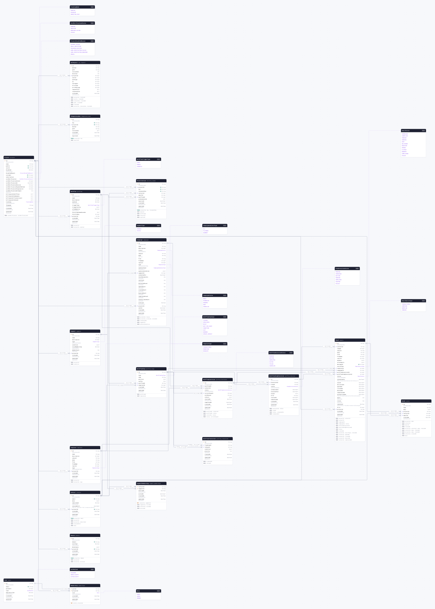

<details>
<summary>The whole schema as SQL</summary>

```sql
CREATE SCHEMA IF NOT EXISTS "public";

CREATE TYPE "ProjectDisabledReason" AS ENUM ('PAYMENT_FAILED', 'EMAIL_REPUTATION', 'PHISHING_DETECTED', 'CARD_VERIFICATION_FAILED', 'CARD_VERIFICATION_REQUIRED', 'MANUAL');

CREATE TYPE "CardVerificationStatus" AS ENUM ('PENDING', 'VERIFIED', 'REQUIRES_ACTION', 'FAILED');

CREATE TYPE "AuthMethod" AS ENUM ('PASSWORD', 'GOOGLE_OAUTH', 'GITHUB_OAUTH');

CREATE TYPE "Role" AS ENUM ('OWNER', 'ADMIN', 'MEMBER');

CREATE TYPE "TemplateType" AS ENUM ('TRANSACTIONAL', 'MARKETING', 'HEADLESS');

CREATE TYPE "TrackingMode" AS ENUM ('ENABLED', 'DISABLED', 'MARKETING_ONLY');

CREATE TYPE "CampaignStatus" AS ENUM ('DRAFT', 'SCHEDULED', 'SENDING', 'SENT', 'CANCELLED');

CREATE TYPE "CampaignAudienceType" AS ENUM ('ALL', 'FILTERED', 'SEGMENT');

CREATE TYPE "WorkflowTriggerType" AS ENUM ('EVENT', 'MANUAL', 'SCHEDULE');

CREATE TYPE "WorkflowStepType" AS ENUM ('TRIGGER', 'SEND_EMAIL', 'DELAY', 'WAIT_FOR_EVENT', 'CONDITION', 'EXIT', 'WEBHOOK', 'UPDATE_CONTACT');

CREATE TYPE "WorkflowExecutionStatus" AS ENUM ('RUNNING', 'WAITING', 'COMPLETED', 'EXITED', 'FAILED', 'CANCELLED');

CREATE TYPE "StepExecutionStatus" AS ENUM ('PENDING', 'SCHEDULED', 'WAITING', 'RUNNING', 'COMPLETED', 'SKIPPED', 'FAILED');

CREATE TYPE "SegmentType" AS ENUM ('DYNAMIC', 'STATIC');

CREATE TYPE "EmailSourceType" AS ENUM ('TRANSACTIONAL', 'CAMPAIGN', 'WORKFLOW', 'INBOUND');

CREATE TYPE "EmailStatus" AS ENUM ('SCHEDULED', 'CANCELLED', 'PENDING', 'SENDING', 'SENT', 'DELIVERED', 'RECEIVED', 'OPENED', 'CLICKED', 'BOUNCED', 'COMPLAINED', 'FAILED');

CREATE TABLE "users" (
    "id" TEXT NOT NULL,
    "email" TEXT NOT NULL,
    "password" TEXT,
    "type" "AuthMethod" NOT NULL,
    "emailVerified" BOOLEAN NOT NULL DEFAULT false,
    "createdAt" TIMESTAMP(3) NOT NULL DEFAULT CURRENT_TIMESTAMP,
    "updatedAt" TIMESTAMP(3) NOT NULL,

    CONSTRAINT "users_pkey" PRIMARY KEY ("id")
);

CREATE TABLE "projects" (
    "id" TEXT NOT NULL,
    "name" TEXT NOT NULL,
    "public" TEXT NOT NULL,
    "secret" TEXT NOT NULL,
    "disabled" BOOLEAN NOT NULL DEFAULT false,
    "disabledReason" "ProjectDisabledReason",
    "customer" TEXT,
    "subscription" TEXT,
    "cardVerification" "CardVerificationStatus",
    "cardVerificationIntent" TEXT,
    "cardVerificationAt" TIMESTAMP(3),
    "cardVerificationSession" TEXT,
    "cardVerificationPaymentMethod" TEXT,
    "cardVerificationFingerprint" TEXT,
    "cardVerificationAttempts" INTEGER NOT NULL DEFAULT 0,
    "billingLimitWorkflows" INTEGER,
    "billingLimitCampaigns" INTEGER,
    "billingLimitTransactional" INTEGER,
    "billingLimitInbound" INTEGER,
    "tracking" "TrackingMode" NOT NULL DEFAULT 'ENABLED',
    "language" TEXT NOT NULL DEFAULT 'en',
    "createdAt" TIMESTAMP(3) NOT NULL DEFAULT CURRENT_TIMESTAMP,
    "updatedAt" TIMESTAMP(3) NOT NULL,

    CONSTRAINT "projects_pkey" PRIMARY KEY ("id")
);

CREATE TABLE "memberships" (
    "userId" TEXT NOT NULL,
    "projectId" TEXT NOT NULL,
    "role" "Role" NOT NULL DEFAULT 'MEMBER',
    "createdAt" TIMESTAMP(3) NOT NULL DEFAULT CURRENT_TIMESTAMP,
    "updatedAt" TIMESTAMP(3) NOT NULL,

    CONSTRAINT "memberships_pkey" PRIMARY KEY ("userId","projectId")
);

CREATE TABLE "domains" (
    "id" TEXT NOT NULL,
    "domain" TEXT NOT NULL,
    "verified" BOOLEAN NOT NULL DEFAULT false,
    "dkimTokens" JSONB,
    "projectId" TEXT NOT NULL,
    "createdAt" TIMESTAMP(3) NOT NULL DEFAULT CURRENT_TIMESTAMP,
    "updatedAt" TIMESTAMP(3) NOT NULL,

    CONSTRAINT "domains_pkey" PRIMARY KEY ("id")
);

CREATE TABLE "contacts" (
    "id" TEXT NOT NULL,
    "email" TEXT NOT NULL,
    "data" JSONB,
    "subscribed" BOOLEAN NOT NULL DEFAULT true,
    "snoozedUntil" TIMESTAMP(3),
    "projectId" TEXT NOT NULL,
    "createdAt" TIMESTAMP(3) NOT NULL DEFAULT CURRENT_TIMESTAMP,
    "updatedAt" TIMESTAMP(3) NOT NULL,

    CONSTRAINT "contacts_pkey" PRIMARY KEY ("id")
);

CREATE TABLE "templates" (
    "id" TEXT NOT NULL,
    "name" TEXT NOT NULL,
    "description" TEXT,
    "subject" TEXT NOT NULL,
    "body" TEXT NOT NULL,
    "from" TEXT NOT NULL,
    "fromName" TEXT,
    "replyTo" TEXT,
    "type" "TemplateType" NOT NULL DEFAULT 'MARKETING',
    "projectId" TEXT NOT NULL,
    "createdAt" TIMESTAMP(3) NOT NULL DEFAULT CURRENT_TIMESTAMP,
    "updatedAt" TIMESTAMP(3) NOT NULL,

    CONSTRAINT "templates_pkey" PRIMARY KEY ("id")
);

CREATE TABLE "segments" (
    "id" TEXT NOT NULL,
    "name" TEXT NOT NULL,
    "description" TEXT,
    "type" "SegmentType" NOT NULL DEFAULT 'DYNAMIC',
    "condition" JSONB,
    "trackMembership" BOOLEAN NOT NULL DEFAULT false,
    "memberCount" INTEGER NOT NULL DEFAULT 0,
    "projectId" TEXT NOT NULL,
    "createdAt" TIMESTAMP(3) NOT NULL DEFAULT CURRENT_TIMESTAMP,
    "updatedAt" TIMESTAMP(3) NOT NULL,

    CONSTRAINT "segments_pkey" PRIMARY KEY ("id")
);

CREATE TABLE "segment_memberships" (
    "contactId" TEXT NOT NULL,
    "segmentId" TEXT NOT NULL,
    "enteredAt" TIMESTAMP(3) NOT NULL DEFAULT CURRENT_TIMESTAMP,
    "exitedAt" TIMESTAMP(3),
    "createdAt" TIMESTAMP(3) NOT NULL DEFAULT CURRENT_TIMESTAMP,
    "updatedAt" TIMESTAMP(3) NOT NULL,

    CONSTRAINT "segment_memberships_pkey" PRIMARY KEY ("contactId","segmentId")
);

CREATE TABLE "campaigns" (
    "id" TEXT NOT NULL,
    "name" TEXT NOT NULL,
    "description" TEXT,
    "status" "CampaignStatus" NOT NULL DEFAULT 'DRAFT',
    "subject" TEXT NOT NULL,
    "body" TEXT NOT NULL,
    "from" TEXT NOT NULL,
    "fromName" TEXT,
    "replyTo" TEXT,
    "type" "TemplateType" NOT NULL DEFAULT 'MARKETING',
    "audienceType" "CampaignAudienceType" NOT NULL DEFAULT 'ALL',
    "audienceCondition" JSONB,
    "segmentId" TEXT,
    "scheduledFor" TIMESTAMP(3),
    "totalRecipients" INTEGER NOT NULL DEFAULT 0,
    "sentCount" INTEGER NOT NULL DEFAULT 0,
    "deliveredCount" INTEGER NOT NULL DEFAULT 0,
    "openedCount" INTEGER NOT NULL DEFAULT 0,
    "clickedCount" INTEGER NOT NULL DEFAULT 0,
    "bouncedCount" INTEGER NOT NULL DEFAULT 0,
    "complainedCount" INTEGER NOT NULL DEFAULT 0,
    "unsubscribedCount" INTEGER NOT NULL DEFAULT 0,
    "archived" BOOLEAN NOT NULL DEFAULT false,
    "projectId" TEXT NOT NULL,
    "sentAt" TIMESTAMP(3),
    "createdAt" TIMESTAMP(3) NOT NULL DEFAULT CURRENT_TIMESTAMP,
    "updatedAt" TIMESTAMP(3) NOT NULL,

    CONSTRAINT "campaigns_pkey" PRIMARY KEY ("id")
);

CREATE TABLE "workflows" (
    "id" TEXT NOT NULL,
    "name" TEXT NOT NULL,
    "description" TEXT,
    "enabled" BOOLEAN NOT NULL DEFAULT false,
    "triggerType" "WorkflowTriggerType" NOT NULL,
    "triggerConfig" JSONB,
    "allowReentry" BOOLEAN NOT NULL DEFAULT false,
    "throttleWindowSeconds" INTEGER,
    "throttleKey" TEXT,
    "projectId" TEXT NOT NULL,
    "createdAt" TIMESTAMP(3) NOT NULL DEFAULT CURRENT_TIMESTAMP,
    "updatedAt" TIMESTAMP(3) NOT NULL,

    CONSTRAINT "workflows_pkey" PRIMARY KEY ("id")
);

CREATE TABLE "workflow_steps" (
    "id" TEXT NOT NULL,
    "type" "WorkflowStepType" NOT NULL,
    "name" TEXT NOT NULL,
    "position" JSONB NOT NULL,
    "config" JSONB NOT NULL,
    "workflowId" TEXT NOT NULL,
    "templateId" TEXT,
    "createdAt" TIMESTAMP(3) NOT NULL DEFAULT CURRENT_TIMESTAMP,
    "updatedAt" TIMESTAMP(3) NOT NULL,

    CONSTRAINT "workflow_steps_pkey" PRIMARY KEY ("id")
);

CREATE TABLE "workflow_transitions" (
    "id" TEXT NOT NULL,
    "fromStepId" TEXT NOT NULL,
    "toStepId" TEXT NOT NULL,
    "condition" JSONB,
    "priority" INTEGER NOT NULL DEFAULT 0,
    "createdAt" TIMESTAMP(3) NOT NULL DEFAULT CURRENT_TIMESTAMP,
    "updatedAt" TIMESTAMP(3) NOT NULL,

    CONSTRAINT "workflow_transitions_pkey" PRIMARY KEY ("id")
);

CREATE TABLE "workflow_executions" (
    "id" TEXT NOT NULL,
    "workflowId" TEXT NOT NULL,
    "contactId" TEXT NOT NULL,
    "status" "WorkflowExecutionStatus" NOT NULL DEFAULT 'RUNNING',
    "currentStepId" TEXT,
    "exitReason" TEXT,
    "context" JSONB,
    "startedAt" TIMESTAMP(3) NOT NULL DEFAULT CURRENT_TIMESTAMP,
    "completedAt" TIMESTAMP(3),
    "createdAt" TIMESTAMP(3) NOT NULL DEFAULT CURRENT_TIMESTAMP,
    "updatedAt" TIMESTAMP(3) NOT NULL,

    CONSTRAINT "workflow_executions_pkey" PRIMARY KEY ("id")
);

CREATE TABLE "workflow_step_executions" (
    "id" TEXT NOT NULL,
    "executionId" TEXT NOT NULL,
    "stepId" TEXT NOT NULL,
    "status" "StepExecutionStatus" NOT NULL DEFAULT 'PENDING',
    "scheduledFor" TIMESTAMP(3),
    "executeAfter" TIMESTAMP(3),
    "output" JSONB,
    "error" TEXT,
    "startedAt" TIMESTAMP(3),
    "completedAt" TIMESTAMP(3),
    "createdAt" TIMESTAMP(3) NOT NULL DEFAULT CURRENT_TIMESTAMP,
    "updatedAt" TIMESTAMP(3) NOT NULL,

    CONSTRAINT "workflow_step_executions_pkey" PRIMARY KEY ("id")
);

CREATE TABLE "emails" (
    "id" TEXT NOT NULL,
    "contactId" TEXT NOT NULL,
    "toName" TEXT,
    "subject" TEXT NOT NULL,
    "body" TEXT NOT NULL,
    "from" TEXT NOT NULL,
    "fromName" TEXT,
    "replyTo" TEXT,
    "headers" JSONB,
    "attachments" JSONB,
    "messageId" TEXT,
    "sourceType" "EmailSourceType" NOT NULL,
    "templateId" TEXT,
    "campaignId" TEXT,
    "workflowExecutionId" TEXT,
    "workflowStepExecutionId" TEXT,
    "status" "EmailStatus" NOT NULL DEFAULT 'PENDING',
    "scheduledFor" TIMESTAMP(3),
    "sentAt" TIMESTAMP(3),
    "deliveredAt" TIMESTAMP(3),
    "openedAt" TIMESTAMP(3),
    "clickedAt" TIMESTAMP(3),
    "bouncedAt" TIMESTAMP(3),
    "complainedAt" TIMESTAMP(3),
    "unsubscribedAt" TIMESTAMP(3),
    "opens" INTEGER NOT NULL DEFAULT 0,
    "clicks" INTEGER NOT NULL DEFAULT 0,
    "simulated" BOOLEAN NOT NULL DEFAULT false,
    "error" TEXT,
    "projectId" TEXT NOT NULL,
    "createdAt" TIMESTAMP(3) NOT NULL DEFAULT CURRENT_TIMESTAMP,
    "updatedAt" TIMESTAMP(3) NOT NULL,

    CONSTRAINT "emails_pkey" PRIMARY KEY ("id")
);

CREATE TABLE "events" (
    "id" TEXT NOT NULL,
    "name" TEXT NOT NULL,
    "data" JSONB,
    "projectId" TEXT NOT NULL,
    "contactId" TEXT,
    "emailId" TEXT,
    "createdAt" TIMESTAMP(3) NOT NULL DEFAULT CURRENT_TIMESTAMP,

    CONSTRAINT "events_pkey" PRIMARY KEY ("id")
);

CREATE TABLE "idempotency_keys" (
    "id" TEXT NOT NULL,
    "key" TEXT NOT NULL,
    "projectId" TEXT NOT NULL,
    "method" TEXT NOT NULL,
    "path" TEXT NOT NULL,
    "statusCode" INTEGER,
    "createdAt" TIMESTAMP(3) NOT NULL DEFAULT CURRENT_TIMESTAMP,
    "expiresAt" TIMESTAMP(3) NOT NULL,

    CONSTRAINT "idempotency_keys_pkey" PRIMARY KEY ("id")
);

CREATE TABLE "throttle_claims" (
    "id" TEXT NOT NULL,
    "projectId" TEXT NOT NULL,
    "key" TEXT NOT NULL,
    "recipientKey" TEXT NOT NULL,
    "contactId" TEXT,
    "emailId" TEXT,
    "workflowId" TEXT,
    "windowSeconds" INTEGER,
    "expiresAt" TIMESTAMP(3),
    "createdAt" TIMESTAMP(3) NOT NULL DEFAULT CURRENT_TIMESTAMP,
    "updatedAt" TIMESTAMP(3) NOT NULL,

    CONSTRAINT "throttle_claims_pkey" PRIMARY KEY ("id")
);

CREATE TABLE "api_requests" (
    "id" TEXT NOT NULL,
    "method" TEXT NOT NULL,
    "path" TEXT NOT NULL,
    "statusCode" INTEGER NOT NULL,
    "duration" INTEGER NOT NULL,
    "projectId" TEXT,
    "userId" TEXT,
    "authType" TEXT,
    "ip" TEXT,
    "userAgent" TEXT,
    "errorCode" TEXT,
    "errorMessage" TEXT,
    "requestSize" INTEGER,
    "responseSize" INTEGER,
    "createdAt" TIMESTAMP(3) NOT NULL DEFAULT CURRENT_TIMESTAMP,

    CONSTRAINT "api_requests_pkey" PRIMARY KEY ("id")
);

CREATE UNIQUE INDEX "users_email_key" ON "users"("email");

CREATE UNIQUE INDEX "projects_public_key" ON "projects"("public");

CREATE UNIQUE INDEX "projects_secret_key" ON "projects"("secret");

CREATE UNIQUE INDEX "projects_customer_key" ON "projects"("customer");

CREATE UNIQUE INDEX "projects_subscription_key" ON "projects"("subscription");

CREATE INDEX "projects_cardVerification_cardVerificationAt_idx" ON "projects"("cardVerification", "cardVerificationAt");

CREATE INDEX "domains_projectId_idx" ON "domains"("projectId");

CREATE INDEX "domains_projectId_verified_idx" ON "domains"("projectId", "verified");

CREATE UNIQUE INDEX "domains_projectId_domain_key" ON "domains"("projectId", "domain");

CREATE INDEX "contacts_projectId_idx" ON "contacts"("projectId");

CREATE INDEX "contacts_projectId_subscribed_idx" ON "contacts"("projectId", "subscribed");

CREATE INDEX "contacts_snoozedUntil_idx" ON "contacts"("snoozedUntil");

CREATE INDEX "contacts_data_idx" ON "contacts" USING GIN ("data" jsonb_ops);

CREATE UNIQUE INDEX "contacts_projectId_email_key" ON "contacts"("projectId", "email");

CREATE INDEX "templates_projectId_idx" ON "templates"("projectId");

CREATE INDEX "templates_projectId_type_idx" ON "templates"("projectId", "type");

CREATE INDEX "segments_projectId_idx" ON "segments"("projectId");

CREATE INDEX "segments_condition_idx" ON "segments" USING GIN ("condition" jsonb_ops);

CREATE INDEX "segment_memberships_segmentId_exitedAt_idx" ON "segment_memberships"("segmentId", "exitedAt");

CREATE INDEX "segment_memberships_contactId_exitedAt_idx" ON "segment_memberships"("contactId", "exitedAt");

CREATE INDEX "segment_memberships_enteredAt_idx" ON "segment_memberships"("enteredAt");

CREATE INDEX "campaigns_projectId_status_idx" ON "campaigns"("projectId", "status");

CREATE INDEX "campaigns_projectId_archived_createdAt_idx" ON "campaigns"("projectId", "archived", "createdAt");

CREATE INDEX "campaigns_scheduledFor_idx" ON "campaigns"("scheduledFor");

CREATE INDEX "campaigns_segmentId_idx" ON "campaigns"("segmentId");

CREATE INDEX "campaigns_audienceCondition_idx" ON "campaigns" USING GIN ("audienceCondition" jsonb_ops);

CREATE INDEX "workflows_projectId_idx" ON "workflows"("projectId");

CREATE INDEX "workflows_projectId_enabled_idx" ON "workflows"("projectId", "enabled");

CREATE INDEX "workflow_steps_workflowId_idx" ON "workflow_steps"("workflowId");

CREATE INDEX "workflow_steps_templateId_idx" ON "workflow_steps"("templateId");

CREATE INDEX "workflow_transitions_fromStepId_idx" ON "workflow_transitions"("fromStepId");

CREATE INDEX "workflow_transitions_toStepId_idx" ON "workflow_transitions"("toStepId");

CREATE INDEX "workflow_executions_workflowId_contactId_idx" ON "workflow_executions"("workflowId", "contactId");

CREATE INDEX "workflow_executions_workflowId_status_idx" ON "workflow_executions"("workflowId", "status");

CREATE INDEX "workflow_executions_contactId_status_idx" ON "workflow_executions"("contactId", "status");

CREATE INDEX "workflow_executions_status_currentStepId_idx" ON "workflow_executions"("status", "currentStepId");

CREATE INDEX "workflow_step_executions_executionId_status_idx" ON "workflow_step_executions"("executionId", "status");

CREATE INDEX "workflow_step_executions_stepId_idx" ON "workflow_step_executions"("stepId");

CREATE INDEX "workflow_step_executions_status_scheduledFor_idx" ON "workflow_step_executions"("status", "scheduledFor");

CREATE INDEX "workflow_step_executions_scheduledFor_idx" ON "workflow_step_executions"("scheduledFor");

CREATE UNIQUE INDEX "emails_messageId_key" ON "emails"("messageId");

CREATE INDEX "emails_projectId_contactId_idx" ON "emails"("projectId", "contactId");

CREATE INDEX "emails_contactId_idx" ON "emails"("contactId");

CREATE INDEX "emails_campaignId_idx" ON "emails"("campaignId");

CREATE INDEX "emails_campaignId_status_idx" ON "emails"("campaignId", "status");

CREATE INDEX "emails_workflowExecutionId_idx" ON "emails"("workflowExecutionId");

CREATE INDEX "emails_workflowStepExecutionId_idx" ON "emails"("workflowStepExecutionId");

CREATE INDEX "emails_status_idx" ON "emails"("status");

CREATE INDEX "emails_createdAt_idx" ON "emails"("createdAt");

CREATE INDEX "emails_projectId_sourceType_createdAt_idx" ON "emails"("projectId", "sourceType", "createdAt");

CREATE INDEX "emails_contactId_openedAt_idx" ON "emails"("contactId", "openedAt");

CREATE INDEX "emails_contactId_clickedAt_idx" ON "emails"("contactId", "clickedAt");

CREATE INDEX "emails_contactId_bouncedAt_idx" ON "emails"("contactId", "bouncedAt");

CREATE INDEX "emails_contactId_complainedAt_idx" ON "emails"("contactId", "complainedAt");

CREATE INDEX "events_projectId_name_idx" ON "events"("projectId", "name");

CREATE INDEX "events_contactId_idx" ON "events"("contactId");

CREATE INDEX "events_emailId_idx" ON "events"("emailId");

CREATE INDEX "events_createdAt_idx" ON "events"("createdAt");

CREATE INDEX "events_projectId_contactId_name_createdAt_idx" ON "events"("projectId", "contactId", "name", "createdAt");

CREATE INDEX "events_contactId_name_createdAt_idx" ON "events"("contactId", "name", "createdAt");

CREATE INDEX "events_projectId_name_createdAt_idx" ON "events"("projectId", "name", "createdAt");

CREATE INDEX "events_contactId_createdAt_idx" ON "events"("contactId", "createdAt");

CREATE INDEX "events_data_idx" ON "events" USING GIN ("data" jsonb_ops);

CREATE INDEX "idempotency_keys_expiresAt_idx" ON "idempotency_keys"("expiresAt");

CREATE UNIQUE INDEX "idempotency_keys_projectId_key_key" ON "idempotency_keys"("projectId", "key");

CREATE INDEX "throttle_claims_emailId_idx" ON "throttle_claims"("emailId");

CREATE INDEX "throttle_claims_workflowId_idx" ON "throttle_claims"("workflowId");

CREATE INDEX "throttle_claims_contactId_idx" ON "throttle_claims"("contactId");

CREATE INDEX "throttle_claims_expiresAt_idx" ON "throttle_claims"("expiresAt");

CREATE UNIQUE INDEX "throttle_claims_projectId_key_recipientKey_key" ON "throttle_claims"("projectId", "key", "recipientKey");

CREATE INDEX "api_requests_projectId_createdAt_idx" ON "api_requests"("projectId", "createdAt" DESC);

CREATE INDEX "api_requests_userId_createdAt_idx" ON "api_requests"("userId", "createdAt" DESC);

CREATE INDEX "api_requests_statusCode_createdAt_idx" ON "api_requests"("statusCode", "createdAt" DESC);

CREATE INDEX "api_requests_path_createdAt_idx" ON "api_requests"("path", "createdAt" DESC);

CREATE INDEX "api_requests_createdAt_idx" ON "api_requests"("createdAt" DESC);

CREATE INDEX "api_requests_projectId_statusCode_createdAt_idx" ON "api_requests"("projectId", "statusCode", "createdAt" DESC);

ALTER TABLE "memberships" ADD CONSTRAINT "memberships_userId_fkey" FOREIGN KEY ("userId") REFERENCES "users"("id") ON DELETE RESTRICT ON UPDATE CASCADE;

ALTER TABLE "memberships" ADD CONSTRAINT "memberships_projectId_fkey" FOREIGN KEY ("projectId") REFERENCES "projects"("id") ON DELETE CASCADE ON UPDATE CASCADE;

ALTER TABLE "domains" ADD CONSTRAINT "domains_projectId_fkey" FOREIGN KEY ("projectId") REFERENCES "projects"("id") ON DELETE CASCADE ON UPDATE CASCADE;

ALTER TABLE "contacts" ADD CONSTRAINT "contacts_projectId_fkey" FOREIGN KEY ("projectId") REFERENCES "projects"("id") ON DELETE CASCADE ON UPDATE CASCADE;

ALTER TABLE "templates" ADD CONSTRAINT "templates_projectId_fkey" FOREIGN KEY ("projectId") REFERENCES "projects"("id") ON DELETE CASCADE ON UPDATE CASCADE;

ALTER TABLE "segments" ADD CONSTRAINT "segments_projectId_fkey" FOREIGN KEY ("projectId") REFERENCES "projects"("id") ON DELETE CASCADE ON UPDATE CASCADE;

ALTER TABLE "segment_memberships" ADD CONSTRAINT "segment_memberships_contactId_fkey" FOREIGN KEY ("contactId") REFERENCES "contacts"("id") ON DELETE CASCADE ON UPDATE CASCADE;

ALTER TABLE "segment_memberships" ADD CONSTRAINT "segment_memberships_segmentId_fkey" FOREIGN KEY ("segmentId") REFERENCES "segments"("id") ON DELETE CASCADE ON UPDATE CASCADE;

ALTER TABLE "campaigns" ADD CONSTRAINT "campaigns_segmentId_fkey" FOREIGN KEY ("segmentId") REFERENCES "segments"("id") ON DELETE SET NULL ON UPDATE CASCADE;

ALTER TABLE "campaigns" ADD CONSTRAINT "campaigns_projectId_fkey" FOREIGN KEY ("projectId") REFERENCES "projects"("id") ON DELETE CASCADE ON UPDATE CASCADE;

ALTER TABLE "workflows" ADD CONSTRAINT "workflows_projectId_fkey" FOREIGN KEY ("projectId") REFERENCES "projects"("id") ON DELETE CASCADE ON UPDATE CASCADE;

ALTER TABLE "workflow_steps" ADD CONSTRAINT "workflow_steps_workflowId_fkey" FOREIGN KEY ("workflowId") REFERENCES "workflows"("id") ON DELETE CASCADE ON UPDATE CASCADE;

ALTER TABLE "workflow_steps" ADD CONSTRAINT "workflow_steps_templateId_fkey" FOREIGN KEY ("templateId") REFERENCES "templates"("id") ON DELETE SET NULL ON UPDATE CASCADE;

ALTER TABLE "workflow_transitions" ADD CONSTRAINT "workflow_transitions_fromStepId_fkey" FOREIGN KEY ("fromStepId") REFERENCES "workflow_steps"("id") ON DELETE CASCADE ON UPDATE CASCADE;

ALTER TABLE "workflow_transitions" ADD CONSTRAINT "workflow_transitions_toStepId_fkey" FOREIGN KEY ("toStepId") REFERENCES "workflow_steps"("id") ON DELETE CASCADE ON UPDATE CASCADE;

ALTER TABLE "workflow_executions" ADD CONSTRAINT "workflow_executions_workflowId_fkey" FOREIGN KEY ("workflowId") REFERENCES "workflows"("id") ON DELETE CASCADE ON UPDATE CASCADE;

ALTER TABLE "workflow_executions" ADD CONSTRAINT "workflow_executions_contactId_fkey" FOREIGN KEY ("contactId") REFERENCES "contacts"("id") ON DELETE CASCADE ON UPDATE CASCADE;

ALTER TABLE "workflow_executions" ADD CONSTRAINT "workflow_executions_currentStepId_fkey" FOREIGN KEY ("currentStepId") REFERENCES "workflow_steps"("id") ON DELETE SET NULL ON UPDATE CASCADE;

ALTER TABLE "workflow_step_executions" ADD CONSTRAINT "workflow_step_executions_executionId_fkey" FOREIGN KEY ("executionId") REFERENCES "workflow_executions"("id") ON DELETE CASCADE ON UPDATE CASCADE;

ALTER TABLE "workflow_step_executions" ADD CONSTRAINT "workflow_step_executions_stepId_fkey" FOREIGN KEY ("stepId") REFERENCES "workflow_steps"("id") ON DELETE CASCADE ON UPDATE CASCADE;

ALTER TABLE "emails" ADD CONSTRAINT "emails_contactId_fkey" FOREIGN KEY ("contactId") REFERENCES "contacts"("id") ON DELETE CASCADE ON UPDATE CASCADE;

ALTER TABLE "emails" ADD CONSTRAINT "emails_templateId_fkey" FOREIGN KEY ("templateId") REFERENCES "templates"("id") ON DELETE SET NULL ON UPDATE CASCADE;

ALTER TABLE "emails" ADD CONSTRAINT "emails_campaignId_fkey" FOREIGN KEY ("campaignId") REFERENCES "campaigns"("id") ON DELETE CASCADE ON UPDATE CASCADE;

ALTER TABLE "emails" ADD CONSTRAINT "emails_workflowExecutionId_fkey" FOREIGN KEY ("workflowExecutionId") REFERENCES "workflow_executions"("id") ON DELETE CASCADE ON UPDATE CASCADE;

ALTER TABLE "emails" ADD CONSTRAINT "emails_workflowStepExecutionId_fkey" FOREIGN KEY ("workflowStepExecutionId") REFERENCES "workflow_step_executions"("id") ON DELETE CASCADE ON UPDATE CASCADE;

ALTER TABLE "emails" ADD CONSTRAINT "emails_projectId_fkey" FOREIGN KEY ("projectId") REFERENCES "projects"("id") ON DELETE CASCADE ON UPDATE CASCADE;

ALTER TABLE "events" ADD CONSTRAINT "events_projectId_fkey" FOREIGN KEY ("projectId") REFERENCES "projects"("id") ON DELETE CASCADE ON UPDATE CASCADE;

ALTER TABLE "events" ADD CONSTRAINT "events_contactId_fkey" FOREIGN KEY ("contactId") REFERENCES "contacts"("id") ON DELETE CASCADE ON UPDATE CASCADE;

ALTER TABLE "events" ADD CONSTRAINT "events_emailId_fkey" FOREIGN KEY ("emailId") REFERENCES "emails"("id") ON DELETE CASCADE ON UPDATE CASCADE;

ALTER TABLE "idempotency_keys" ADD CONSTRAINT "idempotency_keys_projectId_fkey" FOREIGN KEY ("projectId") REFERENCES "projects"("id") ON DELETE CASCADE ON UPDATE CASCADE;

ALTER TABLE "throttle_claims" ADD CONSTRAINT "throttle_claims_projectId_fkey" FOREIGN KEY ("projectId") REFERENCES "projects"("id") ON DELETE CASCADE ON UPDATE CASCADE;

ALTER TABLE "throttle_claims" ADD CONSTRAINT "throttle_claims_contactId_fkey" FOREIGN KEY ("contactId") REFERENCES "contacts"("id") ON DELETE CASCADE ON UPDATE CASCADE;

ALTER TABLE "throttle_claims" ADD CONSTRAINT "throttle_claims_workflowId_fkey" FOREIGN KEY ("workflowId") REFERENCES "workflows"("id") ON DELETE CASCADE ON UPDATE CASCADE;

ALTER TABLE "api_requests" ADD CONSTRAINT "api_requests_projectId_fkey" FOREIGN KEY ("projectId") REFERENCES "projects"("id") ON DELETE SET NULL ON UPDATE CASCADE;
```

</details>

## Contents

| Model                                                 | Table                      | Description                                                                                                                                                                                                                                                                                                                                                                                                                                                                                                                                  |
| ----------------------------------------------------- | -------------------------- | -------------------------------------------------------------------------------------------------------------------------------------------------------------------------------------------------------------------------------------------------------------------------------------------------------------------------------------------------------------------------------------------------------------------------------------------------------------------------------------------------------------------------------------------- |
| [User](#model-User)                                   | `users`                    |                                                                                                                                                                                                                                                                                                                                                                                                                                                                                                                                              |
| [Project](#model-Project)                             | `projects`                 |                                                                                                                                                                                                                                                                                                                                                                                                                                                                                                                                              |
| [Membership](#model-Membership)                       | `memberships`              |                                                                                                                                                                                                                                                                                                                                                                                                                                                                                                                                              |
| [Domain](#model-Domain)                               | `domains`                  |                                                                                                                                                                                                                                                                                                                                                                                                                                                                                                                                              |
| [Contact](#model-Contact)                             | `contacts`                 |                                                                                                                                                                                                                                                                                                                                                                                                                                                                                                                                              |
| [Template](#model-Template)                           | `templates`                |                                                                                                                                                                                                                                                                                                                                                                                                                                                                                                                                              |
| [Segment](#model-Segment)                             | `segments`                 |                                                                                                                                                                                                                                                                                                                                                                                                                                                                                                                                              |
| [SegmentMembership](#model-SegmentMembership)         | `segment_memberships`      |                                                                                                                                                                                                                                                                                                                                                                                                                                                                                                                                              |
| [Campaign](#model-Campaign)                           | `campaigns`                |                                                                                                                                                                                                                                                                                                                                                                                                                                                                                                                                              |
| [Workflow](#model-Workflow)                           | `workflows`                |                                                                                                                                                                                                                                                                                                                                                                                                                                                                                                                                              |
| [WorkflowStep](#model-WorkflowStep)                   | `workflow_steps`           |                                                                                                                                                                                                                                                                                                                                                                                                                                                                                                                                              |
| [WorkflowTransition](#model-WorkflowTransition)       | `workflow_transitions`     |                                                                                                                                                                                                                                                                                                                                                                                                                                                                                                                                              |
| [WorkflowExecution](#model-WorkflowExecution)         | `workflow_executions`      |                                                                                                                                                                                                                                                                                                                                                                                                                                                                                                                                              |
| [WorkflowStepExecution](#model-WorkflowStepExecution) | `workflow_step_executions` |                                                                                                                                                                                                                                                                                                                                                                                                                                                                                                                                              |
| [Email](#model-Email)                                 | `emails`                   |                                                                                                                                                                                                                                                                                                                                                                                                                                                                                                                                              |
| [Event](#model-Event)                                 | `events`                   |                                                                                                                                                                                                                                                                                                                                                                                                                                                                                                                                              |
| [IdempotencyKey](#model-IdempotencyKey)               | `idempotency_keys`         |                                                                                                                                                                                                                                                                                                                                                                                                                                                                                                                                              |
| [ThrottleClaim](#model-ThrottleClaim)                 | `throttle_claims`          | One transactional notification held for one recipient (or for the whole project) by a send with `delivery.throttle`. While it is held, the same notification is not sent again. The claim is taken by inserting (or taking over an expired) row, so the unique constraint decides the race between concurrent sends, like `IdempotencyKey`. It is held from the moment the send is accepted, re-anchored to the real send time once SES has the message, and released when the email never gets there (cancelled, or failed before sending). |
| [ApiRequest](#model-ApiRequest)                       | `api_requests`             |                                                                                                                                                                                                                                                                                                                                                                                                                                                                                                                                              |

| Enum                                                     | Name in the database      | Description |
| -------------------------------------------------------- | ------------------------- | ----------- |
| [ProjectDisabledReason](#enum-ProjectDisabledReason)     | `ProjectDisabledReason`   |             |
| [CardVerificationStatus](#enum-CardVerificationStatus)   | `CardVerificationStatus`  |             |
| [AuthMethod](#enum-AuthMethod)                           | `AuthMethod`              |             |
| [Role](#enum-Role)                                       | `Role`                    |             |
| [TemplateType](#enum-TemplateType)                       | `TemplateType`            |             |
| [TrackingMode](#enum-TrackingMode)                       | `TrackingMode`            |             |
| [CampaignStatus](#enum-CampaignStatus)                   | `CampaignStatus`          |             |
| [CampaignAudienceType](#enum-CampaignAudienceType)       | `CampaignAudienceType`    |             |
| [WorkflowTriggerType](#enum-WorkflowTriggerType)         | `WorkflowTriggerType`     |             |
| [WorkflowStepType](#enum-WorkflowStepType)               | `WorkflowStepType`        |             |
| [WorkflowExecutionStatus](#enum-WorkflowExecutionStatus) | `WorkflowExecutionStatus` |             |
| [StepExecutionStatus](#enum-StepExecutionStatus)         | `StepExecutionStatus`     |             |
| [SegmentType](#enum-SegmentType)                         | `SegmentType`             |             |
| [EmailSourceType](#enum-EmailSourceType)                 | `EmailSourceType`         |             |
| [EmailStatus](#enum-EmailStatus)                         | `EmailStatus`             |             |

## Models

<a id="model-User"></a>

### User

Table `users`.

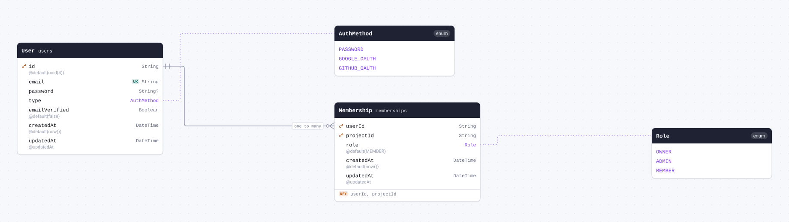

| Field           | Type                             | Constraints     | Default      | Description |
| --------------- | -------------------------------- | --------------- | ------------ | ----------- |
| `id`            | `String`                         | PK NOT NULL     | `uuid(4)`    |             |
| `email`         | `String`                         | UNIQUE NOT NULL |              |             |
| `password`      | `String`                         | NULL            |              |             |
| `type`          | [`AuthMethod`](#enum-AuthMethod) | NOT NULL        |              |             |
| `emailVerified` | `Boolean`                        | NOT NULL        | `false`      |             |
| `createdAt`     | `DateTime`                       | NOT NULL        | `now()`      |             |
| `updatedAt`     | `DateTime`                       | NOT NULL        | `@updatedAt` |             |

#### Referenced by

- `id` ← [Membership.userId](#model-Membership) (one-to-many)

#### Definition

```sql
CREATE TABLE "users" (
    "id" TEXT NOT NULL,
    "email" TEXT NOT NULL,
    "password" TEXT,
    "type" "AuthMethod" NOT NULL,
    "emailVerified" BOOLEAN NOT NULL DEFAULT false,
    "createdAt" TIMESTAMP(3) NOT NULL DEFAULT CURRENT_TIMESTAMP,
    "updatedAt" TIMESTAMP(3) NOT NULL,

    CONSTRAINT "users_pkey" PRIMARY KEY ("id")
);

CREATE UNIQUE INDEX "users_email_key" ON "users"("email");
```

<details>
<summary>Queries and their SQL</summary>

**findMany**: Every row

```ts
await prisma.user.findMany();
```

```sql
SELECT
  "public"."users"."id",
  "public"."users"."email",
  "public"."users"."password",
  "public"."users"."type"::text,
  "public"."users"."emailVerified",
  "public"."users"."createdAt",
  "public"."users"."updatedAt"
FROM
  "public"."users"
WHERE
  1 = 1
OFFSET
  $1
-- params: ["0"]
```

**count**: How many rows there are

```ts
await prisma.user.count();
```

```sql
SELECT
  COUNT(*) AS "_count$_all"
FROM
  (
    SELECT
      "public"."users"."id"
    FROM
      "public"."users"
    WHERE
      1 = 1
    OFFSET
      $1
  ) AS "sub"
-- params: ["0"]
```

**findMany**: Every row with its relations

```ts
await prisma.user.findMany({ include: { memberships: true } });
```

```sql
SELECT
  "public"."users"."id",
  "public"."users"."email",
  "public"."users"."password",
  "public"."users"."type"::text,
  "public"."users"."emailVerified",
  "public"."users"."createdAt",
  "public"."users"."updatedAt"
FROM
  "public"."users"
WHERE
  1 = 1
OFFSET
  $1
-- params: ["0"]

SELECT
  "public"."memberships"."userId",
  "public"."memberships"."projectId",
  "public"."memberships"."role"::text,
  "public"."memberships"."createdAt",
  "public"."memberships"."updatedAt"
FROM
  "public"."memberships"
WHERE
  "public"."memberships"."userId" IN ($1)
OFFSET
  $2
-- params: ["<id of the rows above>","0"]
```

**findUnique**: One row by what is unique to it

```ts
await prisma.user.findUnique({ where: { id: "example" } });
```

```sql
SELECT
  "public"."users"."id",
  "public"."users"."email",
  "public"."users"."password",
  "public"."users"."type"::text,
  "public"."users"."emailVerified",
  "public"."users"."createdAt",
  "public"."users"."updatedAt"
FROM
  "public"."users"
WHERE
  (
    "public"."users"."id" = $1
    AND 1 = 1
  )
LIMIT
  $2
OFFSET
  $3
-- params: ["example","1","0"]
```

**create**: Create a row

```ts
await prisma.user.create({ data: { email: "example", type: "PASSWORD" } });
```

```sql
INSERT INTO
  "public"."users" (
    "id",
    "email",
    "type",
    "emailVerified",
    "createdAt",
    "updatedAt"
  )
VALUES
  (
    $1,
    $2,
    CAST($3::text AS "public"."AuthMethod"),
    $4,
    $5,
    $6
  )
RETURNING
  "public"."users"."id",
  "public"."users"."email",
  "public"."users"."password",
  "public"."users"."type"::text,
  "public"."users"."emailVerified",
  "public"."users"."createdAt",
  "public"."users"."updatedAt"
-- params: ["<uuid(4)>","example","PASSWORD",false,"<now()>","<now()>"]
```

**update**: Update a row

```ts
await prisma.user.update({ where: { id: "example" }, data: { email: "example" } });
```

```sql
UPDATE "public"."users"
SET
  "email" = $1,
  "updatedAt" = $2
WHERE
  (
    "public"."users"."id" = $3
    AND 1 = 1
  )
RETURNING
  "public"."users"."id",
  "public"."users"."email",
  "public"."users"."password",
  "public"."users"."type"::text,
  "public"."users"."emailVerified",
  "public"."users"."createdAt",
  "public"."users"."updatedAt"
-- params: ["example",{"prisma__type":"generatorCall","prisma__value":{"name":"now","args":[],"returnType":{"type":"DateTime"}}},"example"]
```

**delete**: Delete a row

```ts
await prisma.user.delete({ where: { id: "example" } });
```

```sql
DELETE FROM "public"."users"
WHERE
  (
    "public"."users"."id" = $1
    AND 1 = 1
  )
RETURNING
  "public"."users"."id",
  "public"."users"."email",
  "public"."users"."password",
  "public"."users"."type"::text,
  "public"."users"."emailVerified",
  "public"."users"."createdAt",
  "public"."users"."updatedAt"
-- params: ["example"]
```

</details>

<a id="model-Project"></a>

### Project

Table `projects`.

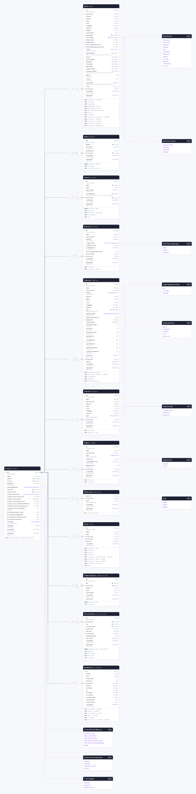

| Field                           | Type                                                     | Constraints     | Default      | Description |
| ------------------------------- | -------------------------------------------------------- | --------------- | ------------ | ----------- |
| `id`                            | `String`                                                 | PK NOT NULL     | `uuid(4)`    |             |
| `name`                          | `String`                                                 | NOT NULL        |              |             |
| `public`                        | `String`                                                 | UNIQUE NOT NULL |              |             |
| `secret`                        | `String`                                                 | UNIQUE NOT NULL |              |             |
| `disabled`                      | `Boolean`                                                | NOT NULL        | `false`      |             |
| `disabledReason`                | [`ProjectDisabledReason`](#enum-ProjectDisabledReason)   | NULL            |              |             |
| `customer`                      | `String`                                                 | UNIQUE NULL     |              |             |
| `subscription`                  | `String`                                                 | UNIQUE NULL     |              |             |
| `cardVerification`              | [`CardVerificationStatus`](#enum-CardVerificationStatus) | NULL            |              |             |
| `cardVerificationIntent`        | `String`                                                 | NULL            |              |             |
| `cardVerificationAt`            | `DateTime`                                               | NULL            |              |             |
| `cardVerificationSession`       | `String`                                                 | NULL            |              |             |
| `cardVerificationPaymentMethod` | `String`                                                 | NULL            |              |             |
| `cardVerificationFingerprint`   | `String`                                                 | NULL            |              |             |
| `cardVerificationAttempts`      | `Int`                                                    | NOT NULL        | `0`          |             |
| `billingLimitWorkflows`         | `Int`                                                    | NULL            |              |             |
| `billingLimitCampaigns`         | `Int`                                                    | NULL            |              |             |
| `billingLimitTransactional`     | `Int`                                                    | NULL            |              |             |
| `billingLimitInbound`           | `Int`                                                    | NULL            |              |             |
| `tracking`                      | [`TrackingMode`](#enum-TrackingMode)                     | NOT NULL        | `ENABLED`    |             |
| `language`                      | `String`                                                 | NOT NULL        | `"en"`       |             |
| `createdAt`                     | `DateTime`                                               | NOT NULL        | `now()`      |             |
| `updatedAt`                     | `DateTime`                                               | NOT NULL        | `@updatedAt` |             |

#### Indexes

- `@@index([cardVerification, cardVerificationAt])`

#### Referenced by

- `id` ← [Membership.projectId](#model-Membership) (one-to-many, on delete Cascade)
- `id` ← [Domain.projectId](#model-Domain) (one-to-many, on delete Cascade)
- `id` ← [Contact.projectId](#model-Contact) (one-to-many, on delete Cascade)
- `id` ← [Template.projectId](#model-Template) (one-to-many, on delete Cascade)
- `id` ← [Segment.projectId](#model-Segment) (one-to-many, on delete Cascade)
- `id` ← [Campaign.projectId](#model-Campaign) (one-to-many, on delete Cascade)
- `id` ← [Workflow.projectId](#model-Workflow) (one-to-many, on delete Cascade)
- `id` ← [Email.projectId](#model-Email) (one-to-many, on delete Cascade)
- `id` ← [Event.projectId](#model-Event) (one-to-many, on delete Cascade)
- `id` ← [IdempotencyKey.projectId](#model-IdempotencyKey) (one-to-many, on delete Cascade)
- `id` ← [ThrottleClaim.projectId](#model-ThrottleClaim) (one-to-many, on delete Cascade)
- `id` ← [ApiRequest.projectId](#model-ApiRequest) (one-to-many, on delete SetNull)

#### Definition

```sql
CREATE TABLE "projects" (
    "id" TEXT NOT NULL,
    "name" TEXT NOT NULL,
    "public" TEXT NOT NULL,
    "secret" TEXT NOT NULL,
    "disabled" BOOLEAN NOT NULL DEFAULT false,
    "disabledReason" "ProjectDisabledReason",
    "customer" TEXT,
    "subscription" TEXT,
    "cardVerification" "CardVerificationStatus",
    "cardVerificationIntent" TEXT,
    "cardVerificationAt" TIMESTAMP(3),
    "cardVerificationSession" TEXT,
    "cardVerificationPaymentMethod" TEXT,
    "cardVerificationFingerprint" TEXT,
    "cardVerificationAttempts" INTEGER NOT NULL DEFAULT 0,
    "billingLimitWorkflows" INTEGER,
    "billingLimitCampaigns" INTEGER,
    "billingLimitTransactional" INTEGER,
    "billingLimitInbound" INTEGER,
    "tracking" "TrackingMode" NOT NULL DEFAULT 'ENABLED',
    "language" TEXT NOT NULL DEFAULT 'en',
    "createdAt" TIMESTAMP(3) NOT NULL DEFAULT CURRENT_TIMESTAMP,
    "updatedAt" TIMESTAMP(3) NOT NULL,

    CONSTRAINT "projects_pkey" PRIMARY KEY ("id")
);

CREATE UNIQUE INDEX "projects_public_key" ON "projects"("public");

CREATE UNIQUE INDEX "projects_secret_key" ON "projects"("secret");

CREATE UNIQUE INDEX "projects_customer_key" ON "projects"("customer");

CREATE UNIQUE INDEX "projects_subscription_key" ON "projects"("subscription");

CREATE INDEX "projects_cardVerification_cardVerificationAt_idx" ON "projects"("cardVerification", "cardVerificationAt");
```

<details>
<summary>Queries and their SQL</summary>

**findMany**: Every row

```ts
await prisma.project.findMany();
```

```sql
SELECT
  "public"."projects"."id",
  "public"."projects"."name",
  "public"."projects"."public",
  "public"."projects"."secret",
  "public"."projects"."disabled",
  "public"."projects"."disabledReason"::text,
  "public"."projects"."customer",
  "public"."projects"."subscription",
  "public"."projects"."cardVerification"::text,
  "public"."projects"."cardVerificationIntent",
  "public"."projects"."cardVerificationAt",
  "public"."projects"."cardVerificationSession",
  "public"."projects"."cardVerificationPaymentMethod",
  "public"."projects"."cardVerificationFingerprint",
  "public"."projects"."cardVerificationAttempts",
  "public"."projects"."billingLimitWorkflows",
  "public"."projects"."billingLimitCampaigns",
  "public"."projects"."billingLimitTransactional",
  "public"."projects"."billingLimitInbound",
  "public"."projects"."tracking"::text,
  "public"."projects"."language",
  "public"."projects"."createdAt",
  "public"."projects"."updatedAt"
FROM
  "public"."projects"
WHERE
  1 = 1
OFFSET
  $1
-- params: ["0"]
```

**count**: How many rows there are

```ts
await prisma.project.count();
```

```sql
SELECT
  COUNT(*) AS "_count$_all"
FROM
  (
    SELECT
      "public"."projects"."id"
    FROM
      "public"."projects"
    WHERE
      1 = 1
    OFFSET
      $1
  ) AS "sub"
-- params: ["0"]
```

**findMany**: Every row with its relations

```ts
await prisma.project.findMany({
  include: {
    members: true,
    contacts: true,
    templates: true,
    segments: true,
    workflows: true,
    campaigns: true,
    emails: true,
    events: true,
    domains: true,
    apiRequests: true,
    idempotencyKeys: true,
    throttleClaims: true,
  },
});
```

```sql
SELECT
  "public"."projects"."id",
  "public"."projects"."name",
  "public"."projects"."public",
  "public"."projects"."secret",
  "public"."projects"."disabled",
  "public"."projects"."disabledReason"::text,
  "public"."projects"."customer",
  "public"."projects"."subscription",
  "public"."projects"."cardVerification"::text,
  "public"."projects"."cardVerificationIntent",
  "public"."projects"."cardVerificationAt",
  "public"."projects"."cardVerificationSession",
  "public"."projects"."cardVerificationPaymentMethod",
  "public"."projects"."cardVerificationFingerprint",
  "public"."projects"."cardVerificationAttempts",
  "public"."projects"."billingLimitWorkflows",
  "public"."projects"."billingLimitCampaigns",
  "public"."projects"."billingLimitTransactional",
  "public"."projects"."billingLimitInbound",
  "public"."projects"."tracking"::text,
  "public"."projects"."language",
  "public"."projects"."createdAt",
  "public"."projects"."updatedAt"
FROM
  "public"."projects"
WHERE
  1 = 1
OFFSET
  $1
-- params: ["0"]

SELECT
  "public"."memberships"."userId",
  "public"."memberships"."projectId",
  "public"."memberships"."role"::text,
  "public"."memberships"."createdAt",
  "public"."memberships"."updatedAt"
FROM
  "public"."memberships"
WHERE
  "public"."memberships"."projectId" IN ($1)
OFFSET
  $2
-- params: ["<id of the rows above>","0"]

SELECT
  "public"."contacts"."id",
  "public"."contacts"."email",
  "public"."contacts"."data",
  "public"."contacts"."subscribed",
  "public"."contacts"."snoozedUntil",
  "public"."contacts"."projectId",
  "public"."contacts"."createdAt",
  "public"."contacts"."updatedAt"
FROM
  "public"."contacts"
WHERE
  "public"."contacts"."projectId" IN ($1)
OFFSET
  $2
-- params: ["<id of the rows above>","0"]

SELECT
  "public"."templates"."id",
  "public"."templates"."name",
  "public"."templates"."description",
  "public"."templates"."subject",
  "public"."templates"."body",
  "public"."templates"."from",
  "public"."templates"."fromName",
  "public"."templates"."replyTo",
  "public"."templates"."type"::text,
  "public"."templates"."projectId",
  "public"."templates"."createdAt",
  "public"."templates"."updatedAt"
FROM
  "public"."templates"
WHERE
  "public"."templates"."projectId" IN ($1)
OFFSET
  $2
-- params: ["<id of the rows above>","0"]

SELECT
  "public"."segments"."id",
  "public"."segments"."name",
  "public"."segments"."description",
  "public"."segments"."type"::text,
  "public"."segments"."condition",
  "public"."segments"."trackMembership",
  "public"."segments"."memberCount",
  "public"."segments"."projectId",
  "public"."segments"."createdAt",
  "public"."segments"."updatedAt"
FROM
  "public"."segments"
WHERE
  "public"."segments"."projectId" IN ($1)
OFFSET
  $2
-- params: ["<id of the rows above>","0"]

SELECT
  "public"."workflows"."id",
  "public"."workflows"."name",
  "public"."workflows"."description",
  "public"."workflows"."enabled",
  "public"."workflows"."triggerType"::text,
  "public"."workflows"."triggerConfig",
  "public"."workflows"."allowReentry",
  "public"."workflows"."throttleWindowSeconds",
  "public"."workflows"."throttleKey",
  "public"."workflows"."projectId",
  "public"."workflows"."createdAt",
  "public"."workflows"."updatedAt"
FROM
  "public"."workflows"
WHERE
  "public"."workflows"."projectId" IN ($1)
OFFSET
  $2
-- params: ["<id of the rows above>","0"]

SELECT
  "public"."campaigns"."id",
  "public"."campaigns"."name",
  "public"."campaigns"."description",
  "public"."campaigns"."status"::text,
  "public"."campaigns"."subject",
  "public"."campaigns"."body",
  "public"."campaigns"."from",
  "public"."campaigns"."fromName",
  "public"."campaigns"."replyTo",
  "public"."campaigns"."type"::text,
  "public"."campaigns"."audienceType"::text,
  "public"."campaigns"."audienceCondition",
  "public"."campaigns"."segmentId",
  "public"."campaigns"."scheduledFor",
  "public"."campaigns"."totalRecipients",
  "public"."campaigns"."sentCount",
  "public"."campaigns"."deliveredCount",
  "public"."campaigns"."openedCount",
  "public"."campaigns"."clickedCount",
  "public"."campaigns"."bouncedCount",
  "public"."campaigns"."complainedCount",
  "public"."campaigns"."unsubscribedCount",
  "public"."campaigns"."archived",
  "public"."campaigns"."projectId",
  "public"."campaigns"."sentAt",
  "public"."campaigns"."createdAt",
  "public"."campaigns"."updatedAt"
FROM
  "public"."campaigns"
WHERE
  "public"."campaigns"."projectId" IN ($1)
OFFSET
  $2
-- params: ["<id of the rows above>","0"]

SELECT
  "public"."emails"."id",
  "public"."emails"."contactId",
  "public"."emails"."toName",
  "public"."emails"."subject",
  "public"."emails"."body",
  "public"."emails"."from",
  "public"."emails"."fromName",
  "public"."emails"."replyTo",
  "public"."emails"."headers",
  "public"."emails"."attachments",
  "public"."emails"."messageId",
  "public"."emails"."sourceType"::text,
  "public"."emails"."templateId",
  "public"."emails"."campaignId",
  "public"."emails"."workflowExecutionId",
  "public"."emails"."workflowStepExecutionId",
  "public"."emails"."status"::text,
  "public"."emails"."scheduledFor",
  "public"."emails"."sentAt",
  "public"."emails"."deliveredAt",
  "public"."emails"."openedAt",
  "public"."emails"."clickedAt",
  "public"."emails"."bouncedAt",
  "public"."emails"."complainedAt",
  "public"."emails"."unsubscribedAt",
  "public"."emails"."opens",
  "public"."emails"."clicks",
  "public"."emails"."simulated",
  "public"."emails"."error",
  "public"."emails"."projectId",
  "public"."emails"."createdAt",
  "public"."emails"."updatedAt"
FROM
  "public"."emails"
WHERE
  "public"."emails"."projectId" IN ($1)
OFFSET
  $2
-- params: ["<id of the rows above>","0"]

SELECT
  "public"."events"."id",
  "public"."events"."name",
  "public"."events"."data",
  "public"."events"."projectId",
  "public"."events"."contactId",
  "public"."events"."emailId",
  "public"."events"."createdAt"
FROM
  "public"."events"
WHERE
  "public"."events"."projectId" IN ($1)
OFFSET
  $2
-- params: ["<id of the rows above>","0"]

SELECT
  "public"."domains"."id",
  "public"."domains"."domain",
  "public"."domains"."verified",
  "public"."domains"."dkimTokens",
  "public"."domains"."projectId",
  "public"."domains"."createdAt",
  "public"."domains"."updatedAt"
FROM
  "public"."domains"
WHERE
  "public"."domains"."projectId" IN ($1)
OFFSET
  $2
-- params: ["<id of the rows above>","0"]

SELECT
  "public"."api_requests"."id",
  "public"."api_requests"."method",
  "public"."api_requests"."path",
  "public"."api_requests"."statusCode",
  "public"."api_requests"."duration",
  "public"."api_requests"."projectId",
  "public"."api_requests"."userId",
  "public"."api_requests"."authType",
  "public"."api_requests"."ip",
  "public"."api_requests"."userAgent",
  "public"."api_requests"."errorCode",
  "public"."api_requests"."errorMessage",
  "public"."api_requests"."requestSize",
  "public"."api_requests"."responseSize",
  "public"."api_requests"."createdAt"
FROM
  "public"."api_requests"
WHERE
  "public"."api_requests"."projectId" IN ($1)
OFFSET
  $2
-- params: ["<id of the rows above>","0"]

SELECT
  "public"."idempotency_keys"."id",
  "public"."idempotency_keys"."key",
  "public"."idempotency_keys"."projectId",
  "public"."idempotency_keys"."method",
  "public"."idempotency_keys"."path",
  "public"."idempotency_keys"."statusCode",
  "public"."idempotency_keys"."createdAt",
  "public"."idempotency_keys"."expiresAt"
FROM
  "public"."idempotency_keys"
WHERE
  "public"."idempotency_keys"."projectId" IN ($1)
OFFSET
  $2
-- params: ["<id of the rows above>","0"]

SELECT
  "public"."throttle_claims"."id",
  "public"."throttle_claims"."projectId",
  "public"."throttle_claims"."key",
  "public"."throttle_claims"."recipientKey",
  "public"."throttle_claims"."contactId",
  "public"."throttle_claims"."emailId",
  "public"."throttle_claims"."workflowId",
  "public"."throttle_claims"."windowSeconds",
  "public"."throttle_claims"."expiresAt",
  "public"."throttle_claims"."createdAt",
  "public"."throttle_claims"."updatedAt"
FROM
  "public"."throttle_claims"
WHERE
  "public"."throttle_claims"."projectId" IN ($1)
OFFSET
  $2
-- params: ["<id of the rows above>","0"]
```

**findUnique**: One row by what is unique to it

```ts
await prisma.project.findUnique({ where: { id: "example" } });
```

```sql
SELECT
  "public"."projects"."id",
  "public"."projects"."name",
  "public"."projects"."public",
  "public"."projects"."secret",
  "public"."projects"."disabled",
  "public"."projects"."disabledReason"::text,
  "public"."projects"."customer",
  "public"."projects"."subscription",
  "public"."projects"."cardVerification"::text,
  "public"."projects"."cardVerificationIntent",
  "public"."projects"."cardVerificationAt",
  "public"."projects"."cardVerificationSession",
  "public"."projects"."cardVerificationPaymentMethod",
  "public"."projects"."cardVerificationFingerprint",
  "public"."projects"."cardVerificationAttempts",
  "public"."projects"."billingLimitWorkflows",
  "public"."projects"."billingLimitCampaigns",
  "public"."projects"."billingLimitTransactional",
  "public"."projects"."billingLimitInbound",
  "public"."projects"."tracking"::text,
  "public"."projects"."language",
  "public"."projects"."createdAt",
  "public"."projects"."updatedAt"
FROM
  "public"."projects"
WHERE
  (
    "public"."projects"."id" = $1
    AND 1 = 1
  )
LIMIT
  $2
OFFSET
  $3
-- params: ["example","1","0"]
```

**create**: Create a row

```ts
await prisma.project.create({ data: { name: "example", public: "example", secret: "example" } });
```

```sql
INSERT INTO
  "public"."projects" (
    "id",
    "name",
    "public",
    "secret",
    "disabled",
    "cardVerificationAttempts",
    "tracking",
    "language",
    "createdAt",
    "updatedAt"
  )
VALUES
  (
    $1,
    $2,
    $3,
    $4,
    $5,
    $6,
    CAST($7::text AS "public"."TrackingMode"),
    $8,
    $9,
    $10
  )
RETURNING
  "public"."projects"."id",
  "public"."projects"."name",
  "public"."projects"."public",
  "public"."projects"."secret",
  "public"."projects"."disabled",
  "public"."projects"."disabledReason"::text,
  "public"."projects"."customer",
  "public"."projects"."subscription",
  "public"."projects"."cardVerification"::text,
  "public"."projects"."cardVerificationIntent",
  "public"."projects"."cardVerificationAt",
  "public"."projects"."cardVerificationSession",
  "public"."projects"."cardVerificationPaymentMethod",
  "public"."projects"."cardVerificationFingerprint",
  "public"."projects"."cardVerificationAttempts",
  "public"."projects"."billingLimitWorkflows",
  "public"."projects"."billingLimitCampaigns",
  "public"."projects"."billingLimitTransactional",
  "public"."projects"."billingLimitInbound",
  "public"."projects"."tracking"::text,
  "public"."projects"."language",
  "public"."projects"."createdAt",
  "public"."projects"."updatedAt"
-- params: ["<uuid(4)>","example","example","example",false,"0","ENABLED","en","<now()>","<now()>"]
```

**update**: Update a row

```ts
await prisma.project.update({ where: { id: "example" }, data: { name: "example" } });
```

```sql
UPDATE "public"."projects"
SET
  "name" = $1,
  "updatedAt" = $2
WHERE
  (
    "public"."projects"."id" = $3
    AND 1 = 1
  )
RETURNING
  "public"."projects"."id",
  "public"."projects"."name",
  "public"."projects"."public",
  "public"."projects"."secret",
  "public"."projects"."disabled",
  "public"."projects"."disabledReason"::text,
  "public"."projects"."customer",
  "public"."projects"."subscription",
  "public"."projects"."cardVerification"::text,
  "public"."projects"."cardVerificationIntent",
  "public"."projects"."cardVerificationAt",
  "public"."projects"."cardVerificationSession",
  "public"."projects"."cardVerificationPaymentMethod",
  "public"."projects"."cardVerificationFingerprint",
  "public"."projects"."cardVerificationAttempts",
  "public"."projects"."billingLimitWorkflows",
  "public"."projects"."billingLimitCampaigns",
  "public"."projects"."billingLimitTransactional",
  "public"."projects"."billingLimitInbound",
  "public"."projects"."tracking"::text,
  "public"."projects"."language",
  "public"."projects"."createdAt",
  "public"."projects"."updatedAt"
-- params: ["example",{"prisma__type":"generatorCall","prisma__value":{"name":"now","args":[],"returnType":{"type":"DateTime"}}},"example"]
```

**delete**: Delete a row

```ts
await prisma.project.delete({ where: { id: "example" } });
```

```sql
DELETE FROM "public"."projects"
WHERE
  (
    "public"."projects"."id" = $1
    AND 1 = 1
  )
RETURNING
  "public"."projects"."id",
  "public"."projects"."name",
  "public"."projects"."public",
  "public"."projects"."secret",
  "public"."projects"."disabled",
  "public"."projects"."disabledReason"::text,
  "public"."projects"."customer",
  "public"."projects"."subscription",
  "public"."projects"."cardVerification"::text,
  "public"."projects"."cardVerificationIntent",
  "public"."projects"."cardVerificationAt",
  "public"."projects"."cardVerificationSession",
  "public"."projects"."cardVerificationPaymentMethod",
  "public"."projects"."cardVerificationFingerprint",
  "public"."projects"."cardVerificationAttempts",
  "public"."projects"."billingLimitWorkflows",
  "public"."projects"."billingLimitCampaigns",
  "public"."projects"."billingLimitTransactional",
  "public"."projects"."billingLimitInbound",
  "public"."projects"."tracking"::text,
  "public"."projects"."language",
  "public"."projects"."createdAt",
  "public"."projects"."updatedAt"
-- params: ["example"]
```

</details>

<a id="model-Membership"></a>

### Membership

Table `memberships`.

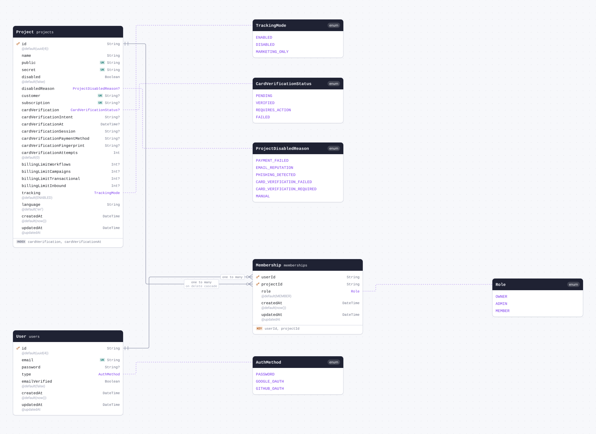

| Field       | Type                 | Constraints                                | Default      | Description |
| ----------- | -------------------- | ------------------------------------------ | ------------ | ----------- |
| `userId`    | `String`             | PK NOT NULL → [User.id](#model-User)       |              |             |
| `projectId` | `String`             | PK NOT NULL → [Project.id](#model-Project) |              |             |
| `role`      | [`Role`](#enum-Role) | NOT NULL                                   | `MEMBER`     |             |
| `createdAt` | `DateTime`           | NOT NULL                                   | `now()`      |             |
| `updatedAt` | `DateTime`           | NOT NULL                                   | `@updatedAt` |             |

#### Indexes

- `@@id([userId, projectId])`

#### References

- `userId` → [User.id](#model-User) (many-to-one)
- `projectId` → [Project.id](#model-Project) (many-to-one, on delete Cascade)

#### Definition

```sql
CREATE TABLE "memberships" (
    "userId" TEXT NOT NULL,
    "projectId" TEXT NOT NULL,
    "role" "Role" NOT NULL DEFAULT 'MEMBER',
    "createdAt" TIMESTAMP(3) NOT NULL DEFAULT CURRENT_TIMESTAMP,
    "updatedAt" TIMESTAMP(3) NOT NULL,

    CONSTRAINT "memberships_pkey" PRIMARY KEY ("userId","projectId")
);

ALTER TABLE "memberships" ADD CONSTRAINT "memberships_userId_fkey" FOREIGN KEY ("userId") REFERENCES "users"("id") ON DELETE RESTRICT ON UPDATE CASCADE;

ALTER TABLE "memberships" ADD CONSTRAINT "memberships_projectId_fkey" FOREIGN KEY ("projectId") REFERENCES "projects"("id") ON DELETE CASCADE ON UPDATE CASCADE;
```

<details>
<summary>Queries and their SQL</summary>

**findMany**: Every row

```ts
await prisma.membership.findMany();
```

```sql
SELECT
  "public"."memberships"."userId",
  "public"."memberships"."projectId",
  "public"."memberships"."role"::text,
  "public"."memberships"."createdAt",
  "public"."memberships"."updatedAt"
FROM
  "public"."memberships"
WHERE
  1 = 1
OFFSET
  $1
-- params: ["0"]
```

**count**: How many rows there are

```ts
await prisma.membership.count();
```

```sql
SELECT
  COUNT(*) AS "_count$_all"
FROM
  (
    SELECT
      "public"."memberships"."userId",
      "public"."memberships"."projectId"
    FROM
      "public"."memberships"
    WHERE
      1 = 1
    OFFSET
      $1
  ) AS "sub"
-- params: ["0"]
```

**findMany**: Every row with its relations

```ts
await prisma.membership.findMany({ include: { user: true, project: true } });
```

```sql
SELECT
  "public"."memberships"."userId",
  "public"."memberships"."projectId",
  "public"."memberships"."role"::text,
  "public"."memberships"."createdAt",
  "public"."memberships"."updatedAt"
FROM
  "public"."memberships"
WHERE
  1 = 1
OFFSET
  $1
-- params: ["0"]

SELECT
  "public"."users"."id",
  "public"."users"."email",
  "public"."users"."password",
  "public"."users"."type"::text,
  "public"."users"."emailVerified",
  "public"."users"."createdAt",
  "public"."users"."updatedAt"
FROM
  "public"."users"
WHERE
  "public"."users"."id" IN ($1)
OFFSET
  $2
-- params: ["<userId of the rows above>","0"]

SELECT
  "public"."projects"."id",
  "public"."projects"."name",
  "public"."projects"."public",
  "public"."projects"."secret",
  "public"."projects"."disabled",
  "public"."projects"."disabledReason"::text,
  "public"."projects"."customer",
  "public"."projects"."subscription",
  "public"."projects"."cardVerification"::text,
  "public"."projects"."cardVerificationIntent",
  "public"."projects"."cardVerificationAt",
  "public"."projects"."cardVerificationSession",
  "public"."projects"."cardVerificationPaymentMethod",
  "public"."projects"."cardVerificationFingerprint",
  "public"."projects"."cardVerificationAttempts",
  "public"."projects"."billingLimitWorkflows",
  "public"."projects"."billingLimitCampaigns",
  "public"."projects"."billingLimitTransactional",
  "public"."projects"."billingLimitInbound",
  "public"."projects"."tracking"::text,
  "public"."projects"."language",
  "public"."projects"."createdAt",
  "public"."projects"."updatedAt"
FROM
  "public"."projects"
WHERE
  "public"."projects"."id" IN ($1)
OFFSET
  $2
-- params: ["<projectId of the rows above>","0"]
```

**findUnique**: One row by what is unique to it

```ts
await prisma.membership.findUnique({
  where: { userId_projectId: { userId: "example", projectId: "example" } },
});
```

```sql
SELECT
  "public"."memberships"."userId",
  "public"."memberships"."projectId",
  "public"."memberships"."role"::text,
  "public"."memberships"."createdAt",
  "public"."memberships"."updatedAt"
FROM
  "public"."memberships"
WHERE
  (
    (
      "public"."memberships"."userId" = $1
      AND "public"."memberships"."projectId" = $2
    )
    AND 1 = 1
  )
LIMIT
  $3
OFFSET
  $4
-- params: ["example","example","1","0"]
```

**create**: Create a row

```ts
await prisma.membership.create({ data: { userId: "example", projectId: "example" } });
```

```sql
INSERT INTO
  "public"."memberships" (
    "userId",
    "projectId",
    "role",
    "createdAt",
    "updatedAt"
  )
VALUES
  ($1, $2, CAST($3::text AS "public"."Role"), $4, $5)
RETURNING
  "public"."memberships"."userId",
  "public"."memberships"."projectId",
  "public"."memberships"."role"::text,
  "public"."memberships"."createdAt",
  "public"."memberships"."updatedAt"
-- params: ["example","example","MEMBER","<now()>","<now()>"]
```

**update**: Update a row

```ts
await prisma.membership.update({
  where: { userId_projectId: { userId: "example", projectId: "example" } },
  data: { role: "OWNER" },
});
```

```sql
UPDATE "public"."memberships"
SET
  "role" = CAST($1::text AS "public"."Role"),
  "updatedAt" = $2
WHERE
  (
    (
      "public"."memberships"."userId" = $3
      AND "public"."memberships"."projectId" = $4
    )
    AND 1 = 1
  )
RETURNING
  "public"."memberships"."userId",
  "public"."memberships"."projectId",
  "public"."memberships"."role"::text,
  "public"."memberships"."createdAt",
  "public"."memberships"."updatedAt"
-- params: ["OWNER",{"prisma__type":"generatorCall","prisma__value":{"name":"now","args":[],"returnType":{"type":"DateTime"}}},"example","example"]
```

**delete**: Delete a row

```ts
await prisma.membership.delete({
  where: { userId_projectId: { userId: "example", projectId: "example" } },
});
```

```sql
DELETE FROM "public"."memberships"
WHERE
  (
    (
      "public"."memberships"."userId" = $1
      AND "public"."memberships"."projectId" = $2
    )
    AND 1 = 1
  )
RETURNING
  "public"."memberships"."userId",
  "public"."memberships"."projectId",
  "public"."memberships"."role"::text,
  "public"."memberships"."createdAt",
  "public"."memberships"."updatedAt"
-- params: ["example","example"]
```

</details>

<a id="model-Domain"></a>

### Domain

Table `domains`.

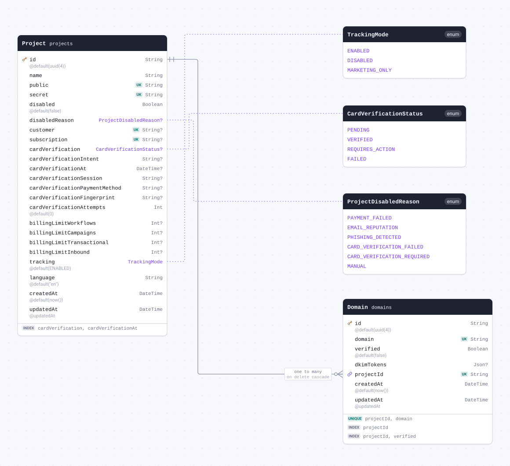

| Field        | Type       | Constraints                             | Default      | Description |
| ------------ | ---------- | --------------------------------------- | ------------ | ----------- |
| `id`         | `String`   | PK NOT NULL                             | `uuid(4)`    |             |
| `domain`     | `String`   | NOT NULL                                |              |             |
| `verified`   | `Boolean`  | NOT NULL                                | `false`      |             |
| `dkimTokens` | `Json`     | NULL                                    |              |             |
| `projectId`  | `String`   | NOT NULL → [Project.id](#model-Project) |              |             |
| `createdAt`  | `DateTime` | NOT NULL                                | `now()`      |             |
| `updatedAt`  | `DateTime` | NOT NULL                                | `@updatedAt` |             |

#### Indexes

- `@@index([projectId])`
- `@@index([projectId, verified])`
- `@@unique([projectId, domain])`

#### References

- `projectId` → [Project.id](#model-Project) (many-to-one, on delete Cascade)

#### Definition

```sql
CREATE TABLE "domains" (
    "id" TEXT NOT NULL,
    "domain" TEXT NOT NULL,
    "verified" BOOLEAN NOT NULL DEFAULT false,
    "dkimTokens" JSONB,
    "projectId" TEXT NOT NULL,
    "createdAt" TIMESTAMP(3) NOT NULL DEFAULT CURRENT_TIMESTAMP,
    "updatedAt" TIMESTAMP(3) NOT NULL,

    CONSTRAINT "domains_pkey" PRIMARY KEY ("id")
);

CREATE INDEX "domains_projectId_idx" ON "domains"("projectId");

CREATE INDEX "domains_projectId_verified_idx" ON "domains"("projectId", "verified");

CREATE UNIQUE INDEX "domains_projectId_domain_key" ON "domains"("projectId", "domain");

ALTER TABLE "domains" ADD CONSTRAINT "domains_projectId_fkey" FOREIGN KEY ("projectId") REFERENCES "projects"("id") ON DELETE CASCADE ON UPDATE CASCADE;
```

<details>
<summary>Queries and their SQL</summary>

**findMany**: Every row

```ts
await prisma.domain.findMany();
```

```sql
SELECT
  "public"."domains"."id",
  "public"."domains"."domain",
  "public"."domains"."verified",
  "public"."domains"."dkimTokens",
  "public"."domains"."projectId",
  "public"."domains"."createdAt",
  "public"."domains"."updatedAt"
FROM
  "public"."domains"
WHERE
  1 = 1
OFFSET
  $1
-- params: ["0"]
```

**count**: How many rows there are

```ts
await prisma.domain.count();
```

```sql
SELECT
  COUNT(*) AS "_count$_all"
FROM
  (
    SELECT
      "public"."domains"."id"
    FROM
      "public"."domains"
    WHERE
      1 = 1
    OFFSET
      $1
  ) AS "sub"
-- params: ["0"]
```

**findMany**: Every row with its relations

```ts
await prisma.domain.findMany({ include: { project: true } });
```

```sql
SELECT
  "public"."domains"."id",
  "public"."domains"."domain",
  "public"."domains"."verified",
  "public"."domains"."dkimTokens",
  "public"."domains"."projectId",
  "public"."domains"."createdAt",
  "public"."domains"."updatedAt"
FROM
  "public"."domains"
WHERE
  1 = 1
OFFSET
  $1
-- params: ["0"]

SELECT
  "public"."projects"."id",
  "public"."projects"."name",
  "public"."projects"."public",
  "public"."projects"."secret",
  "public"."projects"."disabled",
  "public"."projects"."disabledReason"::text,
  "public"."projects"."customer",
  "public"."projects"."subscription",
  "public"."projects"."cardVerification"::text,
  "public"."projects"."cardVerificationIntent",
  "public"."projects"."cardVerificationAt",
  "public"."projects"."cardVerificationSession",
  "public"."projects"."cardVerificationPaymentMethod",
  "public"."projects"."cardVerificationFingerprint",
  "public"."projects"."cardVerificationAttempts",
  "public"."projects"."billingLimitWorkflows",
  "public"."projects"."billingLimitCampaigns",
  "public"."projects"."billingLimitTransactional",
  "public"."projects"."billingLimitInbound",
  "public"."projects"."tracking"::text,
  "public"."projects"."language",
  "public"."projects"."createdAt",
  "public"."projects"."updatedAt"
FROM
  "public"."projects"
WHERE
  "public"."projects"."id" IN ($1)
OFFSET
  $2
-- params: ["<projectId of the rows above>","0"]
```

**findUnique**: One row by what is unique to it

```ts
await prisma.domain.findUnique({ where: { id: "example" } });
```

```sql
SELECT
  "public"."domains"."id",
  "public"."domains"."domain",
  "public"."domains"."verified",
  "public"."domains"."dkimTokens",
  "public"."domains"."projectId",
  "public"."domains"."createdAt",
  "public"."domains"."updatedAt"
FROM
  "public"."domains"
WHERE
  (
    "public"."domains"."id" = $1
    AND 1 = 1
  )
LIMIT
  $2
OFFSET
  $3
-- params: ["example","1","0"]
```

**create**: Create a row

```ts
await prisma.domain.create({ data: { domain: "example", projectId: "example" } });
```

```sql
INSERT INTO
  "public"."domains" (
    "id",
    "domain",
    "verified",
    "projectId",
    "createdAt",
    "updatedAt"
  )
VALUES
  ($1, $2, $3, $4, $5, $6)
RETURNING
  "public"."domains"."id",
  "public"."domains"."domain",
  "public"."domains"."verified",
  "public"."domains"."dkimTokens",
  "public"."domains"."projectId",
  "public"."domains"."createdAt",
  "public"."domains"."updatedAt"
-- params: ["<uuid(4)>","example",false,"example","<now()>","<now()>"]
```

**update**: Update a row

```ts
await prisma.domain.update({ where: { id: "example" }, data: { domain: "example" } });
```

```sql
UPDATE "public"."domains"
SET
  "domain" = $1,
  "updatedAt" = $2
WHERE
  (
    "public"."domains"."id" = $3
    AND 1 = 1
  )
RETURNING
  "public"."domains"."id",
  "public"."domains"."domain",
  "public"."domains"."verified",
  "public"."domains"."dkimTokens",
  "public"."domains"."projectId",
  "public"."domains"."createdAt",
  "public"."domains"."updatedAt"
-- params: ["example",{"prisma__type":"generatorCall","prisma__value":{"name":"now","args":[],"returnType":{"type":"DateTime"}}},"example"]
```

**delete**: Delete a row

```ts
await prisma.domain.delete({ where: { id: "example" } });
```

```sql
DELETE FROM "public"."domains"
WHERE
  (
    "public"."domains"."id" = $1
    AND 1 = 1
  )
RETURNING
  "public"."domains"."id",
  "public"."domains"."domain",
  "public"."domains"."verified",
  "public"."domains"."dkimTokens",
  "public"."domains"."projectId",
  "public"."domains"."createdAt",
  "public"."domains"."updatedAt"
-- params: ["example"]
```

</details>

<a id="model-Contact"></a>

### Contact

Table `contacts`.

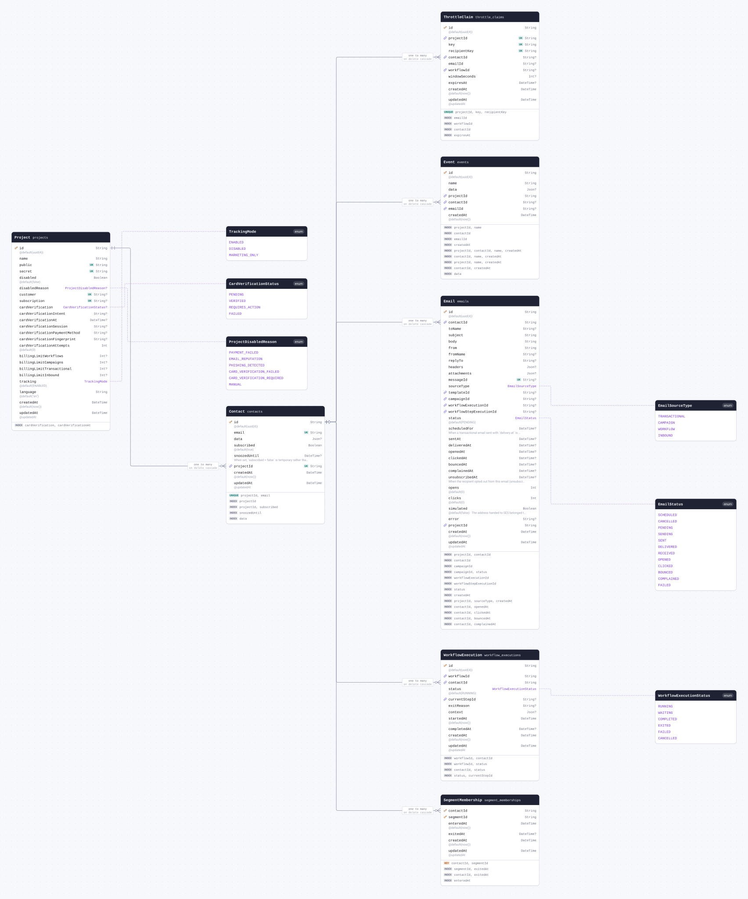

| Field          | Type       | Constraints                             | Default      | Description                                                                                                                                                                                                                                                                                                                                                                                                                   |
| -------------- | ---------- | --------------------------------------- | ------------ | ----------------------------------------------------------------------------------------------------------------------------------------------------------------------------------------------------------------------------------------------------------------------------------------------------------------------------------------------------------------------------------------------------------------------------- |
| `id`           | `String`   | PK NOT NULL                             | `uuid(4)`    |                                                                                                                                                                                                                                                                                                                                                                                                                               |
| `email`        | `String`   | NOT NULL                                |              |                                                                                                                                                                                                                                                                                                                                                                                                                               |
| `data`         | `Json`     | NULL                                    |              |                                                                                                                                                                                                                                                                                                                                                                                                                               |
| `subscribed`   | `Boolean`  | NOT NULL                                | `true`       |                                                                                                                                                                                                                                                                                                                                                                                                                               |
| `snoozedUntil` | `DateTime` | NULL                                    |              | When set, `subscribed = false` is temporary rather than permanent: the snooze sweep resubscribes the contact once this passes. Suppression itself is still carried entirely by `subscribed`, so every send path filters snoozed contacts out without knowing this column exists. Cleared by every other write to `subscribed` — including the bounce and complaint paths, so a suppressed address can never be woken back up. |
| `projectId`    | `String`   | NOT NULL → [Project.id](#model-Project) |              |                                                                                                                                                                                                                                                                                                                                                                                                                               |
| `createdAt`    | `DateTime` | NOT NULL                                | `now()`      |                                                                                                                                                                                                                                                                                                                                                                                                                               |
| `updatedAt`    | `DateTime` | NOT NULL                                | `@updatedAt` |                                                                                                                                                                                                                                                                                                                                                                                                                               |

#### Indexes

- `@@index([projectId])`
- `@@index([projectId, subscribed])`
- `@@index([snoozedUntil])`
- `@@index([data])`
- `@@unique([projectId, email])`

#### References

- `projectId` → [Project.id](#model-Project) (many-to-one, on delete Cascade)

#### Referenced by

- `id` ← [SegmentMembership.contactId](#model-SegmentMembership) (one-to-many, on delete Cascade)
- `id` ← [WorkflowExecution.contactId](#model-WorkflowExecution) (one-to-many, on delete Cascade)
- `id` ← [Email.contactId](#model-Email) (one-to-many, on delete Cascade)
- `id` ← [Event.contactId](#model-Event) (one-to-many, on delete Cascade)
- `id` ← [ThrottleClaim.contactId](#model-ThrottleClaim) (one-to-many, on delete Cascade)

#### Definition

```sql
CREATE TABLE "contacts" (
    "id" TEXT NOT NULL,
    "email" TEXT NOT NULL,
    "data" JSONB,
    "subscribed" BOOLEAN NOT NULL DEFAULT true,
    "snoozedUntil" TIMESTAMP(3),
    "projectId" TEXT NOT NULL,
    "createdAt" TIMESTAMP(3) NOT NULL DEFAULT CURRENT_TIMESTAMP,
    "updatedAt" TIMESTAMP(3) NOT NULL,

    CONSTRAINT "contacts_pkey" PRIMARY KEY ("id")
);

CREATE INDEX "contacts_projectId_idx" ON "contacts"("projectId");

CREATE INDEX "contacts_projectId_subscribed_idx" ON "contacts"("projectId", "subscribed");

CREATE INDEX "contacts_snoozedUntil_idx" ON "contacts"("snoozedUntil");

CREATE INDEX "contacts_data_idx" ON "contacts" USING GIN ("data" jsonb_ops);

CREATE UNIQUE INDEX "contacts_projectId_email_key" ON "contacts"("projectId", "email");

ALTER TABLE "contacts" ADD CONSTRAINT "contacts_projectId_fkey" FOREIGN KEY ("projectId") REFERENCES "projects"("id") ON DELETE CASCADE ON UPDATE CASCADE;
```

<details>
<summary>Queries and their SQL</summary>

**findMany**: Every row

```ts
await prisma.contact.findMany();
```

```sql
SELECT
  "public"."contacts"."id",
  "public"."contacts"."email",
  "public"."contacts"."data",
  "public"."contacts"."subscribed",
  "public"."contacts"."snoozedUntil",
  "public"."contacts"."projectId",
  "public"."contacts"."createdAt",
  "public"."contacts"."updatedAt"
FROM
  "public"."contacts"
WHERE
  1 = 1
OFFSET
  $1
-- params: ["0"]
```

**count**: How many rows there are

```ts
await prisma.contact.count();
```

```sql
SELECT
  COUNT(*) AS "_count$_all"
FROM
  (
    SELECT
      "public"."contacts"."id"
    FROM
      "public"."contacts"
    WHERE
      1 = 1
    OFFSET
      $1
  ) AS "sub"
-- params: ["0"]
```

**findMany**: Every row with its relations

```ts
await prisma.contact.findMany({
  include: {
    project: true,
    emails: true,
    workflowExecutions: true,
    events: true,
    segmentMemberships: true,
    throttleClaims: true,
  },
});
```

```sql
SELECT
  "public"."contacts"."id",
  "public"."contacts"."email",
  "public"."contacts"."data",
  "public"."contacts"."subscribed",
  "public"."contacts"."snoozedUntil",
  "public"."contacts"."projectId",
  "public"."contacts"."createdAt",
  "public"."contacts"."updatedAt"
FROM
  "public"."contacts"
WHERE
  1 = 1
OFFSET
  $1
-- params: ["0"]

SELECT
  "public"."projects"."id",
  "public"."projects"."name",
  "public"."projects"."public",
  "public"."projects"."secret",
  "public"."projects"."disabled",
  "public"."projects"."disabledReason"::text,
  "public"."projects"."customer",
  "public"."projects"."subscription",
  "public"."projects"."cardVerification"::text,
  "public"."projects"."cardVerificationIntent",
  "public"."projects"."cardVerificationAt",
  "public"."projects"."cardVerificationSession",
  "public"."projects"."cardVerificationPaymentMethod",
  "public"."projects"."cardVerificationFingerprint",
  "public"."projects"."cardVerificationAttempts",
  "public"."projects"."billingLimitWorkflows",
  "public"."projects"."billingLimitCampaigns",
  "public"."projects"."billingLimitTransactional",
  "public"."projects"."billingLimitInbound",
  "public"."projects"."tracking"::text,
  "public"."projects"."language",
  "public"."projects"."createdAt",
  "public"."projects"."updatedAt"
FROM
  "public"."projects"
WHERE
  "public"."projects"."id" IN ($1)
OFFSET
  $2
-- params: ["<projectId of the rows above>","0"]

SELECT
  "public"."emails"."id",
  "public"."emails"."contactId",
  "public"."emails"."toName",
  "public"."emails"."subject",
  "public"."emails"."body",
  "public"."emails"."from",
  "public"."emails"."fromName",
  "public"."emails"."replyTo",
  "public"."emails"."headers",
  "public"."emails"."attachments",
  "public"."emails"."messageId",
  "public"."emails"."sourceType"::text,
  "public"."emails"."templateId",
  "public"."emails"."campaignId",
  "public"."emails"."workflowExecutionId",
  "public"."emails"."workflowStepExecutionId",
  "public"."emails"."status"::text,
  "public"."emails"."scheduledFor",
  "public"."emails"."sentAt",
  "public"."emails"."deliveredAt",
  "public"."emails"."openedAt",
  "public"."emails"."clickedAt",
  "public"."emails"."bouncedAt",
  "public"."emails"."complainedAt",
  "public"."emails"."unsubscribedAt",
  "public"."emails"."opens",
  "public"."emails"."clicks",
  "public"."emails"."simulated",
  "public"."emails"."error",
  "public"."emails"."projectId",
  "public"."emails"."createdAt",
  "public"."emails"."updatedAt"
FROM
  "public"."emails"
WHERE
  "public"."emails"."contactId" IN ($1)
OFFSET
  $2
-- params: ["<id of the rows above>","0"]

SELECT
  "public"."workflow_executions"."id",
  "public"."workflow_executions"."workflowId",
  "public"."workflow_executions"."contactId",
  "public"."workflow_executions"."status"::text,
  "public"."workflow_executions"."currentStepId",
  "public"."workflow_executions"."exitReason",
  "public"."workflow_executions"."context",
  "public"."workflow_executions"."startedAt",
  "public"."workflow_executions"."completedAt",
  "public"."workflow_executions"."createdAt",
  "public"."workflow_executions"."updatedAt"
FROM
  "public"."workflow_executions"
WHERE
  "public"."workflow_executions"."contactId" IN ($1)
OFFSET
  $2
-- params: ["<id of the rows above>","0"]

SELECT
  "public"."events"."id",
  "public"."events"."name",
  "public"."events"."data",
  "public"."events"."projectId",
  "public"."events"."contactId",
  "public"."events"."emailId",
  "public"."events"."createdAt"
FROM
  "public"."events"
WHERE
  "public"."events"."contactId" IN ($1)
OFFSET
  $2
-- params: ["<id of the rows above>","0"]

SELECT
  "public"."segment_memberships"."contactId",
  "public"."segment_memberships"."segmentId",
  "public"."segment_memberships"."enteredAt",
  "public"."segment_memberships"."exitedAt",
  "public"."segment_memberships"."createdAt",
  "public"."segment_memberships"."updatedAt"
FROM
  "public"."segment_memberships"
WHERE
  "public"."segment_memberships"."contactId" IN ($1)
OFFSET
  $2
-- params: ["<id of the rows above>","0"]

SELECT
  "public"."throttle_claims"."id",
  "public"."throttle_claims"."projectId",
  "public"."throttle_claims"."key",
  "public"."throttle_claims"."recipientKey",
  "public"."throttle_claims"."contactId",
  "public"."throttle_claims"."emailId",
  "public"."throttle_claims"."workflowId",
  "public"."throttle_claims"."windowSeconds",
  "public"."throttle_claims"."expiresAt",
  "public"."throttle_claims"."createdAt",
  "public"."throttle_claims"."updatedAt"
FROM
  "public"."throttle_claims"
WHERE
  "public"."throttle_claims"."contactId" IN ($1)
OFFSET
  $2
-- params: ["<id of the rows above>","0"]
```

**findUnique**: One row by what is unique to it

```ts
await prisma.contact.findUnique({ where: { id: "example" } });
```

```sql
SELECT
  "public"."contacts"."id",
  "public"."contacts"."email",
  "public"."contacts"."data",
  "public"."contacts"."subscribed",
  "public"."contacts"."snoozedUntil",
  "public"."contacts"."projectId",
  "public"."contacts"."createdAt",
  "public"."contacts"."updatedAt"
FROM
  "public"."contacts"
WHERE
  (
    "public"."contacts"."id" = $1
    AND 1 = 1
  )
LIMIT
  $2
OFFSET
  $3
-- params: ["example","1","0"]
```

**create**: Create a row

```ts
await prisma.contact.create({ data: { email: "example", projectId: "example" } });
```

```sql
INSERT INTO
  "public"."contacts" (
    "id",
    "email",
    "subscribed",
    "projectId",
    "createdAt",
    "updatedAt"
  )
VALUES
  ($1, $2, $3, $4, $5, $6)
RETURNING
  "public"."contacts"."id",
  "public"."contacts"."email",
  "public"."contacts"."data",
  "public"."contacts"."subscribed",
  "public"."contacts"."snoozedUntil",
  "public"."contacts"."projectId",
  "public"."contacts"."createdAt",
  "public"."contacts"."updatedAt"
-- params: ["<uuid(4)>","example",true,"example","<now()>","<now()>"]
```

**update**: Update a row

```ts
await prisma.contact.update({ where: { id: "example" }, data: { email: "example" } });
```

```sql
UPDATE "public"."contacts"
SET
  "email" = $1,
  "updatedAt" = $2
WHERE
  (
    "public"."contacts"."id" = $3
    AND 1 = 1
  )
RETURNING
  "public"."contacts"."id",
  "public"."contacts"."email",
  "public"."contacts"."data",
  "public"."contacts"."subscribed",
  "public"."contacts"."snoozedUntil",
  "public"."contacts"."projectId",
  "public"."contacts"."createdAt",
  "public"."contacts"."updatedAt"
-- params: ["example",{"prisma__type":"generatorCall","prisma__value":{"name":"now","args":[],"returnType":{"type":"DateTime"}}},"example"]
```

**delete**: Delete a row

```ts
await prisma.contact.delete({ where: { id: "example" } });
```

```sql
DELETE FROM "public"."contacts"
WHERE
  (
    "public"."contacts"."id" = $1
    AND 1 = 1
  )
RETURNING
  "public"."contacts"."id",
  "public"."contacts"."email",
  "public"."contacts"."data",
  "public"."contacts"."subscribed",
  "public"."contacts"."snoozedUntil",
  "public"."contacts"."projectId",
  "public"."contacts"."createdAt",
  "public"."contacts"."updatedAt"
-- params: ["example"]
```

</details>

<a id="model-Template"></a>

### Template

Table `templates`.

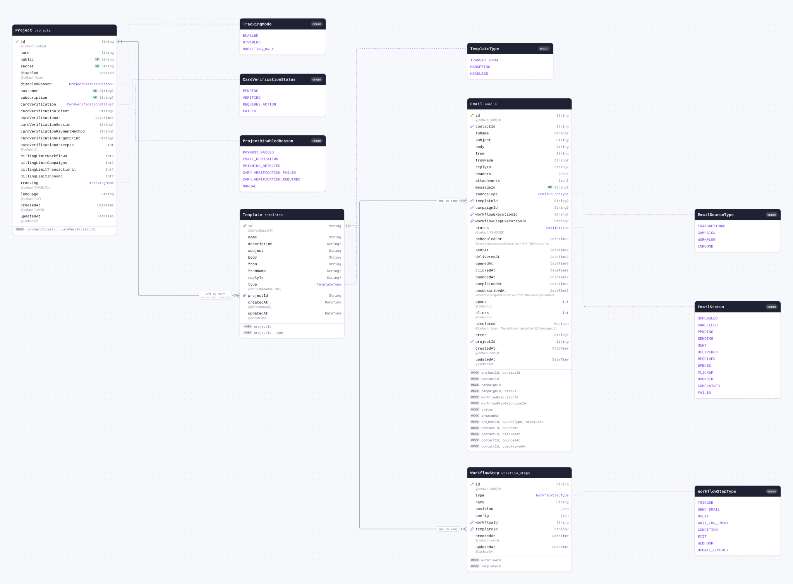

| Field         | Type                                 | Constraints                             | Default      | Description |
| ------------- | ------------------------------------ | --------------------------------------- | ------------ | ----------- |
| `id`          | `String`                             | PK NOT NULL                             | `uuid(4)`    |             |
| `name`        | `String`                             | NOT NULL                                |              |             |
| `description` | `String`                             | NULL                                    |              |             |
| `subject`     | `String`                             | NOT NULL                                |              |             |
| `body`        | `String`                             | NOT NULL                                |              |             |
| `from`        | `String`                             | NOT NULL                                |              |             |
| `fromName`    | `String`                             | NULL                                    |              |             |
| `replyTo`     | `String`                             | NULL                                    |              |             |
| `type`        | [`TemplateType`](#enum-TemplateType) | NOT NULL                                | `MARKETING`  |             |
| `projectId`   | `String`                             | NOT NULL → [Project.id](#model-Project) |              |             |
| `createdAt`   | `DateTime`                           | NOT NULL                                | `now()`      |             |
| `updatedAt`   | `DateTime`                           | NOT NULL                                | `@updatedAt` |             |

#### Indexes

- `@@index([projectId])`
- `@@index([projectId, type])`

#### References

- `projectId` → [Project.id](#model-Project) (many-to-one, on delete Cascade)

#### Referenced by

- `id` ← [WorkflowStep.templateId](#model-WorkflowStep) (one-to-many)
- `id` ← [Email.templateId](#model-Email) (one-to-many)

#### Definition

```sql
CREATE TABLE "templates" (
    "id" TEXT NOT NULL,
    "name" TEXT NOT NULL,
    "description" TEXT,
    "subject" TEXT NOT NULL,
    "body" TEXT NOT NULL,
    "from" TEXT NOT NULL,
    "fromName" TEXT,
    "replyTo" TEXT,
    "type" "TemplateType" NOT NULL DEFAULT 'MARKETING',
    "projectId" TEXT NOT NULL,
    "createdAt" TIMESTAMP(3) NOT NULL DEFAULT CURRENT_TIMESTAMP,
    "updatedAt" TIMESTAMP(3) NOT NULL,

    CONSTRAINT "templates_pkey" PRIMARY KEY ("id")
);

CREATE INDEX "templates_projectId_idx" ON "templates"("projectId");

CREATE INDEX "templates_projectId_type_idx" ON "templates"("projectId", "type");

ALTER TABLE "templates" ADD CONSTRAINT "templates_projectId_fkey" FOREIGN KEY ("projectId") REFERENCES "projects"("id") ON DELETE CASCADE ON UPDATE CASCADE;
```

<details>
<summary>Queries and their SQL</summary>

**findMany**: Every row

```ts
await prisma.template.findMany();
```

```sql
SELECT
  "public"."templates"."id",
  "public"."templates"."name",
  "public"."templates"."description",
  "public"."templates"."subject",
  "public"."templates"."body",
  "public"."templates"."from",
  "public"."templates"."fromName",
  "public"."templates"."replyTo",
  "public"."templates"."type"::text,
  "public"."templates"."projectId",
  "public"."templates"."createdAt",
  "public"."templates"."updatedAt"
FROM
  "public"."templates"
WHERE
  1 = 1
OFFSET
  $1
-- params: ["0"]
```

**count**: How many rows there are

```ts
await prisma.template.count();
```

```sql
SELECT
  COUNT(*) AS "_count$_all"
FROM
  (
    SELECT
      "public"."templates"."id"
    FROM
      "public"."templates"
    WHERE
      1 = 1
    OFFSET
      $1
  ) AS "sub"
-- params: ["0"]
```

**findMany**: Every row with its relations

```ts
await prisma.template.findMany({ include: { project: true, emails: true, workflowSteps: true } });
```

```sql
SELECT
  "public"."templates"."id",
  "public"."templates"."name",
  "public"."templates"."description",
  "public"."templates"."subject",
  "public"."templates"."body",
  "public"."templates"."from",
  "public"."templates"."fromName",
  "public"."templates"."replyTo",
  "public"."templates"."type"::text,
  "public"."templates"."projectId",
  "public"."templates"."createdAt",
  "public"."templates"."updatedAt"
FROM
  "public"."templates"
WHERE
  1 = 1
OFFSET
  $1
-- params: ["0"]

SELECT
  "public"."projects"."id",
  "public"."projects"."name",
  "public"."projects"."public",
  "public"."projects"."secret",
  "public"."projects"."disabled",
  "public"."projects"."disabledReason"::text,
  "public"."projects"."customer",
  "public"."projects"."subscription",
  "public"."projects"."cardVerification"::text,
  "public"."projects"."cardVerificationIntent",
  "public"."projects"."cardVerificationAt",
  "public"."projects"."cardVerificationSession",
  "public"."projects"."cardVerificationPaymentMethod",
  "public"."projects"."cardVerificationFingerprint",
  "public"."projects"."cardVerificationAttempts",
  "public"."projects"."billingLimitWorkflows",
  "public"."projects"."billingLimitCampaigns",
  "public"."projects"."billingLimitTransactional",
  "public"."projects"."billingLimitInbound",
  "public"."projects"."tracking"::text,
  "public"."projects"."language",
  "public"."projects"."createdAt",
  "public"."projects"."updatedAt"
FROM
  "public"."projects"
WHERE
  "public"."projects"."id" IN ($1)
OFFSET
  $2
-- params: ["<projectId of the rows above>","0"]

SELECT
  "public"."emails"."id",
  "public"."emails"."contactId",
  "public"."emails"."toName",
  "public"."emails"."subject",
  "public"."emails"."body",
  "public"."emails"."from",
  "public"."emails"."fromName",
  "public"."emails"."replyTo",
  "public"."emails"."headers",
  "public"."emails"."attachments",
  "public"."emails"."messageId",
  "public"."emails"."sourceType"::text,
  "public"."emails"."templateId",
  "public"."emails"."campaignId",
  "public"."emails"."workflowExecutionId",
  "public"."emails"."workflowStepExecutionId",
  "public"."emails"."status"::text,
  "public"."emails"."scheduledFor",
  "public"."emails"."sentAt",
  "public"."emails"."deliveredAt",
  "public"."emails"."openedAt",
  "public"."emails"."clickedAt",
  "public"."emails"."bouncedAt",
  "public"."emails"."complainedAt",
  "public"."emails"."unsubscribedAt",
  "public"."emails"."opens",
  "public"."emails"."clicks",
  "public"."emails"."simulated",
  "public"."emails"."error",
  "public"."emails"."projectId",
  "public"."emails"."createdAt",
  "public"."emails"."updatedAt"
FROM
  "public"."emails"
WHERE
  "public"."emails"."templateId" IN ($1)
OFFSET
  $2
-- params: ["<id of the rows above>","0"]

SELECT
  "public"."workflow_steps"."id",
  "public"."workflow_steps"."type"::text,
  "public"."workflow_steps"."name",
  "public"."workflow_steps"."position",
  "public"."workflow_steps"."config",
  "public"."workflow_steps"."workflowId",
  "public"."workflow_steps"."templateId",
  "public"."workflow_steps"."createdAt",
  "public"."workflow_steps"."updatedAt"
FROM
  "public"."workflow_steps"
WHERE
  "public"."workflow_steps"."templateId" IN ($1)
OFFSET
  $2
-- params: ["<id of the rows above>","0"]
```

**findUnique**: One row by what is unique to it

```ts
await prisma.template.findUnique({ where: { id: "example" } });
```

```sql
SELECT
  "public"."templates"."id",
  "public"."templates"."name",
  "public"."templates"."description",
  "public"."templates"."subject",
  "public"."templates"."body",
  "public"."templates"."from",
  "public"."templates"."fromName",
  "public"."templates"."replyTo",
  "public"."templates"."type"::text,
  "public"."templates"."projectId",
  "public"."templates"."createdAt",
  "public"."templates"."updatedAt"
FROM
  "public"."templates"
WHERE
  (
    "public"."templates"."id" = $1
    AND 1 = 1
  )
LIMIT
  $2
OFFSET
  $3
-- params: ["example","1","0"]
```

**create**: Create a row

```ts
await prisma.template.create({
  data: {
    name: "example",
    subject: "example",
    body: "example",
    from: "example",
    projectId: "example",
  },
});
```

```sql
INSERT INTO
  "public"."templates" (
    "id",
    "name",
    "subject",
    "body",
    "from",
    "type",
    "projectId",
    "createdAt",
    "updatedAt"
  )
VALUES
  (
    $1,
    $2,
    $3,
    $4,
    $5,
    CAST($6::text AS "public"."TemplateType"),
    $7,
    $8,
    $9
  )
RETURNING
  "public"."templates"."id",
  "public"."templates"."name",
  "public"."templates"."description",
  "public"."templates"."subject",
  "public"."templates"."body",
  "public"."templates"."from",
  "public"."templates"."fromName",
  "public"."templates"."replyTo",
  "public"."templates"."type"::text,
  "public"."templates"."projectId",
  "public"."templates"."createdAt",
  "public"."templates"."updatedAt"
-- params: ["<uuid(4)>","example","example","example","example","MARKETING","example","<now()>","<now()>"]
```

**update**: Update a row

```ts
await prisma.template.update({ where: { id: "example" }, data: { name: "example" } });
```

```sql
UPDATE "public"."templates"
SET
  "name" = $1,
  "updatedAt" = $2
WHERE
  (
    "public"."templates"."id" = $3
    AND 1 = 1
  )
RETURNING
  "public"."templates"."id",
  "public"."templates"."name",
  "public"."templates"."description",
  "public"."templates"."subject",
  "public"."templates"."body",
  "public"."templates"."from",
  "public"."templates"."fromName",
  "public"."templates"."replyTo",
  "public"."templates"."type"::text,
  "public"."templates"."projectId",
  "public"."templates"."createdAt",
  "public"."templates"."updatedAt"
-- params: ["example",{"prisma__type":"generatorCall","prisma__value":{"name":"now","args":[],"returnType":{"type":"DateTime"}}},"example"]
```

**delete**: Delete a row

```ts
await prisma.template.delete({ where: { id: "example" } });
```

```sql
DELETE FROM "public"."templates"
WHERE
  (
    "public"."templates"."id" = $1
    AND 1 = 1
  )
RETURNING
  "public"."templates"."id",
  "public"."templates"."name",
  "public"."templates"."description",
  "public"."templates"."subject",
  "public"."templates"."body",
  "public"."templates"."from",
  "public"."templates"."fromName",
  "public"."templates"."replyTo",
  "public"."templates"."type"::text,
  "public"."templates"."projectId",
  "public"."templates"."createdAt",
  "public"."templates"."updatedAt"
-- params: ["example"]
```

</details>

<a id="model-Segment"></a>

### Segment

Table `segments`.

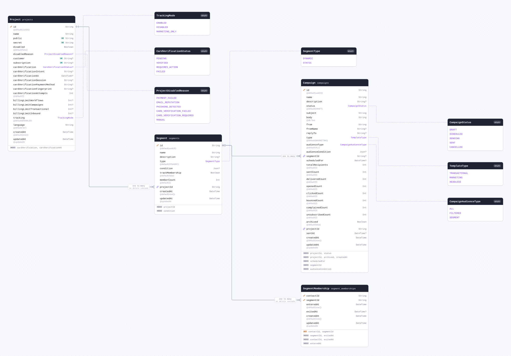

| Field             | Type                               | Constraints                             | Default      | Description |
| ----------------- | ---------------------------------- | --------------------------------------- | ------------ | ----------- |
| `id`              | `String`                           | PK NOT NULL                             | `uuid(4)`    |             |
| `name`            | `String`                           | NOT NULL                                |              |             |
| `description`     | `String`                           | NULL                                    |              |             |
| `type`            | [`SegmentType`](#enum-SegmentType) | NOT NULL                                | `DYNAMIC`    |             |
| `condition`       | `Json`                             | NULL                                    |              |             |
| `trackMembership` | `Boolean`                          | NOT NULL                                | `false`      |             |
| `memberCount`     | `Int`                              | NOT NULL                                | `0`          |             |
| `projectId`       | `String`                           | NOT NULL → [Project.id](#model-Project) |              |             |
| `createdAt`       | `DateTime`                         | NOT NULL                                | `now()`      |             |
| `updatedAt`       | `DateTime`                         | NOT NULL                                | `@updatedAt` |             |

#### Indexes

- `@@index([projectId])`
- `@@index([condition])`

#### References

- `projectId` → [Project.id](#model-Project) (many-to-one, on delete Cascade)

#### Referenced by

- `id` ← [SegmentMembership.segmentId](#model-SegmentMembership) (one-to-many, on delete Cascade)
- `id` ← [Campaign.segmentId](#model-Campaign) (one-to-many)

#### Definition

```sql
CREATE TABLE "segments" (
    "id" TEXT NOT NULL,
    "name" TEXT NOT NULL,
    "description" TEXT,
    "type" "SegmentType" NOT NULL DEFAULT 'DYNAMIC',
    "condition" JSONB,
    "trackMembership" BOOLEAN NOT NULL DEFAULT false,
    "memberCount" INTEGER NOT NULL DEFAULT 0,
    "projectId" TEXT NOT NULL,
    "createdAt" TIMESTAMP(3) NOT NULL DEFAULT CURRENT_TIMESTAMP,
    "updatedAt" TIMESTAMP(3) NOT NULL,

    CONSTRAINT "segments_pkey" PRIMARY KEY ("id")
);

CREATE INDEX "segments_projectId_idx" ON "segments"("projectId");

CREATE INDEX "segments_condition_idx" ON "segments" USING GIN ("condition" jsonb_ops);

ALTER TABLE "segments" ADD CONSTRAINT "segments_projectId_fkey" FOREIGN KEY ("projectId") REFERENCES "projects"("id") ON DELETE CASCADE ON UPDATE CASCADE;
```

<details>
<summary>Queries and their SQL</summary>

**findMany**: Every row

```ts
await prisma.segment.findMany();
```

```sql
SELECT
  "public"."segments"."id",
  "public"."segments"."name",
  "public"."segments"."description",
  "public"."segments"."type"::text,
  "public"."segments"."condition",
  "public"."segments"."trackMembership",
  "public"."segments"."memberCount",
  "public"."segments"."projectId",
  "public"."segments"."createdAt",
  "public"."segments"."updatedAt"
FROM
  "public"."segments"
WHERE
  1 = 1
OFFSET
  $1
-- params: ["0"]
```

**count**: How many rows there are

```ts
await prisma.segment.count();
```

```sql
SELECT
  COUNT(*) AS "_count$_all"
FROM
  (
    SELECT
      "public"."segments"."id"
    FROM
      "public"."segments"
    WHERE
      1 = 1
    OFFSET
      $1
  ) AS "sub"
-- params: ["0"]
```

**findMany**: Every row with its relations

```ts
await prisma.segment.findMany({ include: { project: true, memberships: true, campaigns: true } });
```

```sql
SELECT
  "public"."segments"."id",
  "public"."segments"."name",
  "public"."segments"."description",
  "public"."segments"."type"::text,
  "public"."segments"."condition",
  "public"."segments"."trackMembership",
  "public"."segments"."memberCount",
  "public"."segments"."projectId",
  "public"."segments"."createdAt",
  "public"."segments"."updatedAt"
FROM
  "public"."segments"
WHERE
  1 = 1
OFFSET
  $1
-- params: ["0"]

SELECT
  "public"."projects"."id",
  "public"."projects"."name",
  "public"."projects"."public",
  "public"."projects"."secret",
  "public"."projects"."disabled",
  "public"."projects"."disabledReason"::text,
  "public"."projects"."customer",
  "public"."projects"."subscription",
  "public"."projects"."cardVerification"::text,
  "public"."projects"."cardVerificationIntent",
  "public"."projects"."cardVerificationAt",
  "public"."projects"."cardVerificationSession",
  "public"."projects"."cardVerificationPaymentMethod",
  "public"."projects"."cardVerificationFingerprint",
  "public"."projects"."cardVerificationAttempts",
  "public"."projects"."billingLimitWorkflows",
  "public"."projects"."billingLimitCampaigns",
  "public"."projects"."billingLimitTransactional",
  "public"."projects"."billingLimitInbound",
  "public"."projects"."tracking"::text,
  "public"."projects"."language",
  "public"."projects"."createdAt",
  "public"."projects"."updatedAt"
FROM
  "public"."projects"
WHERE
  "public"."projects"."id" IN ($1)
OFFSET
  $2
-- params: ["<projectId of the rows above>","0"]

SELECT
  "public"."segment_memberships"."contactId",
  "public"."segment_memberships"."segmentId",
  "public"."segment_memberships"."enteredAt",
  "public"."segment_memberships"."exitedAt",
  "public"."segment_memberships"."createdAt",
  "public"."segment_memberships"."updatedAt"
FROM
  "public"."segment_memberships"
WHERE
  "public"."segment_memberships"."segmentId" IN ($1)
OFFSET
  $2
-- params: ["<id of the rows above>","0"]

SELECT
  "public"."campaigns"."id",
  "public"."campaigns"."name",
  "public"."campaigns"."description",
  "public"."campaigns"."status"::text,
  "public"."campaigns"."subject",
  "public"."campaigns"."body",
  "public"."campaigns"."from",
  "public"."campaigns"."fromName",
  "public"."campaigns"."replyTo",
  "public"."campaigns"."type"::text,
  "public"."campaigns"."audienceType"::text,
  "public"."campaigns"."audienceCondition",
  "public"."campaigns"."segmentId",
  "public"."campaigns"."scheduledFor",
  "public"."campaigns"."totalRecipients",
  "public"."campaigns"."sentCount",
  "public"."campaigns"."deliveredCount",
  "public"."campaigns"."openedCount",
  "public"."campaigns"."clickedCount",
  "public"."campaigns"."bouncedCount",
  "public"."campaigns"."complainedCount",
  "public"."campaigns"."unsubscribedCount",
  "public"."campaigns"."archived",
  "public"."campaigns"."projectId",
  "public"."campaigns"."sentAt",
  "public"."campaigns"."createdAt",
  "public"."campaigns"."updatedAt"
FROM
  "public"."campaigns"
WHERE
  "public"."campaigns"."segmentId" IN ($1)
OFFSET
  $2
-- params: ["<id of the rows above>","0"]
```

**findUnique**: One row by what is unique to it

```ts
await prisma.segment.findUnique({ where: { id: "example" } });
```

```sql
SELECT
  "public"."segments"."id",
  "public"."segments"."name",
  "public"."segments"."description",
  "public"."segments"."type"::text,
  "public"."segments"."condition",
  "public"."segments"."trackMembership",
  "public"."segments"."memberCount",
  "public"."segments"."projectId",
  "public"."segments"."createdAt",
  "public"."segments"."updatedAt"
FROM
  "public"."segments"
WHERE
  (
    "public"."segments"."id" = $1
    AND 1 = 1
  )
LIMIT
  $2
OFFSET
  $3
-- params: ["example","1","0"]
```

**create**: Create a row

```ts
await prisma.segment.create({ data: { name: "example", projectId: "example" } });
```

```sql
INSERT INTO
  "public"."segments" (
    "id",
    "name",
    "type",
    "trackMembership",
    "memberCount",
    "projectId",
    "createdAt",
    "updatedAt"
  )
VALUES
  (
    $1,
    $2,
    CAST($3::text AS "public"."SegmentType"),
    $4,
    $5,
    $6,
    $7,
    $8
  )
RETURNING
  "public"."segments"."id",
  "public"."segments"."name",
  "public"."segments"."description",
  "public"."segments"."type"::text,
  "public"."segments"."condition",
  "public"."segments"."trackMembership",
  "public"."segments"."memberCount",
  "public"."segments"."projectId",
  "public"."segments"."createdAt",
  "public"."segments"."updatedAt"
-- params: ["<uuid(4)>","example","DYNAMIC",false,"0","example","<now()>","<now()>"]
```

**update**: Update a row

```ts
await prisma.segment.update({ where: { id: "example" }, data: { name: "example" } });
```

```sql
UPDATE "public"."segments"
SET
  "name" = $1,
  "updatedAt" = $2
WHERE
  (
    "public"."segments"."id" = $3
    AND 1 = 1
  )
RETURNING
  "public"."segments"."id",
  "public"."segments"."name",
  "public"."segments"."description",
  "public"."segments"."type"::text,
  "public"."segments"."condition",
  "public"."segments"."trackMembership",
  "public"."segments"."memberCount",
  "public"."segments"."projectId",
  "public"."segments"."createdAt",
  "public"."segments"."updatedAt"
-- params: ["example",{"prisma__type":"generatorCall","prisma__value":{"name":"now","args":[],"returnType":{"type":"DateTime"}}},"example"]
```

**delete**: Delete a row

```ts
await prisma.segment.delete({ where: { id: "example" } });
```

```sql
DELETE FROM "public"."segments"
WHERE
  (
    "public"."segments"."id" = $1
    AND 1 = 1
  )
RETURNING
  "public"."segments"."id",
  "public"."segments"."name",
  "public"."segments"."description",
  "public"."segments"."type"::text,
  "public"."segments"."condition",
  "public"."segments"."trackMembership",
  "public"."segments"."memberCount",
  "public"."segments"."projectId",
  "public"."segments"."createdAt",
  "public"."segments"."updatedAt"
-- params: ["example"]
```

</details>

<a id="model-SegmentMembership"></a>

### SegmentMembership

Table `segment_memberships`.

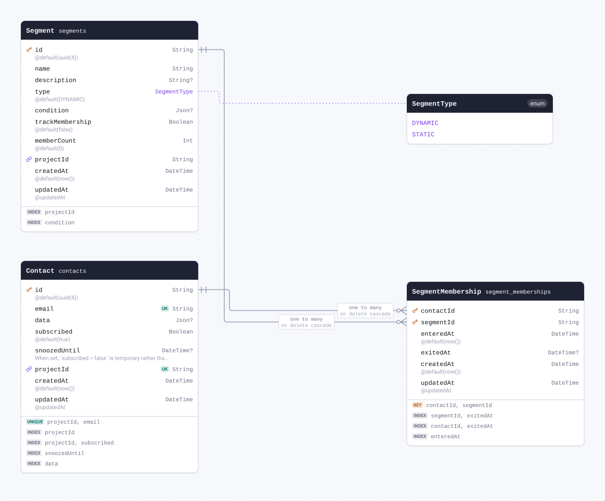

| Field       | Type       | Constraints                                | Default      | Description |
| ----------- | ---------- | ------------------------------------------ | ------------ | ----------- |
| `contactId` | `String`   | PK NOT NULL → [Contact.id](#model-Contact) |              |             |
| `segmentId` | `String`   | PK NOT NULL → [Segment.id](#model-Segment) |              |             |
| `enteredAt` | `DateTime` | NOT NULL                                   | `now()`      |             |
| `exitedAt`  | `DateTime` | NULL                                       |              |             |
| `createdAt` | `DateTime` | NOT NULL                                   | `now()`      |             |
| `updatedAt` | `DateTime` | NOT NULL                                   | `@updatedAt` |             |

#### Indexes

- `@@id([contactId, segmentId])`
- `@@index([segmentId, exitedAt])`
- `@@index([contactId, exitedAt])`
- `@@index([enteredAt])`

#### References

- `contactId` → [Contact.id](#model-Contact) (many-to-one, on delete Cascade)
- `segmentId` → [Segment.id](#model-Segment) (many-to-one, on delete Cascade)

#### Definition

```sql
CREATE TABLE "segment_memberships" (
    "contactId" TEXT NOT NULL,
    "segmentId" TEXT NOT NULL,
    "enteredAt" TIMESTAMP(3) NOT NULL DEFAULT CURRENT_TIMESTAMP,
    "exitedAt" TIMESTAMP(3),
    "createdAt" TIMESTAMP(3) NOT NULL DEFAULT CURRENT_TIMESTAMP,
    "updatedAt" TIMESTAMP(3) NOT NULL,

    CONSTRAINT "segment_memberships_pkey" PRIMARY KEY ("contactId","segmentId")
);

CREATE INDEX "segment_memberships_segmentId_exitedAt_idx" ON "segment_memberships"("segmentId", "exitedAt");

CREATE INDEX "segment_memberships_contactId_exitedAt_idx" ON "segment_memberships"("contactId", "exitedAt");

CREATE INDEX "segment_memberships_enteredAt_idx" ON "segment_memberships"("enteredAt");

ALTER TABLE "segment_memberships" ADD CONSTRAINT "segment_memberships_contactId_fkey" FOREIGN KEY ("contactId") REFERENCES "contacts"("id") ON DELETE CASCADE ON UPDATE CASCADE;

ALTER TABLE "segment_memberships" ADD CONSTRAINT "segment_memberships_segmentId_fkey" FOREIGN KEY ("segmentId") REFERENCES "segments"("id") ON DELETE CASCADE ON UPDATE CASCADE;
```

<details>
<summary>Queries and their SQL</summary>

**findMany**: Every row

```ts
await prisma.segmentMembership.findMany();
```

```sql
SELECT
  "public"."segment_memberships"."contactId",
  "public"."segment_memberships"."segmentId",
  "public"."segment_memberships"."enteredAt",
  "public"."segment_memberships"."exitedAt",
  "public"."segment_memberships"."createdAt",
  "public"."segment_memberships"."updatedAt"
FROM
  "public"."segment_memberships"
WHERE
  1 = 1
OFFSET
  $1
-- params: ["0"]
```

**count**: How many rows there are

```ts
await prisma.segmentMembership.count();
```

```sql
SELECT
  COUNT(*) AS "_count$_all"
FROM
  (
    SELECT
      "public"."segment_memberships"."contactId",
      "public"."segment_memberships"."segmentId"
    FROM
      "public"."segment_memberships"
    WHERE
      1 = 1
    OFFSET
      $1
  ) AS "sub"
-- params: ["0"]
```

**findMany**: Every row with its relations

```ts
await prisma.segmentMembership.findMany({ include: { contact: true, segment: true } });
```

```sql
SELECT
  "public"."segment_memberships"."contactId",
  "public"."segment_memberships"."segmentId",
  "public"."segment_memberships"."enteredAt",
  "public"."segment_memberships"."exitedAt",
  "public"."segment_memberships"."createdAt",
  "public"."segment_memberships"."updatedAt"
FROM
  "public"."segment_memberships"
WHERE
  1 = 1
OFFSET
  $1
-- params: ["0"]

SELECT
  "public"."contacts"."id",
  "public"."contacts"."email",
  "public"."contacts"."data",
  "public"."contacts"."subscribed",
  "public"."contacts"."snoozedUntil",
  "public"."contacts"."projectId",
  "public"."contacts"."createdAt",
  "public"."contacts"."updatedAt"
FROM
  "public"."contacts"
WHERE
  "public"."contacts"."id" IN ($1)
OFFSET
  $2
-- params: ["<contactId of the rows above>","0"]

SELECT
  "public"."segments"."id",
  "public"."segments"."name",
  "public"."segments"."description",
  "public"."segments"."type"::text,
  "public"."segments"."condition",
  "public"."segments"."trackMembership",
  "public"."segments"."memberCount",
  "public"."segments"."projectId",
  "public"."segments"."createdAt",
  "public"."segments"."updatedAt"
FROM
  "public"."segments"
WHERE
  "public"."segments"."id" IN ($1)
OFFSET
  $2
-- params: ["<segmentId of the rows above>","0"]
```

**findUnique**: One row by what is unique to it

```ts
await prisma.segmentMembership.findUnique({
  where: { contactId_segmentId: { contactId: "example", segmentId: "example" } },
});
```

```sql
SELECT
  "public"."segment_memberships"."contactId",
  "public"."segment_memberships"."segmentId",
  "public"."segment_memberships"."enteredAt",
  "public"."segment_memberships"."exitedAt",
  "public"."segment_memberships"."createdAt",
  "public"."segment_memberships"."updatedAt"
FROM
  "public"."segment_memberships"
WHERE
  (
    (
      "public"."segment_memberships"."contactId" = $1
      AND "public"."segment_memberships"."segmentId" = $2
    )
    AND 1 = 1
  )
LIMIT
  $3
OFFSET
  $4
-- params: ["example","example","1","0"]
```

**create**: Create a row

```ts
await prisma.segmentMembership.create({ data: { contactId: "example", segmentId: "example" } });
```

```sql
INSERT INTO
  "public"."segment_memberships" (
    "contactId",
    "segmentId",
    "enteredAt",
    "createdAt",
    "updatedAt"
  )
VALUES
  ($1, $2, $3, $4, $5)
RETURNING
  "public"."segment_memberships"."contactId",
  "public"."segment_memberships"."segmentId",
  "public"."segment_memberships"."enteredAt",
  "public"."segment_memberships"."exitedAt",
  "public"."segment_memberships"."createdAt",
  "public"."segment_memberships"."updatedAt"
-- params: ["example","example","<now()>","<now()>","<now()>"]
```

**update**: Update a row

```ts
await prisma.segmentMembership.update({
  where: { contactId_segmentId: { contactId: "example", segmentId: "example" } },
  data: { enteredAt: new Date("2026-01-01T00:00:00.000Z") },
});
```

```sql
UPDATE "public"."segment_memberships"
SET
  "enteredAt" = $1,
  "updatedAt" = $2
WHERE
  (
    (
      "public"."segment_memberships"."contactId" = $3
      AND "public"."segment_memberships"."segmentId" = $4
    )
    AND 1 = 1
  )
RETURNING
  "public"."segment_memberships"."contactId",
  "public"."segment_memberships"."segmentId",
  "public"."segment_memberships"."enteredAt",
  "public"."segment_memberships"."exitedAt",
  "public"."segment_memberships"."createdAt",
  "public"."segment_memberships"."updatedAt"
-- params: ["2026-01-01T00:00:00.000Z",{"prisma__type":"generatorCall","prisma__value":{"name":"now","args":[],"returnType":{"type":"DateTime"}}},"example","example"]
```

**delete**: Delete a row

```ts
await prisma.segmentMembership.delete({
  where: { contactId_segmentId: { contactId: "example", segmentId: "example" } },
});
```

```sql
DELETE FROM "public"."segment_memberships"
WHERE
  (
    (
      "public"."segment_memberships"."contactId" = $1
      AND "public"."segment_memberships"."segmentId" = $2
    )
    AND 1 = 1
  )
RETURNING
  "public"."segment_memberships"."contactId",
  "public"."segment_memberships"."segmentId",
  "public"."segment_memberships"."enteredAt",
  "public"."segment_memberships"."exitedAt",
  "public"."segment_memberships"."createdAt",
  "public"."segment_memberships"."updatedAt"
-- params: ["example","example"]
```

</details>

<a id="model-Campaign"></a>

### Campaign

Table `campaigns`.

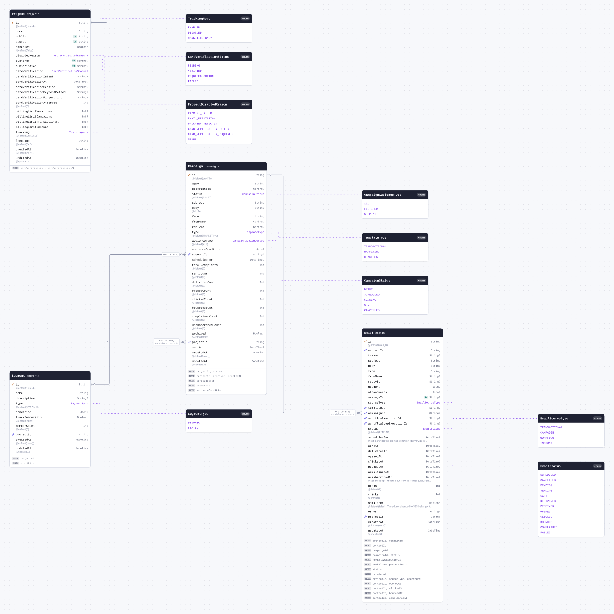

| Field               | Type                                                 | Constraints                             | Default      | Description |
| ------------------- | ---------------------------------------------------- | --------------------------------------- | ------------ | ----------- |
| `id`                | `String`                                             | PK NOT NULL                             | `uuid(4)`    |             |
| `name`              | `String`                                             | NOT NULL                                |              |             |
| `description`       | `String`                                             | NULL                                    |              |             |
| `status`            | [`CampaignStatus`](#enum-CampaignStatus)             | NOT NULL                                | `DRAFT`      |             |
| `subject`           | `String`                                             | NOT NULL                                |              |             |
| `body`              | `String` `@db.Text`                                  | NOT NULL                                |              |             |
| `from`              | `String`                                             | NOT NULL                                |              |             |
| `fromName`          | `String`                                             | NULL                                    |              |             |
| `replyTo`           | `String`                                             | NULL                                    |              |             |
| `type`              | [`TemplateType`](#enum-TemplateType)                 | NOT NULL                                | `MARKETING`  |             |
| `audienceType`      | [`CampaignAudienceType`](#enum-CampaignAudienceType) | NOT NULL                                | `ALL`        |             |
| `audienceCondition` | `Json`                                               | NULL                                    |              |             |
| `segmentId`         | `String`                                             | NULL → [Segment.id](#model-Segment)     |              |             |
| `scheduledFor`      | `DateTime`                                           | NULL                                    |              |             |
| `totalRecipients`   | `Int`                                                | NOT NULL                                | `0`          |             |
| `sentCount`         | `Int`                                                | NOT NULL                                | `0`          |             |
| `deliveredCount`    | `Int`                                                | NOT NULL                                | `0`          |             |
| `openedCount`       | `Int`                                                | NOT NULL                                | `0`          |             |
| `clickedCount`      | `Int`                                                | NOT NULL                                | `0`          |             |
| `bouncedCount`      | `Int`                                                | NOT NULL                                | `0`          |             |
| `complainedCount`   | `Int`                                                | NOT NULL                                | `0`          |             |
| `unsubscribedCount` | `Int`                                                | NOT NULL                                | `0`          |             |
| `archived`          | `Boolean`                                            | NOT NULL                                | `false`      |             |
| `projectId`         | `String`                                             | NOT NULL → [Project.id](#model-Project) |              |             |
| `sentAt`            | `DateTime`                                           | NULL                                    |              |             |
| `createdAt`         | `DateTime`                                           | NOT NULL                                | `now()`      |             |
| `updatedAt`         | `DateTime`                                           | NOT NULL                                | `@updatedAt` |             |

#### Indexes

- `@@index([projectId, status])`
- `@@index([projectId, archived, createdAt])`
- `@@index([scheduledFor])`
- `@@index([segmentId])`
- `@@index([audienceCondition])`

#### References

- `segmentId` → [Segment.id](#model-Segment) (many-to-one)
- `projectId` → [Project.id](#model-Project) (many-to-one, on delete Cascade)

#### Referenced by

- `id` ← [Email.campaignId](#model-Email) (one-to-many, on delete Cascade)

#### Definition

```sql
CREATE TABLE "campaigns" (
    "id" TEXT NOT NULL,
    "name" TEXT NOT NULL,
    "description" TEXT,
    "status" "CampaignStatus" NOT NULL DEFAULT 'DRAFT',
    "subject" TEXT NOT NULL,
    "body" TEXT NOT NULL,
    "from" TEXT NOT NULL,
    "fromName" TEXT,
    "replyTo" TEXT,
    "type" "TemplateType" NOT NULL DEFAULT 'MARKETING',
    "audienceType" "CampaignAudienceType" NOT NULL DEFAULT 'ALL',
    "audienceCondition" JSONB,
    "segmentId" TEXT,
    "scheduledFor" TIMESTAMP(3),
    "totalRecipients" INTEGER NOT NULL DEFAULT 0,
    "sentCount" INTEGER NOT NULL DEFAULT 0,
    "deliveredCount" INTEGER NOT NULL DEFAULT 0,
    "openedCount" INTEGER NOT NULL DEFAULT 0,
    "clickedCount" INTEGER NOT NULL DEFAULT 0,
    "bouncedCount" INTEGER NOT NULL DEFAULT 0,
    "complainedCount" INTEGER NOT NULL DEFAULT 0,
    "unsubscribedCount" INTEGER NOT NULL DEFAULT 0,
    "archived" BOOLEAN NOT NULL DEFAULT false,
    "projectId" TEXT NOT NULL,
    "sentAt" TIMESTAMP(3),
    "createdAt" TIMESTAMP(3) NOT NULL DEFAULT CURRENT_TIMESTAMP,
    "updatedAt" TIMESTAMP(3) NOT NULL,

    CONSTRAINT "campaigns_pkey" PRIMARY KEY ("id")
);

CREATE INDEX "campaigns_projectId_status_idx" ON "campaigns"("projectId", "status");

CREATE INDEX "campaigns_projectId_archived_createdAt_idx" ON "campaigns"("projectId", "archived", "createdAt");

CREATE INDEX "campaigns_scheduledFor_idx" ON "campaigns"("scheduledFor");

CREATE INDEX "campaigns_segmentId_idx" ON "campaigns"("segmentId");

CREATE INDEX "campaigns_audienceCondition_idx" ON "campaigns" USING GIN ("audienceCondition" jsonb_ops);

ALTER TABLE "campaigns" ADD CONSTRAINT "campaigns_segmentId_fkey" FOREIGN KEY ("segmentId") REFERENCES "segments"("id") ON DELETE SET NULL ON UPDATE CASCADE;

ALTER TABLE "campaigns" ADD CONSTRAINT "campaigns_projectId_fkey" FOREIGN KEY ("projectId") REFERENCES "projects"("id") ON DELETE CASCADE ON UPDATE CASCADE;
```

<details>
<summary>Queries and their SQL</summary>

**findMany**: Every row

```ts
await prisma.campaign.findMany();
```

```sql
SELECT
  "public"."campaigns"."id",
  "public"."campaigns"."name",
  "public"."campaigns"."description",
  "public"."campaigns"."status"::text,
  "public"."campaigns"."subject",
  "public"."campaigns"."body",
  "public"."campaigns"."from",
  "public"."campaigns"."fromName",
  "public"."campaigns"."replyTo",
  "public"."campaigns"."type"::text,
  "public"."campaigns"."audienceType"::text,
  "public"."campaigns"."audienceCondition",
  "public"."campaigns"."segmentId",
  "public"."campaigns"."scheduledFor",
  "public"."campaigns"."totalRecipients",
  "public"."campaigns"."sentCount",
  "public"."campaigns"."deliveredCount",
  "public"."campaigns"."openedCount",
  "public"."campaigns"."clickedCount",
  "public"."campaigns"."bouncedCount",
  "public"."campaigns"."complainedCount",
  "public"."campaigns"."unsubscribedCount",
  "public"."campaigns"."archived",
  "public"."campaigns"."projectId",
  "public"."campaigns"."sentAt",
  "public"."campaigns"."createdAt",
  "public"."campaigns"."updatedAt"
FROM
  "public"."campaigns"
WHERE
  1 = 1
OFFSET
  $1
-- params: ["0"]
```

**count**: How many rows there are

```ts
await prisma.campaign.count();
```

```sql
SELECT
  COUNT(*) AS "_count$_all"
FROM
  (
    SELECT
      "public"."campaigns"."id"
    FROM
      "public"."campaigns"
    WHERE
      1 = 1
    OFFSET
      $1
  ) AS "sub"
-- params: ["0"]
```

**findMany**: Every row with its relations

```ts
await prisma.campaign.findMany({ include: { segment: true, project: true, emails: true } });
```

```sql
SELECT
  "public"."campaigns"."id",
  "public"."campaigns"."name",
  "public"."campaigns"."description",
  "public"."campaigns"."status"::text,
  "public"."campaigns"."subject",
  "public"."campaigns"."body",
  "public"."campaigns"."from",
  "public"."campaigns"."fromName",
  "public"."campaigns"."replyTo",
  "public"."campaigns"."type"::text,
  "public"."campaigns"."audienceType"::text,
  "public"."campaigns"."audienceCondition",
  "public"."campaigns"."segmentId",
  "public"."campaigns"."scheduledFor",
  "public"."campaigns"."totalRecipients",
  "public"."campaigns"."sentCount",
  "public"."campaigns"."deliveredCount",
  "public"."campaigns"."openedCount",
  "public"."campaigns"."clickedCount",
  "public"."campaigns"."bouncedCount",
  "public"."campaigns"."complainedCount",
  "public"."campaigns"."unsubscribedCount",
  "public"."campaigns"."archived",
  "public"."campaigns"."projectId",
  "public"."campaigns"."sentAt",
  "public"."campaigns"."createdAt",
  "public"."campaigns"."updatedAt"
FROM
  "public"."campaigns"
WHERE
  1 = 1
OFFSET
  $1
-- params: ["0"]

SELECT
  "public"."segments"."id",
  "public"."segments"."name",
  "public"."segments"."description",
  "public"."segments"."type"::text,
  "public"."segments"."condition",
  "public"."segments"."trackMembership",
  "public"."segments"."memberCount",
  "public"."segments"."projectId",
  "public"."segments"."createdAt",
  "public"."segments"."updatedAt"
FROM
  "public"."segments"
WHERE
  "public"."segments"."id" IN ($1)
OFFSET
  $2
-- params: ["<segmentId of the rows above>","0"]

SELECT
  "public"."projects"."id",
  "public"."projects"."name",
  "public"."projects"."public",
  "public"."projects"."secret",
  "public"."projects"."disabled",
  "public"."projects"."disabledReason"::text,
  "public"."projects"."customer",
  "public"."projects"."subscription",
  "public"."projects"."cardVerification"::text,
  "public"."projects"."cardVerificationIntent",
  "public"."projects"."cardVerificationAt",
  "public"."projects"."cardVerificationSession",
  "public"."projects"."cardVerificationPaymentMethod",
  "public"."projects"."cardVerificationFingerprint",
  "public"."projects"."cardVerificationAttempts",
  "public"."projects"."billingLimitWorkflows",
  "public"."projects"."billingLimitCampaigns",
  "public"."projects"."billingLimitTransactional",
  "public"."projects"."billingLimitInbound",
  "public"."projects"."tracking"::text,
  "public"."projects"."language",
  "public"."projects"."createdAt",
  "public"."projects"."updatedAt"
FROM
  "public"."projects"
WHERE
  "public"."projects"."id" IN ($1)
OFFSET
  $2
-- params: ["<projectId of the rows above>","0"]

SELECT
  "public"."emails"."id",
  "public"."emails"."contactId",
  "public"."emails"."toName",
  "public"."emails"."subject",
  "public"."emails"."body",
  "public"."emails"."from",
  "public"."emails"."fromName",
  "public"."emails"."replyTo",
  "public"."emails"."headers",
  "public"."emails"."attachments",
  "public"."emails"."messageId",
  "public"."emails"."sourceType"::text,
  "public"."emails"."templateId",
  "public"."emails"."campaignId",
  "public"."emails"."workflowExecutionId",
  "public"."emails"."workflowStepExecutionId",
  "public"."emails"."status"::text,
  "public"."emails"."scheduledFor",
  "public"."emails"."sentAt",
  "public"."emails"."deliveredAt",
  "public"."emails"."openedAt",
  "public"."emails"."clickedAt",
  "public"."emails"."bouncedAt",
  "public"."emails"."complainedAt",
  "public"."emails"."unsubscribedAt",
  "public"."emails"."opens",
  "public"."emails"."clicks",
  "public"."emails"."simulated",
  "public"."emails"."error",
  "public"."emails"."projectId",
  "public"."emails"."createdAt",
  "public"."emails"."updatedAt"
FROM
  "public"."emails"
WHERE
  "public"."emails"."campaignId" IN ($1)
OFFSET
  $2
-- params: ["<id of the rows above>","0"]
```

**findUnique**: One row by what is unique to it

```ts
await prisma.campaign.findUnique({ where: { id: "example" } });
```

```sql
SELECT
  "public"."campaigns"."id",
  "public"."campaigns"."name",
  "public"."campaigns"."description",
  "public"."campaigns"."status"::text,
  "public"."campaigns"."subject",
  "public"."campaigns"."body",
  "public"."campaigns"."from",
  "public"."campaigns"."fromName",
  "public"."campaigns"."replyTo",
  "public"."campaigns"."type"::text,
  "public"."campaigns"."audienceType"::text,
  "public"."campaigns"."audienceCondition",
  "public"."campaigns"."segmentId",
  "public"."campaigns"."scheduledFor",
  "public"."campaigns"."totalRecipients",
  "public"."campaigns"."sentCount",
  "public"."campaigns"."deliveredCount",
  "public"."campaigns"."openedCount",
  "public"."campaigns"."clickedCount",
  "public"."campaigns"."bouncedCount",
  "public"."campaigns"."complainedCount",
  "public"."campaigns"."unsubscribedCount",
  "public"."campaigns"."archived",
  "public"."campaigns"."projectId",
  "public"."campaigns"."sentAt",
  "public"."campaigns"."createdAt",
  "public"."campaigns"."updatedAt"
FROM
  "public"."campaigns"
WHERE
  (
    "public"."campaigns"."id" = $1
    AND 1 = 1
  )
LIMIT
  $2
OFFSET
  $3
-- params: ["example","1","0"]
```

**create**: Create a row

```ts
await prisma.campaign.create({
  data: {
    name: "example",
    subject: "example",
    body: "example",
    from: "example",
    projectId: "example",
  },
});
```

```sql
INSERT INTO
  "public"."campaigns" (
    "id",
    "name",
    "status",
    "subject",
    "body",
    "from",
    "type",
    "audienceType",
    "totalRecipients",
    "sentCount",
    "deliveredCount",
    "openedCount",
    "clickedCount",
    "bouncedCount",
    "complainedCount",
    "unsubscribedCount",
    "archived",
    "projectId",
    "createdAt",
    "updatedAt"
  )
VALUES
  (
    $1,
    $2,
    CAST($3::text AS "public"."CampaignStatus"),
    $4,
    $5,
    $6,
    CAST($7::text AS "public"."TemplateType"),
    CAST($8::text AS "public"."CampaignAudienceType"),
    $9,
    $10,
    $11,
    $12,
    $13,
    $14,
    $15,
    $16,
    $17,
    $18,
    $19,
    $20
  )
RETURNING
  "public"."campaigns"."id",
  "public"."campaigns"."name",
  "public"."campaigns"."description",
  "public"."campaigns"."status"::text,
  "public"."campaigns"."subject",
  "public"."campaigns"."body",
  "public"."campaigns"."from",
  "public"."campaigns"."fromName",
  "public"."campaigns"."replyTo",
  "public"."campaigns"."type"::text,
  "public"."campaigns"."audienceType"::text,
  "public"."campaigns"."audienceCondition",
  "public"."campaigns"."segmentId",
  "public"."campaigns"."scheduledFor",
  "public"."campaigns"."totalRecipients",
  "public"."campaigns"."sentCount",
  "public"."campaigns"."deliveredCount",
  "public"."campaigns"."openedCount",
  "public"."campaigns"."clickedCount",
  "public"."campaigns"."bouncedCount",
  "public"."campaigns"."complainedCount",
  "public"."campaigns"."unsubscribedCount",
  "public"."campaigns"."archived",
  "public"."campaigns"."projectId",
  "public"."campaigns"."sentAt",
  "public"."campaigns"."createdAt",
  "public"."campaigns"."updatedAt"
-- params: ["<uuid(4)>","example","DRAFT","example","example","example","MARKETING","ALL","0","0","0","0","0","0","0","0",false,"example","<now()>","<now()>"]
```

**update**: Update a row

```ts
await prisma.campaign.update({ where: { id: "example" }, data: { name: "example" } });
```

```sql
UPDATE "public"."campaigns"
SET
  "name" = $1,
  "updatedAt" = $2
WHERE
  (
    "public"."campaigns"."id" = $3
    AND 1 = 1
  )
RETURNING
  "public"."campaigns"."id",
  "public"."campaigns"."name",
  "public"."campaigns"."description",
  "public"."campaigns"."status"::text,
  "public"."campaigns"."subject",
  "public"."campaigns"."body",
  "public"."campaigns"."from",
  "public"."campaigns"."fromName",
  "public"."campaigns"."replyTo",
  "public"."campaigns"."type"::text,
  "public"."campaigns"."audienceType"::text,
  "public"."campaigns"."audienceCondition",
  "public"."campaigns"."segmentId",
  "public"."campaigns"."scheduledFor",
  "public"."campaigns"."totalRecipients",
  "public"."campaigns"."sentCount",
  "public"."campaigns"."deliveredCount",
  "public"."campaigns"."openedCount",
  "public"."campaigns"."clickedCount",
  "public"."campaigns"."bouncedCount",
  "public"."campaigns"."complainedCount",
  "public"."campaigns"."unsubscribedCount",
  "public"."campaigns"."archived",
  "public"."campaigns"."projectId",
  "public"."campaigns"."sentAt",
  "public"."campaigns"."createdAt",
  "public"."campaigns"."updatedAt"
-- params: ["example",{"prisma__type":"generatorCall","prisma__value":{"name":"now","args":[],"returnType":{"type":"DateTime"}}},"example"]
```

**delete**: Delete a row

```ts
await prisma.campaign.delete({ where: { id: "example" } });
```

```sql
DELETE FROM "public"."campaigns"
WHERE
  (
    "public"."campaigns"."id" = $1
    AND 1 = 1
  )
RETURNING
  "public"."campaigns"."id",
  "public"."campaigns"."name",
  "public"."campaigns"."description",
  "public"."campaigns"."status"::text,
  "public"."campaigns"."subject",
  "public"."campaigns"."body",
  "public"."campaigns"."from",
  "public"."campaigns"."fromName",
  "public"."campaigns"."replyTo",
  "public"."campaigns"."type"::text,
  "public"."campaigns"."audienceType"::text,
  "public"."campaigns"."audienceCondition",
  "public"."campaigns"."segmentId",
  "public"."campaigns"."scheduledFor",
  "public"."campaigns"."totalRecipients",
  "public"."campaigns"."sentCount",
  "public"."campaigns"."deliveredCount",
  "public"."campaigns"."openedCount",
  "public"."campaigns"."clickedCount",
  "public"."campaigns"."bouncedCount",
  "public"."campaigns"."complainedCount",
  "public"."campaigns"."unsubscribedCount",
  "public"."campaigns"."archived",
  "public"."campaigns"."projectId",
  "public"."campaigns"."sentAt",
  "public"."campaigns"."createdAt",
  "public"."campaigns"."updatedAt"
-- params: ["example"]
```

</details>

<a id="model-Workflow"></a>

### Workflow

Table `workflows`.

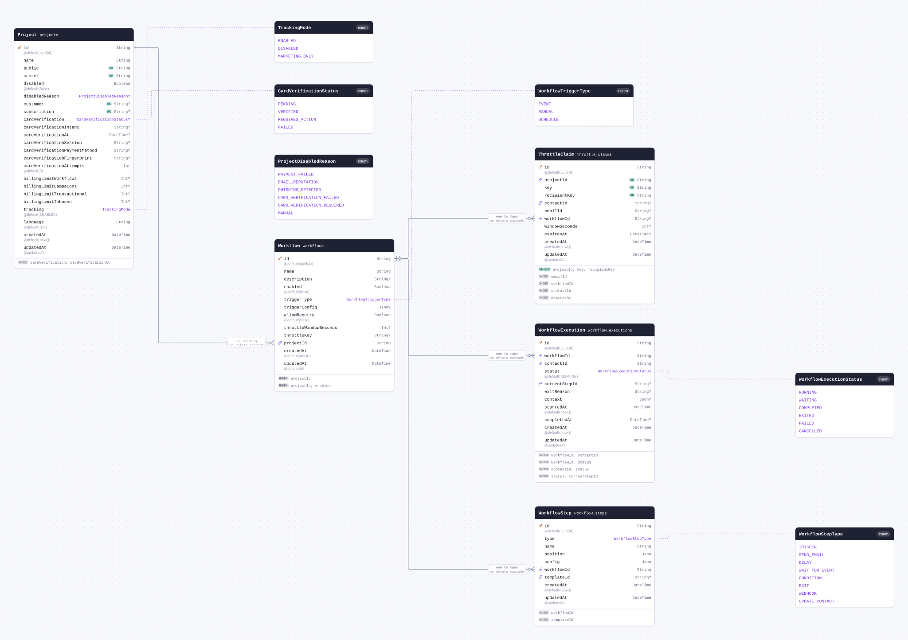

| Field                   | Type                                               | Constraints                             | Default      | Description |
| ----------------------- | -------------------------------------------------- | --------------------------------------- | ------------ | ----------- |
| `id`                    | `String`                                           | PK NOT NULL                             | `uuid(4)`    |             |
| `name`                  | `String`                                           | NOT NULL                                |              |             |
| `description`           | `String`                                           | NULL                                    |              |             |
| `enabled`               | `Boolean`                                          | NOT NULL                                | `false`      |             |
| `triggerType`           | [`WorkflowTriggerType`](#enum-WorkflowTriggerType) | NOT NULL                                |              |             |
| `triggerConfig`         | `Json`                                             | NULL                                    |              |             |
| `allowReentry`          | `Boolean`                                          | NOT NULL                                | `false`      |             |
| `throttleWindowSeconds` | `Int`                                              | NULL                                    |              |             |
| `throttleKey`           | `String`                                           | NULL                                    |              |             |
| `projectId`             | `String`                                           | NOT NULL → [Project.id](#model-Project) |              |             |
| `createdAt`             | `DateTime`                                         | NOT NULL                                | `now()`      |             |
| `updatedAt`             | `DateTime`                                         | NOT NULL                                | `@updatedAt` |             |

#### Indexes

- `@@index([projectId])`
- `@@index([projectId, enabled])`

#### References

- `projectId` → [Project.id](#model-Project) (many-to-one, on delete Cascade)

#### Referenced by

- `id` ← [WorkflowStep.workflowId](#model-WorkflowStep) (one-to-many, on delete Cascade)
- `id` ← [WorkflowExecution.workflowId](#model-WorkflowExecution) (one-to-many, on delete Cascade)
- `id` ← [ThrottleClaim.workflowId](#model-ThrottleClaim) (one-to-many, on delete Cascade)

#### Definition

```sql
CREATE TABLE "workflows" (
    "id" TEXT NOT NULL,
    "name" TEXT NOT NULL,
    "description" TEXT,
    "enabled" BOOLEAN NOT NULL DEFAULT false,
    "triggerType" "WorkflowTriggerType" NOT NULL,
    "triggerConfig" JSONB,
    "allowReentry" BOOLEAN NOT NULL DEFAULT false,
    "throttleWindowSeconds" INTEGER,
    "throttleKey" TEXT,
    "projectId" TEXT NOT NULL,
    "createdAt" TIMESTAMP(3) NOT NULL DEFAULT CURRENT_TIMESTAMP,
    "updatedAt" TIMESTAMP(3) NOT NULL,

    CONSTRAINT "workflows_pkey" PRIMARY KEY ("id")
);

CREATE INDEX "workflows_projectId_idx" ON "workflows"("projectId");

CREATE INDEX "workflows_projectId_enabled_idx" ON "workflows"("projectId", "enabled");

ALTER TABLE "workflows" ADD CONSTRAINT "workflows_projectId_fkey" FOREIGN KEY ("projectId") REFERENCES "projects"("id") ON DELETE CASCADE ON UPDATE CASCADE;
```

<details>
<summary>Queries and their SQL</summary>

**findMany**: Every row

```ts
await prisma.workflow.findMany();
```

```sql
SELECT
  "public"."workflows"."id",
  "public"."workflows"."name",
  "public"."workflows"."description",
  "public"."workflows"."enabled",
  "public"."workflows"."triggerType"::text,
  "public"."workflows"."triggerConfig",
  "public"."workflows"."allowReentry",
  "public"."workflows"."throttleWindowSeconds",
  "public"."workflows"."throttleKey",
  "public"."workflows"."projectId",
  "public"."workflows"."createdAt",
  "public"."workflows"."updatedAt"
FROM
  "public"."workflows"
WHERE
  1 = 1
OFFSET
  $1
-- params: ["0"]
```

**count**: How many rows there are

```ts
await prisma.workflow.count();
```

```sql
SELECT
  COUNT(*) AS "_count$_all"
FROM
  (
    SELECT
      "public"."workflows"."id"
    FROM
      "public"."workflows"
    WHERE
      1 = 1
    OFFSET
      $1
  ) AS "sub"
-- params: ["0"]
```

**findMany**: Every row with its relations

```ts
await prisma.workflow.findMany({
  include: { project: true, steps: true, executions: true, throttleClaims: true },
});
```

```sql
SELECT
  "public"."workflows"."id",
  "public"."workflows"."name",
  "public"."workflows"."description",
  "public"."workflows"."enabled",
  "public"."workflows"."triggerType"::text,
  "public"."workflows"."triggerConfig",
  "public"."workflows"."allowReentry",
  "public"."workflows"."throttleWindowSeconds",
  "public"."workflows"."throttleKey",
  "public"."workflows"."projectId",
  "public"."workflows"."createdAt",
  "public"."workflows"."updatedAt"
FROM
  "public"."workflows"
WHERE
  1 = 1
OFFSET
  $1
-- params: ["0"]

SELECT
  "public"."projects"."id",
  "public"."projects"."name",
  "public"."projects"."public",
  "public"."projects"."secret",
  "public"."projects"."disabled",
  "public"."projects"."disabledReason"::text,
  "public"."projects"."customer",
  "public"."projects"."subscription",
  "public"."projects"."cardVerification"::text,
  "public"."projects"."cardVerificationIntent",
  "public"."projects"."cardVerificationAt",
  "public"."projects"."cardVerificationSession",
  "public"."projects"."cardVerificationPaymentMethod",
  "public"."projects"."cardVerificationFingerprint",
  "public"."projects"."cardVerificationAttempts",
  "public"."projects"."billingLimitWorkflows",
  "public"."projects"."billingLimitCampaigns",
  "public"."projects"."billingLimitTransactional",
  "public"."projects"."billingLimitInbound",
  "public"."projects"."tracking"::text,
  "public"."projects"."language",
  "public"."projects"."createdAt",
  "public"."projects"."updatedAt"
FROM
  "public"."projects"
WHERE
  "public"."projects"."id" IN ($1)
OFFSET
  $2
-- params: ["<projectId of the rows above>","0"]

SELECT
  "public"."workflow_steps"."id",
  "public"."workflow_steps"."type"::text,
  "public"."workflow_steps"."name",
  "public"."workflow_steps"."position",
  "public"."workflow_steps"."config",
  "public"."workflow_steps"."workflowId",
  "public"."workflow_steps"."templateId",
  "public"."workflow_steps"."createdAt",
  "public"."workflow_steps"."updatedAt"
FROM
  "public"."workflow_steps"
WHERE
  "public"."workflow_steps"."workflowId" IN ($1)
OFFSET
  $2
-- params: ["<id of the rows above>","0"]

SELECT
  "public"."workflow_executions"."id",
  "public"."workflow_executions"."workflowId",
  "public"."workflow_executions"."contactId",
  "public"."workflow_executions"."status"::text,
  "public"."workflow_executions"."currentStepId",
  "public"."workflow_executions"."exitReason",
  "public"."workflow_executions"."context",
  "public"."workflow_executions"."startedAt",
  "public"."workflow_executions"."completedAt",
  "public"."workflow_executions"."createdAt",
  "public"."workflow_executions"."updatedAt"
FROM
  "public"."workflow_executions"
WHERE
  "public"."workflow_executions"."workflowId" IN ($1)
OFFSET
  $2
-- params: ["<id of the rows above>","0"]

SELECT
  "public"."throttle_claims"."id",
  "public"."throttle_claims"."projectId",
  "public"."throttle_claims"."key",
  "public"."throttle_claims"."recipientKey",
  "public"."throttle_claims"."contactId",
  "public"."throttle_claims"."emailId",
  "public"."throttle_claims"."workflowId",
  "public"."throttle_claims"."windowSeconds",
  "public"."throttle_claims"."expiresAt",
  "public"."throttle_claims"."createdAt",
  "public"."throttle_claims"."updatedAt"
FROM
  "public"."throttle_claims"
WHERE
  "public"."throttle_claims"."workflowId" IN ($1)
OFFSET
  $2
-- params: ["<id of the rows above>","0"]
```

**findUnique**: One row by what is unique to it

```ts
await prisma.workflow.findUnique({ where: { id: "example" } });
```

```sql
SELECT
  "public"."workflows"."id",
  "public"."workflows"."name",
  "public"."workflows"."description",
  "public"."workflows"."enabled",
  "public"."workflows"."triggerType"::text,
  "public"."workflows"."triggerConfig",
  "public"."workflows"."allowReentry",
  "public"."workflows"."throttleWindowSeconds",
  "public"."workflows"."throttleKey",
  "public"."workflows"."projectId",
  "public"."workflows"."createdAt",
  "public"."workflows"."updatedAt"
FROM
  "public"."workflows"
WHERE
  (
    "public"."workflows"."id" = $1
    AND 1 = 1
  )
LIMIT
  $2
OFFSET
  $3
-- params: ["example","1","0"]
```

**create**: Create a row

```ts
await prisma.workflow.create({
  data: { name: "example", triggerType: "EVENT", projectId: "example" },
});
```

```sql
INSERT INTO
  "public"."workflows" (
    "id",
    "name",
    "enabled",
    "triggerType",
    "allowReentry",
    "projectId",
    "createdAt",
    "updatedAt"
  )
VALUES
  (
    $1,
    $2,
    $3,
    CAST($4::text AS "public"."WorkflowTriggerType"),
    $5,
    $6,
    $7,
    $8
  )
RETURNING
  "public"."workflows"."id",
  "public"."workflows"."name",
  "public"."workflows"."description",
  "public"."workflows"."enabled",
  "public"."workflows"."triggerType"::text,
  "public"."workflows"."triggerConfig",
  "public"."workflows"."allowReentry",
  "public"."workflows"."throttleWindowSeconds",
  "public"."workflows"."throttleKey",
  "public"."workflows"."projectId",
  "public"."workflows"."createdAt",
  "public"."workflows"."updatedAt"
-- params: ["<uuid(4)>","example",false,"EVENT",false,"example","<now()>","<now()>"]
```

**update**: Update a row

```ts
await prisma.workflow.update({ where: { id: "example" }, data: { name: "example" } });
```

```sql
UPDATE "public"."workflows"
SET
  "name" = $1,
  "updatedAt" = $2
WHERE
  (
    "public"."workflows"."id" = $3
    AND 1 = 1
  )
RETURNING
  "public"."workflows"."id",
  "public"."workflows"."name",
  "public"."workflows"."description",
  "public"."workflows"."enabled",
  "public"."workflows"."triggerType"::text,
  "public"."workflows"."triggerConfig",
  "public"."workflows"."allowReentry",
  "public"."workflows"."throttleWindowSeconds",
  "public"."workflows"."throttleKey",
  "public"."workflows"."projectId",
  "public"."workflows"."createdAt",
  "public"."workflows"."updatedAt"
-- params: ["example",{"prisma__type":"generatorCall","prisma__value":{"name":"now","args":[],"returnType":{"type":"DateTime"}}},"example"]
```

**delete**: Delete a row

```ts
await prisma.workflow.delete({ where: { id: "example" } });
```

```sql
DELETE FROM "public"."workflows"
WHERE
  (
    "public"."workflows"."id" = $1
    AND 1 = 1
  )
RETURNING
  "public"."workflows"."id",
  "public"."workflows"."name",
  "public"."workflows"."description",
  "public"."workflows"."enabled",
  "public"."workflows"."triggerType"::text,
  "public"."workflows"."triggerConfig",
  "public"."workflows"."allowReentry",
  "public"."workflows"."throttleWindowSeconds",
  "public"."workflows"."throttleKey",
  "public"."workflows"."projectId",
  "public"."workflows"."createdAt",
  "public"."workflows"."updatedAt"
-- params: ["example"]
```

</details>

<a id="model-WorkflowStep"></a>

### WorkflowStep

Table `workflow_steps`.

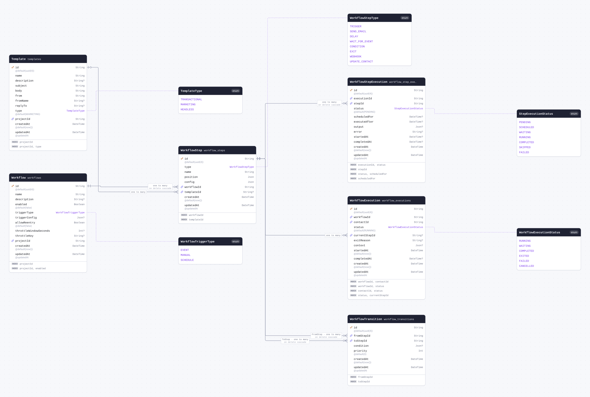

| Field        | Type                                         | Constraints                               | Default      | Description |
| ------------ | -------------------------------------------- | ----------------------------------------- | ------------ | ----------- |
| `id`         | `String`                                     | PK NOT NULL                               | `uuid(4)`    |             |
| `type`       | [`WorkflowStepType`](#enum-WorkflowStepType) | NOT NULL                                  |              |             |
| `name`       | `String`                                     | NOT NULL                                  |              |             |
| `position`   | `Json`                                       | NOT NULL                                  |              |             |
| `config`     | `Json`                                       | NOT NULL                                  |              |             |
| `workflowId` | `String`                                     | NOT NULL → [Workflow.id](#model-Workflow) |              |             |
| `templateId` | `String`                                     | NULL → [Template.id](#model-Template)     |              |             |
| `createdAt`  | `DateTime`                                   | NOT NULL                                  | `now()`      |             |
| `updatedAt`  | `DateTime`                                   | NOT NULL                                  | `@updatedAt` |             |

#### Indexes

- `@@index([workflowId])`
- `@@index([templateId])`

#### References

- `workflowId` → [Workflow.id](#model-Workflow) (many-to-one, on delete Cascade)
- `templateId` → [Template.id](#model-Template) (many-to-one)

#### Referenced by

- `id` ← [WorkflowTransition.fromStepId](#model-WorkflowTransition) (one-to-many, on delete Cascade)
- `id` ← [WorkflowTransition.toStepId](#model-WorkflowTransition) (one-to-many, on delete Cascade)
- `id` ← [WorkflowExecution.currentStepId](#model-WorkflowExecution) (one-to-many)
- `id` ← [WorkflowStepExecution.stepId](#model-WorkflowStepExecution) (one-to-many, on delete Cascade)

#### Definition

```sql
CREATE TABLE "workflow_steps" (
    "id" TEXT NOT NULL,
    "type" "WorkflowStepType" NOT NULL,
    "name" TEXT NOT NULL,
    "position" JSONB NOT NULL,
    "config" JSONB NOT NULL,
    "workflowId" TEXT NOT NULL,
    "templateId" TEXT,
    "createdAt" TIMESTAMP(3) NOT NULL DEFAULT CURRENT_TIMESTAMP,
    "updatedAt" TIMESTAMP(3) NOT NULL,

    CONSTRAINT "workflow_steps_pkey" PRIMARY KEY ("id")
);

CREATE INDEX "workflow_steps_workflowId_idx" ON "workflow_steps"("workflowId");

CREATE INDEX "workflow_steps_templateId_idx" ON "workflow_steps"("templateId");

ALTER TABLE "workflow_steps" ADD CONSTRAINT "workflow_steps_workflowId_fkey" FOREIGN KEY ("workflowId") REFERENCES "workflows"("id") ON DELETE CASCADE ON UPDATE CASCADE;

ALTER TABLE "workflow_steps" ADD CONSTRAINT "workflow_steps_templateId_fkey" FOREIGN KEY ("templateId") REFERENCES "templates"("id") ON DELETE SET NULL ON UPDATE CASCADE;
```

<details>
<summary>Queries and their SQL</summary>

**findMany**: Every row

```ts
await prisma.workflowStep.findMany();
```

```sql
SELECT
  "public"."workflow_steps"."id",
  "public"."workflow_steps"."type"::text,
  "public"."workflow_steps"."name",
  "public"."workflow_steps"."position",
  "public"."workflow_steps"."config",
  "public"."workflow_steps"."workflowId",
  "public"."workflow_steps"."templateId",
  "public"."workflow_steps"."createdAt",
  "public"."workflow_steps"."updatedAt"
FROM
  "public"."workflow_steps"
WHERE
  1 = 1
OFFSET
  $1
-- params: ["0"]
```

**count**: How many rows there are

```ts
await prisma.workflowStep.count();
```

```sql
SELECT
  COUNT(*) AS "_count$_all"
FROM
  (
    SELECT
      "public"."workflow_steps"."id"
    FROM
      "public"."workflow_steps"
    WHERE
      1 = 1
    OFFSET
      $1
  ) AS "sub"
-- params: ["0"]
```

**findMany**: Every row with its relations

```ts
await prisma.workflowStep.findMany({
  include: {
    workflow: true,
    template: true,
    outgoingTransitions: true,
    incomingTransitions: true,
    executions: true,
    currentWorkflowExecutions: true,
  },
});
```

```sql
SELECT
  "public"."workflow_steps"."id",
  "public"."workflow_steps"."type"::text,
  "public"."workflow_steps"."name",
  "public"."workflow_steps"."position",
  "public"."workflow_steps"."config",
  "public"."workflow_steps"."workflowId",
  "public"."workflow_steps"."templateId",
  "public"."workflow_steps"."createdAt",
  "public"."workflow_steps"."updatedAt"
FROM
  "public"."workflow_steps"
WHERE
  1 = 1
OFFSET
  $1
-- params: ["0"]

SELECT
  "public"."workflows"."id",
  "public"."workflows"."name",
  "public"."workflows"."description",
  "public"."workflows"."enabled",
  "public"."workflows"."triggerType"::text,
  "public"."workflows"."triggerConfig",
  "public"."workflows"."allowReentry",
  "public"."workflows"."throttleWindowSeconds",
  "public"."workflows"."throttleKey",
  "public"."workflows"."projectId",
  "public"."workflows"."createdAt",
  "public"."workflows"."updatedAt"
FROM
  "public"."workflows"
WHERE
  "public"."workflows"."id" IN ($1)
OFFSET
  $2
-- params: ["<workflowId of the rows above>","0"]

SELECT
  "public"."templates"."id",
  "public"."templates"."name",
  "public"."templates"."description",
  "public"."templates"."subject",
  "public"."templates"."body",
  "public"."templates"."from",
  "public"."templates"."fromName",
  "public"."templates"."replyTo",
  "public"."templates"."type"::text,
  "public"."templates"."projectId",
  "public"."templates"."createdAt",
  "public"."templates"."updatedAt"
FROM
  "public"."templates"
WHERE
  "public"."templates"."id" IN ($1)
OFFSET
  $2
-- params: ["<templateId of the rows above>","0"]

SELECT
  "public"."workflow_transitions"."id",
  "public"."workflow_transitions"."fromStepId",
  "public"."workflow_transitions"."toStepId",
  "public"."workflow_transitions"."condition",
  "public"."workflow_transitions"."priority",
  "public"."workflow_transitions"."createdAt",
  "public"."workflow_transitions"."updatedAt"
FROM
  "public"."workflow_transitions"
WHERE
  "public"."workflow_transitions"."fromStepId" IN ($1)
OFFSET
  $2
-- params: ["<id of the rows above>","0"]

SELECT
  "public"."workflow_transitions"."id",
  "public"."workflow_transitions"."fromStepId",
  "public"."workflow_transitions"."toStepId",
  "public"."workflow_transitions"."condition",
  "public"."workflow_transitions"."priority",
  "public"."workflow_transitions"."createdAt",
  "public"."workflow_transitions"."updatedAt"
FROM
  "public"."workflow_transitions"
WHERE
  "public"."workflow_transitions"."toStepId" IN ($1)
OFFSET
  $2
-- params: ["<id of the rows above>","0"]

SELECT
  "public"."workflow_step_executions"."id",
  "public"."workflow_step_executions"."executionId",
  "public"."workflow_step_executions"."stepId",
  "public"."workflow_step_executions"."status"::text,
  "public"."workflow_step_executions"."scheduledFor",
  "public"."workflow_step_executions"."executeAfter",
  "public"."workflow_step_executions"."output",
  "public"."workflow_step_executions"."error",
  "public"."workflow_step_executions"."startedAt",
  "public"."workflow_step_executions"."completedAt",
  "public"."workflow_step_executions"."createdAt",
  "public"."workflow_step_executions"."updatedAt"
FROM
  "public"."workflow_step_executions"
WHERE
  "public"."workflow_step_executions"."stepId" IN ($1)
OFFSET
  $2
-- params: ["<id of the rows above>","0"]

SELECT
  "public"."workflow_executions"."id",
  "public"."workflow_executions"."workflowId",
  "public"."workflow_executions"."contactId",
  "public"."workflow_executions"."status"::text,
  "public"."workflow_executions"."currentStepId",
  "public"."workflow_executions"."exitReason",
  "public"."workflow_executions"."context",
  "public"."workflow_executions"."startedAt",
  "public"."workflow_executions"."completedAt",
  "public"."workflow_executions"."createdAt",
  "public"."workflow_executions"."updatedAt"
FROM
  "public"."workflow_executions"
WHERE
  "public"."workflow_executions"."currentStepId" IN ($1)
OFFSET
  $2
-- params: ["<id of the rows above>","0"]
```

**findUnique**: One row by what is unique to it

```ts
await prisma.workflowStep.findUnique({ where: { id: "example" } });
```

```sql
SELECT
  "public"."workflow_steps"."id",
  "public"."workflow_steps"."type"::text,
  "public"."workflow_steps"."name",
  "public"."workflow_steps"."position",
  "public"."workflow_steps"."config",
  "public"."workflow_steps"."workflowId",
  "public"."workflow_steps"."templateId",
  "public"."workflow_steps"."createdAt",
  "public"."workflow_steps"."updatedAt"
FROM
  "public"."workflow_steps"
WHERE
  (
    "public"."workflow_steps"."id" = $1
    AND 1 = 1
  )
LIMIT
  $2
OFFSET
  $3
-- params: ["example","1","0"]
```

**create**: Create a row

```ts
await prisma.workflowStep.create({
  data: { type: "TRIGGER", name: "example", position: {}, config: {}, workflowId: "example" },
});
```

```sql
INSERT INTO
  "public"."workflow_steps" (
    "id",
    "type",
    "name",
    "position",
    "config",
    "workflowId",
    "createdAt",
    "updatedAt"
  )
VALUES
  (
    $1,
    CAST($2::text AS "public"."WorkflowStepType"),
    $3,
    $4,
    $5,
    $6,
    $7,
    $8
  )
RETURNING
  "public"."workflow_steps"."id",
  "public"."workflow_steps"."type"::text,
  "public"."workflow_steps"."name",
  "public"."workflow_steps"."position",
  "public"."workflow_steps"."config",
  "public"."workflow_steps"."workflowId",
  "public"."workflow_steps"."templateId",
  "public"."workflow_steps"."createdAt",
  "public"."workflow_steps"."updatedAt"
-- params: ["<uuid(4)>","TRIGGER","example","{}","{}","example","<now()>","<now()>"]
```

**update**: Update a row

```ts
await prisma.workflowStep.update({ where: { id: "example" }, data: { type: "TRIGGER" } });
```

```sql
UPDATE "public"."workflow_steps"
SET
  "type" = CAST($1::text AS "public"."WorkflowStepType"),
  "updatedAt" = $2
WHERE
  (
    "public"."workflow_steps"."id" = $3
    AND 1 = 1
  )
RETURNING
  "public"."workflow_steps"."id",
  "public"."workflow_steps"."type"::text,
  "public"."workflow_steps"."name",
  "public"."workflow_steps"."position",
  "public"."workflow_steps"."config",
  "public"."workflow_steps"."workflowId",
  "public"."workflow_steps"."templateId",
  "public"."workflow_steps"."createdAt",
  "public"."workflow_steps"."updatedAt"
-- params: ["TRIGGER",{"prisma__type":"generatorCall","prisma__value":{"name":"now","args":[],"returnType":{"type":"DateTime"}}},"example"]
```

**delete**: Delete a row

```ts
await prisma.workflowStep.delete({ where: { id: "example" } });
```

```sql
DELETE FROM "public"."workflow_steps"
WHERE
  (
    "public"."workflow_steps"."id" = $1
    AND 1 = 1
  )
RETURNING
  "public"."workflow_steps"."id",
  "public"."workflow_steps"."type"::text,
  "public"."workflow_steps"."name",
  "public"."workflow_steps"."position",
  "public"."workflow_steps"."config",
  "public"."workflow_steps"."workflowId",
  "public"."workflow_steps"."templateId",
  "public"."workflow_steps"."createdAt",
  "public"."workflow_steps"."updatedAt"
-- params: ["example"]
```

</details>

<a id="model-WorkflowTransition"></a>

### WorkflowTransition

Table `workflow_transitions`.

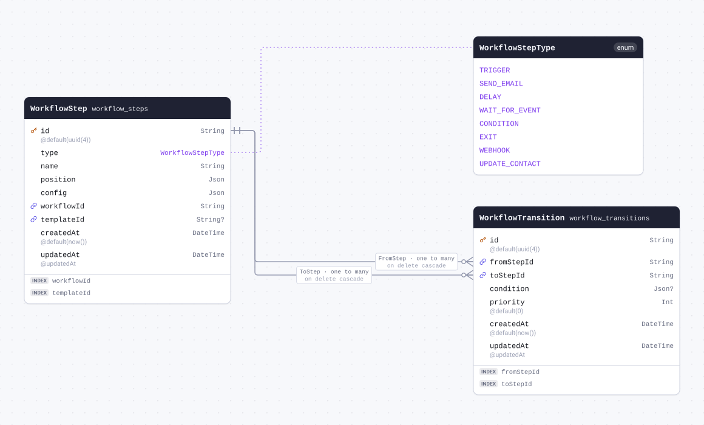

| Field        | Type       | Constraints                                       | Default      | Description |
| ------------ | ---------- | ------------------------------------------------- | ------------ | ----------- |
| `id`         | `String`   | PK NOT NULL                                       | `uuid(4)`    |             |
| `fromStepId` | `String`   | NOT NULL → [WorkflowStep.id](#model-WorkflowStep) |              |             |
| `toStepId`   | `String`   | NOT NULL → [WorkflowStep.id](#model-WorkflowStep) |              |             |
| `condition`  | `Json`     | NULL                                              |              |             |
| `priority`   | `Int`      | NOT NULL                                          | `0`          |             |
| `createdAt`  | `DateTime` | NOT NULL                                          | `now()`      |             |
| `updatedAt`  | `DateTime` | NOT NULL                                          | `@updatedAt` |             |

#### Indexes

- `@@index([fromStepId])`
- `@@index([toStepId])`

#### References

- `fromStepId` → [WorkflowStep.id](#model-WorkflowStep) (many-to-one, on delete Cascade)
- `toStepId` → [WorkflowStep.id](#model-WorkflowStep) (many-to-one, on delete Cascade)

#### Definition

```sql
CREATE TABLE "workflow_transitions" (
    "id" TEXT NOT NULL,
    "fromStepId" TEXT NOT NULL,
    "toStepId" TEXT NOT NULL,
    "condition" JSONB,
    "priority" INTEGER NOT NULL DEFAULT 0,
    "createdAt" TIMESTAMP(3) NOT NULL DEFAULT CURRENT_TIMESTAMP,
    "updatedAt" TIMESTAMP(3) NOT NULL,

    CONSTRAINT "workflow_transitions_pkey" PRIMARY KEY ("id")
);

CREATE INDEX "workflow_transitions_fromStepId_idx" ON "workflow_transitions"("fromStepId");

CREATE INDEX "workflow_transitions_toStepId_idx" ON "workflow_transitions"("toStepId");

ALTER TABLE "workflow_transitions" ADD CONSTRAINT "workflow_transitions_fromStepId_fkey" FOREIGN KEY ("fromStepId") REFERENCES "workflow_steps"("id") ON DELETE CASCADE ON UPDATE CASCADE;

ALTER TABLE "workflow_transitions" ADD CONSTRAINT "workflow_transitions_toStepId_fkey" FOREIGN KEY ("toStepId") REFERENCES "workflow_steps"("id") ON DELETE CASCADE ON UPDATE CASCADE;
```

<details>
<summary>Queries and their SQL</summary>

**findMany**: Every row

```ts
await prisma.workflowTransition.findMany();
```

```sql
SELECT
  "public"."workflow_transitions"."id",
  "public"."workflow_transitions"."fromStepId",
  "public"."workflow_transitions"."toStepId",
  "public"."workflow_transitions"."condition",
  "public"."workflow_transitions"."priority",
  "public"."workflow_transitions"."createdAt",
  "public"."workflow_transitions"."updatedAt"
FROM
  "public"."workflow_transitions"
WHERE
  1 = 1
OFFSET
  $1
-- params: ["0"]
```

**count**: How many rows there are

```ts
await prisma.workflowTransition.count();
```

```sql
SELECT
  COUNT(*) AS "_count$_all"
FROM
  (
    SELECT
      "public"."workflow_transitions"."id"
    FROM
      "public"."workflow_transitions"
    WHERE
      1 = 1
    OFFSET
      $1
  ) AS "sub"
-- params: ["0"]
```

**findMany**: Every row with its relations

```ts
await prisma.workflowTransition.findMany({ include: { fromStep: true, toStep: true } });
```

```sql
SELECT
  "public"."workflow_transitions"."id",
  "public"."workflow_transitions"."fromStepId",
  "public"."workflow_transitions"."toStepId",
  "public"."workflow_transitions"."condition",
  "public"."workflow_transitions"."priority",
  "public"."workflow_transitions"."createdAt",
  "public"."workflow_transitions"."updatedAt"
FROM
  "public"."workflow_transitions"
WHERE
  1 = 1
OFFSET
  $1
-- params: ["0"]

SELECT
  "public"."workflow_steps"."id",
  "public"."workflow_steps"."type"::text,
  "public"."workflow_steps"."name",
  "public"."workflow_steps"."position",
  "public"."workflow_steps"."config",
  "public"."workflow_steps"."workflowId",
  "public"."workflow_steps"."templateId",
  "public"."workflow_steps"."createdAt",
  "public"."workflow_steps"."updatedAt"
FROM
  "public"."workflow_steps"
WHERE
  "public"."workflow_steps"."id" IN ($1)
OFFSET
  $2
-- params: ["<fromStepId of the rows above>","0"]

SELECT
  "public"."workflow_steps"."id",
  "public"."workflow_steps"."type"::text,
  "public"."workflow_steps"."name",
  "public"."workflow_steps"."position",
  "public"."workflow_steps"."config",
  "public"."workflow_steps"."workflowId",
  "public"."workflow_steps"."templateId",
  "public"."workflow_steps"."createdAt",
  "public"."workflow_steps"."updatedAt"
FROM
  "public"."workflow_steps"
WHERE
  "public"."workflow_steps"."id" IN ($1)
OFFSET
  $2
-- params: ["<toStepId of the rows above>","0"]
```

**findUnique**: One row by what is unique to it

```ts
await prisma.workflowTransition.findUnique({ where: { id: "example" } });
```

```sql
SELECT
  "public"."workflow_transitions"."id",
  "public"."workflow_transitions"."fromStepId",
  "public"."workflow_transitions"."toStepId",
  "public"."workflow_transitions"."condition",
  "public"."workflow_transitions"."priority",
  "public"."workflow_transitions"."createdAt",
  "public"."workflow_transitions"."updatedAt"
FROM
  "public"."workflow_transitions"
WHERE
  (
    "public"."workflow_transitions"."id" = $1
    AND 1 = 1
  )
LIMIT
  $2
OFFSET
  $3
-- params: ["example","1","0"]
```

**create**: Create a row

```ts
await prisma.workflowTransition.create({ data: { fromStepId: "example", toStepId: "example" } });
```

```sql
INSERT INTO
  "public"."workflow_transitions" (
    "id",
    "fromStepId",
    "toStepId",
    "priority",
    "createdAt",
    "updatedAt"
  )
VALUES
  ($1, $2, $3, $4, $5, $6)
RETURNING
  "public"."workflow_transitions"."id",
  "public"."workflow_transitions"."fromStepId",
  "public"."workflow_transitions"."toStepId",
  "public"."workflow_transitions"."condition",
  "public"."workflow_transitions"."priority",
  "public"."workflow_transitions"."createdAt",
  "public"."workflow_transitions"."updatedAt"
-- params: ["<uuid(4)>","example","example","0","<now()>","<now()>"]
```

**update**: Update a row

```ts
await prisma.workflowTransition.update({ where: { id: "example" }, data: { condition: {} } });
```

```sql
UPDATE "public"."workflow_transitions"
SET
  "condition" = $1,
  "updatedAt" = $2
WHERE
  (
    "public"."workflow_transitions"."id" = $3
    AND 1 = 1
  )
RETURNING
  "public"."workflow_transitions"."id",
  "public"."workflow_transitions"."fromStepId",
  "public"."workflow_transitions"."toStepId",
  "public"."workflow_transitions"."condition",
  "public"."workflow_transitions"."priority",
  "public"."workflow_transitions"."createdAt",
  "public"."workflow_transitions"."updatedAt"
-- params: ["{}",{"prisma__type":"generatorCall","prisma__value":{"name":"now","args":[],"returnType":{"type":"DateTime"}}},"example"]
```

**delete**: Delete a row

```ts
await prisma.workflowTransition.delete({ where: { id: "example" } });
```

```sql
DELETE FROM "public"."workflow_transitions"
WHERE
  (
    "public"."workflow_transitions"."id" = $1
    AND 1 = 1
  )
RETURNING
  "public"."workflow_transitions"."id",
  "public"."workflow_transitions"."fromStepId",
  "public"."workflow_transitions"."toStepId",
  "public"."workflow_transitions"."condition",
  "public"."workflow_transitions"."priority",
  "public"."workflow_transitions"."createdAt",
  "public"."workflow_transitions"."updatedAt"
-- params: ["example"]
```

</details>

<a id="model-WorkflowExecution"></a>

### WorkflowExecution

Table `workflow_executions`.

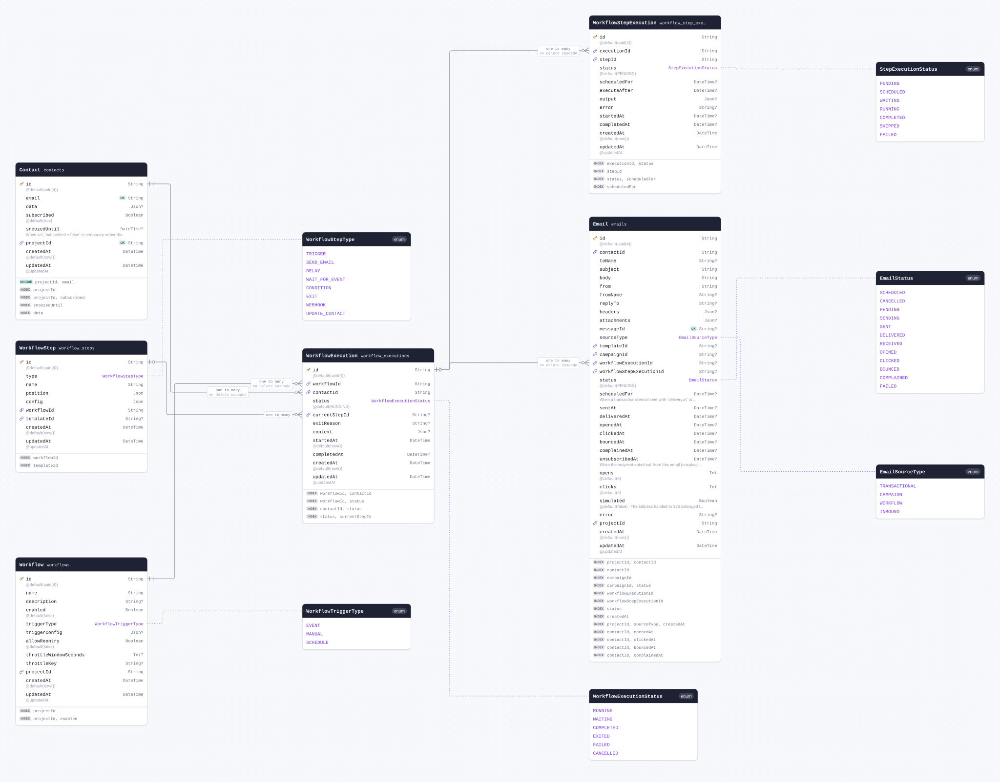

| Field           | Type                                                       | Constraints                                   | Default      | Description |
| --------------- | ---------------------------------------------------------- | --------------------------------------------- | ------------ | ----------- |
| `id`            | `String`                                                   | PK NOT NULL                                   | `uuid(4)`    |             |
| `workflowId`    | `String`                                                   | NOT NULL → [Workflow.id](#model-Workflow)     |              |             |
| `contactId`     | `String`                                                   | NOT NULL → [Contact.id](#model-Contact)       |              |             |
| `status`        | [`WorkflowExecutionStatus`](#enum-WorkflowExecutionStatus) | NOT NULL                                      | `RUNNING`    |             |
| `currentStepId` | `String`                                                   | NULL → [WorkflowStep.id](#model-WorkflowStep) |              |             |
| `exitReason`    | `String`                                                   | NULL                                          |              |             |
| `context`       | `Json`                                                     | NULL                                          |              |             |
| `startedAt`     | `DateTime`                                                 | NOT NULL                                      | `now()`      |             |
| `completedAt`   | `DateTime`                                                 | NULL                                          |              |             |
| `createdAt`     | `DateTime`                                                 | NOT NULL                                      | `now()`      |             |
| `updatedAt`     | `DateTime`                                                 | NOT NULL                                      | `@updatedAt` |             |

#### Indexes

- `@@index([workflowId, contactId])`
- `@@index([workflowId, status])`
- `@@index([contactId, status])`
- `@@index([status, currentStepId])`

#### References

- `workflowId` → [Workflow.id](#model-Workflow) (many-to-one, on delete Cascade)
- `contactId` → [Contact.id](#model-Contact) (many-to-one, on delete Cascade)
- `currentStepId` → [WorkflowStep.id](#model-WorkflowStep) (many-to-one)

#### Referenced by

- `id` ← [WorkflowStepExecution.executionId](#model-WorkflowStepExecution) (one-to-many, on delete Cascade)
- `id` ← [Email.workflowExecutionId](#model-Email) (one-to-many, on delete Cascade)

#### Definition

```sql
CREATE TABLE "workflow_executions" (
    "id" TEXT NOT NULL,
    "workflowId" TEXT NOT NULL,
    "contactId" TEXT NOT NULL,
    "status" "WorkflowExecutionStatus" NOT NULL DEFAULT 'RUNNING',
    "currentStepId" TEXT,
    "exitReason" TEXT,
    "context" JSONB,
    "startedAt" TIMESTAMP(3) NOT NULL DEFAULT CURRENT_TIMESTAMP,
    "completedAt" TIMESTAMP(3),
    "createdAt" TIMESTAMP(3) NOT NULL DEFAULT CURRENT_TIMESTAMP,
    "updatedAt" TIMESTAMP(3) NOT NULL,

    CONSTRAINT "workflow_executions_pkey" PRIMARY KEY ("id")
);

CREATE INDEX "workflow_executions_workflowId_contactId_idx" ON "workflow_executions"("workflowId", "contactId");

CREATE INDEX "workflow_executions_workflowId_status_idx" ON "workflow_executions"("workflowId", "status");

CREATE INDEX "workflow_executions_contactId_status_idx" ON "workflow_executions"("contactId", "status");

CREATE INDEX "workflow_executions_status_currentStepId_idx" ON "workflow_executions"("status", "currentStepId");

ALTER TABLE "workflow_executions" ADD CONSTRAINT "workflow_executions_workflowId_fkey" FOREIGN KEY ("workflowId") REFERENCES "workflows"("id") ON DELETE CASCADE ON UPDATE CASCADE;

ALTER TABLE "workflow_executions" ADD CONSTRAINT "workflow_executions_contactId_fkey" FOREIGN KEY ("contactId") REFERENCES "contacts"("id") ON DELETE CASCADE ON UPDATE CASCADE;

ALTER TABLE "workflow_executions" ADD CONSTRAINT "workflow_executions_currentStepId_fkey" FOREIGN KEY ("currentStepId") REFERENCES "workflow_steps"("id") ON DELETE SET NULL ON UPDATE CASCADE;
```

<details>
<summary>Queries and their SQL</summary>

**findMany**: Every row

```ts
await prisma.workflowExecution.findMany();
```

```sql
SELECT
  "public"."workflow_executions"."id",
  "public"."workflow_executions"."workflowId",
  "public"."workflow_executions"."contactId",
  "public"."workflow_executions"."status"::text,
  "public"."workflow_executions"."currentStepId",
  "public"."workflow_executions"."exitReason",
  "public"."workflow_executions"."context",
  "public"."workflow_executions"."startedAt",
  "public"."workflow_executions"."completedAt",
  "public"."workflow_executions"."createdAt",
  "public"."workflow_executions"."updatedAt"
FROM
  "public"."workflow_executions"
WHERE
  1 = 1
OFFSET
  $1
-- params: ["0"]
```

**count**: How many rows there are

```ts
await prisma.workflowExecution.count();
```

```sql
SELECT
  COUNT(*) AS "_count$_all"
FROM
  (
    SELECT
      "public"."workflow_executions"."id"
    FROM
      "public"."workflow_executions"
    WHERE
      1 = 1
    OFFSET
      $1
  ) AS "sub"
-- params: ["0"]
```

**findMany**: Every row with its relations

```ts
await prisma.workflowExecution.findMany({
  include: { workflow: true, contact: true, currentStep: true, stepExecutions: true, emails: true },
});
```

```sql
SELECT
  "public"."workflow_executions"."id",
  "public"."workflow_executions"."workflowId",
  "public"."workflow_executions"."contactId",
  "public"."workflow_executions"."status"::text,
  "public"."workflow_executions"."currentStepId",
  "public"."workflow_executions"."exitReason",
  "public"."workflow_executions"."context",
  "public"."workflow_executions"."startedAt",
  "public"."workflow_executions"."completedAt",
  "public"."workflow_executions"."createdAt",
  "public"."workflow_executions"."updatedAt"
FROM
  "public"."workflow_executions"
WHERE
  1 = 1
OFFSET
  $1
-- params: ["0"]

SELECT
  "public"."workflows"."id",
  "public"."workflows"."name",
  "public"."workflows"."description",
  "public"."workflows"."enabled",
  "public"."workflows"."triggerType"::text,
  "public"."workflows"."triggerConfig",
  "public"."workflows"."allowReentry",
  "public"."workflows"."throttleWindowSeconds",
  "public"."workflows"."throttleKey",
  "public"."workflows"."projectId",
  "public"."workflows"."createdAt",
  "public"."workflows"."updatedAt"
FROM
  "public"."workflows"
WHERE
  "public"."workflows"."id" IN ($1)
OFFSET
  $2
-- params: ["<workflowId of the rows above>","0"]

SELECT
  "public"."contacts"."id",
  "public"."contacts"."email",
  "public"."contacts"."data",
  "public"."contacts"."subscribed",
  "public"."contacts"."snoozedUntil",
  "public"."contacts"."projectId",
  "public"."contacts"."createdAt",
  "public"."contacts"."updatedAt"
FROM
  "public"."contacts"
WHERE
  "public"."contacts"."id" IN ($1)
OFFSET
  $2
-- params: ["<contactId of the rows above>","0"]

SELECT
  "public"."workflow_steps"."id",
  "public"."workflow_steps"."type"::text,
  "public"."workflow_steps"."name",
  "public"."workflow_steps"."position",
  "public"."workflow_steps"."config",
  "public"."workflow_steps"."workflowId",
  "public"."workflow_steps"."templateId",
  "public"."workflow_steps"."createdAt",
  "public"."workflow_steps"."updatedAt"
FROM
  "public"."workflow_steps"
WHERE
  "public"."workflow_steps"."id" IN ($1)
OFFSET
  $2
-- params: ["<currentStepId of the rows above>","0"]

SELECT
  "public"."workflow_step_executions"."id",
  "public"."workflow_step_executions"."executionId",
  "public"."workflow_step_executions"."stepId",
  "public"."workflow_step_executions"."status"::text,
  "public"."workflow_step_executions"."scheduledFor",
  "public"."workflow_step_executions"."executeAfter",
  "public"."workflow_step_executions"."output",
  "public"."workflow_step_executions"."error",
  "public"."workflow_step_executions"."startedAt",
  "public"."workflow_step_executions"."completedAt",
  "public"."workflow_step_executions"."createdAt",
  "public"."workflow_step_executions"."updatedAt"
FROM
  "public"."workflow_step_executions"
WHERE
  "public"."workflow_step_executions"."executionId" IN ($1)
OFFSET
  $2
-- params: ["<id of the rows above>","0"]

SELECT
  "public"."emails"."id",
  "public"."emails"."contactId",
  "public"."emails"."toName",
  "public"."emails"."subject",
  "public"."emails"."body",
  "public"."emails"."from",
  "public"."emails"."fromName",
  "public"."emails"."replyTo",
  "public"."emails"."headers",
  "public"."emails"."attachments",
  "public"."emails"."messageId",
  "public"."emails"."sourceType"::text,
  "public"."emails"."templateId",
  "public"."emails"."campaignId",
  "public"."emails"."workflowExecutionId",
  "public"."emails"."workflowStepExecutionId",
  "public"."emails"."status"::text,
  "public"."emails"."scheduledFor",
  "public"."emails"."sentAt",
  "public"."emails"."deliveredAt",
  "public"."emails"."openedAt",
  "public"."emails"."clickedAt",
  "public"."emails"."bouncedAt",
  "public"."emails"."complainedAt",
  "public"."emails"."unsubscribedAt",
  "public"."emails"."opens",
  "public"."emails"."clicks",
  "public"."emails"."simulated",
  "public"."emails"."error",
  "public"."emails"."projectId",
  "public"."emails"."createdAt",
  "public"."emails"."updatedAt"
FROM
  "public"."emails"
WHERE
  "public"."emails"."workflowExecutionId" IN ($1)
OFFSET
  $2
-- params: ["<id of the rows above>","0"]
```

**findUnique**: One row by what is unique to it

```ts
await prisma.workflowExecution.findUnique({ where: { id: "example" } });
```

```sql
SELECT
  "public"."workflow_executions"."id",
  "public"."workflow_executions"."workflowId",
  "public"."workflow_executions"."contactId",
  "public"."workflow_executions"."status"::text,
  "public"."workflow_executions"."currentStepId",
  "public"."workflow_executions"."exitReason",
  "public"."workflow_executions"."context",
  "public"."workflow_executions"."startedAt",
  "public"."workflow_executions"."completedAt",
  "public"."workflow_executions"."createdAt",
  "public"."workflow_executions"."updatedAt"
FROM
  "public"."workflow_executions"
WHERE
  (
    "public"."workflow_executions"."id" = $1
    AND 1 = 1
  )
LIMIT
  $2
OFFSET
  $3
-- params: ["example","1","0"]
```

**create**: Create a row

```ts
await prisma.workflowExecution.create({ data: { workflowId: "example", contactId: "example" } });
```

```sql
INSERT INTO
  "public"."workflow_executions" (
    "id",
    "workflowId",
    "contactId",
    "status",
    "startedAt",
    "createdAt",
    "updatedAt"
  )
VALUES
  (
    $1,
    $2,
    $3,
    CAST($4::text AS "public"."WorkflowExecutionStatus"),
    $5,
    $6,
    $7
  )
RETURNING
  "public"."workflow_executions"."id",
  "public"."workflow_executions"."workflowId",
  "public"."workflow_executions"."contactId",
  "public"."workflow_executions"."status"::text,
  "public"."workflow_executions"."currentStepId",
  "public"."workflow_executions"."exitReason",
  "public"."workflow_executions"."context",
  "public"."workflow_executions"."startedAt",
  "public"."workflow_executions"."completedAt",
  "public"."workflow_executions"."createdAt",
  "public"."workflow_executions"."updatedAt"
-- params: ["<uuid(4)>","example","example","RUNNING","<now()>","<now()>","<now()>"]
```

**update**: Update a row

```ts
await prisma.workflowExecution.update({ where: { id: "example" }, data: { status: "RUNNING" } });
```

```sql
UPDATE "public"."workflow_executions"
SET
  "status" = CAST($1::text AS "public"."WorkflowExecutionStatus"),
  "updatedAt" = $2
WHERE
  (
    "public"."workflow_executions"."id" = $3
    AND 1 = 1
  )
RETURNING
  "public"."workflow_executions"."id",
  "public"."workflow_executions"."workflowId",
  "public"."workflow_executions"."contactId",
  "public"."workflow_executions"."status"::text,
  "public"."workflow_executions"."currentStepId",
  "public"."workflow_executions"."exitReason",
  "public"."workflow_executions"."context",
  "public"."workflow_executions"."startedAt",
  "public"."workflow_executions"."completedAt",
  "public"."workflow_executions"."createdAt",
  "public"."workflow_executions"."updatedAt"
-- params: ["RUNNING",{"prisma__type":"generatorCall","prisma__value":{"name":"now","args":[],"returnType":{"type":"DateTime"}}},"example"]
```

**delete**: Delete a row

```ts
await prisma.workflowExecution.delete({ where: { id: "example" } });
```

```sql
DELETE FROM "public"."workflow_executions"
WHERE
  (
    "public"."workflow_executions"."id" = $1
    AND 1 = 1
  )
RETURNING
  "public"."workflow_executions"."id",
  "public"."workflow_executions"."workflowId",
  "public"."workflow_executions"."contactId",
  "public"."workflow_executions"."status"::text,
  "public"."workflow_executions"."currentStepId",
  "public"."workflow_executions"."exitReason",
  "public"."workflow_executions"."context",
  "public"."workflow_executions"."startedAt",
  "public"."workflow_executions"."completedAt",
  "public"."workflow_executions"."createdAt",
  "public"."workflow_executions"."updatedAt"
-- params: ["example"]
```

</details>

<a id="model-WorkflowStepExecution"></a>

### WorkflowStepExecution

Table `workflow_step_executions`.

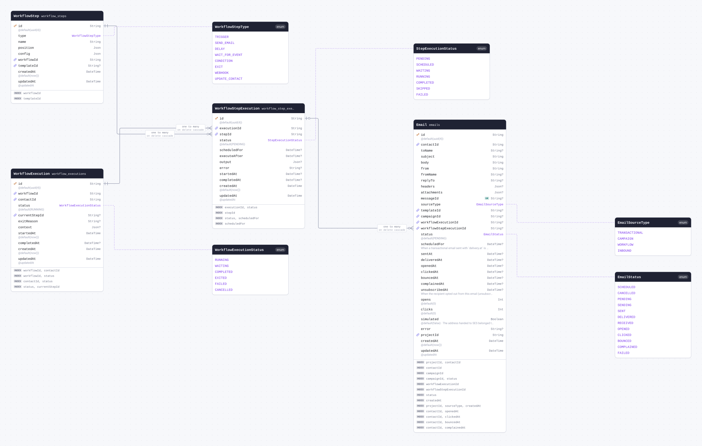

| Field          | Type                                               | Constraints                                                 | Default      | Description |
| -------------- | -------------------------------------------------- | ----------------------------------------------------------- | ------------ | ----------- |
| `id`           | `String`                                           | PK NOT NULL                                                 | `uuid(4)`    |             |
| `executionId`  | `String`                                           | NOT NULL → [WorkflowExecution.id](#model-WorkflowExecution) |              |             |
| `stepId`       | `String`                                           | NOT NULL → [WorkflowStep.id](#model-WorkflowStep)           |              |             |
| `status`       | [`StepExecutionStatus`](#enum-StepExecutionStatus) | NOT NULL                                                    | `PENDING`    |             |
| `scheduledFor` | `DateTime`                                         | NULL                                                        |              |             |
| `executeAfter` | `DateTime`                                         | NULL                                                        |              |             |
| `output`       | `Json`                                             | NULL                                                        |              |             |
| `error`        | `String`                                           | NULL                                                        |              |             |
| `startedAt`    | `DateTime`                                         | NULL                                                        |              |             |
| `completedAt`  | `DateTime`                                         | NULL                                                        |              |             |
| `createdAt`    | `DateTime`                                         | NOT NULL                                                    | `now()`      |             |
| `updatedAt`    | `DateTime`                                         | NOT NULL                                                    | `@updatedAt` |             |

#### Indexes

- `@@index([executionId, status])`
- `@@index([stepId])`
- `@@index([status, scheduledFor])`
- `@@index([scheduledFor])`

#### References

- `executionId` → [WorkflowExecution.id](#model-WorkflowExecution) (many-to-one, on delete Cascade)
- `stepId` → [WorkflowStep.id](#model-WorkflowStep) (many-to-one, on delete Cascade)

#### Referenced by

- `id` ← [Email.workflowStepExecutionId](#model-Email) (one-to-many, on delete Cascade)

#### Definition

```sql
CREATE TABLE "workflow_step_executions" (
    "id" TEXT NOT NULL,
    "executionId" TEXT NOT NULL,
    "stepId" TEXT NOT NULL,
    "status" "StepExecutionStatus" NOT NULL DEFAULT 'PENDING',
    "scheduledFor" TIMESTAMP(3),
    "executeAfter" TIMESTAMP(3),
    "output" JSONB,
    "error" TEXT,
    "startedAt" TIMESTAMP(3),
    "completedAt" TIMESTAMP(3),
    "createdAt" TIMESTAMP(3) NOT NULL DEFAULT CURRENT_TIMESTAMP,
    "updatedAt" TIMESTAMP(3) NOT NULL,

    CONSTRAINT "workflow_step_executions_pkey" PRIMARY KEY ("id")
);

CREATE INDEX "workflow_step_executions_executionId_status_idx" ON "workflow_step_executions"("executionId", "status");

CREATE INDEX "workflow_step_executions_stepId_idx" ON "workflow_step_executions"("stepId");

CREATE INDEX "workflow_step_executions_status_scheduledFor_idx" ON "workflow_step_executions"("status", "scheduledFor");

CREATE INDEX "workflow_step_executions_scheduledFor_idx" ON "workflow_step_executions"("scheduledFor");

ALTER TABLE "workflow_step_executions" ADD CONSTRAINT "workflow_step_executions_executionId_fkey" FOREIGN KEY ("executionId") REFERENCES "workflow_executions"("id") ON DELETE CASCADE ON UPDATE CASCADE;

ALTER TABLE "workflow_step_executions" ADD CONSTRAINT "workflow_step_executions_stepId_fkey" FOREIGN KEY ("stepId") REFERENCES "workflow_steps"("id") ON DELETE CASCADE ON UPDATE CASCADE;
```

<details>
<summary>Queries and their SQL</summary>

**findMany**: Every row

```ts
await prisma.workflowStepExecution.findMany();
```

```sql
SELECT
  "public"."workflow_step_executions"."id",
  "public"."workflow_step_executions"."executionId",
  "public"."workflow_step_executions"."stepId",
  "public"."workflow_step_executions"."status"::text,
  "public"."workflow_step_executions"."scheduledFor",
  "public"."workflow_step_executions"."executeAfter",
  "public"."workflow_step_executions"."output",
  "public"."workflow_step_executions"."error",
  "public"."workflow_step_executions"."startedAt",
  "public"."workflow_step_executions"."completedAt",
  "public"."workflow_step_executions"."createdAt",
  "public"."workflow_step_executions"."updatedAt"
FROM
  "public"."workflow_step_executions"
WHERE
  1 = 1
OFFSET
  $1
-- params: ["0"]
```

**count**: How many rows there are

```ts
await prisma.workflowStepExecution.count();
```

```sql
SELECT
  COUNT(*) AS "_count$_all"
FROM
  (
    SELECT
      "public"."workflow_step_executions"."id"
    FROM
      "public"."workflow_step_executions"
    WHERE
      1 = 1
    OFFSET
      $1
  ) AS "sub"
-- params: ["0"]
```

**findMany**: Every row with its relations

```ts
await prisma.workflowStepExecution.findMany({
  include: { execution: true, step: true, emails: true },
});
```

```sql
SELECT
  "public"."workflow_step_executions"."id",
  "public"."workflow_step_executions"."executionId",
  "public"."workflow_step_executions"."stepId",
  "public"."workflow_step_executions"."status"::text,
  "public"."workflow_step_executions"."scheduledFor",
  "public"."workflow_step_executions"."executeAfter",
  "public"."workflow_step_executions"."output",
  "public"."workflow_step_executions"."error",
  "public"."workflow_step_executions"."startedAt",
  "public"."workflow_step_executions"."completedAt",
  "public"."workflow_step_executions"."createdAt",
  "public"."workflow_step_executions"."updatedAt"
FROM
  "public"."workflow_step_executions"
WHERE
  1 = 1
OFFSET
  $1
-- params: ["0"]

SELECT
  "public"."workflow_executions"."id",
  "public"."workflow_executions"."workflowId",
  "public"."workflow_executions"."contactId",
  "public"."workflow_executions"."status"::text,
  "public"."workflow_executions"."currentStepId",
  "public"."workflow_executions"."exitReason",
  "public"."workflow_executions"."context",
  "public"."workflow_executions"."startedAt",
  "public"."workflow_executions"."completedAt",
  "public"."workflow_executions"."createdAt",
  "public"."workflow_executions"."updatedAt"
FROM
  "public"."workflow_executions"
WHERE
  "public"."workflow_executions"."id" IN ($1)
OFFSET
  $2
-- params: ["<executionId of the rows above>","0"]

SELECT
  "public"."workflow_steps"."id",
  "public"."workflow_steps"."type"::text,
  "public"."workflow_steps"."name",
  "public"."workflow_steps"."position",
  "public"."workflow_steps"."config",
  "public"."workflow_steps"."workflowId",
  "public"."workflow_steps"."templateId",
  "public"."workflow_steps"."createdAt",
  "public"."workflow_steps"."updatedAt"
FROM
  "public"."workflow_steps"
WHERE
  "public"."workflow_steps"."id" IN ($1)
OFFSET
  $2
-- params: ["<stepId of the rows above>","0"]

SELECT
  "public"."emails"."id",
  "public"."emails"."contactId",
  "public"."emails"."toName",
  "public"."emails"."subject",
  "public"."emails"."body",
  "public"."emails"."from",
  "public"."emails"."fromName",
  "public"."emails"."replyTo",
  "public"."emails"."headers",
  "public"."emails"."attachments",
  "public"."emails"."messageId",
  "public"."emails"."sourceType"::text,
  "public"."emails"."templateId",
  "public"."emails"."campaignId",
  "public"."emails"."workflowExecutionId",
  "public"."emails"."workflowStepExecutionId",
  "public"."emails"."status"::text,
  "public"."emails"."scheduledFor",
  "public"."emails"."sentAt",
  "public"."emails"."deliveredAt",
  "public"."emails"."openedAt",
  "public"."emails"."clickedAt",
  "public"."emails"."bouncedAt",
  "public"."emails"."complainedAt",
  "public"."emails"."unsubscribedAt",
  "public"."emails"."opens",
  "public"."emails"."clicks",
  "public"."emails"."simulated",
  "public"."emails"."error",
  "public"."emails"."projectId",
  "public"."emails"."createdAt",
  "public"."emails"."updatedAt"
FROM
  "public"."emails"
WHERE
  "public"."emails"."workflowStepExecutionId" IN ($1)
OFFSET
  $2
-- params: ["<id of the rows above>","0"]
```

**findUnique**: One row by what is unique to it

```ts
await prisma.workflowStepExecution.findUnique({ where: { id: "example" } });
```

```sql
SELECT
  "public"."workflow_step_executions"."id",
  "public"."workflow_step_executions"."executionId",
  "public"."workflow_step_executions"."stepId",
  "public"."workflow_step_executions"."status"::text,
  "public"."workflow_step_executions"."scheduledFor",
  "public"."workflow_step_executions"."executeAfter",
  "public"."workflow_step_executions"."output",
  "public"."workflow_step_executions"."error",
  "public"."workflow_step_executions"."startedAt",
  "public"."workflow_step_executions"."completedAt",
  "public"."workflow_step_executions"."createdAt",
  "public"."workflow_step_executions"."updatedAt"
FROM
  "public"."workflow_step_executions"
WHERE
  (
    "public"."workflow_step_executions"."id" = $1
    AND 1 = 1
  )
LIMIT
  $2
OFFSET
  $3
-- params: ["example","1","0"]
```

**create**: Create a row

```ts
await prisma.workflowStepExecution.create({ data: { executionId: "example", stepId: "example" } });
```

```sql
INSERT INTO
  "public"."workflow_step_executions" (
    "id",
    "executionId",
    "stepId",
    "status",
    "createdAt",
    "updatedAt"
  )
VALUES
  (
    $1,
    $2,
    $3,
    CAST($4::text AS "public"."StepExecutionStatus"),
    $5,
    $6
  )
RETURNING
  "public"."workflow_step_executions"."id",
  "public"."workflow_step_executions"."executionId",
  "public"."workflow_step_executions"."stepId",
  "public"."workflow_step_executions"."status"::text,
  "public"."workflow_step_executions"."scheduledFor",
  "public"."workflow_step_executions"."executeAfter",
  "public"."workflow_step_executions"."output",
  "public"."workflow_step_executions"."error",
  "public"."workflow_step_executions"."startedAt",
  "public"."workflow_step_executions"."completedAt",
  "public"."workflow_step_executions"."createdAt",
  "public"."workflow_step_executions"."updatedAt"
-- params: ["<uuid(4)>","example","example","PENDING","<now()>","<now()>"]
```

**update**: Update a row

```ts
await prisma.workflowStepExecution.update({
  where: { id: "example" },
  data: { status: "PENDING" },
});
```

```sql
UPDATE "public"."workflow_step_executions"
SET
  "status" = CAST($1::text AS "public"."StepExecutionStatus"),
  "updatedAt" = $2
WHERE
  (
    "public"."workflow_step_executions"."id" = $3
    AND 1 = 1
  )
RETURNING
  "public"."workflow_step_executions"."id",
  "public"."workflow_step_executions"."executionId",
  "public"."workflow_step_executions"."stepId",
  "public"."workflow_step_executions"."status"::text,
  "public"."workflow_step_executions"."scheduledFor",
  "public"."workflow_step_executions"."executeAfter",
  "public"."workflow_step_executions"."output",
  "public"."workflow_step_executions"."error",
  "public"."workflow_step_executions"."startedAt",
  "public"."workflow_step_executions"."completedAt",
  "public"."workflow_step_executions"."createdAt",
  "public"."workflow_step_executions"."updatedAt"
-- params: ["PENDING",{"prisma__type":"generatorCall","prisma__value":{"name":"now","args":[],"returnType":{"type":"DateTime"}}},"example"]
```

**delete**: Delete a row

```ts
await prisma.workflowStepExecution.delete({ where: { id: "example" } });
```

```sql
DELETE FROM "public"."workflow_step_executions"
WHERE
  (
    "public"."workflow_step_executions"."id" = $1
    AND 1 = 1
  )
RETURNING
  "public"."workflow_step_executions"."id",
  "public"."workflow_step_executions"."executionId",
  "public"."workflow_step_executions"."stepId",
  "public"."workflow_step_executions"."status"::text,
  "public"."workflow_step_executions"."scheduledFor",
  "public"."workflow_step_executions"."executeAfter",
  "public"."workflow_step_executions"."output",
  "public"."workflow_step_executions"."error",
  "public"."workflow_step_executions"."startedAt",
  "public"."workflow_step_executions"."completedAt",
  "public"."workflow_step_executions"."createdAt",
  "public"."workflow_step_executions"."updatedAt"
-- params: ["example"]
```

</details>

<a id="model-Email"></a>

### Email

Table `emails`.

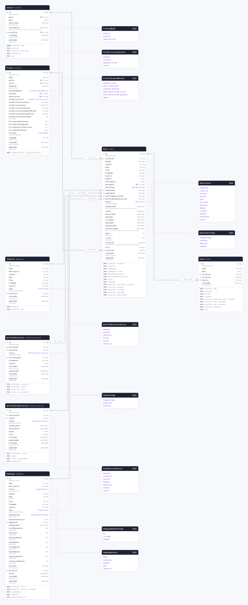

| Field                     | Type                                       | Constraints                                                     | Default      | Description                                                                                                                                                                                                                                                                                                                                                                                                                                                                                                                                                     |
| ------------------------- | ------------------------------------------ | --------------------------------------------------------------- | ------------ | --------------------------------------------------------------------------------------------------------------------------------------------------------------------------------------------------------------------------------------------------------------------------------------------------------------------------------------------------------------------------------------------------------------------------------------------------------------------------------------------------------------------------------------------------------------- |
| `id`                      | `String`                                   | PK NOT NULL                                                     | `uuid(4)`    |                                                                                                                                                                                                                                                                                                                                                                                                                                                                                                                                                                 |
| `contactId`               | `String`                                   | NOT NULL → [Contact.id](#model-Contact)                         |              |                                                                                                                                                                                                                                                                                                                                                                                                                                                                                                                                                                 |
| `toName`                  | `String`                                   | NULL                                                            |              |                                                                                                                                                                                                                                                                                                                                                                                                                                                                                                                                                                 |
| `subject`                 | `String`                                   | NOT NULL                                                        |              |                                                                                                                                                                                                                                                                                                                                                                                                                                                                                                                                                                 |
| `body`                    | `String`                                   | NOT NULL                                                        |              |                                                                                                                                                                                                                                                                                                                                                                                                                                                                                                                                                                 |
| `from`                    | `String`                                   | NOT NULL                                                        |              |                                                                                                                                                                                                                                                                                                                                                                                                                                                                                                                                                                 |
| `fromName`                | `String`                                   | NULL                                                            |              |                                                                                                                                                                                                                                                                                                                                                                                                                                                                                                                                                                 |
| `replyTo`                 | `String`                                   | NULL                                                            |              |                                                                                                                                                                                                                                                                                                                                                                                                                                                                                                                                                                 |
| `headers`                 | `Json`                                     | NULL                                                            |              |                                                                                                                                                                                                                                                                                                                                                                                                                                                                                                                                                                 |
| `attachments`             | `Json`                                     | NULL                                                            |              |                                                                                                                                                                                                                                                                                                                                                                                                                                                                                                                                                                 |
| `messageId`               | `String`                                   | UNIQUE NULL                                                     |              |                                                                                                                                                                                                                                                                                                                                                                                                                                                                                                                                                                 |
| `sourceType`              | [`EmailSourceType`](#enum-EmailSourceType) | NOT NULL                                                        |              |                                                                                                                                                                                                                                                                                                                                                                                                                                                                                                                                                                 |
| `templateId`              | `String`                                   | NULL → [Template.id](#model-Template)                           |              |                                                                                                                                                                                                                                                                                                                                                                                                                                                                                                                                                                 |
| `campaignId`              | `String`                                   | NULL → [Campaign.id](#model-Campaign)                           |              |                                                                                                                                                                                                                                                                                                                                                                                                                                                                                                                                                                 |
| `workflowExecutionId`     | `String`                                   | NULL → [WorkflowExecution.id](#model-WorkflowExecution)         |              |                                                                                                                                                                                                                                                                                                                                                                                                                                                                                                                                                                 |
| `workflowStepExecutionId` | `String`                                   | NULL → [WorkflowStepExecution.id](#model-WorkflowStepExecution) |              |                                                                                                                                                                                                                                                                                                                                                                                                                                                                                                                                                                 |
| `status`                  | [`EmailStatus`](#enum-EmailStatus)         | NOT NULL                                                        | `PENDING`    |                                                                                                                                                                                                                                                                                                                                                                                                                                                                                                                                                                 |
| `scheduledFor`            | `DateTime`                                 | NULL                                                            |              | When a transactional email sent with `delivery.at` is due. Only meaningful while the status is SCHEDULED; the delayed queue job is the timer and the scheduled-email sweep re-queues any row still SCHEDULED past this time. The partial index on SCHEDULED rows is built by the background index builder, not a migration (see background-index-builder.ts).                                                                                                                                                                                                   |
| `sentAt`                  | `DateTime`                                 | NULL                                                            |              |                                                                                                                                                                                                                                                                                                                                                                                                                                                                                                                                                                 |
| `deliveredAt`             | `DateTime`                                 | NULL                                                            |              |                                                                                                                                                                                                                                                                                                                                                                                                                                                                                                                                                                 |
| `openedAt`                | `DateTime`                                 | NULL                                                            |              |                                                                                                                                                                                                                                                                                                                                                                                                                                                                                                                                                                 |
| `clickedAt`               | `DateTime`                                 | NULL                                                            |              |                                                                                                                                                                                                                                                                                                                                                                                                                                                                                                                                                                 |
| `bouncedAt`               | `DateTime`                                 | NULL                                                            |              |                                                                                                                                                                                                                                                                                                                                                                                                                                                                                                                                                                 |
| `complainedAt`            | `DateTime`                                 | NULL                                                            |              |                                                                                                                                                                                                                                                                                                                                                                                                                                                                                                                                                                 |
| `unsubscribedAt`          | `DateTime`                                 | NULL                                                            |              | When the recipient opted out from this email (unsubscribe or snooze). Only set for opt-outs attributed to a campaign email and counted in `Campaign.unsubscribedCount`, in the same transaction, so the stamped rows are the list behind that figure. Indexed by a partial index built in the background (see background-index-builder.ts).                                                                                                                                                                                                                     |
| `opens`                   | `Int`                                      | NOT NULL                                                        | `0`          |                                                                                                                                                                                                                                                                                                                                                                                                                                                                                                                                                                 |
| `clicks`                  | `Int`                                      | NOT NULL                                                        | `0`          |                                                                                                                                                                                                                                                                                                                                                                                                                                                                                                                                                                 |
| `simulated`               | `Boolean`                                  | NOT NULL                                                        | `false`      | The address handed to SES belonged to the mailbox simulator (`@simulator.amazonses.com`), stamped at send time from the address actually used -- which is the recipient override when one is set, not necessarily `contact.email`. AWS itself excludes simulator mail from bounce rates, complaint rates, sending quotas and reputation metrics, so Plunk's security rates exclude it from both the numerator and the denominator. The events themselves are untouched: the webhook fires, the activity feed shows the bounce, the contact is still suppressed. |
| `error`                   | `String`                                   | NULL                                                            |              |                                                                                                                                                                                                                                                                                                                                                                                                                                                                                                                                                                 |
| `projectId`               | `String`                                   | NOT NULL → [Project.id](#model-Project)                         |              |                                                                                                                                                                                                                                                                                                                                                                                                                                                                                                                                                                 |
| `createdAt`               | `DateTime`                                 | NOT NULL                                                        | `now()`      |                                                                                                                                                                                                                                                                                                                                                                                                                                                                                                                                                                 |
| `updatedAt`               | `DateTime`                                 | NOT NULL                                                        | `@updatedAt` |                                                                                                                                                                                                                                                                                                                                                                                                                                                                                                                                                                 |

#### Indexes

- `@@index([projectId, contactId])`
- `@@index([contactId])`
- `@@index([campaignId])`
- `@@index([campaignId, status])`
- `@@index([workflowExecutionId])`
- `@@index([workflowStepExecutionId])`
- `@@index([status])`
- `@@index([createdAt])`
- `@@index([projectId, sourceType, createdAt])`
- `@@index([contactId, openedAt])`
- `@@index([contactId, clickedAt])`
- `@@index([contactId, bouncedAt])`
- `@@index([contactId, complainedAt])`

#### References

- `contactId` → [Contact.id](#model-Contact) (many-to-one, on delete Cascade)
- `templateId` → [Template.id](#model-Template) (many-to-one)
- `campaignId` → [Campaign.id](#model-Campaign) (many-to-one, on delete Cascade)
- `workflowExecutionId` → [WorkflowExecution.id](#model-WorkflowExecution) (many-to-one, on delete Cascade)
- `workflowStepExecutionId` → [WorkflowStepExecution.id](#model-WorkflowStepExecution) (many-to-one, on delete Cascade)
- `projectId` → [Project.id](#model-Project) (many-to-one, on delete Cascade)

#### Referenced by

- `id` ← [Event.emailId](#model-Event) (one-to-many, on delete Cascade)

#### Definition

```sql
CREATE TABLE "emails" (
    "id" TEXT NOT NULL,
    "contactId" TEXT NOT NULL,
    "toName" TEXT,
    "subject" TEXT NOT NULL,
    "body" TEXT NOT NULL,
    "from" TEXT NOT NULL,
    "fromName" TEXT,
    "replyTo" TEXT,
    "headers" JSONB,
    "attachments" JSONB,
    "messageId" TEXT,
    "sourceType" "EmailSourceType" NOT NULL,
    "templateId" TEXT,
    "campaignId" TEXT,
    "workflowExecutionId" TEXT,
    "workflowStepExecutionId" TEXT,
    "status" "EmailStatus" NOT NULL DEFAULT 'PENDING',
    "scheduledFor" TIMESTAMP(3),
    "sentAt" TIMESTAMP(3),
    "deliveredAt" TIMESTAMP(3),
    "openedAt" TIMESTAMP(3),
    "clickedAt" TIMESTAMP(3),
    "bouncedAt" TIMESTAMP(3),
    "complainedAt" TIMESTAMP(3),
    "unsubscribedAt" TIMESTAMP(3),
    "opens" INTEGER NOT NULL DEFAULT 0,
    "clicks" INTEGER NOT NULL DEFAULT 0,
    "simulated" BOOLEAN NOT NULL DEFAULT false,
    "error" TEXT,
    "projectId" TEXT NOT NULL,
    "createdAt" TIMESTAMP(3) NOT NULL DEFAULT CURRENT_TIMESTAMP,
    "updatedAt" TIMESTAMP(3) NOT NULL,

    CONSTRAINT "emails_pkey" PRIMARY KEY ("id")
);

CREATE UNIQUE INDEX "emails_messageId_key" ON "emails"("messageId");

CREATE INDEX "emails_projectId_contactId_idx" ON "emails"("projectId", "contactId");

CREATE INDEX "emails_contactId_idx" ON "emails"("contactId");

CREATE INDEX "emails_campaignId_idx" ON "emails"("campaignId");

CREATE INDEX "emails_campaignId_status_idx" ON "emails"("campaignId", "status");

CREATE INDEX "emails_workflowExecutionId_idx" ON "emails"("workflowExecutionId");

CREATE INDEX "emails_workflowStepExecutionId_idx" ON "emails"("workflowStepExecutionId");

CREATE INDEX "emails_status_idx" ON "emails"("status");

CREATE INDEX "emails_createdAt_idx" ON "emails"("createdAt");

CREATE INDEX "emails_projectId_sourceType_createdAt_idx" ON "emails"("projectId", "sourceType", "createdAt");

CREATE INDEX "emails_contactId_openedAt_idx" ON "emails"("contactId", "openedAt");

CREATE INDEX "emails_contactId_clickedAt_idx" ON "emails"("contactId", "clickedAt");

CREATE INDEX "emails_contactId_bouncedAt_idx" ON "emails"("contactId", "bouncedAt");

CREATE INDEX "emails_contactId_complainedAt_idx" ON "emails"("contactId", "complainedAt");

ALTER TABLE "emails" ADD CONSTRAINT "emails_contactId_fkey" FOREIGN KEY ("contactId") REFERENCES "contacts"("id") ON DELETE CASCADE ON UPDATE CASCADE;

ALTER TABLE "emails" ADD CONSTRAINT "emails_templateId_fkey" FOREIGN KEY ("templateId") REFERENCES "templates"("id") ON DELETE SET NULL ON UPDATE CASCADE;

ALTER TABLE "emails" ADD CONSTRAINT "emails_campaignId_fkey" FOREIGN KEY ("campaignId") REFERENCES "campaigns"("id") ON DELETE CASCADE ON UPDATE CASCADE;

ALTER TABLE "emails" ADD CONSTRAINT "emails_workflowExecutionId_fkey" FOREIGN KEY ("workflowExecutionId") REFERENCES "workflow_executions"("id") ON DELETE CASCADE ON UPDATE CASCADE;

ALTER TABLE "emails" ADD CONSTRAINT "emails_workflowStepExecutionId_fkey" FOREIGN KEY ("workflowStepExecutionId") REFERENCES "workflow_step_executions"("id") ON DELETE CASCADE ON UPDATE CASCADE;

ALTER TABLE "emails" ADD CONSTRAINT "emails_projectId_fkey" FOREIGN KEY ("projectId") REFERENCES "projects"("id") ON DELETE CASCADE ON UPDATE CASCADE;
```

<details>
<summary>Queries and their SQL</summary>

**findMany**: Every row

```ts
await prisma.email.findMany();
```

```sql
SELECT
  "public"."emails"."id",
  "public"."emails"."contactId",
  "public"."emails"."toName",
  "public"."emails"."subject",
  "public"."emails"."body",
  "public"."emails"."from",
  "public"."emails"."fromName",
  "public"."emails"."replyTo",
  "public"."emails"."headers",
  "public"."emails"."attachments",
  "public"."emails"."messageId",
  "public"."emails"."sourceType"::text,
  "public"."emails"."templateId",
  "public"."emails"."campaignId",
  "public"."emails"."workflowExecutionId",
  "public"."emails"."workflowStepExecutionId",
  "public"."emails"."status"::text,
  "public"."emails"."scheduledFor",
  "public"."emails"."sentAt",
  "public"."emails"."deliveredAt",
  "public"."emails"."openedAt",
  "public"."emails"."clickedAt",
  "public"."emails"."bouncedAt",
  "public"."emails"."complainedAt",
  "public"."emails"."unsubscribedAt",
  "public"."emails"."opens",
  "public"."emails"."clicks",
  "public"."emails"."simulated",
  "public"."emails"."error",
  "public"."emails"."projectId",
  "public"."emails"."createdAt",
  "public"."emails"."updatedAt"
FROM
  "public"."emails"
WHERE
  1 = 1
OFFSET
  $1
-- params: ["0"]
```

**count**: How many rows there are

```ts
await prisma.email.count();
```

```sql
SELECT
  COUNT(*) AS "_count$_all"
FROM
  (
    SELECT
      "public"."emails"."id"
    FROM
      "public"."emails"
    WHERE
      1 = 1
    OFFSET
      $1
  ) AS "sub"
-- params: ["0"]
```

**findMany**: Every row with its relations

```ts
await prisma.email.findMany({
  include: {
    contact: true,
    template: true,
    campaign: true,
    workflowExecution: true,
    workflowStepExecution: true,
    project: true,
    events: true,
  },
});
```

```sql
SELECT
  "public"."emails"."id",
  "public"."emails"."contactId",
  "public"."emails"."toName",
  "public"."emails"."subject",
  "public"."emails"."body",
  "public"."emails"."from",
  "public"."emails"."fromName",
  "public"."emails"."replyTo",
  "public"."emails"."headers",
  "public"."emails"."attachments",
  "public"."emails"."messageId",
  "public"."emails"."sourceType"::text,
  "public"."emails"."templateId",
  "public"."emails"."campaignId",
  "public"."emails"."workflowExecutionId",
  "public"."emails"."workflowStepExecutionId",
  "public"."emails"."status"::text,
  "public"."emails"."scheduledFor",
  "public"."emails"."sentAt",
  "public"."emails"."deliveredAt",
  "public"."emails"."openedAt",
  "public"."emails"."clickedAt",
  "public"."emails"."bouncedAt",
  "public"."emails"."complainedAt",
  "public"."emails"."unsubscribedAt",
  "public"."emails"."opens",
  "public"."emails"."clicks",
  "public"."emails"."simulated",
  "public"."emails"."error",
  "public"."emails"."projectId",
  "public"."emails"."createdAt",
  "public"."emails"."updatedAt"
FROM
  "public"."emails"
WHERE
  1 = 1
OFFSET
  $1
-- params: ["0"]

SELECT
  "public"."contacts"."id",
  "public"."contacts"."email",
  "public"."contacts"."data",
  "public"."contacts"."subscribed",
  "public"."contacts"."snoozedUntil",
  "public"."contacts"."projectId",
  "public"."contacts"."createdAt",
  "public"."contacts"."updatedAt"
FROM
  "public"."contacts"
WHERE
  "public"."contacts"."id" IN ($1)
OFFSET
  $2
-- params: ["<contactId of the rows above>","0"]

SELECT
  "public"."templates"."id",
  "public"."templates"."name",
  "public"."templates"."description",
  "public"."templates"."subject",
  "public"."templates"."body",
  "public"."templates"."from",
  "public"."templates"."fromName",
  "public"."templates"."replyTo",
  "public"."templates"."type"::text,
  "public"."templates"."projectId",
  "public"."templates"."createdAt",
  "public"."templates"."updatedAt"
FROM
  "public"."templates"
WHERE
  "public"."templates"."id" IN ($1)
OFFSET
  $2
-- params: ["<templateId of the rows above>","0"]

SELECT
  "public"."campaigns"."id",
  "public"."campaigns"."name",
  "public"."campaigns"."description",
  "public"."campaigns"."status"::text,
  "public"."campaigns"."subject",
  "public"."campaigns"."body",
  "public"."campaigns"."from",
  "public"."campaigns"."fromName",
  "public"."campaigns"."replyTo",
  "public"."campaigns"."type"::text,
  "public"."campaigns"."audienceType"::text,
  "public"."campaigns"."audienceCondition",
  "public"."campaigns"."segmentId",
  "public"."campaigns"."scheduledFor",
  "public"."campaigns"."totalRecipients",
  "public"."campaigns"."sentCount",
  "public"."campaigns"."deliveredCount",
  "public"."campaigns"."openedCount",
  "public"."campaigns"."clickedCount",
  "public"."campaigns"."bouncedCount",
  "public"."campaigns"."complainedCount",
  "public"."campaigns"."unsubscribedCount",
  "public"."campaigns"."archived",
  "public"."campaigns"."projectId",
  "public"."campaigns"."sentAt",
  "public"."campaigns"."createdAt",
  "public"."campaigns"."updatedAt"
FROM
  "public"."campaigns"
WHERE
  "public"."campaigns"."id" IN ($1)
OFFSET
  $2
-- params: ["<campaignId of the rows above>","0"]

SELECT
  "public"."workflow_executions"."id",
  "public"."workflow_executions"."workflowId",
  "public"."workflow_executions"."contactId",
  "public"."workflow_executions"."status"::text,
  "public"."workflow_executions"."currentStepId",
  "public"."workflow_executions"."exitReason",
  "public"."workflow_executions"."context",
  "public"."workflow_executions"."startedAt",
  "public"."workflow_executions"."completedAt",
  "public"."workflow_executions"."createdAt",
  "public"."workflow_executions"."updatedAt"
FROM
  "public"."workflow_executions"
WHERE
  "public"."workflow_executions"."id" IN ($1)
OFFSET
  $2
-- params: ["<workflowExecutionId of the rows above>","0"]

SELECT
  "public"."workflow_step_executions"."id",
  "public"."workflow_step_executions"."executionId",
  "public"."workflow_step_executions"."stepId",
  "public"."workflow_step_executions"."status"::text,
  "public"."workflow_step_executions"."scheduledFor",
  "public"."workflow_step_executions"."executeAfter",
  "public"."workflow_step_executions"."output",
  "public"."workflow_step_executions"."error",
  "public"."workflow_step_executions"."startedAt",
  "public"."workflow_step_executions"."completedAt",
  "public"."workflow_step_executions"."createdAt",
  "public"."workflow_step_executions"."updatedAt"
FROM
  "public"."workflow_step_executions"
WHERE
  "public"."workflow_step_executions"."id" IN ($1)
OFFSET
  $2
-- params: ["<workflowStepExecutionId of the rows above>","0"]

SELECT
  "public"."projects"."id",
  "public"."projects"."name",
  "public"."projects"."public",
  "public"."projects"."secret",
  "public"."projects"."disabled",
  "public"."projects"."disabledReason"::text,
  "public"."projects"."customer",
  "public"."projects"."subscription",
  "public"."projects"."cardVerification"::text,
  "public"."projects"."cardVerificationIntent",
  "public"."projects"."cardVerificationAt",
  "public"."projects"."cardVerificationSession",
  "public"."projects"."cardVerificationPaymentMethod",
  "public"."projects"."cardVerificationFingerprint",
  "public"."projects"."cardVerificationAttempts",
  "public"."projects"."billingLimitWorkflows",
  "public"."projects"."billingLimitCampaigns",
  "public"."projects"."billingLimitTransactional",
  "public"."projects"."billingLimitInbound",
  "public"."projects"."tracking"::text,
  "public"."projects"."language",
  "public"."projects"."createdAt",
  "public"."projects"."updatedAt"
FROM
  "public"."projects"
WHERE
  "public"."projects"."id" IN ($1)
OFFSET
  $2
-- params: ["<projectId of the rows above>","0"]

SELECT
  "public"."events"."id",
  "public"."events"."name",
  "public"."events"."data",
  "public"."events"."projectId",
  "public"."events"."contactId",
  "public"."events"."emailId",
  "public"."events"."createdAt"
FROM
  "public"."events"
WHERE
  "public"."events"."emailId" IN ($1)
OFFSET
  $2
-- params: ["<id of the rows above>","0"]
```

**findUnique**: One row by what is unique to it

```ts
await prisma.email.findUnique({ where: { id: "example" } });
```

```sql
SELECT
  "public"."emails"."id",
  "public"."emails"."contactId",
  "public"."emails"."toName",
  "public"."emails"."subject",
  "public"."emails"."body",
  "public"."emails"."from",
  "public"."emails"."fromName",
  "public"."emails"."replyTo",
  "public"."emails"."headers",
  "public"."emails"."attachments",
  "public"."emails"."messageId",
  "public"."emails"."sourceType"::text,
  "public"."emails"."templateId",
  "public"."emails"."campaignId",
  "public"."emails"."workflowExecutionId",
  "public"."emails"."workflowStepExecutionId",
  "public"."emails"."status"::text,
  "public"."emails"."scheduledFor",
  "public"."emails"."sentAt",
  "public"."emails"."deliveredAt",
  "public"."emails"."openedAt",
  "public"."emails"."clickedAt",
  "public"."emails"."bouncedAt",
  "public"."emails"."complainedAt",
  "public"."emails"."unsubscribedAt",
  "public"."emails"."opens",
  "public"."emails"."clicks",
  "public"."emails"."simulated",
  "public"."emails"."error",
  "public"."emails"."projectId",
  "public"."emails"."createdAt",
  "public"."emails"."updatedAt"
FROM
  "public"."emails"
WHERE
  (
    "public"."emails"."id" = $1
    AND 1 = 1
  )
LIMIT
  $2
OFFSET
  $3
-- params: ["example","1","0"]
```

**create**: Create a row

```ts
await prisma.email.create({
  data: {
    contactId: "example",
    subject: "example",
    body: "example",
    from: "example",
    sourceType: "TRANSACTIONAL",
    projectId: "example",
  },
});
```

```sql
INSERT INTO
  "public"."emails" (
    "id",
    "contactId",
    "subject",
    "body",
    "from",
    "sourceType",
    "status",
    "opens",
    "clicks",
    "simulated",
    "projectId",
    "createdAt",
    "updatedAt"
  )
VALUES
  (
    $1,
    $2,
    $3,
    $4,
    $5,
    CAST($6::text AS "public"."EmailSourceType"),
    CAST($7::text AS "public"."EmailStatus"),
    $8,
    $9,
    $10,
    $11,
    $12,
    $13
  )
RETURNING
  "public"."emails"."id",
  "public"."emails"."contactId",
  "public"."emails"."toName",
  "public"."emails"."subject",
  "public"."emails"."body",
  "public"."emails"."from",
  "public"."emails"."fromName",
  "public"."emails"."replyTo",
  "public"."emails"."headers",
  "public"."emails"."attachments",
  "public"."emails"."messageId",
  "public"."emails"."sourceType"::text,
  "public"."emails"."templateId",
  "public"."emails"."campaignId",
  "public"."emails"."workflowExecutionId",
  "public"."emails"."workflowStepExecutionId",
  "public"."emails"."status"::text,
  "public"."emails"."scheduledFor",
  "public"."emails"."sentAt",
  "public"."emails"."deliveredAt",
  "public"."emails"."openedAt",
  "public"."emails"."clickedAt",
  "public"."emails"."bouncedAt",
  "public"."emails"."complainedAt",
  "public"."emails"."unsubscribedAt",
  "public"."emails"."opens",
  "public"."emails"."clicks",
  "public"."emails"."simulated",
  "public"."emails"."error",
  "public"."emails"."projectId",
  "public"."emails"."createdAt",
  "public"."emails"."updatedAt"
-- params: ["<uuid(4)>","example","example","example","example","TRANSACTIONAL","PENDING","0","0",false,"example","<now()>","<now()>"]
```

**update**: Update a row

```ts
await prisma.email.update({ where: { id: "example" }, data: { toName: "example" } });
```

```sql
UPDATE "public"."emails"
SET
  "toName" = $1,
  "updatedAt" = $2
WHERE
  (
    "public"."emails"."id" = $3
    AND 1 = 1
  )
RETURNING
  "public"."emails"."id",
  "public"."emails"."contactId",
  "public"."emails"."toName",
  "public"."emails"."subject",
  "public"."emails"."body",
  "public"."emails"."from",
  "public"."emails"."fromName",
  "public"."emails"."replyTo",
  "public"."emails"."headers",
  "public"."emails"."attachments",
  "public"."emails"."messageId",
  "public"."emails"."sourceType"::text,
  "public"."emails"."templateId",
  "public"."emails"."campaignId",
  "public"."emails"."workflowExecutionId",
  "public"."emails"."workflowStepExecutionId",
  "public"."emails"."status"::text,
  "public"."emails"."scheduledFor",
  "public"."emails"."sentAt",
  "public"."emails"."deliveredAt",
  "public"."emails"."openedAt",
  "public"."emails"."clickedAt",
  "public"."emails"."bouncedAt",
  "public"."emails"."complainedAt",
  "public"."emails"."unsubscribedAt",
  "public"."emails"."opens",
  "public"."emails"."clicks",
  "public"."emails"."simulated",
  "public"."emails"."error",
  "public"."emails"."projectId",
  "public"."emails"."createdAt",
  "public"."emails"."updatedAt"
-- params: ["example",{"prisma__type":"generatorCall","prisma__value":{"name":"now","args":[],"returnType":{"type":"DateTime"}}},"example"]
```

**delete**: Delete a row

```ts
await prisma.email.delete({ where: { id: "example" } });
```

```sql
DELETE FROM "public"."emails"
WHERE
  (
    "public"."emails"."id" = $1
    AND 1 = 1
  )
RETURNING
  "public"."emails"."id",
  "public"."emails"."contactId",
  "public"."emails"."toName",
  "public"."emails"."subject",
  "public"."emails"."body",
  "public"."emails"."from",
  "public"."emails"."fromName",
  "public"."emails"."replyTo",
  "public"."emails"."headers",
  "public"."emails"."attachments",
  "public"."emails"."messageId",
  "public"."emails"."sourceType"::text,
  "public"."emails"."templateId",
  "public"."emails"."campaignId",
  "public"."emails"."workflowExecutionId",
  "public"."emails"."workflowStepExecutionId",
  "public"."emails"."status"::text,
  "public"."emails"."scheduledFor",
  "public"."emails"."sentAt",
  "public"."emails"."deliveredAt",
  "public"."emails"."openedAt",
  "public"."emails"."clickedAt",
  "public"."emails"."bouncedAt",
  "public"."emails"."complainedAt",
  "public"."emails"."unsubscribedAt",
  "public"."emails"."opens",
  "public"."emails"."clicks",
  "public"."emails"."simulated",
  "public"."emails"."error",
  "public"."emails"."projectId",
  "public"."emails"."createdAt",
  "public"."emails"."updatedAt"
-- params: ["example"]
```

</details>

<a id="model-Event"></a>

### Event

Table `events`.

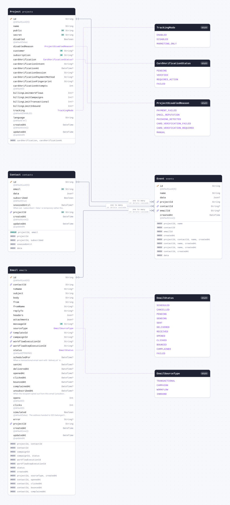

| Field       | Type       | Constraints                             | Default   | Description |
| ----------- | ---------- | --------------------------------------- | --------- | ----------- |
| `id`        | `String`   | PK NOT NULL                             | `uuid(4)` |             |
| `name`      | `String`   | NOT NULL                                |           |             |
| `data`      | `Json`     | NULL                                    |           |             |
| `projectId` | `String`   | NOT NULL → [Project.id](#model-Project) |           |             |
| `contactId` | `String`   | NULL → [Contact.id](#model-Contact)     |           |             |
| `emailId`   | `String`   | NULL → [Email.id](#model-Email)         |           |             |
| `createdAt` | `DateTime` | NOT NULL                                | `now()`   |             |

#### Indexes

- `@@index([projectId, name])`
- `@@index([contactId])`
- `@@index([emailId])`
- `@@index([createdAt])`
- `@@index([projectId, contactId, name, createdAt])`
- `@@index([contactId, name, createdAt])`
- `@@index([projectId, name, createdAt])`
- `@@index([contactId, createdAt])`
- `@@index([data])`

#### References

- `projectId` → [Project.id](#model-Project) (many-to-one, on delete Cascade)
- `contactId` → [Contact.id](#model-Contact) (many-to-one, on delete Cascade)
- `emailId` → [Email.id](#model-Email) (many-to-one, on delete Cascade)

#### Definition

```sql
CREATE TABLE "events" (
    "id" TEXT NOT NULL,
    "name" TEXT NOT NULL,
    "data" JSONB,
    "projectId" TEXT NOT NULL,
    "contactId" TEXT,
    "emailId" TEXT,
    "createdAt" TIMESTAMP(3) NOT NULL DEFAULT CURRENT_TIMESTAMP,

    CONSTRAINT "events_pkey" PRIMARY KEY ("id")
);

CREATE INDEX "events_projectId_name_idx" ON "events"("projectId", "name");

CREATE INDEX "events_contactId_idx" ON "events"("contactId");

CREATE INDEX "events_emailId_idx" ON "events"("emailId");

CREATE INDEX "events_createdAt_idx" ON "events"("createdAt");

CREATE INDEX "events_projectId_contactId_name_createdAt_idx" ON "events"("projectId", "contactId", "name", "createdAt");

CREATE INDEX "events_contactId_name_createdAt_idx" ON "events"("contactId", "name", "createdAt");

CREATE INDEX "events_projectId_name_createdAt_idx" ON "events"("projectId", "name", "createdAt");

CREATE INDEX "events_contactId_createdAt_idx" ON "events"("contactId", "createdAt");

CREATE INDEX "events_data_idx" ON "events" USING GIN ("data" jsonb_ops);

ALTER TABLE "events" ADD CONSTRAINT "events_projectId_fkey" FOREIGN KEY ("projectId") REFERENCES "projects"("id") ON DELETE CASCADE ON UPDATE CASCADE;

ALTER TABLE "events" ADD CONSTRAINT "events_contactId_fkey" FOREIGN KEY ("contactId") REFERENCES "contacts"("id") ON DELETE CASCADE ON UPDATE CASCADE;

ALTER TABLE "events" ADD CONSTRAINT "events_emailId_fkey" FOREIGN KEY ("emailId") REFERENCES "emails"("id") ON DELETE CASCADE ON UPDATE CASCADE;
```

<details>
<summary>Queries and their SQL</summary>

**findMany**: Every row

```ts
await prisma.event.findMany();
```

```sql
SELECT
  "public"."events"."id",
  "public"."events"."name",
  "public"."events"."data",
  "public"."events"."projectId",
  "public"."events"."contactId",
  "public"."events"."emailId",
  "public"."events"."createdAt"
FROM
  "public"."events"
WHERE
  1 = 1
OFFSET
  $1
-- params: ["0"]
```

**count**: How many rows there are

```ts
await prisma.event.count();
```

```sql
SELECT
  COUNT(*) AS "_count$_all"
FROM
  (
    SELECT
      "public"."events"."id"
    FROM
      "public"."events"
    WHERE
      1 = 1
    OFFSET
      $1
  ) AS "sub"
-- params: ["0"]
```

**findMany**: Every row with its relations

```ts
await prisma.event.findMany({ include: { project: true, contact: true, email: true } });
```

```sql
SELECT
  "public"."events"."id",
  "public"."events"."name",
  "public"."events"."data",
  "public"."events"."projectId",
  "public"."events"."contactId",
  "public"."events"."emailId",
  "public"."events"."createdAt"
FROM
  "public"."events"
WHERE
  1 = 1
OFFSET
  $1
-- params: ["0"]

SELECT
  "public"."projects"."id",
  "public"."projects"."name",
  "public"."projects"."public",
  "public"."projects"."secret",
  "public"."projects"."disabled",
  "public"."projects"."disabledReason"::text,
  "public"."projects"."customer",
  "public"."projects"."subscription",
  "public"."projects"."cardVerification"::text,
  "public"."projects"."cardVerificationIntent",
  "public"."projects"."cardVerificationAt",
  "public"."projects"."cardVerificationSession",
  "public"."projects"."cardVerificationPaymentMethod",
  "public"."projects"."cardVerificationFingerprint",
  "public"."projects"."cardVerificationAttempts",
  "public"."projects"."billingLimitWorkflows",
  "public"."projects"."billingLimitCampaigns",
  "public"."projects"."billingLimitTransactional",
  "public"."projects"."billingLimitInbound",
  "public"."projects"."tracking"::text,
  "public"."projects"."language",
  "public"."projects"."createdAt",
  "public"."projects"."updatedAt"
FROM
  "public"."projects"
WHERE
  "public"."projects"."id" IN ($1)
OFFSET
  $2
-- params: ["<projectId of the rows above>","0"]

SELECT
  "public"."contacts"."id",
  "public"."contacts"."email",
  "public"."contacts"."data",
  "public"."contacts"."subscribed",
  "public"."contacts"."snoozedUntil",
  "public"."contacts"."projectId",
  "public"."contacts"."createdAt",
  "public"."contacts"."updatedAt"
FROM
  "public"."contacts"
WHERE
  "public"."contacts"."id" IN ($1)
OFFSET
  $2
-- params: ["<contactId of the rows above>","0"]

SELECT
  "public"."emails"."id",
  "public"."emails"."contactId",
  "public"."emails"."toName",
  "public"."emails"."subject",
  "public"."emails"."body",
  "public"."emails"."from",
  "public"."emails"."fromName",
  "public"."emails"."replyTo",
  "public"."emails"."headers",
  "public"."emails"."attachments",
  "public"."emails"."messageId",
  "public"."emails"."sourceType"::text,
  "public"."emails"."templateId",
  "public"."emails"."campaignId",
  "public"."emails"."workflowExecutionId",
  "public"."emails"."workflowStepExecutionId",
  "public"."emails"."status"::text,
  "public"."emails"."scheduledFor",
  "public"."emails"."sentAt",
  "public"."emails"."deliveredAt",
  "public"."emails"."openedAt",
  "public"."emails"."clickedAt",
  "public"."emails"."bouncedAt",
  "public"."emails"."complainedAt",
  "public"."emails"."unsubscribedAt",
  "public"."emails"."opens",
  "public"."emails"."clicks",
  "public"."emails"."simulated",
  "public"."emails"."error",
  "public"."emails"."projectId",
  "public"."emails"."createdAt",
  "public"."emails"."updatedAt"
FROM
  "public"."emails"
WHERE
  "public"."emails"."id" IN ($1)
OFFSET
  $2
-- params: ["<emailId of the rows above>","0"]
```

**findUnique**: One row by what is unique to it

```ts
await prisma.event.findUnique({ where: { id: "example" } });
```

```sql
SELECT
  "public"."events"."id",
  "public"."events"."name",
  "public"."events"."data",
  "public"."events"."projectId",
  "public"."events"."contactId",
  "public"."events"."emailId",
  "public"."events"."createdAt"
FROM
  "public"."events"
WHERE
  (
    "public"."events"."id" = $1
    AND 1 = 1
  )
LIMIT
  $2
OFFSET
  $3
-- params: ["example","1","0"]
```

**create**: Create a row

```ts
await prisma.event.create({ data: { name: "example", projectId: "example" } });
```

```sql
INSERT INTO
  "public"."events" ("id", "name", "projectId", "createdAt")
VALUES
  ($1, $2, $3, $4)
RETURNING
  "public"."events"."id",
  "public"."events"."name",
  "public"."events"."data",
  "public"."events"."projectId",
  "public"."events"."contactId",
  "public"."events"."emailId",
  "public"."events"."createdAt"
-- params: ["<uuid(4)>","example","example","<now()>"]
```

**update**: Update a row

```ts
await prisma.event.update({ where: { id: "example" }, data: { name: "example" } });
```

```sql
UPDATE "public"."events"
SET
  "name" = $1
WHERE
  (
    "public"."events"."id" = $2
    AND 1 = 1
  )
RETURNING
  "public"."events"."id",
  "public"."events"."name",
  "public"."events"."data",
  "public"."events"."projectId",
  "public"."events"."contactId",
  "public"."events"."emailId",
  "public"."events"."createdAt"
-- params: ["example","example"]
```

**delete**: Delete a row

```ts
await prisma.event.delete({ where: { id: "example" } });
```

```sql
DELETE FROM "public"."events"
WHERE
  (
    "public"."events"."id" = $1
    AND 1 = 1
  )
RETURNING
  "public"."events"."id",
  "public"."events"."name",
  "public"."events"."data",
  "public"."events"."projectId",
  "public"."events"."contactId",
  "public"."events"."emailId",
  "public"."events"."createdAt"
-- params: ["example"]
```

</details>

<a id="model-IdempotencyKey"></a>

### IdempotencyKey

Table `idempotency_keys`.

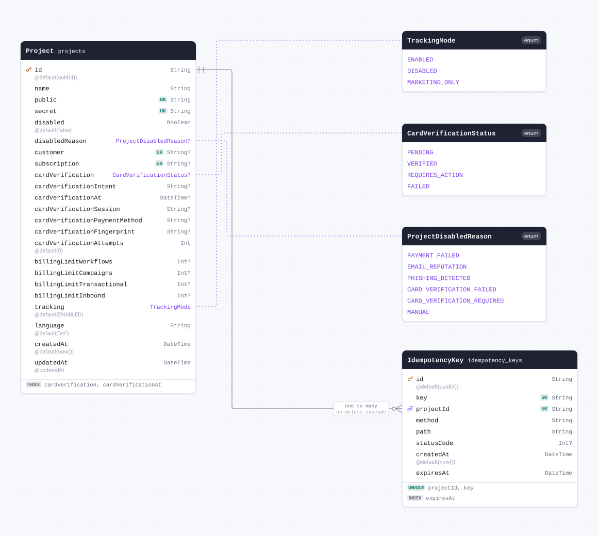

| Field        | Type       | Constraints                             | Default   | Description |
| ------------ | ---------- | --------------------------------------- | --------- | ----------- |
| `id`         | `String`   | PK NOT NULL                             | `uuid(4)` |             |
| `key`        | `String`   | NOT NULL                                |           |             |
| `projectId`  | `String`   | NOT NULL → [Project.id](#model-Project) |           |             |
| `method`     | `String`   | NOT NULL                                |           |             |
| `path`       | `String`   | NOT NULL                                |           |             |
| `statusCode` | `Int`      | NULL                                    |           |             |
| `createdAt`  | `DateTime` | NOT NULL                                | `now()`   |             |
| `expiresAt`  | `DateTime` | NOT NULL                                |           |             |

#### Indexes

- `@@index([expiresAt])`
- `@@unique([projectId, key])`

#### References

- `projectId` → [Project.id](#model-Project) (many-to-one, on delete Cascade)

#### Definition

```sql
CREATE TABLE "idempotency_keys" (
    "id" TEXT NOT NULL,
    "key" TEXT NOT NULL,
    "projectId" TEXT NOT NULL,
    "method" TEXT NOT NULL,
    "path" TEXT NOT NULL,
    "statusCode" INTEGER,
    "createdAt" TIMESTAMP(3) NOT NULL DEFAULT CURRENT_TIMESTAMP,
    "expiresAt" TIMESTAMP(3) NOT NULL,

    CONSTRAINT "idempotency_keys_pkey" PRIMARY KEY ("id")
);

CREATE INDEX "idempotency_keys_expiresAt_idx" ON "idempotency_keys"("expiresAt");

CREATE UNIQUE INDEX "idempotency_keys_projectId_key_key" ON "idempotency_keys"("projectId", "key");

ALTER TABLE "idempotency_keys" ADD CONSTRAINT "idempotency_keys_projectId_fkey" FOREIGN KEY ("projectId") REFERENCES "projects"("id") ON DELETE CASCADE ON UPDATE CASCADE;
```

<details>
<summary>Queries and their SQL</summary>

**findMany**: Every row

```ts
await prisma.idempotencyKey.findMany();
```

```sql
SELECT
  "public"."idempotency_keys"."id",
  "public"."idempotency_keys"."key",
  "public"."idempotency_keys"."projectId",
  "public"."idempotency_keys"."method",
  "public"."idempotency_keys"."path",
  "public"."idempotency_keys"."statusCode",
  "public"."idempotency_keys"."createdAt",
  "public"."idempotency_keys"."expiresAt"
FROM
  "public"."idempotency_keys"
WHERE
  1 = 1
OFFSET
  $1
-- params: ["0"]
```

**count**: How many rows there are

```ts
await prisma.idempotencyKey.count();
```

```sql
SELECT
  COUNT(*) AS "_count$_all"
FROM
  (
    SELECT
      "public"."idempotency_keys"."id"
    FROM
      "public"."idempotency_keys"
    WHERE
      1 = 1
    OFFSET
      $1
  ) AS "sub"
-- params: ["0"]
```

**findMany**: Every row with its relations

```ts
await prisma.idempotencyKey.findMany({ include: { project: true } });
```

```sql
SELECT
  "public"."idempotency_keys"."id",
  "public"."idempotency_keys"."key",
  "public"."idempotency_keys"."projectId",
  "public"."idempotency_keys"."method",
  "public"."idempotency_keys"."path",
  "public"."idempotency_keys"."statusCode",
  "public"."idempotency_keys"."createdAt",
  "public"."idempotency_keys"."expiresAt"
FROM
  "public"."idempotency_keys"
WHERE
  1 = 1
OFFSET
  $1
-- params: ["0"]

SELECT
  "public"."projects"."id",
  "public"."projects"."name",
  "public"."projects"."public",
  "public"."projects"."secret",
  "public"."projects"."disabled",
  "public"."projects"."disabledReason"::text,
  "public"."projects"."customer",
  "public"."projects"."subscription",
  "public"."projects"."cardVerification"::text,
  "public"."projects"."cardVerificationIntent",
  "public"."projects"."cardVerificationAt",
  "public"."projects"."cardVerificationSession",
  "public"."projects"."cardVerificationPaymentMethod",
  "public"."projects"."cardVerificationFingerprint",
  "public"."projects"."cardVerificationAttempts",
  "public"."projects"."billingLimitWorkflows",
  "public"."projects"."billingLimitCampaigns",
  "public"."projects"."billingLimitTransactional",
  "public"."projects"."billingLimitInbound",
  "public"."projects"."tracking"::text,
  "public"."projects"."language",
  "public"."projects"."createdAt",
  "public"."projects"."updatedAt"
FROM
  "public"."projects"
WHERE
  "public"."projects"."id" IN ($1)
OFFSET
  $2
-- params: ["<projectId of the rows above>","0"]
```

**findUnique**: One row by what is unique to it

```ts
await prisma.idempotencyKey.findUnique({ where: { id: "example" } });
```

```sql
SELECT
  "public"."idempotency_keys"."id",
  "public"."idempotency_keys"."key",
  "public"."idempotency_keys"."projectId",
  "public"."idempotency_keys"."method",
  "public"."idempotency_keys"."path",
  "public"."idempotency_keys"."statusCode",
  "public"."idempotency_keys"."createdAt",
  "public"."idempotency_keys"."expiresAt"
FROM
  "public"."idempotency_keys"
WHERE
  (
    "public"."idempotency_keys"."id" = $1
    AND 1 = 1
  )
LIMIT
  $2
OFFSET
  $3
-- params: ["example","1","0"]
```

**create**: Create a row

```ts
await prisma.idempotencyKey.create({
  data: {
    key: "example",
    projectId: "example",
    method: "example",
    path: "example",
    expiresAt: new Date("2026-01-01T00:00:00.000Z"),
  },
});
```

```sql
INSERT INTO
  "public"."idempotency_keys" (
    "id",
    "key",
    "projectId",
    "method",
    "path",
    "createdAt",
    "expiresAt"
  )
VALUES
  ($1, $2, $3, $4, $5, $6, $7)
RETURNING
  "public"."idempotency_keys"."id",
  "public"."idempotency_keys"."key",
  "public"."idempotency_keys"."projectId",
  "public"."idempotency_keys"."method",
  "public"."idempotency_keys"."path",
  "public"."idempotency_keys"."statusCode",
  "public"."idempotency_keys"."createdAt",
  "public"."idempotency_keys"."expiresAt"
-- params: ["<uuid(4)>","example","example","example","example","<now()>","2026-01-01T00:00:00.000Z"]
```

**update**: Update a row

```ts
await prisma.idempotencyKey.update({ where: { id: "example" }, data: { key: "example" } });
```

```sql
UPDATE "public"."idempotency_keys"
SET
  "key" = $1
WHERE
  (
    "public"."idempotency_keys"."id" = $2
    AND 1 = 1
  )
RETURNING
  "public"."idempotency_keys"."id",
  "public"."idempotency_keys"."key",
  "public"."idempotency_keys"."projectId",
  "public"."idempotency_keys"."method",
  "public"."idempotency_keys"."path",
  "public"."idempotency_keys"."statusCode",
  "public"."idempotency_keys"."createdAt",
  "public"."idempotency_keys"."expiresAt"
-- params: ["example","example"]
```

**delete**: Delete a row

```ts
await prisma.idempotencyKey.delete({ where: { id: "example" } });
```

```sql
DELETE FROM "public"."idempotency_keys"
WHERE
  (
    "public"."idempotency_keys"."id" = $1
    AND 1 = 1
  )
RETURNING
  "public"."idempotency_keys"."id",
  "public"."idempotency_keys"."key",
  "public"."idempotency_keys"."projectId",
  "public"."idempotency_keys"."method",
  "public"."idempotency_keys"."path",
  "public"."idempotency_keys"."statusCode",
  "public"."idempotency_keys"."createdAt",
  "public"."idempotency_keys"."expiresAt"
-- params: ["example"]
```

</details>

<a id="model-ThrottleClaim"></a>

### ThrottleClaim

Table `throttle_claims`. One transactional notification held for one recipient (or for the whole project) by a
send with `delivery.throttle`. While it is held, the same notification is not sent again.

The claim is taken by inserting (or taking over an expired) row, so the unique constraint
decides the race between concurrent sends, like `IdempotencyKey`. It is held from the
moment the send is accepted, re-anchored to the real send time once SES has the message,
and released when the email never gets there (cancelled, or failed before sending).

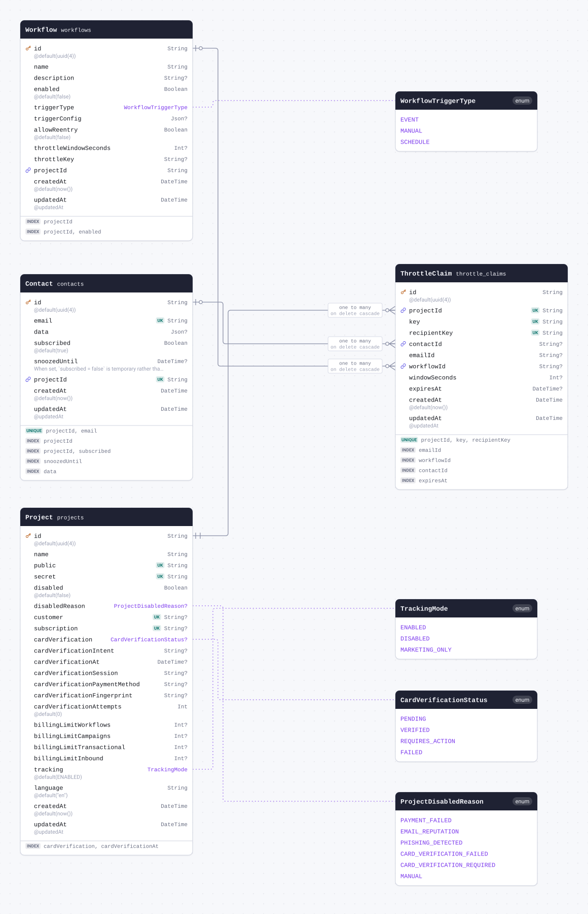

| Field           | Type       | Constraints                             | Default      | Description |
| --------------- | ---------- | --------------------------------------- | ------------ | ----------- |
| `id`            | `String`   | PK NOT NULL                             | `uuid(4)`    |             |
| `projectId`     | `String`   | NOT NULL → [Project.id](#model-Project) |              |             |
| `key`           | `String`   | NOT NULL                                |              |             |
| `recipientKey`  | `String`   | NOT NULL                                |              |             |
| `contactId`     | `String`   | NULL → [Contact.id](#model-Contact)     |              |             |
| `emailId`       | `String`   | NULL                                    |              |             |
| `workflowId`    | `String`   | NULL → [Workflow.id](#model-Workflow)   |              |             |
| `windowSeconds` | `Int`      | NULL                                    |              |             |
| `expiresAt`     | `DateTime` | NULL                                    |              |             |
| `createdAt`     | `DateTime` | NOT NULL                                | `now()`      |             |
| `updatedAt`     | `DateTime` | NOT NULL                                | `@updatedAt` |             |

#### Indexes

- `@@index([emailId])`
- `@@index([workflowId])`
- `@@index([contactId])`
- `@@index([expiresAt])`
- `@@unique([projectId, key, recipientKey])`

#### References

- `projectId` → [Project.id](#model-Project) (many-to-one, on delete Cascade)
- `contactId` → [Contact.id](#model-Contact) (many-to-one, on delete Cascade)
- `workflowId` → [Workflow.id](#model-Workflow) (many-to-one, on delete Cascade)

#### Definition

```sql
CREATE TABLE "throttle_claims" (
    "id" TEXT NOT NULL,
    "projectId" TEXT NOT NULL,
    "key" TEXT NOT NULL,
    "recipientKey" TEXT NOT NULL,
    "contactId" TEXT,
    "emailId" TEXT,
    "workflowId" TEXT,
    "windowSeconds" INTEGER,
    "expiresAt" TIMESTAMP(3),
    "createdAt" TIMESTAMP(3) NOT NULL DEFAULT CURRENT_TIMESTAMP,
    "updatedAt" TIMESTAMP(3) NOT NULL,

    CONSTRAINT "throttle_claims_pkey" PRIMARY KEY ("id")
);

CREATE INDEX "throttle_claims_emailId_idx" ON "throttle_claims"("emailId");

CREATE INDEX "throttle_claims_workflowId_idx" ON "throttle_claims"("workflowId");

CREATE INDEX "throttle_claims_contactId_idx" ON "throttle_claims"("contactId");

CREATE INDEX "throttle_claims_expiresAt_idx" ON "throttle_claims"("expiresAt");

CREATE UNIQUE INDEX "throttle_claims_projectId_key_recipientKey_key" ON "throttle_claims"("projectId", "key", "recipientKey");

ALTER TABLE "throttle_claims" ADD CONSTRAINT "throttle_claims_projectId_fkey" FOREIGN KEY ("projectId") REFERENCES "projects"("id") ON DELETE CASCADE ON UPDATE CASCADE;

ALTER TABLE "throttle_claims" ADD CONSTRAINT "throttle_claims_contactId_fkey" FOREIGN KEY ("contactId") REFERENCES "contacts"("id") ON DELETE CASCADE ON UPDATE CASCADE;

ALTER TABLE "throttle_claims" ADD CONSTRAINT "throttle_claims_workflowId_fkey" FOREIGN KEY ("workflowId") REFERENCES "workflows"("id") ON DELETE CASCADE ON UPDATE CASCADE;
```

<details>
<summary>Queries and their SQL</summary>

**findMany**: Every row

```ts
await prisma.throttleClaim.findMany();
```

```sql
SELECT
  "public"."throttle_claims"."id",
  "public"."throttle_claims"."projectId",
  "public"."throttle_claims"."key",
  "public"."throttle_claims"."recipientKey",
  "public"."throttle_claims"."contactId",
  "public"."throttle_claims"."emailId",
  "public"."throttle_claims"."workflowId",
  "public"."throttle_claims"."windowSeconds",
  "public"."throttle_claims"."expiresAt",
  "public"."throttle_claims"."createdAt",
  "public"."throttle_claims"."updatedAt"
FROM
  "public"."throttle_claims"
WHERE
  1 = 1
OFFSET
  $1
-- params: ["0"]
```

**count**: How many rows there are

```ts
await prisma.throttleClaim.count();
```

```sql
SELECT
  COUNT(*) AS "_count$_all"
FROM
  (
    SELECT
      "public"."throttle_claims"."id"
    FROM
      "public"."throttle_claims"
    WHERE
      1 = 1
    OFFSET
      $1
  ) AS "sub"
-- params: ["0"]
```

**findMany**: Every row with its relations

```ts
await prisma.throttleClaim.findMany({ include: { project: true, contact: true, workflow: true } });
```

```sql
SELECT
  "public"."throttle_claims"."id",
  "public"."throttle_claims"."projectId",
  "public"."throttle_claims"."key",
  "public"."throttle_claims"."recipientKey",
  "public"."throttle_claims"."contactId",
  "public"."throttle_claims"."emailId",
  "public"."throttle_claims"."workflowId",
  "public"."throttle_claims"."windowSeconds",
  "public"."throttle_claims"."expiresAt",
  "public"."throttle_claims"."createdAt",
  "public"."throttle_claims"."updatedAt"
FROM
  "public"."throttle_claims"
WHERE
  1 = 1
OFFSET
  $1
-- params: ["0"]

SELECT
  "public"."projects"."id",
  "public"."projects"."name",
  "public"."projects"."public",
  "public"."projects"."secret",
  "public"."projects"."disabled",
  "public"."projects"."disabledReason"::text,
  "public"."projects"."customer",
  "public"."projects"."subscription",
  "public"."projects"."cardVerification"::text,
  "public"."projects"."cardVerificationIntent",
  "public"."projects"."cardVerificationAt",
  "public"."projects"."cardVerificationSession",
  "public"."projects"."cardVerificationPaymentMethod",
  "public"."projects"."cardVerificationFingerprint",
  "public"."projects"."cardVerificationAttempts",
  "public"."projects"."billingLimitWorkflows",
  "public"."projects"."billingLimitCampaigns",
  "public"."projects"."billingLimitTransactional",
  "public"."projects"."billingLimitInbound",
  "public"."projects"."tracking"::text,
  "public"."projects"."language",
  "public"."projects"."createdAt",
  "public"."projects"."updatedAt"
FROM
  "public"."projects"
WHERE
  "public"."projects"."id" IN ($1)
OFFSET
  $2
-- params: ["<projectId of the rows above>","0"]

SELECT
  "public"."contacts"."id",
  "public"."contacts"."email",
  "public"."contacts"."data",
  "public"."contacts"."subscribed",
  "public"."contacts"."snoozedUntil",
  "public"."contacts"."projectId",
  "public"."contacts"."createdAt",
  "public"."contacts"."updatedAt"
FROM
  "public"."contacts"
WHERE
  "public"."contacts"."id" IN ($1)
OFFSET
  $2
-- params: ["<contactId of the rows above>","0"]

SELECT
  "public"."workflows"."id",
  "public"."workflows"."name",
  "public"."workflows"."description",
  "public"."workflows"."enabled",
  "public"."workflows"."triggerType"::text,
  "public"."workflows"."triggerConfig",
  "public"."workflows"."allowReentry",
  "public"."workflows"."throttleWindowSeconds",
  "public"."workflows"."throttleKey",
  "public"."workflows"."projectId",
  "public"."workflows"."createdAt",
  "public"."workflows"."updatedAt"
FROM
  "public"."workflows"
WHERE
  "public"."workflows"."id" IN ($1)
OFFSET
  $2
-- params: ["<workflowId of the rows above>","0"]
```

**findUnique**: One row by what is unique to it

```ts
await prisma.throttleClaim.findUnique({ where: { id: "example" } });
```

```sql
SELECT
  "public"."throttle_claims"."id",
  "public"."throttle_claims"."projectId",
  "public"."throttle_claims"."key",
  "public"."throttle_claims"."recipientKey",
  "public"."throttle_claims"."contactId",
  "public"."throttle_claims"."emailId",
  "public"."throttle_claims"."workflowId",
  "public"."throttle_claims"."windowSeconds",
  "public"."throttle_claims"."expiresAt",
  "public"."throttle_claims"."createdAt",
  "public"."throttle_claims"."updatedAt"
FROM
  "public"."throttle_claims"
WHERE
  (
    "public"."throttle_claims"."id" = $1
    AND 1 = 1
  )
LIMIT
  $2
OFFSET
  $3
-- params: ["example","1","0"]
```

**create**: Create a row

```ts
await prisma.throttleClaim.create({
  data: { projectId: "example", key: "example", recipientKey: "example" },
});
```

```sql
INSERT INTO
  "public"."throttle_claims" (
    "id",
    "projectId",
    "key",
    "recipientKey",
    "createdAt",
    "updatedAt"
  )
VALUES
  ($1, $2, $3, $4, $5, $6)
RETURNING
  "public"."throttle_claims"."id",
  "public"."throttle_claims"."projectId",
  "public"."throttle_claims"."key",
  "public"."throttle_claims"."recipientKey",
  "public"."throttle_claims"."contactId",
  "public"."throttle_claims"."emailId",
  "public"."throttle_claims"."workflowId",
  "public"."throttle_claims"."windowSeconds",
  "public"."throttle_claims"."expiresAt",
  "public"."throttle_claims"."createdAt",
  "public"."throttle_claims"."updatedAt"
-- params: ["<uuid(4)>","example","example","example","<now()>","<now()>"]
```

**update**: Update a row

```ts
await prisma.throttleClaim.update({ where: { id: "example" }, data: { key: "example" } });
```

```sql
UPDATE "public"."throttle_claims"
SET
  "key" = $1,
  "updatedAt" = $2
WHERE
  (
    "public"."throttle_claims"."id" = $3
    AND 1 = 1
  )
RETURNING
  "public"."throttle_claims"."id",
  "public"."throttle_claims"."projectId",
  "public"."throttle_claims"."key",
  "public"."throttle_claims"."recipientKey",
  "public"."throttle_claims"."contactId",
  "public"."throttle_claims"."emailId",
  "public"."throttle_claims"."workflowId",
  "public"."throttle_claims"."windowSeconds",
  "public"."throttle_claims"."expiresAt",
  "public"."throttle_claims"."createdAt",
  "public"."throttle_claims"."updatedAt"
-- params: ["example",{"prisma__type":"generatorCall","prisma__value":{"name":"now","args":[],"returnType":{"type":"DateTime"}}},"example"]
```

**delete**: Delete a row

```ts
await prisma.throttleClaim.delete({ where: { id: "example" } });
```

```sql
DELETE FROM "public"."throttle_claims"
WHERE
  (
    "public"."throttle_claims"."id" = $1
    AND 1 = 1
  )
RETURNING
  "public"."throttle_claims"."id",
  "public"."throttle_claims"."projectId",
  "public"."throttle_claims"."key",
  "public"."throttle_claims"."recipientKey",
  "public"."throttle_claims"."contactId",
  "public"."throttle_claims"."emailId",
  "public"."throttle_claims"."workflowId",
  "public"."throttle_claims"."windowSeconds",
  "public"."throttle_claims"."expiresAt",
  "public"."throttle_claims"."createdAt",
  "public"."throttle_claims"."updatedAt"
-- params: ["example"]
```

</details>

<a id="model-ApiRequest"></a>

### ApiRequest

Table `api_requests`.

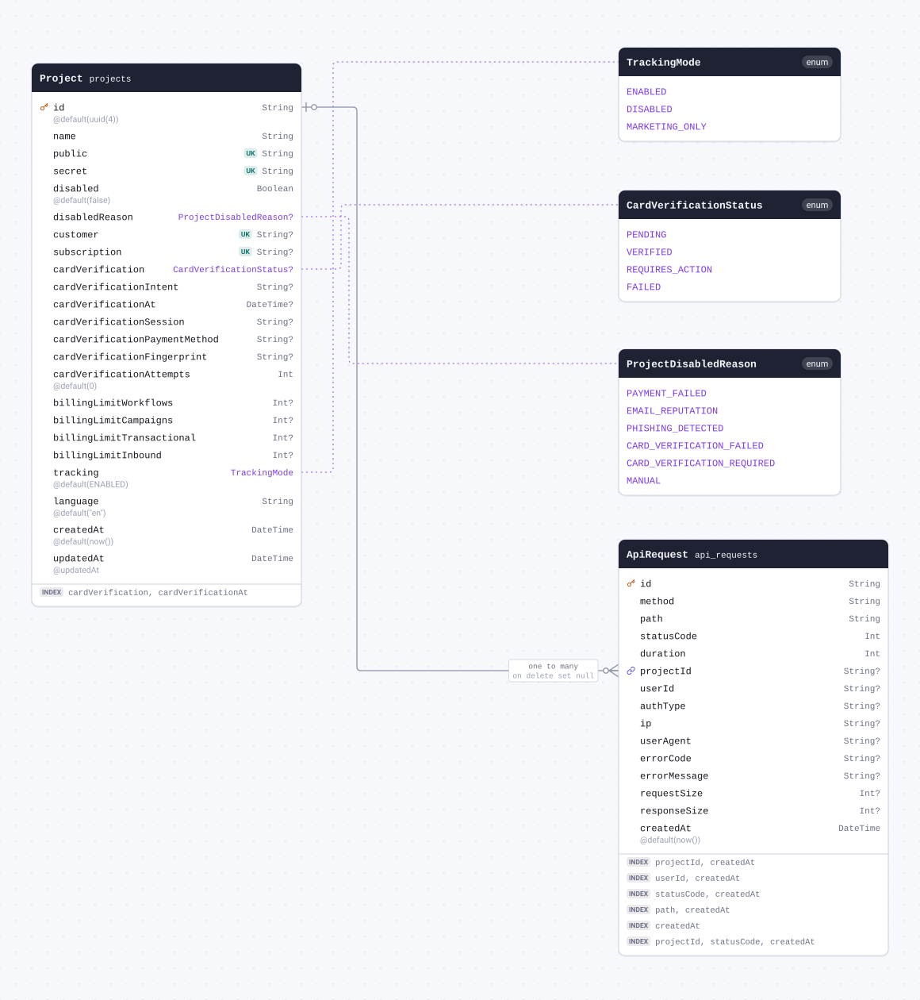

| Field          | Type       | Constraints                         | Default | Description |
| -------------- | ---------- | ----------------------------------- | ------- | ----------- |
| `id`           | `String`   | PK NOT NULL                         |         |             |
| `method`       | `String`   | NOT NULL                            |         |             |
| `path`         | `String`   | NOT NULL                            |         |             |
| `statusCode`   | `Int`      | NOT NULL                            |         |             |
| `duration`     | `Int`      | NOT NULL                            |         |             |
| `projectId`    | `String`   | NULL → [Project.id](#model-Project) |         |             |
| `userId`       | `String`   | NULL                                |         |             |
| `authType`     | `String`   | NULL                                |         |             |
| `ip`           | `String`   | NULL                                |         |             |
| `userAgent`    | `String`   | NULL                                |         |             |
| `errorCode`    | `String`   | NULL                                |         |             |
| `errorMessage` | `String`   | NULL                                |         |             |
| `requestSize`  | `Int`      | NULL                                |         |             |
| `responseSize` | `Int`      | NULL                                |         |             |
| `createdAt`    | `DateTime` | NOT NULL                            | `now()` |             |

#### Indexes

- `@@index([projectId, createdAt])`
- `@@index([userId, createdAt])`
- `@@index([statusCode, createdAt])`
- `@@index([path, createdAt])`
- `@@index([createdAt])`
- `@@index([projectId, statusCode, createdAt])`

#### References

- `projectId` → [Project.id](#model-Project) (many-to-one, on delete SetNull)

#### Definition

```sql
CREATE TABLE "api_requests" (
    "id" TEXT NOT NULL,
    "method" TEXT NOT NULL,
    "path" TEXT NOT NULL,
    "statusCode" INTEGER NOT NULL,
    "duration" INTEGER NOT NULL,
    "projectId" TEXT,
    "userId" TEXT,
    "authType" TEXT,
    "ip" TEXT,
    "userAgent" TEXT,
    "errorCode" TEXT,
    "errorMessage" TEXT,
    "requestSize" INTEGER,
    "responseSize" INTEGER,
    "createdAt" TIMESTAMP(3) NOT NULL DEFAULT CURRENT_TIMESTAMP,

    CONSTRAINT "api_requests_pkey" PRIMARY KEY ("id")
);

CREATE INDEX "api_requests_projectId_createdAt_idx" ON "api_requests"("projectId", "createdAt" DESC);

CREATE INDEX "api_requests_userId_createdAt_idx" ON "api_requests"("userId", "createdAt" DESC);

CREATE INDEX "api_requests_statusCode_createdAt_idx" ON "api_requests"("statusCode", "createdAt" DESC);

CREATE INDEX "api_requests_path_createdAt_idx" ON "api_requests"("path", "createdAt" DESC);

CREATE INDEX "api_requests_createdAt_idx" ON "api_requests"("createdAt" DESC);

CREATE INDEX "api_requests_projectId_statusCode_createdAt_idx" ON "api_requests"("projectId", "statusCode", "createdAt" DESC);

ALTER TABLE "api_requests" ADD CONSTRAINT "api_requests_projectId_fkey" FOREIGN KEY ("projectId") REFERENCES "projects"("id") ON DELETE SET NULL ON UPDATE CASCADE;
```

<details>
<summary>Queries and their SQL</summary>

**findMany**: Every row

```ts
await prisma.apiRequest.findMany();
```

```sql
SELECT
  "public"."api_requests"."id",
  "public"."api_requests"."method",
  "public"."api_requests"."path",
  "public"."api_requests"."statusCode",
  "public"."api_requests"."duration",
  "public"."api_requests"."projectId",
  "public"."api_requests"."userId",
  "public"."api_requests"."authType",
  "public"."api_requests"."ip",
  "public"."api_requests"."userAgent",
  "public"."api_requests"."errorCode",
  "public"."api_requests"."errorMessage",
  "public"."api_requests"."requestSize",
  "public"."api_requests"."responseSize",
  "public"."api_requests"."createdAt"
FROM
  "public"."api_requests"
WHERE
  1 = 1
OFFSET
  $1
-- params: ["0"]
```

**count**: How many rows there are

```ts
await prisma.apiRequest.count();
```

```sql
SELECT
  COUNT(*) AS "_count$_all"
FROM
  (
    SELECT
      "public"."api_requests"."id"
    FROM
      "public"."api_requests"
    WHERE
      1 = 1
    OFFSET
      $1
  ) AS "sub"
-- params: ["0"]
```

**findMany**: Every row with its relations

```ts
await prisma.apiRequest.findMany({ include: { project: true } });
```

```sql
SELECT
  "public"."api_requests"."id",
  "public"."api_requests"."method",
  "public"."api_requests"."path",
  "public"."api_requests"."statusCode",
  "public"."api_requests"."duration",
  "public"."api_requests"."projectId",
  "public"."api_requests"."userId",
  "public"."api_requests"."authType",
  "public"."api_requests"."ip",
  "public"."api_requests"."userAgent",
  "public"."api_requests"."errorCode",
  "public"."api_requests"."errorMessage",
  "public"."api_requests"."requestSize",
  "public"."api_requests"."responseSize",
  "public"."api_requests"."createdAt"
FROM
  "public"."api_requests"
WHERE
  1 = 1
OFFSET
  $1
-- params: ["0"]

SELECT
  "public"."projects"."id",
  "public"."projects"."name",
  "public"."projects"."public",
  "public"."projects"."secret",
  "public"."projects"."disabled",
  "public"."projects"."disabledReason"::text,
  "public"."projects"."customer",
  "public"."projects"."subscription",
  "public"."projects"."cardVerification"::text,
  "public"."projects"."cardVerificationIntent",
  "public"."projects"."cardVerificationAt",
  "public"."projects"."cardVerificationSession",
  "public"."projects"."cardVerificationPaymentMethod",
  "public"."projects"."cardVerificationFingerprint",
  "public"."projects"."cardVerificationAttempts",
  "public"."projects"."billingLimitWorkflows",
  "public"."projects"."billingLimitCampaigns",
  "public"."projects"."billingLimitTransactional",
  "public"."projects"."billingLimitInbound",
  "public"."projects"."tracking"::text,
  "public"."projects"."language",
  "public"."projects"."createdAt",
  "public"."projects"."updatedAt"
FROM
  "public"."projects"
WHERE
  "public"."projects"."id" IN ($1)
OFFSET
  $2
-- params: ["<projectId of the rows above>","0"]
```

**findUnique**: One row by what is unique to it

```ts
await prisma.apiRequest.findUnique({ where: { id: "example" } });
```

```sql
SELECT
  "public"."api_requests"."id",
  "public"."api_requests"."method",
  "public"."api_requests"."path",
  "public"."api_requests"."statusCode",
  "public"."api_requests"."duration",
  "public"."api_requests"."projectId",
  "public"."api_requests"."userId",
  "public"."api_requests"."authType",
  "public"."api_requests"."ip",
  "public"."api_requests"."userAgent",
  "public"."api_requests"."errorCode",
  "public"."api_requests"."errorMessage",
  "public"."api_requests"."requestSize",
  "public"."api_requests"."responseSize",
  "public"."api_requests"."createdAt"
FROM
  "public"."api_requests"
WHERE
  (
    "public"."api_requests"."id" = $1
    AND 1 = 1
  )
LIMIT
  $2
OFFSET
  $3
-- params: ["example","1","0"]
```

**create**: Create a row

```ts
await prisma.apiRequest.create({
  data: { id: "example", method: "example", path: "example", statusCode: 1, duration: 1 },
});
```

```sql
INSERT INTO
  "public"."api_requests" (
    "id",
    "method",
    "path",
    "statusCode",
    "duration",
    "createdAt"
  )
VALUES
  ($1, $2, $3, $4, $5, $6)
RETURNING
  "public"."api_requests"."id",
  "public"."api_requests"."method",
  "public"."api_requests"."path",
  "public"."api_requests"."statusCode",
  "public"."api_requests"."duration",
  "public"."api_requests"."projectId",
  "public"."api_requests"."userId",
  "public"."api_requests"."authType",
  "public"."api_requests"."ip",
  "public"."api_requests"."userAgent",
  "public"."api_requests"."errorCode",
  "public"."api_requests"."errorMessage",
  "public"."api_requests"."requestSize",
  "public"."api_requests"."responseSize",
  "public"."api_requests"."createdAt"
-- params: ["example","example","example","1","1","<now()>"]
```

**update**: Update a row

```ts
await prisma.apiRequest.update({ where: { id: "example" }, data: { method: "example" } });
```

```sql
UPDATE "public"."api_requests"
SET
  "method" = $1
WHERE
  (
    "public"."api_requests"."id" = $2
    AND 1 = 1
  )
RETURNING
  "public"."api_requests"."id",
  "public"."api_requests"."method",
  "public"."api_requests"."path",
  "public"."api_requests"."statusCode",
  "public"."api_requests"."duration",
  "public"."api_requests"."projectId",
  "public"."api_requests"."userId",
  "public"."api_requests"."authType",
  "public"."api_requests"."ip",
  "public"."api_requests"."userAgent",
  "public"."api_requests"."errorCode",
  "public"."api_requests"."errorMessage",
  "public"."api_requests"."requestSize",
  "public"."api_requests"."responseSize",
  "public"."api_requests"."createdAt"
-- params: ["example","example"]
```

**delete**: Delete a row

```ts
await prisma.apiRequest.delete({ where: { id: "example" } });
```

```sql
DELETE FROM "public"."api_requests"
WHERE
  (
    "public"."api_requests"."id" = $1
    AND 1 = 1
  )
RETURNING
  "public"."api_requests"."id",
  "public"."api_requests"."method",
  "public"."api_requests"."path",
  "public"."api_requests"."statusCode",
  "public"."api_requests"."duration",
  "public"."api_requests"."projectId",
  "public"."api_requests"."userId",
  "public"."api_requests"."authType",
  "public"."api_requests"."ip",
  "public"."api_requests"."userAgent",
  "public"."api_requests"."errorCode",
  "public"."api_requests"."errorMessage",
  "public"."api_requests"."requestSize",
  "public"."api_requests"."responseSize",
  "public"."api_requests"."createdAt"
-- params: ["example"]
```

</details>

## Enums

<a id="enum-ProjectDisabledReason"></a>

### ProjectDisabledReason

- `PAYMENT_FAILED`
- `EMAIL_REPUTATION`
- `PHISHING_DETECTED`
- `CARD_VERIFICATION_FAILED`
- `CARD_VERIFICATION_REQUIRED`
- `MANUAL`

#### Definition

```sql
CREATE TYPE "ProjectDisabledReason" AS ENUM ('PAYMENT_FAILED', 'EMAIL_REPUTATION', 'PHISHING_DETECTED', 'CARD_VERIFICATION_FAILED', 'CARD_VERIFICATION_REQUIRED', 'MANUAL');
```

<a id="enum-CardVerificationStatus"></a>

### CardVerificationStatus

- `PENDING`
- `VERIFIED`
- `REQUIRES_ACTION`
- `FAILED`

#### Definition

```sql
CREATE TYPE "CardVerificationStatus" AS ENUM ('PENDING', 'VERIFIED', 'REQUIRES_ACTION', 'FAILED');
```

<a id="enum-AuthMethod"></a>

### AuthMethod

- `PASSWORD`
- `GOOGLE_OAUTH`
- `GITHUB_OAUTH`

#### Definition

```sql
CREATE TYPE "AuthMethod" AS ENUM ('PASSWORD', 'GOOGLE_OAUTH', 'GITHUB_OAUTH');
```

<a id="enum-Role"></a>

### Role

- `OWNER`
- `ADMIN`
- `MEMBER`

#### Definition

```sql
CREATE TYPE "Role" AS ENUM ('OWNER', 'ADMIN', 'MEMBER');
```

<a id="enum-TemplateType"></a>

### TemplateType

- `TRANSACTIONAL`
- `MARKETING`
- `HEADLESS`

#### Definition

```sql
CREATE TYPE "TemplateType" AS ENUM ('TRANSACTIONAL', 'MARKETING', 'HEADLESS');
```

<a id="enum-TrackingMode"></a>

### TrackingMode

- `ENABLED`
- `DISABLED`
- `MARKETING_ONLY`

#### Definition

```sql
CREATE TYPE "TrackingMode" AS ENUM ('ENABLED', 'DISABLED', 'MARKETING_ONLY');
```

<a id="enum-CampaignStatus"></a>

### CampaignStatus

- `DRAFT`
- `SCHEDULED`
- `SENDING`
- `SENT`
- `CANCELLED`

#### Definition

```sql
CREATE TYPE "CampaignStatus" AS ENUM ('DRAFT', 'SCHEDULED', 'SENDING', 'SENT', 'CANCELLED');
```

<a id="enum-CampaignAudienceType"></a>

### CampaignAudienceType

- `ALL`
- `FILTERED`
- `SEGMENT`

#### Definition

```sql
CREATE TYPE "CampaignAudienceType" AS ENUM ('ALL', 'FILTERED', 'SEGMENT');
```

<a id="enum-WorkflowTriggerType"></a>

### WorkflowTriggerType

- `EVENT`
- `MANUAL`
- `SCHEDULE`

#### Definition

```sql
CREATE TYPE "WorkflowTriggerType" AS ENUM ('EVENT', 'MANUAL', 'SCHEDULE');
```

<a id="enum-WorkflowStepType"></a>

### WorkflowStepType

- `TRIGGER`
- `SEND_EMAIL`
- `DELAY`
- `WAIT_FOR_EVENT`
- `CONDITION`
- `EXIT`
- `WEBHOOK`
- `UPDATE_CONTACT`

#### Definition

```sql
CREATE TYPE "WorkflowStepType" AS ENUM ('TRIGGER', 'SEND_EMAIL', 'DELAY', 'WAIT_FOR_EVENT', 'CONDITION', 'EXIT', 'WEBHOOK', 'UPDATE_CONTACT');
```

<a id="enum-WorkflowExecutionStatus"></a>

### WorkflowExecutionStatus

- `RUNNING`
- `WAITING`
- `COMPLETED`
- `EXITED`
- `FAILED`
- `CANCELLED`

#### Definition

```sql
CREATE TYPE "WorkflowExecutionStatus" AS ENUM ('RUNNING', 'WAITING', 'COMPLETED', 'EXITED', 'FAILED', 'CANCELLED');
```

<a id="enum-StepExecutionStatus"></a>

### StepExecutionStatus

- `PENDING`
- `SCHEDULED`
- `WAITING`
- `RUNNING`
- `COMPLETED`
- `SKIPPED`
- `FAILED`

#### Definition

```sql
CREATE TYPE "StepExecutionStatus" AS ENUM ('PENDING', 'SCHEDULED', 'WAITING', 'RUNNING', 'COMPLETED', 'SKIPPED', 'FAILED');
```

<a id="enum-SegmentType"></a>

### SegmentType

- `DYNAMIC`
- `STATIC`

#### Definition

```sql
CREATE TYPE "SegmentType" AS ENUM ('DYNAMIC', 'STATIC');
```

<a id="enum-EmailSourceType"></a>

### EmailSourceType

- `TRANSACTIONAL`
- `CAMPAIGN`
- `WORKFLOW`
- `INBOUND`

#### Definition

```sql
CREATE TYPE "EmailSourceType" AS ENUM ('TRANSACTIONAL', 'CAMPAIGN', 'WORKFLOW', 'INBOUND');
```

<a id="enum-EmailStatus"></a>

### EmailStatus

- `SCHEDULED`
- `CANCELLED`
- `PENDING`
- `SENDING`
- `SENT`
- `DELIVERED`
- `RECEIVED`
- `OPENED`
- `CLICKED`
- `BOUNCED`
- `COMPLAINED`
- `FAILED`

#### Definition

```sql
CREATE TYPE "EmailStatus" AS ENUM ('SCHEDULED', 'CANCELLED', 'PENDING', 'SENDING', 'SENT', 'DELIVERED', 'RECEIVED', 'OPENED', 'CLICKED', 'BOUNCED', 'COMPLAINED', 'FAILED');
```
