# Schema docs

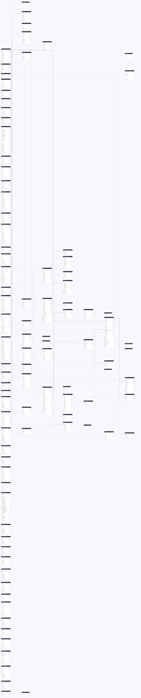

<details>
<summary>The whole schema as SQL</summary>

```sql
CREATE SCHEMA IF NOT EXISTS "public";

CREATE TYPE "OrderStatus" AS ENUM ('PENDING', 'ACCEPTED', 'CANCELED', 'COMPLETED');

CREATE TYPE "From" AS ENUM ('BUYER', 'SELLER');

CREATE TYPE "State" AS ENUM ('QUEUE', 'PUBLISHED', 'ERROR', 'DRAFT');

CREATE TYPE "SubscriptionTier" AS ENUM ('STANDARD', 'PRO', 'TEAM', 'ULTIMATE');

CREATE TYPE "Period" AS ENUM ('MONTHLY', 'YEARLY');

CREATE TYPE "Provider" AS ENUM ('LOCAL', 'GITHUB', 'GOOGLE', 'APPLE', 'FARCASTER', 'WALLET', 'GENERIC');

CREATE TYPE "Role" AS ENUM ('SUPERADMIN', 'ADMIN', 'USER');

CREATE TYPE "APPROVED_SUBMIT_FOR_ORDER" AS ENUM ('NO', 'WAITING_CONFIRMATION', 'YES');

CREATE TYPE "CreationMethod" AS ENUM ('UNKNOWN', 'WEB', 'MCP', 'API', 'AUTOPOST', 'CLI');

CREATE TYPE "ShortLinkPreference" AS ENUM ('ASK', 'YES', 'NO');

CREATE TYPE "AnnouncementColor" AS ENUM ('INFO', 'WARNING', 'ERROR');

CREATE TABLE "Organization" (
    "id" TEXT NOT NULL,
    "name" TEXT NOT NULL,
    "description" TEXT,
    "apiKey" TEXT,
    "paymentId" TEXT,
    "streakSince" TIMESTAMP(3),
    "createdAt" TIMESTAMP(3) NOT NULL DEFAULT CURRENT_TIMESTAMP,
    "updatedAt" TIMESTAMP(3) NOT NULL,
    "deletedAt" TIMESTAMP(3),
    "allowTrial" BOOLEAN NOT NULL DEFAULT false,
    "isTrailing" BOOLEAN NOT NULL DEFAULT false,
    "shortlink" "ShortLinkPreference" NOT NULL DEFAULT 'ASK',

    CONSTRAINT "Organization_pkey" PRIMARY KEY ("id")
);

CREATE TABLE "Tags" (
    "id" TEXT NOT NULL,
    "name" TEXT NOT NULL,
    "color" TEXT NOT NULL,
    "orgId" TEXT NOT NULL,
    "deletedAt" TIMESTAMP(3),
    "createdAt" TIMESTAMP(3) NOT NULL DEFAULT CURRENT_TIMESTAMP,
    "updatedAt" TIMESTAMP(3) NOT NULL,

    CONSTRAINT "Tags_pkey" PRIMARY KEY ("id")
);

CREATE TABLE "TagsPosts" (
    "postId" TEXT NOT NULL,
    "tagId" TEXT NOT NULL,
    "createdAt" TIMESTAMP(3) NOT NULL DEFAULT CURRENT_TIMESTAMP,
    "updatedAt" TIMESTAMP(3) NOT NULL,

    CONSTRAINT "TagsPosts_pkey" PRIMARY KEY ("postId","tagId")
);

CREATE TABLE "User" (
    "id" TEXT NOT NULL,
    "email" TEXT NOT NULL,
    "password" TEXT,
    "providerName" "Provider" NOT NULL,
    "name" TEXT,
    "lastName" TEXT,
    "isSuperAdmin" BOOLEAN NOT NULL DEFAULT false,
    "bio" TEXT,
    "audience" INTEGER NOT NULL DEFAULT 0,
    "pictureId" TEXT,
    "providerId" TEXT,
    "timezone" INTEGER NOT NULL,
    "timezoneName" TEXT,
    "createdAt" TIMESTAMP(3) NOT NULL DEFAULT CURRENT_TIMESTAMP,
    "updatedAt" TIMESTAMP(3) NOT NULL,
    "lastReadNotifications" TIMESTAMP(3) NOT NULL DEFAULT CURRENT_TIMESTAMP,
    "inviteId" TEXT,
    "activated" BOOLEAN NOT NULL DEFAULT true,
    "account" TEXT,
    "connectedAccount" BOOLEAN NOT NULL DEFAULT false,
    "lastOnline" TIMESTAMP(3) NOT NULL DEFAULT CURRENT_TIMESTAMP,
    "ip" TEXT,
    "agent" TEXT,
    "deletedAt" TIMESTAMP(3),
    "sendSuccessEmails" BOOLEAN NOT NULL DEFAULT true,
    "sendFailureEmails" BOOLEAN NOT NULL DEFAULT true,
    "sendStreakEmails" BOOLEAN NOT NULL DEFAULT true,

    CONSTRAINT "User_pkey" PRIMARY KEY ("id")
);

CREATE TABLE "UsedCodes" (
    "id" TEXT NOT NULL,
    "code" TEXT NOT NULL,
    "orgId" TEXT NOT NULL,
    "createdAt" TIMESTAMP(3) NOT NULL DEFAULT CURRENT_TIMESTAMP,
    "updatedAt" TIMESTAMP(3) NOT NULL,

    CONSTRAINT "UsedCodes_pkey" PRIMARY KEY ("id")
);

CREATE TABLE "UserOrganization" (
    "id" TEXT NOT NULL,
    "userId" TEXT NOT NULL,
    "organizationId" TEXT NOT NULL,
    "disabled" BOOLEAN NOT NULL DEFAULT false,
    "role" "Role" NOT NULL DEFAULT 'USER',
    "createdAt" TIMESTAMP(3) NOT NULL DEFAULT CURRENT_TIMESTAMP,
    "updatedAt" TIMESTAMP(3) NOT NULL,

    CONSTRAINT "UserOrganization_pkey" PRIMARY KEY ("id")
);

CREATE TABLE "GitHub" (
    "id" TEXT NOT NULL,
    "login" TEXT,
    "name" TEXT,
    "token" TEXT NOT NULL,
    "jobId" TEXT,
    "organizationId" TEXT NOT NULL,
    "createdAt" TIMESTAMP(3) NOT NULL DEFAULT CURRENT_TIMESTAMP,
    "updatedAt" TIMESTAMP(3) NOT NULL,

    CONSTRAINT "GitHub_pkey" PRIMARY KEY ("id")
);

CREATE TABLE "Trending" (
    "id" TEXT NOT NULL,
    "trendingList" TEXT NOT NULL,
    "language" TEXT,
    "hash" TEXT NOT NULL,
    "date" TIMESTAMP(3) NOT NULL,
    "createdAt" TIMESTAMP(3) NOT NULL DEFAULT CURRENT_TIMESTAMP,
    "updatedAt" TIMESTAMP(3) NOT NULL,

    CONSTRAINT "Trending_pkey" PRIMARY KEY ("id")
);

CREATE TABLE "TrendingLog" (
    "id" TEXT NOT NULL,
    "language" TEXT,
    "date" TIMESTAMP(3) NOT NULL,

    CONSTRAINT "TrendingLog_pkey" PRIMARY KEY ("id")
);

CREATE TABLE "ItemUser" (
    "id" TEXT NOT NULL,
    "userId" TEXT NOT NULL,
    "key" TEXT NOT NULL,

    CONSTRAINT "ItemUser_pkey" PRIMARY KEY ("id")
);

CREATE TABLE "Star" (
    "id" TEXT NOT NULL,
    "stars" INTEGER NOT NULL,
    "totalStars" INTEGER NOT NULL,
    "forks" INTEGER NOT NULL,
    "totalForks" INTEGER NOT NULL,
    "login" TEXT NOT NULL,
    "date" DATE NOT NULL DEFAULT CURRENT_TIMESTAMP,
    "createdAt" TIMESTAMP(3) NOT NULL DEFAULT CURRENT_TIMESTAMP,
    "updatedAt" TIMESTAMP(3) NOT NULL,

    CONSTRAINT "Star_pkey" PRIMARY KEY ("id")
);

CREATE TABLE "Media" (
    "id" TEXT NOT NULL,
    "name" TEXT NOT NULL,
    "originalName" TEXT,
    "path" TEXT NOT NULL,
    "organizationId" TEXT NOT NULL,
    "createdAt" TIMESTAMP(3) NOT NULL DEFAULT CURRENT_TIMESTAMP,
    "updatedAt" TIMESTAMP(3) NOT NULL,
    "deletedAt" TIMESTAMP(3),
    "fileSize" INTEGER NOT NULL DEFAULT 0,
    "type" TEXT NOT NULL DEFAULT 'image',
    "thumbnail" TEXT,
    "alt" TEXT,
    "thumbnailTimestamp" INTEGER,
    "status" TEXT NOT NULL DEFAULT 'ready',
    "processingError" TEXT,

    CONSTRAINT "Media_pkey" PRIMARY KEY ("id")
);

CREATE TABLE "SocialMediaAgency" (
    "id" TEXT NOT NULL,
    "userId" TEXT NOT NULL,
    "name" TEXT NOT NULL,
    "logoId" TEXT,
    "website" TEXT,
    "slug" TEXT,
    "facebook" TEXT,
    "instagram" TEXT,
    "twitter" TEXT,
    "linkedIn" TEXT,
    "youtube" TEXT,
    "tiktok" TEXT,
    "otherSocialMedia" TEXT,
    "shortDescription" TEXT NOT NULL,
    "description" TEXT NOT NULL,
    "approved" BOOLEAN NOT NULL DEFAULT false,
    "createdAt" TIMESTAMP(3) NOT NULL DEFAULT CURRENT_TIMESTAMP,
    "updatedAt" TIMESTAMP(3) NOT NULL,
    "deletedAt" TIMESTAMP(3),

    CONSTRAINT "SocialMediaAgency_pkey" PRIMARY KEY ("id")
);

CREATE TABLE "SocialMediaAgencyNiche" (
    "agencyId" TEXT NOT NULL,
    "niche" TEXT NOT NULL,

    CONSTRAINT "SocialMediaAgencyNiche_pkey" PRIMARY KEY ("agencyId","niche")
);

CREATE TABLE "Credits" (
    "id" TEXT NOT NULL,
    "organizationId" TEXT NOT NULL,
    "credits" INTEGER NOT NULL,
    "createdAt" TIMESTAMP(3) NOT NULL DEFAULT CURRENT_TIMESTAMP,
    "updatedAt" TIMESTAMP(3) NOT NULL,
    "type" TEXT NOT NULL DEFAULT 'ai_images',

    CONSTRAINT "Credits_pkey" PRIMARY KEY ("id")
);

CREATE TABLE "Clipping" (
    "id" TEXT NOT NULL,
    "organizationId" TEXT NOT NULL,
    "url" TEXT NOT NULL,
    "status" TEXT NOT NULL DEFAULT 'analysing',
    "error" TEXT,
    "title" TEXT,
    "thumbnail" TEXT,
    "duration" INTEGER,
    "maxClips" INTEGER NOT NULL DEFAULT 5,
    "fit" TEXT NOT NULL DEFAULT 'blur',
    "integrations" TEXT NOT NULL,
    "creditsId" TEXT,
    "deletedAt" TIMESTAMP(3),
    "createdAt" TIMESTAMP(3) NOT NULL DEFAULT CURRENT_TIMESTAMP,
    "updatedAt" TIMESTAMP(3) NOT NULL,

    CONSTRAINT "Clipping_pkey" PRIMARY KEY ("id")
);

CREATE TABLE "ClippingClip" (
    "id" TEXT NOT NULL,
    "clippingId" TEXT NOT NULL,
    "title" TEXT NOT NULL,
    "content" TEXT NOT NULL,
    "start" DOUBLE PRECISION NOT NULL,
    "end" DOUBLE PRECISION NOT NULL,
    "trimStart" INTEGER,
    "status" TEXT NOT NULL DEFAULT 'pending',
    "error" TEXT,
    "mediaId" TEXT,
    "path" TEXT,
    "thumbnail" TEXT,
    "draftedAt" TIMESTAMP(3),
    "createdAt" TIMESTAMP(3) NOT NULL DEFAULT CURRENT_TIMESTAMP,
    "updatedAt" TIMESTAMP(3) NOT NULL,

    CONSTRAINT "ClippingClip_pkey" PRIMARY KEY ("id")
);

CREATE TABLE "Subscription" (
    "id" TEXT NOT NULL,
    "organizationId" TEXT NOT NULL,
    "subscriptionTier" "SubscriptionTier" NOT NULL,
    "provider" TEXT NOT NULL DEFAULT 'stripe',
    "identifier" TEXT,
    "cancelAt" TIMESTAMP(3),
    "period" "Period" NOT NULL,
    "totalChannels" INTEGER NOT NULL,
    "isLifetime" BOOLEAN NOT NULL DEFAULT false,
    "createdAt" TIMESTAMP(3) NOT NULL DEFAULT CURRENT_TIMESTAMP,
    "updatedAt" TIMESTAMP(3) NOT NULL,
    "deletedAt" TIMESTAMP(3),

    CONSTRAINT "Subscription_pkey" PRIMARY KEY ("id")
);

CREATE TABLE "Customer" (
    "id" TEXT NOT NULL,
    "name" TEXT NOT NULL,
    "orgId" TEXT NOT NULL,
    "createdAt" TIMESTAMP(3) NOT NULL DEFAULT CURRENT_TIMESTAMP,
    "updatedAt" TIMESTAMP(3) NOT NULL,
    "deletedAt" TIMESTAMP(3),

    CONSTRAINT "Customer_pkey" PRIMARY KEY ("id")
);

CREATE TABLE "Integration" (
    "id" TEXT NOT NULL,
    "internalId" TEXT NOT NULL,
    "organizationId" TEXT NOT NULL,
    "name" TEXT NOT NULL,
    "customName" TEXT,
    "picture" TEXT,
    "providerIdentifier" TEXT NOT NULL,
    "type" TEXT NOT NULL,
    "token" TEXT NOT NULL,
    "disabled" BOOLEAN NOT NULL DEFAULT false,
    "tokenExpiration" TIMESTAMP(3),
    "refreshToken" TEXT,
    "profile" TEXT,
    "deletedAt" TIMESTAMP(3),
    "createdAt" TIMESTAMP(3) NOT NULL DEFAULT CURRENT_TIMESTAMP,
    "updatedAt" TIMESTAMP(3),
    "inBetweenSteps" BOOLEAN NOT NULL DEFAULT false,
    "refreshNeeded" BOOLEAN NOT NULL DEFAULT false,
    "postingTimes" TEXT NOT NULL DEFAULT '[{"time":120}, {"time":400}, {"time":700}]',
    "customInstanceDetails" TEXT,
    "customerId" TEXT,
    "rootInternalId" TEXT,
    "additionalSettings" TEXT DEFAULT '[]',

    CONSTRAINT "Integration_pkey" PRIMARY KEY ("id")
);

CREATE TABLE "Signatures" (
    "id" TEXT NOT NULL,
    "organizationId" TEXT NOT NULL,
    "content" TEXT NOT NULL,
    "autoAdd" BOOLEAN NOT NULL,
    "createdAt" TIMESTAMP(3) NOT NULL DEFAULT CURRENT_TIMESTAMP,
    "updatedAt" TIMESTAMP(3) NOT NULL,
    "deletedAt" TIMESTAMP(3),

    CONSTRAINT "Signatures_pkey" PRIMARY KEY ("id")
);

CREATE TABLE "Comments" (
    "id" TEXT NOT NULL,
    "content" TEXT NOT NULL,
    "organizationId" TEXT NOT NULL,
    "postId" TEXT NOT NULL,
    "userId" TEXT,
    "displayName" TEXT,
    "parentId" TEXT,
    "anchorStart" INTEGER,
    "anchorEnd" INTEGER,
    "anchorQuote" TEXT,
    "resolvedAt" TIMESTAMP(3),
    "createdAt" TIMESTAMP(3) NOT NULL DEFAULT CURRENT_TIMESTAMP,
    "updatedAt" TIMESTAMP(3) NOT NULL,
    "deletedAt" TIMESTAMP(3),

    CONSTRAINT "Comments_pkey" PRIMARY KEY ("id")
);

CREATE TABLE "Post" (
    "id" TEXT NOT NULL,
    "state" "State" NOT NULL DEFAULT 'QUEUE',
    "publishDate" TIMESTAMP(3) NOT NULL,
    "organizationId" TEXT NOT NULL,
    "integrationId" TEXT NOT NULL,
    "content" TEXT NOT NULL,
    "delay" INTEGER NOT NULL DEFAULT 0,
    "group" TEXT NOT NULL,
    "batchId" TEXT,
    "title" TEXT,
    "description" TEXT,
    "parentPostId" TEXT,
    "releaseId" TEXT,
    "releaseURL" TEXT,
    "settings" TEXT,
    "image" TEXT,
    "submittedForOrderId" TEXT,
    "submittedForOrganizationId" TEXT,
    "approvedSubmitForOrder" "APPROVED_SUBMIT_FOR_ORDER" NOT NULL DEFAULT 'NO',
    "creationMethod" "CreationMethod" NOT NULL DEFAULT 'UNKNOWN',
    "lastMessageId" TEXT,
    "intervalInDays" INTEGER,
    "error" TEXT,
    "createdAt" TIMESTAMP(3) NOT NULL DEFAULT CURRENT_TIMESTAMP,
    "updatedAt" TIMESTAMP(3) NOT NULL,
    "deletedAt" TIMESTAMP(3),

    CONSTRAINT "Post_pkey" PRIMARY KEY ("id")
);

CREATE TABLE "Notifications" (
    "id" TEXT NOT NULL,
    "organizationId" TEXT NOT NULL,
    "content" TEXT NOT NULL,
    "link" TEXT,
    "createdAt" TIMESTAMP(3) NOT NULL DEFAULT CURRENT_TIMESTAMP,
    "updatedAt" TIMESTAMP(3) NOT NULL,
    "deletedAt" TIMESTAMP(3),

    CONSTRAINT "Notifications_pkey" PRIMARY KEY ("id")
);

CREATE TABLE "MessagesGroup" (
    "id" TEXT NOT NULL,
    "buyerOrganizationId" TEXT NOT NULL,
    "buyerId" TEXT NOT NULL,
    "sellerId" TEXT NOT NULL,
    "createdAt" TIMESTAMP(3) NOT NULL DEFAULT CURRENT_TIMESTAMP,
    "updatedAt" TIMESTAMP(3) NOT NULL,

    CONSTRAINT "MessagesGroup_pkey" PRIMARY KEY ("id")
);

CREATE TABLE "PayoutProblems" (
    "id" TEXT NOT NULL,
    "status" TEXT NOT NULL,
    "orderId" TEXT NOT NULL,
    "userId" TEXT NOT NULL,
    "postId" TEXT,
    "amount" INTEGER NOT NULL,
    "createdAt" TIMESTAMP(3) NOT NULL DEFAULT CURRENT_TIMESTAMP,
    "updatedAt" TIMESTAMP(3) NOT NULL,

    CONSTRAINT "PayoutProblems_pkey" PRIMARY KEY ("id")
);

CREATE TABLE "Orders" (
    "id" TEXT NOT NULL,
    "buyerId" TEXT NOT NULL,
    "sellerId" TEXT NOT NULL,
    "status" "OrderStatus" NOT NULL,
    "messageGroupId" TEXT NOT NULL,
    "captureId" TEXT,
    "createdAt" TIMESTAMP(3) NOT NULL DEFAULT CURRENT_TIMESTAMP,
    "updatedAt" TIMESTAMP(3) NOT NULL,

    CONSTRAINT "Orders_pkey" PRIMARY KEY ("id")
);

CREATE TABLE "OrderItems" (
    "id" TEXT NOT NULL,
    "orderId" TEXT NOT NULL,
    "integrationId" TEXT NOT NULL,
    "quantity" INTEGER NOT NULL,
    "price" INTEGER NOT NULL,

    CONSTRAINT "OrderItems_pkey" PRIMARY KEY ("id")
);

CREATE TABLE "Messages" (
    "id" TEXT NOT NULL,
    "from" "From" NOT NULL,
    "content" TEXT,
    "groupId" TEXT NOT NULL,
    "special" TEXT,
    "createdAt" TIMESTAMP(3) NOT NULL DEFAULT CURRENT_TIMESTAMP,
    "updatedAt" TIMESTAMP(3) NOT NULL,
    "deletedAt" TIMESTAMP(3),

    CONSTRAINT "Messages_pkey" PRIMARY KEY ("id")
);

CREATE TABLE "Plugs" (
    "id" TEXT NOT NULL,
    "organizationId" TEXT NOT NULL,
    "plugFunction" TEXT NOT NULL,
    "data" TEXT NOT NULL,
    "integrationId" TEXT NOT NULL,
    "activated" BOOLEAN NOT NULL DEFAULT true,

    CONSTRAINT "Plugs_pkey" PRIMARY KEY ("id")
);

CREATE TABLE "ExisingPlugData" (
    "id" TEXT NOT NULL,
    "integrationId" TEXT NOT NULL,
    "methodName" TEXT NOT NULL,
    "value" TEXT NOT NULL,

    CONSTRAINT "ExisingPlugData_pkey" PRIMARY KEY ("id")
);

CREATE TABLE "PopularPosts" (
    "id" TEXT NOT NULL,
    "category" TEXT NOT NULL,
    "topic" TEXT NOT NULL,
    "content" TEXT NOT NULL,
    "hook" TEXT NOT NULL,
    "createdAt" TIMESTAMP(3) NOT NULL DEFAULT CURRENT_TIMESTAMP,
    "updatedAt" TIMESTAMP(3) NOT NULL,

    CONSTRAINT "PopularPosts_pkey" PRIMARY KEY ("id")
);

CREATE TABLE "IntegrationsWebhooks" (
    "integrationId" TEXT NOT NULL,
    "webhookId" TEXT NOT NULL,

    CONSTRAINT "IntegrationsWebhooks_pkey" PRIMARY KEY ("integrationId","webhookId")
);

CREATE TABLE "Webhooks" (
    "id" TEXT NOT NULL,
    "name" TEXT NOT NULL,
    "organizationId" TEXT NOT NULL,
    "url" TEXT NOT NULL,
    "deletedAt" TIMESTAMP(3),
    "createdAt" TIMESTAMP(3) NOT NULL DEFAULT CURRENT_TIMESTAMP,
    "updatedAt" TIMESTAMP(3) NOT NULL,

    CONSTRAINT "Webhooks_pkey" PRIMARY KEY ("id")
);

CREATE TABLE "AutoPost" (
    "id" TEXT NOT NULL,
    "organizationId" TEXT NOT NULL,
    "title" TEXT NOT NULL,
    "content" TEXT,
    "onSlot" BOOLEAN NOT NULL,
    "syncLast" BOOLEAN NOT NULL,
    "url" TEXT NOT NULL,
    "lastUrl" TEXT NOT NULL,
    "active" BOOLEAN NOT NULL,
    "addPicture" BOOLEAN NOT NULL,
    "generateContent" BOOLEAN NOT NULL,
    "integrations" TEXT NOT NULL,
    "deletedAt" TIMESTAMP(3),
    "createdAt" TIMESTAMP(3) NOT NULL DEFAULT CURRENT_TIMESTAMP,
    "updatedAt" TIMESTAMP(3) NOT NULL,

    CONSTRAINT "AutoPost_pkey" PRIMARY KEY ("id")
);

CREATE TABLE "Sets" (
    "id" TEXT NOT NULL,
    "organizationId" TEXT NOT NULL,
    "name" TEXT NOT NULL,
    "content" TEXT NOT NULL,
    "createdAt" TIMESTAMP(3) NOT NULL DEFAULT CURRENT_TIMESTAMP,
    "updatedAt" TIMESTAMP(3) NOT NULL,

    CONSTRAINT "Sets_pkey" PRIMARY KEY ("id")
);

CREATE TABLE "ThirdParty" (
    "id" TEXT NOT NULL,
    "organizationId" TEXT NOT NULL,
    "identifier" TEXT NOT NULL,
    "name" TEXT NOT NULL,
    "internalId" TEXT NOT NULL,
    "apiKey" TEXT NOT NULL,
    "createdAt" TIMESTAMP(3) NOT NULL DEFAULT CURRENT_TIMESTAMP,
    "updatedAt" TIMESTAMP(3) NOT NULL,
    "deletedAt" TIMESTAMP(3),

    CONSTRAINT "ThirdParty_pkey" PRIMARY KEY ("id")
);

CREATE TABLE "Errors" (
    "id" TEXT NOT NULL,
    "message" TEXT NOT NULL,
    "platform" TEXT NOT NULL,
    "organizationId" TEXT NOT NULL,
    "createdAt" TIMESTAMP(3) NOT NULL DEFAULT CURRENT_TIMESTAMP,
    "updatedAt" TIMESTAMP(3) NOT NULL,
    "postId" TEXT NOT NULL,
    "body" TEXT NOT NULL DEFAULT '{}',

    CONSTRAINT "Errors_pkey" PRIMARY KEY ("id")
);

CREATE TABLE "Mentions" (
    "name" TEXT NOT NULL,
    "username" TEXT NOT NULL,
    "platform" TEXT NOT NULL,
    "createdAt" TIMESTAMP(3) NOT NULL DEFAULT CURRENT_TIMESTAMP,
    "updatedAt" TIMESTAMP(3) NOT NULL,
    "image" TEXT NOT NULL,

    CONSTRAINT "Mentions_pkey" PRIMARY KEY ("name","username","platform","image")
);

CREATE TABLE "mastra_ai_spans" (
    "traceId" TEXT NOT NULL,
    "spanId" TEXT NOT NULL,
    "parentSpanId" TEXT,
    "name" TEXT NOT NULL,
    "scope" JSONB,
    "spanType" TEXT NOT NULL,
    "attributes" JSONB,
    "metadata" JSONB,
    "links" JSONB,
    "input" JSONB,
    "output" JSONB,
    "error" JSONB,
    "startedAt" TIMESTAMP(6) NOT NULL,
    "endedAt" TIMESTAMP(6),
    "createdAt" TIMESTAMP(6) NOT NULL,
    "updatedAt" TIMESTAMP(6),
    "isEvent" BOOLEAN NOT NULL,
    "startedAtZ" TIMESTAMPTZ(6) DEFAULT CURRENT_TIMESTAMP,
    "endedAtZ" TIMESTAMPTZ(6) DEFAULT CURRENT_TIMESTAMP,
    "createdAtZ" TIMESTAMPTZ(6) DEFAULT CURRENT_TIMESTAMP,
    "updatedAtZ" TIMESTAMPTZ(6) DEFAULT CURRENT_TIMESTAMP,
    "entityType" TEXT,
    "entityId" TEXT,
    "entityName" TEXT,
    "parentEntityType" TEXT,
    "parentEntityId" TEXT,
    "parentEntityName" TEXT,
    "rootEntityType" TEXT,
    "rootEntityId" TEXT,
    "rootEntityName" TEXT,
    "userId" TEXT,
    "organizationId" TEXT,
    "resourceId" TEXT,
    "runId" TEXT,
    "sessionId" TEXT,
    "threadId" TEXT,
    "requestId" TEXT,
    "environment" TEXT,
    "serviceName" TEXT,
    "experimentId" TEXT,
    "source" TEXT,
    "tags" JSONB,
    "requestContext" JSONB,
    "entityVersionId" TEXT,
    "parentEntityVersionId" TEXT,
    "rootEntityVersionId" TEXT,

    CONSTRAINT "public_mastra_ai_spans_traceid_spanid_pk" PRIMARY KEY ("traceId","spanId")
);

CREATE TABLE "mastra_evals" (
    "input" TEXT NOT NULL,
    "output" TEXT NOT NULL,
    "result" JSONB NOT NULL,
    "agent_name" TEXT NOT NULL,
    "metric_name" TEXT NOT NULL,
    "instructions" TEXT NOT NULL,
    "test_info" JSONB,
    "global_run_id" TEXT NOT NULL,
    "run_id" TEXT NOT NULL,
    "created_at" TIMESTAMP(6) NOT NULL,
    "createdAt" TIMESTAMP(6),
    "created_atZ" TIMESTAMPTZ(6) DEFAULT CURRENT_TIMESTAMP,
    "createdAtZ" TIMESTAMPTZ(6) DEFAULT CURRENT_TIMESTAMP
);

CREATE TABLE "mastra_messages" (
    "id" TEXT NOT NULL,
    "thread_id" TEXT NOT NULL,
    "content" TEXT NOT NULL,
    "role" TEXT NOT NULL,
    "type" TEXT NOT NULL,
    "createdAt" TIMESTAMP(6) NOT NULL,
    "resourceId" TEXT,
    "createdAtZ" TIMESTAMPTZ(6) DEFAULT CURRENT_TIMESTAMP,

    CONSTRAINT "mastra_messages_pkey" PRIMARY KEY ("id")
);

CREATE TABLE "mastra_resources" (
    "id" TEXT NOT NULL,
    "workingMemory" TEXT,
    "metadata" JSONB,
    "createdAt" TIMESTAMP(6) NOT NULL,
    "updatedAt" TIMESTAMP(6) NOT NULL,
    "createdAtZ" TIMESTAMPTZ(6) DEFAULT CURRENT_TIMESTAMP,
    "updatedAtZ" TIMESTAMPTZ(6) DEFAULT CURRENT_TIMESTAMP,

    CONSTRAINT "mastra_resources_pkey" PRIMARY KEY ("id")
);

CREATE TABLE "mastra_scorers" (
    "id" TEXT NOT NULL,
    "scorerId" TEXT NOT NULL,
    "traceId" TEXT,
    "runId" TEXT NOT NULL,
    "scorer" JSONB NOT NULL,
    "preprocessStepResult" JSONB,
    "extractStepResult" JSONB,
    "analyzeStepResult" JSONB,
    "score" DOUBLE PRECISION NOT NULL,
    "reason" TEXT,
    "metadata" JSONB,
    "preprocessPrompt" TEXT,
    "extractPrompt" TEXT,
    "generateScorePrompt" TEXT,
    "generateReasonPrompt" TEXT,
    "analyzePrompt" TEXT,
    "reasonPrompt" TEXT,
    "input" JSONB NOT NULL,
    "output" JSONB NOT NULL,
    "additionalContext" JSONB,
    "runtimeContext" JSONB,
    "entityType" TEXT,
    "entity" JSONB,
    "entityId" TEXT,
    "source" TEXT NOT NULL,
    "resourceId" TEXT,
    "threadId" TEXT,
    "createdAt" TIMESTAMP(6) NOT NULL,
    "updatedAt" TIMESTAMP(6) NOT NULL,
    "createdAtZ" TIMESTAMPTZ(6) DEFAULT CURRENT_TIMESTAMP,
    "updatedAtZ" TIMESTAMPTZ(6) DEFAULT CURRENT_TIMESTAMP,
    "spanId" TEXT,
    "requestContext" JSONB,
    "organizationId" TEXT,
    "projectId" TEXT,
    "batchId" TEXT,
    "datasetId" TEXT,
    "datasetItemId" TEXT,

    CONSTRAINT "mastra_scorers_pkey" PRIMARY KEY ("id")
);

CREATE TABLE "mastra_threads" (
    "id" TEXT NOT NULL,
    "resourceId" TEXT NOT NULL,
    "title" TEXT NOT NULL,
    "metadata" TEXT,
    "createdAt" TIMESTAMP(6) NOT NULL,
    "updatedAt" TIMESTAMP(6) NOT NULL,
    "createdAtZ" TIMESTAMPTZ(6) DEFAULT CURRENT_TIMESTAMP,
    "updatedAtZ" TIMESTAMPTZ(6) DEFAULT CURRENT_TIMESTAMP,

    CONSTRAINT "mastra_threads_pkey" PRIMARY KEY ("id")
);

CREATE TABLE "mastra_traces" (
    "id" TEXT NOT NULL,
    "parentSpanId" TEXT,
    "name" TEXT NOT NULL,
    "traceId" TEXT NOT NULL,
    "scope" TEXT NOT NULL,
    "kind" INTEGER NOT NULL,
    "attributes" JSONB,
    "status" JSONB,
    "events" JSONB,
    "links" JSONB,
    "other" TEXT,
    "startTime" BIGINT NOT NULL,
    "endTime" BIGINT NOT NULL,
    "createdAt" TIMESTAMP(6) NOT NULL,
    "createdAtZ" TIMESTAMPTZ(6) DEFAULT CURRENT_TIMESTAMP,

    CONSTRAINT "mastra_traces_pkey" PRIMARY KEY ("id")
);

CREATE TABLE "mastra_workflow_snapshot" (
    "workflow_name" TEXT NOT NULL,
    "run_id" TEXT NOT NULL,
    "resourceId" TEXT,
    "snapshot" TEXT NOT NULL,
    "createdAt" TIMESTAMP(6) NOT NULL,
    "updatedAt" TIMESTAMP(6) NOT NULL,
    "createdAtZ" TIMESTAMPTZ(6) DEFAULT CURRENT_TIMESTAMP,
    "updatedAtZ" TIMESTAMPTZ(6) DEFAULT CURRENT_TIMESTAMP
);

CREATE TABLE "mastra_agent_versions" (
    "id" TEXT NOT NULL,
    "agentId" TEXT NOT NULL,
    "versionNumber" INTEGER NOT NULL,
    "name" TEXT NOT NULL,
    "description" TEXT,
    "instructions" TEXT NOT NULL,
    "model" JSONB NOT NULL,
    "tools" JSONB,
    "defaultOptions" JSONB,
    "workflows" JSONB,
    "agents" JSONB,
    "integrationTools" JSONB,
    "inputProcessors" JSONB,
    "outputProcessors" JSONB,
    "memory" JSONB,
    "scorers" JSONB,
    "mcpClients" JSONB,
    "requestContextSchema" JSONB,
    "workspace" JSONB,
    "skills" JSONB,
    "skillsFormat" TEXT,
    "changedFields" JSONB,
    "changeMessage" TEXT,
    "createdAt" TIMESTAMP(6) NOT NULL,
    "createdAtZ" TIMESTAMPTZ(6) DEFAULT CURRENT_TIMESTAMP,
    "durable" JSONB,
    "browser" JSONB,
    "toolProviders" JSONB,

    CONSTRAINT "mastra_agent_versions_pkey" PRIMARY KEY ("id")
);

CREATE TABLE "mastra_agents" (
    "id" TEXT NOT NULL,
    "status" TEXT NOT NULL,
    "activeVersionId" TEXT,
    "authorId" TEXT,
    "metadata" JSONB,
    "createdAt" TIMESTAMP(6) NOT NULL,
    "updatedAt" TIMESTAMP(6) NOT NULL,
    "createdAtZ" TIMESTAMPTZ(6) DEFAULT CURRENT_TIMESTAMP,
    "updatedAtZ" TIMESTAMPTZ(6) DEFAULT CURRENT_TIMESTAMP,
    "visibility" TEXT,
    "favoriteCount" INTEGER,

    CONSTRAINT "mastra_agents_pkey" PRIMARY KEY ("id")
);

CREATE TABLE "mastra_background_tasks" (
    "id" TEXT NOT NULL,
    "tool_call_id" TEXT NOT NULL,
    "tool_name" TEXT NOT NULL,
    "agent_id" TEXT NOT NULL,
    "run_id" TEXT NOT NULL,
    "thread_id" TEXT,
    "resource_id" TEXT,
    "status" TEXT NOT NULL,
    "args" JSONB NOT NULL,
    "result" JSONB,
    "error" JSONB,
    "suspend_payload" JSONB,
    "retry_count" INTEGER NOT NULL,
    "max_retries" INTEGER NOT NULL,
    "timeout_ms" INTEGER NOT NULL,
    "createdAt" TIMESTAMP(6) NOT NULL,
    "startedAt" TIMESTAMP(6),
    "suspendedAt" TIMESTAMP(6),
    "completedAt" TIMESTAMP(6),
    "createdAtZ" TIMESTAMPTZ(6) DEFAULT CURRENT_TIMESTAMP,
    "startedAtZ" TIMESTAMPTZ(6) DEFAULT CURRENT_TIMESTAMP,
    "suspendedAtZ" TIMESTAMPTZ(6) DEFAULT CURRENT_TIMESTAMP,
    "completedAtZ" TIMESTAMPTZ(6) DEFAULT CURRENT_TIMESTAMP,

    CONSTRAINT "mastra_background_tasks_pkey" PRIMARY KEY ("id")
);

CREATE TABLE "mastra_channel_config" (
    "platform" TEXT NOT NULL,
    "data" JSONB NOT NULL,
    "updatedAt" TIMESTAMP(6) NOT NULL,
    "updatedAtZ" TIMESTAMPTZ(6) DEFAULT CURRENT_TIMESTAMP,

    CONSTRAINT "mastra_channel_config_pkey" PRIMARY KEY ("platform")
);

CREATE TABLE "mastra_channel_installations" (
    "id" TEXT NOT NULL,
    "platform" TEXT NOT NULL,
    "agentId" TEXT NOT NULL,
    "status" TEXT NOT NULL,
    "webhookId" TEXT,
    "data" JSONB NOT NULL,
    "configHash" TEXT,
    "error" TEXT,
    "createdAt" TIMESTAMP(6) NOT NULL,
    "updatedAt" TIMESTAMP(6) NOT NULL,
    "createdAtZ" TIMESTAMPTZ(6) DEFAULT CURRENT_TIMESTAMP,
    "updatedAtZ" TIMESTAMPTZ(6) DEFAULT CURRENT_TIMESTAMP,

    CONSTRAINT "mastra_channel_installations_pkey" PRIMARY KEY ("id")
);

CREATE TABLE "mastra_dataset_items" (
    "id" TEXT NOT NULL,
    "datasetId" TEXT NOT NULL,
    "datasetVersion" INTEGER NOT NULL,
    "validTo" INTEGER,
    "isDeleted" BOOLEAN NOT NULL,
    "input" JSONB NOT NULL,
    "groundTruth" JSONB,
    "requestContext" JSONB,
    "metadata" JSONB,
    "source" JSONB,
    "createdAt" TIMESTAMP(6) NOT NULL,
    "updatedAt" TIMESTAMP(6) NOT NULL,
    "createdAtZ" TIMESTAMPTZ(6) DEFAULT CURRENT_TIMESTAMP,
    "updatedAtZ" TIMESTAMPTZ(6) DEFAULT CURRENT_TIMESTAMP,
    "expectedTrajectory" JSONB,
    "organizationId" TEXT,
    "projectId" TEXT,
    "toolMocks" JSONB,
    "unmockedToolPolicy" TEXT,
    "scorerIds" JSONB,
    "externalId" TEXT,

    CONSTRAINT "mastra_dataset_items_pkey" PRIMARY KEY ("id","datasetVersion")
);

CREATE TABLE "mastra_dataset_versions" (
    "id" TEXT NOT NULL,
    "datasetId" TEXT NOT NULL,
    "version" INTEGER NOT NULL,
    "createdAt" TIMESTAMP(6) NOT NULL,
    "createdAtZ" TIMESTAMPTZ(6) DEFAULT CURRENT_TIMESTAMP,

    CONSTRAINT "mastra_dataset_versions_pkey" PRIMARY KEY ("id")
);

CREATE TABLE "mastra_datasets" (
    "id" TEXT NOT NULL,
    "name" TEXT NOT NULL,
    "description" TEXT,
    "metadata" JSONB,
    "inputSchema" JSONB,
    "groundTruthSchema" JSONB,
    "requestContextSchema" JSONB,
    "tags" JSONB,
    "targetType" TEXT,
    "targetIds" JSONB,
    "scorerIds" JSONB,
    "version" INTEGER NOT NULL,
    "createdAt" TIMESTAMP(6) NOT NULL,
    "updatedAt" TIMESTAMP(6) NOT NULL,
    "createdAtZ" TIMESTAMPTZ(6) DEFAULT CURRENT_TIMESTAMP,
    "updatedAtZ" TIMESTAMPTZ(6) DEFAULT CURRENT_TIMESTAMP,
    "organizationId" TEXT,
    "projectId" TEXT,
    "candidateKey" TEXT,
    "candidateId" TEXT,

    CONSTRAINT "mastra_datasets_pkey" PRIMARY KEY ("id")
);

CREATE TABLE "mastra_experiment_results" (
    "id" TEXT NOT NULL,
    "experimentId" TEXT NOT NULL,
    "itemId" TEXT NOT NULL,
    "itemDatasetVersion" INTEGER,
    "input" JSONB NOT NULL,
    "output" JSONB,
    "groundTruth" JSONB,
    "error" JSONB,
    "startedAt" TIMESTAMP(6) NOT NULL,
    "completedAt" TIMESTAMP(6) NOT NULL,
    "retryCount" INTEGER NOT NULL,
    "traceId" TEXT,
    "status" TEXT,
    "tags" JSONB,
    "createdAt" TIMESTAMP(6) NOT NULL,
    "startedAtZ" TIMESTAMPTZ(6) DEFAULT CURRENT_TIMESTAMP,
    "completedAtZ" TIMESTAMPTZ(6) DEFAULT CURRENT_TIMESTAMP,
    "createdAtZ" TIMESTAMPTZ(6) DEFAULT CURRENT_TIMESTAMP,
    "comment" TEXT,
    "toolMockReport" JSONB,
    "metadata" JSONB,
    "organizationId" TEXT,
    "projectId" TEXT,
    "attempt" INTEGER,

    CONSTRAINT "mastra_experiment_results_pkey" PRIMARY KEY ("id")
);

CREATE TABLE "mastra_experiments" (
    "id" TEXT NOT NULL,
    "name" TEXT,
    "description" TEXT,
    "metadata" JSONB,
    "datasetId" TEXT,
    "datasetVersion" INTEGER,
    "targetType" TEXT NOT NULL,
    "targetId" TEXT NOT NULL,
    "status" TEXT NOT NULL,
    "totalItems" INTEGER NOT NULL,
    "succeededCount" INTEGER NOT NULL,
    "failedCount" INTEGER NOT NULL,
    "skippedCount" INTEGER NOT NULL,
    "startedAt" TIMESTAMP(6),
    "completedAt" TIMESTAMP(6),
    "agentVersion" TEXT,
    "createdAt" TIMESTAMP(6) NOT NULL,
    "updatedAt" TIMESTAMP(6) NOT NULL,
    "startedAtZ" TIMESTAMPTZ(6) DEFAULT CURRENT_TIMESTAMP,
    "completedAtZ" TIMESTAMPTZ(6) DEFAULT CURRENT_TIMESTAMP,
    "createdAtZ" TIMESTAMPTZ(6) DEFAULT CURRENT_TIMESTAMP,
    "updatedAtZ" TIMESTAMPTZ(6) DEFAULT CURRENT_TIMESTAMP,
    "organizationId" TEXT,
    "projectId" TEXT,
    "provenance" JSONB,
    "runnerAttestation" JSONB,
    "experimentSetId" TEXT,
    "comparisonId" TEXT,
    "variantId" TEXT,
    "trialIndex" INTEGER,
    "scorerIds" JSONB,

    CONSTRAINT "mastra_experiments_pkey" PRIMARY KEY ("id")
);

CREATE TABLE "mastra_favorites" (
    "userId" TEXT NOT NULL,
    "entityType" TEXT NOT NULL,
    "entityId" TEXT NOT NULL,
    "createdAt" TIMESTAMP(6) NOT NULL,
    "createdAtZ" TIMESTAMPTZ(6) DEFAULT CURRENT_TIMESTAMP,

    CONSTRAINT "mastra_favorites_pkey" PRIMARY KEY ("userId","entityType","entityId")
);

CREATE TABLE "mastra_knowledge_activity" (
    "id" TEXT NOT NULL,
    "action" TEXT NOT NULL,
    "recordType" TEXT NOT NULL,
    "recordId" TEXT NOT NULL,
    "scope" JSONB NOT NULL,
    "scopeKey" TEXT NOT NULL,
    "sourceThreadId" TEXT,
    "createdAt" TIMESTAMP(6) NOT NULL,
    "createdAtZ" TIMESTAMPTZ(6) DEFAULT CURRENT_TIMESTAMP,

    CONSTRAINT "mastra_knowledge_activity_pkey" PRIMARY KEY ("id")
);

CREATE TABLE "mastra_knowledge_cursors" (
    "sourceThreadId" TEXT NOT NULL,
    "agent" TEXT NOT NULL,
    "lastKnowledgeId" TEXT NOT NULL,
    "updatedAt" TIMESTAMP(6) NOT NULL,
    "updatedAtZ" TIMESTAMPTZ(6) DEFAULT CURRENT_TIMESTAMP,

    CONSTRAINT "mastra_knowledge_cursors_pkey" PRIMARY KEY ("sourceThreadId","agent")
);

CREATE TABLE "mastra_knowledge_mentions" (
    "sourceType" TEXT NOT NULL,
    "sourceId" TEXT NOT NULL,
    "recordId" TEXT NOT NULL,

    CONSTRAINT "mastra_knowledge_mentions_pkey" PRIMARY KEY ("sourceType","sourceId","recordId")
);

CREATE TABLE "mastra_knowledge_nodes" (
    "id" TEXT NOT NULL,
    "type" TEXT NOT NULL,
    "name" TEXT NOT NULL,
    "canonicalName" TEXT NOT NULL,
    "kind" TEXT,
    "content" TEXT,
    "description" TEXT,
    "scope" JSONB NOT NULL,
    "scopeKey" TEXT NOT NULL,
    "version" INTEGER NOT NULL,
    "mergedInto" TEXT,
    "createdAt" TIMESTAMP(6) NOT NULL,
    "updatedAt" TIMESTAMP(6) NOT NULL,
    "createdAtZ" TIMESTAMPTZ(6) DEFAULT CURRENT_TIMESTAMP,
    "updatedAtZ" TIMESTAMPTZ(6) DEFAULT CURRENT_TIMESTAMP,

    CONSTRAINT "mastra_knowledge_nodes_pkey" PRIMARY KEY ("id")
);

CREATE TABLE "mastra_knowledge_records" (
    "id" TEXT NOT NULL,
    "node" TEXT NOT NULL,
    "text" TEXT NOT NULL,
    "scope" JSONB NOT NULL,
    "scopeKey" TEXT NOT NULL,
    "sourceThreadId" TEXT NOT NULL,
    "capturedAt" TIMESTAMP(6) NOT NULL,
    "when" TIMESTAMP(6),
    "maxScope" TEXT,
    "metadata" JSONB,
    "deletedAt" TIMESTAMP(6),
    "deletedBy" TEXT,
    "capturedAtZ" TIMESTAMPTZ(6) DEFAULT CURRENT_TIMESTAMP,
    "whenZ" TIMESTAMPTZ(6) DEFAULT CURRENT_TIMESTAMP,
    "deletedAtZ" TIMESTAMPTZ(6) DEFAULT CURRENT_TIMESTAMP,

    CONSTRAINT "mastra_knowledge_records_pkey" PRIMARY KEY ("id")
);

CREATE TABLE "mastra_knowledge_semantic_outbox" (
    "id" TEXT NOT NULL,
    "idempotencyKey" TEXT NOT NULL,
    "documentId" TEXT NOT NULL,
    "documentType" TEXT NOT NULL,
    "operation" TEXT NOT NULL,
    "scope" JSONB NOT NULL,
    "scopeKey" TEXT NOT NULL,
    "status" TEXT NOT NULL,
    "attempts" INTEGER NOT NULL,
    "availableAt" TIMESTAMP(6) NOT NULL,
    "claimedAt" TIMESTAMP(6),
    "claimedBy" TEXT,
    "createdAt" TIMESTAMP(6) NOT NULL,
    "completedAt" TIMESTAMP(6),
    "availableAtZ" TIMESTAMPTZ(6) DEFAULT CURRENT_TIMESTAMP,
    "claimedAtZ" TIMESTAMPTZ(6) DEFAULT CURRENT_TIMESTAMP,
    "createdAtZ" TIMESTAMPTZ(6) DEFAULT CURRENT_TIMESTAMP,
    "completedAtZ" TIMESTAMPTZ(6) DEFAULT CURRENT_TIMESTAMP,

    CONSTRAINT "mastra_knowledge_semantic_outbox_pkey" PRIMARY KEY ("id")
);

CREATE TABLE "mastra_mcp_client_versions" (
    "id" TEXT NOT NULL,
    "mcpClientId" TEXT NOT NULL,
    "versionNumber" INTEGER NOT NULL,
    "name" TEXT NOT NULL,
    "description" TEXT,
    "servers" JSONB NOT NULL,
    "changedFields" JSONB,
    "changeMessage" TEXT,
    "createdAt" TIMESTAMP(6) NOT NULL,
    "createdAtZ" TIMESTAMPTZ(6) DEFAULT CURRENT_TIMESTAMP,

    CONSTRAINT "mastra_mcp_client_versions_pkey" PRIMARY KEY ("id")
);

CREATE TABLE "mastra_mcp_clients" (
    "id" TEXT NOT NULL,
    "status" TEXT NOT NULL,
    "activeVersionId" TEXT,
    "authorId" TEXT,
    "metadata" JSONB,
    "createdAt" TIMESTAMP(6) NOT NULL,
    "updatedAt" TIMESTAMP(6) NOT NULL,
    "createdAtZ" TIMESTAMPTZ(6) DEFAULT CURRENT_TIMESTAMP,
    "updatedAtZ" TIMESTAMPTZ(6) DEFAULT CURRENT_TIMESTAMP,

    CONSTRAINT "mastra_mcp_clients_pkey" PRIMARY KEY ("id")
);

CREATE TABLE "mastra_mcp_server_versions" (
    "id" TEXT NOT NULL,
    "mcpServerId" TEXT NOT NULL,
    "versionNumber" INTEGER NOT NULL,
    "name" TEXT NOT NULL,
    "version" TEXT NOT NULL,
    "description" TEXT,
    "instructions" TEXT,
    "repository" JSONB,
    "releaseDate" TEXT,
    "isLatest" BOOLEAN,
    "packageCanonical" TEXT,
    "tools" JSONB,
    "agents" JSONB,
    "workflows" JSONB,
    "changedFields" JSONB,
    "changeMessage" TEXT,
    "createdAt" TIMESTAMP(6) NOT NULL,
    "createdAtZ" TIMESTAMPTZ(6) DEFAULT CURRENT_TIMESTAMP,

    CONSTRAINT "mastra_mcp_server_versions_pkey" PRIMARY KEY ("id")
);

CREATE TABLE "mastra_mcp_servers" (
    "id" TEXT NOT NULL,
    "status" TEXT NOT NULL,
    "activeVersionId" TEXT,
    "authorId" TEXT,
    "metadata" JSONB,
    "createdAt" TIMESTAMP(6) NOT NULL,
    "updatedAt" TIMESTAMP(6) NOT NULL,
    "createdAtZ" TIMESTAMPTZ(6) DEFAULT CURRENT_TIMESTAMP,
    "updatedAtZ" TIMESTAMPTZ(6) DEFAULT CURRENT_TIMESTAMP,

    CONSTRAINT "mastra_mcp_servers_pkey" PRIMARY KEY ("id")
);

CREATE TABLE "mastra_notifications" (
    "id" TEXT NOT NULL,
    "threadId" TEXT NOT NULL,
    "source" TEXT NOT NULL,
    "kind" TEXT NOT NULL,
    "priority" TEXT NOT NULL,
    "status" TEXT NOT NULL,
    "summary" TEXT NOT NULL,
    "payload" JSONB,
    "resourceId" TEXT,
    "agentId" TEXT,
    "sourceId" TEXT,
    "dedupeKey" TEXT,
    "coalesceKey" TEXT,
    "coalescedCount" INTEGER NOT NULL,
    "attributes" JSONB,
    "createdAt" TIMESTAMP(6) NOT NULL,
    "updatedAt" TIMESTAMP(6) NOT NULL,
    "deliveredAt" TIMESTAMP(6),
    "seenAt" TIMESTAMP(6),
    "dismissedAt" TIMESTAMP(6),
    "archivedAt" TIMESTAMP(6),
    "discardedAt" TIMESTAMP(6),
    "deliverAt" TIMESTAMP(6),
    "summaryAt" TIMESTAMP(6),
    "deliveryReason" TEXT,
    "deliveryAttempts" INTEGER NOT NULL,
    "lastDeliveryAttemptAt" TIMESTAMP(6),
    "lastDeliveryError" TEXT,
    "deliveredSignalId" TEXT,
    "summarySignalId" TEXT,
    "metadata" JSONB,
    "createdAtZ" TIMESTAMPTZ(6) DEFAULT CURRENT_TIMESTAMP,
    "updatedAtZ" TIMESTAMPTZ(6) DEFAULT CURRENT_TIMESTAMP,
    "deliveredAtZ" TIMESTAMPTZ(6) DEFAULT CURRENT_TIMESTAMP,
    "seenAtZ" TIMESTAMPTZ(6) DEFAULT CURRENT_TIMESTAMP,
    "dismissedAtZ" TIMESTAMPTZ(6) DEFAULT CURRENT_TIMESTAMP,
    "archivedAtZ" TIMESTAMPTZ(6) DEFAULT CURRENT_TIMESTAMP,
    "discardedAtZ" TIMESTAMPTZ(6) DEFAULT CURRENT_TIMESTAMP,
    "deliverAtZ" TIMESTAMPTZ(6) DEFAULT CURRENT_TIMESTAMP,
    "summaryAtZ" TIMESTAMPTZ(6) DEFAULT CURRENT_TIMESTAMP,
    "lastDeliveryAttemptAtZ" TIMESTAMPTZ(6) DEFAULT CURRENT_TIMESTAMP
);

CREATE TABLE "mastra_observational_memory" (
    "id" TEXT NOT NULL,
    "lookupKey" TEXT NOT NULL,
    "scope" TEXT NOT NULL,
    "resourceId" TEXT,
    "threadId" TEXT,
    "activeObservations" TEXT NOT NULL,
    "activeObservationsPendingUpdate" TEXT,
    "originType" TEXT NOT NULL,
    "config" TEXT NOT NULL,
    "generationCount" INTEGER NOT NULL,
    "lastObservedAt" TIMESTAMP(6),
    "lastReflectionAt" TIMESTAMP(6),
    "pendingMessageTokens" INTEGER NOT NULL,
    "totalTokensObserved" INTEGER NOT NULL,
    "observationTokenCount" INTEGER NOT NULL,
    "isObserving" BOOLEAN NOT NULL,
    "isReflecting" BOOLEAN NOT NULL,
    "observedMessageIds" JSONB,
    "observedTimezone" TEXT,
    "bufferedObservations" TEXT,
    "bufferedObservationTokens" INTEGER,
    "bufferedMessageIds" JSONB,
    "bufferedReflection" TEXT,
    "bufferedReflectionTokens" INTEGER,
    "bufferedReflectionInputTokens" INTEGER,
    "reflectedObservationLineCount" INTEGER,
    "bufferedObservationChunks" JSONB,
    "isBufferingObservation" BOOLEAN NOT NULL,
    "isBufferingReflection" BOOLEAN NOT NULL,
    "lastBufferedAtTokens" INTEGER NOT NULL,
    "lastBufferedAtTime" TIMESTAMP(6),
    "metadata" JSONB,
    "createdAt" TIMESTAMP(6) NOT NULL,
    "updatedAt" TIMESTAMP(6) NOT NULL,
    "lastObservedAtZ" TIMESTAMPTZ(6) DEFAULT CURRENT_TIMESTAMP,
    "lastReflectionAtZ" TIMESTAMPTZ(6) DEFAULT CURRENT_TIMESTAMP,
    "lastBufferedAtTimeZ" TIMESTAMPTZ(6) DEFAULT CURRENT_TIMESTAMP,
    "createdAtZ" TIMESTAMPTZ(6) DEFAULT CURRENT_TIMESTAMP,
    "updatedAtZ" TIMESTAMPTZ(6) DEFAULT CURRENT_TIMESTAMP,

    CONSTRAINT "mastra_observational_memory_pkey" PRIMARY KEY ("id")
);

CREATE TABLE "mastra_prompt_block_versions" (
    "id" TEXT NOT NULL,
    "blockId" TEXT NOT NULL,
    "versionNumber" INTEGER NOT NULL,
    "name" TEXT NOT NULL,
    "description" TEXT,
    "content" TEXT NOT NULL,
    "rules" JSONB,
    "requestContextSchema" JSONB,
    "changedFields" JSONB,
    "changeMessage" TEXT,
    "createdAt" TIMESTAMP(6) NOT NULL,
    "createdAtZ" TIMESTAMPTZ(6) DEFAULT CURRENT_TIMESTAMP,

    CONSTRAINT "mastra_prompt_block_versions_pkey" PRIMARY KEY ("id")
);

CREATE TABLE "mastra_prompt_blocks" (
    "id" TEXT NOT NULL,
    "status" TEXT NOT NULL,
    "activeVersionId" TEXT,
    "authorId" TEXT,
    "metadata" JSONB,
    "createdAt" TIMESTAMP(6) NOT NULL,
    "updatedAt" TIMESTAMP(6) NOT NULL,
    "createdAtZ" TIMESTAMPTZ(6) DEFAULT CURRENT_TIMESTAMP,
    "updatedAtZ" TIMESTAMPTZ(6) DEFAULT CURRENT_TIMESTAMP,

    CONSTRAINT "mastra_prompt_blocks_pkey" PRIMARY KEY ("id")
);

CREATE TABLE "mastra_schedule_triggers" (
    "id" TEXT NOT NULL,
    "schedule_id" TEXT NOT NULL,
    "run_id" TEXT,
    "scheduled_fire_at" BIGINT NOT NULL,
    "actual_fire_at" BIGINT NOT NULL,
    "outcome" TEXT NOT NULL,
    "error" TEXT,
    "trigger_kind" TEXT NOT NULL,
    "parent_trigger_id" TEXT,
    "metadata" JSONB,

    CONSTRAINT "mastra_schedule_triggers_pkey" PRIMARY KEY ("id")
);

CREATE TABLE "mastra_schedules" (
    "id" TEXT NOT NULL,
    "target" JSONB NOT NULL,
    "cron" TEXT NOT NULL,
    "timezone" TEXT,
    "status" TEXT NOT NULL,
    "next_fire_at" BIGINT NOT NULL,
    "last_fire_at" BIGINT,
    "last_run_id" TEXT,
    "created_at" BIGINT NOT NULL,
    "updated_at" BIGINT NOT NULL,
    "metadata" JSONB,
    "owner_type" TEXT,
    "owner_id" TEXT,

    CONSTRAINT "mastra_schedules_pkey" PRIMARY KEY ("id")
);

CREATE TABLE "mastra_scorer_definition_versions" (
    "id" TEXT NOT NULL,
    "scorerDefinitionId" TEXT NOT NULL,
    "versionNumber" INTEGER NOT NULL,
    "name" TEXT NOT NULL,
    "description" TEXT,
    "type" TEXT NOT NULL,
    "model" JSONB,
    "instructions" TEXT,
    "scoreRange" JSONB,
    "presetConfig" JSONB,
    "defaultSampling" JSONB,
    "changedFields" JSONB,
    "changeMessage" TEXT,
    "createdAt" TIMESTAMP(6) NOT NULL,
    "createdAtZ" TIMESTAMPTZ(6) DEFAULT CURRENT_TIMESTAMP,

    CONSTRAINT "mastra_scorer_definition_versions_pkey" PRIMARY KEY ("id")
);

CREATE TABLE "mastra_scorer_definitions" (
    "id" TEXT NOT NULL,
    "status" TEXT NOT NULL,
    "activeVersionId" TEXT,
    "authorId" TEXT,
    "metadata" JSONB,
    "createdAt" TIMESTAMP(6) NOT NULL,
    "updatedAt" TIMESTAMP(6) NOT NULL,
    "createdAtZ" TIMESTAMPTZ(6) DEFAULT CURRENT_TIMESTAMP,
    "updatedAtZ" TIMESTAMPTZ(6) DEFAULT CURRENT_TIMESTAMP,
    "organizationId" TEXT,
    "projectId" TEXT,

    CONSTRAINT "mastra_scorer_definitions_pkey" PRIMARY KEY ("id")
);

CREATE TABLE "mastra_skill_blobs" (
    "hash" TEXT NOT NULL,
    "content" TEXT NOT NULL,
    "size" INTEGER NOT NULL,
    "mimeType" TEXT,
    "createdAt" TIMESTAMP(6) NOT NULL,
    "createdAtZ" TIMESTAMPTZ(6) DEFAULT CURRENT_TIMESTAMP,

    CONSTRAINT "mastra_skill_blobs_pkey" PRIMARY KEY ("hash")
);

CREATE TABLE "mastra_skill_versions" (
    "id" TEXT NOT NULL,
    "skillId" TEXT NOT NULL,
    "versionNumber" INTEGER NOT NULL,
    "name" TEXT NOT NULL,
    "description" TEXT NOT NULL,
    "instructions" TEXT NOT NULL,
    "license" TEXT,
    "compatibility" JSONB,
    "source" JSONB,
    "references" JSONB,
    "scripts" JSONB,
    "assets" JSONB,
    "metadata" JSONB,
    "tree" JSONB,
    "changedFields" JSONB,
    "changeMessage" TEXT,
    "createdAt" TIMESTAMP(6) NOT NULL,
    "createdAtZ" TIMESTAMPTZ(6) DEFAULT CURRENT_TIMESTAMP,
    "files" JSONB,

    CONSTRAINT "mastra_skill_versions_pkey" PRIMARY KEY ("id")
);

CREATE TABLE "mastra_skills" (
    "id" TEXT NOT NULL,
    "status" TEXT NOT NULL,
    "activeVersionId" TEXT,
    "authorId" TEXT,
    "createdAt" TIMESTAMP(6) NOT NULL,
    "updatedAt" TIMESTAMP(6) NOT NULL,
    "createdAtZ" TIMESTAMPTZ(6) DEFAULT CURRENT_TIMESTAMP,
    "updatedAtZ" TIMESTAMPTZ(6) DEFAULT CURRENT_TIMESTAMP,
    "visibility" TEXT,
    "favoriteCount" INTEGER,

    CONSTRAINT "mastra_skills_pkey" PRIMARY KEY ("id")
);

CREATE TABLE "mastra_thread_state" (
    "threadId" TEXT NOT NULL,
    "type" TEXT NOT NULL,
    "value" JSONB NOT NULL,
    "createdAt" TIMESTAMP(6) NOT NULL,
    "updatedAt" TIMESTAMP(6) NOT NULL,
    "createdAtZ" TIMESTAMPTZ(6) DEFAULT CURRENT_TIMESTAMP,
    "updatedAtZ" TIMESTAMPTZ(6) DEFAULT CURRENT_TIMESTAMP,

    CONSTRAINT "mastra_thread_state_pkey" PRIMARY KEY ("threadId","type")
);

CREATE TABLE "mastra_tool_provider_connections" (
    "authorId" TEXT NOT NULL,
    "providerId" TEXT NOT NULL,
    "connectionId" TEXT NOT NULL,
    "toolkit" TEXT NOT NULL,
    "label" TEXT,
    "scope" TEXT NOT NULL,
    "createdAt" TIMESTAMP(6) NOT NULL,
    "updatedAt" TIMESTAMP(6) NOT NULL,
    "createdAtZ" TIMESTAMPTZ(6) DEFAULT CURRENT_TIMESTAMP,
    "updatedAtZ" TIMESTAMPTZ(6) DEFAULT CURRENT_TIMESTAMP,

    CONSTRAINT "mastra_tool_provider_connections_pkey" PRIMARY KEY ("authorId","providerId","connectionId")
);

CREATE TABLE "mastra_workflow_definitions" (
    "id" TEXT NOT NULL,
    "description" TEXT,
    "metadata" JSONB,
    "inputSchema" JSONB NOT NULL,
    "outputSchema" JSONB NOT NULL,
    "stateSchema" JSONB,
    "requestContextSchema" JSONB,
    "graph" JSONB NOT NULL,
    "schedule" JSONB,
    "status" TEXT NOT NULL,
    "source" TEXT NOT NULL,
    "authorId" TEXT,
    "createdAt" TIMESTAMP(6) NOT NULL,
    "updatedAt" TIMESTAMP(6) NOT NULL,
    "createdAtZ" TIMESTAMPTZ(6) DEFAULT CURRENT_TIMESTAMP,
    "updatedAtZ" TIMESTAMPTZ(6) DEFAULT CURRENT_TIMESTAMP,

    CONSTRAINT "mastra_workflow_definitions_pkey" PRIMARY KEY ("id")
);

CREATE TABLE "mastra_workspace_versions" (
    "id" TEXT NOT NULL,
    "workspaceId" TEXT NOT NULL,
    "versionNumber" INTEGER NOT NULL,
    "name" TEXT NOT NULL,
    "description" TEXT,
    "filesystem" JSONB,
    "sandbox" JSONB,
    "mounts" JSONB,
    "search" JSONB,
    "skills" JSONB,
    "tools" JSONB,
    "autoSync" BOOLEAN,
    "operationTimeout" INTEGER,
    "changedFields" JSONB,
    "changeMessage" TEXT,
    "createdAt" TIMESTAMP(6) NOT NULL,
    "createdAtZ" TIMESTAMPTZ(6) DEFAULT CURRENT_TIMESTAMP,

    CONSTRAINT "mastra_workspace_versions_pkey" PRIMARY KEY ("id")
);

CREATE TABLE "mastra_workspaces" (
    "id" TEXT NOT NULL,
    "status" TEXT NOT NULL,
    "activeVersionId" TEXT,
    "authorId" TEXT,
    "metadata" JSONB,
    "createdAt" TIMESTAMP(6) NOT NULL,
    "updatedAt" TIMESTAMP(6) NOT NULL,
    "createdAtZ" TIMESTAMPTZ(6) DEFAULT CURRENT_TIMESTAMP,
    "updatedAtZ" TIMESTAMPTZ(6) DEFAULT CURRENT_TIMESTAMP,

    CONSTRAINT "mastra_workspaces_pkey" PRIMARY KEY ("id")
);

CREATE TABLE "OAuthApp" (
    "id" TEXT NOT NULL,
    "organizationId" TEXT,
    "name" TEXT NOT NULL,
    "description" TEXT,
    "pictureId" TEXT,
    "redirectUrl" TEXT NOT NULL,
    "redirectUris" TEXT,
    "clientId" TEXT NOT NULL,
    "clientSecret" TEXT,
    "dynamic" BOOLEAN NOT NULL DEFAULT false,
    "tokenEndpointAuthMethod" TEXT,
    "createdAt" TIMESTAMP(3) NOT NULL DEFAULT CURRENT_TIMESTAMP,
    "updatedAt" TIMESTAMP(3) NOT NULL,
    "deletedAt" TIMESTAMP(3),

    CONSTRAINT "OAuthApp_pkey" PRIMARY KEY ("id")
);

CREATE TABLE "OAuthAuthorization" (
    "id" TEXT NOT NULL,
    "oauthAppId" TEXT NOT NULL,
    "userId" TEXT NOT NULL,
    "organizationId" TEXT NOT NULL,
    "accessToken" TEXT,
    "authorizationCode" TEXT,
    "codeExpiresAt" TIMESTAMP(3),
    "codeChallenge" TEXT,
    "codeChallengeMethod" TEXT,
    "redirectUri" TEXT,
    "revokedAt" TIMESTAMP(3),
    "createdAt" TIMESTAMP(3) NOT NULL DEFAULT CURRENT_TIMESTAMP,
    "updatedAt" TIMESTAMP(3) NOT NULL,

    CONSTRAINT "OAuthAuthorization_pkey" PRIMARY KEY ("id")
);

CREATE TABLE "OAuthSelfHostedAuthorization" (
    "id" TEXT NOT NULL,
    "oauthAppId" TEXT NOT NULL,
    "mcpUrl" TEXT NOT NULL,
    "apiKey" TEXT NOT NULL,
    "email" TEXT,
    "accessToken" TEXT,
    "authorizationCode" TEXT,
    "codeExpiresAt" TIMESTAMP(3),
    "codeChallenge" TEXT,
    "codeChallengeMethod" TEXT,
    "redirectUri" TEXT,
    "revokedAt" TIMESTAMP(3),
    "createdAt" TIMESTAMP(3) NOT NULL DEFAULT CURRENT_TIMESTAMP,
    "updatedAt" TIMESTAMP(3) NOT NULL,

    CONSTRAINT "OAuthSelfHostedAuthorization_pkey" PRIMARY KEY ("id")
);

CREATE TABLE "Announcement" (
    "id" TEXT NOT NULL,
    "title" TEXT NOT NULL,
    "description" TEXT NOT NULL,
    "color" "AnnouncementColor" NOT NULL DEFAULT 'INFO',
    "createdAt" TIMESTAMP(3) NOT NULL DEFAULT CURRENT_TIMESTAMP,

    CONSTRAINT "Announcement_pkey" PRIMARY KEY ("id")
);

CREATE INDEX "Organization_apiKey_idx" ON "Organization"("apiKey");

CREATE INDEX "Organization_streakSince_idx" ON "Organization"("streakSince");

CREATE INDEX "Organization_paymentId_idx" ON "Organization"("paymentId");

CREATE INDEX "Organization_deletedAt_idx" ON "Organization"("deletedAt");

CREATE INDEX "Tags_orgId_idx" ON "Tags"("orgId");

CREATE INDEX "Tags_deletedAt_idx" ON "Tags"("deletedAt");

CREATE UNIQUE INDEX "TagsPosts_postId_tagId_key" ON "TagsPosts"("postId", "tagId");

CREATE INDEX "User_providerId_providerName_idx" ON "User"("providerId", "providerName");

CREATE INDEX "User_lastReadNotifications_idx" ON "User"("lastReadNotifications");

CREATE INDEX "User_inviteId_idx" ON "User"("inviteId");

CREATE INDEX "User_account_idx" ON "User"("account");

CREATE INDEX "User_lastOnline_idx" ON "User"("lastOnline");

CREATE INDEX "User_pictureId_idx" ON "User"("pictureId");

CREATE INDEX "User_deletedAt_idx" ON "User"("deletedAt");

CREATE UNIQUE INDEX "User_email_providerName_key" ON "User"("email", "providerName");

CREATE INDEX "UsedCodes_code_idx" ON "UsedCodes"("code");

CREATE INDEX "UserOrganization_organizationId_idx" ON "UserOrganization"("organizationId");

CREATE INDEX "UserOrganization_disabled_idx" ON "UserOrganization"("disabled");

CREATE UNIQUE INDEX "UserOrganization_userId_organizationId_key" ON "UserOrganization"("userId", "organizationId");

CREATE INDEX "GitHub_login_idx" ON "GitHub"("login");

CREATE INDEX "GitHub_organizationId_idx" ON "GitHub"("organizationId");

CREATE UNIQUE INDEX "Trending_language_key" ON "Trending"("language");

CREATE INDEX "Trending_hash_idx" ON "Trending"("hash");

CREATE INDEX "ItemUser_userId_idx" ON "ItemUser"("userId");

CREATE INDEX "ItemUser_key_idx" ON "ItemUser"("key");

CREATE UNIQUE INDEX "ItemUser_userId_key_key" ON "ItemUser"("userId", "key");

CREATE UNIQUE INDEX "Star_login_date_key" ON "Star"("login", "date");

CREATE INDEX "Media_name_idx" ON "Media"("name");

CREATE INDEX "Media_organizationId_idx" ON "Media"("organizationId");

CREATE INDEX "Media_type_idx" ON "Media"("type");

CREATE UNIQUE INDEX "SocialMediaAgency_userId_key" ON "SocialMediaAgency"("userId");

CREATE INDEX "SocialMediaAgency_userId_idx" ON "SocialMediaAgency"("userId");

CREATE INDEX "SocialMediaAgency_deletedAt_idx" ON "SocialMediaAgency"("deletedAt");

CREATE INDEX "SocialMediaAgency_id_idx" ON "SocialMediaAgency"("id");

CREATE INDEX "Credits_organizationId_idx" ON "Credits"("organizationId");

CREATE INDEX "Credits_createdAt_idx" ON "Credits"("createdAt");

CREATE INDEX "Clipping_organizationId_idx" ON "Clipping"("organizationId");

CREATE INDEX "Clipping_deletedAt_idx" ON "Clipping"("deletedAt");

CREATE INDEX "ClippingClip_clippingId_idx" ON "ClippingClip"("clippingId");

CREATE UNIQUE INDEX "Subscription_organizationId_key" ON "Subscription"("organizationId");

CREATE INDEX "Subscription_organizationId_idx" ON "Subscription"("organizationId");

CREATE INDEX "Subscription_deletedAt_idx" ON "Subscription"("deletedAt");

CREATE UNIQUE INDEX "Customer_orgId_name_deletedAt_key" ON "Customer"("orgId", "name", "deletedAt");

CREATE INDEX "Integration_rootInternalId_idx" ON "Integration"("rootInternalId");

CREATE INDEX "Integration_organizationId_idx" ON "Integration"("organizationId");

CREATE INDEX "Integration_providerIdentifier_idx" ON "Integration"("providerIdentifier");

CREATE INDEX "Integration_updatedAt_idx" ON "Integration"("updatedAt");

CREATE INDEX "Integration_createdAt_idx" ON "Integration"("createdAt");

CREATE INDEX "Integration_deletedAt_idx" ON "Integration"("deletedAt");

CREATE INDEX "Integration_customerId_idx" ON "Integration"("customerId");

CREATE INDEX "Integration_inBetweenSteps_idx" ON "Integration"("inBetweenSteps");

CREATE INDEX "Integration_refreshNeeded_idx" ON "Integration"("refreshNeeded");

CREATE INDEX "Integration_disabled_idx" ON "Integration"("disabled");

CREATE UNIQUE INDEX "Integration_organizationId_internalId_key" ON "Integration"("organizationId", "internalId");

CREATE INDEX "Signatures_createdAt_idx" ON "Signatures"("createdAt");

CREATE INDEX "Signatures_organizationId_idx" ON "Signatures"("organizationId");

CREATE INDEX "Signatures_deletedAt_idx" ON "Signatures"("deletedAt");

CREATE INDEX "Comments_createdAt_idx" ON "Comments"("createdAt");

CREATE INDEX "Comments_organizationId_idx" ON "Comments"("organizationId");

CREATE INDEX "Comments_userId_idx" ON "Comments"("userId");

CREATE INDEX "Comments_postId_idx" ON "Comments"("postId");

CREATE INDEX "Comments_parentId_idx" ON "Comments"("parentId");

CREATE INDEX "Comments_resolvedAt_idx" ON "Comments"("resolvedAt");

CREATE INDEX "Comments_deletedAt_idx" ON "Comments"("deletedAt");

CREATE INDEX "Post_group_idx" ON "Post"("group");

CREATE INDEX "Post_batchId_idx" ON "Post"("batchId");

CREATE INDEX "Post_deletedAt_idx" ON "Post"("deletedAt");

CREATE INDEX "Post_publishDate_idx" ON "Post"("publishDate");

CREATE INDEX "Post_publishDate_state_deletedAt_parentPostId_integrationId_idx" ON "Post"("publishDate", "state", "deletedAt", "parentPostId", "integrationId", "organizationId", "creationMethod");

CREATE INDEX "Post_state_idx" ON "Post"("state");

CREATE INDEX "Post_organizationId_idx" ON "Post"("organizationId");

CREATE INDEX "Post_organizationId_publishDate_idx" ON "Post"("organizationId", "publishDate");

CREATE INDEX "Post_parentPostId_idx" ON "Post"("parentPostId");

CREATE INDEX "Post_submittedForOrderId_idx" ON "Post"("submittedForOrderId");

CREATE INDEX "Post_intervalInDays_idx" ON "Post"("intervalInDays");

CREATE INDEX "Post_approvedSubmitForOrder_idx" ON "Post"("approvedSubmitForOrder");

CREATE INDEX "Post_creationMethod_idx" ON "Post"("creationMethod");

CREATE INDEX "Post_lastMessageId_idx" ON "Post"("lastMessageId");

CREATE INDEX "Post_createdAt_idx" ON "Post"("createdAt");

CREATE INDEX "Post_updatedAt_idx" ON "Post"("updatedAt");

CREATE INDEX "Post_releaseURL_idx" ON "Post"("releaseURL");

CREATE INDEX "Post_integrationId_idx" ON "Post"("integrationId");

CREATE INDEX "Notifications_createdAt_idx" ON "Notifications"("createdAt");

CREATE INDEX "Notifications_organizationId_idx" ON "Notifications"("organizationId");

CREATE INDEX "Notifications_organizationId_createdAt_deletedAt_idx" ON "Notifications"("organizationId", "createdAt", "deletedAt");

CREATE INDEX "Notifications_deletedAt_idx" ON "Notifications"("deletedAt");

CREATE INDEX "MessagesGroup_createdAt_idx" ON "MessagesGroup"("createdAt");

CREATE INDEX "MessagesGroup_updatedAt_idx" ON "MessagesGroup"("updatedAt");

CREATE INDEX "MessagesGroup_buyerOrganizationId_idx" ON "MessagesGroup"("buyerOrganizationId");

CREATE UNIQUE INDEX "MessagesGroup_buyerId_sellerId_key" ON "MessagesGroup"("buyerId", "sellerId");

CREATE INDEX "Orders_buyerId_idx" ON "Orders"("buyerId");

CREATE INDEX "Orders_sellerId_idx" ON "Orders"("sellerId");

CREATE INDEX "Orders_updatedAt_idx" ON "Orders"("updatedAt");

CREATE INDEX "Orders_createdAt_idx" ON "Orders"("createdAt");

CREATE INDEX "Orders_messageGroupId_idx" ON "Orders"("messageGroupId");

CREATE INDEX "OrderItems_orderId_idx" ON "OrderItems"("orderId");

CREATE INDEX "OrderItems_integrationId_idx" ON "OrderItems"("integrationId");

CREATE INDEX "Messages_groupId_idx" ON "Messages"("groupId");

CREATE INDEX "Messages_createdAt_idx" ON "Messages"("createdAt");

CREATE INDEX "Messages_deletedAt_idx" ON "Messages"("deletedAt");

CREATE INDEX "Plugs_organizationId_idx" ON "Plugs"("organizationId");

CREATE UNIQUE INDEX "Plugs_plugFunction_integrationId_key" ON "Plugs"("plugFunction", "integrationId");

CREATE UNIQUE INDEX "ExisingPlugData_integrationId_methodName_value_key" ON "ExisingPlugData"("integrationId", "methodName", "value");

CREATE INDEX "IntegrationsWebhooks_integrationId_idx" ON "IntegrationsWebhooks"("integrationId");

CREATE INDEX "IntegrationsWebhooks_webhookId_idx" ON "IntegrationsWebhooks"("webhookId");

CREATE UNIQUE INDEX "IntegrationsWebhooks_integrationId_webhookId_key" ON "IntegrationsWebhooks"("integrationId", "webhookId");

CREATE INDEX "Webhooks_organizationId_idx" ON "Webhooks"("organizationId");

CREATE INDEX "Webhooks_deletedAt_idx" ON "Webhooks"("deletedAt");

CREATE INDEX "AutoPost_deletedAt_idx" ON "AutoPost"("deletedAt");

CREATE INDEX "Sets_organizationId_idx" ON "Sets"("organizationId");

CREATE INDEX "ThirdParty_organizationId_idx" ON "ThirdParty"("organizationId");

CREATE INDEX "ThirdParty_deletedAt_idx" ON "ThirdParty"("deletedAt");

CREATE UNIQUE INDEX "ThirdParty_organizationId_internalId_key" ON "ThirdParty"("organizationId", "internalId");

CREATE INDEX "Errors_organizationId_idx" ON "Errors"("organizationId");

CREATE INDEX "Errors_createdAt_idx" ON "Errors"("createdAt");

CREATE INDEX "Errors_createdAt_platform_idx" ON "Errors"("createdAt", "platform");

CREATE INDEX "Mentions_createdAt_idx" ON "Mentions"("createdAt");

CREATE INDEX "public_mastra_ai_spans_name_idx" ON "mastra_ai_spans"("name");

CREATE INDEX "public_mastra_ai_spans_parentspanid_startedat_idx" ON "mastra_ai_spans"("parentSpanId", "startedAt" DESC);

CREATE INDEX "public_mastra_ai_spans_spantype_startedat_idx" ON "mastra_ai_spans"("spanType", "startedAt" DESC);

CREATE INDEX "public_mastra_ai_spans_traceid_startedat_idx" ON "mastra_ai_spans"("traceId", "startedAt" DESC);

CREATE INDEX "mastra_ai_spans_entitytype_entityid_idx" ON "mastra_ai_spans"("entityType", "entityId");

CREATE INDEX "mastra_ai_spans_entitytype_entityname_idx" ON "mastra_ai_spans"("entityType", "entityName");

CREATE INDEX "mastra_ai_spans_metadata_gin_idx" ON "mastra_ai_spans" USING GIN ("metadata");

CREATE INDEX "mastra_ai_spans_name_idx" ON "mastra_ai_spans"("name");

CREATE INDEX "mastra_ai_spans_orgid_userid_idx" ON "mastra_ai_spans"("organizationId", "userId");

CREATE INDEX "mastra_ai_spans_parentspanid_startedat_idx" ON "mastra_ai_spans"("parentSpanId", "startedAt" DESC);

CREATE INDEX "mastra_ai_spans_spantype_startedat_idx" ON "mastra_ai_spans"("spanType", "startedAt" DESC);

CREATE INDEX "mastra_ai_spans_tags_gin_idx" ON "mastra_ai_spans" USING GIN ("tags");

CREATE INDEX "mastra_ai_spans_traceid_startedat_idx" ON "mastra_ai_spans"("traceId", "startedAt" DESC);

CREATE INDEX "public_mastra_evals_agent_name_created_at_idx" ON "mastra_evals"("agent_name", "created_at" DESC);

CREATE INDEX "public_mastra_messages_thread_id_createdat_idx" ON "mastra_messages"("thread_id", "createdAt" DESC);

CREATE INDEX "mastra_messages_thread_id_createdat_idx" ON "mastra_messages"("thread_id", "createdAt" DESC);

CREATE INDEX "public_mastra_scores_trace_id_span_id_created_at_idx" ON "mastra_scorers"("traceId", "spanId", "createdAt" DESC);

CREATE INDEX "mastra_scores_trace_id_span_id_created_at_idx" ON "mastra_scorers"("traceId", "spanId", "createdAt" DESC);

CREATE INDEX "public_mastra_threads_resourceid_createdat_idx" ON "mastra_threads"("resourceId", "createdAt" DESC);

CREATE INDEX "mastra_threads_resourceid_createdat_idx" ON "mastra_threads"("resourceId", "createdAt" DESC);

CREATE INDEX "public_mastra_traces_name_starttime_idx" ON "mastra_traces"("name", "startTime" DESC);

CREATE INDEX "mastra_workflow_snapshot_name_createdat_idx" ON "mastra_workflow_snapshot"("workflow_name", "createdAt" DESC);

CREATE UNIQUE INDEX "public_mastra_workflow_snapshot_workflow_name_run_id_key" ON "mastra_workflow_snapshot"("workflow_name", "run_id");

CREATE INDEX "mastra_bg_tasks_agent_status_idx" ON "mastra_background_tasks"("agent_id", "status");

CREATE INDEX "mastra_bg_tasks_status_created_at_idx" ON "mastra_background_tasks"("status", "createdAt");

CREATE INDEX "mastra_bg_tasks_thread_idx" ON "mastra_background_tasks"("thread_id", "createdAt");

CREATE INDEX "mastra_bg_tasks_tool_call_idx" ON "mastra_background_tasks"("tool_call_id");

CREATE UNIQUE INDEX "idx_channel_installations_webhook" ON "mastra_channel_installations"("webhookId");

CREATE INDEX "idx_channel_installations_platform_agent" ON "mastra_channel_installations"("platform", "agentId");

CREATE INDEX "idx_dataset_items_dataset_validto" ON "mastra_dataset_items"("datasetId", "validTo");

CREATE INDEX "idx_dataset_items_dataset_validto_deleted" ON "mastra_dataset_items"("datasetId", "validTo", "isDeleted");

CREATE INDEX "idx_dataset_items_dataset_version" ON "mastra_dataset_items"("datasetId", "datasetVersion");

CREATE INDEX "idx_dataset_items_external_id_history" ON "mastra_dataset_items"("datasetId", "externalId", "datasetVersion");

CREATE INDEX "idx_dataset_items_org_project" ON "mastra_dataset_items"("organizationId", "projectId");

CREATE INDEX "idx_dataset_versions_dataset_version" ON "mastra_dataset_versions"("datasetId", "version");

CREATE UNIQUE INDEX "idx_dataset_versions_dataset_version_unique" ON "mastra_dataset_versions"("datasetId", "version");

CREATE INDEX "idx_datasets_candidate" ON "mastra_datasets"("candidateKey", "candidateId");

CREATE INDEX "idx_datasets_org_project" ON "mastra_datasets"("organizationId", "projectId");

CREATE INDEX "idx_experiment_results_experimentid" ON "mastra_experiment_results"("experimentId");

CREATE INDEX "idx_experiment_results_org_project" ON "mastra_experiment_results"("organizationId", "projectId");

CREATE INDEX "idx_experiment_results_tags_gin" ON "mastra_experiment_results" USING GIN ("tags");

CREATE UNIQUE INDEX "idx_experiment_results_exp_item_attempt" ON "mastra_experiment_results"("experimentId", "itemId", "attempt");

CREATE INDEX "idx_experiments_datasetid" ON "mastra_experiments"("datasetId");

CREATE INDEX "idx_experiments_grouping" ON "mastra_experiments"("experimentSetId", "comparisonId", "variantId", "trialIndex");

CREATE INDEX "idx_experiments_org_project" ON "mastra_experiments"("organizationId", "projectId");

CREATE INDEX "idx_favorites_entity" ON "mastra_favorites"("entityType", "entityId");

CREATE INDEX "idx_knowledge_activity_latest" ON "mastra_knowledge_activity"("id" DESC);

CREATE INDEX "idx_knowledge_mentions_record" ON "mastra_knowledge_mentions"("recordId", "sourceType", "sourceId");

CREATE INDEX "idx_knowledge_nodes_scope" ON "mastra_knowledge_nodes"("scopeKey", "type");

CREATE UNIQUE INDEX "idx_knowledge_nodes_identity" ON "mastra_knowledge_nodes"("type", "scopeKey", "canonicalName");

CREATE INDEX "idx_knowledge_records_node_latest" ON "mastra_knowledge_records"("node", "id" DESC);

CREATE INDEX "idx_knowledge_records_thread_latest" ON "mastra_knowledge_records"("sourceThreadId", "id" DESC);

CREATE UNIQUE INDEX "idx_knowledge_outbox_idempotency" ON "mastra_knowledge_semantic_outbox"("idempotencyKey");

CREATE INDEX "idx_knowledge_outbox_claim" ON "mastra_knowledge_semantic_outbox"("status", "availableAt", "createdAt");

CREATE UNIQUE INDEX "idx_mcp_client_versions_client_version" ON "mastra_mcp_client_versions"("mcpClientId", "versionNumber");

CREATE UNIQUE INDEX "idx_mcp_server_versions_server_version" ON "mastra_mcp_server_versions"("mcpServerId", "versionNumber");

CREATE INDEX "idx_notifications_coalescing" ON "mastra_notifications"("threadId", "source", "kind", "status", "agentId", "resourceId", "dedupeKey", "coalesceKey");

CREATE INDEX "idx_notifications_due" ON "mastra_notifications"("status", "deliverAt", "summaryAt");

CREATE INDEX "idx_notifications_thread_status_updated" ON "mastra_notifications"("threadId", "status", "updatedAt");

CREATE INDEX "idx_om_lookup_key" ON "mastra_observational_memory"("lookupKey");

CREATE UNIQUE INDEX "idx_prompt_block_versions_block_version" ON "mastra_prompt_block_versions"("blockId", "versionNumber");

CREATE INDEX "idx_mastra_schedule_triggers_schedule_fire" ON "mastra_schedule_triggers"("schedule_id", "actual_fire_at" DESC);

CREATE INDEX "idx_mastra_schedules_status_next_fire" ON "mastra_schedules"("status", "next_fire_at");

CREATE UNIQUE INDEX "idx_scorer_definition_versions_def_version" ON "mastra_scorer_definition_versions"("scorerDefinitionId", "versionNumber");

CREATE UNIQUE INDEX "idx_skill_versions_skill_version" ON "mastra_skill_versions"("skillId", "versionNumber");

CREATE INDEX "idx_tool_provider_connections_author" ON "mastra_tool_provider_connections"("authorId", "providerId", "toolkit");

CREATE INDEX "idx_workflow_definitions_status" ON "mastra_workflow_definitions"("status");

CREATE UNIQUE INDEX "idx_workspace_versions_workspace_version" ON "mastra_workspace_versions"("workspaceId", "versionNumber");

CREATE UNIQUE INDEX "OAuthApp_clientId_key" ON "OAuthApp"("clientId");

CREATE INDEX "OAuthApp_clientId_idx" ON "OAuthApp"("clientId");

CREATE INDEX "OAuthApp_organizationId_idx" ON "OAuthApp"("organizationId");

CREATE INDEX "OAuthApp_deletedAt_idx" ON "OAuthApp"("deletedAt");

CREATE INDEX "OAuthApp_dynamic_idx" ON "OAuthApp"("dynamic");

CREATE UNIQUE INDEX "OAuthApp_organizationId_deletedAt_key" ON "OAuthApp"("organizationId", "deletedAt");

CREATE INDEX "OAuthAuthorization_accessToken_idx" ON "OAuthAuthorization"("accessToken");

CREATE INDEX "OAuthAuthorization_authorizationCode_idx" ON "OAuthAuthorization"("authorizationCode");

CREATE INDEX "OAuthAuthorization_oauthAppId_idx" ON "OAuthAuthorization"("oauthAppId");

CREATE INDEX "OAuthAuthorization_userId_idx" ON "OAuthAuthorization"("userId");

CREATE INDEX "OAuthAuthorization_organizationId_idx" ON "OAuthAuthorization"("organizationId");

CREATE INDEX "OAuthAuthorization_revokedAt_idx" ON "OAuthAuthorization"("revokedAt");

CREATE UNIQUE INDEX "OAuthAuthorization_oauthAppId_userId_organizationId_key" ON "OAuthAuthorization"("oauthAppId", "userId", "organizationId");

CREATE INDEX "OAuthSelfHostedAuthorization_accessToken_idx" ON "OAuthSelfHostedAuthorization"("accessToken");

CREATE INDEX "OAuthSelfHostedAuthorization_authorizationCode_idx" ON "OAuthSelfHostedAuthorization"("authorizationCode");

CREATE INDEX "OAuthSelfHostedAuthorization_oauthAppId_idx" ON "OAuthSelfHostedAuthorization"("oauthAppId");

ALTER TABLE "Tags" ADD CONSTRAINT "Tags_orgId_fkey" FOREIGN KEY ("orgId") REFERENCES "Organization"("id") ON DELETE RESTRICT ON UPDATE CASCADE;

ALTER TABLE "TagsPosts" ADD CONSTRAINT "TagsPosts_postId_fkey" FOREIGN KEY ("postId") REFERENCES "Post"("id") ON DELETE RESTRICT ON UPDATE CASCADE;

ALTER TABLE "TagsPosts" ADD CONSTRAINT "TagsPosts_tagId_fkey" FOREIGN KEY ("tagId") REFERENCES "Tags"("id") ON DELETE RESTRICT ON UPDATE CASCADE;

ALTER TABLE "User" ADD CONSTRAINT "User_pictureId_fkey" FOREIGN KEY ("pictureId") REFERENCES "Media"("id") ON DELETE SET NULL ON UPDATE CASCADE;

ALTER TABLE "UsedCodes" ADD CONSTRAINT "UsedCodes_orgId_fkey" FOREIGN KEY ("orgId") REFERENCES "Organization"("id") ON DELETE RESTRICT ON UPDATE CASCADE;

ALTER TABLE "UserOrganization" ADD CONSTRAINT "UserOrganization_organizationId_fkey" FOREIGN KEY ("organizationId") REFERENCES "Organization"("id") ON DELETE RESTRICT ON UPDATE CASCADE;

ALTER TABLE "UserOrganization" ADD CONSTRAINT "UserOrganization_userId_fkey" FOREIGN KEY ("userId") REFERENCES "User"("id") ON DELETE RESTRICT ON UPDATE CASCADE;

ALTER TABLE "GitHub" ADD CONSTRAINT "GitHub_organizationId_fkey" FOREIGN KEY ("organizationId") REFERENCES "Organization"("id") ON DELETE RESTRICT ON UPDATE CASCADE;

ALTER TABLE "ItemUser" ADD CONSTRAINT "ItemUser_userId_fkey" FOREIGN KEY ("userId") REFERENCES "User"("id") ON DELETE RESTRICT ON UPDATE CASCADE;

ALTER TABLE "Media" ADD CONSTRAINT "Media_organizationId_fkey" FOREIGN KEY ("organizationId") REFERENCES "Organization"("id") ON DELETE RESTRICT ON UPDATE CASCADE;

ALTER TABLE "SocialMediaAgency" ADD CONSTRAINT "SocialMediaAgency_logoId_fkey" FOREIGN KEY ("logoId") REFERENCES "Media"("id") ON DELETE SET NULL ON UPDATE CASCADE;

ALTER TABLE "SocialMediaAgency" ADD CONSTRAINT "SocialMediaAgency_userId_fkey" FOREIGN KEY ("userId") REFERENCES "User"("id") ON DELETE RESTRICT ON UPDATE CASCADE;

ALTER TABLE "SocialMediaAgencyNiche" ADD CONSTRAINT "SocialMediaAgencyNiche_agencyId_fkey" FOREIGN KEY ("agencyId") REFERENCES "SocialMediaAgency"("id") ON DELETE RESTRICT ON UPDATE CASCADE;

ALTER TABLE "Credits" ADD CONSTRAINT "Credits_organizationId_fkey" FOREIGN KEY ("organizationId") REFERENCES "Organization"("id") ON DELETE RESTRICT ON UPDATE CASCADE;

ALTER TABLE "Clipping" ADD CONSTRAINT "Clipping_organizationId_fkey" FOREIGN KEY ("organizationId") REFERENCES "Organization"("id") ON DELETE RESTRICT ON UPDATE CASCADE;

ALTER TABLE "ClippingClip" ADD CONSTRAINT "ClippingClip_clippingId_fkey" FOREIGN KEY ("clippingId") REFERENCES "Clipping"("id") ON DELETE RESTRICT ON UPDATE CASCADE;

ALTER TABLE "Subscription" ADD CONSTRAINT "Subscription_organizationId_fkey" FOREIGN KEY ("organizationId") REFERENCES "Organization"("id") ON DELETE RESTRICT ON UPDATE CASCADE;

ALTER TABLE "Customer" ADD CONSTRAINT "Customer_orgId_fkey" FOREIGN KEY ("orgId") REFERENCES "Organization"("id") ON DELETE RESTRICT ON UPDATE CASCADE;

ALTER TABLE "Integration" ADD CONSTRAINT "Integration_customerId_fkey" FOREIGN KEY ("customerId") REFERENCES "Customer"("id") ON DELETE SET NULL ON UPDATE CASCADE;

ALTER TABLE "Integration" ADD CONSTRAINT "Integration_organizationId_fkey" FOREIGN KEY ("organizationId") REFERENCES "Organization"("id") ON DELETE RESTRICT ON UPDATE CASCADE;

ALTER TABLE "Signatures" ADD CONSTRAINT "Signatures_organizationId_fkey" FOREIGN KEY ("organizationId") REFERENCES "Organization"("id") ON DELETE RESTRICT ON UPDATE CASCADE;

ALTER TABLE "Comments" ADD CONSTRAINT "Comments_organizationId_fkey" FOREIGN KEY ("organizationId") REFERENCES "Organization"("id") ON DELETE RESTRICT ON UPDATE CASCADE;

ALTER TABLE "Comments" ADD CONSTRAINT "Comments_postId_fkey" FOREIGN KEY ("postId") REFERENCES "Post"("id") ON DELETE RESTRICT ON UPDATE CASCADE;

ALTER TABLE "Comments" ADD CONSTRAINT "Comments_userId_fkey" FOREIGN KEY ("userId") REFERENCES "User"("id") ON DELETE SET NULL ON UPDATE CASCADE;

ALTER TABLE "Comments" ADD CONSTRAINT "Comments_parentId_fkey" FOREIGN KEY ("parentId") REFERENCES "Comments"("id") ON DELETE SET NULL ON UPDATE CASCADE;

ALTER TABLE "Post" ADD CONSTRAINT "Post_integrationId_fkey" FOREIGN KEY ("integrationId") REFERENCES "Integration"("id") ON DELETE RESTRICT ON UPDATE CASCADE;

ALTER TABLE "Post" ADD CONSTRAINT "Post_lastMessageId_fkey" FOREIGN KEY ("lastMessageId") REFERENCES "Messages"("id") ON DELETE SET NULL ON UPDATE CASCADE;

ALTER TABLE "Post" ADD CONSTRAINT "Post_organizationId_fkey" FOREIGN KEY ("organizationId") REFERENCES "Organization"("id") ON DELETE RESTRICT ON UPDATE CASCADE;

ALTER TABLE "Post" ADD CONSTRAINT "Post_parentPostId_fkey" FOREIGN KEY ("parentPostId") REFERENCES "Post"("id") ON DELETE SET NULL ON UPDATE CASCADE;

ALTER TABLE "Post" ADD CONSTRAINT "Post_submittedForOrderId_fkey" FOREIGN KEY ("submittedForOrderId") REFERENCES "Orders"("id") ON DELETE SET NULL ON UPDATE CASCADE;

ALTER TABLE "Post" ADD CONSTRAINT "Post_submittedForOrganizationId_fkey" FOREIGN KEY ("submittedForOrganizationId") REFERENCES "Organization"("id") ON DELETE SET NULL ON UPDATE CASCADE;

ALTER TABLE "Notifications" ADD CONSTRAINT "Notifications_organizationId_fkey" FOREIGN KEY ("organizationId") REFERENCES "Organization"("id") ON DELETE RESTRICT ON UPDATE CASCADE;

ALTER TABLE "MessagesGroup" ADD CONSTRAINT "MessagesGroup_buyerId_fkey" FOREIGN KEY ("buyerId") REFERENCES "User"("id") ON DELETE RESTRICT ON UPDATE CASCADE;

ALTER TABLE "MessagesGroup" ADD CONSTRAINT "MessagesGroup_buyerOrganizationId_fkey" FOREIGN KEY ("buyerOrganizationId") REFERENCES "Organization"("id") ON DELETE RESTRICT ON UPDATE CASCADE;

ALTER TABLE "MessagesGroup" ADD CONSTRAINT "MessagesGroup_sellerId_fkey" FOREIGN KEY ("sellerId") REFERENCES "User"("id") ON DELETE RESTRICT ON UPDATE CASCADE;

ALTER TABLE "PayoutProblems" ADD CONSTRAINT "PayoutProblems_orderId_fkey" FOREIGN KEY ("orderId") REFERENCES "Orders"("id") ON DELETE RESTRICT ON UPDATE CASCADE;

ALTER TABLE "PayoutProblems" ADD CONSTRAINT "PayoutProblems_postId_fkey" FOREIGN KEY ("postId") REFERENCES "Post"("id") ON DELETE SET NULL ON UPDATE CASCADE;

ALTER TABLE "PayoutProblems" ADD CONSTRAINT "PayoutProblems_userId_fkey" FOREIGN KEY ("userId") REFERENCES "User"("id") ON DELETE RESTRICT ON UPDATE CASCADE;

ALTER TABLE "Orders" ADD CONSTRAINT "Orders_buyerId_fkey" FOREIGN KEY ("buyerId") REFERENCES "User"("id") ON DELETE RESTRICT ON UPDATE CASCADE;

ALTER TABLE "Orders" ADD CONSTRAINT "Orders_messageGroupId_fkey" FOREIGN KEY ("messageGroupId") REFERENCES "MessagesGroup"("id") ON DELETE RESTRICT ON UPDATE CASCADE;

ALTER TABLE "Orders" ADD CONSTRAINT "Orders_sellerId_fkey" FOREIGN KEY ("sellerId") REFERENCES "User"("id") ON DELETE RESTRICT ON UPDATE CASCADE;

ALTER TABLE "OrderItems" ADD CONSTRAINT "OrderItems_integrationId_fkey" FOREIGN KEY ("integrationId") REFERENCES "Integration"("id") ON DELETE RESTRICT ON UPDATE CASCADE;

ALTER TABLE "OrderItems" ADD CONSTRAINT "OrderItems_orderId_fkey" FOREIGN KEY ("orderId") REFERENCES "Orders"("id") ON DELETE RESTRICT ON UPDATE CASCADE;

ALTER TABLE "Messages" ADD CONSTRAINT "Messages_groupId_fkey" FOREIGN KEY ("groupId") REFERENCES "MessagesGroup"("id") ON DELETE RESTRICT ON UPDATE CASCADE;

ALTER TABLE "Plugs" ADD CONSTRAINT "Plugs_integrationId_fkey" FOREIGN KEY ("integrationId") REFERENCES "Integration"("id") ON DELETE RESTRICT ON UPDATE CASCADE;

ALTER TABLE "Plugs" ADD CONSTRAINT "Plugs_organizationId_fkey" FOREIGN KEY ("organizationId") REFERENCES "Organization"("id") ON DELETE RESTRICT ON UPDATE CASCADE;

ALTER TABLE "ExisingPlugData" ADD CONSTRAINT "ExisingPlugData_integrationId_fkey" FOREIGN KEY ("integrationId") REFERENCES "Integration"("id") ON DELETE RESTRICT ON UPDATE CASCADE;

ALTER TABLE "IntegrationsWebhooks" ADD CONSTRAINT "IntegrationsWebhooks_integrationId_fkey" FOREIGN KEY ("integrationId") REFERENCES "Integration"("id") ON DELETE RESTRICT ON UPDATE CASCADE;

ALTER TABLE "IntegrationsWebhooks" ADD CONSTRAINT "IntegrationsWebhooks_webhookId_fkey" FOREIGN KEY ("webhookId") REFERENCES "Webhooks"("id") ON DELETE RESTRICT ON UPDATE CASCADE;

ALTER TABLE "Webhooks" ADD CONSTRAINT "Webhooks_organizationId_fkey" FOREIGN KEY ("organizationId") REFERENCES "Organization"("id") ON DELETE RESTRICT ON UPDATE CASCADE;

ALTER TABLE "AutoPost" ADD CONSTRAINT "AutoPost_organizationId_fkey" FOREIGN KEY ("organizationId") REFERENCES "Organization"("id") ON DELETE RESTRICT ON UPDATE CASCADE;

ALTER TABLE "Sets" ADD CONSTRAINT "Sets_organizationId_fkey" FOREIGN KEY ("organizationId") REFERENCES "Organization"("id") ON DELETE RESTRICT ON UPDATE CASCADE;

ALTER TABLE "ThirdParty" ADD CONSTRAINT "ThirdParty_organizationId_fkey" FOREIGN KEY ("organizationId") REFERENCES "Organization"("id") ON DELETE RESTRICT ON UPDATE CASCADE;

ALTER TABLE "Errors" ADD CONSTRAINT "Errors_organizationId_fkey" FOREIGN KEY ("organizationId") REFERENCES "Organization"("id") ON DELETE RESTRICT ON UPDATE CASCADE;

ALTER TABLE "Errors" ADD CONSTRAINT "Errors_postId_fkey" FOREIGN KEY ("postId") REFERENCES "Post"("id") ON DELETE RESTRICT ON UPDATE CASCADE;

ALTER TABLE "OAuthApp" ADD CONSTRAINT "OAuthApp_organizationId_fkey" FOREIGN KEY ("organizationId") REFERENCES "Organization"("id") ON DELETE SET NULL ON UPDATE CASCADE;

ALTER TABLE "OAuthApp" ADD CONSTRAINT "OAuthApp_pictureId_fkey" FOREIGN KEY ("pictureId") REFERENCES "Media"("id") ON DELETE SET NULL ON UPDATE CASCADE;

ALTER TABLE "OAuthAuthorization" ADD CONSTRAINT "OAuthAuthorization_oauthAppId_fkey" FOREIGN KEY ("oauthAppId") REFERENCES "OAuthApp"("id") ON DELETE RESTRICT ON UPDATE CASCADE;

ALTER TABLE "OAuthAuthorization" ADD CONSTRAINT "OAuthAuthorization_userId_fkey" FOREIGN KEY ("userId") REFERENCES "User"("id") ON DELETE RESTRICT ON UPDATE CASCADE;

ALTER TABLE "OAuthAuthorization" ADD CONSTRAINT "OAuthAuthorization_organizationId_fkey" FOREIGN KEY ("organizationId") REFERENCES "Organization"("id") ON DELETE RESTRICT ON UPDATE CASCADE;

ALTER TABLE "OAuthSelfHostedAuthorization" ADD CONSTRAINT "OAuthSelfHostedAuthorization_oauthAppId_fkey" FOREIGN KEY ("oauthAppId") REFERENCES "OAuthApp"("id") ON DELETE RESTRICT ON UPDATE CASCADE;
```

</details>

## Contents

| Model                                                                         | Table                               | Description |
| ----------------------------------------------------------------------------- | ----------------------------------- | ----------- |
| [Organization](#model-Organization)                                           | `Organization`                      |             |
| [Tags](#model-Tags)                                                           | `Tags`                              |             |
| [TagsPosts](#model-TagsPosts)                                                 | `TagsPosts`                         |             |
| [User](#model-User)                                                           | `User`                              |             |
| [UsedCodes](#model-UsedCodes)                                                 | `UsedCodes`                         |             |
| [UserOrganization](#model-UserOrganization)                                   | `UserOrganization`                  |             |
| [GitHub](#model-GitHub)                                                       | `GitHub`                            |             |
| [Trending](#model-Trending)                                                   | `Trending`                          |             |
| [TrendingLog](#model-TrendingLog)                                             | `TrendingLog`                       |             |
| [ItemUser](#model-ItemUser)                                                   | `ItemUser`                          |             |
| [Star](#model-Star)                                                           | `Star`                              |             |
| [Media](#model-Media)                                                         | `Media`                             |             |
| [SocialMediaAgency](#model-SocialMediaAgency)                                 | `SocialMediaAgency`                 |             |
| [SocialMediaAgencyNiche](#model-SocialMediaAgencyNiche)                       | `SocialMediaAgencyNiche`            |             |
| [Credits](#model-Credits)                                                     | `Credits`                           |             |
| [Clipping](#model-Clipping)                                                   | `Clipping`                          |             |
| [ClippingClip](#model-ClippingClip)                                           | `ClippingClip`                      |             |
| [Subscription](#model-Subscription)                                           | `Subscription`                      |             |
| [Customer](#model-Customer)                                                   | `Customer`                          |             |
| [Integration](#model-Integration)                                             | `Integration`                       |             |
| [Signatures](#model-Signatures)                                               | `Signatures`                        |             |
| [Comments](#model-Comments)                                                   | `Comments`                          |             |
| [Post](#model-Post)                                                           | `Post`                              |             |
| [Notifications](#model-Notifications)                                         | `Notifications`                     |             |
| [MessagesGroup](#model-MessagesGroup)                                         | `MessagesGroup`                     |             |
| [PayoutProblems](#model-PayoutProblems)                                       | `PayoutProblems`                    |             |
| [Orders](#model-Orders)                                                       | `Orders`                            |             |
| [OrderItems](#model-OrderItems)                                               | `OrderItems`                        |             |
| [Messages](#model-Messages)                                                   | `Messages`                          |             |
| [Plugs](#model-Plugs)                                                         | `Plugs`                             |             |
| [ExisingPlugData](#model-ExisingPlugData)                                     | `ExisingPlugData`                   |             |
| [PopularPosts](#model-PopularPosts)                                           | `PopularPosts`                      |             |
| [IntegrationsWebhooks](#model-IntegrationsWebhooks)                           | `IntegrationsWebhooks`              |             |
| [Webhooks](#model-Webhooks)                                                   | `Webhooks`                          |             |
| [AutoPost](#model-AutoPost)                                                   | `AutoPost`                          |             |
| [Sets](#model-Sets)                                                           | `Sets`                              |             |
| [ThirdParty](#model-ThirdParty)                                               | `ThirdParty`                        |             |
| [Errors](#model-Errors)                                                       | `Errors`                            |             |
| [Mentions](#model-Mentions)                                                   | `Mentions`                          |             |
| [mastra_messages](#model-mastra_messages)                                     | `mastra_messages`                   |             |
| [mastra_resources](#model-mastra_resources)                                   | `mastra_resources`                  |             |
| [mastra_scorers](#model-mastra_scorers)                                       | `mastra_scorers`                    |             |
| [mastra_threads](#model-mastra_threads)                                       | `mastra_threads`                    |             |
| [mastra_traces](#model-mastra_traces)                                         | `mastra_traces`                     |             |
| [mastra_workflow_snapshot](#model-mastra_workflow_snapshot)                   | `mastra_workflow_snapshot`          |             |
| [mastra_agent_versions](#model-mastra_agent_versions)                         | `mastra_agent_versions`             |             |
| [mastra_agents](#model-mastra_agents)                                         | `mastra_agents`                     |             |
| [mastra_background_tasks](#model-mastra_background_tasks)                     | `mastra_background_tasks`           |             |
| [mastra_channel_config](#model-mastra_channel_config)                         | `mastra_channel_config`             |             |
| [mastra_channel_installations](#model-mastra_channel_installations)           | `mastra_channel_installations`      |             |
| [mastra_dataset_items](#model-mastra_dataset_items)                           | `mastra_dataset_items`              |             |
| [mastra_dataset_versions](#model-mastra_dataset_versions)                     | `mastra_dataset_versions`           |             |
| [mastra_datasets](#model-mastra_datasets)                                     | `mastra_datasets`                   |             |
| [mastra_experiment_results](#model-mastra_experiment_results)                 | `mastra_experiment_results`         |             |
| [mastra_experiments](#model-mastra_experiments)                               | `mastra_experiments`                |             |
| [mastra_favorites](#model-mastra_favorites)                                   | `mastra_favorites`                  |             |
| [mastra_knowledge_activity](#model-mastra_knowledge_activity)                 | `mastra_knowledge_activity`         |             |
| [mastra_knowledge_cursors](#model-mastra_knowledge_cursors)                   | `mastra_knowledge_cursors`          |             |
| [mastra_knowledge_mentions](#model-mastra_knowledge_mentions)                 | `mastra_knowledge_mentions`         |             |
| [mastra_knowledge_nodes](#model-mastra_knowledge_nodes)                       | `mastra_knowledge_nodes`            |             |
| [mastra_knowledge_records](#model-mastra_knowledge_records)                   | `mastra_knowledge_records`          |             |
| [mastra_knowledge_semantic_outbox](#model-mastra_knowledge_semantic_outbox)   | `mastra_knowledge_semantic_outbox`  |             |
| [mastra_mcp_client_versions](#model-mastra_mcp_client_versions)               | `mastra_mcp_client_versions`        |             |
| [mastra_mcp_clients](#model-mastra_mcp_clients)                               | `mastra_mcp_clients`                |             |
| [mastra_mcp_server_versions](#model-mastra_mcp_server_versions)               | `mastra_mcp_server_versions`        |             |
| [mastra_mcp_servers](#model-mastra_mcp_servers)                               | `mastra_mcp_servers`                |             |
| [mastra_observational_memory](#model-mastra_observational_memory)             | `mastra_observational_memory`       |             |
| [mastra_prompt_block_versions](#model-mastra_prompt_block_versions)           | `mastra_prompt_block_versions`      |             |
| [mastra_prompt_blocks](#model-mastra_prompt_blocks)                           | `mastra_prompt_blocks`              |             |
| [mastra_schedule_triggers](#model-mastra_schedule_triggers)                   | `mastra_schedule_triggers`          |             |
| [mastra_schedules](#model-mastra_schedules)                                   | `mastra_schedules`                  |             |
| [mastra_scorer_definition_versions](#model-mastra_scorer_definition_versions) | `mastra_scorer_definition_versions` |             |
| [mastra_scorer_definitions](#model-mastra_scorer_definitions)                 | `mastra_scorer_definitions`         |             |
| [mastra_skill_blobs](#model-mastra_skill_blobs)                               | `mastra_skill_blobs`                |             |
| [mastra_skill_versions](#model-mastra_skill_versions)                         | `mastra_skill_versions`             |             |
| [mastra_skills](#model-mastra_skills)                                         | `mastra_skills`                     |             |
| [mastra_thread_state](#model-mastra_thread_state)                             | `mastra_thread_state`               |             |
| [mastra_tool_provider_connections](#model-mastra_tool_provider_connections)   | `mastra_tool_provider_connections`  |             |
| [mastra_workflow_definitions](#model-mastra_workflow_definitions)             | `mastra_workflow_definitions`       |             |
| [mastra_workspace_versions](#model-mastra_workspace_versions)                 | `mastra_workspace_versions`         |             |
| [mastra_workspaces](#model-mastra_workspaces)                                 | `mastra_workspaces`                 |             |
| [OAuthApp](#model-OAuthApp)                                                   | `OAuthApp`                          |             |
| [OAuthAuthorization](#model-OAuthAuthorization)                               | `OAuthAuthorization`                |             |
| [OAuthSelfHostedAuthorization](#model-OAuthSelfHostedAuthorization)           | `OAuthSelfHostedAuthorization`      |             |
| [Announcement](#model-Announcement)                                           | `Announcement`                      |             |

| Enum                                                         | Name in the database        | Description |
| ------------------------------------------------------------ | --------------------------- | ----------- |
| [OrderStatus](#enum-OrderStatus)                             | `OrderStatus`               |             |
| [From](#enum-From)                                           | `From`                      |             |
| [State](#enum-State)                                         | `State`                     |             |
| [SubscriptionTier](#enum-SubscriptionTier)                   | `SubscriptionTier`          |             |
| [Period](#enum-Period)                                       | `Period`                    |             |
| [Provider](#enum-Provider)                                   | `Provider`                  |             |
| [Role](#enum-Role)                                           | `Role`                      |             |
| [APPROVED_SUBMIT_FOR_ORDER](#enum-APPROVED_SUBMIT_FOR_ORDER) | `APPROVED_SUBMIT_FOR_ORDER` |             |
| [CreationMethod](#enum-CreationMethod)                       | `CreationMethod`            |             |
| [ShortLinkPreference](#enum-ShortLinkPreference)             | `ShortLinkPreference`       |             |
| [AnnouncementColor](#enum-AnnouncementColor)                 | `AnnouncementColor`         |             |

## Models

<a id="model-Organization"></a>

### Organization

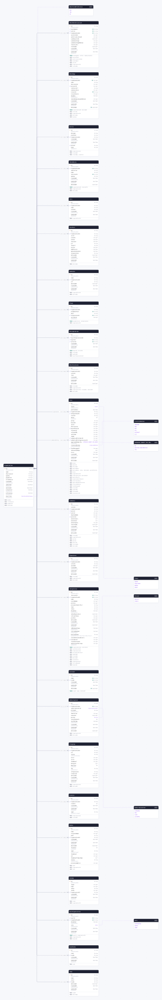

| Field         | Type                                               | Constraints | Default      | Description |
| ------------- | -------------------------------------------------- | ----------- | ------------ | ----------- |
| `id`          | `String`                                           | PK NOT NULL | `uuid(4)`    |             |
| `name`        | `String`                                           | NOT NULL    |              |             |
| `description` | `String`                                           | NULL        |              |             |
| `apiKey`      | `String`                                           | NULL        |              |             |
| `paymentId`   | `String`                                           | NULL        |              |             |
| `streakSince` | `DateTime`                                         | NULL        |              |             |
| `createdAt`   | `DateTime`                                         | NOT NULL    | `now()`      |             |
| `updatedAt`   | `DateTime`                                         | NOT NULL    | `@updatedAt` |             |
| `deletedAt`   | `DateTime`                                         | NULL        |              |             |
| `allowTrial`  | `Boolean`                                          | NOT NULL    | `false`      |             |
| `isTrailing`  | `Boolean`                                          | NOT NULL    | `false`      |             |
| `shortlink`   | [`ShortLinkPreference`](#enum-ShortLinkPreference) | NOT NULL    | `ASK`        |             |

#### Indexes

- `@@index([apiKey])`
- `@@index([streakSince])`
- `@@index([paymentId])`
- `@@index([deletedAt])`

#### Referenced by

- `id` ← [Tags.orgId](#model-Tags) (one-to-many)
- `id` ← [UsedCodes.orgId](#model-UsedCodes) (one-to-many)
- `id` ← [UserOrganization.organizationId](#model-UserOrganization) (one-to-many)
- `id` ← [GitHub.organizationId](#model-GitHub) (one-to-many)
- `id` ← [Media.organizationId](#model-Media) (one-to-many)
- `id` ← [Credits.organizationId](#model-Credits) (one-to-many)
- `id` ← [Clipping.organizationId](#model-Clipping) (one-to-many)
- `id` ← [Subscription.organizationId](#model-Subscription) (one-to-one)
- `id` ← [Customer.orgId](#model-Customer) (one-to-many)
- `id` ← [Integration.organizationId](#model-Integration) (one-to-many)
- `id` ← [Signatures.organizationId](#model-Signatures) (one-to-many)
- `id` ← [Comments.organizationId](#model-Comments) (one-to-many)
- `id` ← [Post.organizationId](#model-Post) (one-to-many)
- `id` ← [Post.submittedForOrganizationId](#model-Post) (one-to-many)
- `id` ← [Notifications.organizationId](#model-Notifications) (one-to-many)
- `id` ← [MessagesGroup.buyerOrganizationId](#model-MessagesGroup) (one-to-many)
- `id` ← [Plugs.organizationId](#model-Plugs) (one-to-many)
- `id` ← [Webhooks.organizationId](#model-Webhooks) (one-to-many)
- `id` ← [AutoPost.organizationId](#model-AutoPost) (one-to-many)
- `id` ← [Sets.organizationId](#model-Sets) (one-to-many)
- `id` ← [ThirdParty.organizationId](#model-ThirdParty) (one-to-many)
- `id` ← [Errors.organizationId](#model-Errors) (one-to-many)
- `id` ← [OAuthApp.organizationId](#model-OAuthApp) (one-to-many)
- `id` ← [OAuthAuthorization.organizationId](#model-OAuthAuthorization) (one-to-many)

#### Definition

```sql
CREATE TABLE "Organization" (
    "id" TEXT NOT NULL,
    "name" TEXT NOT NULL,
    "description" TEXT,
    "apiKey" TEXT,
    "paymentId" TEXT,
    "streakSince" TIMESTAMP(3),
    "createdAt" TIMESTAMP(3) NOT NULL DEFAULT CURRENT_TIMESTAMP,
    "updatedAt" TIMESTAMP(3) NOT NULL,
    "deletedAt" TIMESTAMP(3),
    "allowTrial" BOOLEAN NOT NULL DEFAULT false,
    "isTrailing" BOOLEAN NOT NULL DEFAULT false,
    "shortlink" "ShortLinkPreference" NOT NULL DEFAULT 'ASK',

    CONSTRAINT "Organization_pkey" PRIMARY KEY ("id")
);

CREATE INDEX "Organization_apiKey_idx" ON "Organization"("apiKey");

CREATE INDEX "Organization_streakSince_idx" ON "Organization"("streakSince");

CREATE INDEX "Organization_paymentId_idx" ON "Organization"("paymentId");

CREATE INDEX "Organization_deletedAt_idx" ON "Organization"("deletedAt");
```

<details>
<summary>Queries and their SQL</summary>

**findMany**: Every row

```ts
await prisma.organization.findMany();
```

```sql
SELECT
  "public"."Organization"."id",
  "public"."Organization"."name",
  "public"."Organization"."description",
  "public"."Organization"."apiKey",
  "public"."Organization"."paymentId",
  "public"."Organization"."streakSince",
  "public"."Organization"."createdAt",
  "public"."Organization"."updatedAt",
  "public"."Organization"."deletedAt",
  "public"."Organization"."allowTrial",
  "public"."Organization"."isTrailing",
  "public"."Organization"."shortlink"::text
FROM
  "public"."Organization"
WHERE
  1 = 1
OFFSET
  $1
-- params: ["0"]
```

**count**: How many rows there are

```ts
await prisma.organization.count();
```

```sql
SELECT
  COUNT(*) AS "_count$_all"
FROM
  (
    SELECT
      "public"."Organization"."id"
    FROM
      "public"."Organization"
    WHERE
      1 = 1
    OFFSET
      $1
  ) AS "sub"
-- params: ["0"]
```

**findMany**: Every row with its relations

```ts
await prisma.organization.findMany({
  include: {
    autoPost: true,
    Comments: true,
    credits: true,
    clippings: true,
    customers: true,
    errors: true,
    github: true,
    Integration: true,
    media: true,
    buyerOrganization: true,
    notifications: true,
    plugs: true,
    post: true,
    submittedPost: true,
    sets: true,
    signatures: true,
    subscription: true,
    tags: true,
    thirdParty: true,
    usedCodes: true,
    users: true,
    webhooks: true,
    oauthApp: true,
    oauthAuthorizations: true,
  },
});
```

```sql
SELECT
  "public"."Organization"."id",
  "public"."Organization"."name",
  "public"."Organization"."description",
  "public"."Organization"."apiKey",
  "public"."Organization"."paymentId",
  "public"."Organization"."streakSince",
  "public"."Organization"."createdAt",
  "public"."Organization"."updatedAt",
  "public"."Organization"."deletedAt",
  "public"."Organization"."allowTrial",
  "public"."Organization"."isTrailing",
  "public"."Organization"."shortlink"::text
FROM
  "public"."Organization"
WHERE
  1 = 1
OFFSET
  $1
-- params: ["0"]

SELECT
  "public"."AutoPost"."id",
  "public"."AutoPost"."organizationId",
  "public"."AutoPost"."title",
  "public"."AutoPost"."content",
  "public"."AutoPost"."onSlot",
  "public"."AutoPost"."syncLast",
  "public"."AutoPost"."url",
  "public"."AutoPost"."lastUrl",
  "public"."AutoPost"."active",
  "public"."AutoPost"."addPicture",
  "public"."AutoPost"."generateContent",
  "public"."AutoPost"."integrations",
  "public"."AutoPost"."deletedAt",
  "public"."AutoPost"."createdAt",
  "public"."AutoPost"."updatedAt"
FROM
  "public"."AutoPost"
WHERE
  "public"."AutoPost"."organizationId" IN ($1)
OFFSET
  $2
-- params: ["<id of the rows above>","0"]

SELECT
  "public"."Comments"."id",
  "public"."Comments"."content",
  "public"."Comments"."organizationId",
  "public"."Comments"."postId",
  "public"."Comments"."userId",
  "public"."Comments"."displayName",
  "public"."Comments"."parentId",
  "public"."Comments"."anchorStart",
  "public"."Comments"."anchorEnd",
  "public"."Comments"."anchorQuote",
  "public"."Comments"."resolvedAt",
  "public"."Comments"."createdAt",
  "public"."Comments"."updatedAt",
  "public"."Comments"."deletedAt"
FROM
  "public"."Comments"
WHERE
  "public"."Comments"."organizationId" IN ($1)
OFFSET
  $2
-- params: ["<id of the rows above>","0"]

SELECT
  "public"."Credits"."id",
  "public"."Credits"."organizationId",
  "public"."Credits"."credits",
  "public"."Credits"."createdAt",
  "public"."Credits"."updatedAt",
  "public"."Credits"."type"
FROM
  "public"."Credits"
WHERE
  "public"."Credits"."organizationId" IN ($1)
OFFSET
  $2
-- params: ["<id of the rows above>","0"]

SELECT
  "public"."Clipping"."id",
  "public"."Clipping"."organizationId",
  "public"."Clipping"."url",
  "public"."Clipping"."status",
  "public"."Clipping"."error",
  "public"."Clipping"."title",
  "public"."Clipping"."thumbnail",
  "public"."Clipping"."duration",
  "public"."Clipping"."maxClips",
  "public"."Clipping"."fit",
  "public"."Clipping"."integrations",
  "public"."Clipping"."creditsId",
  "public"."Clipping"."deletedAt",
  "public"."Clipping"."createdAt",
  "public"."Clipping"."updatedAt"
FROM
  "public"."Clipping"
WHERE
  "public"."Clipping"."organizationId" IN ($1)
OFFSET
  $2
-- params: ["<id of the rows above>","0"]

SELECT
  "public"."Customer"."id",
  "public"."Customer"."name",
  "public"."Customer"."orgId",
  "public"."Customer"."createdAt",
  "public"."Customer"."updatedAt",
  "public"."Customer"."deletedAt"
FROM
  "public"."Customer"
WHERE
  "public"."Customer"."orgId" IN ($1)
OFFSET
  $2
-- params: ["<id of the rows above>","0"]

SELECT
  "public"."Errors"."id",
  "public"."Errors"."message",
  "public"."Errors"."platform",
  "public"."Errors"."organizationId",
  "public"."Errors"."createdAt",
  "public"."Errors"."updatedAt",
  "public"."Errors"."postId",
  "public"."Errors"."body"
FROM
  "public"."Errors"
WHERE
  "public"."Errors"."organizationId" IN ($1)
OFFSET
  $2
-- params: ["<id of the rows above>","0"]

SELECT
  "public"."GitHub"."id",
  "public"."GitHub"."login",
  "public"."GitHub"."name",
  "public"."GitHub"."token",
  "public"."GitHub"."jobId",
  "public"."GitHub"."organizationId",
  "public"."GitHub"."createdAt",
  "public"."GitHub"."updatedAt"
FROM
  "public"."GitHub"
WHERE
  "public"."GitHub"."organizationId" IN ($1)
OFFSET
  $2
-- params: ["<id of the rows above>","0"]

SELECT
  "public"."Integration"."id",
  "public"."Integration"."internalId",
  "public"."Integration"."organizationId",
  "public"."Integration"."name",
  "public"."Integration"."customName",
  "public"."Integration"."picture",
  "public"."Integration"."providerIdentifier",
  "public"."Integration"."type",
  "public"."Integration"."token",
  "public"."Integration"."disabled",
  "public"."Integration"."tokenExpiration",
  "public"."Integration"."refreshToken",
  "public"."Integration"."profile",
  "public"."Integration"."deletedAt",
  "public"."Integration"."createdAt",
  "public"."Integration"."updatedAt",
  "public"."Integration"."inBetweenSteps",
  "public"."Integration"."refreshNeeded",
  "public"."Integration"."postingTimes",
  "public"."Integration"."customInstanceDetails",
  "public"."Integration"."customerId",
  "public"."Integration"."rootInternalId",
  "public"."Integration"."additionalSettings"
FROM
  "public"."Integration"
WHERE
  "public"."Integration"."organizationId" IN ($1)
OFFSET
  $2
-- params: ["<id of the rows above>","0"]

SELECT
  "public"."Media"."id",
  "public"."Media"."name",
  "public"."Media"."originalName",
  "public"."Media"."path",
  "public"."Media"."organizationId",
  "public"."Media"."createdAt",
  "public"."Media"."updatedAt",
  "public"."Media"."deletedAt",
  "public"."Media"."fileSize",
  "public"."Media"."type",
  "public"."Media"."thumbnail",
  "public"."Media"."alt",
  "public"."Media"."thumbnailTimestamp",
  "public"."Media"."status",
  "public"."Media"."processingError"
FROM
  "public"."Media"
WHERE
  "public"."Media"."organizationId" IN ($1)
OFFSET
  $2
-- params: ["<id of the rows above>","0"]

SELECT
  "public"."MessagesGroup"."id",
  "public"."MessagesGroup"."buyerOrganizationId",
  "public"."MessagesGroup"."buyerId",
  "public"."MessagesGroup"."sellerId",
  "public"."MessagesGroup"."createdAt",
  "public"."MessagesGroup"."updatedAt"
FROM
  "public"."MessagesGroup"
WHERE
  "public"."MessagesGroup"."buyerOrganizationId" IN ($1)
OFFSET
  $2
-- params: ["<id of the rows above>","0"]

SELECT
  "public"."Notifications"."id",
  "public"."Notifications"."organizationId",
  "public"."Notifications"."content",
  "public"."Notifications"."link",
  "public"."Notifications"."createdAt",
  "public"."Notifications"."updatedAt",
  "public"."Notifications"."deletedAt"
FROM
  "public"."Notifications"
WHERE
  "public"."Notifications"."organizationId" IN ($1)
OFFSET
  $2
-- params: ["<id of the rows above>","0"]

SELECT
  "public"."Plugs"."id",
  "public"."Plugs"."organizationId",
  "public"."Plugs"."plugFunction",
  "public"."Plugs"."data",
  "public"."Plugs"."integrationId",
  "public"."Plugs"."activated"
FROM
  "public"."Plugs"
WHERE
  "public"."Plugs"."organizationId" IN ($1)
OFFSET
  $2
-- params: ["<id of the rows above>","0"]

SELECT
  "public"."Post"."id",
  "public"."Post"."state"::text,
  "public"."Post"."publishDate",
  "public"."Post"."organizationId",
  "public"."Post"."integrationId",
  "public"."Post"."content",
  "public"."Post"."delay",
  "public"."Post"."group",
  "public"."Post"."batchId",
  "public"."Post"."title",
  "public"."Post"."description",
  "public"."Post"."parentPostId",
  "public"."Post"."releaseId",
  "public"."Post"."releaseURL",
  "public"."Post"."settings",
  "public"."Post"."image",
  "public"."Post"."submittedForOrderId",
  "public"."Post"."submittedForOrganizationId",
  "public"."Post"."approvedSubmitForOrder"::text,
  "public"."Post"."creationMethod"::text,
  "public"."Post"."lastMessageId",
  "public"."Post"."intervalInDays",
  "public"."Post"."error",
  "public"."Post"."createdAt",
  "public"."Post"."updatedAt",
  "public"."Post"."deletedAt"
FROM
  "public"."Post"
WHERE
  "public"."Post"."organizationId" IN ($1)
OFFSET
  $2
-- params: ["<id of the rows above>","0"]

SELECT
  "public"."Post"."id",
  "public"."Post"."state"::text,
  "public"."Post"."publishDate",
  "public"."Post"."organizationId",
  "public"."Post"."integrationId",
  "public"."Post"."content",
  "public"."Post"."delay",
  "public"."Post"."group",
  "public"."Post"."batchId",
  "public"."Post"."title",
  "public"."Post"."description",
  "public"."Post"."parentPostId",
  "public"."Post"."releaseId",
  "public"."Post"."releaseURL",
  "public"."Post"."settings",
  "public"."Post"."image",
  "public"."Post"."submittedForOrderId",
  "public"."Post"."submittedForOrganizationId",
  "public"."Post"."approvedSubmitForOrder"::text,
  "public"."Post"."creationMethod"::text,
  "public"."Post"."lastMessageId",
  "public"."Post"."intervalInDays",
  "public"."Post"."error",
  "public"."Post"."createdAt",
  "public"."Post"."updatedAt",
  "public"."Post"."deletedAt"
FROM
  "public"."Post"
WHERE
  "public"."Post"."submittedForOrganizationId" IN ($1)
OFFSET
  $2
-- params: ["<id of the rows above>","0"]

SELECT
  "public"."Sets"."id",
  "public"."Sets"."organizationId",
  "public"."Sets"."name",
  "public"."Sets"."content",
  "public"."Sets"."createdAt",
  "public"."Sets"."updatedAt"
FROM
  "public"."Sets"
WHERE
  "public"."Sets"."organizationId" IN ($1)
OFFSET
  $2
-- params: ["<id of the rows above>","0"]

SELECT
  "public"."Signatures"."id",
  "public"."Signatures"."organizationId",
  "public"."Signatures"."content",
  "public"."Signatures"."autoAdd",
  "public"."Signatures"."createdAt",
  "public"."Signatures"."updatedAt",
  "public"."Signatures"."deletedAt"
FROM
  "public"."Signatures"
WHERE
  "public"."Signatures"."organizationId" IN ($1)
OFFSET
  $2
-- params: ["<id of the rows above>","0"]

SELECT
  "public"."Subscription"."id",
  "public"."Subscription"."organizationId",
  "public"."Subscription"."subscriptionTier"::text,
  "public"."Subscription"."provider",
  "public"."Subscription"."identifier",
  "public"."Subscription"."cancelAt",
  "public"."Subscription"."period"::text,
  "public"."Subscription"."totalChannels",
  "public"."Subscription"."isLifetime",
  "public"."Subscription"."createdAt",
  "public"."Subscription"."updatedAt",
  "public"."Subscription"."deletedAt"
FROM
  "public"."Subscription"
WHERE
  "public"."Subscription"."organizationId" IN ($1)
OFFSET
  $2
-- params: ["<id of the rows above>","0"]

SELECT
  "public"."Tags"."id",
  "public"."Tags"."name",
  "public"."Tags"."color",
  "public"."Tags"."orgId",
  "public"."Tags"."deletedAt",
  "public"."Tags"."createdAt",
  "public"."Tags"."updatedAt"
FROM
  "public"."Tags"
WHERE
  "public"."Tags"."orgId" IN ($1)
OFFSET
  $2
-- params: ["<id of the rows above>","0"]

SELECT
  "public"."ThirdParty"."id",
  "public"."ThirdParty"."organizationId",
  "public"."ThirdParty"."identifier",
  "public"."ThirdParty"."name",
  "public"."ThirdParty"."internalId",
  "public"."ThirdParty"."apiKey",
  "public"."ThirdParty"."createdAt",
  "public"."ThirdParty"."updatedAt",
  "public"."ThirdParty"."deletedAt"
FROM
  "public"."ThirdParty"
WHERE
  "public"."ThirdParty"."organizationId" IN ($1)
OFFSET
  $2
-- params: ["<id of the rows above>","0"]

SELECT
  "public"."UsedCodes"."id",
  "public"."UsedCodes"."code",
  "public"."UsedCodes"."orgId",
  "public"."UsedCodes"."createdAt",
  "public"."UsedCodes"."updatedAt"
FROM
  "public"."UsedCodes"
WHERE
  "public"."UsedCodes"."orgId" IN ($1)
OFFSET
  $2
-- params: ["<id of the rows above>","0"]

SELECT
  "public"."UserOrganization"."id",
  "public"."UserOrganization"."userId",
  "public"."UserOrganization"."organizationId",
  "public"."UserOrganization"."disabled",
  "public"."UserOrganization"."role"::text,
  "public"."UserOrganization"."createdAt",
  "public"."UserOrganization"."updatedAt"
FROM
  "public"."UserOrganization"
WHERE
  "public"."UserOrganization"."organizationId" IN ($1)
OFFSET
  $2
-- params: ["<id of the rows above>","0"]

SELECT
  "public"."Webhooks"."id",
  "public"."Webhooks"."name",
  "public"."Webhooks"."organizationId",
  "public"."Webhooks"."url",
  "public"."Webhooks"."deletedAt",
  "public"."Webhooks"."createdAt",
  "public"."Webhooks"."updatedAt"
FROM
  "public"."Webhooks"
WHERE
  "public"."Webhooks"."organizationId" IN ($1)
OFFSET
  $2
-- params: ["<id of the rows above>","0"]

SELECT
  "public"."OAuthApp"."id",
  "public"."OAuthApp"."organizationId",
  "public"."OAuthApp"."name",
  "public"."OAuthApp"."description",
  "public"."OAuthApp"."pictureId",
  "public"."OAuthApp"."redirectUrl",
  "public"."OAuthApp"."redirectUris",
  "public"."OAuthApp"."clientId",
  "public"."OAuthApp"."clientSecret",
  "public"."OAuthApp"."dynamic",
  "public"."OAuthApp"."tokenEndpointAuthMethod",
  "public"."OAuthApp"."createdAt",
  "public"."OAuthApp"."updatedAt",
  "public"."OAuthApp"."deletedAt"
FROM
  "public"."OAuthApp"
WHERE
  "public"."OAuthApp"."organizationId" IN ($1)
OFFSET
  $2
-- params: ["<id of the rows above>","0"]

SELECT
  "public"."OAuthAuthorization"."id",
  "public"."OAuthAuthorization"."oauthAppId",
  "public"."OAuthAuthorization"."userId",
  "public"."OAuthAuthorization"."organizationId",
  "public"."OAuthAuthorization"."accessToken",
  "public"."OAuthAuthorization"."authorizationCode",
  "public"."OAuthAuthorization"."codeExpiresAt",
  "public"."OAuthAuthorization"."codeChallenge",
  "public"."OAuthAuthorization"."codeChallengeMethod",
  "public"."OAuthAuthorization"."redirectUri",
  "public"."OAuthAuthorization"."revokedAt",
  "public"."OAuthAuthorization"."createdAt",
  "public"."OAuthAuthorization"."updatedAt"
FROM
  "public"."OAuthAuthorization"
WHERE
  "public"."OAuthAuthorization"."organizationId" IN ($1)
OFFSET
  $2
-- params: ["<id of the rows above>","0"]
```

**findUnique**: One row by what is unique to it

```ts
await prisma.organization.findUnique({ where: { id: "example" } });
```

```sql
SELECT
  "public"."Organization"."id",
  "public"."Organization"."name",
  "public"."Organization"."description",
  "public"."Organization"."apiKey",
  "public"."Organization"."paymentId",
  "public"."Organization"."streakSince",
  "public"."Organization"."createdAt",
  "public"."Organization"."updatedAt",
  "public"."Organization"."deletedAt",
  "public"."Organization"."allowTrial",
  "public"."Organization"."isTrailing",
  "public"."Organization"."shortlink"::text
FROM
  "public"."Organization"
WHERE
  (
    "public"."Organization"."id" = $1
    AND 1 = 1
  )
LIMIT
  $2
OFFSET
  $3
-- params: ["example","1","0"]
```

**create**: Create a row

```ts
await prisma.organization.create({ data: { name: "example" } });
```

```sql
INSERT INTO
  "public"."Organization" (
    "id",
    "name",
    "createdAt",
    "updatedAt",
    "allowTrial",
    "isTrailing",
    "shortlink"
  )
VALUES
  (
    $1,
    $2,
    $3,
    $4,
    $5,
    $6,
    CAST($7::text AS "public"."ShortLinkPreference")
  )
RETURNING
  "public"."Organization"."id",
  "public"."Organization"."name",
  "public"."Organization"."description",
  "public"."Organization"."apiKey",
  "public"."Organization"."paymentId",
  "public"."Organization"."streakSince",
  "public"."Organization"."createdAt",
  "public"."Organization"."updatedAt",
  "public"."Organization"."deletedAt",
  "public"."Organization"."allowTrial",
  "public"."Organization"."isTrailing",
  "public"."Organization"."shortlink"::text
-- params: ["<uuid(4)>","example","<now()>","<now()>",false,false,"ASK"]
```

**update**: Update a row

```ts
await prisma.organization.update({ where: { id: "example" }, data: { name: "example" } });
```

```sql
UPDATE "public"."Organization"
SET
  "name" = $1,
  "updatedAt" = $2
WHERE
  (
    "public"."Organization"."id" = $3
    AND 1 = 1
  )
RETURNING
  "public"."Organization"."id",
  "public"."Organization"."name",
  "public"."Organization"."description",
  "public"."Organization"."apiKey",
  "public"."Organization"."paymentId",
  "public"."Organization"."streakSince",
  "public"."Organization"."createdAt",
  "public"."Organization"."updatedAt",
  "public"."Organization"."deletedAt",
  "public"."Organization"."allowTrial",
  "public"."Organization"."isTrailing",
  "public"."Organization"."shortlink"::text
-- params: ["example",{"prisma__type":"generatorCall","prisma__value":{"name":"now","args":[],"returnType":{"type":"DateTime"}}},"example"]
```

**delete**: Delete a row

```ts
await prisma.organization.delete({ where: { id: "example" } });
```

```sql
DELETE FROM "public"."Organization"
WHERE
  (
    "public"."Organization"."id" = $1
    AND 1 = 1
  )
RETURNING
  "public"."Organization"."id",
  "public"."Organization"."name",
  "public"."Organization"."description",
  "public"."Organization"."apiKey",
  "public"."Organization"."paymentId",
  "public"."Organization"."streakSince",
  "public"."Organization"."createdAt",
  "public"."Organization"."updatedAt",
  "public"."Organization"."deletedAt",
  "public"."Organization"."allowTrial",
  "public"."Organization"."isTrailing",
  "public"."Organization"."shortlink"::text
-- params: ["example"]
```

</details>

<a id="model-Tags"></a>

### Tags

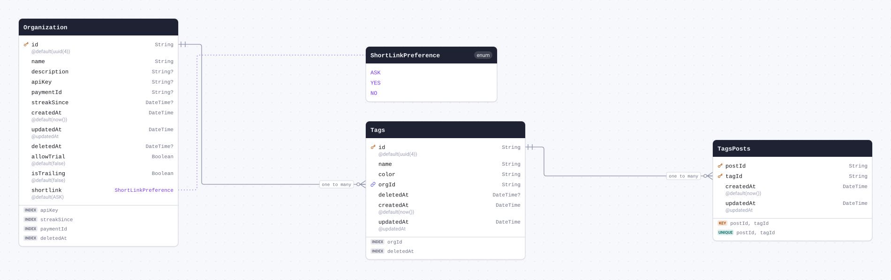

| Field       | Type       | Constraints                                       | Default      | Description |
| ----------- | ---------- | ------------------------------------------------- | ------------ | ----------- |
| `id`        | `String`   | PK NOT NULL                                       | `uuid(4)`    |             |
| `name`      | `String`   | NOT NULL                                          |              |             |
| `color`     | `String`   | NOT NULL                                          |              |             |
| `orgId`     | `String`   | NOT NULL → [Organization.id](#model-Organization) |              |             |
| `deletedAt` | `DateTime` | NULL                                              |              |             |
| `createdAt` | `DateTime` | NOT NULL                                          | `now()`      |             |
| `updatedAt` | `DateTime` | NOT NULL                                          | `@updatedAt` |             |

#### Indexes

- `@@index([orgId])`
- `@@index([deletedAt])`

#### References

- `orgId` → [Organization.id](#model-Organization) (many-to-one)

#### Referenced by

- `id` ← [TagsPosts.tagId](#model-TagsPosts) (one-to-many)

#### Definition

```sql
CREATE TABLE "Tags" (
    "id" TEXT NOT NULL,
    "name" TEXT NOT NULL,
    "color" TEXT NOT NULL,
    "orgId" TEXT NOT NULL,
    "deletedAt" TIMESTAMP(3),
    "createdAt" TIMESTAMP(3) NOT NULL DEFAULT CURRENT_TIMESTAMP,
    "updatedAt" TIMESTAMP(3) NOT NULL,

    CONSTRAINT "Tags_pkey" PRIMARY KEY ("id")
);

CREATE INDEX "Tags_orgId_idx" ON "Tags"("orgId");

CREATE INDEX "Tags_deletedAt_idx" ON "Tags"("deletedAt");

ALTER TABLE "Tags" ADD CONSTRAINT "Tags_orgId_fkey" FOREIGN KEY ("orgId") REFERENCES "Organization"("id") ON DELETE RESTRICT ON UPDATE CASCADE;
```

<details>
<summary>Queries and their SQL</summary>

**findMany**: Every row

```ts
await prisma.tags.findMany();
```

```sql
SELECT
  "public"."Tags"."id",
  "public"."Tags"."name",
  "public"."Tags"."color",
  "public"."Tags"."orgId",
  "public"."Tags"."deletedAt",
  "public"."Tags"."createdAt",
  "public"."Tags"."updatedAt"
FROM
  "public"."Tags"
WHERE
  1 = 1
OFFSET
  $1
-- params: ["0"]
```

**count**: How many rows there are

```ts
await prisma.tags.count();
```

```sql
SELECT
  COUNT(*) AS "_count$_all"
FROM
  (
    SELECT
      "public"."Tags"."id"
    FROM
      "public"."Tags"
    WHERE
      1 = 1
    OFFSET
      $1
  ) AS "sub"
-- params: ["0"]
```

**findMany**: Every row with its relations

```ts
await prisma.tags.findMany({ include: { organization: true, posts: true } });
```

```sql
SELECT
  "public"."Tags"."id",
  "public"."Tags"."name",
  "public"."Tags"."color",
  "public"."Tags"."orgId",
  "public"."Tags"."deletedAt",
  "public"."Tags"."createdAt",
  "public"."Tags"."updatedAt"
FROM
  "public"."Tags"
WHERE
  1 = 1
OFFSET
  $1
-- params: ["0"]

SELECT
  "public"."Organization"."id",
  "public"."Organization"."name",
  "public"."Organization"."description",
  "public"."Organization"."apiKey",
  "public"."Organization"."paymentId",
  "public"."Organization"."streakSince",
  "public"."Organization"."createdAt",
  "public"."Organization"."updatedAt",
  "public"."Organization"."deletedAt",
  "public"."Organization"."allowTrial",
  "public"."Organization"."isTrailing",
  "public"."Organization"."shortlink"::text
FROM
  "public"."Organization"
WHERE
  "public"."Organization"."id" IN ($1)
OFFSET
  $2
-- params: ["<orgId of the rows above>","0"]

SELECT
  "public"."TagsPosts"."postId",
  "public"."TagsPosts"."tagId",
  "public"."TagsPosts"."createdAt",
  "public"."TagsPosts"."updatedAt"
FROM
  "public"."TagsPosts"
WHERE
  "public"."TagsPosts"."tagId" IN ($1)
OFFSET
  $2
-- params: ["<id of the rows above>","0"]
```

**findUnique**: One row by what is unique to it

```ts
await prisma.tags.findUnique({ where: { id: "example" } });
```

```sql
SELECT
  "public"."Tags"."id",
  "public"."Tags"."name",
  "public"."Tags"."color",
  "public"."Tags"."orgId",
  "public"."Tags"."deletedAt",
  "public"."Tags"."createdAt",
  "public"."Tags"."updatedAt"
FROM
  "public"."Tags"
WHERE
  (
    "public"."Tags"."id" = $1
    AND 1 = 1
  )
LIMIT
  $2
OFFSET
  $3
-- params: ["example","1","0"]
```

**create**: Create a row

```ts
await prisma.tags.create({ data: { name: "example", color: "example", orgId: "example" } });
```

```sql
INSERT INTO
  "public"."Tags" (
    "id",
    "name",
    "color",
    "orgId",
    "createdAt",
    "updatedAt"
  )
VALUES
  ($1, $2, $3, $4, $5, $6)
RETURNING
  "public"."Tags"."id",
  "public"."Tags"."name",
  "public"."Tags"."color",
  "public"."Tags"."orgId",
  "public"."Tags"."deletedAt",
  "public"."Tags"."createdAt",
  "public"."Tags"."updatedAt"
-- params: ["<uuid(4)>","example","example","example","<now()>","<now()>"]
```

**update**: Update a row

```ts
await prisma.tags.update({ where: { id: "example" }, data: { name: "example" } });
```

```sql
UPDATE "public"."Tags"
SET
  "name" = $1,
  "updatedAt" = $2
WHERE
  (
    "public"."Tags"."id" = $3
    AND 1 = 1
  )
RETURNING
  "public"."Tags"."id",
  "public"."Tags"."name",
  "public"."Tags"."color",
  "public"."Tags"."orgId",
  "public"."Tags"."deletedAt",
  "public"."Tags"."createdAt",
  "public"."Tags"."updatedAt"
-- params: ["example",{"prisma__type":"generatorCall","prisma__value":{"name":"now","args":[],"returnType":{"type":"DateTime"}}},"example"]
```

**delete**: Delete a row

```ts
await prisma.tags.delete({ where: { id: "example" } });
```

```sql
DELETE FROM "public"."Tags"
WHERE
  (
    "public"."Tags"."id" = $1
    AND 1 = 1
  )
RETURNING
  "public"."Tags"."id",
  "public"."Tags"."name",
  "public"."Tags"."color",
  "public"."Tags"."orgId",
  "public"."Tags"."deletedAt",
  "public"."Tags"."createdAt",
  "public"."Tags"."updatedAt"
-- params: ["example"]
```

</details>

<a id="model-TagsPosts"></a>

### TagsPosts

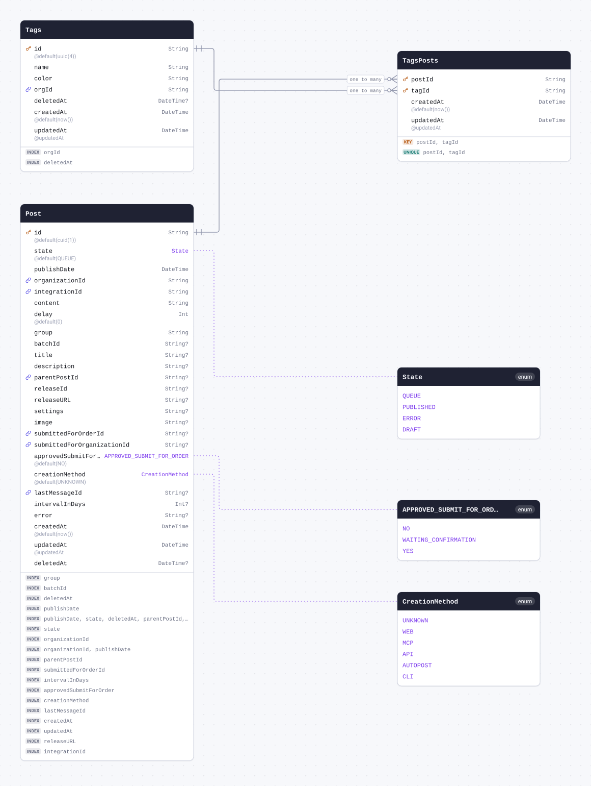

| Field       | Type       | Constraints                          | Default      | Description |
| ----------- | ---------- | ------------------------------------ | ------------ | ----------- |
| `postId`    | `String`   | PK NOT NULL → [Post.id](#model-Post) |              |             |
| `tagId`     | `String`   | PK NOT NULL → [Tags.id](#model-Tags) |              |             |
| `createdAt` | `DateTime` | NOT NULL                             | `now()`      |             |
| `updatedAt` | `DateTime` | NOT NULL                             | `@updatedAt` |             |

#### Indexes

- `@@id([postId, tagId])`
- `@@unique([postId, tagId])`

#### References

- `postId` → [Post.id](#model-Post) (many-to-one)
- `tagId` → [Tags.id](#model-Tags) (many-to-one)

#### Definition

```sql
CREATE TABLE "TagsPosts" (
    "postId" TEXT NOT NULL,
    "tagId" TEXT NOT NULL,
    "createdAt" TIMESTAMP(3) NOT NULL DEFAULT CURRENT_TIMESTAMP,
    "updatedAt" TIMESTAMP(3) NOT NULL,

    CONSTRAINT "TagsPosts_pkey" PRIMARY KEY ("postId","tagId")
);

CREATE UNIQUE INDEX "TagsPosts_postId_tagId_key" ON "TagsPosts"("postId", "tagId");

ALTER TABLE "TagsPosts" ADD CONSTRAINT "TagsPosts_postId_fkey" FOREIGN KEY ("postId") REFERENCES "Post"("id") ON DELETE RESTRICT ON UPDATE CASCADE;

ALTER TABLE "TagsPosts" ADD CONSTRAINT "TagsPosts_tagId_fkey" FOREIGN KEY ("tagId") REFERENCES "Tags"("id") ON DELETE RESTRICT ON UPDATE CASCADE;
```

<details>
<summary>Queries and their SQL</summary>

**findMany**: Every row

```ts
await prisma.tagsPosts.findMany();
```

```sql
SELECT
  "public"."TagsPosts"."postId",
  "public"."TagsPosts"."tagId",
  "public"."TagsPosts"."createdAt",
  "public"."TagsPosts"."updatedAt"
FROM
  "public"."TagsPosts"
WHERE
  1 = 1
OFFSET
  $1
-- params: ["0"]
```

**count**: How many rows there are

```ts
await prisma.tagsPosts.count();
```

```sql
SELECT
  COUNT(*) AS "_count$_all"
FROM
  (
    SELECT
      "public"."TagsPosts"."postId",
      "public"."TagsPosts"."tagId"
    FROM
      "public"."TagsPosts"
    WHERE
      1 = 1
    OFFSET
      $1
  ) AS "sub"
-- params: ["0"]
```

**findMany**: Every row with its relations

```ts
await prisma.tagsPosts.findMany({ include: { post: true, tag: true } });
```

```sql
SELECT
  "public"."TagsPosts"."postId",
  "public"."TagsPosts"."tagId",
  "public"."TagsPosts"."createdAt",
  "public"."TagsPosts"."updatedAt"
FROM
  "public"."TagsPosts"
WHERE
  1 = 1
OFFSET
  $1
-- params: ["0"]

SELECT
  "public"."Post"."id",
  "public"."Post"."state"::text,
  "public"."Post"."publishDate",
  "public"."Post"."organizationId",
  "public"."Post"."integrationId",
  "public"."Post"."content",
  "public"."Post"."delay",
  "public"."Post"."group",
  "public"."Post"."batchId",
  "public"."Post"."title",
  "public"."Post"."description",
  "public"."Post"."parentPostId",
  "public"."Post"."releaseId",
  "public"."Post"."releaseURL",
  "public"."Post"."settings",
  "public"."Post"."image",
  "public"."Post"."submittedForOrderId",
  "public"."Post"."submittedForOrganizationId",
  "public"."Post"."approvedSubmitForOrder"::text,
  "public"."Post"."creationMethod"::text,
  "public"."Post"."lastMessageId",
  "public"."Post"."intervalInDays",
  "public"."Post"."error",
  "public"."Post"."createdAt",
  "public"."Post"."updatedAt",
  "public"."Post"."deletedAt"
FROM
  "public"."Post"
WHERE
  "public"."Post"."id" IN ($1)
OFFSET
  $2
-- params: ["<postId of the rows above>","0"]

SELECT
  "public"."Tags"."id",
  "public"."Tags"."name",
  "public"."Tags"."color",
  "public"."Tags"."orgId",
  "public"."Tags"."deletedAt",
  "public"."Tags"."createdAt",
  "public"."Tags"."updatedAt"
FROM
  "public"."Tags"
WHERE
  "public"."Tags"."id" IN ($1)
OFFSET
  $2
-- params: ["<tagId of the rows above>","0"]
```

**findUnique**: One row by what is unique to it

```ts
await prisma.tagsPosts.findUnique({
  where: { postId_tagId: { postId: "example", tagId: "example" } },
});
```

```sql
SELECT
  "public"."TagsPosts"."postId",
  "public"."TagsPosts"."tagId",
  "public"."TagsPosts"."createdAt",
  "public"."TagsPosts"."updatedAt"
FROM
  "public"."TagsPosts"
WHERE
  (
    (
      "public"."TagsPosts"."postId" = $1
      AND "public"."TagsPosts"."tagId" = $2
    )
    AND 1 = 1
  )
LIMIT
  $3
OFFSET
  $4
-- params: ["example","example","1","0"]
```

**create**: Create a row

```ts
await prisma.tagsPosts.create({ data: { postId: "example", tagId: "example" } });
```

```sql
INSERT INTO
  "public"."TagsPosts" ("postId", "tagId", "createdAt", "updatedAt")
VALUES
  ($1, $2, $3, $4)
RETURNING
  "public"."TagsPosts"."postId",
  "public"."TagsPosts"."tagId",
  "public"."TagsPosts"."createdAt",
  "public"."TagsPosts"."updatedAt"
-- params: ["example","example","<now()>","<now()>"]
```

**update**: Update a row

```ts
await prisma.tagsPosts.update({
  where: { postId_tagId: { postId: "example", tagId: "example" } },
  data: { createdAt: new Date("2026-01-01T00:00:00.000Z") },
});
```

```sql
UPDATE "public"."TagsPosts"
SET
  "createdAt" = $1,
  "updatedAt" = $2
WHERE
  (
    (
      "public"."TagsPosts"."postId" = $3
      AND "public"."TagsPosts"."tagId" = $4
    )
    AND 1 = 1
  )
RETURNING
  "public"."TagsPosts"."postId",
  "public"."TagsPosts"."tagId",
  "public"."TagsPosts"."createdAt",
  "public"."TagsPosts"."updatedAt"
-- params: ["2026-01-01T00:00:00.000Z",{"prisma__type":"generatorCall","prisma__value":{"name":"now","args":[],"returnType":{"type":"DateTime"}}},"example","example"]
```

**delete**: Delete a row

```ts
await prisma.tagsPosts.delete({ where: { postId_tagId: { postId: "example", tagId: "example" } } });
```

```sql
DELETE FROM "public"."TagsPosts"
WHERE
  (
    (
      "public"."TagsPosts"."postId" = $1
      AND "public"."TagsPosts"."tagId" = $2
    )
    AND 1 = 1
  )
RETURNING
  "public"."TagsPosts"."postId",
  "public"."TagsPosts"."tagId",
  "public"."TagsPosts"."createdAt",
  "public"."TagsPosts"."updatedAt"
-- params: ["example","example"]
```

</details>

<a id="model-User"></a>

### User

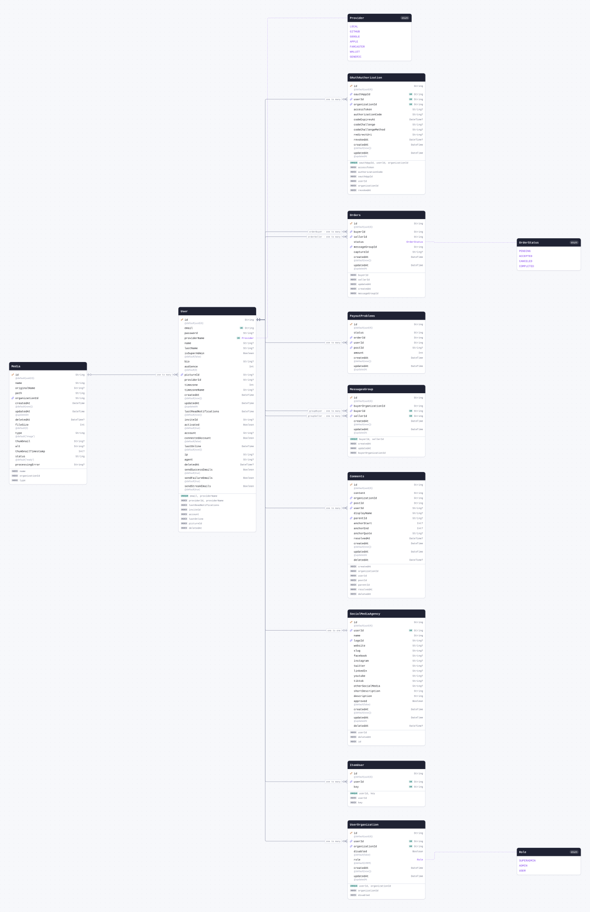

| Field                   | Type                         | Constraints                     | Default      | Description |
| ----------------------- | ---------------------------- | ------------------------------- | ------------ | ----------- |
| `id`                    | `String`                     | PK NOT NULL                     | `uuid(4)`    |             |
| `email`                 | `String`                     | NOT NULL                        |              |             |
| `password`              | `String`                     | NULL                            |              |             |
| `providerName`          | [`Provider`](#enum-Provider) | NOT NULL                        |              |             |
| `name`                  | `String`                     | NULL                            |              |             |
| `lastName`              | `String`                     | NULL                            |              |             |
| `isSuperAdmin`          | `Boolean`                    | NOT NULL                        | `false`      |             |
| `bio`                   | `String`                     | NULL                            |              |             |
| `audience`              | `Int`                        | NOT NULL                        | `0`          |             |
| `pictureId`             | `String`                     | NULL → [Media.id](#model-Media) |              |             |
| `providerId`            | `String`                     | NULL                            |              |             |
| `timezone`              | `Int`                        | NOT NULL                        |              |             |
| `timezoneName`          | `String`                     | NULL                            |              |             |
| `createdAt`             | `DateTime`                   | NOT NULL                        | `now()`      |             |
| `updatedAt`             | `DateTime`                   | NOT NULL                        | `@updatedAt` |             |
| `lastReadNotifications` | `DateTime`                   | NOT NULL                        | `now()`      |             |
| `inviteId`              | `String`                     | NULL                            |              |             |
| `activated`             | `Boolean`                    | NOT NULL                        | `true`       |             |
| `account`               | `String`                     | NULL                            |              |             |
| `connectedAccount`      | `Boolean`                    | NOT NULL                        | `false`      |             |
| `lastOnline`            | `DateTime`                   | NOT NULL                        | `now()`      |             |
| `ip`                    | `String`                     | NULL                            |              |             |
| `agent`                 | `String`                     | NULL                            |              |             |
| `deletedAt`             | `DateTime`                   | NULL                            |              |             |
| `sendSuccessEmails`     | `Boolean`                    | NOT NULL                        | `true`       |             |
| `sendFailureEmails`     | `Boolean`                    | NOT NULL                        | `true`       |             |
| `sendStreakEmails`      | `Boolean`                    | NOT NULL                        | `true`       |             |

#### Indexes

- `@@index([providerId, providerName])`
- `@@index([lastReadNotifications])`
- `@@index([inviteId])`
- `@@index([account])`
- `@@index([lastOnline])`
- `@@index([pictureId])`
- `@@index([deletedAt])`
- `@@unique([email, providerName])`

#### References

- `pictureId` → [Media.id](#model-Media) (many-to-one)

#### Referenced by

- `id` ← [UserOrganization.userId](#model-UserOrganization) (one-to-many)
- `id` ← [ItemUser.userId](#model-ItemUser) (one-to-many)
- `id` ← [SocialMediaAgency.userId](#model-SocialMediaAgency) (one-to-one)
- `id` ← [Comments.userId](#model-Comments) (one-to-many)
- `id` ← [MessagesGroup.buyerId](#model-MessagesGroup) (one-to-many)
- `id` ← [MessagesGroup.sellerId](#model-MessagesGroup) (one-to-many)
- `id` ← [PayoutProblems.userId](#model-PayoutProblems) (one-to-many)
- `id` ← [Orders.buyerId](#model-Orders) (one-to-many)
- `id` ← [Orders.sellerId](#model-Orders) (one-to-many)
- `id` ← [OAuthAuthorization.userId](#model-OAuthAuthorization) (one-to-many)

#### Definition

```sql
CREATE TABLE "User" (
    "id" TEXT NOT NULL,
    "email" TEXT NOT NULL,
    "password" TEXT,
    "providerName" "Provider" NOT NULL,
    "name" TEXT,
    "lastName" TEXT,
    "isSuperAdmin" BOOLEAN NOT NULL DEFAULT false,
    "bio" TEXT,
    "audience" INTEGER NOT NULL DEFAULT 0,
    "pictureId" TEXT,
    "providerId" TEXT,
    "timezone" INTEGER NOT NULL,
    "timezoneName" TEXT,
    "createdAt" TIMESTAMP(3) NOT NULL DEFAULT CURRENT_TIMESTAMP,
    "updatedAt" TIMESTAMP(3) NOT NULL,
    "lastReadNotifications" TIMESTAMP(3) NOT NULL DEFAULT CURRENT_TIMESTAMP,
    "inviteId" TEXT,
    "activated" BOOLEAN NOT NULL DEFAULT true,
    "account" TEXT,
    "connectedAccount" BOOLEAN NOT NULL DEFAULT false,
    "lastOnline" TIMESTAMP(3) NOT NULL DEFAULT CURRENT_TIMESTAMP,
    "ip" TEXT,
    "agent" TEXT,
    "deletedAt" TIMESTAMP(3),
    "sendSuccessEmails" BOOLEAN NOT NULL DEFAULT true,
    "sendFailureEmails" BOOLEAN NOT NULL DEFAULT true,
    "sendStreakEmails" BOOLEAN NOT NULL DEFAULT true,

    CONSTRAINT "User_pkey" PRIMARY KEY ("id")
);

CREATE INDEX "User_providerId_providerName_idx" ON "User"("providerId", "providerName");

CREATE INDEX "User_lastReadNotifications_idx" ON "User"("lastReadNotifications");

CREATE INDEX "User_inviteId_idx" ON "User"("inviteId");

CREATE INDEX "User_account_idx" ON "User"("account");

CREATE INDEX "User_lastOnline_idx" ON "User"("lastOnline");

CREATE INDEX "User_pictureId_idx" ON "User"("pictureId");

CREATE INDEX "User_deletedAt_idx" ON "User"("deletedAt");

CREATE UNIQUE INDEX "User_email_providerName_key" ON "User"("email", "providerName");

ALTER TABLE "User" ADD CONSTRAINT "User_pictureId_fkey" FOREIGN KEY ("pictureId") REFERENCES "Media"("id") ON DELETE SET NULL ON UPDATE CASCADE;
```

<details>
<summary>Queries and their SQL</summary>

**findMany**: Every row

```ts
await prisma.user.findMany();
```

```sql
SELECT
  "public"."User"."id",
  "public"."User"."email",
  "public"."User"."password",
  "public"."User"."providerName"::text,
  "public"."User"."name",
  "public"."User"."lastName",
  "public"."User"."isSuperAdmin",
  "public"."User"."bio",
  "public"."User"."audience",
  "public"."User"."pictureId",
  "public"."User"."providerId",
  "public"."User"."timezone",
  "public"."User"."timezoneName",
  "public"."User"."createdAt",
  "public"."User"."updatedAt",
  "public"."User"."lastReadNotifications",
  "public"."User"."inviteId",
  "public"."User"."activated",
  "public"."User"."account",
  "public"."User"."connectedAccount",
  "public"."User"."lastOnline",
  "public"."User"."ip",
  "public"."User"."agent",
  "public"."User"."deletedAt",
  "public"."User"."sendSuccessEmails",
  "public"."User"."sendFailureEmails",
  "public"."User"."sendStreakEmails"
FROM
  "public"."User"
WHERE
  1 = 1
OFFSET
  $1
-- params: ["0"]
```

**count**: How many rows there are

```ts
await prisma.user.count();
```

```sql
SELECT
  COUNT(*) AS "_count$_all"
FROM
  (
    SELECT
      "public"."User"."id"
    FROM
      "public"."User"
    WHERE
      1 = 1
    OFFSET
      $1
  ) AS "sub"
-- params: ["0"]
```

**findMany**: Every row with its relations

```ts
await prisma.user.findMany({
  include: {
    comments: true,
    items: true,
    groupBuyer: true,
    groupSeller: true,
    orderBuyer: true,
    orderSeller: true,
    payoutProblems: true,
    agencies: true,
    picture: true,
    organizations: true,
    oauthAuthorizations: true,
  },
});
```

```sql
SELECT
  "public"."User"."id",
  "public"."User"."email",
  "public"."User"."password",
  "public"."User"."providerName"::text,
  "public"."User"."name",
  "public"."User"."lastName",
  "public"."User"."isSuperAdmin",
  "public"."User"."bio",
  "public"."User"."audience",
  "public"."User"."pictureId",
  "public"."User"."providerId",
  "public"."User"."timezone",
  "public"."User"."timezoneName",
  "public"."User"."createdAt",
  "public"."User"."updatedAt",
  "public"."User"."lastReadNotifications",
  "public"."User"."inviteId",
  "public"."User"."activated",
  "public"."User"."account",
  "public"."User"."connectedAccount",
  "public"."User"."lastOnline",
  "public"."User"."ip",
  "public"."User"."agent",
  "public"."User"."deletedAt",
  "public"."User"."sendSuccessEmails",
  "public"."User"."sendFailureEmails",
  "public"."User"."sendStreakEmails"
FROM
  "public"."User"
WHERE
  1 = 1
OFFSET
  $1
-- params: ["0"]

SELECT
  "public"."Comments"."id",
  "public"."Comments"."content",
  "public"."Comments"."organizationId",
  "public"."Comments"."postId",
  "public"."Comments"."userId",
  "public"."Comments"."displayName",
  "public"."Comments"."parentId",
  "public"."Comments"."anchorStart",
  "public"."Comments"."anchorEnd",
  "public"."Comments"."anchorQuote",
  "public"."Comments"."resolvedAt",
  "public"."Comments"."createdAt",
  "public"."Comments"."updatedAt",
  "public"."Comments"."deletedAt"
FROM
  "public"."Comments"
WHERE
  "public"."Comments"."userId" IN ($1)
OFFSET
  $2
-- params: ["<id of the rows above>","0"]

SELECT
  "public"."ItemUser"."id",
  "public"."ItemUser"."userId",
  "public"."ItemUser"."key"
FROM
  "public"."ItemUser"
WHERE
  "public"."ItemUser"."userId" IN ($1)
OFFSET
  $2
-- params: ["<id of the rows above>","0"]

SELECT
  "public"."MessagesGroup"."id",
  "public"."MessagesGroup"."buyerOrganizationId",
  "public"."MessagesGroup"."buyerId",
  "public"."MessagesGroup"."sellerId",
  "public"."MessagesGroup"."createdAt",
  "public"."MessagesGroup"."updatedAt"
FROM
  "public"."MessagesGroup"
WHERE
  "public"."MessagesGroup"."buyerId" IN ($1)
OFFSET
  $2
-- params: ["<id of the rows above>","0"]

SELECT
  "public"."MessagesGroup"."id",
  "public"."MessagesGroup"."buyerOrganizationId",
  "public"."MessagesGroup"."buyerId",
  "public"."MessagesGroup"."sellerId",
  "public"."MessagesGroup"."createdAt",
  "public"."MessagesGroup"."updatedAt"
FROM
  "public"."MessagesGroup"
WHERE
  "public"."MessagesGroup"."sellerId" IN ($1)
OFFSET
  $2
-- params: ["<id of the rows above>","0"]

SELECT
  "public"."Orders"."id",
  "public"."Orders"."buyerId",
  "public"."Orders"."sellerId",
  "public"."Orders"."status"::text,
  "public"."Orders"."messageGroupId",
  "public"."Orders"."captureId",
  "public"."Orders"."createdAt",
  "public"."Orders"."updatedAt"
FROM
  "public"."Orders"
WHERE
  "public"."Orders"."buyerId" IN ($1)
OFFSET
  $2
-- params: ["<id of the rows above>","0"]

SELECT
  "public"."Orders"."id",
  "public"."Orders"."buyerId",
  "public"."Orders"."sellerId",
  "public"."Orders"."status"::text,
  "public"."Orders"."messageGroupId",
  "public"."Orders"."captureId",
  "public"."Orders"."createdAt",
  "public"."Orders"."updatedAt"
FROM
  "public"."Orders"
WHERE
  "public"."Orders"."sellerId" IN ($1)
OFFSET
  $2
-- params: ["<id of the rows above>","0"]

SELECT
  "public"."PayoutProblems"."id",
  "public"."PayoutProblems"."status",
  "public"."PayoutProblems"."orderId",
  "public"."PayoutProblems"."userId",
  "public"."PayoutProblems"."postId",
  "public"."PayoutProblems"."amount",
  "public"."PayoutProblems"."createdAt",
  "public"."PayoutProblems"."updatedAt"
FROM
  "public"."PayoutProblems"
WHERE
  "public"."PayoutProblems"."userId" IN ($1)
OFFSET
  $2
-- params: ["<id of the rows above>","0"]

SELECT
  "public"."SocialMediaAgency"."id",
  "public"."SocialMediaAgency"."userId",
  "public"."SocialMediaAgency"."name",
  "public"."SocialMediaAgency"."logoId",
  "public"."SocialMediaAgency"."website",
  "public"."SocialMediaAgency"."slug",
  "public"."SocialMediaAgency"."facebook",
  "public"."SocialMediaAgency"."instagram",
  "public"."SocialMediaAgency"."twitter",
  "public"."SocialMediaAgency"."linkedIn",
  "public"."SocialMediaAgency"."youtube",
  "public"."SocialMediaAgency"."tiktok",
  "public"."SocialMediaAgency"."otherSocialMedia",
  "public"."SocialMediaAgency"."shortDescription",
  "public"."SocialMediaAgency"."description",
  "public"."SocialMediaAgency"."approved",
  "public"."SocialMediaAgency"."createdAt",
  "public"."SocialMediaAgency"."updatedAt",
  "public"."SocialMediaAgency"."deletedAt"
FROM
  "public"."SocialMediaAgency"
WHERE
  "public"."SocialMediaAgency"."userId" IN ($1)
OFFSET
  $2
-- params: ["<id of the rows above>","0"]

SELECT
  "public"."Media"."id",
  "public"."Media"."name",
  "public"."Media"."originalName",
  "public"."Media"."path",
  "public"."Media"."organizationId",
  "public"."Media"."createdAt",
  "public"."Media"."updatedAt",
  "public"."Media"."deletedAt",
  "public"."Media"."fileSize",
  "public"."Media"."type",
  "public"."Media"."thumbnail",
  "public"."Media"."alt",
  "public"."Media"."thumbnailTimestamp",
  "public"."Media"."status",
  "public"."Media"."processingError"
FROM
  "public"."Media"
WHERE
  "public"."Media"."id" IN ($1)
OFFSET
  $2
-- params: ["<pictureId of the rows above>","0"]

SELECT
  "public"."UserOrganization"."id",
  "public"."UserOrganization"."userId",
  "public"."UserOrganization"."organizationId",
  "public"."UserOrganization"."disabled",
  "public"."UserOrganization"."role"::text,
  "public"."UserOrganization"."createdAt",
  "public"."UserOrganization"."updatedAt"
FROM
  "public"."UserOrganization"
WHERE
  "public"."UserOrganization"."userId" IN ($1)
OFFSET
  $2
-- params: ["<id of the rows above>","0"]

SELECT
  "public"."OAuthAuthorization"."id",
  "public"."OAuthAuthorization"."oauthAppId",
  "public"."OAuthAuthorization"."userId",
  "public"."OAuthAuthorization"."organizationId",
  "public"."OAuthAuthorization"."accessToken",
  "public"."OAuthAuthorization"."authorizationCode",
  "public"."OAuthAuthorization"."codeExpiresAt",
  "public"."OAuthAuthorization"."codeChallenge",
  "public"."OAuthAuthorization"."codeChallengeMethod",
  "public"."OAuthAuthorization"."redirectUri",
  "public"."OAuthAuthorization"."revokedAt",
  "public"."OAuthAuthorization"."createdAt",
  "public"."OAuthAuthorization"."updatedAt"
FROM
  "public"."OAuthAuthorization"
WHERE
  "public"."OAuthAuthorization"."userId" IN ($1)
OFFSET
  $2
-- params: ["<id of the rows above>","0"]
```

**findUnique**: One row by what is unique to it

```ts
await prisma.user.findUnique({ where: { id: "example" } });
```

```sql
SELECT
  "public"."User"."id",
  "public"."User"."email",
  "public"."User"."password",
  "public"."User"."providerName"::text,
  "public"."User"."name",
  "public"."User"."lastName",
  "public"."User"."isSuperAdmin",
  "public"."User"."bio",
  "public"."User"."audience",
  "public"."User"."pictureId",
  "public"."User"."providerId",
  "public"."User"."timezone",
  "public"."User"."timezoneName",
  "public"."User"."createdAt",
  "public"."User"."updatedAt",
  "public"."User"."lastReadNotifications",
  "public"."User"."inviteId",
  "public"."User"."activated",
  "public"."User"."account",
  "public"."User"."connectedAccount",
  "public"."User"."lastOnline",
  "public"."User"."ip",
  "public"."User"."agent",
  "public"."User"."deletedAt",
  "public"."User"."sendSuccessEmails",
  "public"."User"."sendFailureEmails",
  "public"."User"."sendStreakEmails"
FROM
  "public"."User"
WHERE
  (
    "public"."User"."id" = $1
    AND 1 = 1
  )
LIMIT
  $2
OFFSET
  $3
-- params: ["example","1","0"]
```

**create**: Create a row

```ts
await prisma.user.create({ data: { email: "example", providerName: "LOCAL", timezone: 1 } });
```

```sql
INSERT INTO
  "public"."User" (
    "id",
    "email",
    "providerName",
    "isSuperAdmin",
    "audience",
    "timezone",
    "createdAt",
    "updatedAt",
    "lastReadNotifications",
    "activated",
    "connectedAccount",
    "lastOnline",
    "sendSuccessEmails",
    "sendFailureEmails",
    "sendStreakEmails"
  )
VALUES
  (
    $1,
    $2,
    CAST($3::text AS "public"."Provider"),
    $4,
    $5,
    $6,
    $7,
    $8,
    $9,
    $10,
    $11,
    $12,
    $13,
    $14,
    $15
  )
RETURNING
  "public"."User"."id",
  "public"."User"."email",
  "public"."User"."password",
  "public"."User"."providerName"::text,
  "public"."User"."name",
  "public"."User"."lastName",
  "public"."User"."isSuperAdmin",
  "public"."User"."bio",
  "public"."User"."audience",
  "public"."User"."pictureId",
  "public"."User"."providerId",
  "public"."User"."timezone",
  "public"."User"."timezoneName",
  "public"."User"."createdAt",
  "public"."User"."updatedAt",
  "public"."User"."lastReadNotifications",
  "public"."User"."inviteId",
  "public"."User"."activated",
  "public"."User"."account",
  "public"."User"."connectedAccount",
  "public"."User"."lastOnline",
  "public"."User"."ip",
  "public"."User"."agent",
  "public"."User"."deletedAt",
  "public"."User"."sendSuccessEmails",
  "public"."User"."sendFailureEmails",
  "public"."User"."sendStreakEmails"
-- params: ["<uuid(4)>","example","LOCAL",false,"0","1","<now()>","<now()>","<now()>",true,false,"<now()>",true,true,true]
```

**update**: Update a row

```ts
await prisma.user.update({ where: { id: "example" }, data: { email: "example" } });
```

```sql
UPDATE "public"."User"
SET
  "email" = $1,
  "updatedAt" = $2
WHERE
  (
    "public"."User"."id" = $3
    AND 1 = 1
  )
RETURNING
  "public"."User"."id",
  "public"."User"."email",
  "public"."User"."password",
  "public"."User"."providerName"::text,
  "public"."User"."name",
  "public"."User"."lastName",
  "public"."User"."isSuperAdmin",
  "public"."User"."bio",
  "public"."User"."audience",
  "public"."User"."pictureId",
  "public"."User"."providerId",
  "public"."User"."timezone",
  "public"."User"."timezoneName",
  "public"."User"."createdAt",
  "public"."User"."updatedAt",
  "public"."User"."lastReadNotifications",
  "public"."User"."inviteId",
  "public"."User"."activated",
  "public"."User"."account",
  "public"."User"."connectedAccount",
  "public"."User"."lastOnline",
  "public"."User"."ip",
  "public"."User"."agent",
  "public"."User"."deletedAt",
  "public"."User"."sendSuccessEmails",
  "public"."User"."sendFailureEmails",
  "public"."User"."sendStreakEmails"
-- params: ["example",{"prisma__type":"generatorCall","prisma__value":{"name":"now","args":[],"returnType":{"type":"DateTime"}}},"example"]
```

**delete**: Delete a row

```ts
await prisma.user.delete({ where: { id: "example" } });
```

```sql
DELETE FROM "public"."User"
WHERE
  (
    "public"."User"."id" = $1
    AND 1 = 1
  )
RETURNING
  "public"."User"."id",
  "public"."User"."email",
  "public"."User"."password",
  "public"."User"."providerName"::text,
  "public"."User"."name",
  "public"."User"."lastName",
  "public"."User"."isSuperAdmin",
  "public"."User"."bio",
  "public"."User"."audience",
  "public"."User"."pictureId",
  "public"."User"."providerId",
  "public"."User"."timezone",
  "public"."User"."timezoneName",
  "public"."User"."createdAt",
  "public"."User"."updatedAt",
  "public"."User"."lastReadNotifications",
  "public"."User"."inviteId",
  "public"."User"."activated",
  "public"."User"."account",
  "public"."User"."connectedAccount",
  "public"."User"."lastOnline",
  "public"."User"."ip",
  "public"."User"."agent",
  "public"."User"."deletedAt",
  "public"."User"."sendSuccessEmails",
  "public"."User"."sendFailureEmails",
  "public"."User"."sendStreakEmails"
-- params: ["example"]
```

</details>

<a id="model-UsedCodes"></a>

### UsedCodes

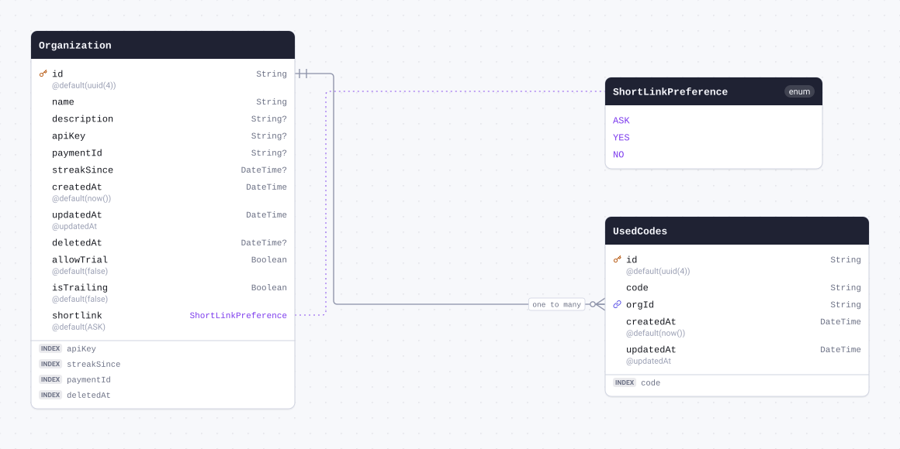

| Field       | Type       | Constraints                                       | Default      | Description |
| ----------- | ---------- | ------------------------------------------------- | ------------ | ----------- |
| `id`        | `String`   | PK NOT NULL                                       | `uuid(4)`    |             |
| `code`      | `String`   | NOT NULL                                          |              |             |
| `orgId`     | `String`   | NOT NULL → [Organization.id](#model-Organization) |              |             |
| `createdAt` | `DateTime` | NOT NULL                                          | `now()`      |             |
| `updatedAt` | `DateTime` | NOT NULL                                          | `@updatedAt` |             |

#### Indexes

- `@@index([code])`

#### References

- `orgId` → [Organization.id](#model-Organization) (many-to-one)

#### Definition

```sql
CREATE TABLE "UsedCodes" (
    "id" TEXT NOT NULL,
    "code" TEXT NOT NULL,
    "orgId" TEXT NOT NULL,
    "createdAt" TIMESTAMP(3) NOT NULL DEFAULT CURRENT_TIMESTAMP,
    "updatedAt" TIMESTAMP(3) NOT NULL,

    CONSTRAINT "UsedCodes_pkey" PRIMARY KEY ("id")
);

CREATE INDEX "UsedCodes_code_idx" ON "UsedCodes"("code");

ALTER TABLE "UsedCodes" ADD CONSTRAINT "UsedCodes_orgId_fkey" FOREIGN KEY ("orgId") REFERENCES "Organization"("id") ON DELETE RESTRICT ON UPDATE CASCADE;
```

<details>
<summary>Queries and their SQL</summary>

**findMany**: Every row

```ts
await prisma.usedCodes.findMany();
```

```sql
SELECT
  "public"."UsedCodes"."id",
  "public"."UsedCodes"."code",
  "public"."UsedCodes"."orgId",
  "public"."UsedCodes"."createdAt",
  "public"."UsedCodes"."updatedAt"
FROM
  "public"."UsedCodes"
WHERE
  1 = 1
OFFSET
  $1
-- params: ["0"]
```

**count**: How many rows there are

```ts
await prisma.usedCodes.count();
```

```sql
SELECT
  COUNT(*) AS "_count$_all"
FROM
  (
    SELECT
      "public"."UsedCodes"."id"
    FROM
      "public"."UsedCodes"
    WHERE
      1 = 1
    OFFSET
      $1
  ) AS "sub"
-- params: ["0"]
```

**findMany**: Every row with its relations

```ts
await prisma.usedCodes.findMany({ include: { organization: true } });
```

```sql
SELECT
  "public"."UsedCodes"."id",
  "public"."UsedCodes"."code",
  "public"."UsedCodes"."orgId",
  "public"."UsedCodes"."createdAt",
  "public"."UsedCodes"."updatedAt"
FROM
  "public"."UsedCodes"
WHERE
  1 = 1
OFFSET
  $1
-- params: ["0"]

SELECT
  "public"."Organization"."id",
  "public"."Organization"."name",
  "public"."Organization"."description",
  "public"."Organization"."apiKey",
  "public"."Organization"."paymentId",
  "public"."Organization"."streakSince",
  "public"."Organization"."createdAt",
  "public"."Organization"."updatedAt",
  "public"."Organization"."deletedAt",
  "public"."Organization"."allowTrial",
  "public"."Organization"."isTrailing",
  "public"."Organization"."shortlink"::text
FROM
  "public"."Organization"
WHERE
  "public"."Organization"."id" IN ($1)
OFFSET
  $2
-- params: ["<orgId of the rows above>","0"]
```

**findUnique**: One row by what is unique to it

```ts
await prisma.usedCodes.findUnique({ where: { id: "example" } });
```

```sql
SELECT
  "public"."UsedCodes"."id",
  "public"."UsedCodes"."code",
  "public"."UsedCodes"."orgId",
  "public"."UsedCodes"."createdAt",
  "public"."UsedCodes"."updatedAt"
FROM
  "public"."UsedCodes"
WHERE
  (
    "public"."UsedCodes"."id" = $1
    AND 1 = 1
  )
LIMIT
  $2
OFFSET
  $3
-- params: ["example","1","0"]
```

**create**: Create a row

```ts
await prisma.usedCodes.create({ data: { code: "example", orgId: "example" } });
```

```sql
INSERT INTO
  "public"."UsedCodes" ("id", "code", "orgId", "createdAt", "updatedAt")
VALUES
  ($1, $2, $3, $4, $5)
RETURNING
  "public"."UsedCodes"."id",
  "public"."UsedCodes"."code",
  "public"."UsedCodes"."orgId",
  "public"."UsedCodes"."createdAt",
  "public"."UsedCodes"."updatedAt"
-- params: ["<uuid(4)>","example","example","<now()>","<now()>"]
```

**update**: Update a row

```ts
await prisma.usedCodes.update({ where: { id: "example" }, data: { code: "example" } });
```

```sql
UPDATE "public"."UsedCodes"
SET
  "code" = $1,
  "updatedAt" = $2
WHERE
  (
    "public"."UsedCodes"."id" = $3
    AND 1 = 1
  )
RETURNING
  "public"."UsedCodes"."id",
  "public"."UsedCodes"."code",
  "public"."UsedCodes"."orgId",
  "public"."UsedCodes"."createdAt",
  "public"."UsedCodes"."updatedAt"
-- params: ["example",{"prisma__type":"generatorCall","prisma__value":{"name":"now","args":[],"returnType":{"type":"DateTime"}}},"example"]
```

**delete**: Delete a row

```ts
await prisma.usedCodes.delete({ where: { id: "example" } });
```

```sql
DELETE FROM "public"."UsedCodes"
WHERE
  (
    "public"."UsedCodes"."id" = $1
    AND 1 = 1
  )
RETURNING
  "public"."UsedCodes"."id",
  "public"."UsedCodes"."code",
  "public"."UsedCodes"."orgId",
  "public"."UsedCodes"."createdAt",
  "public"."UsedCodes"."updatedAt"
-- params: ["example"]
```

</details>

<a id="model-UserOrganization"></a>

### UserOrganization

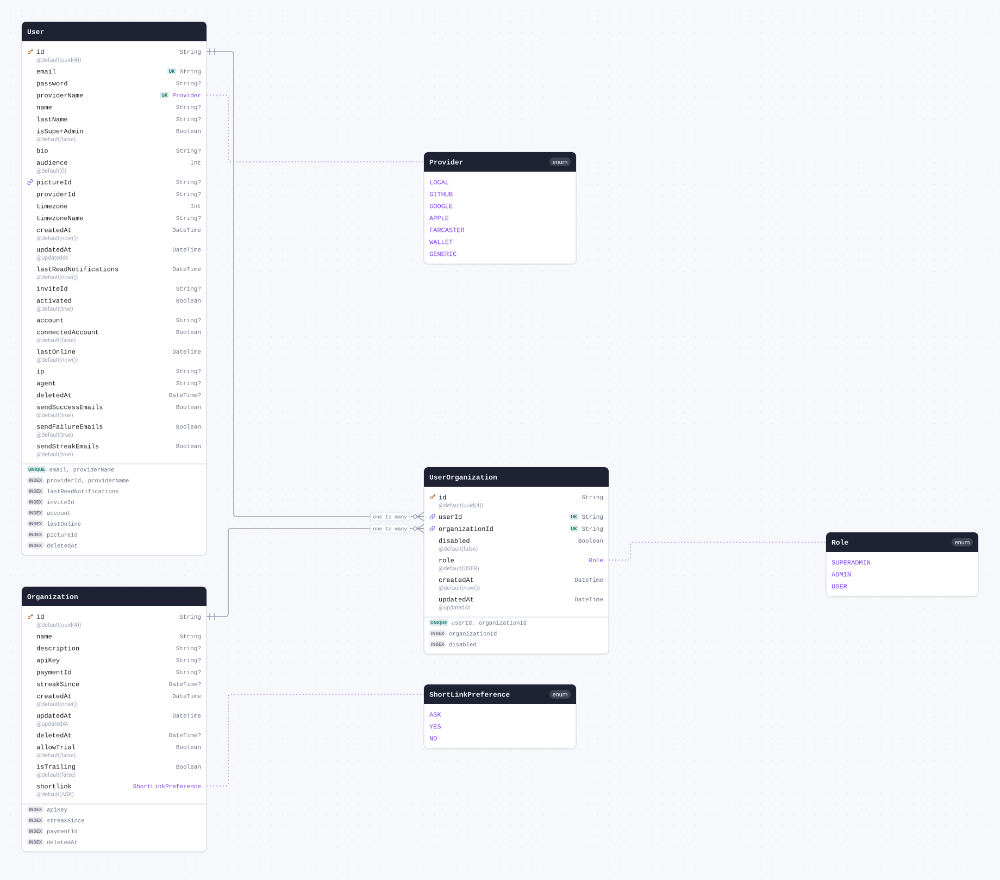

| Field            | Type                 | Constraints                                       | Default      | Description |
| ---------------- | -------------------- | ------------------------------------------------- | ------------ | ----------- |
| `id`             | `String`             | PK NOT NULL                                       | `uuid(4)`    |             |
| `userId`         | `String`             | NOT NULL → [User.id](#model-User)                 |              |             |
| `organizationId` | `String`             | NOT NULL → [Organization.id](#model-Organization) |              |             |
| `disabled`       | `Boolean`            | NOT NULL                                          | `false`      |             |
| `role`           | [`Role`](#enum-Role) | NOT NULL                                          | `USER`       |             |
| `createdAt`      | `DateTime`           | NOT NULL                                          | `now()`      |             |
| `updatedAt`      | `DateTime`           | NOT NULL                                          | `@updatedAt` |             |

#### Indexes

- `@@index([organizationId])`
- `@@index([disabled])`
- `@@unique([userId, organizationId])`

#### References

- `organizationId` → [Organization.id](#model-Organization) (many-to-one)
- `userId` → [User.id](#model-User) (many-to-one)

#### Definition

```sql
CREATE TABLE "UserOrganization" (
    "id" TEXT NOT NULL,
    "userId" TEXT NOT NULL,
    "organizationId" TEXT NOT NULL,
    "disabled" BOOLEAN NOT NULL DEFAULT false,
    "role" "Role" NOT NULL DEFAULT 'USER',
    "createdAt" TIMESTAMP(3) NOT NULL DEFAULT CURRENT_TIMESTAMP,
    "updatedAt" TIMESTAMP(3) NOT NULL,

    CONSTRAINT "UserOrganization_pkey" PRIMARY KEY ("id")
);

CREATE INDEX "UserOrganization_organizationId_idx" ON "UserOrganization"("organizationId");

CREATE INDEX "UserOrganization_disabled_idx" ON "UserOrganization"("disabled");

CREATE UNIQUE INDEX "UserOrganization_userId_organizationId_key" ON "UserOrganization"("userId", "organizationId");

ALTER TABLE "UserOrganization" ADD CONSTRAINT "UserOrganization_organizationId_fkey" FOREIGN KEY ("organizationId") REFERENCES "Organization"("id") ON DELETE RESTRICT ON UPDATE CASCADE;

ALTER TABLE "UserOrganization" ADD CONSTRAINT "UserOrganization_userId_fkey" FOREIGN KEY ("userId") REFERENCES "User"("id") ON DELETE RESTRICT ON UPDATE CASCADE;
```

<details>
<summary>Queries and their SQL</summary>

**findMany**: Every row

```ts
await prisma.userOrganization.findMany();
```

```sql
SELECT
  "public"."UserOrganization"."id",
  "public"."UserOrganization"."userId",
  "public"."UserOrganization"."organizationId",
  "public"."UserOrganization"."disabled",
  "public"."UserOrganization"."role"::text,
  "public"."UserOrganization"."createdAt",
  "public"."UserOrganization"."updatedAt"
FROM
  "public"."UserOrganization"
WHERE
  1 = 1
OFFSET
  $1
-- params: ["0"]
```

**count**: How many rows there are

```ts
await prisma.userOrganization.count();
```

```sql
SELECT
  COUNT(*) AS "_count$_all"
FROM
  (
    SELECT
      "public"."UserOrganization"."id"
    FROM
      "public"."UserOrganization"
    WHERE
      1 = 1
    OFFSET
      $1
  ) AS "sub"
-- params: ["0"]
```

**findMany**: Every row with its relations

```ts
await prisma.userOrganization.findMany({ include: { organization: true, user: true } });
```

```sql
SELECT
  "public"."UserOrganization"."id",
  "public"."UserOrganization"."userId",
  "public"."UserOrganization"."organizationId",
  "public"."UserOrganization"."disabled",
  "public"."UserOrganization"."role"::text,
  "public"."UserOrganization"."createdAt",
  "public"."UserOrganization"."updatedAt"
FROM
  "public"."UserOrganization"
WHERE
  1 = 1
OFFSET
  $1
-- params: ["0"]

SELECT
  "public"."Organization"."id",
  "public"."Organization"."name",
  "public"."Organization"."description",
  "public"."Organization"."apiKey",
  "public"."Organization"."paymentId",
  "public"."Organization"."streakSince",
  "public"."Organization"."createdAt",
  "public"."Organization"."updatedAt",
  "public"."Organization"."deletedAt",
  "public"."Organization"."allowTrial",
  "public"."Organization"."isTrailing",
  "public"."Organization"."shortlink"::text
FROM
  "public"."Organization"
WHERE
  "public"."Organization"."id" IN ($1)
OFFSET
  $2
-- params: ["<organizationId of the rows above>","0"]

SELECT
  "public"."User"."id",
  "public"."User"."email",
  "public"."User"."password",
  "public"."User"."providerName"::text,
  "public"."User"."name",
  "public"."User"."lastName",
  "public"."User"."isSuperAdmin",
  "public"."User"."bio",
  "public"."User"."audience",
  "public"."User"."pictureId",
  "public"."User"."providerId",
  "public"."User"."timezone",
  "public"."User"."timezoneName",
  "public"."User"."createdAt",
  "public"."User"."updatedAt",
  "public"."User"."lastReadNotifications",
  "public"."User"."inviteId",
  "public"."User"."activated",
  "public"."User"."account",
  "public"."User"."connectedAccount",
  "public"."User"."lastOnline",
  "public"."User"."ip",
  "public"."User"."agent",
  "public"."User"."deletedAt",
  "public"."User"."sendSuccessEmails",
  "public"."User"."sendFailureEmails",
  "public"."User"."sendStreakEmails"
FROM
  "public"."User"
WHERE
  "public"."User"."id" IN ($1)
OFFSET
  $2
-- params: ["<userId of the rows above>","0"]
```

**findUnique**: One row by what is unique to it

```ts
await prisma.userOrganization.findUnique({ where: { id: "example" } });
```

```sql
SELECT
  "public"."UserOrganization"."id",
  "public"."UserOrganization"."userId",
  "public"."UserOrganization"."organizationId",
  "public"."UserOrganization"."disabled",
  "public"."UserOrganization"."role"::text,
  "public"."UserOrganization"."createdAt",
  "public"."UserOrganization"."updatedAt"
FROM
  "public"."UserOrganization"
WHERE
  (
    "public"."UserOrganization"."id" = $1
    AND 1 = 1
  )
LIMIT
  $2
OFFSET
  $3
-- params: ["example","1","0"]
```

**create**: Create a row

```ts
await prisma.userOrganization.create({ data: { userId: "example", organizationId: "example" } });
```

```sql
INSERT INTO
  "public"."UserOrganization" (
    "id",
    "userId",
    "organizationId",
    "disabled",
    "role",
    "createdAt",
    "updatedAt"
  )
VALUES
  (
    $1,
    $2,
    $3,
    $4,
    CAST($5::text AS "public"."Role"),
    $6,
    $7
  )
RETURNING
  "public"."UserOrganization"."id",
  "public"."UserOrganization"."userId",
  "public"."UserOrganization"."organizationId",
  "public"."UserOrganization"."disabled",
  "public"."UserOrganization"."role"::text,
  "public"."UserOrganization"."createdAt",
  "public"."UserOrganization"."updatedAt"
-- params: ["<uuid(4)>","example","example",false,"USER","<now()>","<now()>"]
```

**update**: Update a row

```ts
await prisma.userOrganization.update({ where: { id: "example" }, data: { disabled: true } });
```

```sql
UPDATE "public"."UserOrganization"
SET
  "disabled" = $1,
  "updatedAt" = $2
WHERE
  (
    "public"."UserOrganization"."id" = $3
    AND 1 = 1
  )
RETURNING
  "public"."UserOrganization"."id",
  "public"."UserOrganization"."userId",
  "public"."UserOrganization"."organizationId",
  "public"."UserOrganization"."disabled",
  "public"."UserOrganization"."role"::text,
  "public"."UserOrganization"."createdAt",
  "public"."UserOrganization"."updatedAt"
-- params: [true,{"prisma__type":"generatorCall","prisma__value":{"name":"now","args":[],"returnType":{"type":"DateTime"}}},"example"]
```

**delete**: Delete a row

```ts
await prisma.userOrganization.delete({ where: { id: "example" } });
```

```sql
DELETE FROM "public"."UserOrganization"
WHERE
  (
    "public"."UserOrganization"."id" = $1
    AND 1 = 1
  )
RETURNING
  "public"."UserOrganization"."id",
  "public"."UserOrganization"."userId",
  "public"."UserOrganization"."organizationId",
  "public"."UserOrganization"."disabled",
  "public"."UserOrganization"."role"::text,
  "public"."UserOrganization"."createdAt",
  "public"."UserOrganization"."updatedAt"
-- params: ["example"]
```

</details>

<a id="model-GitHub"></a>

### GitHub

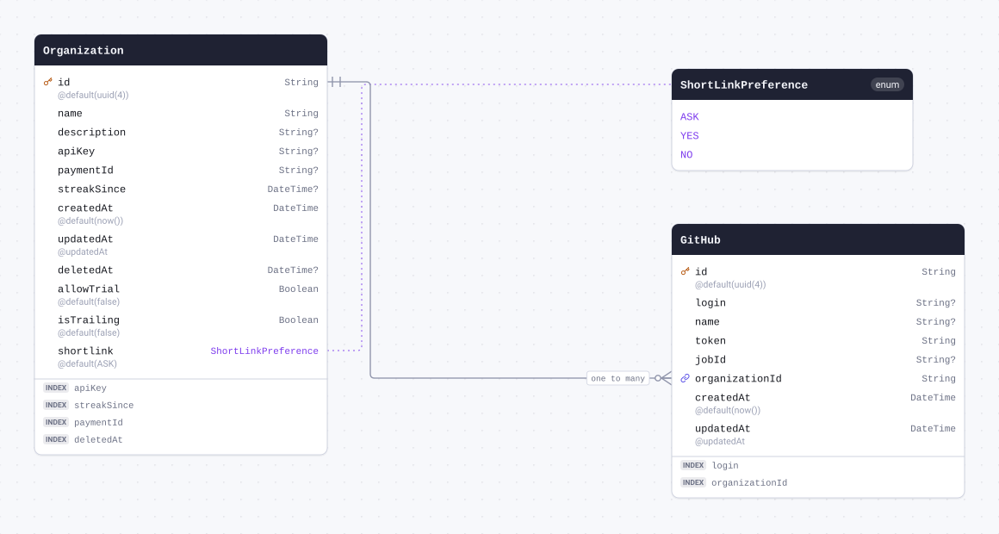

| Field            | Type       | Constraints                                       | Default      | Description |
| ---------------- | ---------- | ------------------------------------------------- | ------------ | ----------- |
| `id`             | `String`   | PK NOT NULL                                       | `uuid(4)`    |             |
| `login`          | `String`   | NULL                                              |              |             |
| `name`           | `String`   | NULL                                              |              |             |
| `token`          | `String`   | NOT NULL                                          |              |             |
| `jobId`          | `String`   | NULL                                              |              |             |
| `organizationId` | `String`   | NOT NULL → [Organization.id](#model-Organization) |              |             |
| `createdAt`      | `DateTime` | NOT NULL                                          | `now()`      |             |
| `updatedAt`      | `DateTime` | NOT NULL                                          | `@updatedAt` |             |

#### Indexes

- `@@index([login])`
- `@@index([organizationId])`

#### References

- `organizationId` → [Organization.id](#model-Organization) (many-to-one)

#### Definition

```sql
CREATE TABLE "GitHub" (
    "id" TEXT NOT NULL,
    "login" TEXT,
    "name" TEXT,
    "token" TEXT NOT NULL,
    "jobId" TEXT,
    "organizationId" TEXT NOT NULL,
    "createdAt" TIMESTAMP(3) NOT NULL DEFAULT CURRENT_TIMESTAMP,
    "updatedAt" TIMESTAMP(3) NOT NULL,

    CONSTRAINT "GitHub_pkey" PRIMARY KEY ("id")
);

CREATE INDEX "GitHub_login_idx" ON "GitHub"("login");

CREATE INDEX "GitHub_organizationId_idx" ON "GitHub"("organizationId");

ALTER TABLE "GitHub" ADD CONSTRAINT "GitHub_organizationId_fkey" FOREIGN KEY ("organizationId") REFERENCES "Organization"("id") ON DELETE RESTRICT ON UPDATE CASCADE;
```

<details>
<summary>Queries and their SQL</summary>

**findMany**: Every row

```ts
await prisma.gitHub.findMany();
```

```sql
SELECT
  "public"."GitHub"."id",
  "public"."GitHub"."login",
  "public"."GitHub"."name",
  "public"."GitHub"."token",
  "public"."GitHub"."jobId",
  "public"."GitHub"."organizationId",
  "public"."GitHub"."createdAt",
  "public"."GitHub"."updatedAt"
FROM
  "public"."GitHub"
WHERE
  1 = 1
OFFSET
  $1
-- params: ["0"]
```

**count**: How many rows there are

```ts
await prisma.gitHub.count();
```

```sql
SELECT
  COUNT(*) AS "_count$_all"
FROM
  (
    SELECT
      "public"."GitHub"."id"
    FROM
      "public"."GitHub"
    WHERE
      1 = 1
    OFFSET
      $1
  ) AS "sub"
-- params: ["0"]
```

**findMany**: Every row with its relations

```ts
await prisma.gitHub.findMany({ include: { organization: true } });
```

```sql
SELECT
  "public"."GitHub"."id",
  "public"."GitHub"."login",
  "public"."GitHub"."name",
  "public"."GitHub"."token",
  "public"."GitHub"."jobId",
  "public"."GitHub"."organizationId",
  "public"."GitHub"."createdAt",
  "public"."GitHub"."updatedAt"
FROM
  "public"."GitHub"
WHERE
  1 = 1
OFFSET
  $1
-- params: ["0"]

SELECT
  "public"."Organization"."id",
  "public"."Organization"."name",
  "public"."Organization"."description",
  "public"."Organization"."apiKey",
  "public"."Organization"."paymentId",
  "public"."Organization"."streakSince",
  "public"."Organization"."createdAt",
  "public"."Organization"."updatedAt",
  "public"."Organization"."deletedAt",
  "public"."Organization"."allowTrial",
  "public"."Organization"."isTrailing",
  "public"."Organization"."shortlink"::text
FROM
  "public"."Organization"
WHERE
  "public"."Organization"."id" IN ($1)
OFFSET
  $2
-- params: ["<organizationId of the rows above>","0"]
```

**findUnique**: One row by what is unique to it

```ts
await prisma.gitHub.findUnique({ where: { id: "example" } });
```

```sql
SELECT
  "public"."GitHub"."id",
  "public"."GitHub"."login",
  "public"."GitHub"."name",
  "public"."GitHub"."token",
  "public"."GitHub"."jobId",
  "public"."GitHub"."organizationId",
  "public"."GitHub"."createdAt",
  "public"."GitHub"."updatedAt"
FROM
  "public"."GitHub"
WHERE
  (
    "public"."GitHub"."id" = $1
    AND 1 = 1
  )
LIMIT
  $2
OFFSET
  $3
-- params: ["example","1","0"]
```

**create**: Create a row

```ts
await prisma.gitHub.create({ data: { token: "example", organizationId: "example" } });
```

```sql
INSERT INTO
  "public"."GitHub" (
    "id",
    "token",
    "organizationId",
    "createdAt",
    "updatedAt"
  )
VALUES
  ($1, $2, $3, $4, $5)
RETURNING
  "public"."GitHub"."id",
  "public"."GitHub"."login",
  "public"."GitHub"."name",
  "public"."GitHub"."token",
  "public"."GitHub"."jobId",
  "public"."GitHub"."organizationId",
  "public"."GitHub"."createdAt",
  "public"."GitHub"."updatedAt"
-- params: ["<uuid(4)>","example","example","<now()>","<now()>"]
```

**update**: Update a row

```ts
await prisma.gitHub.update({ where: { id: "example" }, data: { login: "example" } });
```

```sql
UPDATE "public"."GitHub"
SET
  "login" = $1,
  "updatedAt" = $2
WHERE
  (
    "public"."GitHub"."id" = $3
    AND 1 = 1
  )
RETURNING
  "public"."GitHub"."id",
  "public"."GitHub"."login",
  "public"."GitHub"."name",
  "public"."GitHub"."token",
  "public"."GitHub"."jobId",
  "public"."GitHub"."organizationId",
  "public"."GitHub"."createdAt",
  "public"."GitHub"."updatedAt"
-- params: ["example",{"prisma__type":"generatorCall","prisma__value":{"name":"now","args":[],"returnType":{"type":"DateTime"}}},"example"]
```

**delete**: Delete a row

```ts
await prisma.gitHub.delete({ where: { id: "example" } });
```

```sql
DELETE FROM "public"."GitHub"
WHERE
  (
    "public"."GitHub"."id" = $1
    AND 1 = 1
  )
RETURNING
  "public"."GitHub"."id",
  "public"."GitHub"."login",
  "public"."GitHub"."name",
  "public"."GitHub"."token",
  "public"."GitHub"."jobId",
  "public"."GitHub"."organizationId",
  "public"."GitHub"."createdAt",
  "public"."GitHub"."updatedAt"
-- params: ["example"]
```

</details>

<a id="model-Trending"></a>

### Trending

| Field          | Type       | Constraints | Default      | Description |
| -------------- | ---------- | ----------- | ------------ | ----------- |
| `id`           | `String`   | PK NOT NULL | `uuid(4)`    |             |
| `trendingList` | `String`   | NOT NULL    |              |             |
| `language`     | `String`   | UNIQUE NULL |              |             |
| `hash`         | `String`   | NOT NULL    |              |             |
| `date`         | `DateTime` | NOT NULL    |              |             |
| `createdAt`    | `DateTime` | NOT NULL    | `now()`      |             |
| `updatedAt`    | `DateTime` | NOT NULL    | `@updatedAt` |             |

#### Indexes

- `@@index([hash])`

#### Definition

```sql
CREATE TABLE "Trending" (
    "id" TEXT NOT NULL,
    "trendingList" TEXT NOT NULL,
    "language" TEXT,
    "hash" TEXT NOT NULL,
    "date" TIMESTAMP(3) NOT NULL,
    "createdAt" TIMESTAMP(3) NOT NULL DEFAULT CURRENT_TIMESTAMP,
    "updatedAt" TIMESTAMP(3) NOT NULL,

    CONSTRAINT "Trending_pkey" PRIMARY KEY ("id")
);

CREATE UNIQUE INDEX "Trending_language_key" ON "Trending"("language");

CREATE INDEX "Trending_hash_idx" ON "Trending"("hash");
```

<details>
<summary>Queries and their SQL</summary>

**findMany**: Every row

```ts
await prisma.trending.findMany();
```

```sql
SELECT
  "public"."Trending"."id",
  "public"."Trending"."trendingList",
  "public"."Trending"."language",
  "public"."Trending"."hash",
  "public"."Trending"."date",
  "public"."Trending"."createdAt",
  "public"."Trending"."updatedAt"
FROM
  "public"."Trending"
WHERE
  1 = 1
OFFSET
  $1
-- params: ["0"]
```

**count**: How many rows there are

```ts
await prisma.trending.count();
```

```sql
SELECT
  COUNT(*) AS "_count$_all"
FROM
  (
    SELECT
      "public"."Trending"."id"
    FROM
      "public"."Trending"
    WHERE
      1 = 1
    OFFSET
      $1
  ) AS "sub"
-- params: ["0"]
```

**findUnique**: One row by what is unique to it

```ts
await prisma.trending.findUnique({ where: { id: "example" } });
```

```sql
SELECT
  "public"."Trending"."id",
  "public"."Trending"."trendingList",
  "public"."Trending"."language",
  "public"."Trending"."hash",
  "public"."Trending"."date",
  "public"."Trending"."createdAt",
  "public"."Trending"."updatedAt"
FROM
  "public"."Trending"
WHERE
  (
    "public"."Trending"."id" = $1
    AND 1 = 1
  )
LIMIT
  $2
OFFSET
  $3
-- params: ["example","1","0"]
```

**create**: Create a row

```ts
await prisma.trending.create({
  data: { trendingList: "example", hash: "example", date: new Date("2026-01-01T00:00:00.000Z") },
});
```

```sql
INSERT INTO
  "public"."Trending" (
    "id",
    "trendingList",
    "hash",
    "date",
    "createdAt",
    "updatedAt"
  )
VALUES
  ($1, $2, $3, $4, $5, $6)
RETURNING
  "public"."Trending"."id",
  "public"."Trending"."trendingList",
  "public"."Trending"."language",
  "public"."Trending"."hash",
  "public"."Trending"."date",
  "public"."Trending"."createdAt",
  "public"."Trending"."updatedAt"
-- params: ["<uuid(4)>","example","example","2026-01-01T00:00:00.000Z","<now()>","<now()>"]
```

**update**: Update a row

```ts
await prisma.trending.update({ where: { id: "example" }, data: { trendingList: "example" } });
```

```sql
UPDATE "public"."Trending"
SET
  "trendingList" = $1,
  "updatedAt" = $2
WHERE
  (
    "public"."Trending"."id" = $3
    AND 1 = 1
  )
RETURNING
  "public"."Trending"."id",
  "public"."Trending"."trendingList",
  "public"."Trending"."language",
  "public"."Trending"."hash",
  "public"."Trending"."date",
  "public"."Trending"."createdAt",
  "public"."Trending"."updatedAt"
-- params: ["example",{"prisma__type":"generatorCall","prisma__value":{"name":"now","args":[],"returnType":{"type":"DateTime"}}},"example"]
```

**delete**: Delete a row

```ts
await prisma.trending.delete({ where: { id: "example" } });
```

```sql
DELETE FROM "public"."Trending"
WHERE
  (
    "public"."Trending"."id" = $1
    AND 1 = 1
  )
RETURNING
  "public"."Trending"."id",
  "public"."Trending"."trendingList",
  "public"."Trending"."language",
  "public"."Trending"."hash",
  "public"."Trending"."date",
  "public"."Trending"."createdAt",
  "public"."Trending"."updatedAt"
-- params: ["example"]
```

</details>

<a id="model-TrendingLog"></a>

### TrendingLog

| Field      | Type       | Constraints | Default   | Description |
| ---------- | ---------- | ----------- | --------- | ----------- |
| `id`       | `String`   | PK NOT NULL | `uuid(4)` |             |
| `language` | `String`   | NULL        |           |             |
| `date`     | `DateTime` | NOT NULL    |           |             |

#### Definition

```sql
CREATE TABLE "TrendingLog" (
    "id" TEXT NOT NULL,
    "language" TEXT,
    "date" TIMESTAMP(3) NOT NULL,

    CONSTRAINT "TrendingLog_pkey" PRIMARY KEY ("id")
);
```

<details>
<summary>Queries and their SQL</summary>

**findMany**: Every row

```ts
await prisma.trendingLog.findMany();
```

```sql
SELECT
  "public"."TrendingLog"."id",
  "public"."TrendingLog"."language",
  "public"."TrendingLog"."date"
FROM
  "public"."TrendingLog"
WHERE
  1 = 1
OFFSET
  $1
-- params: ["0"]
```

**count**: How many rows there are

```ts
await prisma.trendingLog.count();
```

```sql
SELECT
  COUNT(*) AS "_count$_all"
FROM
  (
    SELECT
      "public"."TrendingLog"."id"
    FROM
      "public"."TrendingLog"
    WHERE
      1 = 1
    OFFSET
      $1
  ) AS "sub"
-- params: ["0"]
```

**findUnique**: One row by what is unique to it

```ts
await prisma.trendingLog.findUnique({ where: { id: "example" } });
```

```sql
SELECT
  "public"."TrendingLog"."id",
  "public"."TrendingLog"."language",
  "public"."TrendingLog"."date"
FROM
  "public"."TrendingLog"
WHERE
  (
    "public"."TrendingLog"."id" = $1
    AND 1 = 1
  )
LIMIT
  $2
OFFSET
  $3
-- params: ["example","1","0"]
```

**create**: Create a row

```ts
await prisma.trendingLog.create({ data: { date: new Date("2026-01-01T00:00:00.000Z") } });
```

```sql
INSERT INTO
  "public"."TrendingLog" ("id", "date")
VALUES
  ($1, $2)
RETURNING
  "public"."TrendingLog"."id",
  "public"."TrendingLog"."language",
  "public"."TrendingLog"."date"
-- params: ["<uuid(4)>","2026-01-01T00:00:00.000Z"]
```

**update**: Update a row

```ts
await prisma.trendingLog.update({ where: { id: "example" }, data: { language: "example" } });
```

```sql
UPDATE "public"."TrendingLog"
SET
  "language" = $1
WHERE
  (
    "public"."TrendingLog"."id" = $2
    AND 1 = 1
  )
RETURNING
  "public"."TrendingLog"."id",
  "public"."TrendingLog"."language",
  "public"."TrendingLog"."date"
-- params: ["example","example"]
```

**delete**: Delete a row

```ts
await prisma.trendingLog.delete({ where: { id: "example" } });
```

```sql
DELETE FROM "public"."TrendingLog"
WHERE
  (
    "public"."TrendingLog"."id" = $1
    AND 1 = 1
  )
RETURNING
  "public"."TrendingLog"."id",
  "public"."TrendingLog"."language",
  "public"."TrendingLog"."date"
-- params: ["example"]
```

</details>

<a id="model-ItemUser"></a>

### ItemUser

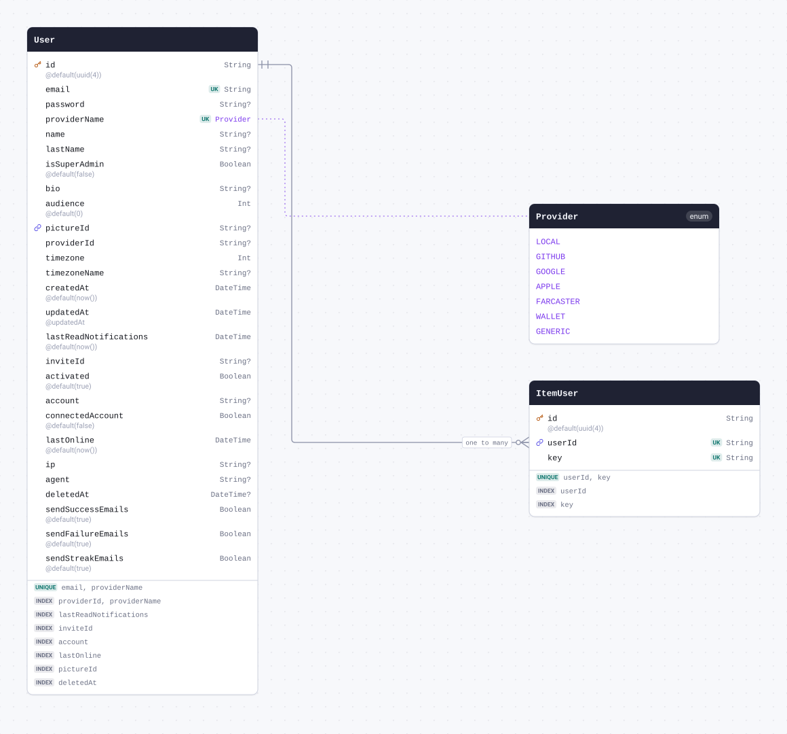

| Field    | Type     | Constraints                       | Default   | Description |
| -------- | -------- | --------------------------------- | --------- | ----------- |
| `id`     | `String` | PK NOT NULL                       | `uuid(4)` |             |
| `userId` | `String` | NOT NULL → [User.id](#model-User) |           |             |
| `key`    | `String` | NOT NULL                          |           |             |

#### Indexes

- `@@index([userId])`
- `@@index([key])`
- `@@unique([userId, key])`

#### References

- `userId` → [User.id](#model-User) (many-to-one)

#### Definition

```sql
CREATE TABLE "ItemUser" (
    "id" TEXT NOT NULL,
    "userId" TEXT NOT NULL,
    "key" TEXT NOT NULL,

    CONSTRAINT "ItemUser_pkey" PRIMARY KEY ("id")
);

CREATE INDEX "ItemUser_userId_idx" ON "ItemUser"("userId");

CREATE INDEX "ItemUser_key_idx" ON "ItemUser"("key");

CREATE UNIQUE INDEX "ItemUser_userId_key_key" ON "ItemUser"("userId", "key");

ALTER TABLE "ItemUser" ADD CONSTRAINT "ItemUser_userId_fkey" FOREIGN KEY ("userId") REFERENCES "User"("id") ON DELETE RESTRICT ON UPDATE CASCADE;
```

<details>
<summary>Queries and their SQL</summary>

**findMany**: Every row

```ts
await prisma.itemUser.findMany();
```

```sql
SELECT
  "public"."ItemUser"."id",
  "public"."ItemUser"."userId",
  "public"."ItemUser"."key"
FROM
  "public"."ItemUser"
WHERE
  1 = 1
OFFSET
  $1
-- params: ["0"]
```

**count**: How many rows there are

```ts
await prisma.itemUser.count();
```

```sql
SELECT
  COUNT(*) AS "_count$_all"
FROM
  (
    SELECT
      "public"."ItemUser"."id"
    FROM
      "public"."ItemUser"
    WHERE
      1 = 1
    OFFSET
      $1
  ) AS "sub"
-- params: ["0"]
```

**findMany**: Every row with its relations

```ts
await prisma.itemUser.findMany({ include: { user: true } });
```

```sql
SELECT
  "public"."ItemUser"."id",
  "public"."ItemUser"."userId",
  "public"."ItemUser"."key"
FROM
  "public"."ItemUser"
WHERE
  1 = 1
OFFSET
  $1
-- params: ["0"]

SELECT
  "public"."User"."id",
  "public"."User"."email",
  "public"."User"."password",
  "public"."User"."providerName"::text,
  "public"."User"."name",
  "public"."User"."lastName",
  "public"."User"."isSuperAdmin",
  "public"."User"."bio",
  "public"."User"."audience",
  "public"."User"."pictureId",
  "public"."User"."providerId",
  "public"."User"."timezone",
  "public"."User"."timezoneName",
  "public"."User"."createdAt",
  "public"."User"."updatedAt",
  "public"."User"."lastReadNotifications",
  "public"."User"."inviteId",
  "public"."User"."activated",
  "public"."User"."account",
  "public"."User"."connectedAccount",
  "public"."User"."lastOnline",
  "public"."User"."ip",
  "public"."User"."agent",
  "public"."User"."deletedAt",
  "public"."User"."sendSuccessEmails",
  "public"."User"."sendFailureEmails",
  "public"."User"."sendStreakEmails"
FROM
  "public"."User"
WHERE
  "public"."User"."id" IN ($1)
OFFSET
  $2
-- params: ["<userId of the rows above>","0"]
```

**findUnique**: One row by what is unique to it

```ts
await prisma.itemUser.findUnique({ where: { id: "example" } });
```

```sql
SELECT
  "public"."ItemUser"."id",
  "public"."ItemUser"."userId",
  "public"."ItemUser"."key"
FROM
  "public"."ItemUser"
WHERE
  (
    "public"."ItemUser"."id" = $1
    AND 1 = 1
  )
LIMIT
  $2
OFFSET
  $3
-- params: ["example","1","0"]
```

**create**: Create a row

```ts
await prisma.itemUser.create({ data: { userId: "example", key: "example" } });
```

```sql
INSERT INTO
  "public"."ItemUser" ("id", "userId", "key")
VALUES
  ($1, $2, $3)
RETURNING
  "public"."ItemUser"."id",
  "public"."ItemUser"."userId",
  "public"."ItemUser"."key"
-- params: ["<uuid(4)>","example","example"]
```

**update**: Update a row

```ts
await prisma.itemUser.update({ where: { id: "example" }, data: { key: "example" } });
```

```sql
UPDATE "public"."ItemUser"
SET
  "key" = $1
WHERE
  (
    "public"."ItemUser"."id" = $2
    AND 1 = 1
  )
RETURNING
  "public"."ItemUser"."id",
  "public"."ItemUser"."userId",
  "public"."ItemUser"."key"
-- params: ["example","example"]
```

**delete**: Delete a row

```ts
await prisma.itemUser.delete({ where: { id: "example" } });
```

```sql
DELETE FROM "public"."ItemUser"
WHERE
  (
    "public"."ItemUser"."id" = $1
    AND 1 = 1
  )
RETURNING
  "public"."ItemUser"."id",
  "public"."ItemUser"."userId",
  "public"."ItemUser"."key"
-- params: ["example"]
```

</details>

<a id="model-Star"></a>

### Star

| Field        | Type                  | Constraints | Default      | Description |
| ------------ | --------------------- | ----------- | ------------ | ----------- |
| `id`         | `String`              | PK NOT NULL | `uuid(4)`    |             |
| `stars`      | `Int`                 | NOT NULL    |              |             |
| `totalStars` | `Int`                 | NOT NULL    |              |             |
| `forks`      | `Int`                 | NOT NULL    |              |             |
| `totalForks` | `Int`                 | NOT NULL    |              |             |
| `login`      | `String`              | NOT NULL    |              |             |
| `date`       | `DateTime` `@db.Date` | NOT NULL    | `now()`      |             |
| `createdAt`  | `DateTime`            | NOT NULL    | `now()`      |             |
| `updatedAt`  | `DateTime`            | NOT NULL    | `@updatedAt` |             |

#### Indexes

- `@@unique([login, date])`

#### Definition

```sql
CREATE TABLE "Star" (
    "id" TEXT NOT NULL,
    "stars" INTEGER NOT NULL,
    "totalStars" INTEGER NOT NULL,
    "forks" INTEGER NOT NULL,
    "totalForks" INTEGER NOT NULL,
    "login" TEXT NOT NULL,
    "date" DATE NOT NULL DEFAULT CURRENT_TIMESTAMP,
    "createdAt" TIMESTAMP(3) NOT NULL DEFAULT CURRENT_TIMESTAMP,
    "updatedAt" TIMESTAMP(3) NOT NULL,

    CONSTRAINT "Star_pkey" PRIMARY KEY ("id")
);

CREATE UNIQUE INDEX "Star_login_date_key" ON "Star"("login", "date");
```

<details>
<summary>Queries and their SQL</summary>

**findMany**: Every row

```ts
await prisma.star.findMany();
```

```sql
SELECT
  "public"."Star"."id",
  "public"."Star"."stars",
  "public"."Star"."totalStars",
  "public"."Star"."forks",
  "public"."Star"."totalForks",
  "public"."Star"."login",
  "public"."Star"."date",
  "public"."Star"."createdAt",
  "public"."Star"."updatedAt"
FROM
  "public"."Star"
WHERE
  1 = 1
OFFSET
  $1
-- params: ["0"]
```

**count**: How many rows there are

```ts
await prisma.star.count();
```

```sql
SELECT
  COUNT(*) AS "_count$_all"
FROM
  (
    SELECT
      "public"."Star"."id"
    FROM
      "public"."Star"
    WHERE
      1 = 1
    OFFSET
      $1
  ) AS "sub"
-- params: ["0"]
```

**findUnique**: One row by what is unique to it

```ts
await prisma.star.findUnique({ where: { id: "example" } });
```

```sql
SELECT
  "public"."Star"."id",
  "public"."Star"."stars",
  "public"."Star"."totalStars",
  "public"."Star"."forks",
  "public"."Star"."totalForks",
  "public"."Star"."login",
  "public"."Star"."date",
  "public"."Star"."createdAt",
  "public"."Star"."updatedAt"
FROM
  "public"."Star"
WHERE
  (
    "public"."Star"."id" = $1
    AND 1 = 1
  )
LIMIT
  $2
OFFSET
  $3
-- params: ["example","1","0"]
```

**create**: Create a row

```ts
await prisma.star.create({
  data: { stars: 1, totalStars: 1, forks: 1, totalForks: 1, login: "example" },
});
```

```sql
INSERT INTO
  "public"."Star" (
    "id",
    "stars",
    "totalStars",
    "forks",
    "totalForks",
    "login",
    "date",
    "createdAt",
    "updatedAt"
  )
VALUES
  ($1, $2, $3, $4, $5, $6, $7, $8, $9)
RETURNING
  "public"."Star"."id",
  "public"."Star"."stars",
  "public"."Star"."totalStars",
  "public"."Star"."forks",
  "public"."Star"."totalForks",
  "public"."Star"."login",
  "public"."Star"."date",
  "public"."Star"."createdAt",
  "public"."Star"."updatedAt"
-- params: ["<uuid(4)>","1","1","1","1","example","<now()>","<now()>","<now()>"]
```

**update**: Update a row

```ts
await prisma.star.update({ where: { id: "example" }, data: { stars: 1 } });
```

```sql
UPDATE "public"."Star"
SET
  "stars" = $1,
  "updatedAt" = $2
WHERE
  (
    "public"."Star"."id" = $3
    AND 1 = 1
  )
RETURNING
  "public"."Star"."id",
  "public"."Star"."stars",
  "public"."Star"."totalStars",
  "public"."Star"."forks",
  "public"."Star"."totalForks",
  "public"."Star"."login",
  "public"."Star"."date",
  "public"."Star"."createdAt",
  "public"."Star"."updatedAt"
-- params: ["1",{"prisma__type":"generatorCall","prisma__value":{"name":"now","args":[],"returnType":{"type":"DateTime"}}},"example"]
```

**delete**: Delete a row

```ts
await prisma.star.delete({ where: { id: "example" } });
```

```sql
DELETE FROM "public"."Star"
WHERE
  (
    "public"."Star"."id" = $1
    AND 1 = 1
  )
RETURNING
  "public"."Star"."id",
  "public"."Star"."stars",
  "public"."Star"."totalStars",
  "public"."Star"."forks",
  "public"."Star"."totalForks",
  "public"."Star"."login",
  "public"."Star"."date",
  "public"."Star"."createdAt",
  "public"."Star"."updatedAt"
-- params: ["example"]
```

</details>

<a id="model-Media"></a>

### Media

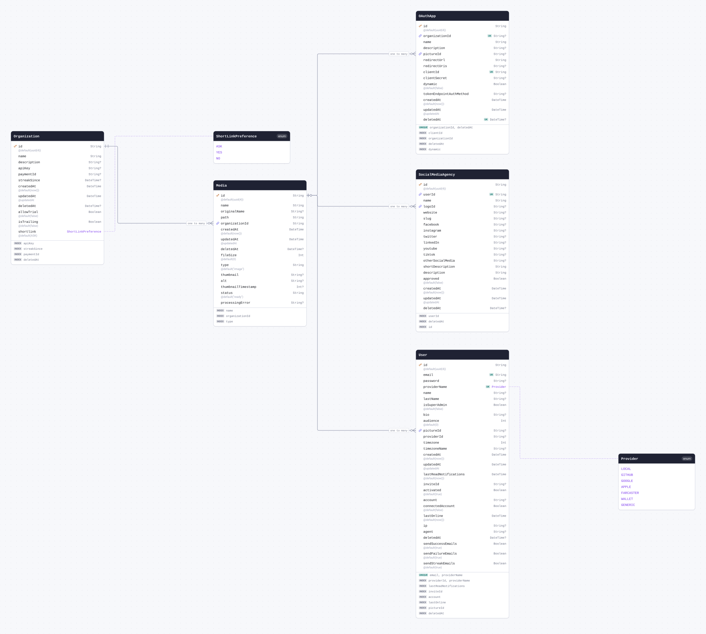

| Field                | Type       | Constraints                                       | Default      | Description |
| -------------------- | ---------- | ------------------------------------------------- | ------------ | ----------- |
| `id`                 | `String`   | PK NOT NULL                                       | `uuid(4)`    |             |
| `name`               | `String`   | NOT NULL                                          |              |             |
| `originalName`       | `String`   | NULL                                              |              |             |
| `path`               | `String`   | NOT NULL                                          |              |             |
| `organizationId`     | `String`   | NOT NULL → [Organization.id](#model-Organization) |              |             |
| `createdAt`          | `DateTime` | NOT NULL                                          | `now()`      |             |
| `updatedAt`          | `DateTime` | NOT NULL                                          | `@updatedAt` |             |
| `deletedAt`          | `DateTime` | NULL                                              |              |             |
| `fileSize`           | `Int`      | NOT NULL                                          | `0`          |             |
| `type`               | `String`   | NOT NULL                                          | `"image"`    |             |
| `thumbnail`          | `String`   | NULL                                              |              |             |
| `alt`                | `String`   | NULL                                              |              |             |
| `thumbnailTimestamp` | `Int`      | NULL                                              |              |             |
| `status`             | `String`   | NOT NULL                                          | `"ready"`    |             |
| `processingError`    | `String`   | NULL                                              |              |             |

#### Indexes

- `@@index([name])`
- `@@index([organizationId])`
- `@@index([type])`

#### References

- `organizationId` → [Organization.id](#model-Organization) (many-to-one)

#### Referenced by

- `id` ← [User.pictureId](#model-User) (one-to-many)
- `id` ← [SocialMediaAgency.logoId](#model-SocialMediaAgency) (one-to-many)
- `id` ← [OAuthApp.pictureId](#model-OAuthApp) (one-to-many)

#### Definition

```sql
CREATE TABLE "Media" (
    "id" TEXT NOT NULL,
    "name" TEXT NOT NULL,
    "originalName" TEXT,
    "path" TEXT NOT NULL,
    "organizationId" TEXT NOT NULL,
    "createdAt" TIMESTAMP(3) NOT NULL DEFAULT CURRENT_TIMESTAMP,
    "updatedAt" TIMESTAMP(3) NOT NULL,
    "deletedAt" TIMESTAMP(3),
    "fileSize" INTEGER NOT NULL DEFAULT 0,
    "type" TEXT NOT NULL DEFAULT 'image',
    "thumbnail" TEXT,
    "alt" TEXT,
    "thumbnailTimestamp" INTEGER,
    "status" TEXT NOT NULL DEFAULT 'ready',
    "processingError" TEXT,

    CONSTRAINT "Media_pkey" PRIMARY KEY ("id")
);

CREATE INDEX "Media_name_idx" ON "Media"("name");

CREATE INDEX "Media_organizationId_idx" ON "Media"("organizationId");

CREATE INDEX "Media_type_idx" ON "Media"("type");

ALTER TABLE "Media" ADD CONSTRAINT "Media_organizationId_fkey" FOREIGN KEY ("organizationId") REFERENCES "Organization"("id") ON DELETE RESTRICT ON UPDATE CASCADE;
```

<details>
<summary>Queries and their SQL</summary>

**findMany**: Every row

```ts
await prisma.media.findMany();
```

```sql
SELECT
  "public"."Media"."id",
  "public"."Media"."name",
  "public"."Media"."originalName",
  "public"."Media"."path",
  "public"."Media"."organizationId",
  "public"."Media"."createdAt",
  "public"."Media"."updatedAt",
  "public"."Media"."deletedAt",
  "public"."Media"."fileSize",
  "public"."Media"."type",
  "public"."Media"."thumbnail",
  "public"."Media"."alt",
  "public"."Media"."thumbnailTimestamp",
  "public"."Media"."status",
  "public"."Media"."processingError"
FROM
  "public"."Media"
WHERE
  1 = 1
OFFSET
  $1
-- params: ["0"]
```

**count**: How many rows there are

```ts
await prisma.media.count();
```

```sql
SELECT
  COUNT(*) AS "_count$_all"
FROM
  (
    SELECT
      "public"."Media"."id"
    FROM
      "public"."Media"
    WHERE
      1 = 1
    OFFSET
      $1
  ) AS "sub"
-- params: ["0"]
```

**findMany**: Every row with its relations

```ts
await prisma.media.findMany({
  include: { organization: true, agencies: true, userPicture: true, oauthApps: true },
});
```

```sql
SELECT
  "public"."Media"."id",
  "public"."Media"."name",
  "public"."Media"."originalName",
  "public"."Media"."path",
  "public"."Media"."organizationId",
  "public"."Media"."createdAt",
  "public"."Media"."updatedAt",
  "public"."Media"."deletedAt",
  "public"."Media"."fileSize",
  "public"."Media"."type",
  "public"."Media"."thumbnail",
  "public"."Media"."alt",
  "public"."Media"."thumbnailTimestamp",
  "public"."Media"."status",
  "public"."Media"."processingError"
FROM
  "public"."Media"
WHERE
  1 = 1
OFFSET
  $1
-- params: ["0"]

SELECT
  "public"."Organization"."id",
  "public"."Organization"."name",
  "public"."Organization"."description",
  "public"."Organization"."apiKey",
  "public"."Organization"."paymentId",
  "public"."Organization"."streakSince",
  "public"."Organization"."createdAt",
  "public"."Organization"."updatedAt",
  "public"."Organization"."deletedAt",
  "public"."Organization"."allowTrial",
  "public"."Organization"."isTrailing",
  "public"."Organization"."shortlink"::text
FROM
  "public"."Organization"
WHERE
  "public"."Organization"."id" IN ($1)
OFFSET
  $2
-- params: ["<organizationId of the rows above>","0"]

SELECT
  "public"."SocialMediaAgency"."id",
  "public"."SocialMediaAgency"."userId",
  "public"."SocialMediaAgency"."name",
  "public"."SocialMediaAgency"."logoId",
  "public"."SocialMediaAgency"."website",
  "public"."SocialMediaAgency"."slug",
  "public"."SocialMediaAgency"."facebook",
  "public"."SocialMediaAgency"."instagram",
  "public"."SocialMediaAgency"."twitter",
  "public"."SocialMediaAgency"."linkedIn",
  "public"."SocialMediaAgency"."youtube",
  "public"."SocialMediaAgency"."tiktok",
  "public"."SocialMediaAgency"."otherSocialMedia",
  "public"."SocialMediaAgency"."shortDescription",
  "public"."SocialMediaAgency"."description",
  "public"."SocialMediaAgency"."approved",
  "public"."SocialMediaAgency"."createdAt",
  "public"."SocialMediaAgency"."updatedAt",
  "public"."SocialMediaAgency"."deletedAt"
FROM
  "public"."SocialMediaAgency"
WHERE
  "public"."SocialMediaAgency"."logoId" IN ($1)
OFFSET
  $2
-- params: ["<id of the rows above>","0"]

SELECT
  "public"."User"."id",
  "public"."User"."email",
  "public"."User"."password",
  "public"."User"."providerName"::text,
  "public"."User"."name",
  "public"."User"."lastName",
  "public"."User"."isSuperAdmin",
  "public"."User"."bio",
  "public"."User"."audience",
  "public"."User"."pictureId",
  "public"."User"."providerId",
  "public"."User"."timezone",
  "public"."User"."timezoneName",
  "public"."User"."createdAt",
  "public"."User"."updatedAt",
  "public"."User"."lastReadNotifications",
  "public"."User"."inviteId",
  "public"."User"."activated",
  "public"."User"."account",
  "public"."User"."connectedAccount",
  "public"."User"."lastOnline",
  "public"."User"."ip",
  "public"."User"."agent",
  "public"."User"."deletedAt",
  "public"."User"."sendSuccessEmails",
  "public"."User"."sendFailureEmails",
  "public"."User"."sendStreakEmails"
FROM
  "public"."User"
WHERE
  "public"."User"."pictureId" IN ($1)
OFFSET
  $2
-- params: ["<id of the rows above>","0"]

SELECT
  "public"."OAuthApp"."id",
  "public"."OAuthApp"."organizationId",
  "public"."OAuthApp"."name",
  "public"."OAuthApp"."description",
  "public"."OAuthApp"."pictureId",
  "public"."OAuthApp"."redirectUrl",
  "public"."OAuthApp"."redirectUris",
  "public"."OAuthApp"."clientId",
  "public"."OAuthApp"."clientSecret",
  "public"."OAuthApp"."dynamic",
  "public"."OAuthApp"."tokenEndpointAuthMethod",
  "public"."OAuthApp"."createdAt",
  "public"."OAuthApp"."updatedAt",
  "public"."OAuthApp"."deletedAt"
FROM
  "public"."OAuthApp"
WHERE
  "public"."OAuthApp"."pictureId" IN ($1)
OFFSET
  $2
-- params: ["<id of the rows above>","0"]
```

**findUnique**: One row by what is unique to it

```ts
await prisma.media.findUnique({ where: { id: "example" } });
```

```sql
SELECT
  "public"."Media"."id",
  "public"."Media"."name",
  "public"."Media"."originalName",
  "public"."Media"."path",
  "public"."Media"."organizationId",
  "public"."Media"."createdAt",
  "public"."Media"."updatedAt",
  "public"."Media"."deletedAt",
  "public"."Media"."fileSize",
  "public"."Media"."type",
  "public"."Media"."thumbnail",
  "public"."Media"."alt",
  "public"."Media"."thumbnailTimestamp",
  "public"."Media"."status",
  "public"."Media"."processingError"
FROM
  "public"."Media"
WHERE
  (
    "public"."Media"."id" = $1
    AND 1 = 1
  )
LIMIT
  $2
OFFSET
  $3
-- params: ["example","1","0"]
```

**create**: Create a row

```ts
await prisma.media.create({
  data: { name: "example", path: "example", organizationId: "example" },
});
```

```sql
INSERT INTO
  "public"."Media" (
    "id",
    "name",
    "path",
    "organizationId",
    "createdAt",
    "updatedAt",
    "fileSize",
    "type",
    "status"
  )
VALUES
  ($1, $2, $3, $4, $5, $6, $7, $8, $9)
RETURNING
  "public"."Media"."id",
  "public"."Media"."name",
  "public"."Media"."originalName",
  "public"."Media"."path",
  "public"."Media"."organizationId",
  "public"."Media"."createdAt",
  "public"."Media"."updatedAt",
  "public"."Media"."deletedAt",
  "public"."Media"."fileSize",
  "public"."Media"."type",
  "public"."Media"."thumbnail",
  "public"."Media"."alt",
  "public"."Media"."thumbnailTimestamp",
  "public"."Media"."status",
  "public"."Media"."processingError"
-- params: ["<uuid(4)>","example","example","example","<now()>","<now()>","0","image","ready"]
```

**update**: Update a row

```ts
await prisma.media.update({ where: { id: "example" }, data: { name: "example" } });
```

```sql
UPDATE "public"."Media"
SET
  "name" = $1,
  "updatedAt" = $2
WHERE
  (
    "public"."Media"."id" = $3
    AND 1 = 1
  )
RETURNING
  "public"."Media"."id",
  "public"."Media"."name",
  "public"."Media"."originalName",
  "public"."Media"."path",
  "public"."Media"."organizationId",
  "public"."Media"."createdAt",
  "public"."Media"."updatedAt",
  "public"."Media"."deletedAt",
  "public"."Media"."fileSize",
  "public"."Media"."type",
  "public"."Media"."thumbnail",
  "public"."Media"."alt",
  "public"."Media"."thumbnailTimestamp",
  "public"."Media"."status",
  "public"."Media"."processingError"
-- params: ["example",{"prisma__type":"generatorCall","prisma__value":{"name":"now","args":[],"returnType":{"type":"DateTime"}}},"example"]
```

**delete**: Delete a row

```ts
await prisma.media.delete({ where: { id: "example" } });
```

```sql
DELETE FROM "public"."Media"
WHERE
  (
    "public"."Media"."id" = $1
    AND 1 = 1
  )
RETURNING
  "public"."Media"."id",
  "public"."Media"."name",
  "public"."Media"."originalName",
  "public"."Media"."path",
  "public"."Media"."organizationId",
  "public"."Media"."createdAt",
  "public"."Media"."updatedAt",
  "public"."Media"."deletedAt",
  "public"."Media"."fileSize",
  "public"."Media"."type",
  "public"."Media"."thumbnail",
  "public"."Media"."alt",
  "public"."Media"."thumbnailTimestamp",
  "public"."Media"."status",
  "public"."Media"."processingError"
-- params: ["example"]
```

</details>

<a id="model-SocialMediaAgency"></a>

### SocialMediaAgency

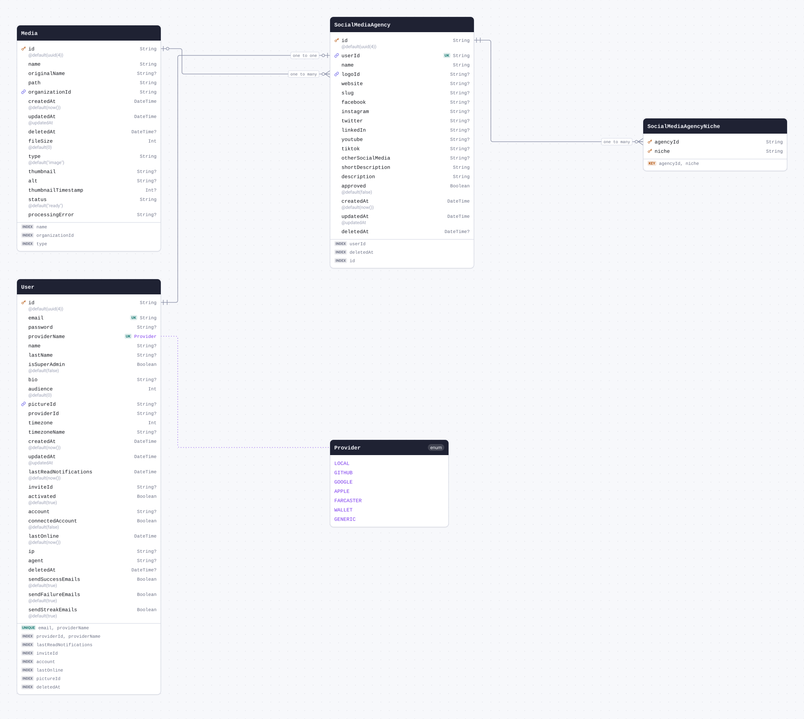

| Field              | Type       | Constraints                              | Default      | Description |
| ------------------ | ---------- | ---------------------------------------- | ------------ | ----------- |
| `id`               | `String`   | PK NOT NULL                              | `uuid(4)`    |             |
| `userId`           | `String`   | UNIQUE NOT NULL → [User.id](#model-User) |              |             |
| `name`             | `String`   | NOT NULL                                 |              |             |
| `logoId`           | `String`   | NULL → [Media.id](#model-Media)          |              |             |
| `website`          | `String`   | NULL                                     |              |             |
| `slug`             | `String`   | NULL                                     |              |             |
| `facebook`         | `String`   | NULL                                     |              |             |
| `instagram`        | `String`   | NULL                                     |              |             |
| `twitter`          | `String`   | NULL                                     |              |             |
| `linkedIn`         | `String`   | NULL                                     |              |             |
| `youtube`          | `String`   | NULL                                     |              |             |
| `tiktok`           | `String`   | NULL                                     |              |             |
| `otherSocialMedia` | `String`   | NULL                                     |              |             |
| `shortDescription` | `String`   | NOT NULL                                 |              |             |
| `description`      | `String`   | NOT NULL                                 |              |             |
| `approved`         | `Boolean`  | NOT NULL                                 | `false`      |             |
| `createdAt`        | `DateTime` | NOT NULL                                 | `now()`      |             |
| `updatedAt`        | `DateTime` | NOT NULL                                 | `@updatedAt` |             |
| `deletedAt`        | `DateTime` | NULL                                     |              |             |

#### Indexes

- `@@index([userId])`
- `@@index([deletedAt])`
- `@@index([id])`

#### References

- `logoId` → [Media.id](#model-Media) (many-to-one)
- `userId` → [User.id](#model-User) (one-to-one)

#### Referenced by

- `id` ← [SocialMediaAgencyNiche.agencyId](#model-SocialMediaAgencyNiche) (one-to-many)

#### Definition

```sql
CREATE TABLE "SocialMediaAgency" (
    "id" TEXT NOT NULL,
    "userId" TEXT NOT NULL,
    "name" TEXT NOT NULL,
    "logoId" TEXT,
    "website" TEXT,
    "slug" TEXT,
    "facebook" TEXT,
    "instagram" TEXT,
    "twitter" TEXT,
    "linkedIn" TEXT,
    "youtube" TEXT,
    "tiktok" TEXT,
    "otherSocialMedia" TEXT,
    "shortDescription" TEXT NOT NULL,
    "description" TEXT NOT NULL,
    "approved" BOOLEAN NOT NULL DEFAULT false,
    "createdAt" TIMESTAMP(3) NOT NULL DEFAULT CURRENT_TIMESTAMP,
    "updatedAt" TIMESTAMP(3) NOT NULL,
    "deletedAt" TIMESTAMP(3),

    CONSTRAINT "SocialMediaAgency_pkey" PRIMARY KEY ("id")
);

CREATE UNIQUE INDEX "SocialMediaAgency_userId_key" ON "SocialMediaAgency"("userId");

CREATE INDEX "SocialMediaAgency_userId_idx" ON "SocialMediaAgency"("userId");

CREATE INDEX "SocialMediaAgency_deletedAt_idx" ON "SocialMediaAgency"("deletedAt");

CREATE INDEX "SocialMediaAgency_id_idx" ON "SocialMediaAgency"("id");

ALTER TABLE "SocialMediaAgency" ADD CONSTRAINT "SocialMediaAgency_logoId_fkey" FOREIGN KEY ("logoId") REFERENCES "Media"("id") ON DELETE SET NULL ON UPDATE CASCADE;

ALTER TABLE "SocialMediaAgency" ADD CONSTRAINT "SocialMediaAgency_userId_fkey" FOREIGN KEY ("userId") REFERENCES "User"("id") ON DELETE RESTRICT ON UPDATE CASCADE;
```

<details>
<summary>Queries and their SQL</summary>

**findMany**: Every row

```ts
await prisma.socialMediaAgency.findMany();
```

```sql
SELECT
  "public"."SocialMediaAgency"."id",
  "public"."SocialMediaAgency"."userId",
  "public"."SocialMediaAgency"."name",
  "public"."SocialMediaAgency"."logoId",
  "public"."SocialMediaAgency"."website",
  "public"."SocialMediaAgency"."slug",
  "public"."SocialMediaAgency"."facebook",
  "public"."SocialMediaAgency"."instagram",
  "public"."SocialMediaAgency"."twitter",
  "public"."SocialMediaAgency"."linkedIn",
  "public"."SocialMediaAgency"."youtube",
  "public"."SocialMediaAgency"."tiktok",
  "public"."SocialMediaAgency"."otherSocialMedia",
  "public"."SocialMediaAgency"."shortDescription",
  "public"."SocialMediaAgency"."description",
  "public"."SocialMediaAgency"."approved",
  "public"."SocialMediaAgency"."createdAt",
  "public"."SocialMediaAgency"."updatedAt",
  "public"."SocialMediaAgency"."deletedAt"
FROM
  "public"."SocialMediaAgency"
WHERE
  1 = 1
OFFSET
  $1
-- params: ["0"]
```

**count**: How many rows there are

```ts
await prisma.socialMediaAgency.count();
```

```sql
SELECT
  COUNT(*) AS "_count$_all"
FROM
  (
    SELECT
      "public"."SocialMediaAgency"."id"
    FROM
      "public"."SocialMediaAgency"
    WHERE
      1 = 1
    OFFSET
      $1
  ) AS "sub"
-- params: ["0"]
```

**findMany**: Every row with its relations

```ts
await prisma.socialMediaAgency.findMany({ include: { logo: true, user: true, niches: true } });
```

```sql
SELECT
  "public"."SocialMediaAgency"."id",
  "public"."SocialMediaAgency"."userId",
  "public"."SocialMediaAgency"."name",
  "public"."SocialMediaAgency"."logoId",
  "public"."SocialMediaAgency"."website",
  "public"."SocialMediaAgency"."slug",
  "public"."SocialMediaAgency"."facebook",
  "public"."SocialMediaAgency"."instagram",
  "public"."SocialMediaAgency"."twitter",
  "public"."SocialMediaAgency"."linkedIn",
  "public"."SocialMediaAgency"."youtube",
  "public"."SocialMediaAgency"."tiktok",
  "public"."SocialMediaAgency"."otherSocialMedia",
  "public"."SocialMediaAgency"."shortDescription",
  "public"."SocialMediaAgency"."description",
  "public"."SocialMediaAgency"."approved",
  "public"."SocialMediaAgency"."createdAt",
  "public"."SocialMediaAgency"."updatedAt",
  "public"."SocialMediaAgency"."deletedAt"
FROM
  "public"."SocialMediaAgency"
WHERE
  1 = 1
OFFSET
  $1
-- params: ["0"]

SELECT
  "public"."Media"."id",
  "public"."Media"."name",
  "public"."Media"."originalName",
  "public"."Media"."path",
  "public"."Media"."organizationId",
  "public"."Media"."createdAt",
  "public"."Media"."updatedAt",
  "public"."Media"."deletedAt",
  "public"."Media"."fileSize",
  "public"."Media"."type",
  "public"."Media"."thumbnail",
  "public"."Media"."alt",
  "public"."Media"."thumbnailTimestamp",
  "public"."Media"."status",
  "public"."Media"."processingError"
FROM
  "public"."Media"
WHERE
  "public"."Media"."id" IN ($1)
OFFSET
  $2
-- params: ["<logoId of the rows above>","0"]

SELECT
  "public"."User"."id",
  "public"."User"."email",
  "public"."User"."password",
  "public"."User"."providerName"::text,
  "public"."User"."name",
  "public"."User"."lastName",
  "public"."User"."isSuperAdmin",
  "public"."User"."bio",
  "public"."User"."audience",
  "public"."User"."pictureId",
  "public"."User"."providerId",
  "public"."User"."timezone",
  "public"."User"."timezoneName",
  "public"."User"."createdAt",
  "public"."User"."updatedAt",
  "public"."User"."lastReadNotifications",
  "public"."User"."inviteId",
  "public"."User"."activated",
  "public"."User"."account",
  "public"."User"."connectedAccount",
  "public"."User"."lastOnline",
  "public"."User"."ip",
  "public"."User"."agent",
  "public"."User"."deletedAt",
  "public"."User"."sendSuccessEmails",
  "public"."User"."sendFailureEmails",
  "public"."User"."sendStreakEmails"
FROM
  "public"."User"
WHERE
  "public"."User"."id" IN ($1)
OFFSET
  $2
-- params: ["<userId of the rows above>","0"]

SELECT
  "public"."SocialMediaAgencyNiche"."agencyId",
  "public"."SocialMediaAgencyNiche"."niche"
FROM
  "public"."SocialMediaAgencyNiche"
WHERE
  "public"."SocialMediaAgencyNiche"."agencyId" IN ($1)
OFFSET
  $2
-- params: ["<id of the rows above>","0"]
```

**findUnique**: One row by what is unique to it

```ts
await prisma.socialMediaAgency.findUnique({ where: { id: "example" } });
```

```sql
SELECT
  "public"."SocialMediaAgency"."id",
  "public"."SocialMediaAgency"."userId",
  "public"."SocialMediaAgency"."name",
  "public"."SocialMediaAgency"."logoId",
  "public"."SocialMediaAgency"."website",
  "public"."SocialMediaAgency"."slug",
  "public"."SocialMediaAgency"."facebook",
  "public"."SocialMediaAgency"."instagram",
  "public"."SocialMediaAgency"."twitter",
  "public"."SocialMediaAgency"."linkedIn",
  "public"."SocialMediaAgency"."youtube",
  "public"."SocialMediaAgency"."tiktok",
  "public"."SocialMediaAgency"."otherSocialMedia",
  "public"."SocialMediaAgency"."shortDescription",
  "public"."SocialMediaAgency"."description",
  "public"."SocialMediaAgency"."approved",
  "public"."SocialMediaAgency"."createdAt",
  "public"."SocialMediaAgency"."updatedAt",
  "public"."SocialMediaAgency"."deletedAt"
FROM
  "public"."SocialMediaAgency"
WHERE
  (
    "public"."SocialMediaAgency"."id" = $1
    AND 1 = 1
  )
LIMIT
  $2
OFFSET
  $3
-- params: ["example","1","0"]
```

**create**: Create a row

```ts
await prisma.socialMediaAgency.create({
  data: { userId: "example", name: "example", shortDescription: "example", description: "example" },
});
```

```sql
INSERT INTO
  "public"."SocialMediaAgency" (
    "id",
    "userId",
    "name",
    "shortDescription",
    "description",
    "approved",
    "createdAt",
    "updatedAt"
  )
VALUES
  ($1, $2, $3, $4, $5, $6, $7, $8)
RETURNING
  "public"."SocialMediaAgency"."id",
  "public"."SocialMediaAgency"."userId",
  "public"."SocialMediaAgency"."name",
  "public"."SocialMediaAgency"."logoId",
  "public"."SocialMediaAgency"."website",
  "public"."SocialMediaAgency"."slug",
  "public"."SocialMediaAgency"."facebook",
  "public"."SocialMediaAgency"."instagram",
  "public"."SocialMediaAgency"."twitter",
  "public"."SocialMediaAgency"."linkedIn",
  "public"."SocialMediaAgency"."youtube",
  "public"."SocialMediaAgency"."tiktok",
  "public"."SocialMediaAgency"."otherSocialMedia",
  "public"."SocialMediaAgency"."shortDescription",
  "public"."SocialMediaAgency"."description",
  "public"."SocialMediaAgency"."approved",
  "public"."SocialMediaAgency"."createdAt",
  "public"."SocialMediaAgency"."updatedAt",
  "public"."SocialMediaAgency"."deletedAt"
-- params: ["<uuid(4)>","example","example","example","example",false,"<now()>","<now()>"]
```

**update**: Update a row

```ts
await prisma.socialMediaAgency.update({ where: { id: "example" }, data: { name: "example" } });
```

```sql
UPDATE "public"."SocialMediaAgency"
SET
  "name" = $1,
  "updatedAt" = $2
WHERE
  (
    "public"."SocialMediaAgency"."id" = $3
    AND 1 = 1
  )
RETURNING
  "public"."SocialMediaAgency"."id",
  "public"."SocialMediaAgency"."userId",
  "public"."SocialMediaAgency"."name",
  "public"."SocialMediaAgency"."logoId",
  "public"."SocialMediaAgency"."website",
  "public"."SocialMediaAgency"."slug",
  "public"."SocialMediaAgency"."facebook",
  "public"."SocialMediaAgency"."instagram",
  "public"."SocialMediaAgency"."twitter",
  "public"."SocialMediaAgency"."linkedIn",
  "public"."SocialMediaAgency"."youtube",
  "public"."SocialMediaAgency"."tiktok",
  "public"."SocialMediaAgency"."otherSocialMedia",
  "public"."SocialMediaAgency"."shortDescription",
  "public"."SocialMediaAgency"."description",
  "public"."SocialMediaAgency"."approved",
  "public"."SocialMediaAgency"."createdAt",
  "public"."SocialMediaAgency"."updatedAt",
  "public"."SocialMediaAgency"."deletedAt"
-- params: ["example",{"prisma__type":"generatorCall","prisma__value":{"name":"now","args":[],"returnType":{"type":"DateTime"}}},"example"]
```

**delete**: Delete a row

```ts
await prisma.socialMediaAgency.delete({ where: { id: "example" } });
```

```sql
DELETE FROM "public"."SocialMediaAgency"
WHERE
  (
    "public"."SocialMediaAgency"."id" = $1
    AND 1 = 1
  )
RETURNING
  "public"."SocialMediaAgency"."id",
  "public"."SocialMediaAgency"."userId",
  "public"."SocialMediaAgency"."name",
  "public"."SocialMediaAgency"."logoId",
  "public"."SocialMediaAgency"."website",
  "public"."SocialMediaAgency"."slug",
  "public"."SocialMediaAgency"."facebook",
  "public"."SocialMediaAgency"."instagram",
  "public"."SocialMediaAgency"."twitter",
  "public"."SocialMediaAgency"."linkedIn",
  "public"."SocialMediaAgency"."youtube",
  "public"."SocialMediaAgency"."tiktok",
  "public"."SocialMediaAgency"."otherSocialMedia",
  "public"."SocialMediaAgency"."shortDescription",
  "public"."SocialMediaAgency"."description",
  "public"."SocialMediaAgency"."approved",
  "public"."SocialMediaAgency"."createdAt",
  "public"."SocialMediaAgency"."updatedAt",
  "public"."SocialMediaAgency"."deletedAt"
-- params: ["example"]
```

</details>

<a id="model-SocialMediaAgencyNiche"></a>

### SocialMediaAgencyNiche

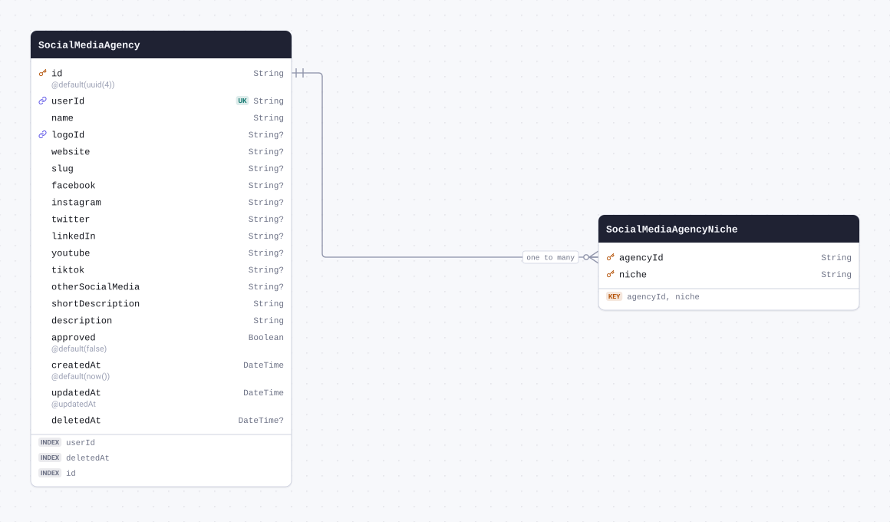

| Field      | Type     | Constraints                                                    | Default | Description |
| ---------- | -------- | -------------------------------------------------------------- | ------- | ----------- |
| `agencyId` | `String` | PK NOT NULL → [SocialMediaAgency.id](#model-SocialMediaAgency) |         |             |
| `niche`    | `String` | PK NOT NULL                                                    |         |             |

#### Indexes

- `@@id([agencyId, niche])`

#### References

- `agencyId` → [SocialMediaAgency.id](#model-SocialMediaAgency) (many-to-one)

#### Definition

```sql
CREATE TABLE "SocialMediaAgencyNiche" (
    "agencyId" TEXT NOT NULL,
    "niche" TEXT NOT NULL,

    CONSTRAINT "SocialMediaAgencyNiche_pkey" PRIMARY KEY ("agencyId","niche")
);

ALTER TABLE "SocialMediaAgencyNiche" ADD CONSTRAINT "SocialMediaAgencyNiche_agencyId_fkey" FOREIGN KEY ("agencyId") REFERENCES "SocialMediaAgency"("id") ON DELETE RESTRICT ON UPDATE CASCADE;
```

<details>
<summary>Queries and their SQL</summary>

**findMany**: Every row

```ts
await prisma.socialMediaAgencyNiche.findMany();
```

```sql
SELECT
  "public"."SocialMediaAgencyNiche"."agencyId",
  "public"."SocialMediaAgencyNiche"."niche"
FROM
  "public"."SocialMediaAgencyNiche"
WHERE
  1 = 1
OFFSET
  $1
-- params: ["0"]
```

**count**: How many rows there are

```ts
await prisma.socialMediaAgencyNiche.count();
```

```sql
SELECT
  COUNT(*) AS "_count$_all"
FROM
  (
    SELECT
      "public"."SocialMediaAgencyNiche"."agencyId",
      "public"."SocialMediaAgencyNiche"."niche"
    FROM
      "public"."SocialMediaAgencyNiche"
    WHERE
      1 = 1
    OFFSET
      $1
  ) AS "sub"
-- params: ["0"]
```

**findMany**: Every row with its relations

```ts
await prisma.socialMediaAgencyNiche.findMany({ include: { agency: true } });
```

```sql
SELECT
  "public"."SocialMediaAgencyNiche"."agencyId",
  "public"."SocialMediaAgencyNiche"."niche"
FROM
  "public"."SocialMediaAgencyNiche"
WHERE
  1 = 1
OFFSET
  $1
-- params: ["0"]

SELECT
  "public"."SocialMediaAgency"."id",
  "public"."SocialMediaAgency"."userId",
  "public"."SocialMediaAgency"."name",
  "public"."SocialMediaAgency"."logoId",
  "public"."SocialMediaAgency"."website",
  "public"."SocialMediaAgency"."slug",
  "public"."SocialMediaAgency"."facebook",
  "public"."SocialMediaAgency"."instagram",
  "public"."SocialMediaAgency"."twitter",
  "public"."SocialMediaAgency"."linkedIn",
  "public"."SocialMediaAgency"."youtube",
  "public"."SocialMediaAgency"."tiktok",
  "public"."SocialMediaAgency"."otherSocialMedia",
  "public"."SocialMediaAgency"."shortDescription",
  "public"."SocialMediaAgency"."description",
  "public"."SocialMediaAgency"."approved",
  "public"."SocialMediaAgency"."createdAt",
  "public"."SocialMediaAgency"."updatedAt",
  "public"."SocialMediaAgency"."deletedAt"
FROM
  "public"."SocialMediaAgency"
WHERE
  "public"."SocialMediaAgency"."id" IN ($1)
OFFSET
  $2
-- params: ["<agencyId of the rows above>","0"]
```

**findUnique**: One row by what is unique to it

```ts
await prisma.socialMediaAgencyNiche.findUnique({
  where: { agencyId_niche: { agencyId: "example", niche: "example" } },
});
```

```sql
SELECT
  "public"."SocialMediaAgencyNiche"."agencyId",
  "public"."SocialMediaAgencyNiche"."niche"
FROM
  "public"."SocialMediaAgencyNiche"
WHERE
  (
    (
      "public"."SocialMediaAgencyNiche"."agencyId" = $1
      AND "public"."SocialMediaAgencyNiche"."niche" = $2
    )
    AND 1 = 1
  )
LIMIT
  $3
OFFSET
  $4
-- params: ["example","example","1","0"]
```

**create**: Create a row

```ts
await prisma.socialMediaAgencyNiche.create({ data: { agencyId: "example", niche: "example" } });
```

```sql
INSERT INTO
  "public"."SocialMediaAgencyNiche" ("agencyId", "niche")
VALUES
  ($1, $2)
RETURNING
  "public"."SocialMediaAgencyNiche"."agencyId",
  "public"."SocialMediaAgencyNiche"."niche"
-- params: ["example","example"]
```

**delete**: Delete a row

```ts
await prisma.socialMediaAgencyNiche.delete({
  where: { agencyId_niche: { agencyId: "example", niche: "example" } },
});
```

```sql
DELETE FROM "public"."SocialMediaAgencyNiche"
WHERE
  (
    (
      "public"."SocialMediaAgencyNiche"."agencyId" = $1
      AND "public"."SocialMediaAgencyNiche"."niche" = $2
    )
    AND 1 = 1
  )
RETURNING
  "public"."SocialMediaAgencyNiche"."agencyId",
  "public"."SocialMediaAgencyNiche"."niche"
-- params: ["example","example"]
```

</details>

<a id="model-Credits"></a>

### Credits

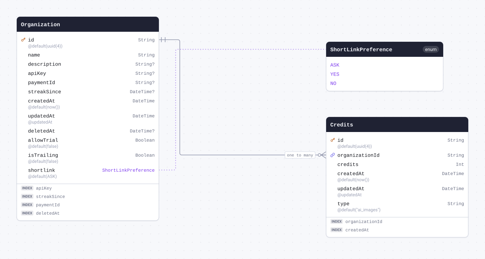

| Field            | Type       | Constraints                                       | Default       | Description |
| ---------------- | ---------- | ------------------------------------------------- | ------------- | ----------- |
| `id`             | `String`   | PK NOT NULL                                       | `uuid(4)`     |             |
| `organizationId` | `String`   | NOT NULL → [Organization.id](#model-Organization) |               |             |
| `credits`        | `Int`      | NOT NULL                                          |               |             |
| `createdAt`      | `DateTime` | NOT NULL                                          | `now()`       |             |
| `updatedAt`      | `DateTime` | NOT NULL                                          | `@updatedAt`  |             |
| `type`           | `String`   | NOT NULL                                          | `"ai_images"` |             |

#### Indexes

- `@@index([organizationId])`
- `@@index([createdAt])`

#### References

- `organizationId` → [Organization.id](#model-Organization) (many-to-one)

#### Definition

```sql
CREATE TABLE "Credits" (
    "id" TEXT NOT NULL,
    "organizationId" TEXT NOT NULL,
    "credits" INTEGER NOT NULL,
    "createdAt" TIMESTAMP(3) NOT NULL DEFAULT CURRENT_TIMESTAMP,
    "updatedAt" TIMESTAMP(3) NOT NULL,
    "type" TEXT NOT NULL DEFAULT 'ai_images',

    CONSTRAINT "Credits_pkey" PRIMARY KEY ("id")
);

CREATE INDEX "Credits_organizationId_idx" ON "Credits"("organizationId");

CREATE INDEX "Credits_createdAt_idx" ON "Credits"("createdAt");

ALTER TABLE "Credits" ADD CONSTRAINT "Credits_organizationId_fkey" FOREIGN KEY ("organizationId") REFERENCES "Organization"("id") ON DELETE RESTRICT ON UPDATE CASCADE;
```

<details>
<summary>Queries and their SQL</summary>

**findMany**: Every row

```ts
await prisma.credits.findMany();
```

```sql
SELECT
  "public"."Credits"."id",
  "public"."Credits"."organizationId",
  "public"."Credits"."credits",
  "public"."Credits"."createdAt",
  "public"."Credits"."updatedAt",
  "public"."Credits"."type"
FROM
  "public"."Credits"
WHERE
  1 = 1
OFFSET
  $1
-- params: ["0"]
```

**count**: How many rows there are

```ts
await prisma.credits.count();
```

```sql
SELECT
  COUNT(*) AS "_count$_all"
FROM
  (
    SELECT
      "public"."Credits"."id"
    FROM
      "public"."Credits"
    WHERE
      1 = 1
    OFFSET
      $1
  ) AS "sub"
-- params: ["0"]
```

**findMany**: Every row with its relations

```ts
await prisma.credits.findMany({ include: { organization: true } });
```

```sql
SELECT
  "public"."Credits"."id",
  "public"."Credits"."organizationId",
  "public"."Credits"."credits",
  "public"."Credits"."createdAt",
  "public"."Credits"."updatedAt",
  "public"."Credits"."type"
FROM
  "public"."Credits"
WHERE
  1 = 1
OFFSET
  $1
-- params: ["0"]

SELECT
  "public"."Organization"."id",
  "public"."Organization"."name",
  "public"."Organization"."description",
  "public"."Organization"."apiKey",
  "public"."Organization"."paymentId",
  "public"."Organization"."streakSince",
  "public"."Organization"."createdAt",
  "public"."Organization"."updatedAt",
  "public"."Organization"."deletedAt",
  "public"."Organization"."allowTrial",
  "public"."Organization"."isTrailing",
  "public"."Organization"."shortlink"::text
FROM
  "public"."Organization"
WHERE
  "public"."Organization"."id" IN ($1)
OFFSET
  $2
-- params: ["<organizationId of the rows above>","0"]
```

**findUnique**: One row by what is unique to it

```ts
await prisma.credits.findUnique({ where: { id: "example" } });
```

```sql
SELECT
  "public"."Credits"."id",
  "public"."Credits"."organizationId",
  "public"."Credits"."credits",
  "public"."Credits"."createdAt",
  "public"."Credits"."updatedAt",
  "public"."Credits"."type"
FROM
  "public"."Credits"
WHERE
  (
    "public"."Credits"."id" = $1
    AND 1 = 1
  )
LIMIT
  $2
OFFSET
  $3
-- params: ["example","1","0"]
```

**create**: Create a row

```ts
await prisma.credits.create({ data: { organizationId: "example", credits: 1 } });
```

```sql
INSERT INTO
  "public"."Credits" (
    "id",
    "organizationId",
    "credits",
    "createdAt",
    "updatedAt",
    "type"
  )
VALUES
  ($1, $2, $3, $4, $5, $6)
RETURNING
  "public"."Credits"."id",
  "public"."Credits"."organizationId",
  "public"."Credits"."credits",
  "public"."Credits"."createdAt",
  "public"."Credits"."updatedAt",
  "public"."Credits"."type"
-- params: ["<uuid(4)>","example","1","<now()>","<now()>","ai_images"]
```

**update**: Update a row

```ts
await prisma.credits.update({ where: { id: "example" }, data: { credits: 1 } });
```

```sql
UPDATE "public"."Credits"
SET
  "credits" = $1,
  "updatedAt" = $2
WHERE
  (
    "public"."Credits"."id" = $3
    AND 1 = 1
  )
RETURNING
  "public"."Credits"."id",
  "public"."Credits"."organizationId",
  "public"."Credits"."credits",
  "public"."Credits"."createdAt",
  "public"."Credits"."updatedAt",
  "public"."Credits"."type"
-- params: ["1",{"prisma__type":"generatorCall","prisma__value":{"name":"now","args":[],"returnType":{"type":"DateTime"}}},"example"]
```

**delete**: Delete a row

```ts
await prisma.credits.delete({ where: { id: "example" } });
```

```sql
DELETE FROM "public"."Credits"
WHERE
  (
    "public"."Credits"."id" = $1
    AND 1 = 1
  )
RETURNING
  "public"."Credits"."id",
  "public"."Credits"."organizationId",
  "public"."Credits"."credits",
  "public"."Credits"."createdAt",
  "public"."Credits"."updatedAt",
  "public"."Credits"."type"
-- params: ["example"]
```

</details>

<a id="model-Clipping"></a>

### Clipping

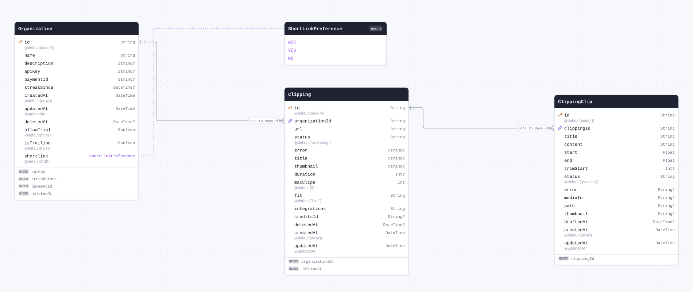

| Field            | Type       | Constraints                                       | Default       | Description |
| ---------------- | ---------- | ------------------------------------------------- | ------------- | ----------- |
| `id`             | `String`   | PK NOT NULL                                       | `uuid(4)`     |             |
| `organizationId` | `String`   | NOT NULL → [Organization.id](#model-Organization) |               |             |
| `url`            | `String`   | NOT NULL                                          |               |             |
| `status`         | `String`   | NOT NULL                                          | `"analysing"` |             |
| `error`          | `String`   | NULL                                              |               |             |
| `title`          | `String`   | NULL                                              |               |             |
| `thumbnail`      | `String`   | NULL                                              |               |             |
| `duration`       | `Int`      | NULL                                              |               |             |
| `maxClips`       | `Int`      | NOT NULL                                          | `5`           |             |
| `fit`            | `String`   | NOT NULL                                          | `"blur"`      |             |
| `integrations`   | `String`   | NOT NULL                                          |               |             |
| `creditsId`      | `String`   | NULL                                              |               |             |
| `deletedAt`      | `DateTime` | NULL                                              |               |             |
| `createdAt`      | `DateTime` | NOT NULL                                          | `now()`       |             |
| `updatedAt`      | `DateTime` | NOT NULL                                          | `@updatedAt`  |             |

#### Indexes

- `@@index([organizationId])`
- `@@index([deletedAt])`

#### References

- `organizationId` → [Organization.id](#model-Organization) (many-to-one)

#### Referenced by

- `id` ← [ClippingClip.clippingId](#model-ClippingClip) (one-to-many)

#### Definition

```sql
CREATE TABLE "Clipping" (
    "id" TEXT NOT NULL,
    "organizationId" TEXT NOT NULL,
    "url" TEXT NOT NULL,
    "status" TEXT NOT NULL DEFAULT 'analysing',
    "error" TEXT,
    "title" TEXT,
    "thumbnail" TEXT,
    "duration" INTEGER,
    "maxClips" INTEGER NOT NULL DEFAULT 5,
    "fit" TEXT NOT NULL DEFAULT 'blur',
    "integrations" TEXT NOT NULL,
    "creditsId" TEXT,
    "deletedAt" TIMESTAMP(3),
    "createdAt" TIMESTAMP(3) NOT NULL DEFAULT CURRENT_TIMESTAMP,
    "updatedAt" TIMESTAMP(3) NOT NULL,

    CONSTRAINT "Clipping_pkey" PRIMARY KEY ("id")
);

CREATE INDEX "Clipping_organizationId_idx" ON "Clipping"("organizationId");

CREATE INDEX "Clipping_deletedAt_idx" ON "Clipping"("deletedAt");

ALTER TABLE "Clipping" ADD CONSTRAINT "Clipping_organizationId_fkey" FOREIGN KEY ("organizationId") REFERENCES "Organization"("id") ON DELETE RESTRICT ON UPDATE CASCADE;
```

<details>
<summary>Queries and their SQL</summary>

**findMany**: Every row

```ts
await prisma.clipping.findMany();
```

```sql
SELECT
  "public"."Clipping"."id",
  "public"."Clipping"."organizationId",
  "public"."Clipping"."url",
  "public"."Clipping"."status",
  "public"."Clipping"."error",
  "public"."Clipping"."title",
  "public"."Clipping"."thumbnail",
  "public"."Clipping"."duration",
  "public"."Clipping"."maxClips",
  "public"."Clipping"."fit",
  "public"."Clipping"."integrations",
  "public"."Clipping"."creditsId",
  "public"."Clipping"."deletedAt",
  "public"."Clipping"."createdAt",
  "public"."Clipping"."updatedAt"
FROM
  "public"."Clipping"
WHERE
  1 = 1
OFFSET
  $1
-- params: ["0"]
```

**count**: How many rows there are

```ts
await prisma.clipping.count();
```

```sql
SELECT
  COUNT(*) AS "_count$_all"
FROM
  (
    SELECT
      "public"."Clipping"."id"
    FROM
      "public"."Clipping"
    WHERE
      1 = 1
    OFFSET
      $1
  ) AS "sub"
-- params: ["0"]
```

**findMany**: Every row with its relations

```ts
await prisma.clipping.findMany({ include: { organization: true, clips: true } });
```

```sql
SELECT
  "public"."Clipping"."id",
  "public"."Clipping"."organizationId",
  "public"."Clipping"."url",
  "public"."Clipping"."status",
  "public"."Clipping"."error",
  "public"."Clipping"."title",
  "public"."Clipping"."thumbnail",
  "public"."Clipping"."duration",
  "public"."Clipping"."maxClips",
  "public"."Clipping"."fit",
  "public"."Clipping"."integrations",
  "public"."Clipping"."creditsId",
  "public"."Clipping"."deletedAt",
  "public"."Clipping"."createdAt",
  "public"."Clipping"."updatedAt"
FROM
  "public"."Clipping"
WHERE
  1 = 1
OFFSET
  $1
-- params: ["0"]

SELECT
  "public"."Organization"."id",
  "public"."Organization"."name",
  "public"."Organization"."description",
  "public"."Organization"."apiKey",
  "public"."Organization"."paymentId",
  "public"."Organization"."streakSince",
  "public"."Organization"."createdAt",
  "public"."Organization"."updatedAt",
  "public"."Organization"."deletedAt",
  "public"."Organization"."allowTrial",
  "public"."Organization"."isTrailing",
  "public"."Organization"."shortlink"::text
FROM
  "public"."Organization"
WHERE
  "public"."Organization"."id" IN ($1)
OFFSET
  $2
-- params: ["<organizationId of the rows above>","0"]

SELECT
  "public"."ClippingClip"."id",
  "public"."ClippingClip"."clippingId",
  "public"."ClippingClip"."title",
  "public"."ClippingClip"."content",
  "public"."ClippingClip"."start",
  "public"."ClippingClip"."end",
  "public"."ClippingClip"."trimStart",
  "public"."ClippingClip"."status",
  "public"."ClippingClip"."error",
  "public"."ClippingClip"."mediaId",
  "public"."ClippingClip"."path",
  "public"."ClippingClip"."thumbnail",
  "public"."ClippingClip"."draftedAt",
  "public"."ClippingClip"."createdAt",
  "public"."ClippingClip"."updatedAt"
FROM
  "public"."ClippingClip"
WHERE
  "public"."ClippingClip"."clippingId" IN ($1)
OFFSET
  $2
-- params: ["<id of the rows above>","0"]
```

**findUnique**: One row by what is unique to it

```ts
await prisma.clipping.findUnique({ where: { id: "example" } });
```

```sql
SELECT
  "public"."Clipping"."id",
  "public"."Clipping"."organizationId",
  "public"."Clipping"."url",
  "public"."Clipping"."status",
  "public"."Clipping"."error",
  "public"."Clipping"."title",
  "public"."Clipping"."thumbnail",
  "public"."Clipping"."duration",
  "public"."Clipping"."maxClips",
  "public"."Clipping"."fit",
  "public"."Clipping"."integrations",
  "public"."Clipping"."creditsId",
  "public"."Clipping"."deletedAt",
  "public"."Clipping"."createdAt",
  "public"."Clipping"."updatedAt"
FROM
  "public"."Clipping"
WHERE
  (
    "public"."Clipping"."id" = $1
    AND 1 = 1
  )
LIMIT
  $2
OFFSET
  $3
-- params: ["example","1","0"]
```

**create**: Create a row

```ts
await prisma.clipping.create({
  data: { organizationId: "example", url: "example", integrations: "example" },
});
```

```sql
INSERT INTO
  "public"."Clipping" (
    "id",
    "organizationId",
    "url",
    "status",
    "maxClips",
    "fit",
    "integrations",
    "createdAt",
    "updatedAt"
  )
VALUES
  ($1, $2, $3, $4, $5, $6, $7, $8, $9)
RETURNING
  "public"."Clipping"."id",
  "public"."Clipping"."organizationId",
  "public"."Clipping"."url",
  "public"."Clipping"."status",
  "public"."Clipping"."error",
  "public"."Clipping"."title",
  "public"."Clipping"."thumbnail",
  "public"."Clipping"."duration",
  "public"."Clipping"."maxClips",
  "public"."Clipping"."fit",
  "public"."Clipping"."integrations",
  "public"."Clipping"."creditsId",
  "public"."Clipping"."deletedAt",
  "public"."Clipping"."createdAt",
  "public"."Clipping"."updatedAt"
-- params: ["<uuid(4)>","example","example","analysing","5","blur","example","<now()>","<now()>"]
```

**update**: Update a row

```ts
await prisma.clipping.update({ where: { id: "example" }, data: { url: "example" } });
```

```sql
UPDATE "public"."Clipping"
SET
  "url" = $1,
  "updatedAt" = $2
WHERE
  (
    "public"."Clipping"."id" = $3
    AND 1 = 1
  )
RETURNING
  "public"."Clipping"."id",
  "public"."Clipping"."organizationId",
  "public"."Clipping"."url",
  "public"."Clipping"."status",
  "public"."Clipping"."error",
  "public"."Clipping"."title",
  "public"."Clipping"."thumbnail",
  "public"."Clipping"."duration",
  "public"."Clipping"."maxClips",
  "public"."Clipping"."fit",
  "public"."Clipping"."integrations",
  "public"."Clipping"."creditsId",
  "public"."Clipping"."deletedAt",
  "public"."Clipping"."createdAt",
  "public"."Clipping"."updatedAt"
-- params: ["example",{"prisma__type":"generatorCall","prisma__value":{"name":"now","args":[],"returnType":{"type":"DateTime"}}},"example"]
```

**delete**: Delete a row

```ts
await prisma.clipping.delete({ where: { id: "example" } });
```

```sql
DELETE FROM "public"."Clipping"
WHERE
  (
    "public"."Clipping"."id" = $1
    AND 1 = 1
  )
RETURNING
  "public"."Clipping"."id",
  "public"."Clipping"."organizationId",
  "public"."Clipping"."url",
  "public"."Clipping"."status",
  "public"."Clipping"."error",
  "public"."Clipping"."title",
  "public"."Clipping"."thumbnail",
  "public"."Clipping"."duration",
  "public"."Clipping"."maxClips",
  "public"."Clipping"."fit",
  "public"."Clipping"."integrations",
  "public"."Clipping"."creditsId",
  "public"."Clipping"."deletedAt",
  "public"."Clipping"."createdAt",
  "public"."Clipping"."updatedAt"
-- params: ["example"]
```

</details>

<a id="model-ClippingClip"></a>

### ClippingClip

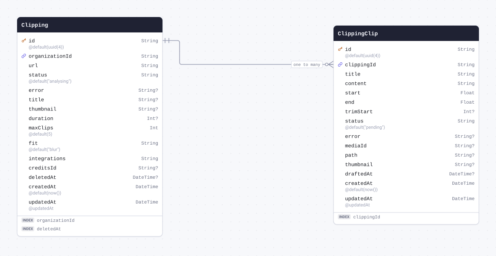

| Field        | Type       | Constraints                               | Default      | Description |
| ------------ | ---------- | ----------------------------------------- | ------------ | ----------- |
| `id`         | `String`   | PK NOT NULL                               | `uuid(4)`    |             |
| `clippingId` | `String`   | NOT NULL → [Clipping.id](#model-Clipping) |              |             |
| `title`      | `String`   | NOT NULL                                  |              |             |
| `content`    | `String`   | NOT NULL                                  |              |             |
| `start`      | `Float`    | NOT NULL                                  |              |             |
| `end`        | `Float`    | NOT NULL                                  |              |             |
| `trimStart`  | `Int`      | NULL                                      |              |             |
| `status`     | `String`   | NOT NULL                                  | `"pending"`  |             |
| `error`      | `String`   | NULL                                      |              |             |
| `mediaId`    | `String`   | NULL                                      |              |             |
| `path`       | `String`   | NULL                                      |              |             |
| `thumbnail`  | `String`   | NULL                                      |              |             |
| `draftedAt`  | `DateTime` | NULL                                      |              |             |
| `createdAt`  | `DateTime` | NOT NULL                                  | `now()`      |             |
| `updatedAt`  | `DateTime` | NOT NULL                                  | `@updatedAt` |             |

#### Indexes

- `@@index([clippingId])`

#### References

- `clippingId` → [Clipping.id](#model-Clipping) (many-to-one)

#### Definition

```sql
CREATE TABLE "ClippingClip" (
    "id" TEXT NOT NULL,
    "clippingId" TEXT NOT NULL,
    "title" TEXT NOT NULL,
    "content" TEXT NOT NULL,
    "start" DOUBLE PRECISION NOT NULL,
    "end" DOUBLE PRECISION NOT NULL,
    "trimStart" INTEGER,
    "status" TEXT NOT NULL DEFAULT 'pending',
    "error" TEXT,
    "mediaId" TEXT,
    "path" TEXT,
    "thumbnail" TEXT,
    "draftedAt" TIMESTAMP(3),
    "createdAt" TIMESTAMP(3) NOT NULL DEFAULT CURRENT_TIMESTAMP,
    "updatedAt" TIMESTAMP(3) NOT NULL,

    CONSTRAINT "ClippingClip_pkey" PRIMARY KEY ("id")
);

CREATE INDEX "ClippingClip_clippingId_idx" ON "ClippingClip"("clippingId");

ALTER TABLE "ClippingClip" ADD CONSTRAINT "ClippingClip_clippingId_fkey" FOREIGN KEY ("clippingId") REFERENCES "Clipping"("id") ON DELETE RESTRICT ON UPDATE CASCADE;
```

<details>
<summary>Queries and their SQL</summary>

**findMany**: Every row

```ts
await prisma.clippingClip.findMany();
```

```sql
SELECT
  "public"."ClippingClip"."id",
  "public"."ClippingClip"."clippingId",
  "public"."ClippingClip"."title",
  "public"."ClippingClip"."content",
  "public"."ClippingClip"."start",
  "public"."ClippingClip"."end",
  "public"."ClippingClip"."trimStart",
  "public"."ClippingClip"."status",
  "public"."ClippingClip"."error",
  "public"."ClippingClip"."mediaId",
  "public"."ClippingClip"."path",
  "public"."ClippingClip"."thumbnail",
  "public"."ClippingClip"."draftedAt",
  "public"."ClippingClip"."createdAt",
  "public"."ClippingClip"."updatedAt"
FROM
  "public"."ClippingClip"
WHERE
  1 = 1
OFFSET
  $1
-- params: ["0"]
```

**count**: How many rows there are

```ts
await prisma.clippingClip.count();
```

```sql
SELECT
  COUNT(*) AS "_count$_all"
FROM
  (
    SELECT
      "public"."ClippingClip"."id"
    FROM
      "public"."ClippingClip"
    WHERE
      1 = 1
    OFFSET
      $1
  ) AS "sub"
-- params: ["0"]
```

**findMany**: Every row with its relations

```ts
await prisma.clippingClip.findMany({ include: { clipping: true } });
```

```sql
SELECT
  "public"."ClippingClip"."id",
  "public"."ClippingClip"."clippingId",
  "public"."ClippingClip"."title",
  "public"."ClippingClip"."content",
  "public"."ClippingClip"."start",
  "public"."ClippingClip"."end",
  "public"."ClippingClip"."trimStart",
  "public"."ClippingClip"."status",
  "public"."ClippingClip"."error",
  "public"."ClippingClip"."mediaId",
  "public"."ClippingClip"."path",
  "public"."ClippingClip"."thumbnail",
  "public"."ClippingClip"."draftedAt",
  "public"."ClippingClip"."createdAt",
  "public"."ClippingClip"."updatedAt"
FROM
  "public"."ClippingClip"
WHERE
  1 = 1
OFFSET
  $1
-- params: ["0"]

SELECT
  "public"."Clipping"."id",
  "public"."Clipping"."organizationId",
  "public"."Clipping"."url",
  "public"."Clipping"."status",
  "public"."Clipping"."error",
  "public"."Clipping"."title",
  "public"."Clipping"."thumbnail",
  "public"."Clipping"."duration",
  "public"."Clipping"."maxClips",
  "public"."Clipping"."fit",
  "public"."Clipping"."integrations",
  "public"."Clipping"."creditsId",
  "public"."Clipping"."deletedAt",
  "public"."Clipping"."createdAt",
  "public"."Clipping"."updatedAt"
FROM
  "public"."Clipping"
WHERE
  "public"."Clipping"."id" IN ($1)
OFFSET
  $2
-- params: ["<clippingId of the rows above>","0"]
```

**findUnique**: One row by what is unique to it

```ts
await prisma.clippingClip.findUnique({ where: { id: "example" } });
```

```sql
SELECT
  "public"."ClippingClip"."id",
  "public"."ClippingClip"."clippingId",
  "public"."ClippingClip"."title",
  "public"."ClippingClip"."content",
  "public"."ClippingClip"."start",
  "public"."ClippingClip"."end",
  "public"."ClippingClip"."trimStart",
  "public"."ClippingClip"."status",
  "public"."ClippingClip"."error",
  "public"."ClippingClip"."mediaId",
  "public"."ClippingClip"."path",
  "public"."ClippingClip"."thumbnail",
  "public"."ClippingClip"."draftedAt",
  "public"."ClippingClip"."createdAt",
  "public"."ClippingClip"."updatedAt"
FROM
  "public"."ClippingClip"
WHERE
  (
    "public"."ClippingClip"."id" = $1
    AND 1 = 1
  )
LIMIT
  $2
OFFSET
  $3
-- params: ["example","1","0"]
```

**create**: Create a row

```ts
await prisma.clippingClip.create({
  data: { clippingId: "example", title: "example", content: "example", start: 1.5, end: 1.5 },
});
```

```sql
INSERT INTO
  "public"."ClippingClip" (
    "id",
    "clippingId",
    "title",
    "content",
    "start",
    "end",
    "status",
    "createdAt",
    "updatedAt"
  )
VALUES
  ($1, $2, $3, $4, $5, $6, $7, $8, $9)
RETURNING
  "public"."ClippingClip"."id",
  "public"."ClippingClip"."clippingId",
  "public"."ClippingClip"."title",
  "public"."ClippingClip"."content",
  "public"."ClippingClip"."start",
  "public"."ClippingClip"."end",
  "public"."ClippingClip"."trimStart",
  "public"."ClippingClip"."status",
  "public"."ClippingClip"."error",
  "public"."ClippingClip"."mediaId",
  "public"."ClippingClip"."path",
  "public"."ClippingClip"."thumbnail",
  "public"."ClippingClip"."draftedAt",
  "public"."ClippingClip"."createdAt",
  "public"."ClippingClip"."updatedAt"
-- params: ["<uuid(4)>","example","example","example","1.5","1.5","pending","<now()>","<now()>"]
```

**update**: Update a row

```ts
await prisma.clippingClip.update({ where: { id: "example" }, data: { title: "example" } });
```

```sql
UPDATE "public"."ClippingClip"
SET
  "title" = $1,
  "updatedAt" = $2
WHERE
  (
    "public"."ClippingClip"."id" = $3
    AND 1 = 1
  )
RETURNING
  "public"."ClippingClip"."id",
  "public"."ClippingClip"."clippingId",
  "public"."ClippingClip"."title",
  "public"."ClippingClip"."content",
  "public"."ClippingClip"."start",
  "public"."ClippingClip"."end",
  "public"."ClippingClip"."trimStart",
  "public"."ClippingClip"."status",
  "public"."ClippingClip"."error",
  "public"."ClippingClip"."mediaId",
  "public"."ClippingClip"."path",
  "public"."ClippingClip"."thumbnail",
  "public"."ClippingClip"."draftedAt",
  "public"."ClippingClip"."createdAt",
  "public"."ClippingClip"."updatedAt"
-- params: ["example",{"prisma__type":"generatorCall","prisma__value":{"name":"now","args":[],"returnType":{"type":"DateTime"}}},"example"]
```

**delete**: Delete a row

```ts
await prisma.clippingClip.delete({ where: { id: "example" } });
```

```sql
DELETE FROM "public"."ClippingClip"
WHERE
  (
    "public"."ClippingClip"."id" = $1
    AND 1 = 1
  )
RETURNING
  "public"."ClippingClip"."id",
  "public"."ClippingClip"."clippingId",
  "public"."ClippingClip"."title",
  "public"."ClippingClip"."content",
  "public"."ClippingClip"."start",
  "public"."ClippingClip"."end",
  "public"."ClippingClip"."trimStart",
  "public"."ClippingClip"."status",
  "public"."ClippingClip"."error",
  "public"."ClippingClip"."mediaId",
  "public"."ClippingClip"."path",
  "public"."ClippingClip"."thumbnail",
  "public"."ClippingClip"."draftedAt",
  "public"."ClippingClip"."createdAt",
  "public"."ClippingClip"."updatedAt"
-- params: ["example"]
```

</details>

<a id="model-Subscription"></a>

### Subscription

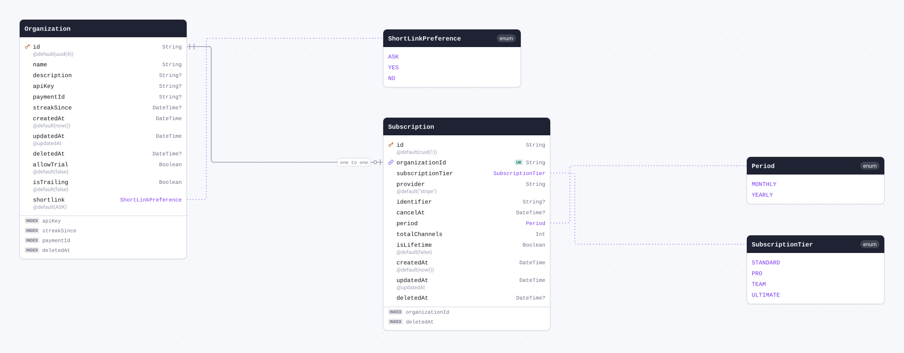

| Field              | Type                                         | Constraints                                              | Default      | Description |
| ------------------ | -------------------------------------------- | -------------------------------------------------------- | ------------ | ----------- |
| `id`               | `String`                                     | PK NOT NULL                                              | `cuid(1)`    |             |
| `organizationId`   | `String`                                     | UNIQUE NOT NULL → [Organization.id](#model-Organization) |              |             |
| `subscriptionTier` | [`SubscriptionTier`](#enum-SubscriptionTier) | NOT NULL                                                 |              |             |
| `provider`         | `String`                                     | NOT NULL                                                 | `"stripe"`   |             |
| `identifier`       | `String`                                     | NULL                                                     |              |             |
| `cancelAt`         | `DateTime`                                   | NULL                                                     |              |             |
| `period`           | [`Period`](#enum-Period)                     | NOT NULL                                                 |              |             |
| `totalChannels`    | `Int`                                        | NOT NULL                                                 |              |             |
| `isLifetime`       | `Boolean`                                    | NOT NULL                                                 | `false`      |             |
| `createdAt`        | `DateTime`                                   | NOT NULL                                                 | `now()`      |             |
| `updatedAt`        | `DateTime`                                   | NOT NULL                                                 | `@updatedAt` |             |
| `deletedAt`        | `DateTime`                                   | NULL                                                     |              |             |

#### Indexes

- `@@index([organizationId])`
- `@@index([deletedAt])`

#### References

- `organizationId` → [Organization.id](#model-Organization) (one-to-one)

#### Definition

```sql
CREATE TABLE "Subscription" (
    "id" TEXT NOT NULL,
    "organizationId" TEXT NOT NULL,
    "subscriptionTier" "SubscriptionTier" NOT NULL,
    "provider" TEXT NOT NULL DEFAULT 'stripe',
    "identifier" TEXT,
    "cancelAt" TIMESTAMP(3),
    "period" "Period" NOT NULL,
    "totalChannels" INTEGER NOT NULL,
    "isLifetime" BOOLEAN NOT NULL DEFAULT false,
    "createdAt" TIMESTAMP(3) NOT NULL DEFAULT CURRENT_TIMESTAMP,
    "updatedAt" TIMESTAMP(3) NOT NULL,
    "deletedAt" TIMESTAMP(3),

    CONSTRAINT "Subscription_pkey" PRIMARY KEY ("id")
);

CREATE UNIQUE INDEX "Subscription_organizationId_key" ON "Subscription"("organizationId");

CREATE INDEX "Subscription_organizationId_idx" ON "Subscription"("organizationId");

CREATE INDEX "Subscription_deletedAt_idx" ON "Subscription"("deletedAt");

ALTER TABLE "Subscription" ADD CONSTRAINT "Subscription_organizationId_fkey" FOREIGN KEY ("organizationId") REFERENCES "Organization"("id") ON DELETE RESTRICT ON UPDATE CASCADE;
```

<details>
<summary>Queries and their SQL</summary>

**findMany**: Every row

```ts
await prisma.subscription.findMany();
```

```sql
SELECT
  "public"."Subscription"."id",
  "public"."Subscription"."organizationId",
  "public"."Subscription"."subscriptionTier"::text,
  "public"."Subscription"."provider",
  "public"."Subscription"."identifier",
  "public"."Subscription"."cancelAt",
  "public"."Subscription"."period"::text,
  "public"."Subscription"."totalChannels",
  "public"."Subscription"."isLifetime",
  "public"."Subscription"."createdAt",
  "public"."Subscription"."updatedAt",
  "public"."Subscription"."deletedAt"
FROM
  "public"."Subscription"
WHERE
  1 = 1
OFFSET
  $1
-- params: ["0"]
```

**count**: How many rows there are

```ts
await prisma.subscription.count();
```

```sql
SELECT
  COUNT(*) AS "_count$_all"
FROM
  (
    SELECT
      "public"."Subscription"."id"
    FROM
      "public"."Subscription"
    WHERE
      1 = 1
    OFFSET
      $1
  ) AS "sub"
-- params: ["0"]
```

**findMany**: Every row with its relations

```ts
await prisma.subscription.findMany({ include: { organization: true } });
```

```sql
SELECT
  "public"."Subscription"."id",
  "public"."Subscription"."organizationId",
  "public"."Subscription"."subscriptionTier"::text,
  "public"."Subscription"."provider",
  "public"."Subscription"."identifier",
  "public"."Subscription"."cancelAt",
  "public"."Subscription"."period"::text,
  "public"."Subscription"."totalChannels",
  "public"."Subscription"."isLifetime",
  "public"."Subscription"."createdAt",
  "public"."Subscription"."updatedAt",
  "public"."Subscription"."deletedAt"
FROM
  "public"."Subscription"
WHERE
  1 = 1
OFFSET
  $1
-- params: ["0"]

SELECT
  "public"."Organization"."id",
  "public"."Organization"."name",
  "public"."Organization"."description",
  "public"."Organization"."apiKey",
  "public"."Organization"."paymentId",
  "public"."Organization"."streakSince",
  "public"."Organization"."createdAt",
  "public"."Organization"."updatedAt",
  "public"."Organization"."deletedAt",
  "public"."Organization"."allowTrial",
  "public"."Organization"."isTrailing",
  "public"."Organization"."shortlink"::text
FROM
  "public"."Organization"
WHERE
  "public"."Organization"."id" IN ($1)
OFFSET
  $2
-- params: ["<organizationId of the rows above>","0"]
```

**findUnique**: One row by what is unique to it

```ts
await prisma.subscription.findUnique({ where: { id: "example" } });
```

```sql
SELECT
  "public"."Subscription"."id",
  "public"."Subscription"."organizationId",
  "public"."Subscription"."subscriptionTier"::text,
  "public"."Subscription"."provider",
  "public"."Subscription"."identifier",
  "public"."Subscription"."cancelAt",
  "public"."Subscription"."period"::text,
  "public"."Subscription"."totalChannels",
  "public"."Subscription"."isLifetime",
  "public"."Subscription"."createdAt",
  "public"."Subscription"."updatedAt",
  "public"."Subscription"."deletedAt"
FROM
  "public"."Subscription"
WHERE
  (
    "public"."Subscription"."id" = $1
    AND 1 = 1
  )
LIMIT
  $2
OFFSET
  $3
-- params: ["example","1","0"]
```

**create**: Create a row

```ts
await prisma.subscription.create({
  data: {
    organizationId: "example",
    subscriptionTier: "STANDARD",
    period: "MONTHLY",
    totalChannels: 1,
  },
});
```

```sql
INSERT INTO
  "public"."Subscription" (
    "id",
    "organizationId",
    "subscriptionTier",
    "provider",
    "period",
    "totalChannels",
    "isLifetime",
    "createdAt",
    "updatedAt"
  )
VALUES
  (
    $1,
    $2,
    CAST($3::text AS "public"."SubscriptionTier"),
    $4,
    CAST($5::text AS "public"."Period"),
    $6,
    $7,
    $8,
    $9
  )
RETURNING
  "public"."Subscription"."id",
  "public"."Subscription"."organizationId",
  "public"."Subscription"."subscriptionTier"::text,
  "public"."Subscription"."provider",
  "public"."Subscription"."identifier",
  "public"."Subscription"."cancelAt",
  "public"."Subscription"."period"::text,
  "public"."Subscription"."totalChannels",
  "public"."Subscription"."isLifetime",
  "public"."Subscription"."createdAt",
  "public"."Subscription"."updatedAt",
  "public"."Subscription"."deletedAt"
-- params: ["<cuid(1)>","example","STANDARD","stripe","MONTHLY","1",false,"<now()>","<now()>"]
```

**update**: Update a row

```ts
await prisma.subscription.update({
  where: { id: "example" },
  data: { subscriptionTier: "STANDARD" },
});
```

```sql
UPDATE "public"."Subscription"
SET
  "subscriptionTier" = CAST($1::text AS "public"."SubscriptionTier"),
  "updatedAt" = $2
WHERE
  (
    "public"."Subscription"."id" = $3
    AND 1 = 1
  )
RETURNING
  "public"."Subscription"."id",
  "public"."Subscription"."organizationId",
  "public"."Subscription"."subscriptionTier"::text,
  "public"."Subscription"."provider",
  "public"."Subscription"."identifier",
  "public"."Subscription"."cancelAt",
  "public"."Subscription"."period"::text,
  "public"."Subscription"."totalChannels",
  "public"."Subscription"."isLifetime",
  "public"."Subscription"."createdAt",
  "public"."Subscription"."updatedAt",
  "public"."Subscription"."deletedAt"
-- params: ["STANDARD",{"prisma__type":"generatorCall","prisma__value":{"name":"now","args":[],"returnType":{"type":"DateTime"}}},"example"]
```

**delete**: Delete a row

```ts
await prisma.subscription.delete({ where: { id: "example" } });
```

```sql
DELETE FROM "public"."Subscription"
WHERE
  (
    "public"."Subscription"."id" = $1
    AND 1 = 1
  )
RETURNING
  "public"."Subscription"."id",
  "public"."Subscription"."organizationId",
  "public"."Subscription"."subscriptionTier"::text,
  "public"."Subscription"."provider",
  "public"."Subscription"."identifier",
  "public"."Subscription"."cancelAt",
  "public"."Subscription"."period"::text,
  "public"."Subscription"."totalChannels",
  "public"."Subscription"."isLifetime",
  "public"."Subscription"."createdAt",
  "public"."Subscription"."updatedAt",
  "public"."Subscription"."deletedAt"
-- params: ["example"]
```

</details>

<a id="model-Customer"></a>

### Customer

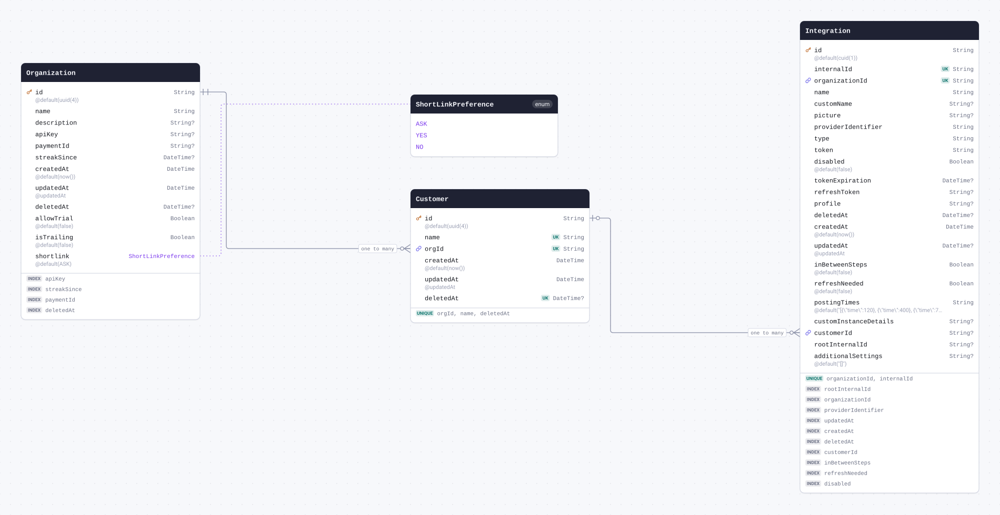

| Field       | Type       | Constraints                                       | Default      | Description |
| ----------- | ---------- | ------------------------------------------------- | ------------ | ----------- |
| `id`        | `String`   | PK NOT NULL                                       | `uuid(4)`    |             |
| `name`      | `String`   | NOT NULL                                          |              |             |
| `orgId`     | `String`   | NOT NULL → [Organization.id](#model-Organization) |              |             |
| `createdAt` | `DateTime` | NOT NULL                                          | `now()`      |             |
| `updatedAt` | `DateTime` | NOT NULL                                          | `@updatedAt` |             |
| `deletedAt` | `DateTime` | NULL                                              |              |             |

#### Indexes

- `@@unique([orgId, name, deletedAt])`

#### References

- `orgId` → [Organization.id](#model-Organization) (many-to-one)

#### Referenced by

- `id` ← [Integration.customerId](#model-Integration) (one-to-many)

#### Definition

```sql
CREATE TABLE "Customer" (
    "id" TEXT NOT NULL,
    "name" TEXT NOT NULL,
    "orgId" TEXT NOT NULL,
    "createdAt" TIMESTAMP(3) NOT NULL DEFAULT CURRENT_TIMESTAMP,
    "updatedAt" TIMESTAMP(3) NOT NULL,
    "deletedAt" TIMESTAMP(3),

    CONSTRAINT "Customer_pkey" PRIMARY KEY ("id")
);

CREATE UNIQUE INDEX "Customer_orgId_name_deletedAt_key" ON "Customer"("orgId", "name", "deletedAt");

ALTER TABLE "Customer" ADD CONSTRAINT "Customer_orgId_fkey" FOREIGN KEY ("orgId") REFERENCES "Organization"("id") ON DELETE RESTRICT ON UPDATE CASCADE;
```

<details>
<summary>Queries and their SQL</summary>

**findMany**: Every row

```ts
await prisma.customer.findMany();
```

```sql
SELECT
  "public"."Customer"."id",
  "public"."Customer"."name",
  "public"."Customer"."orgId",
  "public"."Customer"."createdAt",
  "public"."Customer"."updatedAt",
  "public"."Customer"."deletedAt"
FROM
  "public"."Customer"
WHERE
  1 = 1
OFFSET
  $1
-- params: ["0"]
```

**count**: How many rows there are

```ts
await prisma.customer.count();
```

```sql
SELECT
  COUNT(*) AS "_count$_all"
FROM
  (
    SELECT
      "public"."Customer"."id"
    FROM
      "public"."Customer"
    WHERE
      1 = 1
    OFFSET
      $1
  ) AS "sub"
-- params: ["0"]
```

**findMany**: Every row with its relations

```ts
await prisma.customer.findMany({ include: { organization: true, integrations: true } });
```

```sql
SELECT
  "public"."Customer"."id",
  "public"."Customer"."name",
  "public"."Customer"."orgId",
  "public"."Customer"."createdAt",
  "public"."Customer"."updatedAt",
  "public"."Customer"."deletedAt"
FROM
  "public"."Customer"
WHERE
  1 = 1
OFFSET
  $1
-- params: ["0"]

SELECT
  "public"."Organization"."id",
  "public"."Organization"."name",
  "public"."Organization"."description",
  "public"."Organization"."apiKey",
  "public"."Organization"."paymentId",
  "public"."Organization"."streakSince",
  "public"."Organization"."createdAt",
  "public"."Organization"."updatedAt",
  "public"."Organization"."deletedAt",
  "public"."Organization"."allowTrial",
  "public"."Organization"."isTrailing",
  "public"."Organization"."shortlink"::text
FROM
  "public"."Organization"
WHERE
  "public"."Organization"."id" IN ($1)
OFFSET
  $2
-- params: ["<orgId of the rows above>","0"]

SELECT
  "public"."Integration"."id",
  "public"."Integration"."internalId",
  "public"."Integration"."organizationId",
  "public"."Integration"."name",
  "public"."Integration"."customName",
  "public"."Integration"."picture",
  "public"."Integration"."providerIdentifier",
  "public"."Integration"."type",
  "public"."Integration"."token",
  "public"."Integration"."disabled",
  "public"."Integration"."tokenExpiration",
  "public"."Integration"."refreshToken",
  "public"."Integration"."profile",
  "public"."Integration"."deletedAt",
  "public"."Integration"."createdAt",
  "public"."Integration"."updatedAt",
  "public"."Integration"."inBetweenSteps",
  "public"."Integration"."refreshNeeded",
  "public"."Integration"."postingTimes",
  "public"."Integration"."customInstanceDetails",
  "public"."Integration"."customerId",
  "public"."Integration"."rootInternalId",
  "public"."Integration"."additionalSettings"
FROM
  "public"."Integration"
WHERE
  "public"."Integration"."customerId" IN ($1)
OFFSET
  $2
-- params: ["<id of the rows above>","0"]
```

**findUnique**: One row by what is unique to it

```ts
await prisma.customer.findUnique({ where: { id: "example" } });
```

```sql
SELECT
  "public"."Customer"."id",
  "public"."Customer"."name",
  "public"."Customer"."orgId",
  "public"."Customer"."createdAt",
  "public"."Customer"."updatedAt",
  "public"."Customer"."deletedAt"
FROM
  "public"."Customer"
WHERE
  (
    "public"."Customer"."id" = $1
    AND 1 = 1
  )
LIMIT
  $2
OFFSET
  $3
-- params: ["example","1","0"]
```

**create**: Create a row

```ts
await prisma.customer.create({ data: { name: "example", orgId: "example" } });
```

```sql
INSERT INTO
  "public"."Customer" ("id", "name", "orgId", "createdAt", "updatedAt")
VALUES
  ($1, $2, $3, $4, $5)
RETURNING
  "public"."Customer"."id",
  "public"."Customer"."name",
  "public"."Customer"."orgId",
  "public"."Customer"."createdAt",
  "public"."Customer"."updatedAt",
  "public"."Customer"."deletedAt"
-- params: ["<uuid(4)>","example","example","<now()>","<now()>"]
```

**update**: Update a row

```ts
await prisma.customer.update({ where: { id: "example" }, data: { name: "example" } });
```

```sql
UPDATE "public"."Customer"
SET
  "name" = $1,
  "updatedAt" = $2
WHERE
  (
    "public"."Customer"."id" = $3
    AND 1 = 1
  )
RETURNING
  "public"."Customer"."id",
  "public"."Customer"."name",
  "public"."Customer"."orgId",
  "public"."Customer"."createdAt",
  "public"."Customer"."updatedAt",
  "public"."Customer"."deletedAt"
-- params: ["example",{"prisma__type":"generatorCall","prisma__value":{"name":"now","args":[],"returnType":{"type":"DateTime"}}},"example"]
```

**delete**: Delete a row

```ts
await prisma.customer.delete({ where: { id: "example" } });
```

```sql
DELETE FROM "public"."Customer"
WHERE
  (
    "public"."Customer"."id" = $1
    AND 1 = 1
  )
RETURNING
  "public"."Customer"."id",
  "public"."Customer"."name",
  "public"."Customer"."orgId",
  "public"."Customer"."createdAt",
  "public"."Customer"."updatedAt",
  "public"."Customer"."deletedAt"
-- params: ["example"]
```

</details>

<a id="model-Integration"></a>

### Integration

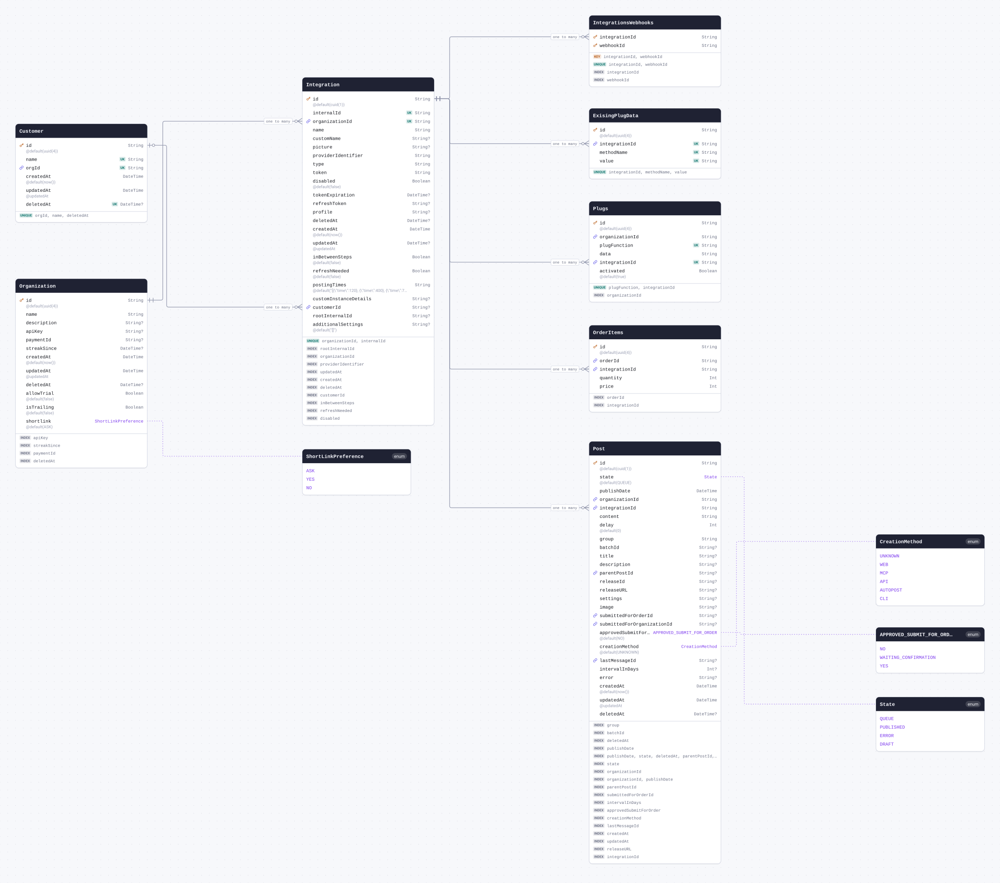

| Field                   | Type       | Constraints                                       | Default                                              | Description |
| ----------------------- | ---------- | ------------------------------------------------- | ---------------------------------------------------- | ----------- |
| `id`                    | `String`   | PK NOT NULL                                       | `cuid(1)`                                            |             |
| `internalId`            | `String`   | NOT NULL                                          |                                                      |             |
| `organizationId`        | `String`   | NOT NULL → [Organization.id](#model-Organization) |                                                      |             |
| `name`                  | `String`   | NOT NULL                                          |                                                      |             |
| `customName`            | `String`   | NULL                                              |                                                      |             |
| `picture`               | `String`   | NULL                                              |                                                      |             |
| `providerIdentifier`    | `String`   | NOT NULL                                          |                                                      |             |
| `type`                  | `String`   | NOT NULL                                          |                                                      |             |
| `token`                 | `String`   | NOT NULL                                          |                                                      |             |
| `disabled`              | `Boolean`  | NOT NULL                                          | `false`                                              |             |
| `tokenExpiration`       | `DateTime` | NULL                                              |                                                      |             |
| `refreshToken`          | `String`   | NULL                                              |                                                      |             |
| `profile`               | `String`   | NULL                                              |                                                      |             |
| `deletedAt`             | `DateTime` | NULL                                              |                                                      |             |
| `createdAt`             | `DateTime` | NOT NULL                                          | `now()`                                              |             |
| `updatedAt`             | `DateTime` | NULL                                              | `@updatedAt`                                         |             |
| `inBetweenSteps`        | `Boolean`  | NOT NULL                                          | `false`                                              |             |
| `refreshNeeded`         | `Boolean`  | NOT NULL                                          | `false`                                              |             |
| `postingTimes`          | `String`   | NOT NULL                                          | `"[{\"time\":120}, {\"time\":400}, {\"time\":700}]"` |             |
| `customInstanceDetails` | `String`   | NULL                                              |                                                      |             |
| `customerId`            | `String`   | NULL → [Customer.id](#model-Customer)             |                                                      |             |
| `rootInternalId`        | `String`   | NULL                                              |                                                      |             |
| `additionalSettings`    | `String`   | NULL                                              | `"[]"`                                               |             |

#### Indexes

- `@@index([rootInternalId])`
- `@@index([organizationId])`
- `@@index([providerIdentifier])`
- `@@index([updatedAt])`
- `@@index([createdAt])`
- `@@index([deletedAt])`
- `@@index([customerId])`
- `@@index([inBetweenSteps])`
- `@@index([refreshNeeded])`
- `@@index([disabled])`
- `@@unique([organizationId, internalId])`

#### References

- `customerId` → [Customer.id](#model-Customer) (many-to-one)
- `organizationId` → [Organization.id](#model-Organization) (many-to-one)

#### Referenced by

- `id` ← [Post.integrationId](#model-Post) (one-to-many)
- `id` ← [OrderItems.integrationId](#model-OrderItems) (one-to-many)
- `id` ← [Plugs.integrationId](#model-Plugs) (one-to-many)
- `id` ← [ExisingPlugData.integrationId](#model-ExisingPlugData) (one-to-many)
- `id` ← [IntegrationsWebhooks.integrationId](#model-IntegrationsWebhooks) (one-to-many)

#### Definition

```sql
CREATE TABLE "Integration" (
    "id" TEXT NOT NULL,
    "internalId" TEXT NOT NULL,
    "organizationId" TEXT NOT NULL,
    "name" TEXT NOT NULL,
    "customName" TEXT,
    "picture" TEXT,
    "providerIdentifier" TEXT NOT NULL,
    "type" TEXT NOT NULL,
    "token" TEXT NOT NULL,
    "disabled" BOOLEAN NOT NULL DEFAULT false,
    "tokenExpiration" TIMESTAMP(3),
    "refreshToken" TEXT,
    "profile" TEXT,
    "deletedAt" TIMESTAMP(3),
    "createdAt" TIMESTAMP(3) NOT NULL DEFAULT CURRENT_TIMESTAMP,
    "updatedAt" TIMESTAMP(3),
    "inBetweenSteps" BOOLEAN NOT NULL DEFAULT false,
    "refreshNeeded" BOOLEAN NOT NULL DEFAULT false,
    "postingTimes" TEXT NOT NULL DEFAULT '[{"time":120}, {"time":400}, {"time":700}]',
    "customInstanceDetails" TEXT,
    "customerId" TEXT,
    "rootInternalId" TEXT,
    "additionalSettings" TEXT DEFAULT '[]',

    CONSTRAINT "Integration_pkey" PRIMARY KEY ("id")
);

CREATE INDEX "Integration_rootInternalId_idx" ON "Integration"("rootInternalId");

CREATE INDEX "Integration_organizationId_idx" ON "Integration"("organizationId");

CREATE INDEX "Integration_providerIdentifier_idx" ON "Integration"("providerIdentifier");

CREATE INDEX "Integration_updatedAt_idx" ON "Integration"("updatedAt");

CREATE INDEX "Integration_createdAt_idx" ON "Integration"("createdAt");

CREATE INDEX "Integration_deletedAt_idx" ON "Integration"("deletedAt");

CREATE INDEX "Integration_customerId_idx" ON "Integration"("customerId");

CREATE INDEX "Integration_inBetweenSteps_idx" ON "Integration"("inBetweenSteps");

CREATE INDEX "Integration_refreshNeeded_idx" ON "Integration"("refreshNeeded");

CREATE INDEX "Integration_disabled_idx" ON "Integration"("disabled");

CREATE UNIQUE INDEX "Integration_organizationId_internalId_key" ON "Integration"("organizationId", "internalId");

ALTER TABLE "Integration" ADD CONSTRAINT "Integration_customerId_fkey" FOREIGN KEY ("customerId") REFERENCES "Customer"("id") ON DELETE SET NULL ON UPDATE CASCADE;

ALTER TABLE "Integration" ADD CONSTRAINT "Integration_organizationId_fkey" FOREIGN KEY ("organizationId") REFERENCES "Organization"("id") ON DELETE RESTRICT ON UPDATE CASCADE;
```

<details>
<summary>Queries and their SQL</summary>

**findMany**: Every row

```ts
await prisma.integration.findMany();
```

```sql
SELECT
  "public"."Integration"."id",
  "public"."Integration"."internalId",
  "public"."Integration"."organizationId",
  "public"."Integration"."name",
  "public"."Integration"."customName",
  "public"."Integration"."picture",
  "public"."Integration"."providerIdentifier",
  "public"."Integration"."type",
  "public"."Integration"."token",
  "public"."Integration"."disabled",
  "public"."Integration"."tokenExpiration",
  "public"."Integration"."refreshToken",
  "public"."Integration"."profile",
  "public"."Integration"."deletedAt",
  "public"."Integration"."createdAt",
  "public"."Integration"."updatedAt",
  "public"."Integration"."inBetweenSteps",
  "public"."Integration"."refreshNeeded",
  "public"."Integration"."postingTimes",
  "public"."Integration"."customInstanceDetails",
  "public"."Integration"."customerId",
  "public"."Integration"."rootInternalId",
  "public"."Integration"."additionalSettings"
FROM
  "public"."Integration"
WHERE
  1 = 1
OFFSET
  $1
-- params: ["0"]
```

**count**: How many rows there are

```ts
await prisma.integration.count();
```

```sql
SELECT
  COUNT(*) AS "_count$_all"
FROM
  (
    SELECT
      "public"."Integration"."id"
    FROM
      "public"."Integration"
    WHERE
      1 = 1
    OFFSET
      $1
  ) AS "sub"
-- params: ["0"]
```

**findMany**: Every row with its relations

```ts
await prisma.integration.findMany({
  include: {
    exisingPlugData: true,
    customer: true,
    organization: true,
    webhooks: true,
    orderItems: true,
    plugs: true,
    posts: true,
  },
});
```

```sql
SELECT
  "public"."Integration"."id",
  "public"."Integration"."internalId",
  "public"."Integration"."organizationId",
  "public"."Integration"."name",
  "public"."Integration"."customName",
  "public"."Integration"."picture",
  "public"."Integration"."providerIdentifier",
  "public"."Integration"."type",
  "public"."Integration"."token",
  "public"."Integration"."disabled",
  "public"."Integration"."tokenExpiration",
  "public"."Integration"."refreshToken",
  "public"."Integration"."profile",
  "public"."Integration"."deletedAt",
  "public"."Integration"."createdAt",
  "public"."Integration"."updatedAt",
  "public"."Integration"."inBetweenSteps",
  "public"."Integration"."refreshNeeded",
  "public"."Integration"."postingTimes",
  "public"."Integration"."customInstanceDetails",
  "public"."Integration"."customerId",
  "public"."Integration"."rootInternalId",
  "public"."Integration"."additionalSettings"
FROM
  "public"."Integration"
WHERE
  1 = 1
OFFSET
  $1
-- params: ["0"]

SELECT
  "public"."ExisingPlugData"."id",
  "public"."ExisingPlugData"."integrationId",
  "public"."ExisingPlugData"."methodName",
  "public"."ExisingPlugData"."value"
FROM
  "public"."ExisingPlugData"
WHERE
  "public"."ExisingPlugData"."integrationId" IN ($1)
OFFSET
  $2
-- params: ["<id of the rows above>","0"]

SELECT
  "public"."Customer"."id",
  "public"."Customer"."name",
  "public"."Customer"."orgId",
  "public"."Customer"."createdAt",
  "public"."Customer"."updatedAt",
  "public"."Customer"."deletedAt"
FROM
  "public"."Customer"
WHERE
  "public"."Customer"."id" IN ($1)
OFFSET
  $2
-- params: ["<customerId of the rows above>","0"]

SELECT
  "public"."Organization"."id",
  "public"."Organization"."name",
  "public"."Organization"."description",
  "public"."Organization"."apiKey",
  "public"."Organization"."paymentId",
  "public"."Organization"."streakSince",
  "public"."Organization"."createdAt",
  "public"."Organization"."updatedAt",
  "public"."Organization"."deletedAt",
  "public"."Organization"."allowTrial",
  "public"."Organization"."isTrailing",
  "public"."Organization"."shortlink"::text
FROM
  "public"."Organization"
WHERE
  "public"."Organization"."id" IN ($1)
OFFSET
  $2
-- params: ["<organizationId of the rows above>","0"]

SELECT
  "public"."IntegrationsWebhooks"."integrationId",
  "public"."IntegrationsWebhooks"."webhookId"
FROM
  "public"."IntegrationsWebhooks"
WHERE
  "public"."IntegrationsWebhooks"."integrationId" IN ($1)
OFFSET
  $2
-- params: ["<id of the rows above>","0"]

SELECT
  "public"."OrderItems"."id",
  "public"."OrderItems"."orderId",
  "public"."OrderItems"."integrationId",
  "public"."OrderItems"."quantity",
  "public"."OrderItems"."price"
FROM
  "public"."OrderItems"
WHERE
  "public"."OrderItems"."integrationId" IN ($1)
OFFSET
  $2
-- params: ["<id of the rows above>","0"]

SELECT
  "public"."Plugs"."id",
  "public"."Plugs"."organizationId",
  "public"."Plugs"."plugFunction",
  "public"."Plugs"."data",
  "public"."Plugs"."integrationId",
  "public"."Plugs"."activated"
FROM
  "public"."Plugs"
WHERE
  "public"."Plugs"."integrationId" IN ($1)
OFFSET
  $2
-- params: ["<id of the rows above>","0"]

SELECT
  "public"."Post"."id",
  "public"."Post"."state"::text,
  "public"."Post"."publishDate",
  "public"."Post"."organizationId",
  "public"."Post"."integrationId",
  "public"."Post"."content",
  "public"."Post"."delay",
  "public"."Post"."group",
  "public"."Post"."batchId",
  "public"."Post"."title",
  "public"."Post"."description",
  "public"."Post"."parentPostId",
  "public"."Post"."releaseId",
  "public"."Post"."releaseURL",
  "public"."Post"."settings",
  "public"."Post"."image",
  "public"."Post"."submittedForOrderId",
  "public"."Post"."submittedForOrganizationId",
  "public"."Post"."approvedSubmitForOrder"::text,
  "public"."Post"."creationMethod"::text,
  "public"."Post"."lastMessageId",
  "public"."Post"."intervalInDays",
  "public"."Post"."error",
  "public"."Post"."createdAt",
  "public"."Post"."updatedAt",
  "public"."Post"."deletedAt"
FROM
  "public"."Post"
WHERE
  "public"."Post"."integrationId" IN ($1)
OFFSET
  $2
-- params: ["<id of the rows above>","0"]
```

**findUnique**: One row by what is unique to it

```ts
await prisma.integration.findUnique({ where: { id: "example" } });
```

```sql
SELECT
  "public"."Integration"."id",
  "public"."Integration"."internalId",
  "public"."Integration"."organizationId",
  "public"."Integration"."name",
  "public"."Integration"."customName",
  "public"."Integration"."picture",
  "public"."Integration"."providerIdentifier",
  "public"."Integration"."type",
  "public"."Integration"."token",
  "public"."Integration"."disabled",
  "public"."Integration"."tokenExpiration",
  "public"."Integration"."refreshToken",
  "public"."Integration"."profile",
  "public"."Integration"."deletedAt",
  "public"."Integration"."createdAt",
  "public"."Integration"."updatedAt",
  "public"."Integration"."inBetweenSteps",
  "public"."Integration"."refreshNeeded",
  "public"."Integration"."postingTimes",
  "public"."Integration"."customInstanceDetails",
  "public"."Integration"."customerId",
  "public"."Integration"."rootInternalId",
  "public"."Integration"."additionalSettings"
FROM
  "public"."Integration"
WHERE
  (
    "public"."Integration"."id" = $1
    AND 1 = 1
  )
LIMIT
  $2
OFFSET
  $3
-- params: ["example","1","0"]
```

**create**: Create a row

```ts
await prisma.integration.create({
  data: {
    internalId: "example",
    organizationId: "example",
    name: "example",
    providerIdentifier: "example",
    type: "example",
    token: "example",
  },
});
```

```sql
INSERT INTO
  "public"."Integration" (
    "id",
    "internalId",
    "organizationId",
    "name",
    "providerIdentifier",
    "type",
    "token",
    "disabled",
    "createdAt",
    "updatedAt",
    "inBetweenSteps",
    "refreshNeeded",
    "postingTimes",
    "additionalSettings"
  )
VALUES
  (
    $1,
    $2,
    $3,
    $4,
    $5,
    $6,
    $7,
    $8,
    $9,
    $10,
    $11,
    $12,
    $13,
    $14
  )
RETURNING
  "public"."Integration"."id",
  "public"."Integration"."internalId",
  "public"."Integration"."organizationId",
  "public"."Integration"."name",
  "public"."Integration"."customName",
  "public"."Integration"."picture",
  "public"."Integration"."providerIdentifier",
  "public"."Integration"."type",
  "public"."Integration"."token",
  "public"."Integration"."disabled",
  "public"."Integration"."tokenExpiration",
  "public"."Integration"."refreshToken",
  "public"."Integration"."profile",
  "public"."Integration"."deletedAt",
  "public"."Integration"."createdAt",
  "public"."Integration"."updatedAt",
  "public"."Integration"."inBetweenSteps",
  "public"."Integration"."refreshNeeded",
  "public"."Integration"."postingTimes",
  "public"."Integration"."customInstanceDetails",
  "public"."Integration"."customerId",
  "public"."Integration"."rootInternalId",
  "public"."Integration"."additionalSettings"
-- params: ["<cuid(1)>","example","example","example","example","example","example",false,"<now()>","<now()>",false,false,"[{\"time\":120}, {\"time\":400}, {\"time\":700}]","[]"]
```

**update**: Update a row

```ts
await prisma.integration.update({ where: { id: "example" }, data: { internalId: "example" } });
```

```sql
UPDATE "public"."Integration"
SET
  "internalId" = $1,
  "updatedAt" = $2
WHERE
  (
    "public"."Integration"."id" = $3
    AND 1 = 1
  )
RETURNING
  "public"."Integration"."id",
  "public"."Integration"."internalId",
  "public"."Integration"."organizationId",
  "public"."Integration"."name",
  "public"."Integration"."customName",
  "public"."Integration"."picture",
  "public"."Integration"."providerIdentifier",
  "public"."Integration"."type",
  "public"."Integration"."token",
  "public"."Integration"."disabled",
  "public"."Integration"."tokenExpiration",
  "public"."Integration"."refreshToken",
  "public"."Integration"."profile",
  "public"."Integration"."deletedAt",
  "public"."Integration"."createdAt",
  "public"."Integration"."updatedAt",
  "public"."Integration"."inBetweenSteps",
  "public"."Integration"."refreshNeeded",
  "public"."Integration"."postingTimes",
  "public"."Integration"."customInstanceDetails",
  "public"."Integration"."customerId",
  "public"."Integration"."rootInternalId",
  "public"."Integration"."additionalSettings"
-- params: ["example",{"prisma__type":"generatorCall","prisma__value":{"name":"now","args":[],"returnType":{"type":"DateTime"}}},"example"]
```

**delete**: Delete a row

```ts
await prisma.integration.delete({ where: { id: "example" } });
```

```sql
DELETE FROM "public"."Integration"
WHERE
  (
    "public"."Integration"."id" = $1
    AND 1 = 1
  )
RETURNING
  "public"."Integration"."id",
  "public"."Integration"."internalId",
  "public"."Integration"."organizationId",
  "public"."Integration"."name",
  "public"."Integration"."customName",
  "public"."Integration"."picture",
  "public"."Integration"."providerIdentifier",
  "public"."Integration"."type",
  "public"."Integration"."token",
  "public"."Integration"."disabled",
  "public"."Integration"."tokenExpiration",
  "public"."Integration"."refreshToken",
  "public"."Integration"."profile",
  "public"."Integration"."deletedAt",
  "public"."Integration"."createdAt",
  "public"."Integration"."updatedAt",
  "public"."Integration"."inBetweenSteps",
  "public"."Integration"."refreshNeeded",
  "public"."Integration"."postingTimes",
  "public"."Integration"."customInstanceDetails",
  "public"."Integration"."customerId",
  "public"."Integration"."rootInternalId",
  "public"."Integration"."additionalSettings"
-- params: ["example"]
```

</details>

<a id="model-Signatures"></a>

### Signatures

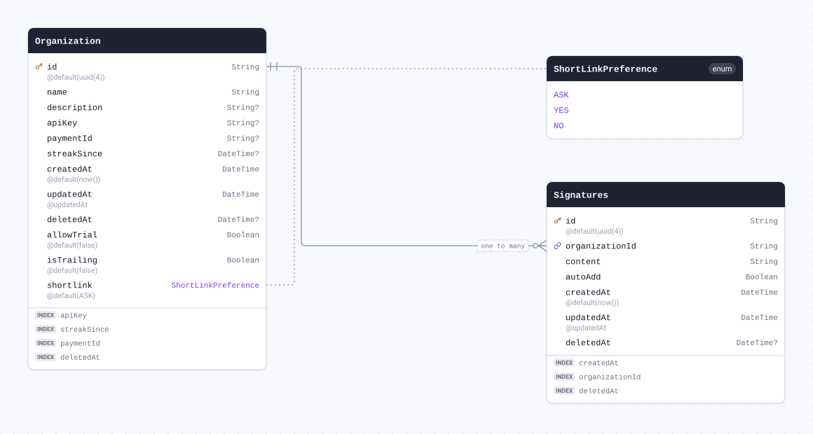

| Field            | Type       | Constraints                                       | Default      | Description |
| ---------------- | ---------- | ------------------------------------------------- | ------------ | ----------- |
| `id`             | `String`   | PK NOT NULL                                       | `uuid(4)`    |             |
| `organizationId` | `String`   | NOT NULL → [Organization.id](#model-Organization) |              |             |
| `content`        | `String`   | NOT NULL                                          |              |             |
| `autoAdd`        | `Boolean`  | NOT NULL                                          |              |             |
| `createdAt`      | `DateTime` | NOT NULL                                          | `now()`      |             |
| `updatedAt`      | `DateTime` | NOT NULL                                          | `@updatedAt` |             |
| `deletedAt`      | `DateTime` | NULL                                              |              |             |

#### Indexes

- `@@index([createdAt])`
- `@@index([organizationId])`
- `@@index([deletedAt])`

#### References

- `organizationId` → [Organization.id](#model-Organization) (many-to-one)

#### Definition

```sql
CREATE TABLE "Signatures" (
    "id" TEXT NOT NULL,
    "organizationId" TEXT NOT NULL,
    "content" TEXT NOT NULL,
    "autoAdd" BOOLEAN NOT NULL,
    "createdAt" TIMESTAMP(3) NOT NULL DEFAULT CURRENT_TIMESTAMP,
    "updatedAt" TIMESTAMP(3) NOT NULL,
    "deletedAt" TIMESTAMP(3),

    CONSTRAINT "Signatures_pkey" PRIMARY KEY ("id")
);

CREATE INDEX "Signatures_createdAt_idx" ON "Signatures"("createdAt");

CREATE INDEX "Signatures_organizationId_idx" ON "Signatures"("organizationId");

CREATE INDEX "Signatures_deletedAt_idx" ON "Signatures"("deletedAt");

ALTER TABLE "Signatures" ADD CONSTRAINT "Signatures_organizationId_fkey" FOREIGN KEY ("organizationId") REFERENCES "Organization"("id") ON DELETE RESTRICT ON UPDATE CASCADE;
```

<details>
<summary>Queries and their SQL</summary>

**findMany**: Every row

```ts
await prisma.signatures.findMany();
```

```sql
SELECT
  "public"."Signatures"."id",
  "public"."Signatures"."organizationId",
  "public"."Signatures"."content",
  "public"."Signatures"."autoAdd",
  "public"."Signatures"."createdAt",
  "public"."Signatures"."updatedAt",
  "public"."Signatures"."deletedAt"
FROM
  "public"."Signatures"
WHERE
  1 = 1
OFFSET
  $1
-- params: ["0"]
```

**count**: How many rows there are

```ts
await prisma.signatures.count();
```

```sql
SELECT
  COUNT(*) AS "_count$_all"
FROM
  (
    SELECT
      "public"."Signatures"."id"
    FROM
      "public"."Signatures"
    WHERE
      1 = 1
    OFFSET
      $1
  ) AS "sub"
-- params: ["0"]
```

**findMany**: Every row with its relations

```ts
await prisma.signatures.findMany({ include: { organization: true } });
```

```sql
SELECT
  "public"."Signatures"."id",
  "public"."Signatures"."organizationId",
  "public"."Signatures"."content",
  "public"."Signatures"."autoAdd",
  "public"."Signatures"."createdAt",
  "public"."Signatures"."updatedAt",
  "public"."Signatures"."deletedAt"
FROM
  "public"."Signatures"
WHERE
  1 = 1
OFFSET
  $1
-- params: ["0"]

SELECT
  "public"."Organization"."id",
  "public"."Organization"."name",
  "public"."Organization"."description",
  "public"."Organization"."apiKey",
  "public"."Organization"."paymentId",
  "public"."Organization"."streakSince",
  "public"."Organization"."createdAt",
  "public"."Organization"."updatedAt",
  "public"."Organization"."deletedAt",
  "public"."Organization"."allowTrial",
  "public"."Organization"."isTrailing",
  "public"."Organization"."shortlink"::text
FROM
  "public"."Organization"
WHERE
  "public"."Organization"."id" IN ($1)
OFFSET
  $2
-- params: ["<organizationId of the rows above>","0"]
```

**findUnique**: One row by what is unique to it

```ts
await prisma.signatures.findUnique({ where: { id: "example" } });
```

```sql
SELECT
  "public"."Signatures"."id",
  "public"."Signatures"."organizationId",
  "public"."Signatures"."content",
  "public"."Signatures"."autoAdd",
  "public"."Signatures"."createdAt",
  "public"."Signatures"."updatedAt",
  "public"."Signatures"."deletedAt"
FROM
  "public"."Signatures"
WHERE
  (
    "public"."Signatures"."id" = $1
    AND 1 = 1
  )
LIMIT
  $2
OFFSET
  $3
-- params: ["example","1","0"]
```

**create**: Create a row

```ts
await prisma.signatures.create({
  data: { organizationId: "example", content: "example", autoAdd: true },
});
```

```sql
INSERT INTO
  "public"."Signatures" (
    "id",
    "organizationId",
    "content",
    "autoAdd",
    "createdAt",
    "updatedAt"
  )
VALUES
  ($1, $2, $3, $4, $5, $6)
RETURNING
  "public"."Signatures"."id",
  "public"."Signatures"."organizationId",
  "public"."Signatures"."content",
  "public"."Signatures"."autoAdd",
  "public"."Signatures"."createdAt",
  "public"."Signatures"."updatedAt",
  "public"."Signatures"."deletedAt"
-- params: ["<uuid(4)>","example","example",true,"<now()>","<now()>"]
```

**update**: Update a row

```ts
await prisma.signatures.update({ where: { id: "example" }, data: { content: "example" } });
```

```sql
UPDATE "public"."Signatures"
SET
  "content" = $1,
  "updatedAt" = $2
WHERE
  (
    "public"."Signatures"."id" = $3
    AND 1 = 1
  )
RETURNING
  "public"."Signatures"."id",
  "public"."Signatures"."organizationId",
  "public"."Signatures"."content",
  "public"."Signatures"."autoAdd",
  "public"."Signatures"."createdAt",
  "public"."Signatures"."updatedAt",
  "public"."Signatures"."deletedAt"
-- params: ["example",{"prisma__type":"generatorCall","prisma__value":{"name":"now","args":[],"returnType":{"type":"DateTime"}}},"example"]
```

**delete**: Delete a row

```ts
await prisma.signatures.delete({ where: { id: "example" } });
```

```sql
DELETE FROM "public"."Signatures"
WHERE
  (
    "public"."Signatures"."id" = $1
    AND 1 = 1
  )
RETURNING
  "public"."Signatures"."id",
  "public"."Signatures"."organizationId",
  "public"."Signatures"."content",
  "public"."Signatures"."autoAdd",
  "public"."Signatures"."createdAt",
  "public"."Signatures"."updatedAt",
  "public"."Signatures"."deletedAt"
-- params: ["example"]
```

</details>

<a id="model-Comments"></a>

### Comments

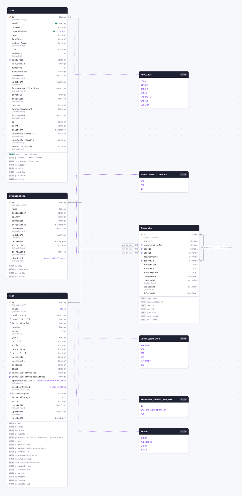

| Field            | Type       | Constraints                                       | Default      | Description |
| ---------------- | ---------- | ------------------------------------------------- | ------------ | ----------- |
| `id`             | `String`   | PK NOT NULL                                       | `uuid(4)`    |             |
| `content`        | `String`   | NOT NULL                                          |              |             |
| `organizationId` | `String`   | NOT NULL → [Organization.id](#model-Organization) |              |             |
| `postId`         | `String`   | NOT NULL → [Post.id](#model-Post)                 |              |             |
| `userId`         | `String`   | NULL → [User.id](#model-User)                     |              |             |
| `displayName`    | `String`   | NULL                                              |              |             |
| `parentId`       | `String`   | NULL → [Comments.id](#model-Comments)             |              |             |
| `anchorStart`    | `Int`      | NULL                                              |              |             |
| `anchorEnd`      | `Int`      | NULL                                              |              |             |
| `anchorQuote`    | `String`   | NULL                                              |              |             |
| `resolvedAt`     | `DateTime` | NULL                                              |              |             |
| `createdAt`      | `DateTime` | NOT NULL                                          | `now()`      |             |
| `updatedAt`      | `DateTime` | NOT NULL                                          | `@updatedAt` |             |
| `deletedAt`      | `DateTime` | NULL                                              |              |             |

#### Indexes

- `@@index([createdAt])`
- `@@index([organizationId])`
- `@@index([userId])`
- `@@index([postId])`
- `@@index([parentId])`
- `@@index([resolvedAt])`
- `@@index([deletedAt])`

#### References

- `organizationId` → [Organization.id](#model-Organization) (many-to-one)
- `postId` → [Post.id](#model-Post) (many-to-one)
- `userId` → [User.id](#model-User) (many-to-one)
- `parentId` → [Comments.id](#model-Comments) (many-to-one)

#### Referenced by

- `id` ← [Comments.parentId](#model-Comments) (one-to-many)

#### Definition

```sql
CREATE TABLE "Comments" (
    "id" TEXT NOT NULL,
    "content" TEXT NOT NULL,
    "organizationId" TEXT NOT NULL,
    "postId" TEXT NOT NULL,
    "userId" TEXT,
    "displayName" TEXT,
    "parentId" TEXT,
    "anchorStart" INTEGER,
    "anchorEnd" INTEGER,
    "anchorQuote" TEXT,
    "resolvedAt" TIMESTAMP(3),
    "createdAt" TIMESTAMP(3) NOT NULL DEFAULT CURRENT_TIMESTAMP,
    "updatedAt" TIMESTAMP(3) NOT NULL,
    "deletedAt" TIMESTAMP(3),

    CONSTRAINT "Comments_pkey" PRIMARY KEY ("id")
);

CREATE INDEX "Comments_createdAt_idx" ON "Comments"("createdAt");

CREATE INDEX "Comments_organizationId_idx" ON "Comments"("organizationId");

CREATE INDEX "Comments_userId_idx" ON "Comments"("userId");

CREATE INDEX "Comments_postId_idx" ON "Comments"("postId");

CREATE INDEX "Comments_parentId_idx" ON "Comments"("parentId");

CREATE INDEX "Comments_resolvedAt_idx" ON "Comments"("resolvedAt");

CREATE INDEX "Comments_deletedAt_idx" ON "Comments"("deletedAt");

ALTER TABLE "Comments" ADD CONSTRAINT "Comments_organizationId_fkey" FOREIGN KEY ("organizationId") REFERENCES "Organization"("id") ON DELETE RESTRICT ON UPDATE CASCADE;

ALTER TABLE "Comments" ADD CONSTRAINT "Comments_postId_fkey" FOREIGN KEY ("postId") REFERENCES "Post"("id") ON DELETE RESTRICT ON UPDATE CASCADE;

ALTER TABLE "Comments" ADD CONSTRAINT "Comments_userId_fkey" FOREIGN KEY ("userId") REFERENCES "User"("id") ON DELETE SET NULL ON UPDATE CASCADE;

ALTER TABLE "Comments" ADD CONSTRAINT "Comments_parentId_fkey" FOREIGN KEY ("parentId") REFERENCES "Comments"("id") ON DELETE SET NULL ON UPDATE CASCADE;
```

<details>
<summary>Queries and their SQL</summary>

**findMany**: Every row

```ts
await prisma.comments.findMany();
```

```sql
SELECT
  "public"."Comments"."id",
  "public"."Comments"."content",
  "public"."Comments"."organizationId",
  "public"."Comments"."postId",
  "public"."Comments"."userId",
  "public"."Comments"."displayName",
  "public"."Comments"."parentId",
  "public"."Comments"."anchorStart",
  "public"."Comments"."anchorEnd",
  "public"."Comments"."anchorQuote",
  "public"."Comments"."resolvedAt",
  "public"."Comments"."createdAt",
  "public"."Comments"."updatedAt",
  "public"."Comments"."deletedAt"
FROM
  "public"."Comments"
WHERE
  1 = 1
OFFSET
  $1
-- params: ["0"]
```

**count**: How many rows there are

```ts
await prisma.comments.count();
```

```sql
SELECT
  COUNT(*) AS "_count$_all"
FROM
  (
    SELECT
      "public"."Comments"."id"
    FROM
      "public"."Comments"
    WHERE
      1 = 1
    OFFSET
      $1
  ) AS "sub"
-- params: ["0"]
```

**findMany**: Every row with its relations

```ts
await prisma.comments.findMany({
  include: { organization: true, post: true, user: true, parent: true, replies: true },
});
```

```sql
SELECT
  "public"."Comments"."id",
  "public"."Comments"."content",
  "public"."Comments"."organizationId",
  "public"."Comments"."postId",
  "public"."Comments"."userId",
  "public"."Comments"."displayName",
  "public"."Comments"."parentId",
  "public"."Comments"."anchorStart",
  "public"."Comments"."anchorEnd",
  "public"."Comments"."anchorQuote",
  "public"."Comments"."resolvedAt",
  "public"."Comments"."createdAt",
  "public"."Comments"."updatedAt",
  "public"."Comments"."deletedAt"
FROM
  "public"."Comments"
WHERE
  1 = 1
OFFSET
  $1
-- params: ["0"]

SELECT
  "public"."Organization"."id",
  "public"."Organization"."name",
  "public"."Organization"."description",
  "public"."Organization"."apiKey",
  "public"."Organization"."paymentId",
  "public"."Organization"."streakSince",
  "public"."Organization"."createdAt",
  "public"."Organization"."updatedAt",
  "public"."Organization"."deletedAt",
  "public"."Organization"."allowTrial",
  "public"."Organization"."isTrailing",
  "public"."Organization"."shortlink"::text
FROM
  "public"."Organization"
WHERE
  "public"."Organization"."id" IN ($1)
OFFSET
  $2
-- params: ["<organizationId of the rows above>","0"]

SELECT
  "public"."Post"."id",
  "public"."Post"."state"::text,
  "public"."Post"."publishDate",
  "public"."Post"."organizationId",
  "public"."Post"."integrationId",
  "public"."Post"."content",
  "public"."Post"."delay",
  "public"."Post"."group",
  "public"."Post"."batchId",
  "public"."Post"."title",
  "public"."Post"."description",
  "public"."Post"."parentPostId",
  "public"."Post"."releaseId",
  "public"."Post"."releaseURL",
  "public"."Post"."settings",
  "public"."Post"."image",
  "public"."Post"."submittedForOrderId",
  "public"."Post"."submittedForOrganizationId",
  "public"."Post"."approvedSubmitForOrder"::text,
  "public"."Post"."creationMethod"::text,
  "public"."Post"."lastMessageId",
  "public"."Post"."intervalInDays",
  "public"."Post"."error",
  "public"."Post"."createdAt",
  "public"."Post"."updatedAt",
  "public"."Post"."deletedAt"
FROM
  "public"."Post"
WHERE
  "public"."Post"."id" IN ($1)
OFFSET
  $2
-- params: ["<postId of the rows above>","0"]

SELECT
  "public"."User"."id",
  "public"."User"."email",
  "public"."User"."password",
  "public"."User"."providerName"::text,
  "public"."User"."name",
  "public"."User"."lastName",
  "public"."User"."isSuperAdmin",
  "public"."User"."bio",
  "public"."User"."audience",
  "public"."User"."pictureId",
  "public"."User"."providerId",
  "public"."User"."timezone",
  "public"."User"."timezoneName",
  "public"."User"."createdAt",
  "public"."User"."updatedAt",
  "public"."User"."lastReadNotifications",
  "public"."User"."inviteId",
  "public"."User"."activated",
  "public"."User"."account",
  "public"."User"."connectedAccount",
  "public"."User"."lastOnline",
  "public"."User"."ip",
  "public"."User"."agent",
  "public"."User"."deletedAt",
  "public"."User"."sendSuccessEmails",
  "public"."User"."sendFailureEmails",
  "public"."User"."sendStreakEmails"
FROM
  "public"."User"
WHERE
  "public"."User"."id" IN ($1)
OFFSET
  $2
-- params: ["<userId of the rows above>","0"]

SELECT
  "public"."Comments"."id",
  "public"."Comments"."content",
  "public"."Comments"."organizationId",
  "public"."Comments"."postId",
  "public"."Comments"."userId",
  "public"."Comments"."displayName",
  "public"."Comments"."parentId",
  "public"."Comments"."anchorStart",
  "public"."Comments"."anchorEnd",
  "public"."Comments"."anchorQuote",
  "public"."Comments"."resolvedAt",
  "public"."Comments"."createdAt",
  "public"."Comments"."updatedAt",
  "public"."Comments"."deletedAt"
FROM
  "public"."Comments"
WHERE
  "public"."Comments"."id" IN ($1)
OFFSET
  $2
-- params: ["<parentId of the rows above>","0"]

SELECT
  "public"."Comments"."id",
  "public"."Comments"."content",
  "public"."Comments"."organizationId",
  "public"."Comments"."postId",
  "public"."Comments"."userId",
  "public"."Comments"."displayName",
  "public"."Comments"."parentId",
  "public"."Comments"."anchorStart",
  "public"."Comments"."anchorEnd",
  "public"."Comments"."anchorQuote",
  "public"."Comments"."resolvedAt",
  "public"."Comments"."createdAt",
  "public"."Comments"."updatedAt",
  "public"."Comments"."deletedAt"
FROM
  "public"."Comments"
WHERE
  "public"."Comments"."parentId" IN ($1)
OFFSET
  $2
-- params: ["<id of the rows above>","0"]
```

**findUnique**: One row by what is unique to it

```ts
await prisma.comments.findUnique({ where: { id: "example" } });
```

```sql
SELECT
  "public"."Comments"."id",
  "public"."Comments"."content",
  "public"."Comments"."organizationId",
  "public"."Comments"."postId",
  "public"."Comments"."userId",
  "public"."Comments"."displayName",
  "public"."Comments"."parentId",
  "public"."Comments"."anchorStart",
  "public"."Comments"."anchorEnd",
  "public"."Comments"."anchorQuote",
  "public"."Comments"."resolvedAt",
  "public"."Comments"."createdAt",
  "public"."Comments"."updatedAt",
  "public"."Comments"."deletedAt"
FROM
  "public"."Comments"
WHERE
  (
    "public"."Comments"."id" = $1
    AND 1 = 1
  )
LIMIT
  $2
OFFSET
  $3
-- params: ["example","1","0"]
```

**create**: Create a row

```ts
await prisma.comments.create({
  data: { content: "example", organizationId: "example", postId: "example" },
});
```

```sql
INSERT INTO
  "public"."Comments" (
    "id",
    "content",
    "organizationId",
    "postId",
    "createdAt",
    "updatedAt"
  )
VALUES
  ($1, $2, $3, $4, $5, $6)
RETURNING
  "public"."Comments"."id",
  "public"."Comments"."content",
  "public"."Comments"."organizationId",
  "public"."Comments"."postId",
  "public"."Comments"."userId",
  "public"."Comments"."displayName",
  "public"."Comments"."parentId",
  "public"."Comments"."anchorStart",
  "public"."Comments"."anchorEnd",
  "public"."Comments"."anchorQuote",
  "public"."Comments"."resolvedAt",
  "public"."Comments"."createdAt",
  "public"."Comments"."updatedAt",
  "public"."Comments"."deletedAt"
-- params: ["<uuid(4)>","example","example","example","<now()>","<now()>"]
```

**update**: Update a row

```ts
await prisma.comments.update({ where: { id: "example" }, data: { content: "example" } });
```

```sql
UPDATE "public"."Comments"
SET
  "content" = $1,
  "updatedAt" = $2
WHERE
  (
    "public"."Comments"."id" = $3
    AND 1 = 1
  )
RETURNING
  "public"."Comments"."id",
  "public"."Comments"."content",
  "public"."Comments"."organizationId",
  "public"."Comments"."postId",
  "public"."Comments"."userId",
  "public"."Comments"."displayName",
  "public"."Comments"."parentId",
  "public"."Comments"."anchorStart",
  "public"."Comments"."anchorEnd",
  "public"."Comments"."anchorQuote",
  "public"."Comments"."resolvedAt",
  "public"."Comments"."createdAt",
  "public"."Comments"."updatedAt",
  "public"."Comments"."deletedAt"
-- params: ["example",{"prisma__type":"generatorCall","prisma__value":{"name":"now","args":[],"returnType":{"type":"DateTime"}}},"example"]
```

**delete**: Delete a row

```ts
await prisma.comments.delete({ where: { id: "example" } });
```

```sql
DELETE FROM "public"."Comments"
WHERE
  (
    "public"."Comments"."id" = $1
    AND 1 = 1
  )
RETURNING
  "public"."Comments"."id",
  "public"."Comments"."content",
  "public"."Comments"."organizationId",
  "public"."Comments"."postId",
  "public"."Comments"."userId",
  "public"."Comments"."displayName",
  "public"."Comments"."parentId",
  "public"."Comments"."anchorStart",
  "public"."Comments"."anchorEnd",
  "public"."Comments"."anchorQuote",
  "public"."Comments"."resolvedAt",
  "public"."Comments"."createdAt",
  "public"."Comments"."updatedAt",
  "public"."Comments"."deletedAt"
-- params: ["example"]
```

</details>

<a id="model-Post"></a>

### Post

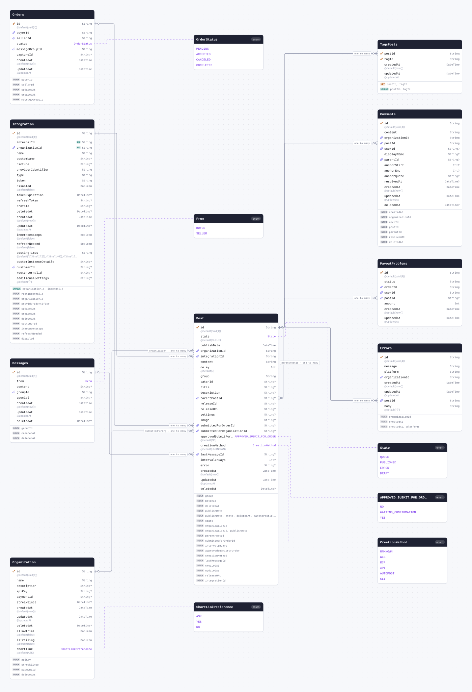

| Field                        | Type                                                           | Constraints                                       | Default      | Description |
| ---------------------------- | -------------------------------------------------------------- | ------------------------------------------------- | ------------ | ----------- |
| `id`                         | `String`                                                       | PK NOT NULL                                       | `cuid(1)`    |             |
| `state`                      | [`State`](#enum-State)                                         | NOT NULL                                          | `QUEUE`      |             |
| `publishDate`                | `DateTime`                                                     | NOT NULL                                          |              |             |
| `organizationId`             | `String`                                                       | NOT NULL → [Organization.id](#model-Organization) |              |             |
| `integrationId`              | `String`                                                       | NOT NULL → [Integration.id](#model-Integration)   |              |             |
| `content`                    | `String`                                                       | NOT NULL                                          |              |             |
| `delay`                      | `Int`                                                          | NOT NULL                                          | `0`          |             |
| `group`                      | `String`                                                       | NOT NULL                                          |              |             |
| `batchId`                    | `String`                                                       | NULL                                              |              |             |
| `title`                      | `String`                                                       | NULL                                              |              |             |
| `description`                | `String`                                                       | NULL                                              |              |             |
| `parentPostId`               | `String`                                                       | NULL → [Post.id](#model-Post)                     |              |             |
| `releaseId`                  | `String`                                                       | NULL                                              |              |             |
| `releaseURL`                 | `String`                                                       | NULL                                              |              |             |
| `settings`                   | `String`                                                       | NULL                                              |              |             |
| `image`                      | `String`                                                       | NULL                                              |              |             |
| `submittedForOrderId`        | `String`                                                       | NULL → [Orders.id](#model-Orders)                 |              |             |
| `submittedForOrganizationId` | `String`                                                       | NULL → [Organization.id](#model-Organization)     |              |             |
| `approvedSubmitForOrder`     | [`APPROVED_SUBMIT_FOR_ORDER`](#enum-APPROVED_SUBMIT_FOR_ORDER) | NOT NULL                                          | `NO`         |             |
| `creationMethod`             | [`CreationMethod`](#enum-CreationMethod)                       | NOT NULL                                          | `UNKNOWN`    |             |
| `lastMessageId`              | `String`                                                       | NULL → [Messages.id](#model-Messages)             |              |             |
| `intervalInDays`             | `Int`                                                          | NULL                                              |              |             |
| `error`                      | `String`                                                       | NULL                                              |              |             |
| `createdAt`                  | `DateTime`                                                     | NOT NULL                                          | `now()`      |             |
| `updatedAt`                  | `DateTime`                                                     | NOT NULL                                          | `@updatedAt` |             |
| `deletedAt`                  | `DateTime`                                                     | NULL                                              |              |             |

#### Indexes

- `@@index([group])`
- `@@index([batchId])`
- `@@index([deletedAt])`
- `@@index([publishDate])`
- `@@index([publishDate, state, deletedAt, parentPostId, integrationId, organizationId, creationMethod])`
- `@@index([state])`
- `@@index([organizationId])`
- `@@index([organizationId, publishDate])`
- `@@index([parentPostId])`
- `@@index([submittedForOrderId])`
- `@@index([intervalInDays])`
- `@@index([approvedSubmitForOrder])`
- `@@index([creationMethod])`
- `@@index([lastMessageId])`
- `@@index([createdAt])`
- `@@index([updatedAt])`
- `@@index([releaseURL])`
- `@@index([integrationId])`

#### References

- `integrationId` → [Integration.id](#model-Integration) (many-to-one)
- `lastMessageId` → [Messages.id](#model-Messages) (many-to-one)
- `organizationId` → [Organization.id](#model-Organization) (many-to-one)
- `parentPostId` → [Post.id](#model-Post) (many-to-one)
- `submittedForOrderId` → [Orders.id](#model-Orders) (many-to-one)
- `submittedForOrganizationId` → [Organization.id](#model-Organization) (many-to-one)

#### Referenced by

- `id` ← [TagsPosts.postId](#model-TagsPosts) (one-to-many)
- `id` ← [Comments.postId](#model-Comments) (one-to-many)
- `id` ← [Post.parentPostId](#model-Post) (one-to-many)
- `id` ← [PayoutProblems.postId](#model-PayoutProblems) (one-to-many)
- `id` ← [Errors.postId](#model-Errors) (one-to-many)

#### Definition

```sql
CREATE TABLE "Post" (
    "id" TEXT NOT NULL,
    "state" "State" NOT NULL DEFAULT 'QUEUE',
    "publishDate" TIMESTAMP(3) NOT NULL,
    "organizationId" TEXT NOT NULL,
    "integrationId" TEXT NOT NULL,
    "content" TEXT NOT NULL,
    "delay" INTEGER NOT NULL DEFAULT 0,
    "group" TEXT NOT NULL,
    "batchId" TEXT,
    "title" TEXT,
    "description" TEXT,
    "parentPostId" TEXT,
    "releaseId" TEXT,
    "releaseURL" TEXT,
    "settings" TEXT,
    "image" TEXT,
    "submittedForOrderId" TEXT,
    "submittedForOrganizationId" TEXT,
    "approvedSubmitForOrder" "APPROVED_SUBMIT_FOR_ORDER" NOT NULL DEFAULT 'NO',
    "creationMethod" "CreationMethod" NOT NULL DEFAULT 'UNKNOWN',
    "lastMessageId" TEXT,
    "intervalInDays" INTEGER,
    "error" TEXT,
    "createdAt" TIMESTAMP(3) NOT NULL DEFAULT CURRENT_TIMESTAMP,
    "updatedAt" TIMESTAMP(3) NOT NULL,
    "deletedAt" TIMESTAMP(3),

    CONSTRAINT "Post_pkey" PRIMARY KEY ("id")
);

CREATE INDEX "Post_group_idx" ON "Post"("group");

CREATE INDEX "Post_batchId_idx" ON "Post"("batchId");

CREATE INDEX "Post_deletedAt_idx" ON "Post"("deletedAt");

CREATE INDEX "Post_publishDate_idx" ON "Post"("publishDate");

CREATE INDEX "Post_publishDate_state_deletedAt_parentPostId_integrationId_idx" ON "Post"("publishDate", "state", "deletedAt", "parentPostId", "integrationId", "organizationId", "creationMethod");

CREATE INDEX "Post_state_idx" ON "Post"("state");

CREATE INDEX "Post_organizationId_idx" ON "Post"("organizationId");

CREATE INDEX "Post_organizationId_publishDate_idx" ON "Post"("organizationId", "publishDate");

CREATE INDEX "Post_parentPostId_idx" ON "Post"("parentPostId");

CREATE INDEX "Post_submittedForOrderId_idx" ON "Post"("submittedForOrderId");

CREATE INDEX "Post_intervalInDays_idx" ON "Post"("intervalInDays");

CREATE INDEX "Post_approvedSubmitForOrder_idx" ON "Post"("approvedSubmitForOrder");

CREATE INDEX "Post_creationMethod_idx" ON "Post"("creationMethod");

CREATE INDEX "Post_lastMessageId_idx" ON "Post"("lastMessageId");

CREATE INDEX "Post_createdAt_idx" ON "Post"("createdAt");

CREATE INDEX "Post_updatedAt_idx" ON "Post"("updatedAt");

CREATE INDEX "Post_releaseURL_idx" ON "Post"("releaseURL");

CREATE INDEX "Post_integrationId_idx" ON "Post"("integrationId");

ALTER TABLE "Post" ADD CONSTRAINT "Post_integrationId_fkey" FOREIGN KEY ("integrationId") REFERENCES "Integration"("id") ON DELETE RESTRICT ON UPDATE CASCADE;

ALTER TABLE "Post" ADD CONSTRAINT "Post_lastMessageId_fkey" FOREIGN KEY ("lastMessageId") REFERENCES "Messages"("id") ON DELETE SET NULL ON UPDATE CASCADE;

ALTER TABLE "Post" ADD CONSTRAINT "Post_organizationId_fkey" FOREIGN KEY ("organizationId") REFERENCES "Organization"("id") ON DELETE RESTRICT ON UPDATE CASCADE;

ALTER TABLE "Post" ADD CONSTRAINT "Post_parentPostId_fkey" FOREIGN KEY ("parentPostId") REFERENCES "Post"("id") ON DELETE SET NULL ON UPDATE CASCADE;

ALTER TABLE "Post" ADD CONSTRAINT "Post_submittedForOrderId_fkey" FOREIGN KEY ("submittedForOrderId") REFERENCES "Orders"("id") ON DELETE SET NULL ON UPDATE CASCADE;

ALTER TABLE "Post" ADD CONSTRAINT "Post_submittedForOrganizationId_fkey" FOREIGN KEY ("submittedForOrganizationId") REFERENCES "Organization"("id") ON DELETE SET NULL ON UPDATE CASCADE;
```

<details>
<summary>Queries and their SQL</summary>

**findMany**: Every row

```ts
await prisma.post.findMany();
```

```sql
SELECT
  "public"."Post"."id",
  "public"."Post"."state"::text,
  "public"."Post"."publishDate",
  "public"."Post"."organizationId",
  "public"."Post"."integrationId",
  "public"."Post"."content",
  "public"."Post"."delay",
  "public"."Post"."group",
  "public"."Post"."batchId",
  "public"."Post"."title",
  "public"."Post"."description",
  "public"."Post"."parentPostId",
  "public"."Post"."releaseId",
  "public"."Post"."releaseURL",
  "public"."Post"."settings",
  "public"."Post"."image",
  "public"."Post"."submittedForOrderId",
  "public"."Post"."submittedForOrganizationId",
  "public"."Post"."approvedSubmitForOrder"::text,
  "public"."Post"."creationMethod"::text,
  "public"."Post"."lastMessageId",
  "public"."Post"."intervalInDays",
  "public"."Post"."error",
  "public"."Post"."createdAt",
  "public"."Post"."updatedAt",
  "public"."Post"."deletedAt"
FROM
  "public"."Post"
WHERE
  1 = 1
OFFSET
  $1
-- params: ["0"]
```

**count**: How many rows there are

```ts
await prisma.post.count();
```

```sql
SELECT
  COUNT(*) AS "_count$_all"
FROM
  (
    SELECT
      "public"."Post"."id"
    FROM
      "public"."Post"
    WHERE
      1 = 1
    OFFSET
      $1
  ) AS "sub"
-- params: ["0"]
```

**findMany**: Every row with its relations

```ts
await prisma.post.findMany({
  include: {
    comments: true,
    errors: true,
    payoutProblems: true,
    integration: true,
    lastMessage: true,
    organization: true,
    parentPost: true,
    childrenPost: true,
    submittedForOrder: true,
    submittedForOrganization: true,
    tags: true,
  },
});
```

```sql
SELECT
  "public"."Post"."id",
  "public"."Post"."state"::text,
  "public"."Post"."publishDate",
  "public"."Post"."organizationId",
  "public"."Post"."integrationId",
  "public"."Post"."content",
  "public"."Post"."delay",
  "public"."Post"."group",
  "public"."Post"."batchId",
  "public"."Post"."title",
  "public"."Post"."description",
  "public"."Post"."parentPostId",
  "public"."Post"."releaseId",
  "public"."Post"."releaseURL",
  "public"."Post"."settings",
  "public"."Post"."image",
  "public"."Post"."submittedForOrderId",
  "public"."Post"."submittedForOrganizationId",
  "public"."Post"."approvedSubmitForOrder"::text,
  "public"."Post"."creationMethod"::text,
  "public"."Post"."lastMessageId",
  "public"."Post"."intervalInDays",
  "public"."Post"."error",
  "public"."Post"."createdAt",
  "public"."Post"."updatedAt",
  "public"."Post"."deletedAt"
FROM
  "public"."Post"
WHERE
  1 = 1
OFFSET
  $1
-- params: ["0"]

SELECT
  "public"."Comments"."id",
  "public"."Comments"."content",
  "public"."Comments"."organizationId",
  "public"."Comments"."postId",
  "public"."Comments"."userId",
  "public"."Comments"."displayName",
  "public"."Comments"."parentId",
  "public"."Comments"."anchorStart",
  "public"."Comments"."anchorEnd",
  "public"."Comments"."anchorQuote",
  "public"."Comments"."resolvedAt",
  "public"."Comments"."createdAt",
  "public"."Comments"."updatedAt",
  "public"."Comments"."deletedAt"
FROM
  "public"."Comments"
WHERE
  "public"."Comments"."postId" IN ($1)
OFFSET
  $2
-- params: ["<id of the rows above>","0"]

SELECT
  "public"."Errors"."id",
  "public"."Errors"."message",
  "public"."Errors"."platform",
  "public"."Errors"."organizationId",
  "public"."Errors"."createdAt",
  "public"."Errors"."updatedAt",
  "public"."Errors"."postId",
  "public"."Errors"."body"
FROM
  "public"."Errors"
WHERE
  "public"."Errors"."postId" IN ($1)
OFFSET
  $2
-- params: ["<id of the rows above>","0"]

SELECT
  "public"."PayoutProblems"."id",
  "public"."PayoutProblems"."status",
  "public"."PayoutProblems"."orderId",
  "public"."PayoutProblems"."userId",
  "public"."PayoutProblems"."postId",
  "public"."PayoutProblems"."amount",
  "public"."PayoutProblems"."createdAt",
  "public"."PayoutProblems"."updatedAt"
FROM
  "public"."PayoutProblems"
WHERE
  "public"."PayoutProblems"."postId" IN ($1)
OFFSET
  $2
-- params: ["<id of the rows above>","0"]

SELECT
  "public"."Integration"."id",
  "public"."Integration"."internalId",
  "public"."Integration"."organizationId",
  "public"."Integration"."name",
  "public"."Integration"."customName",
  "public"."Integration"."picture",
  "public"."Integration"."providerIdentifier",
  "public"."Integration"."type",
  "public"."Integration"."token",
  "public"."Integration"."disabled",
  "public"."Integration"."tokenExpiration",
  "public"."Integration"."refreshToken",
  "public"."Integration"."profile",
  "public"."Integration"."deletedAt",
  "public"."Integration"."createdAt",
  "public"."Integration"."updatedAt",
  "public"."Integration"."inBetweenSteps",
  "public"."Integration"."refreshNeeded",
  "public"."Integration"."postingTimes",
  "public"."Integration"."customInstanceDetails",
  "public"."Integration"."customerId",
  "public"."Integration"."rootInternalId",
  "public"."Integration"."additionalSettings"
FROM
  "public"."Integration"
WHERE
  "public"."Integration"."id" IN ($1)
OFFSET
  $2
-- params: ["<integrationId of the rows above>","0"]

SELECT
  "public"."Messages"."id",
  "public"."Messages"."from"::text,
  "public"."Messages"."content",
  "public"."Messages"."groupId",
  "public"."Messages"."special",
  "public"."Messages"."createdAt",
  "public"."Messages"."updatedAt",
  "public"."Messages"."deletedAt"
FROM
  "public"."Messages"
WHERE
  "public"."Messages"."id" IN ($1)
OFFSET
  $2
-- params: ["<lastMessageId of the rows above>","0"]

SELECT
  "public"."Organization"."id",
  "public"."Organization"."name",
  "public"."Organization"."description",
  "public"."Organization"."apiKey",
  "public"."Organization"."paymentId",
  "public"."Organization"."streakSince",
  "public"."Organization"."createdAt",
  "public"."Organization"."updatedAt",
  "public"."Organization"."deletedAt",
  "public"."Organization"."allowTrial",
  "public"."Organization"."isTrailing",
  "public"."Organization"."shortlink"::text
FROM
  "public"."Organization"
WHERE
  "public"."Organization"."id" IN ($1)
OFFSET
  $2
-- params: ["<organizationId of the rows above>","0"]

SELECT
  "public"."Post"."id",
  "public"."Post"."state"::text,
  "public"."Post"."publishDate",
  "public"."Post"."organizationId",
  "public"."Post"."integrationId",
  "public"."Post"."content",
  "public"."Post"."delay",
  "public"."Post"."group",
  "public"."Post"."batchId",
  "public"."Post"."title",
  "public"."Post"."description",
  "public"."Post"."parentPostId",
  "public"."Post"."releaseId",
  "public"."Post"."releaseURL",
  "public"."Post"."settings",
  "public"."Post"."image",
  "public"."Post"."submittedForOrderId",
  "public"."Post"."submittedForOrganizationId",
  "public"."Post"."approvedSubmitForOrder"::text,
  "public"."Post"."creationMethod"::text,
  "public"."Post"."lastMessageId",
  "public"."Post"."intervalInDays",
  "public"."Post"."error",
  "public"."Post"."createdAt",
  "public"."Post"."updatedAt",
  "public"."Post"."deletedAt"
FROM
  "public"."Post"
WHERE
  "public"."Post"."id" IN ($1)
OFFSET
  $2
-- params: ["<parentPostId of the rows above>","0"]

SELECT
  "public"."Post"."id",
  "public"."Post"."state"::text,
  "public"."Post"."publishDate",
  "public"."Post"."organizationId",
  "public"."Post"."integrationId",
  "public"."Post"."content",
  "public"."Post"."delay",
  "public"."Post"."group",
  "public"."Post"."batchId",
  "public"."Post"."title",
  "public"."Post"."description",
  "public"."Post"."parentPostId",
  "public"."Post"."releaseId",
  "public"."Post"."releaseURL",
  "public"."Post"."settings",
  "public"."Post"."image",
  "public"."Post"."submittedForOrderId",
  "public"."Post"."submittedForOrganizationId",
  "public"."Post"."approvedSubmitForOrder"::text,
  "public"."Post"."creationMethod"::text,
  "public"."Post"."lastMessageId",
  "public"."Post"."intervalInDays",
  "public"."Post"."error",
  "public"."Post"."createdAt",
  "public"."Post"."updatedAt",
  "public"."Post"."deletedAt"
FROM
  "public"."Post"
WHERE
  "public"."Post"."parentPostId" IN ($1)
OFFSET
  $2
-- params: ["<id of the rows above>","0"]

SELECT
  "public"."Orders"."id",
  "public"."Orders"."buyerId",
  "public"."Orders"."sellerId",
  "public"."Orders"."status"::text,
  "public"."Orders"."messageGroupId",
  "public"."Orders"."captureId",
  "public"."Orders"."createdAt",
  "public"."Orders"."updatedAt"
FROM
  "public"."Orders"
WHERE
  "public"."Orders"."id" IN ($1)
OFFSET
  $2
-- params: ["<submittedForOrderId of the rows above>","0"]

SELECT
  "public"."Organization"."id",
  "public"."Organization"."name",
  "public"."Organization"."description",
  "public"."Organization"."apiKey",
  "public"."Organization"."paymentId",
  "public"."Organization"."streakSince",
  "public"."Organization"."createdAt",
  "public"."Organization"."updatedAt",
  "public"."Organization"."deletedAt",
  "public"."Organization"."allowTrial",
  "public"."Organization"."isTrailing",
  "public"."Organization"."shortlink"::text
FROM
  "public"."Organization"
WHERE
  "public"."Organization"."id" IN ($1)
OFFSET
  $2
-- params: ["<submittedForOrganizationId of the rows above>","0"]

SELECT
  "public"."TagsPosts"."postId",
  "public"."TagsPosts"."tagId",
  "public"."TagsPosts"."createdAt",
  "public"."TagsPosts"."updatedAt"
FROM
  "public"."TagsPosts"
WHERE
  "public"."TagsPosts"."postId" IN ($1)
OFFSET
  $2
-- params: ["<id of the rows above>","0"]
```

**findUnique**: One row by what is unique to it

```ts
await prisma.post.findUnique({ where: { id: "example" } });
```

```sql
SELECT
  "public"."Post"."id",
  "public"."Post"."state"::text,
  "public"."Post"."publishDate",
  "public"."Post"."organizationId",
  "public"."Post"."integrationId",
  "public"."Post"."content",
  "public"."Post"."delay",
  "public"."Post"."group",
  "public"."Post"."batchId",
  "public"."Post"."title",
  "public"."Post"."description",
  "public"."Post"."parentPostId",
  "public"."Post"."releaseId",
  "public"."Post"."releaseURL",
  "public"."Post"."settings",
  "public"."Post"."image",
  "public"."Post"."submittedForOrderId",
  "public"."Post"."submittedForOrganizationId",
  "public"."Post"."approvedSubmitForOrder"::text,
  "public"."Post"."creationMethod"::text,
  "public"."Post"."lastMessageId",
  "public"."Post"."intervalInDays",
  "public"."Post"."error",
  "public"."Post"."createdAt",
  "public"."Post"."updatedAt",
  "public"."Post"."deletedAt"
FROM
  "public"."Post"
WHERE
  (
    "public"."Post"."id" = $1
    AND 1 = 1
  )
LIMIT
  $2
OFFSET
  $3
-- params: ["example","1","0"]
```

**create**: Create a row

```ts
await prisma.post.create({
  data: {
    publishDate: new Date("2026-01-01T00:00:00.000Z"),
    organizationId: "example",
    integrationId: "example",
    content: "example",
    group: "example",
  },
});
```

```sql
INSERT INTO
  "public"."Post" (
    "id",
    "state",
    "publishDate",
    "organizationId",
    "integrationId",
    "content",
    "delay",
    "group",
    "approvedSubmitForOrder",
    "creationMethod",
    "createdAt",
    "updatedAt"
  )
VALUES
  (
    $1,
    CAST($2::text AS "public"."State"),
    $3,
    $4,
    $5,
    $6,
    $7,
    $8,
    CAST($9::text AS "public"."APPROVED_SUBMIT_FOR_ORDER"),
    CAST($10::text AS "public"."CreationMethod"),
    $11,
    $12
  )
RETURNING
  "public"."Post"."id",
  "public"."Post"."state"::text,
  "public"."Post"."publishDate",
  "public"."Post"."organizationId",
  "public"."Post"."integrationId",
  "public"."Post"."content",
  "public"."Post"."delay",
  "public"."Post"."group",
  "public"."Post"."batchId",
  "public"."Post"."title",
  "public"."Post"."description",
  "public"."Post"."parentPostId",
  "public"."Post"."releaseId",
  "public"."Post"."releaseURL",
  "public"."Post"."settings",
  "public"."Post"."image",
  "public"."Post"."submittedForOrderId",
  "public"."Post"."submittedForOrganizationId",
  "public"."Post"."approvedSubmitForOrder"::text,
  "public"."Post"."creationMethod"::text,
  "public"."Post"."lastMessageId",
  "public"."Post"."intervalInDays",
  "public"."Post"."error",
  "public"."Post"."createdAt",
  "public"."Post"."updatedAt",
  "public"."Post"."deletedAt"
-- params: ["<cuid(1)>","QUEUE","2026-01-01T00:00:00.000Z","example","example","example","0","example","NO","UNKNOWN","<now()>","<now()>"]
```

**update**: Update a row

```ts
await prisma.post.update({ where: { id: "example" }, data: { state: "QUEUE" } });
```

```sql
UPDATE "public"."Post"
SET
  "state" = CAST($1::text AS "public"."State"),
  "updatedAt" = $2
WHERE
  (
    "public"."Post"."id" = $3
    AND 1 = 1
  )
RETURNING
  "public"."Post"."id",
  "public"."Post"."state"::text,
  "public"."Post"."publishDate",
  "public"."Post"."organizationId",
  "public"."Post"."integrationId",
  "public"."Post"."content",
  "public"."Post"."delay",
  "public"."Post"."group",
  "public"."Post"."batchId",
  "public"."Post"."title",
  "public"."Post"."description",
  "public"."Post"."parentPostId",
  "public"."Post"."releaseId",
  "public"."Post"."releaseURL",
  "public"."Post"."settings",
  "public"."Post"."image",
  "public"."Post"."submittedForOrderId",
  "public"."Post"."submittedForOrganizationId",
  "public"."Post"."approvedSubmitForOrder"::text,
  "public"."Post"."creationMethod"::text,
  "public"."Post"."lastMessageId",
  "public"."Post"."intervalInDays",
  "public"."Post"."error",
  "public"."Post"."createdAt",
  "public"."Post"."updatedAt",
  "public"."Post"."deletedAt"
-- params: ["QUEUE",{"prisma__type":"generatorCall","prisma__value":{"name":"now","args":[],"returnType":{"type":"DateTime"}}},"example"]
```

**delete**: Delete a row

```ts
await prisma.post.delete({ where: { id: "example" } });
```

```sql
DELETE FROM "public"."Post"
WHERE
  (
    "public"."Post"."id" = $1
    AND 1 = 1
  )
RETURNING
  "public"."Post"."id",
  "public"."Post"."state"::text,
  "public"."Post"."publishDate",
  "public"."Post"."organizationId",
  "public"."Post"."integrationId",
  "public"."Post"."content",
  "public"."Post"."delay",
  "public"."Post"."group",
  "public"."Post"."batchId",
  "public"."Post"."title",
  "public"."Post"."description",
  "public"."Post"."parentPostId",
  "public"."Post"."releaseId",
  "public"."Post"."releaseURL",
  "public"."Post"."settings",
  "public"."Post"."image",
  "public"."Post"."submittedForOrderId",
  "public"."Post"."submittedForOrganizationId",
  "public"."Post"."approvedSubmitForOrder"::text,
  "public"."Post"."creationMethod"::text,
  "public"."Post"."lastMessageId",
  "public"."Post"."intervalInDays",
  "public"."Post"."error",
  "public"."Post"."createdAt",
  "public"."Post"."updatedAt",
  "public"."Post"."deletedAt"
-- params: ["example"]
```

</details>

<a id="model-Notifications"></a>

### Notifications

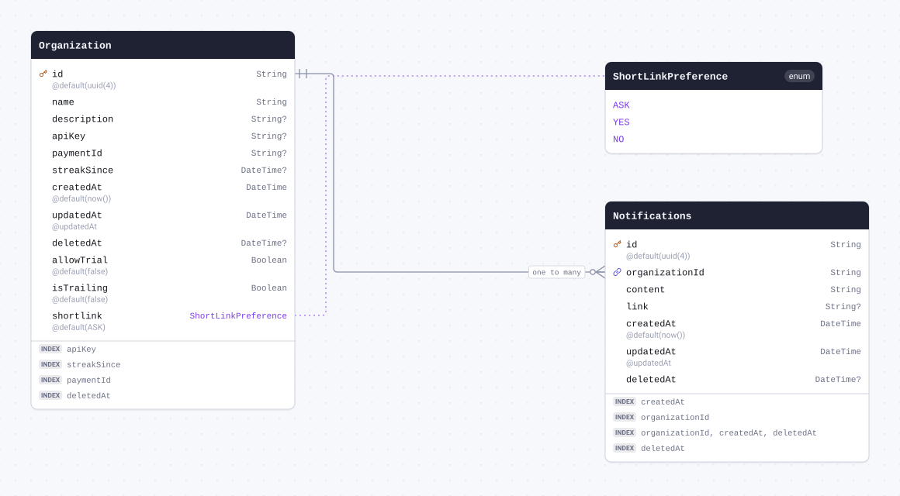

| Field            | Type       | Constraints                                       | Default      | Description |
| ---------------- | ---------- | ------------------------------------------------- | ------------ | ----------- |
| `id`             | `String`   | PK NOT NULL                                       | `uuid(4)`    |             |
| `organizationId` | `String`   | NOT NULL → [Organization.id](#model-Organization) |              |             |
| `content`        | `String`   | NOT NULL                                          |              |             |
| `link`           | `String`   | NULL                                              |              |             |
| `createdAt`      | `DateTime` | NOT NULL                                          | `now()`      |             |
| `updatedAt`      | `DateTime` | NOT NULL                                          | `@updatedAt` |             |
| `deletedAt`      | `DateTime` | NULL                                              |              |             |

#### Indexes

- `@@index([createdAt])`
- `@@index([organizationId])`
- `@@index([organizationId, createdAt, deletedAt])`
- `@@index([deletedAt])`

#### References

- `organizationId` → [Organization.id](#model-Organization) (many-to-one)

#### Definition

```sql
CREATE TABLE "Notifications" (
    "id" TEXT NOT NULL,
    "organizationId" TEXT NOT NULL,
    "content" TEXT NOT NULL,
    "link" TEXT,
    "createdAt" TIMESTAMP(3) NOT NULL DEFAULT CURRENT_TIMESTAMP,
    "updatedAt" TIMESTAMP(3) NOT NULL,
    "deletedAt" TIMESTAMP(3),

    CONSTRAINT "Notifications_pkey" PRIMARY KEY ("id")
);

CREATE INDEX "Notifications_createdAt_idx" ON "Notifications"("createdAt");

CREATE INDEX "Notifications_organizationId_idx" ON "Notifications"("organizationId");

CREATE INDEX "Notifications_organizationId_createdAt_deletedAt_idx" ON "Notifications"("organizationId", "createdAt", "deletedAt");

CREATE INDEX "Notifications_deletedAt_idx" ON "Notifications"("deletedAt");

ALTER TABLE "Notifications" ADD CONSTRAINT "Notifications_organizationId_fkey" FOREIGN KEY ("organizationId") REFERENCES "Organization"("id") ON DELETE RESTRICT ON UPDATE CASCADE;
```

<details>
<summary>Queries and their SQL</summary>

**findMany**: Every row

```ts
await prisma.notifications.findMany();
```

```sql
SELECT
  "public"."Notifications"."id",
  "public"."Notifications"."organizationId",
  "public"."Notifications"."content",
  "public"."Notifications"."link",
  "public"."Notifications"."createdAt",
  "public"."Notifications"."updatedAt",
  "public"."Notifications"."deletedAt"
FROM
  "public"."Notifications"
WHERE
  1 = 1
OFFSET
  $1
-- params: ["0"]
```

**count**: How many rows there are

```ts
await prisma.notifications.count();
```

```sql
SELECT
  COUNT(*) AS "_count$_all"
FROM
  (
    SELECT
      "public"."Notifications"."id"
    FROM
      "public"."Notifications"
    WHERE
      1 = 1
    OFFSET
      $1
  ) AS "sub"
-- params: ["0"]
```

**findMany**: Every row with its relations

```ts
await prisma.notifications.findMany({ include: { organization: true } });
```

```sql
SELECT
  "public"."Notifications"."id",
  "public"."Notifications"."organizationId",
  "public"."Notifications"."content",
  "public"."Notifications"."link",
  "public"."Notifications"."createdAt",
  "public"."Notifications"."updatedAt",
  "public"."Notifications"."deletedAt"
FROM
  "public"."Notifications"
WHERE
  1 = 1
OFFSET
  $1
-- params: ["0"]

SELECT
  "public"."Organization"."id",
  "public"."Organization"."name",
  "public"."Organization"."description",
  "public"."Organization"."apiKey",
  "public"."Organization"."paymentId",
  "public"."Organization"."streakSince",
  "public"."Organization"."createdAt",
  "public"."Organization"."updatedAt",
  "public"."Organization"."deletedAt",
  "public"."Organization"."allowTrial",
  "public"."Organization"."isTrailing",
  "public"."Organization"."shortlink"::text
FROM
  "public"."Organization"
WHERE
  "public"."Organization"."id" IN ($1)
OFFSET
  $2
-- params: ["<organizationId of the rows above>","0"]
```

**findUnique**: One row by what is unique to it

```ts
await prisma.notifications.findUnique({ where: { id: "example" } });
```

```sql
SELECT
  "public"."Notifications"."id",
  "public"."Notifications"."organizationId",
  "public"."Notifications"."content",
  "public"."Notifications"."link",
  "public"."Notifications"."createdAt",
  "public"."Notifications"."updatedAt",
  "public"."Notifications"."deletedAt"
FROM
  "public"."Notifications"
WHERE
  (
    "public"."Notifications"."id" = $1
    AND 1 = 1
  )
LIMIT
  $2
OFFSET
  $3
-- params: ["example","1","0"]
```

**create**: Create a row

```ts
await prisma.notifications.create({ data: { organizationId: "example", content: "example" } });
```

```sql
INSERT INTO
  "public"."Notifications" (
    "id",
    "organizationId",
    "content",
    "createdAt",
    "updatedAt"
  )
VALUES
  ($1, $2, $3, $4, $5)
RETURNING
  "public"."Notifications"."id",
  "public"."Notifications"."organizationId",
  "public"."Notifications"."content",
  "public"."Notifications"."link",
  "public"."Notifications"."createdAt",
  "public"."Notifications"."updatedAt",
  "public"."Notifications"."deletedAt"
-- params: ["<uuid(4)>","example","example","<now()>","<now()>"]
```

**update**: Update a row

```ts
await prisma.notifications.update({ where: { id: "example" }, data: { content: "example" } });
```

```sql
UPDATE "public"."Notifications"
SET
  "content" = $1,
  "updatedAt" = $2
WHERE
  (
    "public"."Notifications"."id" = $3
    AND 1 = 1
  )
RETURNING
  "public"."Notifications"."id",
  "public"."Notifications"."organizationId",
  "public"."Notifications"."content",
  "public"."Notifications"."link",
  "public"."Notifications"."createdAt",
  "public"."Notifications"."updatedAt",
  "public"."Notifications"."deletedAt"
-- params: ["example",{"prisma__type":"generatorCall","prisma__value":{"name":"now","args":[],"returnType":{"type":"DateTime"}}},"example"]
```

**delete**: Delete a row

```ts
await prisma.notifications.delete({ where: { id: "example" } });
```

```sql
DELETE FROM "public"."Notifications"
WHERE
  (
    "public"."Notifications"."id" = $1
    AND 1 = 1
  )
RETURNING
  "public"."Notifications"."id",
  "public"."Notifications"."organizationId",
  "public"."Notifications"."content",
  "public"."Notifications"."link",
  "public"."Notifications"."createdAt",
  "public"."Notifications"."updatedAt",
  "public"."Notifications"."deletedAt"
-- params: ["example"]
```

</details>

<a id="model-MessagesGroup"></a>

### MessagesGroup

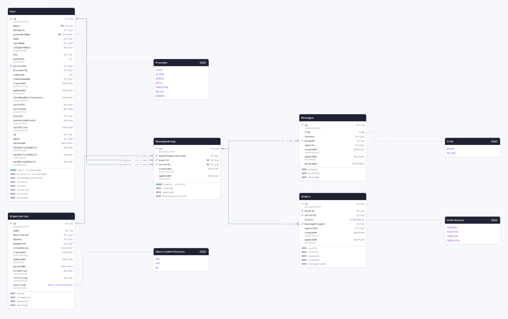

| Field                 | Type       | Constraints                                       | Default      | Description |
| --------------------- | ---------- | ------------------------------------------------- | ------------ | ----------- |
| `id`                  | `String`   | PK NOT NULL                                       | `uuid(4)`    |             |
| `buyerOrganizationId` | `String`   | NOT NULL → [Organization.id](#model-Organization) |              |             |
| `buyerId`             | `String`   | NOT NULL → [User.id](#model-User)                 |              |             |
| `sellerId`            | `String`   | NOT NULL → [User.id](#model-User)                 |              |             |
| `createdAt`           | `DateTime` | NOT NULL                                          | `now()`      |             |
| `updatedAt`           | `DateTime` | NOT NULL                                          | `@updatedAt` |             |

#### Indexes

- `@@index([createdAt])`
- `@@index([updatedAt])`
- `@@index([buyerOrganizationId])`
- `@@unique([buyerId, sellerId])`

#### References

- `buyerId` → [User.id](#model-User) (many-to-one)
- `buyerOrganizationId` → [Organization.id](#model-Organization) (many-to-one)
- `sellerId` → [User.id](#model-User) (many-to-one)

#### Referenced by

- `id` ← [Orders.messageGroupId](#model-Orders) (one-to-many)
- `id` ← [Messages.groupId](#model-Messages) (one-to-many)

#### Definition

```sql
CREATE TABLE "MessagesGroup" (
    "id" TEXT NOT NULL,
    "buyerOrganizationId" TEXT NOT NULL,
    "buyerId" TEXT NOT NULL,
    "sellerId" TEXT NOT NULL,
    "createdAt" TIMESTAMP(3) NOT NULL DEFAULT CURRENT_TIMESTAMP,
    "updatedAt" TIMESTAMP(3) NOT NULL,

    CONSTRAINT "MessagesGroup_pkey" PRIMARY KEY ("id")
);

CREATE INDEX "MessagesGroup_createdAt_idx" ON "MessagesGroup"("createdAt");

CREATE INDEX "MessagesGroup_updatedAt_idx" ON "MessagesGroup"("updatedAt");

CREATE INDEX "MessagesGroup_buyerOrganizationId_idx" ON "MessagesGroup"("buyerOrganizationId");

CREATE UNIQUE INDEX "MessagesGroup_buyerId_sellerId_key" ON "MessagesGroup"("buyerId", "sellerId");

ALTER TABLE "MessagesGroup" ADD CONSTRAINT "MessagesGroup_buyerId_fkey" FOREIGN KEY ("buyerId") REFERENCES "User"("id") ON DELETE RESTRICT ON UPDATE CASCADE;

ALTER TABLE "MessagesGroup" ADD CONSTRAINT "MessagesGroup_buyerOrganizationId_fkey" FOREIGN KEY ("buyerOrganizationId") REFERENCES "Organization"("id") ON DELETE RESTRICT ON UPDATE CASCADE;

ALTER TABLE "MessagesGroup" ADD CONSTRAINT "MessagesGroup_sellerId_fkey" FOREIGN KEY ("sellerId") REFERENCES "User"("id") ON DELETE RESTRICT ON UPDATE CASCADE;
```

<details>
<summary>Queries and their SQL</summary>

**findMany**: Every row

```ts
await prisma.messagesGroup.findMany();
```

```sql
SELECT
  "public"."MessagesGroup"."id",
  "public"."MessagesGroup"."buyerOrganizationId",
  "public"."MessagesGroup"."buyerId",
  "public"."MessagesGroup"."sellerId",
  "public"."MessagesGroup"."createdAt",
  "public"."MessagesGroup"."updatedAt"
FROM
  "public"."MessagesGroup"
WHERE
  1 = 1
OFFSET
  $1
-- params: ["0"]
```

**count**: How many rows there are

```ts
await prisma.messagesGroup.count();
```

```sql
SELECT
  COUNT(*) AS "_count$_all"
FROM
  (
    SELECT
      "public"."MessagesGroup"."id"
    FROM
      "public"."MessagesGroup"
    WHERE
      1 = 1
    OFFSET
      $1
  ) AS "sub"
-- params: ["0"]
```

**findMany**: Every row with its relations

```ts
await prisma.messagesGroup.findMany({
  include: { messages: true, buyer: true, buyerOrganization: true, seller: true, orders: true },
});
```

```sql
SELECT
  "public"."MessagesGroup"."id",
  "public"."MessagesGroup"."buyerOrganizationId",
  "public"."MessagesGroup"."buyerId",
  "public"."MessagesGroup"."sellerId",
  "public"."MessagesGroup"."createdAt",
  "public"."MessagesGroup"."updatedAt"
FROM
  "public"."MessagesGroup"
WHERE
  1 = 1
OFFSET
  $1
-- params: ["0"]

SELECT
  "public"."Messages"."id",
  "public"."Messages"."from"::text,
  "public"."Messages"."content",
  "public"."Messages"."groupId",
  "public"."Messages"."special",
  "public"."Messages"."createdAt",
  "public"."Messages"."updatedAt",
  "public"."Messages"."deletedAt"
FROM
  "public"."Messages"
WHERE
  "public"."Messages"."groupId" IN ($1)
OFFSET
  $2
-- params: ["<id of the rows above>","0"]

SELECT
  "public"."User"."id",
  "public"."User"."email",
  "public"."User"."password",
  "public"."User"."providerName"::text,
  "public"."User"."name",
  "public"."User"."lastName",
  "public"."User"."isSuperAdmin",
  "public"."User"."bio",
  "public"."User"."audience",
  "public"."User"."pictureId",
  "public"."User"."providerId",
  "public"."User"."timezone",
  "public"."User"."timezoneName",
  "public"."User"."createdAt",
  "public"."User"."updatedAt",
  "public"."User"."lastReadNotifications",
  "public"."User"."inviteId",
  "public"."User"."activated",
  "public"."User"."account",
  "public"."User"."connectedAccount",
  "public"."User"."lastOnline",
  "public"."User"."ip",
  "public"."User"."agent",
  "public"."User"."deletedAt",
  "public"."User"."sendSuccessEmails",
  "public"."User"."sendFailureEmails",
  "public"."User"."sendStreakEmails"
FROM
  "public"."User"
WHERE
  "public"."User"."id" IN ($1)
OFFSET
  $2
-- params: ["<buyerId of the rows above>","0"]

SELECT
  "public"."Organization"."id",
  "public"."Organization"."name",
  "public"."Organization"."description",
  "public"."Organization"."apiKey",
  "public"."Organization"."paymentId",
  "public"."Organization"."streakSince",
  "public"."Organization"."createdAt",
  "public"."Organization"."updatedAt",
  "public"."Organization"."deletedAt",
  "public"."Organization"."allowTrial",
  "public"."Organization"."isTrailing",
  "public"."Organization"."shortlink"::text
FROM
  "public"."Organization"
WHERE
  "public"."Organization"."id" IN ($1)
OFFSET
  $2
-- params: ["<buyerOrganizationId of the rows above>","0"]

SELECT
  "public"."User"."id",
  "public"."User"."email",
  "public"."User"."password",
  "public"."User"."providerName"::text,
  "public"."User"."name",
  "public"."User"."lastName",
  "public"."User"."isSuperAdmin",
  "public"."User"."bio",
  "public"."User"."audience",
  "public"."User"."pictureId",
  "public"."User"."providerId",
  "public"."User"."timezone",
  "public"."User"."timezoneName",
  "public"."User"."createdAt",
  "public"."User"."updatedAt",
  "public"."User"."lastReadNotifications",
  "public"."User"."inviteId",
  "public"."User"."activated",
  "public"."User"."account",
  "public"."User"."connectedAccount",
  "public"."User"."lastOnline",
  "public"."User"."ip",
  "public"."User"."agent",
  "public"."User"."deletedAt",
  "public"."User"."sendSuccessEmails",
  "public"."User"."sendFailureEmails",
  "public"."User"."sendStreakEmails"
FROM
  "public"."User"
WHERE
  "public"."User"."id" IN ($1)
OFFSET
  $2
-- params: ["<sellerId of the rows above>","0"]

SELECT
  "public"."Orders"."id",
  "public"."Orders"."buyerId",
  "public"."Orders"."sellerId",
  "public"."Orders"."status"::text,
  "public"."Orders"."messageGroupId",
  "public"."Orders"."captureId",
  "public"."Orders"."createdAt",
  "public"."Orders"."updatedAt"
FROM
  "public"."Orders"
WHERE
  "public"."Orders"."messageGroupId" IN ($1)
OFFSET
  $2
-- params: ["<id of the rows above>","0"]
```

**findUnique**: One row by what is unique to it

```ts
await prisma.messagesGroup.findUnique({ where: { id: "example" } });
```

```sql
SELECT
  "public"."MessagesGroup"."id",
  "public"."MessagesGroup"."buyerOrganizationId",
  "public"."MessagesGroup"."buyerId",
  "public"."MessagesGroup"."sellerId",
  "public"."MessagesGroup"."createdAt",
  "public"."MessagesGroup"."updatedAt"
FROM
  "public"."MessagesGroup"
WHERE
  (
    "public"."MessagesGroup"."id" = $1
    AND 1 = 1
  )
LIMIT
  $2
OFFSET
  $3
-- params: ["example","1","0"]
```

**create**: Create a row

```ts
await prisma.messagesGroup.create({
  data: { buyerOrganizationId: "example", buyerId: "example", sellerId: "example" },
});
```

```sql
INSERT INTO
  "public"."MessagesGroup" (
    "id",
    "buyerOrganizationId",
    "buyerId",
    "sellerId",
    "createdAt",
    "updatedAt"
  )
VALUES
  ($1, $2, $3, $4, $5, $6)
RETURNING
  "public"."MessagesGroup"."id",
  "public"."MessagesGroup"."buyerOrganizationId",
  "public"."MessagesGroup"."buyerId",
  "public"."MessagesGroup"."sellerId",
  "public"."MessagesGroup"."createdAt",
  "public"."MessagesGroup"."updatedAt"
-- params: ["<uuid(4)>","example","example","example","<now()>","<now()>"]
```

**update**: Update a row

```ts
await prisma.messagesGroup.update({
  where: { id: "example" },
  data: { createdAt: new Date("2026-01-01T00:00:00.000Z") },
});
```

```sql
UPDATE "public"."MessagesGroup"
SET
  "createdAt" = $1,
  "updatedAt" = $2
WHERE
  (
    "public"."MessagesGroup"."id" = $3
    AND 1 = 1
  )
RETURNING
  "public"."MessagesGroup"."id",
  "public"."MessagesGroup"."buyerOrganizationId",
  "public"."MessagesGroup"."buyerId",
  "public"."MessagesGroup"."sellerId",
  "public"."MessagesGroup"."createdAt",
  "public"."MessagesGroup"."updatedAt"
-- params: ["2026-01-01T00:00:00.000Z",{"prisma__type":"generatorCall","prisma__value":{"name":"now","args":[],"returnType":{"type":"DateTime"}}},"example"]
```

**delete**: Delete a row

```ts
await prisma.messagesGroup.delete({ where: { id: "example" } });
```

```sql
DELETE FROM "public"."MessagesGroup"
WHERE
  (
    "public"."MessagesGroup"."id" = $1
    AND 1 = 1
  )
RETURNING
  "public"."MessagesGroup"."id",
  "public"."MessagesGroup"."buyerOrganizationId",
  "public"."MessagesGroup"."buyerId",
  "public"."MessagesGroup"."sellerId",
  "public"."MessagesGroup"."createdAt",
  "public"."MessagesGroup"."updatedAt"
-- params: ["example"]
```

</details>

<a id="model-PayoutProblems"></a>

### PayoutProblems

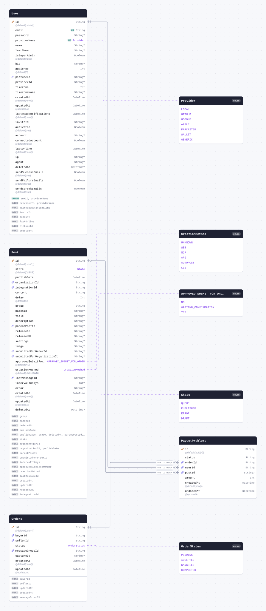

| Field       | Type       | Constraints                           | Default      | Description |
| ----------- | ---------- | ------------------------------------- | ------------ | ----------- |
| `id`        | `String`   | PK NOT NULL                           | `uuid(4)`    |             |
| `status`    | `String`   | NOT NULL                              |              |             |
| `orderId`   | `String`   | NOT NULL → [Orders.id](#model-Orders) |              |             |
| `userId`    | `String`   | NOT NULL → [User.id](#model-User)     |              |             |
| `postId`    | `String`   | NULL → [Post.id](#model-Post)         |              |             |
| `amount`    | `Int`      | NOT NULL                              |              |             |
| `createdAt` | `DateTime` | NOT NULL                              | `now()`      |             |
| `updatedAt` | `DateTime` | NOT NULL                              | `@updatedAt` |             |

#### References

- `orderId` → [Orders.id](#model-Orders) (many-to-one)
- `postId` → [Post.id](#model-Post) (many-to-one)
- `userId` → [User.id](#model-User) (many-to-one)

#### Definition

```sql
CREATE TABLE "PayoutProblems" (
    "id" TEXT NOT NULL,
    "status" TEXT NOT NULL,
    "orderId" TEXT NOT NULL,
    "userId" TEXT NOT NULL,
    "postId" TEXT,
    "amount" INTEGER NOT NULL,
    "createdAt" TIMESTAMP(3) NOT NULL DEFAULT CURRENT_TIMESTAMP,
    "updatedAt" TIMESTAMP(3) NOT NULL,

    CONSTRAINT "PayoutProblems_pkey" PRIMARY KEY ("id")
);

ALTER TABLE "PayoutProblems" ADD CONSTRAINT "PayoutProblems_orderId_fkey" FOREIGN KEY ("orderId") REFERENCES "Orders"("id") ON DELETE RESTRICT ON UPDATE CASCADE;

ALTER TABLE "PayoutProblems" ADD CONSTRAINT "PayoutProblems_postId_fkey" FOREIGN KEY ("postId") REFERENCES "Post"("id") ON DELETE SET NULL ON UPDATE CASCADE;

ALTER TABLE "PayoutProblems" ADD CONSTRAINT "PayoutProblems_userId_fkey" FOREIGN KEY ("userId") REFERENCES "User"("id") ON DELETE RESTRICT ON UPDATE CASCADE;
```

<details>
<summary>Queries and their SQL</summary>

**findMany**: Every row

```ts
await prisma.payoutProblems.findMany();
```

```sql
SELECT
  "public"."PayoutProblems"."id",
  "public"."PayoutProblems"."status",
  "public"."PayoutProblems"."orderId",
  "public"."PayoutProblems"."userId",
  "public"."PayoutProblems"."postId",
  "public"."PayoutProblems"."amount",
  "public"."PayoutProblems"."createdAt",
  "public"."PayoutProblems"."updatedAt"
FROM
  "public"."PayoutProblems"
WHERE
  1 = 1
OFFSET
  $1
-- params: ["0"]
```

**count**: How many rows there are

```ts
await prisma.payoutProblems.count();
```

```sql
SELECT
  COUNT(*) AS "_count$_all"
FROM
  (
    SELECT
      "public"."PayoutProblems"."id"
    FROM
      "public"."PayoutProblems"
    WHERE
      1 = 1
    OFFSET
      $1
  ) AS "sub"
-- params: ["0"]
```

**findMany**: Every row with its relations

```ts
await prisma.payoutProblems.findMany({ include: { order: true, post: true, user: true } });
```

```sql
SELECT
  "public"."PayoutProblems"."id",
  "public"."PayoutProblems"."status",
  "public"."PayoutProblems"."orderId",
  "public"."PayoutProblems"."userId",
  "public"."PayoutProblems"."postId",
  "public"."PayoutProblems"."amount",
  "public"."PayoutProblems"."createdAt",
  "public"."PayoutProblems"."updatedAt"
FROM
  "public"."PayoutProblems"
WHERE
  1 = 1
OFFSET
  $1
-- params: ["0"]

SELECT
  "public"."Orders"."id",
  "public"."Orders"."buyerId",
  "public"."Orders"."sellerId",
  "public"."Orders"."status"::text,
  "public"."Orders"."messageGroupId",
  "public"."Orders"."captureId",
  "public"."Orders"."createdAt",
  "public"."Orders"."updatedAt"
FROM
  "public"."Orders"
WHERE
  "public"."Orders"."id" IN ($1)
OFFSET
  $2
-- params: ["<orderId of the rows above>","0"]

SELECT
  "public"."Post"."id",
  "public"."Post"."state"::text,
  "public"."Post"."publishDate",
  "public"."Post"."organizationId",
  "public"."Post"."integrationId",
  "public"."Post"."content",
  "public"."Post"."delay",
  "public"."Post"."group",
  "public"."Post"."batchId",
  "public"."Post"."title",
  "public"."Post"."description",
  "public"."Post"."parentPostId",
  "public"."Post"."releaseId",
  "public"."Post"."releaseURL",
  "public"."Post"."settings",
  "public"."Post"."image",
  "public"."Post"."submittedForOrderId",
  "public"."Post"."submittedForOrganizationId",
  "public"."Post"."approvedSubmitForOrder"::text,
  "public"."Post"."creationMethod"::text,
  "public"."Post"."lastMessageId",
  "public"."Post"."intervalInDays",
  "public"."Post"."error",
  "public"."Post"."createdAt",
  "public"."Post"."updatedAt",
  "public"."Post"."deletedAt"
FROM
  "public"."Post"
WHERE
  "public"."Post"."id" IN ($1)
OFFSET
  $2
-- params: ["<postId of the rows above>","0"]

SELECT
  "public"."User"."id",
  "public"."User"."email",
  "public"."User"."password",
  "public"."User"."providerName"::text,
  "public"."User"."name",
  "public"."User"."lastName",
  "public"."User"."isSuperAdmin",
  "public"."User"."bio",
  "public"."User"."audience",
  "public"."User"."pictureId",
  "public"."User"."providerId",
  "public"."User"."timezone",
  "public"."User"."timezoneName",
  "public"."User"."createdAt",
  "public"."User"."updatedAt",
  "public"."User"."lastReadNotifications",
  "public"."User"."inviteId",
  "public"."User"."activated",
  "public"."User"."account",
  "public"."User"."connectedAccount",
  "public"."User"."lastOnline",
  "public"."User"."ip",
  "public"."User"."agent",
  "public"."User"."deletedAt",
  "public"."User"."sendSuccessEmails",
  "public"."User"."sendFailureEmails",
  "public"."User"."sendStreakEmails"
FROM
  "public"."User"
WHERE
  "public"."User"."id" IN ($1)
OFFSET
  $2
-- params: ["<userId of the rows above>","0"]
```

**findUnique**: One row by what is unique to it

```ts
await prisma.payoutProblems.findUnique({ where: { id: "example" } });
```

```sql
SELECT
  "public"."PayoutProblems"."id",
  "public"."PayoutProblems"."status",
  "public"."PayoutProblems"."orderId",
  "public"."PayoutProblems"."userId",
  "public"."PayoutProblems"."postId",
  "public"."PayoutProblems"."amount",
  "public"."PayoutProblems"."createdAt",
  "public"."PayoutProblems"."updatedAt"
FROM
  "public"."PayoutProblems"
WHERE
  (
    "public"."PayoutProblems"."id" = $1
    AND 1 = 1
  )
LIMIT
  $2
OFFSET
  $3
-- params: ["example","1","0"]
```

**create**: Create a row

```ts
await prisma.payoutProblems.create({
  data: { status: "example", orderId: "example", userId: "example", amount: 1 },
});
```

```sql
INSERT INTO
  "public"."PayoutProblems" (
    "id",
    "status",
    "orderId",
    "userId",
    "amount",
    "createdAt",
    "updatedAt"
  )
VALUES
  ($1, $2, $3, $4, $5, $6, $7)
RETURNING
  "public"."PayoutProblems"."id",
  "public"."PayoutProblems"."status",
  "public"."PayoutProblems"."orderId",
  "public"."PayoutProblems"."userId",
  "public"."PayoutProblems"."postId",
  "public"."PayoutProblems"."amount",
  "public"."PayoutProblems"."createdAt",
  "public"."PayoutProblems"."updatedAt"
-- params: ["<uuid(4)>","example","example","example","1","<now()>","<now()>"]
```

**update**: Update a row

```ts
await prisma.payoutProblems.update({ where: { id: "example" }, data: { status: "example" } });
```

```sql
UPDATE "public"."PayoutProblems"
SET
  "status" = $1,
  "updatedAt" = $2
WHERE
  (
    "public"."PayoutProblems"."id" = $3
    AND 1 = 1
  )
RETURNING
  "public"."PayoutProblems"."id",
  "public"."PayoutProblems"."status",
  "public"."PayoutProblems"."orderId",
  "public"."PayoutProblems"."userId",
  "public"."PayoutProblems"."postId",
  "public"."PayoutProblems"."amount",
  "public"."PayoutProblems"."createdAt",
  "public"."PayoutProblems"."updatedAt"
-- params: ["example",{"prisma__type":"generatorCall","prisma__value":{"name":"now","args":[],"returnType":{"type":"DateTime"}}},"example"]
```

**delete**: Delete a row

```ts
await prisma.payoutProblems.delete({ where: { id: "example" } });
```

```sql
DELETE FROM "public"."PayoutProblems"
WHERE
  (
    "public"."PayoutProblems"."id" = $1
    AND 1 = 1
  )
RETURNING
  "public"."PayoutProblems"."id",
  "public"."PayoutProblems"."status",
  "public"."PayoutProblems"."orderId",
  "public"."PayoutProblems"."userId",
  "public"."PayoutProblems"."postId",
  "public"."PayoutProblems"."amount",
  "public"."PayoutProblems"."createdAt",
  "public"."PayoutProblems"."updatedAt"
-- params: ["example"]
```

</details>

<a id="model-Orders"></a>

### Orders

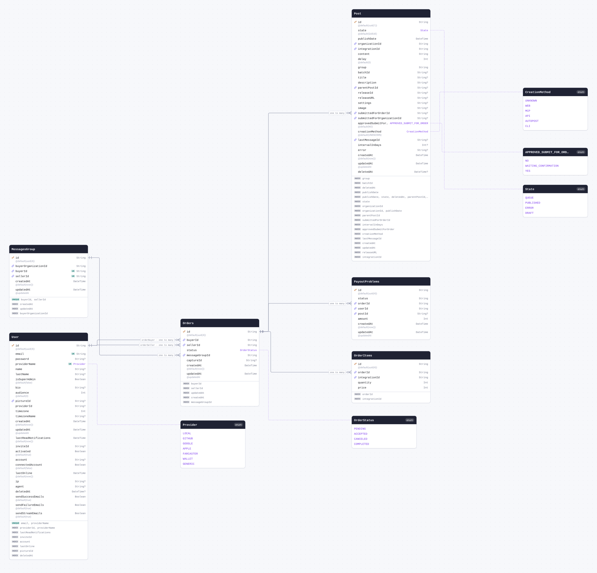

| Field            | Type                               | Constraints                                         | Default      | Description |
| ---------------- | ---------------------------------- | --------------------------------------------------- | ------------ | ----------- |
| `id`             | `String`                           | PK NOT NULL                                         | `uuid(4)`    |             |
| `buyerId`        | `String`                           | NOT NULL → [User.id](#model-User)                   |              |             |
| `sellerId`       | `String`                           | NOT NULL → [User.id](#model-User)                   |              |             |
| `status`         | [`OrderStatus`](#enum-OrderStatus) | NOT NULL                                            |              |             |
| `messageGroupId` | `String`                           | NOT NULL → [MessagesGroup.id](#model-MessagesGroup) |              |             |
| `captureId`      | `String`                           | NULL                                                |              |             |
| `createdAt`      | `DateTime`                         | NOT NULL                                            | `now()`      |             |
| `updatedAt`      | `DateTime`                         | NOT NULL                                            | `@updatedAt` |             |

#### Indexes

- `@@index([buyerId])`
- `@@index([sellerId])`
- `@@index([updatedAt])`
- `@@index([createdAt])`
- `@@index([messageGroupId])`

#### References

- `buyerId` → [User.id](#model-User) (many-to-one)
- `messageGroupId` → [MessagesGroup.id](#model-MessagesGroup) (many-to-one)
- `sellerId` → [User.id](#model-User) (many-to-one)

#### Referenced by

- `id` ← [Post.submittedForOrderId](#model-Post) (one-to-many)
- `id` ← [PayoutProblems.orderId](#model-PayoutProblems) (one-to-many)
- `id` ← [OrderItems.orderId](#model-OrderItems) (one-to-many)

#### Definition

```sql
CREATE TABLE "Orders" (
    "id" TEXT NOT NULL,
    "buyerId" TEXT NOT NULL,
    "sellerId" TEXT NOT NULL,
    "status" "OrderStatus" NOT NULL,
    "messageGroupId" TEXT NOT NULL,
    "captureId" TEXT,
    "createdAt" TIMESTAMP(3) NOT NULL DEFAULT CURRENT_TIMESTAMP,
    "updatedAt" TIMESTAMP(3) NOT NULL,

    CONSTRAINT "Orders_pkey" PRIMARY KEY ("id")
);

CREATE INDEX "Orders_buyerId_idx" ON "Orders"("buyerId");

CREATE INDEX "Orders_sellerId_idx" ON "Orders"("sellerId");

CREATE INDEX "Orders_updatedAt_idx" ON "Orders"("updatedAt");

CREATE INDEX "Orders_createdAt_idx" ON "Orders"("createdAt");

CREATE INDEX "Orders_messageGroupId_idx" ON "Orders"("messageGroupId");

ALTER TABLE "Orders" ADD CONSTRAINT "Orders_buyerId_fkey" FOREIGN KEY ("buyerId") REFERENCES "User"("id") ON DELETE RESTRICT ON UPDATE CASCADE;

ALTER TABLE "Orders" ADD CONSTRAINT "Orders_messageGroupId_fkey" FOREIGN KEY ("messageGroupId") REFERENCES "MessagesGroup"("id") ON DELETE RESTRICT ON UPDATE CASCADE;

ALTER TABLE "Orders" ADD CONSTRAINT "Orders_sellerId_fkey" FOREIGN KEY ("sellerId") REFERENCES "User"("id") ON DELETE RESTRICT ON UPDATE CASCADE;
```

<details>
<summary>Queries and their SQL</summary>

**findMany**: Every row

```ts
await prisma.orders.findMany();
```

```sql
SELECT
  "public"."Orders"."id",
  "public"."Orders"."buyerId",
  "public"."Orders"."sellerId",
  "public"."Orders"."status"::text,
  "public"."Orders"."messageGroupId",
  "public"."Orders"."captureId",
  "public"."Orders"."createdAt",
  "public"."Orders"."updatedAt"
FROM
  "public"."Orders"
WHERE
  1 = 1
OFFSET
  $1
-- params: ["0"]
```

**count**: How many rows there are

```ts
await prisma.orders.count();
```

```sql
SELECT
  COUNT(*) AS "_count$_all"
FROM
  (
    SELECT
      "public"."Orders"."id"
    FROM
      "public"."Orders"
    WHERE
      1 = 1
    OFFSET
      $1
  ) AS "sub"
-- params: ["0"]
```

**findMany**: Every row with its relations

```ts
await prisma.orders.findMany({
  include: {
    ordersItems: true,
    buyer: true,
    messageGroup: true,
    seller: true,
    payoutProblems: true,
    posts: true,
  },
});
```

```sql
SELECT
  "public"."Orders"."id",
  "public"."Orders"."buyerId",
  "public"."Orders"."sellerId",
  "public"."Orders"."status"::text,
  "public"."Orders"."messageGroupId",
  "public"."Orders"."captureId",
  "public"."Orders"."createdAt",
  "public"."Orders"."updatedAt"
FROM
  "public"."Orders"
WHERE
  1 = 1
OFFSET
  $1
-- params: ["0"]

SELECT
  "public"."OrderItems"."id",
  "public"."OrderItems"."orderId",
  "public"."OrderItems"."integrationId",
  "public"."OrderItems"."quantity",
  "public"."OrderItems"."price"
FROM
  "public"."OrderItems"
WHERE
  "public"."OrderItems"."orderId" IN ($1)
OFFSET
  $2
-- params: ["<id of the rows above>","0"]

SELECT
  "public"."User"."id",
  "public"."User"."email",
  "public"."User"."password",
  "public"."User"."providerName"::text,
  "public"."User"."name",
  "public"."User"."lastName",
  "public"."User"."isSuperAdmin",
  "public"."User"."bio",
  "public"."User"."audience",
  "public"."User"."pictureId",
  "public"."User"."providerId",
  "public"."User"."timezone",
  "public"."User"."timezoneName",
  "public"."User"."createdAt",
  "public"."User"."updatedAt",
  "public"."User"."lastReadNotifications",
  "public"."User"."inviteId",
  "public"."User"."activated",
  "public"."User"."account",
  "public"."User"."connectedAccount",
  "public"."User"."lastOnline",
  "public"."User"."ip",
  "public"."User"."agent",
  "public"."User"."deletedAt",
  "public"."User"."sendSuccessEmails",
  "public"."User"."sendFailureEmails",
  "public"."User"."sendStreakEmails"
FROM
  "public"."User"
WHERE
  "public"."User"."id" IN ($1)
OFFSET
  $2
-- params: ["<buyerId of the rows above>","0"]

SELECT
  "public"."MessagesGroup"."id",
  "public"."MessagesGroup"."buyerOrganizationId",
  "public"."MessagesGroup"."buyerId",
  "public"."MessagesGroup"."sellerId",
  "public"."MessagesGroup"."createdAt",
  "public"."MessagesGroup"."updatedAt"
FROM
  "public"."MessagesGroup"
WHERE
  "public"."MessagesGroup"."id" IN ($1)
OFFSET
  $2
-- params: ["<messageGroupId of the rows above>","0"]

SELECT
  "public"."User"."id",
  "public"."User"."email",
  "public"."User"."password",
  "public"."User"."providerName"::text,
  "public"."User"."name",
  "public"."User"."lastName",
  "public"."User"."isSuperAdmin",
  "public"."User"."bio",
  "public"."User"."audience",
  "public"."User"."pictureId",
  "public"."User"."providerId",
  "public"."User"."timezone",
  "public"."User"."timezoneName",
  "public"."User"."createdAt",
  "public"."User"."updatedAt",
  "public"."User"."lastReadNotifications",
  "public"."User"."inviteId",
  "public"."User"."activated",
  "public"."User"."account",
  "public"."User"."connectedAccount",
  "public"."User"."lastOnline",
  "public"."User"."ip",
  "public"."User"."agent",
  "public"."User"."deletedAt",
  "public"."User"."sendSuccessEmails",
  "public"."User"."sendFailureEmails",
  "public"."User"."sendStreakEmails"
FROM
  "public"."User"
WHERE
  "public"."User"."id" IN ($1)
OFFSET
  $2
-- params: ["<sellerId of the rows above>","0"]

SELECT
  "public"."PayoutProblems"."id",
  "public"."PayoutProblems"."status",
  "public"."PayoutProblems"."orderId",
  "public"."PayoutProblems"."userId",
  "public"."PayoutProblems"."postId",
  "public"."PayoutProblems"."amount",
  "public"."PayoutProblems"."createdAt",
  "public"."PayoutProblems"."updatedAt"
FROM
  "public"."PayoutProblems"
WHERE
  "public"."PayoutProblems"."orderId" IN ($1)
OFFSET
  $2
-- params: ["<id of the rows above>","0"]

SELECT
  "public"."Post"."id",
  "public"."Post"."state"::text,
  "public"."Post"."publishDate",
  "public"."Post"."organizationId",
  "public"."Post"."integrationId",
  "public"."Post"."content",
  "public"."Post"."delay",
  "public"."Post"."group",
  "public"."Post"."batchId",
  "public"."Post"."title",
  "public"."Post"."description",
  "public"."Post"."parentPostId",
  "public"."Post"."releaseId",
  "public"."Post"."releaseURL",
  "public"."Post"."settings",
  "public"."Post"."image",
  "public"."Post"."submittedForOrderId",
  "public"."Post"."submittedForOrganizationId",
  "public"."Post"."approvedSubmitForOrder"::text,
  "public"."Post"."creationMethod"::text,
  "public"."Post"."lastMessageId",
  "public"."Post"."intervalInDays",
  "public"."Post"."error",
  "public"."Post"."createdAt",
  "public"."Post"."updatedAt",
  "public"."Post"."deletedAt"
FROM
  "public"."Post"
WHERE
  "public"."Post"."submittedForOrderId" IN ($1)
OFFSET
  $2
-- params: ["<id of the rows above>","0"]
```

**findUnique**: One row by what is unique to it

```ts
await prisma.orders.findUnique({ where: { id: "example" } });
```

```sql
SELECT
  "public"."Orders"."id",
  "public"."Orders"."buyerId",
  "public"."Orders"."sellerId",
  "public"."Orders"."status"::text,
  "public"."Orders"."messageGroupId",
  "public"."Orders"."captureId",
  "public"."Orders"."createdAt",
  "public"."Orders"."updatedAt"
FROM
  "public"."Orders"
WHERE
  (
    "public"."Orders"."id" = $1
    AND 1 = 1
  )
LIMIT
  $2
OFFSET
  $3
-- params: ["example","1","0"]
```

**create**: Create a row

```ts
await prisma.orders.create({
  data: { buyerId: "example", sellerId: "example", status: "PENDING", messageGroupId: "example" },
});
```

```sql
INSERT INTO
  "public"."Orders" (
    "id",
    "buyerId",
    "sellerId",
    "status",
    "messageGroupId",
    "createdAt",
    "updatedAt"
  )
VALUES
  (
    $1,
    $2,
    $3,
    CAST($4::text AS "public"."OrderStatus"),
    $5,
    $6,
    $7
  )
RETURNING
  "public"."Orders"."id",
  "public"."Orders"."buyerId",
  "public"."Orders"."sellerId",
  "public"."Orders"."status"::text,
  "public"."Orders"."messageGroupId",
  "public"."Orders"."captureId",
  "public"."Orders"."createdAt",
  "public"."Orders"."updatedAt"
-- params: ["<uuid(4)>","example","example","PENDING","example","<now()>","<now()>"]
```

**update**: Update a row

```ts
await prisma.orders.update({ where: { id: "example" }, data: { status: "PENDING" } });
```

```sql
UPDATE "public"."Orders"
SET
  "status" = CAST($1::text AS "public"."OrderStatus"),
  "updatedAt" = $2
WHERE
  (
    "public"."Orders"."id" = $3
    AND 1 = 1
  )
RETURNING
  "public"."Orders"."id",
  "public"."Orders"."buyerId",
  "public"."Orders"."sellerId",
  "public"."Orders"."status"::text,
  "public"."Orders"."messageGroupId",
  "public"."Orders"."captureId",
  "public"."Orders"."createdAt",
  "public"."Orders"."updatedAt"
-- params: ["PENDING",{"prisma__type":"generatorCall","prisma__value":{"name":"now","args":[],"returnType":{"type":"DateTime"}}},"example"]
```

**delete**: Delete a row

```ts
await prisma.orders.delete({ where: { id: "example" } });
```

```sql
DELETE FROM "public"."Orders"
WHERE
  (
    "public"."Orders"."id" = $1
    AND 1 = 1
  )
RETURNING
  "public"."Orders"."id",
  "public"."Orders"."buyerId",
  "public"."Orders"."sellerId",
  "public"."Orders"."status"::text,
  "public"."Orders"."messageGroupId",
  "public"."Orders"."captureId",
  "public"."Orders"."createdAt",
  "public"."Orders"."updatedAt"
-- params: ["example"]
```

</details>

<a id="model-OrderItems"></a>

### OrderItems

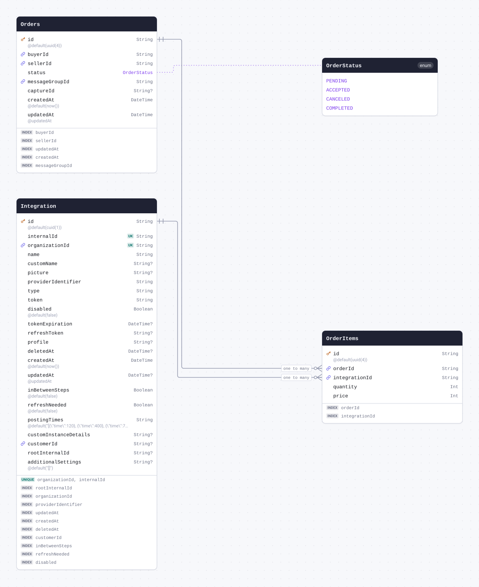

| Field           | Type     | Constraints                                     | Default   | Description |
| --------------- | -------- | ----------------------------------------------- | --------- | ----------- |
| `id`            | `String` | PK NOT NULL                                     | `uuid(4)` |             |
| `orderId`       | `String` | NOT NULL → [Orders.id](#model-Orders)           |           |             |
| `integrationId` | `String` | NOT NULL → [Integration.id](#model-Integration) |           |             |
| `quantity`      | `Int`    | NOT NULL                                        |           |             |
| `price`         | `Int`    | NOT NULL                                        |           |             |

#### Indexes

- `@@index([orderId])`
- `@@index([integrationId])`

#### References

- `integrationId` → [Integration.id](#model-Integration) (many-to-one)
- `orderId` → [Orders.id](#model-Orders) (many-to-one)

#### Definition

```sql
CREATE TABLE "OrderItems" (
    "id" TEXT NOT NULL,
    "orderId" TEXT NOT NULL,
    "integrationId" TEXT NOT NULL,
    "quantity" INTEGER NOT NULL,
    "price" INTEGER NOT NULL,

    CONSTRAINT "OrderItems_pkey" PRIMARY KEY ("id")
);

CREATE INDEX "OrderItems_orderId_idx" ON "OrderItems"("orderId");

CREATE INDEX "OrderItems_integrationId_idx" ON "OrderItems"("integrationId");

ALTER TABLE "OrderItems" ADD CONSTRAINT "OrderItems_integrationId_fkey" FOREIGN KEY ("integrationId") REFERENCES "Integration"("id") ON DELETE RESTRICT ON UPDATE CASCADE;

ALTER TABLE "OrderItems" ADD CONSTRAINT "OrderItems_orderId_fkey" FOREIGN KEY ("orderId") REFERENCES "Orders"("id") ON DELETE RESTRICT ON UPDATE CASCADE;
```

<details>
<summary>Queries and their SQL</summary>

**findMany**: Every row

```ts
await prisma.orderItems.findMany();
```

```sql
SELECT
  "public"."OrderItems"."id",
  "public"."OrderItems"."orderId",
  "public"."OrderItems"."integrationId",
  "public"."OrderItems"."quantity",
  "public"."OrderItems"."price"
FROM
  "public"."OrderItems"
WHERE
  1 = 1
OFFSET
  $1
-- params: ["0"]
```

**count**: How many rows there are

```ts
await prisma.orderItems.count();
```

```sql
SELECT
  COUNT(*) AS "_count$_all"
FROM
  (
    SELECT
      "public"."OrderItems"."id"
    FROM
      "public"."OrderItems"
    WHERE
      1 = 1
    OFFSET
      $1
  ) AS "sub"
-- params: ["0"]
```

**findMany**: Every row with its relations

```ts
await prisma.orderItems.findMany({ include: { integration: true, order: true } });
```

```sql
SELECT
  "public"."OrderItems"."id",
  "public"."OrderItems"."orderId",
  "public"."OrderItems"."integrationId",
  "public"."OrderItems"."quantity",
  "public"."OrderItems"."price"
FROM
  "public"."OrderItems"
WHERE
  1 = 1
OFFSET
  $1
-- params: ["0"]

SELECT
  "public"."Integration"."id",
  "public"."Integration"."internalId",
  "public"."Integration"."organizationId",
  "public"."Integration"."name",
  "public"."Integration"."customName",
  "public"."Integration"."picture",
  "public"."Integration"."providerIdentifier",
  "public"."Integration"."type",
  "public"."Integration"."token",
  "public"."Integration"."disabled",
  "public"."Integration"."tokenExpiration",
  "public"."Integration"."refreshToken",
  "public"."Integration"."profile",
  "public"."Integration"."deletedAt",
  "public"."Integration"."createdAt",
  "public"."Integration"."updatedAt",
  "public"."Integration"."inBetweenSteps",
  "public"."Integration"."refreshNeeded",
  "public"."Integration"."postingTimes",
  "public"."Integration"."customInstanceDetails",
  "public"."Integration"."customerId",
  "public"."Integration"."rootInternalId",
  "public"."Integration"."additionalSettings"
FROM
  "public"."Integration"
WHERE
  "public"."Integration"."id" IN ($1)
OFFSET
  $2
-- params: ["<integrationId of the rows above>","0"]

SELECT
  "public"."Orders"."id",
  "public"."Orders"."buyerId",
  "public"."Orders"."sellerId",
  "public"."Orders"."status"::text,
  "public"."Orders"."messageGroupId",
  "public"."Orders"."captureId",
  "public"."Orders"."createdAt",
  "public"."Orders"."updatedAt"
FROM
  "public"."Orders"
WHERE
  "public"."Orders"."id" IN ($1)
OFFSET
  $2
-- params: ["<orderId of the rows above>","0"]
```

**findUnique**: One row by what is unique to it

```ts
await prisma.orderItems.findUnique({ where: { id: "example" } });
```

```sql
SELECT
  "public"."OrderItems"."id",
  "public"."OrderItems"."orderId",
  "public"."OrderItems"."integrationId",
  "public"."OrderItems"."quantity",
  "public"."OrderItems"."price"
FROM
  "public"."OrderItems"
WHERE
  (
    "public"."OrderItems"."id" = $1
    AND 1 = 1
  )
LIMIT
  $2
OFFSET
  $3
-- params: ["example","1","0"]
```

**create**: Create a row

```ts
await prisma.orderItems.create({
  data: { orderId: "example", integrationId: "example", quantity: 1, price: 1 },
});
```

```sql
INSERT INTO
  "public"."OrderItems" (
    "id",
    "orderId",
    "integrationId",
    "quantity",
    "price"
  )
VALUES
  ($1, $2, $3, $4, $5)
RETURNING
  "public"."OrderItems"."id",
  "public"."OrderItems"."orderId",
  "public"."OrderItems"."integrationId",
  "public"."OrderItems"."quantity",
  "public"."OrderItems"."price"
-- params: ["<uuid(4)>","example","example","1","1"]
```

**update**: Update a row

```ts
await prisma.orderItems.update({ where: { id: "example" }, data: { quantity: 1 } });
```

```sql
UPDATE "public"."OrderItems"
SET
  "quantity" = $1
WHERE
  (
    "public"."OrderItems"."id" = $2
    AND 1 = 1
  )
RETURNING
  "public"."OrderItems"."id",
  "public"."OrderItems"."orderId",
  "public"."OrderItems"."integrationId",
  "public"."OrderItems"."quantity",
  "public"."OrderItems"."price"
-- params: ["1","example"]
```

**delete**: Delete a row

```ts
await prisma.orderItems.delete({ where: { id: "example" } });
```

```sql
DELETE FROM "public"."OrderItems"
WHERE
  (
    "public"."OrderItems"."id" = $1
    AND 1 = 1
  )
RETURNING
  "public"."OrderItems"."id",
  "public"."OrderItems"."orderId",
  "public"."OrderItems"."integrationId",
  "public"."OrderItems"."quantity",
  "public"."OrderItems"."price"
-- params: ["example"]
```

</details>

<a id="model-Messages"></a>

### Messages

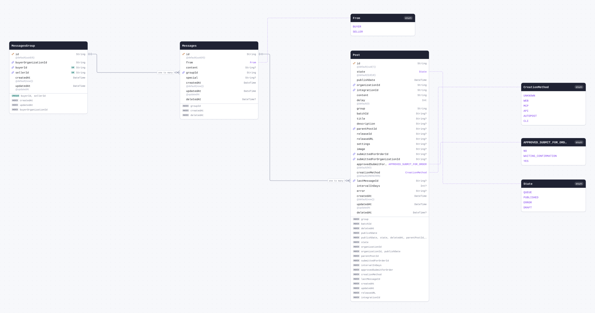

| Field       | Type                 | Constraints                                         | Default      | Description |
| ----------- | -------------------- | --------------------------------------------------- | ------------ | ----------- |
| `id`        | `String`             | PK NOT NULL                                         | `uuid(4)`    |             |
| `from`      | [`From`](#enum-From) | NOT NULL                                            |              |             |
| `content`   | `String`             | NULL                                                |              |             |
| `groupId`   | `String`             | NOT NULL → [MessagesGroup.id](#model-MessagesGroup) |              |             |
| `special`   | `String`             | NULL                                                |              |             |
| `createdAt` | `DateTime`           | NOT NULL                                            | `now()`      |             |
| `updatedAt` | `DateTime`           | NOT NULL                                            | `@updatedAt` |             |
| `deletedAt` | `DateTime`           | NULL                                                |              |             |

#### Indexes

- `@@index([groupId])`
- `@@index([createdAt])`
- `@@index([deletedAt])`

#### References

- `groupId` → [MessagesGroup.id](#model-MessagesGroup) (many-to-one)

#### Referenced by

- `id` ← [Post.lastMessageId](#model-Post) (one-to-many)

#### Definition

```sql
CREATE TABLE "Messages" (
    "id" TEXT NOT NULL,
    "from" "From" NOT NULL,
    "content" TEXT,
    "groupId" TEXT NOT NULL,
    "special" TEXT,
    "createdAt" TIMESTAMP(3) NOT NULL DEFAULT CURRENT_TIMESTAMP,
    "updatedAt" TIMESTAMP(3) NOT NULL,
    "deletedAt" TIMESTAMP(3),

    CONSTRAINT "Messages_pkey" PRIMARY KEY ("id")
);

CREATE INDEX "Messages_groupId_idx" ON "Messages"("groupId");

CREATE INDEX "Messages_createdAt_idx" ON "Messages"("createdAt");

CREATE INDEX "Messages_deletedAt_idx" ON "Messages"("deletedAt");

ALTER TABLE "Messages" ADD CONSTRAINT "Messages_groupId_fkey" FOREIGN KEY ("groupId") REFERENCES "MessagesGroup"("id") ON DELETE RESTRICT ON UPDATE CASCADE;
```

<details>
<summary>Queries and their SQL</summary>

**findMany**: Every row

```ts
await prisma.messages.findMany();
```

```sql
SELECT
  "public"."Messages"."id",
  "public"."Messages"."from"::text,
  "public"."Messages"."content",
  "public"."Messages"."groupId",
  "public"."Messages"."special",
  "public"."Messages"."createdAt",
  "public"."Messages"."updatedAt",
  "public"."Messages"."deletedAt"
FROM
  "public"."Messages"
WHERE
  1 = 1
OFFSET
  $1
-- params: ["0"]
```

**count**: How many rows there are

```ts
await prisma.messages.count();
```

```sql
SELECT
  COUNT(*) AS "_count$_all"
FROM
  (
    SELECT
      "public"."Messages"."id"
    FROM
      "public"."Messages"
    WHERE
      1 = 1
    OFFSET
      $1
  ) AS "sub"
-- params: ["0"]
```

**findMany**: Every row with its relations

```ts
await prisma.messages.findMany({ include: { group: true, posts: true } });
```

```sql
SELECT
  "public"."Messages"."id",
  "public"."Messages"."from"::text,
  "public"."Messages"."content",
  "public"."Messages"."groupId",
  "public"."Messages"."special",
  "public"."Messages"."createdAt",
  "public"."Messages"."updatedAt",
  "public"."Messages"."deletedAt"
FROM
  "public"."Messages"
WHERE
  1 = 1
OFFSET
  $1
-- params: ["0"]

SELECT
  "public"."MessagesGroup"."id",
  "public"."MessagesGroup"."buyerOrganizationId",
  "public"."MessagesGroup"."buyerId",
  "public"."MessagesGroup"."sellerId",
  "public"."MessagesGroup"."createdAt",
  "public"."MessagesGroup"."updatedAt"
FROM
  "public"."MessagesGroup"
WHERE
  "public"."MessagesGroup"."id" IN ($1)
OFFSET
  $2
-- params: ["<groupId of the rows above>","0"]

SELECT
  "public"."Post"."id",
  "public"."Post"."state"::text,
  "public"."Post"."publishDate",
  "public"."Post"."organizationId",
  "public"."Post"."integrationId",
  "public"."Post"."content",
  "public"."Post"."delay",
  "public"."Post"."group",
  "public"."Post"."batchId",
  "public"."Post"."title",
  "public"."Post"."description",
  "public"."Post"."parentPostId",
  "public"."Post"."releaseId",
  "public"."Post"."releaseURL",
  "public"."Post"."settings",
  "public"."Post"."image",
  "public"."Post"."submittedForOrderId",
  "public"."Post"."submittedForOrganizationId",
  "public"."Post"."approvedSubmitForOrder"::text,
  "public"."Post"."creationMethod"::text,
  "public"."Post"."lastMessageId",
  "public"."Post"."intervalInDays",
  "public"."Post"."error",
  "public"."Post"."createdAt",
  "public"."Post"."updatedAt",
  "public"."Post"."deletedAt"
FROM
  "public"."Post"
WHERE
  "public"."Post"."lastMessageId" IN ($1)
OFFSET
  $2
-- params: ["<id of the rows above>","0"]
```

**findUnique**: One row by what is unique to it

```ts
await prisma.messages.findUnique({ where: { id: "example" } });
```

```sql
SELECT
  "public"."Messages"."id",
  "public"."Messages"."from"::text,
  "public"."Messages"."content",
  "public"."Messages"."groupId",
  "public"."Messages"."special",
  "public"."Messages"."createdAt",
  "public"."Messages"."updatedAt",
  "public"."Messages"."deletedAt"
FROM
  "public"."Messages"
WHERE
  (
    "public"."Messages"."id" = $1
    AND 1 = 1
  )
LIMIT
  $2
OFFSET
  $3
-- params: ["example","1","0"]
```

**create**: Create a row

```ts
await prisma.messages.create({ data: { from: "BUYER", groupId: "example" } });
```

```sql
INSERT INTO
  "public"."Messages" ("id", "from", "groupId", "createdAt", "updatedAt")
VALUES
  ($1, CAST($2::text AS "public"."From"), $3, $4, $5)
RETURNING
  "public"."Messages"."id",
  "public"."Messages"."from"::text,
  "public"."Messages"."content",
  "public"."Messages"."groupId",
  "public"."Messages"."special",
  "public"."Messages"."createdAt",
  "public"."Messages"."updatedAt",
  "public"."Messages"."deletedAt"
-- params: ["<uuid(4)>","BUYER","example","<now()>","<now()>"]
```

**update**: Update a row

```ts
await prisma.messages.update({ where: { id: "example" }, data: { from: "BUYER" } });
```

```sql
UPDATE "public"."Messages"
SET
  "from" = CAST($1::text AS "public"."From"),
  "updatedAt" = $2
WHERE
  (
    "public"."Messages"."id" = $3
    AND 1 = 1
  )
RETURNING
  "public"."Messages"."id",
  "public"."Messages"."from"::text,
  "public"."Messages"."content",
  "public"."Messages"."groupId",
  "public"."Messages"."special",
  "public"."Messages"."createdAt",
  "public"."Messages"."updatedAt",
  "public"."Messages"."deletedAt"
-- params: ["BUYER",{"prisma__type":"generatorCall","prisma__value":{"name":"now","args":[],"returnType":{"type":"DateTime"}}},"example"]
```

**delete**: Delete a row

```ts
await prisma.messages.delete({ where: { id: "example" } });
```

```sql
DELETE FROM "public"."Messages"
WHERE
  (
    "public"."Messages"."id" = $1
    AND 1 = 1
  )
RETURNING
  "public"."Messages"."id",
  "public"."Messages"."from"::text,
  "public"."Messages"."content",
  "public"."Messages"."groupId",
  "public"."Messages"."special",
  "public"."Messages"."createdAt",
  "public"."Messages"."updatedAt",
  "public"."Messages"."deletedAt"
-- params: ["example"]
```

</details>

<a id="model-Plugs"></a>

### Plugs

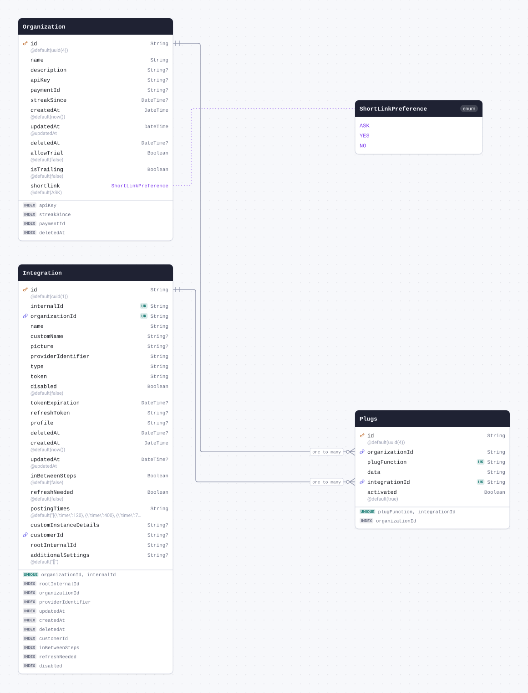

| Field            | Type      | Constraints                                       | Default   | Description |
| ---------------- | --------- | ------------------------------------------------- | --------- | ----------- |
| `id`             | `String`  | PK NOT NULL                                       | `uuid(4)` |             |
| `organizationId` | `String`  | NOT NULL → [Organization.id](#model-Organization) |           |             |
| `plugFunction`   | `String`  | NOT NULL                                          |           |             |
| `data`           | `String`  | NOT NULL                                          |           |             |
| `integrationId`  | `String`  | NOT NULL → [Integration.id](#model-Integration)   |           |             |
| `activated`      | `Boolean` | NOT NULL                                          | `true`    |             |

#### Indexes

- `@@index([organizationId])`
- `@@unique([plugFunction, integrationId])`

#### References

- `integrationId` → [Integration.id](#model-Integration) (many-to-one)
- `organizationId` → [Organization.id](#model-Organization) (many-to-one)

#### Definition

```sql
CREATE TABLE "Plugs" (
    "id" TEXT NOT NULL,
    "organizationId" TEXT NOT NULL,
    "plugFunction" TEXT NOT NULL,
    "data" TEXT NOT NULL,
    "integrationId" TEXT NOT NULL,
    "activated" BOOLEAN NOT NULL DEFAULT true,

    CONSTRAINT "Plugs_pkey" PRIMARY KEY ("id")
);

CREATE INDEX "Plugs_organizationId_idx" ON "Plugs"("organizationId");

CREATE UNIQUE INDEX "Plugs_plugFunction_integrationId_key" ON "Plugs"("plugFunction", "integrationId");

ALTER TABLE "Plugs" ADD CONSTRAINT "Plugs_integrationId_fkey" FOREIGN KEY ("integrationId") REFERENCES "Integration"("id") ON DELETE RESTRICT ON UPDATE CASCADE;

ALTER TABLE "Plugs" ADD CONSTRAINT "Plugs_organizationId_fkey" FOREIGN KEY ("organizationId") REFERENCES "Organization"("id") ON DELETE RESTRICT ON UPDATE CASCADE;
```

<details>
<summary>Queries and their SQL</summary>

**findMany**: Every row

```ts
await prisma.plugs.findMany();
```

```sql
SELECT
  "public"."Plugs"."id",
  "public"."Plugs"."organizationId",
  "public"."Plugs"."plugFunction",
  "public"."Plugs"."data",
  "public"."Plugs"."integrationId",
  "public"."Plugs"."activated"
FROM
  "public"."Plugs"
WHERE
  1 = 1
OFFSET
  $1
-- params: ["0"]
```

**count**: How many rows there are

```ts
await prisma.plugs.count();
```

```sql
SELECT
  COUNT(*) AS "_count$_all"
FROM
  (
    SELECT
      "public"."Plugs"."id"
    FROM
      "public"."Plugs"
    WHERE
      1 = 1
    OFFSET
      $1
  ) AS "sub"
-- params: ["0"]
```

**findMany**: Every row with its relations

```ts
await prisma.plugs.findMany({ include: { integration: true, organization: true } });
```

```sql
SELECT
  "public"."Plugs"."id",
  "public"."Plugs"."organizationId",
  "public"."Plugs"."plugFunction",
  "public"."Plugs"."data",
  "public"."Plugs"."integrationId",
  "public"."Plugs"."activated"
FROM
  "public"."Plugs"
WHERE
  1 = 1
OFFSET
  $1
-- params: ["0"]

SELECT
  "public"."Integration"."id",
  "public"."Integration"."internalId",
  "public"."Integration"."organizationId",
  "public"."Integration"."name",
  "public"."Integration"."customName",
  "public"."Integration"."picture",
  "public"."Integration"."providerIdentifier",
  "public"."Integration"."type",
  "public"."Integration"."token",
  "public"."Integration"."disabled",
  "public"."Integration"."tokenExpiration",
  "public"."Integration"."refreshToken",
  "public"."Integration"."profile",
  "public"."Integration"."deletedAt",
  "public"."Integration"."createdAt",
  "public"."Integration"."updatedAt",
  "public"."Integration"."inBetweenSteps",
  "public"."Integration"."refreshNeeded",
  "public"."Integration"."postingTimes",
  "public"."Integration"."customInstanceDetails",
  "public"."Integration"."customerId",
  "public"."Integration"."rootInternalId",
  "public"."Integration"."additionalSettings"
FROM
  "public"."Integration"
WHERE
  "public"."Integration"."id" IN ($1)
OFFSET
  $2
-- params: ["<integrationId of the rows above>","0"]

SELECT
  "public"."Organization"."id",
  "public"."Organization"."name",
  "public"."Organization"."description",
  "public"."Organization"."apiKey",
  "public"."Organization"."paymentId",
  "public"."Organization"."streakSince",
  "public"."Organization"."createdAt",
  "public"."Organization"."updatedAt",
  "public"."Organization"."deletedAt",
  "public"."Organization"."allowTrial",
  "public"."Organization"."isTrailing",
  "public"."Organization"."shortlink"::text
FROM
  "public"."Organization"
WHERE
  "public"."Organization"."id" IN ($1)
OFFSET
  $2
-- params: ["<organizationId of the rows above>","0"]
```

**findUnique**: One row by what is unique to it

```ts
await prisma.plugs.findUnique({ where: { id: "example" } });
```

```sql
SELECT
  "public"."Plugs"."id",
  "public"."Plugs"."organizationId",
  "public"."Plugs"."plugFunction",
  "public"."Plugs"."data",
  "public"."Plugs"."integrationId",
  "public"."Plugs"."activated"
FROM
  "public"."Plugs"
WHERE
  (
    "public"."Plugs"."id" = $1
    AND 1 = 1
  )
LIMIT
  $2
OFFSET
  $3
-- params: ["example","1","0"]
```

**create**: Create a row

```ts
await prisma.plugs.create({
  data: {
    organizationId: "example",
    plugFunction: "example",
    data: "example",
    integrationId: "example",
  },
});
```

```sql
INSERT INTO
  "public"."Plugs" (
    "id",
    "organizationId",
    "plugFunction",
    "data",
    "integrationId",
    "activated"
  )
VALUES
  ($1, $2, $3, $4, $5, $6)
RETURNING
  "public"."Plugs"."id",
  "public"."Plugs"."organizationId",
  "public"."Plugs"."plugFunction",
  "public"."Plugs"."data",
  "public"."Plugs"."integrationId",
  "public"."Plugs"."activated"
-- params: ["<uuid(4)>","example","example","example","example",true]
```

**update**: Update a row

```ts
await prisma.plugs.update({ where: { id: "example" }, data: { plugFunction: "example" } });
```

```sql
UPDATE "public"."Plugs"
SET
  "plugFunction" = $1
WHERE
  (
    "public"."Plugs"."id" = $2
    AND 1 = 1
  )
RETURNING
  "public"."Plugs"."id",
  "public"."Plugs"."organizationId",
  "public"."Plugs"."plugFunction",
  "public"."Plugs"."data",
  "public"."Plugs"."integrationId",
  "public"."Plugs"."activated"
-- params: ["example","example"]
```

**delete**: Delete a row

```ts
await prisma.plugs.delete({ where: { id: "example" } });
```

```sql
DELETE FROM "public"."Plugs"
WHERE
  (
    "public"."Plugs"."id" = $1
    AND 1 = 1
  )
RETURNING
  "public"."Plugs"."id",
  "public"."Plugs"."organizationId",
  "public"."Plugs"."plugFunction",
  "public"."Plugs"."data",
  "public"."Plugs"."integrationId",
  "public"."Plugs"."activated"
-- params: ["example"]
```

</details>

<a id="model-ExisingPlugData"></a>

### ExisingPlugData

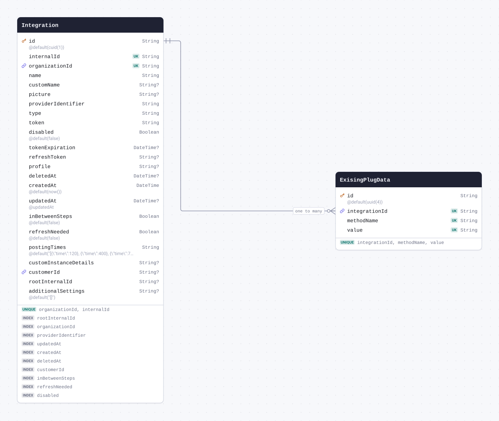

| Field           | Type     | Constraints                                     | Default   | Description |
| --------------- | -------- | ----------------------------------------------- | --------- | ----------- |
| `id`            | `String` | PK NOT NULL                                     | `uuid(4)` |             |
| `integrationId` | `String` | NOT NULL → [Integration.id](#model-Integration) |           |             |
| `methodName`    | `String` | NOT NULL                                        |           |             |
| `value`         | `String` | NOT NULL                                        |           |             |

#### Indexes

- `@@unique([integrationId, methodName, value])`

#### References

- `integrationId` → [Integration.id](#model-Integration) (many-to-one)

#### Definition

```sql
CREATE TABLE "ExisingPlugData" (
    "id" TEXT NOT NULL,
    "integrationId" TEXT NOT NULL,
    "methodName" TEXT NOT NULL,
    "value" TEXT NOT NULL,

    CONSTRAINT "ExisingPlugData_pkey" PRIMARY KEY ("id")
);

CREATE UNIQUE INDEX "ExisingPlugData_integrationId_methodName_value_key" ON "ExisingPlugData"("integrationId", "methodName", "value");

ALTER TABLE "ExisingPlugData" ADD CONSTRAINT "ExisingPlugData_integrationId_fkey" FOREIGN KEY ("integrationId") REFERENCES "Integration"("id") ON DELETE RESTRICT ON UPDATE CASCADE;
```

<details>
<summary>Queries and their SQL</summary>

**findMany**: Every row

```ts
await prisma.exisingPlugData.findMany();
```

```sql
SELECT
  "public"."ExisingPlugData"."id",
  "public"."ExisingPlugData"."integrationId",
  "public"."ExisingPlugData"."methodName",
  "public"."ExisingPlugData"."value"
FROM
  "public"."ExisingPlugData"
WHERE
  1 = 1
OFFSET
  $1
-- params: ["0"]
```

**count**: How many rows there are

```ts
await prisma.exisingPlugData.count();
```

```sql
SELECT
  COUNT(*) AS "_count$_all"
FROM
  (
    SELECT
      "public"."ExisingPlugData"."id"
    FROM
      "public"."ExisingPlugData"
    WHERE
      1 = 1
    OFFSET
      $1
  ) AS "sub"
-- params: ["0"]
```

**findMany**: Every row with its relations

```ts
await prisma.exisingPlugData.findMany({ include: { integration: true } });
```

```sql
SELECT
  "public"."ExisingPlugData"."id",
  "public"."ExisingPlugData"."integrationId",
  "public"."ExisingPlugData"."methodName",
  "public"."ExisingPlugData"."value"
FROM
  "public"."ExisingPlugData"
WHERE
  1 = 1
OFFSET
  $1
-- params: ["0"]

SELECT
  "public"."Integration"."id",
  "public"."Integration"."internalId",
  "public"."Integration"."organizationId",
  "public"."Integration"."name",
  "public"."Integration"."customName",
  "public"."Integration"."picture",
  "public"."Integration"."providerIdentifier",
  "public"."Integration"."type",
  "public"."Integration"."token",
  "public"."Integration"."disabled",
  "public"."Integration"."tokenExpiration",
  "public"."Integration"."refreshToken",
  "public"."Integration"."profile",
  "public"."Integration"."deletedAt",
  "public"."Integration"."createdAt",
  "public"."Integration"."updatedAt",
  "public"."Integration"."inBetweenSteps",
  "public"."Integration"."refreshNeeded",
  "public"."Integration"."postingTimes",
  "public"."Integration"."customInstanceDetails",
  "public"."Integration"."customerId",
  "public"."Integration"."rootInternalId",
  "public"."Integration"."additionalSettings"
FROM
  "public"."Integration"
WHERE
  "public"."Integration"."id" IN ($1)
OFFSET
  $2
-- params: ["<integrationId of the rows above>","0"]
```

**findUnique**: One row by what is unique to it

```ts
await prisma.exisingPlugData.findUnique({ where: { id: "example" } });
```

```sql
SELECT
  "public"."ExisingPlugData"."id",
  "public"."ExisingPlugData"."integrationId",
  "public"."ExisingPlugData"."methodName",
  "public"."ExisingPlugData"."value"
FROM
  "public"."ExisingPlugData"
WHERE
  (
    "public"."ExisingPlugData"."id" = $1
    AND 1 = 1
  )
LIMIT
  $2
OFFSET
  $3
-- params: ["example","1","0"]
```

**create**: Create a row

```ts
await prisma.exisingPlugData.create({
  data: { integrationId: "example", methodName: "example", value: "example" },
});
```

```sql
INSERT INTO
  "public"."ExisingPlugData" ("id", "integrationId", "methodName", "value")
VALUES
  ($1, $2, $3, $4)
RETURNING
  "public"."ExisingPlugData"."id",
  "public"."ExisingPlugData"."integrationId",
  "public"."ExisingPlugData"."methodName",
  "public"."ExisingPlugData"."value"
-- params: ["<uuid(4)>","example","example","example"]
```

**update**: Update a row

```ts
await prisma.exisingPlugData.update({ where: { id: "example" }, data: { methodName: "example" } });
```

```sql
UPDATE "public"."ExisingPlugData"
SET
  "methodName" = $1
WHERE
  (
    "public"."ExisingPlugData"."id" = $2
    AND 1 = 1
  )
RETURNING
  "public"."ExisingPlugData"."id",
  "public"."ExisingPlugData"."integrationId",
  "public"."ExisingPlugData"."methodName",
  "public"."ExisingPlugData"."value"
-- params: ["example","example"]
```

**delete**: Delete a row

```ts
await prisma.exisingPlugData.delete({ where: { id: "example" } });
```

```sql
DELETE FROM "public"."ExisingPlugData"
WHERE
  (
    "public"."ExisingPlugData"."id" = $1
    AND 1 = 1
  )
RETURNING
  "public"."ExisingPlugData"."id",
  "public"."ExisingPlugData"."integrationId",
  "public"."ExisingPlugData"."methodName",
  "public"."ExisingPlugData"."value"
-- params: ["example"]
```

</details>

<a id="model-PopularPosts"></a>

### PopularPosts

| Field       | Type       | Constraints | Default      | Description |
| ----------- | ---------- | ----------- | ------------ | ----------- |
| `id`        | `String`   | PK NOT NULL | `uuid(4)`    |             |
| `category`  | `String`   | NOT NULL    |              |             |
| `topic`     | `String`   | NOT NULL    |              |             |
| `content`   | `String`   | NOT NULL    |              |             |
| `hook`      | `String`   | NOT NULL    |              |             |
| `createdAt` | `DateTime` | NOT NULL    | `now()`      |             |
| `updatedAt` | `DateTime` | NOT NULL    | `@updatedAt` |             |

#### Definition

```sql
CREATE TABLE "PopularPosts" (
    "id" TEXT NOT NULL,
    "category" TEXT NOT NULL,
    "topic" TEXT NOT NULL,
    "content" TEXT NOT NULL,
    "hook" TEXT NOT NULL,
    "createdAt" TIMESTAMP(3) NOT NULL DEFAULT CURRENT_TIMESTAMP,
    "updatedAt" TIMESTAMP(3) NOT NULL,

    CONSTRAINT "PopularPosts_pkey" PRIMARY KEY ("id")
);
```

<details>
<summary>Queries and their SQL</summary>

**findMany**: Every row

```ts
await prisma.popularPosts.findMany();
```

```sql
SELECT
  "public"."PopularPosts"."id",
  "public"."PopularPosts"."category",
  "public"."PopularPosts"."topic",
  "public"."PopularPosts"."content",
  "public"."PopularPosts"."hook",
  "public"."PopularPosts"."createdAt",
  "public"."PopularPosts"."updatedAt"
FROM
  "public"."PopularPosts"
WHERE
  1 = 1
OFFSET
  $1
-- params: ["0"]
```

**count**: How many rows there are

```ts
await prisma.popularPosts.count();
```

```sql
SELECT
  COUNT(*) AS "_count$_all"
FROM
  (
    SELECT
      "public"."PopularPosts"."id"
    FROM
      "public"."PopularPosts"
    WHERE
      1 = 1
    OFFSET
      $1
  ) AS "sub"
-- params: ["0"]
```

**findUnique**: One row by what is unique to it

```ts
await prisma.popularPosts.findUnique({ where: { id: "example" } });
```

```sql
SELECT
  "public"."PopularPosts"."id",
  "public"."PopularPosts"."category",
  "public"."PopularPosts"."topic",
  "public"."PopularPosts"."content",
  "public"."PopularPosts"."hook",
  "public"."PopularPosts"."createdAt",
  "public"."PopularPosts"."updatedAt"
FROM
  "public"."PopularPosts"
WHERE
  (
    "public"."PopularPosts"."id" = $1
    AND 1 = 1
  )
LIMIT
  $2
OFFSET
  $3
-- params: ["example","1","0"]
```

**create**: Create a row

```ts
await prisma.popularPosts.create({
  data: { category: "example", topic: "example", content: "example", hook: "example" },
});
```

```sql
INSERT INTO
  "public"."PopularPosts" (
    "id",
    "category",
    "topic",
    "content",
    "hook",
    "createdAt",
    "updatedAt"
  )
VALUES
  ($1, $2, $3, $4, $5, $6, $7)
RETURNING
  "public"."PopularPosts"."id",
  "public"."PopularPosts"."category",
  "public"."PopularPosts"."topic",
  "public"."PopularPosts"."content",
  "public"."PopularPosts"."hook",
  "public"."PopularPosts"."createdAt",
  "public"."PopularPosts"."updatedAt"
-- params: ["<uuid(4)>","example","example","example","example","<now()>","<now()>"]
```

**update**: Update a row

```ts
await prisma.popularPosts.update({ where: { id: "example" }, data: { category: "example" } });
```

```sql
UPDATE "public"."PopularPosts"
SET
  "category" = $1,
  "updatedAt" = $2
WHERE
  (
    "public"."PopularPosts"."id" = $3
    AND 1 = 1
  )
RETURNING
  "public"."PopularPosts"."id",
  "public"."PopularPosts"."category",
  "public"."PopularPosts"."topic",
  "public"."PopularPosts"."content",
  "public"."PopularPosts"."hook",
  "public"."PopularPosts"."createdAt",
  "public"."PopularPosts"."updatedAt"
-- params: ["example",{"prisma__type":"generatorCall","prisma__value":{"name":"now","args":[],"returnType":{"type":"DateTime"}}},"example"]
```

**delete**: Delete a row

```ts
await prisma.popularPosts.delete({ where: { id: "example" } });
```

```sql
DELETE FROM "public"."PopularPosts"
WHERE
  (
    "public"."PopularPosts"."id" = $1
    AND 1 = 1
  )
RETURNING
  "public"."PopularPosts"."id",
  "public"."PopularPosts"."category",
  "public"."PopularPosts"."topic",
  "public"."PopularPosts"."content",
  "public"."PopularPosts"."hook",
  "public"."PopularPosts"."createdAt",
  "public"."PopularPosts"."updatedAt"
-- params: ["example"]
```

</details>

<a id="model-IntegrationsWebhooks"></a>

### IntegrationsWebhooks

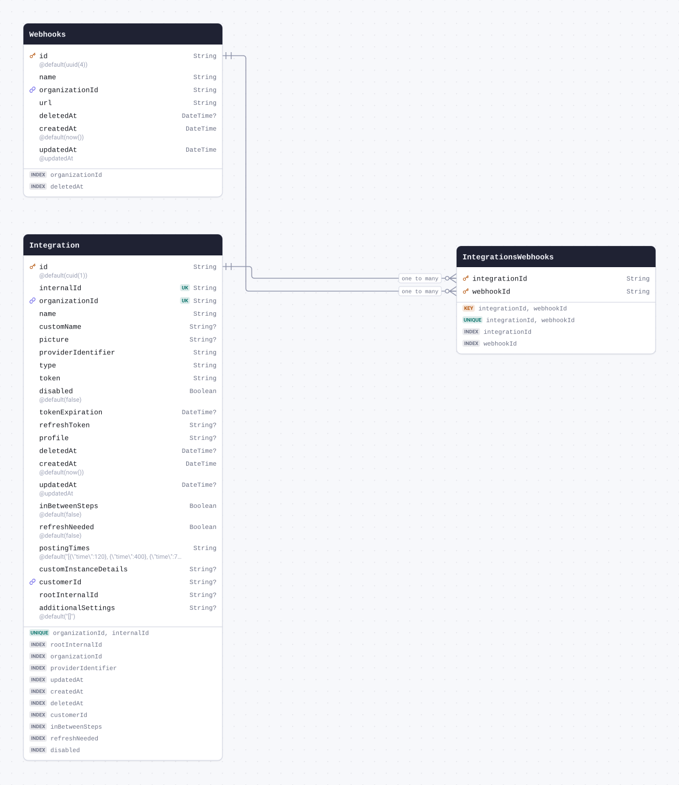

| Field           | Type     | Constraints                                        | Default | Description |
| --------------- | -------- | -------------------------------------------------- | ------- | ----------- |
| `integrationId` | `String` | PK NOT NULL → [Integration.id](#model-Integration) |         |             |
| `webhookId`     | `String` | PK NOT NULL → [Webhooks.id](#model-Webhooks)       |         |             |

#### Indexes

- `@@id([integrationId, webhookId])`
- `@@index([integrationId])`
- `@@index([webhookId])`
- `@@unique([integrationId, webhookId])`

#### References

- `integrationId` → [Integration.id](#model-Integration) (many-to-one)
- `webhookId` → [Webhooks.id](#model-Webhooks) (many-to-one)

#### Definition

```sql
CREATE TABLE "IntegrationsWebhooks" (
    "integrationId" TEXT NOT NULL,
    "webhookId" TEXT NOT NULL,

    CONSTRAINT "IntegrationsWebhooks_pkey" PRIMARY KEY ("integrationId","webhookId")
);

CREATE INDEX "IntegrationsWebhooks_integrationId_idx" ON "IntegrationsWebhooks"("integrationId");

CREATE INDEX "IntegrationsWebhooks_webhookId_idx" ON "IntegrationsWebhooks"("webhookId");

CREATE UNIQUE INDEX "IntegrationsWebhooks_integrationId_webhookId_key" ON "IntegrationsWebhooks"("integrationId", "webhookId");

ALTER TABLE "IntegrationsWebhooks" ADD CONSTRAINT "IntegrationsWebhooks_integrationId_fkey" FOREIGN KEY ("integrationId") REFERENCES "Integration"("id") ON DELETE RESTRICT ON UPDATE CASCADE;

ALTER TABLE "IntegrationsWebhooks" ADD CONSTRAINT "IntegrationsWebhooks_webhookId_fkey" FOREIGN KEY ("webhookId") REFERENCES "Webhooks"("id") ON DELETE RESTRICT ON UPDATE CASCADE;
```

<details>
<summary>Queries and their SQL</summary>

**findMany**: Every row

```ts
await prisma.integrationsWebhooks.findMany();
```

```sql
SELECT
  "public"."IntegrationsWebhooks"."integrationId",
  "public"."IntegrationsWebhooks"."webhookId"
FROM
  "public"."IntegrationsWebhooks"
WHERE
  1 = 1
OFFSET
  $1
-- params: ["0"]
```

**count**: How many rows there are

```ts
await prisma.integrationsWebhooks.count();
```

```sql
SELECT
  COUNT(*) AS "_count$_all"
FROM
  (
    SELECT
      "public"."IntegrationsWebhooks"."integrationId",
      "public"."IntegrationsWebhooks"."webhookId"
    FROM
      "public"."IntegrationsWebhooks"
    WHERE
      1 = 1
    OFFSET
      $1
  ) AS "sub"
-- params: ["0"]
```

**findMany**: Every row with its relations

```ts
await prisma.integrationsWebhooks.findMany({ include: { integration: true, webhook: true } });
```

```sql
SELECT
  "public"."IntegrationsWebhooks"."integrationId",
  "public"."IntegrationsWebhooks"."webhookId"
FROM
  "public"."IntegrationsWebhooks"
WHERE
  1 = 1
OFFSET
  $1
-- params: ["0"]

SELECT
  "public"."Integration"."id",
  "public"."Integration"."internalId",
  "public"."Integration"."organizationId",
  "public"."Integration"."name",
  "public"."Integration"."customName",
  "public"."Integration"."picture",
  "public"."Integration"."providerIdentifier",
  "public"."Integration"."type",
  "public"."Integration"."token",
  "public"."Integration"."disabled",
  "public"."Integration"."tokenExpiration",
  "public"."Integration"."refreshToken",
  "public"."Integration"."profile",
  "public"."Integration"."deletedAt",
  "public"."Integration"."createdAt",
  "public"."Integration"."updatedAt",
  "public"."Integration"."inBetweenSteps",
  "public"."Integration"."refreshNeeded",
  "public"."Integration"."postingTimes",
  "public"."Integration"."customInstanceDetails",
  "public"."Integration"."customerId",
  "public"."Integration"."rootInternalId",
  "public"."Integration"."additionalSettings"
FROM
  "public"."Integration"
WHERE
  "public"."Integration"."id" IN ($1)
OFFSET
  $2
-- params: ["<integrationId of the rows above>","0"]

SELECT
  "public"."Webhooks"."id",
  "public"."Webhooks"."name",
  "public"."Webhooks"."organizationId",
  "public"."Webhooks"."url",
  "public"."Webhooks"."deletedAt",
  "public"."Webhooks"."createdAt",
  "public"."Webhooks"."updatedAt"
FROM
  "public"."Webhooks"
WHERE
  "public"."Webhooks"."id" IN ($1)
OFFSET
  $2
-- params: ["<webhookId of the rows above>","0"]
```

**findUnique**: One row by what is unique to it

```ts
await prisma.integrationsWebhooks.findUnique({
  where: { integrationId_webhookId: { integrationId: "example", webhookId: "example" } },
});
```

```sql
SELECT
  "public"."IntegrationsWebhooks"."integrationId",
  "public"."IntegrationsWebhooks"."webhookId"
FROM
  "public"."IntegrationsWebhooks"
WHERE
  (
    (
      "public"."IntegrationsWebhooks"."integrationId" = $1
      AND "public"."IntegrationsWebhooks"."webhookId" = $2
    )
    AND 1 = 1
  )
LIMIT
  $3
OFFSET
  $4
-- params: ["example","example","1","0"]
```

**create**: Create a row

```ts
await prisma.integrationsWebhooks.create({
  data: { integrationId: "example", webhookId: "example" },
});
```

```sql
INSERT INTO
  "public"."IntegrationsWebhooks" ("integrationId", "webhookId")
VALUES
  ($1, $2)
RETURNING
  "public"."IntegrationsWebhooks"."integrationId",
  "public"."IntegrationsWebhooks"."webhookId"
-- params: ["example","example"]
```

**delete**: Delete a row

```ts
await prisma.integrationsWebhooks.delete({
  where: { integrationId_webhookId: { integrationId: "example", webhookId: "example" } },
});
```

```sql
DELETE FROM "public"."IntegrationsWebhooks"
WHERE
  (
    (
      "public"."IntegrationsWebhooks"."integrationId" = $1
      AND "public"."IntegrationsWebhooks"."webhookId" = $2
    )
    AND 1 = 1
  )
RETURNING
  "public"."IntegrationsWebhooks"."integrationId",
  "public"."IntegrationsWebhooks"."webhookId"
-- params: ["example","example"]
```

</details>

<a id="model-Webhooks"></a>

### Webhooks

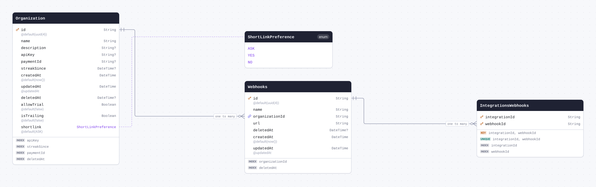

| Field            | Type       | Constraints                                       | Default      | Description |
| ---------------- | ---------- | ------------------------------------------------- | ------------ | ----------- |
| `id`             | `String`   | PK NOT NULL                                       | `uuid(4)`    |             |
| `name`           | `String`   | NOT NULL                                          |              |             |
| `organizationId` | `String`   | NOT NULL → [Organization.id](#model-Organization) |              |             |
| `url`            | `String`   | NOT NULL                                          |              |             |
| `deletedAt`      | `DateTime` | NULL                                              |              |             |
| `createdAt`      | `DateTime` | NOT NULL                                          | `now()`      |             |
| `updatedAt`      | `DateTime` | NOT NULL                                          | `@updatedAt` |             |

#### Indexes

- `@@index([organizationId])`
- `@@index([deletedAt])`

#### References

- `organizationId` → [Organization.id](#model-Organization) (many-to-one)

#### Referenced by

- `id` ← [IntegrationsWebhooks.webhookId](#model-IntegrationsWebhooks) (one-to-many)

#### Definition

```sql
CREATE TABLE "Webhooks" (
    "id" TEXT NOT NULL,
    "name" TEXT NOT NULL,
    "organizationId" TEXT NOT NULL,
    "url" TEXT NOT NULL,
    "deletedAt" TIMESTAMP(3),
    "createdAt" TIMESTAMP(3) NOT NULL DEFAULT CURRENT_TIMESTAMP,
    "updatedAt" TIMESTAMP(3) NOT NULL,

    CONSTRAINT "Webhooks_pkey" PRIMARY KEY ("id")
);

CREATE INDEX "Webhooks_organizationId_idx" ON "Webhooks"("organizationId");

CREATE INDEX "Webhooks_deletedAt_idx" ON "Webhooks"("deletedAt");

ALTER TABLE "Webhooks" ADD CONSTRAINT "Webhooks_organizationId_fkey" FOREIGN KEY ("organizationId") REFERENCES "Organization"("id") ON DELETE RESTRICT ON UPDATE CASCADE;
```

<details>
<summary>Queries and their SQL</summary>

**findMany**: Every row

```ts
await prisma.webhooks.findMany();
```

```sql
SELECT
  "public"."Webhooks"."id",
  "public"."Webhooks"."name",
  "public"."Webhooks"."organizationId",
  "public"."Webhooks"."url",
  "public"."Webhooks"."deletedAt",
  "public"."Webhooks"."createdAt",
  "public"."Webhooks"."updatedAt"
FROM
  "public"."Webhooks"
WHERE
  1 = 1
OFFSET
  $1
-- params: ["0"]
```

**count**: How many rows there are

```ts
await prisma.webhooks.count();
```

```sql
SELECT
  COUNT(*) AS "_count$_all"
FROM
  (
    SELECT
      "public"."Webhooks"."id"
    FROM
      "public"."Webhooks"
    WHERE
      1 = 1
    OFFSET
      $1
  ) AS "sub"
-- params: ["0"]
```

**findMany**: Every row with its relations

```ts
await prisma.webhooks.findMany({ include: { integrations: true, organization: true } });
```

```sql
SELECT
  "public"."Webhooks"."id",
  "public"."Webhooks"."name",
  "public"."Webhooks"."organizationId",
  "public"."Webhooks"."url",
  "public"."Webhooks"."deletedAt",
  "public"."Webhooks"."createdAt",
  "public"."Webhooks"."updatedAt"
FROM
  "public"."Webhooks"
WHERE
  1 = 1
OFFSET
  $1
-- params: ["0"]

SELECT
  "public"."IntegrationsWebhooks"."integrationId",
  "public"."IntegrationsWebhooks"."webhookId"
FROM
  "public"."IntegrationsWebhooks"
WHERE
  "public"."IntegrationsWebhooks"."webhookId" IN ($1)
OFFSET
  $2
-- params: ["<id of the rows above>","0"]

SELECT
  "public"."Organization"."id",
  "public"."Organization"."name",
  "public"."Organization"."description",
  "public"."Organization"."apiKey",
  "public"."Organization"."paymentId",
  "public"."Organization"."streakSince",
  "public"."Organization"."createdAt",
  "public"."Organization"."updatedAt",
  "public"."Organization"."deletedAt",
  "public"."Organization"."allowTrial",
  "public"."Organization"."isTrailing",
  "public"."Organization"."shortlink"::text
FROM
  "public"."Organization"
WHERE
  "public"."Organization"."id" IN ($1)
OFFSET
  $2
-- params: ["<organizationId of the rows above>","0"]
```

**findUnique**: One row by what is unique to it

```ts
await prisma.webhooks.findUnique({ where: { id: "example" } });
```

```sql
SELECT
  "public"."Webhooks"."id",
  "public"."Webhooks"."name",
  "public"."Webhooks"."organizationId",
  "public"."Webhooks"."url",
  "public"."Webhooks"."deletedAt",
  "public"."Webhooks"."createdAt",
  "public"."Webhooks"."updatedAt"
FROM
  "public"."Webhooks"
WHERE
  (
    "public"."Webhooks"."id" = $1
    AND 1 = 1
  )
LIMIT
  $2
OFFSET
  $3
-- params: ["example","1","0"]
```

**create**: Create a row

```ts
await prisma.webhooks.create({
  data: { name: "example", organizationId: "example", url: "example" },
});
```

```sql
INSERT INTO
  "public"."Webhooks" (
    "id",
    "name",
    "organizationId",
    "url",
    "createdAt",
    "updatedAt"
  )
VALUES
  ($1, $2, $3, $4, $5, $6)
RETURNING
  "public"."Webhooks"."id",
  "public"."Webhooks"."name",
  "public"."Webhooks"."organizationId",
  "public"."Webhooks"."url",
  "public"."Webhooks"."deletedAt",
  "public"."Webhooks"."createdAt",
  "public"."Webhooks"."updatedAt"
-- params: ["<uuid(4)>","example","example","example","<now()>","<now()>"]
```

**update**: Update a row

```ts
await prisma.webhooks.update({ where: { id: "example" }, data: { name: "example" } });
```

```sql
UPDATE "public"."Webhooks"
SET
  "name" = $1,
  "updatedAt" = $2
WHERE
  (
    "public"."Webhooks"."id" = $3
    AND 1 = 1
  )
RETURNING
  "public"."Webhooks"."id",
  "public"."Webhooks"."name",
  "public"."Webhooks"."organizationId",
  "public"."Webhooks"."url",
  "public"."Webhooks"."deletedAt",
  "public"."Webhooks"."createdAt",
  "public"."Webhooks"."updatedAt"
-- params: ["example",{"prisma__type":"generatorCall","prisma__value":{"name":"now","args":[],"returnType":{"type":"DateTime"}}},"example"]
```

**delete**: Delete a row

```ts
await prisma.webhooks.delete({ where: { id: "example" } });
```

```sql
DELETE FROM "public"."Webhooks"
WHERE
  (
    "public"."Webhooks"."id" = $1
    AND 1 = 1
  )
RETURNING
  "public"."Webhooks"."id",
  "public"."Webhooks"."name",
  "public"."Webhooks"."organizationId",
  "public"."Webhooks"."url",
  "public"."Webhooks"."deletedAt",
  "public"."Webhooks"."createdAt",
  "public"."Webhooks"."updatedAt"
-- params: ["example"]
```

</details>

<a id="model-AutoPost"></a>

### AutoPost

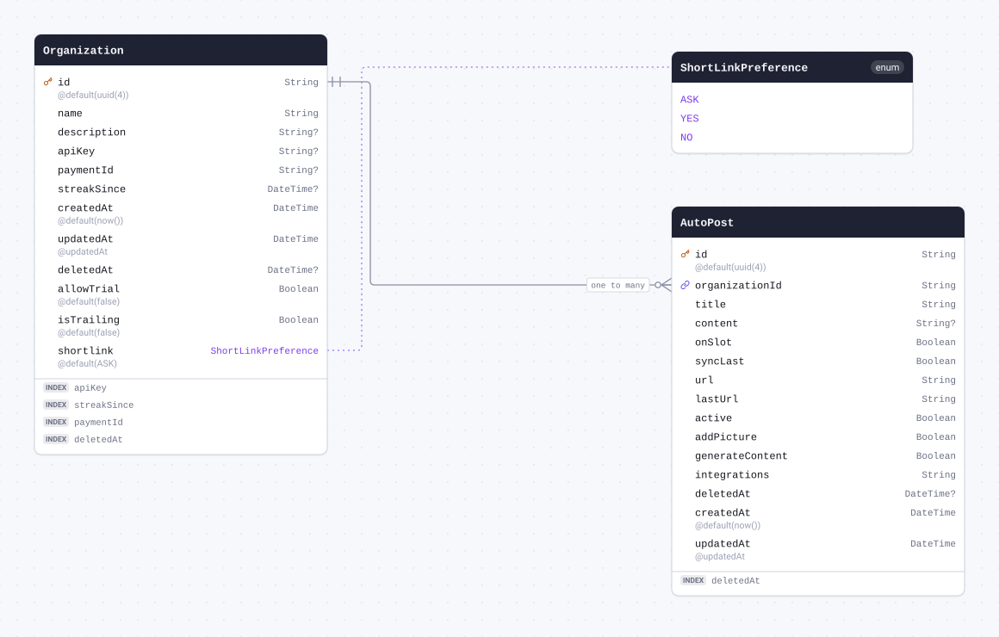

| Field             | Type       | Constraints                                       | Default      | Description |
| ----------------- | ---------- | ------------------------------------------------- | ------------ | ----------- |
| `id`              | `String`   | PK NOT NULL                                       | `uuid(4)`    |             |
| `organizationId`  | `String`   | NOT NULL → [Organization.id](#model-Organization) |              |             |
| `title`           | `String`   | NOT NULL                                          |              |             |
| `content`         | `String`   | NULL                                              |              |             |
| `onSlot`          | `Boolean`  | NOT NULL                                          |              |             |
| `syncLast`        | `Boolean`  | NOT NULL                                          |              |             |
| `url`             | `String`   | NOT NULL                                          |              |             |
| `lastUrl`         | `String`   | NOT NULL                                          |              |             |
| `active`          | `Boolean`  | NOT NULL                                          |              |             |
| `addPicture`      | `Boolean`  | NOT NULL                                          |              |             |
| `generateContent` | `Boolean`  | NOT NULL                                          |              |             |
| `integrations`    | `String`   | NOT NULL                                          |              |             |
| `deletedAt`       | `DateTime` | NULL                                              |              |             |
| `createdAt`       | `DateTime` | NOT NULL                                          | `now()`      |             |
| `updatedAt`       | `DateTime` | NOT NULL                                          | `@updatedAt` |             |

#### Indexes

- `@@index([deletedAt])`

#### References

- `organizationId` → [Organization.id](#model-Organization) (many-to-one)

#### Definition

```sql
CREATE TABLE "AutoPost" (
    "id" TEXT NOT NULL,
    "organizationId" TEXT NOT NULL,
    "title" TEXT NOT NULL,
    "content" TEXT,
    "onSlot" BOOLEAN NOT NULL,
    "syncLast" BOOLEAN NOT NULL,
    "url" TEXT NOT NULL,
    "lastUrl" TEXT NOT NULL,
    "active" BOOLEAN NOT NULL,
    "addPicture" BOOLEAN NOT NULL,
    "generateContent" BOOLEAN NOT NULL,
    "integrations" TEXT NOT NULL,
    "deletedAt" TIMESTAMP(3),
    "createdAt" TIMESTAMP(3) NOT NULL DEFAULT CURRENT_TIMESTAMP,
    "updatedAt" TIMESTAMP(3) NOT NULL,

    CONSTRAINT "AutoPost_pkey" PRIMARY KEY ("id")
);

CREATE INDEX "AutoPost_deletedAt_idx" ON "AutoPost"("deletedAt");

ALTER TABLE "AutoPost" ADD CONSTRAINT "AutoPost_organizationId_fkey" FOREIGN KEY ("organizationId") REFERENCES "Organization"("id") ON DELETE RESTRICT ON UPDATE CASCADE;
```

<details>
<summary>Queries and their SQL</summary>

**findMany**: Every row

```ts
await prisma.autoPost.findMany();
```

```sql
SELECT
  "public"."AutoPost"."id",
  "public"."AutoPost"."organizationId",
  "public"."AutoPost"."title",
  "public"."AutoPost"."content",
  "public"."AutoPost"."onSlot",
  "public"."AutoPost"."syncLast",
  "public"."AutoPost"."url",
  "public"."AutoPost"."lastUrl",
  "public"."AutoPost"."active",
  "public"."AutoPost"."addPicture",
  "public"."AutoPost"."generateContent",
  "public"."AutoPost"."integrations",
  "public"."AutoPost"."deletedAt",
  "public"."AutoPost"."createdAt",
  "public"."AutoPost"."updatedAt"
FROM
  "public"."AutoPost"
WHERE
  1 = 1
OFFSET
  $1
-- params: ["0"]
```

**count**: How many rows there are

```ts
await prisma.autoPost.count();
```

```sql
SELECT
  COUNT(*) AS "_count$_all"
FROM
  (
    SELECT
      "public"."AutoPost"."id"
    FROM
      "public"."AutoPost"
    WHERE
      1 = 1
    OFFSET
      $1
  ) AS "sub"
-- params: ["0"]
```

**findMany**: Every row with its relations

```ts
await prisma.autoPost.findMany({ include: { organization: true } });
```

```sql
SELECT
  "public"."AutoPost"."id",
  "public"."AutoPost"."organizationId",
  "public"."AutoPost"."title",
  "public"."AutoPost"."content",
  "public"."AutoPost"."onSlot",
  "public"."AutoPost"."syncLast",
  "public"."AutoPost"."url",
  "public"."AutoPost"."lastUrl",
  "public"."AutoPost"."active",
  "public"."AutoPost"."addPicture",
  "public"."AutoPost"."generateContent",
  "public"."AutoPost"."integrations",
  "public"."AutoPost"."deletedAt",
  "public"."AutoPost"."createdAt",
  "public"."AutoPost"."updatedAt"
FROM
  "public"."AutoPost"
WHERE
  1 = 1
OFFSET
  $1
-- params: ["0"]

SELECT
  "public"."Organization"."id",
  "public"."Organization"."name",
  "public"."Organization"."description",
  "public"."Organization"."apiKey",
  "public"."Organization"."paymentId",
  "public"."Organization"."streakSince",
  "public"."Organization"."createdAt",
  "public"."Organization"."updatedAt",
  "public"."Organization"."deletedAt",
  "public"."Organization"."allowTrial",
  "public"."Organization"."isTrailing",
  "public"."Organization"."shortlink"::text
FROM
  "public"."Organization"
WHERE
  "public"."Organization"."id" IN ($1)
OFFSET
  $2
-- params: ["<organizationId of the rows above>","0"]
```

**findUnique**: One row by what is unique to it

```ts
await prisma.autoPost.findUnique({ where: { id: "example" } });
```

```sql
SELECT
  "public"."AutoPost"."id",
  "public"."AutoPost"."organizationId",
  "public"."AutoPost"."title",
  "public"."AutoPost"."content",
  "public"."AutoPost"."onSlot",
  "public"."AutoPost"."syncLast",
  "public"."AutoPost"."url",
  "public"."AutoPost"."lastUrl",
  "public"."AutoPost"."active",
  "public"."AutoPost"."addPicture",
  "public"."AutoPost"."generateContent",
  "public"."AutoPost"."integrations",
  "public"."AutoPost"."deletedAt",
  "public"."AutoPost"."createdAt",
  "public"."AutoPost"."updatedAt"
FROM
  "public"."AutoPost"
WHERE
  (
    "public"."AutoPost"."id" = $1
    AND 1 = 1
  )
LIMIT
  $2
OFFSET
  $3
-- params: ["example","1","0"]
```

**create**: Create a row

```ts
await prisma.autoPost.create({
  data: {
    organizationId: "example",
    title: "example",
    onSlot: true,
    syncLast: true,
    url: "example",
    lastUrl: "example",
    active: true,
    addPicture: true,
    generateContent: true,
    integrations: "example",
  },
});
```

```sql
INSERT INTO
  "public"."AutoPost" (
    "id",
    "organizationId",
    "title",
    "onSlot",
    "syncLast",
    "url",
    "lastUrl",
    "active",
    "addPicture",
    "generateContent",
    "integrations",
    "createdAt",
    "updatedAt"
  )
VALUES
  (
    $1,
    $2,
    $3,
    $4,
    $5,
    $6,
    $7,
    $8,
    $9,
    $10,
    $11,
    $12,
    $13
  )
RETURNING
  "public"."AutoPost"."id",
  "public"."AutoPost"."organizationId",
  "public"."AutoPost"."title",
  "public"."AutoPost"."content",
  "public"."AutoPost"."onSlot",
  "public"."AutoPost"."syncLast",
  "public"."AutoPost"."url",
  "public"."AutoPost"."lastUrl",
  "public"."AutoPost"."active",
  "public"."AutoPost"."addPicture",
  "public"."AutoPost"."generateContent",
  "public"."AutoPost"."integrations",
  "public"."AutoPost"."deletedAt",
  "public"."AutoPost"."createdAt",
  "public"."AutoPost"."updatedAt"
-- params: ["<uuid(4)>","example","example",true,true,"example","example",true,true,true,"example","<now()>","<now()>"]
```

**update**: Update a row

```ts
await prisma.autoPost.update({ where: { id: "example" }, data: { title: "example" } });
```

```sql
UPDATE "public"."AutoPost"
SET
  "title" = $1,
  "updatedAt" = $2
WHERE
  (
    "public"."AutoPost"."id" = $3
    AND 1 = 1
  )
RETURNING
  "public"."AutoPost"."id",
  "public"."AutoPost"."organizationId",
  "public"."AutoPost"."title",
  "public"."AutoPost"."content",
  "public"."AutoPost"."onSlot",
  "public"."AutoPost"."syncLast",
  "public"."AutoPost"."url",
  "public"."AutoPost"."lastUrl",
  "public"."AutoPost"."active",
  "public"."AutoPost"."addPicture",
  "public"."AutoPost"."generateContent",
  "public"."AutoPost"."integrations",
  "public"."AutoPost"."deletedAt",
  "public"."AutoPost"."createdAt",
  "public"."AutoPost"."updatedAt"
-- params: ["example",{"prisma__type":"generatorCall","prisma__value":{"name":"now","args":[],"returnType":{"type":"DateTime"}}},"example"]
```

**delete**: Delete a row

```ts
await prisma.autoPost.delete({ where: { id: "example" } });
```

```sql
DELETE FROM "public"."AutoPost"
WHERE
  (
    "public"."AutoPost"."id" = $1
    AND 1 = 1
  )
RETURNING
  "public"."AutoPost"."id",
  "public"."AutoPost"."organizationId",
  "public"."AutoPost"."title",
  "public"."AutoPost"."content",
  "public"."AutoPost"."onSlot",
  "public"."AutoPost"."syncLast",
  "public"."AutoPost"."url",
  "public"."AutoPost"."lastUrl",
  "public"."AutoPost"."active",
  "public"."AutoPost"."addPicture",
  "public"."AutoPost"."generateContent",
  "public"."AutoPost"."integrations",
  "public"."AutoPost"."deletedAt",
  "public"."AutoPost"."createdAt",
  "public"."AutoPost"."updatedAt"
-- params: ["example"]
```

</details>

<a id="model-Sets"></a>

### Sets

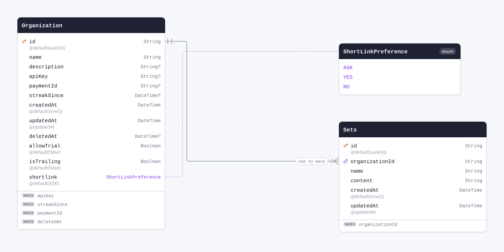

| Field            | Type       | Constraints                                       | Default      | Description |
| ---------------- | ---------- | ------------------------------------------------- | ------------ | ----------- |
| `id`             | `String`   | PK NOT NULL                                       | `uuid(4)`    |             |
| `organizationId` | `String`   | NOT NULL → [Organization.id](#model-Organization) |              |             |
| `name`           | `String`   | NOT NULL                                          |              |             |
| `content`        | `String`   | NOT NULL                                          |              |             |
| `createdAt`      | `DateTime` | NOT NULL                                          | `now()`      |             |
| `updatedAt`      | `DateTime` | NOT NULL                                          | `@updatedAt` |             |

#### Indexes

- `@@index([organizationId])`

#### References

- `organizationId` → [Organization.id](#model-Organization) (many-to-one)

#### Definition

```sql
CREATE TABLE "Sets" (
    "id" TEXT NOT NULL,
    "organizationId" TEXT NOT NULL,
    "name" TEXT NOT NULL,
    "content" TEXT NOT NULL,
    "createdAt" TIMESTAMP(3) NOT NULL DEFAULT CURRENT_TIMESTAMP,
    "updatedAt" TIMESTAMP(3) NOT NULL,

    CONSTRAINT "Sets_pkey" PRIMARY KEY ("id")
);

CREATE INDEX "Sets_organizationId_idx" ON "Sets"("organizationId");

ALTER TABLE "Sets" ADD CONSTRAINT "Sets_organizationId_fkey" FOREIGN KEY ("organizationId") REFERENCES "Organization"("id") ON DELETE RESTRICT ON UPDATE CASCADE;
```

<details>
<summary>Queries and their SQL</summary>

**findMany**: Every row

```ts
await prisma.sets.findMany();
```

```sql
SELECT
  "public"."Sets"."id",
  "public"."Sets"."organizationId",
  "public"."Sets"."name",
  "public"."Sets"."content",
  "public"."Sets"."createdAt",
  "public"."Sets"."updatedAt"
FROM
  "public"."Sets"
WHERE
  1 = 1
OFFSET
  $1
-- params: ["0"]
```

**count**: How many rows there are

```ts
await prisma.sets.count();
```

```sql
SELECT
  COUNT(*) AS "_count$_all"
FROM
  (
    SELECT
      "public"."Sets"."id"
    FROM
      "public"."Sets"
    WHERE
      1 = 1
    OFFSET
      $1
  ) AS "sub"
-- params: ["0"]
```

**findMany**: Every row with its relations

```ts
await prisma.sets.findMany({ include: { organization: true } });
```

```sql
SELECT
  "public"."Sets"."id",
  "public"."Sets"."organizationId",
  "public"."Sets"."name",
  "public"."Sets"."content",
  "public"."Sets"."createdAt",
  "public"."Sets"."updatedAt"
FROM
  "public"."Sets"
WHERE
  1 = 1
OFFSET
  $1
-- params: ["0"]

SELECT
  "public"."Organization"."id",
  "public"."Organization"."name",
  "public"."Organization"."description",
  "public"."Organization"."apiKey",
  "public"."Organization"."paymentId",
  "public"."Organization"."streakSince",
  "public"."Organization"."createdAt",
  "public"."Organization"."updatedAt",
  "public"."Organization"."deletedAt",
  "public"."Organization"."allowTrial",
  "public"."Organization"."isTrailing",
  "public"."Organization"."shortlink"::text
FROM
  "public"."Organization"
WHERE
  "public"."Organization"."id" IN ($1)
OFFSET
  $2
-- params: ["<organizationId of the rows above>","0"]
```

**findUnique**: One row by what is unique to it

```ts
await prisma.sets.findUnique({ where: { id: "example" } });
```

```sql
SELECT
  "public"."Sets"."id",
  "public"."Sets"."organizationId",
  "public"."Sets"."name",
  "public"."Sets"."content",
  "public"."Sets"."createdAt",
  "public"."Sets"."updatedAt"
FROM
  "public"."Sets"
WHERE
  (
    "public"."Sets"."id" = $1
    AND 1 = 1
  )
LIMIT
  $2
OFFSET
  $3
-- params: ["example","1","0"]
```

**create**: Create a row

```ts
await prisma.sets.create({
  data: { organizationId: "example", name: "example", content: "example" },
});
```

```sql
INSERT INTO
  "public"."Sets" (
    "id",
    "organizationId",
    "name",
    "content",
    "createdAt",
    "updatedAt"
  )
VALUES
  ($1, $2, $3, $4, $5, $6)
RETURNING
  "public"."Sets"."id",
  "public"."Sets"."organizationId",
  "public"."Sets"."name",
  "public"."Sets"."content",
  "public"."Sets"."createdAt",
  "public"."Sets"."updatedAt"
-- params: ["<uuid(4)>","example","example","example","<now()>","<now()>"]
```

**update**: Update a row

```ts
await prisma.sets.update({ where: { id: "example" }, data: { name: "example" } });
```

```sql
UPDATE "public"."Sets"
SET
  "name" = $1,
  "updatedAt" = $2
WHERE
  (
    "public"."Sets"."id" = $3
    AND 1 = 1
  )
RETURNING
  "public"."Sets"."id",
  "public"."Sets"."organizationId",
  "public"."Sets"."name",
  "public"."Sets"."content",
  "public"."Sets"."createdAt",
  "public"."Sets"."updatedAt"
-- params: ["example",{"prisma__type":"generatorCall","prisma__value":{"name":"now","args":[],"returnType":{"type":"DateTime"}}},"example"]
```

**delete**: Delete a row

```ts
await prisma.sets.delete({ where: { id: "example" } });
```

```sql
DELETE FROM "public"."Sets"
WHERE
  (
    "public"."Sets"."id" = $1
    AND 1 = 1
  )
RETURNING
  "public"."Sets"."id",
  "public"."Sets"."organizationId",
  "public"."Sets"."name",
  "public"."Sets"."content",
  "public"."Sets"."createdAt",
  "public"."Sets"."updatedAt"
-- params: ["example"]
```

</details>

<a id="model-ThirdParty"></a>

### ThirdParty

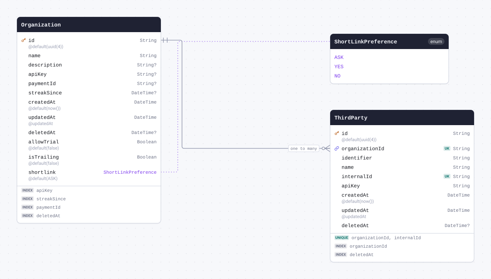

| Field            | Type       | Constraints                                       | Default      | Description |
| ---------------- | ---------- | ------------------------------------------------- | ------------ | ----------- |
| `id`             | `String`   | PK NOT NULL                                       | `uuid(4)`    |             |
| `organizationId` | `String`   | NOT NULL → [Organization.id](#model-Organization) |              |             |
| `identifier`     | `String`   | NOT NULL                                          |              |             |
| `name`           | `String`   | NOT NULL                                          |              |             |
| `internalId`     | `String`   | NOT NULL                                          |              |             |
| `apiKey`         | `String`   | NOT NULL                                          |              |             |
| `createdAt`      | `DateTime` | NOT NULL                                          | `now()`      |             |
| `updatedAt`      | `DateTime` | NOT NULL                                          | `@updatedAt` |             |
| `deletedAt`      | `DateTime` | NULL                                              |              |             |

#### Indexes

- `@@index([organizationId])`
- `@@index([deletedAt])`
- `@@unique([organizationId, internalId])`

#### References

- `organizationId` → [Organization.id](#model-Organization) (many-to-one)

#### Definition

```sql
CREATE TABLE "ThirdParty" (
    "id" TEXT NOT NULL,
    "organizationId" TEXT NOT NULL,
    "identifier" TEXT NOT NULL,
    "name" TEXT NOT NULL,
    "internalId" TEXT NOT NULL,
    "apiKey" TEXT NOT NULL,
    "createdAt" TIMESTAMP(3) NOT NULL DEFAULT CURRENT_TIMESTAMP,
    "updatedAt" TIMESTAMP(3) NOT NULL,
    "deletedAt" TIMESTAMP(3),

    CONSTRAINT "ThirdParty_pkey" PRIMARY KEY ("id")
);

CREATE INDEX "ThirdParty_organizationId_idx" ON "ThirdParty"("organizationId");

CREATE INDEX "ThirdParty_deletedAt_idx" ON "ThirdParty"("deletedAt");

CREATE UNIQUE INDEX "ThirdParty_organizationId_internalId_key" ON "ThirdParty"("organizationId", "internalId");

ALTER TABLE "ThirdParty" ADD CONSTRAINT "ThirdParty_organizationId_fkey" FOREIGN KEY ("organizationId") REFERENCES "Organization"("id") ON DELETE RESTRICT ON UPDATE CASCADE;
```

<details>
<summary>Queries and their SQL</summary>

**findMany**: Every row

```ts
await prisma.thirdParty.findMany();
```

```sql
SELECT
  "public"."ThirdParty"."id",
  "public"."ThirdParty"."organizationId",
  "public"."ThirdParty"."identifier",
  "public"."ThirdParty"."name",
  "public"."ThirdParty"."internalId",
  "public"."ThirdParty"."apiKey",
  "public"."ThirdParty"."createdAt",
  "public"."ThirdParty"."updatedAt",
  "public"."ThirdParty"."deletedAt"
FROM
  "public"."ThirdParty"
WHERE
  1 = 1
OFFSET
  $1
-- params: ["0"]
```

**count**: How many rows there are

```ts
await prisma.thirdParty.count();
```

```sql
SELECT
  COUNT(*) AS "_count$_all"
FROM
  (
    SELECT
      "public"."ThirdParty"."id"
    FROM
      "public"."ThirdParty"
    WHERE
      1 = 1
    OFFSET
      $1
  ) AS "sub"
-- params: ["0"]
```

**findMany**: Every row with its relations

```ts
await prisma.thirdParty.findMany({ include: { organization: true } });
```

```sql
SELECT
  "public"."ThirdParty"."id",
  "public"."ThirdParty"."organizationId",
  "public"."ThirdParty"."identifier",
  "public"."ThirdParty"."name",
  "public"."ThirdParty"."internalId",
  "public"."ThirdParty"."apiKey",
  "public"."ThirdParty"."createdAt",
  "public"."ThirdParty"."updatedAt",
  "public"."ThirdParty"."deletedAt"
FROM
  "public"."ThirdParty"
WHERE
  1 = 1
OFFSET
  $1
-- params: ["0"]

SELECT
  "public"."Organization"."id",
  "public"."Organization"."name",
  "public"."Organization"."description",
  "public"."Organization"."apiKey",
  "public"."Organization"."paymentId",
  "public"."Organization"."streakSince",
  "public"."Organization"."createdAt",
  "public"."Organization"."updatedAt",
  "public"."Organization"."deletedAt",
  "public"."Organization"."allowTrial",
  "public"."Organization"."isTrailing",
  "public"."Organization"."shortlink"::text
FROM
  "public"."Organization"
WHERE
  "public"."Organization"."id" IN ($1)
OFFSET
  $2
-- params: ["<organizationId of the rows above>","0"]
```

**findUnique**: One row by what is unique to it

```ts
await prisma.thirdParty.findUnique({ where: { id: "example" } });
```

```sql
SELECT
  "public"."ThirdParty"."id",
  "public"."ThirdParty"."organizationId",
  "public"."ThirdParty"."identifier",
  "public"."ThirdParty"."name",
  "public"."ThirdParty"."internalId",
  "public"."ThirdParty"."apiKey",
  "public"."ThirdParty"."createdAt",
  "public"."ThirdParty"."updatedAt",
  "public"."ThirdParty"."deletedAt"
FROM
  "public"."ThirdParty"
WHERE
  (
    "public"."ThirdParty"."id" = $1
    AND 1 = 1
  )
LIMIT
  $2
OFFSET
  $3
-- params: ["example","1","0"]
```

**create**: Create a row

```ts
await prisma.thirdParty.create({
  data: {
    organizationId: "example",
    identifier: "example",
    name: "example",
    internalId: "example",
    apiKey: "example",
  },
});
```

```sql
INSERT INTO
  "public"."ThirdParty" (
    "id",
    "organizationId",
    "identifier",
    "name",
    "internalId",
    "apiKey",
    "createdAt",
    "updatedAt"
  )
VALUES
  ($1, $2, $3, $4, $5, $6, $7, $8)
RETURNING
  "public"."ThirdParty"."id",
  "public"."ThirdParty"."organizationId",
  "public"."ThirdParty"."identifier",
  "public"."ThirdParty"."name",
  "public"."ThirdParty"."internalId",
  "public"."ThirdParty"."apiKey",
  "public"."ThirdParty"."createdAt",
  "public"."ThirdParty"."updatedAt",
  "public"."ThirdParty"."deletedAt"
-- params: ["<uuid(4)>","example","example","example","example","example","<now()>","<now()>"]
```

**update**: Update a row

```ts
await prisma.thirdParty.update({ where: { id: "example" }, data: { identifier: "example" } });
```

```sql
UPDATE "public"."ThirdParty"
SET
  "identifier" = $1,
  "updatedAt" = $2
WHERE
  (
    "public"."ThirdParty"."id" = $3
    AND 1 = 1
  )
RETURNING
  "public"."ThirdParty"."id",
  "public"."ThirdParty"."organizationId",
  "public"."ThirdParty"."identifier",
  "public"."ThirdParty"."name",
  "public"."ThirdParty"."internalId",
  "public"."ThirdParty"."apiKey",
  "public"."ThirdParty"."createdAt",
  "public"."ThirdParty"."updatedAt",
  "public"."ThirdParty"."deletedAt"
-- params: ["example",{"prisma__type":"generatorCall","prisma__value":{"name":"now","args":[],"returnType":{"type":"DateTime"}}},"example"]
```

**delete**: Delete a row

```ts
await prisma.thirdParty.delete({ where: { id: "example" } });
```

```sql
DELETE FROM "public"."ThirdParty"
WHERE
  (
    "public"."ThirdParty"."id" = $1
    AND 1 = 1
  )
RETURNING
  "public"."ThirdParty"."id",
  "public"."ThirdParty"."organizationId",
  "public"."ThirdParty"."identifier",
  "public"."ThirdParty"."name",
  "public"."ThirdParty"."internalId",
  "public"."ThirdParty"."apiKey",
  "public"."ThirdParty"."createdAt",
  "public"."ThirdParty"."updatedAt",
  "public"."ThirdParty"."deletedAt"
-- params: ["example"]
```

</details>

<a id="model-Errors"></a>

### Errors

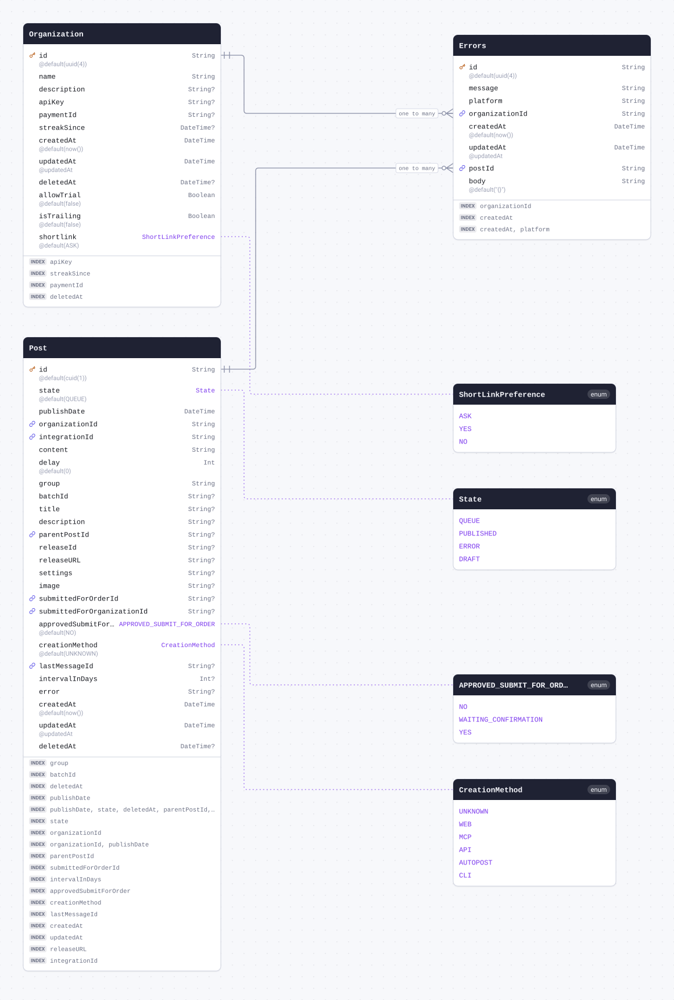

| Field            | Type       | Constraints                                       | Default      | Description |
| ---------------- | ---------- | ------------------------------------------------- | ------------ | ----------- |
| `id`             | `String`   | PK NOT NULL                                       | `uuid(4)`    |             |
| `message`        | `String`   | NOT NULL                                          |              |             |
| `platform`       | `String`   | NOT NULL                                          |              |             |
| `organizationId` | `String`   | NOT NULL → [Organization.id](#model-Organization) |              |             |
| `createdAt`      | `DateTime` | NOT NULL                                          | `now()`      |             |
| `updatedAt`      | `DateTime` | NOT NULL                                          | `@updatedAt` |             |
| `postId`         | `String`   | NOT NULL → [Post.id](#model-Post)                 |              |             |
| `body`           | `String`   | NOT NULL                                          | `"{}"`       |             |

#### Indexes

- `@@index([organizationId])`
- `@@index([createdAt])`
- `@@index([createdAt, platform])`

#### References

- `organizationId` → [Organization.id](#model-Organization) (many-to-one)
- `postId` → [Post.id](#model-Post) (many-to-one)

#### Definition

```sql
CREATE TABLE "Errors" (
    "id" TEXT NOT NULL,
    "message" TEXT NOT NULL,
    "platform" TEXT NOT NULL,
    "organizationId" TEXT NOT NULL,
    "createdAt" TIMESTAMP(3) NOT NULL DEFAULT CURRENT_TIMESTAMP,
    "updatedAt" TIMESTAMP(3) NOT NULL,
    "postId" TEXT NOT NULL,
    "body" TEXT NOT NULL DEFAULT '{}',

    CONSTRAINT "Errors_pkey" PRIMARY KEY ("id")
);

CREATE INDEX "Errors_organizationId_idx" ON "Errors"("organizationId");

CREATE INDEX "Errors_createdAt_idx" ON "Errors"("createdAt");

CREATE INDEX "Errors_createdAt_platform_idx" ON "Errors"("createdAt", "platform");

ALTER TABLE "Errors" ADD CONSTRAINT "Errors_organizationId_fkey" FOREIGN KEY ("organizationId") REFERENCES "Organization"("id") ON DELETE RESTRICT ON UPDATE CASCADE;

ALTER TABLE "Errors" ADD CONSTRAINT "Errors_postId_fkey" FOREIGN KEY ("postId") REFERENCES "Post"("id") ON DELETE RESTRICT ON UPDATE CASCADE;
```

<details>
<summary>Queries and their SQL</summary>

**findMany**: Every row

```ts
await prisma.errors.findMany();
```

```sql
SELECT
  "public"."Errors"."id",
  "public"."Errors"."message",
  "public"."Errors"."platform",
  "public"."Errors"."organizationId",
  "public"."Errors"."createdAt",
  "public"."Errors"."updatedAt",
  "public"."Errors"."postId",
  "public"."Errors"."body"
FROM
  "public"."Errors"
WHERE
  1 = 1
OFFSET
  $1
-- params: ["0"]
```

**count**: How many rows there are

```ts
await prisma.errors.count();
```

```sql
SELECT
  COUNT(*) AS "_count$_all"
FROM
  (
    SELECT
      "public"."Errors"."id"
    FROM
      "public"."Errors"
    WHERE
      1 = 1
    OFFSET
      $1
  ) AS "sub"
-- params: ["0"]
```

**findMany**: Every row with its relations

```ts
await prisma.errors.findMany({ include: { organization: true, post: true } });
```

```sql
SELECT
  "public"."Errors"."id",
  "public"."Errors"."message",
  "public"."Errors"."platform",
  "public"."Errors"."organizationId",
  "public"."Errors"."createdAt",
  "public"."Errors"."updatedAt",
  "public"."Errors"."postId",
  "public"."Errors"."body"
FROM
  "public"."Errors"
WHERE
  1 = 1
OFFSET
  $1
-- params: ["0"]

SELECT
  "public"."Organization"."id",
  "public"."Organization"."name",
  "public"."Organization"."description",
  "public"."Organization"."apiKey",
  "public"."Organization"."paymentId",
  "public"."Organization"."streakSince",
  "public"."Organization"."createdAt",
  "public"."Organization"."updatedAt",
  "public"."Organization"."deletedAt",
  "public"."Organization"."allowTrial",
  "public"."Organization"."isTrailing",
  "public"."Organization"."shortlink"::text
FROM
  "public"."Organization"
WHERE
  "public"."Organization"."id" IN ($1)
OFFSET
  $2
-- params: ["<organizationId of the rows above>","0"]

SELECT
  "public"."Post"."id",
  "public"."Post"."state"::text,
  "public"."Post"."publishDate",
  "public"."Post"."organizationId",
  "public"."Post"."integrationId",
  "public"."Post"."content",
  "public"."Post"."delay",
  "public"."Post"."group",
  "public"."Post"."batchId",
  "public"."Post"."title",
  "public"."Post"."description",
  "public"."Post"."parentPostId",
  "public"."Post"."releaseId",
  "public"."Post"."releaseURL",
  "public"."Post"."settings",
  "public"."Post"."image",
  "public"."Post"."submittedForOrderId",
  "public"."Post"."submittedForOrganizationId",
  "public"."Post"."approvedSubmitForOrder"::text,
  "public"."Post"."creationMethod"::text,
  "public"."Post"."lastMessageId",
  "public"."Post"."intervalInDays",
  "public"."Post"."error",
  "public"."Post"."createdAt",
  "public"."Post"."updatedAt",
  "public"."Post"."deletedAt"
FROM
  "public"."Post"
WHERE
  "public"."Post"."id" IN ($1)
OFFSET
  $2
-- params: ["<postId of the rows above>","0"]
```

**findUnique**: One row by what is unique to it

```ts
await prisma.errors.findUnique({ where: { id: "example" } });
```

```sql
SELECT
  "public"."Errors"."id",
  "public"."Errors"."message",
  "public"."Errors"."platform",
  "public"."Errors"."organizationId",
  "public"."Errors"."createdAt",
  "public"."Errors"."updatedAt",
  "public"."Errors"."postId",
  "public"."Errors"."body"
FROM
  "public"."Errors"
WHERE
  (
    "public"."Errors"."id" = $1
    AND 1 = 1
  )
LIMIT
  $2
OFFSET
  $3
-- params: ["example","1","0"]
```

**create**: Create a row

```ts
await prisma.errors.create({
  data: { message: "example", platform: "example", organizationId: "example", postId: "example" },
});
```

```sql
INSERT INTO
  "public"."Errors" (
    "id",
    "message",
    "platform",
    "organizationId",
    "createdAt",
    "updatedAt",
    "postId",
    "body"
  )
VALUES
  ($1, $2, $3, $4, $5, $6, $7, $8)
RETURNING
  "public"."Errors"."id",
  "public"."Errors"."message",
  "public"."Errors"."platform",
  "public"."Errors"."organizationId",
  "public"."Errors"."createdAt",
  "public"."Errors"."updatedAt",
  "public"."Errors"."postId",
  "public"."Errors"."body"
-- params: ["<uuid(4)>","example","example","example","<now()>","<now()>","example","{}"]
```

**update**: Update a row

```ts
await prisma.errors.update({ where: { id: "example" }, data: { message: "example" } });
```

```sql
UPDATE "public"."Errors"
SET
  "message" = $1,
  "updatedAt" = $2
WHERE
  (
    "public"."Errors"."id" = $3
    AND 1 = 1
  )
RETURNING
  "public"."Errors"."id",
  "public"."Errors"."message",
  "public"."Errors"."platform",
  "public"."Errors"."organizationId",
  "public"."Errors"."createdAt",
  "public"."Errors"."updatedAt",
  "public"."Errors"."postId",
  "public"."Errors"."body"
-- params: ["example",{"prisma__type":"generatorCall","prisma__value":{"name":"now","args":[],"returnType":{"type":"DateTime"}}},"example"]
```

**delete**: Delete a row

```ts
await prisma.errors.delete({ where: { id: "example" } });
```

```sql
DELETE FROM "public"."Errors"
WHERE
  (
    "public"."Errors"."id" = $1
    AND 1 = 1
  )
RETURNING
  "public"."Errors"."id",
  "public"."Errors"."message",
  "public"."Errors"."platform",
  "public"."Errors"."organizationId",
  "public"."Errors"."createdAt",
  "public"."Errors"."updatedAt",
  "public"."Errors"."postId",
  "public"."Errors"."body"
-- params: ["example"]
```

</details>

<a id="model-Mentions"></a>

### Mentions

| Field       | Type       | Constraints | Default      | Description |
| ----------- | ---------- | ----------- | ------------ | ----------- |
| `name`      | `String`   | PK NOT NULL |              |             |
| `username`  | `String`   | PK NOT NULL |              |             |
| `platform`  | `String`   | PK NOT NULL |              |             |
| `createdAt` | `DateTime` | NOT NULL    | `now()`      |             |
| `updatedAt` | `DateTime` | NOT NULL    | `@updatedAt` |             |
| `image`     | `String`   | PK NOT NULL |              |             |

#### Indexes

- `@@id([name, username, platform, image])`
- `@@index([createdAt])`

#### Definition

```sql
CREATE TABLE "Mentions" (
    "name" TEXT NOT NULL,
    "username" TEXT NOT NULL,
    "platform" TEXT NOT NULL,
    "createdAt" TIMESTAMP(3) NOT NULL DEFAULT CURRENT_TIMESTAMP,
    "updatedAt" TIMESTAMP(3) NOT NULL,
    "image" TEXT NOT NULL,

    CONSTRAINT "Mentions_pkey" PRIMARY KEY ("name","username","platform","image")
);

CREATE INDEX "Mentions_createdAt_idx" ON "Mentions"("createdAt");
```

<details>
<summary>Queries and their SQL</summary>

**findMany**: Every row

```ts
await prisma.mentions.findMany();
```

```sql
SELECT
  "public"."Mentions"."name",
  "public"."Mentions"."username",
  "public"."Mentions"."platform",
  "public"."Mentions"."image",
  "public"."Mentions"."createdAt",
  "public"."Mentions"."updatedAt"
FROM
  "public"."Mentions"
WHERE
  1 = 1
OFFSET
  $1
-- params: ["0"]
```

**count**: How many rows there are

```ts
await prisma.mentions.count();
```

```sql
SELECT
  COUNT(*) AS "_count$_all"
FROM
  (
    SELECT
      "public"."Mentions"."name",
      "public"."Mentions"."username",
      "public"."Mentions"."platform",
      "public"."Mentions"."image"
    FROM
      "public"."Mentions"
    WHERE
      1 = 1
    OFFSET
      $1
  ) AS "sub"
-- params: ["0"]
```

**findUnique**: One row by what is unique to it

```ts
await prisma.mentions.findUnique({
  where: {
    name_username_platform_image: {
      name: "example",
      username: "example",
      platform: "example",
      image: "example",
    },
  },
});
```

```sql
SELECT
  "public"."Mentions"."name",
  "public"."Mentions"."username",
  "public"."Mentions"."platform",
  "public"."Mentions"."image",
  "public"."Mentions"."createdAt",
  "public"."Mentions"."updatedAt"
FROM
  "public"."Mentions"
WHERE
  (
    (
      "public"."Mentions"."name" = $1
      AND "public"."Mentions"."username" = $2
      AND "public"."Mentions"."platform" = $3
      AND "public"."Mentions"."image" = $4
    )
    AND 1 = 1
  )
LIMIT
  $5
OFFSET
  $6
-- params: ["example","example","example","example","1","0"]
```

**create**: Create a row

```ts
await prisma.mentions.create({
  data: { name: "example", username: "example", platform: "example", image: "example" },
});
```

```sql
INSERT INTO
  "public"."Mentions" (
    "name",
    "username",
    "platform",
    "createdAt",
    "updatedAt",
    "image"
  )
VALUES
  ($1, $2, $3, $4, $5, $6)
RETURNING
  "public"."Mentions"."name",
  "public"."Mentions"."username",
  "public"."Mentions"."platform",
  "public"."Mentions"."image",
  "public"."Mentions"."createdAt",
  "public"."Mentions"."updatedAt"
-- params: ["example","example","example","<now()>","<now()>","example"]
```

**update**: Update a row

```ts
await prisma.mentions.update({
  where: {
    name_username_platform_image: {
      name: "example",
      username: "example",
      platform: "example",
      image: "example",
    },
  },
  data: { createdAt: new Date("2026-01-01T00:00:00.000Z") },
});
```

```sql
UPDATE "public"."Mentions"
SET
  "createdAt" = $1,
  "updatedAt" = $2
WHERE
  (
    (
      "public"."Mentions"."name" = $3
      AND "public"."Mentions"."username" = $4
      AND "public"."Mentions"."platform" = $5
      AND "public"."Mentions"."image" = $6
    )
    AND 1 = 1
  )
RETURNING
  "public"."Mentions"."name",
  "public"."Mentions"."username",
  "public"."Mentions"."platform",
  "public"."Mentions"."image",
  "public"."Mentions"."createdAt",
  "public"."Mentions"."updatedAt"
-- params: ["2026-01-01T00:00:00.000Z",{"prisma__type":"generatorCall","prisma__value":{"name":"now","args":[],"returnType":{"type":"DateTime"}}},"example","example","example","example"]
```

**delete**: Delete a row

```ts
await prisma.mentions.delete({
  where: {
    name_username_platform_image: {
      name: "example",
      username: "example",
      platform: "example",
      image: "example",
    },
  },
});
```

```sql
DELETE FROM "public"."Mentions"
WHERE
  (
    (
      "public"."Mentions"."name" = $1
      AND "public"."Mentions"."username" = $2
      AND "public"."Mentions"."platform" = $3
      AND "public"."Mentions"."image" = $4
    )
    AND 1 = 1
  )
RETURNING
  "public"."Mentions"."name",
  "public"."Mentions"."username",
  "public"."Mentions"."platform",
  "public"."Mentions"."image",
  "public"."Mentions"."createdAt",
  "public"."Mentions"."updatedAt"
-- params: ["example","example","example","example"]
```

</details>

<a id="model-mastra_messages"></a>

### mastra_messages

| Field        | Type                            | Constraints | Default | Description |
| ------------ | ------------------------------- | ----------- | ------- | ----------- |
| `id`         | `String`                        | PK NOT NULL |         |             |
| `thread_id`  | `String`                        | NOT NULL    |         |             |
| `content`    | `String`                        | NOT NULL    |         |             |
| `role`       | `String`                        | NOT NULL    |         |             |
| `type`       | `String`                        | NOT NULL    |         |             |
| `createdAt`  | `DateTime` `@db.Timestamp(6)`   | NOT NULL    |         |             |
| `resourceId` | `String`                        | NULL        |         |             |
| `createdAtZ` | `DateTime` `@db.Timestamptz(6)` | NULL        | `now()` |             |

#### Indexes

- `@@index([thread_id, createdAt], map: "public_mastra_messages_thread_id_createdat_idx")`
- `@@index([thread_id, createdAt], map: "mastra_messages_thread_id_createdat_idx")`

#### Definition

```sql
CREATE TABLE "mastra_messages" (
    "id" TEXT NOT NULL,
    "thread_id" TEXT NOT NULL,
    "content" TEXT NOT NULL,
    "role" TEXT NOT NULL,
    "type" TEXT NOT NULL,
    "createdAt" TIMESTAMP(6) NOT NULL,
    "resourceId" TEXT,
    "createdAtZ" TIMESTAMPTZ(6) DEFAULT CURRENT_TIMESTAMP,

    CONSTRAINT "mastra_messages_pkey" PRIMARY KEY ("id")
);

CREATE INDEX "public_mastra_messages_thread_id_createdat_idx" ON "mastra_messages"("thread_id", "createdAt" DESC);

CREATE INDEX "mastra_messages_thread_id_createdat_idx" ON "mastra_messages"("thread_id", "createdAt" DESC);
```

<details>
<summary>Queries and their SQL</summary>

**findMany**: Every row

```ts
await prisma.mastra_messages.findMany();
```

```sql
SELECT
  "public"."mastra_messages"."id",
  "public"."mastra_messages"."thread_id",
  "public"."mastra_messages"."content",
  "public"."mastra_messages"."role",
  "public"."mastra_messages"."type",
  "public"."mastra_messages"."createdAt",
  "public"."mastra_messages"."resourceId",
  "public"."mastra_messages"."createdAtZ"
FROM
  "public"."mastra_messages"
WHERE
  1 = 1
OFFSET
  $1
-- params: ["0"]
```

**count**: How many rows there are

```ts
await prisma.mastra_messages.count();
```

```sql
SELECT
  COUNT(*) AS "_count$_all"
FROM
  (
    SELECT
      "public"."mastra_messages"."id"
    FROM
      "public"."mastra_messages"
    WHERE
      1 = 1
    OFFSET
      $1
  ) AS "sub"
-- params: ["0"]
```

**findUnique**: One row by what is unique to it

```ts
await prisma.mastra_messages.findUnique({ where: { id: "example" } });
```

```sql
SELECT
  "public"."mastra_messages"."id",
  "public"."mastra_messages"."thread_id",
  "public"."mastra_messages"."content",
  "public"."mastra_messages"."role",
  "public"."mastra_messages"."type",
  "public"."mastra_messages"."createdAt",
  "public"."mastra_messages"."resourceId",
  "public"."mastra_messages"."createdAtZ"
FROM
  "public"."mastra_messages"
WHERE
  (
    "public"."mastra_messages"."id" = $1
    AND 1 = 1
  )
LIMIT
  $2
OFFSET
  $3
-- params: ["example","1","0"]
```

**create**: Create a row

```ts
await prisma.mastra_messages.create({
  data: {
    id: "example",
    thread_id: "example",
    content: "example",
    role: "example",
    type: "example",
    createdAt: new Date("2026-01-01T00:00:00.000Z"),
  },
});
```

```sql
INSERT INTO
  "public"."mastra_messages" (
    "id",
    "thread_id",
    "content",
    "role",
    "type",
    "createdAt",
    "createdAtZ"
  )
VALUES
  ($1, $2, $3, $4, $5, $6, $7)
RETURNING
  "public"."mastra_messages"."id",
  "public"."mastra_messages"."thread_id",
  "public"."mastra_messages"."content",
  "public"."mastra_messages"."role",
  "public"."mastra_messages"."type",
  "public"."mastra_messages"."createdAt",
  "public"."mastra_messages"."resourceId",
  "public"."mastra_messages"."createdAtZ"
-- params: ["example","example","example","example","example","2026-01-01T00:00:00.000Z","<now()>"]
```

**update**: Update a row

```ts
await prisma.mastra_messages.update({ where: { id: "example" }, data: { thread_id: "example" } });
```

```sql
UPDATE "public"."mastra_messages"
SET
  "thread_id" = $1
WHERE
  (
    "public"."mastra_messages"."id" = $2
    AND 1 = 1
  )
RETURNING
  "public"."mastra_messages"."id",
  "public"."mastra_messages"."thread_id",
  "public"."mastra_messages"."content",
  "public"."mastra_messages"."role",
  "public"."mastra_messages"."type",
  "public"."mastra_messages"."createdAt",
  "public"."mastra_messages"."resourceId",
  "public"."mastra_messages"."createdAtZ"
-- params: ["example","example"]
```

**delete**: Delete a row

```ts
await prisma.mastra_messages.delete({ where: { id: "example" } });
```

```sql
DELETE FROM "public"."mastra_messages"
WHERE
  (
    "public"."mastra_messages"."id" = $1
    AND 1 = 1
  )
RETURNING
  "public"."mastra_messages"."id",
  "public"."mastra_messages"."thread_id",
  "public"."mastra_messages"."content",
  "public"."mastra_messages"."role",
  "public"."mastra_messages"."type",
  "public"."mastra_messages"."createdAt",
  "public"."mastra_messages"."resourceId",
  "public"."mastra_messages"."createdAtZ"
-- params: ["example"]
```

</details>

<a id="model-mastra_resources"></a>

### mastra_resources

| Field           | Type                            | Constraints | Default | Description |
| --------------- | ------------------------------- | ----------- | ------- | ----------- |
| `id`            | `String`                        | PK NOT NULL |         |             |
| `workingMemory` | `String`                        | NULL        |         |             |
| `metadata`      | `Json`                          | NULL        |         |             |
| `createdAt`     | `DateTime` `@db.Timestamp(6)`   | NOT NULL    |         |             |
| `updatedAt`     | `DateTime` `@db.Timestamp(6)`   | NOT NULL    |         |             |
| `createdAtZ`    | `DateTime` `@db.Timestamptz(6)` | NULL        | `now()` |             |
| `updatedAtZ`    | `DateTime` `@db.Timestamptz(6)` | NULL        | `now()` |             |

#### Definition

```sql
CREATE TABLE "mastra_resources" (
    "id" TEXT NOT NULL,
    "workingMemory" TEXT,
    "metadata" JSONB,
    "createdAt" TIMESTAMP(6) NOT NULL,
    "updatedAt" TIMESTAMP(6) NOT NULL,
    "createdAtZ" TIMESTAMPTZ(6) DEFAULT CURRENT_TIMESTAMP,
    "updatedAtZ" TIMESTAMPTZ(6) DEFAULT CURRENT_TIMESTAMP,

    CONSTRAINT "mastra_resources_pkey" PRIMARY KEY ("id")
);
```

<details>
<summary>Queries and their SQL</summary>

**findMany**: Every row

```ts
await prisma.mastra_resources.findMany();
```

```sql
SELECT
  "public"."mastra_resources"."id",
  "public"."mastra_resources"."workingMemory",
  "public"."mastra_resources"."metadata",
  "public"."mastra_resources"."createdAt",
  "public"."mastra_resources"."updatedAt",
  "public"."mastra_resources"."createdAtZ",
  "public"."mastra_resources"."updatedAtZ"
FROM
  "public"."mastra_resources"
WHERE
  1 = 1
OFFSET
  $1
-- params: ["0"]
```

**count**: How many rows there are

```ts
await prisma.mastra_resources.count();
```

```sql
SELECT
  COUNT(*) AS "_count$_all"
FROM
  (
    SELECT
      "public"."mastra_resources"."id"
    FROM
      "public"."mastra_resources"
    WHERE
      1 = 1
    OFFSET
      $1
  ) AS "sub"
-- params: ["0"]
```

**findUnique**: One row by what is unique to it

```ts
await prisma.mastra_resources.findUnique({ where: { id: "example" } });
```

```sql
SELECT
  "public"."mastra_resources"."id",
  "public"."mastra_resources"."workingMemory",
  "public"."mastra_resources"."metadata",
  "public"."mastra_resources"."createdAt",
  "public"."mastra_resources"."updatedAt",
  "public"."mastra_resources"."createdAtZ",
  "public"."mastra_resources"."updatedAtZ"
FROM
  "public"."mastra_resources"
WHERE
  (
    "public"."mastra_resources"."id" = $1
    AND 1 = 1
  )
LIMIT
  $2
OFFSET
  $3
-- params: ["example","1","0"]
```

**create**: Create a row

```ts
await prisma.mastra_resources.create({
  data: {
    id: "example",
    createdAt: new Date("2026-01-01T00:00:00.000Z"),
    updatedAt: new Date("2026-01-01T00:00:00.000Z"),
  },
});
```

```sql
INSERT INTO
  "public"."mastra_resources" (
    "id",
    "createdAt",
    "updatedAt",
    "createdAtZ",
    "updatedAtZ"
  )
VALUES
  ($1, $2, $3, $4, $5)
RETURNING
  "public"."mastra_resources"."id",
  "public"."mastra_resources"."workingMemory",
  "public"."mastra_resources"."metadata",
  "public"."mastra_resources"."createdAt",
  "public"."mastra_resources"."updatedAt",
  "public"."mastra_resources"."createdAtZ",
  "public"."mastra_resources"."updatedAtZ"
-- params: ["example","2026-01-01T00:00:00.000Z","2026-01-01T00:00:00.000Z","<now()>","<now()>"]
```

**update**: Update a row

```ts
await prisma.mastra_resources.update({
  where: { id: "example" },
  data: { workingMemory: "example" },
});
```

```sql
UPDATE "public"."mastra_resources"
SET
  "workingMemory" = $1
WHERE
  (
    "public"."mastra_resources"."id" = $2
    AND 1 = 1
  )
RETURNING
  "public"."mastra_resources"."id",
  "public"."mastra_resources"."workingMemory",
  "public"."mastra_resources"."metadata",
  "public"."mastra_resources"."createdAt",
  "public"."mastra_resources"."updatedAt",
  "public"."mastra_resources"."createdAtZ",
  "public"."mastra_resources"."updatedAtZ"
-- params: ["example","example"]
```

**delete**: Delete a row

```ts
await prisma.mastra_resources.delete({ where: { id: "example" } });
```

```sql
DELETE FROM "public"."mastra_resources"
WHERE
  (
    "public"."mastra_resources"."id" = $1
    AND 1 = 1
  )
RETURNING
  "public"."mastra_resources"."id",
  "public"."mastra_resources"."workingMemory",
  "public"."mastra_resources"."metadata",
  "public"."mastra_resources"."createdAt",
  "public"."mastra_resources"."updatedAt",
  "public"."mastra_resources"."createdAtZ",
  "public"."mastra_resources"."updatedAtZ"
-- params: ["example"]
```

</details>

<a id="model-mastra_scorers"></a>

### mastra_scorers

| Field                  | Type                            | Constraints | Default | Description |
| ---------------------- | ------------------------------- | ----------- | ------- | ----------- |
| `id`                   | `String`                        | PK NOT NULL |         |             |
| `scorerId`             | `String`                        | NOT NULL    |         |             |
| `traceId`              | `String`                        | NULL        |         |             |
| `runId`                | `String`                        | NOT NULL    |         |             |
| `scorer`               | `Json`                          | NOT NULL    |         |             |
| `preprocessStepResult` | `Json`                          | NULL        |         |             |
| `extractStepResult`    | `Json`                          | NULL        |         |             |
| `analyzeStepResult`    | `Json`                          | NULL        |         |             |
| `score`                | `Float`                         | NOT NULL    |         |             |
| `reason`               | `String`                        | NULL        |         |             |
| `metadata`             | `Json`                          | NULL        |         |             |
| `preprocessPrompt`     | `String`                        | NULL        |         |             |
| `extractPrompt`        | `String`                        | NULL        |         |             |
| `generateScorePrompt`  | `String`                        | NULL        |         |             |
| `generateReasonPrompt` | `String`                        | NULL        |         |             |
| `analyzePrompt`        | `String`                        | NULL        |         |             |
| `reasonPrompt`         | `String`                        | NULL        |         |             |
| `input`                | `Json`                          | NOT NULL    |         |             |
| `output`               | `Json`                          | NOT NULL    |         |             |
| `additionalContext`    | `Json`                          | NULL        |         |             |
| `runtimeContext`       | `Json`                          | NULL        |         |             |
| `entityType`           | `String`                        | NULL        |         |             |
| `entity`               | `Json`                          | NULL        |         |             |
| `entityId`             | `String`                        | NULL        |         |             |
| `source`               | `String`                        | NOT NULL    |         |             |
| `resourceId`           | `String`                        | NULL        |         |             |
| `threadId`             | `String`                        | NULL        |         |             |
| `createdAt`            | `DateTime` `@db.Timestamp(6)`   | NOT NULL    |         |             |
| `updatedAt`            | `DateTime` `@db.Timestamp(6)`   | NOT NULL    |         |             |
| `createdAtZ`           | `DateTime` `@db.Timestamptz(6)` | NULL        | `now()` |             |
| `updatedAtZ`           | `DateTime` `@db.Timestamptz(6)` | NULL        | `now()` |             |
| `spanId`               | `String`                        | NULL        |         |             |
| `requestContext`       | `Json`                          | NULL        |         |             |
| `organizationId`       | `String`                        | NULL        |         |             |
| `projectId`            | `String`                        | NULL        |         |             |
| `batchId`              | `String`                        | NULL        |         |             |
| `datasetId`            | `String`                        | NULL        |         |             |
| `datasetItemId`        | `String`                        | NULL        |         |             |

#### Indexes

- `@@index([traceId, spanId, createdAt], map: "public_mastra_scores_trace_id_span_id_created_at_idx")`
- `@@index([traceId, spanId, createdAt], map: "mastra_scores_trace_id_span_id_created_at_idx")`

#### Definition

```sql
CREATE TABLE "mastra_scorers" (
    "id" TEXT NOT NULL,
    "scorerId" TEXT NOT NULL,
    "traceId" TEXT,
    "runId" TEXT NOT NULL,
    "scorer" JSONB NOT NULL,
    "preprocessStepResult" JSONB,
    "extractStepResult" JSONB,
    "analyzeStepResult" JSONB,
    "score" DOUBLE PRECISION NOT NULL,
    "reason" TEXT,
    "metadata" JSONB,
    "preprocessPrompt" TEXT,
    "extractPrompt" TEXT,
    "generateScorePrompt" TEXT,
    "generateReasonPrompt" TEXT,
    "analyzePrompt" TEXT,
    "reasonPrompt" TEXT,
    "input" JSONB NOT NULL,
    "output" JSONB NOT NULL,
    "additionalContext" JSONB,
    "runtimeContext" JSONB,
    "entityType" TEXT,
    "entity" JSONB,
    "entityId" TEXT,
    "source" TEXT NOT NULL,
    "resourceId" TEXT,
    "threadId" TEXT,
    "createdAt" TIMESTAMP(6) NOT NULL,
    "updatedAt" TIMESTAMP(6) NOT NULL,
    "createdAtZ" TIMESTAMPTZ(6) DEFAULT CURRENT_TIMESTAMP,
    "updatedAtZ" TIMESTAMPTZ(6) DEFAULT CURRENT_TIMESTAMP,
    "spanId" TEXT,
    "requestContext" JSONB,
    "organizationId" TEXT,
    "projectId" TEXT,
    "batchId" TEXT,
    "datasetId" TEXT,
    "datasetItemId" TEXT,

    CONSTRAINT "mastra_scorers_pkey" PRIMARY KEY ("id")
);

CREATE INDEX "public_mastra_scores_trace_id_span_id_created_at_idx" ON "mastra_scorers"("traceId", "spanId", "createdAt" DESC);

CREATE INDEX "mastra_scores_trace_id_span_id_created_at_idx" ON "mastra_scorers"("traceId", "spanId", "createdAt" DESC);
```

<details>
<summary>Queries and their SQL</summary>

**findMany**: Every row

```ts
await prisma.mastra_scorers.findMany();
```

```sql
SELECT
  "public"."mastra_scorers"."id",
  "public"."mastra_scorers"."scorerId",
  "public"."mastra_scorers"."traceId",
  "public"."mastra_scorers"."runId",
  "public"."mastra_scorers"."scorer",
  "public"."mastra_scorers"."preprocessStepResult",
  "public"."mastra_scorers"."extractStepResult",
  "public"."mastra_scorers"."analyzeStepResult",
  "public"."mastra_scorers"."score",
  "public"."mastra_scorers"."reason",
  "public"."mastra_scorers"."metadata",
  "public"."mastra_scorers"."preprocessPrompt",
  "public"."mastra_scorers"."extractPrompt",
  "public"."mastra_scorers"."generateScorePrompt",
  "public"."mastra_scorers"."generateReasonPrompt",
  "public"."mastra_scorers"."analyzePrompt",
  "public"."mastra_scorers"."reasonPrompt",
  "public"."mastra_scorers"."input",
  "public"."mastra_scorers"."output",
  "public"."mastra_scorers"."additionalContext",
  "public"."mastra_scorers"."runtimeContext",
  "public"."mastra_scorers"."entityType",
  "public"."mastra_scorers"."entity",
  "public"."mastra_scorers"."entityId",
  "public"."mastra_scorers"."source",
  "public"."mastra_scorers"."resourceId",
  "public"."mastra_scorers"."threadId",
  "public"."mastra_scorers"."createdAt",
  "public"."mastra_scorers"."updatedAt",
  "public"."mastra_scorers"."createdAtZ",
  "public"."mastra_scorers"."updatedAtZ",
  "public"."mastra_scorers"."spanId",
  "public"."mastra_scorers"."requestContext",
  "public"."mastra_scorers"."organizationId",
  "public"."mastra_scorers"."projectId",
  "public"."mastra_scorers"."batchId",
  "public"."mastra_scorers"."datasetId",
  "public"."mastra_scorers"."datasetItemId"
FROM
  "public"."mastra_scorers"
WHERE
  1 = 1
OFFSET
  $1
-- params: ["0"]
```

**count**: How many rows there are

```ts
await prisma.mastra_scorers.count();
```

```sql
SELECT
  COUNT(*) AS "_count$_all"
FROM
  (
    SELECT
      "public"."mastra_scorers"."id"
    FROM
      "public"."mastra_scorers"
    WHERE
      1 = 1
    OFFSET
      $1
  ) AS "sub"
-- params: ["0"]
```

**findUnique**: One row by what is unique to it

```ts
await prisma.mastra_scorers.findUnique({ where: { id: "example" } });
```

```sql
SELECT
  "public"."mastra_scorers"."id",
  "public"."mastra_scorers"."scorerId",
  "public"."mastra_scorers"."traceId",
  "public"."mastra_scorers"."runId",
  "public"."mastra_scorers"."scorer",
  "public"."mastra_scorers"."preprocessStepResult",
  "public"."mastra_scorers"."extractStepResult",
  "public"."mastra_scorers"."analyzeStepResult",
  "public"."mastra_scorers"."score",
  "public"."mastra_scorers"."reason",
  "public"."mastra_scorers"."metadata",
  "public"."mastra_scorers"."preprocessPrompt",
  "public"."mastra_scorers"."extractPrompt",
  "public"."mastra_scorers"."generateScorePrompt",
  "public"."mastra_scorers"."generateReasonPrompt",
  "public"."mastra_scorers"."analyzePrompt",
  "public"."mastra_scorers"."reasonPrompt",
  "public"."mastra_scorers"."input",
  "public"."mastra_scorers"."output",
  "public"."mastra_scorers"."additionalContext",
  "public"."mastra_scorers"."runtimeContext",
  "public"."mastra_scorers"."entityType",
  "public"."mastra_scorers"."entity",
  "public"."mastra_scorers"."entityId",
  "public"."mastra_scorers"."source",
  "public"."mastra_scorers"."resourceId",
  "public"."mastra_scorers"."threadId",
  "public"."mastra_scorers"."createdAt",
  "public"."mastra_scorers"."updatedAt",
  "public"."mastra_scorers"."createdAtZ",
  "public"."mastra_scorers"."updatedAtZ",
  "public"."mastra_scorers"."spanId",
  "public"."mastra_scorers"."requestContext",
  "public"."mastra_scorers"."organizationId",
  "public"."mastra_scorers"."projectId",
  "public"."mastra_scorers"."batchId",
  "public"."mastra_scorers"."datasetId",
  "public"."mastra_scorers"."datasetItemId"
FROM
  "public"."mastra_scorers"
WHERE
  (
    "public"."mastra_scorers"."id" = $1
    AND 1 = 1
  )
LIMIT
  $2
OFFSET
  $3
-- params: ["example","1","0"]
```

**create**: Create a row

```ts
await prisma.mastra_scorers.create({
  data: {
    id: "example",
    scorerId: "example",
    runId: "example",
    scorer: {},
    score: 1.5,
    input: {},
    output: {},
    source: "example",
    createdAt: new Date("2026-01-01T00:00:00.000Z"),
    updatedAt: new Date("2026-01-01T00:00:00.000Z"),
  },
});
```

```sql
INSERT INTO
  "public"."mastra_scorers" (
    "id",
    "scorerId",
    "runId",
    "scorer",
    "score",
    "input",
    "output",
    "source",
    "createdAt",
    "updatedAt",
    "createdAtZ",
    "updatedAtZ"
  )
VALUES
  ($1, $2, $3, $4, $5, $6, $7, $8, $9, $10, $11, $12)
RETURNING
  "public"."mastra_scorers"."id",
  "public"."mastra_scorers"."scorerId",
  "public"."mastra_scorers"."traceId",
  "public"."mastra_scorers"."runId",
  "public"."mastra_scorers"."scorer",
  "public"."mastra_scorers"."preprocessStepResult",
  "public"."mastra_scorers"."extractStepResult",
  "public"."mastra_scorers"."analyzeStepResult",
  "public"."mastra_scorers"."score",
  "public"."mastra_scorers"."reason",
  "public"."mastra_scorers"."metadata",
  "public"."mastra_scorers"."preprocessPrompt",
  "public"."mastra_scorers"."extractPrompt",
  "public"."mastra_scorers"."generateScorePrompt",
  "public"."mastra_scorers"."generateReasonPrompt",
  "public"."mastra_scorers"."analyzePrompt",
  "public"."mastra_scorers"."reasonPrompt",
  "public"."mastra_scorers"."input",
  "public"."mastra_scorers"."output",
  "public"."mastra_scorers"."additionalContext",
  "public"."mastra_scorers"."runtimeContext",
  "public"."mastra_scorers"."entityType",
  "public"."mastra_scorers"."entity",
  "public"."mastra_scorers"."entityId",
  "public"."mastra_scorers"."source",
  "public"."mastra_scorers"."resourceId",
  "public"."mastra_scorers"."threadId",
  "public"."mastra_scorers"."createdAt",
  "public"."mastra_scorers"."updatedAt",
  "public"."mastra_scorers"."createdAtZ",
  "public"."mastra_scorers"."updatedAtZ",
  "public"."mastra_scorers"."spanId",
  "public"."mastra_scorers"."requestContext",
  "public"."mastra_scorers"."organizationId",
  "public"."mastra_scorers"."projectId",
  "public"."mastra_scorers"."batchId",
  "public"."mastra_scorers"."datasetId",
  "public"."mastra_scorers"."datasetItemId"
-- params: ["example","example","example","{}","1.5","{}","{}","example","2026-01-01T00:00:00.000Z","2026-01-01T00:00:00.000Z","<now()>","<now()>"]
```

**update**: Update a row

```ts
await prisma.mastra_scorers.update({ where: { id: "example" }, data: { scorerId: "example" } });
```

```sql
UPDATE "public"."mastra_scorers"
SET
  "scorerId" = $1
WHERE
  (
    "public"."mastra_scorers"."id" = $2
    AND 1 = 1
  )
RETURNING
  "public"."mastra_scorers"."id",
  "public"."mastra_scorers"."scorerId",
  "public"."mastra_scorers"."traceId",
  "public"."mastra_scorers"."runId",
  "public"."mastra_scorers"."scorer",
  "public"."mastra_scorers"."preprocessStepResult",
  "public"."mastra_scorers"."extractStepResult",
  "public"."mastra_scorers"."analyzeStepResult",
  "public"."mastra_scorers"."score",
  "public"."mastra_scorers"."reason",
  "public"."mastra_scorers"."metadata",
  "public"."mastra_scorers"."preprocessPrompt",
  "public"."mastra_scorers"."extractPrompt",
  "public"."mastra_scorers"."generateScorePrompt",
  "public"."mastra_scorers"."generateReasonPrompt",
  "public"."mastra_scorers"."analyzePrompt",
  "public"."mastra_scorers"."reasonPrompt",
  "public"."mastra_scorers"."input",
  "public"."mastra_scorers"."output",
  "public"."mastra_scorers"."additionalContext",
  "public"."mastra_scorers"."runtimeContext",
  "public"."mastra_scorers"."entityType",
  "public"."mastra_scorers"."entity",
  "public"."mastra_scorers"."entityId",
  "public"."mastra_scorers"."source",
  "public"."mastra_scorers"."resourceId",
  "public"."mastra_scorers"."threadId",
  "public"."mastra_scorers"."createdAt",
  "public"."mastra_scorers"."updatedAt",
  "public"."mastra_scorers"."createdAtZ",
  "public"."mastra_scorers"."updatedAtZ",
  "public"."mastra_scorers"."spanId",
  "public"."mastra_scorers"."requestContext",
  "public"."mastra_scorers"."organizationId",
  "public"."mastra_scorers"."projectId",
  "public"."mastra_scorers"."batchId",
  "public"."mastra_scorers"."datasetId",
  "public"."mastra_scorers"."datasetItemId"
-- params: ["example","example"]
```

**delete**: Delete a row

```ts
await prisma.mastra_scorers.delete({ where: { id: "example" } });
```

```sql
DELETE FROM "public"."mastra_scorers"
WHERE
  (
    "public"."mastra_scorers"."id" = $1
    AND 1 = 1
  )
RETURNING
  "public"."mastra_scorers"."id",
  "public"."mastra_scorers"."scorerId",
  "public"."mastra_scorers"."traceId",
  "public"."mastra_scorers"."runId",
  "public"."mastra_scorers"."scorer",
  "public"."mastra_scorers"."preprocessStepResult",
  "public"."mastra_scorers"."extractStepResult",
  "public"."mastra_scorers"."analyzeStepResult",
  "public"."mastra_scorers"."score",
  "public"."mastra_scorers"."reason",
  "public"."mastra_scorers"."metadata",
  "public"."mastra_scorers"."preprocessPrompt",
  "public"."mastra_scorers"."extractPrompt",
  "public"."mastra_scorers"."generateScorePrompt",
  "public"."mastra_scorers"."generateReasonPrompt",
  "public"."mastra_scorers"."analyzePrompt",
  "public"."mastra_scorers"."reasonPrompt",
  "public"."mastra_scorers"."input",
  "public"."mastra_scorers"."output",
  "public"."mastra_scorers"."additionalContext",
  "public"."mastra_scorers"."runtimeContext",
  "public"."mastra_scorers"."entityType",
  "public"."mastra_scorers"."entity",
  "public"."mastra_scorers"."entityId",
  "public"."mastra_scorers"."source",
  "public"."mastra_scorers"."resourceId",
  "public"."mastra_scorers"."threadId",
  "public"."mastra_scorers"."createdAt",
  "public"."mastra_scorers"."updatedAt",
  "public"."mastra_scorers"."createdAtZ",
  "public"."mastra_scorers"."updatedAtZ",
  "public"."mastra_scorers"."spanId",
  "public"."mastra_scorers"."requestContext",
  "public"."mastra_scorers"."organizationId",
  "public"."mastra_scorers"."projectId",
  "public"."mastra_scorers"."batchId",
  "public"."mastra_scorers"."datasetId",
  "public"."mastra_scorers"."datasetItemId"
-- params: ["example"]
```

</details>

<a id="model-mastra_threads"></a>

### mastra_threads

| Field        | Type                            | Constraints | Default | Description |
| ------------ | ------------------------------- | ----------- | ------- | ----------- |
| `id`         | `String`                        | PK NOT NULL |         |             |
| `resourceId` | `String`                        | NOT NULL    |         |             |
| `title`      | `String`                        | NOT NULL    |         |             |
| `metadata`   | `String`                        | NULL        |         |             |
| `createdAt`  | `DateTime` `@db.Timestamp(6)`   | NOT NULL    |         |             |
| `updatedAt`  | `DateTime` `@db.Timestamp(6)`   | NOT NULL    |         |             |
| `createdAtZ` | `DateTime` `@db.Timestamptz(6)` | NULL        | `now()` |             |
| `updatedAtZ` | `DateTime` `@db.Timestamptz(6)` | NULL        | `now()` |             |

#### Indexes

- `@@index([resourceId, createdAt], map: "public_mastra_threads_resourceid_createdat_idx")`
- `@@index([resourceId, createdAt], map: "mastra_threads_resourceid_createdat_idx")`

#### Definition

```sql
CREATE TABLE "mastra_threads" (
    "id" TEXT NOT NULL,
    "resourceId" TEXT NOT NULL,
    "title" TEXT NOT NULL,
    "metadata" TEXT,
    "createdAt" TIMESTAMP(6) NOT NULL,
    "updatedAt" TIMESTAMP(6) NOT NULL,
    "createdAtZ" TIMESTAMPTZ(6) DEFAULT CURRENT_TIMESTAMP,
    "updatedAtZ" TIMESTAMPTZ(6) DEFAULT CURRENT_TIMESTAMP,

    CONSTRAINT "mastra_threads_pkey" PRIMARY KEY ("id")
);

CREATE INDEX "public_mastra_threads_resourceid_createdat_idx" ON "mastra_threads"("resourceId", "createdAt" DESC);

CREATE INDEX "mastra_threads_resourceid_createdat_idx" ON "mastra_threads"("resourceId", "createdAt" DESC);
```

<details>
<summary>Queries and their SQL</summary>

**findMany**: Every row

```ts
await prisma.mastra_threads.findMany();
```

```sql
SELECT
  "public"."mastra_threads"."id",
  "public"."mastra_threads"."resourceId",
  "public"."mastra_threads"."title",
  "public"."mastra_threads"."metadata",
  "public"."mastra_threads"."createdAt",
  "public"."mastra_threads"."updatedAt",
  "public"."mastra_threads"."createdAtZ",
  "public"."mastra_threads"."updatedAtZ"
FROM
  "public"."mastra_threads"
WHERE
  1 = 1
OFFSET
  $1
-- params: ["0"]
```

**count**: How many rows there are

```ts
await prisma.mastra_threads.count();
```

```sql
SELECT
  COUNT(*) AS "_count$_all"
FROM
  (
    SELECT
      "public"."mastra_threads"."id"
    FROM
      "public"."mastra_threads"
    WHERE
      1 = 1
    OFFSET
      $1
  ) AS "sub"
-- params: ["0"]
```

**findUnique**: One row by what is unique to it

```ts
await prisma.mastra_threads.findUnique({ where: { id: "example" } });
```

```sql
SELECT
  "public"."mastra_threads"."id",
  "public"."mastra_threads"."resourceId",
  "public"."mastra_threads"."title",
  "public"."mastra_threads"."metadata",
  "public"."mastra_threads"."createdAt",
  "public"."mastra_threads"."updatedAt",
  "public"."mastra_threads"."createdAtZ",
  "public"."mastra_threads"."updatedAtZ"
FROM
  "public"."mastra_threads"
WHERE
  (
    "public"."mastra_threads"."id" = $1
    AND 1 = 1
  )
LIMIT
  $2
OFFSET
  $3
-- params: ["example","1","0"]
```

**create**: Create a row

```ts
await prisma.mastra_threads.create({
  data: {
    id: "example",
    resourceId: "example",
    title: "example",
    createdAt: new Date("2026-01-01T00:00:00.000Z"),
    updatedAt: new Date("2026-01-01T00:00:00.000Z"),
  },
});
```

```sql
INSERT INTO
  "public"."mastra_threads" (
    "id",
    "resourceId",
    "title",
    "createdAt",
    "updatedAt",
    "createdAtZ",
    "updatedAtZ"
  )
VALUES
  ($1, $2, $3, $4, $5, $6, $7)
RETURNING
  "public"."mastra_threads"."id",
  "public"."mastra_threads"."resourceId",
  "public"."mastra_threads"."title",
  "public"."mastra_threads"."metadata",
  "public"."mastra_threads"."createdAt",
  "public"."mastra_threads"."updatedAt",
  "public"."mastra_threads"."createdAtZ",
  "public"."mastra_threads"."updatedAtZ"
-- params: ["example","example","example","2026-01-01T00:00:00.000Z","2026-01-01T00:00:00.000Z","<now()>","<now()>"]
```

**update**: Update a row

```ts
await prisma.mastra_threads.update({ where: { id: "example" }, data: { resourceId: "example" } });
```

```sql
UPDATE "public"."mastra_threads"
SET
  "resourceId" = $1
WHERE
  (
    "public"."mastra_threads"."id" = $2
    AND 1 = 1
  )
RETURNING
  "public"."mastra_threads"."id",
  "public"."mastra_threads"."resourceId",
  "public"."mastra_threads"."title",
  "public"."mastra_threads"."metadata",
  "public"."mastra_threads"."createdAt",
  "public"."mastra_threads"."updatedAt",
  "public"."mastra_threads"."createdAtZ",
  "public"."mastra_threads"."updatedAtZ"
-- params: ["example","example"]
```

**delete**: Delete a row

```ts
await prisma.mastra_threads.delete({ where: { id: "example" } });
```

```sql
DELETE FROM "public"."mastra_threads"
WHERE
  (
    "public"."mastra_threads"."id" = $1
    AND 1 = 1
  )
RETURNING
  "public"."mastra_threads"."id",
  "public"."mastra_threads"."resourceId",
  "public"."mastra_threads"."title",
  "public"."mastra_threads"."metadata",
  "public"."mastra_threads"."createdAt",
  "public"."mastra_threads"."updatedAt",
  "public"."mastra_threads"."createdAtZ",
  "public"."mastra_threads"."updatedAtZ"
-- params: ["example"]
```

</details>

<a id="model-mastra_traces"></a>

### mastra_traces

| Field          | Type                            | Constraints | Default | Description |
| -------------- | ------------------------------- | ----------- | ------- | ----------- |
| `id`           | `String`                        | PK NOT NULL |         |             |
| `parentSpanId` | `String`                        | NULL        |         |             |
| `name`         | `String`                        | NOT NULL    |         |             |
| `traceId`      | `String`                        | NOT NULL    |         |             |
| `scope`        | `String`                        | NOT NULL    |         |             |
| `kind`         | `Int`                           | NOT NULL    |         |             |
| `attributes`   | `Json`                          | NULL        |         |             |
| `status`       | `Json`                          | NULL        |         |             |
| `events`       | `Json`                          | NULL        |         |             |
| `links`        | `Json`                          | NULL        |         |             |
| `other`        | `String`                        | NULL        |         |             |
| `startTime`    | `BigInt`                        | NOT NULL    |         |             |
| `endTime`      | `BigInt`                        | NOT NULL    |         |             |
| `createdAt`    | `DateTime` `@db.Timestamp(6)`   | NOT NULL    |         |             |
| `createdAtZ`   | `DateTime` `@db.Timestamptz(6)` | NULL        | `now()` |             |

#### Indexes

- `@@index([name, startTime], map: "public_mastra_traces_name_starttime_idx")`

#### Definition

```sql
CREATE TABLE "mastra_traces" (
    "id" TEXT NOT NULL,
    "parentSpanId" TEXT,
    "name" TEXT NOT NULL,
    "traceId" TEXT NOT NULL,
    "scope" TEXT NOT NULL,
    "kind" INTEGER NOT NULL,
    "attributes" JSONB,
    "status" JSONB,
    "events" JSONB,
    "links" JSONB,
    "other" TEXT,
    "startTime" BIGINT NOT NULL,
    "endTime" BIGINT NOT NULL,
    "createdAt" TIMESTAMP(6) NOT NULL,
    "createdAtZ" TIMESTAMPTZ(6) DEFAULT CURRENT_TIMESTAMP,

    CONSTRAINT "mastra_traces_pkey" PRIMARY KEY ("id")
);

CREATE INDEX "public_mastra_traces_name_starttime_idx" ON "mastra_traces"("name", "startTime" DESC);
```

<details>
<summary>Queries and their SQL</summary>

**findMany**: Every row

```ts
await prisma.mastra_traces.findMany();
```

```sql
SELECT
  "public"."mastra_traces"."id",
  "public"."mastra_traces"."parentSpanId",
  "public"."mastra_traces"."name",
  "public"."mastra_traces"."traceId",
  "public"."mastra_traces"."scope",
  "public"."mastra_traces"."kind",
  "public"."mastra_traces"."attributes",
  "public"."mastra_traces"."status",
  "public"."mastra_traces"."events",
  "public"."mastra_traces"."links",
  "public"."mastra_traces"."other",
  "public"."mastra_traces"."startTime",
  "public"."mastra_traces"."endTime",
  "public"."mastra_traces"."createdAt",
  "public"."mastra_traces"."createdAtZ"
FROM
  "public"."mastra_traces"
WHERE
  1 = 1
OFFSET
  $1
-- params: ["0"]
```

**count**: How many rows there are

```ts
await prisma.mastra_traces.count();
```

```sql
SELECT
  COUNT(*) AS "_count$_all"
FROM
  (
    SELECT
      "public"."mastra_traces"."id"
    FROM
      "public"."mastra_traces"
    WHERE
      1 = 1
    OFFSET
      $1
  ) AS "sub"
-- params: ["0"]
```

**findUnique**: One row by what is unique to it

```ts
await prisma.mastra_traces.findUnique({ where: { id: "example" } });
```

```sql
SELECT
  "public"."mastra_traces"."id",
  "public"."mastra_traces"."parentSpanId",
  "public"."mastra_traces"."name",
  "public"."mastra_traces"."traceId",
  "public"."mastra_traces"."scope",
  "public"."mastra_traces"."kind",
  "public"."mastra_traces"."attributes",
  "public"."mastra_traces"."status",
  "public"."mastra_traces"."events",
  "public"."mastra_traces"."links",
  "public"."mastra_traces"."other",
  "public"."mastra_traces"."startTime",
  "public"."mastra_traces"."endTime",
  "public"."mastra_traces"."createdAt",
  "public"."mastra_traces"."createdAtZ"
FROM
  "public"."mastra_traces"
WHERE
  (
    "public"."mastra_traces"."id" = $1
    AND 1 = 1
  )
LIMIT
  $2
OFFSET
  $3
-- params: ["example","1","0"]
```

**create**: Create a row

```ts
await prisma.mastra_traces.create({
  data: {
    id: "example",
    name: "example",
    traceId: "example",
    scope: "example",
    kind: 1,
    startTime: 1n,
    endTime: 1n,
    createdAt: new Date("2026-01-01T00:00:00.000Z"),
  },
});
```

```sql
INSERT INTO
  "public"."mastra_traces" (
    "id",
    "name",
    "traceId",
    "scope",
    "kind",
    "startTime",
    "endTime",
    "createdAt",
    "createdAtZ"
  )
VALUES
  ($1, $2, $3, $4, $5, $6, $7, $8, $9)
RETURNING
  "public"."mastra_traces"."id",
  "public"."mastra_traces"."parentSpanId",
  "public"."mastra_traces"."name",
  "public"."mastra_traces"."traceId",
  "public"."mastra_traces"."scope",
  "public"."mastra_traces"."kind",
  "public"."mastra_traces"."attributes",
  "public"."mastra_traces"."status",
  "public"."mastra_traces"."events",
  "public"."mastra_traces"."links",
  "public"."mastra_traces"."other",
  "public"."mastra_traces"."startTime",
  "public"."mastra_traces"."endTime",
  "public"."mastra_traces"."createdAt",
  "public"."mastra_traces"."createdAtZ"
-- params: ["example","example","example","example","1","1","1","2026-01-01T00:00:00.000Z","<now()>"]
```

**update**: Update a row

```ts
await prisma.mastra_traces.update({ where: { id: "example" }, data: { parentSpanId: "example" } });
```

```sql
UPDATE "public"."mastra_traces"
SET
  "parentSpanId" = $1
WHERE
  (
    "public"."mastra_traces"."id" = $2
    AND 1 = 1
  )
RETURNING
  "public"."mastra_traces"."id",
  "public"."mastra_traces"."parentSpanId",
  "public"."mastra_traces"."name",
  "public"."mastra_traces"."traceId",
  "public"."mastra_traces"."scope",
  "public"."mastra_traces"."kind",
  "public"."mastra_traces"."attributes",
  "public"."mastra_traces"."status",
  "public"."mastra_traces"."events",
  "public"."mastra_traces"."links",
  "public"."mastra_traces"."other",
  "public"."mastra_traces"."startTime",
  "public"."mastra_traces"."endTime",
  "public"."mastra_traces"."createdAt",
  "public"."mastra_traces"."createdAtZ"
-- params: ["example","example"]
```

**delete**: Delete a row

```ts
await prisma.mastra_traces.delete({ where: { id: "example" } });
```

```sql
DELETE FROM "public"."mastra_traces"
WHERE
  (
    "public"."mastra_traces"."id" = $1
    AND 1 = 1
  )
RETURNING
  "public"."mastra_traces"."id",
  "public"."mastra_traces"."parentSpanId",
  "public"."mastra_traces"."name",
  "public"."mastra_traces"."traceId",
  "public"."mastra_traces"."scope",
  "public"."mastra_traces"."kind",
  "public"."mastra_traces"."attributes",
  "public"."mastra_traces"."status",
  "public"."mastra_traces"."events",
  "public"."mastra_traces"."links",
  "public"."mastra_traces"."other",
  "public"."mastra_traces"."startTime",
  "public"."mastra_traces"."endTime",
  "public"."mastra_traces"."createdAt",
  "public"."mastra_traces"."createdAtZ"
-- params: ["example"]
```

</details>

<a id="model-mastra_workflow_snapshot"></a>

### mastra_workflow_snapshot

| Field           | Type                            | Constraints | Default | Description |
| --------------- | ------------------------------- | ----------- | ------- | ----------- |
| `workflow_name` | `String`                        | NOT NULL    |         |             |
| `run_id`        | `String`                        | NOT NULL    |         |             |
| `resourceId`    | `String`                        | NULL        |         |             |
| `snapshot`      | `String`                        | NOT NULL    |         |             |
| `createdAt`     | `DateTime` `@db.Timestamp(6)`   | NOT NULL    |         |             |
| `updatedAt`     | `DateTime` `@db.Timestamp(6)`   | NOT NULL    |         |             |
| `createdAtZ`    | `DateTime` `@db.Timestamptz(6)` | NULL        | `now()` |             |
| `updatedAtZ`    | `DateTime` `@db.Timestamptz(6)` | NULL        | `now()` |             |

#### Indexes

- `@@index([workflow_name, createdAt], map: "mastra_workflow_snapshot_name_createdat_idx")`
- `@@unique([workflow_name, run_id], map: "public_mastra_workflow_snapshot_workflow_name_run_id_key")`

#### Definition

```sql
CREATE TABLE "mastra_workflow_snapshot" (
    "workflow_name" TEXT NOT NULL,
    "run_id" TEXT NOT NULL,
    "resourceId" TEXT,
    "snapshot" TEXT NOT NULL,
    "createdAt" TIMESTAMP(6) NOT NULL,
    "updatedAt" TIMESTAMP(6) NOT NULL,
    "createdAtZ" TIMESTAMPTZ(6) DEFAULT CURRENT_TIMESTAMP,
    "updatedAtZ" TIMESTAMPTZ(6) DEFAULT CURRENT_TIMESTAMP
);

CREATE INDEX "mastra_workflow_snapshot_name_createdat_idx" ON "mastra_workflow_snapshot"("workflow_name", "createdAt" DESC);

CREATE UNIQUE INDEX "public_mastra_workflow_snapshot_workflow_name_run_id_key" ON "mastra_workflow_snapshot"("workflow_name", "run_id");
```

<details>
<summary>Queries and their SQL</summary>

**findMany**: Every row

```ts
await prisma.mastra_workflow_snapshot.findMany();
```

```sql
SELECT
  "public"."mastra_workflow_snapshot"."workflow_name",
  "public"."mastra_workflow_snapshot"."run_id",
  "public"."mastra_workflow_snapshot"."resourceId",
  "public"."mastra_workflow_snapshot"."snapshot",
  "public"."mastra_workflow_snapshot"."createdAt",
  "public"."mastra_workflow_snapshot"."updatedAt",
  "public"."mastra_workflow_snapshot"."createdAtZ",
  "public"."mastra_workflow_snapshot"."updatedAtZ"
FROM
  "public"."mastra_workflow_snapshot"
WHERE
  1 = 1
OFFSET
  $1
-- params: ["0"]
```

**count**: How many rows there are

```ts
await prisma.mastra_workflow_snapshot.count();
```

```sql
SELECT
  COUNT(*) AS "_count$_all"
FROM
  (
    SELECT
      "public"."mastra_workflow_snapshot"."workflow_name",
      "public"."mastra_workflow_snapshot"."run_id"
    FROM
      "public"."mastra_workflow_snapshot"
    WHERE
      1 = 1
    OFFSET
      $1
  ) AS "sub"
-- params: ["0"]
```

**findUnique**: One row by what is unique to it

```ts
await prisma.mastra_workflow_snapshot.findUnique({
  where: { workflow_name_run_id: { workflow_name: "example", run_id: "example" } },
});
```

```sql
SELECT
  "public"."mastra_workflow_snapshot"."workflow_name",
  "public"."mastra_workflow_snapshot"."run_id",
  "public"."mastra_workflow_snapshot"."resourceId",
  "public"."mastra_workflow_snapshot"."snapshot",
  "public"."mastra_workflow_snapshot"."createdAt",
  "public"."mastra_workflow_snapshot"."updatedAt",
  "public"."mastra_workflow_snapshot"."createdAtZ",
  "public"."mastra_workflow_snapshot"."updatedAtZ"
FROM
  "public"."mastra_workflow_snapshot"
WHERE
  (
    (
      "public"."mastra_workflow_snapshot"."workflow_name" = $1
      AND "public"."mastra_workflow_snapshot"."run_id" = $2
    )
    AND 1 = 1
  )
LIMIT
  $3
OFFSET
  $4
-- params: ["example","example","1","0"]
```

**create**: Create a row

```ts
await prisma.mastra_workflow_snapshot.create({
  data: {
    workflow_name: "example",
    run_id: "example",
    snapshot: "example",
    createdAt: new Date("2026-01-01T00:00:00.000Z"),
    updatedAt: new Date("2026-01-01T00:00:00.000Z"),
  },
});
```

```sql
INSERT INTO
  "public"."mastra_workflow_snapshot" (
    "workflow_name",
    "run_id",
    "snapshot",
    "createdAt",
    "updatedAt",
    "createdAtZ",
    "updatedAtZ"
  )
VALUES
  ($1, $2, $3, $4, $5, $6, $7)
RETURNING
  "public"."mastra_workflow_snapshot"."workflow_name",
  "public"."mastra_workflow_snapshot"."run_id",
  "public"."mastra_workflow_snapshot"."resourceId",
  "public"."mastra_workflow_snapshot"."snapshot",
  "public"."mastra_workflow_snapshot"."createdAt",
  "public"."mastra_workflow_snapshot"."updatedAt",
  "public"."mastra_workflow_snapshot"."createdAtZ",
  "public"."mastra_workflow_snapshot"."updatedAtZ"
-- params: ["example","example","example","2026-01-01T00:00:00.000Z","2026-01-01T00:00:00.000Z","<now()>","<now()>"]
```

**update**: Update a row

```ts
await prisma.mastra_workflow_snapshot.update({
  where: { workflow_name_run_id: { workflow_name: "example", run_id: "example" } },
  data: { resourceId: "example" },
});
```

```sql
UPDATE "public"."mastra_workflow_snapshot"
SET
  "resourceId" = $1
WHERE
  (
    (
      "public"."mastra_workflow_snapshot"."workflow_name" = $2
      AND "public"."mastra_workflow_snapshot"."run_id" = $3
    )
    AND 1 = 1
  )
RETURNING
  "public"."mastra_workflow_snapshot"."workflow_name",
  "public"."mastra_workflow_snapshot"."run_id",
  "public"."mastra_workflow_snapshot"."resourceId",
  "public"."mastra_workflow_snapshot"."snapshot",
  "public"."mastra_workflow_snapshot"."createdAt",
  "public"."mastra_workflow_snapshot"."updatedAt",
  "public"."mastra_workflow_snapshot"."createdAtZ",
  "public"."mastra_workflow_snapshot"."updatedAtZ"
-- params: ["example","example","example"]
```

**delete**: Delete a row

```ts
await prisma.mastra_workflow_snapshot.delete({
  where: { workflow_name_run_id: { workflow_name: "example", run_id: "example" } },
});
```

```sql
DELETE FROM "public"."mastra_workflow_snapshot"
WHERE
  (
    (
      "public"."mastra_workflow_snapshot"."workflow_name" = $1
      AND "public"."mastra_workflow_snapshot"."run_id" = $2
    )
    AND 1 = 1
  )
RETURNING
  "public"."mastra_workflow_snapshot"."workflow_name",
  "public"."mastra_workflow_snapshot"."run_id",
  "public"."mastra_workflow_snapshot"."resourceId",
  "public"."mastra_workflow_snapshot"."snapshot",
  "public"."mastra_workflow_snapshot"."createdAt",
  "public"."mastra_workflow_snapshot"."updatedAt",
  "public"."mastra_workflow_snapshot"."createdAtZ",
  "public"."mastra_workflow_snapshot"."updatedAtZ"
-- params: ["example","example"]
```

</details>

<a id="model-mastra_agent_versions"></a>

### mastra_agent_versions

| Field                  | Type                            | Constraints | Default | Description |
| ---------------------- | ------------------------------- | ----------- | ------- | ----------- |
| `id`                   | `String`                        | PK NOT NULL |         |             |
| `agentId`              | `String`                        | NOT NULL    |         |             |
| `versionNumber`        | `Int`                           | NOT NULL    |         |             |
| `name`                 | `String`                        | NOT NULL    |         |             |
| `description`          | `String`                        | NULL        |         |             |
| `instructions`         | `String`                        | NOT NULL    |         |             |
| `model`                | `Json`                          | NOT NULL    |         |             |
| `tools`                | `Json`                          | NULL        |         |             |
| `defaultOptions`       | `Json`                          | NULL        |         |             |
| `workflows`            | `Json`                          | NULL        |         |             |
| `agents`               | `Json`                          | NULL        |         |             |
| `integrationTools`     | `Json`                          | NULL        |         |             |
| `inputProcessors`      | `Json`                          | NULL        |         |             |
| `outputProcessors`     | `Json`                          | NULL        |         |             |
| `memory`               | `Json`                          | NULL        |         |             |
| `scorers`              | `Json`                          | NULL        |         |             |
| `mcpClients`           | `Json`                          | NULL        |         |             |
| `requestContextSchema` | `Json`                          | NULL        |         |             |
| `workspace`            | `Json`                          | NULL        |         |             |
| `skills`               | `Json`                          | NULL        |         |             |
| `skillsFormat`         | `String`                        | NULL        |         |             |
| `changedFields`        | `Json`                          | NULL        |         |             |
| `changeMessage`        | `String`                        | NULL        |         |             |
| `createdAt`            | `DateTime` `@db.Timestamp(6)`   | NOT NULL    |         |             |
| `createdAtZ`           | `DateTime` `@db.Timestamptz(6)` | NULL        | `now()` |             |
| `durable`              | `Json`                          | NULL        |         |             |
| `browser`              | `Json`                          | NULL        |         |             |
| `toolProviders`        | `Json`                          | NULL        |         |             |

#### Definition

```sql
CREATE TABLE "mastra_agent_versions" (
    "id" TEXT NOT NULL,
    "agentId" TEXT NOT NULL,
    "versionNumber" INTEGER NOT NULL,
    "name" TEXT NOT NULL,
    "description" TEXT,
    "instructions" TEXT NOT NULL,
    "model" JSONB NOT NULL,
    "tools" JSONB,
    "defaultOptions" JSONB,
    "workflows" JSONB,
    "agents" JSONB,
    "integrationTools" JSONB,
    "inputProcessors" JSONB,
    "outputProcessors" JSONB,
    "memory" JSONB,
    "scorers" JSONB,
    "mcpClients" JSONB,
    "requestContextSchema" JSONB,
    "workspace" JSONB,
    "skills" JSONB,
    "skillsFormat" TEXT,
    "changedFields" JSONB,
    "changeMessage" TEXT,
    "createdAt" TIMESTAMP(6) NOT NULL,
    "createdAtZ" TIMESTAMPTZ(6) DEFAULT CURRENT_TIMESTAMP,
    "durable" JSONB,
    "browser" JSONB,
    "toolProviders" JSONB,

    CONSTRAINT "mastra_agent_versions_pkey" PRIMARY KEY ("id")
);
```

<details>
<summary>Queries and their SQL</summary>

**findMany**: Every row

```ts
await prisma.mastra_agent_versions.findMany();
```

```sql
SELECT
  "public"."mastra_agent_versions"."id",
  "public"."mastra_agent_versions"."agentId",
  "public"."mastra_agent_versions"."versionNumber",
  "public"."mastra_agent_versions"."name",
  "public"."mastra_agent_versions"."description",
  "public"."mastra_agent_versions"."instructions",
  "public"."mastra_agent_versions"."model",
  "public"."mastra_agent_versions"."tools",
  "public"."mastra_agent_versions"."defaultOptions",
  "public"."mastra_agent_versions"."workflows",
  "public"."mastra_agent_versions"."agents",
  "public"."mastra_agent_versions"."integrationTools",
  "public"."mastra_agent_versions"."inputProcessors",
  "public"."mastra_agent_versions"."outputProcessors",
  "public"."mastra_agent_versions"."memory",
  "public"."mastra_agent_versions"."scorers",
  "public"."mastra_agent_versions"."mcpClients",
  "public"."mastra_agent_versions"."requestContextSchema",
  "public"."mastra_agent_versions"."workspace",
  "public"."mastra_agent_versions"."skills",
  "public"."mastra_agent_versions"."skillsFormat",
  "public"."mastra_agent_versions"."changedFields",
  "public"."mastra_agent_versions"."changeMessage",
  "public"."mastra_agent_versions"."createdAt",
  "public"."mastra_agent_versions"."createdAtZ",
  "public"."mastra_agent_versions"."durable",
  "public"."mastra_agent_versions"."browser",
  "public"."mastra_agent_versions"."toolProviders"
FROM
  "public"."mastra_agent_versions"
WHERE
  1 = 1
OFFSET
  $1
-- params: ["0"]
```

**count**: How many rows there are

```ts
await prisma.mastra_agent_versions.count();
```

```sql
SELECT
  COUNT(*) AS "_count$_all"
FROM
  (
    SELECT
      "public"."mastra_agent_versions"."id"
    FROM
      "public"."mastra_agent_versions"
    WHERE
      1 = 1
    OFFSET
      $1
  ) AS "sub"
-- params: ["0"]
```

**findUnique**: One row by what is unique to it

```ts
await prisma.mastra_agent_versions.findUnique({ where: { id: "example" } });
```

```sql
SELECT
  "public"."mastra_agent_versions"."id",
  "public"."mastra_agent_versions"."agentId",
  "public"."mastra_agent_versions"."versionNumber",
  "public"."mastra_agent_versions"."name",
  "public"."mastra_agent_versions"."description",
  "public"."mastra_agent_versions"."instructions",
  "public"."mastra_agent_versions"."model",
  "public"."mastra_agent_versions"."tools",
  "public"."mastra_agent_versions"."defaultOptions",
  "public"."mastra_agent_versions"."workflows",
  "public"."mastra_agent_versions"."agents",
  "public"."mastra_agent_versions"."integrationTools",
  "public"."mastra_agent_versions"."inputProcessors",
  "public"."mastra_agent_versions"."outputProcessors",
  "public"."mastra_agent_versions"."memory",
  "public"."mastra_agent_versions"."scorers",
  "public"."mastra_agent_versions"."mcpClients",
  "public"."mastra_agent_versions"."requestContextSchema",
  "public"."mastra_agent_versions"."workspace",
  "public"."mastra_agent_versions"."skills",
  "public"."mastra_agent_versions"."skillsFormat",
  "public"."mastra_agent_versions"."changedFields",
  "public"."mastra_agent_versions"."changeMessage",
  "public"."mastra_agent_versions"."createdAt",
  "public"."mastra_agent_versions"."createdAtZ",
  "public"."mastra_agent_versions"."durable",
  "public"."mastra_agent_versions"."browser",
  "public"."mastra_agent_versions"."toolProviders"
FROM
  "public"."mastra_agent_versions"
WHERE
  (
    "public"."mastra_agent_versions"."id" = $1
    AND 1 = 1
  )
LIMIT
  $2
OFFSET
  $3
-- params: ["example","1","0"]
```

**create**: Create a row

```ts
await prisma.mastra_agent_versions.create({
  data: {
    id: "example",
    agentId: "example",
    versionNumber: 1,
    name: "example",
    instructions: "example",
    model: {},
    createdAt: new Date("2026-01-01T00:00:00.000Z"),
  },
});
```

```sql
INSERT INTO
  "public"."mastra_agent_versions" (
    "id",
    "agentId",
    "versionNumber",
    "name",
    "instructions",
    "model",
    "createdAt",
    "createdAtZ"
  )
VALUES
  ($1, $2, $3, $4, $5, $6, $7, $8)
RETURNING
  "public"."mastra_agent_versions"."id",
  "public"."mastra_agent_versions"."agentId",
  "public"."mastra_agent_versions"."versionNumber",
  "public"."mastra_agent_versions"."name",
  "public"."mastra_agent_versions"."description",
  "public"."mastra_agent_versions"."instructions",
  "public"."mastra_agent_versions"."model",
  "public"."mastra_agent_versions"."tools",
  "public"."mastra_agent_versions"."defaultOptions",
  "public"."mastra_agent_versions"."workflows",
  "public"."mastra_agent_versions"."agents",
  "public"."mastra_agent_versions"."integrationTools",
  "public"."mastra_agent_versions"."inputProcessors",
  "public"."mastra_agent_versions"."outputProcessors",
  "public"."mastra_agent_versions"."memory",
  "public"."mastra_agent_versions"."scorers",
  "public"."mastra_agent_versions"."mcpClients",
  "public"."mastra_agent_versions"."requestContextSchema",
  "public"."mastra_agent_versions"."workspace",
  "public"."mastra_agent_versions"."skills",
  "public"."mastra_agent_versions"."skillsFormat",
  "public"."mastra_agent_versions"."changedFields",
  "public"."mastra_agent_versions"."changeMessage",
  "public"."mastra_agent_versions"."createdAt",
  "public"."mastra_agent_versions"."createdAtZ",
  "public"."mastra_agent_versions"."durable",
  "public"."mastra_agent_versions"."browser",
  "public"."mastra_agent_versions"."toolProviders"
-- params: ["example","example","1","example","example","{}","2026-01-01T00:00:00.000Z","<now()>"]
```

**update**: Update a row

```ts
await prisma.mastra_agent_versions.update({
  where: { id: "example" },
  data: { agentId: "example" },
});
```

```sql
UPDATE "public"."mastra_agent_versions"
SET
  "agentId" = $1
WHERE
  (
    "public"."mastra_agent_versions"."id" = $2
    AND 1 = 1
  )
RETURNING
  "public"."mastra_agent_versions"."id",
  "public"."mastra_agent_versions"."agentId",
  "public"."mastra_agent_versions"."versionNumber",
  "public"."mastra_agent_versions"."name",
  "public"."mastra_agent_versions"."description",
  "public"."mastra_agent_versions"."instructions",
  "public"."mastra_agent_versions"."model",
  "public"."mastra_agent_versions"."tools",
  "public"."mastra_agent_versions"."defaultOptions",
  "public"."mastra_agent_versions"."workflows",
  "public"."mastra_agent_versions"."agents",
  "public"."mastra_agent_versions"."integrationTools",
  "public"."mastra_agent_versions"."inputProcessors",
  "public"."mastra_agent_versions"."outputProcessors",
  "public"."mastra_agent_versions"."memory",
  "public"."mastra_agent_versions"."scorers",
  "public"."mastra_agent_versions"."mcpClients",
  "public"."mastra_agent_versions"."requestContextSchema",
  "public"."mastra_agent_versions"."workspace",
  "public"."mastra_agent_versions"."skills",
  "public"."mastra_agent_versions"."skillsFormat",
  "public"."mastra_agent_versions"."changedFields",
  "public"."mastra_agent_versions"."changeMessage",
  "public"."mastra_agent_versions"."createdAt",
  "public"."mastra_agent_versions"."createdAtZ",
  "public"."mastra_agent_versions"."durable",
  "public"."mastra_agent_versions"."browser",
  "public"."mastra_agent_versions"."toolProviders"
-- params: ["example","example"]
```

**delete**: Delete a row

```ts
await prisma.mastra_agent_versions.delete({ where: { id: "example" } });
```

```sql
DELETE FROM "public"."mastra_agent_versions"
WHERE
  (
    "public"."mastra_agent_versions"."id" = $1
    AND 1 = 1
  )
RETURNING
  "public"."mastra_agent_versions"."id",
  "public"."mastra_agent_versions"."agentId",
  "public"."mastra_agent_versions"."versionNumber",
  "public"."mastra_agent_versions"."name",
  "public"."mastra_agent_versions"."description",
  "public"."mastra_agent_versions"."instructions",
  "public"."mastra_agent_versions"."model",
  "public"."mastra_agent_versions"."tools",
  "public"."mastra_agent_versions"."defaultOptions",
  "public"."mastra_agent_versions"."workflows",
  "public"."mastra_agent_versions"."agents",
  "public"."mastra_agent_versions"."integrationTools",
  "public"."mastra_agent_versions"."inputProcessors",
  "public"."mastra_agent_versions"."outputProcessors",
  "public"."mastra_agent_versions"."memory",
  "public"."mastra_agent_versions"."scorers",
  "public"."mastra_agent_versions"."mcpClients",
  "public"."mastra_agent_versions"."requestContextSchema",
  "public"."mastra_agent_versions"."workspace",
  "public"."mastra_agent_versions"."skills",
  "public"."mastra_agent_versions"."skillsFormat",
  "public"."mastra_agent_versions"."changedFields",
  "public"."mastra_agent_versions"."changeMessage",
  "public"."mastra_agent_versions"."createdAt",
  "public"."mastra_agent_versions"."createdAtZ",
  "public"."mastra_agent_versions"."durable",
  "public"."mastra_agent_versions"."browser",
  "public"."mastra_agent_versions"."toolProviders"
-- params: ["example"]
```

</details>

<a id="model-mastra_agents"></a>

### mastra_agents

| Field             | Type                            | Constraints | Default | Description |
| ----------------- | ------------------------------- | ----------- | ------- | ----------- |
| `id`              | `String`                        | PK NOT NULL |         |             |
| `status`          | `String`                        | NOT NULL    |         |             |
| `activeVersionId` | `String`                        | NULL        |         |             |
| `authorId`        | `String`                        | NULL        |         |             |
| `metadata`        | `Json`                          | NULL        |         |             |
| `createdAt`       | `DateTime` `@db.Timestamp(6)`   | NOT NULL    |         |             |
| `updatedAt`       | `DateTime` `@db.Timestamp(6)`   | NOT NULL    |         |             |
| `createdAtZ`      | `DateTime` `@db.Timestamptz(6)` | NULL        | `now()` |             |
| `updatedAtZ`      | `DateTime` `@db.Timestamptz(6)` | NULL        | `now()` |             |
| `visibility`      | `String`                        | NULL        |         |             |
| `favoriteCount`   | `Int`                           | NULL        |         |             |

#### Definition

```sql
CREATE TABLE "mastra_agents" (
    "id" TEXT NOT NULL,
    "status" TEXT NOT NULL,
    "activeVersionId" TEXT,
    "authorId" TEXT,
    "metadata" JSONB,
    "createdAt" TIMESTAMP(6) NOT NULL,
    "updatedAt" TIMESTAMP(6) NOT NULL,
    "createdAtZ" TIMESTAMPTZ(6) DEFAULT CURRENT_TIMESTAMP,
    "updatedAtZ" TIMESTAMPTZ(6) DEFAULT CURRENT_TIMESTAMP,
    "visibility" TEXT,
    "favoriteCount" INTEGER,

    CONSTRAINT "mastra_agents_pkey" PRIMARY KEY ("id")
);
```

<details>
<summary>Queries and their SQL</summary>

**findMany**: Every row

```ts
await prisma.mastra_agents.findMany();
```

```sql
SELECT
  "public"."mastra_agents"."id",
  "public"."mastra_agents"."status",
  "public"."mastra_agents"."activeVersionId",
  "public"."mastra_agents"."authorId",
  "public"."mastra_agents"."metadata",
  "public"."mastra_agents"."createdAt",
  "public"."mastra_agents"."updatedAt",
  "public"."mastra_agents"."createdAtZ",
  "public"."mastra_agents"."updatedAtZ",
  "public"."mastra_agents"."visibility",
  "public"."mastra_agents"."favoriteCount"
FROM
  "public"."mastra_agents"
WHERE
  1 = 1
OFFSET
  $1
-- params: ["0"]
```

**count**: How many rows there are

```ts
await prisma.mastra_agents.count();
```

```sql
SELECT
  COUNT(*) AS "_count$_all"
FROM
  (
    SELECT
      "public"."mastra_agents"."id"
    FROM
      "public"."mastra_agents"
    WHERE
      1 = 1
    OFFSET
      $1
  ) AS "sub"
-- params: ["0"]
```

**findUnique**: One row by what is unique to it

```ts
await prisma.mastra_agents.findUnique({ where: { id: "example" } });
```

```sql
SELECT
  "public"."mastra_agents"."id",
  "public"."mastra_agents"."status",
  "public"."mastra_agents"."activeVersionId",
  "public"."mastra_agents"."authorId",
  "public"."mastra_agents"."metadata",
  "public"."mastra_agents"."createdAt",
  "public"."mastra_agents"."updatedAt",
  "public"."mastra_agents"."createdAtZ",
  "public"."mastra_agents"."updatedAtZ",
  "public"."mastra_agents"."visibility",
  "public"."mastra_agents"."favoriteCount"
FROM
  "public"."mastra_agents"
WHERE
  (
    "public"."mastra_agents"."id" = $1
    AND 1 = 1
  )
LIMIT
  $2
OFFSET
  $3
-- params: ["example","1","0"]
```

**create**: Create a row

```ts
await prisma.mastra_agents.create({
  data: {
    id: "example",
    status: "example",
    createdAt: new Date("2026-01-01T00:00:00.000Z"),
    updatedAt: new Date("2026-01-01T00:00:00.000Z"),
  },
});
```

```sql
INSERT INTO
  "public"."mastra_agents" (
    "id",
    "status",
    "createdAt",
    "updatedAt",
    "createdAtZ",
    "updatedAtZ"
  )
VALUES
  ($1, $2, $3, $4, $5, $6)
RETURNING
  "public"."mastra_agents"."id",
  "public"."mastra_agents"."status",
  "public"."mastra_agents"."activeVersionId",
  "public"."mastra_agents"."authorId",
  "public"."mastra_agents"."metadata",
  "public"."mastra_agents"."createdAt",
  "public"."mastra_agents"."updatedAt",
  "public"."mastra_agents"."createdAtZ",
  "public"."mastra_agents"."updatedAtZ",
  "public"."mastra_agents"."visibility",
  "public"."mastra_agents"."favoriteCount"
-- params: ["example","example","2026-01-01T00:00:00.000Z","2026-01-01T00:00:00.000Z","<now()>","<now()>"]
```

**update**: Update a row

```ts
await prisma.mastra_agents.update({ where: { id: "example" }, data: { status: "example" } });
```

```sql
UPDATE "public"."mastra_agents"
SET
  "status" = $1
WHERE
  (
    "public"."mastra_agents"."id" = $2
    AND 1 = 1
  )
RETURNING
  "public"."mastra_agents"."id",
  "public"."mastra_agents"."status",
  "public"."mastra_agents"."activeVersionId",
  "public"."mastra_agents"."authorId",
  "public"."mastra_agents"."metadata",
  "public"."mastra_agents"."createdAt",
  "public"."mastra_agents"."updatedAt",
  "public"."mastra_agents"."createdAtZ",
  "public"."mastra_agents"."updatedAtZ",
  "public"."mastra_agents"."visibility",
  "public"."mastra_agents"."favoriteCount"
-- params: ["example","example"]
```

**delete**: Delete a row

```ts
await prisma.mastra_agents.delete({ where: { id: "example" } });
```

```sql
DELETE FROM "public"."mastra_agents"
WHERE
  (
    "public"."mastra_agents"."id" = $1
    AND 1 = 1
  )
RETURNING
  "public"."mastra_agents"."id",
  "public"."mastra_agents"."status",
  "public"."mastra_agents"."activeVersionId",
  "public"."mastra_agents"."authorId",
  "public"."mastra_agents"."metadata",
  "public"."mastra_agents"."createdAt",
  "public"."mastra_agents"."updatedAt",
  "public"."mastra_agents"."createdAtZ",
  "public"."mastra_agents"."updatedAtZ",
  "public"."mastra_agents"."visibility",
  "public"."mastra_agents"."favoriteCount"
-- params: ["example"]
```

</details>

<a id="model-mastra_background_tasks"></a>

### mastra_background_tasks

| Field             | Type                            | Constraints | Default | Description |
| ----------------- | ------------------------------- | ----------- | ------- | ----------- |
| `id`              | `String`                        | PK NOT NULL |         |             |
| `tool_call_id`    | `String`                        | NOT NULL    |         |             |
| `tool_name`       | `String`                        | NOT NULL    |         |             |
| `agent_id`        | `String`                        | NOT NULL    |         |             |
| `run_id`          | `String`                        | NOT NULL    |         |             |
| `thread_id`       | `String`                        | NULL        |         |             |
| `resource_id`     | `String`                        | NULL        |         |             |
| `status`          | `String`                        | NOT NULL    |         |             |
| `args`            | `Json`                          | NOT NULL    |         |             |
| `result`          | `Json`                          | NULL        |         |             |
| `error`           | `Json`                          | NULL        |         |             |
| `suspend_payload` | `Json`                          | NULL        |         |             |
| `retry_count`     | `Int`                           | NOT NULL    |         |             |
| `max_retries`     | `Int`                           | NOT NULL    |         |             |
| `timeout_ms`      | `Int`                           | NOT NULL    |         |             |
| `createdAt`       | `DateTime` `@db.Timestamp(6)`   | NOT NULL    |         |             |
| `startedAt`       | `DateTime` `@db.Timestamp(6)`   | NULL        |         |             |
| `suspendedAt`     | `DateTime` `@db.Timestamp(6)`   | NULL        |         |             |
| `completedAt`     | `DateTime` `@db.Timestamp(6)`   | NULL        |         |             |
| `createdAtZ`      | `DateTime` `@db.Timestamptz(6)` | NULL        | `now()` |             |
| `startedAtZ`      | `DateTime` `@db.Timestamptz(6)` | NULL        | `now()` |             |
| `suspendedAtZ`    | `DateTime` `@db.Timestamptz(6)` | NULL        | `now()` |             |
| `completedAtZ`    | `DateTime` `@db.Timestamptz(6)` | NULL        | `now()` |             |

#### Indexes

- `@@index([agent_id, status], map: "mastra_bg_tasks_agent_status_idx")`
- `@@index([status, createdAt], map: "mastra_bg_tasks_status_created_at_idx")`
- `@@index([thread_id, createdAt], map: "mastra_bg_tasks_thread_idx")`
- `@@index([tool_call_id], map: "mastra_bg_tasks_tool_call_idx")`

#### Definition

```sql
CREATE TABLE "mastra_background_tasks" (
    "id" TEXT NOT NULL,
    "tool_call_id" TEXT NOT NULL,
    "tool_name" TEXT NOT NULL,
    "agent_id" TEXT NOT NULL,
    "run_id" TEXT NOT NULL,
    "thread_id" TEXT,
    "resource_id" TEXT,
    "status" TEXT NOT NULL,
    "args" JSONB NOT NULL,
    "result" JSONB,
    "error" JSONB,
    "suspend_payload" JSONB,
    "retry_count" INTEGER NOT NULL,
    "max_retries" INTEGER NOT NULL,
    "timeout_ms" INTEGER NOT NULL,
    "createdAt" TIMESTAMP(6) NOT NULL,
    "startedAt" TIMESTAMP(6),
    "suspendedAt" TIMESTAMP(6),
    "completedAt" TIMESTAMP(6),
    "createdAtZ" TIMESTAMPTZ(6) DEFAULT CURRENT_TIMESTAMP,
    "startedAtZ" TIMESTAMPTZ(6) DEFAULT CURRENT_TIMESTAMP,
    "suspendedAtZ" TIMESTAMPTZ(6) DEFAULT CURRENT_TIMESTAMP,
    "completedAtZ" TIMESTAMPTZ(6) DEFAULT CURRENT_TIMESTAMP,

    CONSTRAINT "mastra_background_tasks_pkey" PRIMARY KEY ("id")
);

CREATE INDEX "mastra_bg_tasks_agent_status_idx" ON "mastra_background_tasks"("agent_id", "status");

CREATE INDEX "mastra_bg_tasks_status_created_at_idx" ON "mastra_background_tasks"("status", "createdAt");

CREATE INDEX "mastra_bg_tasks_thread_idx" ON "mastra_background_tasks"("thread_id", "createdAt");

CREATE INDEX "mastra_bg_tasks_tool_call_idx" ON "mastra_background_tasks"("tool_call_id");
```

<details>
<summary>Queries and their SQL</summary>

**findMany**: Every row

```ts
await prisma.mastra_background_tasks.findMany();
```

```sql
SELECT
  "public"."mastra_background_tasks"."id",
  "public"."mastra_background_tasks"."tool_call_id",
  "public"."mastra_background_tasks"."tool_name",
  "public"."mastra_background_tasks"."agent_id",
  "public"."mastra_background_tasks"."run_id",
  "public"."mastra_background_tasks"."thread_id",
  "public"."mastra_background_tasks"."resource_id",
  "public"."mastra_background_tasks"."status",
  "public"."mastra_background_tasks"."args",
  "public"."mastra_background_tasks"."result",
  "public"."mastra_background_tasks"."error",
  "public"."mastra_background_tasks"."suspend_payload",
  "public"."mastra_background_tasks"."retry_count",
  "public"."mastra_background_tasks"."max_retries",
  "public"."mastra_background_tasks"."timeout_ms",
  "public"."mastra_background_tasks"."createdAt",
  "public"."mastra_background_tasks"."startedAt",
  "public"."mastra_background_tasks"."suspendedAt",
  "public"."mastra_background_tasks"."completedAt",
  "public"."mastra_background_tasks"."createdAtZ",
  "public"."mastra_background_tasks"."startedAtZ",
  "public"."mastra_background_tasks"."suspendedAtZ",
  "public"."mastra_background_tasks"."completedAtZ"
FROM
  "public"."mastra_background_tasks"
WHERE
  1 = 1
OFFSET
  $1
-- params: ["0"]
```

**count**: How many rows there are

```ts
await prisma.mastra_background_tasks.count();
```

```sql
SELECT
  COUNT(*) AS "_count$_all"
FROM
  (
    SELECT
      "public"."mastra_background_tasks"."id"
    FROM
      "public"."mastra_background_tasks"
    WHERE
      1 = 1
    OFFSET
      $1
  ) AS "sub"
-- params: ["0"]
```

**findUnique**: One row by what is unique to it

```ts
await prisma.mastra_background_tasks.findUnique({ where: { id: "example" } });
```

```sql
SELECT
  "public"."mastra_background_tasks"."id",
  "public"."mastra_background_tasks"."tool_call_id",
  "public"."mastra_background_tasks"."tool_name",
  "public"."mastra_background_tasks"."agent_id",
  "public"."mastra_background_tasks"."run_id",
  "public"."mastra_background_tasks"."thread_id",
  "public"."mastra_background_tasks"."resource_id",
  "public"."mastra_background_tasks"."status",
  "public"."mastra_background_tasks"."args",
  "public"."mastra_background_tasks"."result",
  "public"."mastra_background_tasks"."error",
  "public"."mastra_background_tasks"."suspend_payload",
  "public"."mastra_background_tasks"."retry_count",
  "public"."mastra_background_tasks"."max_retries",
  "public"."mastra_background_tasks"."timeout_ms",
  "public"."mastra_background_tasks"."createdAt",
  "public"."mastra_background_tasks"."startedAt",
  "public"."mastra_background_tasks"."suspendedAt",
  "public"."mastra_background_tasks"."completedAt",
  "public"."mastra_background_tasks"."createdAtZ",
  "public"."mastra_background_tasks"."startedAtZ",
  "public"."mastra_background_tasks"."suspendedAtZ",
  "public"."mastra_background_tasks"."completedAtZ"
FROM
  "public"."mastra_background_tasks"
WHERE
  (
    "public"."mastra_background_tasks"."id" = $1
    AND 1 = 1
  )
LIMIT
  $2
OFFSET
  $3
-- params: ["example","1","0"]
```

**create**: Create a row

```ts
await prisma.mastra_background_tasks.create({
  data: {
    id: "example",
    tool_call_id: "example",
    tool_name: "example",
    agent_id: "example",
    run_id: "example",
    status: "example",
    args: {},
    retry_count: 1,
    max_retries: 1,
    timeout_ms: 1,
    createdAt: new Date("2026-01-01T00:00:00.000Z"),
  },
});
```

```sql
INSERT INTO
  "public"."mastra_background_tasks" (
    "id",
    "tool_call_id",
    "tool_name",
    "agent_id",
    "run_id",
    "status",
    "args",
    "retry_count",
    "max_retries",
    "timeout_ms",
    "createdAt",
    "createdAtZ",
    "startedAtZ",
    "suspendedAtZ",
    "completedAtZ"
  )
VALUES
  (
    $1,
    $2,
    $3,
    $4,
    $5,
    $6,
    $7,
    $8,
    $9,
    $10,
    $11,
    $12,
    $13,
    $14,
    $15
  )
RETURNING
  "public"."mastra_background_tasks"."id",
  "public"."mastra_background_tasks"."tool_call_id",
  "public"."mastra_background_tasks"."tool_name",
  "public"."mastra_background_tasks"."agent_id",
  "public"."mastra_background_tasks"."run_id",
  "public"."mastra_background_tasks"."thread_id",
  "public"."mastra_background_tasks"."resource_id",
  "public"."mastra_background_tasks"."status",
  "public"."mastra_background_tasks"."args",
  "public"."mastra_background_tasks"."result",
  "public"."mastra_background_tasks"."error",
  "public"."mastra_background_tasks"."suspend_payload",
  "public"."mastra_background_tasks"."retry_count",
  "public"."mastra_background_tasks"."max_retries",
  "public"."mastra_background_tasks"."timeout_ms",
  "public"."mastra_background_tasks"."createdAt",
  "public"."mastra_background_tasks"."startedAt",
  "public"."mastra_background_tasks"."suspendedAt",
  "public"."mastra_background_tasks"."completedAt",
  "public"."mastra_background_tasks"."createdAtZ",
  "public"."mastra_background_tasks"."startedAtZ",
  "public"."mastra_background_tasks"."suspendedAtZ",
  "public"."mastra_background_tasks"."completedAtZ"
-- params: ["example","example","example","example","example","example","{}","1","1","1","2026-01-01T00:00:00.000Z","<now()>","<now()>","<now()>","<now()>"]
```

**update**: Update a row

```ts
await prisma.mastra_background_tasks.update({
  where: { id: "example" },
  data: { tool_call_id: "example" },
});
```

```sql
UPDATE "public"."mastra_background_tasks"
SET
  "tool_call_id" = $1
WHERE
  (
    "public"."mastra_background_tasks"."id" = $2
    AND 1 = 1
  )
RETURNING
  "public"."mastra_background_tasks"."id",
  "public"."mastra_background_tasks"."tool_call_id",
  "public"."mastra_background_tasks"."tool_name",
  "public"."mastra_background_tasks"."agent_id",
  "public"."mastra_background_tasks"."run_id",
  "public"."mastra_background_tasks"."thread_id",
  "public"."mastra_background_tasks"."resource_id",
  "public"."mastra_background_tasks"."status",
  "public"."mastra_background_tasks"."args",
  "public"."mastra_background_tasks"."result",
  "public"."mastra_background_tasks"."error",
  "public"."mastra_background_tasks"."suspend_payload",
  "public"."mastra_background_tasks"."retry_count",
  "public"."mastra_background_tasks"."max_retries",
  "public"."mastra_background_tasks"."timeout_ms",
  "public"."mastra_background_tasks"."createdAt",
  "public"."mastra_background_tasks"."startedAt",
  "public"."mastra_background_tasks"."suspendedAt",
  "public"."mastra_background_tasks"."completedAt",
  "public"."mastra_background_tasks"."createdAtZ",
  "public"."mastra_background_tasks"."startedAtZ",
  "public"."mastra_background_tasks"."suspendedAtZ",
  "public"."mastra_background_tasks"."completedAtZ"
-- params: ["example","example"]
```

**delete**: Delete a row

```ts
await prisma.mastra_background_tasks.delete({ where: { id: "example" } });
```

```sql
DELETE FROM "public"."mastra_background_tasks"
WHERE
  (
    "public"."mastra_background_tasks"."id" = $1
    AND 1 = 1
  )
RETURNING
  "public"."mastra_background_tasks"."id",
  "public"."mastra_background_tasks"."tool_call_id",
  "public"."mastra_background_tasks"."tool_name",
  "public"."mastra_background_tasks"."agent_id",
  "public"."mastra_background_tasks"."run_id",
  "public"."mastra_background_tasks"."thread_id",
  "public"."mastra_background_tasks"."resource_id",
  "public"."mastra_background_tasks"."status",
  "public"."mastra_background_tasks"."args",
  "public"."mastra_background_tasks"."result",
  "public"."mastra_background_tasks"."error",
  "public"."mastra_background_tasks"."suspend_payload",
  "public"."mastra_background_tasks"."retry_count",
  "public"."mastra_background_tasks"."max_retries",
  "public"."mastra_background_tasks"."timeout_ms",
  "public"."mastra_background_tasks"."createdAt",
  "public"."mastra_background_tasks"."startedAt",
  "public"."mastra_background_tasks"."suspendedAt",
  "public"."mastra_background_tasks"."completedAt",
  "public"."mastra_background_tasks"."createdAtZ",
  "public"."mastra_background_tasks"."startedAtZ",
  "public"."mastra_background_tasks"."suspendedAtZ",
  "public"."mastra_background_tasks"."completedAtZ"
-- params: ["example"]
```

</details>

<a id="model-mastra_channel_config"></a>

### mastra_channel_config

| Field        | Type                            | Constraints | Default | Description |
| ------------ | ------------------------------- | ----------- | ------- | ----------- |
| `platform`   | `String`                        | PK NOT NULL |         |             |
| `data`       | `Json`                          | NOT NULL    |         |             |
| `updatedAt`  | `DateTime` `@db.Timestamp(6)`   | NOT NULL    |         |             |
| `updatedAtZ` | `DateTime` `@db.Timestamptz(6)` | NULL        | `now()` |             |

#### Definition

```sql
CREATE TABLE "mastra_channel_config" (
    "platform" TEXT NOT NULL,
    "data" JSONB NOT NULL,
    "updatedAt" TIMESTAMP(6) NOT NULL,
    "updatedAtZ" TIMESTAMPTZ(6) DEFAULT CURRENT_TIMESTAMP,

    CONSTRAINT "mastra_channel_config_pkey" PRIMARY KEY ("platform")
);
```

<details>
<summary>Queries and their SQL</summary>

**findMany**: Every row

```ts
await prisma.mastra_channel_config.findMany();
```

```sql
SELECT
  "public"."mastra_channel_config"."platform",
  "public"."mastra_channel_config"."data",
  "public"."mastra_channel_config"."updatedAt",
  "public"."mastra_channel_config"."updatedAtZ"
FROM
  "public"."mastra_channel_config"
WHERE
  1 = 1
OFFSET
  $1
-- params: ["0"]
```

**count**: How many rows there are

```ts
await prisma.mastra_channel_config.count();
```

```sql
SELECT
  COUNT(*) AS "_count$_all"
FROM
  (
    SELECT
      "public"."mastra_channel_config"."platform"
    FROM
      "public"."mastra_channel_config"
    WHERE
      1 = 1
    OFFSET
      $1
  ) AS "sub"
-- params: ["0"]
```

**findUnique**: One row by what is unique to it

```ts
await prisma.mastra_channel_config.findUnique({ where: { platform: "example" } });
```

```sql
SELECT
  "public"."mastra_channel_config"."platform",
  "public"."mastra_channel_config"."data",
  "public"."mastra_channel_config"."updatedAt",
  "public"."mastra_channel_config"."updatedAtZ"
FROM
  "public"."mastra_channel_config"
WHERE
  (
    "public"."mastra_channel_config"."platform" = $1
    AND 1 = 1
  )
LIMIT
  $2
OFFSET
  $3
-- params: ["example","1","0"]
```

**create**: Create a row

```ts
await prisma.mastra_channel_config.create({
  data: { platform: "example", data: {}, updatedAt: new Date("2026-01-01T00:00:00.000Z") },
});
```

```sql
INSERT INTO
  "public"."mastra_channel_config" ("platform", "data", "updatedAt", "updatedAtZ")
VALUES
  ($1, $2, $3, $4)
RETURNING
  "public"."mastra_channel_config"."platform",
  "public"."mastra_channel_config"."data",
  "public"."mastra_channel_config"."updatedAt",
  "public"."mastra_channel_config"."updatedAtZ"
-- params: ["example","{}","2026-01-01T00:00:00.000Z","<now()>"]
```

**update**: Update a row

```ts
await prisma.mastra_channel_config.update({ where: { platform: "example" }, data: { data: {} } });
```

```sql
UPDATE "public"."mastra_channel_config"
SET
  "data" = $1
WHERE
  (
    "public"."mastra_channel_config"."platform" = $2
    AND 1 = 1
  )
RETURNING
  "public"."mastra_channel_config"."platform",
  "public"."mastra_channel_config"."data",
  "public"."mastra_channel_config"."updatedAt",
  "public"."mastra_channel_config"."updatedAtZ"
-- params: ["{}","example"]
```

**delete**: Delete a row

```ts
await prisma.mastra_channel_config.delete({ where: { platform: "example" } });
```

```sql
DELETE FROM "public"."mastra_channel_config"
WHERE
  (
    "public"."mastra_channel_config"."platform" = $1
    AND 1 = 1
  )
RETURNING
  "public"."mastra_channel_config"."platform",
  "public"."mastra_channel_config"."data",
  "public"."mastra_channel_config"."updatedAt",
  "public"."mastra_channel_config"."updatedAtZ"
-- params: ["example"]
```

</details>

<a id="model-mastra_channel_installations"></a>

### mastra_channel_installations

| Field        | Type                            | Constraints | Default | Description |
| ------------ | ------------------------------- | ----------- | ------- | ----------- |
| `id`         | `String`                        | PK NOT NULL |         |             |
| `platform`   | `String`                        | NOT NULL    |         |             |
| `agentId`    | `String`                        | NOT NULL    |         |             |
| `status`     | `String`                        | NOT NULL    |         |             |
| `webhookId`  | `String`                        | UNIQUE NULL |         |             |
| `data`       | `Json`                          | NOT NULL    |         |             |
| `configHash` | `String`                        | NULL        |         |             |
| `error`      | `String`                        | NULL        |         |             |
| `createdAt`  | `DateTime` `@db.Timestamp(6)`   | NOT NULL    |         |             |
| `updatedAt`  | `DateTime` `@db.Timestamp(6)`   | NOT NULL    |         |             |
| `createdAtZ` | `DateTime` `@db.Timestamptz(6)` | NULL        | `now()` |             |
| `updatedAtZ` | `DateTime` `@db.Timestamptz(6)` | NULL        | `now()` |             |

#### Indexes

- `@@index([platform, agentId], map: "idx_channel_installations_platform_agent")`

#### Definition

```sql
CREATE TABLE "mastra_channel_installations" (
    "id" TEXT NOT NULL,
    "platform" TEXT NOT NULL,
    "agentId" TEXT NOT NULL,
    "status" TEXT NOT NULL,
    "webhookId" TEXT,
    "data" JSONB NOT NULL,
    "configHash" TEXT,
    "error" TEXT,
    "createdAt" TIMESTAMP(6) NOT NULL,
    "updatedAt" TIMESTAMP(6) NOT NULL,
    "createdAtZ" TIMESTAMPTZ(6) DEFAULT CURRENT_TIMESTAMP,
    "updatedAtZ" TIMESTAMPTZ(6) DEFAULT CURRENT_TIMESTAMP,

    CONSTRAINT "mastra_channel_installations_pkey" PRIMARY KEY ("id")
);

CREATE UNIQUE INDEX "idx_channel_installations_webhook" ON "mastra_channel_installations"("webhookId");

CREATE INDEX "idx_channel_installations_platform_agent" ON "mastra_channel_installations"("platform", "agentId");
```

<details>
<summary>Queries and their SQL</summary>

**findMany**: Every row

```ts
await prisma.mastra_channel_installations.findMany();
```

```sql
SELECT
  "public"."mastra_channel_installations"."id",
  "public"."mastra_channel_installations"."platform",
  "public"."mastra_channel_installations"."agentId",
  "public"."mastra_channel_installations"."status",
  "public"."mastra_channel_installations"."webhookId",
  "public"."mastra_channel_installations"."data",
  "public"."mastra_channel_installations"."configHash",
  "public"."mastra_channel_installations"."error",
  "public"."mastra_channel_installations"."createdAt",
  "public"."mastra_channel_installations"."updatedAt",
  "public"."mastra_channel_installations"."createdAtZ",
  "public"."mastra_channel_installations"."updatedAtZ"
FROM
  "public"."mastra_channel_installations"
WHERE
  1 = 1
OFFSET
  $1
-- params: ["0"]
```

**count**: How many rows there are

```ts
await prisma.mastra_channel_installations.count();
```

```sql
SELECT
  COUNT(*) AS "_count$_all"
FROM
  (
    SELECT
      "public"."mastra_channel_installations"."id"
    FROM
      "public"."mastra_channel_installations"
    WHERE
      1 = 1
    OFFSET
      $1
  ) AS "sub"
-- params: ["0"]
```

**findUnique**: One row by what is unique to it

```ts
await prisma.mastra_channel_installations.findUnique({ where: { id: "example" } });
```

```sql
SELECT
  "public"."mastra_channel_installations"."id",
  "public"."mastra_channel_installations"."platform",
  "public"."mastra_channel_installations"."agentId",
  "public"."mastra_channel_installations"."status",
  "public"."mastra_channel_installations"."webhookId",
  "public"."mastra_channel_installations"."data",
  "public"."mastra_channel_installations"."configHash",
  "public"."mastra_channel_installations"."error",
  "public"."mastra_channel_installations"."createdAt",
  "public"."mastra_channel_installations"."updatedAt",
  "public"."mastra_channel_installations"."createdAtZ",
  "public"."mastra_channel_installations"."updatedAtZ"
FROM
  "public"."mastra_channel_installations"
WHERE
  (
    "public"."mastra_channel_installations"."id" = $1
    AND 1 = 1
  )
LIMIT
  $2
OFFSET
  $3
-- params: ["example","1","0"]
```

**create**: Create a row

```ts
await prisma.mastra_channel_installations.create({
  data: {
    id: "example",
    platform: "example",
    agentId: "example",
    status: "example",
    data: {},
    createdAt: new Date("2026-01-01T00:00:00.000Z"),
    updatedAt: new Date("2026-01-01T00:00:00.000Z"),
  },
});
```

```sql
INSERT INTO
  "public"."mastra_channel_installations" (
    "id",
    "platform",
    "agentId",
    "status",
    "data",
    "createdAt",
    "updatedAt",
    "createdAtZ",
    "updatedAtZ"
  )
VALUES
  ($1, $2, $3, $4, $5, $6, $7, $8, $9)
RETURNING
  "public"."mastra_channel_installations"."id",
  "public"."mastra_channel_installations"."platform",
  "public"."mastra_channel_installations"."agentId",
  "public"."mastra_channel_installations"."status",
  "public"."mastra_channel_installations"."webhookId",
  "public"."mastra_channel_installations"."data",
  "public"."mastra_channel_installations"."configHash",
  "public"."mastra_channel_installations"."error",
  "public"."mastra_channel_installations"."createdAt",
  "public"."mastra_channel_installations"."updatedAt",
  "public"."mastra_channel_installations"."createdAtZ",
  "public"."mastra_channel_installations"."updatedAtZ"
-- params: ["example","example","example","example","{}","2026-01-01T00:00:00.000Z","2026-01-01T00:00:00.000Z","<now()>","<now()>"]
```

**update**: Update a row

```ts
await prisma.mastra_channel_installations.update({
  where: { id: "example" },
  data: { platform: "example" },
});
```

```sql
UPDATE "public"."mastra_channel_installations"
SET
  "platform" = $1
WHERE
  (
    "public"."mastra_channel_installations"."id" = $2
    AND 1 = 1
  )
RETURNING
  "public"."mastra_channel_installations"."id",
  "public"."mastra_channel_installations"."platform",
  "public"."mastra_channel_installations"."agentId",
  "public"."mastra_channel_installations"."status",
  "public"."mastra_channel_installations"."webhookId",
  "public"."mastra_channel_installations"."data",
  "public"."mastra_channel_installations"."configHash",
  "public"."mastra_channel_installations"."error",
  "public"."mastra_channel_installations"."createdAt",
  "public"."mastra_channel_installations"."updatedAt",
  "public"."mastra_channel_installations"."createdAtZ",
  "public"."mastra_channel_installations"."updatedAtZ"
-- params: ["example","example"]
```

**delete**: Delete a row

```ts
await prisma.mastra_channel_installations.delete({ where: { id: "example" } });
```

```sql
DELETE FROM "public"."mastra_channel_installations"
WHERE
  (
    "public"."mastra_channel_installations"."id" = $1
    AND 1 = 1
  )
RETURNING
  "public"."mastra_channel_installations"."id",
  "public"."mastra_channel_installations"."platform",
  "public"."mastra_channel_installations"."agentId",
  "public"."mastra_channel_installations"."status",
  "public"."mastra_channel_installations"."webhookId",
  "public"."mastra_channel_installations"."data",
  "public"."mastra_channel_installations"."configHash",
  "public"."mastra_channel_installations"."error",
  "public"."mastra_channel_installations"."createdAt",
  "public"."mastra_channel_installations"."updatedAt",
  "public"."mastra_channel_installations"."createdAtZ",
  "public"."mastra_channel_installations"."updatedAtZ"
-- params: ["example"]
```

</details>

<a id="model-mastra_dataset_items"></a>

### mastra_dataset_items

| Field                | Type                            | Constraints | Default | Description |
| -------------------- | ------------------------------- | ----------- | ------- | ----------- |
| `id`                 | `String`                        | PK NOT NULL |         |             |
| `datasetId`          | `String`                        | NOT NULL    |         |             |
| `datasetVersion`     | `Int`                           | PK NOT NULL |         |             |
| `validTo`            | `Int`                           | NULL        |         |             |
| `isDeleted`          | `Boolean`                       | NOT NULL    |         |             |
| `input`              | `Json`                          | NOT NULL    |         |             |
| `groundTruth`        | `Json`                          | NULL        |         |             |
| `requestContext`     | `Json`                          | NULL        |         |             |
| `metadata`           | `Json`                          | NULL        |         |             |
| `source`             | `Json`                          | NULL        |         |             |
| `createdAt`          | `DateTime` `@db.Timestamp(6)`   | NOT NULL    |         |             |
| `updatedAt`          | `DateTime` `@db.Timestamp(6)`   | NOT NULL    |         |             |
| `createdAtZ`         | `DateTime` `@db.Timestamptz(6)` | NULL        | `now()` |             |
| `updatedAtZ`         | `DateTime` `@db.Timestamptz(6)` | NULL        | `now()` |             |
| `expectedTrajectory` | `Json`                          | NULL        |         |             |
| `organizationId`     | `String`                        | NULL        |         |             |
| `projectId`          | `String`                        | NULL        |         |             |
| `toolMocks`          | `Json`                          | NULL        |         |             |
| `unmockedToolPolicy` | `String`                        | NULL        |         |             |
| `scorerIds`          | `Json`                          | NULL        |         |             |
| `externalId`         | `String`                        | NULL        |         |             |

#### Indexes

- `@@id([id, datasetVersion])`
- `@@index([datasetId, validTo], map: "idx_dataset_items_dataset_validto")`
- `@@index([datasetId, validTo, isDeleted], map: "idx_dataset_items_dataset_validto_deleted")`
- `@@index([datasetId, datasetVersion], map: "idx_dataset_items_dataset_version")`
- `@@index([datasetId, externalId, datasetVersion], map: "idx_dataset_items_external_id_history")`
- `@@index([organizationId, projectId], map: "idx_dataset_items_org_project")`

#### Definition

```sql
CREATE TABLE "mastra_dataset_items" (
    "id" TEXT NOT NULL,
    "datasetId" TEXT NOT NULL,
    "datasetVersion" INTEGER NOT NULL,
    "validTo" INTEGER,
    "isDeleted" BOOLEAN NOT NULL,
    "input" JSONB NOT NULL,
    "groundTruth" JSONB,
    "requestContext" JSONB,
    "metadata" JSONB,
    "source" JSONB,
    "createdAt" TIMESTAMP(6) NOT NULL,
    "updatedAt" TIMESTAMP(6) NOT NULL,
    "createdAtZ" TIMESTAMPTZ(6) DEFAULT CURRENT_TIMESTAMP,
    "updatedAtZ" TIMESTAMPTZ(6) DEFAULT CURRENT_TIMESTAMP,
    "expectedTrajectory" JSONB,
    "organizationId" TEXT,
    "projectId" TEXT,
    "toolMocks" JSONB,
    "unmockedToolPolicy" TEXT,
    "scorerIds" JSONB,
    "externalId" TEXT,

    CONSTRAINT "mastra_dataset_items_pkey" PRIMARY KEY ("id","datasetVersion")
);

CREATE INDEX "idx_dataset_items_dataset_validto" ON "mastra_dataset_items"("datasetId", "validTo");

CREATE INDEX "idx_dataset_items_dataset_validto_deleted" ON "mastra_dataset_items"("datasetId", "validTo", "isDeleted");

CREATE INDEX "idx_dataset_items_dataset_version" ON "mastra_dataset_items"("datasetId", "datasetVersion");

CREATE INDEX "idx_dataset_items_external_id_history" ON "mastra_dataset_items"("datasetId", "externalId", "datasetVersion");

CREATE INDEX "idx_dataset_items_org_project" ON "mastra_dataset_items"("organizationId", "projectId");
```

<details>
<summary>Queries and their SQL</summary>

**findMany**: Every row

```ts
await prisma.mastra_dataset_items.findMany();
```

```sql
SELECT
  "public"."mastra_dataset_items"."id",
  "public"."mastra_dataset_items"."datasetVersion",
  "public"."mastra_dataset_items"."datasetId",
  "public"."mastra_dataset_items"."validTo",
  "public"."mastra_dataset_items"."isDeleted",
  "public"."mastra_dataset_items"."input",
  "public"."mastra_dataset_items"."groundTruth",
  "public"."mastra_dataset_items"."requestContext",
  "public"."mastra_dataset_items"."metadata",
  "public"."mastra_dataset_items"."source",
  "public"."mastra_dataset_items"."createdAt",
  "public"."mastra_dataset_items"."updatedAt",
  "public"."mastra_dataset_items"."createdAtZ",
  "public"."mastra_dataset_items"."updatedAtZ",
  "public"."mastra_dataset_items"."expectedTrajectory",
  "public"."mastra_dataset_items"."organizationId",
  "public"."mastra_dataset_items"."projectId",
  "public"."mastra_dataset_items"."toolMocks",
  "public"."mastra_dataset_items"."unmockedToolPolicy",
  "public"."mastra_dataset_items"."scorerIds",
  "public"."mastra_dataset_items"."externalId"
FROM
  "public"."mastra_dataset_items"
WHERE
  1 = 1
OFFSET
  $1
-- params: ["0"]
```

**count**: How many rows there are

```ts
await prisma.mastra_dataset_items.count();
```

```sql
SELECT
  COUNT(*) AS "_count$_all"
FROM
  (
    SELECT
      "public"."mastra_dataset_items"."id",
      "public"."mastra_dataset_items"."datasetVersion"
    FROM
      "public"."mastra_dataset_items"
    WHERE
      1 = 1
    OFFSET
      $1
  ) AS "sub"
-- params: ["0"]
```

**findUnique**: One row by what is unique to it

```ts
await prisma.mastra_dataset_items.findUnique({
  where: { id_datasetVersion: { id: "example", datasetVersion: 1 } },
});
```

```sql
SELECT
  "public"."mastra_dataset_items"."id",
  "public"."mastra_dataset_items"."datasetVersion",
  "public"."mastra_dataset_items"."datasetId",
  "public"."mastra_dataset_items"."validTo",
  "public"."mastra_dataset_items"."isDeleted",
  "public"."mastra_dataset_items"."input",
  "public"."mastra_dataset_items"."groundTruth",
  "public"."mastra_dataset_items"."requestContext",
  "public"."mastra_dataset_items"."metadata",
  "public"."mastra_dataset_items"."source",
  "public"."mastra_dataset_items"."createdAt",
  "public"."mastra_dataset_items"."updatedAt",
  "public"."mastra_dataset_items"."createdAtZ",
  "public"."mastra_dataset_items"."updatedAtZ",
  "public"."mastra_dataset_items"."expectedTrajectory",
  "public"."mastra_dataset_items"."organizationId",
  "public"."mastra_dataset_items"."projectId",
  "public"."mastra_dataset_items"."toolMocks",
  "public"."mastra_dataset_items"."unmockedToolPolicy",
  "public"."mastra_dataset_items"."scorerIds",
  "public"."mastra_dataset_items"."externalId"
FROM
  "public"."mastra_dataset_items"
WHERE
  (
    (
      "public"."mastra_dataset_items"."id" = $1
      AND "public"."mastra_dataset_items"."datasetVersion" = $2
    )
    AND 1 = 1
  )
LIMIT
  $3
OFFSET
  $4
-- params: ["example","1","1","0"]
```

**create**: Create a row

```ts
await prisma.mastra_dataset_items.create({
  data: {
    id: "example",
    datasetId: "example",
    datasetVersion: 1,
    isDeleted: true,
    input: {},
    createdAt: new Date("2026-01-01T00:00:00.000Z"),
    updatedAt: new Date("2026-01-01T00:00:00.000Z"),
  },
});
```

```sql
INSERT INTO
  "public"."mastra_dataset_items" (
    "id",
    "datasetId",
    "datasetVersion",
    "isDeleted",
    "input",
    "createdAt",
    "updatedAt",
    "createdAtZ",
    "updatedAtZ"
  )
VALUES
  ($1, $2, $3, $4, $5, $6, $7, $8, $9)
RETURNING
  "public"."mastra_dataset_items"."id",
  "public"."mastra_dataset_items"."datasetVersion",
  "public"."mastra_dataset_items"."datasetId",
  "public"."mastra_dataset_items"."validTo",
  "public"."mastra_dataset_items"."isDeleted",
  "public"."mastra_dataset_items"."input",
  "public"."mastra_dataset_items"."groundTruth",
  "public"."mastra_dataset_items"."requestContext",
  "public"."mastra_dataset_items"."metadata",
  "public"."mastra_dataset_items"."source",
  "public"."mastra_dataset_items"."createdAt",
  "public"."mastra_dataset_items"."updatedAt",
  "public"."mastra_dataset_items"."createdAtZ",
  "public"."mastra_dataset_items"."updatedAtZ",
  "public"."mastra_dataset_items"."expectedTrajectory",
  "public"."mastra_dataset_items"."organizationId",
  "public"."mastra_dataset_items"."projectId",
  "public"."mastra_dataset_items"."toolMocks",
  "public"."mastra_dataset_items"."unmockedToolPolicy",
  "public"."mastra_dataset_items"."scorerIds",
  "public"."mastra_dataset_items"."externalId"
-- params: ["example","example","1",true,"{}","2026-01-01T00:00:00.000Z","2026-01-01T00:00:00.000Z","<now()>","<now()>"]
```

**update**: Update a row

```ts
await prisma.mastra_dataset_items.update({
  where: { id_datasetVersion: { id: "example", datasetVersion: 1 } },
  data: { datasetId: "example" },
});
```

```sql
UPDATE "public"."mastra_dataset_items"
SET
  "datasetId" = $1
WHERE
  (
    (
      "public"."mastra_dataset_items"."id" = $2
      AND "public"."mastra_dataset_items"."datasetVersion" = $3
    )
    AND 1 = 1
  )
RETURNING
  "public"."mastra_dataset_items"."id",
  "public"."mastra_dataset_items"."datasetVersion",
  "public"."mastra_dataset_items"."datasetId",
  "public"."mastra_dataset_items"."validTo",
  "public"."mastra_dataset_items"."isDeleted",
  "public"."mastra_dataset_items"."input",
  "public"."mastra_dataset_items"."groundTruth",
  "public"."mastra_dataset_items"."requestContext",
  "public"."mastra_dataset_items"."metadata",
  "public"."mastra_dataset_items"."source",
  "public"."mastra_dataset_items"."createdAt",
  "public"."mastra_dataset_items"."updatedAt",
  "public"."mastra_dataset_items"."createdAtZ",
  "public"."mastra_dataset_items"."updatedAtZ",
  "public"."mastra_dataset_items"."expectedTrajectory",
  "public"."mastra_dataset_items"."organizationId",
  "public"."mastra_dataset_items"."projectId",
  "public"."mastra_dataset_items"."toolMocks",
  "public"."mastra_dataset_items"."unmockedToolPolicy",
  "public"."mastra_dataset_items"."scorerIds",
  "public"."mastra_dataset_items"."externalId"
-- params: ["example","example","1"]
```

**delete**: Delete a row

```ts
await prisma.mastra_dataset_items.delete({
  where: { id_datasetVersion: { id: "example", datasetVersion: 1 } },
});
```

```sql
DELETE FROM "public"."mastra_dataset_items"
WHERE
  (
    (
      "public"."mastra_dataset_items"."id" = $1
      AND "public"."mastra_dataset_items"."datasetVersion" = $2
    )
    AND 1 = 1
  )
RETURNING
  "public"."mastra_dataset_items"."id",
  "public"."mastra_dataset_items"."datasetVersion",
  "public"."mastra_dataset_items"."datasetId",
  "public"."mastra_dataset_items"."validTo",
  "public"."mastra_dataset_items"."isDeleted",
  "public"."mastra_dataset_items"."input",
  "public"."mastra_dataset_items"."groundTruth",
  "public"."mastra_dataset_items"."requestContext",
  "public"."mastra_dataset_items"."metadata",
  "public"."mastra_dataset_items"."source",
  "public"."mastra_dataset_items"."createdAt",
  "public"."mastra_dataset_items"."updatedAt",
  "public"."mastra_dataset_items"."createdAtZ",
  "public"."mastra_dataset_items"."updatedAtZ",
  "public"."mastra_dataset_items"."expectedTrajectory",
  "public"."mastra_dataset_items"."organizationId",
  "public"."mastra_dataset_items"."projectId",
  "public"."mastra_dataset_items"."toolMocks",
  "public"."mastra_dataset_items"."unmockedToolPolicy",
  "public"."mastra_dataset_items"."scorerIds",
  "public"."mastra_dataset_items"."externalId"
-- params: ["example","1"]
```

</details>

<a id="model-mastra_dataset_versions"></a>

### mastra_dataset_versions

| Field        | Type                            | Constraints | Default | Description |
| ------------ | ------------------------------- | ----------- | ------- | ----------- |
| `id`         | `String`                        | PK NOT NULL |         |             |
| `datasetId`  | `String`                        | NOT NULL    |         |             |
| `version`    | `Int`                           | NOT NULL    |         |             |
| `createdAt`  | `DateTime` `@db.Timestamp(6)`   | NOT NULL    |         |             |
| `createdAtZ` | `DateTime` `@db.Timestamptz(6)` | NULL        | `now()` |             |

#### Indexes

- `@@index([datasetId, version], map: "idx_dataset_versions_dataset_version")`
- `@@unique([datasetId, version], map: "idx_dataset_versions_dataset_version_unique")`

#### Definition

```sql
CREATE TABLE "mastra_dataset_versions" (
    "id" TEXT NOT NULL,
    "datasetId" TEXT NOT NULL,
    "version" INTEGER NOT NULL,
    "createdAt" TIMESTAMP(6) NOT NULL,
    "createdAtZ" TIMESTAMPTZ(6) DEFAULT CURRENT_TIMESTAMP,

    CONSTRAINT "mastra_dataset_versions_pkey" PRIMARY KEY ("id")
);

CREATE INDEX "idx_dataset_versions_dataset_version" ON "mastra_dataset_versions"("datasetId", "version");

CREATE UNIQUE INDEX "idx_dataset_versions_dataset_version_unique" ON "mastra_dataset_versions"("datasetId", "version");
```

<details>
<summary>Queries and their SQL</summary>

**findMany**: Every row

```ts
await prisma.mastra_dataset_versions.findMany();
```

```sql
SELECT
  "public"."mastra_dataset_versions"."id",
  "public"."mastra_dataset_versions"."datasetId",
  "public"."mastra_dataset_versions"."version",
  "public"."mastra_dataset_versions"."createdAt",
  "public"."mastra_dataset_versions"."createdAtZ"
FROM
  "public"."mastra_dataset_versions"
WHERE
  1 = 1
OFFSET
  $1
-- params: ["0"]
```

**count**: How many rows there are

```ts
await prisma.mastra_dataset_versions.count();
```

```sql
SELECT
  COUNT(*) AS "_count$_all"
FROM
  (
    SELECT
      "public"."mastra_dataset_versions"."id"
    FROM
      "public"."mastra_dataset_versions"
    WHERE
      1 = 1
    OFFSET
      $1
  ) AS "sub"
-- params: ["0"]
```

**findUnique**: One row by what is unique to it

```ts
await prisma.mastra_dataset_versions.findUnique({ where: { id: "example" } });
```

```sql
SELECT
  "public"."mastra_dataset_versions"."id",
  "public"."mastra_dataset_versions"."datasetId",
  "public"."mastra_dataset_versions"."version",
  "public"."mastra_dataset_versions"."createdAt",
  "public"."mastra_dataset_versions"."createdAtZ"
FROM
  "public"."mastra_dataset_versions"
WHERE
  (
    "public"."mastra_dataset_versions"."id" = $1
    AND 1 = 1
  )
LIMIT
  $2
OFFSET
  $3
-- params: ["example","1","0"]
```

**create**: Create a row

```ts
await prisma.mastra_dataset_versions.create({
  data: {
    id: "example",
    datasetId: "example",
    version: 1,
    createdAt: new Date("2026-01-01T00:00:00.000Z"),
  },
});
```

```sql
INSERT INTO
  "public"."mastra_dataset_versions" (
    "id",
    "datasetId",
    "version",
    "createdAt",
    "createdAtZ"
  )
VALUES
  ($1, $2, $3, $4, $5)
RETURNING
  "public"."mastra_dataset_versions"."id",
  "public"."mastra_dataset_versions"."datasetId",
  "public"."mastra_dataset_versions"."version",
  "public"."mastra_dataset_versions"."createdAt",
  "public"."mastra_dataset_versions"."createdAtZ"
-- params: ["example","example","1","2026-01-01T00:00:00.000Z","<now()>"]
```

**update**: Update a row

```ts
await prisma.mastra_dataset_versions.update({
  where: { id: "example" },
  data: { datasetId: "example" },
});
```

```sql
UPDATE "public"."mastra_dataset_versions"
SET
  "datasetId" = $1
WHERE
  (
    "public"."mastra_dataset_versions"."id" = $2
    AND 1 = 1
  )
RETURNING
  "public"."mastra_dataset_versions"."id",
  "public"."mastra_dataset_versions"."datasetId",
  "public"."mastra_dataset_versions"."version",
  "public"."mastra_dataset_versions"."createdAt",
  "public"."mastra_dataset_versions"."createdAtZ"
-- params: ["example","example"]
```

**delete**: Delete a row

```ts
await prisma.mastra_dataset_versions.delete({ where: { id: "example" } });
```

```sql
DELETE FROM "public"."mastra_dataset_versions"
WHERE
  (
    "public"."mastra_dataset_versions"."id" = $1
    AND 1 = 1
  )
RETURNING
  "public"."mastra_dataset_versions"."id",
  "public"."mastra_dataset_versions"."datasetId",
  "public"."mastra_dataset_versions"."version",
  "public"."mastra_dataset_versions"."createdAt",
  "public"."mastra_dataset_versions"."createdAtZ"
-- params: ["example"]
```

</details>

<a id="model-mastra_datasets"></a>

### mastra_datasets

| Field                  | Type                            | Constraints | Default | Description |
| ---------------------- | ------------------------------- | ----------- | ------- | ----------- |
| `id`                   | `String`                        | PK NOT NULL |         |             |
| `name`                 | `String`                        | NOT NULL    |         |             |
| `description`          | `String`                        | NULL        |         |             |
| `metadata`             | `Json`                          | NULL        |         |             |
| `inputSchema`          | `Json`                          | NULL        |         |             |
| `groundTruthSchema`    | `Json`                          | NULL        |         |             |
| `requestContextSchema` | `Json`                          | NULL        |         |             |
| `tags`                 | `Json`                          | NULL        |         |             |
| `targetType`           | `String`                        | NULL        |         |             |
| `targetIds`            | `Json`                          | NULL        |         |             |
| `scorerIds`            | `Json`                          | NULL        |         |             |
| `version`              | `Int`                           | NOT NULL    |         |             |
| `createdAt`            | `DateTime` `@db.Timestamp(6)`   | NOT NULL    |         |             |
| `updatedAt`            | `DateTime` `@db.Timestamp(6)`   | NOT NULL    |         |             |
| `createdAtZ`           | `DateTime` `@db.Timestamptz(6)` | NULL        | `now()` |             |
| `updatedAtZ`           | `DateTime` `@db.Timestamptz(6)` | NULL        | `now()` |             |
| `organizationId`       | `String`                        | NULL        |         |             |
| `projectId`            | `String`                        | NULL        |         |             |
| `candidateKey`         | `String`                        | NULL        |         |             |
| `candidateId`          | `String`                        | NULL        |         |             |

#### Indexes

- `@@index([candidateKey, candidateId], map: "idx_datasets_candidate")`
- `@@index([organizationId, projectId], map: "idx_datasets_org_project")`

#### Definition

```sql
CREATE TABLE "mastra_datasets" (
    "id" TEXT NOT NULL,
    "name" TEXT NOT NULL,
    "description" TEXT,
    "metadata" JSONB,
    "inputSchema" JSONB,
    "groundTruthSchema" JSONB,
    "requestContextSchema" JSONB,
    "tags" JSONB,
    "targetType" TEXT,
    "targetIds" JSONB,
    "scorerIds" JSONB,
    "version" INTEGER NOT NULL,
    "createdAt" TIMESTAMP(6) NOT NULL,
    "updatedAt" TIMESTAMP(6) NOT NULL,
    "createdAtZ" TIMESTAMPTZ(6) DEFAULT CURRENT_TIMESTAMP,
    "updatedAtZ" TIMESTAMPTZ(6) DEFAULT CURRENT_TIMESTAMP,
    "organizationId" TEXT,
    "projectId" TEXT,
    "candidateKey" TEXT,
    "candidateId" TEXT,

    CONSTRAINT "mastra_datasets_pkey" PRIMARY KEY ("id")
);

CREATE INDEX "idx_datasets_candidate" ON "mastra_datasets"("candidateKey", "candidateId");

CREATE INDEX "idx_datasets_org_project" ON "mastra_datasets"("organizationId", "projectId");
```

<details>
<summary>Queries and their SQL</summary>

**findMany**: Every row

```ts
await prisma.mastra_datasets.findMany();
```

```sql
SELECT
  "public"."mastra_datasets"."id",
  "public"."mastra_datasets"."name",
  "public"."mastra_datasets"."description",
  "public"."mastra_datasets"."metadata",
  "public"."mastra_datasets"."inputSchema",
  "public"."mastra_datasets"."groundTruthSchema",
  "public"."mastra_datasets"."requestContextSchema",
  "public"."mastra_datasets"."tags",
  "public"."mastra_datasets"."targetType",
  "public"."mastra_datasets"."targetIds",
  "public"."mastra_datasets"."scorerIds",
  "public"."mastra_datasets"."version",
  "public"."mastra_datasets"."createdAt",
  "public"."mastra_datasets"."updatedAt",
  "public"."mastra_datasets"."createdAtZ",
  "public"."mastra_datasets"."updatedAtZ",
  "public"."mastra_datasets"."organizationId",
  "public"."mastra_datasets"."projectId",
  "public"."mastra_datasets"."candidateKey",
  "public"."mastra_datasets"."candidateId"
FROM
  "public"."mastra_datasets"
WHERE
  1 = 1
OFFSET
  $1
-- params: ["0"]
```

**count**: How many rows there are

```ts
await prisma.mastra_datasets.count();
```

```sql
SELECT
  COUNT(*) AS "_count$_all"
FROM
  (
    SELECT
      "public"."mastra_datasets"."id"
    FROM
      "public"."mastra_datasets"
    WHERE
      1 = 1
    OFFSET
      $1
  ) AS "sub"
-- params: ["0"]
```

**findUnique**: One row by what is unique to it

```ts
await prisma.mastra_datasets.findUnique({ where: { id: "example" } });
```

```sql
SELECT
  "public"."mastra_datasets"."id",
  "public"."mastra_datasets"."name",
  "public"."mastra_datasets"."description",
  "public"."mastra_datasets"."metadata",
  "public"."mastra_datasets"."inputSchema",
  "public"."mastra_datasets"."groundTruthSchema",
  "public"."mastra_datasets"."requestContextSchema",
  "public"."mastra_datasets"."tags",
  "public"."mastra_datasets"."targetType",
  "public"."mastra_datasets"."targetIds",
  "public"."mastra_datasets"."scorerIds",
  "public"."mastra_datasets"."version",
  "public"."mastra_datasets"."createdAt",
  "public"."mastra_datasets"."updatedAt",
  "public"."mastra_datasets"."createdAtZ",
  "public"."mastra_datasets"."updatedAtZ",
  "public"."mastra_datasets"."organizationId",
  "public"."mastra_datasets"."projectId",
  "public"."mastra_datasets"."candidateKey",
  "public"."mastra_datasets"."candidateId"
FROM
  "public"."mastra_datasets"
WHERE
  (
    "public"."mastra_datasets"."id" = $1
    AND 1 = 1
  )
LIMIT
  $2
OFFSET
  $3
-- params: ["example","1","0"]
```

**create**: Create a row

```ts
await prisma.mastra_datasets.create({
  data: {
    id: "example",
    name: "example",
    version: 1,
    createdAt: new Date("2026-01-01T00:00:00.000Z"),
    updatedAt: new Date("2026-01-01T00:00:00.000Z"),
  },
});
```

```sql
INSERT INTO
  "public"."mastra_datasets" (
    "id",
    "name",
    "version",
    "createdAt",
    "updatedAt",
    "createdAtZ",
    "updatedAtZ"
  )
VALUES
  ($1, $2, $3, $4, $5, $6, $7)
RETURNING
  "public"."mastra_datasets"."id",
  "public"."mastra_datasets"."name",
  "public"."mastra_datasets"."description",
  "public"."mastra_datasets"."metadata",
  "public"."mastra_datasets"."inputSchema",
  "public"."mastra_datasets"."groundTruthSchema",
  "public"."mastra_datasets"."requestContextSchema",
  "public"."mastra_datasets"."tags",
  "public"."mastra_datasets"."targetType",
  "public"."mastra_datasets"."targetIds",
  "public"."mastra_datasets"."scorerIds",
  "public"."mastra_datasets"."version",
  "public"."mastra_datasets"."createdAt",
  "public"."mastra_datasets"."updatedAt",
  "public"."mastra_datasets"."createdAtZ",
  "public"."mastra_datasets"."updatedAtZ",
  "public"."mastra_datasets"."organizationId",
  "public"."mastra_datasets"."projectId",
  "public"."mastra_datasets"."candidateKey",
  "public"."mastra_datasets"."candidateId"
-- params: ["example","example","1","2026-01-01T00:00:00.000Z","2026-01-01T00:00:00.000Z","<now()>","<now()>"]
```

**update**: Update a row

```ts
await prisma.mastra_datasets.update({ where: { id: "example" }, data: { name: "example" } });
```

```sql
UPDATE "public"."mastra_datasets"
SET
  "name" = $1
WHERE
  (
    "public"."mastra_datasets"."id" = $2
    AND 1 = 1
  )
RETURNING
  "public"."mastra_datasets"."id",
  "public"."mastra_datasets"."name",
  "public"."mastra_datasets"."description",
  "public"."mastra_datasets"."metadata",
  "public"."mastra_datasets"."inputSchema",
  "public"."mastra_datasets"."groundTruthSchema",
  "public"."mastra_datasets"."requestContextSchema",
  "public"."mastra_datasets"."tags",
  "public"."mastra_datasets"."targetType",
  "public"."mastra_datasets"."targetIds",
  "public"."mastra_datasets"."scorerIds",
  "public"."mastra_datasets"."version",
  "public"."mastra_datasets"."createdAt",
  "public"."mastra_datasets"."updatedAt",
  "public"."mastra_datasets"."createdAtZ",
  "public"."mastra_datasets"."updatedAtZ",
  "public"."mastra_datasets"."organizationId",
  "public"."mastra_datasets"."projectId",
  "public"."mastra_datasets"."candidateKey",
  "public"."mastra_datasets"."candidateId"
-- params: ["example","example"]
```

**delete**: Delete a row

```ts
await prisma.mastra_datasets.delete({ where: { id: "example" } });
```

```sql
DELETE FROM "public"."mastra_datasets"
WHERE
  (
    "public"."mastra_datasets"."id" = $1
    AND 1 = 1
  )
RETURNING
  "public"."mastra_datasets"."id",
  "public"."mastra_datasets"."name",
  "public"."mastra_datasets"."description",
  "public"."mastra_datasets"."metadata",
  "public"."mastra_datasets"."inputSchema",
  "public"."mastra_datasets"."groundTruthSchema",
  "public"."mastra_datasets"."requestContextSchema",
  "public"."mastra_datasets"."tags",
  "public"."mastra_datasets"."targetType",
  "public"."mastra_datasets"."targetIds",
  "public"."mastra_datasets"."scorerIds",
  "public"."mastra_datasets"."version",
  "public"."mastra_datasets"."createdAt",
  "public"."mastra_datasets"."updatedAt",
  "public"."mastra_datasets"."createdAtZ",
  "public"."mastra_datasets"."updatedAtZ",
  "public"."mastra_datasets"."organizationId",
  "public"."mastra_datasets"."projectId",
  "public"."mastra_datasets"."candidateKey",
  "public"."mastra_datasets"."candidateId"
-- params: ["example"]
```

</details>

<a id="model-mastra_experiment_results"></a>

### mastra_experiment_results

| Field                | Type                            | Constraints | Default | Description |
| -------------------- | ------------------------------- | ----------- | ------- | ----------- |
| `id`                 | `String`                        | PK NOT NULL |         |             |
| `experimentId`       | `String`                        | NOT NULL    |         |             |
| `itemId`             | `String`                        | NOT NULL    |         |             |
| `itemDatasetVersion` | `Int`                           | NULL        |         |             |
| `input`              | `Json`                          | NOT NULL    |         |             |
| `output`             | `Json`                          | NULL        |         |             |
| `groundTruth`        | `Json`                          | NULL        |         |             |
| `error`              | `Json`                          | NULL        |         |             |
| `startedAt`          | `DateTime` `@db.Timestamp(6)`   | NOT NULL    |         |             |
| `completedAt`        | `DateTime` `@db.Timestamp(6)`   | NOT NULL    |         |             |
| `retryCount`         | `Int`                           | NOT NULL    |         |             |
| `traceId`            | `String`                        | NULL        |         |             |
| `status`             | `String`                        | NULL        |         |             |
| `tags`               | `Json`                          | NULL        |         |             |
| `createdAt`          | `DateTime` `@db.Timestamp(6)`   | NOT NULL    |         |             |
| `startedAtZ`         | `DateTime` `@db.Timestamptz(6)` | NULL        | `now()` |             |
| `completedAtZ`       | `DateTime` `@db.Timestamptz(6)` | NULL        | `now()` |             |
| `createdAtZ`         | `DateTime` `@db.Timestamptz(6)` | NULL        | `now()` |             |
| `comment`            | `String`                        | NULL        |         |             |
| `toolMockReport`     | `Json`                          | NULL        |         |             |
| `metadata`           | `Json`                          | NULL        |         |             |
| `organizationId`     | `String`                        | NULL        |         |             |
| `projectId`          | `String`                        | NULL        |         |             |
| `attempt`            | `Int`                           | NULL        |         |             |

#### Indexes

- `@@index([experimentId], map: "idx_experiment_results_experimentid")`
- `@@index([organizationId, projectId], map: "idx_experiment_results_org_project")`
- `@@index([tags], map: "idx_experiment_results_tags_gin")`
- `@@unique([experimentId, itemId, attempt], map: "idx_experiment_results_exp_item_attempt")`

#### Definition

```sql
CREATE TABLE "mastra_experiment_results" (
    "id" TEXT NOT NULL,
    "experimentId" TEXT NOT NULL,
    "itemId" TEXT NOT NULL,
    "itemDatasetVersion" INTEGER,
    "input" JSONB NOT NULL,
    "output" JSONB,
    "groundTruth" JSONB,
    "error" JSONB,
    "startedAt" TIMESTAMP(6) NOT NULL,
    "completedAt" TIMESTAMP(6) NOT NULL,
    "retryCount" INTEGER NOT NULL,
    "traceId" TEXT,
    "status" TEXT,
    "tags" JSONB,
    "createdAt" TIMESTAMP(6) NOT NULL,
    "startedAtZ" TIMESTAMPTZ(6) DEFAULT CURRENT_TIMESTAMP,
    "completedAtZ" TIMESTAMPTZ(6) DEFAULT CURRENT_TIMESTAMP,
    "createdAtZ" TIMESTAMPTZ(6) DEFAULT CURRENT_TIMESTAMP,
    "comment" TEXT,
    "toolMockReport" JSONB,
    "metadata" JSONB,
    "organizationId" TEXT,
    "projectId" TEXT,
    "attempt" INTEGER,

    CONSTRAINT "mastra_experiment_results_pkey" PRIMARY KEY ("id")
);

CREATE INDEX "idx_experiment_results_experimentid" ON "mastra_experiment_results"("experimentId");

CREATE INDEX "idx_experiment_results_org_project" ON "mastra_experiment_results"("organizationId", "projectId");

CREATE INDEX "idx_experiment_results_tags_gin" ON "mastra_experiment_results" USING GIN ("tags");

CREATE UNIQUE INDEX "idx_experiment_results_exp_item_attempt" ON "mastra_experiment_results"("experimentId", "itemId", "attempt");
```

<details>
<summary>Queries and their SQL</summary>

**findMany**: Every row

```ts
await prisma.mastra_experiment_results.findMany();
```

```sql
SELECT
  "public"."mastra_experiment_results"."id",
  "public"."mastra_experiment_results"."experimentId",
  "public"."mastra_experiment_results"."itemId",
  "public"."mastra_experiment_results"."itemDatasetVersion",
  "public"."mastra_experiment_results"."input",
  "public"."mastra_experiment_results"."output",
  "public"."mastra_experiment_results"."groundTruth",
  "public"."mastra_experiment_results"."error",
  "public"."mastra_experiment_results"."startedAt",
  "public"."mastra_experiment_results"."completedAt",
  "public"."mastra_experiment_results"."retryCount",
  "public"."mastra_experiment_results"."traceId",
  "public"."mastra_experiment_results"."status",
  "public"."mastra_experiment_results"."tags",
  "public"."mastra_experiment_results"."createdAt",
  "public"."mastra_experiment_results"."startedAtZ",
  "public"."mastra_experiment_results"."completedAtZ",
  "public"."mastra_experiment_results"."createdAtZ",
  "public"."mastra_experiment_results"."comment",
  "public"."mastra_experiment_results"."toolMockReport",
  "public"."mastra_experiment_results"."metadata",
  "public"."mastra_experiment_results"."organizationId",
  "public"."mastra_experiment_results"."projectId",
  "public"."mastra_experiment_results"."attempt"
FROM
  "public"."mastra_experiment_results"
WHERE
  1 = 1
OFFSET
  $1
-- params: ["0"]
```

**count**: How many rows there are

```ts
await prisma.mastra_experiment_results.count();
```

```sql
SELECT
  COUNT(*) AS "_count$_all"
FROM
  (
    SELECT
      "public"."mastra_experiment_results"."id"
    FROM
      "public"."mastra_experiment_results"
    WHERE
      1 = 1
    OFFSET
      $1
  ) AS "sub"
-- params: ["0"]
```

**findUnique**: One row by what is unique to it

```ts
await prisma.mastra_experiment_results.findUnique({ where: { id: "example" } });
```

```sql
SELECT
  "public"."mastra_experiment_results"."id",
  "public"."mastra_experiment_results"."experimentId",
  "public"."mastra_experiment_results"."itemId",
  "public"."mastra_experiment_results"."itemDatasetVersion",
  "public"."mastra_experiment_results"."input",
  "public"."mastra_experiment_results"."output",
  "public"."mastra_experiment_results"."groundTruth",
  "public"."mastra_experiment_results"."error",
  "public"."mastra_experiment_results"."startedAt",
  "public"."mastra_experiment_results"."completedAt",
  "public"."mastra_experiment_results"."retryCount",
  "public"."mastra_experiment_results"."traceId",
  "public"."mastra_experiment_results"."status",
  "public"."mastra_experiment_results"."tags",
  "public"."mastra_experiment_results"."createdAt",
  "public"."mastra_experiment_results"."startedAtZ",
  "public"."mastra_experiment_results"."completedAtZ",
  "public"."mastra_experiment_results"."createdAtZ",
  "public"."mastra_experiment_results"."comment",
  "public"."mastra_experiment_results"."toolMockReport",
  "public"."mastra_experiment_results"."metadata",
  "public"."mastra_experiment_results"."organizationId",
  "public"."mastra_experiment_results"."projectId",
  "public"."mastra_experiment_results"."attempt"
FROM
  "public"."mastra_experiment_results"
WHERE
  (
    "public"."mastra_experiment_results"."id" = $1
    AND 1 = 1
  )
LIMIT
  $2
OFFSET
  $3
-- params: ["example","1","0"]
```

**create**: Create a row

```ts
await prisma.mastra_experiment_results.create({
  data: {
    id: "example",
    experimentId: "example",
    itemId: "example",
    input: {},
    startedAt: new Date("2026-01-01T00:00:00.000Z"),
    completedAt: new Date("2026-01-01T00:00:00.000Z"),
    retryCount: 1,
    createdAt: new Date("2026-01-01T00:00:00.000Z"),
  },
});
```

```sql
INSERT INTO
  "public"."mastra_experiment_results" (
    "id",
    "experimentId",
    "itemId",
    "input",
    "startedAt",
    "completedAt",
    "retryCount",
    "createdAt",
    "startedAtZ",
    "completedAtZ",
    "createdAtZ"
  )
VALUES
  ($1, $2, $3, $4, $5, $6, $7, $8, $9, $10, $11)
RETURNING
  "public"."mastra_experiment_results"."id",
  "public"."mastra_experiment_results"."experimentId",
  "public"."mastra_experiment_results"."itemId",
  "public"."mastra_experiment_results"."itemDatasetVersion",
  "public"."mastra_experiment_results"."input",
  "public"."mastra_experiment_results"."output",
  "public"."mastra_experiment_results"."groundTruth",
  "public"."mastra_experiment_results"."error",
  "public"."mastra_experiment_results"."startedAt",
  "public"."mastra_experiment_results"."completedAt",
  "public"."mastra_experiment_results"."retryCount",
  "public"."mastra_experiment_results"."traceId",
  "public"."mastra_experiment_results"."status",
  "public"."mastra_experiment_results"."tags",
  "public"."mastra_experiment_results"."createdAt",
  "public"."mastra_experiment_results"."startedAtZ",
  "public"."mastra_experiment_results"."completedAtZ",
  "public"."mastra_experiment_results"."createdAtZ",
  "public"."mastra_experiment_results"."comment",
  "public"."mastra_experiment_results"."toolMockReport",
  "public"."mastra_experiment_results"."metadata",
  "public"."mastra_experiment_results"."organizationId",
  "public"."mastra_experiment_results"."projectId",
  "public"."mastra_experiment_results"."attempt"
-- params: ["example","example","example","{}","2026-01-01T00:00:00.000Z","2026-01-01T00:00:00.000Z","1","2026-01-01T00:00:00.000Z","<now()>","<now()>","<now()>"]
```

**update**: Update a row

```ts
await prisma.mastra_experiment_results.update({
  where: { id: "example" },
  data: { experimentId: "example" },
});
```

```sql
UPDATE "public"."mastra_experiment_results"
SET
  "experimentId" = $1
WHERE
  (
    "public"."mastra_experiment_results"."id" = $2
    AND 1 = 1
  )
RETURNING
  "public"."mastra_experiment_results"."id",
  "public"."mastra_experiment_results"."experimentId",
  "public"."mastra_experiment_results"."itemId",
  "public"."mastra_experiment_results"."itemDatasetVersion",
  "public"."mastra_experiment_results"."input",
  "public"."mastra_experiment_results"."output",
  "public"."mastra_experiment_results"."groundTruth",
  "public"."mastra_experiment_results"."error",
  "public"."mastra_experiment_results"."startedAt",
  "public"."mastra_experiment_results"."completedAt",
  "public"."mastra_experiment_results"."retryCount",
  "public"."mastra_experiment_results"."traceId",
  "public"."mastra_experiment_results"."status",
  "public"."mastra_experiment_results"."tags",
  "public"."mastra_experiment_results"."createdAt",
  "public"."mastra_experiment_results"."startedAtZ",
  "public"."mastra_experiment_results"."completedAtZ",
  "public"."mastra_experiment_results"."createdAtZ",
  "public"."mastra_experiment_results"."comment",
  "public"."mastra_experiment_results"."toolMockReport",
  "public"."mastra_experiment_results"."metadata",
  "public"."mastra_experiment_results"."organizationId",
  "public"."mastra_experiment_results"."projectId",
  "public"."mastra_experiment_results"."attempt"
-- params: ["example","example"]
```

**delete**: Delete a row

```ts
await prisma.mastra_experiment_results.delete({ where: { id: "example" } });
```

```sql
DELETE FROM "public"."mastra_experiment_results"
WHERE
  (
    "public"."mastra_experiment_results"."id" = $1
    AND 1 = 1
  )
RETURNING
  "public"."mastra_experiment_results"."id",
  "public"."mastra_experiment_results"."experimentId",
  "public"."mastra_experiment_results"."itemId",
  "public"."mastra_experiment_results"."itemDatasetVersion",
  "public"."mastra_experiment_results"."input",
  "public"."mastra_experiment_results"."output",
  "public"."mastra_experiment_results"."groundTruth",
  "public"."mastra_experiment_results"."error",
  "public"."mastra_experiment_results"."startedAt",
  "public"."mastra_experiment_results"."completedAt",
  "public"."mastra_experiment_results"."retryCount",
  "public"."mastra_experiment_results"."traceId",
  "public"."mastra_experiment_results"."status",
  "public"."mastra_experiment_results"."tags",
  "public"."mastra_experiment_results"."createdAt",
  "public"."mastra_experiment_results"."startedAtZ",
  "public"."mastra_experiment_results"."completedAtZ",
  "public"."mastra_experiment_results"."createdAtZ",
  "public"."mastra_experiment_results"."comment",
  "public"."mastra_experiment_results"."toolMockReport",
  "public"."mastra_experiment_results"."metadata",
  "public"."mastra_experiment_results"."organizationId",
  "public"."mastra_experiment_results"."projectId",
  "public"."mastra_experiment_results"."attempt"
-- params: ["example"]
```

</details>

<a id="model-mastra_experiments"></a>

### mastra_experiments

| Field               | Type                            | Constraints | Default | Description |
| ------------------- | ------------------------------- | ----------- | ------- | ----------- |
| `id`                | `String`                        | PK NOT NULL |         |             |
| `name`              | `String`                        | NULL        |         |             |
| `description`       | `String`                        | NULL        |         |             |
| `metadata`          | `Json`                          | NULL        |         |             |
| `datasetId`         | `String`                        | NULL        |         |             |
| `datasetVersion`    | `Int`                           | NULL        |         |             |
| `targetType`        | `String`                        | NOT NULL    |         |             |
| `targetId`          | `String`                        | NOT NULL    |         |             |
| `status`            | `String`                        | NOT NULL    |         |             |
| `totalItems`        | `Int`                           | NOT NULL    |         |             |
| `succeededCount`    | `Int`                           | NOT NULL    |         |             |
| `failedCount`       | `Int`                           | NOT NULL    |         |             |
| `skippedCount`      | `Int`                           | NOT NULL    |         |             |
| `startedAt`         | `DateTime` `@db.Timestamp(6)`   | NULL        |         |             |
| `completedAt`       | `DateTime` `@db.Timestamp(6)`   | NULL        |         |             |
| `agentVersion`      | `String`                        | NULL        |         |             |
| `createdAt`         | `DateTime` `@db.Timestamp(6)`   | NOT NULL    |         |             |
| `updatedAt`         | `DateTime` `@db.Timestamp(6)`   | NOT NULL    |         |             |
| `startedAtZ`        | `DateTime` `@db.Timestamptz(6)` | NULL        | `now()` |             |
| `completedAtZ`      | `DateTime` `@db.Timestamptz(6)` | NULL        | `now()` |             |
| `createdAtZ`        | `DateTime` `@db.Timestamptz(6)` | NULL        | `now()` |             |
| `updatedAtZ`        | `DateTime` `@db.Timestamptz(6)` | NULL        | `now()` |             |
| `organizationId`    | `String`                        | NULL        |         |             |
| `projectId`         | `String`                        | NULL        |         |             |
| `provenance`        | `Json`                          | NULL        |         |             |
| `runnerAttestation` | `Json`                          | NULL        |         |             |
| `experimentSetId`   | `String`                        | NULL        |         |             |
| `comparisonId`      | `String`                        | NULL        |         |             |
| `variantId`         | `String`                        | NULL        |         |             |
| `trialIndex`        | `Int`                           | NULL        |         |             |
| `scorerIds`         | `Json`                          | NULL        |         |             |

#### Indexes

- `@@index([datasetId], map: "idx_experiments_datasetid")`
- `@@index([experimentSetId, comparisonId, variantId, trialIndex], map: "idx_experiments_grouping")`
- `@@index([organizationId, projectId], map: "idx_experiments_org_project")`

#### Definition

```sql
CREATE TABLE "mastra_experiments" (
    "id" TEXT NOT NULL,
    "name" TEXT,
    "description" TEXT,
    "metadata" JSONB,
    "datasetId" TEXT,
    "datasetVersion" INTEGER,
    "targetType" TEXT NOT NULL,
    "targetId" TEXT NOT NULL,
    "status" TEXT NOT NULL,
    "totalItems" INTEGER NOT NULL,
    "succeededCount" INTEGER NOT NULL,
    "failedCount" INTEGER NOT NULL,
    "skippedCount" INTEGER NOT NULL,
    "startedAt" TIMESTAMP(6),
    "completedAt" TIMESTAMP(6),
    "agentVersion" TEXT,
    "createdAt" TIMESTAMP(6) NOT NULL,
    "updatedAt" TIMESTAMP(6) NOT NULL,
    "startedAtZ" TIMESTAMPTZ(6) DEFAULT CURRENT_TIMESTAMP,
    "completedAtZ" TIMESTAMPTZ(6) DEFAULT CURRENT_TIMESTAMP,
    "createdAtZ" TIMESTAMPTZ(6) DEFAULT CURRENT_TIMESTAMP,
    "updatedAtZ" TIMESTAMPTZ(6) DEFAULT CURRENT_TIMESTAMP,
    "organizationId" TEXT,
    "projectId" TEXT,
    "provenance" JSONB,
    "runnerAttestation" JSONB,
    "experimentSetId" TEXT,
    "comparisonId" TEXT,
    "variantId" TEXT,
    "trialIndex" INTEGER,
    "scorerIds" JSONB,

    CONSTRAINT "mastra_experiments_pkey" PRIMARY KEY ("id")
);

CREATE INDEX "idx_experiments_datasetid" ON "mastra_experiments"("datasetId");

CREATE INDEX "idx_experiments_grouping" ON "mastra_experiments"("experimentSetId", "comparisonId", "variantId", "trialIndex");

CREATE INDEX "idx_experiments_org_project" ON "mastra_experiments"("organizationId", "projectId");
```

<details>
<summary>Queries and their SQL</summary>

**findMany**: Every row

```ts
await prisma.mastra_experiments.findMany();
```

```sql
SELECT
  "public"."mastra_experiments"."id",
  "public"."mastra_experiments"."name",
  "public"."mastra_experiments"."description",
  "public"."mastra_experiments"."metadata",
  "public"."mastra_experiments"."datasetId",
  "public"."mastra_experiments"."datasetVersion",
  "public"."mastra_experiments"."targetType",
  "public"."mastra_experiments"."targetId",
  "public"."mastra_experiments"."status",
  "public"."mastra_experiments"."totalItems",
  "public"."mastra_experiments"."succeededCount",
  "public"."mastra_experiments"."failedCount",
  "public"."mastra_experiments"."skippedCount",
  "public"."mastra_experiments"."startedAt",
  "public"."mastra_experiments"."completedAt",
  "public"."mastra_experiments"."agentVersion",
  "public"."mastra_experiments"."createdAt",
  "public"."mastra_experiments"."updatedAt",
  "public"."mastra_experiments"."startedAtZ",
  "public"."mastra_experiments"."completedAtZ",
  "public"."mastra_experiments"."createdAtZ",
  "public"."mastra_experiments"."updatedAtZ",
  "public"."mastra_experiments"."organizationId",
  "public"."mastra_experiments"."projectId",
  "public"."mastra_experiments"."provenance",
  "public"."mastra_experiments"."runnerAttestation",
  "public"."mastra_experiments"."experimentSetId",
  "public"."mastra_experiments"."comparisonId",
  "public"."mastra_experiments"."variantId",
  "public"."mastra_experiments"."trialIndex",
  "public"."mastra_experiments"."scorerIds"
FROM
  "public"."mastra_experiments"
WHERE
  1 = 1
OFFSET
  $1
-- params: ["0"]
```

**count**: How many rows there are

```ts
await prisma.mastra_experiments.count();
```

```sql
SELECT
  COUNT(*) AS "_count$_all"
FROM
  (
    SELECT
      "public"."mastra_experiments"."id"
    FROM
      "public"."mastra_experiments"
    WHERE
      1 = 1
    OFFSET
      $1
  ) AS "sub"
-- params: ["0"]
```

**findUnique**: One row by what is unique to it

```ts
await prisma.mastra_experiments.findUnique({ where: { id: "example" } });
```

```sql
SELECT
  "public"."mastra_experiments"."id",
  "public"."mastra_experiments"."name",
  "public"."mastra_experiments"."description",
  "public"."mastra_experiments"."metadata",
  "public"."mastra_experiments"."datasetId",
  "public"."mastra_experiments"."datasetVersion",
  "public"."mastra_experiments"."targetType",
  "public"."mastra_experiments"."targetId",
  "public"."mastra_experiments"."status",
  "public"."mastra_experiments"."totalItems",
  "public"."mastra_experiments"."succeededCount",
  "public"."mastra_experiments"."failedCount",
  "public"."mastra_experiments"."skippedCount",
  "public"."mastra_experiments"."startedAt",
  "public"."mastra_experiments"."completedAt",
  "public"."mastra_experiments"."agentVersion",
  "public"."mastra_experiments"."createdAt",
  "public"."mastra_experiments"."updatedAt",
  "public"."mastra_experiments"."startedAtZ",
  "public"."mastra_experiments"."completedAtZ",
  "public"."mastra_experiments"."createdAtZ",
  "public"."mastra_experiments"."updatedAtZ",
  "public"."mastra_experiments"."organizationId",
  "public"."mastra_experiments"."projectId",
  "public"."mastra_experiments"."provenance",
  "public"."mastra_experiments"."runnerAttestation",
  "public"."mastra_experiments"."experimentSetId",
  "public"."mastra_experiments"."comparisonId",
  "public"."mastra_experiments"."variantId",
  "public"."mastra_experiments"."trialIndex",
  "public"."mastra_experiments"."scorerIds"
FROM
  "public"."mastra_experiments"
WHERE
  (
    "public"."mastra_experiments"."id" = $1
    AND 1 = 1
  )
LIMIT
  $2
OFFSET
  $3
-- params: ["example","1","0"]
```

**create**: Create a row

```ts
await prisma.mastra_experiments.create({
  data: {
    id: "example",
    targetType: "example",
    targetId: "example",
    status: "example",
    totalItems: 1,
    succeededCount: 1,
    failedCount: 1,
    skippedCount: 1,
    createdAt: new Date("2026-01-01T00:00:00.000Z"),
    updatedAt: new Date("2026-01-01T00:00:00.000Z"),
  },
});
```

```sql
INSERT INTO
  "public"."mastra_experiments" (
    "id",
    "targetType",
    "targetId",
    "status",
    "totalItems",
    "succeededCount",
    "failedCount",
    "skippedCount",
    "createdAt",
    "updatedAt",
    "startedAtZ",
    "completedAtZ",
    "createdAtZ",
    "updatedAtZ"
  )
VALUES
  (
    $1,
    $2,
    $3,
    $4,
    $5,
    $6,
    $7,
    $8,
    $9,
    $10,
    $11,
    $12,
    $13,
    $14
  )
RETURNING
  "public"."mastra_experiments"."id",
  "public"."mastra_experiments"."name",
  "public"."mastra_experiments"."description",
  "public"."mastra_experiments"."metadata",
  "public"."mastra_experiments"."datasetId",
  "public"."mastra_experiments"."datasetVersion",
  "public"."mastra_experiments"."targetType",
  "public"."mastra_experiments"."targetId",
  "public"."mastra_experiments"."status",
  "public"."mastra_experiments"."totalItems",
  "public"."mastra_experiments"."succeededCount",
  "public"."mastra_experiments"."failedCount",
  "public"."mastra_experiments"."skippedCount",
  "public"."mastra_experiments"."startedAt",
  "public"."mastra_experiments"."completedAt",
  "public"."mastra_experiments"."agentVersion",
  "public"."mastra_experiments"."createdAt",
  "public"."mastra_experiments"."updatedAt",
  "public"."mastra_experiments"."startedAtZ",
  "public"."mastra_experiments"."completedAtZ",
  "public"."mastra_experiments"."createdAtZ",
  "public"."mastra_experiments"."updatedAtZ",
  "public"."mastra_experiments"."organizationId",
  "public"."mastra_experiments"."projectId",
  "public"."mastra_experiments"."provenance",
  "public"."mastra_experiments"."runnerAttestation",
  "public"."mastra_experiments"."experimentSetId",
  "public"."mastra_experiments"."comparisonId",
  "public"."mastra_experiments"."variantId",
  "public"."mastra_experiments"."trialIndex",
  "public"."mastra_experiments"."scorerIds"
-- params: ["example","example","example","example","1","1","1","1","2026-01-01T00:00:00.000Z","2026-01-01T00:00:00.000Z","<now()>","<now()>","<now()>","<now()>"]
```

**update**: Update a row

```ts
await prisma.mastra_experiments.update({ where: { id: "example" }, data: { name: "example" } });
```

```sql
UPDATE "public"."mastra_experiments"
SET
  "name" = $1
WHERE
  (
    "public"."mastra_experiments"."id" = $2
    AND 1 = 1
  )
RETURNING
  "public"."mastra_experiments"."id",
  "public"."mastra_experiments"."name",
  "public"."mastra_experiments"."description",
  "public"."mastra_experiments"."metadata",
  "public"."mastra_experiments"."datasetId",
  "public"."mastra_experiments"."datasetVersion",
  "public"."mastra_experiments"."targetType",
  "public"."mastra_experiments"."targetId",
  "public"."mastra_experiments"."status",
  "public"."mastra_experiments"."totalItems",
  "public"."mastra_experiments"."succeededCount",
  "public"."mastra_experiments"."failedCount",
  "public"."mastra_experiments"."skippedCount",
  "public"."mastra_experiments"."startedAt",
  "public"."mastra_experiments"."completedAt",
  "public"."mastra_experiments"."agentVersion",
  "public"."mastra_experiments"."createdAt",
  "public"."mastra_experiments"."updatedAt",
  "public"."mastra_experiments"."startedAtZ",
  "public"."mastra_experiments"."completedAtZ",
  "public"."mastra_experiments"."createdAtZ",
  "public"."mastra_experiments"."updatedAtZ",
  "public"."mastra_experiments"."organizationId",
  "public"."mastra_experiments"."projectId",
  "public"."mastra_experiments"."provenance",
  "public"."mastra_experiments"."runnerAttestation",
  "public"."mastra_experiments"."experimentSetId",
  "public"."mastra_experiments"."comparisonId",
  "public"."mastra_experiments"."variantId",
  "public"."mastra_experiments"."trialIndex",
  "public"."mastra_experiments"."scorerIds"
-- params: ["example","example"]
```

**delete**: Delete a row

```ts
await prisma.mastra_experiments.delete({ where: { id: "example" } });
```

```sql
DELETE FROM "public"."mastra_experiments"
WHERE
  (
    "public"."mastra_experiments"."id" = $1
    AND 1 = 1
  )
RETURNING
  "public"."mastra_experiments"."id",
  "public"."mastra_experiments"."name",
  "public"."mastra_experiments"."description",
  "public"."mastra_experiments"."metadata",
  "public"."mastra_experiments"."datasetId",
  "public"."mastra_experiments"."datasetVersion",
  "public"."mastra_experiments"."targetType",
  "public"."mastra_experiments"."targetId",
  "public"."mastra_experiments"."status",
  "public"."mastra_experiments"."totalItems",
  "public"."mastra_experiments"."succeededCount",
  "public"."mastra_experiments"."failedCount",
  "public"."mastra_experiments"."skippedCount",
  "public"."mastra_experiments"."startedAt",
  "public"."mastra_experiments"."completedAt",
  "public"."mastra_experiments"."agentVersion",
  "public"."mastra_experiments"."createdAt",
  "public"."mastra_experiments"."updatedAt",
  "public"."mastra_experiments"."startedAtZ",
  "public"."mastra_experiments"."completedAtZ",
  "public"."mastra_experiments"."createdAtZ",
  "public"."mastra_experiments"."updatedAtZ",
  "public"."mastra_experiments"."organizationId",
  "public"."mastra_experiments"."projectId",
  "public"."mastra_experiments"."provenance",
  "public"."mastra_experiments"."runnerAttestation",
  "public"."mastra_experiments"."experimentSetId",
  "public"."mastra_experiments"."comparisonId",
  "public"."mastra_experiments"."variantId",
  "public"."mastra_experiments"."trialIndex",
  "public"."mastra_experiments"."scorerIds"
-- params: ["example"]
```

</details>

<a id="model-mastra_favorites"></a>

### mastra_favorites

| Field        | Type                            | Constraints | Default | Description |
| ------------ | ------------------------------- | ----------- | ------- | ----------- |
| `userId`     | `String`                        | PK NOT NULL |         |             |
| `entityType` | `String`                        | PK NOT NULL |         |             |
| `entityId`   | `String`                        | PK NOT NULL |         |             |
| `createdAt`  | `DateTime` `@db.Timestamp(6)`   | NOT NULL    |         |             |
| `createdAtZ` | `DateTime` `@db.Timestamptz(6)` | NULL        | `now()` |             |

#### Indexes

- `@@id([userId, entityType, entityId])`
- `@@index([entityType, entityId], map: "idx_favorites_entity")`

#### Definition

```sql
CREATE TABLE "mastra_favorites" (
    "userId" TEXT NOT NULL,
    "entityType" TEXT NOT NULL,
    "entityId" TEXT NOT NULL,
    "createdAt" TIMESTAMP(6) NOT NULL,
    "createdAtZ" TIMESTAMPTZ(6) DEFAULT CURRENT_TIMESTAMP,

    CONSTRAINT "mastra_favorites_pkey" PRIMARY KEY ("userId","entityType","entityId")
);

CREATE INDEX "idx_favorites_entity" ON "mastra_favorites"("entityType", "entityId");
```

<details>
<summary>Queries and their SQL</summary>

**findMany**: Every row

```ts
await prisma.mastra_favorites.findMany();
```

```sql
SELECT
  "public"."mastra_favorites"."userId",
  "public"."mastra_favorites"."entityType",
  "public"."mastra_favorites"."entityId",
  "public"."mastra_favorites"."createdAt",
  "public"."mastra_favorites"."createdAtZ"
FROM
  "public"."mastra_favorites"
WHERE
  1 = 1
OFFSET
  $1
-- params: ["0"]
```

**count**: How many rows there are

```ts
await prisma.mastra_favorites.count();
```

```sql
SELECT
  COUNT(*) AS "_count$_all"
FROM
  (
    SELECT
      "public"."mastra_favorites"."userId",
      "public"."mastra_favorites"."entityType",
      "public"."mastra_favorites"."entityId"
    FROM
      "public"."mastra_favorites"
    WHERE
      1 = 1
    OFFSET
      $1
  ) AS "sub"
-- params: ["0"]
```

**findUnique**: One row by what is unique to it

```ts
await prisma.mastra_favorites.findUnique({
  where: {
    userId_entityType_entityId: { userId: "example", entityType: "example", entityId: "example" },
  },
});
```

```sql
SELECT
  "public"."mastra_favorites"."userId",
  "public"."mastra_favorites"."entityType",
  "public"."mastra_favorites"."entityId",
  "public"."mastra_favorites"."createdAt",
  "public"."mastra_favorites"."createdAtZ"
FROM
  "public"."mastra_favorites"
WHERE
  (
    (
      "public"."mastra_favorites"."userId" = $1
      AND "public"."mastra_favorites"."entityType" = $2
      AND "public"."mastra_favorites"."entityId" = $3
    )
    AND 1 = 1
  )
LIMIT
  $4
OFFSET
  $5
-- params: ["example","example","example","1","0"]
```

**create**: Create a row

```ts
await prisma.mastra_favorites.create({
  data: {
    userId: "example",
    entityType: "example",
    entityId: "example",
    createdAt: new Date("2026-01-01T00:00:00.000Z"),
  },
});
```

```sql
INSERT INTO
  "public"."mastra_favorites" (
    "userId",
    "entityType",
    "entityId",
    "createdAt",
    "createdAtZ"
  )
VALUES
  ($1, $2, $3, $4, $5)
RETURNING
  "public"."mastra_favorites"."userId",
  "public"."mastra_favorites"."entityType",
  "public"."mastra_favorites"."entityId",
  "public"."mastra_favorites"."createdAt",
  "public"."mastra_favorites"."createdAtZ"
-- params: ["example","example","example","2026-01-01T00:00:00.000Z","<now()>"]
```

**update**: Update a row

```ts
await prisma.mastra_favorites.update({
  where: {
    userId_entityType_entityId: { userId: "example", entityType: "example", entityId: "example" },
  },
  data: { createdAt: new Date("2026-01-01T00:00:00.000Z") },
});
```

```sql
UPDATE "public"."mastra_favorites"
SET
  "createdAt" = $1
WHERE
  (
    (
      "public"."mastra_favorites"."userId" = $2
      AND "public"."mastra_favorites"."entityType" = $3
      AND "public"."mastra_favorites"."entityId" = $4
    )
    AND 1 = 1
  )
RETURNING
  "public"."mastra_favorites"."userId",
  "public"."mastra_favorites"."entityType",
  "public"."mastra_favorites"."entityId",
  "public"."mastra_favorites"."createdAt",
  "public"."mastra_favorites"."createdAtZ"
-- params: ["2026-01-01T00:00:00.000Z","example","example","example"]
```

**delete**: Delete a row

```ts
await prisma.mastra_favorites.delete({
  where: {
    userId_entityType_entityId: { userId: "example", entityType: "example", entityId: "example" },
  },
});
```

```sql
DELETE FROM "public"."mastra_favorites"
WHERE
  (
    (
      "public"."mastra_favorites"."userId" = $1
      AND "public"."mastra_favorites"."entityType" = $2
      AND "public"."mastra_favorites"."entityId" = $3
    )
    AND 1 = 1
  )
RETURNING
  "public"."mastra_favorites"."userId",
  "public"."mastra_favorites"."entityType",
  "public"."mastra_favorites"."entityId",
  "public"."mastra_favorites"."createdAt",
  "public"."mastra_favorites"."createdAtZ"
-- params: ["example","example","example"]
```

</details>

<a id="model-mastra_knowledge_activity"></a>

### mastra_knowledge_activity

| Field            | Type                            | Constraints | Default | Description |
| ---------------- | ------------------------------- | ----------- | ------- | ----------- |
| `id`             | `String`                        | PK NOT NULL |         |             |
| `action`         | `String`                        | NOT NULL    |         |             |
| `recordType`     | `String`                        | NOT NULL    |         |             |
| `recordId`       | `String`                        | NOT NULL    |         |             |
| `scope`          | `Json`                          | NOT NULL    |         |             |
| `scopeKey`       | `String`                        | NOT NULL    |         |             |
| `sourceThreadId` | `String`                        | NULL        |         |             |
| `createdAt`      | `DateTime` `@db.Timestamp(6)`   | NOT NULL    |         |             |
| `createdAtZ`     | `DateTime` `@db.Timestamptz(6)` | NULL        | `now()` |             |

#### Indexes

- `@@index([id], map: "idx_knowledge_activity_latest")`

#### Definition

```sql
CREATE TABLE "mastra_knowledge_activity" (
    "id" TEXT NOT NULL,
    "action" TEXT NOT NULL,
    "recordType" TEXT NOT NULL,
    "recordId" TEXT NOT NULL,
    "scope" JSONB NOT NULL,
    "scopeKey" TEXT NOT NULL,
    "sourceThreadId" TEXT,
    "createdAt" TIMESTAMP(6) NOT NULL,
    "createdAtZ" TIMESTAMPTZ(6) DEFAULT CURRENT_TIMESTAMP,

    CONSTRAINT "mastra_knowledge_activity_pkey" PRIMARY KEY ("id")
);

CREATE INDEX "idx_knowledge_activity_latest" ON "mastra_knowledge_activity"("id" DESC);
```

<details>
<summary>Queries and their SQL</summary>

**findMany**: Every row

```ts
await prisma.mastra_knowledge_activity.findMany();
```

```sql
SELECT
  "public"."mastra_knowledge_activity"."id",
  "public"."mastra_knowledge_activity"."action",
  "public"."mastra_knowledge_activity"."recordType",
  "public"."mastra_knowledge_activity"."recordId",
  "public"."mastra_knowledge_activity"."scope",
  "public"."mastra_knowledge_activity"."scopeKey",
  "public"."mastra_knowledge_activity"."sourceThreadId",
  "public"."mastra_knowledge_activity"."createdAt",
  "public"."mastra_knowledge_activity"."createdAtZ"
FROM
  "public"."mastra_knowledge_activity"
WHERE
  1 = 1
OFFSET
  $1
-- params: ["0"]
```

**count**: How many rows there are

```ts
await prisma.mastra_knowledge_activity.count();
```

```sql
SELECT
  COUNT(*) AS "_count$_all"
FROM
  (
    SELECT
      "public"."mastra_knowledge_activity"."id"
    FROM
      "public"."mastra_knowledge_activity"
    WHERE
      1 = 1
    OFFSET
      $1
  ) AS "sub"
-- params: ["0"]
```

**findUnique**: One row by what is unique to it

```ts
await prisma.mastra_knowledge_activity.findUnique({ where: { id: "example" } });
```

```sql
SELECT
  "public"."mastra_knowledge_activity"."id",
  "public"."mastra_knowledge_activity"."action",
  "public"."mastra_knowledge_activity"."recordType",
  "public"."mastra_knowledge_activity"."recordId",
  "public"."mastra_knowledge_activity"."scope",
  "public"."mastra_knowledge_activity"."scopeKey",
  "public"."mastra_knowledge_activity"."sourceThreadId",
  "public"."mastra_knowledge_activity"."createdAt",
  "public"."mastra_knowledge_activity"."createdAtZ"
FROM
  "public"."mastra_knowledge_activity"
WHERE
  (
    "public"."mastra_knowledge_activity"."id" = $1
    AND 1 = 1
  )
LIMIT
  $2
OFFSET
  $3
-- params: ["example","1","0"]
```

**create**: Create a row

```ts
await prisma.mastra_knowledge_activity.create({
  data: {
    id: "example",
    action: "example",
    recordType: "example",
    recordId: "example",
    scope: {},
    scopeKey: "example",
    createdAt: new Date("2026-01-01T00:00:00.000Z"),
  },
});
```

```sql
INSERT INTO
  "public"."mastra_knowledge_activity" (
    "id",
    "action",
    "recordType",
    "recordId",
    "scope",
    "scopeKey",
    "createdAt",
    "createdAtZ"
  )
VALUES
  ($1, $2, $3, $4, $5, $6, $7, $8)
RETURNING
  "public"."mastra_knowledge_activity"."id",
  "public"."mastra_knowledge_activity"."action",
  "public"."mastra_knowledge_activity"."recordType",
  "public"."mastra_knowledge_activity"."recordId",
  "public"."mastra_knowledge_activity"."scope",
  "public"."mastra_knowledge_activity"."scopeKey",
  "public"."mastra_knowledge_activity"."sourceThreadId",
  "public"."mastra_knowledge_activity"."createdAt",
  "public"."mastra_knowledge_activity"."createdAtZ"
-- params: ["example","example","example","example","{}","example","2026-01-01T00:00:00.000Z","<now()>"]
```

**update**: Update a row

```ts
await prisma.mastra_knowledge_activity.update({
  where: { id: "example" },
  data: { action: "example" },
});
```

```sql
UPDATE "public"."mastra_knowledge_activity"
SET
  "action" = $1
WHERE
  (
    "public"."mastra_knowledge_activity"."id" = $2
    AND 1 = 1
  )
RETURNING
  "public"."mastra_knowledge_activity"."id",
  "public"."mastra_knowledge_activity"."action",
  "public"."mastra_knowledge_activity"."recordType",
  "public"."mastra_knowledge_activity"."recordId",
  "public"."mastra_knowledge_activity"."scope",
  "public"."mastra_knowledge_activity"."scopeKey",
  "public"."mastra_knowledge_activity"."sourceThreadId",
  "public"."mastra_knowledge_activity"."createdAt",
  "public"."mastra_knowledge_activity"."createdAtZ"
-- params: ["example","example"]
```

**delete**: Delete a row

```ts
await prisma.mastra_knowledge_activity.delete({ where: { id: "example" } });
```

```sql
DELETE FROM "public"."mastra_knowledge_activity"
WHERE
  (
    "public"."mastra_knowledge_activity"."id" = $1
    AND 1 = 1
  )
RETURNING
  "public"."mastra_knowledge_activity"."id",
  "public"."mastra_knowledge_activity"."action",
  "public"."mastra_knowledge_activity"."recordType",
  "public"."mastra_knowledge_activity"."recordId",
  "public"."mastra_knowledge_activity"."scope",
  "public"."mastra_knowledge_activity"."scopeKey",
  "public"."mastra_knowledge_activity"."sourceThreadId",
  "public"."mastra_knowledge_activity"."createdAt",
  "public"."mastra_knowledge_activity"."createdAtZ"
-- params: ["example"]
```

</details>

<a id="model-mastra_knowledge_cursors"></a>

### mastra_knowledge_cursors

| Field             | Type                            | Constraints | Default | Description |
| ----------------- | ------------------------------- | ----------- | ------- | ----------- |
| `sourceThreadId`  | `String`                        | PK NOT NULL |         |             |
| `agent`           | `String`                        | PK NOT NULL |         |             |
| `lastKnowledgeId` | `String`                        | NOT NULL    |         |             |
| `updatedAt`       | `DateTime` `@db.Timestamp(6)`   | NOT NULL    |         |             |
| `updatedAtZ`      | `DateTime` `@db.Timestamptz(6)` | NULL        | `now()` |             |

#### Indexes

- `@@id([sourceThreadId, agent])`

#### Definition

```sql
CREATE TABLE "mastra_knowledge_cursors" (
    "sourceThreadId" TEXT NOT NULL,
    "agent" TEXT NOT NULL,
    "lastKnowledgeId" TEXT NOT NULL,
    "updatedAt" TIMESTAMP(6) NOT NULL,
    "updatedAtZ" TIMESTAMPTZ(6) DEFAULT CURRENT_TIMESTAMP,

    CONSTRAINT "mastra_knowledge_cursors_pkey" PRIMARY KEY ("sourceThreadId","agent")
);
```

<details>
<summary>Queries and their SQL</summary>

**findMany**: Every row

```ts
await prisma.mastra_knowledge_cursors.findMany();
```

```sql
SELECT
  "public"."mastra_knowledge_cursors"."sourceThreadId",
  "public"."mastra_knowledge_cursors"."agent",
  "public"."mastra_knowledge_cursors"."lastKnowledgeId",
  "public"."mastra_knowledge_cursors"."updatedAt",
  "public"."mastra_knowledge_cursors"."updatedAtZ"
FROM
  "public"."mastra_knowledge_cursors"
WHERE
  1 = 1
OFFSET
  $1
-- params: ["0"]
```

**count**: How many rows there are

```ts
await prisma.mastra_knowledge_cursors.count();
```

```sql
SELECT
  COUNT(*) AS "_count$_all"
FROM
  (
    SELECT
      "public"."mastra_knowledge_cursors"."sourceThreadId",
      "public"."mastra_knowledge_cursors"."agent"
    FROM
      "public"."mastra_knowledge_cursors"
    WHERE
      1 = 1
    OFFSET
      $1
  ) AS "sub"
-- params: ["0"]
```

**findUnique**: One row by what is unique to it

```ts
await prisma.mastra_knowledge_cursors.findUnique({
  where: { sourceThreadId_agent: { sourceThreadId: "example", agent: "example" } },
});
```

```sql
SELECT
  "public"."mastra_knowledge_cursors"."sourceThreadId",
  "public"."mastra_knowledge_cursors"."agent",
  "public"."mastra_knowledge_cursors"."lastKnowledgeId",
  "public"."mastra_knowledge_cursors"."updatedAt",
  "public"."mastra_knowledge_cursors"."updatedAtZ"
FROM
  "public"."mastra_knowledge_cursors"
WHERE
  (
    (
      "public"."mastra_knowledge_cursors"."sourceThreadId" = $1
      AND "public"."mastra_knowledge_cursors"."agent" = $2
    )
    AND 1 = 1
  )
LIMIT
  $3
OFFSET
  $4
-- params: ["example","example","1","0"]
```

**create**: Create a row

```ts
await prisma.mastra_knowledge_cursors.create({
  data: {
    sourceThreadId: "example",
    agent: "example",
    lastKnowledgeId: "example",
    updatedAt: new Date("2026-01-01T00:00:00.000Z"),
  },
});
```

```sql
INSERT INTO
  "public"."mastra_knowledge_cursors" (
    "sourceThreadId",
    "agent",
    "lastKnowledgeId",
    "updatedAt",
    "updatedAtZ"
  )
VALUES
  ($1, $2, $3, $4, $5)
RETURNING
  "public"."mastra_knowledge_cursors"."sourceThreadId",
  "public"."mastra_knowledge_cursors"."agent",
  "public"."mastra_knowledge_cursors"."lastKnowledgeId",
  "public"."mastra_knowledge_cursors"."updatedAt",
  "public"."mastra_knowledge_cursors"."updatedAtZ"
-- params: ["example","example","example","2026-01-01T00:00:00.000Z","<now()>"]
```

**update**: Update a row

```ts
await prisma.mastra_knowledge_cursors.update({
  where: { sourceThreadId_agent: { sourceThreadId: "example", agent: "example" } },
  data: { lastKnowledgeId: "example" },
});
```

```sql
UPDATE "public"."mastra_knowledge_cursors"
SET
  "lastKnowledgeId" = $1
WHERE
  (
    (
      "public"."mastra_knowledge_cursors"."sourceThreadId" = $2
      AND "public"."mastra_knowledge_cursors"."agent" = $3
    )
    AND 1 = 1
  )
RETURNING
  "public"."mastra_knowledge_cursors"."sourceThreadId",
  "public"."mastra_knowledge_cursors"."agent",
  "public"."mastra_knowledge_cursors"."lastKnowledgeId",
  "public"."mastra_knowledge_cursors"."updatedAt",
  "public"."mastra_knowledge_cursors"."updatedAtZ"
-- params: ["example","example","example"]
```

**delete**: Delete a row

```ts
await prisma.mastra_knowledge_cursors.delete({
  where: { sourceThreadId_agent: { sourceThreadId: "example", agent: "example" } },
});
```

```sql
DELETE FROM "public"."mastra_knowledge_cursors"
WHERE
  (
    (
      "public"."mastra_knowledge_cursors"."sourceThreadId" = $1
      AND "public"."mastra_knowledge_cursors"."agent" = $2
    )
    AND 1 = 1
  )
RETURNING
  "public"."mastra_knowledge_cursors"."sourceThreadId",
  "public"."mastra_knowledge_cursors"."agent",
  "public"."mastra_knowledge_cursors"."lastKnowledgeId",
  "public"."mastra_knowledge_cursors"."updatedAt",
  "public"."mastra_knowledge_cursors"."updatedAtZ"
-- params: ["example","example"]
```

</details>

<a id="model-mastra_knowledge_mentions"></a>

### mastra_knowledge_mentions

| Field        | Type     | Constraints | Default | Description |
| ------------ | -------- | ----------- | ------- | ----------- |
| `sourceType` | `String` | PK NOT NULL |         |             |
| `sourceId`   | `String` | PK NOT NULL |         |             |
| `recordId`   | `String` | PK NOT NULL |         |             |

#### Indexes

- `@@id([sourceType, sourceId, recordId])`
- `@@index([recordId, sourceType, sourceId], map: "idx_knowledge_mentions_record")`

#### Definition

```sql
CREATE TABLE "mastra_knowledge_mentions" (
    "sourceType" TEXT NOT NULL,
    "sourceId" TEXT NOT NULL,
    "recordId" TEXT NOT NULL,

    CONSTRAINT "mastra_knowledge_mentions_pkey" PRIMARY KEY ("sourceType","sourceId","recordId")
);

CREATE INDEX "idx_knowledge_mentions_record" ON "mastra_knowledge_mentions"("recordId", "sourceType", "sourceId");
```

<details>
<summary>Queries and their SQL</summary>

**findMany**: Every row

```ts
await prisma.mastra_knowledge_mentions.findMany();
```

```sql
SELECT
  "public"."mastra_knowledge_mentions"."sourceType",
  "public"."mastra_knowledge_mentions"."sourceId",
  "public"."mastra_knowledge_mentions"."recordId"
FROM
  "public"."mastra_knowledge_mentions"
WHERE
  1 = 1
OFFSET
  $1
-- params: ["0"]
```

**count**: How many rows there are

```ts
await prisma.mastra_knowledge_mentions.count();
```

```sql
SELECT
  COUNT(*) AS "_count$_all"
FROM
  (
    SELECT
      "public"."mastra_knowledge_mentions"."sourceType",
      "public"."mastra_knowledge_mentions"."sourceId",
      "public"."mastra_knowledge_mentions"."recordId"
    FROM
      "public"."mastra_knowledge_mentions"
    WHERE
      1 = 1
    OFFSET
      $1
  ) AS "sub"
-- params: ["0"]
```

**findUnique**: One row by what is unique to it

```ts
await prisma.mastra_knowledge_mentions.findUnique({
  where: {
    sourceType_sourceId_recordId: {
      sourceType: "example",
      sourceId: "example",
      recordId: "example",
    },
  },
});
```

```sql
SELECT
  "public"."mastra_knowledge_mentions"."sourceType",
  "public"."mastra_knowledge_mentions"."sourceId",
  "public"."mastra_knowledge_mentions"."recordId"
FROM
  "public"."mastra_knowledge_mentions"
WHERE
  (
    (
      "public"."mastra_knowledge_mentions"."sourceType" = $1
      AND "public"."mastra_knowledge_mentions"."sourceId" = $2
      AND "public"."mastra_knowledge_mentions"."recordId" = $3
    )
    AND 1 = 1
  )
LIMIT
  $4
OFFSET
  $5
-- params: ["example","example","example","1","0"]
```

**create**: Create a row

```ts
await prisma.mastra_knowledge_mentions.create({
  data: { sourceType: "example", sourceId: "example", recordId: "example" },
});
```

```sql
INSERT INTO
  "public"."mastra_knowledge_mentions" ("sourceType", "sourceId", "recordId")
VALUES
  ($1, $2, $3)
RETURNING
  "public"."mastra_knowledge_mentions"."sourceType",
  "public"."mastra_knowledge_mentions"."sourceId",
  "public"."mastra_knowledge_mentions"."recordId"
-- params: ["example","example","example"]
```

**delete**: Delete a row

```ts
await prisma.mastra_knowledge_mentions.delete({
  where: {
    sourceType_sourceId_recordId: {
      sourceType: "example",
      sourceId: "example",
      recordId: "example",
    },
  },
});
```

```sql
DELETE FROM "public"."mastra_knowledge_mentions"
WHERE
  (
    (
      "public"."mastra_knowledge_mentions"."sourceType" = $1
      AND "public"."mastra_knowledge_mentions"."sourceId" = $2
      AND "public"."mastra_knowledge_mentions"."recordId" = $3
    )
    AND 1 = 1
  )
RETURNING
  "public"."mastra_knowledge_mentions"."sourceType",
  "public"."mastra_knowledge_mentions"."sourceId",
  "public"."mastra_knowledge_mentions"."recordId"
-- params: ["example","example","example"]
```

</details>

<a id="model-mastra_knowledge_nodes"></a>

### mastra_knowledge_nodes

| Field           | Type                            | Constraints | Default | Description |
| --------------- | ------------------------------- | ----------- | ------- | ----------- |
| `id`            | `String`                        | PK NOT NULL |         |             |
| `type`          | `String`                        | NOT NULL    |         |             |
| `name`          | `String`                        | NOT NULL    |         |             |
| `canonicalName` | `String`                        | NOT NULL    |         |             |
| `kind`          | `String`                        | NULL        |         |             |
| `content`       | `String`                        | NULL        |         |             |
| `description`   | `String`                        | NULL        |         |             |
| `scope`         | `Json`                          | NOT NULL    |         |             |
| `scopeKey`      | `String`                        | NOT NULL    |         |             |
| `version`       | `Int`                           | NOT NULL    |         |             |
| `mergedInto`    | `String`                        | NULL        |         |             |
| `createdAt`     | `DateTime` `@db.Timestamp(6)`   | NOT NULL    |         |             |
| `updatedAt`     | `DateTime` `@db.Timestamp(6)`   | NOT NULL    |         |             |
| `createdAtZ`    | `DateTime` `@db.Timestamptz(6)` | NULL        | `now()` |             |
| `updatedAtZ`    | `DateTime` `@db.Timestamptz(6)` | NULL        | `now()` |             |

#### Indexes

- `@@index([scopeKey, type], map: "idx_knowledge_nodes_scope")`
- `@@unique([type, scopeKey, canonicalName], map: "idx_knowledge_nodes_identity")`

#### Definition

```sql
CREATE TABLE "mastra_knowledge_nodes" (
    "id" TEXT NOT NULL,
    "type" TEXT NOT NULL,
    "name" TEXT NOT NULL,
    "canonicalName" TEXT NOT NULL,
    "kind" TEXT,
    "content" TEXT,
    "description" TEXT,
    "scope" JSONB NOT NULL,
    "scopeKey" TEXT NOT NULL,
    "version" INTEGER NOT NULL,
    "mergedInto" TEXT,
    "createdAt" TIMESTAMP(6) NOT NULL,
    "updatedAt" TIMESTAMP(6) NOT NULL,
    "createdAtZ" TIMESTAMPTZ(6) DEFAULT CURRENT_TIMESTAMP,
    "updatedAtZ" TIMESTAMPTZ(6) DEFAULT CURRENT_TIMESTAMP,

    CONSTRAINT "mastra_knowledge_nodes_pkey" PRIMARY KEY ("id")
);

CREATE INDEX "idx_knowledge_nodes_scope" ON "mastra_knowledge_nodes"("scopeKey", "type");

CREATE UNIQUE INDEX "idx_knowledge_nodes_identity" ON "mastra_knowledge_nodes"("type", "scopeKey", "canonicalName");
```

<details>
<summary>Queries and their SQL</summary>

**findMany**: Every row

```ts
await prisma.mastra_knowledge_nodes.findMany();
```

```sql
SELECT
  "public"."mastra_knowledge_nodes"."id",
  "public"."mastra_knowledge_nodes"."type",
  "public"."mastra_knowledge_nodes"."name",
  "public"."mastra_knowledge_nodes"."canonicalName",
  "public"."mastra_knowledge_nodes"."kind",
  "public"."mastra_knowledge_nodes"."content",
  "public"."mastra_knowledge_nodes"."description",
  "public"."mastra_knowledge_nodes"."scope",
  "public"."mastra_knowledge_nodes"."scopeKey",
  "public"."mastra_knowledge_nodes"."version",
  "public"."mastra_knowledge_nodes"."mergedInto",
  "public"."mastra_knowledge_nodes"."createdAt",
  "public"."mastra_knowledge_nodes"."updatedAt",
  "public"."mastra_knowledge_nodes"."createdAtZ",
  "public"."mastra_knowledge_nodes"."updatedAtZ"
FROM
  "public"."mastra_knowledge_nodes"
WHERE
  1 = 1
OFFSET
  $1
-- params: ["0"]
```

**count**: How many rows there are

```ts
await prisma.mastra_knowledge_nodes.count();
```

```sql
SELECT
  COUNT(*) AS "_count$_all"
FROM
  (
    SELECT
      "public"."mastra_knowledge_nodes"."id"
    FROM
      "public"."mastra_knowledge_nodes"
    WHERE
      1 = 1
    OFFSET
      $1
  ) AS "sub"
-- params: ["0"]
```

**findUnique**: One row by what is unique to it

```ts
await prisma.mastra_knowledge_nodes.findUnique({ where: { id: "example" } });
```

```sql
SELECT
  "public"."mastra_knowledge_nodes"."id",
  "public"."mastra_knowledge_nodes"."type",
  "public"."mastra_knowledge_nodes"."name",
  "public"."mastra_knowledge_nodes"."canonicalName",
  "public"."mastra_knowledge_nodes"."kind",
  "public"."mastra_knowledge_nodes"."content",
  "public"."mastra_knowledge_nodes"."description",
  "public"."mastra_knowledge_nodes"."scope",
  "public"."mastra_knowledge_nodes"."scopeKey",
  "public"."mastra_knowledge_nodes"."version",
  "public"."mastra_knowledge_nodes"."mergedInto",
  "public"."mastra_knowledge_nodes"."createdAt",
  "public"."mastra_knowledge_nodes"."updatedAt",
  "public"."mastra_knowledge_nodes"."createdAtZ",
  "public"."mastra_knowledge_nodes"."updatedAtZ"
FROM
  "public"."mastra_knowledge_nodes"
WHERE
  (
    "public"."mastra_knowledge_nodes"."id" = $1
    AND 1 = 1
  )
LIMIT
  $2
OFFSET
  $3
-- params: ["example","1","0"]
```

**create**: Create a row

```ts
await prisma.mastra_knowledge_nodes.create({
  data: {
    id: "example",
    type: "example",
    name: "example",
    canonicalName: "example",
    scope: {},
    scopeKey: "example",
    version: 1,
    createdAt: new Date("2026-01-01T00:00:00.000Z"),
    updatedAt: new Date("2026-01-01T00:00:00.000Z"),
  },
});
```

```sql
INSERT INTO
  "public"."mastra_knowledge_nodes" (
    "id",
    "type",
    "name",
    "canonicalName",
    "scope",
    "scopeKey",
    "version",
    "createdAt",
    "updatedAt",
    "createdAtZ",
    "updatedAtZ"
  )
VALUES
  ($1, $2, $3, $4, $5, $6, $7, $8, $9, $10, $11)
RETURNING
  "public"."mastra_knowledge_nodes"."id",
  "public"."mastra_knowledge_nodes"."type",
  "public"."mastra_knowledge_nodes"."name",
  "public"."mastra_knowledge_nodes"."canonicalName",
  "public"."mastra_knowledge_nodes"."kind",
  "public"."mastra_knowledge_nodes"."content",
  "public"."mastra_knowledge_nodes"."description",
  "public"."mastra_knowledge_nodes"."scope",
  "public"."mastra_knowledge_nodes"."scopeKey",
  "public"."mastra_knowledge_nodes"."version",
  "public"."mastra_knowledge_nodes"."mergedInto",
  "public"."mastra_knowledge_nodes"."createdAt",
  "public"."mastra_knowledge_nodes"."updatedAt",
  "public"."mastra_knowledge_nodes"."createdAtZ",
  "public"."mastra_knowledge_nodes"."updatedAtZ"
-- params: ["example","example","example","example","{}","example","1","2026-01-01T00:00:00.000Z","2026-01-01T00:00:00.000Z","<now()>","<now()>"]
```

**update**: Update a row

```ts
await prisma.mastra_knowledge_nodes.update({ where: { id: "example" }, data: { type: "example" } });
```

```sql
UPDATE "public"."mastra_knowledge_nodes"
SET
  "type" = $1
WHERE
  (
    "public"."mastra_knowledge_nodes"."id" = $2
    AND 1 = 1
  )
RETURNING
  "public"."mastra_knowledge_nodes"."id",
  "public"."mastra_knowledge_nodes"."type",
  "public"."mastra_knowledge_nodes"."name",
  "public"."mastra_knowledge_nodes"."canonicalName",
  "public"."mastra_knowledge_nodes"."kind",
  "public"."mastra_knowledge_nodes"."content",
  "public"."mastra_knowledge_nodes"."description",
  "public"."mastra_knowledge_nodes"."scope",
  "public"."mastra_knowledge_nodes"."scopeKey",
  "public"."mastra_knowledge_nodes"."version",
  "public"."mastra_knowledge_nodes"."mergedInto",
  "public"."mastra_knowledge_nodes"."createdAt",
  "public"."mastra_knowledge_nodes"."updatedAt",
  "public"."mastra_knowledge_nodes"."createdAtZ",
  "public"."mastra_knowledge_nodes"."updatedAtZ"
-- params: ["example","example"]
```

**delete**: Delete a row

```ts
await prisma.mastra_knowledge_nodes.delete({ where: { id: "example" } });
```

```sql
DELETE FROM "public"."mastra_knowledge_nodes"
WHERE
  (
    "public"."mastra_knowledge_nodes"."id" = $1
    AND 1 = 1
  )
RETURNING
  "public"."mastra_knowledge_nodes"."id",
  "public"."mastra_knowledge_nodes"."type",
  "public"."mastra_knowledge_nodes"."name",
  "public"."mastra_knowledge_nodes"."canonicalName",
  "public"."mastra_knowledge_nodes"."kind",
  "public"."mastra_knowledge_nodes"."content",
  "public"."mastra_knowledge_nodes"."description",
  "public"."mastra_knowledge_nodes"."scope",
  "public"."mastra_knowledge_nodes"."scopeKey",
  "public"."mastra_knowledge_nodes"."version",
  "public"."mastra_knowledge_nodes"."mergedInto",
  "public"."mastra_knowledge_nodes"."createdAt",
  "public"."mastra_knowledge_nodes"."updatedAt",
  "public"."mastra_knowledge_nodes"."createdAtZ",
  "public"."mastra_knowledge_nodes"."updatedAtZ"
-- params: ["example"]
```

</details>

<a id="model-mastra_knowledge_records"></a>

### mastra_knowledge_records

| Field            | Type                            | Constraints | Default | Description |
| ---------------- | ------------------------------- | ----------- | ------- | ----------- |
| `id`             | `String`                        | PK NOT NULL |         |             |
| `node`           | `String`                        | NOT NULL    |         |             |
| `text`           | `String`                        | NOT NULL    |         |             |
| `scope`          | `Json`                          | NOT NULL    |         |             |
| `scopeKey`       | `String`                        | NOT NULL    |         |             |
| `sourceThreadId` | `String`                        | NOT NULL    |         |             |
| `capturedAt`     | `DateTime` `@db.Timestamp(6)`   | NOT NULL    |         |             |
| `when`           | `DateTime` `@db.Timestamp(6)`   | NULL        |         |             |
| `maxScope`       | `String`                        | NULL        |         |             |
| `metadata`       | `Json`                          | NULL        |         |             |
| `deletedAt`      | `DateTime` `@db.Timestamp(6)`   | NULL        |         |             |
| `deletedBy`      | `String`                        | NULL        |         |             |
| `capturedAtZ`    | `DateTime` `@db.Timestamptz(6)` | NULL        | `now()` |             |
| `whenZ`          | `DateTime` `@db.Timestamptz(6)` | NULL        | `now()` |             |
| `deletedAtZ`     | `DateTime` `@db.Timestamptz(6)` | NULL        | `now()` |             |

#### Indexes

- `@@index([node, id], map: "idx_knowledge_records_node_latest")`
- `@@index([sourceThreadId, id], map: "idx_knowledge_records_thread_latest")`

#### Definition

```sql
CREATE TABLE "mastra_knowledge_records" (
    "id" TEXT NOT NULL,
    "node" TEXT NOT NULL,
    "text" TEXT NOT NULL,
    "scope" JSONB NOT NULL,
    "scopeKey" TEXT NOT NULL,
    "sourceThreadId" TEXT NOT NULL,
    "capturedAt" TIMESTAMP(6) NOT NULL,
    "when" TIMESTAMP(6),
    "maxScope" TEXT,
    "metadata" JSONB,
    "deletedAt" TIMESTAMP(6),
    "deletedBy" TEXT,
    "capturedAtZ" TIMESTAMPTZ(6) DEFAULT CURRENT_TIMESTAMP,
    "whenZ" TIMESTAMPTZ(6) DEFAULT CURRENT_TIMESTAMP,
    "deletedAtZ" TIMESTAMPTZ(6) DEFAULT CURRENT_TIMESTAMP,

    CONSTRAINT "mastra_knowledge_records_pkey" PRIMARY KEY ("id")
);

CREATE INDEX "idx_knowledge_records_node_latest" ON "mastra_knowledge_records"("node", "id" DESC);

CREATE INDEX "idx_knowledge_records_thread_latest" ON "mastra_knowledge_records"("sourceThreadId", "id" DESC);
```

<details>
<summary>Queries and their SQL</summary>

**findMany**: Every row

```ts
await prisma.mastra_knowledge_records.findMany();
```

```sql
SELECT
  "public"."mastra_knowledge_records"."id",
  "public"."mastra_knowledge_records"."node",
  "public"."mastra_knowledge_records"."text",
  "public"."mastra_knowledge_records"."scope",
  "public"."mastra_knowledge_records"."scopeKey",
  "public"."mastra_knowledge_records"."sourceThreadId",
  "public"."mastra_knowledge_records"."capturedAt",
  "public"."mastra_knowledge_records"."when",
  "public"."mastra_knowledge_records"."maxScope",
  "public"."mastra_knowledge_records"."metadata",
  "public"."mastra_knowledge_records"."deletedAt",
  "public"."mastra_knowledge_records"."deletedBy",
  "public"."mastra_knowledge_records"."capturedAtZ",
  "public"."mastra_knowledge_records"."whenZ",
  "public"."mastra_knowledge_records"."deletedAtZ"
FROM
  "public"."mastra_knowledge_records"
WHERE
  1 = 1
OFFSET
  $1
-- params: ["0"]
```

**count**: How many rows there are

```ts
await prisma.mastra_knowledge_records.count();
```

```sql
SELECT
  COUNT(*) AS "_count$_all"
FROM
  (
    SELECT
      "public"."mastra_knowledge_records"."id"
    FROM
      "public"."mastra_knowledge_records"
    WHERE
      1 = 1
    OFFSET
      $1
  ) AS "sub"
-- params: ["0"]
```

**findUnique**: One row by what is unique to it

```ts
await prisma.mastra_knowledge_records.findUnique({ where: { id: "example" } });
```

```sql
SELECT
  "public"."mastra_knowledge_records"."id",
  "public"."mastra_knowledge_records"."node",
  "public"."mastra_knowledge_records"."text",
  "public"."mastra_knowledge_records"."scope",
  "public"."mastra_knowledge_records"."scopeKey",
  "public"."mastra_knowledge_records"."sourceThreadId",
  "public"."mastra_knowledge_records"."capturedAt",
  "public"."mastra_knowledge_records"."when",
  "public"."mastra_knowledge_records"."maxScope",
  "public"."mastra_knowledge_records"."metadata",
  "public"."mastra_knowledge_records"."deletedAt",
  "public"."mastra_knowledge_records"."deletedBy",
  "public"."mastra_knowledge_records"."capturedAtZ",
  "public"."mastra_knowledge_records"."whenZ",
  "public"."mastra_knowledge_records"."deletedAtZ"
FROM
  "public"."mastra_knowledge_records"
WHERE
  (
    "public"."mastra_knowledge_records"."id" = $1
    AND 1 = 1
  )
LIMIT
  $2
OFFSET
  $3
-- params: ["example","1","0"]
```

**create**: Create a row

```ts
await prisma.mastra_knowledge_records.create({
  data: {
    id: "example",
    node: "example",
    text: "example",
    scope: {},
    scopeKey: "example",
    sourceThreadId: "example",
    capturedAt: new Date("2026-01-01T00:00:00.000Z"),
  },
});
```

```sql
INSERT INTO
  "public"."mastra_knowledge_records" (
    "id",
    "node",
    "text",
    "scope",
    "scopeKey",
    "sourceThreadId",
    "capturedAt",
    "capturedAtZ",
    "whenZ",
    "deletedAtZ"
  )
VALUES
  ($1, $2, $3, $4, $5, $6, $7, $8, $9, $10)
RETURNING
  "public"."mastra_knowledge_records"."id",
  "public"."mastra_knowledge_records"."node",
  "public"."mastra_knowledge_records"."text",
  "public"."mastra_knowledge_records"."scope",
  "public"."mastra_knowledge_records"."scopeKey",
  "public"."mastra_knowledge_records"."sourceThreadId",
  "public"."mastra_knowledge_records"."capturedAt",
  "public"."mastra_knowledge_records"."when",
  "public"."mastra_knowledge_records"."maxScope",
  "public"."mastra_knowledge_records"."metadata",
  "public"."mastra_knowledge_records"."deletedAt",
  "public"."mastra_knowledge_records"."deletedBy",
  "public"."mastra_knowledge_records"."capturedAtZ",
  "public"."mastra_knowledge_records"."whenZ",
  "public"."mastra_knowledge_records"."deletedAtZ"
-- params: ["example","example","example","{}","example","example","2026-01-01T00:00:00.000Z","<now()>","<now()>","<now()>"]
```

**update**: Update a row

```ts
await prisma.mastra_knowledge_records.update({
  where: { id: "example" },
  data: { node: "example" },
});
```

```sql
UPDATE "public"."mastra_knowledge_records"
SET
  "node" = $1
WHERE
  (
    "public"."mastra_knowledge_records"."id" = $2
    AND 1 = 1
  )
RETURNING
  "public"."mastra_knowledge_records"."id",
  "public"."mastra_knowledge_records"."node",
  "public"."mastra_knowledge_records"."text",
  "public"."mastra_knowledge_records"."scope",
  "public"."mastra_knowledge_records"."scopeKey",
  "public"."mastra_knowledge_records"."sourceThreadId",
  "public"."mastra_knowledge_records"."capturedAt",
  "public"."mastra_knowledge_records"."when",
  "public"."mastra_knowledge_records"."maxScope",
  "public"."mastra_knowledge_records"."metadata",
  "public"."mastra_knowledge_records"."deletedAt",
  "public"."mastra_knowledge_records"."deletedBy",
  "public"."mastra_knowledge_records"."capturedAtZ",
  "public"."mastra_knowledge_records"."whenZ",
  "public"."mastra_knowledge_records"."deletedAtZ"
-- params: ["example","example"]
```

**delete**: Delete a row

```ts
await prisma.mastra_knowledge_records.delete({ where: { id: "example" } });
```

```sql
DELETE FROM "public"."mastra_knowledge_records"
WHERE
  (
    "public"."mastra_knowledge_records"."id" = $1
    AND 1 = 1
  )
RETURNING
  "public"."mastra_knowledge_records"."id",
  "public"."mastra_knowledge_records"."node",
  "public"."mastra_knowledge_records"."text",
  "public"."mastra_knowledge_records"."scope",
  "public"."mastra_knowledge_records"."scopeKey",
  "public"."mastra_knowledge_records"."sourceThreadId",
  "public"."mastra_knowledge_records"."capturedAt",
  "public"."mastra_knowledge_records"."when",
  "public"."mastra_knowledge_records"."maxScope",
  "public"."mastra_knowledge_records"."metadata",
  "public"."mastra_knowledge_records"."deletedAt",
  "public"."mastra_knowledge_records"."deletedBy",
  "public"."mastra_knowledge_records"."capturedAtZ",
  "public"."mastra_knowledge_records"."whenZ",
  "public"."mastra_knowledge_records"."deletedAtZ"
-- params: ["example"]
```

</details>

<a id="model-mastra_knowledge_semantic_outbox"></a>

### mastra_knowledge_semantic_outbox

| Field            | Type                            | Constraints     | Default | Description |
| ---------------- | ------------------------------- | --------------- | ------- | ----------- |
| `id`             | `String`                        | PK NOT NULL     |         |             |
| `idempotencyKey` | `String`                        | UNIQUE NOT NULL |         |             |
| `documentId`     | `String`                        | NOT NULL        |         |             |
| `documentType`   | `String`                        | NOT NULL        |         |             |
| `operation`      | `String`                        | NOT NULL        |         |             |
| `scope`          | `Json`                          | NOT NULL        |         |             |
| `scopeKey`       | `String`                        | NOT NULL        |         |             |
| `status`         | `String`                        | NOT NULL        |         |             |
| `attempts`       | `Int`                           | NOT NULL        |         |             |
| `availableAt`    | `DateTime` `@db.Timestamp(6)`   | NOT NULL        |         |             |
| `claimedAt`      | `DateTime` `@db.Timestamp(6)`   | NULL            |         |             |
| `claimedBy`      | `String`                        | NULL            |         |             |
| `createdAt`      | `DateTime` `@db.Timestamp(6)`   | NOT NULL        |         |             |
| `completedAt`    | `DateTime` `@db.Timestamp(6)`   | NULL            |         |             |
| `availableAtZ`   | `DateTime` `@db.Timestamptz(6)` | NULL            | `now()` |             |
| `claimedAtZ`     | `DateTime` `@db.Timestamptz(6)` | NULL            | `now()` |             |
| `createdAtZ`     | `DateTime` `@db.Timestamptz(6)` | NULL            | `now()` |             |
| `completedAtZ`   | `DateTime` `@db.Timestamptz(6)` | NULL            | `now()` |             |

#### Indexes

- `@@index([status, availableAt, createdAt], map: "idx_knowledge_outbox_claim")`

#### Definition

```sql
CREATE TABLE "mastra_knowledge_semantic_outbox" (
    "id" TEXT NOT NULL,
    "idempotencyKey" TEXT NOT NULL,
    "documentId" TEXT NOT NULL,
    "documentType" TEXT NOT NULL,
    "operation" TEXT NOT NULL,
    "scope" JSONB NOT NULL,
    "scopeKey" TEXT NOT NULL,
    "status" TEXT NOT NULL,
    "attempts" INTEGER NOT NULL,
    "availableAt" TIMESTAMP(6) NOT NULL,
    "claimedAt" TIMESTAMP(6),
    "claimedBy" TEXT,
    "createdAt" TIMESTAMP(6) NOT NULL,
    "completedAt" TIMESTAMP(6),
    "availableAtZ" TIMESTAMPTZ(6) DEFAULT CURRENT_TIMESTAMP,
    "claimedAtZ" TIMESTAMPTZ(6) DEFAULT CURRENT_TIMESTAMP,
    "createdAtZ" TIMESTAMPTZ(6) DEFAULT CURRENT_TIMESTAMP,
    "completedAtZ" TIMESTAMPTZ(6) DEFAULT CURRENT_TIMESTAMP,

    CONSTRAINT "mastra_knowledge_semantic_outbox_pkey" PRIMARY KEY ("id")
);

CREATE UNIQUE INDEX "idx_knowledge_outbox_idempotency" ON "mastra_knowledge_semantic_outbox"("idempotencyKey");

CREATE INDEX "idx_knowledge_outbox_claim" ON "mastra_knowledge_semantic_outbox"("status", "availableAt", "createdAt");
```

<details>
<summary>Queries and their SQL</summary>

**findMany**: Every row

```ts
await prisma.mastra_knowledge_semantic_outbox.findMany();
```

```sql
SELECT
  "public"."mastra_knowledge_semantic_outbox"."id",
  "public"."mastra_knowledge_semantic_outbox"."idempotencyKey",
  "public"."mastra_knowledge_semantic_outbox"."documentId",
  "public"."mastra_knowledge_semantic_outbox"."documentType",
  "public"."mastra_knowledge_semantic_outbox"."operation",
  "public"."mastra_knowledge_semantic_outbox"."scope",
  "public"."mastra_knowledge_semantic_outbox"."scopeKey",
  "public"."mastra_knowledge_semantic_outbox"."status",
  "public"."mastra_knowledge_semantic_outbox"."attempts",
  "public"."mastra_knowledge_semantic_outbox"."availableAt",
  "public"."mastra_knowledge_semantic_outbox"."claimedAt",
  "public"."mastra_knowledge_semantic_outbox"."claimedBy",
  "public"."mastra_knowledge_semantic_outbox"."createdAt",
  "public"."mastra_knowledge_semantic_outbox"."completedAt",
  "public"."mastra_knowledge_semantic_outbox"."availableAtZ",
  "public"."mastra_knowledge_semantic_outbox"."claimedAtZ",
  "public"."mastra_knowledge_semantic_outbox"."createdAtZ",
  "public"."mastra_knowledge_semantic_outbox"."completedAtZ"
FROM
  "public"."mastra_knowledge_semantic_outbox"
WHERE
  1 = 1
OFFSET
  $1
-- params: ["0"]
```

**count**: How many rows there are

```ts
await prisma.mastra_knowledge_semantic_outbox.count();
```

```sql
SELECT
  COUNT(*) AS "_count$_all"
FROM
  (
    SELECT
      "public"."mastra_knowledge_semantic_outbox"."id"
    FROM
      "public"."mastra_knowledge_semantic_outbox"
    WHERE
      1 = 1
    OFFSET
      $1
  ) AS "sub"
-- params: ["0"]
```

**findUnique**: One row by what is unique to it

```ts
await prisma.mastra_knowledge_semantic_outbox.findUnique({ where: { id: "example" } });
```

```sql
SELECT
  "public"."mastra_knowledge_semantic_outbox"."id",
  "public"."mastra_knowledge_semantic_outbox"."idempotencyKey",
  "public"."mastra_knowledge_semantic_outbox"."documentId",
  "public"."mastra_knowledge_semantic_outbox"."documentType",
  "public"."mastra_knowledge_semantic_outbox"."operation",
  "public"."mastra_knowledge_semantic_outbox"."scope",
  "public"."mastra_knowledge_semantic_outbox"."scopeKey",
  "public"."mastra_knowledge_semantic_outbox"."status",
  "public"."mastra_knowledge_semantic_outbox"."attempts",
  "public"."mastra_knowledge_semantic_outbox"."availableAt",
  "public"."mastra_knowledge_semantic_outbox"."claimedAt",
  "public"."mastra_knowledge_semantic_outbox"."claimedBy",
  "public"."mastra_knowledge_semantic_outbox"."createdAt",
  "public"."mastra_knowledge_semantic_outbox"."completedAt",
  "public"."mastra_knowledge_semantic_outbox"."availableAtZ",
  "public"."mastra_knowledge_semantic_outbox"."claimedAtZ",
  "public"."mastra_knowledge_semantic_outbox"."createdAtZ",
  "public"."mastra_knowledge_semantic_outbox"."completedAtZ"
FROM
  "public"."mastra_knowledge_semantic_outbox"
WHERE
  (
    "public"."mastra_knowledge_semantic_outbox"."id" = $1
    AND 1 = 1
  )
LIMIT
  $2
OFFSET
  $3
-- params: ["example","1","0"]
```

**create**: Create a row

```ts
await prisma.mastra_knowledge_semantic_outbox.create({
  data: {
    id: "example",
    idempotencyKey: "example",
    documentId: "example",
    documentType: "example",
    operation: "example",
    scope: {},
    scopeKey: "example",
    status: "example",
    attempts: 1,
    availableAt: new Date("2026-01-01T00:00:00.000Z"),
    createdAt: new Date("2026-01-01T00:00:00.000Z"),
  },
});
```

```sql
INSERT INTO
  "public"."mastra_knowledge_semantic_outbox" (
    "id",
    "idempotencyKey",
    "documentId",
    "documentType",
    "operation",
    "scope",
    "scopeKey",
    "status",
    "attempts",
    "availableAt",
    "createdAt",
    "availableAtZ",
    "claimedAtZ",
    "createdAtZ",
    "completedAtZ"
  )
VALUES
  (
    $1,
    $2,
    $3,
    $4,
    $5,
    $6,
    $7,
    $8,
    $9,
    $10,
    $11,
    $12,
    $13,
    $14,
    $15
  )
RETURNING
  "public"."mastra_knowledge_semantic_outbox"."id",
  "public"."mastra_knowledge_semantic_outbox"."idempotencyKey",
  "public"."mastra_knowledge_semantic_outbox"."documentId",
  "public"."mastra_knowledge_semantic_outbox"."documentType",
  "public"."mastra_knowledge_semantic_outbox"."operation",
  "public"."mastra_knowledge_semantic_outbox"."scope",
  "public"."mastra_knowledge_semantic_outbox"."scopeKey",
  "public"."mastra_knowledge_semantic_outbox"."status",
  "public"."mastra_knowledge_semantic_outbox"."attempts",
  "public"."mastra_knowledge_semantic_outbox"."availableAt",
  "public"."mastra_knowledge_semantic_outbox"."claimedAt",
  "public"."mastra_knowledge_semantic_outbox"."claimedBy",
  "public"."mastra_knowledge_semantic_outbox"."createdAt",
  "public"."mastra_knowledge_semantic_outbox"."completedAt",
  "public"."mastra_knowledge_semantic_outbox"."availableAtZ",
  "public"."mastra_knowledge_semantic_outbox"."claimedAtZ",
  "public"."mastra_knowledge_semantic_outbox"."createdAtZ",
  "public"."mastra_knowledge_semantic_outbox"."completedAtZ"
-- params: ["example","example","example","example","example","{}","example","example","1","2026-01-01T00:00:00.000Z","2026-01-01T00:00:00.000Z","<now()>","<now()>","<now()>","<now()>"]
```

**update**: Update a row

```ts
await prisma.mastra_knowledge_semantic_outbox.update({
  where: { id: "example" },
  data: { idempotencyKey: "example" },
});
```

```sql
UPDATE "public"."mastra_knowledge_semantic_outbox"
SET
  "idempotencyKey" = $1
WHERE
  (
    "public"."mastra_knowledge_semantic_outbox"."id" = $2
    AND 1 = 1
  )
RETURNING
  "public"."mastra_knowledge_semantic_outbox"."id",
  "public"."mastra_knowledge_semantic_outbox"."idempotencyKey",
  "public"."mastra_knowledge_semantic_outbox"."documentId",
  "public"."mastra_knowledge_semantic_outbox"."documentType",
  "public"."mastra_knowledge_semantic_outbox"."operation",
  "public"."mastra_knowledge_semantic_outbox"."scope",
  "public"."mastra_knowledge_semantic_outbox"."scopeKey",
  "public"."mastra_knowledge_semantic_outbox"."status",
  "public"."mastra_knowledge_semantic_outbox"."attempts",
  "public"."mastra_knowledge_semantic_outbox"."availableAt",
  "public"."mastra_knowledge_semantic_outbox"."claimedAt",
  "public"."mastra_knowledge_semantic_outbox"."claimedBy",
  "public"."mastra_knowledge_semantic_outbox"."createdAt",
  "public"."mastra_knowledge_semantic_outbox"."completedAt",
  "public"."mastra_knowledge_semantic_outbox"."availableAtZ",
  "public"."mastra_knowledge_semantic_outbox"."claimedAtZ",
  "public"."mastra_knowledge_semantic_outbox"."createdAtZ",
  "public"."mastra_knowledge_semantic_outbox"."completedAtZ"
-- params: ["example","example"]
```

**delete**: Delete a row

```ts
await prisma.mastra_knowledge_semantic_outbox.delete({ where: { id: "example" } });
```

```sql
DELETE FROM "public"."mastra_knowledge_semantic_outbox"
WHERE
  (
    "public"."mastra_knowledge_semantic_outbox"."id" = $1
    AND 1 = 1
  )
RETURNING
  "public"."mastra_knowledge_semantic_outbox"."id",
  "public"."mastra_knowledge_semantic_outbox"."idempotencyKey",
  "public"."mastra_knowledge_semantic_outbox"."documentId",
  "public"."mastra_knowledge_semantic_outbox"."documentType",
  "public"."mastra_knowledge_semantic_outbox"."operation",
  "public"."mastra_knowledge_semantic_outbox"."scope",
  "public"."mastra_knowledge_semantic_outbox"."scopeKey",
  "public"."mastra_knowledge_semantic_outbox"."status",
  "public"."mastra_knowledge_semantic_outbox"."attempts",
  "public"."mastra_knowledge_semantic_outbox"."availableAt",
  "public"."mastra_knowledge_semantic_outbox"."claimedAt",
  "public"."mastra_knowledge_semantic_outbox"."claimedBy",
  "public"."mastra_knowledge_semantic_outbox"."createdAt",
  "public"."mastra_knowledge_semantic_outbox"."completedAt",
  "public"."mastra_knowledge_semantic_outbox"."availableAtZ",
  "public"."mastra_knowledge_semantic_outbox"."claimedAtZ",
  "public"."mastra_knowledge_semantic_outbox"."createdAtZ",
  "public"."mastra_knowledge_semantic_outbox"."completedAtZ"
-- params: ["example"]
```

</details>

<a id="model-mastra_mcp_client_versions"></a>

### mastra_mcp_client_versions

| Field           | Type                            | Constraints | Default | Description |
| --------------- | ------------------------------- | ----------- | ------- | ----------- |
| `id`            | `String`                        | PK NOT NULL |         |             |
| `mcpClientId`   | `String`                        | NOT NULL    |         |             |
| `versionNumber` | `Int`                           | NOT NULL    |         |             |
| `name`          | `String`                        | NOT NULL    |         |             |
| `description`   | `String`                        | NULL        |         |             |
| `servers`       | `Json`                          | NOT NULL    |         |             |
| `changedFields` | `Json`                          | NULL        |         |             |
| `changeMessage` | `String`                        | NULL        |         |             |
| `createdAt`     | `DateTime` `@db.Timestamp(6)`   | NOT NULL    |         |             |
| `createdAtZ`    | `DateTime` `@db.Timestamptz(6)` | NULL        | `now()` |             |

#### Indexes

- `@@unique([mcpClientId, versionNumber], map: "idx_mcp_client_versions_client_version")`

#### Definition

```sql
CREATE TABLE "mastra_mcp_client_versions" (
    "id" TEXT NOT NULL,
    "mcpClientId" TEXT NOT NULL,
    "versionNumber" INTEGER NOT NULL,
    "name" TEXT NOT NULL,
    "description" TEXT,
    "servers" JSONB NOT NULL,
    "changedFields" JSONB,
    "changeMessage" TEXT,
    "createdAt" TIMESTAMP(6) NOT NULL,
    "createdAtZ" TIMESTAMPTZ(6) DEFAULT CURRENT_TIMESTAMP,

    CONSTRAINT "mastra_mcp_client_versions_pkey" PRIMARY KEY ("id")
);

CREATE UNIQUE INDEX "idx_mcp_client_versions_client_version" ON "mastra_mcp_client_versions"("mcpClientId", "versionNumber");
```

<details>
<summary>Queries and their SQL</summary>

**findMany**: Every row

```ts
await prisma.mastra_mcp_client_versions.findMany();
```

```sql
SELECT
  "public"."mastra_mcp_client_versions"."id",
  "public"."mastra_mcp_client_versions"."mcpClientId",
  "public"."mastra_mcp_client_versions"."versionNumber",
  "public"."mastra_mcp_client_versions"."name",
  "public"."mastra_mcp_client_versions"."description",
  "public"."mastra_mcp_client_versions"."servers",
  "public"."mastra_mcp_client_versions"."changedFields",
  "public"."mastra_mcp_client_versions"."changeMessage",
  "public"."mastra_mcp_client_versions"."createdAt",
  "public"."mastra_mcp_client_versions"."createdAtZ"
FROM
  "public"."mastra_mcp_client_versions"
WHERE
  1 = 1
OFFSET
  $1
-- params: ["0"]
```

**count**: How many rows there are

```ts
await prisma.mastra_mcp_client_versions.count();
```

```sql
SELECT
  COUNT(*) AS "_count$_all"
FROM
  (
    SELECT
      "public"."mastra_mcp_client_versions"."id"
    FROM
      "public"."mastra_mcp_client_versions"
    WHERE
      1 = 1
    OFFSET
      $1
  ) AS "sub"
-- params: ["0"]
```

**findUnique**: One row by what is unique to it

```ts
await prisma.mastra_mcp_client_versions.findUnique({ where: { id: "example" } });
```

```sql
SELECT
  "public"."mastra_mcp_client_versions"."id",
  "public"."mastra_mcp_client_versions"."mcpClientId",
  "public"."mastra_mcp_client_versions"."versionNumber",
  "public"."mastra_mcp_client_versions"."name",
  "public"."mastra_mcp_client_versions"."description",
  "public"."mastra_mcp_client_versions"."servers",
  "public"."mastra_mcp_client_versions"."changedFields",
  "public"."mastra_mcp_client_versions"."changeMessage",
  "public"."mastra_mcp_client_versions"."createdAt",
  "public"."mastra_mcp_client_versions"."createdAtZ"
FROM
  "public"."mastra_mcp_client_versions"
WHERE
  (
    "public"."mastra_mcp_client_versions"."id" = $1
    AND 1 = 1
  )
LIMIT
  $2
OFFSET
  $3
-- params: ["example","1","0"]
```

**create**: Create a row

```ts
await prisma.mastra_mcp_client_versions.create({
  data: {
    id: "example",
    mcpClientId: "example",
    versionNumber: 1,
    name: "example",
    servers: {},
    createdAt: new Date("2026-01-01T00:00:00.000Z"),
  },
});
```

```sql
INSERT INTO
  "public"."mastra_mcp_client_versions" (
    "id",
    "mcpClientId",
    "versionNumber",
    "name",
    "servers",
    "createdAt",
    "createdAtZ"
  )
VALUES
  ($1, $2, $3, $4, $5, $6, $7)
RETURNING
  "public"."mastra_mcp_client_versions"."id",
  "public"."mastra_mcp_client_versions"."mcpClientId",
  "public"."mastra_mcp_client_versions"."versionNumber",
  "public"."mastra_mcp_client_versions"."name",
  "public"."mastra_mcp_client_versions"."description",
  "public"."mastra_mcp_client_versions"."servers",
  "public"."mastra_mcp_client_versions"."changedFields",
  "public"."mastra_mcp_client_versions"."changeMessage",
  "public"."mastra_mcp_client_versions"."createdAt",
  "public"."mastra_mcp_client_versions"."createdAtZ"
-- params: ["example","example","1","example","{}","2026-01-01T00:00:00.000Z","<now()>"]
```

**update**: Update a row

```ts
await prisma.mastra_mcp_client_versions.update({
  where: { id: "example" },
  data: { mcpClientId: "example" },
});
```

```sql
UPDATE "public"."mastra_mcp_client_versions"
SET
  "mcpClientId" = $1
WHERE
  (
    "public"."mastra_mcp_client_versions"."id" = $2
    AND 1 = 1
  )
RETURNING
  "public"."mastra_mcp_client_versions"."id",
  "public"."mastra_mcp_client_versions"."mcpClientId",
  "public"."mastra_mcp_client_versions"."versionNumber",
  "public"."mastra_mcp_client_versions"."name",
  "public"."mastra_mcp_client_versions"."description",
  "public"."mastra_mcp_client_versions"."servers",
  "public"."mastra_mcp_client_versions"."changedFields",
  "public"."mastra_mcp_client_versions"."changeMessage",
  "public"."mastra_mcp_client_versions"."createdAt",
  "public"."mastra_mcp_client_versions"."createdAtZ"
-- params: ["example","example"]
```

**delete**: Delete a row

```ts
await prisma.mastra_mcp_client_versions.delete({ where: { id: "example" } });
```

```sql
DELETE FROM "public"."mastra_mcp_client_versions"
WHERE
  (
    "public"."mastra_mcp_client_versions"."id" = $1
    AND 1 = 1
  )
RETURNING
  "public"."mastra_mcp_client_versions"."id",
  "public"."mastra_mcp_client_versions"."mcpClientId",
  "public"."mastra_mcp_client_versions"."versionNumber",
  "public"."mastra_mcp_client_versions"."name",
  "public"."mastra_mcp_client_versions"."description",
  "public"."mastra_mcp_client_versions"."servers",
  "public"."mastra_mcp_client_versions"."changedFields",
  "public"."mastra_mcp_client_versions"."changeMessage",
  "public"."mastra_mcp_client_versions"."createdAt",
  "public"."mastra_mcp_client_versions"."createdAtZ"
-- params: ["example"]
```

</details>

<a id="model-mastra_mcp_clients"></a>

### mastra_mcp_clients

| Field             | Type                            | Constraints | Default | Description |
| ----------------- | ------------------------------- | ----------- | ------- | ----------- |
| `id`              | `String`                        | PK NOT NULL |         |             |
| `status`          | `String`                        | NOT NULL    |         |             |
| `activeVersionId` | `String`                        | NULL        |         |             |
| `authorId`        | `String`                        | NULL        |         |             |
| `metadata`        | `Json`                          | NULL        |         |             |
| `createdAt`       | `DateTime` `@db.Timestamp(6)`   | NOT NULL    |         |             |
| `updatedAt`       | `DateTime` `@db.Timestamp(6)`   | NOT NULL    |         |             |
| `createdAtZ`      | `DateTime` `@db.Timestamptz(6)` | NULL        | `now()` |             |
| `updatedAtZ`      | `DateTime` `@db.Timestamptz(6)` | NULL        | `now()` |             |

#### Definition

```sql
CREATE TABLE "mastra_mcp_clients" (
    "id" TEXT NOT NULL,
    "status" TEXT NOT NULL,
    "activeVersionId" TEXT,
    "authorId" TEXT,
    "metadata" JSONB,
    "createdAt" TIMESTAMP(6) NOT NULL,
    "updatedAt" TIMESTAMP(6) NOT NULL,
    "createdAtZ" TIMESTAMPTZ(6) DEFAULT CURRENT_TIMESTAMP,
    "updatedAtZ" TIMESTAMPTZ(6) DEFAULT CURRENT_TIMESTAMP,

    CONSTRAINT "mastra_mcp_clients_pkey" PRIMARY KEY ("id")
);
```

<details>
<summary>Queries and their SQL</summary>

**findMany**: Every row

```ts
await prisma.mastra_mcp_clients.findMany();
```

```sql
SELECT
  "public"."mastra_mcp_clients"."id",
  "public"."mastra_mcp_clients"."status",
  "public"."mastra_mcp_clients"."activeVersionId",
  "public"."mastra_mcp_clients"."authorId",
  "public"."mastra_mcp_clients"."metadata",
  "public"."mastra_mcp_clients"."createdAt",
  "public"."mastra_mcp_clients"."updatedAt",
  "public"."mastra_mcp_clients"."createdAtZ",
  "public"."mastra_mcp_clients"."updatedAtZ"
FROM
  "public"."mastra_mcp_clients"
WHERE
  1 = 1
OFFSET
  $1
-- params: ["0"]
```

**count**: How many rows there are

```ts
await prisma.mastra_mcp_clients.count();
```

```sql
SELECT
  COUNT(*) AS "_count$_all"
FROM
  (
    SELECT
      "public"."mastra_mcp_clients"."id"
    FROM
      "public"."mastra_mcp_clients"
    WHERE
      1 = 1
    OFFSET
      $1
  ) AS "sub"
-- params: ["0"]
```

**findUnique**: One row by what is unique to it

```ts
await prisma.mastra_mcp_clients.findUnique({ where: { id: "example" } });
```

```sql
SELECT
  "public"."mastra_mcp_clients"."id",
  "public"."mastra_mcp_clients"."status",
  "public"."mastra_mcp_clients"."activeVersionId",
  "public"."mastra_mcp_clients"."authorId",
  "public"."mastra_mcp_clients"."metadata",
  "public"."mastra_mcp_clients"."createdAt",
  "public"."mastra_mcp_clients"."updatedAt",
  "public"."mastra_mcp_clients"."createdAtZ",
  "public"."mastra_mcp_clients"."updatedAtZ"
FROM
  "public"."mastra_mcp_clients"
WHERE
  (
    "public"."mastra_mcp_clients"."id" = $1
    AND 1 = 1
  )
LIMIT
  $2
OFFSET
  $3
-- params: ["example","1","0"]
```

**create**: Create a row

```ts
await prisma.mastra_mcp_clients.create({
  data: {
    id: "example",
    status: "example",
    createdAt: new Date("2026-01-01T00:00:00.000Z"),
    updatedAt: new Date("2026-01-01T00:00:00.000Z"),
  },
});
```

```sql
INSERT INTO
  "public"."mastra_mcp_clients" (
    "id",
    "status",
    "createdAt",
    "updatedAt",
    "createdAtZ",
    "updatedAtZ"
  )
VALUES
  ($1, $2, $3, $4, $5, $6)
RETURNING
  "public"."mastra_mcp_clients"."id",
  "public"."mastra_mcp_clients"."status",
  "public"."mastra_mcp_clients"."activeVersionId",
  "public"."mastra_mcp_clients"."authorId",
  "public"."mastra_mcp_clients"."metadata",
  "public"."mastra_mcp_clients"."createdAt",
  "public"."mastra_mcp_clients"."updatedAt",
  "public"."mastra_mcp_clients"."createdAtZ",
  "public"."mastra_mcp_clients"."updatedAtZ"
-- params: ["example","example","2026-01-01T00:00:00.000Z","2026-01-01T00:00:00.000Z","<now()>","<now()>"]
```

**update**: Update a row

```ts
await prisma.mastra_mcp_clients.update({ where: { id: "example" }, data: { status: "example" } });
```

```sql
UPDATE "public"."mastra_mcp_clients"
SET
  "status" = $1
WHERE
  (
    "public"."mastra_mcp_clients"."id" = $2
    AND 1 = 1
  )
RETURNING
  "public"."mastra_mcp_clients"."id",
  "public"."mastra_mcp_clients"."status",
  "public"."mastra_mcp_clients"."activeVersionId",
  "public"."mastra_mcp_clients"."authorId",
  "public"."mastra_mcp_clients"."metadata",
  "public"."mastra_mcp_clients"."createdAt",
  "public"."mastra_mcp_clients"."updatedAt",
  "public"."mastra_mcp_clients"."createdAtZ",
  "public"."mastra_mcp_clients"."updatedAtZ"
-- params: ["example","example"]
```

**delete**: Delete a row

```ts
await prisma.mastra_mcp_clients.delete({ where: { id: "example" } });
```

```sql
DELETE FROM "public"."mastra_mcp_clients"
WHERE
  (
    "public"."mastra_mcp_clients"."id" = $1
    AND 1 = 1
  )
RETURNING
  "public"."mastra_mcp_clients"."id",
  "public"."mastra_mcp_clients"."status",
  "public"."mastra_mcp_clients"."activeVersionId",
  "public"."mastra_mcp_clients"."authorId",
  "public"."mastra_mcp_clients"."metadata",
  "public"."mastra_mcp_clients"."createdAt",
  "public"."mastra_mcp_clients"."updatedAt",
  "public"."mastra_mcp_clients"."createdAtZ",
  "public"."mastra_mcp_clients"."updatedAtZ"
-- params: ["example"]
```

</details>

<a id="model-mastra_mcp_server_versions"></a>

### mastra_mcp_server_versions

| Field              | Type                            | Constraints | Default | Description |
| ------------------ | ------------------------------- | ----------- | ------- | ----------- |
| `id`               | `String`                        | PK NOT NULL |         |             |
| `mcpServerId`      | `String`                        | NOT NULL    |         |             |
| `versionNumber`    | `Int`                           | NOT NULL    |         |             |
| `name`             | `String`                        | NOT NULL    |         |             |
| `version`          | `String`                        | NOT NULL    |         |             |
| `description`      | `String`                        | NULL        |         |             |
| `instructions`     | `String`                        | NULL        |         |             |
| `repository`       | `Json`                          | NULL        |         |             |
| `releaseDate`      | `String`                        | NULL        |         |             |
| `isLatest`         | `Boolean`                       | NULL        |         |             |
| `packageCanonical` | `String`                        | NULL        |         |             |
| `tools`            | `Json`                          | NULL        |         |             |
| `agents`           | `Json`                          | NULL        |         |             |
| `workflows`        | `Json`                          | NULL        |         |             |
| `changedFields`    | `Json`                          | NULL        |         |             |
| `changeMessage`    | `String`                        | NULL        |         |             |
| `createdAt`        | `DateTime` `@db.Timestamp(6)`   | NOT NULL    |         |             |
| `createdAtZ`       | `DateTime` `@db.Timestamptz(6)` | NULL        | `now()` |             |

#### Indexes

- `@@unique([mcpServerId, versionNumber], map: "idx_mcp_server_versions_server_version")`

#### Definition

```sql
CREATE TABLE "mastra_mcp_server_versions" (
    "id" TEXT NOT NULL,
    "mcpServerId" TEXT NOT NULL,
    "versionNumber" INTEGER NOT NULL,
    "name" TEXT NOT NULL,
    "version" TEXT NOT NULL,
    "description" TEXT,
    "instructions" TEXT,
    "repository" JSONB,
    "releaseDate" TEXT,
    "isLatest" BOOLEAN,
    "packageCanonical" TEXT,
    "tools" JSONB,
    "agents" JSONB,
    "workflows" JSONB,
    "changedFields" JSONB,
    "changeMessage" TEXT,
    "createdAt" TIMESTAMP(6) NOT NULL,
    "createdAtZ" TIMESTAMPTZ(6) DEFAULT CURRENT_TIMESTAMP,

    CONSTRAINT "mastra_mcp_server_versions_pkey" PRIMARY KEY ("id")
);

CREATE UNIQUE INDEX "idx_mcp_server_versions_server_version" ON "mastra_mcp_server_versions"("mcpServerId", "versionNumber");
```

<details>
<summary>Queries and their SQL</summary>

**findMany**: Every row

```ts
await prisma.mastra_mcp_server_versions.findMany();
```

```sql
SELECT
  "public"."mastra_mcp_server_versions"."id",
  "public"."mastra_mcp_server_versions"."mcpServerId",
  "public"."mastra_mcp_server_versions"."versionNumber",
  "public"."mastra_mcp_server_versions"."name",
  "public"."mastra_mcp_server_versions"."version",
  "public"."mastra_mcp_server_versions"."description",
  "public"."mastra_mcp_server_versions"."instructions",
  "public"."mastra_mcp_server_versions"."repository",
  "public"."mastra_mcp_server_versions"."releaseDate",
  "public"."mastra_mcp_server_versions"."isLatest",
  "public"."mastra_mcp_server_versions"."packageCanonical",
  "public"."mastra_mcp_server_versions"."tools",
  "public"."mastra_mcp_server_versions"."agents",
  "public"."mastra_mcp_server_versions"."workflows",
  "public"."mastra_mcp_server_versions"."changedFields",
  "public"."mastra_mcp_server_versions"."changeMessage",
  "public"."mastra_mcp_server_versions"."createdAt",
  "public"."mastra_mcp_server_versions"."createdAtZ"
FROM
  "public"."mastra_mcp_server_versions"
WHERE
  1 = 1
OFFSET
  $1
-- params: ["0"]
```

**count**: How many rows there are

```ts
await prisma.mastra_mcp_server_versions.count();
```

```sql
SELECT
  COUNT(*) AS "_count$_all"
FROM
  (
    SELECT
      "public"."mastra_mcp_server_versions"."id"
    FROM
      "public"."mastra_mcp_server_versions"
    WHERE
      1 = 1
    OFFSET
      $1
  ) AS "sub"
-- params: ["0"]
```

**findUnique**: One row by what is unique to it

```ts
await prisma.mastra_mcp_server_versions.findUnique({ where: { id: "example" } });
```

```sql
SELECT
  "public"."mastra_mcp_server_versions"."id",
  "public"."mastra_mcp_server_versions"."mcpServerId",
  "public"."mastra_mcp_server_versions"."versionNumber",
  "public"."mastra_mcp_server_versions"."name",
  "public"."mastra_mcp_server_versions"."version",
  "public"."mastra_mcp_server_versions"."description",
  "public"."mastra_mcp_server_versions"."instructions",
  "public"."mastra_mcp_server_versions"."repository",
  "public"."mastra_mcp_server_versions"."releaseDate",
  "public"."mastra_mcp_server_versions"."isLatest",
  "public"."mastra_mcp_server_versions"."packageCanonical",
  "public"."mastra_mcp_server_versions"."tools",
  "public"."mastra_mcp_server_versions"."agents",
  "public"."mastra_mcp_server_versions"."workflows",
  "public"."mastra_mcp_server_versions"."changedFields",
  "public"."mastra_mcp_server_versions"."changeMessage",
  "public"."mastra_mcp_server_versions"."createdAt",
  "public"."mastra_mcp_server_versions"."createdAtZ"
FROM
  "public"."mastra_mcp_server_versions"
WHERE
  (
    "public"."mastra_mcp_server_versions"."id" = $1
    AND 1 = 1
  )
LIMIT
  $2
OFFSET
  $3
-- params: ["example","1","0"]
```

**create**: Create a row

```ts
await prisma.mastra_mcp_server_versions.create({
  data: {
    id: "example",
    mcpServerId: "example",
    versionNumber: 1,
    name: "example",
    version: "example",
    createdAt: new Date("2026-01-01T00:00:00.000Z"),
  },
});
```

```sql
INSERT INTO
  "public"."mastra_mcp_server_versions" (
    "id",
    "mcpServerId",
    "versionNumber",
    "name",
    "version",
    "createdAt",
    "createdAtZ"
  )
VALUES
  ($1, $2, $3, $4, $5, $6, $7)
RETURNING
  "public"."mastra_mcp_server_versions"."id",
  "public"."mastra_mcp_server_versions"."mcpServerId",
  "public"."mastra_mcp_server_versions"."versionNumber",
  "public"."mastra_mcp_server_versions"."name",
  "public"."mastra_mcp_server_versions"."version",
  "public"."mastra_mcp_server_versions"."description",
  "public"."mastra_mcp_server_versions"."instructions",
  "public"."mastra_mcp_server_versions"."repository",
  "public"."mastra_mcp_server_versions"."releaseDate",
  "public"."mastra_mcp_server_versions"."isLatest",
  "public"."mastra_mcp_server_versions"."packageCanonical",
  "public"."mastra_mcp_server_versions"."tools",
  "public"."mastra_mcp_server_versions"."agents",
  "public"."mastra_mcp_server_versions"."workflows",
  "public"."mastra_mcp_server_versions"."changedFields",
  "public"."mastra_mcp_server_versions"."changeMessage",
  "public"."mastra_mcp_server_versions"."createdAt",
  "public"."mastra_mcp_server_versions"."createdAtZ"
-- params: ["example","example","1","example","example","2026-01-01T00:00:00.000Z","<now()>"]
```

**update**: Update a row

```ts
await prisma.mastra_mcp_server_versions.update({
  where: { id: "example" },
  data: { mcpServerId: "example" },
});
```

```sql
UPDATE "public"."mastra_mcp_server_versions"
SET
  "mcpServerId" = $1
WHERE
  (
    "public"."mastra_mcp_server_versions"."id" = $2
    AND 1 = 1
  )
RETURNING
  "public"."mastra_mcp_server_versions"."id",
  "public"."mastra_mcp_server_versions"."mcpServerId",
  "public"."mastra_mcp_server_versions"."versionNumber",
  "public"."mastra_mcp_server_versions"."name",
  "public"."mastra_mcp_server_versions"."version",
  "public"."mastra_mcp_server_versions"."description",
  "public"."mastra_mcp_server_versions"."instructions",
  "public"."mastra_mcp_server_versions"."repository",
  "public"."mastra_mcp_server_versions"."releaseDate",
  "public"."mastra_mcp_server_versions"."isLatest",
  "public"."mastra_mcp_server_versions"."packageCanonical",
  "public"."mastra_mcp_server_versions"."tools",
  "public"."mastra_mcp_server_versions"."agents",
  "public"."mastra_mcp_server_versions"."workflows",
  "public"."mastra_mcp_server_versions"."changedFields",
  "public"."mastra_mcp_server_versions"."changeMessage",
  "public"."mastra_mcp_server_versions"."createdAt",
  "public"."mastra_mcp_server_versions"."createdAtZ"
-- params: ["example","example"]
```

**delete**: Delete a row

```ts
await prisma.mastra_mcp_server_versions.delete({ where: { id: "example" } });
```

```sql
DELETE FROM "public"."mastra_mcp_server_versions"
WHERE
  (
    "public"."mastra_mcp_server_versions"."id" = $1
    AND 1 = 1
  )
RETURNING
  "public"."mastra_mcp_server_versions"."id",
  "public"."mastra_mcp_server_versions"."mcpServerId",
  "public"."mastra_mcp_server_versions"."versionNumber",
  "public"."mastra_mcp_server_versions"."name",
  "public"."mastra_mcp_server_versions"."version",
  "public"."mastra_mcp_server_versions"."description",
  "public"."mastra_mcp_server_versions"."instructions",
  "public"."mastra_mcp_server_versions"."repository",
  "public"."mastra_mcp_server_versions"."releaseDate",
  "public"."mastra_mcp_server_versions"."isLatest",
  "public"."mastra_mcp_server_versions"."packageCanonical",
  "public"."mastra_mcp_server_versions"."tools",
  "public"."mastra_mcp_server_versions"."agents",
  "public"."mastra_mcp_server_versions"."workflows",
  "public"."mastra_mcp_server_versions"."changedFields",
  "public"."mastra_mcp_server_versions"."changeMessage",
  "public"."mastra_mcp_server_versions"."createdAt",
  "public"."mastra_mcp_server_versions"."createdAtZ"
-- params: ["example"]
```

</details>

<a id="model-mastra_mcp_servers"></a>

### mastra_mcp_servers

| Field             | Type                            | Constraints | Default | Description |
| ----------------- | ------------------------------- | ----------- | ------- | ----------- |
| `id`              | `String`                        | PK NOT NULL |         |             |
| `status`          | `String`                        | NOT NULL    |         |             |
| `activeVersionId` | `String`                        | NULL        |         |             |
| `authorId`        | `String`                        | NULL        |         |             |
| `metadata`        | `Json`                          | NULL        |         |             |
| `createdAt`       | `DateTime` `@db.Timestamp(6)`   | NOT NULL    |         |             |
| `updatedAt`       | `DateTime` `@db.Timestamp(6)`   | NOT NULL    |         |             |
| `createdAtZ`      | `DateTime` `@db.Timestamptz(6)` | NULL        | `now()` |             |
| `updatedAtZ`      | `DateTime` `@db.Timestamptz(6)` | NULL        | `now()` |             |

#### Definition

```sql
CREATE TABLE "mastra_mcp_servers" (
    "id" TEXT NOT NULL,
    "status" TEXT NOT NULL,
    "activeVersionId" TEXT,
    "authorId" TEXT,
    "metadata" JSONB,
    "createdAt" TIMESTAMP(6) NOT NULL,
    "updatedAt" TIMESTAMP(6) NOT NULL,
    "createdAtZ" TIMESTAMPTZ(6) DEFAULT CURRENT_TIMESTAMP,
    "updatedAtZ" TIMESTAMPTZ(6) DEFAULT CURRENT_TIMESTAMP,

    CONSTRAINT "mastra_mcp_servers_pkey" PRIMARY KEY ("id")
);
```

<details>
<summary>Queries and their SQL</summary>

**findMany**: Every row

```ts
await prisma.mastra_mcp_servers.findMany();
```

```sql
SELECT
  "public"."mastra_mcp_servers"."id",
  "public"."mastra_mcp_servers"."status",
  "public"."mastra_mcp_servers"."activeVersionId",
  "public"."mastra_mcp_servers"."authorId",
  "public"."mastra_mcp_servers"."metadata",
  "public"."mastra_mcp_servers"."createdAt",
  "public"."mastra_mcp_servers"."updatedAt",
  "public"."mastra_mcp_servers"."createdAtZ",
  "public"."mastra_mcp_servers"."updatedAtZ"
FROM
  "public"."mastra_mcp_servers"
WHERE
  1 = 1
OFFSET
  $1
-- params: ["0"]
```

**count**: How many rows there are

```ts
await prisma.mastra_mcp_servers.count();
```

```sql
SELECT
  COUNT(*) AS "_count$_all"
FROM
  (
    SELECT
      "public"."mastra_mcp_servers"."id"
    FROM
      "public"."mastra_mcp_servers"
    WHERE
      1 = 1
    OFFSET
      $1
  ) AS "sub"
-- params: ["0"]
```

**findUnique**: One row by what is unique to it

```ts
await prisma.mastra_mcp_servers.findUnique({ where: { id: "example" } });
```

```sql
SELECT
  "public"."mastra_mcp_servers"."id",
  "public"."mastra_mcp_servers"."status",
  "public"."mastra_mcp_servers"."activeVersionId",
  "public"."mastra_mcp_servers"."authorId",
  "public"."mastra_mcp_servers"."metadata",
  "public"."mastra_mcp_servers"."createdAt",
  "public"."mastra_mcp_servers"."updatedAt",
  "public"."mastra_mcp_servers"."createdAtZ",
  "public"."mastra_mcp_servers"."updatedAtZ"
FROM
  "public"."mastra_mcp_servers"
WHERE
  (
    "public"."mastra_mcp_servers"."id" = $1
    AND 1 = 1
  )
LIMIT
  $2
OFFSET
  $3
-- params: ["example","1","0"]
```

**create**: Create a row

```ts
await prisma.mastra_mcp_servers.create({
  data: {
    id: "example",
    status: "example",
    createdAt: new Date("2026-01-01T00:00:00.000Z"),
    updatedAt: new Date("2026-01-01T00:00:00.000Z"),
  },
});
```

```sql
INSERT INTO
  "public"."mastra_mcp_servers" (
    "id",
    "status",
    "createdAt",
    "updatedAt",
    "createdAtZ",
    "updatedAtZ"
  )
VALUES
  ($1, $2, $3, $4, $5, $6)
RETURNING
  "public"."mastra_mcp_servers"."id",
  "public"."mastra_mcp_servers"."status",
  "public"."mastra_mcp_servers"."activeVersionId",
  "public"."mastra_mcp_servers"."authorId",
  "public"."mastra_mcp_servers"."metadata",
  "public"."mastra_mcp_servers"."createdAt",
  "public"."mastra_mcp_servers"."updatedAt",
  "public"."mastra_mcp_servers"."createdAtZ",
  "public"."mastra_mcp_servers"."updatedAtZ"
-- params: ["example","example","2026-01-01T00:00:00.000Z","2026-01-01T00:00:00.000Z","<now()>","<now()>"]
```

**update**: Update a row

```ts
await prisma.mastra_mcp_servers.update({ where: { id: "example" }, data: { status: "example" } });
```

```sql
UPDATE "public"."mastra_mcp_servers"
SET
  "status" = $1
WHERE
  (
    "public"."mastra_mcp_servers"."id" = $2
    AND 1 = 1
  )
RETURNING
  "public"."mastra_mcp_servers"."id",
  "public"."mastra_mcp_servers"."status",
  "public"."mastra_mcp_servers"."activeVersionId",
  "public"."mastra_mcp_servers"."authorId",
  "public"."mastra_mcp_servers"."metadata",
  "public"."mastra_mcp_servers"."createdAt",
  "public"."mastra_mcp_servers"."updatedAt",
  "public"."mastra_mcp_servers"."createdAtZ",
  "public"."mastra_mcp_servers"."updatedAtZ"
-- params: ["example","example"]
```

**delete**: Delete a row

```ts
await prisma.mastra_mcp_servers.delete({ where: { id: "example" } });
```

```sql
DELETE FROM "public"."mastra_mcp_servers"
WHERE
  (
    "public"."mastra_mcp_servers"."id" = $1
    AND 1 = 1
  )
RETURNING
  "public"."mastra_mcp_servers"."id",
  "public"."mastra_mcp_servers"."status",
  "public"."mastra_mcp_servers"."activeVersionId",
  "public"."mastra_mcp_servers"."authorId",
  "public"."mastra_mcp_servers"."metadata",
  "public"."mastra_mcp_servers"."createdAt",
  "public"."mastra_mcp_servers"."updatedAt",
  "public"."mastra_mcp_servers"."createdAtZ",
  "public"."mastra_mcp_servers"."updatedAtZ"
-- params: ["example"]
```

</details>

<a id="model-mastra_observational_memory"></a>

### mastra_observational_memory

| Field                             | Type                            | Constraints | Default | Description |
| --------------------------------- | ------------------------------- | ----------- | ------- | ----------- |
| `id`                              | `String`                        | PK NOT NULL |         |             |
| `lookupKey`                       | `String`                        | NOT NULL    |         |             |
| `scope`                           | `String`                        | NOT NULL    |         |             |
| `resourceId`                      | `String`                        | NULL        |         |             |
| `threadId`                        | `String`                        | NULL        |         |             |
| `activeObservations`              | `String`                        | NOT NULL    |         |             |
| `activeObservationsPendingUpdate` | `String`                        | NULL        |         |             |
| `originType`                      | `String`                        | NOT NULL    |         |             |
| `config`                          | `String`                        | NOT NULL    |         |             |
| `generationCount`                 | `Int`                           | NOT NULL    |         |             |
| `lastObservedAt`                  | `DateTime` `@db.Timestamp(6)`   | NULL        |         |             |
| `lastReflectionAt`                | `DateTime` `@db.Timestamp(6)`   | NULL        |         |             |
| `pendingMessageTokens`            | `Int`                           | NOT NULL    |         |             |
| `totalTokensObserved`             | `Int`                           | NOT NULL    |         |             |
| `observationTokenCount`           | `Int`                           | NOT NULL    |         |             |
| `isObserving`                     | `Boolean`                       | NOT NULL    |         |             |
| `isReflecting`                    | `Boolean`                       | NOT NULL    |         |             |
| `observedMessageIds`              | `Json`                          | NULL        |         |             |
| `observedTimezone`                | `String`                        | NULL        |         |             |
| `bufferedObservations`            | `String`                        | NULL        |         |             |
| `bufferedObservationTokens`       | `Int`                           | NULL        |         |             |
| `bufferedMessageIds`              | `Json`                          | NULL        |         |             |
| `bufferedReflection`              | `String`                        | NULL        |         |             |
| `bufferedReflectionTokens`        | `Int`                           | NULL        |         |             |
| `bufferedReflectionInputTokens`   | `Int`                           | NULL        |         |             |
| `reflectedObservationLineCount`   | `Int`                           | NULL        |         |             |
| `bufferedObservationChunks`       | `Json`                          | NULL        |         |             |
| `isBufferingObservation`          | `Boolean`                       | NOT NULL    |         |             |
| `isBufferingReflection`           | `Boolean`                       | NOT NULL    |         |             |
| `lastBufferedAtTokens`            | `Int`                           | NOT NULL    |         |             |
| `lastBufferedAtTime`              | `DateTime` `@db.Timestamp(6)`   | NULL        |         |             |
| `metadata`                        | `Json`                          | NULL        |         |             |
| `createdAt`                       | `DateTime` `@db.Timestamp(6)`   | NOT NULL    |         |             |
| `updatedAt`                       | `DateTime` `@db.Timestamp(6)`   | NOT NULL    |         |             |
| `lastObservedAtZ`                 | `DateTime` `@db.Timestamptz(6)` | NULL        | `now()` |             |
| `lastReflectionAtZ`               | `DateTime` `@db.Timestamptz(6)` | NULL        | `now()` |             |
| `lastBufferedAtTimeZ`             | `DateTime` `@db.Timestamptz(6)` | NULL        | `now()` |             |
| `createdAtZ`                      | `DateTime` `@db.Timestamptz(6)` | NULL        | `now()` |             |
| `updatedAtZ`                      | `DateTime` `@db.Timestamptz(6)` | NULL        | `now()` |             |

#### Indexes

- `@@index([lookupKey], map: "idx_om_lookup_key")`

#### Definition

```sql
CREATE TABLE "mastra_observational_memory" (
    "id" TEXT NOT NULL,
    "lookupKey" TEXT NOT NULL,
    "scope" TEXT NOT NULL,
    "resourceId" TEXT,
    "threadId" TEXT,
    "activeObservations" TEXT NOT NULL,
    "activeObservationsPendingUpdate" TEXT,
    "originType" TEXT NOT NULL,
    "config" TEXT NOT NULL,
    "generationCount" INTEGER NOT NULL,
    "lastObservedAt" TIMESTAMP(6),
    "lastReflectionAt" TIMESTAMP(6),
    "pendingMessageTokens" INTEGER NOT NULL,
    "totalTokensObserved" INTEGER NOT NULL,
    "observationTokenCount" INTEGER NOT NULL,
    "isObserving" BOOLEAN NOT NULL,
    "isReflecting" BOOLEAN NOT NULL,
    "observedMessageIds" JSONB,
    "observedTimezone" TEXT,
    "bufferedObservations" TEXT,
    "bufferedObservationTokens" INTEGER,
    "bufferedMessageIds" JSONB,
    "bufferedReflection" TEXT,
    "bufferedReflectionTokens" INTEGER,
    "bufferedReflectionInputTokens" INTEGER,
    "reflectedObservationLineCount" INTEGER,
    "bufferedObservationChunks" JSONB,
    "isBufferingObservation" BOOLEAN NOT NULL,
    "isBufferingReflection" BOOLEAN NOT NULL,
    "lastBufferedAtTokens" INTEGER NOT NULL,
    "lastBufferedAtTime" TIMESTAMP(6),
    "metadata" JSONB,
    "createdAt" TIMESTAMP(6) NOT NULL,
    "updatedAt" TIMESTAMP(6) NOT NULL,
    "lastObservedAtZ" TIMESTAMPTZ(6) DEFAULT CURRENT_TIMESTAMP,
    "lastReflectionAtZ" TIMESTAMPTZ(6) DEFAULT CURRENT_TIMESTAMP,
    "lastBufferedAtTimeZ" TIMESTAMPTZ(6) DEFAULT CURRENT_TIMESTAMP,
    "createdAtZ" TIMESTAMPTZ(6) DEFAULT CURRENT_TIMESTAMP,
    "updatedAtZ" TIMESTAMPTZ(6) DEFAULT CURRENT_TIMESTAMP,

    CONSTRAINT "mastra_observational_memory_pkey" PRIMARY KEY ("id")
);

CREATE INDEX "idx_om_lookup_key" ON "mastra_observational_memory"("lookupKey");
```

<details>
<summary>Queries and their SQL</summary>

**findMany**: Every row

```ts
await prisma.mastra_observational_memory.findMany();
```

```sql
SELECT
  "public"."mastra_observational_memory"."id",
  "public"."mastra_observational_memory"."lookupKey",
  "public"."mastra_observational_memory"."scope",
  "public"."mastra_observational_memory"."resourceId",
  "public"."mastra_observational_memory"."threadId",
  "public"."mastra_observational_memory"."activeObservations",
  "public"."mastra_observational_memory"."activeObservationsPendingUpdate",
  "public"."mastra_observational_memory"."originType",
  "public"."mastra_observational_memory"."config",
  "public"."mastra_observational_memory"."generationCount",
  "public"."mastra_observational_memory"."lastObservedAt",
  "public"."mastra_observational_memory"."lastReflectionAt",
  "public"."mastra_observational_memory"."pendingMessageTokens",
  "public"."mastra_observational_memory"."totalTokensObserved",
  "public"."mastra_observational_memory"."observationTokenCount",
  "public"."mastra_observational_memory"."isObserving",
  "public"."mastra_observational_memory"."isReflecting",
  "public"."mastra_observational_memory"."observedMessageIds",
  "public"."mastra_observational_memory"."observedTimezone",
  "public"."mastra_observational_memory"."bufferedObservations",
  "public"."mastra_observational_memory"."bufferedObservationTokens",
  "public"."mastra_observational_memory"."bufferedMessageIds",
  "public"."mastra_observational_memory"."bufferedReflection",
  "public"."mastra_observational_memory"."bufferedReflectionTokens",
  "public"."mastra_observational_memory"."bufferedReflectionInputTokens",
  "public"."mastra_observational_memory"."reflectedObservationLineCount",
  "public"."mastra_observational_memory"."bufferedObservationChunks",
  "public"."mastra_observational_memory"."isBufferingObservation",
  "public"."mastra_observational_memory"."isBufferingReflection",
  "public"."mastra_observational_memory"."lastBufferedAtTokens",
  "public"."mastra_observational_memory"."lastBufferedAtTime",
  "public"."mastra_observational_memory"."metadata",
  "public"."mastra_observational_memory"."createdAt",
  "public"."mastra_observational_memory"."updatedAt",
  "public"."mastra_observational_memory"."lastObservedAtZ",
  "public"."mastra_observational_memory"."lastReflectionAtZ",
  "public"."mastra_observational_memory"."lastBufferedAtTimeZ",
  "public"."mastra_observational_memory"."createdAtZ",
  "public"."mastra_observational_memory"."updatedAtZ"
FROM
  "public"."mastra_observational_memory"
WHERE
  1 = 1
OFFSET
  $1
-- params: ["0"]
```

**count**: How many rows there are

```ts
await prisma.mastra_observational_memory.count();
```

```sql
SELECT
  COUNT(*) AS "_count$_all"
FROM
  (
    SELECT
      "public"."mastra_observational_memory"."id"
    FROM
      "public"."mastra_observational_memory"
    WHERE
      1 = 1
    OFFSET
      $1
  ) AS "sub"
-- params: ["0"]
```

**findUnique**: One row by what is unique to it

```ts
await prisma.mastra_observational_memory.findUnique({ where: { id: "example" } });
```

```sql
SELECT
  "public"."mastra_observational_memory"."id",
  "public"."mastra_observational_memory"."lookupKey",
  "public"."mastra_observational_memory"."scope",
  "public"."mastra_observational_memory"."resourceId",
  "public"."mastra_observational_memory"."threadId",
  "public"."mastra_observational_memory"."activeObservations",
  "public"."mastra_observational_memory"."activeObservationsPendingUpdate",
  "public"."mastra_observational_memory"."originType",
  "public"."mastra_observational_memory"."config",
  "public"."mastra_observational_memory"."generationCount",
  "public"."mastra_observational_memory"."lastObservedAt",
  "public"."mastra_observational_memory"."lastReflectionAt",
  "public"."mastra_observational_memory"."pendingMessageTokens",
  "public"."mastra_observational_memory"."totalTokensObserved",
  "public"."mastra_observational_memory"."observationTokenCount",
  "public"."mastra_observational_memory"."isObserving",
  "public"."mastra_observational_memory"."isReflecting",
  "public"."mastra_observational_memory"."observedMessageIds",
  "public"."mastra_observational_memory"."observedTimezone",
  "public"."mastra_observational_memory"."bufferedObservations",
  "public"."mastra_observational_memory"."bufferedObservationTokens",
  "public"."mastra_observational_memory"."bufferedMessageIds",
  "public"."mastra_observational_memory"."bufferedReflection",
  "public"."mastra_observational_memory"."bufferedReflectionTokens",
  "public"."mastra_observational_memory"."bufferedReflectionInputTokens",
  "public"."mastra_observational_memory"."reflectedObservationLineCount",
  "public"."mastra_observational_memory"."bufferedObservationChunks",
  "public"."mastra_observational_memory"."isBufferingObservation",
  "public"."mastra_observational_memory"."isBufferingReflection",
  "public"."mastra_observational_memory"."lastBufferedAtTokens",
  "public"."mastra_observational_memory"."lastBufferedAtTime",
  "public"."mastra_observational_memory"."metadata",
  "public"."mastra_observational_memory"."createdAt",
  "public"."mastra_observational_memory"."updatedAt",
  "public"."mastra_observational_memory"."lastObservedAtZ",
  "public"."mastra_observational_memory"."lastReflectionAtZ",
  "public"."mastra_observational_memory"."lastBufferedAtTimeZ",
  "public"."mastra_observational_memory"."createdAtZ",
  "public"."mastra_observational_memory"."updatedAtZ"
FROM
  "public"."mastra_observational_memory"
WHERE
  (
    "public"."mastra_observational_memory"."id" = $1
    AND 1 = 1
  )
LIMIT
  $2
OFFSET
  $3
-- params: ["example","1","0"]
```

**create**: Create a row

```ts
await prisma.mastra_observational_memory.create({
  data: {
    id: "example",
    lookupKey: "example",
    scope: "example",
    activeObservations: "example",
    originType: "example",
    config: "example",
    generationCount: 1,
    pendingMessageTokens: 1,
    totalTokensObserved: 1,
    observationTokenCount: 1,
    isObserving: true,
    isReflecting: true,
    isBufferingObservation: true,
    isBufferingReflection: true,
    lastBufferedAtTokens: 1,
    createdAt: new Date("2026-01-01T00:00:00.000Z"),
    updatedAt: new Date("2026-01-01T00:00:00.000Z"),
  },
});
```

```sql
INSERT INTO
  "public"."mastra_observational_memory" (
    "id",
    "lookupKey",
    "scope",
    "activeObservations",
    "originType",
    "config",
    "generationCount",
    "pendingMessageTokens",
    "totalTokensObserved",
    "observationTokenCount",
    "isObserving",
    "isReflecting",
    "isBufferingObservation",
    "isBufferingReflection",
    "lastBufferedAtTokens",
    "createdAt",
    "updatedAt",
    "lastObservedAtZ",
    "lastReflectionAtZ",
    "lastBufferedAtTimeZ",
    "createdAtZ",
    "updatedAtZ"
  )
VALUES
  (
    $1,
    $2,
    $3,
    $4,
    $5,
    $6,
    $7,
    $8,
    $9,
    $10,
    $11,
    $12,
    $13,
    $14,
    $15,
    $16,
    $17,
    $18,
    $19,
    $20,
    $21,
    $22
  )
RETURNING
  "public"."mastra_observational_memory"."id",
  "public"."mastra_observational_memory"."lookupKey",
  "public"."mastra_observational_memory"."scope",
  "public"."mastra_observational_memory"."resourceId",
  "public"."mastra_observational_memory"."threadId",
  "public"."mastra_observational_memory"."activeObservations",
  "public"."mastra_observational_memory"."activeObservationsPendingUpdate",
  "public"."mastra_observational_memory"."originType",
  "public"."mastra_observational_memory"."config",
  "public"."mastra_observational_memory"."generationCount",
  "public"."mastra_observational_memory"."lastObservedAt",
  "public"."mastra_observational_memory"."lastReflectionAt",
  "public"."mastra_observational_memory"."pendingMessageTokens",
  "public"."mastra_observational_memory"."totalTokensObserved",
  "public"."mastra_observational_memory"."observationTokenCount",
  "public"."mastra_observational_memory"."isObserving",
  "public"."mastra_observational_memory"."isReflecting",
  "public"."mastra_observational_memory"."observedMessageIds",
  "public"."mastra_observational_memory"."observedTimezone",
  "public"."mastra_observational_memory"."bufferedObservations",
  "public"."mastra_observational_memory"."bufferedObservationTokens",
  "public"."mastra_observational_memory"."bufferedMessageIds",
  "public"."mastra_observational_memory"."bufferedReflection",
  "public"."mastra_observational_memory"."bufferedReflectionTokens",
  "public"."mastra_observational_memory"."bufferedReflectionInputTokens",
  "public"."mastra_observational_memory"."reflectedObservationLineCount",
  "public"."mastra_observational_memory"."bufferedObservationChunks",
  "public"."mastra_observational_memory"."isBufferingObservation",
  "public"."mastra_observational_memory"."isBufferingReflection",
  "public"."mastra_observational_memory"."lastBufferedAtTokens",
  "public"."mastra_observational_memory"."lastBufferedAtTime",
  "public"."mastra_observational_memory"."metadata",
  "public"."mastra_observational_memory"."createdAt",
  "public"."mastra_observational_memory"."updatedAt",
  "public"."mastra_observational_memory"."lastObservedAtZ",
  "public"."mastra_observational_memory"."lastReflectionAtZ",
  "public"."mastra_observational_memory"."lastBufferedAtTimeZ",
  "public"."mastra_observational_memory"."createdAtZ",
  "public"."mastra_observational_memory"."updatedAtZ"
-- params: ["example","example","example","example","example","example","1","1","1","1",true,true,true,true,"1","2026-01-01T00:00:00.000Z","2026-01-01T00:00:00.000Z","<now()>","<now()>","<now()>","<now()>","<now()>"]
```

**update**: Update a row

```ts
await prisma.mastra_observational_memory.update({
  where: { id: "example" },
  data: { lookupKey: "example" },
});
```

```sql
UPDATE "public"."mastra_observational_memory"
SET
  "lookupKey" = $1
WHERE
  (
    "public"."mastra_observational_memory"."id" = $2
    AND 1 = 1
  )
RETURNING
  "public"."mastra_observational_memory"."id",
  "public"."mastra_observational_memory"."lookupKey",
  "public"."mastra_observational_memory"."scope",
  "public"."mastra_observational_memory"."resourceId",
  "public"."mastra_observational_memory"."threadId",
  "public"."mastra_observational_memory"."activeObservations",
  "public"."mastra_observational_memory"."activeObservationsPendingUpdate",
  "public"."mastra_observational_memory"."originType",
  "public"."mastra_observational_memory"."config",
  "public"."mastra_observational_memory"."generationCount",
  "public"."mastra_observational_memory"."lastObservedAt",
  "public"."mastra_observational_memory"."lastReflectionAt",
  "public"."mastra_observational_memory"."pendingMessageTokens",
  "public"."mastra_observational_memory"."totalTokensObserved",
  "public"."mastra_observational_memory"."observationTokenCount",
  "public"."mastra_observational_memory"."isObserving",
  "public"."mastra_observational_memory"."isReflecting",
  "public"."mastra_observational_memory"."observedMessageIds",
  "public"."mastra_observational_memory"."observedTimezone",
  "public"."mastra_observational_memory"."bufferedObservations",
  "public"."mastra_observational_memory"."bufferedObservationTokens",
  "public"."mastra_observational_memory"."bufferedMessageIds",
  "public"."mastra_observational_memory"."bufferedReflection",
  "public"."mastra_observational_memory"."bufferedReflectionTokens",
  "public"."mastra_observational_memory"."bufferedReflectionInputTokens",
  "public"."mastra_observational_memory"."reflectedObservationLineCount",
  "public"."mastra_observational_memory"."bufferedObservationChunks",
  "public"."mastra_observational_memory"."isBufferingObservation",
  "public"."mastra_observational_memory"."isBufferingReflection",
  "public"."mastra_observational_memory"."lastBufferedAtTokens",
  "public"."mastra_observational_memory"."lastBufferedAtTime",
  "public"."mastra_observational_memory"."metadata",
  "public"."mastra_observational_memory"."createdAt",
  "public"."mastra_observational_memory"."updatedAt",
  "public"."mastra_observational_memory"."lastObservedAtZ",
  "public"."mastra_observational_memory"."lastReflectionAtZ",
  "public"."mastra_observational_memory"."lastBufferedAtTimeZ",
  "public"."mastra_observational_memory"."createdAtZ",
  "public"."mastra_observational_memory"."updatedAtZ"
-- params: ["example","example"]
```

**delete**: Delete a row

```ts
await prisma.mastra_observational_memory.delete({ where: { id: "example" } });
```

```sql
DELETE FROM "public"."mastra_observational_memory"
WHERE
  (
    "public"."mastra_observational_memory"."id" = $1
    AND 1 = 1
  )
RETURNING
  "public"."mastra_observational_memory"."id",
  "public"."mastra_observational_memory"."lookupKey",
  "public"."mastra_observational_memory"."scope",
  "public"."mastra_observational_memory"."resourceId",
  "public"."mastra_observational_memory"."threadId",
  "public"."mastra_observational_memory"."activeObservations",
  "public"."mastra_observational_memory"."activeObservationsPendingUpdate",
  "public"."mastra_observational_memory"."originType",
  "public"."mastra_observational_memory"."config",
  "public"."mastra_observational_memory"."generationCount",
  "public"."mastra_observational_memory"."lastObservedAt",
  "public"."mastra_observational_memory"."lastReflectionAt",
  "public"."mastra_observational_memory"."pendingMessageTokens",
  "public"."mastra_observational_memory"."totalTokensObserved",
  "public"."mastra_observational_memory"."observationTokenCount",
  "public"."mastra_observational_memory"."isObserving",
  "public"."mastra_observational_memory"."isReflecting",
  "public"."mastra_observational_memory"."observedMessageIds",
  "public"."mastra_observational_memory"."observedTimezone",
  "public"."mastra_observational_memory"."bufferedObservations",
  "public"."mastra_observational_memory"."bufferedObservationTokens",
  "public"."mastra_observational_memory"."bufferedMessageIds",
  "public"."mastra_observational_memory"."bufferedReflection",
  "public"."mastra_observational_memory"."bufferedReflectionTokens",
  "public"."mastra_observational_memory"."bufferedReflectionInputTokens",
  "public"."mastra_observational_memory"."reflectedObservationLineCount",
  "public"."mastra_observational_memory"."bufferedObservationChunks",
  "public"."mastra_observational_memory"."isBufferingObservation",
  "public"."mastra_observational_memory"."isBufferingReflection",
  "public"."mastra_observational_memory"."lastBufferedAtTokens",
  "public"."mastra_observational_memory"."lastBufferedAtTime",
  "public"."mastra_observational_memory"."metadata",
  "public"."mastra_observational_memory"."createdAt",
  "public"."mastra_observational_memory"."updatedAt",
  "public"."mastra_observational_memory"."lastObservedAtZ",
  "public"."mastra_observational_memory"."lastReflectionAtZ",
  "public"."mastra_observational_memory"."lastBufferedAtTimeZ",
  "public"."mastra_observational_memory"."createdAtZ",
  "public"."mastra_observational_memory"."updatedAtZ"
-- params: ["example"]
```

</details>

<a id="model-mastra_prompt_block_versions"></a>

### mastra_prompt_block_versions

| Field                  | Type                            | Constraints | Default | Description |
| ---------------------- | ------------------------------- | ----------- | ------- | ----------- |
| `id`                   | `String`                        | PK NOT NULL |         |             |
| `blockId`              | `String`                        | NOT NULL    |         |             |
| `versionNumber`        | `Int`                           | NOT NULL    |         |             |
| `name`                 | `String`                        | NOT NULL    |         |             |
| `description`          | `String`                        | NULL        |         |             |
| `content`              | `String`                        | NOT NULL    |         |             |
| `rules`                | `Json`                          | NULL        |         |             |
| `requestContextSchema` | `Json`                          | NULL        |         |             |
| `changedFields`        | `Json`                          | NULL        |         |             |
| `changeMessage`        | `String`                        | NULL        |         |             |
| `createdAt`            | `DateTime` `@db.Timestamp(6)`   | NOT NULL    |         |             |
| `createdAtZ`           | `DateTime` `@db.Timestamptz(6)` | NULL        | `now()` |             |

#### Indexes

- `@@unique([blockId, versionNumber], map: "idx_prompt_block_versions_block_version")`

#### Definition

```sql
CREATE TABLE "mastra_prompt_block_versions" (
    "id" TEXT NOT NULL,
    "blockId" TEXT NOT NULL,
    "versionNumber" INTEGER NOT NULL,
    "name" TEXT NOT NULL,
    "description" TEXT,
    "content" TEXT NOT NULL,
    "rules" JSONB,
    "requestContextSchema" JSONB,
    "changedFields" JSONB,
    "changeMessage" TEXT,
    "createdAt" TIMESTAMP(6) NOT NULL,
    "createdAtZ" TIMESTAMPTZ(6) DEFAULT CURRENT_TIMESTAMP,

    CONSTRAINT "mastra_prompt_block_versions_pkey" PRIMARY KEY ("id")
);

CREATE UNIQUE INDEX "idx_prompt_block_versions_block_version" ON "mastra_prompt_block_versions"("blockId", "versionNumber");
```

<details>
<summary>Queries and their SQL</summary>

**findMany**: Every row

```ts
await prisma.mastra_prompt_block_versions.findMany();
```

```sql
SELECT
  "public"."mastra_prompt_block_versions"."id",
  "public"."mastra_prompt_block_versions"."blockId",
  "public"."mastra_prompt_block_versions"."versionNumber",
  "public"."mastra_prompt_block_versions"."name",
  "public"."mastra_prompt_block_versions"."description",
  "public"."mastra_prompt_block_versions"."content",
  "public"."mastra_prompt_block_versions"."rules",
  "public"."mastra_prompt_block_versions"."requestContextSchema",
  "public"."mastra_prompt_block_versions"."changedFields",
  "public"."mastra_prompt_block_versions"."changeMessage",
  "public"."mastra_prompt_block_versions"."createdAt",
  "public"."mastra_prompt_block_versions"."createdAtZ"
FROM
  "public"."mastra_prompt_block_versions"
WHERE
  1 = 1
OFFSET
  $1
-- params: ["0"]
```

**count**: How many rows there are

```ts
await prisma.mastra_prompt_block_versions.count();
```

```sql
SELECT
  COUNT(*) AS "_count$_all"
FROM
  (
    SELECT
      "public"."mastra_prompt_block_versions"."id"
    FROM
      "public"."mastra_prompt_block_versions"
    WHERE
      1 = 1
    OFFSET
      $1
  ) AS "sub"
-- params: ["0"]
```

**findUnique**: One row by what is unique to it

```ts
await prisma.mastra_prompt_block_versions.findUnique({ where: { id: "example" } });
```

```sql
SELECT
  "public"."mastra_prompt_block_versions"."id",
  "public"."mastra_prompt_block_versions"."blockId",
  "public"."mastra_prompt_block_versions"."versionNumber",
  "public"."mastra_prompt_block_versions"."name",
  "public"."mastra_prompt_block_versions"."description",
  "public"."mastra_prompt_block_versions"."content",
  "public"."mastra_prompt_block_versions"."rules",
  "public"."mastra_prompt_block_versions"."requestContextSchema",
  "public"."mastra_prompt_block_versions"."changedFields",
  "public"."mastra_prompt_block_versions"."changeMessage",
  "public"."mastra_prompt_block_versions"."createdAt",
  "public"."mastra_prompt_block_versions"."createdAtZ"
FROM
  "public"."mastra_prompt_block_versions"
WHERE
  (
    "public"."mastra_prompt_block_versions"."id" = $1
    AND 1 = 1
  )
LIMIT
  $2
OFFSET
  $3
-- params: ["example","1","0"]
```

**create**: Create a row

```ts
await prisma.mastra_prompt_block_versions.create({
  data: {
    id: "example",
    blockId: "example",
    versionNumber: 1,
    name: "example",
    content: "example",
    createdAt: new Date("2026-01-01T00:00:00.000Z"),
  },
});
```

```sql
INSERT INTO
  "public"."mastra_prompt_block_versions" (
    "id",
    "blockId",
    "versionNumber",
    "name",
    "content",
    "createdAt",
    "createdAtZ"
  )
VALUES
  ($1, $2, $3, $4, $5, $6, $7)
RETURNING
  "public"."mastra_prompt_block_versions"."id",
  "public"."mastra_prompt_block_versions"."blockId",
  "public"."mastra_prompt_block_versions"."versionNumber",
  "public"."mastra_prompt_block_versions"."name",
  "public"."mastra_prompt_block_versions"."description",
  "public"."mastra_prompt_block_versions"."content",
  "public"."mastra_prompt_block_versions"."rules",
  "public"."mastra_prompt_block_versions"."requestContextSchema",
  "public"."mastra_prompt_block_versions"."changedFields",
  "public"."mastra_prompt_block_versions"."changeMessage",
  "public"."mastra_prompt_block_versions"."createdAt",
  "public"."mastra_prompt_block_versions"."createdAtZ"
-- params: ["example","example","1","example","example","2026-01-01T00:00:00.000Z","<now()>"]
```

**update**: Update a row

```ts
await prisma.mastra_prompt_block_versions.update({
  where: { id: "example" },
  data: { blockId: "example" },
});
```

```sql
UPDATE "public"."mastra_prompt_block_versions"
SET
  "blockId" = $1
WHERE
  (
    "public"."mastra_prompt_block_versions"."id" = $2
    AND 1 = 1
  )
RETURNING
  "public"."mastra_prompt_block_versions"."id",
  "public"."mastra_prompt_block_versions"."blockId",
  "public"."mastra_prompt_block_versions"."versionNumber",
  "public"."mastra_prompt_block_versions"."name",
  "public"."mastra_prompt_block_versions"."description",
  "public"."mastra_prompt_block_versions"."content",
  "public"."mastra_prompt_block_versions"."rules",
  "public"."mastra_prompt_block_versions"."requestContextSchema",
  "public"."mastra_prompt_block_versions"."changedFields",
  "public"."mastra_prompt_block_versions"."changeMessage",
  "public"."mastra_prompt_block_versions"."createdAt",
  "public"."mastra_prompt_block_versions"."createdAtZ"
-- params: ["example","example"]
```

**delete**: Delete a row

```ts
await prisma.mastra_prompt_block_versions.delete({ where: { id: "example" } });
```

```sql
DELETE FROM "public"."mastra_prompt_block_versions"
WHERE
  (
    "public"."mastra_prompt_block_versions"."id" = $1
    AND 1 = 1
  )
RETURNING
  "public"."mastra_prompt_block_versions"."id",
  "public"."mastra_prompt_block_versions"."blockId",
  "public"."mastra_prompt_block_versions"."versionNumber",
  "public"."mastra_prompt_block_versions"."name",
  "public"."mastra_prompt_block_versions"."description",
  "public"."mastra_prompt_block_versions"."content",
  "public"."mastra_prompt_block_versions"."rules",
  "public"."mastra_prompt_block_versions"."requestContextSchema",
  "public"."mastra_prompt_block_versions"."changedFields",
  "public"."mastra_prompt_block_versions"."changeMessage",
  "public"."mastra_prompt_block_versions"."createdAt",
  "public"."mastra_prompt_block_versions"."createdAtZ"
-- params: ["example"]
```

</details>

<a id="model-mastra_prompt_blocks"></a>

### mastra_prompt_blocks

| Field             | Type                            | Constraints | Default | Description |
| ----------------- | ------------------------------- | ----------- | ------- | ----------- |
| `id`              | `String`                        | PK NOT NULL |         |             |
| `status`          | `String`                        | NOT NULL    |         |             |
| `activeVersionId` | `String`                        | NULL        |         |             |
| `authorId`        | `String`                        | NULL        |         |             |
| `metadata`        | `Json`                          | NULL        |         |             |
| `createdAt`       | `DateTime` `@db.Timestamp(6)`   | NOT NULL    |         |             |
| `updatedAt`       | `DateTime` `@db.Timestamp(6)`   | NOT NULL    |         |             |
| `createdAtZ`      | `DateTime` `@db.Timestamptz(6)` | NULL        | `now()` |             |
| `updatedAtZ`      | `DateTime` `@db.Timestamptz(6)` | NULL        | `now()` |             |

#### Definition

```sql
CREATE TABLE "mastra_prompt_blocks" (
    "id" TEXT NOT NULL,
    "status" TEXT NOT NULL,
    "activeVersionId" TEXT,
    "authorId" TEXT,
    "metadata" JSONB,
    "createdAt" TIMESTAMP(6) NOT NULL,
    "updatedAt" TIMESTAMP(6) NOT NULL,
    "createdAtZ" TIMESTAMPTZ(6) DEFAULT CURRENT_TIMESTAMP,
    "updatedAtZ" TIMESTAMPTZ(6) DEFAULT CURRENT_TIMESTAMP,

    CONSTRAINT "mastra_prompt_blocks_pkey" PRIMARY KEY ("id")
);
```

<details>
<summary>Queries and their SQL</summary>

**findMany**: Every row

```ts
await prisma.mastra_prompt_blocks.findMany();
```

```sql
SELECT
  "public"."mastra_prompt_blocks"."id",
  "public"."mastra_prompt_blocks"."status",
  "public"."mastra_prompt_blocks"."activeVersionId",
  "public"."mastra_prompt_blocks"."authorId",
  "public"."mastra_prompt_blocks"."metadata",
  "public"."mastra_prompt_blocks"."createdAt",
  "public"."mastra_prompt_blocks"."updatedAt",
  "public"."mastra_prompt_blocks"."createdAtZ",
  "public"."mastra_prompt_blocks"."updatedAtZ"
FROM
  "public"."mastra_prompt_blocks"
WHERE
  1 = 1
OFFSET
  $1
-- params: ["0"]
```

**count**: How many rows there are

```ts
await prisma.mastra_prompt_blocks.count();
```

```sql
SELECT
  COUNT(*) AS "_count$_all"
FROM
  (
    SELECT
      "public"."mastra_prompt_blocks"."id"
    FROM
      "public"."mastra_prompt_blocks"
    WHERE
      1 = 1
    OFFSET
      $1
  ) AS "sub"
-- params: ["0"]
```

**findUnique**: One row by what is unique to it

```ts
await prisma.mastra_prompt_blocks.findUnique({ where: { id: "example" } });
```

```sql
SELECT
  "public"."mastra_prompt_blocks"."id",
  "public"."mastra_prompt_blocks"."status",
  "public"."mastra_prompt_blocks"."activeVersionId",
  "public"."mastra_prompt_blocks"."authorId",
  "public"."mastra_prompt_blocks"."metadata",
  "public"."mastra_prompt_blocks"."createdAt",
  "public"."mastra_prompt_blocks"."updatedAt",
  "public"."mastra_prompt_blocks"."createdAtZ",
  "public"."mastra_prompt_blocks"."updatedAtZ"
FROM
  "public"."mastra_prompt_blocks"
WHERE
  (
    "public"."mastra_prompt_blocks"."id" = $1
    AND 1 = 1
  )
LIMIT
  $2
OFFSET
  $3
-- params: ["example","1","0"]
```

**create**: Create a row

```ts
await prisma.mastra_prompt_blocks.create({
  data: {
    id: "example",
    status: "example",
    createdAt: new Date("2026-01-01T00:00:00.000Z"),
    updatedAt: new Date("2026-01-01T00:00:00.000Z"),
  },
});
```

```sql
INSERT INTO
  "public"."mastra_prompt_blocks" (
    "id",
    "status",
    "createdAt",
    "updatedAt",
    "createdAtZ",
    "updatedAtZ"
  )
VALUES
  ($1, $2, $3, $4, $5, $6)
RETURNING
  "public"."mastra_prompt_blocks"."id",
  "public"."mastra_prompt_blocks"."status",
  "public"."mastra_prompt_blocks"."activeVersionId",
  "public"."mastra_prompt_blocks"."authorId",
  "public"."mastra_prompt_blocks"."metadata",
  "public"."mastra_prompt_blocks"."createdAt",
  "public"."mastra_prompt_blocks"."updatedAt",
  "public"."mastra_prompt_blocks"."createdAtZ",
  "public"."mastra_prompt_blocks"."updatedAtZ"
-- params: ["example","example","2026-01-01T00:00:00.000Z","2026-01-01T00:00:00.000Z","<now()>","<now()>"]
```

**update**: Update a row

```ts
await prisma.mastra_prompt_blocks.update({ where: { id: "example" }, data: { status: "example" } });
```

```sql
UPDATE "public"."mastra_prompt_blocks"
SET
  "status" = $1
WHERE
  (
    "public"."mastra_prompt_blocks"."id" = $2
    AND 1 = 1
  )
RETURNING
  "public"."mastra_prompt_blocks"."id",
  "public"."mastra_prompt_blocks"."status",
  "public"."mastra_prompt_blocks"."activeVersionId",
  "public"."mastra_prompt_blocks"."authorId",
  "public"."mastra_prompt_blocks"."metadata",
  "public"."mastra_prompt_blocks"."createdAt",
  "public"."mastra_prompt_blocks"."updatedAt",
  "public"."mastra_prompt_blocks"."createdAtZ",
  "public"."mastra_prompt_blocks"."updatedAtZ"
-- params: ["example","example"]
```

**delete**: Delete a row

```ts
await prisma.mastra_prompt_blocks.delete({ where: { id: "example" } });
```

```sql
DELETE FROM "public"."mastra_prompt_blocks"
WHERE
  (
    "public"."mastra_prompt_blocks"."id" = $1
    AND 1 = 1
  )
RETURNING
  "public"."mastra_prompt_blocks"."id",
  "public"."mastra_prompt_blocks"."status",
  "public"."mastra_prompt_blocks"."activeVersionId",
  "public"."mastra_prompt_blocks"."authorId",
  "public"."mastra_prompt_blocks"."metadata",
  "public"."mastra_prompt_blocks"."createdAt",
  "public"."mastra_prompt_blocks"."updatedAt",
  "public"."mastra_prompt_blocks"."createdAtZ",
  "public"."mastra_prompt_blocks"."updatedAtZ"
-- params: ["example"]
```

</details>

<a id="model-mastra_schedule_triggers"></a>

### mastra_schedule_triggers

| Field               | Type     | Constraints | Default | Description |
| ------------------- | -------- | ----------- | ------- | ----------- |
| `id`                | `String` | PK NOT NULL |         |             |
| `schedule_id`       | `String` | NOT NULL    |         |             |
| `run_id`            | `String` | NULL        |         |             |
| `scheduled_fire_at` | `BigInt` | NOT NULL    |         |             |
| `actual_fire_at`    | `BigInt` | NOT NULL    |         |             |
| `outcome`           | `String` | NOT NULL    |         |             |
| `error`             | `String` | NULL        |         |             |
| `trigger_kind`      | `String` | NOT NULL    |         |             |
| `parent_trigger_id` | `String` | NULL        |         |             |
| `metadata`          | `Json`   | NULL        |         |             |

#### Indexes

- `@@index([schedule_id, actual_fire_at], map: "idx_mastra_schedule_triggers_schedule_fire")`

#### Definition

```sql
CREATE TABLE "mastra_schedule_triggers" (
    "id" TEXT NOT NULL,
    "schedule_id" TEXT NOT NULL,
    "run_id" TEXT,
    "scheduled_fire_at" BIGINT NOT NULL,
    "actual_fire_at" BIGINT NOT NULL,
    "outcome" TEXT NOT NULL,
    "error" TEXT,
    "trigger_kind" TEXT NOT NULL,
    "parent_trigger_id" TEXT,
    "metadata" JSONB,

    CONSTRAINT "mastra_schedule_triggers_pkey" PRIMARY KEY ("id")
);

CREATE INDEX "idx_mastra_schedule_triggers_schedule_fire" ON "mastra_schedule_triggers"("schedule_id", "actual_fire_at" DESC);
```

<details>
<summary>Queries and their SQL</summary>

**findMany**: Every row

```ts
await prisma.mastra_schedule_triggers.findMany();
```

```sql
SELECT
  "public"."mastra_schedule_triggers"."id",
  "public"."mastra_schedule_triggers"."schedule_id",
  "public"."mastra_schedule_triggers"."run_id",
  "public"."mastra_schedule_triggers"."scheduled_fire_at",
  "public"."mastra_schedule_triggers"."actual_fire_at",
  "public"."mastra_schedule_triggers"."outcome",
  "public"."mastra_schedule_triggers"."error",
  "public"."mastra_schedule_triggers"."trigger_kind",
  "public"."mastra_schedule_triggers"."parent_trigger_id",
  "public"."mastra_schedule_triggers"."metadata"
FROM
  "public"."mastra_schedule_triggers"
WHERE
  1 = 1
OFFSET
  $1
-- params: ["0"]
```

**count**: How many rows there are

```ts
await prisma.mastra_schedule_triggers.count();
```

```sql
SELECT
  COUNT(*) AS "_count$_all"
FROM
  (
    SELECT
      "public"."mastra_schedule_triggers"."id"
    FROM
      "public"."mastra_schedule_triggers"
    WHERE
      1 = 1
    OFFSET
      $1
  ) AS "sub"
-- params: ["0"]
```

**findUnique**: One row by what is unique to it

```ts
await prisma.mastra_schedule_triggers.findUnique({ where: { id: "example" } });
```

```sql
SELECT
  "public"."mastra_schedule_triggers"."id",
  "public"."mastra_schedule_triggers"."schedule_id",
  "public"."mastra_schedule_triggers"."run_id",
  "public"."mastra_schedule_triggers"."scheduled_fire_at",
  "public"."mastra_schedule_triggers"."actual_fire_at",
  "public"."mastra_schedule_triggers"."outcome",
  "public"."mastra_schedule_triggers"."error",
  "public"."mastra_schedule_triggers"."trigger_kind",
  "public"."mastra_schedule_triggers"."parent_trigger_id",
  "public"."mastra_schedule_triggers"."metadata"
FROM
  "public"."mastra_schedule_triggers"
WHERE
  (
    "public"."mastra_schedule_triggers"."id" = $1
    AND 1 = 1
  )
LIMIT
  $2
OFFSET
  $3
-- params: ["example","1","0"]
```

**create**: Create a row

```ts
await prisma.mastra_schedule_triggers.create({
  data: {
    id: "example",
    schedule_id: "example",
    scheduled_fire_at: 1n,
    actual_fire_at: 1n,
    outcome: "example",
    trigger_kind: "example",
  },
});
```

```sql
INSERT INTO
  "public"."mastra_schedule_triggers" (
    "id",
    "schedule_id",
    "scheduled_fire_at",
    "actual_fire_at",
    "outcome",
    "trigger_kind"
  )
VALUES
  ($1, $2, $3, $4, $5, $6)
RETURNING
  "public"."mastra_schedule_triggers"."id",
  "public"."mastra_schedule_triggers"."schedule_id",
  "public"."mastra_schedule_triggers"."run_id",
  "public"."mastra_schedule_triggers"."scheduled_fire_at",
  "public"."mastra_schedule_triggers"."actual_fire_at",
  "public"."mastra_schedule_triggers"."outcome",
  "public"."mastra_schedule_triggers"."error",
  "public"."mastra_schedule_triggers"."trigger_kind",
  "public"."mastra_schedule_triggers"."parent_trigger_id",
  "public"."mastra_schedule_triggers"."metadata"
-- params: ["example","example","1","1","example","example"]
```

**update**: Update a row

```ts
await prisma.mastra_schedule_triggers.update({
  where: { id: "example" },
  data: { schedule_id: "example" },
});
```

```sql
UPDATE "public"."mastra_schedule_triggers"
SET
  "schedule_id" = $1
WHERE
  (
    "public"."mastra_schedule_triggers"."id" = $2
    AND 1 = 1
  )
RETURNING
  "public"."mastra_schedule_triggers"."id",
  "public"."mastra_schedule_triggers"."schedule_id",
  "public"."mastra_schedule_triggers"."run_id",
  "public"."mastra_schedule_triggers"."scheduled_fire_at",
  "public"."mastra_schedule_triggers"."actual_fire_at",
  "public"."mastra_schedule_triggers"."outcome",
  "public"."mastra_schedule_triggers"."error",
  "public"."mastra_schedule_triggers"."trigger_kind",
  "public"."mastra_schedule_triggers"."parent_trigger_id",
  "public"."mastra_schedule_triggers"."metadata"
-- params: ["example","example"]
```

**delete**: Delete a row

```ts
await prisma.mastra_schedule_triggers.delete({ where: { id: "example" } });
```

```sql
DELETE FROM "public"."mastra_schedule_triggers"
WHERE
  (
    "public"."mastra_schedule_triggers"."id" = $1
    AND 1 = 1
  )
RETURNING
  "public"."mastra_schedule_triggers"."id",
  "public"."mastra_schedule_triggers"."schedule_id",
  "public"."mastra_schedule_triggers"."run_id",
  "public"."mastra_schedule_triggers"."scheduled_fire_at",
  "public"."mastra_schedule_triggers"."actual_fire_at",
  "public"."mastra_schedule_triggers"."outcome",
  "public"."mastra_schedule_triggers"."error",
  "public"."mastra_schedule_triggers"."trigger_kind",
  "public"."mastra_schedule_triggers"."parent_trigger_id",
  "public"."mastra_schedule_triggers"."metadata"
-- params: ["example"]
```

</details>

<a id="model-mastra_schedules"></a>

### mastra_schedules

| Field          | Type     | Constraints | Default | Description |
| -------------- | -------- | ----------- | ------- | ----------- |
| `id`           | `String` | PK NOT NULL |         |             |
| `target`       | `Json`   | NOT NULL    |         |             |
| `cron`         | `String` | NOT NULL    |         |             |
| `timezone`     | `String` | NULL        |         |             |
| `status`       | `String` | NOT NULL    |         |             |
| `next_fire_at` | `BigInt` | NOT NULL    |         |             |
| `last_fire_at` | `BigInt` | NULL        |         |             |
| `last_run_id`  | `String` | NULL        |         |             |
| `created_at`   | `BigInt` | NOT NULL    |         |             |
| `updated_at`   | `BigInt` | NOT NULL    |         |             |
| `metadata`     | `Json`   | NULL        |         |             |
| `owner_type`   | `String` | NULL        |         |             |
| `owner_id`     | `String` | NULL        |         |             |

#### Indexes

- `@@index([status, next_fire_at], map: "idx_mastra_schedules_status_next_fire")`

#### Definition

```sql
CREATE TABLE "mastra_schedules" (
    "id" TEXT NOT NULL,
    "target" JSONB NOT NULL,
    "cron" TEXT NOT NULL,
    "timezone" TEXT,
    "status" TEXT NOT NULL,
    "next_fire_at" BIGINT NOT NULL,
    "last_fire_at" BIGINT,
    "last_run_id" TEXT,
    "created_at" BIGINT NOT NULL,
    "updated_at" BIGINT NOT NULL,
    "metadata" JSONB,
    "owner_type" TEXT,
    "owner_id" TEXT,

    CONSTRAINT "mastra_schedules_pkey" PRIMARY KEY ("id")
);

CREATE INDEX "idx_mastra_schedules_status_next_fire" ON "mastra_schedules"("status", "next_fire_at");
```

<details>
<summary>Queries and their SQL</summary>

**findMany**: Every row

```ts
await prisma.mastra_schedules.findMany();
```

```sql
SELECT
  "public"."mastra_schedules"."id",
  "public"."mastra_schedules"."target",
  "public"."mastra_schedules"."cron",
  "public"."mastra_schedules"."timezone",
  "public"."mastra_schedules"."status",
  "public"."mastra_schedules"."next_fire_at",
  "public"."mastra_schedules"."last_fire_at",
  "public"."mastra_schedules"."last_run_id",
  "public"."mastra_schedules"."created_at",
  "public"."mastra_schedules"."updated_at",
  "public"."mastra_schedules"."metadata",
  "public"."mastra_schedules"."owner_type",
  "public"."mastra_schedules"."owner_id"
FROM
  "public"."mastra_schedules"
WHERE
  1 = 1
OFFSET
  $1
-- params: ["0"]
```

**count**: How many rows there are

```ts
await prisma.mastra_schedules.count();
```

```sql
SELECT
  COUNT(*) AS "_count$_all"
FROM
  (
    SELECT
      "public"."mastra_schedules"."id"
    FROM
      "public"."mastra_schedules"
    WHERE
      1 = 1
    OFFSET
      $1
  ) AS "sub"
-- params: ["0"]
```

**findUnique**: One row by what is unique to it

```ts
await prisma.mastra_schedules.findUnique({ where: { id: "example" } });
```

```sql
SELECT
  "public"."mastra_schedules"."id",
  "public"."mastra_schedules"."target",
  "public"."mastra_schedules"."cron",
  "public"."mastra_schedules"."timezone",
  "public"."mastra_schedules"."status",
  "public"."mastra_schedules"."next_fire_at",
  "public"."mastra_schedules"."last_fire_at",
  "public"."mastra_schedules"."last_run_id",
  "public"."mastra_schedules"."created_at",
  "public"."mastra_schedules"."updated_at",
  "public"."mastra_schedules"."metadata",
  "public"."mastra_schedules"."owner_type",
  "public"."mastra_schedules"."owner_id"
FROM
  "public"."mastra_schedules"
WHERE
  (
    "public"."mastra_schedules"."id" = $1
    AND 1 = 1
  )
LIMIT
  $2
OFFSET
  $3
-- params: ["example","1","0"]
```

**create**: Create a row

```ts
await prisma.mastra_schedules.create({
  data: {
    id: "example",
    target: {},
    cron: "example",
    status: "example",
    next_fire_at: 1n,
    created_at: 1n,
    updated_at: 1n,
  },
});
```

```sql
INSERT INTO
  "public"."mastra_schedules" (
    "id",
    "target",
    "cron",
    "status",
    "next_fire_at",
    "created_at",
    "updated_at"
  )
VALUES
  ($1, $2, $3, $4, $5, $6, $7)
RETURNING
  "public"."mastra_schedules"."id",
  "public"."mastra_schedules"."target",
  "public"."mastra_schedules"."cron",
  "public"."mastra_schedules"."timezone",
  "public"."mastra_schedules"."status",
  "public"."mastra_schedules"."next_fire_at",
  "public"."mastra_schedules"."last_fire_at",
  "public"."mastra_schedules"."last_run_id",
  "public"."mastra_schedules"."created_at",
  "public"."mastra_schedules"."updated_at",
  "public"."mastra_schedules"."metadata",
  "public"."mastra_schedules"."owner_type",
  "public"."mastra_schedules"."owner_id"
-- params: ["example","{}","example","example","1","1","1"]
```

**update**: Update a row

```ts
await prisma.mastra_schedules.update({ where: { id: "example" }, data: { target: {} } });
```

```sql
UPDATE "public"."mastra_schedules"
SET
  "target" = $1
WHERE
  (
    "public"."mastra_schedules"."id" = $2
    AND 1 = 1
  )
RETURNING
  "public"."mastra_schedules"."id",
  "public"."mastra_schedules"."target",
  "public"."mastra_schedules"."cron",
  "public"."mastra_schedules"."timezone",
  "public"."mastra_schedules"."status",
  "public"."mastra_schedules"."next_fire_at",
  "public"."mastra_schedules"."last_fire_at",
  "public"."mastra_schedules"."last_run_id",
  "public"."mastra_schedules"."created_at",
  "public"."mastra_schedules"."updated_at",
  "public"."mastra_schedules"."metadata",
  "public"."mastra_schedules"."owner_type",
  "public"."mastra_schedules"."owner_id"
-- params: ["{}","example"]
```

**delete**: Delete a row

```ts
await prisma.mastra_schedules.delete({ where: { id: "example" } });
```

```sql
DELETE FROM "public"."mastra_schedules"
WHERE
  (
    "public"."mastra_schedules"."id" = $1
    AND 1 = 1
  )
RETURNING
  "public"."mastra_schedules"."id",
  "public"."mastra_schedules"."target",
  "public"."mastra_schedules"."cron",
  "public"."mastra_schedules"."timezone",
  "public"."mastra_schedules"."status",
  "public"."mastra_schedules"."next_fire_at",
  "public"."mastra_schedules"."last_fire_at",
  "public"."mastra_schedules"."last_run_id",
  "public"."mastra_schedules"."created_at",
  "public"."mastra_schedules"."updated_at",
  "public"."mastra_schedules"."metadata",
  "public"."mastra_schedules"."owner_type",
  "public"."mastra_schedules"."owner_id"
-- params: ["example"]
```

</details>

<a id="model-mastra_scorer_definition_versions"></a>

### mastra_scorer_definition_versions

| Field                | Type                            | Constraints | Default | Description |
| -------------------- | ------------------------------- | ----------- | ------- | ----------- |
| `id`                 | `String`                        | PK NOT NULL |         |             |
| `scorerDefinitionId` | `String`                        | NOT NULL    |         |             |
| `versionNumber`      | `Int`                           | NOT NULL    |         |             |
| `name`               | `String`                        | NOT NULL    |         |             |
| `description`        | `String`                        | NULL        |         |             |
| `type`               | `String`                        | NOT NULL    |         |             |
| `model`              | `Json`                          | NULL        |         |             |
| `instructions`       | `String`                        | NULL        |         |             |
| `scoreRange`         | `Json`                          | NULL        |         |             |
| `presetConfig`       | `Json`                          | NULL        |         |             |
| `defaultSampling`    | `Json`                          | NULL        |         |             |
| `changedFields`      | `Json`                          | NULL        |         |             |
| `changeMessage`      | `String`                        | NULL        |         |             |
| `createdAt`          | `DateTime` `@db.Timestamp(6)`   | NOT NULL    |         |             |
| `createdAtZ`         | `DateTime` `@db.Timestamptz(6)` | NULL        | `now()` |             |

#### Indexes

- `@@unique([scorerDefinitionId, versionNumber], map: "idx_scorer_definition_versions_def_version")`

#### Definition

```sql
CREATE TABLE "mastra_scorer_definition_versions" (
    "id" TEXT NOT NULL,
    "scorerDefinitionId" TEXT NOT NULL,
    "versionNumber" INTEGER NOT NULL,
    "name" TEXT NOT NULL,
    "description" TEXT,
    "type" TEXT NOT NULL,
    "model" JSONB,
    "instructions" TEXT,
    "scoreRange" JSONB,
    "presetConfig" JSONB,
    "defaultSampling" JSONB,
    "changedFields" JSONB,
    "changeMessage" TEXT,
    "createdAt" TIMESTAMP(6) NOT NULL,
    "createdAtZ" TIMESTAMPTZ(6) DEFAULT CURRENT_TIMESTAMP,

    CONSTRAINT "mastra_scorer_definition_versions_pkey" PRIMARY KEY ("id")
);

CREATE UNIQUE INDEX "idx_scorer_definition_versions_def_version" ON "mastra_scorer_definition_versions"("scorerDefinitionId", "versionNumber");
```

<details>
<summary>Queries and their SQL</summary>

**findMany**: Every row

```ts
await prisma.mastra_scorer_definition_versions.findMany();
```

```sql
SELECT
  "public"."mastra_scorer_definition_versions"."id",
  "public"."mastra_scorer_definition_versions"."scorerDefinitionId",
  "public"."mastra_scorer_definition_versions"."versionNumber",
  "public"."mastra_scorer_definition_versions"."name",
  "public"."mastra_scorer_definition_versions"."description",
  "public"."mastra_scorer_definition_versions"."type",
  "public"."mastra_scorer_definition_versions"."model",
  "public"."mastra_scorer_definition_versions"."instructions",
  "public"."mastra_scorer_definition_versions"."scoreRange",
  "public"."mastra_scorer_definition_versions"."presetConfig",
  "public"."mastra_scorer_definition_versions"."defaultSampling",
  "public"."mastra_scorer_definition_versions"."changedFields",
  "public"."mastra_scorer_definition_versions"."changeMessage",
  "public"."mastra_scorer_definition_versions"."createdAt",
  "public"."mastra_scorer_definition_versions"."createdAtZ"
FROM
  "public"."mastra_scorer_definition_versions"
WHERE
  1 = 1
OFFSET
  $1
-- params: ["0"]
```

**count**: How many rows there are

```ts
await prisma.mastra_scorer_definition_versions.count();
```

```sql
SELECT
  COUNT(*) AS "_count$_all"
FROM
  (
    SELECT
      "public"."mastra_scorer_definition_versions"."id"
    FROM
      "public"."mastra_scorer_definition_versions"
    WHERE
      1 = 1
    OFFSET
      $1
  ) AS "sub"
-- params: ["0"]
```

**findUnique**: One row by what is unique to it

```ts
await prisma.mastra_scorer_definition_versions.findUnique({ where: { id: "example" } });
```

```sql
SELECT
  "public"."mastra_scorer_definition_versions"."id",
  "public"."mastra_scorer_definition_versions"."scorerDefinitionId",
  "public"."mastra_scorer_definition_versions"."versionNumber",
  "public"."mastra_scorer_definition_versions"."name",
  "public"."mastra_scorer_definition_versions"."description",
  "public"."mastra_scorer_definition_versions"."type",
  "public"."mastra_scorer_definition_versions"."model",
  "public"."mastra_scorer_definition_versions"."instructions",
  "public"."mastra_scorer_definition_versions"."scoreRange",
  "public"."mastra_scorer_definition_versions"."presetConfig",
  "public"."mastra_scorer_definition_versions"."defaultSampling",
  "public"."mastra_scorer_definition_versions"."changedFields",
  "public"."mastra_scorer_definition_versions"."changeMessage",
  "public"."mastra_scorer_definition_versions"."createdAt",
  "public"."mastra_scorer_definition_versions"."createdAtZ"
FROM
  "public"."mastra_scorer_definition_versions"
WHERE
  (
    "public"."mastra_scorer_definition_versions"."id" = $1
    AND 1 = 1
  )
LIMIT
  $2
OFFSET
  $3
-- params: ["example","1","0"]
```

**create**: Create a row

```ts
await prisma.mastra_scorer_definition_versions.create({
  data: {
    id: "example",
    scorerDefinitionId: "example",
    versionNumber: 1,
    name: "example",
    type: "example",
    createdAt: new Date("2026-01-01T00:00:00.000Z"),
  },
});
```

```sql
INSERT INTO
  "public"."mastra_scorer_definition_versions" (
    "id",
    "scorerDefinitionId",
    "versionNumber",
    "name",
    "type",
    "createdAt",
    "createdAtZ"
  )
VALUES
  ($1, $2, $3, $4, $5, $6, $7)
RETURNING
  "public"."mastra_scorer_definition_versions"."id",
  "public"."mastra_scorer_definition_versions"."scorerDefinitionId",
  "public"."mastra_scorer_definition_versions"."versionNumber",
  "public"."mastra_scorer_definition_versions"."name",
  "public"."mastra_scorer_definition_versions"."description",
  "public"."mastra_scorer_definition_versions"."type",
  "public"."mastra_scorer_definition_versions"."model",
  "public"."mastra_scorer_definition_versions"."instructions",
  "public"."mastra_scorer_definition_versions"."scoreRange",
  "public"."mastra_scorer_definition_versions"."presetConfig",
  "public"."mastra_scorer_definition_versions"."defaultSampling",
  "public"."mastra_scorer_definition_versions"."changedFields",
  "public"."mastra_scorer_definition_versions"."changeMessage",
  "public"."mastra_scorer_definition_versions"."createdAt",
  "public"."mastra_scorer_definition_versions"."createdAtZ"
-- params: ["example","example","1","example","example","2026-01-01T00:00:00.000Z","<now()>"]
```

**update**: Update a row

```ts
await prisma.mastra_scorer_definition_versions.update({
  where: { id: "example" },
  data: { scorerDefinitionId: "example" },
});
```

```sql
UPDATE "public"."mastra_scorer_definition_versions"
SET
  "scorerDefinitionId" = $1
WHERE
  (
    "public"."mastra_scorer_definition_versions"."id" = $2
    AND 1 = 1
  )
RETURNING
  "public"."mastra_scorer_definition_versions"."id",
  "public"."mastra_scorer_definition_versions"."scorerDefinitionId",
  "public"."mastra_scorer_definition_versions"."versionNumber",
  "public"."mastra_scorer_definition_versions"."name",
  "public"."mastra_scorer_definition_versions"."description",
  "public"."mastra_scorer_definition_versions"."type",
  "public"."mastra_scorer_definition_versions"."model",
  "public"."mastra_scorer_definition_versions"."instructions",
  "public"."mastra_scorer_definition_versions"."scoreRange",
  "public"."mastra_scorer_definition_versions"."presetConfig",
  "public"."mastra_scorer_definition_versions"."defaultSampling",
  "public"."mastra_scorer_definition_versions"."changedFields",
  "public"."mastra_scorer_definition_versions"."changeMessage",
  "public"."mastra_scorer_definition_versions"."createdAt",
  "public"."mastra_scorer_definition_versions"."createdAtZ"
-- params: ["example","example"]
```

**delete**: Delete a row

```ts
await prisma.mastra_scorer_definition_versions.delete({ where: { id: "example" } });
```

```sql
DELETE FROM "public"."mastra_scorer_definition_versions"
WHERE
  (
    "public"."mastra_scorer_definition_versions"."id" = $1
    AND 1 = 1
  )
RETURNING
  "public"."mastra_scorer_definition_versions"."id",
  "public"."mastra_scorer_definition_versions"."scorerDefinitionId",
  "public"."mastra_scorer_definition_versions"."versionNumber",
  "public"."mastra_scorer_definition_versions"."name",
  "public"."mastra_scorer_definition_versions"."description",
  "public"."mastra_scorer_definition_versions"."type",
  "public"."mastra_scorer_definition_versions"."model",
  "public"."mastra_scorer_definition_versions"."instructions",
  "public"."mastra_scorer_definition_versions"."scoreRange",
  "public"."mastra_scorer_definition_versions"."presetConfig",
  "public"."mastra_scorer_definition_versions"."defaultSampling",
  "public"."mastra_scorer_definition_versions"."changedFields",
  "public"."mastra_scorer_definition_versions"."changeMessage",
  "public"."mastra_scorer_definition_versions"."createdAt",
  "public"."mastra_scorer_definition_versions"."createdAtZ"
-- params: ["example"]
```

</details>

<a id="model-mastra_scorer_definitions"></a>

### mastra_scorer_definitions

| Field             | Type                            | Constraints | Default | Description |
| ----------------- | ------------------------------- | ----------- | ------- | ----------- |
| `id`              | `String`                        | PK NOT NULL |         |             |
| `status`          | `String`                        | NOT NULL    |         |             |
| `activeVersionId` | `String`                        | NULL        |         |             |
| `authorId`        | `String`                        | NULL        |         |             |
| `metadata`        | `Json`                          | NULL        |         |             |
| `createdAt`       | `DateTime` `@db.Timestamp(6)`   | NOT NULL    |         |             |
| `updatedAt`       | `DateTime` `@db.Timestamp(6)`   | NOT NULL    |         |             |
| `createdAtZ`      | `DateTime` `@db.Timestamptz(6)` | NULL        | `now()` |             |
| `updatedAtZ`      | `DateTime` `@db.Timestamptz(6)` | NULL        | `now()` |             |
| `organizationId`  | `String`                        | NULL        |         |             |
| `projectId`       | `String`                        | NULL        |         |             |

#### Definition

```sql
CREATE TABLE "mastra_scorer_definitions" (
    "id" TEXT NOT NULL,
    "status" TEXT NOT NULL,
    "activeVersionId" TEXT,
    "authorId" TEXT,
    "metadata" JSONB,
    "createdAt" TIMESTAMP(6) NOT NULL,
    "updatedAt" TIMESTAMP(6) NOT NULL,
    "createdAtZ" TIMESTAMPTZ(6) DEFAULT CURRENT_TIMESTAMP,
    "updatedAtZ" TIMESTAMPTZ(6) DEFAULT CURRENT_TIMESTAMP,
    "organizationId" TEXT,
    "projectId" TEXT,

    CONSTRAINT "mastra_scorer_definitions_pkey" PRIMARY KEY ("id")
);
```

<details>
<summary>Queries and their SQL</summary>

**findMany**: Every row

```ts
await prisma.mastra_scorer_definitions.findMany();
```

```sql
SELECT
  "public"."mastra_scorer_definitions"."id",
  "public"."mastra_scorer_definitions"."status",
  "public"."mastra_scorer_definitions"."activeVersionId",
  "public"."mastra_scorer_definitions"."authorId",
  "public"."mastra_scorer_definitions"."metadata",
  "public"."mastra_scorer_definitions"."createdAt",
  "public"."mastra_scorer_definitions"."updatedAt",
  "public"."mastra_scorer_definitions"."createdAtZ",
  "public"."mastra_scorer_definitions"."updatedAtZ",
  "public"."mastra_scorer_definitions"."organizationId",
  "public"."mastra_scorer_definitions"."projectId"
FROM
  "public"."mastra_scorer_definitions"
WHERE
  1 = 1
OFFSET
  $1
-- params: ["0"]
```

**count**: How many rows there are

```ts
await prisma.mastra_scorer_definitions.count();
```

```sql
SELECT
  COUNT(*) AS "_count$_all"
FROM
  (
    SELECT
      "public"."mastra_scorer_definitions"."id"
    FROM
      "public"."mastra_scorer_definitions"
    WHERE
      1 = 1
    OFFSET
      $1
  ) AS "sub"
-- params: ["0"]
```

**findUnique**: One row by what is unique to it

```ts
await prisma.mastra_scorer_definitions.findUnique({ where: { id: "example" } });
```

```sql
SELECT
  "public"."mastra_scorer_definitions"."id",
  "public"."mastra_scorer_definitions"."status",
  "public"."mastra_scorer_definitions"."activeVersionId",
  "public"."mastra_scorer_definitions"."authorId",
  "public"."mastra_scorer_definitions"."metadata",
  "public"."mastra_scorer_definitions"."createdAt",
  "public"."mastra_scorer_definitions"."updatedAt",
  "public"."mastra_scorer_definitions"."createdAtZ",
  "public"."mastra_scorer_definitions"."updatedAtZ",
  "public"."mastra_scorer_definitions"."organizationId",
  "public"."mastra_scorer_definitions"."projectId"
FROM
  "public"."mastra_scorer_definitions"
WHERE
  (
    "public"."mastra_scorer_definitions"."id" = $1
    AND 1 = 1
  )
LIMIT
  $2
OFFSET
  $3
-- params: ["example","1","0"]
```

**create**: Create a row

```ts
await prisma.mastra_scorer_definitions.create({
  data: {
    id: "example",
    status: "example",
    createdAt: new Date("2026-01-01T00:00:00.000Z"),
    updatedAt: new Date("2026-01-01T00:00:00.000Z"),
  },
});
```

```sql
INSERT INTO
  "public"."mastra_scorer_definitions" (
    "id",
    "status",
    "createdAt",
    "updatedAt",
    "createdAtZ",
    "updatedAtZ"
  )
VALUES
  ($1, $2, $3, $4, $5, $6)
RETURNING
  "public"."mastra_scorer_definitions"."id",
  "public"."mastra_scorer_definitions"."status",
  "public"."mastra_scorer_definitions"."activeVersionId",
  "public"."mastra_scorer_definitions"."authorId",
  "public"."mastra_scorer_definitions"."metadata",
  "public"."mastra_scorer_definitions"."createdAt",
  "public"."mastra_scorer_definitions"."updatedAt",
  "public"."mastra_scorer_definitions"."createdAtZ",
  "public"."mastra_scorer_definitions"."updatedAtZ",
  "public"."mastra_scorer_definitions"."organizationId",
  "public"."mastra_scorer_definitions"."projectId"
-- params: ["example","example","2026-01-01T00:00:00.000Z","2026-01-01T00:00:00.000Z","<now()>","<now()>"]
```

**update**: Update a row

```ts
await prisma.mastra_scorer_definitions.update({
  where: { id: "example" },
  data: { status: "example" },
});
```

```sql
UPDATE "public"."mastra_scorer_definitions"
SET
  "status" = $1
WHERE
  (
    "public"."mastra_scorer_definitions"."id" = $2
    AND 1 = 1
  )
RETURNING
  "public"."mastra_scorer_definitions"."id",
  "public"."mastra_scorer_definitions"."status",
  "public"."mastra_scorer_definitions"."activeVersionId",
  "public"."mastra_scorer_definitions"."authorId",
  "public"."mastra_scorer_definitions"."metadata",
  "public"."mastra_scorer_definitions"."createdAt",
  "public"."mastra_scorer_definitions"."updatedAt",
  "public"."mastra_scorer_definitions"."createdAtZ",
  "public"."mastra_scorer_definitions"."updatedAtZ",
  "public"."mastra_scorer_definitions"."organizationId",
  "public"."mastra_scorer_definitions"."projectId"
-- params: ["example","example"]
```

**delete**: Delete a row

```ts
await prisma.mastra_scorer_definitions.delete({ where: { id: "example" } });
```

```sql
DELETE FROM "public"."mastra_scorer_definitions"
WHERE
  (
    "public"."mastra_scorer_definitions"."id" = $1
    AND 1 = 1
  )
RETURNING
  "public"."mastra_scorer_definitions"."id",
  "public"."mastra_scorer_definitions"."status",
  "public"."mastra_scorer_definitions"."activeVersionId",
  "public"."mastra_scorer_definitions"."authorId",
  "public"."mastra_scorer_definitions"."metadata",
  "public"."mastra_scorer_definitions"."createdAt",
  "public"."mastra_scorer_definitions"."updatedAt",
  "public"."mastra_scorer_definitions"."createdAtZ",
  "public"."mastra_scorer_definitions"."updatedAtZ",
  "public"."mastra_scorer_definitions"."organizationId",
  "public"."mastra_scorer_definitions"."projectId"
-- params: ["example"]
```

</details>

<a id="model-mastra_skill_blobs"></a>

### mastra_skill_blobs

| Field        | Type                            | Constraints | Default | Description |
| ------------ | ------------------------------- | ----------- | ------- | ----------- |
| `hash`       | `String`                        | PK NOT NULL |         |             |
| `content`    | `String`                        | NOT NULL    |         |             |
| `size`       | `Int`                           | NOT NULL    |         |             |
| `mimeType`   | `String`                        | NULL        |         |             |
| `createdAt`  | `DateTime` `@db.Timestamp(6)`   | NOT NULL    |         |             |
| `createdAtZ` | `DateTime` `@db.Timestamptz(6)` | NULL        | `now()` |             |

#### Definition

```sql
CREATE TABLE "mastra_skill_blobs" (
    "hash" TEXT NOT NULL,
    "content" TEXT NOT NULL,
    "size" INTEGER NOT NULL,
    "mimeType" TEXT,
    "createdAt" TIMESTAMP(6) NOT NULL,
    "createdAtZ" TIMESTAMPTZ(6) DEFAULT CURRENT_TIMESTAMP,

    CONSTRAINT "mastra_skill_blobs_pkey" PRIMARY KEY ("hash")
);
```

<details>
<summary>Queries and their SQL</summary>

**findMany**: Every row

```ts
await prisma.mastra_skill_blobs.findMany();
```

```sql
SELECT
  "public"."mastra_skill_blobs"."hash",
  "public"."mastra_skill_blobs"."content",
  "public"."mastra_skill_blobs"."size",
  "public"."mastra_skill_blobs"."mimeType",
  "public"."mastra_skill_blobs"."createdAt",
  "public"."mastra_skill_blobs"."createdAtZ"
FROM
  "public"."mastra_skill_blobs"
WHERE
  1 = 1
OFFSET
  $1
-- params: ["0"]
```

**count**: How many rows there are

```ts
await prisma.mastra_skill_blobs.count();
```

```sql
SELECT
  COUNT(*) AS "_count$_all"
FROM
  (
    SELECT
      "public"."mastra_skill_blobs"."hash"
    FROM
      "public"."mastra_skill_blobs"
    WHERE
      1 = 1
    OFFSET
      $1
  ) AS "sub"
-- params: ["0"]
```

**findUnique**: One row by what is unique to it

```ts
await prisma.mastra_skill_blobs.findUnique({ where: { hash: "example" } });
```

```sql
SELECT
  "public"."mastra_skill_blobs"."hash",
  "public"."mastra_skill_blobs"."content",
  "public"."mastra_skill_blobs"."size",
  "public"."mastra_skill_blobs"."mimeType",
  "public"."mastra_skill_blobs"."createdAt",
  "public"."mastra_skill_blobs"."createdAtZ"
FROM
  "public"."mastra_skill_blobs"
WHERE
  (
    "public"."mastra_skill_blobs"."hash" = $1
    AND 1 = 1
  )
LIMIT
  $2
OFFSET
  $3
-- params: ["example","1","0"]
```

**create**: Create a row

```ts
await prisma.mastra_skill_blobs.create({
  data: {
    hash: "example",
    content: "example",
    size: 1,
    createdAt: new Date("2026-01-01T00:00:00.000Z"),
  },
});
```

```sql
INSERT INTO
  "public"."mastra_skill_blobs" (
    "hash",
    "content",
    "size",
    "createdAt",
    "createdAtZ"
  )
VALUES
  ($1, $2, $3, $4, $5)
RETURNING
  "public"."mastra_skill_blobs"."hash",
  "public"."mastra_skill_blobs"."content",
  "public"."mastra_skill_blobs"."size",
  "public"."mastra_skill_blobs"."mimeType",
  "public"."mastra_skill_blobs"."createdAt",
  "public"."mastra_skill_blobs"."createdAtZ"
-- params: ["example","example","1","2026-01-01T00:00:00.000Z","<now()>"]
```

**update**: Update a row

```ts
await prisma.mastra_skill_blobs.update({
  where: { hash: "example" },
  data: { content: "example" },
});
```

```sql
UPDATE "public"."mastra_skill_blobs"
SET
  "content" = $1
WHERE
  (
    "public"."mastra_skill_blobs"."hash" = $2
    AND 1 = 1
  )
RETURNING
  "public"."mastra_skill_blobs"."hash",
  "public"."mastra_skill_blobs"."content",
  "public"."mastra_skill_blobs"."size",
  "public"."mastra_skill_blobs"."mimeType",
  "public"."mastra_skill_blobs"."createdAt",
  "public"."mastra_skill_blobs"."createdAtZ"
-- params: ["example","example"]
```

**delete**: Delete a row

```ts
await prisma.mastra_skill_blobs.delete({ where: { hash: "example" } });
```

```sql
DELETE FROM "public"."mastra_skill_blobs"
WHERE
  (
    "public"."mastra_skill_blobs"."hash" = $1
    AND 1 = 1
  )
RETURNING
  "public"."mastra_skill_blobs"."hash",
  "public"."mastra_skill_blobs"."content",
  "public"."mastra_skill_blobs"."size",
  "public"."mastra_skill_blobs"."mimeType",
  "public"."mastra_skill_blobs"."createdAt",
  "public"."mastra_skill_blobs"."createdAtZ"
-- params: ["example"]
```

</details>

<a id="model-mastra_skill_versions"></a>

### mastra_skill_versions

| Field           | Type                            | Constraints | Default | Description |
| --------------- | ------------------------------- | ----------- | ------- | ----------- |
| `id`            | `String`                        | PK NOT NULL |         |             |
| `skillId`       | `String`                        | NOT NULL    |         |             |
| `versionNumber` | `Int`                           | NOT NULL    |         |             |
| `name`          | `String`                        | NOT NULL    |         |             |
| `description`   | `String`                        | NOT NULL    |         |             |
| `instructions`  | `String`                        | NOT NULL    |         |             |
| `license`       | `String`                        | NULL        |         |             |
| `compatibility` | `Json`                          | NULL        |         |             |
| `source`        | `Json`                          | NULL        |         |             |
| `references`    | `Json`                          | NULL        |         |             |
| `scripts`       | `Json`                          | NULL        |         |             |
| `assets`        | `Json`                          | NULL        |         |             |
| `metadata`      | `Json`                          | NULL        |         |             |
| `tree`          | `Json`                          | NULL        |         |             |
| `changedFields` | `Json`                          | NULL        |         |             |
| `changeMessage` | `String`                        | NULL        |         |             |
| `createdAt`     | `DateTime` `@db.Timestamp(6)`   | NOT NULL    |         |             |
| `createdAtZ`    | `DateTime` `@db.Timestamptz(6)` | NULL        | `now()` |             |
| `files`         | `Json`                          | NULL        |         |             |

#### Indexes

- `@@unique([skillId, versionNumber], map: "idx_skill_versions_skill_version")`

#### Definition

```sql
CREATE TABLE "mastra_skill_versions" (
    "id" TEXT NOT NULL,
    "skillId" TEXT NOT NULL,
    "versionNumber" INTEGER NOT NULL,
    "name" TEXT NOT NULL,
    "description" TEXT NOT NULL,
    "instructions" TEXT NOT NULL,
    "license" TEXT,
    "compatibility" JSONB,
    "source" JSONB,
    "references" JSONB,
    "scripts" JSONB,
    "assets" JSONB,
    "metadata" JSONB,
    "tree" JSONB,
    "changedFields" JSONB,
    "changeMessage" TEXT,
    "createdAt" TIMESTAMP(6) NOT NULL,
    "createdAtZ" TIMESTAMPTZ(6) DEFAULT CURRENT_TIMESTAMP,
    "files" JSONB,

    CONSTRAINT "mastra_skill_versions_pkey" PRIMARY KEY ("id")
);

CREATE UNIQUE INDEX "idx_skill_versions_skill_version" ON "mastra_skill_versions"("skillId", "versionNumber");
```

<details>
<summary>Queries and their SQL</summary>

**findMany**: Every row

```ts
await prisma.mastra_skill_versions.findMany();
```

```sql
SELECT
  "public"."mastra_skill_versions"."id",
  "public"."mastra_skill_versions"."skillId",
  "public"."mastra_skill_versions"."versionNumber",
  "public"."mastra_skill_versions"."name",
  "public"."mastra_skill_versions"."description",
  "public"."mastra_skill_versions"."instructions",
  "public"."mastra_skill_versions"."license",
  "public"."mastra_skill_versions"."compatibility",
  "public"."mastra_skill_versions"."source",
  "public"."mastra_skill_versions"."references",
  "public"."mastra_skill_versions"."scripts",
  "public"."mastra_skill_versions"."assets",
  "public"."mastra_skill_versions"."metadata",
  "public"."mastra_skill_versions"."tree",
  "public"."mastra_skill_versions"."changedFields",
  "public"."mastra_skill_versions"."changeMessage",
  "public"."mastra_skill_versions"."createdAt",
  "public"."mastra_skill_versions"."createdAtZ",
  "public"."mastra_skill_versions"."files"
FROM
  "public"."mastra_skill_versions"
WHERE
  1 = 1
OFFSET
  $1
-- params: ["0"]
```

**count**: How many rows there are

```ts
await prisma.mastra_skill_versions.count();
```

```sql
SELECT
  COUNT(*) AS "_count$_all"
FROM
  (
    SELECT
      "public"."mastra_skill_versions"."id"
    FROM
      "public"."mastra_skill_versions"
    WHERE
      1 = 1
    OFFSET
      $1
  ) AS "sub"
-- params: ["0"]
```

**findUnique**: One row by what is unique to it

```ts
await prisma.mastra_skill_versions.findUnique({ where: { id: "example" } });
```

```sql
SELECT
  "public"."mastra_skill_versions"."id",
  "public"."mastra_skill_versions"."skillId",
  "public"."mastra_skill_versions"."versionNumber",
  "public"."mastra_skill_versions"."name",
  "public"."mastra_skill_versions"."description",
  "public"."mastra_skill_versions"."instructions",
  "public"."mastra_skill_versions"."license",
  "public"."mastra_skill_versions"."compatibility",
  "public"."mastra_skill_versions"."source",
  "public"."mastra_skill_versions"."references",
  "public"."mastra_skill_versions"."scripts",
  "public"."mastra_skill_versions"."assets",
  "public"."mastra_skill_versions"."metadata",
  "public"."mastra_skill_versions"."tree",
  "public"."mastra_skill_versions"."changedFields",
  "public"."mastra_skill_versions"."changeMessage",
  "public"."mastra_skill_versions"."createdAt",
  "public"."mastra_skill_versions"."createdAtZ",
  "public"."mastra_skill_versions"."files"
FROM
  "public"."mastra_skill_versions"
WHERE
  (
    "public"."mastra_skill_versions"."id" = $1
    AND 1 = 1
  )
LIMIT
  $2
OFFSET
  $3
-- params: ["example","1","0"]
```

**create**: Create a row

```ts
await prisma.mastra_skill_versions.create({
  data: {
    id: "example",
    skillId: "example",
    versionNumber: 1,
    name: "example",
    description: "example",
    instructions: "example",
    createdAt: new Date("2026-01-01T00:00:00.000Z"),
  },
});
```

```sql
INSERT INTO
  "public"."mastra_skill_versions" (
    "id",
    "skillId",
    "versionNumber",
    "name",
    "description",
    "instructions",
    "createdAt",
    "createdAtZ"
  )
VALUES
  ($1, $2, $3, $4, $5, $6, $7, $8)
RETURNING
  "public"."mastra_skill_versions"."id",
  "public"."mastra_skill_versions"."skillId",
  "public"."mastra_skill_versions"."versionNumber",
  "public"."mastra_skill_versions"."name",
  "public"."mastra_skill_versions"."description",
  "public"."mastra_skill_versions"."instructions",
  "public"."mastra_skill_versions"."license",
  "public"."mastra_skill_versions"."compatibility",
  "public"."mastra_skill_versions"."source",
  "public"."mastra_skill_versions"."references",
  "public"."mastra_skill_versions"."scripts",
  "public"."mastra_skill_versions"."assets",
  "public"."mastra_skill_versions"."metadata",
  "public"."mastra_skill_versions"."tree",
  "public"."mastra_skill_versions"."changedFields",
  "public"."mastra_skill_versions"."changeMessage",
  "public"."mastra_skill_versions"."createdAt",
  "public"."mastra_skill_versions"."createdAtZ",
  "public"."mastra_skill_versions"."files"
-- params: ["example","example","1","example","example","example","2026-01-01T00:00:00.000Z","<now()>"]
```

**update**: Update a row

```ts
await prisma.mastra_skill_versions.update({
  where: { id: "example" },
  data: { skillId: "example" },
});
```

```sql
UPDATE "public"."mastra_skill_versions"
SET
  "skillId" = $1
WHERE
  (
    "public"."mastra_skill_versions"."id" = $2
    AND 1 = 1
  )
RETURNING
  "public"."mastra_skill_versions"."id",
  "public"."mastra_skill_versions"."skillId",
  "public"."mastra_skill_versions"."versionNumber",
  "public"."mastra_skill_versions"."name",
  "public"."mastra_skill_versions"."description",
  "public"."mastra_skill_versions"."instructions",
  "public"."mastra_skill_versions"."license",
  "public"."mastra_skill_versions"."compatibility",
  "public"."mastra_skill_versions"."source",
  "public"."mastra_skill_versions"."references",
  "public"."mastra_skill_versions"."scripts",
  "public"."mastra_skill_versions"."assets",
  "public"."mastra_skill_versions"."metadata",
  "public"."mastra_skill_versions"."tree",
  "public"."mastra_skill_versions"."changedFields",
  "public"."mastra_skill_versions"."changeMessage",
  "public"."mastra_skill_versions"."createdAt",
  "public"."mastra_skill_versions"."createdAtZ",
  "public"."mastra_skill_versions"."files"
-- params: ["example","example"]
```

**delete**: Delete a row

```ts
await prisma.mastra_skill_versions.delete({ where: { id: "example" } });
```

```sql
DELETE FROM "public"."mastra_skill_versions"
WHERE
  (
    "public"."mastra_skill_versions"."id" = $1
    AND 1 = 1
  )
RETURNING
  "public"."mastra_skill_versions"."id",
  "public"."mastra_skill_versions"."skillId",
  "public"."mastra_skill_versions"."versionNumber",
  "public"."mastra_skill_versions"."name",
  "public"."mastra_skill_versions"."description",
  "public"."mastra_skill_versions"."instructions",
  "public"."mastra_skill_versions"."license",
  "public"."mastra_skill_versions"."compatibility",
  "public"."mastra_skill_versions"."source",
  "public"."mastra_skill_versions"."references",
  "public"."mastra_skill_versions"."scripts",
  "public"."mastra_skill_versions"."assets",
  "public"."mastra_skill_versions"."metadata",
  "public"."mastra_skill_versions"."tree",
  "public"."mastra_skill_versions"."changedFields",
  "public"."mastra_skill_versions"."changeMessage",
  "public"."mastra_skill_versions"."createdAt",
  "public"."mastra_skill_versions"."createdAtZ",
  "public"."mastra_skill_versions"."files"
-- params: ["example"]
```

</details>

<a id="model-mastra_skills"></a>

### mastra_skills

| Field             | Type                            | Constraints | Default | Description |
| ----------------- | ------------------------------- | ----------- | ------- | ----------- |
| `id`              | `String`                        | PK NOT NULL |         |             |
| `status`          | `String`                        | NOT NULL    |         |             |
| `activeVersionId` | `String`                        | NULL        |         |             |
| `authorId`        | `String`                        | NULL        |         |             |
| `createdAt`       | `DateTime` `@db.Timestamp(6)`   | NOT NULL    |         |             |
| `updatedAt`       | `DateTime` `@db.Timestamp(6)`   | NOT NULL    |         |             |
| `createdAtZ`      | `DateTime` `@db.Timestamptz(6)` | NULL        | `now()` |             |
| `updatedAtZ`      | `DateTime` `@db.Timestamptz(6)` | NULL        | `now()` |             |
| `visibility`      | `String`                        | NULL        |         |             |
| `favoriteCount`   | `Int`                           | NULL        |         |             |

#### Definition

```sql
CREATE TABLE "mastra_skills" (
    "id" TEXT NOT NULL,
    "status" TEXT NOT NULL,
    "activeVersionId" TEXT,
    "authorId" TEXT,
    "createdAt" TIMESTAMP(6) NOT NULL,
    "updatedAt" TIMESTAMP(6) NOT NULL,
    "createdAtZ" TIMESTAMPTZ(6) DEFAULT CURRENT_TIMESTAMP,
    "updatedAtZ" TIMESTAMPTZ(6) DEFAULT CURRENT_TIMESTAMP,
    "visibility" TEXT,
    "favoriteCount" INTEGER,

    CONSTRAINT "mastra_skills_pkey" PRIMARY KEY ("id")
);
```

<details>
<summary>Queries and their SQL</summary>

**findMany**: Every row

```ts
await prisma.mastra_skills.findMany();
```

```sql
SELECT
  "public"."mastra_skills"."id",
  "public"."mastra_skills"."status",
  "public"."mastra_skills"."activeVersionId",
  "public"."mastra_skills"."authorId",
  "public"."mastra_skills"."createdAt",
  "public"."mastra_skills"."updatedAt",
  "public"."mastra_skills"."createdAtZ",
  "public"."mastra_skills"."updatedAtZ",
  "public"."mastra_skills"."visibility",
  "public"."mastra_skills"."favoriteCount"
FROM
  "public"."mastra_skills"
WHERE
  1 = 1
OFFSET
  $1
-- params: ["0"]
```

**count**: How many rows there are

```ts
await prisma.mastra_skills.count();
```

```sql
SELECT
  COUNT(*) AS "_count$_all"
FROM
  (
    SELECT
      "public"."mastra_skills"."id"
    FROM
      "public"."mastra_skills"
    WHERE
      1 = 1
    OFFSET
      $1
  ) AS "sub"
-- params: ["0"]
```

**findUnique**: One row by what is unique to it

```ts
await prisma.mastra_skills.findUnique({ where: { id: "example" } });
```

```sql
SELECT
  "public"."mastra_skills"."id",
  "public"."mastra_skills"."status",
  "public"."mastra_skills"."activeVersionId",
  "public"."mastra_skills"."authorId",
  "public"."mastra_skills"."createdAt",
  "public"."mastra_skills"."updatedAt",
  "public"."mastra_skills"."createdAtZ",
  "public"."mastra_skills"."updatedAtZ",
  "public"."mastra_skills"."visibility",
  "public"."mastra_skills"."favoriteCount"
FROM
  "public"."mastra_skills"
WHERE
  (
    "public"."mastra_skills"."id" = $1
    AND 1 = 1
  )
LIMIT
  $2
OFFSET
  $3
-- params: ["example","1","0"]
```

**create**: Create a row

```ts
await prisma.mastra_skills.create({
  data: {
    id: "example",
    status: "example",
    createdAt: new Date("2026-01-01T00:00:00.000Z"),
    updatedAt: new Date("2026-01-01T00:00:00.000Z"),
  },
});
```

```sql
INSERT INTO
  "public"."mastra_skills" (
    "id",
    "status",
    "createdAt",
    "updatedAt",
    "createdAtZ",
    "updatedAtZ"
  )
VALUES
  ($1, $2, $3, $4, $5, $6)
RETURNING
  "public"."mastra_skills"."id",
  "public"."mastra_skills"."status",
  "public"."mastra_skills"."activeVersionId",
  "public"."mastra_skills"."authorId",
  "public"."mastra_skills"."createdAt",
  "public"."mastra_skills"."updatedAt",
  "public"."mastra_skills"."createdAtZ",
  "public"."mastra_skills"."updatedAtZ",
  "public"."mastra_skills"."visibility",
  "public"."mastra_skills"."favoriteCount"
-- params: ["example","example","2026-01-01T00:00:00.000Z","2026-01-01T00:00:00.000Z","<now()>","<now()>"]
```

**update**: Update a row

```ts
await prisma.mastra_skills.update({ where: { id: "example" }, data: { status: "example" } });
```

```sql
UPDATE "public"."mastra_skills"
SET
  "status" = $1
WHERE
  (
    "public"."mastra_skills"."id" = $2
    AND 1 = 1
  )
RETURNING
  "public"."mastra_skills"."id",
  "public"."mastra_skills"."status",
  "public"."mastra_skills"."activeVersionId",
  "public"."mastra_skills"."authorId",
  "public"."mastra_skills"."createdAt",
  "public"."mastra_skills"."updatedAt",
  "public"."mastra_skills"."createdAtZ",
  "public"."mastra_skills"."updatedAtZ",
  "public"."mastra_skills"."visibility",
  "public"."mastra_skills"."favoriteCount"
-- params: ["example","example"]
```

**delete**: Delete a row

```ts
await prisma.mastra_skills.delete({ where: { id: "example" } });
```

```sql
DELETE FROM "public"."mastra_skills"
WHERE
  (
    "public"."mastra_skills"."id" = $1
    AND 1 = 1
  )
RETURNING
  "public"."mastra_skills"."id",
  "public"."mastra_skills"."status",
  "public"."mastra_skills"."activeVersionId",
  "public"."mastra_skills"."authorId",
  "public"."mastra_skills"."createdAt",
  "public"."mastra_skills"."updatedAt",
  "public"."mastra_skills"."createdAtZ",
  "public"."mastra_skills"."updatedAtZ",
  "public"."mastra_skills"."visibility",
  "public"."mastra_skills"."favoriteCount"
-- params: ["example"]
```

</details>

<a id="model-mastra_thread_state"></a>

### mastra_thread_state

| Field        | Type                            | Constraints | Default | Description |
| ------------ | ------------------------------- | ----------- | ------- | ----------- |
| `threadId`   | `String`                        | PK NOT NULL |         |             |
| `type`       | `String`                        | PK NOT NULL |         |             |
| `value`      | `Json`                          | NOT NULL    |         |             |
| `createdAt`  | `DateTime` `@db.Timestamp(6)`   | NOT NULL    |         |             |
| `updatedAt`  | `DateTime` `@db.Timestamp(6)`   | NOT NULL    |         |             |
| `createdAtZ` | `DateTime` `@db.Timestamptz(6)` | NULL        | `now()` |             |
| `updatedAtZ` | `DateTime` `@db.Timestamptz(6)` | NULL        | `now()` |             |

#### Indexes

- `@@id([threadId, type])`

#### Definition

```sql
CREATE TABLE "mastra_thread_state" (
    "threadId" TEXT NOT NULL,
    "type" TEXT NOT NULL,
    "value" JSONB NOT NULL,
    "createdAt" TIMESTAMP(6) NOT NULL,
    "updatedAt" TIMESTAMP(6) NOT NULL,
    "createdAtZ" TIMESTAMPTZ(6) DEFAULT CURRENT_TIMESTAMP,
    "updatedAtZ" TIMESTAMPTZ(6) DEFAULT CURRENT_TIMESTAMP,

    CONSTRAINT "mastra_thread_state_pkey" PRIMARY KEY ("threadId","type")
);
```

<details>
<summary>Queries and their SQL</summary>

**findMany**: Every row

```ts
await prisma.mastra_thread_state.findMany();
```

```sql
SELECT
  "public"."mastra_thread_state"."threadId",
  "public"."mastra_thread_state"."type",
  "public"."mastra_thread_state"."value",
  "public"."mastra_thread_state"."createdAt",
  "public"."mastra_thread_state"."updatedAt",
  "public"."mastra_thread_state"."createdAtZ",
  "public"."mastra_thread_state"."updatedAtZ"
FROM
  "public"."mastra_thread_state"
WHERE
  1 = 1
OFFSET
  $1
-- params: ["0"]
```

**count**: How many rows there are

```ts
await prisma.mastra_thread_state.count();
```

```sql
SELECT
  COUNT(*) AS "_count$_all"
FROM
  (
    SELECT
      "public"."mastra_thread_state"."threadId",
      "public"."mastra_thread_state"."type"
    FROM
      "public"."mastra_thread_state"
    WHERE
      1 = 1
    OFFSET
      $1
  ) AS "sub"
-- params: ["0"]
```

**findUnique**: One row by what is unique to it

```ts
await prisma.mastra_thread_state.findUnique({
  where: { threadId_type: { threadId: "example", type: "example" } },
});
```

```sql
SELECT
  "public"."mastra_thread_state"."threadId",
  "public"."mastra_thread_state"."type",
  "public"."mastra_thread_state"."value",
  "public"."mastra_thread_state"."createdAt",
  "public"."mastra_thread_state"."updatedAt",
  "public"."mastra_thread_state"."createdAtZ",
  "public"."mastra_thread_state"."updatedAtZ"
FROM
  "public"."mastra_thread_state"
WHERE
  (
    (
      "public"."mastra_thread_state"."threadId" = $1
      AND "public"."mastra_thread_state"."type" = $2
    )
    AND 1 = 1
  )
LIMIT
  $3
OFFSET
  $4
-- params: ["example","example","1","0"]
```

**create**: Create a row

```ts
await prisma.mastra_thread_state.create({
  data: {
    threadId: "example",
    type: "example",
    value: {},
    createdAt: new Date("2026-01-01T00:00:00.000Z"),
    updatedAt: new Date("2026-01-01T00:00:00.000Z"),
  },
});
```

```sql
INSERT INTO
  "public"."mastra_thread_state" (
    "threadId",
    "type",
    "value",
    "createdAt",
    "updatedAt",
    "createdAtZ",
    "updatedAtZ"
  )
VALUES
  ($1, $2, $3, $4, $5, $6, $7)
RETURNING
  "public"."mastra_thread_state"."threadId",
  "public"."mastra_thread_state"."type",
  "public"."mastra_thread_state"."value",
  "public"."mastra_thread_state"."createdAt",
  "public"."mastra_thread_state"."updatedAt",
  "public"."mastra_thread_state"."createdAtZ",
  "public"."mastra_thread_state"."updatedAtZ"
-- params: ["example","example","{}","2026-01-01T00:00:00.000Z","2026-01-01T00:00:00.000Z","<now()>","<now()>"]
```

**update**: Update a row

```ts
await prisma.mastra_thread_state.update({
  where: { threadId_type: { threadId: "example", type: "example" } },
  data: { value: {} },
});
```

```sql
UPDATE "public"."mastra_thread_state"
SET
  "value" = $1
WHERE
  (
    (
      "public"."mastra_thread_state"."threadId" = $2
      AND "public"."mastra_thread_state"."type" = $3
    )
    AND 1 = 1
  )
RETURNING
  "public"."mastra_thread_state"."threadId",
  "public"."mastra_thread_state"."type",
  "public"."mastra_thread_state"."value",
  "public"."mastra_thread_state"."createdAt",
  "public"."mastra_thread_state"."updatedAt",
  "public"."mastra_thread_state"."createdAtZ",
  "public"."mastra_thread_state"."updatedAtZ"
-- params: ["{}","example","example"]
```

**delete**: Delete a row

```ts
await prisma.mastra_thread_state.delete({
  where: { threadId_type: { threadId: "example", type: "example" } },
});
```

```sql
DELETE FROM "public"."mastra_thread_state"
WHERE
  (
    (
      "public"."mastra_thread_state"."threadId" = $1
      AND "public"."mastra_thread_state"."type" = $2
    )
    AND 1 = 1
  )
RETURNING
  "public"."mastra_thread_state"."threadId",
  "public"."mastra_thread_state"."type",
  "public"."mastra_thread_state"."value",
  "public"."mastra_thread_state"."createdAt",
  "public"."mastra_thread_state"."updatedAt",
  "public"."mastra_thread_state"."createdAtZ",
  "public"."mastra_thread_state"."updatedAtZ"
-- params: ["example","example"]
```

</details>

<a id="model-mastra_tool_provider_connections"></a>

### mastra_tool_provider_connections

| Field          | Type                            | Constraints | Default | Description |
| -------------- | ------------------------------- | ----------- | ------- | ----------- |
| `authorId`     | `String`                        | PK NOT NULL |         |             |
| `providerId`   | `String`                        | PK NOT NULL |         |             |
| `connectionId` | `String`                        | PK NOT NULL |         |             |
| `toolkit`      | `String`                        | NOT NULL    |         |             |
| `label`        | `String`                        | NULL        |         |             |
| `scope`        | `String`                        | NOT NULL    |         |             |
| `createdAt`    | `DateTime` `@db.Timestamp(6)`   | NOT NULL    |         |             |
| `updatedAt`    | `DateTime` `@db.Timestamp(6)`   | NOT NULL    |         |             |
| `createdAtZ`   | `DateTime` `@db.Timestamptz(6)` | NULL        | `now()` |             |
| `updatedAtZ`   | `DateTime` `@db.Timestamptz(6)` | NULL        | `now()` |             |

#### Indexes

- `@@id([authorId, providerId, connectionId])`
- `@@index([authorId, providerId, toolkit], map: "idx_tool_provider_connections_author")`

#### Definition

```sql
CREATE TABLE "mastra_tool_provider_connections" (
    "authorId" TEXT NOT NULL,
    "providerId" TEXT NOT NULL,
    "connectionId" TEXT NOT NULL,
    "toolkit" TEXT NOT NULL,
    "label" TEXT,
    "scope" TEXT NOT NULL,
    "createdAt" TIMESTAMP(6) NOT NULL,
    "updatedAt" TIMESTAMP(6) NOT NULL,
    "createdAtZ" TIMESTAMPTZ(6) DEFAULT CURRENT_TIMESTAMP,
    "updatedAtZ" TIMESTAMPTZ(6) DEFAULT CURRENT_TIMESTAMP,

    CONSTRAINT "mastra_tool_provider_connections_pkey" PRIMARY KEY ("authorId","providerId","connectionId")
);

CREATE INDEX "idx_tool_provider_connections_author" ON "mastra_tool_provider_connections"("authorId", "providerId", "toolkit");
```

<details>
<summary>Queries and their SQL</summary>

**findMany**: Every row

```ts
await prisma.mastra_tool_provider_connections.findMany();
```

```sql
SELECT
  "public"."mastra_tool_provider_connections"."authorId",
  "public"."mastra_tool_provider_connections"."providerId",
  "public"."mastra_tool_provider_connections"."connectionId",
  "public"."mastra_tool_provider_connections"."toolkit",
  "public"."mastra_tool_provider_connections"."label",
  "public"."mastra_tool_provider_connections"."scope",
  "public"."mastra_tool_provider_connections"."createdAt",
  "public"."mastra_tool_provider_connections"."updatedAt",
  "public"."mastra_tool_provider_connections"."createdAtZ",
  "public"."mastra_tool_provider_connections"."updatedAtZ"
FROM
  "public"."mastra_tool_provider_connections"
WHERE
  1 = 1
OFFSET
  $1
-- params: ["0"]
```

**count**: How many rows there are

```ts
await prisma.mastra_tool_provider_connections.count();
```

```sql
SELECT
  COUNT(*) AS "_count$_all"
FROM
  (
    SELECT
      "public"."mastra_tool_provider_connections"."authorId",
      "public"."mastra_tool_provider_connections"."providerId",
      "public"."mastra_tool_provider_connections"."connectionId"
    FROM
      "public"."mastra_tool_provider_connections"
    WHERE
      1 = 1
    OFFSET
      $1
  ) AS "sub"
-- params: ["0"]
```

**findUnique**: One row by what is unique to it

```ts
await prisma.mastra_tool_provider_connections.findUnique({
  where: {
    authorId_providerId_connectionId: {
      authorId: "example",
      providerId: "example",
      connectionId: "example",
    },
  },
});
```

```sql
SELECT
  "public"."mastra_tool_provider_connections"."authorId",
  "public"."mastra_tool_provider_connections"."providerId",
  "public"."mastra_tool_provider_connections"."connectionId",
  "public"."mastra_tool_provider_connections"."toolkit",
  "public"."mastra_tool_provider_connections"."label",
  "public"."mastra_tool_provider_connections"."scope",
  "public"."mastra_tool_provider_connections"."createdAt",
  "public"."mastra_tool_provider_connections"."updatedAt",
  "public"."mastra_tool_provider_connections"."createdAtZ",
  "public"."mastra_tool_provider_connections"."updatedAtZ"
FROM
  "public"."mastra_tool_provider_connections"
WHERE
  (
    (
      "public"."mastra_tool_provider_connections"."authorId" = $1
      AND "public"."mastra_tool_provider_connections"."providerId" = $2
      AND "public"."mastra_tool_provider_connections"."connectionId" = $3
    )
    AND 1 = 1
  )
LIMIT
  $4
OFFSET
  $5
-- params: ["example","example","example","1","0"]
```

**create**: Create a row

```ts
await prisma.mastra_tool_provider_connections.create({
  data: {
    authorId: "example",
    providerId: "example",
    connectionId: "example",
    toolkit: "example",
    scope: "example",
    createdAt: new Date("2026-01-01T00:00:00.000Z"),
    updatedAt: new Date("2026-01-01T00:00:00.000Z"),
  },
});
```

```sql
INSERT INTO
  "public"."mastra_tool_provider_connections" (
    "authorId",
    "providerId",
    "connectionId",
    "toolkit",
    "scope",
    "createdAt",
    "updatedAt",
    "createdAtZ",
    "updatedAtZ"
  )
VALUES
  ($1, $2, $3, $4, $5, $6, $7, $8, $9)
RETURNING
  "public"."mastra_tool_provider_connections"."authorId",
  "public"."mastra_tool_provider_connections"."providerId",
  "public"."mastra_tool_provider_connections"."connectionId",
  "public"."mastra_tool_provider_connections"."toolkit",
  "public"."mastra_tool_provider_connections"."label",
  "public"."mastra_tool_provider_connections"."scope",
  "public"."mastra_tool_provider_connections"."createdAt",
  "public"."mastra_tool_provider_connections"."updatedAt",
  "public"."mastra_tool_provider_connections"."createdAtZ",
  "public"."mastra_tool_provider_connections"."updatedAtZ"
-- params: ["example","example","example","example","example","2026-01-01T00:00:00.000Z","2026-01-01T00:00:00.000Z","<now()>","<now()>"]
```

**update**: Update a row

```ts
await prisma.mastra_tool_provider_connections.update({
  where: {
    authorId_providerId_connectionId: {
      authorId: "example",
      providerId: "example",
      connectionId: "example",
    },
  },
  data: { toolkit: "example" },
});
```

```sql
UPDATE "public"."mastra_tool_provider_connections"
SET
  "toolkit" = $1
WHERE
  (
    (
      "public"."mastra_tool_provider_connections"."authorId" = $2
      AND "public"."mastra_tool_provider_connections"."providerId" = $3
      AND "public"."mastra_tool_provider_connections"."connectionId" = $4
    )
    AND 1 = 1
  )
RETURNING
  "public"."mastra_tool_provider_connections"."authorId",
  "public"."mastra_tool_provider_connections"."providerId",
  "public"."mastra_tool_provider_connections"."connectionId",
  "public"."mastra_tool_provider_connections"."toolkit",
  "public"."mastra_tool_provider_connections"."label",
  "public"."mastra_tool_provider_connections"."scope",
  "public"."mastra_tool_provider_connections"."createdAt",
  "public"."mastra_tool_provider_connections"."updatedAt",
  "public"."mastra_tool_provider_connections"."createdAtZ",
  "public"."mastra_tool_provider_connections"."updatedAtZ"
-- params: ["example","example","example","example"]
```

**delete**: Delete a row

```ts
await prisma.mastra_tool_provider_connections.delete({
  where: {
    authorId_providerId_connectionId: {
      authorId: "example",
      providerId: "example",
      connectionId: "example",
    },
  },
});
```

```sql
DELETE FROM "public"."mastra_tool_provider_connections"
WHERE
  (
    (
      "public"."mastra_tool_provider_connections"."authorId" = $1
      AND "public"."mastra_tool_provider_connections"."providerId" = $2
      AND "public"."mastra_tool_provider_connections"."connectionId" = $3
    )
    AND 1 = 1
  )
RETURNING
  "public"."mastra_tool_provider_connections"."authorId",
  "public"."mastra_tool_provider_connections"."providerId",
  "public"."mastra_tool_provider_connections"."connectionId",
  "public"."mastra_tool_provider_connections"."toolkit",
  "public"."mastra_tool_provider_connections"."label",
  "public"."mastra_tool_provider_connections"."scope",
  "public"."mastra_tool_provider_connections"."createdAt",
  "public"."mastra_tool_provider_connections"."updatedAt",
  "public"."mastra_tool_provider_connections"."createdAtZ",
  "public"."mastra_tool_provider_connections"."updatedAtZ"
-- params: ["example","example","example"]
```

</details>

<a id="model-mastra_workflow_definitions"></a>

### mastra_workflow_definitions

| Field                  | Type                            | Constraints | Default | Description |
| ---------------------- | ------------------------------- | ----------- | ------- | ----------- |
| `id`                   | `String`                        | PK NOT NULL |         |             |
| `description`          | `String`                        | NULL        |         |             |
| `metadata`             | `Json`                          | NULL        |         |             |
| `inputSchema`          | `Json`                          | NOT NULL    |         |             |
| `outputSchema`         | `Json`                          | NOT NULL    |         |             |
| `stateSchema`          | `Json`                          | NULL        |         |             |
| `requestContextSchema` | `Json`                          | NULL        |         |             |
| `graph`                | `Json`                          | NOT NULL    |         |             |
| `schedule`             | `Json`                          | NULL        |         |             |
| `status`               | `String`                        | NOT NULL    |         |             |
| `source`               | `String`                        | NOT NULL    |         |             |
| `authorId`             | `String`                        | NULL        |         |             |
| `createdAt`            | `DateTime` `@db.Timestamp(6)`   | NOT NULL    |         |             |
| `updatedAt`            | `DateTime` `@db.Timestamp(6)`   | NOT NULL    |         |             |
| `createdAtZ`           | `DateTime` `@db.Timestamptz(6)` | NULL        | `now()` |             |
| `updatedAtZ`           | `DateTime` `@db.Timestamptz(6)` | NULL        | `now()` |             |

#### Indexes

- `@@index([status], map: "idx_workflow_definitions_status")`

#### Definition

```sql
CREATE TABLE "mastra_workflow_definitions" (
    "id" TEXT NOT NULL,
    "description" TEXT,
    "metadata" JSONB,
    "inputSchema" JSONB NOT NULL,
    "outputSchema" JSONB NOT NULL,
    "stateSchema" JSONB,
    "requestContextSchema" JSONB,
    "graph" JSONB NOT NULL,
    "schedule" JSONB,
    "status" TEXT NOT NULL,
    "source" TEXT NOT NULL,
    "authorId" TEXT,
    "createdAt" TIMESTAMP(6) NOT NULL,
    "updatedAt" TIMESTAMP(6) NOT NULL,
    "createdAtZ" TIMESTAMPTZ(6) DEFAULT CURRENT_TIMESTAMP,
    "updatedAtZ" TIMESTAMPTZ(6) DEFAULT CURRENT_TIMESTAMP,

    CONSTRAINT "mastra_workflow_definitions_pkey" PRIMARY KEY ("id")
);

CREATE INDEX "idx_workflow_definitions_status" ON "mastra_workflow_definitions"("status");
```

<details>
<summary>Queries and their SQL</summary>

**findMany**: Every row

```ts
await prisma.mastra_workflow_definitions.findMany();
```

```sql
SELECT
  "public"."mastra_workflow_definitions"."id",
  "public"."mastra_workflow_definitions"."description",
  "public"."mastra_workflow_definitions"."metadata",
  "public"."mastra_workflow_definitions"."inputSchema",
  "public"."mastra_workflow_definitions"."outputSchema",
  "public"."mastra_workflow_definitions"."stateSchema",
  "public"."mastra_workflow_definitions"."requestContextSchema",
  "public"."mastra_workflow_definitions"."graph",
  "public"."mastra_workflow_definitions"."schedule",
  "public"."mastra_workflow_definitions"."status",
  "public"."mastra_workflow_definitions"."source",
  "public"."mastra_workflow_definitions"."authorId",
  "public"."mastra_workflow_definitions"."createdAt",
  "public"."mastra_workflow_definitions"."updatedAt",
  "public"."mastra_workflow_definitions"."createdAtZ",
  "public"."mastra_workflow_definitions"."updatedAtZ"
FROM
  "public"."mastra_workflow_definitions"
WHERE
  1 = 1
OFFSET
  $1
-- params: ["0"]
```

**count**: How many rows there are

```ts
await prisma.mastra_workflow_definitions.count();
```

```sql
SELECT
  COUNT(*) AS "_count$_all"
FROM
  (
    SELECT
      "public"."mastra_workflow_definitions"."id"
    FROM
      "public"."mastra_workflow_definitions"
    WHERE
      1 = 1
    OFFSET
      $1
  ) AS "sub"
-- params: ["0"]
```

**findUnique**: One row by what is unique to it

```ts
await prisma.mastra_workflow_definitions.findUnique({ where: { id: "example" } });
```

```sql
SELECT
  "public"."mastra_workflow_definitions"."id",
  "public"."mastra_workflow_definitions"."description",
  "public"."mastra_workflow_definitions"."metadata",
  "public"."mastra_workflow_definitions"."inputSchema",
  "public"."mastra_workflow_definitions"."outputSchema",
  "public"."mastra_workflow_definitions"."stateSchema",
  "public"."mastra_workflow_definitions"."requestContextSchema",
  "public"."mastra_workflow_definitions"."graph",
  "public"."mastra_workflow_definitions"."schedule",
  "public"."mastra_workflow_definitions"."status",
  "public"."mastra_workflow_definitions"."source",
  "public"."mastra_workflow_definitions"."authorId",
  "public"."mastra_workflow_definitions"."createdAt",
  "public"."mastra_workflow_definitions"."updatedAt",
  "public"."mastra_workflow_definitions"."createdAtZ",
  "public"."mastra_workflow_definitions"."updatedAtZ"
FROM
  "public"."mastra_workflow_definitions"
WHERE
  (
    "public"."mastra_workflow_definitions"."id" = $1
    AND 1 = 1
  )
LIMIT
  $2
OFFSET
  $3
-- params: ["example","1","0"]
```

**create**: Create a row

```ts
await prisma.mastra_workflow_definitions.create({
  data: {
    id: "example",
    inputSchema: {},
    outputSchema: {},
    graph: {},
    status: "example",
    source: "example",
    createdAt: new Date("2026-01-01T00:00:00.000Z"),
    updatedAt: new Date("2026-01-01T00:00:00.000Z"),
  },
});
```

```sql
INSERT INTO
  "public"."mastra_workflow_definitions" (
    "id",
    "inputSchema",
    "outputSchema",
    "graph",
    "status",
    "source",
    "createdAt",
    "updatedAt",
    "createdAtZ",
    "updatedAtZ"
  )
VALUES
  ($1, $2, $3, $4, $5, $6, $7, $8, $9, $10)
RETURNING
  "public"."mastra_workflow_definitions"."id",
  "public"."mastra_workflow_definitions"."description",
  "public"."mastra_workflow_definitions"."metadata",
  "public"."mastra_workflow_definitions"."inputSchema",
  "public"."mastra_workflow_definitions"."outputSchema",
  "public"."mastra_workflow_definitions"."stateSchema",
  "public"."mastra_workflow_definitions"."requestContextSchema",
  "public"."mastra_workflow_definitions"."graph",
  "public"."mastra_workflow_definitions"."schedule",
  "public"."mastra_workflow_definitions"."status",
  "public"."mastra_workflow_definitions"."source",
  "public"."mastra_workflow_definitions"."authorId",
  "public"."mastra_workflow_definitions"."createdAt",
  "public"."mastra_workflow_definitions"."updatedAt",
  "public"."mastra_workflow_definitions"."createdAtZ",
  "public"."mastra_workflow_definitions"."updatedAtZ"
-- params: ["example","{}","{}","{}","example","example","2026-01-01T00:00:00.000Z","2026-01-01T00:00:00.000Z","<now()>","<now()>"]
```

**update**: Update a row

```ts
await prisma.mastra_workflow_definitions.update({
  where: { id: "example" },
  data: { description: "example" },
});
```

```sql
UPDATE "public"."mastra_workflow_definitions"
SET
  "description" = $1
WHERE
  (
    "public"."mastra_workflow_definitions"."id" = $2
    AND 1 = 1
  )
RETURNING
  "public"."mastra_workflow_definitions"."id",
  "public"."mastra_workflow_definitions"."description",
  "public"."mastra_workflow_definitions"."metadata",
  "public"."mastra_workflow_definitions"."inputSchema",
  "public"."mastra_workflow_definitions"."outputSchema",
  "public"."mastra_workflow_definitions"."stateSchema",
  "public"."mastra_workflow_definitions"."requestContextSchema",
  "public"."mastra_workflow_definitions"."graph",
  "public"."mastra_workflow_definitions"."schedule",
  "public"."mastra_workflow_definitions"."status",
  "public"."mastra_workflow_definitions"."source",
  "public"."mastra_workflow_definitions"."authorId",
  "public"."mastra_workflow_definitions"."createdAt",
  "public"."mastra_workflow_definitions"."updatedAt",
  "public"."mastra_workflow_definitions"."createdAtZ",
  "public"."mastra_workflow_definitions"."updatedAtZ"
-- params: ["example","example"]
```

**delete**: Delete a row

```ts
await prisma.mastra_workflow_definitions.delete({ where: { id: "example" } });
```

```sql
DELETE FROM "public"."mastra_workflow_definitions"
WHERE
  (
    "public"."mastra_workflow_definitions"."id" = $1
    AND 1 = 1
  )
RETURNING
  "public"."mastra_workflow_definitions"."id",
  "public"."mastra_workflow_definitions"."description",
  "public"."mastra_workflow_definitions"."metadata",
  "public"."mastra_workflow_definitions"."inputSchema",
  "public"."mastra_workflow_definitions"."outputSchema",
  "public"."mastra_workflow_definitions"."stateSchema",
  "public"."mastra_workflow_definitions"."requestContextSchema",
  "public"."mastra_workflow_definitions"."graph",
  "public"."mastra_workflow_definitions"."schedule",
  "public"."mastra_workflow_definitions"."status",
  "public"."mastra_workflow_definitions"."source",
  "public"."mastra_workflow_definitions"."authorId",
  "public"."mastra_workflow_definitions"."createdAt",
  "public"."mastra_workflow_definitions"."updatedAt",
  "public"."mastra_workflow_definitions"."createdAtZ",
  "public"."mastra_workflow_definitions"."updatedAtZ"
-- params: ["example"]
```

</details>

<a id="model-mastra_workspace_versions"></a>

### mastra_workspace_versions

| Field              | Type                            | Constraints | Default | Description |
| ------------------ | ------------------------------- | ----------- | ------- | ----------- |
| `id`               | `String`                        | PK NOT NULL |         |             |
| `workspaceId`      | `String`                        | NOT NULL    |         |             |
| `versionNumber`    | `Int`                           | NOT NULL    |         |             |
| `name`             | `String`                        | NOT NULL    |         |             |
| `description`      | `String`                        | NULL        |         |             |
| `filesystem`       | `Json`                          | NULL        |         |             |
| `sandbox`          | `Json`                          | NULL        |         |             |
| `mounts`           | `Json`                          | NULL        |         |             |
| `search`           | `Json`                          | NULL        |         |             |
| `skills`           | `Json`                          | NULL        |         |             |
| `tools`            | `Json`                          | NULL        |         |             |
| `autoSync`         | `Boolean`                       | NULL        |         |             |
| `operationTimeout` | `Int`                           | NULL        |         |             |
| `changedFields`    | `Json`                          | NULL        |         |             |
| `changeMessage`    | `String`                        | NULL        |         |             |
| `createdAt`        | `DateTime` `@db.Timestamp(6)`   | NOT NULL    |         |             |
| `createdAtZ`       | `DateTime` `@db.Timestamptz(6)` | NULL        | `now()` |             |

#### Indexes

- `@@unique([workspaceId, versionNumber], map: "idx_workspace_versions_workspace_version")`

#### Definition

```sql
CREATE TABLE "mastra_workspace_versions" (
    "id" TEXT NOT NULL,
    "workspaceId" TEXT NOT NULL,
    "versionNumber" INTEGER NOT NULL,
    "name" TEXT NOT NULL,
    "description" TEXT,
    "filesystem" JSONB,
    "sandbox" JSONB,
    "mounts" JSONB,
    "search" JSONB,
    "skills" JSONB,
    "tools" JSONB,
    "autoSync" BOOLEAN,
    "operationTimeout" INTEGER,
    "changedFields" JSONB,
    "changeMessage" TEXT,
    "createdAt" TIMESTAMP(6) NOT NULL,
    "createdAtZ" TIMESTAMPTZ(6) DEFAULT CURRENT_TIMESTAMP,

    CONSTRAINT "mastra_workspace_versions_pkey" PRIMARY KEY ("id")
);

CREATE UNIQUE INDEX "idx_workspace_versions_workspace_version" ON "mastra_workspace_versions"("workspaceId", "versionNumber");
```

<details>
<summary>Queries and their SQL</summary>

**findMany**: Every row

```ts
await prisma.mastra_workspace_versions.findMany();
```

```sql
SELECT
  "public"."mastra_workspace_versions"."id",
  "public"."mastra_workspace_versions"."workspaceId",
  "public"."mastra_workspace_versions"."versionNumber",
  "public"."mastra_workspace_versions"."name",
  "public"."mastra_workspace_versions"."description",
  "public"."mastra_workspace_versions"."filesystem",
  "public"."mastra_workspace_versions"."sandbox",
  "public"."mastra_workspace_versions"."mounts",
  "public"."mastra_workspace_versions"."search",
  "public"."mastra_workspace_versions"."skills",
  "public"."mastra_workspace_versions"."tools",
  "public"."mastra_workspace_versions"."autoSync",
  "public"."mastra_workspace_versions"."operationTimeout",
  "public"."mastra_workspace_versions"."changedFields",
  "public"."mastra_workspace_versions"."changeMessage",
  "public"."mastra_workspace_versions"."createdAt",
  "public"."mastra_workspace_versions"."createdAtZ"
FROM
  "public"."mastra_workspace_versions"
WHERE
  1 = 1
OFFSET
  $1
-- params: ["0"]
```

**count**: How many rows there are

```ts
await prisma.mastra_workspace_versions.count();
```

```sql
SELECT
  COUNT(*) AS "_count$_all"
FROM
  (
    SELECT
      "public"."mastra_workspace_versions"."id"
    FROM
      "public"."mastra_workspace_versions"
    WHERE
      1 = 1
    OFFSET
      $1
  ) AS "sub"
-- params: ["0"]
```

**findUnique**: One row by what is unique to it

```ts
await prisma.mastra_workspace_versions.findUnique({ where: { id: "example" } });
```

```sql
SELECT
  "public"."mastra_workspace_versions"."id",
  "public"."mastra_workspace_versions"."workspaceId",
  "public"."mastra_workspace_versions"."versionNumber",
  "public"."mastra_workspace_versions"."name",
  "public"."mastra_workspace_versions"."description",
  "public"."mastra_workspace_versions"."filesystem",
  "public"."mastra_workspace_versions"."sandbox",
  "public"."mastra_workspace_versions"."mounts",
  "public"."mastra_workspace_versions"."search",
  "public"."mastra_workspace_versions"."skills",
  "public"."mastra_workspace_versions"."tools",
  "public"."mastra_workspace_versions"."autoSync",
  "public"."mastra_workspace_versions"."operationTimeout",
  "public"."mastra_workspace_versions"."changedFields",
  "public"."mastra_workspace_versions"."changeMessage",
  "public"."mastra_workspace_versions"."createdAt",
  "public"."mastra_workspace_versions"."createdAtZ"
FROM
  "public"."mastra_workspace_versions"
WHERE
  (
    "public"."mastra_workspace_versions"."id" = $1
    AND 1 = 1
  )
LIMIT
  $2
OFFSET
  $3
-- params: ["example","1","0"]
```

**create**: Create a row

```ts
await prisma.mastra_workspace_versions.create({
  data: {
    id: "example",
    workspaceId: "example",
    versionNumber: 1,
    name: "example",
    createdAt: new Date("2026-01-01T00:00:00.000Z"),
  },
});
```

```sql
INSERT INTO
  "public"."mastra_workspace_versions" (
    "id",
    "workspaceId",
    "versionNumber",
    "name",
    "createdAt",
    "createdAtZ"
  )
VALUES
  ($1, $2, $3, $4, $5, $6)
RETURNING
  "public"."mastra_workspace_versions"."id",
  "public"."mastra_workspace_versions"."workspaceId",
  "public"."mastra_workspace_versions"."versionNumber",
  "public"."mastra_workspace_versions"."name",
  "public"."mastra_workspace_versions"."description",
  "public"."mastra_workspace_versions"."filesystem",
  "public"."mastra_workspace_versions"."sandbox",
  "public"."mastra_workspace_versions"."mounts",
  "public"."mastra_workspace_versions"."search",
  "public"."mastra_workspace_versions"."skills",
  "public"."mastra_workspace_versions"."tools",
  "public"."mastra_workspace_versions"."autoSync",
  "public"."mastra_workspace_versions"."operationTimeout",
  "public"."mastra_workspace_versions"."changedFields",
  "public"."mastra_workspace_versions"."changeMessage",
  "public"."mastra_workspace_versions"."createdAt",
  "public"."mastra_workspace_versions"."createdAtZ"
-- params: ["example","example","1","example","2026-01-01T00:00:00.000Z","<now()>"]
```

**update**: Update a row

```ts
await prisma.mastra_workspace_versions.update({
  where: { id: "example" },
  data: { workspaceId: "example" },
});
```

```sql
UPDATE "public"."mastra_workspace_versions"
SET
  "workspaceId" = $1
WHERE
  (
    "public"."mastra_workspace_versions"."id" = $2
    AND 1 = 1
  )
RETURNING
  "public"."mastra_workspace_versions"."id",
  "public"."mastra_workspace_versions"."workspaceId",
  "public"."mastra_workspace_versions"."versionNumber",
  "public"."mastra_workspace_versions"."name",
  "public"."mastra_workspace_versions"."description",
  "public"."mastra_workspace_versions"."filesystem",
  "public"."mastra_workspace_versions"."sandbox",
  "public"."mastra_workspace_versions"."mounts",
  "public"."mastra_workspace_versions"."search",
  "public"."mastra_workspace_versions"."skills",
  "public"."mastra_workspace_versions"."tools",
  "public"."mastra_workspace_versions"."autoSync",
  "public"."mastra_workspace_versions"."operationTimeout",
  "public"."mastra_workspace_versions"."changedFields",
  "public"."mastra_workspace_versions"."changeMessage",
  "public"."mastra_workspace_versions"."createdAt",
  "public"."mastra_workspace_versions"."createdAtZ"
-- params: ["example","example"]
```

**delete**: Delete a row

```ts
await prisma.mastra_workspace_versions.delete({ where: { id: "example" } });
```

```sql
DELETE FROM "public"."mastra_workspace_versions"
WHERE
  (
    "public"."mastra_workspace_versions"."id" = $1
    AND 1 = 1
  )
RETURNING
  "public"."mastra_workspace_versions"."id",
  "public"."mastra_workspace_versions"."workspaceId",
  "public"."mastra_workspace_versions"."versionNumber",
  "public"."mastra_workspace_versions"."name",
  "public"."mastra_workspace_versions"."description",
  "public"."mastra_workspace_versions"."filesystem",
  "public"."mastra_workspace_versions"."sandbox",
  "public"."mastra_workspace_versions"."mounts",
  "public"."mastra_workspace_versions"."search",
  "public"."mastra_workspace_versions"."skills",
  "public"."mastra_workspace_versions"."tools",
  "public"."mastra_workspace_versions"."autoSync",
  "public"."mastra_workspace_versions"."operationTimeout",
  "public"."mastra_workspace_versions"."changedFields",
  "public"."mastra_workspace_versions"."changeMessage",
  "public"."mastra_workspace_versions"."createdAt",
  "public"."mastra_workspace_versions"."createdAtZ"
-- params: ["example"]
```

</details>

<a id="model-mastra_workspaces"></a>

### mastra_workspaces

| Field             | Type                            | Constraints | Default | Description |
| ----------------- | ------------------------------- | ----------- | ------- | ----------- |
| `id`              | `String`                        | PK NOT NULL |         |             |
| `status`          | `String`                        | NOT NULL    |         |             |
| `activeVersionId` | `String`                        | NULL        |         |             |
| `authorId`        | `String`                        | NULL        |         |             |
| `metadata`        | `Json`                          | NULL        |         |             |
| `createdAt`       | `DateTime` `@db.Timestamp(6)`   | NOT NULL    |         |             |
| `updatedAt`       | `DateTime` `@db.Timestamp(6)`   | NOT NULL    |         |             |
| `createdAtZ`      | `DateTime` `@db.Timestamptz(6)` | NULL        | `now()` |             |
| `updatedAtZ`      | `DateTime` `@db.Timestamptz(6)` | NULL        | `now()` |             |

#### Definition

```sql
CREATE TABLE "mastra_workspaces" (
    "id" TEXT NOT NULL,
    "status" TEXT NOT NULL,
    "activeVersionId" TEXT,
    "authorId" TEXT,
    "metadata" JSONB,
    "createdAt" TIMESTAMP(6) NOT NULL,
    "updatedAt" TIMESTAMP(6) NOT NULL,
    "createdAtZ" TIMESTAMPTZ(6) DEFAULT CURRENT_TIMESTAMP,
    "updatedAtZ" TIMESTAMPTZ(6) DEFAULT CURRENT_TIMESTAMP,

    CONSTRAINT "mastra_workspaces_pkey" PRIMARY KEY ("id")
);
```

<details>
<summary>Queries and their SQL</summary>

**findMany**: Every row

```ts
await prisma.mastra_workspaces.findMany();
```

```sql
SELECT
  "public"."mastra_workspaces"."id",
  "public"."mastra_workspaces"."status",
  "public"."mastra_workspaces"."activeVersionId",
  "public"."mastra_workspaces"."authorId",
  "public"."mastra_workspaces"."metadata",
  "public"."mastra_workspaces"."createdAt",
  "public"."mastra_workspaces"."updatedAt",
  "public"."mastra_workspaces"."createdAtZ",
  "public"."mastra_workspaces"."updatedAtZ"
FROM
  "public"."mastra_workspaces"
WHERE
  1 = 1
OFFSET
  $1
-- params: ["0"]
```

**count**: How many rows there are

```ts
await prisma.mastra_workspaces.count();
```

```sql
SELECT
  COUNT(*) AS "_count$_all"
FROM
  (
    SELECT
      "public"."mastra_workspaces"."id"
    FROM
      "public"."mastra_workspaces"
    WHERE
      1 = 1
    OFFSET
      $1
  ) AS "sub"
-- params: ["0"]
```

**findUnique**: One row by what is unique to it

```ts
await prisma.mastra_workspaces.findUnique({ where: { id: "example" } });
```

```sql
SELECT
  "public"."mastra_workspaces"."id",
  "public"."mastra_workspaces"."status",
  "public"."mastra_workspaces"."activeVersionId",
  "public"."mastra_workspaces"."authorId",
  "public"."mastra_workspaces"."metadata",
  "public"."mastra_workspaces"."createdAt",
  "public"."mastra_workspaces"."updatedAt",
  "public"."mastra_workspaces"."createdAtZ",
  "public"."mastra_workspaces"."updatedAtZ"
FROM
  "public"."mastra_workspaces"
WHERE
  (
    "public"."mastra_workspaces"."id" = $1
    AND 1 = 1
  )
LIMIT
  $2
OFFSET
  $3
-- params: ["example","1","0"]
```

**create**: Create a row

```ts
await prisma.mastra_workspaces.create({
  data: {
    id: "example",
    status: "example",
    createdAt: new Date("2026-01-01T00:00:00.000Z"),
    updatedAt: new Date("2026-01-01T00:00:00.000Z"),
  },
});
```

```sql
INSERT INTO
  "public"."mastra_workspaces" (
    "id",
    "status",
    "createdAt",
    "updatedAt",
    "createdAtZ",
    "updatedAtZ"
  )
VALUES
  ($1, $2, $3, $4, $5, $6)
RETURNING
  "public"."mastra_workspaces"."id",
  "public"."mastra_workspaces"."status",
  "public"."mastra_workspaces"."activeVersionId",
  "public"."mastra_workspaces"."authorId",
  "public"."mastra_workspaces"."metadata",
  "public"."mastra_workspaces"."createdAt",
  "public"."mastra_workspaces"."updatedAt",
  "public"."mastra_workspaces"."createdAtZ",
  "public"."mastra_workspaces"."updatedAtZ"
-- params: ["example","example","2026-01-01T00:00:00.000Z","2026-01-01T00:00:00.000Z","<now()>","<now()>"]
```

**update**: Update a row

```ts
await prisma.mastra_workspaces.update({ where: { id: "example" }, data: { status: "example" } });
```

```sql
UPDATE "public"."mastra_workspaces"
SET
  "status" = $1
WHERE
  (
    "public"."mastra_workspaces"."id" = $2
    AND 1 = 1
  )
RETURNING
  "public"."mastra_workspaces"."id",
  "public"."mastra_workspaces"."status",
  "public"."mastra_workspaces"."activeVersionId",
  "public"."mastra_workspaces"."authorId",
  "public"."mastra_workspaces"."metadata",
  "public"."mastra_workspaces"."createdAt",
  "public"."mastra_workspaces"."updatedAt",
  "public"."mastra_workspaces"."createdAtZ",
  "public"."mastra_workspaces"."updatedAtZ"
-- params: ["example","example"]
```

**delete**: Delete a row

```ts
await prisma.mastra_workspaces.delete({ where: { id: "example" } });
```

```sql
DELETE FROM "public"."mastra_workspaces"
WHERE
  (
    "public"."mastra_workspaces"."id" = $1
    AND 1 = 1
  )
RETURNING
  "public"."mastra_workspaces"."id",
  "public"."mastra_workspaces"."status",
  "public"."mastra_workspaces"."activeVersionId",
  "public"."mastra_workspaces"."authorId",
  "public"."mastra_workspaces"."metadata",
  "public"."mastra_workspaces"."createdAt",
  "public"."mastra_workspaces"."updatedAt",
  "public"."mastra_workspaces"."createdAtZ",
  "public"."mastra_workspaces"."updatedAtZ"
-- params: ["example"]
```

</details>

<a id="model-OAuthApp"></a>

### OAuthApp

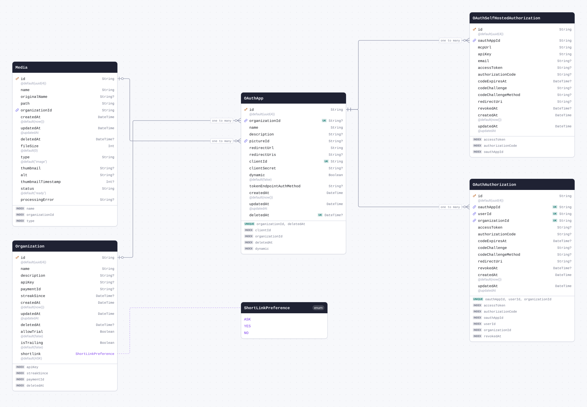

| Field                     | Type       | Constraints                                   | Default      | Description |
| ------------------------- | ---------- | --------------------------------------------- | ------------ | ----------- |
| `id`                      | `String`   | PK NOT NULL                                   | `uuid(4)`    |             |
| `organizationId`          | `String`   | NULL → [Organization.id](#model-Organization) |              |             |
| `name`                    | `String`   | NOT NULL                                      |              |             |
| `description`             | `String`   | NULL                                          |              |             |
| `pictureId`               | `String`   | NULL → [Media.id](#model-Media)               |              |             |
| `redirectUrl`             | `String`   | NOT NULL                                      |              |             |
| `redirectUris`            | `String`   | NULL                                          |              |             |
| `clientId`                | `String`   | UNIQUE NOT NULL                               |              |             |
| `clientSecret`            | `String`   | NULL                                          |              |             |
| `dynamic`                 | `Boolean`  | NOT NULL                                      | `false`      |             |
| `tokenEndpointAuthMethod` | `String`   | NULL                                          |              |             |
| `createdAt`               | `DateTime` | NOT NULL                                      | `now()`      |             |
| `updatedAt`               | `DateTime` | NOT NULL                                      | `@updatedAt` |             |
| `deletedAt`               | `DateTime` | NULL                                          |              |             |

#### Indexes

- `@@index([clientId])`
- `@@index([organizationId])`
- `@@index([deletedAt])`
- `@@index([dynamic])`
- `@@unique([organizationId, deletedAt])`

#### References

- `organizationId` → [Organization.id](#model-Organization) (many-to-one)
- `pictureId` → [Media.id](#model-Media) (many-to-one)

#### Referenced by

- `id` ← [OAuthAuthorization.oauthAppId](#model-OAuthAuthorization) (one-to-many)
- `id` ← [OAuthSelfHostedAuthorization.oauthAppId](#model-OAuthSelfHostedAuthorization) (one-to-many)

#### Definition

```sql
CREATE TABLE "OAuthApp" (
    "id" TEXT NOT NULL,
    "organizationId" TEXT,
    "name" TEXT NOT NULL,
    "description" TEXT,
    "pictureId" TEXT,
    "redirectUrl" TEXT NOT NULL,
    "redirectUris" TEXT,
    "clientId" TEXT NOT NULL,
    "clientSecret" TEXT,
    "dynamic" BOOLEAN NOT NULL DEFAULT false,
    "tokenEndpointAuthMethod" TEXT,
    "createdAt" TIMESTAMP(3) NOT NULL DEFAULT CURRENT_TIMESTAMP,
    "updatedAt" TIMESTAMP(3) NOT NULL,
    "deletedAt" TIMESTAMP(3),

    CONSTRAINT "OAuthApp_pkey" PRIMARY KEY ("id")
);

CREATE UNIQUE INDEX "OAuthApp_clientId_key" ON "OAuthApp"("clientId");

CREATE INDEX "OAuthApp_clientId_idx" ON "OAuthApp"("clientId");

CREATE INDEX "OAuthApp_organizationId_idx" ON "OAuthApp"("organizationId");

CREATE INDEX "OAuthApp_deletedAt_idx" ON "OAuthApp"("deletedAt");

CREATE INDEX "OAuthApp_dynamic_idx" ON "OAuthApp"("dynamic");

CREATE UNIQUE INDEX "OAuthApp_organizationId_deletedAt_key" ON "OAuthApp"("organizationId", "deletedAt");

ALTER TABLE "OAuthApp" ADD CONSTRAINT "OAuthApp_organizationId_fkey" FOREIGN KEY ("organizationId") REFERENCES "Organization"("id") ON DELETE SET NULL ON UPDATE CASCADE;

ALTER TABLE "OAuthApp" ADD CONSTRAINT "OAuthApp_pictureId_fkey" FOREIGN KEY ("pictureId") REFERENCES "Media"("id") ON DELETE SET NULL ON UPDATE CASCADE;
```

<details>
<summary>Queries and their SQL</summary>

**findMany**: Every row

```ts
await prisma.oAuthApp.findMany();
```

```sql
SELECT
  "public"."OAuthApp"."id",
  "public"."OAuthApp"."organizationId",
  "public"."OAuthApp"."name",
  "public"."OAuthApp"."description",
  "public"."OAuthApp"."pictureId",
  "public"."OAuthApp"."redirectUrl",
  "public"."OAuthApp"."redirectUris",
  "public"."OAuthApp"."clientId",
  "public"."OAuthApp"."clientSecret",
  "public"."OAuthApp"."dynamic",
  "public"."OAuthApp"."tokenEndpointAuthMethod",
  "public"."OAuthApp"."createdAt",
  "public"."OAuthApp"."updatedAt",
  "public"."OAuthApp"."deletedAt"
FROM
  "public"."OAuthApp"
WHERE
  1 = 1
OFFSET
  $1
-- params: ["0"]
```

**count**: How many rows there are

```ts
await prisma.oAuthApp.count();
```

```sql
SELECT
  COUNT(*) AS "_count$_all"
FROM
  (
    SELECT
      "public"."OAuthApp"."id"
    FROM
      "public"."OAuthApp"
    WHERE
      1 = 1
    OFFSET
      $1
  ) AS "sub"
-- params: ["0"]
```

**findMany**: Every row with its relations

```ts
await prisma.oAuthApp.findMany({
  include: {
    organization: true,
    picture: true,
    authorizations: true,
    selfHostedAuthorizations: true,
  },
});
```

```sql
SELECT
  "public"."OAuthApp"."id",
  "public"."OAuthApp"."organizationId",
  "public"."OAuthApp"."name",
  "public"."OAuthApp"."description",
  "public"."OAuthApp"."pictureId",
  "public"."OAuthApp"."redirectUrl",
  "public"."OAuthApp"."redirectUris",
  "public"."OAuthApp"."clientId",
  "public"."OAuthApp"."clientSecret",
  "public"."OAuthApp"."dynamic",
  "public"."OAuthApp"."tokenEndpointAuthMethod",
  "public"."OAuthApp"."createdAt",
  "public"."OAuthApp"."updatedAt",
  "public"."OAuthApp"."deletedAt"
FROM
  "public"."OAuthApp"
WHERE
  1 = 1
OFFSET
  $1
-- params: ["0"]

SELECT
  "public"."Organization"."id",
  "public"."Organization"."name",
  "public"."Organization"."description",
  "public"."Organization"."apiKey",
  "public"."Organization"."paymentId",
  "public"."Organization"."streakSince",
  "public"."Organization"."createdAt",
  "public"."Organization"."updatedAt",
  "public"."Organization"."deletedAt",
  "public"."Organization"."allowTrial",
  "public"."Organization"."isTrailing",
  "public"."Organization"."shortlink"::text
FROM
  "public"."Organization"
WHERE
  "public"."Organization"."id" IN ($1)
OFFSET
  $2
-- params: ["<organizationId of the rows above>","0"]

SELECT
  "public"."Media"."id",
  "public"."Media"."name",
  "public"."Media"."originalName",
  "public"."Media"."path",
  "public"."Media"."organizationId",
  "public"."Media"."createdAt",
  "public"."Media"."updatedAt",
  "public"."Media"."deletedAt",
  "public"."Media"."fileSize",
  "public"."Media"."type",
  "public"."Media"."thumbnail",
  "public"."Media"."alt",
  "public"."Media"."thumbnailTimestamp",
  "public"."Media"."status",
  "public"."Media"."processingError"
FROM
  "public"."Media"
WHERE
  "public"."Media"."id" IN ($1)
OFFSET
  $2
-- params: ["<pictureId of the rows above>","0"]

SELECT
  "public"."OAuthAuthorization"."id",
  "public"."OAuthAuthorization"."oauthAppId",
  "public"."OAuthAuthorization"."userId",
  "public"."OAuthAuthorization"."organizationId",
  "public"."OAuthAuthorization"."accessToken",
  "public"."OAuthAuthorization"."authorizationCode",
  "public"."OAuthAuthorization"."codeExpiresAt",
  "public"."OAuthAuthorization"."codeChallenge",
  "public"."OAuthAuthorization"."codeChallengeMethod",
  "public"."OAuthAuthorization"."redirectUri",
  "public"."OAuthAuthorization"."revokedAt",
  "public"."OAuthAuthorization"."createdAt",
  "public"."OAuthAuthorization"."updatedAt"
FROM
  "public"."OAuthAuthorization"
WHERE
  "public"."OAuthAuthorization"."oauthAppId" IN ($1)
OFFSET
  $2
-- params: ["<id of the rows above>","0"]

SELECT
  "public"."OAuthSelfHostedAuthorization"."id",
  "public"."OAuthSelfHostedAuthorization"."oauthAppId",
  "public"."OAuthSelfHostedAuthorization"."mcpUrl",
  "public"."OAuthSelfHostedAuthorization"."apiKey",
  "public"."OAuthSelfHostedAuthorization"."email",
  "public"."OAuthSelfHostedAuthorization"."accessToken",
  "public"."OAuthSelfHostedAuthorization"."authorizationCode",
  "public"."OAuthSelfHostedAuthorization"."codeExpiresAt",
  "public"."OAuthSelfHostedAuthorization"."codeChallenge",
  "public"."OAuthSelfHostedAuthorization"."codeChallengeMethod",
  "public"."OAuthSelfHostedAuthorization"."redirectUri",
  "public"."OAuthSelfHostedAuthorization"."revokedAt",
  "public"."OAuthSelfHostedAuthorization"."createdAt",
  "public"."OAuthSelfHostedAuthorization"."updatedAt"
FROM
  "public"."OAuthSelfHostedAuthorization"
WHERE
  "public"."OAuthSelfHostedAuthorization"."oauthAppId" IN ($1)
OFFSET
  $2
-- params: ["<id of the rows above>","0"]
```

**findUnique**: One row by what is unique to it

```ts
await prisma.oAuthApp.findUnique({ where: { id: "example" } });
```

```sql
SELECT
  "public"."OAuthApp"."id",
  "public"."OAuthApp"."organizationId",
  "public"."OAuthApp"."name",
  "public"."OAuthApp"."description",
  "public"."OAuthApp"."pictureId",
  "public"."OAuthApp"."redirectUrl",
  "public"."OAuthApp"."redirectUris",
  "public"."OAuthApp"."clientId",
  "public"."OAuthApp"."clientSecret",
  "public"."OAuthApp"."dynamic",
  "public"."OAuthApp"."tokenEndpointAuthMethod",
  "public"."OAuthApp"."createdAt",
  "public"."OAuthApp"."updatedAt",
  "public"."OAuthApp"."deletedAt"
FROM
  "public"."OAuthApp"
WHERE
  (
    "public"."OAuthApp"."id" = $1
    AND 1 = 1
  )
LIMIT
  $2
OFFSET
  $3
-- params: ["example","1","0"]
```

**create**: Create a row

```ts
await prisma.oAuthApp.create({
  data: { name: "example", redirectUrl: "example", clientId: "example" },
});
```

```sql
INSERT INTO
  "public"."OAuthApp" (
    "id",
    "name",
    "redirectUrl",
    "clientId",
    "dynamic",
    "createdAt",
    "updatedAt"
  )
VALUES
  ($1, $2, $3, $4, $5, $6, $7)
RETURNING
  "public"."OAuthApp"."id",
  "public"."OAuthApp"."organizationId",
  "public"."OAuthApp"."name",
  "public"."OAuthApp"."description",
  "public"."OAuthApp"."pictureId",
  "public"."OAuthApp"."redirectUrl",
  "public"."OAuthApp"."redirectUris",
  "public"."OAuthApp"."clientId",
  "public"."OAuthApp"."clientSecret",
  "public"."OAuthApp"."dynamic",
  "public"."OAuthApp"."tokenEndpointAuthMethod",
  "public"."OAuthApp"."createdAt",
  "public"."OAuthApp"."updatedAt",
  "public"."OAuthApp"."deletedAt"
-- params: ["<uuid(4)>","example","example","example",false,"<now()>","<now()>"]
```

**update**: Update a row

```ts
await prisma.oAuthApp.update({ where: { id: "example" }, data: { name: "example" } });
```

```sql
UPDATE "public"."OAuthApp"
SET
  "name" = $1,
  "updatedAt" = $2
WHERE
  (
    "public"."OAuthApp"."id" = $3
    AND 1 = 1
  )
RETURNING
  "public"."OAuthApp"."id",
  "public"."OAuthApp"."organizationId",
  "public"."OAuthApp"."name",
  "public"."OAuthApp"."description",
  "public"."OAuthApp"."pictureId",
  "public"."OAuthApp"."redirectUrl",
  "public"."OAuthApp"."redirectUris",
  "public"."OAuthApp"."clientId",
  "public"."OAuthApp"."clientSecret",
  "public"."OAuthApp"."dynamic",
  "public"."OAuthApp"."tokenEndpointAuthMethod",
  "public"."OAuthApp"."createdAt",
  "public"."OAuthApp"."updatedAt",
  "public"."OAuthApp"."deletedAt"
-- params: ["example",{"prisma__type":"generatorCall","prisma__value":{"name":"now","args":[],"returnType":{"type":"DateTime"}}},"example"]
```

**delete**: Delete a row

```ts
await prisma.oAuthApp.delete({ where: { id: "example" } });
```

```sql
DELETE FROM "public"."OAuthApp"
WHERE
  (
    "public"."OAuthApp"."id" = $1
    AND 1 = 1
  )
RETURNING
  "public"."OAuthApp"."id",
  "public"."OAuthApp"."organizationId",
  "public"."OAuthApp"."name",
  "public"."OAuthApp"."description",
  "public"."OAuthApp"."pictureId",
  "public"."OAuthApp"."redirectUrl",
  "public"."OAuthApp"."redirectUris",
  "public"."OAuthApp"."clientId",
  "public"."OAuthApp"."clientSecret",
  "public"."OAuthApp"."dynamic",
  "public"."OAuthApp"."tokenEndpointAuthMethod",
  "public"."OAuthApp"."createdAt",
  "public"."OAuthApp"."updatedAt",
  "public"."OAuthApp"."deletedAt"
-- params: ["example"]
```

</details>

<a id="model-OAuthAuthorization"></a>

### OAuthAuthorization

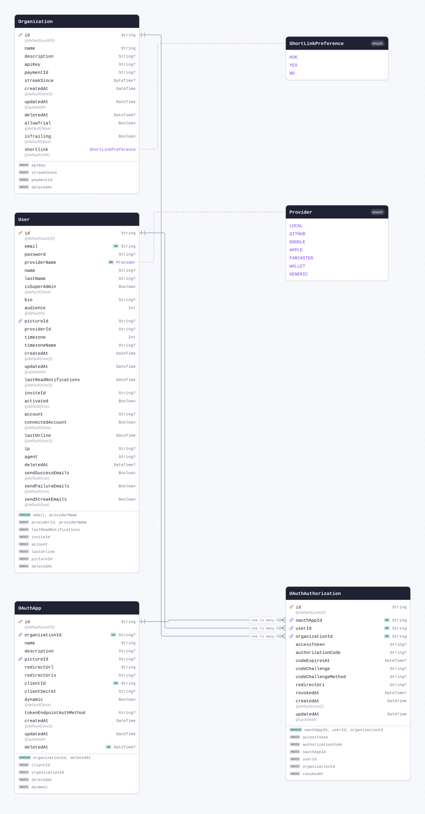

| Field                 | Type       | Constraints                                       | Default      | Description |
| --------------------- | ---------- | ------------------------------------------------- | ------------ | ----------- |
| `id`                  | `String`   | PK NOT NULL                                       | `uuid(4)`    |             |
| `oauthAppId`          | `String`   | NOT NULL → [OAuthApp.id](#model-OAuthApp)         |              |             |
| `userId`              | `String`   | NOT NULL → [User.id](#model-User)                 |              |             |
| `organizationId`      | `String`   | NOT NULL → [Organization.id](#model-Organization) |              |             |
| `accessToken`         | `String`   | NULL                                              |              |             |
| `authorizationCode`   | `String`   | NULL                                              |              |             |
| `codeExpiresAt`       | `DateTime` | NULL                                              |              |             |
| `codeChallenge`       | `String`   | NULL                                              |              |             |
| `codeChallengeMethod` | `String`   | NULL                                              |              |             |
| `redirectUri`         | `String`   | NULL                                              |              |             |
| `revokedAt`           | `DateTime` | NULL                                              |              |             |
| `createdAt`           | `DateTime` | NOT NULL                                          | `now()`      |             |
| `updatedAt`           | `DateTime` | NOT NULL                                          | `@updatedAt` |             |

#### Indexes

- `@@index([accessToken])`
- `@@index([authorizationCode])`
- `@@index([oauthAppId])`
- `@@index([userId])`
- `@@index([organizationId])`
- `@@index([revokedAt])`
- `@@unique([oauthAppId, userId, organizationId])`

#### References

- `oauthAppId` → [OAuthApp.id](#model-OAuthApp) (many-to-one)
- `userId` → [User.id](#model-User) (many-to-one)
- `organizationId` → [Organization.id](#model-Organization) (many-to-one)

#### Definition

```sql
CREATE TABLE "OAuthAuthorization" (
    "id" TEXT NOT NULL,
    "oauthAppId" TEXT NOT NULL,
    "userId" TEXT NOT NULL,
    "organizationId" TEXT NOT NULL,
    "accessToken" TEXT,
    "authorizationCode" TEXT,
    "codeExpiresAt" TIMESTAMP(3),
    "codeChallenge" TEXT,
    "codeChallengeMethod" TEXT,
    "redirectUri" TEXT,
    "revokedAt" TIMESTAMP(3),
    "createdAt" TIMESTAMP(3) NOT NULL DEFAULT CURRENT_TIMESTAMP,
    "updatedAt" TIMESTAMP(3) NOT NULL,

    CONSTRAINT "OAuthAuthorization_pkey" PRIMARY KEY ("id")
);

CREATE INDEX "OAuthAuthorization_accessToken_idx" ON "OAuthAuthorization"("accessToken");

CREATE INDEX "OAuthAuthorization_authorizationCode_idx" ON "OAuthAuthorization"("authorizationCode");

CREATE INDEX "OAuthAuthorization_oauthAppId_idx" ON "OAuthAuthorization"("oauthAppId");

CREATE INDEX "OAuthAuthorization_userId_idx" ON "OAuthAuthorization"("userId");

CREATE INDEX "OAuthAuthorization_organizationId_idx" ON "OAuthAuthorization"("organizationId");

CREATE INDEX "OAuthAuthorization_revokedAt_idx" ON "OAuthAuthorization"("revokedAt");

CREATE UNIQUE INDEX "OAuthAuthorization_oauthAppId_userId_organizationId_key" ON "OAuthAuthorization"("oauthAppId", "userId", "organizationId");

ALTER TABLE "OAuthAuthorization" ADD CONSTRAINT "OAuthAuthorization_oauthAppId_fkey" FOREIGN KEY ("oauthAppId") REFERENCES "OAuthApp"("id") ON DELETE RESTRICT ON UPDATE CASCADE;

ALTER TABLE "OAuthAuthorization" ADD CONSTRAINT "OAuthAuthorization_userId_fkey" FOREIGN KEY ("userId") REFERENCES "User"("id") ON DELETE RESTRICT ON UPDATE CASCADE;

ALTER TABLE "OAuthAuthorization" ADD CONSTRAINT "OAuthAuthorization_organizationId_fkey" FOREIGN KEY ("organizationId") REFERENCES "Organization"("id") ON DELETE RESTRICT ON UPDATE CASCADE;
```

<details>
<summary>Queries and their SQL</summary>

**findMany**: Every row

```ts
await prisma.oAuthAuthorization.findMany();
```

```sql
SELECT
  "public"."OAuthAuthorization"."id",
  "public"."OAuthAuthorization"."oauthAppId",
  "public"."OAuthAuthorization"."userId",
  "public"."OAuthAuthorization"."organizationId",
  "public"."OAuthAuthorization"."accessToken",
  "public"."OAuthAuthorization"."authorizationCode",
  "public"."OAuthAuthorization"."codeExpiresAt",
  "public"."OAuthAuthorization"."codeChallenge",
  "public"."OAuthAuthorization"."codeChallengeMethod",
  "public"."OAuthAuthorization"."redirectUri",
  "public"."OAuthAuthorization"."revokedAt",
  "public"."OAuthAuthorization"."createdAt",
  "public"."OAuthAuthorization"."updatedAt"
FROM
  "public"."OAuthAuthorization"
WHERE
  1 = 1
OFFSET
  $1
-- params: ["0"]
```

**count**: How many rows there are

```ts
await prisma.oAuthAuthorization.count();
```

```sql
SELECT
  COUNT(*) AS "_count$_all"
FROM
  (
    SELECT
      "public"."OAuthAuthorization"."id"
    FROM
      "public"."OAuthAuthorization"
    WHERE
      1 = 1
    OFFSET
      $1
  ) AS "sub"
-- params: ["0"]
```

**findMany**: Every row with its relations

```ts
await prisma.oAuthAuthorization.findMany({
  include: { oauthApp: true, user: true, organization: true },
});
```

```sql
SELECT
  "public"."OAuthAuthorization"."id",
  "public"."OAuthAuthorization"."oauthAppId",
  "public"."OAuthAuthorization"."userId",
  "public"."OAuthAuthorization"."organizationId",
  "public"."OAuthAuthorization"."accessToken",
  "public"."OAuthAuthorization"."authorizationCode",
  "public"."OAuthAuthorization"."codeExpiresAt",
  "public"."OAuthAuthorization"."codeChallenge",
  "public"."OAuthAuthorization"."codeChallengeMethod",
  "public"."OAuthAuthorization"."redirectUri",
  "public"."OAuthAuthorization"."revokedAt",
  "public"."OAuthAuthorization"."createdAt",
  "public"."OAuthAuthorization"."updatedAt"
FROM
  "public"."OAuthAuthorization"
WHERE
  1 = 1
OFFSET
  $1
-- params: ["0"]

SELECT
  "public"."OAuthApp"."id",
  "public"."OAuthApp"."organizationId",
  "public"."OAuthApp"."name",
  "public"."OAuthApp"."description",
  "public"."OAuthApp"."pictureId",
  "public"."OAuthApp"."redirectUrl",
  "public"."OAuthApp"."redirectUris",
  "public"."OAuthApp"."clientId",
  "public"."OAuthApp"."clientSecret",
  "public"."OAuthApp"."dynamic",
  "public"."OAuthApp"."tokenEndpointAuthMethod",
  "public"."OAuthApp"."createdAt",
  "public"."OAuthApp"."updatedAt",
  "public"."OAuthApp"."deletedAt"
FROM
  "public"."OAuthApp"
WHERE
  "public"."OAuthApp"."id" IN ($1)
OFFSET
  $2
-- params: ["<oauthAppId of the rows above>","0"]

SELECT
  "public"."User"."id",
  "public"."User"."email",
  "public"."User"."password",
  "public"."User"."providerName"::text,
  "public"."User"."name",
  "public"."User"."lastName",
  "public"."User"."isSuperAdmin",
  "public"."User"."bio",
  "public"."User"."audience",
  "public"."User"."pictureId",
  "public"."User"."providerId",
  "public"."User"."timezone",
  "public"."User"."timezoneName",
  "public"."User"."createdAt",
  "public"."User"."updatedAt",
  "public"."User"."lastReadNotifications",
  "public"."User"."inviteId",
  "public"."User"."activated",
  "public"."User"."account",
  "public"."User"."connectedAccount",
  "public"."User"."lastOnline",
  "public"."User"."ip",
  "public"."User"."agent",
  "public"."User"."deletedAt",
  "public"."User"."sendSuccessEmails",
  "public"."User"."sendFailureEmails",
  "public"."User"."sendStreakEmails"
FROM
  "public"."User"
WHERE
  "public"."User"."id" IN ($1)
OFFSET
  $2
-- params: ["<userId of the rows above>","0"]

SELECT
  "public"."Organization"."id",
  "public"."Organization"."name",
  "public"."Organization"."description",
  "public"."Organization"."apiKey",
  "public"."Organization"."paymentId",
  "public"."Organization"."streakSince",
  "public"."Organization"."createdAt",
  "public"."Organization"."updatedAt",
  "public"."Organization"."deletedAt",
  "public"."Organization"."allowTrial",
  "public"."Organization"."isTrailing",
  "public"."Organization"."shortlink"::text
FROM
  "public"."Organization"
WHERE
  "public"."Organization"."id" IN ($1)
OFFSET
  $2
-- params: ["<organizationId of the rows above>","0"]
```

**findUnique**: One row by what is unique to it

```ts
await prisma.oAuthAuthorization.findUnique({ where: { id: "example" } });
```

```sql
SELECT
  "public"."OAuthAuthorization"."id",
  "public"."OAuthAuthorization"."oauthAppId",
  "public"."OAuthAuthorization"."userId",
  "public"."OAuthAuthorization"."organizationId",
  "public"."OAuthAuthorization"."accessToken",
  "public"."OAuthAuthorization"."authorizationCode",
  "public"."OAuthAuthorization"."codeExpiresAt",
  "public"."OAuthAuthorization"."codeChallenge",
  "public"."OAuthAuthorization"."codeChallengeMethod",
  "public"."OAuthAuthorization"."redirectUri",
  "public"."OAuthAuthorization"."revokedAt",
  "public"."OAuthAuthorization"."createdAt",
  "public"."OAuthAuthorization"."updatedAt"
FROM
  "public"."OAuthAuthorization"
WHERE
  (
    "public"."OAuthAuthorization"."id" = $1
    AND 1 = 1
  )
LIMIT
  $2
OFFSET
  $3
-- params: ["example","1","0"]
```

**create**: Create a row

```ts
await prisma.oAuthAuthorization.create({
  data: { oauthAppId: "example", userId: "example", organizationId: "example" },
});
```

```sql
INSERT INTO
  "public"."OAuthAuthorization" (
    "id",
    "oauthAppId",
    "userId",
    "organizationId",
    "createdAt",
    "updatedAt"
  )
VALUES
  ($1, $2, $3, $4, $5, $6)
RETURNING
  "public"."OAuthAuthorization"."id",
  "public"."OAuthAuthorization"."oauthAppId",
  "public"."OAuthAuthorization"."userId",
  "public"."OAuthAuthorization"."organizationId",
  "public"."OAuthAuthorization"."accessToken",
  "public"."OAuthAuthorization"."authorizationCode",
  "public"."OAuthAuthorization"."codeExpiresAt",
  "public"."OAuthAuthorization"."codeChallenge",
  "public"."OAuthAuthorization"."codeChallengeMethod",
  "public"."OAuthAuthorization"."redirectUri",
  "public"."OAuthAuthorization"."revokedAt",
  "public"."OAuthAuthorization"."createdAt",
  "public"."OAuthAuthorization"."updatedAt"
-- params: ["<uuid(4)>","example","example","example","<now()>","<now()>"]
```

**update**: Update a row

```ts
await prisma.oAuthAuthorization.update({
  where: { id: "example" },
  data: { accessToken: "example" },
});
```

```sql
UPDATE "public"."OAuthAuthorization"
SET
  "accessToken" = $1,
  "updatedAt" = $2
WHERE
  (
    "public"."OAuthAuthorization"."id" = $3
    AND 1 = 1
  )
RETURNING
  "public"."OAuthAuthorization"."id",
  "public"."OAuthAuthorization"."oauthAppId",
  "public"."OAuthAuthorization"."userId",
  "public"."OAuthAuthorization"."organizationId",
  "public"."OAuthAuthorization"."accessToken",
  "public"."OAuthAuthorization"."authorizationCode",
  "public"."OAuthAuthorization"."codeExpiresAt",
  "public"."OAuthAuthorization"."codeChallenge",
  "public"."OAuthAuthorization"."codeChallengeMethod",
  "public"."OAuthAuthorization"."redirectUri",
  "public"."OAuthAuthorization"."revokedAt",
  "public"."OAuthAuthorization"."createdAt",
  "public"."OAuthAuthorization"."updatedAt"
-- params: ["example",{"prisma__type":"generatorCall","prisma__value":{"name":"now","args":[],"returnType":{"type":"DateTime"}}},"example"]
```

**delete**: Delete a row

```ts
await prisma.oAuthAuthorization.delete({ where: { id: "example" } });
```

```sql
DELETE FROM "public"."OAuthAuthorization"
WHERE
  (
    "public"."OAuthAuthorization"."id" = $1
    AND 1 = 1
  )
RETURNING
  "public"."OAuthAuthorization"."id",
  "public"."OAuthAuthorization"."oauthAppId",
  "public"."OAuthAuthorization"."userId",
  "public"."OAuthAuthorization"."organizationId",
  "public"."OAuthAuthorization"."accessToken",
  "public"."OAuthAuthorization"."authorizationCode",
  "public"."OAuthAuthorization"."codeExpiresAt",
  "public"."OAuthAuthorization"."codeChallenge",
  "public"."OAuthAuthorization"."codeChallengeMethod",
  "public"."OAuthAuthorization"."redirectUri",
  "public"."OAuthAuthorization"."revokedAt",
  "public"."OAuthAuthorization"."createdAt",
  "public"."OAuthAuthorization"."updatedAt"
-- params: ["example"]
```

</details>

<a id="model-OAuthSelfHostedAuthorization"></a>

### OAuthSelfHostedAuthorization

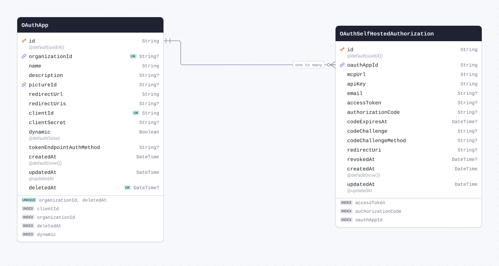

| Field                 | Type       | Constraints                               | Default      | Description |
| --------------------- | ---------- | ----------------------------------------- | ------------ | ----------- |
| `id`                  | `String`   | PK NOT NULL                               | `uuid(4)`    |             |
| `oauthAppId`          | `String`   | NOT NULL → [OAuthApp.id](#model-OAuthApp) |              |             |
| `mcpUrl`              | `String`   | NOT NULL                                  |              |             |
| `apiKey`              | `String`   | NOT NULL                                  |              |             |
| `email`               | `String`   | NULL                                      |              |             |
| `accessToken`         | `String`   | NULL                                      |              |             |
| `authorizationCode`   | `String`   | NULL                                      |              |             |
| `codeExpiresAt`       | `DateTime` | NULL                                      |              |             |
| `codeChallenge`       | `String`   | NULL                                      |              |             |
| `codeChallengeMethod` | `String`   | NULL                                      |              |             |
| `redirectUri`         | `String`   | NULL                                      |              |             |
| `revokedAt`           | `DateTime` | NULL                                      |              |             |
| `createdAt`           | `DateTime` | NOT NULL                                  | `now()`      |             |
| `updatedAt`           | `DateTime` | NOT NULL                                  | `@updatedAt` |             |

#### Indexes

- `@@index([accessToken])`
- `@@index([authorizationCode])`
- `@@index([oauthAppId])`

#### References

- `oauthAppId` → [OAuthApp.id](#model-OAuthApp) (many-to-one)

#### Definition

```sql
CREATE TABLE "OAuthSelfHostedAuthorization" (
    "id" TEXT NOT NULL,
    "oauthAppId" TEXT NOT NULL,
    "mcpUrl" TEXT NOT NULL,
    "apiKey" TEXT NOT NULL,
    "email" TEXT,
    "accessToken" TEXT,
    "authorizationCode" TEXT,
    "codeExpiresAt" TIMESTAMP(3),
    "codeChallenge" TEXT,
    "codeChallengeMethod" TEXT,
    "redirectUri" TEXT,
    "revokedAt" TIMESTAMP(3),
    "createdAt" TIMESTAMP(3) NOT NULL DEFAULT CURRENT_TIMESTAMP,
    "updatedAt" TIMESTAMP(3) NOT NULL,

    CONSTRAINT "OAuthSelfHostedAuthorization_pkey" PRIMARY KEY ("id")
);

CREATE INDEX "OAuthSelfHostedAuthorization_accessToken_idx" ON "OAuthSelfHostedAuthorization"("accessToken");

CREATE INDEX "OAuthSelfHostedAuthorization_authorizationCode_idx" ON "OAuthSelfHostedAuthorization"("authorizationCode");

CREATE INDEX "OAuthSelfHostedAuthorization_oauthAppId_idx" ON "OAuthSelfHostedAuthorization"("oauthAppId");

ALTER TABLE "OAuthSelfHostedAuthorization" ADD CONSTRAINT "OAuthSelfHostedAuthorization_oauthAppId_fkey" FOREIGN KEY ("oauthAppId") REFERENCES "OAuthApp"("id") ON DELETE RESTRICT ON UPDATE CASCADE;
```

<details>
<summary>Queries and their SQL</summary>

**findMany**: Every row

```ts
await prisma.oAuthSelfHostedAuthorization.findMany();
```

```sql
SELECT
  "public"."OAuthSelfHostedAuthorization"."id",
  "public"."OAuthSelfHostedAuthorization"."oauthAppId",
  "public"."OAuthSelfHostedAuthorization"."mcpUrl",
  "public"."OAuthSelfHostedAuthorization"."apiKey",
  "public"."OAuthSelfHostedAuthorization"."email",
  "public"."OAuthSelfHostedAuthorization"."accessToken",
  "public"."OAuthSelfHostedAuthorization"."authorizationCode",
  "public"."OAuthSelfHostedAuthorization"."codeExpiresAt",
  "public"."OAuthSelfHostedAuthorization"."codeChallenge",
  "public"."OAuthSelfHostedAuthorization"."codeChallengeMethod",
  "public"."OAuthSelfHostedAuthorization"."redirectUri",
  "public"."OAuthSelfHostedAuthorization"."revokedAt",
  "public"."OAuthSelfHostedAuthorization"."createdAt",
  "public"."OAuthSelfHostedAuthorization"."updatedAt"
FROM
  "public"."OAuthSelfHostedAuthorization"
WHERE
  1 = 1
OFFSET
  $1
-- params: ["0"]
```

**count**: How many rows there are

```ts
await prisma.oAuthSelfHostedAuthorization.count();
```

```sql
SELECT
  COUNT(*) AS "_count$_all"
FROM
  (
    SELECT
      "public"."OAuthSelfHostedAuthorization"."id"
    FROM
      "public"."OAuthSelfHostedAuthorization"
    WHERE
      1 = 1
    OFFSET
      $1
  ) AS "sub"
-- params: ["0"]
```

**findMany**: Every row with its relations

```ts
await prisma.oAuthSelfHostedAuthorization.findMany({ include: { oauthApp: true } });
```

```sql
SELECT
  "public"."OAuthSelfHostedAuthorization"."id",
  "public"."OAuthSelfHostedAuthorization"."oauthAppId",
  "public"."OAuthSelfHostedAuthorization"."mcpUrl",
  "public"."OAuthSelfHostedAuthorization"."apiKey",
  "public"."OAuthSelfHostedAuthorization"."email",
  "public"."OAuthSelfHostedAuthorization"."accessToken",
  "public"."OAuthSelfHostedAuthorization"."authorizationCode",
  "public"."OAuthSelfHostedAuthorization"."codeExpiresAt",
  "public"."OAuthSelfHostedAuthorization"."codeChallenge",
  "public"."OAuthSelfHostedAuthorization"."codeChallengeMethod",
  "public"."OAuthSelfHostedAuthorization"."redirectUri",
  "public"."OAuthSelfHostedAuthorization"."revokedAt",
  "public"."OAuthSelfHostedAuthorization"."createdAt",
  "public"."OAuthSelfHostedAuthorization"."updatedAt"
FROM
  "public"."OAuthSelfHostedAuthorization"
WHERE
  1 = 1
OFFSET
  $1
-- params: ["0"]

SELECT
  "public"."OAuthApp"."id",
  "public"."OAuthApp"."organizationId",
  "public"."OAuthApp"."name",
  "public"."OAuthApp"."description",
  "public"."OAuthApp"."pictureId",
  "public"."OAuthApp"."redirectUrl",
  "public"."OAuthApp"."redirectUris",
  "public"."OAuthApp"."clientId",
  "public"."OAuthApp"."clientSecret",
  "public"."OAuthApp"."dynamic",
  "public"."OAuthApp"."tokenEndpointAuthMethod",
  "public"."OAuthApp"."createdAt",
  "public"."OAuthApp"."updatedAt",
  "public"."OAuthApp"."deletedAt"
FROM
  "public"."OAuthApp"
WHERE
  "public"."OAuthApp"."id" IN ($1)
OFFSET
  $2
-- params: ["<oauthAppId of the rows above>","0"]
```

**findUnique**: One row by what is unique to it

```ts
await prisma.oAuthSelfHostedAuthorization.findUnique({ where: { id: "example" } });
```

```sql
SELECT
  "public"."OAuthSelfHostedAuthorization"."id",
  "public"."OAuthSelfHostedAuthorization"."oauthAppId",
  "public"."OAuthSelfHostedAuthorization"."mcpUrl",
  "public"."OAuthSelfHostedAuthorization"."apiKey",
  "public"."OAuthSelfHostedAuthorization"."email",
  "public"."OAuthSelfHostedAuthorization"."accessToken",
  "public"."OAuthSelfHostedAuthorization"."authorizationCode",
  "public"."OAuthSelfHostedAuthorization"."codeExpiresAt",
  "public"."OAuthSelfHostedAuthorization"."codeChallenge",
  "public"."OAuthSelfHostedAuthorization"."codeChallengeMethod",
  "public"."OAuthSelfHostedAuthorization"."redirectUri",
  "public"."OAuthSelfHostedAuthorization"."revokedAt",
  "public"."OAuthSelfHostedAuthorization"."createdAt",
  "public"."OAuthSelfHostedAuthorization"."updatedAt"
FROM
  "public"."OAuthSelfHostedAuthorization"
WHERE
  (
    "public"."OAuthSelfHostedAuthorization"."id" = $1
    AND 1 = 1
  )
LIMIT
  $2
OFFSET
  $3
-- params: ["example","1","0"]
```

**create**: Create a row

```ts
await prisma.oAuthSelfHostedAuthorization.create({
  data: { oauthAppId: "example", mcpUrl: "example", apiKey: "example" },
});
```

```sql
INSERT INTO
  "public"."OAuthSelfHostedAuthorization" (
    "id",
    "oauthAppId",
    "mcpUrl",
    "apiKey",
    "createdAt",
    "updatedAt"
  )
VALUES
  ($1, $2, $3, $4, $5, $6)
RETURNING
  "public"."OAuthSelfHostedAuthorization"."id",
  "public"."OAuthSelfHostedAuthorization"."oauthAppId",
  "public"."OAuthSelfHostedAuthorization"."mcpUrl",
  "public"."OAuthSelfHostedAuthorization"."apiKey",
  "public"."OAuthSelfHostedAuthorization"."email",
  "public"."OAuthSelfHostedAuthorization"."accessToken",
  "public"."OAuthSelfHostedAuthorization"."authorizationCode",
  "public"."OAuthSelfHostedAuthorization"."codeExpiresAt",
  "public"."OAuthSelfHostedAuthorization"."codeChallenge",
  "public"."OAuthSelfHostedAuthorization"."codeChallengeMethod",
  "public"."OAuthSelfHostedAuthorization"."redirectUri",
  "public"."OAuthSelfHostedAuthorization"."revokedAt",
  "public"."OAuthSelfHostedAuthorization"."createdAt",
  "public"."OAuthSelfHostedAuthorization"."updatedAt"
-- params: ["<uuid(4)>","example","example","example","<now()>","<now()>"]
```

**update**: Update a row

```ts
await prisma.oAuthSelfHostedAuthorization.update({
  where: { id: "example" },
  data: { mcpUrl: "example" },
});
```

```sql
UPDATE "public"."OAuthSelfHostedAuthorization"
SET
  "mcpUrl" = $1,
  "updatedAt" = $2
WHERE
  (
    "public"."OAuthSelfHostedAuthorization"."id" = $3
    AND 1 = 1
  )
RETURNING
  "public"."OAuthSelfHostedAuthorization"."id",
  "public"."OAuthSelfHostedAuthorization"."oauthAppId",
  "public"."OAuthSelfHostedAuthorization"."mcpUrl",
  "public"."OAuthSelfHostedAuthorization"."apiKey",
  "public"."OAuthSelfHostedAuthorization"."email",
  "public"."OAuthSelfHostedAuthorization"."accessToken",
  "public"."OAuthSelfHostedAuthorization"."authorizationCode",
  "public"."OAuthSelfHostedAuthorization"."codeExpiresAt",
  "public"."OAuthSelfHostedAuthorization"."codeChallenge",
  "public"."OAuthSelfHostedAuthorization"."codeChallengeMethod",
  "public"."OAuthSelfHostedAuthorization"."redirectUri",
  "public"."OAuthSelfHostedAuthorization"."revokedAt",
  "public"."OAuthSelfHostedAuthorization"."createdAt",
  "public"."OAuthSelfHostedAuthorization"."updatedAt"
-- params: ["example",{"prisma__type":"generatorCall","prisma__value":{"name":"now","args":[],"returnType":{"type":"DateTime"}}},"example"]
```

**delete**: Delete a row

```ts
await prisma.oAuthSelfHostedAuthorization.delete({ where: { id: "example" } });
```

```sql
DELETE FROM "public"."OAuthSelfHostedAuthorization"
WHERE
  (
    "public"."OAuthSelfHostedAuthorization"."id" = $1
    AND 1 = 1
  )
RETURNING
  "public"."OAuthSelfHostedAuthorization"."id",
  "public"."OAuthSelfHostedAuthorization"."oauthAppId",
  "public"."OAuthSelfHostedAuthorization"."mcpUrl",
  "public"."OAuthSelfHostedAuthorization"."apiKey",
  "public"."OAuthSelfHostedAuthorization"."email",
  "public"."OAuthSelfHostedAuthorization"."accessToken",
  "public"."OAuthSelfHostedAuthorization"."authorizationCode",
  "public"."OAuthSelfHostedAuthorization"."codeExpiresAt",
  "public"."OAuthSelfHostedAuthorization"."codeChallenge",
  "public"."OAuthSelfHostedAuthorization"."codeChallengeMethod",
  "public"."OAuthSelfHostedAuthorization"."redirectUri",
  "public"."OAuthSelfHostedAuthorization"."revokedAt",
  "public"."OAuthSelfHostedAuthorization"."createdAt",
  "public"."OAuthSelfHostedAuthorization"."updatedAt"
-- params: ["example"]
```

</details>

<a id="model-Announcement"></a>

### Announcement

| Field         | Type                                           | Constraints | Default   | Description |
| ------------- | ---------------------------------------------- | ----------- | --------- | ----------- |
| `id`          | `String`                                       | PK NOT NULL | `uuid(4)` |             |
| `title`       | `String`                                       | NOT NULL    |           |             |
| `description` | `String`                                       | NOT NULL    |           |             |
| `color`       | [`AnnouncementColor`](#enum-AnnouncementColor) | NOT NULL    | `INFO`    |             |
| `createdAt`   | `DateTime`                                     | NOT NULL    | `now()`   |             |

#### Definition

```sql
CREATE TABLE "Announcement" (
    "id" TEXT NOT NULL,
    "title" TEXT NOT NULL,
    "description" TEXT NOT NULL,
    "color" "AnnouncementColor" NOT NULL DEFAULT 'INFO',
    "createdAt" TIMESTAMP(3) NOT NULL DEFAULT CURRENT_TIMESTAMP,

    CONSTRAINT "Announcement_pkey" PRIMARY KEY ("id")
);
```

<details>
<summary>Queries and their SQL</summary>

**findMany**: Every row

```ts
await prisma.announcement.findMany();
```

```sql
SELECT
  "public"."Announcement"."id",
  "public"."Announcement"."title",
  "public"."Announcement"."description",
  "public"."Announcement"."color"::text,
  "public"."Announcement"."createdAt"
FROM
  "public"."Announcement"
WHERE
  1 = 1
OFFSET
  $1
-- params: ["0"]
```

**count**: How many rows there are

```ts
await prisma.announcement.count();
```

```sql
SELECT
  COUNT(*) AS "_count$_all"
FROM
  (
    SELECT
      "public"."Announcement"."id"
    FROM
      "public"."Announcement"
    WHERE
      1 = 1
    OFFSET
      $1
  ) AS "sub"
-- params: ["0"]
```

**findUnique**: One row by what is unique to it

```ts
await prisma.announcement.findUnique({ where: { id: "example" } });
```

```sql
SELECT
  "public"."Announcement"."id",
  "public"."Announcement"."title",
  "public"."Announcement"."description",
  "public"."Announcement"."color"::text,
  "public"."Announcement"."createdAt"
FROM
  "public"."Announcement"
WHERE
  (
    "public"."Announcement"."id" = $1
    AND 1 = 1
  )
LIMIT
  $2
OFFSET
  $3
-- params: ["example","1","0"]
```

**create**: Create a row

```ts
await prisma.announcement.create({ data: { title: "example", description: "example" } });
```

```sql
INSERT INTO
  "public"."Announcement" (
    "id",
    "title",
    "description",
    "color",
    "createdAt"
  )
VALUES
  (
    $1,
    $2,
    $3,
    CAST($4::text AS "public"."AnnouncementColor"),
    $5
  )
RETURNING
  "public"."Announcement"."id",
  "public"."Announcement"."title",
  "public"."Announcement"."description",
  "public"."Announcement"."color"::text,
  "public"."Announcement"."createdAt"
-- params: ["<uuid(4)>","example","example","INFO","<now()>"]
```

**update**: Update a row

```ts
await prisma.announcement.update({ where: { id: "example" }, data: { title: "example" } });
```

```sql
UPDATE "public"."Announcement"
SET
  "title" = $1
WHERE
  (
    "public"."Announcement"."id" = $2
    AND 1 = 1
  )
RETURNING
  "public"."Announcement"."id",
  "public"."Announcement"."title",
  "public"."Announcement"."description",
  "public"."Announcement"."color"::text,
  "public"."Announcement"."createdAt"
-- params: ["example","example"]
```

**delete**: Delete a row

```ts
await prisma.announcement.delete({ where: { id: "example" } });
```

```sql
DELETE FROM "public"."Announcement"
WHERE
  (
    "public"."Announcement"."id" = $1
    AND 1 = 1
  )
RETURNING
  "public"."Announcement"."id",
  "public"."Announcement"."title",
  "public"."Announcement"."description",
  "public"."Announcement"."color"::text,
  "public"."Announcement"."createdAt"
-- params: ["example"]
```

</details>

## Enums

<a id="enum-OrderStatus"></a>

### OrderStatus

- `PENDING`
- `ACCEPTED`
- `CANCELED`
- `COMPLETED`

#### Definition

```sql
CREATE TYPE "OrderStatus" AS ENUM ('PENDING', 'ACCEPTED', 'CANCELED', 'COMPLETED');
```

<a id="enum-From"></a>

### From

- `BUYER`
- `SELLER`

#### Definition

```sql
CREATE TYPE "From" AS ENUM ('BUYER', 'SELLER');
```

<a id="enum-State"></a>

### State

- `QUEUE`
- `PUBLISHED`
- `ERROR`
- `DRAFT`

#### Definition

```sql
CREATE TYPE "State" AS ENUM ('QUEUE', 'PUBLISHED', 'ERROR', 'DRAFT');
```

<a id="enum-SubscriptionTier"></a>

### SubscriptionTier

- `STANDARD`
- `PRO`
- `TEAM`
- `ULTIMATE`

#### Definition

```sql
CREATE TYPE "SubscriptionTier" AS ENUM ('STANDARD', 'PRO', 'TEAM', 'ULTIMATE');
```

<a id="enum-Period"></a>

### Period

- `MONTHLY`
- `YEARLY`

#### Definition

```sql
CREATE TYPE "Period" AS ENUM ('MONTHLY', 'YEARLY');
```

<a id="enum-Provider"></a>

### Provider

- `LOCAL`
- `GITHUB`
- `GOOGLE`
- `APPLE`
- `FARCASTER`
- `WALLET`
- `GENERIC`

#### Definition

```sql
CREATE TYPE "Provider" AS ENUM ('LOCAL', 'GITHUB', 'GOOGLE', 'APPLE', 'FARCASTER', 'WALLET', 'GENERIC');
```

<a id="enum-Role"></a>

### Role

- `SUPERADMIN`
- `ADMIN`
- `USER`

#### Definition

```sql
CREATE TYPE "Role" AS ENUM ('SUPERADMIN', 'ADMIN', 'USER');
```

<a id="enum-APPROVED_SUBMIT_FOR_ORDER"></a>

### APPROVED_SUBMIT_FOR_ORDER

- `NO`
- `WAITING_CONFIRMATION`
- `YES`

#### Definition

```sql
CREATE TYPE "APPROVED_SUBMIT_FOR_ORDER" AS ENUM ('NO', 'WAITING_CONFIRMATION', 'YES');
```

<a id="enum-CreationMethod"></a>

### CreationMethod

- `UNKNOWN`
- `WEB`
- `MCP`
- `API`
- `AUTOPOST`
- `CLI`

#### Definition

```sql
CREATE TYPE "CreationMethod" AS ENUM ('UNKNOWN', 'WEB', 'MCP', 'API', 'AUTOPOST', 'CLI');
```

<a id="enum-ShortLinkPreference"></a>

### ShortLinkPreference

- `ASK`
- `YES`
- `NO`

#### Definition

```sql
CREATE TYPE "ShortLinkPreference" AS ENUM ('ASK', 'YES', 'NO');
```

<a id="enum-AnnouncementColor"></a>

### AnnouncementColor

- `INFO`
- `WARNING`
- `ERROR`

#### Definition

```sql
CREATE TYPE "AnnouncementColor" AS ENUM ('INFO', 'WARNING', 'ERROR');
```
