# Schema docs

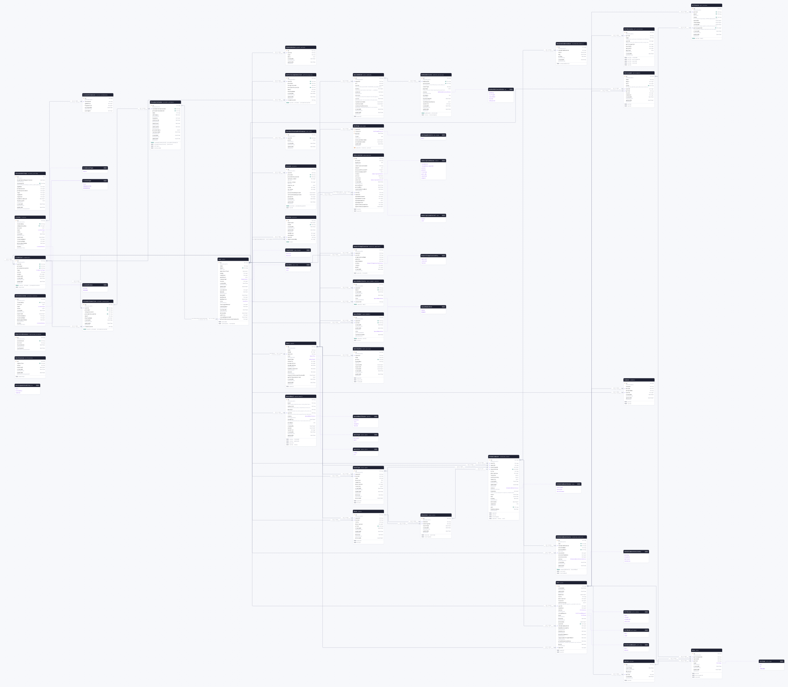

<details>
<summary>The whole schema as SQL</summary>

```sql
CREATE SCHEMA IF NOT EXISTS "public";

CREATE TYPE "api_usage_resource" AS ENUM ('poll');

CREATE TYPE "subscription_status" AS ENUM ('incomplete', 'incomplete_expired', 'active', 'paused', 'trialing', 'past_due', 'canceled', 'unpaid');

CREATE TYPE "subscription_interval" AS ENUM ('month', 'year');

CREATE TYPE "nonprofit_application_status" AS ENUM ('approved', 'rejected', 'failed');

CREATE TYPE "queued_email_status" AS ENUM ('pending', 'sent', 'skipped', 'failed');

CREATE TYPE "scheduled_event_status" AS ENUM ('confirmed', 'canceled', 'unconfirmed');

CREATE TYPE "scheduled_event_invite_status" AS ENUM ('pending', 'accepted', 'declined', 'tentative');

CREATE TYPE "CredentialType" AS ENUM ('OAUTH');

CREATE TYPE "LicenseType" AS ENUM ('PLUS', 'ORGANIZATION', 'ENTERPRISE');

CREATE TYPE "LicenseStatus" AS ENUM ('ACTIVE', 'REVOKED');

CREATE TYPE "participant_visibility" AS ENUM ('full', 'scoresOnly', 'limited');

CREATE TYPE "poll_status" AS ENUM ('open', 'closed', 'scheduled', 'canceled');

CREATE TYPE "poll_kind" AS ENUM ('date', 'time');

CREATE TYPE "poll_closed_reason" AS ENUM ('auto', 'manual');

CREATE TYPE "vote_type" AS ENUM ('yes', 'no', 'ifNeedBe');

CREATE TYPE "SpaceMemberRole" AS ENUM ('ADMIN', 'MEMBER');

CREATE TYPE "space_types" AS ENUM ('personal', 'work');

CREATE TYPE "space_tiers" AS ENUM ('hobby', 'pro');

CREATE TYPE "webhook_delivery_status" AS ENUM ('pending', 'in_flight', 'succeeded', 'failed', 'exhausted');

CREATE TYPE "time_format" AS ENUM ('hours12', 'hours24');

CREATE TYPE "user_role" AS ENUM ('admin', 'user');

CREATE TABLE "api_usage" (
    "space_id" TEXT NOT NULL,
    "resource" "api_usage_resource" NOT NULL,
    "period" DATE NOT NULL,
    "count" INTEGER NOT NULL DEFAULT 0,
    "near_limit_warned_at" TIMESTAMP(3),
    "at_limit_warned_at" TIMESTAMP(3),
    "updated_at" TIMESTAMP(3) NOT NULL,

    CONSTRAINT "api_usage_pkey" PRIMARY KEY ("space_id","resource","period")
);

CREATE TABLE "subscriptions" (
    "id" TEXT NOT NULL,
    "price_id" TEXT NOT NULL,
    "quantity" INTEGER NOT NULL DEFAULT 1,
    "subscription_item_id" TEXT NOT NULL,
    "amount" INTEGER NOT NULL,
    "discount_percent_off" DOUBLE PRECISION,
    "discount_amount_off" INTEGER,
    "status" "subscription_status" NOT NULL,
    "active" BOOLEAN NOT NULL,
    "currency" TEXT NOT NULL,
    "interval" "subscription_interval" NOT NULL,
    "created_at" TIMESTAMP(3) NOT NULL DEFAULT CURRENT_TIMESTAMP,
    "period_start" TIMESTAMP(3) NOT NULL,
    "period_end" TIMESTAMP(3) NOT NULL,
    "cancel_at_period_end" BOOLEAN NOT NULL DEFAULT false,
    "user_id" TEXT NOT NULL,
    "space_id" TEXT NOT NULL,
    "api_addon_item_id" TEXT,
    "api_addon_price_id" TEXT,
    "api_addon_amount" INTEGER,
    "api_addon_tier" TEXT,
    "api_poll_retained_tier" TEXT,
    "api_poll_retained_until" TIMESTAMP(3),

    CONSTRAINT "subscriptions_pkey" PRIMARY KEY ("id")
);

CREATE TABLE "payment_methods" (
    "id" TEXT NOT NULL,
    "user_id" TEXT NOT NULL,
    "type" TEXT NOT NULL,
    "data" JSONB NOT NULL,
    "created_at" TIMESTAMP(3) NOT NULL DEFAULT CURRENT_TIMESTAMP,
    "updated_at" TIMESTAMP(3) NOT NULL,

    CONSTRAINT "payment_methods_pkey" PRIMARY KEY ("id")
);

CREATE TABLE "nonprofit_applications" (
    "id" TEXT NOT NULL,
    "space_id" TEXT NOT NULL,
    "user_id" TEXT NOT NULL,
    "organization_name" TEXT NOT NULL,
    "website" TEXT NOT NULL,
    "email_domain" TEXT NOT NULL,
    "status" "nonprofit_application_status" NOT NULL,
    "reason" TEXT,
    "model" TEXT,
    "created_at" TIMESTAMP(3) NOT NULL DEFAULT CURRENT_TIMESTAMP,

    CONSTRAINT "nonprofit_applications_pkey" PRIMARY KEY ("id")
);

CREATE TABLE "queued_emails" (
    "id" TEXT NOT NULL,
    "kind" TEXT NOT NULL,
    "subject_id" TEXT NOT NULL,
    "batch_id" TEXT NOT NULL,
    "user_id" TEXT NOT NULL,
    "status" "queued_email_status" NOT NULL DEFAULT 'pending',
    "send_after" TIMESTAMP(3),
    "attempts" INTEGER NOT NULL DEFAULT 0,
    "claimed_at" TIMESTAMP(3),
    "sent_at" TIMESTAMP(3),
    "last_error" TEXT,
    "created_at" TIMESTAMP(3) NOT NULL DEFAULT CURRENT_TIMESTAMP,
    "updated_at" TIMESTAMP(3) NOT NULL,

    CONSTRAINT "queued_emails_pkey" PRIMARY KEY ("id")
);

CREATE TABLE "event_types" (
    "id" TEXT NOT NULL,
    "space_id" TEXT NOT NULL,
    "host_id" TEXT NOT NULL,
    "name" TEXT NOT NULL,
    "duration_minutes" INTEGER NOT NULL,
    "capacity" INTEGER,
    "description" TEXT,
    "location" JSONB,
    "created_at" TIMESTAMP(3) NOT NULL DEFAULT CURRENT_TIMESTAMP,
    "updated_at" TIMESTAMP(3) NOT NULL,
    "deleted" BOOLEAN NOT NULL DEFAULT false,
    "deleted_at" TIMESTAMP(3),

    CONSTRAINT "event_types_pkey" PRIMARY KEY ("id")
);

CREATE TABLE "scheduled_events" (
    "id" TEXT NOT NULL,
    "user_id" TEXT NOT NULL,
    "space_id" TEXT NOT NULL,
    "event_type_id" TEXT,
    "sheet_slot_id" TEXT,
    "title" TEXT NOT NULL,
    "description" TEXT,
    "location" JSONB,
    "conferencing" JSONB,
    "capacity" INTEGER,
    "created_at" TIMESTAMP(3) NOT NULL DEFAULT CURRENT_TIMESTAMP,
    "updated_at" TIMESTAMP(3) NOT NULL,
    "status" "scheduled_event_status" NOT NULL DEFAULT 'confirmed',
    "time_zone" TEXT,
    "start" TIMESTAMP(3) NOT NULL,
    "end" TIMESTAMP(3) NOT NULL,
    "all_day" BOOLEAN NOT NULL DEFAULT false,
    "deleted_at" TIMESTAMP(3),
    "sequence" INTEGER NOT NULL DEFAULT 0,
    "uid" TEXT NOT NULL,
    "hide_attendees" BOOLEAN NOT NULL DEFAULT false,

    CONSTRAINT "scheduled_events_pkey" PRIMARY KEY ("id")
);

CREATE TABLE "rescheduled_event_dates" (
    "id" TEXT NOT NULL,
    "scheduled_event_id" TEXT NOT NULL,
    "start" TIMESTAMP(3) NOT NULL,
    "end" TIMESTAMP(3) NOT NULL,
    "all_day" BOOLEAN NOT NULL DEFAULT false,
    "created_at" TIMESTAMP(3) NOT NULL DEFAULT CURRENT_TIMESTAMP,

    CONSTRAINT "rescheduled_event_dates_pkey" PRIMARY KEY ("id")
);

CREATE TABLE "scheduled_event_invites" (
    "id" TEXT NOT NULL,
    "uid" TEXT NOT NULL,
    "scheduled_event_id" TEXT NOT NULL,
    "invitee_name" TEXT NOT NULL,
    "invitee_email" CITEXT NOT NULL,
    "invitee_id" TEXT,
    "invitee_time_zone" TEXT,
    "invitee_locale" TEXT,
    "status" "scheduled_event_invite_status" NOT NULL DEFAULT 'pending',
    "created_at" TIMESTAMP(3) NOT NULL DEFAULT CURRENT_TIMESTAMP,
    "updated_at" TIMESTAMP(3) NOT NULL,

    CONSTRAINT "scheduled_event_invites_pkey" PRIMARY KEY ("id")
);

CREATE TABLE "instance_settings" (
    "id" INTEGER NOT NULL DEFAULT 1,
    "disable_user_registration" BOOLEAN NOT NULL DEFAULT false,
    "instance_id" UUID NOT NULL DEFAULT gen_random_uuid(),
    "app_name" TEXT,
    "primary_color" TEXT,
    "primary_color_dark" TEXT,
    "logo" TEXT,
    "logo_dark" TEXT,
    "logo_icon" TEXT,
    "hide_attribution" BOOLEAN,
    "footer_links" JSONB NOT NULL DEFAULT '[]',
    "created_at" TIMESTAMP(3) NOT NULL DEFAULT CURRENT_TIMESTAMP,
    "updated_at" TIMESTAMP(3) NOT NULL DEFAULT CURRENT_TIMESTAMP,

    CONSTRAINT "instance_settings_pkey" PRIMARY KEY ("id")
);

CREATE TABLE "credentials" (
    "id" TEXT NOT NULL,
    "user_id" TEXT NOT NULL,
    "provider" TEXT NOT NULL,
    "provider_account_id" TEXT NOT NULL,
    "type" "CredentialType" NOT NULL,
    "secret" TEXT NOT NULL,
    "scopes" TEXT[],
    "expires_at" TIMESTAMP(3),
    "created_at" TIMESTAMP(3) NOT NULL DEFAULT CURRENT_TIMESTAMP,
    "updated_at" TIMESTAMP(3) NOT NULL,

    CONSTRAINT "credentials_pkey" PRIMARY KEY ("id")
);

CREATE TABLE "calendar_connections" (
    "id" TEXT NOT NULL,
    "user_id" TEXT NOT NULL,
    "provider" TEXT NOT NULL,
    "integration_id" TEXT NOT NULL,
    "provider_account_id" TEXT NOT NULL,
    "email" TEXT NOT NULL,
    "display_name" TEXT,
    "created_at" TIMESTAMP(3) NOT NULL DEFAULT CURRENT_TIMESTAMP,
    "updated_at" TIMESTAMP(3) NOT NULL,
    "credential_id" TEXT NOT NULL,

    CONSTRAINT "calendar_connections_pkey" PRIMARY KEY ("id")
);

CREATE TABLE "provider_calendars" (
    "id" TEXT NOT NULL,
    "calendar_connection_id" TEXT NOT NULL,
    "provider_calendar_id" TEXT NOT NULL,
    "name" TEXT NOT NULL,
    "primary" BOOLEAN NOT NULL DEFAULT false,
    "time_zone" TEXT,
    "selected" BOOLEAN NOT NULL DEFAULT false,
    "deleted" BOOLEAN NOT NULL DEFAULT false,
    "writable" BOOLEAN NOT NULL DEFAULT false,
    "provider_data" JSONB,
    "last_synced_at" TIMESTAMP(3) NOT NULL DEFAULT CURRENT_TIMESTAMP,
    "created_at" TIMESTAMP(3) NOT NULL DEFAULT CURRENT_TIMESTAMP,
    "updated_at" TIMESTAMP(3) NOT NULL,

    CONSTRAINT "provider_calendars_pkey" PRIMARY KEY ("id")
);

CREATE TABLE "conferencing_connections" (
    "id" TEXT NOT NULL,
    "user_id" TEXT NOT NULL,
    "provider" TEXT NOT NULL,
    "integration_id" TEXT NOT NULL,
    "provider_account_id" TEXT NOT NULL,
    "email" TEXT NOT NULL,
    "display_name" TEXT,
    "created_at" TIMESTAMP(3) NOT NULL DEFAULT CURRENT_TIMESTAMP,
    "updated_at" TIMESTAMP(3) NOT NULL,
    "credential_id" TEXT NOT NULL,

    CONSTRAINT "conferencing_connections_pkey" PRIMARY KEY ("id")
);

CREATE TABLE "licenses" (
    "id" TEXT NOT NULL,
    "license_key" TEXT NOT NULL,
    "idempotency_key" TEXT,
    "version" INTEGER,
    "type" "LicenseType" NOT NULL,
    "seats" INTEGER,
    "issued_at" TIMESTAMP(3) NOT NULL DEFAULT CURRENT_TIMESTAMP,
    "expires_at" TIMESTAMP(3),
    "licensee_email" TEXT,
    "licensee_name" TEXT,
    "white_label_addon" BOOLEAN NOT NULL DEFAULT false,
    "status" "LicenseStatus" NOT NULL DEFAULT 'ACTIVE',

    CONSTRAINT "licenses_pkey" PRIMARY KEY ("id")
);

CREATE TABLE "license_validations" (
    "id" TEXT NOT NULL,
    "license_id" TEXT NOT NULL,
    "ip_address" TEXT,
    "fingerprint" TEXT,
    "validated_at" TIMESTAMP(3) NOT NULL DEFAULT CURRENT_TIMESTAMP,
    "user_agent" TEXT,

    CONSTRAINT "license_validations_pkey" PRIMARY KEY ("id")
);

CREATE TABLE "instance_licenses" (
    "id" TEXT NOT NULL,
    "license_key" TEXT NOT NULL,
    "version" INTEGER,
    "type" "LicenseType" NOT NULL,
    "seats" INTEGER,
    "issued_at" TIMESTAMP(3) NOT NULL DEFAULT CURRENT_TIMESTAMP,
    "expires_at" TIMESTAMP(3),
    "licensee_email" TEXT,
    "licensee_name" TEXT,
    "white_label_addon" BOOLEAN NOT NULL DEFAULT false,
    "status" "LicenseStatus" NOT NULL DEFAULT 'ACTIVE',

    CONSTRAINT "instance_licenses_pkey" PRIMARY KEY ("id")
);

CREATE TABLE "user_notification_preferences" (
    "id" TEXT NOT NULL,
    "user_id" TEXT NOT NULL,
    "prefs" JSONB NOT NULL DEFAULT '{}',
    "created_at" TIMESTAMP(3) NOT NULL DEFAULT CURRENT_TIMESTAMP,
    "updated_at" TIMESTAMP(3) NOT NULL,

    CONSTRAINT "user_notification_preferences_pkey" PRIMARY KEY ("id")
);

CREATE TABLE "polls" (
    "id" TEXT NOT NULL,
    "created_at" TIMESTAMP(3) NOT NULL DEFAULT CURRENT_TIMESTAMP,
    "updated_at" TIMESTAMP(3) NOT NULL,
    "deadline" TIMESTAMP(3),
    "title" TEXT NOT NULL,
    "description" TEXT,
    "location" TEXT,
    "conferencing" JSONB,
    "user_id" TEXT,
    "time_zone" TEXT,
    "status" "poll_status" NOT NULL DEFAULT 'open',
    "closed_reason" "poll_closed_reason",
    "kind" "poll_kind" NOT NULL DEFAULT 'date',
    "deleted" BOOLEAN NOT NULL DEFAULT false,
    "deleted_at" TIMESTAMP(3),
    "event_id" TEXT,
    "scheduled_event_id" TEXT,
    "hide_participants" BOOLEAN NOT NULL DEFAULT false,
    "hide_scores" BOOLEAN NOT NULL DEFAULT false,
    "disable_comments" BOOLEAN NOT NULL DEFAULT true,
    "require_participant_email" BOOLEAN NOT NULL DEFAULT false,
    "allow_tentative_votes" BOOLEAN NOT NULL DEFAULT true,
    "muted" BOOLEAN NOT NULL DEFAULT false,
    "space_id" TEXT,

    CONSTRAINT "polls_pkey" PRIMARY KEY ("id")
);

CREATE TABLE "participants" (
    "id" TEXT NOT NULL,
    "name" TEXT NOT NULL,
    "email" TEXT,
    "note" TEXT,
    "token" TEXT NOT NULL,
    "user_id" TEXT,
    "poll_id" TEXT NOT NULL,
    "locale" TEXT,
    "time_zone" TEXT,
    "created_at" TIMESTAMP(3) NOT NULL DEFAULT CURRENT_TIMESTAMP,
    "updated_at" TIMESTAMP(3),

    CONSTRAINT "participants_pkey" PRIMARY KEY ("id")
);

CREATE TABLE "poll_invites" (
    "id" TEXT NOT NULL,
    "poll_id" TEXT NOT NULL,
    "email" CITEXT NOT NULL,
    "token" TEXT NOT NULL,
    "opened_at" TIMESTAMP(3),
    "reminded_at" TIMESTAMP(3),
    "revoked_at" TIMESTAMP(3),
    "participant_id" TEXT,
    "created_at" TIMESTAMP(3) NOT NULL DEFAULT CURRENT_TIMESTAMP,
    "updated_at" TIMESTAMP(3) NOT NULL,

    CONSTRAINT "poll_invites_pkey" PRIMARY KEY ("id")
);

CREATE TABLE "poll_activities" (
    "id" TEXT NOT NULL,
    "poll_id" TEXT NOT NULL,
    "type" TEXT NOT NULL,
    "user_id" TEXT,
    "participant_id" TEXT,
    "invite_id" TEXT,
    "option_id" TEXT,
    "payload" JSONB NOT NULL DEFAULT '{}',
    "created_at" TIMESTAMP(3) NOT NULL DEFAULT CURRENT_TIMESTAMP,

    CONSTRAINT "poll_activities_pkey" PRIMARY KEY ("id")
);

CREATE TABLE "options" (
    "id" TEXT NOT NULL,
    "start_time" TIMESTAMP(0) NOT NULL,
    "duration_minutes" INTEGER NOT NULL DEFAULT 0,
    "poll_id" TEXT NOT NULL,
    "created_at" TIMESTAMP(3) NOT NULL DEFAULT CURRENT_TIMESTAMP,

    CONSTRAINT "options_pkey" PRIMARY KEY ("id")
);

CREATE TABLE "votes" (
    "id" TEXT NOT NULL,
    "participant_id" TEXT NOT NULL,
    "option_id" TEXT NOT NULL,
    "poll_id" TEXT NOT NULL,
    "type" "vote_type" NOT NULL DEFAULT 'yes',
    "created_at" TIMESTAMP(3) NOT NULL DEFAULT CURRENT_TIMESTAMP,
    "updated_at" TIMESTAMP(3),

    CONSTRAINT "votes_pkey" PRIMARY KEY ("id")
);

CREATE TABLE "comments" (
    "id" TEXT NOT NULL,
    "content" TEXT NOT NULL,
    "poll_id" TEXT NOT NULL,
    "author_name" TEXT NOT NULL,
    "user_id" TEXT,
    "created_at" TIMESTAMP(3) NOT NULL DEFAULT CURRENT_TIMESTAMP,
    "updated_at" TIMESTAMP(3),

    CONSTRAINT "comments_pkey" PRIMARY KEY ("id")
);

CREATE TABLE "registered_instances" (
    "id" TEXT NOT NULL,
    "instance_id" TEXT NOT NULL,
    "version" TEXT NOT NULL,
    "first_seen_at" TIMESTAMP(3) NOT NULL DEFAULT CURRENT_TIMESTAMP,
    "last_seen_at" TIMESTAMP(3) NOT NULL DEFAULT CURRENT_TIMESTAMP,

    CONSTRAINT "registered_instances_pkey" PRIMARY KEY ("id")
);

CREATE TABLE "sheets" (
    "id" TEXT NOT NULL,
    "space_id" TEXT NOT NULL,
    "host_id" TEXT NOT NULL,
    "title" TEXT NOT NULL,
    "description" TEXT,
    "url_id" TEXT NOT NULL,
    "created_at" TIMESTAMP(3) NOT NULL DEFAULT CURRENT_TIMESTAMP,
    "updated_at" TIMESTAMP(3) NOT NULL,
    "deleted" BOOLEAN NOT NULL DEFAULT false,
    "deleted_at" TIMESTAMP(3),

    CONSTRAINT "sheets_pkey" PRIMARY KEY ("id")
);

CREATE TABLE "sheet_slots" (
    "id" TEXT NOT NULL,
    "sheet_id" TEXT NOT NULL,
    "event_type_id" TEXT NOT NULL,
    "start_time" TIMESTAMP(3) NOT NULL,
    "created_at" TIMESTAMP(3) NOT NULL DEFAULT CURRENT_TIMESTAMP,
    "updated_at" TIMESTAMP(3) NOT NULL,

    CONSTRAINT "sheet_slots_pkey" PRIMARY KEY ("id")
);

CREATE TABLE "spaces" (
    "id" TEXT NOT NULL,
    "name" TEXT NOT NULL,
    "image" TEXT,
    "owner_id" TEXT NOT NULL,
    "tier" "space_tiers" NOT NULL DEFAULT 'hobby',
    "space_type" "space_types",
    "industry" TEXT,
    "primary_color" TEXT,
    "show_branding" BOOLEAN NOT NULL DEFAULT false,
    "hide_attribution" BOOLEAN NOT NULL DEFAULT false,
    "shared" BOOLEAN NOT NULL DEFAULT false,
    "nonprofit_discount_granted_at" TIMESTAMP(3),
    "api_poll_quota_override" INTEGER,
    "created_at" TIMESTAMP(3) NOT NULL DEFAULT CURRENT_TIMESTAMP,
    "updated_at" TIMESTAMP(3) NOT NULL,

    CONSTRAINT "spaces_pkey" PRIMARY KEY ("id")
);

CREATE TABLE "space_members" (
    "id" TEXT NOT NULL,
    "space_id" TEXT NOT NULL,
    "user_id" TEXT NOT NULL,
    "created_at" TIMESTAMP(3) NOT NULL DEFAULT CURRENT_TIMESTAMP,
    "updated_at" TIMESTAMP(3) NOT NULL,
    "role" "SpaceMemberRole" NOT NULL DEFAULT 'MEMBER',
    "last_selected_at" TIMESTAMP(3) NOT NULL DEFAULT CURRENT_TIMESTAMP,

    CONSTRAINT "space_members_pkey" PRIMARY KEY ("id")
);

CREATE TABLE "space_member_invites" (
    "id" TEXT NOT NULL,
    "space_id" TEXT NOT NULL,
    "email" TEXT NOT NULL,
    "created_at" TIMESTAMP(3) NOT NULL DEFAULT CURRENT_TIMESTAMP,
    "updated_at" TIMESTAMP(3) NOT NULL,
    "role" "SpaceMemberRole" NOT NULL DEFAULT 'MEMBER',
    "inviter_id" TEXT NOT NULL,

    CONSTRAINT "space_member_invites_pkey" PRIMARY KEY ("id")
);

CREATE TABLE "space_api_keys" (
    "id" TEXT NOT NULL,
    "space_id" TEXT NOT NULL,
    "name" TEXT NOT NULL,
    "prefix" TEXT NOT NULL,
    "hashed_key" TEXT NOT NULL,
    "last_used_at" TIMESTAMP(3),
    "expires_at" TIMESTAMP(3),
    "revoked_at" TIMESTAMP(3),
    "created_at" TIMESTAMP(3) NOT NULL DEFAULT CURRENT_TIMESTAMP,
    "updated_at" TIMESTAMP(3) NOT NULL,

    CONSTRAINT "space_api_keys_pkey" PRIMARY KEY ("id")
);

CREATE TABLE "space_webhooks" (
    "id" TEXT NOT NULL,
    "space_id" TEXT NOT NULL,
    "url" TEXT NOT NULL,
    "secret" TEXT NOT NULL,
    "events" TEXT[],
    "enabled" BOOLEAN NOT NULL DEFAULT true,
    "version" TEXT NOT NULL,
    "cursor" TIMESTAMP(3) NOT NULL DEFAULT CURRENT_TIMESTAMP,
    "last_delivered_at" TIMESTAMP(3),
    "last_failed_at" TIMESTAMP(3),
    "consecutive_failures" INTEGER NOT NULL DEFAULT 0,
    "created_at" TIMESTAMP(3) NOT NULL DEFAULT CURRENT_TIMESTAMP,
    "updated_at" TIMESTAMP(3) NOT NULL,

    CONSTRAINT "space_webhooks_pkey" PRIMARY KEY ("id")
);

CREATE TABLE "webhook_deliveries" (
    "id" TEXT NOT NULL,
    "webhook_id" TEXT NOT NULL,
    "activity_id" TEXT NOT NULL,
    "event_type" TEXT NOT NULL,
    "payload" JSONB NOT NULL,
    "status" "webhook_delivery_status" NOT NULL DEFAULT 'pending',
    "attempts" INTEGER NOT NULL DEFAULT 0,
    "next_attempt_at" TIMESTAMP(3) NOT NULL DEFAULT CURRENT_TIMESTAMP,
    "last_response_status" INTEGER,
    "last_error" TEXT,
    "created_at" TIMESTAMP(3) NOT NULL DEFAULT CURRENT_TIMESTAMP,
    "updated_at" TIMESTAMP(3) NOT NULL,

    CONSTRAINT "webhook_deliveries_pkey" PRIMARY KEY ("id")
);

CREATE TABLE "accounts" (
    "id" TEXT NOT NULL,
    "user_id" TEXT NOT NULL,
    "provider" TEXT NOT NULL,
    "provider_account_id" TEXT NOT NULL,
    "refresh_token" TEXT,
    "access_token" TEXT,
    "expires_at" INTEGER,
    "scope" TEXT,
    "id_token" TEXT,
    "access_token_expires_at" TIMESTAMP(3),
    "refresh_token_expires_at" TIMESTAMP(3),
    "password" TEXT,
    "created_at" TIMESTAMP(3) NOT NULL DEFAULT CURRENT_TIMESTAMP,
    "updated_at" TIMESTAMP(3) NOT NULL,

    CONSTRAINT "accounts_pkey" PRIMARY KEY ("id")
);

CREATE TABLE "users" (
    "id" TEXT NOT NULL,
    "name" TEXT NOT NULL,
    "email" CITEXT NOT NULL,
    "email_verified" BOOLEAN,
    "image" TEXT,
    "time_zone" TEXT,
    "week_start" INTEGER,
    "time_format" "time_format",
    "locale" TEXT,
    "created_at" TIMESTAMP(3) NOT NULL DEFAULT CURRENT_TIMESTAMP,
    "updated_at" TIMESTAMP(3),
    "customer_id" TEXT,
    "banned" BOOLEAN NOT NULL DEFAULT false,
    "banned_at" TIMESTAMP(3),
    "ban_reason" TEXT,
    "ban_expires" TIMESTAMP(3),
    "role" "user_role" NOT NULL DEFAULT 'user',
    "last_login_method" TEXT,
    "anonymous" BOOLEAN NOT NULL DEFAULT false,
    "last_seen_at" TIMESTAMP(3) NOT NULL DEFAULT CURRENT_TIMESTAMP,
    "deleted_at" TIMESTAMP(3),
    "job_title" TEXT,
    "review_requested_at" TIMESTAMP(3),
    "default_destination_calendar_id" TEXT,

    CONSTRAINT "users_pkey" PRIMARY KEY ("id")
);

CREATE TABLE "sessions" (
    "id" TEXT NOT NULL,
    "expires_at" TIMESTAMP(3) NOT NULL,
    "token" TEXT NOT NULL,
    "created_at" TIMESTAMP(3) NOT NULL DEFAULT CURRENT_TIMESTAMP,
    "updated_at" TIMESTAMP(3) NOT NULL,
    "ip_address" TEXT,
    "user_agent" TEXT,
    "user_id" TEXT NOT NULL,
    "impersonated_by" TEXT,

    CONSTRAINT "sessions_pkey" PRIMARY KEY ("id")
);

CREATE TABLE "verifications" (
    "id" TEXT NOT NULL,
    "identifier" TEXT NOT NULL,
    "value" TEXT NOT NULL,
    "expires_at" TIMESTAMP(3) NOT NULL,
    "created_at" TIMESTAMP(3) NOT NULL DEFAULT CURRENT_TIMESTAMP,
    "updated_at" TIMESTAMP(3) NOT NULL DEFAULT CURRENT_TIMESTAMP,

    CONSTRAINT "verifications_pkey" PRIMARY KEY ("id")
);

CREATE INDEX "subscriptions_user_id_idx" ON "subscriptions"("user_id");

CREATE INDEX "subscriptions_space_id_idx" ON "subscriptions"("space_id");

CREATE INDEX "nonprofit_applications_space_id_created_at_idx" ON "nonprofit_applications"("space_id", "created_at");

CREATE INDEX "queued_emails_status_created_at_idx" ON "queued_emails"("status", "created_at");

CREATE INDEX "queued_emails_status_updated_at_idx" ON "queued_emails"("status", "updated_at");

CREATE INDEX "queued_emails_batch_id_idx" ON "queued_emails"("batch_id");

CREATE INDEX "queued_emails_user_id_status_idx" ON "queued_emails"("user_id", "status");

CREATE INDEX "event_types_space_id_idx" ON "event_types"("space_id");

CREATE INDEX "event_types_host_id_idx" ON "event_types"("host_id");

CREATE UNIQUE INDEX "scheduled_events_sheet_slot_id_key" ON "scheduled_events"("sheet_slot_id");

CREATE UNIQUE INDEX "scheduled_events_uid_key" ON "scheduled_events"("uid");

CREATE INDEX "scheduled_events_space_id_idx" ON "scheduled_events"("space_id");

CREATE INDEX "scheduled_events_user_id_idx" ON "scheduled_events"("user_id");

CREATE INDEX "scheduled_events_event_type_id_idx" ON "scheduled_events"("event_type_id");

CREATE INDEX "scheduled_events_space_id_status_start_idx" ON "scheduled_events"("space_id", "status", "start");

CREATE INDEX "rescheduled_event_dates_scheduled_event_id_idx" ON "rescheduled_event_dates"("scheduled_event_id");

CREATE UNIQUE INDEX "scheduled_event_invites_uid_key" ON "scheduled_event_invites"("uid");

CREATE INDEX "scheduled_event_invites_invitee_id_idx" ON "scheduled_event_invites"("invitee_id");

CREATE INDEX "scheduled_event_invites_invitee_email_idx" ON "scheduled_event_invites"("invitee_email");

CREATE UNIQUE INDEX "scheduled_event_invites_scheduled_event_id_invitee_email_key" ON "scheduled_event_invites"("scheduled_event_id", "invitee_email");

CREATE UNIQUE INDEX "instance_settings_instance_id_key" ON "instance_settings"("instance_id");

CREATE INDEX "credential_expiry_idx" ON "credentials"("expires_at");

CREATE UNIQUE INDEX "credentials_user_id_provider_provider_account_id_key" ON "credentials"("user_id", "provider", "provider_account_id");

CREATE UNIQUE INDEX "calendar_connections_user_id_provider_provider_account_id_key" ON "calendar_connections"("user_id", "provider", "provider_account_id");

CREATE INDEX "connection_selected_idx" ON "provider_calendars"("calendar_connection_id", "selected");

CREATE INDEX "primary_calendar_idx" ON "provider_calendars"("primary");

CREATE INDEX "sync_time_idx" ON "provider_calendars"("last_synced_at");

CREATE UNIQUE INDEX "provider_calendars_calendar_connection_id_provider_calendar_key" ON "provider_calendars"("calendar_connection_id", "provider_calendar_id");

CREATE UNIQUE INDEX "conferencing_connections_user_id_provider_provider_account__key" ON "conferencing_connections"("user_id", "provider", "provider_account_id");

CREATE UNIQUE INDEX "licenses_license_key_key" ON "licenses"("license_key");

CREATE UNIQUE INDEX "licenses_idempotency_key_key" ON "licenses"("idempotency_key");

CREATE UNIQUE INDEX "instance_licenses_license_key_key" ON "instance_licenses"("license_key");

CREATE UNIQUE INDEX "user_notification_preferences_user_id_key" ON "user_notification_preferences"("user_id");

CREATE UNIQUE INDEX "polls_id_key" ON "polls"("id");

CREATE UNIQUE INDEX "polls_event_id_key" ON "polls"("event_id");

CREATE INDEX "polls_space_id_idx" ON "polls"("space_id");

CREATE INDEX "polls_user_id_idx" ON "polls"("user_id");

CREATE UNIQUE INDEX "participants_token_key" ON "participants"("token");

CREATE INDEX "participants_poll_id_idx" ON "participants" USING HASH ("poll_id");

CREATE INDEX "participants_user_id_idx" ON "participants"("user_id");

CREATE UNIQUE INDEX "poll_invites_token_key" ON "poll_invites"("token");

CREATE UNIQUE INDEX "poll_invites_participant_id_key" ON "poll_invites"("participant_id");

CREATE UNIQUE INDEX "poll_invites_poll_id_email_key" ON "poll_invites"("poll_id", "email");

CREATE INDEX "poll_activities_poll_id_created_at_idx" ON "poll_activities"("poll_id", "created_at" DESC);

CREATE INDEX "poll_activities_poll_id_participant_id_idx" ON "poll_activities"("poll_id", "participant_id");

CREATE INDEX "poll_activities_poll_id_option_id_idx" ON "poll_activities"("poll_id", "option_id");

CREATE INDEX "poll_activities_poll_id_invite_id_idx" ON "poll_activities"("poll_id", "invite_id");

CREATE INDEX "poll_activities_user_id_idx" ON "poll_activities"("user_id");

CREATE INDEX "options_poll_id_idx" ON "options" USING HASH ("poll_id");

CREATE INDEX "votes_poll_id_idx" ON "votes" USING HASH ("poll_id");

CREATE INDEX "votes_participant_id_idx" ON "votes" USING HASH ("participant_id");

CREATE INDEX "votes_option_id_idx" ON "votes" USING HASH ("option_id");

CREATE INDEX "comments_poll_id_idx" ON "comments"("poll_id");

CREATE INDEX "comments_user_id_idx" ON "comments"("user_id");

CREATE UNIQUE INDEX "registered_instances_instance_id_key" ON "registered_instances"("instance_id");

CREATE UNIQUE INDEX "sheets_url_id_key" ON "sheets"("url_id");

CREATE INDEX "sheets_space_id_idx" ON "sheets"("space_id");

CREATE INDEX "sheets_host_id_idx" ON "sheets"("host_id");

CREATE INDEX "sheet_slots_sheet_id_start_time_idx" ON "sheet_slots"("sheet_id", "start_time");

CREATE INDEX "sheet_slots_event_type_id_idx" ON "sheet_slots"("event_type_id");

CREATE INDEX "spaces_owner_id_idx" ON "spaces"("owner_id");

CREATE INDEX "space_members_user_id_idx" ON "space_members"("user_id");

CREATE UNIQUE INDEX "space_members_space_id_user_id_key" ON "space_members"("space_id", "user_id");

CREATE UNIQUE INDEX "space_member_invites_space_id_email_key" ON "space_member_invites"("space_id", "email");

CREATE UNIQUE INDEX "space_api_keys_prefix_key" ON "space_api_keys"("prefix");

CREATE INDEX "space_api_key_space_idx" ON "space_api_keys"("space_id");

CREATE INDEX "space_api_key_expires_idx" ON "space_api_keys"("expires_at");

CREATE INDEX "space_api_key_revoked_idx" ON "space_api_keys"("revoked_at");

CREATE INDEX "space_webhooks_space_id_idx" ON "space_webhooks"("space_id");

CREATE INDEX "webhook_deliveries_status_next_attempt_at_idx" ON "webhook_deliveries"("status", "next_attempt_at");

CREATE UNIQUE INDEX "webhook_deliveries_webhook_id_activity_id_key" ON "webhook_deliveries"("webhook_id", "activity_id");

CREATE INDEX "accounts_user_id_idx" ON "accounts"("user_id");

CREATE UNIQUE INDEX "accounts_provider_provider_account_id_key" ON "accounts"("provider", "provider_account_id");

CREATE UNIQUE INDEX "users_email_key" ON "users"("email");

CREATE INDEX "users_deleted_at_idx" ON "users"("deleted_at");

CREATE INDEX "users_anonymous_last_seen_at_idx" ON "users"("anonymous", "last_seen_at");

CREATE UNIQUE INDEX "sessions_token_key" ON "sessions"("token");

CREATE UNIQUE INDEX "verifications_identifier_key" ON "verifications"("identifier");

CREATE INDEX "verifications_identifier_idx" ON "verifications"("identifier");

ALTER TABLE "api_usage" ADD CONSTRAINT "api_usage_space_id_fkey" FOREIGN KEY ("space_id") REFERENCES "spaces"("id") ON DELETE CASCADE ON UPDATE CASCADE;

ALTER TABLE "subscriptions" ADD CONSTRAINT "subscriptions_user_id_fkey" FOREIGN KEY ("user_id") REFERENCES "users"("id") ON DELETE CASCADE ON UPDATE CASCADE;

ALTER TABLE "subscriptions" ADD CONSTRAINT "subscriptions_space_id_fkey" FOREIGN KEY ("space_id") REFERENCES "spaces"("id") ON DELETE CASCADE ON UPDATE CASCADE;

ALTER TABLE "payment_methods" ADD CONSTRAINT "payment_methods_user_id_fkey" FOREIGN KEY ("user_id") REFERENCES "users"("id") ON DELETE CASCADE ON UPDATE CASCADE;

ALTER TABLE "nonprofit_applications" ADD CONSTRAINT "nonprofit_applications_space_id_fkey" FOREIGN KEY ("space_id") REFERENCES "spaces"("id") ON DELETE CASCADE ON UPDATE CASCADE;

ALTER TABLE "nonprofit_applications" ADD CONSTRAINT "nonprofit_applications_user_id_fkey" FOREIGN KEY ("user_id") REFERENCES "users"("id") ON DELETE CASCADE ON UPDATE CASCADE;

ALTER TABLE "queued_emails" ADD CONSTRAINT "queued_emails_user_id_fkey" FOREIGN KEY ("user_id") REFERENCES "users"("id") ON DELETE CASCADE ON UPDATE CASCADE;

ALTER TABLE "event_types" ADD CONSTRAINT "event_types_space_id_fkey" FOREIGN KEY ("space_id") REFERENCES "spaces"("id") ON DELETE CASCADE ON UPDATE CASCADE;

ALTER TABLE "event_types" ADD CONSTRAINT "event_types_host_id_fkey" FOREIGN KEY ("host_id") REFERENCES "users"("id") ON DELETE CASCADE ON UPDATE CASCADE;

ALTER TABLE "scheduled_events" ADD CONSTRAINT "scheduled_events_user_id_fkey" FOREIGN KEY ("user_id") REFERENCES "users"("id") ON DELETE CASCADE ON UPDATE CASCADE;

ALTER TABLE "scheduled_events" ADD CONSTRAINT "scheduled_events_space_id_fkey" FOREIGN KEY ("space_id") REFERENCES "spaces"("id") ON DELETE CASCADE ON UPDATE CASCADE;

ALTER TABLE "scheduled_events" ADD CONSTRAINT "scheduled_events_event_type_id_fkey" FOREIGN KEY ("event_type_id") REFERENCES "event_types"("id") ON DELETE SET NULL ON UPDATE CASCADE;

ALTER TABLE "scheduled_events" ADD CONSTRAINT "scheduled_events_sheet_slot_id_fkey" FOREIGN KEY ("sheet_slot_id") REFERENCES "sheet_slots"("id") ON DELETE SET NULL ON UPDATE CASCADE;

ALTER TABLE "rescheduled_event_dates" ADD CONSTRAINT "rescheduled_event_dates_scheduled_event_id_fkey" FOREIGN KEY ("scheduled_event_id") REFERENCES "scheduled_events"("id") ON DELETE CASCADE ON UPDATE CASCADE;

ALTER TABLE "scheduled_event_invites" ADD CONSTRAINT "scheduled_event_invites_scheduled_event_id_fkey" FOREIGN KEY ("scheduled_event_id") REFERENCES "scheduled_events"("id") ON DELETE CASCADE ON UPDATE CASCADE;

ALTER TABLE "scheduled_event_invites" ADD CONSTRAINT "scheduled_event_invites_invitee_id_fkey" FOREIGN KEY ("invitee_id") REFERENCES "users"("id") ON DELETE SET NULL ON UPDATE CASCADE;

ALTER TABLE "credentials" ADD CONSTRAINT "credentials_user_id_fkey" FOREIGN KEY ("user_id") REFERENCES "users"("id") ON DELETE CASCADE ON UPDATE CASCADE;

ALTER TABLE "calendar_connections" ADD CONSTRAINT "calendar_connections_credential_id_fkey" FOREIGN KEY ("credential_id") REFERENCES "credentials"("id") ON DELETE CASCADE ON UPDATE CASCADE;

ALTER TABLE "calendar_connections" ADD CONSTRAINT "calendar_connections_user_id_fkey" FOREIGN KEY ("user_id") REFERENCES "users"("id") ON DELETE CASCADE ON UPDATE CASCADE;

ALTER TABLE "provider_calendars" ADD CONSTRAINT "provider_calendars_calendar_connection_id_fkey" FOREIGN KEY ("calendar_connection_id") REFERENCES "calendar_connections"("id") ON DELETE CASCADE ON UPDATE CASCADE;

ALTER TABLE "conferencing_connections" ADD CONSTRAINT "conferencing_connections_credential_id_fkey" FOREIGN KEY ("credential_id") REFERENCES "credentials"("id") ON DELETE CASCADE ON UPDATE CASCADE;

ALTER TABLE "conferencing_connections" ADD CONSTRAINT "conferencing_connections_user_id_fkey" FOREIGN KEY ("user_id") REFERENCES "users"("id") ON DELETE CASCADE ON UPDATE CASCADE;

ALTER TABLE "license_validations" ADD CONSTRAINT "license_validations_license_id_fkey" FOREIGN KEY ("license_id") REFERENCES "licenses"("id") ON DELETE CASCADE ON UPDATE CASCADE;

ALTER TABLE "user_notification_preferences" ADD CONSTRAINT "user_notification_preferences_user_id_fkey" FOREIGN KEY ("user_id") REFERENCES "users"("id") ON DELETE CASCADE ON UPDATE CASCADE;

ALTER TABLE "polls" ADD CONSTRAINT "polls_user_id_fkey" FOREIGN KEY ("user_id") REFERENCES "users"("id") ON DELETE CASCADE ON UPDATE CASCADE;

ALTER TABLE "polls" ADD CONSTRAINT "polls_scheduled_event_id_fkey" FOREIGN KEY ("scheduled_event_id") REFERENCES "scheduled_events"("id") ON DELETE SET NULL ON UPDATE CASCADE;

ALTER TABLE "polls" ADD CONSTRAINT "polls_space_id_fkey" FOREIGN KEY ("space_id") REFERENCES "spaces"("id") ON DELETE SET NULL ON UPDATE CASCADE;

ALTER TABLE "participants" ADD CONSTRAINT "participants_poll_id_fkey" FOREIGN KEY ("poll_id") REFERENCES "polls"("id") ON DELETE CASCADE ON UPDATE CASCADE;

ALTER TABLE "participants" ADD CONSTRAINT "participants_user_id_fkey" FOREIGN KEY ("user_id") REFERENCES "users"("id") ON DELETE SET NULL ON UPDATE CASCADE;

ALTER TABLE "poll_invites" ADD CONSTRAINT "poll_invites_poll_id_fkey" FOREIGN KEY ("poll_id") REFERENCES "polls"("id") ON DELETE CASCADE ON UPDATE CASCADE;

ALTER TABLE "poll_invites" ADD CONSTRAINT "poll_invites_participant_id_fkey" FOREIGN KEY ("participant_id") REFERENCES "participants"("id") ON DELETE SET NULL ON UPDATE CASCADE;

ALTER TABLE "poll_activities" ADD CONSTRAINT "poll_activities_poll_id_fkey" FOREIGN KEY ("poll_id") REFERENCES "polls"("id") ON DELETE CASCADE ON UPDATE CASCADE;

ALTER TABLE "options" ADD CONSTRAINT "options_poll_id_fkey" FOREIGN KEY ("poll_id") REFERENCES "polls"("id") ON DELETE CASCADE ON UPDATE CASCADE;

ALTER TABLE "votes" ADD CONSTRAINT "votes_participant_id_fkey" FOREIGN KEY ("participant_id") REFERENCES "participants"("id") ON DELETE CASCADE ON UPDATE CASCADE;

ALTER TABLE "votes" ADD CONSTRAINT "votes_option_id_fkey" FOREIGN KEY ("option_id") REFERENCES "options"("id") ON DELETE CASCADE ON UPDATE CASCADE;

ALTER TABLE "votes" ADD CONSTRAINT "votes_poll_id_fkey" FOREIGN KEY ("poll_id") REFERENCES "polls"("id") ON DELETE CASCADE ON UPDATE CASCADE;

ALTER TABLE "comments" ADD CONSTRAINT "comments_poll_id_fkey" FOREIGN KEY ("poll_id") REFERENCES "polls"("id") ON DELETE CASCADE ON UPDATE CASCADE;

ALTER TABLE "comments" ADD CONSTRAINT "comments_user_id_fkey" FOREIGN KEY ("user_id") REFERENCES "users"("id") ON DELETE CASCADE ON UPDATE CASCADE;

ALTER TABLE "sheets" ADD CONSTRAINT "sheets_space_id_fkey" FOREIGN KEY ("space_id") REFERENCES "spaces"("id") ON DELETE CASCADE ON UPDATE CASCADE;

ALTER TABLE "sheets" ADD CONSTRAINT "sheets_host_id_fkey" FOREIGN KEY ("host_id") REFERENCES "users"("id") ON DELETE CASCADE ON UPDATE CASCADE;

ALTER TABLE "sheet_slots" ADD CONSTRAINT "sheet_slots_sheet_id_fkey" FOREIGN KEY ("sheet_id") REFERENCES "sheets"("id") ON DELETE CASCADE ON UPDATE CASCADE;

ALTER TABLE "sheet_slots" ADD CONSTRAINT "sheet_slots_event_type_id_fkey" FOREIGN KEY ("event_type_id") REFERENCES "event_types"("id") ON DELETE RESTRICT ON UPDATE CASCADE;

ALTER TABLE "spaces" ADD CONSTRAINT "spaces_owner_id_fkey" FOREIGN KEY ("owner_id") REFERENCES "users"("id") ON DELETE CASCADE ON UPDATE CASCADE;

ALTER TABLE "space_members" ADD CONSTRAINT "space_members_space_id_fkey" FOREIGN KEY ("space_id") REFERENCES "spaces"("id") ON DELETE CASCADE ON UPDATE CASCADE;

ALTER TABLE "space_members" ADD CONSTRAINT "space_members_user_id_fkey" FOREIGN KEY ("user_id") REFERENCES "users"("id") ON DELETE CASCADE ON UPDATE CASCADE;

ALTER TABLE "space_member_invites" ADD CONSTRAINT "space_member_invites_inviter_id_fkey" FOREIGN KEY ("inviter_id") REFERENCES "users"("id") ON DELETE CASCADE ON UPDATE CASCADE;

ALTER TABLE "space_member_invites" ADD CONSTRAINT "space_member_invites_space_id_fkey" FOREIGN KEY ("space_id") REFERENCES "spaces"("id") ON DELETE CASCADE ON UPDATE CASCADE;

ALTER TABLE "space_api_keys" ADD CONSTRAINT "space_api_keys_space_id_fkey" FOREIGN KEY ("space_id") REFERENCES "spaces"("id") ON DELETE CASCADE ON UPDATE CASCADE;

ALTER TABLE "space_webhooks" ADD CONSTRAINT "space_webhooks_space_id_fkey" FOREIGN KEY ("space_id") REFERENCES "spaces"("id") ON DELETE CASCADE ON UPDATE CASCADE;

ALTER TABLE "webhook_deliveries" ADD CONSTRAINT "webhook_deliveries_webhook_id_fkey" FOREIGN KEY ("webhook_id") REFERENCES "space_webhooks"("id") ON DELETE CASCADE ON UPDATE CASCADE;

ALTER TABLE "accounts" ADD CONSTRAINT "accounts_user_id_fkey" FOREIGN KEY ("user_id") REFERENCES "users"("id") ON DELETE CASCADE ON UPDATE CASCADE;

ALTER TABLE "users" ADD CONSTRAINT "users_default_destination_calendar_id_fkey" FOREIGN KEY ("default_destination_calendar_id") REFERENCES "provider_calendars"("id") ON DELETE SET NULL ON UPDATE CASCADE;

ALTER TABLE "sessions" ADD CONSTRAINT "sessions_user_id_fkey" FOREIGN KEY ("user_id") REFERENCES "users"("id") ON DELETE CASCADE ON UPDATE CASCADE;

ALTER TABLE "sessions" ADD CONSTRAINT "sessions_impersonated_by_fkey" FOREIGN KEY ("impersonated_by") REFERENCES "users"("id") ON DELETE SET NULL ON UPDATE CASCADE;
```

</details>

## Contents

| Model                                                             | Table                           | Description                                                                                                                              |
| ----------------------------------------------------------------- | ------------------------------- | ---------------------------------------------------------------------------------------------------------------------------------------- |
| [ApiUsage](#model-ApiUsage)                                       | `api_usage`                     |                                                                                                                                          |
| [Subscription](#model-Subscription)                               | `subscriptions`                 |                                                                                                                                          |
| [PaymentMethod](#model-PaymentMethod)                             | `payment_methods`               |                                                                                                                                          |
| [NonprofitApplication](#model-NonprofitApplication)               | `nonprofit_applications`        |                                                                                                                                          |
| [QueuedEmail](#model-QueuedEmail)                                 | `queued_emails`                 | An email waiting to be sent by the queue, one row per recipient. The email is built when it is sent, from the row its subject points at. |
| [EventType](#model-EventType)                                     | `event_types`                   |                                                                                                                                          |
| [ScheduledEvent](#model-ScheduledEvent)                           | `scheduled_events`              |                                                                                                                                          |
| [RescheduledEventDate](#model-RescheduledEventDate)               | `rescheduled_event_dates`       |                                                                                                                                          |
| [ScheduledEventInvite](#model-ScheduledEventInvite)               | `scheduled_event_invites`       |                                                                                                                                          |
| [InstanceSettings](#model-InstanceSettings)                       | `instance_settings`             |                                                                                                                                          |
| [Credential](#model-Credential)                                   | `credentials`                   |                                                                                                                                          |
| [CalendarConnection](#model-CalendarConnection)                   | `calendar_connections`          |                                                                                                                                          |
| [ProviderCalendar](#model-ProviderCalendar)                       | `provider_calendars`            |                                                                                                                                          |
| [ConferencingConnection](#model-ConferencingConnection)           | `conferencing_connections`      |                                                                                                                                          |
| [License](#model-License)                                         | `licenses`                      |                                                                                                                                          |
| [LicenseValidation](#model-LicenseValidation)                     | `license_validations`           |                                                                                                                                          |
| [InstanceLicense](#model-InstanceLicense)                         | `instance_licenses`             |                                                                                                                                          |
| [UserNotificationPreferences](#model-UserNotificationPreferences) | `user_notification_preferences` |                                                                                                                                          |
| [Poll](#model-Poll)                                               | `polls`                         |                                                                                                                                          |
| [Participant](#model-Participant)                                 | `participants`                  |                                                                                                                                          |
| [PollInvite](#model-PollInvite)                                   | `poll_invites`                  |                                                                                                                                          |
| [PollActivity](#model-PollActivity)                               | `poll_activities`               |                                                                                                                                          |
| [Option](#model-Option)                                           | `options`                       |                                                                                                                                          |
| [Vote](#model-Vote)                                               | `votes`                         |                                                                                                                                          |
| [Comment](#model-Comment)                                         | `comments`                      |                                                                                                                                          |
| [RegisteredInstance](#model-RegisteredInstance)                   | `registered_instances`          |                                                                                                                                          |
| [Sheet](#model-Sheet)                                             | `sheets`                        |                                                                                                                                          |
| [SheetSlot](#model-SheetSlot)                                     | `sheet_slots`                   |                                                                                                                                          |
| [Space](#model-Space)                                             | `spaces`                        |                                                                                                                                          |
| [SpaceMember](#model-SpaceMember)                                 | `space_members`                 |                                                                                                                                          |
| [SpaceMemberInvite](#model-SpaceMemberInvite)                     | `space_member_invites`          |                                                                                                                                          |
| [SpaceApiKey](#model-SpaceApiKey)                                 | `space_api_keys`                |                                                                                                                                          |
| [SpaceWebhook](#model-SpaceWebhook)                               | `space_webhooks`                |                                                                                                                                          |
| [WebhookDelivery](#model-WebhookDelivery)                         | `webhook_deliveries`            |                                                                                                                                          |
| [Account](#model-Account)                                         | `accounts`                      |                                                                                                                                          |
| [User](#model-User)                                               | `users`                         |                                                                                                                                          |
| [Session](#model-Session)                                         | `sessions`                      |                                                                                                                                          |
| [Verification](#model-Verification)                               | `verifications`                 |                                                                                                                                          |

| Enum                                                           | Name in the database            | Description |
| -------------------------------------------------------------- | ------------------------------- | ----------- |
| [ApiUsageResource](#enum-ApiUsageResource)                     | `api_usage_resource`            |             |
| [SubscriptionStatus](#enum-SubscriptionStatus)                 | `subscription_status`           |             |
| [SubscriptionInterval](#enum-SubscriptionInterval)             | `subscription_interval`         |             |
| [NonprofitApplicationStatus](#enum-NonprofitApplicationStatus) | `nonprofit_application_status`  |             |
| [QueuedEmailStatus](#enum-QueuedEmailStatus)                   | `queued_email_status`           |             |
| [ScheduledEventStatus](#enum-ScheduledEventStatus)             | `scheduled_event_status`        |             |
| [ScheduledEventInviteStatus](#enum-ScheduledEventInviteStatus) | `scheduled_event_invite_status` |             |
| [CredentialType](#enum-CredentialType)                         | `CredentialType`                |             |
| [LicenseType](#enum-LicenseType)                               | `LicenseType`                   |             |
| [LicenseStatus](#enum-LicenseStatus)                           | `LicenseStatus`                 |             |
| [ParticipantVisibility](#enum-ParticipantVisibility)           | `participant_visibility`        |             |
| [PollStatus](#enum-PollStatus)                                 | `poll_status`                   |             |
| [PollKind](#enum-PollKind)                                     | `poll_kind`                     |             |
| [PollClosedReason](#enum-PollClosedReason)                     | `poll_closed_reason`            |             |
| [VoteType](#enum-VoteType)                                     | `vote_type`                     |             |
| [SpaceMemberRole](#enum-SpaceMemberRole)                       | `SpaceMemberRole`               |             |
| [SpaceType](#enum-SpaceType)                                   | `space_types`                   |             |
| [SpaceTier](#enum-SpaceTier)                                   | `space_tiers`                   |             |
| [WebhookDeliveryStatus](#enum-WebhookDeliveryStatus)           | `webhook_delivery_status`       |             |
| [TimeFormat](#enum-TimeFormat)                                 | `time_format`                   |             |
| [UserRole](#enum-UserRole)                                     | `user_role`                     |             |

## Models

<a id="model-ApiUsage"></a>

### ApiUsage

Table `api_usage`.

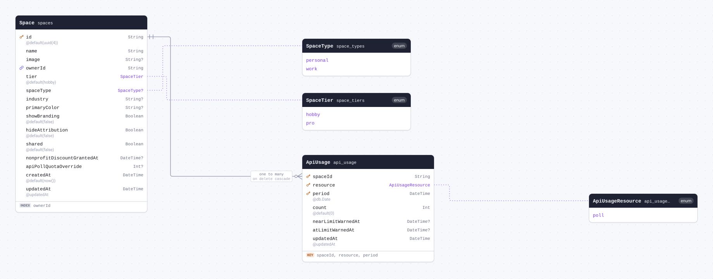

| Field                                        | Type                                         | Constraints                            | Default      | Description |
| -------------------------------------------- | -------------------------------------------- | -------------------------------------- | ------------ | ----------- |
| `spaceId` (`space_id`)                       | `String`                                     | PK NOT NULL → [Space.id](#model-Space) |              |             |
| `resource`                                   | [`ApiUsageResource`](#enum-ApiUsageResource) | PK NOT NULL                            |              |             |
| `period`                                     | `DateTime` `@db.Date`                        | PK NOT NULL                            |              |             |
| `count`                                      | `Int`                                        | NOT NULL                               | `0`          |             |
| `nearLimitWarnedAt` (`near_limit_warned_at`) | `DateTime`                                   | NULL                                   |              |             |
| `atLimitWarnedAt` (`at_limit_warned_at`)     | `DateTime`                                   | NULL                                   |              |             |
| `updatedAt` (`updated_at`)                   | `DateTime`                                   | NOT NULL                               | `@updatedAt` |             |

#### Indexes

- `@@id([spaceId, resource, period])`

#### References

- `spaceId` → [Space.id](#model-Space) (many-to-one, on delete Cascade)

#### Definition

```sql
CREATE TABLE "api_usage" (
    "space_id" TEXT NOT NULL,
    "resource" "api_usage_resource" NOT NULL,
    "period" DATE NOT NULL,
    "count" INTEGER NOT NULL DEFAULT 0,
    "near_limit_warned_at" TIMESTAMP(3),
    "at_limit_warned_at" TIMESTAMP(3),
    "updated_at" TIMESTAMP(3) NOT NULL,

    CONSTRAINT "api_usage_pkey" PRIMARY KEY ("space_id","resource","period")
);

ALTER TABLE "api_usage" ADD CONSTRAINT "api_usage_space_id_fkey" FOREIGN KEY ("space_id") REFERENCES "spaces"("id") ON DELETE CASCADE ON UPDATE CASCADE;
```

<details>
<summary>Queries and their SQL</summary>

**findMany**: Every row

```ts
await prisma.apiUsage.findMany();
```

```sql
SELECT
  "public"."api_usage"."space_id",
  "public"."api_usage"."resource"::text,
  "public"."api_usage"."period",
  "public"."api_usage"."count",
  "public"."api_usage"."near_limit_warned_at",
  "public"."api_usage"."at_limit_warned_at",
  "public"."api_usage"."updated_at"
FROM
  "public"."api_usage"
WHERE
  1 = 1
OFFSET
  $1
-- params: ["0"]
```

**count**: How many rows there are

```ts
await prisma.apiUsage.count();
```

```sql
SELECT
  COUNT(*) AS "_count$_all"
FROM
  (
    SELECT
      "public"."api_usage"."space_id",
      "public"."api_usage"."resource",
      "public"."api_usage"."period"
    FROM
      "public"."api_usage"
    WHERE
      1 = 1
    OFFSET
      $1
  ) AS "sub"
-- params: ["0"]
```

**findMany**: Every row with its relations

```ts
await prisma.apiUsage.findMany({ include: { space: true } });
```

```sql
SELECT
  "public"."api_usage"."space_id",
  "public"."api_usage"."resource"::text,
  "public"."api_usage"."period",
  "public"."api_usage"."count",
  "public"."api_usage"."near_limit_warned_at",
  "public"."api_usage"."at_limit_warned_at",
  "public"."api_usage"."updated_at"
FROM
  "public"."api_usage"
WHERE
  1 = 1
OFFSET
  $1
-- params: ["0"]

SELECT
  "public"."spaces"."id",
  "public"."spaces"."name",
  "public"."spaces"."image",
  "public"."spaces"."owner_id",
  "public"."spaces"."tier"::text,
  "public"."spaces"."space_type"::text,
  "public"."spaces"."industry",
  "public"."spaces"."primary_color",
  "public"."spaces"."show_branding",
  "public"."spaces"."hide_attribution",
  "public"."spaces"."shared",
  "public"."spaces"."nonprofit_discount_granted_at",
  "public"."spaces"."api_poll_quota_override",
  "public"."spaces"."created_at",
  "public"."spaces"."updated_at"
FROM
  "public"."spaces"
WHERE
  "public"."spaces"."id" IN ($1)
OFFSET
  $2
-- params: ["<spaceId of the rows above>","0"]
```

**findUnique**: One row by what is unique to it

```ts
await prisma.apiUsage.findUnique({
  where: {
    spaceId_resource_period: {
      spaceId: "example",
      resource: "poll",
      period: new Date("2026-01-01T00:00:00.000Z"),
    },
  },
});
```

```sql
SELECT
  "public"."api_usage"."space_id",
  "public"."api_usage"."resource"::text,
  "public"."api_usage"."period",
  "public"."api_usage"."count",
  "public"."api_usage"."near_limit_warned_at",
  "public"."api_usage"."at_limit_warned_at",
  "public"."api_usage"."updated_at"
FROM
  "public"."api_usage"
WHERE
  (
    (
      "public"."api_usage"."space_id" = $1
      AND "public"."api_usage"."resource" = CAST($2::text AS "public"."api_usage_resource")
      AND "public"."api_usage"."period" = $3
    )
    AND 1 = 1
  )
LIMIT
  $4
OFFSET
  $5
-- params: ["example","poll","2026-01-01T00:00:00.000Z","1","0"]
```

**create**: Create a row

```ts
await prisma.apiUsage.create({
  data: { spaceId: "example", resource: "poll", period: new Date("2026-01-01T00:00:00.000Z") },
});
```

```sql
INSERT INTO
  "public"."api_usage" (
    "space_id",
    "resource",
    "period",
    "count",
    "updated_at"
  )
VALUES
  (
    $1,
    CAST($2::text AS "public"."api_usage_resource"),
    $3,
    $4,
    $5
  )
RETURNING
  "public"."api_usage"."space_id",
  "public"."api_usage"."resource"::text,
  "public"."api_usage"."period",
  "public"."api_usage"."count",
  "public"."api_usage"."near_limit_warned_at",
  "public"."api_usage"."at_limit_warned_at",
  "public"."api_usage"."updated_at"
-- params: ["example","poll","2026-01-01T00:00:00.000Z","0","<now()>"]
```

**update**: Update a row

```ts
await prisma.apiUsage.update({
  where: {
    spaceId_resource_period: {
      spaceId: "example",
      resource: "poll",
      period: new Date("2026-01-01T00:00:00.000Z"),
    },
  },
  data: { count: 1 },
});
```

```sql
UPDATE "public"."api_usage"
SET
  "count" = $1,
  "updated_at" = $2
WHERE
  (
    (
      "public"."api_usage"."space_id" = $3
      AND "public"."api_usage"."resource" = CAST($4::text AS "public"."api_usage_resource")
      AND "public"."api_usage"."period" = $5
    )
    AND 1 = 1
  )
RETURNING
  "public"."api_usage"."space_id",
  "public"."api_usage"."resource"::text,
  "public"."api_usage"."period",
  "public"."api_usage"."count",
  "public"."api_usage"."near_limit_warned_at",
  "public"."api_usage"."at_limit_warned_at",
  "public"."api_usage"."updated_at"
-- params: ["1",{"prisma__type":"generatorCall","prisma__value":{"name":"now","args":[],"returnType":{"type":"DateTime"}}},"example","poll","2026-01-01T00:00:00.000Z"]
```

**delete**: Delete a row

```ts
await prisma.apiUsage.delete({
  where: {
    spaceId_resource_period: {
      spaceId: "example",
      resource: "poll",
      period: new Date("2026-01-01T00:00:00.000Z"),
    },
  },
});
```

```sql
DELETE FROM "public"."api_usage"
WHERE
  (
    (
      "public"."api_usage"."space_id" = $1
      AND "public"."api_usage"."resource" = CAST($2::text AS "public"."api_usage_resource")
      AND "public"."api_usage"."period" = $3
    )
    AND 1 = 1
  )
RETURNING
  "public"."api_usage"."space_id",
  "public"."api_usage"."resource"::text,
  "public"."api_usage"."period",
  "public"."api_usage"."count",
  "public"."api_usage"."near_limit_warned_at",
  "public"."api_usage"."at_limit_warned_at",
  "public"."api_usage"."updated_at"
-- params: ["example","poll","2026-01-01T00:00:00.000Z"]
```

</details>

<a id="model-Subscription"></a>

### Subscription

Table `subscriptions`.

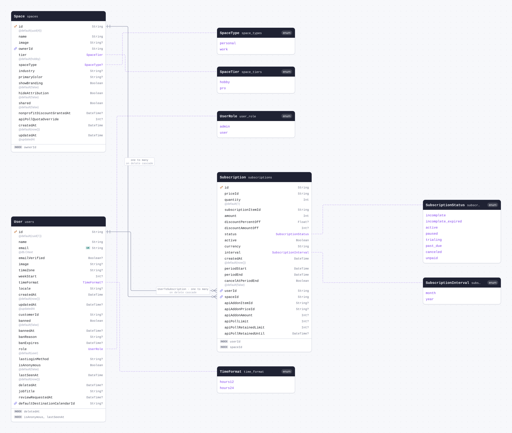

| Field                                              | Type                                                 | Constraints                         | Default | Description |
| -------------------------------------------------- | ---------------------------------------------------- | ----------------------------------- | ------- | ----------- |
| `id`                                               | `String`                                             | PK NOT NULL                         |         |             |
| `priceId` (`price_id`)                             | `String`                                             | NOT NULL                            |         |             |
| `quantity`                                         | `Int`                                                | NOT NULL                            | `1`     |             |
| `subscriptionItemId` (`subscription_item_id`)      | `String`                                             | NOT NULL                            |         |             |
| `amount`                                           | `Int`                                                | NOT NULL                            |         |             |
| `discountPercentOff` (`discount_percent_off`)      | `Float`                                              | NULL                                |         |             |
| `discountAmountOff` (`discount_amount_off`)        | `Int`                                                | NULL                                |         |             |
| `status`                                           | [`SubscriptionStatus`](#enum-SubscriptionStatus)     | NOT NULL                            |         |             |
| `active`                                           | `Boolean`                                            | NOT NULL                            |         |             |
| `currency`                                         | `String`                                             | NOT NULL                            |         |             |
| `interval`                                         | [`SubscriptionInterval`](#enum-SubscriptionInterval) | NOT NULL                            |         |             |
| `createdAt` (`created_at`)                         | `DateTime`                                           | NOT NULL                            | `now()` |             |
| `periodStart` (`period_start`)                     | `DateTime`                                           | NOT NULL                            |         |             |
| `periodEnd` (`period_end`)                         | `DateTime`                                           | NOT NULL                            |         |             |
| `cancelAtPeriodEnd` (`cancel_at_period_end`)       | `Boolean`                                            | NOT NULL                            | `false` |             |
| `userId` (`user_id`)                               | `String`                                             | NOT NULL → [User.id](#model-User)   |         |             |
| `spaceId` (`space_id`)                             | `String`                                             | NOT NULL → [Space.id](#model-Space) |         |             |
| `apiAddonItemId` (`api_addon_item_id`)             | `String`                                             | NULL                                |         |             |
| `apiAddonPriceId` (`api_addon_price_id`)           | `String`                                             | NULL                                |         |             |
| `apiAddonAmount` (`api_addon_amount`)              | `Int`                                                | NULL                                |         |             |
| `apiAddonTier` (`api_addon_tier`)                  | `String`                                             | NULL                                |         |             |
| `apiPollRetainedTier` (`api_poll_retained_tier`)   | `String`                                             | NULL                                |         |             |
| `apiPollRetainedUntil` (`api_poll_retained_until`) | `DateTime`                                           | NULL                                |         |             |

#### Indexes

- `@@index([userId])`
- `@@index([spaceId])`

#### References

- `userId` → [User.id](#model-User) (many-to-one, on delete Cascade)
- `spaceId` → [Space.id](#model-Space) (many-to-one, on delete Cascade)

#### Definition

```sql
CREATE TABLE "subscriptions" (
    "id" TEXT NOT NULL,
    "price_id" TEXT NOT NULL,
    "quantity" INTEGER NOT NULL DEFAULT 1,
    "subscription_item_id" TEXT NOT NULL,
    "amount" INTEGER NOT NULL,
    "discount_percent_off" DOUBLE PRECISION,
    "discount_amount_off" INTEGER,
    "status" "subscription_status" NOT NULL,
    "active" BOOLEAN NOT NULL,
    "currency" TEXT NOT NULL,
    "interval" "subscription_interval" NOT NULL,
    "created_at" TIMESTAMP(3) NOT NULL DEFAULT CURRENT_TIMESTAMP,
    "period_start" TIMESTAMP(3) NOT NULL,
    "period_end" TIMESTAMP(3) NOT NULL,
    "cancel_at_period_end" BOOLEAN NOT NULL DEFAULT false,
    "user_id" TEXT NOT NULL,
    "space_id" TEXT NOT NULL,
    "api_addon_item_id" TEXT,
    "api_addon_price_id" TEXT,
    "api_addon_amount" INTEGER,
    "api_addon_tier" TEXT,
    "api_poll_retained_tier" TEXT,
    "api_poll_retained_until" TIMESTAMP(3),

    CONSTRAINT "subscriptions_pkey" PRIMARY KEY ("id")
);

CREATE INDEX "subscriptions_user_id_idx" ON "subscriptions"("user_id");

CREATE INDEX "subscriptions_space_id_idx" ON "subscriptions"("space_id");

ALTER TABLE "subscriptions" ADD CONSTRAINT "subscriptions_user_id_fkey" FOREIGN KEY ("user_id") REFERENCES "users"("id") ON DELETE CASCADE ON UPDATE CASCADE;

ALTER TABLE "subscriptions" ADD CONSTRAINT "subscriptions_space_id_fkey" FOREIGN KEY ("space_id") REFERENCES "spaces"("id") ON DELETE CASCADE ON UPDATE CASCADE;
```

<details>
<summary>Queries and their SQL</summary>

**findMany**: Every row

```ts
await prisma.subscription.findMany();
```

```sql
SELECT
  "public"."subscriptions"."id",
  "public"."subscriptions"."price_id",
  "public"."subscriptions"."quantity",
  "public"."subscriptions"."subscription_item_id",
  "public"."subscriptions"."amount",
  "public"."subscriptions"."discount_percent_off",
  "public"."subscriptions"."discount_amount_off",
  "public"."subscriptions"."status"::text,
  "public"."subscriptions"."active",
  "public"."subscriptions"."currency",
  "public"."subscriptions"."interval"::text,
  "public"."subscriptions"."created_at",
  "public"."subscriptions"."period_start",
  "public"."subscriptions"."period_end",
  "public"."subscriptions"."cancel_at_period_end",
  "public"."subscriptions"."user_id",
  "public"."subscriptions"."space_id",
  "public"."subscriptions"."api_addon_item_id",
  "public"."subscriptions"."api_addon_price_id",
  "public"."subscriptions"."api_addon_amount",
  "public"."subscriptions"."api_addon_tier",
  "public"."subscriptions"."api_poll_retained_tier",
  "public"."subscriptions"."api_poll_retained_until"
FROM
  "public"."subscriptions"
WHERE
  1 = 1
OFFSET
  $1
-- params: ["0"]
```

**count**: How many rows there are

```ts
await prisma.subscription.count();
```

```sql
SELECT
  COUNT(*) AS "_count$_all"
FROM
  (
    SELECT
      "public"."subscriptions"."id"
    FROM
      "public"."subscriptions"
    WHERE
      1 = 1
    OFFSET
      $1
  ) AS "sub"
-- params: ["0"]
```

**findMany**: Every row with its relations

```ts
await prisma.subscription.findMany({ include: { user: true, space: true } });
```

```sql
SELECT
  "public"."subscriptions"."id",
  "public"."subscriptions"."price_id",
  "public"."subscriptions"."quantity",
  "public"."subscriptions"."subscription_item_id",
  "public"."subscriptions"."amount",
  "public"."subscriptions"."discount_percent_off",
  "public"."subscriptions"."discount_amount_off",
  "public"."subscriptions"."status"::text,
  "public"."subscriptions"."active",
  "public"."subscriptions"."currency",
  "public"."subscriptions"."interval"::text,
  "public"."subscriptions"."created_at",
  "public"."subscriptions"."period_start",
  "public"."subscriptions"."period_end",
  "public"."subscriptions"."cancel_at_period_end",
  "public"."subscriptions"."user_id",
  "public"."subscriptions"."space_id",
  "public"."subscriptions"."api_addon_item_id",
  "public"."subscriptions"."api_addon_price_id",
  "public"."subscriptions"."api_addon_amount",
  "public"."subscriptions"."api_addon_tier",
  "public"."subscriptions"."api_poll_retained_tier",
  "public"."subscriptions"."api_poll_retained_until"
FROM
  "public"."subscriptions"
WHERE
  1 = 1
OFFSET
  $1
-- params: ["0"]

SELECT
  "public"."users"."id",
  "public"."users"."name",
  "public"."users"."email",
  "public"."users"."email_verified",
  "public"."users"."image",
  "public"."users"."time_zone",
  "public"."users"."week_start",
  "public"."users"."time_format"::text,
  "public"."users"."locale",
  "public"."users"."created_at",
  "public"."users"."updated_at",
  "public"."users"."customer_id",
  "public"."users"."banned",
  "public"."users"."banned_at",
  "public"."users"."ban_reason",
  "public"."users"."ban_expires",
  "public"."users"."role"::text,
  "public"."users"."last_login_method",
  "public"."users"."anonymous",
  "public"."users"."last_seen_at",
  "public"."users"."deleted_at",
  "public"."users"."job_title",
  "public"."users"."review_requested_at",
  "public"."users"."default_destination_calendar_id"
FROM
  "public"."users"
WHERE
  "public"."users"."id" IN ($1)
OFFSET
  $2
-- params: ["<userId of the rows above>","0"]

SELECT
  "public"."spaces"."id",
  "public"."spaces"."name",
  "public"."spaces"."image",
  "public"."spaces"."owner_id",
  "public"."spaces"."tier"::text,
  "public"."spaces"."space_type"::text,
  "public"."spaces"."industry",
  "public"."spaces"."primary_color",
  "public"."spaces"."show_branding",
  "public"."spaces"."hide_attribution",
  "public"."spaces"."shared",
  "public"."spaces"."nonprofit_discount_granted_at",
  "public"."spaces"."api_poll_quota_override",
  "public"."spaces"."created_at",
  "public"."spaces"."updated_at"
FROM
  "public"."spaces"
WHERE
  "public"."spaces"."id" IN ($1)
OFFSET
  $2
-- params: ["<spaceId of the rows above>","0"]
```

**findUnique**: One row by what is unique to it

```ts
await prisma.subscription.findUnique({ where: { id: "example" } });
```

```sql
SELECT
  "public"."subscriptions"."id",
  "public"."subscriptions"."price_id",
  "public"."subscriptions"."quantity",
  "public"."subscriptions"."subscription_item_id",
  "public"."subscriptions"."amount",
  "public"."subscriptions"."discount_percent_off",
  "public"."subscriptions"."discount_amount_off",
  "public"."subscriptions"."status"::text,
  "public"."subscriptions"."active",
  "public"."subscriptions"."currency",
  "public"."subscriptions"."interval"::text,
  "public"."subscriptions"."created_at",
  "public"."subscriptions"."period_start",
  "public"."subscriptions"."period_end",
  "public"."subscriptions"."cancel_at_period_end",
  "public"."subscriptions"."user_id",
  "public"."subscriptions"."space_id",
  "public"."subscriptions"."api_addon_item_id",
  "public"."subscriptions"."api_addon_price_id",
  "public"."subscriptions"."api_addon_amount",
  "public"."subscriptions"."api_addon_tier",
  "public"."subscriptions"."api_poll_retained_tier",
  "public"."subscriptions"."api_poll_retained_until"
FROM
  "public"."subscriptions"
WHERE
  (
    "public"."subscriptions"."id" = $1
    AND 1 = 1
  )
LIMIT
  $2
OFFSET
  $3
-- params: ["example","1","0"]
```

**create**: Create a row

```ts
await prisma.subscription.create({
  data: {
    id: "example",
    priceId: "example",
    subscriptionItemId: "example",
    amount: 1,
    status: "incomplete",
    active: true,
    currency: "example",
    interval: "month",
    periodStart: new Date("2026-01-01T00:00:00.000Z"),
    periodEnd: new Date("2026-01-01T00:00:00.000Z"),
    userId: "example",
    spaceId: "example",
  },
});
```

```sql
INSERT INTO
  "public"."subscriptions" (
    "id",
    "price_id",
    "quantity",
    "subscription_item_id",
    "amount",
    "status",
    "active",
    "currency",
    "interval",
    "created_at",
    "period_start",
    "period_end",
    "cancel_at_period_end",
    "user_id",
    "space_id"
  )
VALUES
  (
    $1,
    $2,
    $3,
    $4,
    $5,
    CAST($6::text AS "public"."subscription_status"),
    $7,
    $8,
    CAST($9::text AS "public"."subscription_interval"),
    $10,
    $11,
    $12,
    $13,
    $14,
    $15
  )
RETURNING
  "public"."subscriptions"."id",
  "public"."subscriptions"."price_id",
  "public"."subscriptions"."quantity",
  "public"."subscriptions"."subscription_item_id",
  "public"."subscriptions"."amount",
  "public"."subscriptions"."discount_percent_off",
  "public"."subscriptions"."discount_amount_off",
  "public"."subscriptions"."status"::text,
  "public"."subscriptions"."active",
  "public"."subscriptions"."currency",
  "public"."subscriptions"."interval"::text,
  "public"."subscriptions"."created_at",
  "public"."subscriptions"."period_start",
  "public"."subscriptions"."period_end",
  "public"."subscriptions"."cancel_at_period_end",
  "public"."subscriptions"."user_id",
  "public"."subscriptions"."space_id",
  "public"."subscriptions"."api_addon_item_id",
  "public"."subscriptions"."api_addon_price_id",
  "public"."subscriptions"."api_addon_amount",
  "public"."subscriptions"."api_addon_tier",
  "public"."subscriptions"."api_poll_retained_tier",
  "public"."subscriptions"."api_poll_retained_until"
-- params: ["example","example","1","example","1","incomplete",true,"example","month","<now()>","2026-01-01T00:00:00.000Z","2026-01-01T00:00:00.000Z",false,"example","example"]
```

**update**: Update a row

```ts
await prisma.subscription.update({ where: { id: "example" }, data: { priceId: "example" } });
```

```sql
UPDATE "public"."subscriptions"
SET
  "price_id" = $1
WHERE
  (
    "public"."subscriptions"."id" = $2
    AND 1 = 1
  )
RETURNING
  "public"."subscriptions"."id",
  "public"."subscriptions"."price_id",
  "public"."subscriptions"."quantity",
  "public"."subscriptions"."subscription_item_id",
  "public"."subscriptions"."amount",
  "public"."subscriptions"."discount_percent_off",
  "public"."subscriptions"."discount_amount_off",
  "public"."subscriptions"."status"::text,
  "public"."subscriptions"."active",
  "public"."subscriptions"."currency",
  "public"."subscriptions"."interval"::text,
  "public"."subscriptions"."created_at",
  "public"."subscriptions"."period_start",
  "public"."subscriptions"."period_end",
  "public"."subscriptions"."cancel_at_period_end",
  "public"."subscriptions"."user_id",
  "public"."subscriptions"."space_id",
  "public"."subscriptions"."api_addon_item_id",
  "public"."subscriptions"."api_addon_price_id",
  "public"."subscriptions"."api_addon_amount",
  "public"."subscriptions"."api_addon_tier",
  "public"."subscriptions"."api_poll_retained_tier",
  "public"."subscriptions"."api_poll_retained_until"
-- params: ["example","example"]
```

**delete**: Delete a row

```ts
await prisma.subscription.delete({ where: { id: "example" } });
```

```sql
DELETE FROM "public"."subscriptions"
WHERE
  (
    "public"."subscriptions"."id" = $1
    AND 1 = 1
  )
RETURNING
  "public"."subscriptions"."id",
  "public"."subscriptions"."price_id",
  "public"."subscriptions"."quantity",
  "public"."subscriptions"."subscription_item_id",
  "public"."subscriptions"."amount",
  "public"."subscriptions"."discount_percent_off",
  "public"."subscriptions"."discount_amount_off",
  "public"."subscriptions"."status"::text,
  "public"."subscriptions"."active",
  "public"."subscriptions"."currency",
  "public"."subscriptions"."interval"::text,
  "public"."subscriptions"."created_at",
  "public"."subscriptions"."period_start",
  "public"."subscriptions"."period_end",
  "public"."subscriptions"."cancel_at_period_end",
  "public"."subscriptions"."user_id",
  "public"."subscriptions"."space_id",
  "public"."subscriptions"."api_addon_item_id",
  "public"."subscriptions"."api_addon_price_id",
  "public"."subscriptions"."api_addon_amount",
  "public"."subscriptions"."api_addon_tier",
  "public"."subscriptions"."api_poll_retained_tier",
  "public"."subscriptions"."api_poll_retained_until"
-- params: ["example"]
```

</details>

<a id="model-PaymentMethod"></a>

### PaymentMethod

Table `payment_methods`.

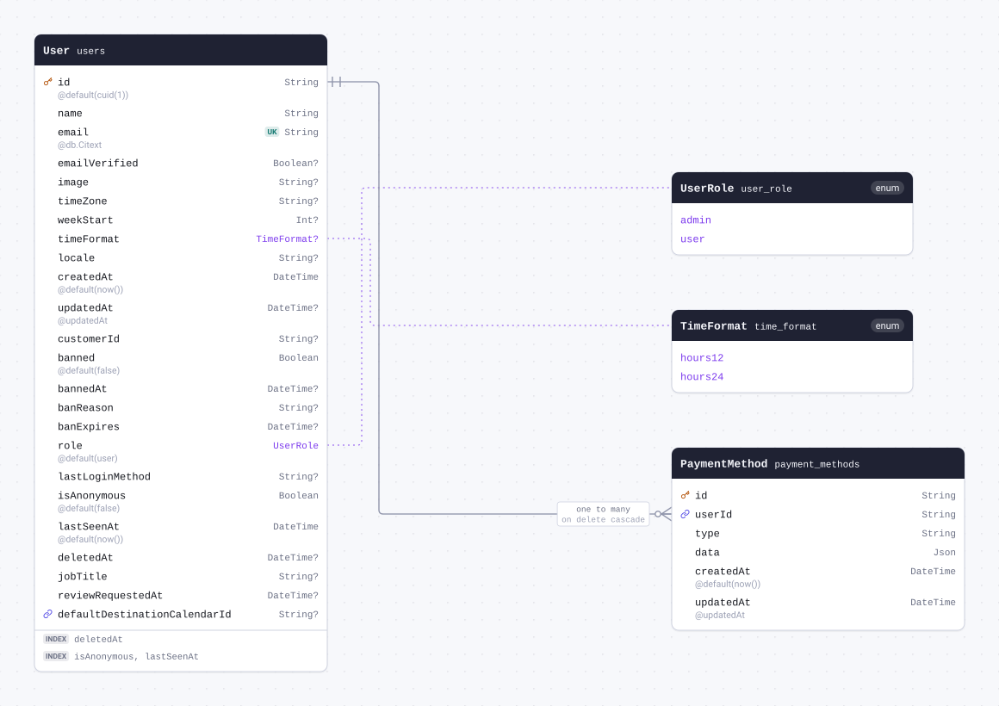

| Field                      | Type       | Constraints                       | Default      | Description |
| -------------------------- | ---------- | --------------------------------- | ------------ | ----------- |
| `id`                       | `String`   | PK NOT NULL                       |              |             |
| `userId` (`user_id`)       | `String`   | NOT NULL → [User.id](#model-User) |              |             |
| `type`                     | `String`   | NOT NULL                          |              |             |
| `data`                     | `Json`     | NOT NULL                          |              |             |
| `createdAt` (`created_at`) | `DateTime` | NOT NULL                          | `now()`      |             |
| `updatedAt` (`updated_at`) | `DateTime` | NOT NULL                          | `@updatedAt` |             |

#### References

- `userId` → [User.id](#model-User) (many-to-one, on delete Cascade)

#### Definition

```sql
CREATE TABLE "payment_methods" (
    "id" TEXT NOT NULL,
    "user_id" TEXT NOT NULL,
    "type" TEXT NOT NULL,
    "data" JSONB NOT NULL,
    "created_at" TIMESTAMP(3) NOT NULL DEFAULT CURRENT_TIMESTAMP,
    "updated_at" TIMESTAMP(3) NOT NULL,

    CONSTRAINT "payment_methods_pkey" PRIMARY KEY ("id")
);

ALTER TABLE "payment_methods" ADD CONSTRAINT "payment_methods_user_id_fkey" FOREIGN KEY ("user_id") REFERENCES "users"("id") ON DELETE CASCADE ON UPDATE CASCADE;
```

<details>
<summary>Queries and their SQL</summary>

**findMany**: Every row

```ts
await prisma.paymentMethod.findMany();
```

```sql
SELECT
  "public"."payment_methods"."id",
  "public"."payment_methods"."user_id",
  "public"."payment_methods"."type",
  "public"."payment_methods"."data",
  "public"."payment_methods"."created_at",
  "public"."payment_methods"."updated_at"
FROM
  "public"."payment_methods"
WHERE
  1 = 1
OFFSET
  $1
-- params: ["0"]
```

**count**: How many rows there are

```ts
await prisma.paymentMethod.count();
```

```sql
SELECT
  COUNT(*) AS "_count$_all"
FROM
  (
    SELECT
      "public"."payment_methods"."id"
    FROM
      "public"."payment_methods"
    WHERE
      1 = 1
    OFFSET
      $1
  ) AS "sub"
-- params: ["0"]
```

**findMany**: Every row with its relations

```ts
await prisma.paymentMethod.findMany({ include: { user: true } });
```

```sql
SELECT
  "public"."payment_methods"."id",
  "public"."payment_methods"."user_id",
  "public"."payment_methods"."type",
  "public"."payment_methods"."data",
  "public"."payment_methods"."created_at",
  "public"."payment_methods"."updated_at"
FROM
  "public"."payment_methods"
WHERE
  1 = 1
OFFSET
  $1
-- params: ["0"]

SELECT
  "public"."users"."id",
  "public"."users"."name",
  "public"."users"."email",
  "public"."users"."email_verified",
  "public"."users"."image",
  "public"."users"."time_zone",
  "public"."users"."week_start",
  "public"."users"."time_format"::text,
  "public"."users"."locale",
  "public"."users"."created_at",
  "public"."users"."updated_at",
  "public"."users"."customer_id",
  "public"."users"."banned",
  "public"."users"."banned_at",
  "public"."users"."ban_reason",
  "public"."users"."ban_expires",
  "public"."users"."role"::text,
  "public"."users"."last_login_method",
  "public"."users"."anonymous",
  "public"."users"."last_seen_at",
  "public"."users"."deleted_at",
  "public"."users"."job_title",
  "public"."users"."review_requested_at",
  "public"."users"."default_destination_calendar_id"
FROM
  "public"."users"
WHERE
  "public"."users"."id" IN ($1)
OFFSET
  $2
-- params: ["<userId of the rows above>","0"]
```

**findUnique**: One row by what is unique to it

```ts
await prisma.paymentMethod.findUnique({ where: { id: "example" } });
```

```sql
SELECT
  "public"."payment_methods"."id",
  "public"."payment_methods"."user_id",
  "public"."payment_methods"."type",
  "public"."payment_methods"."data",
  "public"."payment_methods"."created_at",
  "public"."payment_methods"."updated_at"
FROM
  "public"."payment_methods"
WHERE
  (
    "public"."payment_methods"."id" = $1
    AND 1 = 1
  )
LIMIT
  $2
OFFSET
  $3
-- params: ["example","1","0"]
```

**create**: Create a row

```ts
await prisma.paymentMethod.create({
  data: { id: "example", userId: "example", type: "example", data: {} },
});
```

```sql
INSERT INTO
  "public"."payment_methods" (
    "id",
    "user_id",
    "type",
    "data",
    "created_at",
    "updated_at"
  )
VALUES
  ($1, $2, $3, $4, $5, $6)
RETURNING
  "public"."payment_methods"."id",
  "public"."payment_methods"."user_id",
  "public"."payment_methods"."type",
  "public"."payment_methods"."data",
  "public"."payment_methods"."created_at",
  "public"."payment_methods"."updated_at"
-- params: ["example","example","example","{}","<now()>","<now()>"]
```

**update**: Update a row

```ts
await prisma.paymentMethod.update({ where: { id: "example" }, data: { type: "example" } });
```

```sql
UPDATE "public"."payment_methods"
SET
  "type" = $1,
  "updated_at" = $2
WHERE
  (
    "public"."payment_methods"."id" = $3
    AND 1 = 1
  )
RETURNING
  "public"."payment_methods"."id",
  "public"."payment_methods"."user_id",
  "public"."payment_methods"."type",
  "public"."payment_methods"."data",
  "public"."payment_methods"."created_at",
  "public"."payment_methods"."updated_at"
-- params: ["example",{"prisma__type":"generatorCall","prisma__value":{"name":"now","args":[],"returnType":{"type":"DateTime"}}},"example"]
```

**delete**: Delete a row

```ts
await prisma.paymentMethod.delete({ where: { id: "example" } });
```

```sql
DELETE FROM "public"."payment_methods"
WHERE
  (
    "public"."payment_methods"."id" = $1
    AND 1 = 1
  )
RETURNING
  "public"."payment_methods"."id",
  "public"."payment_methods"."user_id",
  "public"."payment_methods"."type",
  "public"."payment_methods"."data",
  "public"."payment_methods"."created_at",
  "public"."payment_methods"."updated_at"
-- params: ["example"]
```

</details>

<a id="model-NonprofitApplication"></a>

### NonprofitApplication

Table `nonprofit_applications`.

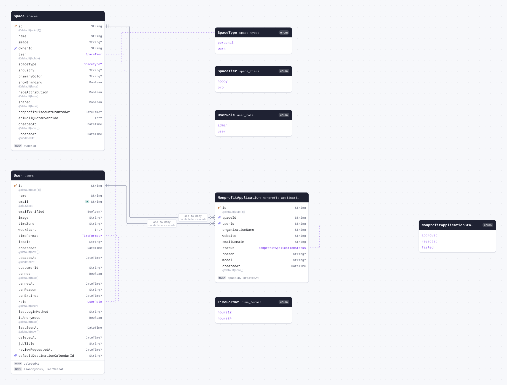

| Field                                    | Type                                                             | Constraints                         | Default   | Description |
| ---------------------------------------- | ---------------------------------------------------------------- | ----------------------------------- | --------- | ----------- |
| `id`                                     | `String`                                                         | PK NOT NULL                         | `uuid(4)` |             |
| `spaceId` (`space_id`)                   | `String`                                                         | NOT NULL → [Space.id](#model-Space) |           |             |
| `userId` (`user_id`)                     | `String`                                                         | NOT NULL → [User.id](#model-User)   |           |             |
| `organizationName` (`organization_name`) | `String`                                                         | NOT NULL                            |           |             |
| `website`                                | `String`                                                         | NOT NULL                            |           |             |
| `emailDomain` (`email_domain`)           | `String`                                                         | NOT NULL                            |           |             |
| `status`                                 | [`NonprofitApplicationStatus`](#enum-NonprofitApplicationStatus) | NOT NULL                            |           |             |
| `reason`                                 | `String`                                                         | NULL                                |           |             |
| `model`                                  | `String`                                                         | NULL                                |           |             |
| `createdAt` (`created_at`)               | `DateTime`                                                       | NOT NULL                            | `now()`   |             |

#### Indexes

- `@@index([spaceId, createdAt])`

#### References

- `spaceId` → [Space.id](#model-Space) (many-to-one, on delete Cascade)
- `userId` → [User.id](#model-User) (many-to-one, on delete Cascade)

#### Definition

```sql
CREATE TABLE "nonprofit_applications" (
    "id" TEXT NOT NULL,
    "space_id" TEXT NOT NULL,
    "user_id" TEXT NOT NULL,
    "organization_name" TEXT NOT NULL,
    "website" TEXT NOT NULL,
    "email_domain" TEXT NOT NULL,
    "status" "nonprofit_application_status" NOT NULL,
    "reason" TEXT,
    "model" TEXT,
    "created_at" TIMESTAMP(3) NOT NULL DEFAULT CURRENT_TIMESTAMP,

    CONSTRAINT "nonprofit_applications_pkey" PRIMARY KEY ("id")
);

CREATE INDEX "nonprofit_applications_space_id_created_at_idx" ON "nonprofit_applications"("space_id", "created_at");

ALTER TABLE "nonprofit_applications" ADD CONSTRAINT "nonprofit_applications_space_id_fkey" FOREIGN KEY ("space_id") REFERENCES "spaces"("id") ON DELETE CASCADE ON UPDATE CASCADE;

ALTER TABLE "nonprofit_applications" ADD CONSTRAINT "nonprofit_applications_user_id_fkey" FOREIGN KEY ("user_id") REFERENCES "users"("id") ON DELETE CASCADE ON UPDATE CASCADE;
```

<details>
<summary>Queries and their SQL</summary>

**findMany**: Every row

```ts
await prisma.nonprofitApplication.findMany();
```

```sql
SELECT
  "public"."nonprofit_applications"."id",
  "public"."nonprofit_applications"."space_id",
  "public"."nonprofit_applications"."user_id",
  "public"."nonprofit_applications"."organization_name",
  "public"."nonprofit_applications"."website",
  "public"."nonprofit_applications"."email_domain",
  "public"."nonprofit_applications"."status"::text,
  "public"."nonprofit_applications"."reason",
  "public"."nonprofit_applications"."model",
  "public"."nonprofit_applications"."created_at"
FROM
  "public"."nonprofit_applications"
WHERE
  1 = 1
OFFSET
  $1
-- params: ["0"]
```

**count**: How many rows there are

```ts
await prisma.nonprofitApplication.count();
```

```sql
SELECT
  COUNT(*) AS "_count$_all"
FROM
  (
    SELECT
      "public"."nonprofit_applications"."id"
    FROM
      "public"."nonprofit_applications"
    WHERE
      1 = 1
    OFFSET
      $1
  ) AS "sub"
-- params: ["0"]
```

**findMany**: Every row with its relations

```ts
await prisma.nonprofitApplication.findMany({ include: { space: true, user: true } });
```

```sql
SELECT
  "public"."nonprofit_applications"."id",
  "public"."nonprofit_applications"."space_id",
  "public"."nonprofit_applications"."user_id",
  "public"."nonprofit_applications"."organization_name",
  "public"."nonprofit_applications"."website",
  "public"."nonprofit_applications"."email_domain",
  "public"."nonprofit_applications"."status"::text,
  "public"."nonprofit_applications"."reason",
  "public"."nonprofit_applications"."model",
  "public"."nonprofit_applications"."created_at"
FROM
  "public"."nonprofit_applications"
WHERE
  1 = 1
OFFSET
  $1
-- params: ["0"]

SELECT
  "public"."spaces"."id",
  "public"."spaces"."name",
  "public"."spaces"."image",
  "public"."spaces"."owner_id",
  "public"."spaces"."tier"::text,
  "public"."spaces"."space_type"::text,
  "public"."spaces"."industry",
  "public"."spaces"."primary_color",
  "public"."spaces"."show_branding",
  "public"."spaces"."hide_attribution",
  "public"."spaces"."shared",
  "public"."spaces"."nonprofit_discount_granted_at",
  "public"."spaces"."api_poll_quota_override",
  "public"."spaces"."created_at",
  "public"."spaces"."updated_at"
FROM
  "public"."spaces"
WHERE
  "public"."spaces"."id" IN ($1)
OFFSET
  $2
-- params: ["<spaceId of the rows above>","0"]

SELECT
  "public"."users"."id",
  "public"."users"."name",
  "public"."users"."email",
  "public"."users"."email_verified",
  "public"."users"."image",
  "public"."users"."time_zone",
  "public"."users"."week_start",
  "public"."users"."time_format"::text,
  "public"."users"."locale",
  "public"."users"."created_at",
  "public"."users"."updated_at",
  "public"."users"."customer_id",
  "public"."users"."banned",
  "public"."users"."banned_at",
  "public"."users"."ban_reason",
  "public"."users"."ban_expires",
  "public"."users"."role"::text,
  "public"."users"."last_login_method",
  "public"."users"."anonymous",
  "public"."users"."last_seen_at",
  "public"."users"."deleted_at",
  "public"."users"."job_title",
  "public"."users"."review_requested_at",
  "public"."users"."default_destination_calendar_id"
FROM
  "public"."users"
WHERE
  "public"."users"."id" IN ($1)
OFFSET
  $2
-- params: ["<userId of the rows above>","0"]
```

**findUnique**: One row by what is unique to it

```ts
await prisma.nonprofitApplication.findUnique({ where: { id: "example" } });
```

```sql
SELECT
  "public"."nonprofit_applications"."id",
  "public"."nonprofit_applications"."space_id",
  "public"."nonprofit_applications"."user_id",
  "public"."nonprofit_applications"."organization_name",
  "public"."nonprofit_applications"."website",
  "public"."nonprofit_applications"."email_domain",
  "public"."nonprofit_applications"."status"::text,
  "public"."nonprofit_applications"."reason",
  "public"."nonprofit_applications"."model",
  "public"."nonprofit_applications"."created_at"
FROM
  "public"."nonprofit_applications"
WHERE
  (
    "public"."nonprofit_applications"."id" = $1
    AND 1 = 1
  )
LIMIT
  $2
OFFSET
  $3
-- params: ["example","1","0"]
```

**create**: Create a row

```ts
await prisma.nonprofitApplication.create({
  data: {
    spaceId: "example",
    userId: "example",
    organizationName: "example",
    website: "example",
    emailDomain: "example",
    status: "approved",
  },
});
```

```sql
INSERT INTO
  "public"."nonprofit_applications" (
    "id",
    "space_id",
    "user_id",
    "organization_name",
    "website",
    "email_domain",
    "status",
    "created_at"
  )
VALUES
  (
    $1,
    $2,
    $3,
    $4,
    $5,
    $6,
    CAST(
      $7::text AS "public"."nonprofit_application_status"
    ),
    $8
  )
RETURNING
  "public"."nonprofit_applications"."id",
  "public"."nonprofit_applications"."space_id",
  "public"."nonprofit_applications"."user_id",
  "public"."nonprofit_applications"."organization_name",
  "public"."nonprofit_applications"."website",
  "public"."nonprofit_applications"."email_domain",
  "public"."nonprofit_applications"."status"::text,
  "public"."nonprofit_applications"."reason",
  "public"."nonprofit_applications"."model",
  "public"."nonprofit_applications"."created_at"
-- params: ["<uuid(4)>","example","example","example","example","example","approved","<now()>"]
```

**update**: Update a row

```ts
await prisma.nonprofitApplication.update({
  where: { id: "example" },
  data: { organizationName: "example" },
});
```

```sql
UPDATE "public"."nonprofit_applications"
SET
  "organization_name" = $1
WHERE
  (
    "public"."nonprofit_applications"."id" = $2
    AND 1 = 1
  )
RETURNING
  "public"."nonprofit_applications"."id",
  "public"."nonprofit_applications"."space_id",
  "public"."nonprofit_applications"."user_id",
  "public"."nonprofit_applications"."organization_name",
  "public"."nonprofit_applications"."website",
  "public"."nonprofit_applications"."email_domain",
  "public"."nonprofit_applications"."status"::text,
  "public"."nonprofit_applications"."reason",
  "public"."nonprofit_applications"."model",
  "public"."nonprofit_applications"."created_at"
-- params: ["example","example"]
```

**delete**: Delete a row

```ts
await prisma.nonprofitApplication.delete({ where: { id: "example" } });
```

```sql
DELETE FROM "public"."nonprofit_applications"
WHERE
  (
    "public"."nonprofit_applications"."id" = $1
    AND 1 = 1
  )
RETURNING
  "public"."nonprofit_applications"."id",
  "public"."nonprofit_applications"."space_id",
  "public"."nonprofit_applications"."user_id",
  "public"."nonprofit_applications"."organization_name",
  "public"."nonprofit_applications"."website",
  "public"."nonprofit_applications"."email_domain",
  "public"."nonprofit_applications"."status"::text,
  "public"."nonprofit_applications"."reason",
  "public"."nonprofit_applications"."model",
  "public"."nonprofit_applications"."created_at"
-- params: ["example"]
```

</details>

<a id="model-QueuedEmail"></a>

### QueuedEmail

Table `queued_emails`. An email waiting to be sent by the queue, one row per recipient. The
email is built when it is sent, from the row its subject points at.

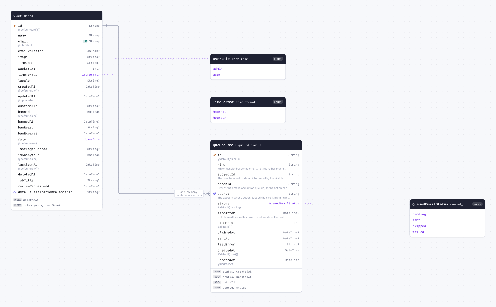

| Field                      | Type                                           | Constraints                       | Default      | Description                                                                                                                                                                      |
| -------------------------- | ---------------------------------------------- | --------------------------------- | ------------ | -------------------------------------------------------------------------------------------------------------------------------------------------------------------------------- |
| `id`                       | `String`                                       | PK NOT NULL                       | `cuid(1)`    |                                                                                                                                                                                  |
| `kind`                     | `String`                                       | NOT NULL                          |              | Which handler builds the email. A string rather than an enum so a new kind needs no migration; the claim only takes kinds the build knows.                                       |
| `subjectId` (`subject_id`) | `String`                                       | NOT NULL                          |              | The row the email is about, interpreted by the kind. Not a foreign key: kinds point at different tables, and a subject deleted before the send makes its handler skip the email. |
| `batchId` (`batch_id`)     | `String`                                       | NOT NULL                          |              | Groups the emails one action queued, so the action can send its own first batch at once and its progress can be read back.                                                       |
| `userId` (`user_id`)       | `String`                                       | NOT NULL → [User.id](#model-User) |              | The account whose action queued the email. Banning it skips whatever is still pending.                                                                                           |
| `status`                   | [`QueuedEmailStatus`](#enum-QueuedEmailStatus) | NOT NULL                          | `pending`    |                                                                                                                                                                                  |
| `sendAfter` (`send_after`) | `DateTime`                                     | NULL                              |              | Not claimed before this time. Unset sends at the next run.                                                                                                                       |
| `attempts`                 | `Int`                                          | NOT NULL                          | `0`          |                                                                                                                                                                                  |
| `claimedAt` (`claimed_at`) | `DateTime`                                     | NULL                              |              |                                                                                                                                                                                  |
| `sentAt` (`sent_at`)       | `DateTime`                                     | NULL                              |              |                                                                                                                                                                                  |
| `lastError` (`last_error`) | `String`                                       | NULL                              |              |                                                                                                                                                                                  |
| `createdAt` (`created_at`) | `DateTime`                                     | NOT NULL                          | `now()`      |                                                                                                                                                                                  |
| `updatedAt` (`updated_at`) | `DateTime`                                     | NOT NULL                          | `@updatedAt` |                                                                                                                                                                                  |

#### Indexes

- `@@index([status, createdAt])`
- `@@index([status, updatedAt])`
- `@@index([batchId])`
- `@@index([userId, status])`

#### References

- `userId` → [User.id](#model-User) (many-to-one, on delete Cascade)

#### Definition

```sql
CREATE TABLE "queued_emails" (
    "id" TEXT NOT NULL,
    "kind" TEXT NOT NULL,
    "subject_id" TEXT NOT NULL,
    "batch_id" TEXT NOT NULL,
    "user_id" TEXT NOT NULL,
    "status" "queued_email_status" NOT NULL DEFAULT 'pending',
    "send_after" TIMESTAMP(3),
    "attempts" INTEGER NOT NULL DEFAULT 0,
    "claimed_at" TIMESTAMP(3),
    "sent_at" TIMESTAMP(3),
    "last_error" TEXT,
    "created_at" TIMESTAMP(3) NOT NULL DEFAULT CURRENT_TIMESTAMP,
    "updated_at" TIMESTAMP(3) NOT NULL,

    CONSTRAINT "queued_emails_pkey" PRIMARY KEY ("id")
);

CREATE INDEX "queued_emails_status_created_at_idx" ON "queued_emails"("status", "created_at");

CREATE INDEX "queued_emails_status_updated_at_idx" ON "queued_emails"("status", "updated_at");

CREATE INDEX "queued_emails_batch_id_idx" ON "queued_emails"("batch_id");

CREATE INDEX "queued_emails_user_id_status_idx" ON "queued_emails"("user_id", "status");

ALTER TABLE "queued_emails" ADD CONSTRAINT "queued_emails_user_id_fkey" FOREIGN KEY ("user_id") REFERENCES "users"("id") ON DELETE CASCADE ON UPDATE CASCADE;
```

<details>
<summary>Queries and their SQL</summary>

**findMany**: Every row

```ts
await prisma.queuedEmail.findMany();
```

```sql
SELECT
  "public"."queued_emails"."id",
  "public"."queued_emails"."kind",
  "public"."queued_emails"."subject_id",
  "public"."queued_emails"."batch_id",
  "public"."queued_emails"."user_id",
  "public"."queued_emails"."status"::text,
  "public"."queued_emails"."send_after",
  "public"."queued_emails"."attempts",
  "public"."queued_emails"."claimed_at",
  "public"."queued_emails"."sent_at",
  "public"."queued_emails"."last_error",
  "public"."queued_emails"."created_at",
  "public"."queued_emails"."updated_at"
FROM
  "public"."queued_emails"
WHERE
  1 = 1
OFFSET
  $1
-- params: ["0"]
```

**count**: How many rows there are

```ts
await prisma.queuedEmail.count();
```

```sql
SELECT
  COUNT(*) AS "_count$_all"
FROM
  (
    SELECT
      "public"."queued_emails"."id"
    FROM
      "public"."queued_emails"
    WHERE
      1 = 1
    OFFSET
      $1
  ) AS "sub"
-- params: ["0"]
```

**findMany**: Every row with its relations

```ts
await prisma.queuedEmail.findMany({ include: { user: true } });
```

```sql
SELECT
  "public"."queued_emails"."id",
  "public"."queued_emails"."kind",
  "public"."queued_emails"."subject_id",
  "public"."queued_emails"."batch_id",
  "public"."queued_emails"."user_id",
  "public"."queued_emails"."status"::text,
  "public"."queued_emails"."send_after",
  "public"."queued_emails"."attempts",
  "public"."queued_emails"."claimed_at",
  "public"."queued_emails"."sent_at",
  "public"."queued_emails"."last_error",
  "public"."queued_emails"."created_at",
  "public"."queued_emails"."updated_at"
FROM
  "public"."queued_emails"
WHERE
  1 = 1
OFFSET
  $1
-- params: ["0"]

SELECT
  "public"."users"."id",
  "public"."users"."name",
  "public"."users"."email",
  "public"."users"."email_verified",
  "public"."users"."image",
  "public"."users"."time_zone",
  "public"."users"."week_start",
  "public"."users"."time_format"::text,
  "public"."users"."locale",
  "public"."users"."created_at",
  "public"."users"."updated_at",
  "public"."users"."customer_id",
  "public"."users"."banned",
  "public"."users"."banned_at",
  "public"."users"."ban_reason",
  "public"."users"."ban_expires",
  "public"."users"."role"::text,
  "public"."users"."last_login_method",
  "public"."users"."anonymous",
  "public"."users"."last_seen_at",
  "public"."users"."deleted_at",
  "public"."users"."job_title",
  "public"."users"."review_requested_at",
  "public"."users"."default_destination_calendar_id"
FROM
  "public"."users"
WHERE
  "public"."users"."id" IN ($1)
OFFSET
  $2
-- params: ["<userId of the rows above>","0"]
```

**findUnique**: One row by what is unique to it

```ts
await prisma.queuedEmail.findUnique({ where: { id: "example" } });
```

```sql
SELECT
  "public"."queued_emails"."id",
  "public"."queued_emails"."kind",
  "public"."queued_emails"."subject_id",
  "public"."queued_emails"."batch_id",
  "public"."queued_emails"."user_id",
  "public"."queued_emails"."status"::text,
  "public"."queued_emails"."send_after",
  "public"."queued_emails"."attempts",
  "public"."queued_emails"."claimed_at",
  "public"."queued_emails"."sent_at",
  "public"."queued_emails"."last_error",
  "public"."queued_emails"."created_at",
  "public"."queued_emails"."updated_at"
FROM
  "public"."queued_emails"
WHERE
  (
    "public"."queued_emails"."id" = $1
    AND 1 = 1
  )
LIMIT
  $2
OFFSET
  $3
-- params: ["example","1","0"]
```

**create**: Create a row

```ts
await prisma.queuedEmail.create({
  data: { kind: "example", subjectId: "example", batchId: "example", userId: "example" },
});
```

```sql
INSERT INTO
  "public"."queued_emails" (
    "id",
    "kind",
    "subject_id",
    "batch_id",
    "user_id",
    "status",
    "attempts",
    "created_at",
    "updated_at"
  )
VALUES
  (
    $1,
    $2,
    $3,
    $4,
    $5,
    CAST($6::text AS "public"."queued_email_status"),
    $7,
    $8,
    $9
  )
RETURNING
  "public"."queued_emails"."id",
  "public"."queued_emails"."kind",
  "public"."queued_emails"."subject_id",
  "public"."queued_emails"."batch_id",
  "public"."queued_emails"."user_id",
  "public"."queued_emails"."status"::text,
  "public"."queued_emails"."send_after",
  "public"."queued_emails"."attempts",
  "public"."queued_emails"."claimed_at",
  "public"."queued_emails"."sent_at",
  "public"."queued_emails"."last_error",
  "public"."queued_emails"."created_at",
  "public"."queued_emails"."updated_at"
-- params: ["<cuid(1)>","example","example","example","example","pending","0","<now()>","<now()>"]
```

**update**: Update a row

```ts
await prisma.queuedEmail.update({ where: { id: "example" }, data: { kind: "example" } });
```

```sql
UPDATE "public"."queued_emails"
SET
  "kind" = $1,
  "updated_at" = $2
WHERE
  (
    "public"."queued_emails"."id" = $3
    AND 1 = 1
  )
RETURNING
  "public"."queued_emails"."id",
  "public"."queued_emails"."kind",
  "public"."queued_emails"."subject_id",
  "public"."queued_emails"."batch_id",
  "public"."queued_emails"."user_id",
  "public"."queued_emails"."status"::text,
  "public"."queued_emails"."send_after",
  "public"."queued_emails"."attempts",
  "public"."queued_emails"."claimed_at",
  "public"."queued_emails"."sent_at",
  "public"."queued_emails"."last_error",
  "public"."queued_emails"."created_at",
  "public"."queued_emails"."updated_at"
-- params: ["example",{"prisma__type":"generatorCall","prisma__value":{"name":"now","args":[],"returnType":{"type":"DateTime"}}},"example"]
```

**delete**: Delete a row

```ts
await prisma.queuedEmail.delete({ where: { id: "example" } });
```

```sql
DELETE FROM "public"."queued_emails"
WHERE
  (
    "public"."queued_emails"."id" = $1
    AND 1 = 1
  )
RETURNING
  "public"."queued_emails"."id",
  "public"."queued_emails"."kind",
  "public"."queued_emails"."subject_id",
  "public"."queued_emails"."batch_id",
  "public"."queued_emails"."user_id",
  "public"."queued_emails"."status"::text,
  "public"."queued_emails"."send_after",
  "public"."queued_emails"."attempts",
  "public"."queued_emails"."claimed_at",
  "public"."queued_emails"."sent_at",
  "public"."queued_emails"."last_error",
  "public"."queued_emails"."created_at",
  "public"."queued_emails"."updated_at"
-- params: ["example"]
```

</details>

<a id="model-EventType"></a>

### EventType

Table `event_types`.

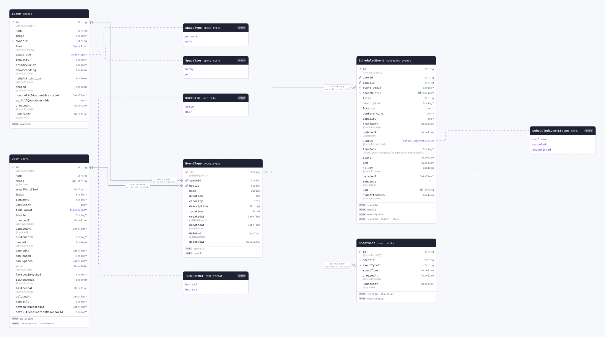

| Field                           | Type       | Constraints                         | Default      | Description |
| ------------------------------- | ---------- | ----------------------------------- | ------------ | ----------- |
| `id`                            | `String`   | PK NOT NULL                         | `cuid(1)`    |             |
| `spaceId` (`space_id`)          | `String`   | NOT NULL → [Space.id](#model-Space) |              |             |
| `hostId` (`host_id`)            | `String`   | NOT NULL → [User.id](#model-User)   |              |             |
| `name`                          | `String`   | NOT NULL                            |              |             |
| `duration` (`duration_minutes`) | `Int`      | NOT NULL                            |              |             |
| `capacity`                      | `Int`      | NULL                                |              |             |
| `description`                   | `String`   | NULL                                |              |             |
| `location`                      | `Json`     | NULL                                |              |             |
| `createdAt` (`created_at`)      | `DateTime` | NOT NULL                            | `now()`      |             |
| `updatedAt` (`updated_at`)      | `DateTime` | NOT NULL                            | `@updatedAt` |             |
| `deleted`                       | `Boolean`  | NOT NULL                            | `false`      |             |
| `deletedAt` (`deleted_at`)      | `DateTime` | NULL                                |              |             |

#### Indexes

- `@@index([spaceId])`
- `@@index([hostId])`

#### References

- `spaceId` → [Space.id](#model-Space) (many-to-one, on delete Cascade)
- `hostId` → [User.id](#model-User) (many-to-one, on delete Cascade)

#### Referenced by

- `id` ← [ScheduledEvent.eventTypeId](#model-ScheduledEvent) (one-to-many, on delete SetNull)
- `id` ← [SheetSlot.eventTypeId](#model-SheetSlot) (one-to-many, on delete Restrict)

#### Definition

```sql
CREATE TABLE "event_types" (
    "id" TEXT NOT NULL,
    "space_id" TEXT NOT NULL,
    "host_id" TEXT NOT NULL,
    "name" TEXT NOT NULL,
    "duration_minutes" INTEGER NOT NULL,
    "capacity" INTEGER,
    "description" TEXT,
    "location" JSONB,
    "created_at" TIMESTAMP(3) NOT NULL DEFAULT CURRENT_TIMESTAMP,
    "updated_at" TIMESTAMP(3) NOT NULL,
    "deleted" BOOLEAN NOT NULL DEFAULT false,
    "deleted_at" TIMESTAMP(3),

    CONSTRAINT "event_types_pkey" PRIMARY KEY ("id")
);

CREATE INDEX "event_types_space_id_idx" ON "event_types"("space_id");

CREATE INDEX "event_types_host_id_idx" ON "event_types"("host_id");

ALTER TABLE "event_types" ADD CONSTRAINT "event_types_space_id_fkey" FOREIGN KEY ("space_id") REFERENCES "spaces"("id") ON DELETE CASCADE ON UPDATE CASCADE;

ALTER TABLE "event_types" ADD CONSTRAINT "event_types_host_id_fkey" FOREIGN KEY ("host_id") REFERENCES "users"("id") ON DELETE CASCADE ON UPDATE CASCADE;
```

<details>
<summary>Queries and their SQL</summary>

**findMany**: Every row

```ts
await prisma.eventType.findMany();
```

```sql
SELECT
  "public"."event_types"."id",
  "public"."event_types"."space_id",
  "public"."event_types"."host_id",
  "public"."event_types"."name",
  "public"."event_types"."duration_minutes",
  "public"."event_types"."capacity",
  "public"."event_types"."description",
  "public"."event_types"."location",
  "public"."event_types"."created_at",
  "public"."event_types"."updated_at",
  "public"."event_types"."deleted",
  "public"."event_types"."deleted_at"
FROM
  "public"."event_types"
WHERE
  1 = 1
OFFSET
  $1
-- params: ["0"]
```

**count**: How many rows there are

```ts
await prisma.eventType.count();
```

```sql
SELECT
  COUNT(*) AS "_count$_all"
FROM
  (
    SELECT
      "public"."event_types"."id"
    FROM
      "public"."event_types"
    WHERE
      1 = 1
    OFFSET
      $1
  ) AS "sub"
-- params: ["0"]
```

**findMany**: Every row with its relations

```ts
await prisma.eventType.findMany({
  include: { space: true, host: true, slots: true, scheduledEvents: true },
});
```

```sql
SELECT
  "public"."event_types"."id",
  "public"."event_types"."space_id",
  "public"."event_types"."host_id",
  "public"."event_types"."name",
  "public"."event_types"."duration_minutes",
  "public"."event_types"."capacity",
  "public"."event_types"."description",
  "public"."event_types"."location",
  "public"."event_types"."created_at",
  "public"."event_types"."updated_at",
  "public"."event_types"."deleted",
  "public"."event_types"."deleted_at"
FROM
  "public"."event_types"
WHERE
  1 = 1
OFFSET
  $1
-- params: ["0"]

SELECT
  "public"."spaces"."id",
  "public"."spaces"."name",
  "public"."spaces"."image",
  "public"."spaces"."owner_id",
  "public"."spaces"."tier"::text,
  "public"."spaces"."space_type"::text,
  "public"."spaces"."industry",
  "public"."spaces"."primary_color",
  "public"."spaces"."show_branding",
  "public"."spaces"."hide_attribution",
  "public"."spaces"."shared",
  "public"."spaces"."nonprofit_discount_granted_at",
  "public"."spaces"."api_poll_quota_override",
  "public"."spaces"."created_at",
  "public"."spaces"."updated_at"
FROM
  "public"."spaces"
WHERE
  "public"."spaces"."id" IN ($1)
OFFSET
  $2
-- params: ["<spaceId of the rows above>","0"]

SELECT
  "public"."users"."id",
  "public"."users"."name",
  "public"."users"."email",
  "public"."users"."email_verified",
  "public"."users"."image",
  "public"."users"."time_zone",
  "public"."users"."week_start",
  "public"."users"."time_format"::text,
  "public"."users"."locale",
  "public"."users"."created_at",
  "public"."users"."updated_at",
  "public"."users"."customer_id",
  "public"."users"."banned",
  "public"."users"."banned_at",
  "public"."users"."ban_reason",
  "public"."users"."ban_expires",
  "public"."users"."role"::text,
  "public"."users"."last_login_method",
  "public"."users"."anonymous",
  "public"."users"."last_seen_at",
  "public"."users"."deleted_at",
  "public"."users"."job_title",
  "public"."users"."review_requested_at",
  "public"."users"."default_destination_calendar_id"
FROM
  "public"."users"
WHERE
  "public"."users"."id" IN ($1)
OFFSET
  $2
-- params: ["<hostId of the rows above>","0"]

SELECT
  "public"."sheet_slots"."id",
  "public"."sheet_slots"."sheet_id",
  "public"."sheet_slots"."event_type_id",
  "public"."sheet_slots"."start_time",
  "public"."sheet_slots"."created_at",
  "public"."sheet_slots"."updated_at"
FROM
  "public"."sheet_slots"
WHERE
  "public"."sheet_slots"."event_type_id" IN ($1)
OFFSET
  $2
-- params: ["<id of the rows above>","0"]

SELECT
  "public"."scheduled_events"."id",
  "public"."scheduled_events"."user_id",
  "public"."scheduled_events"."space_id",
  "public"."scheduled_events"."event_type_id",
  "public"."scheduled_events"."sheet_slot_id",
  "public"."scheduled_events"."title",
  "public"."scheduled_events"."description",
  "public"."scheduled_events"."location",
  "public"."scheduled_events"."conferencing",
  "public"."scheduled_events"."capacity",
  "public"."scheduled_events"."created_at",
  "public"."scheduled_events"."updated_at",
  "public"."scheduled_events"."status"::text,
  "public"."scheduled_events"."time_zone",
  "public"."scheduled_events"."start",
  "public"."scheduled_events"."end",
  "public"."scheduled_events"."all_day",
  "public"."scheduled_events"."deleted_at",
  "public"."scheduled_events"."sequence",
  "public"."scheduled_events"."uid",
  "public"."scheduled_events"."hide_attendees"
FROM
  "public"."scheduled_events"
WHERE
  "public"."scheduled_events"."event_type_id" IN ($1)
OFFSET
  $2
-- params: ["<id of the rows above>","0"]
```

**findUnique**: One row by what is unique to it

```ts
await prisma.eventType.findUnique({ where: { id: "example" } });
```

```sql
SELECT
  "public"."event_types"."id",
  "public"."event_types"."space_id",
  "public"."event_types"."host_id",
  "public"."event_types"."name",
  "public"."event_types"."duration_minutes",
  "public"."event_types"."capacity",
  "public"."event_types"."description",
  "public"."event_types"."location",
  "public"."event_types"."created_at",
  "public"."event_types"."updated_at",
  "public"."event_types"."deleted",
  "public"."event_types"."deleted_at"
FROM
  "public"."event_types"
WHERE
  (
    "public"."event_types"."id" = $1
    AND 1 = 1
  )
LIMIT
  $2
OFFSET
  $3
-- params: ["example","1","0"]
```

**create**: Create a row

```ts
await prisma.eventType.create({
  data: { spaceId: "example", hostId: "example", name: "example", duration: 1 },
});
```

```sql
INSERT INTO
  "public"."event_types" (
    "id",
    "space_id",
    "host_id",
    "name",
    "duration_minutes",
    "created_at",
    "updated_at",
    "deleted"
  )
VALUES
  ($1, $2, $3, $4, $5, $6, $7, $8)
RETURNING
  "public"."event_types"."id",
  "public"."event_types"."space_id",
  "public"."event_types"."host_id",
  "public"."event_types"."name",
  "public"."event_types"."duration_minutes",
  "public"."event_types"."capacity",
  "public"."event_types"."description",
  "public"."event_types"."location",
  "public"."event_types"."created_at",
  "public"."event_types"."updated_at",
  "public"."event_types"."deleted",
  "public"."event_types"."deleted_at"
-- params: ["<cuid(1)>","example","example","example","1","<now()>","<now()>",false]
```

**update**: Update a row

```ts
await prisma.eventType.update({ where: { id: "example" }, data: { name: "example" } });
```

```sql
UPDATE "public"."event_types"
SET
  "name" = $1,
  "updated_at" = $2
WHERE
  (
    "public"."event_types"."id" = $3
    AND 1 = 1
  )
RETURNING
  "public"."event_types"."id",
  "public"."event_types"."space_id",
  "public"."event_types"."host_id",
  "public"."event_types"."name",
  "public"."event_types"."duration_minutes",
  "public"."event_types"."capacity",
  "public"."event_types"."description",
  "public"."event_types"."location",
  "public"."event_types"."created_at",
  "public"."event_types"."updated_at",
  "public"."event_types"."deleted",
  "public"."event_types"."deleted_at"
-- params: ["example",{"prisma__type":"generatorCall","prisma__value":{"name":"now","args":[],"returnType":{"type":"DateTime"}}},"example"]
```

**delete**: Delete a row

```ts
await prisma.eventType.delete({ where: { id: "example" } });
```

```sql
DELETE FROM "public"."event_types"
WHERE
  (
    "public"."event_types"."id" = $1
    AND 1 = 1
  )
RETURNING
  "public"."event_types"."id",
  "public"."event_types"."space_id",
  "public"."event_types"."host_id",
  "public"."event_types"."name",
  "public"."event_types"."duration_minutes",
  "public"."event_types"."capacity",
  "public"."event_types"."description",
  "public"."event_types"."location",
  "public"."event_types"."created_at",
  "public"."event_types"."updated_at",
  "public"."event_types"."deleted",
  "public"."event_types"."deleted_at"
-- params: ["example"]
```

</details>

<a id="model-ScheduledEvent"></a>

### ScheduledEvent

Table `scheduled_events`.

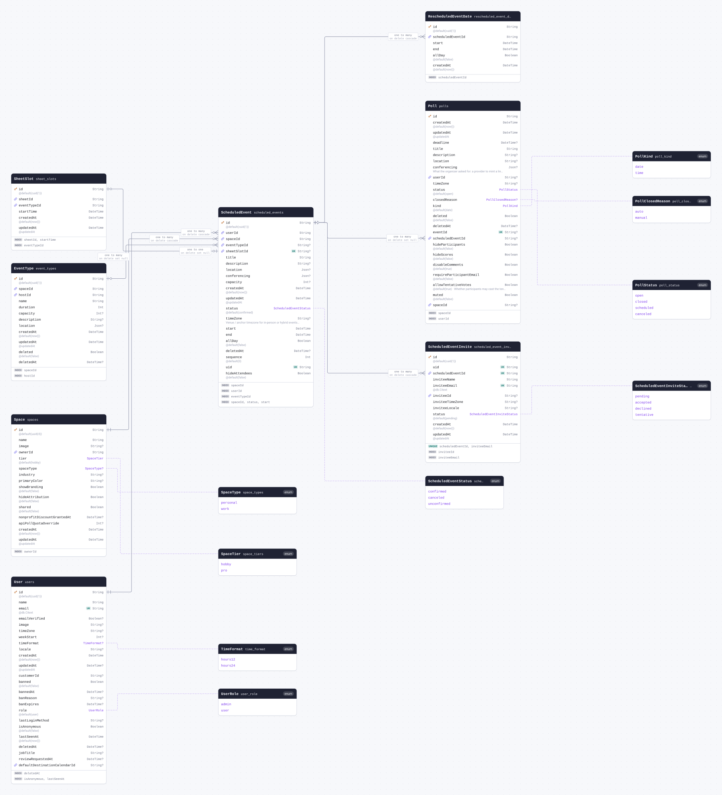

| Field                              | Type                                                 | Constraints                                    | Default      | Description                                                                                           |
| ---------------------------------- | ---------------------------------------------------- | ---------------------------------------------- | ------------ | ----------------------------------------------------------------------------------------------------- |
| `id`                               | `String`                                             | PK NOT NULL                                    | `cuid(1)`    |                                                                                                       |
| `userId` (`user_id`)               | `String`                                             | NOT NULL → [User.id](#model-User)              |              |                                                                                                       |
| `spaceId` (`space_id`)             | `String`                                             | NOT NULL → [Space.id](#model-Space)            |              |                                                                                                       |
| `eventTypeId` (`event_type_id`)    | `String`                                             | NULL → [EventType.id](#model-EventType)        |              |                                                                                                       |
| `sheetSlotId` (`sheet_slot_id`)    | `String`                                             | UNIQUE NULL → [SheetSlot.id](#model-SheetSlot) |              |                                                                                                       |
| `title`                            | `String`                                             | NOT NULL                                       |              |                                                                                                       |
| `description`                      | `String`                                             | NULL                                           |              |                                                                                                       |
| `location`                         | `Json`                                               | NULL                                           |              |                                                                                                       |
| `conferencing`                     | `Json`                                               | NULL                                           |              |                                                                                                       |
| `capacity`                         | `Int`                                                | NULL                                           |              |                                                                                                       |
| `createdAt` (`created_at`)         | `DateTime`                                           | NOT NULL                                       | `now()`      |                                                                                                       |
| `updatedAt` (`updated_at`)         | `DateTime`                                           | NOT NULL                                       | `@updatedAt` |                                                                                                       |
| `status`                           | [`ScheduledEventStatus`](#enum-ScheduledEventStatus) | NOT NULL                                       | `confirmed`  |                                                                                                       |
| `timeZone` (`time_zone`)           | `String`                                             | NULL                                           |              | Venue / anchor timezone for in-person or hybrid events. Null means no fixed venue (e.g. remote-only). |
| `start`                            | `DateTime`                                           | NOT NULL                                       |              |                                                                                                       |
| `end`                              | `DateTime`                                           | NOT NULL                                       |              |                                                                                                       |
| `allDay` (`all_day`)               | `Boolean`                                            | NOT NULL                                       | `false`      |                                                                                                       |
| `deletedAt` (`deleted_at`)         | `DateTime`                                           | NULL                                           |              |                                                                                                       |
| `sequence`                         | `Int`                                                | NOT NULL                                       | `0`          |                                                                                                       |
| `uid`                              | `String`                                             | UNIQUE NOT NULL                                |              |                                                                                                       |
| `hideAttendees` (`hide_attendees`) | `Boolean`                                            | NOT NULL                                       | `false`      |                                                                                                       |

#### Indexes

- `@@index([spaceId])`
- `@@index([userId])`
- `@@index([eventTypeId])`
- `@@index([spaceId, status, start])`

#### References

- `userId` → [User.id](#model-User) (many-to-one, on delete Cascade)
- `spaceId` → [Space.id](#model-Space) (many-to-one, on delete Cascade)
- `eventTypeId` → [EventType.id](#model-EventType) (many-to-one, on delete SetNull)
- `sheetSlotId` → [SheetSlot.id](#model-SheetSlot) (one-to-one, on delete SetNull)

#### Referenced by

- `id` ← [RescheduledEventDate.scheduledEventId](#model-RescheduledEventDate) (one-to-many, on delete Cascade)
- `id` ← [ScheduledEventInvite.scheduledEventId](#model-ScheduledEventInvite) (one-to-many, on delete Cascade)
- `id` ← [Poll.scheduledEventId](#model-Poll) (one-to-many, on delete SetNull)

#### Definition

```sql
CREATE TABLE "scheduled_events" (
    "id" TEXT NOT NULL,
    "user_id" TEXT NOT NULL,
    "space_id" TEXT NOT NULL,
    "event_type_id" TEXT,
    "sheet_slot_id" TEXT,
    "title" TEXT NOT NULL,
    "description" TEXT,
    "location" JSONB,
    "conferencing" JSONB,
    "capacity" INTEGER,
    "created_at" TIMESTAMP(3) NOT NULL DEFAULT CURRENT_TIMESTAMP,
    "updated_at" TIMESTAMP(3) NOT NULL,
    "status" "scheduled_event_status" NOT NULL DEFAULT 'confirmed',
    "time_zone" TEXT,
    "start" TIMESTAMP(3) NOT NULL,
    "end" TIMESTAMP(3) NOT NULL,
    "all_day" BOOLEAN NOT NULL DEFAULT false,
    "deleted_at" TIMESTAMP(3),
    "sequence" INTEGER NOT NULL DEFAULT 0,
    "uid" TEXT NOT NULL,
    "hide_attendees" BOOLEAN NOT NULL DEFAULT false,

    CONSTRAINT "scheduled_events_pkey" PRIMARY KEY ("id")
);

CREATE UNIQUE INDEX "scheduled_events_sheet_slot_id_key" ON "scheduled_events"("sheet_slot_id");

CREATE UNIQUE INDEX "scheduled_events_uid_key" ON "scheduled_events"("uid");

CREATE INDEX "scheduled_events_space_id_idx" ON "scheduled_events"("space_id");

CREATE INDEX "scheduled_events_user_id_idx" ON "scheduled_events"("user_id");

CREATE INDEX "scheduled_events_event_type_id_idx" ON "scheduled_events"("event_type_id");

CREATE INDEX "scheduled_events_space_id_status_start_idx" ON "scheduled_events"("space_id", "status", "start");

ALTER TABLE "scheduled_events" ADD CONSTRAINT "scheduled_events_user_id_fkey" FOREIGN KEY ("user_id") REFERENCES "users"("id") ON DELETE CASCADE ON UPDATE CASCADE;

ALTER TABLE "scheduled_events" ADD CONSTRAINT "scheduled_events_space_id_fkey" FOREIGN KEY ("space_id") REFERENCES "spaces"("id") ON DELETE CASCADE ON UPDATE CASCADE;

ALTER TABLE "scheduled_events" ADD CONSTRAINT "scheduled_events_event_type_id_fkey" FOREIGN KEY ("event_type_id") REFERENCES "event_types"("id") ON DELETE SET NULL ON UPDATE CASCADE;

ALTER TABLE "scheduled_events" ADD CONSTRAINT "scheduled_events_sheet_slot_id_fkey" FOREIGN KEY ("sheet_slot_id") REFERENCES "sheet_slots"("id") ON DELETE SET NULL ON UPDATE CASCADE;
```

<details>
<summary>Queries and their SQL</summary>

**findMany**: Every row

```ts
await prisma.scheduledEvent.findMany();
```

```sql
SELECT
  "public"."scheduled_events"."id",
  "public"."scheduled_events"."user_id",
  "public"."scheduled_events"."space_id",
  "public"."scheduled_events"."event_type_id",
  "public"."scheduled_events"."sheet_slot_id",
  "public"."scheduled_events"."title",
  "public"."scheduled_events"."description",
  "public"."scheduled_events"."location",
  "public"."scheduled_events"."conferencing",
  "public"."scheduled_events"."capacity",
  "public"."scheduled_events"."created_at",
  "public"."scheduled_events"."updated_at",
  "public"."scheduled_events"."status"::text,
  "public"."scheduled_events"."time_zone",
  "public"."scheduled_events"."start",
  "public"."scheduled_events"."end",
  "public"."scheduled_events"."all_day",
  "public"."scheduled_events"."deleted_at",
  "public"."scheduled_events"."sequence",
  "public"."scheduled_events"."uid",
  "public"."scheduled_events"."hide_attendees"
FROM
  "public"."scheduled_events"
WHERE
  1 = 1
OFFSET
  $1
-- params: ["0"]
```

**count**: How many rows there are

```ts
await prisma.scheduledEvent.count();
```

```sql
SELECT
  COUNT(*) AS "_count$_all"
FROM
  (
    SELECT
      "public"."scheduled_events"."id"
    FROM
      "public"."scheduled_events"
    WHERE
      1 = 1
    OFFSET
      $1
  ) AS "sub"
-- params: ["0"]
```

**findMany**: Every row with its relations

```ts
await prisma.scheduledEvent.findMany({
  include: {
    user: true,
    space: true,
    eventType: true,
    sheetSlot: true,
    rescheduledDates: true,
    invites: true,
    polls: true,
  },
});
```

```sql
SELECT
  "public"."scheduled_events"."id",
  "public"."scheduled_events"."user_id",
  "public"."scheduled_events"."space_id",
  "public"."scheduled_events"."event_type_id",
  "public"."scheduled_events"."sheet_slot_id",
  "public"."scheduled_events"."title",
  "public"."scheduled_events"."description",
  "public"."scheduled_events"."location",
  "public"."scheduled_events"."conferencing",
  "public"."scheduled_events"."capacity",
  "public"."scheduled_events"."created_at",
  "public"."scheduled_events"."updated_at",
  "public"."scheduled_events"."status"::text,
  "public"."scheduled_events"."time_zone",
  "public"."scheduled_events"."start",
  "public"."scheduled_events"."end",
  "public"."scheduled_events"."all_day",
  "public"."scheduled_events"."deleted_at",
  "public"."scheduled_events"."sequence",
  "public"."scheduled_events"."uid",
  "public"."scheduled_events"."hide_attendees"
FROM
  "public"."scheduled_events"
WHERE
  1 = 1
OFFSET
  $1
-- params: ["0"]

SELECT
  "public"."users"."id",
  "public"."users"."name",
  "public"."users"."email",
  "public"."users"."email_verified",
  "public"."users"."image",
  "public"."users"."time_zone",
  "public"."users"."week_start",
  "public"."users"."time_format"::text,
  "public"."users"."locale",
  "public"."users"."created_at",
  "public"."users"."updated_at",
  "public"."users"."customer_id",
  "public"."users"."banned",
  "public"."users"."banned_at",
  "public"."users"."ban_reason",
  "public"."users"."ban_expires",
  "public"."users"."role"::text,
  "public"."users"."last_login_method",
  "public"."users"."anonymous",
  "public"."users"."last_seen_at",
  "public"."users"."deleted_at",
  "public"."users"."job_title",
  "public"."users"."review_requested_at",
  "public"."users"."default_destination_calendar_id"
FROM
  "public"."users"
WHERE
  "public"."users"."id" IN ($1)
OFFSET
  $2
-- params: ["<userId of the rows above>","0"]

SELECT
  "public"."spaces"."id",
  "public"."spaces"."name",
  "public"."spaces"."image",
  "public"."spaces"."owner_id",
  "public"."spaces"."tier"::text,
  "public"."spaces"."space_type"::text,
  "public"."spaces"."industry",
  "public"."spaces"."primary_color",
  "public"."spaces"."show_branding",
  "public"."spaces"."hide_attribution",
  "public"."spaces"."shared",
  "public"."spaces"."nonprofit_discount_granted_at",
  "public"."spaces"."api_poll_quota_override",
  "public"."spaces"."created_at",
  "public"."spaces"."updated_at"
FROM
  "public"."spaces"
WHERE
  "public"."spaces"."id" IN ($1)
OFFSET
  $2
-- params: ["<spaceId of the rows above>","0"]

SELECT
  "public"."event_types"."id",
  "public"."event_types"."space_id",
  "public"."event_types"."host_id",
  "public"."event_types"."name",
  "public"."event_types"."duration_minutes",
  "public"."event_types"."capacity",
  "public"."event_types"."description",
  "public"."event_types"."location",
  "public"."event_types"."created_at",
  "public"."event_types"."updated_at",
  "public"."event_types"."deleted",
  "public"."event_types"."deleted_at"
FROM
  "public"."event_types"
WHERE
  "public"."event_types"."id" IN ($1)
OFFSET
  $2
-- params: ["<eventTypeId of the rows above>","0"]

SELECT
  "public"."sheet_slots"."id",
  "public"."sheet_slots"."sheet_id",
  "public"."sheet_slots"."event_type_id",
  "public"."sheet_slots"."start_time",
  "public"."sheet_slots"."created_at",
  "public"."sheet_slots"."updated_at"
FROM
  "public"."sheet_slots"
WHERE
  "public"."sheet_slots"."id" IN ($1)
OFFSET
  $2
-- params: ["<sheetSlotId of the rows above>","0"]

SELECT
  "public"."rescheduled_event_dates"."id",
  "public"."rescheduled_event_dates"."scheduled_event_id",
  "public"."rescheduled_event_dates"."start",
  "public"."rescheduled_event_dates"."end",
  "public"."rescheduled_event_dates"."all_day",
  "public"."rescheduled_event_dates"."created_at"
FROM
  "public"."rescheduled_event_dates"
WHERE
  "public"."rescheduled_event_dates"."scheduled_event_id" IN ($1)
OFFSET
  $2
-- params: ["<id of the rows above>","0"]

SELECT
  "public"."scheduled_event_invites"."id",
  "public"."scheduled_event_invites"."uid",
  "public"."scheduled_event_invites"."scheduled_event_id",
  "public"."scheduled_event_invites"."invitee_name",
  "public"."scheduled_event_invites"."invitee_email",
  "public"."scheduled_event_invites"."invitee_id",
  "public"."scheduled_event_invites"."invitee_time_zone",
  "public"."scheduled_event_invites"."invitee_locale",
  "public"."scheduled_event_invites"."status"::text,
  "public"."scheduled_event_invites"."created_at",
  "public"."scheduled_event_invites"."updated_at"
FROM
  "public"."scheduled_event_invites"
WHERE
  "public"."scheduled_event_invites"."scheduled_event_id" IN ($1)
OFFSET
  $2
-- params: ["<id of the rows above>","0"]

SELECT
  "public"."polls"."id",
  "public"."polls"."created_at",
  "public"."polls"."updated_at",
  "public"."polls"."deadline",
  "public"."polls"."title",
  "public"."polls"."description",
  "public"."polls"."location",
  "public"."polls"."conferencing",
  "public"."polls"."user_id",
  "public"."polls"."time_zone",
  "public"."polls"."status"::text,
  "public"."polls"."closed_reason"::text,
  "public"."polls"."kind"::text,
  "public"."polls"."deleted",
  "public"."polls"."deleted_at",
  "public"."polls"."event_id",
  "public"."polls"."scheduled_event_id",
  "public"."polls"."hide_participants",
  "public"."polls"."hide_scores",
  "public"."polls"."disable_comments",
  "public"."polls"."require_participant_email",
  "public"."polls"."allow_tentative_votes",
  "public"."polls"."muted",
  "public"."polls"."space_id"
FROM
  "public"."polls"
WHERE
  "public"."polls"."scheduled_event_id" IN ($1)
OFFSET
  $2
-- params: ["<id of the rows above>","0"]
```

**findUnique**: One row by what is unique to it

```ts
await prisma.scheduledEvent.findUnique({ where: { id: "example" } });
```

```sql
SELECT
  "public"."scheduled_events"."id",
  "public"."scheduled_events"."user_id",
  "public"."scheduled_events"."space_id",
  "public"."scheduled_events"."event_type_id",
  "public"."scheduled_events"."sheet_slot_id",
  "public"."scheduled_events"."title",
  "public"."scheduled_events"."description",
  "public"."scheduled_events"."location",
  "public"."scheduled_events"."conferencing",
  "public"."scheduled_events"."capacity",
  "public"."scheduled_events"."created_at",
  "public"."scheduled_events"."updated_at",
  "public"."scheduled_events"."status"::text,
  "public"."scheduled_events"."time_zone",
  "public"."scheduled_events"."start",
  "public"."scheduled_events"."end",
  "public"."scheduled_events"."all_day",
  "public"."scheduled_events"."deleted_at",
  "public"."scheduled_events"."sequence",
  "public"."scheduled_events"."uid",
  "public"."scheduled_events"."hide_attendees"
FROM
  "public"."scheduled_events"
WHERE
  (
    "public"."scheduled_events"."id" = $1
    AND 1 = 1
  )
LIMIT
  $2
OFFSET
  $3
-- params: ["example","1","0"]
```

**create**: Create a row

```ts
await prisma.scheduledEvent.create({
  data: {
    userId: "example",
    spaceId: "example",
    title: "example",
    start: new Date("2026-01-01T00:00:00.000Z"),
    end: new Date("2026-01-01T00:00:00.000Z"),
    uid: "example",
  },
});
```

```sql
INSERT INTO
  "public"."scheduled_events" (
    "id",
    "user_id",
    "space_id",
    "title",
    "created_at",
    "updated_at",
    "status",
    "start",
    "end",
    "all_day",
    "sequence",
    "uid",
    "hide_attendees"
  )
VALUES
  (
    $1,
    $2,
    $3,
    $4,
    $5,
    $6,
    CAST($7::text AS "public"."scheduled_event_status"),
    $8,
    $9,
    $10,
    $11,
    $12,
    $13
  )
RETURNING
  "public"."scheduled_events"."id",
  "public"."scheduled_events"."user_id",
  "public"."scheduled_events"."space_id",
  "public"."scheduled_events"."event_type_id",
  "public"."scheduled_events"."sheet_slot_id",
  "public"."scheduled_events"."title",
  "public"."scheduled_events"."description",
  "public"."scheduled_events"."location",
  "public"."scheduled_events"."conferencing",
  "public"."scheduled_events"."capacity",
  "public"."scheduled_events"."created_at",
  "public"."scheduled_events"."updated_at",
  "public"."scheduled_events"."status"::text,
  "public"."scheduled_events"."time_zone",
  "public"."scheduled_events"."start",
  "public"."scheduled_events"."end",
  "public"."scheduled_events"."all_day",
  "public"."scheduled_events"."deleted_at",
  "public"."scheduled_events"."sequence",
  "public"."scheduled_events"."uid",
  "public"."scheduled_events"."hide_attendees"
-- params: ["<cuid(1)>","example","example","example","<now()>","<now()>","confirmed","2026-01-01T00:00:00.000Z","2026-01-01T00:00:00.000Z",false,"0","example",false]
```

**update**: Update a row

```ts
await prisma.scheduledEvent.update({ where: { id: "example" }, data: { title: "example" } });
```

```sql
UPDATE "public"."scheduled_events"
SET
  "title" = $1,
  "updated_at" = $2
WHERE
  (
    "public"."scheduled_events"."id" = $3
    AND 1 = 1
  )
RETURNING
  "public"."scheduled_events"."id",
  "public"."scheduled_events"."user_id",
  "public"."scheduled_events"."space_id",
  "public"."scheduled_events"."event_type_id",
  "public"."scheduled_events"."sheet_slot_id",
  "public"."scheduled_events"."title",
  "public"."scheduled_events"."description",
  "public"."scheduled_events"."location",
  "public"."scheduled_events"."conferencing",
  "public"."scheduled_events"."capacity",
  "public"."scheduled_events"."created_at",
  "public"."scheduled_events"."updated_at",
  "public"."scheduled_events"."status"::text,
  "public"."scheduled_events"."time_zone",
  "public"."scheduled_events"."start",
  "public"."scheduled_events"."end",
  "public"."scheduled_events"."all_day",
  "public"."scheduled_events"."deleted_at",
  "public"."scheduled_events"."sequence",
  "public"."scheduled_events"."uid",
  "public"."scheduled_events"."hide_attendees"
-- params: ["example",{"prisma__type":"generatorCall","prisma__value":{"name":"now","args":[],"returnType":{"type":"DateTime"}}},"example"]
```

**delete**: Delete a row

```ts
await prisma.scheduledEvent.delete({ where: { id: "example" } });
```

```sql
DELETE FROM "public"."scheduled_events"
WHERE
  (
    "public"."scheduled_events"."id" = $1
    AND 1 = 1
  )
RETURNING
  "public"."scheduled_events"."id",
  "public"."scheduled_events"."user_id",
  "public"."scheduled_events"."space_id",
  "public"."scheduled_events"."event_type_id",
  "public"."scheduled_events"."sheet_slot_id",
  "public"."scheduled_events"."title",
  "public"."scheduled_events"."description",
  "public"."scheduled_events"."location",
  "public"."scheduled_events"."conferencing",
  "public"."scheduled_events"."capacity",
  "public"."scheduled_events"."created_at",
  "public"."scheduled_events"."updated_at",
  "public"."scheduled_events"."status"::text,
  "public"."scheduled_events"."time_zone",
  "public"."scheduled_events"."start",
  "public"."scheduled_events"."end",
  "public"."scheduled_events"."all_day",
  "public"."scheduled_events"."deleted_at",
  "public"."scheduled_events"."sequence",
  "public"."scheduled_events"."uid",
  "public"."scheduled_events"."hide_attendees"
-- params: ["example"]
```

</details>

<a id="model-RescheduledEventDate"></a>

### RescheduledEventDate

Table `rescheduled_event_dates`.

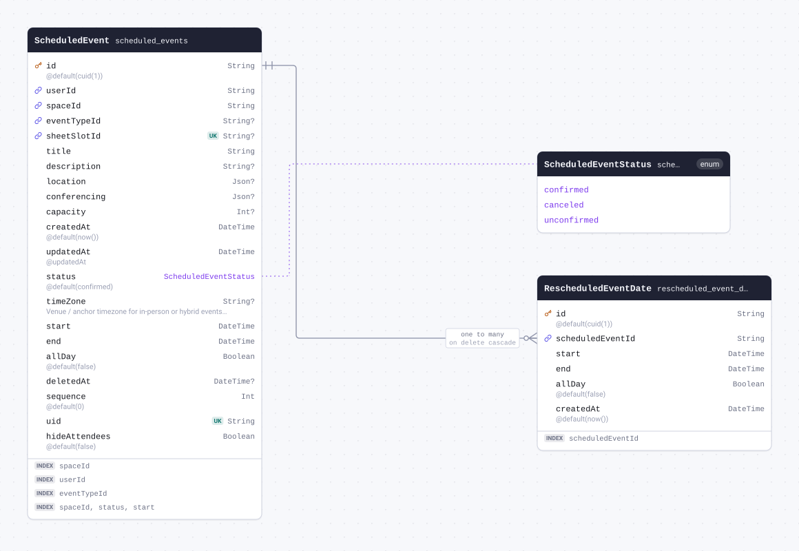

| Field                                     | Type       | Constraints                                           | Default   | Description |
| ----------------------------------------- | ---------- | ----------------------------------------------------- | --------- | ----------- |
| `id`                                      | `String`   | PK NOT NULL                                           | `cuid(1)` |             |
| `scheduledEventId` (`scheduled_event_id`) | `String`   | NOT NULL → [ScheduledEvent.id](#model-ScheduledEvent) |           |             |
| `start` (`start`)                         | `DateTime` | NOT NULL                                              |           |             |
| `end` (`end`)                             | `DateTime` | NOT NULL                                              |           |             |
| `allDay` (`all_day`)                      | `Boolean`  | NOT NULL                                              | `false`   |             |
| `createdAt` (`created_at`)                | `DateTime` | NOT NULL                                              | `now()`   |             |

#### Indexes

- `@@index([scheduledEventId])`

#### References

- `scheduledEventId` → [ScheduledEvent.id](#model-ScheduledEvent) (many-to-one, on delete Cascade)

#### Definition

```sql
CREATE TABLE "rescheduled_event_dates" (
    "id" TEXT NOT NULL,
    "scheduled_event_id" TEXT NOT NULL,
    "start" TIMESTAMP(3) NOT NULL,
    "end" TIMESTAMP(3) NOT NULL,
    "all_day" BOOLEAN NOT NULL DEFAULT false,
    "created_at" TIMESTAMP(3) NOT NULL DEFAULT CURRENT_TIMESTAMP,

    CONSTRAINT "rescheduled_event_dates_pkey" PRIMARY KEY ("id")
);

CREATE INDEX "rescheduled_event_dates_scheduled_event_id_idx" ON "rescheduled_event_dates"("scheduled_event_id");

ALTER TABLE "rescheduled_event_dates" ADD CONSTRAINT "rescheduled_event_dates_scheduled_event_id_fkey" FOREIGN KEY ("scheduled_event_id") REFERENCES "scheduled_events"("id") ON DELETE CASCADE ON UPDATE CASCADE;
```

<details>
<summary>Queries and their SQL</summary>

**findMany**: Every row

```ts
await prisma.rescheduledEventDate.findMany();
```

```sql
SELECT
  "public"."rescheduled_event_dates"."id",
  "public"."rescheduled_event_dates"."scheduled_event_id",
  "public"."rescheduled_event_dates"."start",
  "public"."rescheduled_event_dates"."end",
  "public"."rescheduled_event_dates"."all_day",
  "public"."rescheduled_event_dates"."created_at"
FROM
  "public"."rescheduled_event_dates"
WHERE
  1 = 1
OFFSET
  $1
-- params: ["0"]
```

**count**: How many rows there are

```ts
await prisma.rescheduledEventDate.count();
```

```sql
SELECT
  COUNT(*) AS "_count$_all"
FROM
  (
    SELECT
      "public"."rescheduled_event_dates"."id"
    FROM
      "public"."rescheduled_event_dates"
    WHERE
      1 = 1
    OFFSET
      $1
  ) AS "sub"
-- params: ["0"]
```

**findMany**: Every row with its relations

```ts
await prisma.rescheduledEventDate.findMany({ include: { scheduledEvent: true } });
```

```sql
SELECT
  "public"."rescheduled_event_dates"."id",
  "public"."rescheduled_event_dates"."scheduled_event_id",
  "public"."rescheduled_event_dates"."start",
  "public"."rescheduled_event_dates"."end",
  "public"."rescheduled_event_dates"."all_day",
  "public"."rescheduled_event_dates"."created_at"
FROM
  "public"."rescheduled_event_dates"
WHERE
  1 = 1
OFFSET
  $1
-- params: ["0"]

SELECT
  "public"."scheduled_events"."id",
  "public"."scheduled_events"."user_id",
  "public"."scheduled_events"."space_id",
  "public"."scheduled_events"."event_type_id",
  "public"."scheduled_events"."sheet_slot_id",
  "public"."scheduled_events"."title",
  "public"."scheduled_events"."description",
  "public"."scheduled_events"."location",
  "public"."scheduled_events"."conferencing",
  "public"."scheduled_events"."capacity",
  "public"."scheduled_events"."created_at",
  "public"."scheduled_events"."updated_at",
  "public"."scheduled_events"."status"::text,
  "public"."scheduled_events"."time_zone",
  "public"."scheduled_events"."start",
  "public"."scheduled_events"."end",
  "public"."scheduled_events"."all_day",
  "public"."scheduled_events"."deleted_at",
  "public"."scheduled_events"."sequence",
  "public"."scheduled_events"."uid",
  "public"."scheduled_events"."hide_attendees"
FROM
  "public"."scheduled_events"
WHERE
  "public"."scheduled_events"."id" IN ($1)
OFFSET
  $2
-- params: ["<scheduledEventId of the rows above>","0"]
```

**findUnique**: One row by what is unique to it

```ts
await prisma.rescheduledEventDate.findUnique({ where: { id: "example" } });
```

```sql
SELECT
  "public"."rescheduled_event_dates"."id",
  "public"."rescheduled_event_dates"."scheduled_event_id",
  "public"."rescheduled_event_dates"."start",
  "public"."rescheduled_event_dates"."end",
  "public"."rescheduled_event_dates"."all_day",
  "public"."rescheduled_event_dates"."created_at"
FROM
  "public"."rescheduled_event_dates"
WHERE
  (
    "public"."rescheduled_event_dates"."id" = $1
    AND 1 = 1
  )
LIMIT
  $2
OFFSET
  $3
-- params: ["example","1","0"]
```

**create**: Create a row

```ts
await prisma.rescheduledEventDate.create({
  data: {
    scheduledEventId: "example",
    start: new Date("2026-01-01T00:00:00.000Z"),
    end: new Date("2026-01-01T00:00:00.000Z"),
  },
});
```

```sql
INSERT INTO
  "public"."rescheduled_event_dates" (
    "id",
    "scheduled_event_id",
    "start",
    "end",
    "all_day",
    "created_at"
  )
VALUES
  ($1, $2, $3, $4, $5, $6)
RETURNING
  "public"."rescheduled_event_dates"."id",
  "public"."rescheduled_event_dates"."scheduled_event_id",
  "public"."rescheduled_event_dates"."start",
  "public"."rescheduled_event_dates"."end",
  "public"."rescheduled_event_dates"."all_day",
  "public"."rescheduled_event_dates"."created_at"
-- params: ["<cuid(1)>","example","2026-01-01T00:00:00.000Z","2026-01-01T00:00:00.000Z",false,"<now()>"]
```

**update**: Update a row

```ts
await prisma.rescheduledEventDate.update({
  where: { id: "example" },
  data: { start: new Date("2026-01-01T00:00:00.000Z") },
});
```

```sql
UPDATE "public"."rescheduled_event_dates"
SET
  "start" = $1
WHERE
  (
    "public"."rescheduled_event_dates"."id" = $2
    AND 1 = 1
  )
RETURNING
  "public"."rescheduled_event_dates"."id",
  "public"."rescheduled_event_dates"."scheduled_event_id",
  "public"."rescheduled_event_dates"."start",
  "public"."rescheduled_event_dates"."end",
  "public"."rescheduled_event_dates"."all_day",
  "public"."rescheduled_event_dates"."created_at"
-- params: ["2026-01-01T00:00:00.000Z","example"]
```

**delete**: Delete a row

```ts
await prisma.rescheduledEventDate.delete({ where: { id: "example" } });
```

```sql
DELETE FROM "public"."rescheduled_event_dates"
WHERE
  (
    "public"."rescheduled_event_dates"."id" = $1
    AND 1 = 1
  )
RETURNING
  "public"."rescheduled_event_dates"."id",
  "public"."rescheduled_event_dates"."scheduled_event_id",
  "public"."rescheduled_event_dates"."start",
  "public"."rescheduled_event_dates"."end",
  "public"."rescheduled_event_dates"."all_day",
  "public"."rescheduled_event_dates"."created_at"
-- params: ["example"]
```

</details>

<a id="model-ScheduledEventInvite"></a>

### ScheduledEventInvite

Table `scheduled_event_invites`.

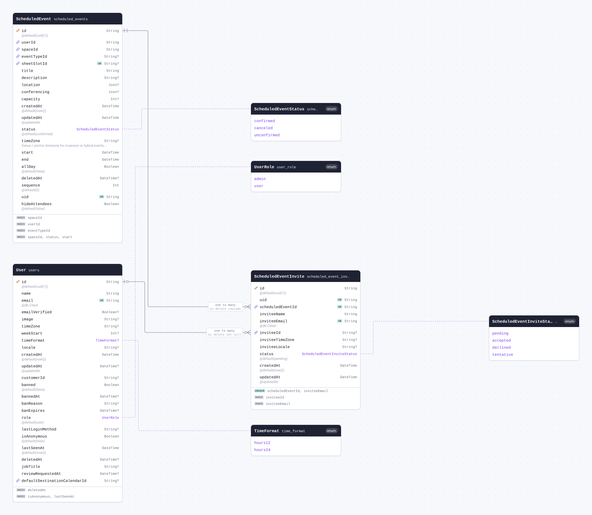

| Field                                     | Type                                                             | Constraints                                           | Default      | Description |
| ----------------------------------------- | ---------------------------------------------------------------- | ----------------------------------------------------- | ------------ | ----------- |
| `id`                                      | `String`                                                         | PK NOT NULL                                           | `cuid(1)`    |             |
| `uid`                                     | `String`                                                         | UNIQUE NOT NULL                                       |              |             |
| `scheduledEventId` (`scheduled_event_id`) | `String`                                                         | NOT NULL → [ScheduledEvent.id](#model-ScheduledEvent) |              |             |
| `inviteeName` (`invitee_name`)            | `String`                                                         | NOT NULL                                              |              |             |
| `inviteeEmail` (`invitee_email`)          | `String` `@db.Citext`                                            | NOT NULL                                              |              |             |
| `inviteeId` (`invitee_id`)                | `String`                                                         | NULL → [User.id](#model-User)                         |              |             |
| `inviteeTimeZone` (`invitee_time_zone`)   | `String`                                                         | NULL                                                  |              |             |
| `inviteeLocale` (`invitee_locale`)        | `String`                                                         | NULL                                                  |              |             |
| `status`                                  | [`ScheduledEventInviteStatus`](#enum-ScheduledEventInviteStatus) | NOT NULL                                              | `pending`    |             |
| `createdAt` (`created_at`)                | `DateTime`                                                       | NOT NULL                                              | `now()`      |             |
| `updatedAt` (`updated_at`)                | `DateTime`                                                       | NOT NULL                                              | `@updatedAt` |             |

#### Indexes

- `@@index([inviteeId])`
- `@@index([inviteeEmail])`
- `@@unique([scheduledEventId, inviteeEmail])`

#### References

- `scheduledEventId` → [ScheduledEvent.id](#model-ScheduledEvent) (many-to-one, on delete Cascade)
- `inviteeId` → [User.id](#model-User) (many-to-one, on delete SetNull)

#### Definition

```sql
CREATE TABLE "scheduled_event_invites" (
    "id" TEXT NOT NULL,
    "uid" TEXT NOT NULL,
    "scheduled_event_id" TEXT NOT NULL,
    "invitee_name" TEXT NOT NULL,
    "invitee_email" CITEXT NOT NULL,
    "invitee_id" TEXT,
    "invitee_time_zone" TEXT,
    "invitee_locale" TEXT,
    "status" "scheduled_event_invite_status" NOT NULL DEFAULT 'pending',
    "created_at" TIMESTAMP(3) NOT NULL DEFAULT CURRENT_TIMESTAMP,
    "updated_at" TIMESTAMP(3) NOT NULL,

    CONSTRAINT "scheduled_event_invites_pkey" PRIMARY KEY ("id")
);

CREATE UNIQUE INDEX "scheduled_event_invites_uid_key" ON "scheduled_event_invites"("uid");

CREATE INDEX "scheduled_event_invites_invitee_id_idx" ON "scheduled_event_invites"("invitee_id");

CREATE INDEX "scheduled_event_invites_invitee_email_idx" ON "scheduled_event_invites"("invitee_email");

CREATE UNIQUE INDEX "scheduled_event_invites_scheduled_event_id_invitee_email_key" ON "scheduled_event_invites"("scheduled_event_id", "invitee_email");

ALTER TABLE "scheduled_event_invites" ADD CONSTRAINT "scheduled_event_invites_scheduled_event_id_fkey" FOREIGN KEY ("scheduled_event_id") REFERENCES "scheduled_events"("id") ON DELETE CASCADE ON UPDATE CASCADE;

ALTER TABLE "scheduled_event_invites" ADD CONSTRAINT "scheduled_event_invites_invitee_id_fkey" FOREIGN KEY ("invitee_id") REFERENCES "users"("id") ON DELETE SET NULL ON UPDATE CASCADE;
```

<details>
<summary>Queries and their SQL</summary>

**findMany**: Every row

```ts
await prisma.scheduledEventInvite.findMany();
```

```sql
SELECT
  "public"."scheduled_event_invites"."id",
  "public"."scheduled_event_invites"."uid",
  "public"."scheduled_event_invites"."scheduled_event_id",
  "public"."scheduled_event_invites"."invitee_name",
  "public"."scheduled_event_invites"."invitee_email",
  "public"."scheduled_event_invites"."invitee_id",
  "public"."scheduled_event_invites"."invitee_time_zone",
  "public"."scheduled_event_invites"."invitee_locale",
  "public"."scheduled_event_invites"."status"::text,
  "public"."scheduled_event_invites"."created_at",
  "public"."scheduled_event_invites"."updated_at"
FROM
  "public"."scheduled_event_invites"
WHERE
  1 = 1
OFFSET
  $1
-- params: ["0"]
```

**count**: How many rows there are

```ts
await prisma.scheduledEventInvite.count();
```

```sql
SELECT
  COUNT(*) AS "_count$_all"
FROM
  (
    SELECT
      "public"."scheduled_event_invites"."id"
    FROM
      "public"."scheduled_event_invites"
    WHERE
      1 = 1
    OFFSET
      $1
  ) AS "sub"
-- params: ["0"]
```

**findMany**: Every row with its relations

```ts
await prisma.scheduledEventInvite.findMany({ include: { scheduledEvent: true, user: true } });
```

```sql
SELECT
  "public"."scheduled_event_invites"."id",
  "public"."scheduled_event_invites"."uid",
  "public"."scheduled_event_invites"."scheduled_event_id",
  "public"."scheduled_event_invites"."invitee_name",
  "public"."scheduled_event_invites"."invitee_email",
  "public"."scheduled_event_invites"."invitee_id",
  "public"."scheduled_event_invites"."invitee_time_zone",
  "public"."scheduled_event_invites"."invitee_locale",
  "public"."scheduled_event_invites"."status"::text,
  "public"."scheduled_event_invites"."created_at",
  "public"."scheduled_event_invites"."updated_at"
FROM
  "public"."scheduled_event_invites"
WHERE
  1 = 1
OFFSET
  $1
-- params: ["0"]

SELECT
  "public"."scheduled_events"."id",
  "public"."scheduled_events"."user_id",
  "public"."scheduled_events"."space_id",
  "public"."scheduled_events"."event_type_id",
  "public"."scheduled_events"."sheet_slot_id",
  "public"."scheduled_events"."title",
  "public"."scheduled_events"."description",
  "public"."scheduled_events"."location",
  "public"."scheduled_events"."conferencing",
  "public"."scheduled_events"."capacity",
  "public"."scheduled_events"."created_at",
  "public"."scheduled_events"."updated_at",
  "public"."scheduled_events"."status"::text,
  "public"."scheduled_events"."time_zone",
  "public"."scheduled_events"."start",
  "public"."scheduled_events"."end",
  "public"."scheduled_events"."all_day",
  "public"."scheduled_events"."deleted_at",
  "public"."scheduled_events"."sequence",
  "public"."scheduled_events"."uid",
  "public"."scheduled_events"."hide_attendees"
FROM
  "public"."scheduled_events"
WHERE
  "public"."scheduled_events"."id" IN ($1)
OFFSET
  $2
-- params: ["<scheduledEventId of the rows above>","0"]

SELECT
  "public"."users"."id",
  "public"."users"."name",
  "public"."users"."email",
  "public"."users"."email_verified",
  "public"."users"."image",
  "public"."users"."time_zone",
  "public"."users"."week_start",
  "public"."users"."time_format"::text,
  "public"."users"."locale",
  "public"."users"."created_at",
  "public"."users"."updated_at",
  "public"."users"."customer_id",
  "public"."users"."banned",
  "public"."users"."banned_at",
  "public"."users"."ban_reason",
  "public"."users"."ban_expires",
  "public"."users"."role"::text,
  "public"."users"."last_login_method",
  "public"."users"."anonymous",
  "public"."users"."last_seen_at",
  "public"."users"."deleted_at",
  "public"."users"."job_title",
  "public"."users"."review_requested_at",
  "public"."users"."default_destination_calendar_id"
FROM
  "public"."users"
WHERE
  "public"."users"."id" IN ($1)
OFFSET
  $2
-- params: ["<inviteeId of the rows above>","0"]
```

**findUnique**: One row by what is unique to it

```ts
await prisma.scheduledEventInvite.findUnique({ where: { id: "example" } });
```

```sql
SELECT
  "public"."scheduled_event_invites"."id",
  "public"."scheduled_event_invites"."uid",
  "public"."scheduled_event_invites"."scheduled_event_id",
  "public"."scheduled_event_invites"."invitee_name",
  "public"."scheduled_event_invites"."invitee_email",
  "public"."scheduled_event_invites"."invitee_id",
  "public"."scheduled_event_invites"."invitee_time_zone",
  "public"."scheduled_event_invites"."invitee_locale",
  "public"."scheduled_event_invites"."status"::text,
  "public"."scheduled_event_invites"."created_at",
  "public"."scheduled_event_invites"."updated_at"
FROM
  "public"."scheduled_event_invites"
WHERE
  (
    "public"."scheduled_event_invites"."id" = $1
    AND 1 = 1
  )
LIMIT
  $2
OFFSET
  $3
-- params: ["example","1","0"]
```

**create**: Create a row

```ts
await prisma.scheduledEventInvite.create({
  data: {
    uid: "example",
    scheduledEventId: "example",
    inviteeName: "example",
    inviteeEmail: "example",
  },
});
```

```sql
INSERT INTO
  "public"."scheduled_event_invites" (
    "id",
    "uid",
    "scheduled_event_id",
    "invitee_name",
    "invitee_email",
    "status",
    "created_at",
    "updated_at"
  )
VALUES
  (
    $1,
    $2,
    $3,
    $4,
    $5,
    CAST(
      $6::text AS "public"."scheduled_event_invite_status"
    ),
    $7,
    $8
  )
RETURNING
  "public"."scheduled_event_invites"."id",
  "public"."scheduled_event_invites"."uid",
  "public"."scheduled_event_invites"."scheduled_event_id",
  "public"."scheduled_event_invites"."invitee_name",
  "public"."scheduled_event_invites"."invitee_email",
  "public"."scheduled_event_invites"."invitee_id",
  "public"."scheduled_event_invites"."invitee_time_zone",
  "public"."scheduled_event_invites"."invitee_locale",
  "public"."scheduled_event_invites"."status"::text,
  "public"."scheduled_event_invites"."created_at",
  "public"."scheduled_event_invites"."updated_at"
-- params: ["<cuid(1)>","example","example","example","example","pending","<now()>","<now()>"]
```

**update**: Update a row

```ts
await prisma.scheduledEventInvite.update({ where: { id: "example" }, data: { uid: "example" } });
```

```sql
UPDATE "public"."scheduled_event_invites"
SET
  "uid" = $1,
  "updated_at" = $2
WHERE
  (
    "public"."scheduled_event_invites"."id" = $3
    AND 1 = 1
  )
RETURNING
  "public"."scheduled_event_invites"."id",
  "public"."scheduled_event_invites"."uid",
  "public"."scheduled_event_invites"."scheduled_event_id",
  "public"."scheduled_event_invites"."invitee_name",
  "public"."scheduled_event_invites"."invitee_email",
  "public"."scheduled_event_invites"."invitee_id",
  "public"."scheduled_event_invites"."invitee_time_zone",
  "public"."scheduled_event_invites"."invitee_locale",
  "public"."scheduled_event_invites"."status"::text,
  "public"."scheduled_event_invites"."created_at",
  "public"."scheduled_event_invites"."updated_at"
-- params: ["example",{"prisma__type":"generatorCall","prisma__value":{"name":"now","args":[],"returnType":{"type":"DateTime"}}},"example"]
```

**delete**: Delete a row

```ts
await prisma.scheduledEventInvite.delete({ where: { id: "example" } });
```

```sql
DELETE FROM "public"."scheduled_event_invites"
WHERE
  (
    "public"."scheduled_event_invites"."id" = $1
    AND 1 = 1
  )
RETURNING
  "public"."scheduled_event_invites"."id",
  "public"."scheduled_event_invites"."uid",
  "public"."scheduled_event_invites"."scheduled_event_id",
  "public"."scheduled_event_invites"."invitee_name",
  "public"."scheduled_event_invites"."invitee_email",
  "public"."scheduled_event_invites"."invitee_id",
  "public"."scheduled_event_invites"."invitee_time_zone",
  "public"."scheduled_event_invites"."invitee_locale",
  "public"."scheduled_event_invites"."status"::text,
  "public"."scheduled_event_invites"."created_at",
  "public"."scheduled_event_invites"."updated_at"
-- params: ["example"]
```

</details>

<a id="model-InstanceSettings"></a>

### InstanceSettings

Table `instance_settings`.

| Field                                                   | Type                | Constraints     | Default                            | Description |
| ------------------------------------------------------- | ------------------- | --------------- | ---------------------------------- | ----------- |
| `id`                                                    | `Int`               | PK NOT NULL     | `1`                                |             |
| `disableUserRegistration` (`disable_user_registration`) | `Boolean`           | NOT NULL        | `false`                            |             |
| `instanceId` (`instance_id`)                            | `String` `@db.Uuid` | UNIQUE NOT NULL | `dbgenerated("gen_random_uuid()")` |             |
| `appName` (`app_name`)                                  | `String`            | NULL            |                                    |             |
| `primaryColor` (`primary_color`)                        | `String`            | NULL            |                                    |             |
| `primaryColorDark` (`primary_color_dark`)               | `String`            | NULL            |                                    |             |
| `logo`                                                  | `String`            | NULL            |                                    |             |
| `logoDark` (`logo_dark`)                                | `String`            | NULL            |                                    |             |
| `logoIcon` (`logo_icon`)                                | `String`            | NULL            |                                    |             |
| `hideAttribution` (`hide_attribution`)                  | `Boolean`           | NULL            |                                    |             |
| `footerLinks` (`footer_links`)                          | `Json`              | NOT NULL        | `"[]"`                             |             |
| `createdAt` (`created_at`)                              | `DateTime`          | NOT NULL        | `now()`                            |             |
| `updatedAt` (`updated_at`)                              | `DateTime`          | NOT NULL        | `now()` `@updatedAt`               |             |

#### Definition

```sql
CREATE TABLE "instance_settings" (
    "id" INTEGER NOT NULL DEFAULT 1,
    "disable_user_registration" BOOLEAN NOT NULL DEFAULT false,
    "instance_id" UUID NOT NULL DEFAULT gen_random_uuid(),
    "app_name" TEXT,
    "primary_color" TEXT,
    "primary_color_dark" TEXT,
    "logo" TEXT,
    "logo_dark" TEXT,
    "logo_icon" TEXT,
    "hide_attribution" BOOLEAN,
    "footer_links" JSONB NOT NULL DEFAULT '[]',
    "created_at" TIMESTAMP(3) NOT NULL DEFAULT CURRENT_TIMESTAMP,
    "updated_at" TIMESTAMP(3) NOT NULL DEFAULT CURRENT_TIMESTAMP,

    CONSTRAINT "instance_settings_pkey" PRIMARY KEY ("id")
);

CREATE UNIQUE INDEX "instance_settings_instance_id_key" ON "instance_settings"("instance_id");
```

<details>
<summary>Queries and their SQL</summary>

**findMany**: Every row

```ts
await prisma.instanceSettings.findMany();
```

```sql
SELECT
  "public"."instance_settings"."id",
  "public"."instance_settings"."disable_user_registration",
  "public"."instance_settings"."instance_id",
  "public"."instance_settings"."app_name",
  "public"."instance_settings"."primary_color",
  "public"."instance_settings"."primary_color_dark",
  "public"."instance_settings"."logo",
  "public"."instance_settings"."logo_dark",
  "public"."instance_settings"."logo_icon",
  "public"."instance_settings"."hide_attribution",
  "public"."instance_settings"."footer_links",
  "public"."instance_settings"."created_at",
  "public"."instance_settings"."updated_at"
FROM
  "public"."instance_settings"
WHERE
  1 = 1
OFFSET
  $1
-- params: ["0"]
```

**count**: How many rows there are

```ts
await prisma.instanceSettings.count();
```

```sql
SELECT
  COUNT(*) AS "_count$_all"
FROM
  (
    SELECT
      "public"."instance_settings"."id"
    FROM
      "public"."instance_settings"
    WHERE
      1 = 1
    OFFSET
      $1
  ) AS "sub"
-- params: ["0"]
```

**findUnique**: One row by what is unique to it

```ts
await prisma.instanceSettings.findUnique({ where: { id: 1 } });
```

```sql
SELECT
  "public"."instance_settings"."id",
  "public"."instance_settings"."disable_user_registration",
  "public"."instance_settings"."instance_id",
  "public"."instance_settings"."app_name",
  "public"."instance_settings"."primary_color",
  "public"."instance_settings"."primary_color_dark",
  "public"."instance_settings"."logo",
  "public"."instance_settings"."logo_dark",
  "public"."instance_settings"."logo_icon",
  "public"."instance_settings"."hide_attribution",
  "public"."instance_settings"."footer_links",
  "public"."instance_settings"."created_at",
  "public"."instance_settings"."updated_at"
FROM
  "public"."instance_settings"
WHERE
  (
    "public"."instance_settings"."id" = $1
    AND 1 = 1
  )
LIMIT
  $2
OFFSET
  $3
-- params: ["1","1","0"]
```

**create**: Create a row

```ts
await prisma.instanceSettings.create({ data: {} });
```

```sql
INSERT INTO
  "public"."instance_settings" (
    "id",
    "disable_user_registration",
    "footer_links",
    "created_at",
    "updated_at"
  )
VALUES
  ($1, $2, $3, $4, $5)
RETURNING
  "public"."instance_settings"."id",
  "public"."instance_settings"."disable_user_registration",
  "public"."instance_settings"."instance_id",
  "public"."instance_settings"."app_name",
  "public"."instance_settings"."primary_color",
  "public"."instance_settings"."primary_color_dark",
  "public"."instance_settings"."logo",
  "public"."instance_settings"."logo_dark",
  "public"."instance_settings"."logo_icon",
  "public"."instance_settings"."hide_attribution",
  "public"."instance_settings"."footer_links",
  "public"."instance_settings"."created_at",
  "public"."instance_settings"."updated_at"
-- params: ["1",false,"[]","<now()>","<now()>"]
```

**update**: Update a row

```ts
await prisma.instanceSettings.update({ where: { id: 1 }, data: { disableUserRegistration: true } });
```

```sql
UPDATE "public"."instance_settings"
SET
  "disable_user_registration" = $1,
  "updated_at" = $2
WHERE
  (
    "public"."instance_settings"."id" = $3
    AND 1 = 1
  )
RETURNING
  "public"."instance_settings"."id",
  "public"."instance_settings"."disable_user_registration",
  "public"."instance_settings"."instance_id",
  "public"."instance_settings"."app_name",
  "public"."instance_settings"."primary_color",
  "public"."instance_settings"."primary_color_dark",
  "public"."instance_settings"."logo",
  "public"."instance_settings"."logo_dark",
  "public"."instance_settings"."logo_icon",
  "public"."instance_settings"."hide_attribution",
  "public"."instance_settings"."footer_links",
  "public"."instance_settings"."created_at",
  "public"."instance_settings"."updated_at"
-- params: [true,{"prisma__type":"generatorCall","prisma__value":{"name":"now","args":[],"returnType":{"type":"DateTime"}}},"1"]
```

**delete**: Delete a row

```ts
await prisma.instanceSettings.delete({ where: { id: 1 } });
```

```sql
DELETE FROM "public"."instance_settings"
WHERE
  (
    "public"."instance_settings"."id" = $1
    AND 1 = 1
  )
RETURNING
  "public"."instance_settings"."id",
  "public"."instance_settings"."disable_user_registration",
  "public"."instance_settings"."instance_id",
  "public"."instance_settings"."app_name",
  "public"."instance_settings"."primary_color",
  "public"."instance_settings"."primary_color_dark",
  "public"."instance_settings"."logo",
  "public"."instance_settings"."logo_dark",
  "public"."instance_settings"."logo_icon",
  "public"."instance_settings"."hide_attribution",
  "public"."instance_settings"."footer_links",
  "public"."instance_settings"."created_at",
  "public"."instance_settings"."updated_at"
-- params: ["1"]
```

</details>

<a id="model-Credential"></a>

### Credential

Table `credentials`.

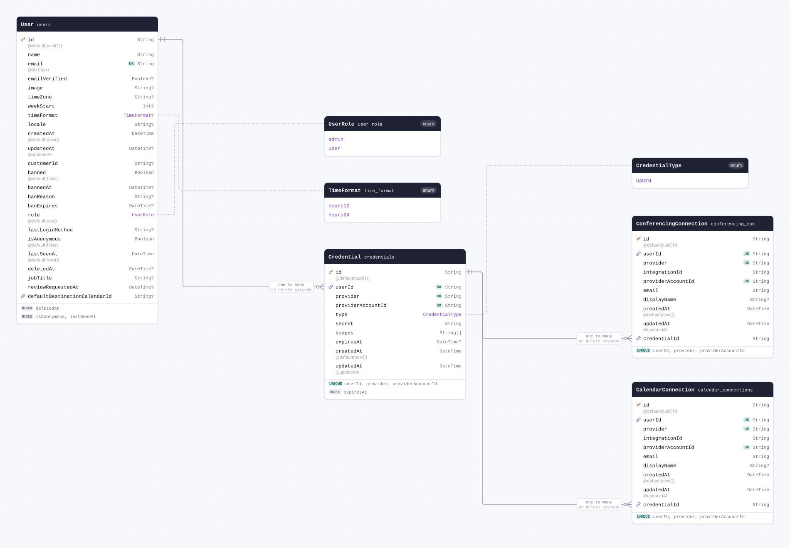

| Field                                       | Type                                     | Constraints                       | Default      | Description |
| ------------------------------------------- | ---------------------------------------- | --------------------------------- | ------------ | ----------- |
| `id`                                        | `String`                                 | PK NOT NULL                       | `cuid(1)`    |             |
| `userId` (`user_id`)                        | `String`                                 | NOT NULL → [User.id](#model-User) |              |             |
| `provider`                                  | `String`                                 | NOT NULL                          |              |             |
| `providerAccountId` (`provider_account_id`) | `String`                                 | NOT NULL                          |              |             |
| `type`                                      | [`CredentialType`](#enum-CredentialType) | NOT NULL                          |              |             |
| `secret` (`secret`)                         | `String`                                 | NOT NULL                          |              |             |
| `scopes`                                    | `String[]`                               | NOT NULL                          |              |             |
| `expiresAt` (`expires_at`)                  | `DateTime`                               | NULL                              |              |             |
| `createdAt` (`created_at`)                  | `DateTime`                               | NOT NULL                          | `now()`      |             |
| `updatedAt` (`updated_at`)                  | `DateTime`                               | NOT NULL                          | `@updatedAt` |             |

#### Indexes

- `@@index([expiresAt], map: "credential_expiry_idx")`
- `@@unique([userId, provider, providerAccountId], name: "user_provider_account_unique")`

#### References

- `userId` → [User.id](#model-User) (many-to-one, on delete Cascade)

#### Referenced by

- `id` ← [CalendarConnection.credentialId](#model-CalendarConnection) (one-to-many, on delete Cascade)
- `id` ← [ConferencingConnection.credentialId](#model-ConferencingConnection) (one-to-many, on delete Cascade)

#### Definition

```sql
CREATE TABLE "credentials" (
    "id" TEXT NOT NULL,
    "user_id" TEXT NOT NULL,
    "provider" TEXT NOT NULL,
    "provider_account_id" TEXT NOT NULL,
    "type" "CredentialType" NOT NULL,
    "secret" TEXT NOT NULL,
    "scopes" TEXT[],
    "expires_at" TIMESTAMP(3),
    "created_at" TIMESTAMP(3) NOT NULL DEFAULT CURRENT_TIMESTAMP,
    "updated_at" TIMESTAMP(3) NOT NULL,

    CONSTRAINT "credentials_pkey" PRIMARY KEY ("id")
);

CREATE INDEX "credential_expiry_idx" ON "credentials"("expires_at");

CREATE UNIQUE INDEX "credentials_user_id_provider_provider_account_id_key" ON "credentials"("user_id", "provider", "provider_account_id");

ALTER TABLE "credentials" ADD CONSTRAINT "credentials_user_id_fkey" FOREIGN KEY ("user_id") REFERENCES "users"("id") ON DELETE CASCADE ON UPDATE CASCADE;
```

<details>
<summary>Queries and their SQL</summary>

**findMany**: Every row

```ts
await prisma.credential.findMany();
```

```sql
SELECT
  "public"."credentials"."id",
  "public"."credentials"."user_id",
  "public"."credentials"."provider",
  "public"."credentials"."provider_account_id",
  "public"."credentials"."type"::text,
  "public"."credentials"."secret",
  "public"."credentials"."scopes",
  "public"."credentials"."expires_at",
  "public"."credentials"."created_at",
  "public"."credentials"."updated_at"
FROM
  "public"."credentials"
WHERE
  1 = 1
OFFSET
  $1
-- params: ["0"]
```

**count**: How many rows there are

```ts
await prisma.credential.count();
```

```sql
SELECT
  COUNT(*) AS "_count$_all"
FROM
  (
    SELECT
      "public"."credentials"."id"
    FROM
      "public"."credentials"
    WHERE
      1 = 1
    OFFSET
      $1
  ) AS "sub"
-- params: ["0"]
```

**findMany**: Every row with its relations

```ts
await prisma.credential.findMany({
  include: { calendarConnections: true, conferencingConnections: true, user: true },
});
```

```sql
SELECT
  "public"."credentials"."id",
  "public"."credentials"."user_id",
  "public"."credentials"."provider",
  "public"."credentials"."provider_account_id",
  "public"."credentials"."type"::text,
  "public"."credentials"."secret",
  "public"."credentials"."scopes",
  "public"."credentials"."expires_at",
  "public"."credentials"."created_at",
  "public"."credentials"."updated_at"
FROM
  "public"."credentials"
WHERE
  1 = 1
OFFSET
  $1
-- params: ["0"]

SELECT
  "public"."calendar_connections"."id",
  "public"."calendar_connections"."user_id",
  "public"."calendar_connections"."provider",
  "public"."calendar_connections"."integration_id",
  "public"."calendar_connections"."provider_account_id",
  "public"."calendar_connections"."email",
  "public"."calendar_connections"."display_name",
  "public"."calendar_connections"."created_at",
  "public"."calendar_connections"."updated_at",
  "public"."calendar_connections"."credential_id"
FROM
  "public"."calendar_connections"
WHERE
  "public"."calendar_connections"."credential_id" IN ($1)
OFFSET
  $2
-- params: ["<id of the rows above>","0"]

SELECT
  "public"."conferencing_connections"."id",
  "public"."conferencing_connections"."user_id",
  "public"."conferencing_connections"."provider",
  "public"."conferencing_connections"."integration_id",
  "public"."conferencing_connections"."provider_account_id",
  "public"."conferencing_connections"."email",
  "public"."conferencing_connections"."display_name",
  "public"."conferencing_connections"."created_at",
  "public"."conferencing_connections"."updated_at",
  "public"."conferencing_connections"."credential_id"
FROM
  "public"."conferencing_connections"
WHERE
  "public"."conferencing_connections"."credential_id" IN ($1)
OFFSET
  $2
-- params: ["<id of the rows above>","0"]

SELECT
  "public"."users"."id",
  "public"."users"."name",
  "public"."users"."email",
  "public"."users"."email_verified",
  "public"."users"."image",
  "public"."users"."time_zone",
  "public"."users"."week_start",
  "public"."users"."time_format"::text,
  "public"."users"."locale",
  "public"."users"."created_at",
  "public"."users"."updated_at",
  "public"."users"."customer_id",
  "public"."users"."banned",
  "public"."users"."banned_at",
  "public"."users"."ban_reason",
  "public"."users"."ban_expires",
  "public"."users"."role"::text,
  "public"."users"."last_login_method",
  "public"."users"."anonymous",
  "public"."users"."last_seen_at",
  "public"."users"."deleted_at",
  "public"."users"."job_title",
  "public"."users"."review_requested_at",
  "public"."users"."default_destination_calendar_id"
FROM
  "public"."users"
WHERE
  "public"."users"."id" IN ($1)
OFFSET
  $2
-- params: ["<userId of the rows above>","0"]
```

**findUnique**: One row by what is unique to it

```ts
await prisma.credential.findUnique({ where: { id: "example" } });
```

```sql
SELECT
  "public"."credentials"."id",
  "public"."credentials"."user_id",
  "public"."credentials"."provider",
  "public"."credentials"."provider_account_id",
  "public"."credentials"."type"::text,
  "public"."credentials"."secret",
  "public"."credentials"."scopes",
  "public"."credentials"."expires_at",
  "public"."credentials"."created_at",
  "public"."credentials"."updated_at"
FROM
  "public"."credentials"
WHERE
  (
    "public"."credentials"."id" = $1
    AND 1 = 1
  )
LIMIT
  $2
OFFSET
  $3
-- params: ["example","1","0"]
```

**create**: Create a row

```ts
await prisma.credential.create({
  data: {
    userId: "example",
    provider: "example",
    providerAccountId: "example",
    type: "OAUTH",
    secret: "example",
    scopes: ["example"],
  },
});
```

```sql
INSERT INTO
  "public"."credentials" (
    "id",
    "user_id",
    "provider",
    "provider_account_id",
    "type",
    "secret",
    "scopes",
    "created_at",
    "updated_at"
  )
VALUES
  (
    $1,
    $2,
    $3,
    $4,
    CAST($5::text AS "public"."CredentialType"),
    $6,
    $7,
    $8,
    $9
  )
RETURNING
  "public"."credentials"."id",
  "public"."credentials"."user_id",
  "public"."credentials"."provider",
  "public"."credentials"."provider_account_id",
  "public"."credentials"."type"::text,
  "public"."credentials"."secret",
  "public"."credentials"."scopes",
  "public"."credentials"."expires_at",
  "public"."credentials"."created_at",
  "public"."credentials"."updated_at"
-- params: ["<cuid(1)>","example","example","example","OAUTH","example",["example"],"<now()>","<now()>"]
```

**update**: Update a row

```ts
await prisma.credential.update({ where: { id: "example" }, data: { provider: "example" } });
```

```sql
UPDATE "public"."credentials"
SET
  "provider" = $1,
  "updated_at" = $2
WHERE
  (
    "public"."credentials"."id" = $3
    AND 1 = 1
  )
RETURNING
  "public"."credentials"."id",
  "public"."credentials"."user_id",
  "public"."credentials"."provider",
  "public"."credentials"."provider_account_id",
  "public"."credentials"."type"::text,
  "public"."credentials"."secret",
  "public"."credentials"."scopes",
  "public"."credentials"."expires_at",
  "public"."credentials"."created_at",
  "public"."credentials"."updated_at"
-- params: ["example",{"prisma__type":"generatorCall","prisma__value":{"name":"now","args":[],"returnType":{"type":"DateTime"}}},"example"]
```

**delete**: Delete a row

```ts
await prisma.credential.delete({ where: { id: "example" } });
```

```sql
DELETE FROM "public"."credentials"
WHERE
  (
    "public"."credentials"."id" = $1
    AND 1 = 1
  )
RETURNING
  "public"."credentials"."id",
  "public"."credentials"."user_id",
  "public"."credentials"."provider",
  "public"."credentials"."provider_account_id",
  "public"."credentials"."type"::text,
  "public"."credentials"."secret",
  "public"."credentials"."scopes",
  "public"."credentials"."expires_at",
  "public"."credentials"."created_at",
  "public"."credentials"."updated_at"
-- params: ["example"]
```

</details>

<a id="model-CalendarConnection"></a>

### CalendarConnection

Table `calendar_connections`.

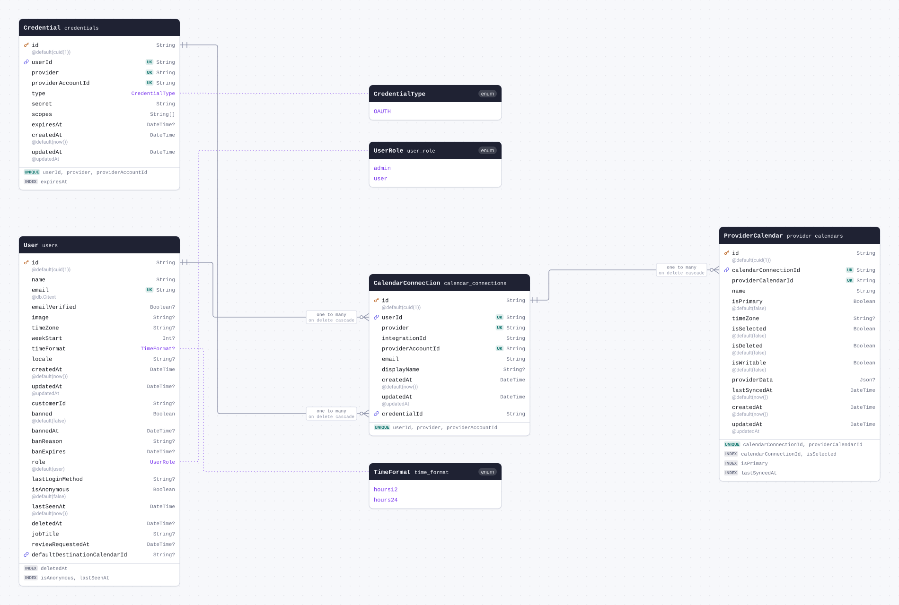

| Field                                       | Type       | Constraints                                   | Default      | Description |
| ------------------------------------------- | ---------- | --------------------------------------------- | ------------ | ----------- |
| `id`                                        | `String`   | PK NOT NULL                                   | `cuid(1)`    |             |
| `userId` (`user_id`)                        | `String`   | NOT NULL → [User.id](#model-User)             |              |             |
| `provider`                                  | `String`   | NOT NULL                                      |              |             |
| `integrationId` (`integration_id`)          | `String`   | NOT NULL                                      |              |             |
| `providerAccountId` (`provider_account_id`) | `String`   | NOT NULL                                      |              |             |
| `email`                                     | `String`   | NOT NULL                                      |              |             |
| `displayName` (`display_name`)              | `String`   | NULL                                          |              |             |
| `createdAt` (`created_at`)                  | `DateTime` | NOT NULL                                      | `now()`      |             |
| `updatedAt` (`updated_at`)                  | `DateTime` | NOT NULL                                      | `@updatedAt` |             |
| `credentialId` (`credential_id`)            | `String`   | NOT NULL → [Credential.id](#model-Credential) |              |             |

#### Indexes

- `@@unique([userId, provider, providerAccountId], name: "user_provider_account_unique")`

#### References

- `credentialId` → [Credential.id](#model-Credential) (many-to-one, on delete Cascade)
- `userId` → [User.id](#model-User) (many-to-one, on delete Cascade)

#### Referenced by

- `id` ← [ProviderCalendar.calendarConnectionId](#model-ProviderCalendar) (one-to-many, on delete Cascade)

#### Definition

```sql
CREATE TABLE "calendar_connections" (
    "id" TEXT NOT NULL,
    "user_id" TEXT NOT NULL,
    "provider" TEXT NOT NULL,
    "integration_id" TEXT NOT NULL,
    "provider_account_id" TEXT NOT NULL,
    "email" TEXT NOT NULL,
    "display_name" TEXT,
    "created_at" TIMESTAMP(3) NOT NULL DEFAULT CURRENT_TIMESTAMP,
    "updated_at" TIMESTAMP(3) NOT NULL,
    "credential_id" TEXT NOT NULL,

    CONSTRAINT "calendar_connections_pkey" PRIMARY KEY ("id")
);

CREATE UNIQUE INDEX "calendar_connections_user_id_provider_provider_account_id_key" ON "calendar_connections"("user_id", "provider", "provider_account_id");

ALTER TABLE "calendar_connections" ADD CONSTRAINT "calendar_connections_credential_id_fkey" FOREIGN KEY ("credential_id") REFERENCES "credentials"("id") ON DELETE CASCADE ON UPDATE CASCADE;

ALTER TABLE "calendar_connections" ADD CONSTRAINT "calendar_connections_user_id_fkey" FOREIGN KEY ("user_id") REFERENCES "users"("id") ON DELETE CASCADE ON UPDATE CASCADE;
```

<details>
<summary>Queries and their SQL</summary>

**findMany**: Every row

```ts
await prisma.calendarConnection.findMany();
```

```sql
SELECT
  "public"."calendar_connections"."id",
  "public"."calendar_connections"."user_id",
  "public"."calendar_connections"."provider",
  "public"."calendar_connections"."integration_id",
  "public"."calendar_connections"."provider_account_id",
  "public"."calendar_connections"."email",
  "public"."calendar_connections"."display_name",
  "public"."calendar_connections"."created_at",
  "public"."calendar_connections"."updated_at",
  "public"."calendar_connections"."credential_id"
FROM
  "public"."calendar_connections"
WHERE
  1 = 1
OFFSET
  $1
-- params: ["0"]
```

**count**: How many rows there are

```ts
await prisma.calendarConnection.count();
```

```sql
SELECT
  COUNT(*) AS "_count$_all"
FROM
  (
    SELECT
      "public"."calendar_connections"."id"
    FROM
      "public"."calendar_connections"
    WHERE
      1 = 1
    OFFSET
      $1
  ) AS "sub"
-- params: ["0"]
```

**findMany**: Every row with its relations

```ts
await prisma.calendarConnection.findMany({
  include: { credential: true, user: true, providerCalendars: true },
});
```

```sql
SELECT
  "public"."calendar_connections"."id",
  "public"."calendar_connections"."user_id",
  "public"."calendar_connections"."provider",
  "public"."calendar_connections"."integration_id",
  "public"."calendar_connections"."provider_account_id",
  "public"."calendar_connections"."email",
  "public"."calendar_connections"."display_name",
  "public"."calendar_connections"."created_at",
  "public"."calendar_connections"."updated_at",
  "public"."calendar_connections"."credential_id"
FROM
  "public"."calendar_connections"
WHERE
  1 = 1
OFFSET
  $1
-- params: ["0"]

SELECT
  "public"."credentials"."id",
  "public"."credentials"."user_id",
  "public"."credentials"."provider",
  "public"."credentials"."provider_account_id",
  "public"."credentials"."type"::text,
  "public"."credentials"."secret",
  "public"."credentials"."scopes",
  "public"."credentials"."expires_at",
  "public"."credentials"."created_at",
  "public"."credentials"."updated_at"
FROM
  "public"."credentials"
WHERE
  "public"."credentials"."id" IN ($1)
OFFSET
  $2
-- params: ["<credentialId of the rows above>","0"]

SELECT
  "public"."users"."id",
  "public"."users"."name",
  "public"."users"."email",
  "public"."users"."email_verified",
  "public"."users"."image",
  "public"."users"."time_zone",
  "public"."users"."week_start",
  "public"."users"."time_format"::text,
  "public"."users"."locale",
  "public"."users"."created_at",
  "public"."users"."updated_at",
  "public"."users"."customer_id",
  "public"."users"."banned",
  "public"."users"."banned_at",
  "public"."users"."ban_reason",
  "public"."users"."ban_expires",
  "public"."users"."role"::text,
  "public"."users"."last_login_method",
  "public"."users"."anonymous",
  "public"."users"."last_seen_at",
  "public"."users"."deleted_at",
  "public"."users"."job_title",
  "public"."users"."review_requested_at",
  "public"."users"."default_destination_calendar_id"
FROM
  "public"."users"
WHERE
  "public"."users"."id" IN ($1)
OFFSET
  $2
-- params: ["<userId of the rows above>","0"]

SELECT
  "public"."provider_calendars"."id",
  "public"."provider_calendars"."calendar_connection_id",
  "public"."provider_calendars"."provider_calendar_id",
  "public"."provider_calendars"."name",
  "public"."provider_calendars"."primary",
  "public"."provider_calendars"."time_zone",
  "public"."provider_calendars"."selected",
  "public"."provider_calendars"."deleted",
  "public"."provider_calendars"."writable",
  "public"."provider_calendars"."provider_data",
  "public"."provider_calendars"."last_synced_at",
  "public"."provider_calendars"."created_at",
  "public"."provider_calendars"."updated_at"
FROM
  "public"."provider_calendars"
WHERE
  "public"."provider_calendars"."calendar_connection_id" IN ($1)
OFFSET
  $2
-- params: ["<id of the rows above>","0"]
```

**findUnique**: One row by what is unique to it

```ts
await prisma.calendarConnection.findUnique({ where: { id: "example" } });
```

```sql
SELECT
  "public"."calendar_connections"."id",
  "public"."calendar_connections"."user_id",
  "public"."calendar_connections"."provider",
  "public"."calendar_connections"."integration_id",
  "public"."calendar_connections"."provider_account_id",
  "public"."calendar_connections"."email",
  "public"."calendar_connections"."display_name",
  "public"."calendar_connections"."created_at",
  "public"."calendar_connections"."updated_at",
  "public"."calendar_connections"."credential_id"
FROM
  "public"."calendar_connections"
WHERE
  (
    "public"."calendar_connections"."id" = $1
    AND 1 = 1
  )
LIMIT
  $2
OFFSET
  $3
-- params: ["example","1","0"]
```

**create**: Create a row

```ts
await prisma.calendarConnection.create({
  data: {
    userId: "example",
    provider: "example",
    integrationId: "example",
    providerAccountId: "example",
    email: "example",
    credentialId: "example",
  },
});
```

```sql
INSERT INTO
  "public"."calendar_connections" (
    "id",
    "user_id",
    "provider",
    "integration_id",
    "provider_account_id",
    "email",
    "created_at",
    "updated_at",
    "credential_id"
  )
VALUES
  ($1, $2, $3, $4, $5, $6, $7, $8, $9)
RETURNING
  "public"."calendar_connections"."id",
  "public"."calendar_connections"."user_id",
  "public"."calendar_connections"."provider",
  "public"."calendar_connections"."integration_id",
  "public"."calendar_connections"."provider_account_id",
  "public"."calendar_connections"."email",
  "public"."calendar_connections"."display_name",
  "public"."calendar_connections"."created_at",
  "public"."calendar_connections"."updated_at",
  "public"."calendar_connections"."credential_id"
-- params: ["<cuid(1)>","example","example","example","example","example","<now()>","<now()>","example"]
```

**update**: Update a row

```ts
await prisma.calendarConnection.update({ where: { id: "example" }, data: { provider: "example" } });
```

```sql
UPDATE "public"."calendar_connections"
SET
  "provider" = $1,
  "updated_at" = $2
WHERE
  (
    "public"."calendar_connections"."id" = $3
    AND 1 = 1
  )
RETURNING
  "public"."calendar_connections"."id",
  "public"."calendar_connections"."user_id",
  "public"."calendar_connections"."provider",
  "public"."calendar_connections"."integration_id",
  "public"."calendar_connections"."provider_account_id",
  "public"."calendar_connections"."email",
  "public"."calendar_connections"."display_name",
  "public"."calendar_connections"."created_at",
  "public"."calendar_connections"."updated_at",
  "public"."calendar_connections"."credential_id"
-- params: ["example",{"prisma__type":"generatorCall","prisma__value":{"name":"now","args":[],"returnType":{"type":"DateTime"}}},"example"]
```

**delete**: Delete a row

```ts
await prisma.calendarConnection.delete({ where: { id: "example" } });
```

```sql
DELETE FROM "public"."calendar_connections"
WHERE
  (
    "public"."calendar_connections"."id" = $1
    AND 1 = 1
  )
RETURNING
  "public"."calendar_connections"."id",
  "public"."calendar_connections"."user_id",
  "public"."calendar_connections"."provider",
  "public"."calendar_connections"."integration_id",
  "public"."calendar_connections"."provider_account_id",
  "public"."calendar_connections"."email",
  "public"."calendar_connections"."display_name",
  "public"."calendar_connections"."created_at",
  "public"."calendar_connections"."updated_at",
  "public"."calendar_connections"."credential_id"
-- params: ["example"]
```

</details>

<a id="model-ProviderCalendar"></a>

### ProviderCalendar

Table `provider_calendars`.

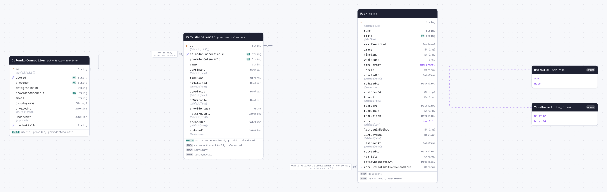

| Field                                             | Type       | Constraints                                                   | Default      | Description |
| ------------------------------------------------- | ---------- | ------------------------------------------------------------- | ------------ | ----------- |
| `id`                                              | `String`   | PK NOT NULL                                                   | `cuid(1)`    |             |
| `calendarConnectionId` (`calendar_connection_id`) | `String`   | NOT NULL → [CalendarConnection.id](#model-CalendarConnection) |              |             |
| `providerCalendarId` (`provider_calendar_id`)     | `String`   | NOT NULL                                                      |              |             |
| `name`                                            | `String`   | NOT NULL                                                      |              |             |
| `isPrimary` (`primary`)                           | `Boolean`  | NOT NULL                                                      | `false`      |             |
| `timeZone` (`time_zone`)                          | `String`   | NULL                                                          |              |             |
| `isSelected` (`selected`)                         | `Boolean`  | NOT NULL                                                      | `false`      |             |
| `isDeleted` (`deleted`)                           | `Boolean`  | NOT NULL                                                      | `false`      |             |
| `isWritable` (`writable`)                         | `Boolean`  | NOT NULL                                                      | `false`      |             |
| `providerData` (`provider_data`)                  | `Json`     | NULL                                                          |              |             |
| `lastSyncedAt` (`last_synced_at`)                 | `DateTime` | NOT NULL                                                      | `now()`      |             |
| `createdAt` (`created_at`)                        | `DateTime` | NOT NULL                                                      | `now()`      |             |
| `updatedAt` (`updated_at`)                        | `DateTime` | NOT NULL                                                      | `@updatedAt` |             |

#### Indexes

- `@@index([calendarConnectionId, isSelected], map: "connection_selected_idx")`
- `@@index([isPrimary], map: "primary_calendar_idx")`
- `@@index([lastSyncedAt], map: "sync_time_idx")`
- `@@unique([calendarConnectionId, providerCalendarId], name: "connection_calendar_unique")`

#### References

- `calendarConnectionId` → [CalendarConnection.id](#model-CalendarConnection) (many-to-one, on delete Cascade)

#### Referenced by

- `id` ← [User.defaultDestinationCalendarId](#model-User) (one-to-many, on delete SetNull)

#### Definition

```sql
CREATE TABLE "provider_calendars" (
    "id" TEXT NOT NULL,
    "calendar_connection_id" TEXT NOT NULL,
    "provider_calendar_id" TEXT NOT NULL,
    "name" TEXT NOT NULL,
    "primary" BOOLEAN NOT NULL DEFAULT false,
    "time_zone" TEXT,
    "selected" BOOLEAN NOT NULL DEFAULT false,
    "deleted" BOOLEAN NOT NULL DEFAULT false,
    "writable" BOOLEAN NOT NULL DEFAULT false,
    "provider_data" JSONB,
    "last_synced_at" TIMESTAMP(3) NOT NULL DEFAULT CURRENT_TIMESTAMP,
    "created_at" TIMESTAMP(3) NOT NULL DEFAULT CURRENT_TIMESTAMP,
    "updated_at" TIMESTAMP(3) NOT NULL,

    CONSTRAINT "provider_calendars_pkey" PRIMARY KEY ("id")
);

CREATE INDEX "connection_selected_idx" ON "provider_calendars"("calendar_connection_id", "selected");

CREATE INDEX "primary_calendar_idx" ON "provider_calendars"("primary");

CREATE INDEX "sync_time_idx" ON "provider_calendars"("last_synced_at");

CREATE UNIQUE INDEX "provider_calendars_calendar_connection_id_provider_calendar_key" ON "provider_calendars"("calendar_connection_id", "provider_calendar_id");

ALTER TABLE "provider_calendars" ADD CONSTRAINT "provider_calendars_calendar_connection_id_fkey" FOREIGN KEY ("calendar_connection_id") REFERENCES "calendar_connections"("id") ON DELETE CASCADE ON UPDATE CASCADE;
```

<details>
<summary>Queries and their SQL</summary>

**findMany**: Every row

```ts
await prisma.providerCalendar.findMany();
```

```sql
SELECT
  "public"."provider_calendars"."id",
  "public"."provider_calendars"."calendar_connection_id",
  "public"."provider_calendars"."provider_calendar_id",
  "public"."provider_calendars"."name",
  "public"."provider_calendars"."primary",
  "public"."provider_calendars"."time_zone",
  "public"."provider_calendars"."selected",
  "public"."provider_calendars"."deleted",
  "public"."provider_calendars"."writable",
  "public"."provider_calendars"."provider_data",
  "public"."provider_calendars"."last_synced_at",
  "public"."provider_calendars"."created_at",
  "public"."provider_calendars"."updated_at"
FROM
  "public"."provider_calendars"
WHERE
  1 = 1
OFFSET
  $1
-- params: ["0"]
```

**count**: How many rows there are

```ts
await prisma.providerCalendar.count();
```

```sql
SELECT
  COUNT(*) AS "_count$_all"
FROM
  (
    SELECT
      "public"."provider_calendars"."id"
    FROM
      "public"."provider_calendars"
    WHERE
      1 = 1
    OFFSET
      $1
  ) AS "sub"
-- params: ["0"]
```

**findMany**: Every row with its relations

```ts
await prisma.providerCalendar.findMany({
  include: { calendarConnection: true, userDefaultDestination: true },
});
```

```sql
SELECT
  "public"."provider_calendars"."id",
  "public"."provider_calendars"."calendar_connection_id",
  "public"."provider_calendars"."provider_calendar_id",
  "public"."provider_calendars"."name",
  "public"."provider_calendars"."primary",
  "public"."provider_calendars"."time_zone",
  "public"."provider_calendars"."selected",
  "public"."provider_calendars"."deleted",
  "public"."provider_calendars"."writable",
  "public"."provider_calendars"."provider_data",
  "public"."provider_calendars"."last_synced_at",
  "public"."provider_calendars"."created_at",
  "public"."provider_calendars"."updated_at"
FROM
  "public"."provider_calendars"
WHERE
  1 = 1
OFFSET
  $1
-- params: ["0"]

SELECT
  "public"."calendar_connections"."id",
  "public"."calendar_connections"."user_id",
  "public"."calendar_connections"."provider",
  "public"."calendar_connections"."integration_id",
  "public"."calendar_connections"."provider_account_id",
  "public"."calendar_connections"."email",
  "public"."calendar_connections"."display_name",
  "public"."calendar_connections"."created_at",
  "public"."calendar_connections"."updated_at",
  "public"."calendar_connections"."credential_id"
FROM
  "public"."calendar_connections"
WHERE
  "public"."calendar_connections"."id" IN ($1)
OFFSET
  $2
-- params: ["<calendarConnectionId of the rows above>","0"]

SELECT
  "public"."users"."id",
  "public"."users"."name",
  "public"."users"."email",
  "public"."users"."email_verified",
  "public"."users"."image",
  "public"."users"."time_zone",
  "public"."users"."week_start",
  "public"."users"."time_format"::text,
  "public"."users"."locale",
  "public"."users"."created_at",
  "public"."users"."updated_at",
  "public"."users"."customer_id",
  "public"."users"."banned",
  "public"."users"."banned_at",
  "public"."users"."ban_reason",
  "public"."users"."ban_expires",
  "public"."users"."role"::text,
  "public"."users"."last_login_method",
  "public"."users"."anonymous",
  "public"."users"."last_seen_at",
  "public"."users"."deleted_at",
  "public"."users"."job_title",
  "public"."users"."review_requested_at",
  "public"."users"."default_destination_calendar_id"
FROM
  "public"."users"
WHERE
  "public"."users"."default_destination_calendar_id" IN ($1)
OFFSET
  $2
-- params: ["<id of the rows above>","0"]
```

**findUnique**: One row by what is unique to it

```ts
await prisma.providerCalendar.findUnique({ where: { id: "example" } });
```

```sql
SELECT
  "public"."provider_calendars"."id",
  "public"."provider_calendars"."calendar_connection_id",
  "public"."provider_calendars"."provider_calendar_id",
  "public"."provider_calendars"."name",
  "public"."provider_calendars"."primary",
  "public"."provider_calendars"."time_zone",
  "public"."provider_calendars"."selected",
  "public"."provider_calendars"."deleted",
  "public"."provider_calendars"."writable",
  "public"."provider_calendars"."provider_data",
  "public"."provider_calendars"."last_synced_at",
  "public"."provider_calendars"."created_at",
  "public"."provider_calendars"."updated_at"
FROM
  "public"."provider_calendars"
WHERE
  (
    "public"."provider_calendars"."id" = $1
    AND 1 = 1
  )
LIMIT
  $2
OFFSET
  $3
-- params: ["example","1","0"]
```

**create**: Create a row

```ts
await prisma.providerCalendar.create({
  data: { calendarConnectionId: "example", providerCalendarId: "example", name: "example" },
});
```

```sql
INSERT INTO
  "public"."provider_calendars" (
    "id",
    "calendar_connection_id",
    "provider_calendar_id",
    "name",
    "primary",
    "selected",
    "deleted",
    "writable",
    "last_synced_at",
    "created_at",
    "updated_at"
  )
VALUES
  ($1, $2, $3, $4, $5, $6, $7, $8, $9, $10, $11)
RETURNING
  "public"."provider_calendars"."id",
  "public"."provider_calendars"."calendar_connection_id",
  "public"."provider_calendars"."provider_calendar_id",
  "public"."provider_calendars"."name",
  "public"."provider_calendars"."primary",
  "public"."provider_calendars"."time_zone",
  "public"."provider_calendars"."selected",
  "public"."provider_calendars"."deleted",
  "public"."provider_calendars"."writable",
  "public"."provider_calendars"."provider_data",
  "public"."provider_calendars"."last_synced_at",
  "public"."provider_calendars"."created_at",
  "public"."provider_calendars"."updated_at"
-- params: ["<cuid(1)>","example","example","example",false,false,false,false,"<now()>","<now()>","<now()>"]
```

**update**: Update a row

```ts
await prisma.providerCalendar.update({
  where: { id: "example" },
  data: { providerCalendarId: "example" },
});
```

```sql
UPDATE "public"."provider_calendars"
SET
  "provider_calendar_id" = $1,
  "updated_at" = $2
WHERE
  (
    "public"."provider_calendars"."id" = $3
    AND 1 = 1
  )
RETURNING
  "public"."provider_calendars"."id",
  "public"."provider_calendars"."calendar_connection_id",
  "public"."provider_calendars"."provider_calendar_id",
  "public"."provider_calendars"."name",
  "public"."provider_calendars"."primary",
  "public"."provider_calendars"."time_zone",
  "public"."provider_calendars"."selected",
  "public"."provider_calendars"."deleted",
  "public"."provider_calendars"."writable",
  "public"."provider_calendars"."provider_data",
  "public"."provider_calendars"."last_synced_at",
  "public"."provider_calendars"."created_at",
  "public"."provider_calendars"."updated_at"
-- params: ["example",{"prisma__type":"generatorCall","prisma__value":{"name":"now","args":[],"returnType":{"type":"DateTime"}}},"example"]
```

**delete**: Delete a row

```ts
await prisma.providerCalendar.delete({ where: { id: "example" } });
```

```sql
DELETE FROM "public"."provider_calendars"
WHERE
  (
    "public"."provider_calendars"."id" = $1
    AND 1 = 1
  )
RETURNING
  "public"."provider_calendars"."id",
  "public"."provider_calendars"."calendar_connection_id",
  "public"."provider_calendars"."provider_calendar_id",
  "public"."provider_calendars"."name",
  "public"."provider_calendars"."primary",
  "public"."provider_calendars"."time_zone",
  "public"."provider_calendars"."selected",
  "public"."provider_calendars"."deleted",
  "public"."provider_calendars"."writable",
  "public"."provider_calendars"."provider_data",
  "public"."provider_calendars"."last_synced_at",
  "public"."provider_calendars"."created_at",
  "public"."provider_calendars"."updated_at"
-- params: ["example"]
```

</details>

<a id="model-ConferencingConnection"></a>

### ConferencingConnection

Table `conferencing_connections`.

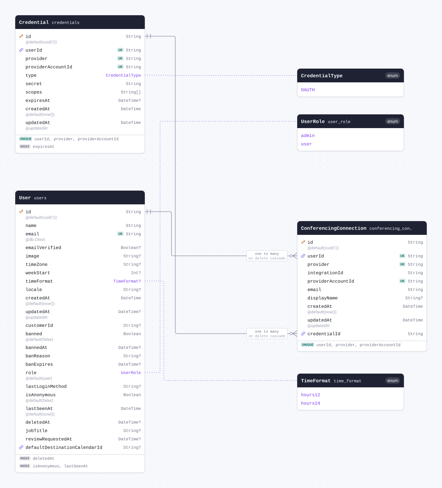

| Field                                       | Type       | Constraints                                   | Default      | Description |
| ------------------------------------------- | ---------- | --------------------------------------------- | ------------ | ----------- |
| `id`                                        | `String`   | PK NOT NULL                                   | `cuid(1)`    |             |
| `userId` (`user_id`)                        | `String`   | NOT NULL → [User.id](#model-User)             |              |             |
| `provider`                                  | `String`   | NOT NULL                                      |              |             |
| `integrationId` (`integration_id`)          | `String`   | NOT NULL                                      |              |             |
| `providerAccountId` (`provider_account_id`) | `String`   | NOT NULL                                      |              |             |
| `email`                                     | `String`   | NOT NULL                                      |              |             |
| `displayName` (`display_name`)              | `String`   | NULL                                          |              |             |
| `createdAt` (`created_at`)                  | `DateTime` | NOT NULL                                      | `now()`      |             |
| `updatedAt` (`updated_at`)                  | `DateTime` | NOT NULL                                      | `@updatedAt` |             |
| `credentialId` (`credential_id`)            | `String`   | NOT NULL → [Credential.id](#model-Credential) |              |             |

#### Indexes

- `@@unique([userId, provider, providerAccountId], name: "user_provider_account_unique")`

#### References

- `credentialId` → [Credential.id](#model-Credential) (many-to-one, on delete Cascade)
- `userId` → [User.id](#model-User) (many-to-one, on delete Cascade)

#### Definition

```sql
CREATE TABLE "conferencing_connections" (
    "id" TEXT NOT NULL,
    "user_id" TEXT NOT NULL,
    "provider" TEXT NOT NULL,
    "integration_id" TEXT NOT NULL,
    "provider_account_id" TEXT NOT NULL,
    "email" TEXT NOT NULL,
    "display_name" TEXT,
    "created_at" TIMESTAMP(3) NOT NULL DEFAULT CURRENT_TIMESTAMP,
    "updated_at" TIMESTAMP(3) NOT NULL,
    "credential_id" TEXT NOT NULL,

    CONSTRAINT "conferencing_connections_pkey" PRIMARY KEY ("id")
);

CREATE UNIQUE INDEX "conferencing_connections_user_id_provider_provider_account__key" ON "conferencing_connections"("user_id", "provider", "provider_account_id");

ALTER TABLE "conferencing_connections" ADD CONSTRAINT "conferencing_connections_credential_id_fkey" FOREIGN KEY ("credential_id") REFERENCES "credentials"("id") ON DELETE CASCADE ON UPDATE CASCADE;

ALTER TABLE "conferencing_connections" ADD CONSTRAINT "conferencing_connections_user_id_fkey" FOREIGN KEY ("user_id") REFERENCES "users"("id") ON DELETE CASCADE ON UPDATE CASCADE;
```

<details>
<summary>Queries and their SQL</summary>

**findMany**: Every row

```ts
await prisma.conferencingConnection.findMany();
```

```sql
SELECT
  "public"."conferencing_connections"."id",
  "public"."conferencing_connections"."user_id",
  "public"."conferencing_connections"."provider",
  "public"."conferencing_connections"."integration_id",
  "public"."conferencing_connections"."provider_account_id",
  "public"."conferencing_connections"."email",
  "public"."conferencing_connections"."display_name",
  "public"."conferencing_connections"."created_at",
  "public"."conferencing_connections"."updated_at",
  "public"."conferencing_connections"."credential_id"
FROM
  "public"."conferencing_connections"
WHERE
  1 = 1
OFFSET
  $1
-- params: ["0"]
```

**count**: How many rows there are

```ts
await prisma.conferencingConnection.count();
```

```sql
SELECT
  COUNT(*) AS "_count$_all"
FROM
  (
    SELECT
      "public"."conferencing_connections"."id"
    FROM
      "public"."conferencing_connections"
    WHERE
      1 = 1
    OFFSET
      $1
  ) AS "sub"
-- params: ["0"]
```

**findMany**: Every row with its relations

```ts
await prisma.conferencingConnection.findMany({ include: { credential: true, user: true } });
```

```sql
SELECT
  "public"."conferencing_connections"."id",
  "public"."conferencing_connections"."user_id",
  "public"."conferencing_connections"."provider",
  "public"."conferencing_connections"."integration_id",
  "public"."conferencing_connections"."provider_account_id",
  "public"."conferencing_connections"."email",
  "public"."conferencing_connections"."display_name",
  "public"."conferencing_connections"."created_at",
  "public"."conferencing_connections"."updated_at",
  "public"."conferencing_connections"."credential_id"
FROM
  "public"."conferencing_connections"
WHERE
  1 = 1
OFFSET
  $1
-- params: ["0"]

SELECT
  "public"."credentials"."id",
  "public"."credentials"."user_id",
  "public"."credentials"."provider",
  "public"."credentials"."provider_account_id",
  "public"."credentials"."type"::text,
  "public"."credentials"."secret",
  "public"."credentials"."scopes",
  "public"."credentials"."expires_at",
  "public"."credentials"."created_at",
  "public"."credentials"."updated_at"
FROM
  "public"."credentials"
WHERE
  "public"."credentials"."id" IN ($1)
OFFSET
  $2
-- params: ["<credentialId of the rows above>","0"]

SELECT
  "public"."users"."id",
  "public"."users"."name",
  "public"."users"."email",
  "public"."users"."email_verified",
  "public"."users"."image",
  "public"."users"."time_zone",
  "public"."users"."week_start",
  "public"."users"."time_format"::text,
  "public"."users"."locale",
  "public"."users"."created_at",
  "public"."users"."updated_at",
  "public"."users"."customer_id",
  "public"."users"."banned",
  "public"."users"."banned_at",
  "public"."users"."ban_reason",
  "public"."users"."ban_expires",
  "public"."users"."role"::text,
  "public"."users"."last_login_method",
  "public"."users"."anonymous",
  "public"."users"."last_seen_at",
  "public"."users"."deleted_at",
  "public"."users"."job_title",
  "public"."users"."review_requested_at",
  "public"."users"."default_destination_calendar_id"
FROM
  "public"."users"
WHERE
  "public"."users"."id" IN ($1)
OFFSET
  $2
-- params: ["<userId of the rows above>","0"]
```

**findUnique**: One row by what is unique to it

```ts
await prisma.conferencingConnection.findUnique({ where: { id: "example" } });
```

```sql
SELECT
  "public"."conferencing_connections"."id",
  "public"."conferencing_connections"."user_id",
  "public"."conferencing_connections"."provider",
  "public"."conferencing_connections"."integration_id",
  "public"."conferencing_connections"."provider_account_id",
  "public"."conferencing_connections"."email",
  "public"."conferencing_connections"."display_name",
  "public"."conferencing_connections"."created_at",
  "public"."conferencing_connections"."updated_at",
  "public"."conferencing_connections"."credential_id"
FROM
  "public"."conferencing_connections"
WHERE
  (
    "public"."conferencing_connections"."id" = $1
    AND 1 = 1
  )
LIMIT
  $2
OFFSET
  $3
-- params: ["example","1","0"]
```

**create**: Create a row

```ts
await prisma.conferencingConnection.create({
  data: {
    userId: "example",
    provider: "example",
    integrationId: "example",
    providerAccountId: "example",
    email: "example",
    credentialId: "example",
  },
});
```

```sql
INSERT INTO
  "public"."conferencing_connections" (
    "id",
    "user_id",
    "provider",
    "integration_id",
    "provider_account_id",
    "email",
    "created_at",
    "updated_at",
    "credential_id"
  )
VALUES
  ($1, $2, $3, $4, $5, $6, $7, $8, $9)
RETURNING
  "public"."conferencing_connections"."id",
  "public"."conferencing_connections"."user_id",
  "public"."conferencing_connections"."provider",
  "public"."conferencing_connections"."integration_id",
  "public"."conferencing_connections"."provider_account_id",
  "public"."conferencing_connections"."email",
  "public"."conferencing_connections"."display_name",
  "public"."conferencing_connections"."created_at",
  "public"."conferencing_connections"."updated_at",
  "public"."conferencing_connections"."credential_id"
-- params: ["<cuid(1)>","example","example","example","example","example","<now()>","<now()>","example"]
```

**update**: Update a row

```ts
await prisma.conferencingConnection.update({
  where: { id: "example" },
  data: { provider: "example" },
});
```

```sql
UPDATE "public"."conferencing_connections"
SET
  "provider" = $1,
  "updated_at" = $2
WHERE
  (
    "public"."conferencing_connections"."id" = $3
    AND 1 = 1
  )
RETURNING
  "public"."conferencing_connections"."id",
  "public"."conferencing_connections"."user_id",
  "public"."conferencing_connections"."provider",
  "public"."conferencing_connections"."integration_id",
  "public"."conferencing_connections"."provider_account_id",
  "public"."conferencing_connections"."email",
  "public"."conferencing_connections"."display_name",
  "public"."conferencing_connections"."created_at",
  "public"."conferencing_connections"."updated_at",
  "public"."conferencing_connections"."credential_id"
-- params: ["example",{"prisma__type":"generatorCall","prisma__value":{"name":"now","args":[],"returnType":{"type":"DateTime"}}},"example"]
```

**delete**: Delete a row

```ts
await prisma.conferencingConnection.delete({ where: { id: "example" } });
```

```sql
DELETE FROM "public"."conferencing_connections"
WHERE
  (
    "public"."conferencing_connections"."id" = $1
    AND 1 = 1
  )
RETURNING
  "public"."conferencing_connections"."id",
  "public"."conferencing_connections"."user_id",
  "public"."conferencing_connections"."provider",
  "public"."conferencing_connections"."integration_id",
  "public"."conferencing_connections"."provider_account_id",
  "public"."conferencing_connections"."email",
  "public"."conferencing_connections"."display_name",
  "public"."conferencing_connections"."created_at",
  "public"."conferencing_connections"."updated_at",
  "public"."conferencing_connections"."credential_id"
-- params: ["example"]
```

</details>

<a id="model-License"></a>

### License

Table `licenses`.

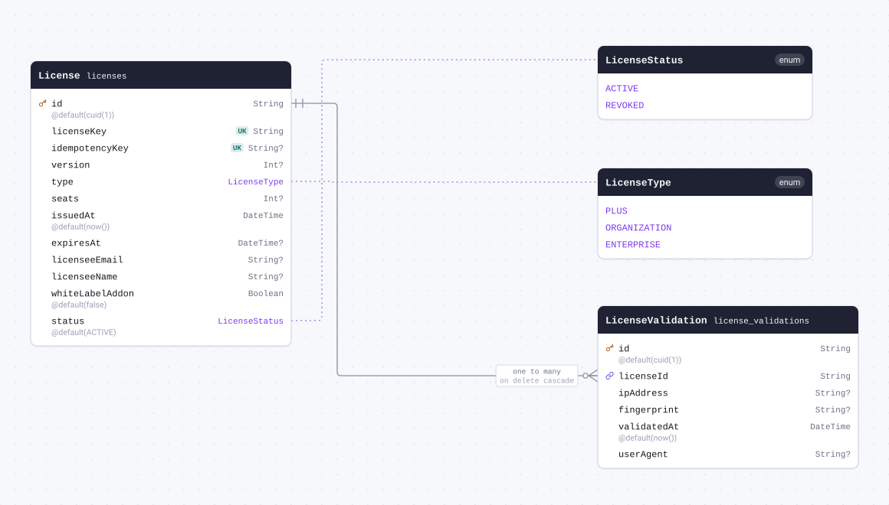

| Field                                   | Type                                   | Constraints     | Default   | Description |
| --------------------------------------- | -------------------------------------- | --------------- | --------- | ----------- |
| `id`                                    | `String`                               | PK NOT NULL     | `cuid(1)` |             |
| `licenseKey` (`license_key`)            | `String`                               | UNIQUE NOT NULL |           |             |
| `idempotencyKey` (`idempotency_key`)    | `String`                               | UNIQUE NULL     |           |             |
| `version` (`version`)                   | `Int`                                  | NULL            |           |             |
| `type`                                  | [`LicenseType`](#enum-LicenseType)     | NOT NULL        |           |             |
| `seats` (`seats`)                       | `Int`                                  | NULL            |           |             |
| `issuedAt` (`issued_at`)                | `DateTime`                             | NOT NULL        | `now()`   |             |
| `expiresAt` (`expires_at`)              | `DateTime`                             | NULL            |           |             |
| `licenseeEmail` (`licensee_email`)      | `String`                               | NULL            |           |             |
| `licenseeName` (`licensee_name`)        | `String`                               | NULL            |           |             |
| `whiteLabelAddon` (`white_label_addon`) | `Boolean`                              | NOT NULL        | `false`   |             |
| `status` (`status`)                     | [`LicenseStatus`](#enum-LicenseStatus) | NOT NULL        | `ACTIVE`  |             |

#### Referenced by

- `id` ← [LicenseValidation.licenseId](#model-LicenseValidation) (one-to-many, on delete Cascade)

#### Definition

```sql
CREATE TABLE "licenses" (
    "id" TEXT NOT NULL,
    "license_key" TEXT NOT NULL,
    "idempotency_key" TEXT,
    "version" INTEGER,
    "type" "LicenseType" NOT NULL,
    "seats" INTEGER,
    "issued_at" TIMESTAMP(3) NOT NULL DEFAULT CURRENT_TIMESTAMP,
    "expires_at" TIMESTAMP(3),
    "licensee_email" TEXT,
    "licensee_name" TEXT,
    "white_label_addon" BOOLEAN NOT NULL DEFAULT false,
    "status" "LicenseStatus" NOT NULL DEFAULT 'ACTIVE',

    CONSTRAINT "licenses_pkey" PRIMARY KEY ("id")
);

CREATE UNIQUE INDEX "licenses_license_key_key" ON "licenses"("license_key");

CREATE UNIQUE INDEX "licenses_idempotency_key_key" ON "licenses"("idempotency_key");
```

<details>
<summary>Queries and their SQL</summary>

**findMany**: Every row

```ts
await prisma.license.findMany();
```

```sql
SELECT
  "public"."licenses"."id",
  "public"."licenses"."license_key",
  "public"."licenses"."idempotency_key",
  "public"."licenses"."version",
  "public"."licenses"."type"::text,
  "public"."licenses"."seats",
  "public"."licenses"."issued_at",
  "public"."licenses"."expires_at",
  "public"."licenses"."licensee_email",
  "public"."licenses"."licensee_name",
  "public"."licenses"."white_label_addon",
  "public"."licenses"."status"::text
FROM
  "public"."licenses"
WHERE
  1 = 1
OFFSET
  $1
-- params: ["0"]
```

**count**: How many rows there are

```ts
await prisma.license.count();
```

```sql
SELECT
  COUNT(*) AS "_count$_all"
FROM
  (
    SELECT
      "public"."licenses"."id"
    FROM
      "public"."licenses"
    WHERE
      1 = 1
    OFFSET
      $1
  ) AS "sub"
-- params: ["0"]
```

**findMany**: Every row with its relations

```ts
await prisma.license.findMany({ include: { validations: true } });
```

```sql
SELECT
  "public"."licenses"."id",
  "public"."licenses"."license_key",
  "public"."licenses"."idempotency_key",
  "public"."licenses"."version",
  "public"."licenses"."type"::text,
  "public"."licenses"."seats",
  "public"."licenses"."issued_at",
  "public"."licenses"."expires_at",
  "public"."licenses"."licensee_email",
  "public"."licenses"."licensee_name",
  "public"."licenses"."white_label_addon",
  "public"."licenses"."status"::text
FROM
  "public"."licenses"
WHERE
  1 = 1
OFFSET
  $1
-- params: ["0"]

SELECT
  "public"."license_validations"."id",
  "public"."license_validations"."license_id",
  "public"."license_validations"."ip_address",
  "public"."license_validations"."fingerprint",
  "public"."license_validations"."validated_at",
  "public"."license_validations"."user_agent"
FROM
  "public"."license_validations"
WHERE
  "public"."license_validations"."license_id" IN ($1)
OFFSET
  $2
-- params: ["<id of the rows above>","0"]
```

**findUnique**: One row by what is unique to it

```ts
await prisma.license.findUnique({ where: { id: "example" } });
```

```sql
SELECT
  "public"."licenses"."id",
  "public"."licenses"."license_key",
  "public"."licenses"."idempotency_key",
  "public"."licenses"."version",
  "public"."licenses"."type"::text,
  "public"."licenses"."seats",
  "public"."licenses"."issued_at",
  "public"."licenses"."expires_at",
  "public"."licenses"."licensee_email",
  "public"."licenses"."licensee_name",
  "public"."licenses"."white_label_addon",
  "public"."licenses"."status"::text
FROM
  "public"."licenses"
WHERE
  (
    "public"."licenses"."id" = $1
    AND 1 = 1
  )
LIMIT
  $2
OFFSET
  $3
-- params: ["example","1","0"]
```

**create**: Create a row

```ts
await prisma.license.create({ data: { licenseKey: "example", type: "PLUS" } });
```

```sql
INSERT INTO
  "public"."licenses" (
    "id",
    "license_key",
    "type",
    "issued_at",
    "white_label_addon",
    "status"
  )
VALUES
  (
    $1,
    $2,
    CAST($3::text AS "public"."LicenseType"),
    $4,
    $5,
    CAST($6::text AS "public"."LicenseStatus")
  )
RETURNING
  "public"."licenses"."id",
  "public"."licenses"."license_key",
  "public"."licenses"."idempotency_key",
  "public"."licenses"."version",
  "public"."licenses"."type"::text,
  "public"."licenses"."seats",
  "public"."licenses"."issued_at",
  "public"."licenses"."expires_at",
  "public"."licenses"."licensee_email",
  "public"."licenses"."licensee_name",
  "public"."licenses"."white_label_addon",
  "public"."licenses"."status"::text
-- params: ["<cuid(1)>","example","PLUS","<now()>",false,"ACTIVE"]
```

**update**: Update a row

```ts
await prisma.license.update({ where: { id: "example" }, data: { licenseKey: "example" } });
```

```sql
UPDATE "public"."licenses"
SET
  "license_key" = $1
WHERE
  (
    "public"."licenses"."id" = $2
    AND 1 = 1
  )
RETURNING
  "public"."licenses"."id",
  "public"."licenses"."license_key",
  "public"."licenses"."idempotency_key",
  "public"."licenses"."version",
  "public"."licenses"."type"::text,
  "public"."licenses"."seats",
  "public"."licenses"."issued_at",
  "public"."licenses"."expires_at",
  "public"."licenses"."licensee_email",
  "public"."licenses"."licensee_name",
  "public"."licenses"."white_label_addon",
  "public"."licenses"."status"::text
-- params: ["example","example"]
```

**delete**: Delete a row

```ts
await prisma.license.delete({ where: { id: "example" } });
```

```sql
DELETE FROM "public"."licenses"
WHERE
  (
    "public"."licenses"."id" = $1
    AND 1 = 1
  )
RETURNING
  "public"."licenses"."id",
  "public"."licenses"."license_key",
  "public"."licenses"."idempotency_key",
  "public"."licenses"."version",
  "public"."licenses"."type"::text,
  "public"."licenses"."seats",
  "public"."licenses"."issued_at",
  "public"."licenses"."expires_at",
  "public"."licenses"."licensee_email",
  "public"."licenses"."licensee_name",
  "public"."licenses"."white_label_addon",
  "public"."licenses"."status"::text
-- params: ["example"]
```

</details>

<a id="model-LicenseValidation"></a>

### LicenseValidation

Table `license_validations`.


| Field                          | Type       | Constraints                             | Default   | Description |
| ------------------------------ | ---------- | --------------------------------------- | --------- | ----------- |
| `id`                           | `String`   | PK NOT NULL                             | `cuid(1)` |             |
| `licenseId` (`license_id`)     | `String`   | NOT NULL → [License.id](#model-License) |           |             |
| `ipAddress` (`ip_address`)     | `String`   | NULL                                    |           |             |
| `fingerprint` (`fingerprint`)  | `String`   | NULL                                    |           |             |
| `validatedAt` (`validated_at`) | `DateTime` | NOT NULL                                | `now()`   |             |
| `userAgent` (`user_agent`)     | `String`   | NULL                                    |           |             |

#### References

- `licenseId` → [License.id](#model-License) (many-to-one, on delete Cascade)

#### Definition

```sql
CREATE TABLE "license_validations" (
    "id" TEXT NOT NULL,
    "license_id" TEXT NOT NULL,
    "ip_address" TEXT,
    "fingerprint" TEXT,
    "validated_at" TIMESTAMP(3) NOT NULL DEFAULT CURRENT_TIMESTAMP,
    "user_agent" TEXT,

    CONSTRAINT "license_validations_pkey" PRIMARY KEY ("id")
);

ALTER TABLE "license_validations" ADD CONSTRAINT "license_validations_license_id_fkey" FOREIGN KEY ("license_id") REFERENCES "licenses"("id") ON DELETE CASCADE ON UPDATE CASCADE;
```

<details>
<summary>Queries and their SQL</summary>

**findMany**: Every row

```ts
await prisma.licenseValidation.findMany();
```

```sql
SELECT
  "public"."license_validations"."id",
  "public"."license_validations"."license_id",
  "public"."license_validations"."ip_address",
  "public"."license_validations"."fingerprint",
  "public"."license_validations"."validated_at",
  "public"."license_validations"."user_agent"
FROM
  "public"."license_validations"
WHERE
  1 = 1
OFFSET
  $1
-- params: ["0"]
```

**count**: How many rows there are

```ts
await prisma.licenseValidation.count();
```

```sql
SELECT
  COUNT(*) AS "_count$_all"
FROM
  (
    SELECT
      "public"."license_validations"."id"
    FROM
      "public"."license_validations"
    WHERE
      1 = 1
    OFFSET
      $1
  ) AS "sub"
-- params: ["0"]
```

**findMany**: Every row with its relations

```ts
await prisma.licenseValidation.findMany({ include: { license: true } });
```

```sql
SELECT
  "public"."license_validations"."id",
  "public"."license_validations"."license_id",
  "public"."license_validations"."ip_address",
  "public"."license_validations"."fingerprint",
  "public"."license_validations"."validated_at",
  "public"."license_validations"."user_agent"
FROM
  "public"."license_validations"
WHERE
  1 = 1
OFFSET
  $1
-- params: ["0"]

SELECT
  "public"."licenses"."id",
  "public"."licenses"."license_key",
  "public"."licenses"."idempotency_key",
  "public"."licenses"."version",
  "public"."licenses"."type"::text,
  "public"."licenses"."seats",
  "public"."licenses"."issued_at",
  "public"."licenses"."expires_at",
  "public"."licenses"."licensee_email",
  "public"."licenses"."licensee_name",
  "public"."licenses"."white_label_addon",
  "public"."licenses"."status"::text
FROM
  "public"."licenses"
WHERE
  "public"."licenses"."id" IN ($1)
OFFSET
  $2
-- params: ["<licenseId of the rows above>","0"]
```

**findUnique**: One row by what is unique to it

```ts
await prisma.licenseValidation.findUnique({ where: { id: "example" } });
```

```sql
SELECT
  "public"."license_validations"."id",
  "public"."license_validations"."license_id",
  "public"."license_validations"."ip_address",
  "public"."license_validations"."fingerprint",
  "public"."license_validations"."validated_at",
  "public"."license_validations"."user_agent"
FROM
  "public"."license_validations"
WHERE
  (
    "public"."license_validations"."id" = $1
    AND 1 = 1
  )
LIMIT
  $2
OFFSET
  $3
-- params: ["example","1","0"]
```

**create**: Create a row

```ts
await prisma.licenseValidation.create({ data: { licenseId: "example" } });
```

```sql
INSERT INTO
  "public"."license_validations" ("id", "license_id", "validated_at")
VALUES
  ($1, $2, $3)
RETURNING
  "public"."license_validations"."id",
  "public"."license_validations"."license_id",
  "public"."license_validations"."ip_address",
  "public"."license_validations"."fingerprint",
  "public"."license_validations"."validated_at",
  "public"."license_validations"."user_agent"
-- params: ["<cuid(1)>","example","<now()>"]
```

**update**: Update a row

```ts
await prisma.licenseValidation.update({ where: { id: "example" }, data: { ipAddress: "example" } });
```

```sql
UPDATE "public"."license_validations"
SET
  "ip_address" = $1
WHERE
  (
    "public"."license_validations"."id" = $2
    AND 1 = 1
  )
RETURNING
  "public"."license_validations"."id",
  "public"."license_validations"."license_id",
  "public"."license_validations"."ip_address",
  "public"."license_validations"."fingerprint",
  "public"."license_validations"."validated_at",
  "public"."license_validations"."user_agent"
-- params: ["example","example"]
```

**delete**: Delete a row

```ts
await prisma.licenseValidation.delete({ where: { id: "example" } });
```

```sql
DELETE FROM "public"."license_validations"
WHERE
  (
    "public"."license_validations"."id" = $1
    AND 1 = 1
  )
RETURNING
  "public"."license_validations"."id",
  "public"."license_validations"."license_id",
  "public"."license_validations"."ip_address",
  "public"."license_validations"."fingerprint",
  "public"."license_validations"."validated_at",
  "public"."license_validations"."user_agent"
-- params: ["example"]
```

</details>

<a id="model-InstanceLicense"></a>

### InstanceLicense

Table `instance_licenses`.

| Field                                   | Type                                   | Constraints     | Default   | Description |
| --------------------------------------- | -------------------------------------- | --------------- | --------- | ----------- |
| `id`                                    | `String`                               | PK NOT NULL     | `cuid(1)` |             |
| `licenseKey` (`license_key`)            | `String`                               | UNIQUE NOT NULL |           |             |
| `version` (`version`)                   | `Int`                                  | NULL            |           |             |
| `type`                                  | [`LicenseType`](#enum-LicenseType)     | NOT NULL        |           |             |
| `seats` (`seats`)                       | `Int`                                  | NULL            |           |             |
| `issuedAt` (`issued_at`)                | `DateTime`                             | NOT NULL        | `now()`   |             |
| `expiresAt` (`expires_at`)              | `DateTime`                             | NULL            |           |             |
| `licenseeEmail` (`licensee_email`)      | `String`                               | NULL            |           |             |
| `licenseeName` (`licensee_name`)        | `String`                               | NULL            |           |             |
| `whiteLabelAddon` (`white_label_addon`) | `Boolean`                              | NOT NULL        | `false`   |             |
| `status` (`status`)                     | [`LicenseStatus`](#enum-LicenseStatus) | NOT NULL        | `ACTIVE`  |             |

#### Definition

```sql
CREATE TABLE "instance_licenses" (
    "id" TEXT NOT NULL,
    "license_key" TEXT NOT NULL,
    "version" INTEGER,
    "type" "LicenseType" NOT NULL,
    "seats" INTEGER,
    "issued_at" TIMESTAMP(3) NOT NULL DEFAULT CURRENT_TIMESTAMP,
    "expires_at" TIMESTAMP(3),
    "licensee_email" TEXT,
    "licensee_name" TEXT,
    "white_label_addon" BOOLEAN NOT NULL DEFAULT false,
    "status" "LicenseStatus" NOT NULL DEFAULT 'ACTIVE',

    CONSTRAINT "instance_licenses_pkey" PRIMARY KEY ("id")
);

CREATE UNIQUE INDEX "instance_licenses_license_key_key" ON "instance_licenses"("license_key");
```

<details>
<summary>Queries and their SQL</summary>

**findMany**: Every row

```ts
await prisma.instanceLicense.findMany();
```

```sql
SELECT
  "public"."instance_licenses"."id",
  "public"."instance_licenses"."license_key",
  "public"."instance_licenses"."version",
  "public"."instance_licenses"."type"::text,
  "public"."instance_licenses"."seats",
  "public"."instance_licenses"."issued_at",
  "public"."instance_licenses"."expires_at",
  "public"."instance_licenses"."licensee_email",
  "public"."instance_licenses"."licensee_name",
  "public"."instance_licenses"."white_label_addon",
  "public"."instance_licenses"."status"::text
FROM
  "public"."instance_licenses"
WHERE
  1 = 1
OFFSET
  $1
-- params: ["0"]
```

**count**: How many rows there are

```ts
await prisma.instanceLicense.count();
```

```sql
SELECT
  COUNT(*) AS "_count$_all"
FROM
  (
    SELECT
      "public"."instance_licenses"."id"
    FROM
      "public"."instance_licenses"
    WHERE
      1 = 1
    OFFSET
      $1
  ) AS "sub"
-- params: ["0"]
```

**findUnique**: One row by what is unique to it

```ts
await prisma.instanceLicense.findUnique({ where: { id: "example" } });
```

```sql
SELECT
  "public"."instance_licenses"."id",
  "public"."instance_licenses"."license_key",
  "public"."instance_licenses"."version",
  "public"."instance_licenses"."type"::text,
  "public"."instance_licenses"."seats",
  "public"."instance_licenses"."issued_at",
  "public"."instance_licenses"."expires_at",
  "public"."instance_licenses"."licensee_email",
  "public"."instance_licenses"."licensee_name",
  "public"."instance_licenses"."white_label_addon",
  "public"."instance_licenses"."status"::text
FROM
  "public"."instance_licenses"
WHERE
  (
    "public"."instance_licenses"."id" = $1
    AND 1 = 1
  )
LIMIT
  $2
OFFSET
  $3
-- params: ["example","1","0"]
```

**create**: Create a row

```ts
await prisma.instanceLicense.create({ data: { licenseKey: "example", type: "PLUS" } });
```

```sql
INSERT INTO
  "public"."instance_licenses" (
    "id",
    "license_key",
    "type",
    "issued_at",
    "white_label_addon",
    "status"
  )
VALUES
  (
    $1,
    $2,
    CAST($3::text AS "public"."LicenseType"),
    $4,
    $5,
    CAST($6::text AS "public"."LicenseStatus")
  )
RETURNING
  "public"."instance_licenses"."id",
  "public"."instance_licenses"."license_key",
  "public"."instance_licenses"."version",
  "public"."instance_licenses"."type"::text,
  "public"."instance_licenses"."seats",
  "public"."instance_licenses"."issued_at",
  "public"."instance_licenses"."expires_at",
  "public"."instance_licenses"."licensee_email",
  "public"."instance_licenses"."licensee_name",
  "public"."instance_licenses"."white_label_addon",
  "public"."instance_licenses"."status"::text
-- params: ["<cuid(1)>","example","PLUS","<now()>",false,"ACTIVE"]
```

**update**: Update a row

```ts
await prisma.instanceLicense.update({ where: { id: "example" }, data: { licenseKey: "example" } });
```

```sql
UPDATE "public"."instance_licenses"
SET
  "license_key" = $1
WHERE
  (
    "public"."instance_licenses"."id" = $2
    AND 1 = 1
  )
RETURNING
  "public"."instance_licenses"."id",
  "public"."instance_licenses"."license_key",
  "public"."instance_licenses"."version",
  "public"."instance_licenses"."type"::text,
  "public"."instance_licenses"."seats",
  "public"."instance_licenses"."issued_at",
  "public"."instance_licenses"."expires_at",
  "public"."instance_licenses"."licensee_email",
  "public"."instance_licenses"."licensee_name",
  "public"."instance_licenses"."white_label_addon",
  "public"."instance_licenses"."status"::text
-- params: ["example","example"]
```

**delete**: Delete a row

```ts
await prisma.instanceLicense.delete({ where: { id: "example" } });
```

```sql
DELETE FROM "public"."instance_licenses"
WHERE
  (
    "public"."instance_licenses"."id" = $1
    AND 1 = 1
  )
RETURNING
  "public"."instance_licenses"."id",
  "public"."instance_licenses"."license_key",
  "public"."instance_licenses"."version",
  "public"."instance_licenses"."type"::text,
  "public"."instance_licenses"."seats",
  "public"."instance_licenses"."issued_at",
  "public"."instance_licenses"."expires_at",
  "public"."instance_licenses"."licensee_email",
  "public"."instance_licenses"."licensee_name",
  "public"."instance_licenses"."white_label_addon",
  "public"."instance_licenses"."status"::text
-- params: ["example"]
```

</details>

<a id="model-UserNotificationPreferences"></a>

### UserNotificationPreferences

Table `user_notification_preferences`.

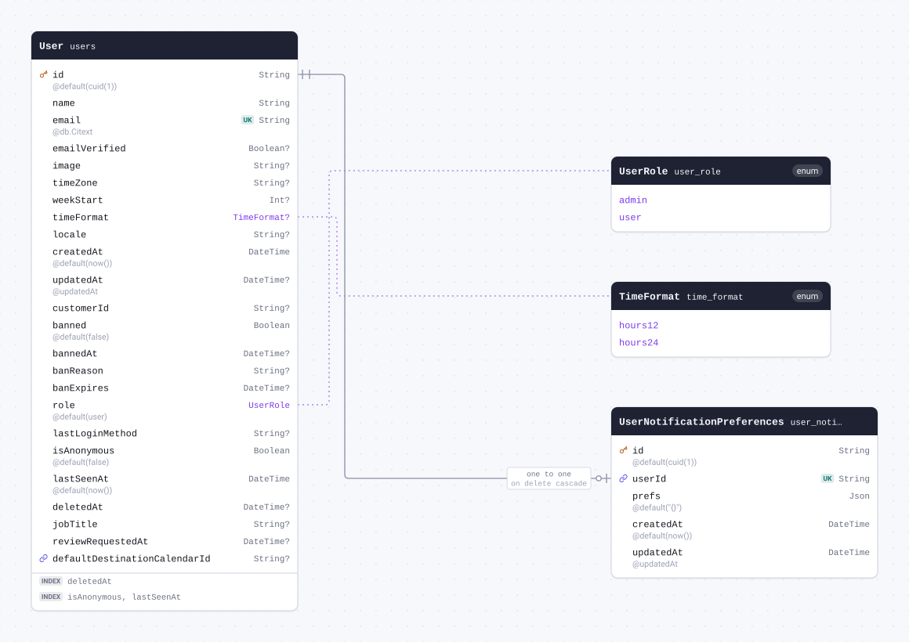

| Field                      | Type       | Constraints                              | Default      | Description |
| -------------------------- | ---------- | ---------------------------------------- | ------------ | ----------- |
| `id`                       | `String`   | PK NOT NULL                              | `cuid(1)`    |             |
| `userId` (`user_id`)       | `String`   | UNIQUE NOT NULL → [User.id](#model-User) |              |             |
| `prefs` (`prefs`)          | `Json`     | NOT NULL                                 | `"{}"`       |             |
| `createdAt` (`created_at`) | `DateTime` | NOT NULL                                 | `now()`      |             |
| `updatedAt` (`updated_at`) | `DateTime` | NOT NULL                                 | `@updatedAt` |             |

#### References

- `userId` → [User.id](#model-User) (one-to-one, on delete Cascade)

#### Definition

```sql
CREATE TABLE "user_notification_preferences" (
    "id" TEXT NOT NULL,
    "user_id" TEXT NOT NULL,
    "prefs" JSONB NOT NULL DEFAULT '{}',
    "created_at" TIMESTAMP(3) NOT NULL DEFAULT CURRENT_TIMESTAMP,
    "updated_at" TIMESTAMP(3) NOT NULL,

    CONSTRAINT "user_notification_preferences_pkey" PRIMARY KEY ("id")
);

CREATE UNIQUE INDEX "user_notification_preferences_user_id_key" ON "user_notification_preferences"("user_id");

ALTER TABLE "user_notification_preferences" ADD CONSTRAINT "user_notification_preferences_user_id_fkey" FOREIGN KEY ("user_id") REFERENCES "users"("id") ON DELETE CASCADE ON UPDATE CASCADE;
```

<details>
<summary>Queries and their SQL</summary>

**findMany**: Every row

```ts
await prisma.userNotificationPreferences.findMany();
```

```sql
SELECT
  "public"."user_notification_preferences"."id",
  "public"."user_notification_preferences"."user_id",
  "public"."user_notification_preferences"."prefs",
  "public"."user_notification_preferences"."created_at",
  "public"."user_notification_preferences"."updated_at"
FROM
  "public"."user_notification_preferences"
WHERE
  1 = 1
OFFSET
  $1
-- params: ["0"]
```

**count**: How many rows there are

```ts
await prisma.userNotificationPreferences.count();
```

```sql
SELECT
  COUNT(*) AS "_count$_all"
FROM
  (
    SELECT
      "public"."user_notification_preferences"."id"
    FROM
      "public"."user_notification_preferences"
    WHERE
      1 = 1
    OFFSET
      $1
  ) AS "sub"
-- params: ["0"]
```

**findMany**: Every row with its relations

```ts
await prisma.userNotificationPreferences.findMany({ include: { user: true } });
```

```sql
SELECT
  "public"."user_notification_preferences"."id",
  "public"."user_notification_preferences"."user_id",
  "public"."user_notification_preferences"."prefs",
  "public"."user_notification_preferences"."created_at",
  "public"."user_notification_preferences"."updated_at"
FROM
  "public"."user_notification_preferences"
WHERE
  1 = 1
OFFSET
  $1
-- params: ["0"]

SELECT
  "public"."users"."id",
  "public"."users"."name",
  "public"."users"."email",
  "public"."users"."email_verified",
  "public"."users"."image",
  "public"."users"."time_zone",
  "public"."users"."week_start",
  "public"."users"."time_format"::text,
  "public"."users"."locale",
  "public"."users"."created_at",
  "public"."users"."updated_at",
  "public"."users"."customer_id",
  "public"."users"."banned",
  "public"."users"."banned_at",
  "public"."users"."ban_reason",
  "public"."users"."ban_expires",
  "public"."users"."role"::text,
  "public"."users"."last_login_method",
  "public"."users"."anonymous",
  "public"."users"."last_seen_at",
  "public"."users"."deleted_at",
  "public"."users"."job_title",
  "public"."users"."review_requested_at",
  "public"."users"."default_destination_calendar_id"
FROM
  "public"."users"
WHERE
  "public"."users"."id" IN ($1)
OFFSET
  $2
-- params: ["<userId of the rows above>","0"]
```

**findUnique**: One row by what is unique to it

```ts
await prisma.userNotificationPreferences.findUnique({ where: { id: "example" } });
```

```sql
SELECT
  "public"."user_notification_preferences"."id",
  "public"."user_notification_preferences"."user_id",
  "public"."user_notification_preferences"."prefs",
  "public"."user_notification_preferences"."created_at",
  "public"."user_notification_preferences"."updated_at"
FROM
  "public"."user_notification_preferences"
WHERE
  (
    "public"."user_notification_preferences"."id" = $1
    AND 1 = 1
  )
LIMIT
  $2
OFFSET
  $3
-- params: ["example","1","0"]
```

**create**: Create a row

```ts
await prisma.userNotificationPreferences.create({ data: { userId: "example" } });
```

```sql
INSERT INTO
  "public"."user_notification_preferences" (
    "id",
    "user_id",
    "prefs",
    "created_at",
    "updated_at"
  )
VALUES
  ($1, $2, $3, $4, $5)
RETURNING
  "public"."user_notification_preferences"."id",
  "public"."user_notification_preferences"."user_id",
  "public"."user_notification_preferences"."prefs",
  "public"."user_notification_preferences"."created_at",
  "public"."user_notification_preferences"."updated_at"
-- params: ["<cuid(1)>","example","{}","<now()>","<now()>"]
```

**update**: Update a row

```ts
await prisma.userNotificationPreferences.update({ where: { id: "example" }, data: { prefs: {} } });
```

```sql
UPDATE "public"."user_notification_preferences"
SET
  "prefs" = $1,
  "updated_at" = $2
WHERE
  (
    "public"."user_notification_preferences"."id" = $3
    AND 1 = 1
  )
RETURNING
  "public"."user_notification_preferences"."id",
  "public"."user_notification_preferences"."user_id",
  "public"."user_notification_preferences"."prefs",
  "public"."user_notification_preferences"."created_at",
  "public"."user_notification_preferences"."updated_at"
-- params: ["{}",{"prisma__type":"generatorCall","prisma__value":{"name":"now","args":[],"returnType":{"type":"DateTime"}}},"example"]
```

**delete**: Delete a row

```ts
await prisma.userNotificationPreferences.delete({ where: { id: "example" } });
```

```sql
DELETE FROM "public"."user_notification_preferences"
WHERE
  (
    "public"."user_notification_preferences"."id" = $1
    AND 1 = 1
  )
RETURNING
  "public"."user_notification_preferences"."id",
  "public"."user_notification_preferences"."user_id",
  "public"."user_notification_preferences"."prefs",
  "public"."user_notification_preferences"."created_at",
  "public"."user_notification_preferences"."updated_at"
-- params: ["example"]
```

</details>

<a id="model-Poll"></a>

### Poll

Table `polls`.

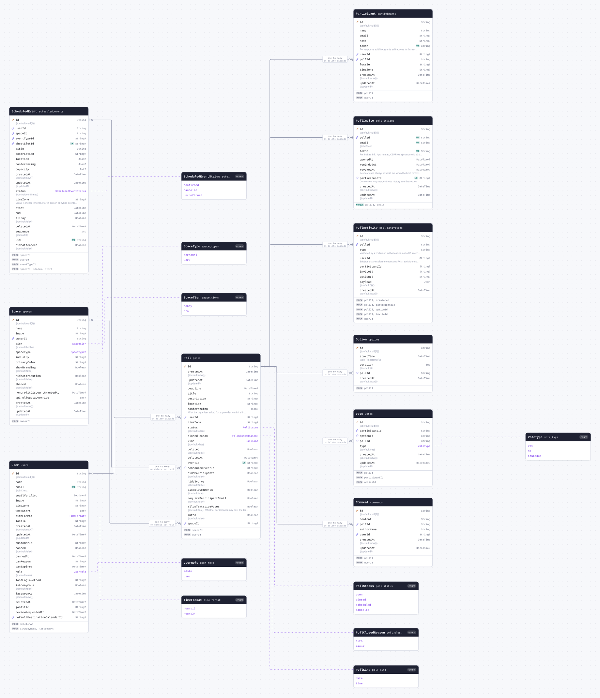

| Field                                                   | Type                                         | Constraints                                       | Default      | Description                                                                                                                                                                                                                                          |
| ------------------------------------------------------- | -------------------------------------------- | ------------------------------------------------- | ------------ | ---------------------------------------------------------------------------------------------------------------------------------------------------------------------------------------------------------------------------------------------------- |
| `id` (`id`)                                             | `String`                                     | PK NOT NULL                                       |              |                                                                                                                                                                                                                                                      |
| `createdAt` (`created_at`)                              | `DateTime`                                   | NOT NULL                                          | `now()`      |                                                                                                                                                                                                                                                      |
| `updatedAt` (`updated_at`)                              | `DateTime`                                   | NOT NULL                                          | `@updatedAt` |                                                                                                                                                                                                                                                      |
| `deadline`                                              | `DateTime`                                   | NULL                                              |              |                                                                                                                                                                                                                                                      |
| `title`                                                 | `String`                                     | NOT NULL                                          |              |                                                                                                                                                                                                                                                      |
| `description`                                           | `String`                                     | NULL                                              |              |                                                                                                                                                                                                                                                      |
| `location`                                              | `String`                                     | NULL                                              |              |                                                                                                                                                                                                                                                      |
| `conferencing`                                          | `Json`                                       | NULL                                              |              | What the organizer asked for: a provider to mint a link with at finalize ("zoom" \| "meet" \| "teams" \| "webex"), or a link they pasted themselves.                                                                                                 |
| `userId` (`user_id`)                                    | `String`                                     | NULL → [User.id](#model-User)                     |              |                                                                                                                                                                                                                                                      |
| `timeZone` (`time_zone`)                                | `String`                                     | NULL                                              |              |                                                                                                                                                                                                                                                      |
| `status`                                                | [`PollStatus`](#enum-PollStatus)             | NOT NULL                                          | `open`       |                                                                                                                                                                                                                                                      |
| `closedReason` (`closed_reason`)                        | [`PollClosedReason`](#enum-PollClosedReason) | NULL                                              |              |                                                                                                                                                                                                                                                      |
| `kind`                                                  | [`PollKind`](#enum-PollKind)                 | NOT NULL                                          | `date`       |                                                                                                                                                                                                                                                      |
| `deleted`                                               | `Boolean`                                    | NOT NULL                                          | `false`      |                                                                                                                                                                                                                                                      |
| `deletedAt` (`deleted_at`)                              | `DateTime`                                   | NULL                                              |              |                                                                                                                                                                                                                                                      |
| `eventId` (`event_id`)                                  | `String`                                     | UNIQUE NULL                                       |              |                                                                                                                                                                                                                                                      |
| `scheduledEventId` (`scheduled_event_id`)               | `String`                                     | NULL → [ScheduledEvent.id](#model-ScheduledEvent) |              |                                                                                                                                                                                                                                                      |
| `hideParticipants` (`hide_participants`)                | `Boolean`                                    | NOT NULL                                          | `false`      |                                                                                                                                                                                                                                                      |
| `hideScores` (`hide_scores`)                            | `Boolean`                                    | NOT NULL                                          | `false`      |                                                                                                                                                                                                                                                      |
| `disableComments` (`disable_comments`)                  | `Boolean`                                    | NOT NULL                                          | `true`       |                                                                                                                                                                                                                                                      |
| `requireParticipantEmail` (`require_participant_email`) | `Boolean`                                    | NOT NULL                                          | `false`      |                                                                                                                                                                                                                                                      |
| `allowTentativeVotes` (`allow_tentative_votes`)         | `Boolean`                                    | NOT NULL                                          | `true`       | Whether participants may cast the tentative "if need be" vote. Positive flag so a future vote-type expansion adds columns rather than inverting a negative. Turning it off only blocks new tentative votes; existing ones are kept and stay visible. |
| `muted`                                                 | `Boolean`                                    | NOT NULL                                          | `false`      |                                                                                                                                                                                                                                                      |
| `spaceId` (`space_id`)                                  | `String`                                     | NULL → [Space.id](#model-Space)                   |              |                                                                                                                                                                                                                                                      |

#### Indexes

- `@@index([spaceId])`
- `@@index([userId])`

#### References

- `userId` → [User.id](#model-User) (many-to-one, on delete Cascade)
- `scheduledEventId` → [ScheduledEvent.id](#model-ScheduledEvent) (many-to-one, on delete SetNull)
- `spaceId` → [Space.id](#model-Space) (many-to-one, on delete SetNull)

#### Referenced by

- `id` ← [Participant.pollId](#model-Participant) (one-to-many, on delete Cascade)
- `id` ← [PollInvite.pollId](#model-PollInvite) (one-to-many, on delete Cascade)
- `id` ← [PollActivity.pollId](#model-PollActivity) (one-to-many, on delete Cascade)
- `id` ← [Option.pollId](#model-Option) (one-to-many, on delete Cascade)
- `id` ← [Vote.pollId](#model-Vote) (one-to-many, on delete Cascade)
- `id` ← [Comment.pollId](#model-Comment) (one-to-many, on delete Cascade)

#### Definition

```sql
CREATE TABLE "polls" (
    "id" TEXT NOT NULL,
    "created_at" TIMESTAMP(3) NOT NULL DEFAULT CURRENT_TIMESTAMP,
    "updated_at" TIMESTAMP(3) NOT NULL,
    "deadline" TIMESTAMP(3),
    "title" TEXT NOT NULL,
    "description" TEXT,
    "location" TEXT,
    "conferencing" JSONB,
    "user_id" TEXT,
    "time_zone" TEXT,
    "status" "poll_status" NOT NULL DEFAULT 'open',
    "closed_reason" "poll_closed_reason",
    "kind" "poll_kind" NOT NULL DEFAULT 'date',
    "deleted" BOOLEAN NOT NULL DEFAULT false,
    "deleted_at" TIMESTAMP(3),
    "event_id" TEXT,
    "scheduled_event_id" TEXT,
    "hide_participants" BOOLEAN NOT NULL DEFAULT false,
    "hide_scores" BOOLEAN NOT NULL DEFAULT false,
    "disable_comments" BOOLEAN NOT NULL DEFAULT true,
    "require_participant_email" BOOLEAN NOT NULL DEFAULT false,
    "allow_tentative_votes" BOOLEAN NOT NULL DEFAULT true,
    "muted" BOOLEAN NOT NULL DEFAULT false,
    "space_id" TEXT,

    CONSTRAINT "polls_pkey" PRIMARY KEY ("id")
);

CREATE UNIQUE INDEX "polls_id_key" ON "polls"("id");

CREATE UNIQUE INDEX "polls_event_id_key" ON "polls"("event_id");

CREATE INDEX "polls_space_id_idx" ON "polls"("space_id");

CREATE INDEX "polls_user_id_idx" ON "polls"("user_id");

ALTER TABLE "polls" ADD CONSTRAINT "polls_user_id_fkey" FOREIGN KEY ("user_id") REFERENCES "users"("id") ON DELETE CASCADE ON UPDATE CASCADE;

ALTER TABLE "polls" ADD CONSTRAINT "polls_scheduled_event_id_fkey" FOREIGN KEY ("scheduled_event_id") REFERENCES "scheduled_events"("id") ON DELETE SET NULL ON UPDATE CASCADE;

ALTER TABLE "polls" ADD CONSTRAINT "polls_space_id_fkey" FOREIGN KEY ("space_id") REFERENCES "spaces"("id") ON DELETE SET NULL ON UPDATE CASCADE;
```

<details>
<summary>Queries and their SQL</summary>

**findMany**: Every row

```ts
await prisma.poll.findMany();
```

```sql
SELECT
  "public"."polls"."id",
  "public"."polls"."created_at",
  "public"."polls"."updated_at",
  "public"."polls"."deadline",
  "public"."polls"."title",
  "public"."polls"."description",
  "public"."polls"."location",
  "public"."polls"."conferencing",
  "public"."polls"."user_id",
  "public"."polls"."time_zone",
  "public"."polls"."status"::text,
  "public"."polls"."closed_reason"::text,
  "public"."polls"."kind"::text,
  "public"."polls"."deleted",
  "public"."polls"."deleted_at",
  "public"."polls"."event_id",
  "public"."polls"."scheduled_event_id",
  "public"."polls"."hide_participants",
  "public"."polls"."hide_scores",
  "public"."polls"."disable_comments",
  "public"."polls"."require_participant_email",
  "public"."polls"."allow_tentative_votes",
  "public"."polls"."muted",
  "public"."polls"."space_id"
FROM
  "public"."polls"
WHERE
  1 = 1
OFFSET
  $1
-- params: ["0"]
```

**count**: How many rows there are

```ts
await prisma.poll.count();
```

```sql
SELECT
  COUNT(*) AS "_count$_all"
FROM
  (
    SELECT
      "public"."polls"."id"
    FROM
      "public"."polls"
    WHERE
      1 = 1
    OFFSET
      $1
  ) AS "sub"
-- params: ["0"]
```

**findMany**: Every row with its relations

```ts
await prisma.poll.findMany({
  include: {
    user: true,
    scheduledEvent: true,
    options: true,
    participants: true,
    comments: true,
    votes: true,
    invites: true,
    activities: true,
    space: true,
  },
});
```

```sql
SELECT
  "public"."polls"."id",
  "public"."polls"."created_at",
  "public"."polls"."updated_at",
  "public"."polls"."deadline",
  "public"."polls"."title",
  "public"."polls"."description",
  "public"."polls"."location",
  "public"."polls"."conferencing",
  "public"."polls"."user_id",
  "public"."polls"."time_zone",
  "public"."polls"."status"::text,
  "public"."polls"."closed_reason"::text,
  "public"."polls"."kind"::text,
  "public"."polls"."deleted",
  "public"."polls"."deleted_at",
  "public"."polls"."event_id",
  "public"."polls"."scheduled_event_id",
  "public"."polls"."hide_participants",
  "public"."polls"."hide_scores",
  "public"."polls"."disable_comments",
  "public"."polls"."require_participant_email",
  "public"."polls"."allow_tentative_votes",
  "public"."polls"."muted",
  "public"."polls"."space_id"
FROM
  "public"."polls"
WHERE
  1 = 1
OFFSET
  $1
-- params: ["0"]

SELECT
  "public"."users"."id",
  "public"."users"."name",
  "public"."users"."email",
  "public"."users"."email_verified",
  "public"."users"."image",
  "public"."users"."time_zone",
  "public"."users"."week_start",
  "public"."users"."time_format"::text,
  "public"."users"."locale",
  "public"."users"."created_at",
  "public"."users"."updated_at",
  "public"."users"."customer_id",
  "public"."users"."banned",
  "public"."users"."banned_at",
  "public"."users"."ban_reason",
  "public"."users"."ban_expires",
  "public"."users"."role"::text,
  "public"."users"."last_login_method",
  "public"."users"."anonymous",
  "public"."users"."last_seen_at",
  "public"."users"."deleted_at",
  "public"."users"."job_title",
  "public"."users"."review_requested_at",
  "public"."users"."default_destination_calendar_id"
FROM
  "public"."users"
WHERE
  "public"."users"."id" IN ($1)
OFFSET
  $2
-- params: ["<userId of the rows above>","0"]

SELECT
  "public"."scheduled_events"."id",
  "public"."scheduled_events"."user_id",
  "public"."scheduled_events"."space_id",
  "public"."scheduled_events"."event_type_id",
  "public"."scheduled_events"."sheet_slot_id",
  "public"."scheduled_events"."title",
  "public"."scheduled_events"."description",
  "public"."scheduled_events"."location",
  "public"."scheduled_events"."conferencing",
  "public"."scheduled_events"."capacity",
  "public"."scheduled_events"."created_at",
  "public"."scheduled_events"."updated_at",
  "public"."scheduled_events"."status"::text,
  "public"."scheduled_events"."time_zone",
  "public"."scheduled_events"."start",
  "public"."scheduled_events"."end",
  "public"."scheduled_events"."all_day",
  "public"."scheduled_events"."deleted_at",
  "public"."scheduled_events"."sequence",
  "public"."scheduled_events"."uid",
  "public"."scheduled_events"."hide_attendees"
FROM
  "public"."scheduled_events"
WHERE
  "public"."scheduled_events"."id" IN ($1)
OFFSET
  $2
-- params: ["<scheduledEventId of the rows above>","0"]

SELECT
  "public"."options"."id",
  "public"."options"."start_time",
  "public"."options"."duration_minutes",
  "public"."options"."poll_id",
  "public"."options"."created_at"
FROM
  "public"."options"
WHERE
  "public"."options"."poll_id" IN ($1)
OFFSET
  $2
-- params: ["<id of the rows above>","0"]

SELECT
  "public"."participants"."id",
  "public"."participants"."name",
  "public"."participants"."email",
  "public"."participants"."note",
  "public"."participants"."token",
  "public"."participants"."user_id",
  "public"."participants"."poll_id",
  "public"."participants"."locale",
  "public"."participants"."time_zone",
  "public"."participants"."created_at",
  "public"."participants"."updated_at"
FROM
  "public"."participants"
WHERE
  "public"."participants"."poll_id" IN ($1)
OFFSET
  $2
-- params: ["<id of the rows above>","0"]

SELECT
  "public"."comments"."id",
  "public"."comments"."content",
  "public"."comments"."poll_id",
  "public"."comments"."author_name",
  "public"."comments"."user_id",
  "public"."comments"."created_at",
  "public"."comments"."updated_at"
FROM
  "public"."comments"
WHERE
  "public"."comments"."poll_id" IN ($1)
OFFSET
  $2
-- params: ["<id of the rows above>","0"]

SELECT
  "public"."votes"."id",
  "public"."votes"."participant_id",
  "public"."votes"."option_id",
  "public"."votes"."poll_id",
  "public"."votes"."type"::text,
  "public"."votes"."created_at",
  "public"."votes"."updated_at"
FROM
  "public"."votes"
WHERE
  "public"."votes"."poll_id" IN ($1)
OFFSET
  $2
-- params: ["<id of the rows above>","0"]

SELECT
  "public"."poll_invites"."id",
  "public"."poll_invites"."poll_id",
  "public"."poll_invites"."email",
  "public"."poll_invites"."token",
  "public"."poll_invites"."opened_at",
  "public"."poll_invites"."reminded_at",
  "public"."poll_invites"."revoked_at",
  "public"."poll_invites"."participant_id",
  "public"."poll_invites"."created_at",
  "public"."poll_invites"."updated_at"
FROM
  "public"."poll_invites"
WHERE
  "public"."poll_invites"."poll_id" IN ($1)
OFFSET
  $2
-- params: ["<id of the rows above>","0"]

SELECT
  "public"."poll_activities"."id",
  "public"."poll_activities"."poll_id",
  "public"."poll_activities"."type",
  "public"."poll_activities"."user_id",
  "public"."poll_activities"."participant_id",
  "public"."poll_activities"."invite_id",
  "public"."poll_activities"."option_id",
  "public"."poll_activities"."payload",
  "public"."poll_activities"."created_at"
FROM
  "public"."poll_activities"
WHERE
  "public"."poll_activities"."poll_id" IN ($1)
OFFSET
  $2
-- params: ["<id of the rows above>","0"]

SELECT
  "public"."spaces"."id",
  "public"."spaces"."name",
  "public"."spaces"."image",
  "public"."spaces"."owner_id",
  "public"."spaces"."tier"::text,
  "public"."spaces"."space_type"::text,
  "public"."spaces"."industry",
  "public"."spaces"."primary_color",
  "public"."spaces"."show_branding",
  "public"."spaces"."hide_attribution",
  "public"."spaces"."shared",
  "public"."spaces"."nonprofit_discount_granted_at",
  "public"."spaces"."api_poll_quota_override",
  "public"."spaces"."created_at",
  "public"."spaces"."updated_at"
FROM
  "public"."spaces"
WHERE
  "public"."spaces"."id" IN ($1)
OFFSET
  $2
-- params: ["<spaceId of the rows above>","0"]
```

**findUnique**: One row by what is unique to it

```ts
await prisma.poll.findUnique({ where: { id: "example" } });
```

```sql
SELECT
  "public"."polls"."id",
  "public"."polls"."created_at",
  "public"."polls"."updated_at",
  "public"."polls"."deadline",
  "public"."polls"."title",
  "public"."polls"."description",
  "public"."polls"."location",
  "public"."polls"."conferencing",
  "public"."polls"."user_id",
  "public"."polls"."time_zone",
  "public"."polls"."status"::text,
  "public"."polls"."closed_reason"::text,
  "public"."polls"."kind"::text,
  "public"."polls"."deleted",
  "public"."polls"."deleted_at",
  "public"."polls"."event_id",
  "public"."polls"."scheduled_event_id",
  "public"."polls"."hide_participants",
  "public"."polls"."hide_scores",
  "public"."polls"."disable_comments",
  "public"."polls"."require_participant_email",
  "public"."polls"."allow_tentative_votes",
  "public"."polls"."muted",
  "public"."polls"."space_id"
FROM
  "public"."polls"
WHERE
  (
    "public"."polls"."id" = $1
    AND 1 = 1
  )
LIMIT
  $2
OFFSET
  $3
-- params: ["example","1","0"]
```

**create**: Create a row

```ts
await prisma.poll.create({ data: { id: "example", title: "example" } });
```

```sql
INSERT INTO
  "public"."polls" (
    "id",
    "created_at",
    "updated_at",
    "title",
    "status",
    "kind",
    "deleted",
    "hide_participants",
    "hide_scores",
    "disable_comments",
    "require_participant_email",
    "allow_tentative_votes",
    "muted"
  )
VALUES
  (
    $1,
    $2,
    $3,
    $4,
    CAST($5::text AS "public"."poll_status"),
    CAST($6::text AS "public"."poll_kind"),
    $7,
    $8,
    $9,
    $10,
    $11,
    $12,
    $13
  )
RETURNING
  "public"."polls"."id",
  "public"."polls"."created_at",
  "public"."polls"."updated_at",
  "public"."polls"."deadline",
  "public"."polls"."title",
  "public"."polls"."description",
  "public"."polls"."location",
  "public"."polls"."conferencing",
  "public"."polls"."user_id",
  "public"."polls"."time_zone",
  "public"."polls"."status"::text,
  "public"."polls"."closed_reason"::text,
  "public"."polls"."kind"::text,
  "public"."polls"."deleted",
  "public"."polls"."deleted_at",
  "public"."polls"."event_id",
  "public"."polls"."scheduled_event_id",
  "public"."polls"."hide_participants",
  "public"."polls"."hide_scores",
  "public"."polls"."disable_comments",
  "public"."polls"."require_participant_email",
  "public"."polls"."allow_tentative_votes",
  "public"."polls"."muted",
  "public"."polls"."space_id"
-- params: ["example","<now()>","<now()>","example","open","date",false,false,false,true,false,true,false]
```

**update**: Update a row

```ts
await prisma.poll.update({
  where: { id: "example" },
  data: { createdAt: new Date("2026-01-01T00:00:00.000Z") },
});
```

```sql
UPDATE "public"."polls"
SET
  "created_at" = $1,
  "updated_at" = $2
WHERE
  (
    "public"."polls"."id" = $3
    AND 1 = 1
  )
RETURNING
  "public"."polls"."id",
  "public"."polls"."created_at",
  "public"."polls"."updated_at",
  "public"."polls"."deadline",
  "public"."polls"."title",
  "public"."polls"."description",
  "public"."polls"."location",
  "public"."polls"."conferencing",
  "public"."polls"."user_id",
  "public"."polls"."time_zone",
  "public"."polls"."status"::text,
  "public"."polls"."closed_reason"::text,
  "public"."polls"."kind"::text,
  "public"."polls"."deleted",
  "public"."polls"."deleted_at",
  "public"."polls"."event_id",
  "public"."polls"."scheduled_event_id",
  "public"."polls"."hide_participants",
  "public"."polls"."hide_scores",
  "public"."polls"."disable_comments",
  "public"."polls"."require_participant_email",
  "public"."polls"."allow_tentative_votes",
  "public"."polls"."muted",
  "public"."polls"."space_id"
-- params: ["2026-01-01T00:00:00.000Z",{"prisma__type":"generatorCall","prisma__value":{"name":"now","args":[],"returnType":{"type":"DateTime"}}},"example"]
```

**delete**: Delete a row

```ts
await prisma.poll.delete({ where: { id: "example" } });
```

```sql
DELETE FROM "public"."polls"
WHERE
  (
    "public"."polls"."id" = $1
    AND 1 = 1
  )
RETURNING
  "public"."polls"."id",
  "public"."polls"."created_at",
  "public"."polls"."updated_at",
  "public"."polls"."deadline",
  "public"."polls"."title",
  "public"."polls"."description",
  "public"."polls"."location",
  "public"."polls"."conferencing",
  "public"."polls"."user_id",
  "public"."polls"."time_zone",
  "public"."polls"."status"::text,
  "public"."polls"."closed_reason"::text,
  "public"."polls"."kind"::text,
  "public"."polls"."deleted",
  "public"."polls"."deleted_at",
  "public"."polls"."event_id",
  "public"."polls"."scheduled_event_id",
  "public"."polls"."hide_participants",
  "public"."polls"."hide_scores",
  "public"."polls"."disable_comments",
  "public"."polls"."require_participant_email",
  "public"."polls"."allow_tentative_votes",
  "public"."polls"."muted",
  "public"."polls"."space_id"
-- params: ["example"]
```

</details>

<a id="model-Participant"></a>

### Participant

Table `participants`.

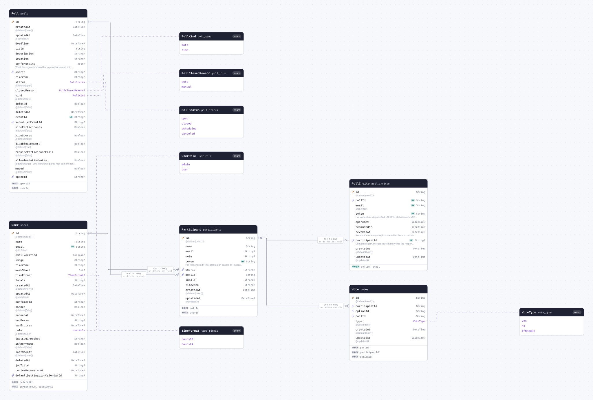

| Field                      | Type       | Constraints                       | Default      | Description                                                                                                                                                                                                                                                                                                                                                                                                                              |
| -------------------------- | ---------- | --------------------------------- | ------------ | ---------------------------------------------------------------------------------------------------------------------------------------------------------------------------------------------------------------------------------------------------------------------------------------------------------------------------------------------------------------------------------------------------------------------------------------- |
| `id`                       | `String`   | PK NOT NULL                       | `cuid(1)`    |                                                                                                                                                                                                                                                                                                                                                                                                                                          |
| `name`                     | `String`   | NOT NULL                          |              |                                                                                                                                                                                                                                                                                                                                                                                                                                          |
| `email`                    | `String`   | NULL                              |              |                                                                                                                                                                                                                                                                                                                                                                                                                                          |
| `note`                     | `String`   | NULL                              |              |                                                                                                                                                                                                                                                                                                                                                                                                                                          |
| `token`                    | `String`   | UNIQUE NOT NULL                   |              | Per response edit link: grants edit access to this response without a session. App minted at creation, CSPRNG alphanumeric ≥32 chars (nanoid customAlphabet — url safe with no linkifier edge cases, unlike base64url); never a DB default so a code path that forgets to mint fails loudly. A response created through an emailed invite takes the invite's token. Rows that predate minting were backfilled with gen_random_uuid() hex |
| `userId` (`user_id`)       | `String`   | NULL → [User.id](#model-User)     |              |                                                                                                                                                                                                                                                                                                                                                                                                                                          |
| `pollId` (`poll_id`)       | `String`   | NOT NULL → [Poll.id](#model-Poll) |              |                                                                                                                                                                                                                                                                                                                                                                                                                                          |
| `locale`                   | `String`   | NULL                              |              |                                                                                                                                                                                                                                                                                                                                                                                                                                          |
| `timeZone` (`time_zone`)   | `String`   | NULL                              |              |                                                                                                                                                                                                                                                                                                                                                                                                                                          |
| `createdAt` (`created_at`) | `DateTime` | NOT NULL                          | `now()`      |                                                                                                                                                                                                                                                                                                                                                                                                                                          |
| `updatedAt` (`updated_at`) | `DateTime` | NULL                              | `@updatedAt` |                                                                                                                                                                                                                                                                                                                                                                                                                                          |

#### Indexes

- `@@index([pollId])`
- `@@index([userId])`

#### References

- `pollId` → [Poll.id](#model-Poll) (many-to-one, on delete Cascade)
- `userId` → [User.id](#model-User) (many-to-one, on delete SetNull)

#### Referenced by

- `id` ← [PollInvite.participantId](#model-PollInvite) (one-to-one, on delete SetNull)
- `id` ← [Vote.participantId](#model-Vote) (one-to-many, on delete Cascade)

#### Definition

```sql
CREATE TABLE "participants" (
    "id" TEXT NOT NULL,
    "name" TEXT NOT NULL,
    "email" TEXT,
    "note" TEXT,
    "token" TEXT NOT NULL,
    "user_id" TEXT,
    "poll_id" TEXT NOT NULL,
    "locale" TEXT,
    "time_zone" TEXT,
    "created_at" TIMESTAMP(3) NOT NULL DEFAULT CURRENT_TIMESTAMP,
    "updated_at" TIMESTAMP(3),

    CONSTRAINT "participants_pkey" PRIMARY KEY ("id")
);

CREATE UNIQUE INDEX "participants_token_key" ON "participants"("token");

CREATE INDEX "participants_poll_id_idx" ON "participants" USING HASH ("poll_id");

CREATE INDEX "participants_user_id_idx" ON "participants"("user_id");

ALTER TABLE "participants" ADD CONSTRAINT "participants_poll_id_fkey" FOREIGN KEY ("poll_id") REFERENCES "polls"("id") ON DELETE CASCADE ON UPDATE CASCADE;

ALTER TABLE "participants" ADD CONSTRAINT "participants_user_id_fkey" FOREIGN KEY ("user_id") REFERENCES "users"("id") ON DELETE SET NULL ON UPDATE CASCADE;
```

<details>
<summary>Queries and their SQL</summary>

**findMany**: Every row

```ts
await prisma.participant.findMany();
```

```sql
SELECT
  "public"."participants"."id",
  "public"."participants"."name",
  "public"."participants"."email",
  "public"."participants"."note",
  "public"."participants"."token",
  "public"."participants"."user_id",
  "public"."participants"."poll_id",
  "public"."participants"."locale",
  "public"."participants"."time_zone",
  "public"."participants"."created_at",
  "public"."participants"."updated_at"
FROM
  "public"."participants"
WHERE
  1 = 1
OFFSET
  $1
-- params: ["0"]
```

**count**: How many rows there are

```ts
await prisma.participant.count();
```

```sql
SELECT
  COUNT(*) AS "_count$_all"
FROM
  (
    SELECT
      "public"."participants"."id"
    FROM
      "public"."participants"
    WHERE
      1 = 1
    OFFSET
      $1
  ) AS "sub"
-- params: ["0"]
```

**findMany**: Every row with its relations

```ts
await prisma.participant.findMany({
  include: { votes: true, invite: true, poll: true, user: true },
});
```

```sql
SELECT
  "public"."participants"."id",
  "public"."participants"."name",
  "public"."participants"."email",
  "public"."participants"."note",
  "public"."participants"."token",
  "public"."participants"."user_id",
  "public"."participants"."poll_id",
  "public"."participants"."locale",
  "public"."participants"."time_zone",
  "public"."participants"."created_at",
  "public"."participants"."updated_at"
FROM
  "public"."participants"
WHERE
  1 = 1
OFFSET
  $1
-- params: ["0"]

SELECT
  "public"."votes"."id",
  "public"."votes"."participant_id",
  "public"."votes"."option_id",
  "public"."votes"."poll_id",
  "public"."votes"."type"::text,
  "public"."votes"."created_at",
  "public"."votes"."updated_at"
FROM
  "public"."votes"
WHERE
  "public"."votes"."participant_id" IN ($1)
OFFSET
  $2
-- params: ["<id of the rows above>","0"]

SELECT
  "public"."poll_invites"."id",
  "public"."poll_invites"."poll_id",
  "public"."poll_invites"."email",
  "public"."poll_invites"."token",
  "public"."poll_invites"."opened_at",
  "public"."poll_invites"."reminded_at",
  "public"."poll_invites"."revoked_at",
  "public"."poll_invites"."participant_id",
  "public"."poll_invites"."created_at",
  "public"."poll_invites"."updated_at"
FROM
  "public"."poll_invites"
WHERE
  "public"."poll_invites"."participant_id" IN ($1)
OFFSET
  $2
-- params: ["<id of the rows above>","0"]

SELECT
  "public"."polls"."id",
  "public"."polls"."created_at",
  "public"."polls"."updated_at",
  "public"."polls"."deadline",
  "public"."polls"."title",
  "public"."polls"."description",
  "public"."polls"."location",
  "public"."polls"."conferencing",
  "public"."polls"."user_id",
  "public"."polls"."time_zone",
  "public"."polls"."status"::text,
  "public"."polls"."closed_reason"::text,
  "public"."polls"."kind"::text,
  "public"."polls"."deleted",
  "public"."polls"."deleted_at",
  "public"."polls"."event_id",
  "public"."polls"."scheduled_event_id",
  "public"."polls"."hide_participants",
  "public"."polls"."hide_scores",
  "public"."polls"."disable_comments",
  "public"."polls"."require_participant_email",
  "public"."polls"."allow_tentative_votes",
  "public"."polls"."muted",
  "public"."polls"."space_id"
FROM
  "public"."polls"
WHERE
  "public"."polls"."id" IN ($1)
OFFSET
  $2
-- params: ["<pollId of the rows above>","0"]

SELECT
  "public"."users"."id",
  "public"."users"."name",
  "public"."users"."email",
  "public"."users"."email_verified",
  "public"."users"."image",
  "public"."users"."time_zone",
  "public"."users"."week_start",
  "public"."users"."time_format"::text,
  "public"."users"."locale",
  "public"."users"."created_at",
  "public"."users"."updated_at",
  "public"."users"."customer_id",
  "public"."users"."banned",
  "public"."users"."banned_at",
  "public"."users"."ban_reason",
  "public"."users"."ban_expires",
  "public"."users"."role"::text,
  "public"."users"."last_login_method",
  "public"."users"."anonymous",
  "public"."users"."last_seen_at",
  "public"."users"."deleted_at",
  "public"."users"."job_title",
  "public"."users"."review_requested_at",
  "public"."users"."default_destination_calendar_id"
FROM
  "public"."users"
WHERE
  "public"."users"."id" IN ($1)
OFFSET
  $2
-- params: ["<userId of the rows above>","0"]
```

**findUnique**: One row by what is unique to it

```ts
await prisma.participant.findUnique({ where: { id: "example" } });
```

```sql
SELECT
  "public"."participants"."id",
  "public"."participants"."name",
  "public"."participants"."email",
  "public"."participants"."note",
  "public"."participants"."token",
  "public"."participants"."user_id",
  "public"."participants"."poll_id",
  "public"."participants"."locale",
  "public"."participants"."time_zone",
  "public"."participants"."created_at",
  "public"."participants"."updated_at"
FROM
  "public"."participants"
WHERE
  (
    "public"."participants"."id" = $1
    AND 1 = 1
  )
LIMIT
  $2
OFFSET
  $3
-- params: ["example","1","0"]
```

**create**: Create a row

```ts
await prisma.participant.create({ data: { name: "example", token: "example", pollId: "example" } });
```

```sql
INSERT INTO
  "public"."participants" (
    "id",
    "name",
    "token",
    "poll_id",
    "created_at",
    "updated_at"
  )
VALUES
  ($1, $2, $3, $4, $5, $6)
RETURNING
  "public"."participants"."id",
  "public"."participants"."name",
  "public"."participants"."email",
  "public"."participants"."note",
  "public"."participants"."token",
  "public"."participants"."user_id",
  "public"."participants"."poll_id",
  "public"."participants"."locale",
  "public"."participants"."time_zone",
  "public"."participants"."created_at",
  "public"."participants"."updated_at"
-- params: ["<cuid(1)>","example","example","example","<now()>","<now()>"]
```

**update**: Update a row

```ts
await prisma.participant.update({ where: { id: "example" }, data: { name: "example" } });
```

```sql
UPDATE "public"."participants"
SET
  "name" = $1,
  "updated_at" = $2
WHERE
  (
    "public"."participants"."id" = $3
    AND 1 = 1
  )
RETURNING
  "public"."participants"."id",
  "public"."participants"."name",
  "public"."participants"."email",
  "public"."participants"."note",
  "public"."participants"."token",
  "public"."participants"."user_id",
  "public"."participants"."poll_id",
  "public"."participants"."locale",
  "public"."participants"."time_zone",
  "public"."participants"."created_at",
  "public"."participants"."updated_at"
-- params: ["example",{"prisma__type":"generatorCall","prisma__value":{"name":"now","args":[],"returnType":{"type":"DateTime"}}},"example"]
```

**delete**: Delete a row

```ts
await prisma.participant.delete({ where: { id: "example" } });
```

```sql
DELETE FROM "public"."participants"
WHERE
  (
    "public"."participants"."id" = $1
    AND 1 = 1
  )
RETURNING
  "public"."participants"."id",
  "public"."participants"."name",
  "public"."participants"."email",
  "public"."participants"."note",
  "public"."participants"."token",
  "public"."participants"."user_id",
  "public"."participants"."poll_id",
  "public"."participants"."locale",
  "public"."participants"."time_zone",
  "public"."participants"."created_at",
  "public"."participants"."updated_at"
-- params: ["example"]
```

</details>

<a id="model-PollInvite"></a>

### PollInvite

Table `poll_invites`.

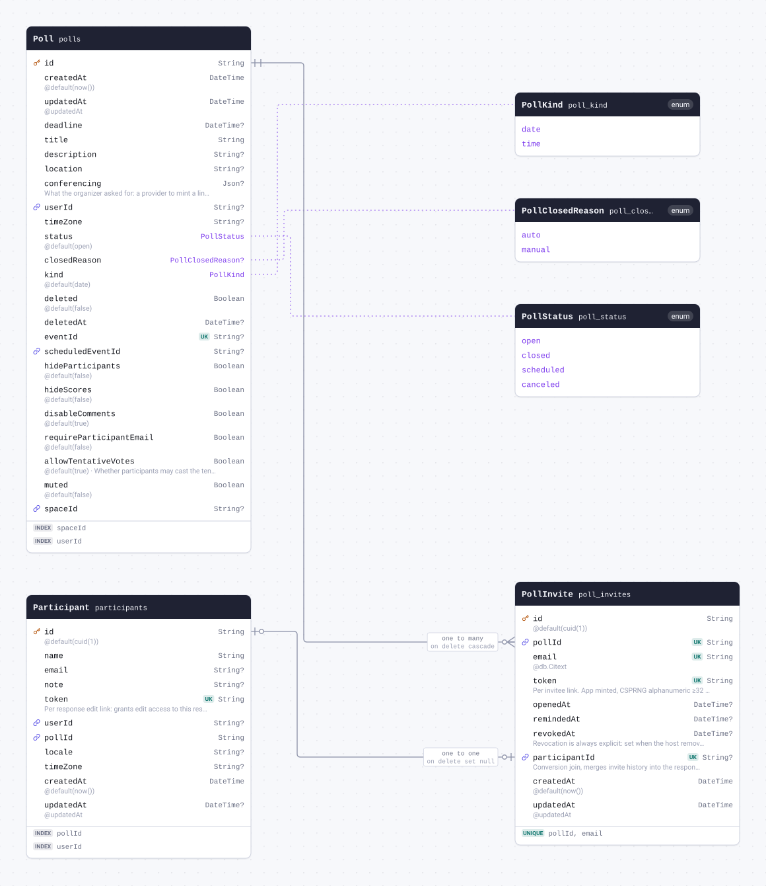

| Field                              | Type                  | Constraints                                        | Default      | Description                                                                                                                                                                                                                                                                                                                                                                                                                                                                             |
| ---------------------------------- | --------------------- | -------------------------------------------------- | ------------ | --------------------------------------------------------------------------------------------------------------------------------------------------------------------------------------------------------------------------------------------------------------------------------------------------------------------------------------------------------------------------------------------------------------------------------------------------------------------------------------- |
| `id`                               | `String`              | PK NOT NULL                                        | `cuid(1)`    |                                                                                                                                                                                                                                                                                                                                                                                                                                                                                         |
| `pollId` (`poll_id`)               | `String`              | NOT NULL → [Poll.id](#model-Poll)                  |              |                                                                                                                                                                                                                                                                                                                                                                                                                                                                                         |
| `email`                            | `String` `@db.Citext` | NOT NULL                                           |              |                                                                                                                                                                                                                                                                                                                                                                                                                                                                                         |
| `token`                            | `String`              | UNIQUE NOT NULL                                    |              | Per invitee link. App minted, CSPRNG alphanumeric ≥32 chars (nanoid customAlphabet) — no schema default, so forgetting to mint fails loudly. Rotated on reactivation so a revoked (possibly leaked) token never regains access                                                                                                                                                                                                                                                          |
| `openedAt` (`opened_at`)           | `DateTime`            | NULL                                               |              |                                                                                                                                                                                                                                                                                                                                                                                                                                                                                         |
| `remindedAt` (`reminded_at`)       | `DateTime`            | NULL                                               |              |                                                                                                                                                                                                                                                                                                                                                                                                                                                                                         |
| `revokedAt` (`revoked_at`)         | `DateTime`            | NULL                                               |              | Revocation is always explicit: set when the host removes a pending invite, never as a side effect of close, schedule or reopen. Deleting a response instead hard deletes the participant, so the SetNull FK clears participantId and reverts the invite to pending with its token intact — the token the deleted response held is freed with it, so the next response through the same link can take it again. Cleared only by re-inviting (reactivation), which also rotates the token |
| `participantId` (`participant_id`) | `String`              | UNIQUE NULL → [Participant.id](#model-Participant) |              | Conversion join, merges invite history into the response timeline. Set only when the invitee responds via their token: a typed email is unverified, so a generic link response never claims an invite                                                                                                                                                                                                                                                                                   |
| `createdAt` (`created_at`)         | `DateTime`            | NOT NULL                                           | `now()`      |                                                                                                                                                                                                                                                                                                                                                                                                                                                                                         |
| `updatedAt` (`updated_at`)         | `DateTime`            | NOT NULL                                           | `@updatedAt` |                                                                                                                                                                                                                                                                                                                                                                                                                                                                                         |

#### Indexes

- `@@unique([pollId, email])`

#### References

- `pollId` → [Poll.id](#model-Poll) (many-to-one, on delete Cascade)
- `participantId` → [Participant.id](#model-Participant) (one-to-one, on delete SetNull)

#### Definition

```sql
CREATE TABLE "poll_invites" (
    "id" TEXT NOT NULL,
    "poll_id" TEXT NOT NULL,
    "email" CITEXT NOT NULL,
    "token" TEXT NOT NULL,
    "opened_at" TIMESTAMP(3),
    "reminded_at" TIMESTAMP(3),
    "revoked_at" TIMESTAMP(3),
    "participant_id" TEXT,
    "created_at" TIMESTAMP(3) NOT NULL DEFAULT CURRENT_TIMESTAMP,
    "updated_at" TIMESTAMP(3) NOT NULL,

    CONSTRAINT "poll_invites_pkey" PRIMARY KEY ("id")
);

CREATE UNIQUE INDEX "poll_invites_token_key" ON "poll_invites"("token");

CREATE UNIQUE INDEX "poll_invites_participant_id_key" ON "poll_invites"("participant_id");

CREATE UNIQUE INDEX "poll_invites_poll_id_email_key" ON "poll_invites"("poll_id", "email");

ALTER TABLE "poll_invites" ADD CONSTRAINT "poll_invites_poll_id_fkey" FOREIGN KEY ("poll_id") REFERENCES "polls"("id") ON DELETE CASCADE ON UPDATE CASCADE;

ALTER TABLE "poll_invites" ADD CONSTRAINT "poll_invites_participant_id_fkey" FOREIGN KEY ("participant_id") REFERENCES "participants"("id") ON DELETE SET NULL ON UPDATE CASCADE;
```

<details>
<summary>Queries and their SQL</summary>

**findMany**: Every row

```ts
await prisma.pollInvite.findMany();
```

```sql
SELECT
  "public"."poll_invites"."id",
  "public"."poll_invites"."poll_id",
  "public"."poll_invites"."email",
  "public"."poll_invites"."token",
  "public"."poll_invites"."opened_at",
  "public"."poll_invites"."reminded_at",
  "public"."poll_invites"."revoked_at",
  "public"."poll_invites"."participant_id",
  "public"."poll_invites"."created_at",
  "public"."poll_invites"."updated_at"
FROM
  "public"."poll_invites"
WHERE
  1 = 1
OFFSET
  $1
-- params: ["0"]
```

**count**: How many rows there are

```ts
await prisma.pollInvite.count();
```

```sql
SELECT
  COUNT(*) AS "_count$_all"
FROM
  (
    SELECT
      "public"."poll_invites"."id"
    FROM
      "public"."poll_invites"
    WHERE
      1 = 1
    OFFSET
      $1
  ) AS "sub"
-- params: ["0"]
```

**findMany**: Every row with its relations

```ts
await prisma.pollInvite.findMany({ include: { poll: true, participant: true } });
```

```sql
SELECT
  "public"."poll_invites"."id",
  "public"."poll_invites"."poll_id",
  "public"."poll_invites"."email",
  "public"."poll_invites"."token",
  "public"."poll_invites"."opened_at",
  "public"."poll_invites"."reminded_at",
  "public"."poll_invites"."revoked_at",
  "public"."poll_invites"."participant_id",
  "public"."poll_invites"."created_at",
  "public"."poll_invites"."updated_at"
FROM
  "public"."poll_invites"
WHERE
  1 = 1
OFFSET
  $1
-- params: ["0"]

SELECT
  "public"."polls"."id",
  "public"."polls"."created_at",
  "public"."polls"."updated_at",
  "public"."polls"."deadline",
  "public"."polls"."title",
  "public"."polls"."description",
  "public"."polls"."location",
  "public"."polls"."conferencing",
  "public"."polls"."user_id",
  "public"."polls"."time_zone",
  "public"."polls"."status"::text,
  "public"."polls"."closed_reason"::text,
  "public"."polls"."kind"::text,
  "public"."polls"."deleted",
  "public"."polls"."deleted_at",
  "public"."polls"."event_id",
  "public"."polls"."scheduled_event_id",
  "public"."polls"."hide_participants",
  "public"."polls"."hide_scores",
  "public"."polls"."disable_comments",
  "public"."polls"."require_participant_email",
  "public"."polls"."allow_tentative_votes",
  "public"."polls"."muted",
  "public"."polls"."space_id"
FROM
  "public"."polls"
WHERE
  "public"."polls"."id" IN ($1)
OFFSET
  $2
-- params: ["<pollId of the rows above>","0"]

SELECT
  "public"."participants"."id",
  "public"."participants"."name",
  "public"."participants"."email",
  "public"."participants"."note",
  "public"."participants"."token",
  "public"."participants"."user_id",
  "public"."participants"."poll_id",
  "public"."participants"."locale",
  "public"."participants"."time_zone",
  "public"."participants"."created_at",
  "public"."participants"."updated_at"
FROM
  "public"."participants"
WHERE
  "public"."participants"."id" IN ($1)
OFFSET
  $2
-- params: ["<participantId of the rows above>","0"]
```

**findUnique**: One row by what is unique to it

```ts
await prisma.pollInvite.findUnique({ where: { id: "example" } });
```

```sql
SELECT
  "public"."poll_invites"."id",
  "public"."poll_invites"."poll_id",
  "public"."poll_invites"."email",
  "public"."poll_invites"."token",
  "public"."poll_invites"."opened_at",
  "public"."poll_invites"."reminded_at",
  "public"."poll_invites"."revoked_at",
  "public"."poll_invites"."participant_id",
  "public"."poll_invites"."created_at",
  "public"."poll_invites"."updated_at"
FROM
  "public"."poll_invites"
WHERE
  (
    "public"."poll_invites"."id" = $1
    AND 1 = 1
  )
LIMIT
  $2
OFFSET
  $3
-- params: ["example","1","0"]
```

**create**: Create a row

```ts
await prisma.pollInvite.create({ data: { pollId: "example", email: "example", token: "example" } });
```

```sql
INSERT INTO
  "public"."poll_invites" (
    "id",
    "poll_id",
    "email",
    "token",
    "created_at",
    "updated_at"
  )
VALUES
  ($1, $2, $3, $4, $5, $6)
RETURNING
  "public"."poll_invites"."id",
  "public"."poll_invites"."poll_id",
  "public"."poll_invites"."email",
  "public"."poll_invites"."token",
  "public"."poll_invites"."opened_at",
  "public"."poll_invites"."reminded_at",
  "public"."poll_invites"."revoked_at",
  "public"."poll_invites"."participant_id",
  "public"."poll_invites"."created_at",
  "public"."poll_invites"."updated_at"
-- params: ["<cuid(1)>","example","example","example","<now()>","<now()>"]
```

**update**: Update a row

```ts
await prisma.pollInvite.update({ where: { id: "example" }, data: { email: "example" } });
```

```sql
UPDATE "public"."poll_invites"
SET
  "email" = $1,
  "updated_at" = $2
WHERE
  (
    "public"."poll_invites"."id" = $3
    AND 1 = 1
  )
RETURNING
  "public"."poll_invites"."id",
  "public"."poll_invites"."poll_id",
  "public"."poll_invites"."email",
  "public"."poll_invites"."token",
  "public"."poll_invites"."opened_at",
  "public"."poll_invites"."reminded_at",
  "public"."poll_invites"."revoked_at",
  "public"."poll_invites"."participant_id",
  "public"."poll_invites"."created_at",
  "public"."poll_invites"."updated_at"
-- params: ["example",{"prisma__type":"generatorCall","prisma__value":{"name":"now","args":[],"returnType":{"type":"DateTime"}}},"example"]
```

**delete**: Delete a row

```ts
await prisma.pollInvite.delete({ where: { id: "example" } });
```

```sql
DELETE FROM "public"."poll_invites"
WHERE
  (
    "public"."poll_invites"."id" = $1
    AND 1 = 1
  )
RETURNING
  "public"."poll_invites"."id",
  "public"."poll_invites"."poll_id",
  "public"."poll_invites"."email",
  "public"."poll_invites"."token",
  "public"."poll_invites"."opened_at",
  "public"."poll_invites"."reminded_at",
  "public"."poll_invites"."revoked_at",
  "public"."poll_invites"."participant_id",
  "public"."poll_invites"."created_at",
  "public"."poll_invites"."updated_at"
-- params: ["example"]
```

</details>

<a id="model-PollActivity"></a>

### PollActivity

Table `poll_activities`.

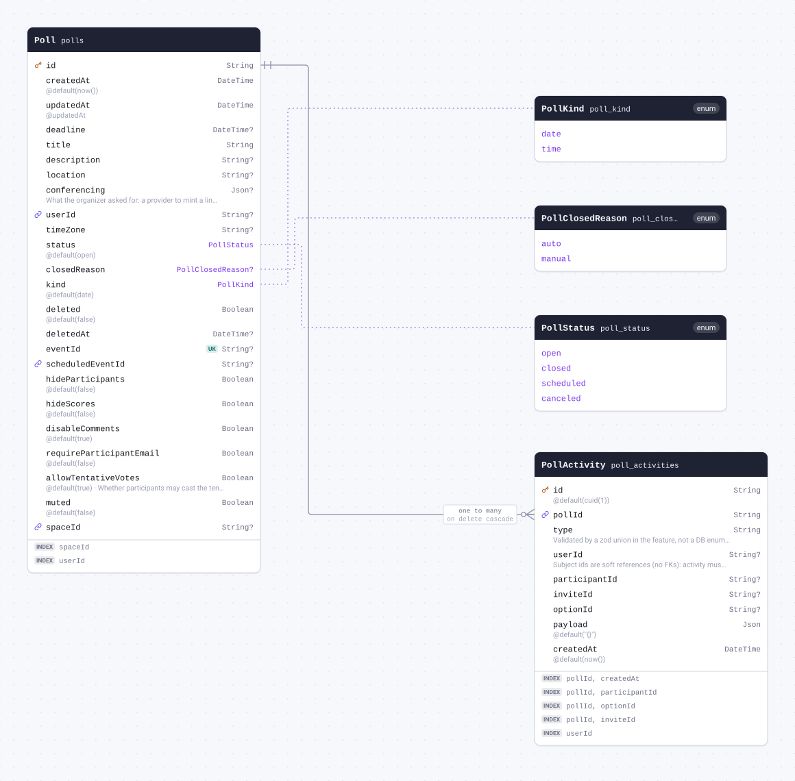

| Field                              | Type       | Constraints                       | Default   | Description                                                                                                                                                                                                                                   |
| ---------------------------------- | ---------- | --------------------------------- | --------- | --------------------------------------------------------------------------------------------------------------------------------------------------------------------------------------------------------------------------------------------- |
| `id`                               | `String`   | PK NOT NULL                       | `cuid(1)` |                                                                                                                                                                                                                                               |
| `pollId` (`poll_id`)               | `String`   | NOT NULL → [Poll.id](#model-Poll) |           |                                                                                                                                                                                                                                               |
| `type`                             | `String`   | NOT NULL                          |           | Validated by a zod union in the feature, not a DB enum: the activity vocabulary grows without migrations                                                                                                                                      |
| `userId` (`user_id`)               | `String`   | NULL                              |           | Subject ids are soft references (no FKs): activity must outlive its subjects — including account deletion — so refs persist as identity and the payload carries the display snapshot; whether a ref still resolves is the renderer's question |
| `participantId` (`participant_id`) | `String`   | NULL                              |           |                                                                                                                                                                                                                                               |
| `inviteId` (`invite_id`)           | `String`   | NULL                              |           |                                                                                                                                                                                                                                               |
| `optionId` (`option_id`)           | `String`   | NULL                              |           |                                                                                                                                                                                                                                               |
| `payload`                          | `Json`     | NOT NULL                          | `"{}"`    |                                                                                                                                                                                                                                               |
| `createdAt` (`created_at`)         | `DateTime` | NOT NULL                          | `now()`   |                                                                                                                                                                                                                                               |

#### Indexes

- `@@index([pollId, createdAt])`
- `@@index([pollId, participantId])`
- `@@index([pollId, optionId])`
- `@@index([pollId, inviteId])`
- `@@index([userId])`

#### References

- `pollId` → [Poll.id](#model-Poll) (many-to-one, on delete Cascade)

#### Definition

```sql
CREATE TABLE "poll_activities" (
    "id" TEXT NOT NULL,
    "poll_id" TEXT NOT NULL,
    "type" TEXT NOT NULL,
    "user_id" TEXT,
    "participant_id" TEXT,
    "invite_id" TEXT,
    "option_id" TEXT,
    "payload" JSONB NOT NULL DEFAULT '{}',
    "created_at" TIMESTAMP(3) NOT NULL DEFAULT CURRENT_TIMESTAMP,

    CONSTRAINT "poll_activities_pkey" PRIMARY KEY ("id")
);

CREATE INDEX "poll_activities_poll_id_created_at_idx" ON "poll_activities"("poll_id", "created_at" DESC);

CREATE INDEX "poll_activities_poll_id_participant_id_idx" ON "poll_activities"("poll_id", "participant_id");

CREATE INDEX "poll_activities_poll_id_option_id_idx" ON "poll_activities"("poll_id", "option_id");

CREATE INDEX "poll_activities_poll_id_invite_id_idx" ON "poll_activities"("poll_id", "invite_id");

CREATE INDEX "poll_activities_user_id_idx" ON "poll_activities"("user_id");

ALTER TABLE "poll_activities" ADD CONSTRAINT "poll_activities_poll_id_fkey" FOREIGN KEY ("poll_id") REFERENCES "polls"("id") ON DELETE CASCADE ON UPDATE CASCADE;
```

<details>
<summary>Queries and their SQL</summary>

**findMany**: Every row

```ts
await prisma.pollActivity.findMany();
```

```sql
SELECT
  "public"."poll_activities"."id",
  "public"."poll_activities"."poll_id",
  "public"."poll_activities"."type",
  "public"."poll_activities"."user_id",
  "public"."poll_activities"."participant_id",
  "public"."poll_activities"."invite_id",
  "public"."poll_activities"."option_id",
  "public"."poll_activities"."payload",
  "public"."poll_activities"."created_at"
FROM
  "public"."poll_activities"
WHERE
  1 = 1
OFFSET
  $1
-- params: ["0"]
```

**count**: How many rows there are

```ts
await prisma.pollActivity.count();
```

```sql
SELECT
  COUNT(*) AS "_count$_all"
FROM
  (
    SELECT
      "public"."poll_activities"."id"
    FROM
      "public"."poll_activities"
    WHERE
      1 = 1
    OFFSET
      $1
  ) AS "sub"
-- params: ["0"]
```

**findMany**: Every row with its relations

```ts
await prisma.pollActivity.findMany({ include: { poll: true } });
```

```sql
SELECT
  "public"."poll_activities"."id",
  "public"."poll_activities"."poll_id",
  "public"."poll_activities"."type",
  "public"."poll_activities"."user_id",
  "public"."poll_activities"."participant_id",
  "public"."poll_activities"."invite_id",
  "public"."poll_activities"."option_id",
  "public"."poll_activities"."payload",
  "public"."poll_activities"."created_at"
FROM
  "public"."poll_activities"
WHERE
  1 = 1
OFFSET
  $1
-- params: ["0"]

SELECT
  "public"."polls"."id",
  "public"."polls"."created_at",
  "public"."polls"."updated_at",
  "public"."polls"."deadline",
  "public"."polls"."title",
  "public"."polls"."description",
  "public"."polls"."location",
  "public"."polls"."conferencing",
  "public"."polls"."user_id",
  "public"."polls"."time_zone",
  "public"."polls"."status"::text,
  "public"."polls"."closed_reason"::text,
  "public"."polls"."kind"::text,
  "public"."polls"."deleted",
  "public"."polls"."deleted_at",
  "public"."polls"."event_id",
  "public"."polls"."scheduled_event_id",
  "public"."polls"."hide_participants",
  "public"."polls"."hide_scores",
  "public"."polls"."disable_comments",
  "public"."polls"."require_participant_email",
  "public"."polls"."allow_tentative_votes",
  "public"."polls"."muted",
  "public"."polls"."space_id"
FROM
  "public"."polls"
WHERE
  "public"."polls"."id" IN ($1)
OFFSET
  $2
-- params: ["<pollId of the rows above>","0"]
```

**findUnique**: One row by what is unique to it

```ts
await prisma.pollActivity.findUnique({ where: { id: "example" } });
```

```sql
SELECT
  "public"."poll_activities"."id",
  "public"."poll_activities"."poll_id",
  "public"."poll_activities"."type",
  "public"."poll_activities"."user_id",
  "public"."poll_activities"."participant_id",
  "public"."poll_activities"."invite_id",
  "public"."poll_activities"."option_id",
  "public"."poll_activities"."payload",
  "public"."poll_activities"."created_at"
FROM
  "public"."poll_activities"
WHERE
  (
    "public"."poll_activities"."id" = $1
    AND 1 = 1
  )
LIMIT
  $2
OFFSET
  $3
-- params: ["example","1","0"]
```

**create**: Create a row

```ts
await prisma.pollActivity.create({ data: { pollId: "example", type: "example" } });
```

```sql
INSERT INTO
  "public"."poll_activities" ("id", "poll_id", "type", "payload", "created_at")
VALUES
  ($1, $2, $3, $4, $5)
RETURNING
  "public"."poll_activities"."id",
  "public"."poll_activities"."poll_id",
  "public"."poll_activities"."type",
  "public"."poll_activities"."user_id",
  "public"."poll_activities"."participant_id",
  "public"."poll_activities"."invite_id",
  "public"."poll_activities"."option_id",
  "public"."poll_activities"."payload",
  "public"."poll_activities"."created_at"
-- params: ["<cuid(1)>","example","example","{}","<now()>"]
```

**update**: Update a row

```ts
await prisma.pollActivity.update({ where: { id: "example" }, data: { type: "example" } });
```

```sql
UPDATE "public"."poll_activities"
SET
  "type" = $1
WHERE
  (
    "public"."poll_activities"."id" = $2
    AND 1 = 1
  )
RETURNING
  "public"."poll_activities"."id",
  "public"."poll_activities"."poll_id",
  "public"."poll_activities"."type",
  "public"."poll_activities"."user_id",
  "public"."poll_activities"."participant_id",
  "public"."poll_activities"."invite_id",
  "public"."poll_activities"."option_id",
  "public"."poll_activities"."payload",
  "public"."poll_activities"."created_at"
-- params: ["example","example"]
```

**delete**: Delete a row

```ts
await prisma.pollActivity.delete({ where: { id: "example" } });
```

```sql
DELETE FROM "public"."poll_activities"
WHERE
  (
    "public"."poll_activities"."id" = $1
    AND 1 = 1
  )
RETURNING
  "public"."poll_activities"."id",
  "public"."poll_activities"."poll_id",
  "public"."poll_activities"."type",
  "public"."poll_activities"."user_id",
  "public"."poll_activities"."participant_id",
  "public"."poll_activities"."invite_id",
  "public"."poll_activities"."option_id",
  "public"."poll_activities"."payload",
  "public"."poll_activities"."created_at"
-- params: ["example"]
```

</details>

<a id="model-Option"></a>

### Option

Table `options`.

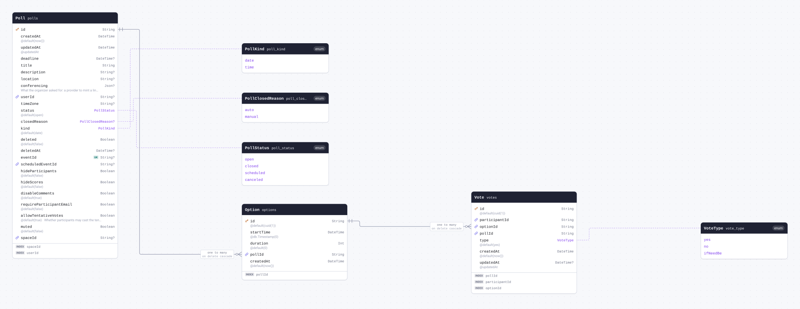

| Field                           | Type                          | Constraints                       | Default   | Description |
| ------------------------------- | ----------------------------- | --------------------------------- | --------- | ----------- |
| `id`                            | `String`                      | PK NOT NULL                       | `cuid(1)` |             |
| `startTime` (`start_time`)      | `DateTime` `@db.Timestamp(0)` | NOT NULL                          |           |             |
| `duration` (`duration_minutes`) | `Int`                         | NOT NULL                          | `0`       |             |
| `pollId` (`poll_id`)            | `String`                      | NOT NULL → [Poll.id](#model-Poll) |           |             |
| `createdAt` (`created_at`)      | `DateTime`                    | NOT NULL                          | `now()`   |             |

#### Indexes

- `@@index([pollId])`

#### References

- `pollId` → [Poll.id](#model-Poll) (many-to-one, on delete Cascade)

#### Referenced by

- `id` ← [Vote.optionId](#model-Vote) (one-to-many, on delete Cascade)

#### Definition

```sql
CREATE TABLE "options" (
    "id" TEXT NOT NULL,
    "start_time" TIMESTAMP(0) NOT NULL,
    "duration_minutes" INTEGER NOT NULL DEFAULT 0,
    "poll_id" TEXT NOT NULL,
    "created_at" TIMESTAMP(3) NOT NULL DEFAULT CURRENT_TIMESTAMP,

    CONSTRAINT "options_pkey" PRIMARY KEY ("id")
);

CREATE INDEX "options_poll_id_idx" ON "options" USING HASH ("poll_id");

ALTER TABLE "options" ADD CONSTRAINT "options_poll_id_fkey" FOREIGN KEY ("poll_id") REFERENCES "polls"("id") ON DELETE CASCADE ON UPDATE CASCADE;
```

<details>
<summary>Queries and their SQL</summary>

**findMany**: Every row

```ts
await prisma.option.findMany();
```

```sql
SELECT
  "public"."options"."id",
  "public"."options"."start_time",
  "public"."options"."duration_minutes",
  "public"."options"."poll_id",
  "public"."options"."created_at"
FROM
  "public"."options"
WHERE
  1 = 1
OFFSET
  $1
-- params: ["0"]
```

**count**: How many rows there are

```ts
await prisma.option.count();
```

```sql
SELECT
  COUNT(*) AS "_count$_all"
FROM
  (
    SELECT
      "public"."options"."id"
    FROM
      "public"."options"
    WHERE
      1 = 1
    OFFSET
      $1
  ) AS "sub"
-- params: ["0"]
```

**findMany**: Every row with its relations

```ts
await prisma.option.findMany({ include: { votes: true, poll: true } });
```

```sql
SELECT
  "public"."options"."id",
  "public"."options"."start_time",
  "public"."options"."duration_minutes",
  "public"."options"."poll_id",
  "public"."options"."created_at"
FROM
  "public"."options"
WHERE
  1 = 1
OFFSET
  $1
-- params: ["0"]

SELECT
  "public"."votes"."id",
  "public"."votes"."participant_id",
  "public"."votes"."option_id",
  "public"."votes"."poll_id",
  "public"."votes"."type"::text,
  "public"."votes"."created_at",
  "public"."votes"."updated_at"
FROM
  "public"."votes"
WHERE
  "public"."votes"."option_id" IN ($1)
OFFSET
  $2
-- params: ["<id of the rows above>","0"]

SELECT
  "public"."polls"."id",
  "public"."polls"."created_at",
  "public"."polls"."updated_at",
  "public"."polls"."deadline",
  "public"."polls"."title",
  "public"."polls"."description",
  "public"."polls"."location",
  "public"."polls"."conferencing",
  "public"."polls"."user_id",
  "public"."polls"."time_zone",
  "public"."polls"."status"::text,
  "public"."polls"."closed_reason"::text,
  "public"."polls"."kind"::text,
  "public"."polls"."deleted",
  "public"."polls"."deleted_at",
  "public"."polls"."event_id",
  "public"."polls"."scheduled_event_id",
  "public"."polls"."hide_participants",
  "public"."polls"."hide_scores",
  "public"."polls"."disable_comments",
  "public"."polls"."require_participant_email",
  "public"."polls"."allow_tentative_votes",
  "public"."polls"."muted",
  "public"."polls"."space_id"
FROM
  "public"."polls"
WHERE
  "public"."polls"."id" IN ($1)
OFFSET
  $2
-- params: ["<pollId of the rows above>","0"]
```

**findUnique**: One row by what is unique to it

```ts
await prisma.option.findUnique({ where: { id: "example" } });
```

```sql
SELECT
  "public"."options"."id",
  "public"."options"."start_time",
  "public"."options"."duration_minutes",
  "public"."options"."poll_id",
  "public"."options"."created_at"
FROM
  "public"."options"
WHERE
  (
    "public"."options"."id" = $1
    AND 1 = 1
  )
LIMIT
  $2
OFFSET
  $3
-- params: ["example","1","0"]
```

**create**: Create a row

```ts
await prisma.option.create({
  data: { startTime: new Date("2026-01-01T00:00:00.000Z"), pollId: "example" },
});
```

```sql
INSERT INTO
  "public"."options" (
    "id",
    "start_time",
    "duration_minutes",
    "poll_id",
    "created_at"
  )
VALUES
  ($1, $2, $3, $4, $5)
RETURNING
  "public"."options"."id",
  "public"."options"."start_time",
  "public"."options"."duration_minutes",
  "public"."options"."poll_id",
  "public"."options"."created_at"
-- params: ["<cuid(1)>","2026-01-01T00:00:00.000Z","0","example","<now()>"]
```

**update**: Update a row

```ts
await prisma.option.update({
  where: { id: "example" },
  data: { startTime: new Date("2026-01-01T00:00:00.000Z") },
});
```

```sql
UPDATE "public"."options"
SET
  "start_time" = $1
WHERE
  (
    "public"."options"."id" = $2
    AND 1 = 1
  )
RETURNING
  "public"."options"."id",
  "public"."options"."start_time",
  "public"."options"."duration_minutes",
  "public"."options"."poll_id",
  "public"."options"."created_at"
-- params: ["2026-01-01T00:00:00.000Z","example"]
```

**delete**: Delete a row

```ts
await prisma.option.delete({ where: { id: "example" } });
```

```sql
DELETE FROM "public"."options"
WHERE
  (
    "public"."options"."id" = $1
    AND 1 = 1
  )
RETURNING
  "public"."options"."id",
  "public"."options"."start_time",
  "public"."options"."duration_minutes",
  "public"."options"."poll_id",
  "public"."options"."created_at"
-- params: ["example"]
```

</details>

<a id="model-Vote"></a>

### Vote

Table `votes`.

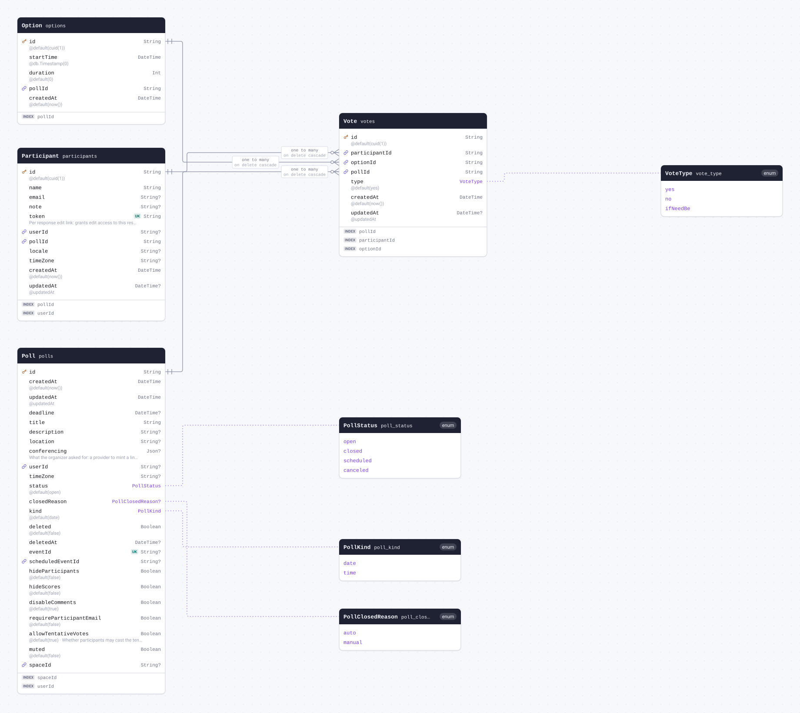

| Field                              | Type                         | Constraints                                     | Default      | Description |
| ---------------------------------- | ---------------------------- | ----------------------------------------------- | ------------ | ----------- |
| `id`                               | `String`                     | PK NOT NULL                                     | `cuid(1)`    |             |
| `participantId` (`participant_id`) | `String`                     | NOT NULL → [Participant.id](#model-Participant) |              |             |
| `optionId` (`option_id`)           | `String`                     | NOT NULL → [Option.id](#model-Option)           |              |             |
| `pollId` (`poll_id`)               | `String`                     | NOT NULL → [Poll.id](#model-Poll)               |              |             |
| `type`                             | [`VoteType`](#enum-VoteType) | NOT NULL                                        | `yes`        |             |
| `createdAt` (`created_at`)         | `DateTime`                   | NOT NULL                                        | `now()`      |             |
| `updatedAt` (`updated_at`)         | `DateTime`                   | NULL                                            | `@updatedAt` |             |

#### Indexes

- `@@index([pollId])`
- `@@index([participantId])`
- `@@index([optionId])`

#### References

- `participantId` → [Participant.id](#model-Participant) (many-to-one, on delete Cascade)
- `optionId` → [Option.id](#model-Option) (many-to-one, on delete Cascade)
- `pollId` → [Poll.id](#model-Poll) (many-to-one, on delete Cascade)

#### Definition

```sql
CREATE TABLE "votes" (
    "id" TEXT NOT NULL,
    "participant_id" TEXT NOT NULL,
    "option_id" TEXT NOT NULL,
    "poll_id" TEXT NOT NULL,
    "type" "vote_type" NOT NULL DEFAULT 'yes',
    "created_at" TIMESTAMP(3) NOT NULL DEFAULT CURRENT_TIMESTAMP,
    "updated_at" TIMESTAMP(3),

    CONSTRAINT "votes_pkey" PRIMARY KEY ("id")
);

CREATE INDEX "votes_poll_id_idx" ON "votes" USING HASH ("poll_id");

CREATE INDEX "votes_participant_id_idx" ON "votes" USING HASH ("participant_id");

CREATE INDEX "votes_option_id_idx" ON "votes" USING HASH ("option_id");

ALTER TABLE "votes" ADD CONSTRAINT "votes_participant_id_fkey" FOREIGN KEY ("participant_id") REFERENCES "participants"("id") ON DELETE CASCADE ON UPDATE CASCADE;

ALTER TABLE "votes" ADD CONSTRAINT "votes_option_id_fkey" FOREIGN KEY ("option_id") REFERENCES "options"("id") ON DELETE CASCADE ON UPDATE CASCADE;

ALTER TABLE "votes" ADD CONSTRAINT "votes_poll_id_fkey" FOREIGN KEY ("poll_id") REFERENCES "polls"("id") ON DELETE CASCADE ON UPDATE CASCADE;
```

<details>
<summary>Queries and their SQL</summary>

**findMany**: Every row

```ts
await prisma.vote.findMany();
```

```sql
SELECT
  "public"."votes"."id",
  "public"."votes"."participant_id",
  "public"."votes"."option_id",
  "public"."votes"."poll_id",
  "public"."votes"."type"::text,
  "public"."votes"."created_at",
  "public"."votes"."updated_at"
FROM
  "public"."votes"
WHERE
  1 = 1
OFFSET
  $1
-- params: ["0"]
```

**count**: How many rows there are

```ts
await prisma.vote.count();
```

```sql
SELECT
  COUNT(*) AS "_count$_all"
FROM
  (
    SELECT
      "public"."votes"."id"
    FROM
      "public"."votes"
    WHERE
      1 = 1
    OFFSET
      $1
  ) AS "sub"
-- params: ["0"]
```

**findMany**: Every row with its relations

```ts
await prisma.vote.findMany({ include: { participant: true, option: true, poll: true } });
```

```sql
SELECT
  "public"."votes"."id",
  "public"."votes"."participant_id",
  "public"."votes"."option_id",
  "public"."votes"."poll_id",
  "public"."votes"."type"::text,
  "public"."votes"."created_at",
  "public"."votes"."updated_at"
FROM
  "public"."votes"
WHERE
  1 = 1
OFFSET
  $1
-- params: ["0"]

SELECT
  "public"."participants"."id",
  "public"."participants"."name",
  "public"."participants"."email",
  "public"."participants"."note",
  "public"."participants"."token",
  "public"."participants"."user_id",
  "public"."participants"."poll_id",
  "public"."participants"."locale",
  "public"."participants"."time_zone",
  "public"."participants"."created_at",
  "public"."participants"."updated_at"
FROM
  "public"."participants"
WHERE
  "public"."participants"."id" IN ($1)
OFFSET
  $2
-- params: ["<participantId of the rows above>","0"]

SELECT
  "public"."options"."id",
  "public"."options"."start_time",
  "public"."options"."duration_minutes",
  "public"."options"."poll_id",
  "public"."options"."created_at"
FROM
  "public"."options"
WHERE
  "public"."options"."id" IN ($1)
OFFSET
  $2
-- params: ["<optionId of the rows above>","0"]

SELECT
  "public"."polls"."id",
  "public"."polls"."created_at",
  "public"."polls"."updated_at",
  "public"."polls"."deadline",
  "public"."polls"."title",
  "public"."polls"."description",
  "public"."polls"."location",
  "public"."polls"."conferencing",
  "public"."polls"."user_id",
  "public"."polls"."time_zone",
  "public"."polls"."status"::text,
  "public"."polls"."closed_reason"::text,
  "public"."polls"."kind"::text,
  "public"."polls"."deleted",
  "public"."polls"."deleted_at",
  "public"."polls"."event_id",
  "public"."polls"."scheduled_event_id",
  "public"."polls"."hide_participants",
  "public"."polls"."hide_scores",
  "public"."polls"."disable_comments",
  "public"."polls"."require_participant_email",
  "public"."polls"."allow_tentative_votes",
  "public"."polls"."muted",
  "public"."polls"."space_id"
FROM
  "public"."polls"
WHERE
  "public"."polls"."id" IN ($1)
OFFSET
  $2
-- params: ["<pollId of the rows above>","0"]
```

**findUnique**: One row by what is unique to it

```ts
await prisma.vote.findUnique({ where: { id: "example" } });
```

```sql
SELECT
  "public"."votes"."id",
  "public"."votes"."participant_id",
  "public"."votes"."option_id",
  "public"."votes"."poll_id",
  "public"."votes"."type"::text,
  "public"."votes"."created_at",
  "public"."votes"."updated_at"
FROM
  "public"."votes"
WHERE
  (
    "public"."votes"."id" = $1
    AND 1 = 1
  )
LIMIT
  $2
OFFSET
  $3
-- params: ["example","1","0"]
```

**create**: Create a row

```ts
await prisma.vote.create({
  data: { participantId: "example", optionId: "example", pollId: "example" },
});
```

```sql
INSERT INTO
  "public"."votes" (
    "id",
    "participant_id",
    "option_id",
    "poll_id",
    "type",
    "created_at",
    "updated_at"
  )
VALUES
  (
    $1,
    $2,
    $3,
    $4,
    CAST($5::text AS "public"."vote_type"),
    $6,
    $7
  )
RETURNING
  "public"."votes"."id",
  "public"."votes"."participant_id",
  "public"."votes"."option_id",
  "public"."votes"."poll_id",
  "public"."votes"."type"::text,
  "public"."votes"."created_at",
  "public"."votes"."updated_at"
-- params: ["<cuid(1)>","example","example","example","yes","<now()>","<now()>"]
```

**update**: Update a row

```ts
await prisma.vote.update({ where: { id: "example" }, data: { type: "yes" } });
```

```sql
UPDATE "public"."votes"
SET
  "type" = CAST($1::text AS "public"."vote_type"),
  "updated_at" = $2
WHERE
  (
    "public"."votes"."id" = $3
    AND 1 = 1
  )
RETURNING
  "public"."votes"."id",
  "public"."votes"."participant_id",
  "public"."votes"."option_id",
  "public"."votes"."poll_id",
  "public"."votes"."type"::text,
  "public"."votes"."created_at",
  "public"."votes"."updated_at"
-- params: ["yes",{"prisma__type":"generatorCall","prisma__value":{"name":"now","args":[],"returnType":{"type":"DateTime"}}},"example"]
```

**delete**: Delete a row

```ts
await prisma.vote.delete({ where: { id: "example" } });
```

```sql
DELETE FROM "public"."votes"
WHERE
  (
    "public"."votes"."id" = $1
    AND 1 = 1
  )
RETURNING
  "public"."votes"."id",
  "public"."votes"."participant_id",
  "public"."votes"."option_id",
  "public"."votes"."poll_id",
  "public"."votes"."type"::text,
  "public"."votes"."created_at",
  "public"."votes"."updated_at"
-- params: ["example"]
```

</details>

<a id="model-Comment"></a>

### Comment

Table `comments`.

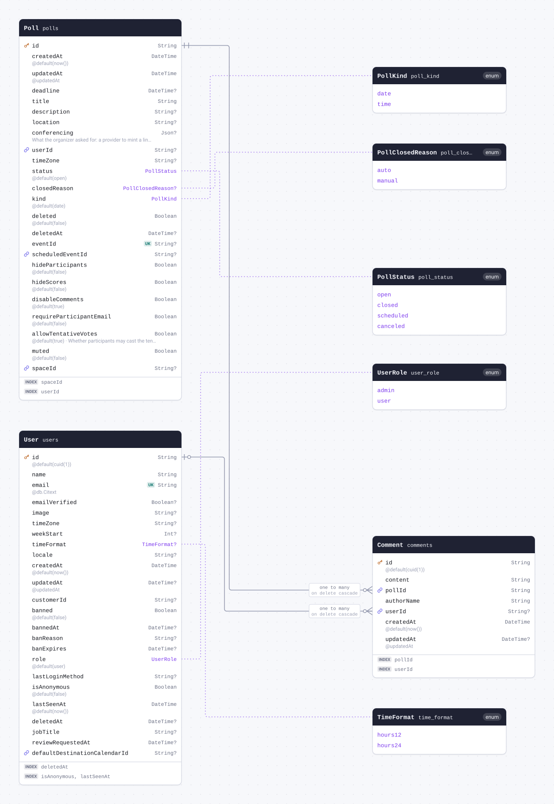

| Field                        | Type       | Constraints                       | Default      | Description |
| ---------------------------- | ---------- | --------------------------------- | ------------ | ----------- |
| `id`                         | `String`   | PK NOT NULL                       | `cuid(1)`    |             |
| `content`                    | `String`   | NOT NULL                          |              |             |
| `pollId` (`poll_id`)         | `String`   | NOT NULL → [Poll.id](#model-Poll) |              |             |
| `authorName` (`author_name`) | `String`   | NOT NULL                          |              |             |
| `userId` (`user_id`)         | `String`   | NULL → [User.id](#model-User)     |              |             |
| `createdAt` (`created_at`)   | `DateTime` | NOT NULL                          | `now()`      |             |
| `updatedAt` (`updated_at`)   | `DateTime` | NULL                              | `@updatedAt` |             |

#### Indexes

- `@@index([pollId])`
- `@@index([userId])`

#### References

- `pollId` → [Poll.id](#model-Poll) (many-to-one, on delete Cascade)
- `userId` → [User.id](#model-User) (many-to-one, on delete Cascade)

#### Definition

```sql
CREATE TABLE "comments" (
    "id" TEXT NOT NULL,
    "content" TEXT NOT NULL,
    "poll_id" TEXT NOT NULL,
    "author_name" TEXT NOT NULL,
    "user_id" TEXT,
    "created_at" TIMESTAMP(3) NOT NULL DEFAULT CURRENT_TIMESTAMP,
    "updated_at" TIMESTAMP(3),

    CONSTRAINT "comments_pkey" PRIMARY KEY ("id")
);

CREATE INDEX "comments_poll_id_idx" ON "comments"("poll_id");

CREATE INDEX "comments_user_id_idx" ON "comments"("user_id");

ALTER TABLE "comments" ADD CONSTRAINT "comments_poll_id_fkey" FOREIGN KEY ("poll_id") REFERENCES "polls"("id") ON DELETE CASCADE ON UPDATE CASCADE;

ALTER TABLE "comments" ADD CONSTRAINT "comments_user_id_fkey" FOREIGN KEY ("user_id") REFERENCES "users"("id") ON DELETE CASCADE ON UPDATE CASCADE;
```

<details>
<summary>Queries and their SQL</summary>

**findMany**: Every row

```ts
await prisma.comment.findMany();
```

```sql
SELECT
  "public"."comments"."id",
  "public"."comments"."content",
  "public"."comments"."poll_id",
  "public"."comments"."author_name",
  "public"."comments"."user_id",
  "public"."comments"."created_at",
  "public"."comments"."updated_at"
FROM
  "public"."comments"
WHERE
  1 = 1
OFFSET
  $1
-- params: ["0"]
```

**count**: How many rows there are

```ts
await prisma.comment.count();
```

```sql
SELECT
  COUNT(*) AS "_count$_all"
FROM
  (
    SELECT
      "public"."comments"."id"
    FROM
      "public"."comments"
    WHERE
      1 = 1
    OFFSET
      $1
  ) AS "sub"
-- params: ["0"]
```

**findMany**: Every row with its relations

```ts
await prisma.comment.findMany({ include: { poll: true, user: true } });
```

```sql
SELECT
  "public"."comments"."id",
  "public"."comments"."content",
  "public"."comments"."poll_id",
  "public"."comments"."author_name",
  "public"."comments"."user_id",
  "public"."comments"."created_at",
  "public"."comments"."updated_at"
FROM
  "public"."comments"
WHERE
  1 = 1
OFFSET
  $1
-- params: ["0"]

SELECT
  "public"."polls"."id",
  "public"."polls"."created_at",
  "public"."polls"."updated_at",
  "public"."polls"."deadline",
  "public"."polls"."title",
  "public"."polls"."description",
  "public"."polls"."location",
  "public"."polls"."conferencing",
  "public"."polls"."user_id",
  "public"."polls"."time_zone",
  "public"."polls"."status"::text,
  "public"."polls"."closed_reason"::text,
  "public"."polls"."kind"::text,
  "public"."polls"."deleted",
  "public"."polls"."deleted_at",
  "public"."polls"."event_id",
  "public"."polls"."scheduled_event_id",
  "public"."polls"."hide_participants",
  "public"."polls"."hide_scores",
  "public"."polls"."disable_comments",
  "public"."polls"."require_participant_email",
  "public"."polls"."allow_tentative_votes",
  "public"."polls"."muted",
  "public"."polls"."space_id"
FROM
  "public"."polls"
WHERE
  "public"."polls"."id" IN ($1)
OFFSET
  $2
-- params: ["<pollId of the rows above>","0"]

SELECT
  "public"."users"."id",
  "public"."users"."name",
  "public"."users"."email",
  "public"."users"."email_verified",
  "public"."users"."image",
  "public"."users"."time_zone",
  "public"."users"."week_start",
  "public"."users"."time_format"::text,
  "public"."users"."locale",
  "public"."users"."created_at",
  "public"."users"."updated_at",
  "public"."users"."customer_id",
  "public"."users"."banned",
  "public"."users"."banned_at",
  "public"."users"."ban_reason",
  "public"."users"."ban_expires",
  "public"."users"."role"::text,
  "public"."users"."last_login_method",
  "public"."users"."anonymous",
  "public"."users"."last_seen_at",
  "public"."users"."deleted_at",
  "public"."users"."job_title",
  "public"."users"."review_requested_at",
  "public"."users"."default_destination_calendar_id"
FROM
  "public"."users"
WHERE
  "public"."users"."id" IN ($1)
OFFSET
  $2
-- params: ["<userId of the rows above>","0"]
```

**findUnique**: One row by what is unique to it

```ts
await prisma.comment.findUnique({ where: { id: "example" } });
```

```sql
SELECT
  "public"."comments"."id",
  "public"."comments"."content",
  "public"."comments"."poll_id",
  "public"."comments"."author_name",
  "public"."comments"."user_id",
  "public"."comments"."created_at",
  "public"."comments"."updated_at"
FROM
  "public"."comments"
WHERE
  (
    "public"."comments"."id" = $1
    AND 1 = 1
  )
LIMIT
  $2
OFFSET
  $3
-- params: ["example","1","0"]
```

**create**: Create a row

```ts
await prisma.comment.create({
  data: { content: "example", pollId: "example", authorName: "example" },
});
```

```sql
INSERT INTO
  "public"."comments" (
    "id",
    "content",
    "poll_id",
    "author_name",
    "created_at",
    "updated_at"
  )
VALUES
  ($1, $2, $3, $4, $5, $6)
RETURNING
  "public"."comments"."id",
  "public"."comments"."content",
  "public"."comments"."poll_id",
  "public"."comments"."author_name",
  "public"."comments"."user_id",
  "public"."comments"."created_at",
  "public"."comments"."updated_at"
-- params: ["<cuid(1)>","example","example","example","<now()>","<now()>"]
```

**update**: Update a row

```ts
await prisma.comment.update({ where: { id: "example" }, data: { content: "example" } });
```

```sql
UPDATE "public"."comments"
SET
  "content" = $1,
  "updated_at" = $2
WHERE
  (
    "public"."comments"."id" = $3
    AND 1 = 1
  )
RETURNING
  "public"."comments"."id",
  "public"."comments"."content",
  "public"."comments"."poll_id",
  "public"."comments"."author_name",
  "public"."comments"."user_id",
  "public"."comments"."created_at",
  "public"."comments"."updated_at"
-- params: ["example",{"prisma__type":"generatorCall","prisma__value":{"name":"now","args":[],"returnType":{"type":"DateTime"}}},"example"]
```

**delete**: Delete a row

```ts
await prisma.comment.delete({ where: { id: "example" } });
```

```sql
DELETE FROM "public"."comments"
WHERE
  (
    "public"."comments"."id" = $1
    AND 1 = 1
  )
RETURNING
  "public"."comments"."id",
  "public"."comments"."content",
  "public"."comments"."poll_id",
  "public"."comments"."author_name",
  "public"."comments"."user_id",
  "public"."comments"."created_at",
  "public"."comments"."updated_at"
-- params: ["example"]
```

</details>

<a id="model-RegisteredInstance"></a>

### RegisteredInstance

Table `registered_instances`.

| Field                           | Type       | Constraints     | Default              | Description |
| ------------------------------- | ---------- | --------------- | -------------------- | ----------- |
| `id`                            | `String`   | PK NOT NULL     | `cuid(1)`            |             |
| `instanceId` (`instance_id`)    | `String`   | UNIQUE NOT NULL |                      |             |
| `version`                       | `String`   | NOT NULL        |                      |             |
| `firstSeenAt` (`first_seen_at`) | `DateTime` | NOT NULL        | `now()`              |             |
| `lastSeenAt` (`last_seen_at`)   | `DateTime` | NOT NULL        | `now()` `@updatedAt` |             |

#### Definition

```sql
CREATE TABLE "registered_instances" (
    "id" TEXT NOT NULL,
    "instance_id" TEXT NOT NULL,
    "version" TEXT NOT NULL,
    "first_seen_at" TIMESTAMP(3) NOT NULL DEFAULT CURRENT_TIMESTAMP,
    "last_seen_at" TIMESTAMP(3) NOT NULL DEFAULT CURRENT_TIMESTAMP,

    CONSTRAINT "registered_instances_pkey" PRIMARY KEY ("id")
);

CREATE UNIQUE INDEX "registered_instances_instance_id_key" ON "registered_instances"("instance_id");
```

<details>
<summary>Queries and their SQL</summary>

**findMany**: Every row

```ts
await prisma.registeredInstance.findMany();
```

```sql
SELECT
  "public"."registered_instances"."id",
  "public"."registered_instances"."instance_id",
  "public"."registered_instances"."version",
  "public"."registered_instances"."first_seen_at",
  "public"."registered_instances"."last_seen_at"
FROM
  "public"."registered_instances"
WHERE
  1 = 1
OFFSET
  $1
-- params: ["0"]
```

**count**: How many rows there are

```ts
await prisma.registeredInstance.count();
```

```sql
SELECT
  COUNT(*) AS "_count$_all"
FROM
  (
    SELECT
      "public"."registered_instances"."id"
    FROM
      "public"."registered_instances"
    WHERE
      1 = 1
    OFFSET
      $1
  ) AS "sub"
-- params: ["0"]
```

**findUnique**: One row by what is unique to it

```ts
await prisma.registeredInstance.findUnique({ where: { id: "example" } });
```

```sql
SELECT
  "public"."registered_instances"."id",
  "public"."registered_instances"."instance_id",
  "public"."registered_instances"."version",
  "public"."registered_instances"."first_seen_at",
  "public"."registered_instances"."last_seen_at"
FROM
  "public"."registered_instances"
WHERE
  (
    "public"."registered_instances"."id" = $1
    AND 1 = 1
  )
LIMIT
  $2
OFFSET
  $3
-- params: ["example","1","0"]
```

**create**: Create a row

```ts
await prisma.registeredInstance.create({ data: { instanceId: "example", version: "example" } });
```

```sql
INSERT INTO
  "public"."registered_instances" (
    "id",
    "instance_id",
    "version",
    "first_seen_at",
    "last_seen_at"
  )
VALUES
  ($1, $2, $3, $4, $5)
RETURNING
  "public"."registered_instances"."id",
  "public"."registered_instances"."instance_id",
  "public"."registered_instances"."version",
  "public"."registered_instances"."first_seen_at",
  "public"."registered_instances"."last_seen_at"
-- params: ["<cuid(1)>","example","example","<now()>","<now()>"]
```

**update**: Update a row

```ts
await prisma.registeredInstance.update({
  where: { id: "example" },
  data: { instanceId: "example" },
});
```

```sql
UPDATE "public"."registered_instances"
SET
  "instance_id" = $1,
  "last_seen_at" = $2
WHERE
  (
    "public"."registered_instances"."id" = $3
    AND 1 = 1
  )
RETURNING
  "public"."registered_instances"."id",
  "public"."registered_instances"."instance_id",
  "public"."registered_instances"."version",
  "public"."registered_instances"."first_seen_at",
  "public"."registered_instances"."last_seen_at"
-- params: ["example",{"prisma__type":"generatorCall","prisma__value":{"name":"now","args":[],"returnType":{"type":"DateTime"}}},"example"]
```

**delete**: Delete a row

```ts
await prisma.registeredInstance.delete({ where: { id: "example" } });
```

```sql
DELETE FROM "public"."registered_instances"
WHERE
  (
    "public"."registered_instances"."id" = $1
    AND 1 = 1
  )
RETURNING
  "public"."registered_instances"."id",
  "public"."registered_instances"."instance_id",
  "public"."registered_instances"."version",
  "public"."registered_instances"."first_seen_at",
  "public"."registered_instances"."last_seen_at"
-- params: ["example"]
```

</details>

<a id="model-Sheet"></a>

### Sheet

Table `sheets`.

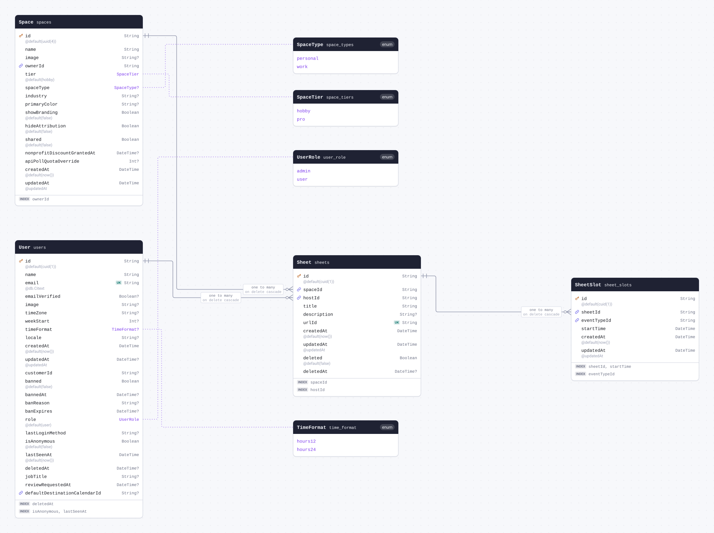

| Field                      | Type       | Constraints                         | Default      | Description |
| -------------------------- | ---------- | ----------------------------------- | ------------ | ----------- |
| `id`                       | `String`   | PK NOT NULL                         | `cuid(1)`    |             |
| `spaceId` (`space_id`)     | `String`   | NOT NULL → [Space.id](#model-Space) |              |             |
| `hostId` (`host_id`)       | `String`   | NOT NULL → [User.id](#model-User)   |              |             |
| `title`                    | `String`   | NOT NULL                            |              |             |
| `description`              | `String`   | NULL                                |              |             |
| `urlId` (`url_id`)         | `String`   | UNIQUE NOT NULL                     |              |             |
| `createdAt` (`created_at`) | `DateTime` | NOT NULL                            | `now()`      |             |
| `updatedAt` (`updated_at`) | `DateTime` | NOT NULL                            | `@updatedAt` |             |
| `deleted`                  | `Boolean`  | NOT NULL                            | `false`      |             |
| `deletedAt` (`deleted_at`) | `DateTime` | NULL                                |              |             |

#### Indexes

- `@@index([spaceId])`
- `@@index([hostId])`

#### References

- `spaceId` → [Space.id](#model-Space) (many-to-one, on delete Cascade)
- `hostId` → [User.id](#model-User) (many-to-one, on delete Cascade)

#### Referenced by

- `id` ← [SheetSlot.sheetId](#model-SheetSlot) (one-to-many, on delete Cascade)

#### Definition

```sql
CREATE TABLE "sheets" (
    "id" TEXT NOT NULL,
    "space_id" TEXT NOT NULL,
    "host_id" TEXT NOT NULL,
    "title" TEXT NOT NULL,
    "description" TEXT,
    "url_id" TEXT NOT NULL,
    "created_at" TIMESTAMP(3) NOT NULL DEFAULT CURRENT_TIMESTAMP,
    "updated_at" TIMESTAMP(3) NOT NULL,
    "deleted" BOOLEAN NOT NULL DEFAULT false,
    "deleted_at" TIMESTAMP(3),

    CONSTRAINT "sheets_pkey" PRIMARY KEY ("id")
);

CREATE UNIQUE INDEX "sheets_url_id_key" ON "sheets"("url_id");

CREATE INDEX "sheets_space_id_idx" ON "sheets"("space_id");

CREATE INDEX "sheets_host_id_idx" ON "sheets"("host_id");

ALTER TABLE "sheets" ADD CONSTRAINT "sheets_space_id_fkey" FOREIGN KEY ("space_id") REFERENCES "spaces"("id") ON DELETE CASCADE ON UPDATE CASCADE;

ALTER TABLE "sheets" ADD CONSTRAINT "sheets_host_id_fkey" FOREIGN KEY ("host_id") REFERENCES "users"("id") ON DELETE CASCADE ON UPDATE CASCADE;
```

<details>
<summary>Queries and their SQL</summary>

**findMany**: Every row

```ts
await prisma.sheet.findMany();
```

```sql
SELECT
  "public"."sheets"."id",
  "public"."sheets"."space_id",
  "public"."sheets"."host_id",
  "public"."sheets"."title",
  "public"."sheets"."description",
  "public"."sheets"."url_id",
  "public"."sheets"."created_at",
  "public"."sheets"."updated_at",
  "public"."sheets"."deleted",
  "public"."sheets"."deleted_at"
FROM
  "public"."sheets"
WHERE
  1 = 1
OFFSET
  $1
-- params: ["0"]
```

**count**: How many rows there are

```ts
await prisma.sheet.count();
```

```sql
SELECT
  COUNT(*) AS "_count$_all"
FROM
  (
    SELECT
      "public"."sheets"."id"
    FROM
      "public"."sheets"
    WHERE
      1 = 1
    OFFSET
      $1
  ) AS "sub"
-- params: ["0"]
```

**findMany**: Every row with its relations

```ts
await prisma.sheet.findMany({ include: { space: true, host: true, slots: true } });
```

```sql
SELECT
  "public"."sheets"."id",
  "public"."sheets"."space_id",
  "public"."sheets"."host_id",
  "public"."sheets"."title",
  "public"."sheets"."description",
  "public"."sheets"."url_id",
  "public"."sheets"."created_at",
  "public"."sheets"."updated_at",
  "public"."sheets"."deleted",
  "public"."sheets"."deleted_at"
FROM
  "public"."sheets"
WHERE
  1 = 1
OFFSET
  $1
-- params: ["0"]

SELECT
  "public"."spaces"."id",
  "public"."spaces"."name",
  "public"."spaces"."image",
  "public"."spaces"."owner_id",
  "public"."spaces"."tier"::text,
  "public"."spaces"."space_type"::text,
  "public"."spaces"."industry",
  "public"."spaces"."primary_color",
  "public"."spaces"."show_branding",
  "public"."spaces"."hide_attribution",
  "public"."spaces"."shared",
  "public"."spaces"."nonprofit_discount_granted_at",
  "public"."spaces"."api_poll_quota_override",
  "public"."spaces"."created_at",
  "public"."spaces"."updated_at"
FROM
  "public"."spaces"
WHERE
  "public"."spaces"."id" IN ($1)
OFFSET
  $2
-- params: ["<spaceId of the rows above>","0"]

SELECT
  "public"."users"."id",
  "public"."users"."name",
  "public"."users"."email",
  "public"."users"."email_verified",
  "public"."users"."image",
  "public"."users"."time_zone",
  "public"."users"."week_start",
  "public"."users"."time_format"::text,
  "public"."users"."locale",
  "public"."users"."created_at",
  "public"."users"."updated_at",
  "public"."users"."customer_id",
  "public"."users"."banned",
  "public"."users"."banned_at",
  "public"."users"."ban_reason",
  "public"."users"."ban_expires",
  "public"."users"."role"::text,
  "public"."users"."last_login_method",
  "public"."users"."anonymous",
  "public"."users"."last_seen_at",
  "public"."users"."deleted_at",
  "public"."users"."job_title",
  "public"."users"."review_requested_at",
  "public"."users"."default_destination_calendar_id"
FROM
  "public"."users"
WHERE
  "public"."users"."id" IN ($1)
OFFSET
  $2
-- params: ["<hostId of the rows above>","0"]

SELECT
  "public"."sheet_slots"."id",
  "public"."sheet_slots"."sheet_id",
  "public"."sheet_slots"."event_type_id",
  "public"."sheet_slots"."start_time",
  "public"."sheet_slots"."created_at",
  "public"."sheet_slots"."updated_at"
FROM
  "public"."sheet_slots"
WHERE
  "public"."sheet_slots"."sheet_id" IN ($1)
OFFSET
  $2
-- params: ["<id of the rows above>","0"]
```

**findUnique**: One row by what is unique to it

```ts
await prisma.sheet.findUnique({ where: { id: "example" } });
```

```sql
SELECT
  "public"."sheets"."id",
  "public"."sheets"."space_id",
  "public"."sheets"."host_id",
  "public"."sheets"."title",
  "public"."sheets"."description",
  "public"."sheets"."url_id",
  "public"."sheets"."created_at",
  "public"."sheets"."updated_at",
  "public"."sheets"."deleted",
  "public"."sheets"."deleted_at"
FROM
  "public"."sheets"
WHERE
  (
    "public"."sheets"."id" = $1
    AND 1 = 1
  )
LIMIT
  $2
OFFSET
  $3
-- params: ["example","1","0"]
```

**create**: Create a row

```ts
await prisma.sheet.create({
  data: { spaceId: "example", hostId: "example", title: "example", urlId: "example" },
});
```

```sql
INSERT INTO
  "public"."sheets" (
    "id",
    "space_id",
    "host_id",
    "title",
    "url_id",
    "created_at",
    "updated_at",
    "deleted"
  )
VALUES
  ($1, $2, $3, $4, $5, $6, $7, $8)
RETURNING
  "public"."sheets"."id",
  "public"."sheets"."space_id",
  "public"."sheets"."host_id",
  "public"."sheets"."title",
  "public"."sheets"."description",
  "public"."sheets"."url_id",
  "public"."sheets"."created_at",
  "public"."sheets"."updated_at",
  "public"."sheets"."deleted",
  "public"."sheets"."deleted_at"
-- params: ["<cuid(1)>","example","example","example","example","<now()>","<now()>",false]
```

**update**: Update a row

```ts
await prisma.sheet.update({ where: { id: "example" }, data: { title: "example" } });
```

```sql
UPDATE "public"."sheets"
SET
  "title" = $1,
  "updated_at" = $2
WHERE
  (
    "public"."sheets"."id" = $3
    AND 1 = 1
  )
RETURNING
  "public"."sheets"."id",
  "public"."sheets"."space_id",
  "public"."sheets"."host_id",
  "public"."sheets"."title",
  "public"."sheets"."description",
  "public"."sheets"."url_id",
  "public"."sheets"."created_at",
  "public"."sheets"."updated_at",
  "public"."sheets"."deleted",
  "public"."sheets"."deleted_at"
-- params: ["example",{"prisma__type":"generatorCall","prisma__value":{"name":"now","args":[],"returnType":{"type":"DateTime"}}},"example"]
```

**delete**: Delete a row

```ts
await prisma.sheet.delete({ where: { id: "example" } });
```

```sql
DELETE FROM "public"."sheets"
WHERE
  (
    "public"."sheets"."id" = $1
    AND 1 = 1
  )
RETURNING
  "public"."sheets"."id",
  "public"."sheets"."space_id",
  "public"."sheets"."host_id",
  "public"."sheets"."title",
  "public"."sheets"."description",
  "public"."sheets"."url_id",
  "public"."sheets"."created_at",
  "public"."sheets"."updated_at",
  "public"."sheets"."deleted",
  "public"."sheets"."deleted_at"
-- params: ["example"]
```

</details>

<a id="model-SheetSlot"></a>

### SheetSlot

Table `sheet_slots`.

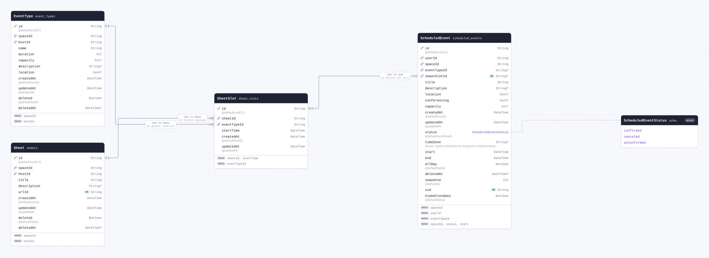

| Field                           | Type       | Constraints                                 | Default      | Description |
| ------------------------------- | ---------- | ------------------------------------------- | ------------ | ----------- |
| `id`                            | `String`   | PK NOT NULL                                 | `cuid(1)`    |             |
| `sheetId` (`sheet_id`)          | `String`   | NOT NULL → [Sheet.id](#model-Sheet)         |              |             |
| `eventTypeId` (`event_type_id`) | `String`   | NOT NULL → [EventType.id](#model-EventType) |              |             |
| `startTime` (`start_time`)      | `DateTime` | NOT NULL                                    |              |             |
| `createdAt` (`created_at`)      | `DateTime` | NOT NULL                                    | `now()`      |             |
| `updatedAt` (`updated_at`)      | `DateTime` | NOT NULL                                    | `@updatedAt` |             |

#### Indexes

- `@@index([sheetId, startTime])`
- `@@index([eventTypeId])`

#### References

- `sheetId` → [Sheet.id](#model-Sheet) (many-to-one, on delete Cascade)
- `eventTypeId` → [EventType.id](#model-EventType) (many-to-one, on delete Restrict)

#### Referenced by

- `id` ← [ScheduledEvent.sheetSlotId](#model-ScheduledEvent) (one-to-one, on delete SetNull)

#### Definition

```sql
CREATE TABLE "sheet_slots" (
    "id" TEXT NOT NULL,
    "sheet_id" TEXT NOT NULL,
    "event_type_id" TEXT NOT NULL,
    "start_time" TIMESTAMP(3) NOT NULL,
    "created_at" TIMESTAMP(3) NOT NULL DEFAULT CURRENT_TIMESTAMP,
    "updated_at" TIMESTAMP(3) NOT NULL,

    CONSTRAINT "sheet_slots_pkey" PRIMARY KEY ("id")
);

CREATE INDEX "sheet_slots_sheet_id_start_time_idx" ON "sheet_slots"("sheet_id", "start_time");

CREATE INDEX "sheet_slots_event_type_id_idx" ON "sheet_slots"("event_type_id");

ALTER TABLE "sheet_slots" ADD CONSTRAINT "sheet_slots_sheet_id_fkey" FOREIGN KEY ("sheet_id") REFERENCES "sheets"("id") ON DELETE CASCADE ON UPDATE CASCADE;

ALTER TABLE "sheet_slots" ADD CONSTRAINT "sheet_slots_event_type_id_fkey" FOREIGN KEY ("event_type_id") REFERENCES "event_types"("id") ON DELETE RESTRICT ON UPDATE CASCADE;
```

<details>
<summary>Queries and their SQL</summary>

**findMany**: Every row

```ts
await prisma.sheetSlot.findMany();
```

```sql
SELECT
  "public"."sheet_slots"."id",
  "public"."sheet_slots"."sheet_id",
  "public"."sheet_slots"."event_type_id",
  "public"."sheet_slots"."start_time",
  "public"."sheet_slots"."created_at",
  "public"."sheet_slots"."updated_at"
FROM
  "public"."sheet_slots"
WHERE
  1 = 1
OFFSET
  $1
-- params: ["0"]
```

**count**: How many rows there are

```ts
await prisma.sheetSlot.count();
```

```sql
SELECT
  COUNT(*) AS "_count$_all"
FROM
  (
    SELECT
      "public"."sheet_slots"."id"
    FROM
      "public"."sheet_slots"
    WHERE
      1 = 1
    OFFSET
      $1
  ) AS "sub"
-- params: ["0"]
```

**findMany**: Every row with its relations

```ts
await prisma.sheetSlot.findMany({
  include: { sheet: true, eventType: true, scheduledEvent: true },
});
```

```sql
SELECT
  "public"."sheet_slots"."id",
  "public"."sheet_slots"."sheet_id",
  "public"."sheet_slots"."event_type_id",
  "public"."sheet_slots"."start_time",
  "public"."sheet_slots"."created_at",
  "public"."sheet_slots"."updated_at"
FROM
  "public"."sheet_slots"
WHERE
  1 = 1
OFFSET
  $1
-- params: ["0"]

SELECT
  "public"."sheets"."id",
  "public"."sheets"."space_id",
  "public"."sheets"."host_id",
  "public"."sheets"."title",
  "public"."sheets"."description",
  "public"."sheets"."url_id",
  "public"."sheets"."created_at",
  "public"."sheets"."updated_at",
  "public"."sheets"."deleted",
  "public"."sheets"."deleted_at"
FROM
  "public"."sheets"
WHERE
  "public"."sheets"."id" IN ($1)
OFFSET
  $2
-- params: ["<sheetId of the rows above>","0"]

SELECT
  "public"."event_types"."id",
  "public"."event_types"."space_id",
  "public"."event_types"."host_id",
  "public"."event_types"."name",
  "public"."event_types"."duration_minutes",
  "public"."event_types"."capacity",
  "public"."event_types"."description",
  "public"."event_types"."location",
  "public"."event_types"."created_at",
  "public"."event_types"."updated_at",
  "public"."event_types"."deleted",
  "public"."event_types"."deleted_at"
FROM
  "public"."event_types"
WHERE
  "public"."event_types"."id" IN ($1)
OFFSET
  $2
-- params: ["<eventTypeId of the rows above>","0"]

SELECT
  "public"."scheduled_events"."id",
  "public"."scheduled_events"."user_id",
  "public"."scheduled_events"."space_id",
  "public"."scheduled_events"."event_type_id",
  "public"."scheduled_events"."sheet_slot_id",
  "public"."scheduled_events"."title",
  "public"."scheduled_events"."description",
  "public"."scheduled_events"."location",
  "public"."scheduled_events"."conferencing",
  "public"."scheduled_events"."capacity",
  "public"."scheduled_events"."created_at",
  "public"."scheduled_events"."updated_at",
  "public"."scheduled_events"."status"::text,
  "public"."scheduled_events"."time_zone",
  "public"."scheduled_events"."start",
  "public"."scheduled_events"."end",
  "public"."scheduled_events"."all_day",
  "public"."scheduled_events"."deleted_at",
  "public"."scheduled_events"."sequence",
  "public"."scheduled_events"."uid",
  "public"."scheduled_events"."hide_attendees"
FROM
  "public"."scheduled_events"
WHERE
  "public"."scheduled_events"."sheet_slot_id" IN ($1)
OFFSET
  $2
-- params: ["<id of the rows above>","0"]
```

**findUnique**: One row by what is unique to it

```ts
await prisma.sheetSlot.findUnique({ where: { id: "example" } });
```

```sql
SELECT
  "public"."sheet_slots"."id",
  "public"."sheet_slots"."sheet_id",
  "public"."sheet_slots"."event_type_id",
  "public"."sheet_slots"."start_time",
  "public"."sheet_slots"."created_at",
  "public"."sheet_slots"."updated_at"
FROM
  "public"."sheet_slots"
WHERE
  (
    "public"."sheet_slots"."id" = $1
    AND 1 = 1
  )
LIMIT
  $2
OFFSET
  $3
-- params: ["example","1","0"]
```

**create**: Create a row

```ts
await prisma.sheetSlot.create({
  data: {
    sheetId: "example",
    eventTypeId: "example",
    startTime: new Date("2026-01-01T00:00:00.000Z"),
  },
});
```

```sql
INSERT INTO
  "public"."sheet_slots" (
    "id",
    "sheet_id",
    "event_type_id",
    "start_time",
    "created_at",
    "updated_at"
  )
VALUES
  ($1, $2, $3, $4, $5, $6)
RETURNING
  "public"."sheet_slots"."id",
  "public"."sheet_slots"."sheet_id",
  "public"."sheet_slots"."event_type_id",
  "public"."sheet_slots"."start_time",
  "public"."sheet_slots"."created_at",
  "public"."sheet_slots"."updated_at"
-- params: ["<cuid(1)>","example","example","2026-01-01T00:00:00.000Z","<now()>","<now()>"]
```

**update**: Update a row

```ts
await prisma.sheetSlot.update({
  where: { id: "example" },
  data: { startTime: new Date("2026-01-01T00:00:00.000Z") },
});
```

```sql
UPDATE "public"."sheet_slots"
SET
  "start_time" = $1,
  "updated_at" = $2
WHERE
  (
    "public"."sheet_slots"."id" = $3
    AND 1 = 1
  )
RETURNING
  "public"."sheet_slots"."id",
  "public"."sheet_slots"."sheet_id",
  "public"."sheet_slots"."event_type_id",
  "public"."sheet_slots"."start_time",
  "public"."sheet_slots"."created_at",
  "public"."sheet_slots"."updated_at"
-- params: ["2026-01-01T00:00:00.000Z",{"prisma__type":"generatorCall","prisma__value":{"name":"now","args":[],"returnType":{"type":"DateTime"}}},"example"]
```

**delete**: Delete a row

```ts
await prisma.sheetSlot.delete({ where: { id: "example" } });
```

```sql
DELETE FROM "public"."sheet_slots"
WHERE
  (
    "public"."sheet_slots"."id" = $1
    AND 1 = 1
  )
RETURNING
  "public"."sheet_slots"."id",
  "public"."sheet_slots"."sheet_id",
  "public"."sheet_slots"."event_type_id",
  "public"."sheet_slots"."start_time",
  "public"."sheet_slots"."created_at",
  "public"."sheet_slots"."updated_at"
-- params: ["example"]
```

</details>

<a id="model-Space"></a>

### Space

Table `spaces`.

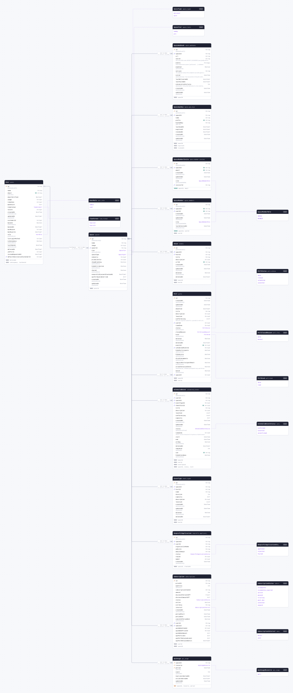

| Field                                                          | Type                           | Constraints                       | Default      | Description |
| -------------------------------------------------------------- | ------------------------------ | --------------------------------- | ------------ | ----------- |
| `id`                                                           | `String`                       | PK NOT NULL                       | `uuid(4)`    |             |
| `name`                                                         | `String`                       | NOT NULL                          |              |             |
| `image`                                                        | `String`                       | NULL                              |              |             |
| `ownerId` (`owner_id`)                                         | `String`                       | NOT NULL → [User.id](#model-User) |              |             |
| `tier`                                                         | [`SpaceTier`](#enum-SpaceTier) | NOT NULL                          | `hobby`      |             |
| `spaceType` (`space_type`)                                     | [`SpaceType`](#enum-SpaceType) | NULL                              |              |             |
| `industry`                                                     | `String`                       | NULL                              |              |             |
| `primaryColor` (`primary_color`)                               | `String`                       | NULL                              |              |             |
| `showBranding` (`show_branding`)                               | `Boolean`                      | NOT NULL                          | `false`      |             |
| `hideAttribution` (`hide_attribution`)                         | `Boolean`                      | NOT NULL                          | `false`      |             |
| `shared`                                                       | `Boolean`                      | NOT NULL                          | `false`      |             |
| `nonprofitDiscountGrantedAt` (`nonprofit_discount_granted_at`) | `DateTime`                     | NULL                              |              |             |
| `apiPollQuotaOverride` (`api_poll_quota_override`)             | `Int`                          | NULL                              |              |             |
| `createdAt` (`created_at`)                                     | `DateTime`                     | NOT NULL                          | `now()`      |             |
| `updatedAt` (`updated_at`)                                     | `DateTime`                     | NOT NULL                          | `@updatedAt` |             |

#### Indexes

- `@@index([ownerId])`

#### References

- `ownerId` → [User.id](#model-User) (many-to-one, on delete Cascade)

#### Referenced by

- `id` ← [ApiUsage.spaceId](#model-ApiUsage) (one-to-many, on delete Cascade)
- `id` ← [Subscription.spaceId](#model-Subscription) (one-to-many, on delete Cascade)
- `id` ← [NonprofitApplication.spaceId](#model-NonprofitApplication) (one-to-many, on delete Cascade)
- `id` ← [EventType.spaceId](#model-EventType) (one-to-many, on delete Cascade)
- `id` ← [ScheduledEvent.spaceId](#model-ScheduledEvent) (one-to-many, on delete Cascade)
- `id` ← [Poll.spaceId](#model-Poll) (one-to-many, on delete SetNull)
- `id` ← [Sheet.spaceId](#model-Sheet) (one-to-many, on delete Cascade)
- `id` ← [SpaceMember.spaceId](#model-SpaceMember) (one-to-many, on delete Cascade)
- `id` ← [SpaceMemberInvite.spaceId](#model-SpaceMemberInvite) (one-to-many, on delete Cascade)
- `id` ← [SpaceApiKey.spaceId](#model-SpaceApiKey) (one-to-many, on delete Cascade)
- `id` ← [SpaceWebhook.spaceId](#model-SpaceWebhook) (one-to-many, on delete Cascade)

#### Definition

```sql
CREATE TABLE "spaces" (
    "id" TEXT NOT NULL,
    "name" TEXT NOT NULL,
    "image" TEXT,
    "owner_id" TEXT NOT NULL,
    "tier" "space_tiers" NOT NULL DEFAULT 'hobby',
    "space_type" "space_types",
    "industry" TEXT,
    "primary_color" TEXT,
    "show_branding" BOOLEAN NOT NULL DEFAULT false,
    "hide_attribution" BOOLEAN NOT NULL DEFAULT false,
    "shared" BOOLEAN NOT NULL DEFAULT false,
    "nonprofit_discount_granted_at" TIMESTAMP(3),
    "api_poll_quota_override" INTEGER,
    "created_at" TIMESTAMP(3) NOT NULL DEFAULT CURRENT_TIMESTAMP,
    "updated_at" TIMESTAMP(3) NOT NULL,

    CONSTRAINT "spaces_pkey" PRIMARY KEY ("id")
);

CREATE INDEX "spaces_owner_id_idx" ON "spaces"("owner_id");

ALTER TABLE "spaces" ADD CONSTRAINT "spaces_owner_id_fkey" FOREIGN KEY ("owner_id") REFERENCES "users"("id") ON DELETE CASCADE ON UPDATE CASCADE;
```

<details>
<summary>Queries and their SQL</summary>

**findMany**: Every row

```ts
await prisma.space.findMany();
```

```sql
SELECT
  "public"."spaces"."id",
  "public"."spaces"."name",
  "public"."spaces"."image",
  "public"."spaces"."owner_id",
  "public"."spaces"."tier"::text,
  "public"."spaces"."space_type"::text,
  "public"."spaces"."industry",
  "public"."spaces"."primary_color",
  "public"."spaces"."show_branding",
  "public"."spaces"."hide_attribution",
  "public"."spaces"."shared",
  "public"."spaces"."nonprofit_discount_granted_at",
  "public"."spaces"."api_poll_quota_override",
  "public"."spaces"."created_at",
  "public"."spaces"."updated_at"
FROM
  "public"."spaces"
WHERE
  1 = 1
OFFSET
  $1
-- params: ["0"]
```

**count**: How many rows there are

```ts
await prisma.space.count();
```

```sql
SELECT
  COUNT(*) AS "_count$_all"
FROM
  (
    SELECT
      "public"."spaces"."id"
    FROM
      "public"."spaces"
    WHERE
      1 = 1
    OFFSET
      $1
  ) AS "sub"
-- params: ["0"]
```

**findMany**: Every row with its relations

```ts
await prisma.space.findMany({
  include: {
    owner: true,
    polls: true,
    scheduledEvents: true,
    eventTypes: true,
    sheets: true,
    subscriptions: true,
    members: true,
    memberInvites: true,
    apiKeys: true,
    nonprofitApplications: true,
    webhooks: true,
    apiUsage: true,
  },
});
```

```sql
SELECT
  "public"."spaces"."id",
  "public"."spaces"."name",
  "public"."spaces"."image",
  "public"."spaces"."owner_id",
  "public"."spaces"."tier"::text,
  "public"."spaces"."space_type"::text,
  "public"."spaces"."industry",
  "public"."spaces"."primary_color",
  "public"."spaces"."show_branding",
  "public"."spaces"."hide_attribution",
  "public"."spaces"."shared",
  "public"."spaces"."nonprofit_discount_granted_at",
  "public"."spaces"."api_poll_quota_override",
  "public"."spaces"."created_at",
  "public"."spaces"."updated_at"
FROM
  "public"."spaces"
WHERE
  1 = 1
OFFSET
  $1
-- params: ["0"]

SELECT
  "public"."users"."id",
  "public"."users"."name",
  "public"."users"."email",
  "public"."users"."email_verified",
  "public"."users"."image",
  "public"."users"."time_zone",
  "public"."users"."week_start",
  "public"."users"."time_format"::text,
  "public"."users"."locale",
  "public"."users"."created_at",
  "public"."users"."updated_at",
  "public"."users"."customer_id",
  "public"."users"."banned",
  "public"."users"."banned_at",
  "public"."users"."ban_reason",
  "public"."users"."ban_expires",
  "public"."users"."role"::text,
  "public"."users"."last_login_method",
  "public"."users"."anonymous",
  "public"."users"."last_seen_at",
  "public"."users"."deleted_at",
  "public"."users"."job_title",
  "public"."users"."review_requested_at",
  "public"."users"."default_destination_calendar_id"
FROM
  "public"."users"
WHERE
  "public"."users"."id" IN ($1)
OFFSET
  $2
-- params: ["<ownerId of the rows above>","0"]

SELECT
  "public"."polls"."id",
  "public"."polls"."created_at",
  "public"."polls"."updated_at",
  "public"."polls"."deadline",
  "public"."polls"."title",
  "public"."polls"."description",
  "public"."polls"."location",
  "public"."polls"."conferencing",
  "public"."polls"."user_id",
  "public"."polls"."time_zone",
  "public"."polls"."status"::text,
  "public"."polls"."closed_reason"::text,
  "public"."polls"."kind"::text,
  "public"."polls"."deleted",
  "public"."polls"."deleted_at",
  "public"."polls"."event_id",
  "public"."polls"."scheduled_event_id",
  "public"."polls"."hide_participants",
  "public"."polls"."hide_scores",
  "public"."polls"."disable_comments",
  "public"."polls"."require_participant_email",
  "public"."polls"."allow_tentative_votes",
  "public"."polls"."muted",
  "public"."polls"."space_id"
FROM
  "public"."polls"
WHERE
  "public"."polls"."space_id" IN ($1)
OFFSET
  $2
-- params: ["<id of the rows above>","0"]

SELECT
  "public"."scheduled_events"."id",
  "public"."scheduled_events"."user_id",
  "public"."scheduled_events"."space_id",
  "public"."scheduled_events"."event_type_id",
  "public"."scheduled_events"."sheet_slot_id",
  "public"."scheduled_events"."title",
  "public"."scheduled_events"."description",
  "public"."scheduled_events"."location",
  "public"."scheduled_events"."conferencing",
  "public"."scheduled_events"."capacity",
  "public"."scheduled_events"."created_at",
  "public"."scheduled_events"."updated_at",
  "public"."scheduled_events"."status"::text,
  "public"."scheduled_events"."time_zone",
  "public"."scheduled_events"."start",
  "public"."scheduled_events"."end",
  "public"."scheduled_events"."all_day",
  "public"."scheduled_events"."deleted_at",
  "public"."scheduled_events"."sequence",
  "public"."scheduled_events"."uid",
  "public"."scheduled_events"."hide_attendees"
FROM
  "public"."scheduled_events"
WHERE
  "public"."scheduled_events"."space_id" IN ($1)
OFFSET
  $2
-- params: ["<id of the rows above>","0"]

SELECT
  "public"."event_types"."id",
  "public"."event_types"."space_id",
  "public"."event_types"."host_id",
  "public"."event_types"."name",
  "public"."event_types"."duration_minutes",
  "public"."event_types"."capacity",
  "public"."event_types"."description",
  "public"."event_types"."location",
  "public"."event_types"."created_at",
  "public"."event_types"."updated_at",
  "public"."event_types"."deleted",
  "public"."event_types"."deleted_at"
FROM
  "public"."event_types"
WHERE
  "public"."event_types"."space_id" IN ($1)
OFFSET
  $2
-- params: ["<id of the rows above>","0"]

SELECT
  "public"."sheets"."id",
  "public"."sheets"."space_id",
  "public"."sheets"."host_id",
  "public"."sheets"."title",
  "public"."sheets"."description",
  "public"."sheets"."url_id",
  "public"."sheets"."created_at",
  "public"."sheets"."updated_at",
  "public"."sheets"."deleted",
  "public"."sheets"."deleted_at"
FROM
  "public"."sheets"
WHERE
  "public"."sheets"."space_id" IN ($1)
OFFSET
  $2
-- params: ["<id of the rows above>","0"]

SELECT
  "public"."subscriptions"."id",
  "public"."subscriptions"."price_id",
  "public"."subscriptions"."quantity",
  "public"."subscriptions"."subscription_item_id",
  "public"."subscriptions"."amount",
  "public"."subscriptions"."discount_percent_off",
  "public"."subscriptions"."discount_amount_off",
  "public"."subscriptions"."status"::text,
  "public"."subscriptions"."active",
  "public"."subscriptions"."currency",
  "public"."subscriptions"."interval"::text,
  "public"."subscriptions"."created_at",
  "public"."subscriptions"."period_start",
  "public"."subscriptions"."period_end",
  "public"."subscriptions"."cancel_at_period_end",
  "public"."subscriptions"."user_id",
  "public"."subscriptions"."space_id",
  "public"."subscriptions"."api_addon_item_id",
  "public"."subscriptions"."api_addon_price_id",
  "public"."subscriptions"."api_addon_amount",
  "public"."subscriptions"."api_addon_tier",
  "public"."subscriptions"."api_poll_retained_tier",
  "public"."subscriptions"."api_poll_retained_until"
FROM
  "public"."subscriptions"
WHERE
  "public"."subscriptions"."space_id" IN ($1)
OFFSET
  $2
-- params: ["<id of the rows above>","0"]

SELECT
  "public"."space_members"."id",
  "public"."space_members"."space_id",
  "public"."space_members"."user_id",
  "public"."space_members"."created_at",
  "public"."space_members"."updated_at",
  "public"."space_members"."role"::text,
  "public"."space_members"."last_selected_at"
FROM
  "public"."space_members"
WHERE
  "public"."space_members"."space_id" IN ($1)
OFFSET
  $2
-- params: ["<id of the rows above>","0"]

SELECT
  "public"."space_member_invites"."id",
  "public"."space_member_invites"."space_id",
  "public"."space_member_invites"."email",
  "public"."space_member_invites"."created_at",
  "public"."space_member_invites"."updated_at",
  "public"."space_member_invites"."role"::text,
  "public"."space_member_invites"."inviter_id"
FROM
  "public"."space_member_invites"
WHERE
  "public"."space_member_invites"."space_id" IN ($1)
OFFSET
  $2
-- params: ["<id of the rows above>","0"]

SELECT
  "public"."space_api_keys"."id",
  "public"."space_api_keys"."space_id",
  "public"."space_api_keys"."name",
  "public"."space_api_keys"."prefix",
  "public"."space_api_keys"."hashed_key",
  "public"."space_api_keys"."last_used_at",
  "public"."space_api_keys"."expires_at",
  "public"."space_api_keys"."revoked_at",
  "public"."space_api_keys"."created_at",
  "public"."space_api_keys"."updated_at"
FROM
  "public"."space_api_keys"
WHERE
  "public"."space_api_keys"."space_id" IN ($1)
OFFSET
  $2
-- params: ["<id of the rows above>","0"]

SELECT
  "public"."nonprofit_applications"."id",
  "public"."nonprofit_applications"."space_id",
  "public"."nonprofit_applications"."user_id",
  "public"."nonprofit_applications"."organization_name",
  "public"."nonprofit_applications"."website",
  "public"."nonprofit_applications"."email_domain",
  "public"."nonprofit_applications"."status"::text,
  "public"."nonprofit_applications"."reason",
  "public"."nonprofit_applications"."model",
  "public"."nonprofit_applications"."created_at"
FROM
  "public"."nonprofit_applications"
WHERE
  "public"."nonprofit_applications"."space_id" IN ($1)
OFFSET
  $2
-- params: ["<id of the rows above>","0"]

SELECT
  "public"."space_webhooks"."id",
  "public"."space_webhooks"."space_id",
  "public"."space_webhooks"."url",
  "public"."space_webhooks"."secret",
  "public"."space_webhooks"."events",
  "public"."space_webhooks"."enabled",
  "public"."space_webhooks"."version",
  "public"."space_webhooks"."cursor",
  "public"."space_webhooks"."last_delivered_at",
  "public"."space_webhooks"."last_failed_at",
  "public"."space_webhooks"."consecutive_failures",
  "public"."space_webhooks"."created_at",
  "public"."space_webhooks"."updated_at"
FROM
  "public"."space_webhooks"
WHERE
  "public"."space_webhooks"."space_id" IN ($1)
OFFSET
  $2
-- params: ["<id of the rows above>","0"]

SELECT
  "public"."api_usage"."space_id",
  "public"."api_usage"."resource"::text,
  "public"."api_usage"."period",
  "public"."api_usage"."count",
  "public"."api_usage"."near_limit_warned_at",
  "public"."api_usage"."at_limit_warned_at",
  "public"."api_usage"."updated_at"
FROM
  "public"."api_usage"
WHERE
  "public"."api_usage"."space_id" IN ($1)
OFFSET
  $2
-- params: ["<id of the rows above>","0"]
```

**findUnique**: One row by what is unique to it

```ts
await prisma.space.findUnique({ where: { id: "example" } });
```

```sql
SELECT
  "public"."spaces"."id",
  "public"."spaces"."name",
  "public"."spaces"."image",
  "public"."spaces"."owner_id",
  "public"."spaces"."tier"::text,
  "public"."spaces"."space_type"::text,
  "public"."spaces"."industry",
  "public"."spaces"."primary_color",
  "public"."spaces"."show_branding",
  "public"."spaces"."hide_attribution",
  "public"."spaces"."shared",
  "public"."spaces"."nonprofit_discount_granted_at",
  "public"."spaces"."api_poll_quota_override",
  "public"."spaces"."created_at",
  "public"."spaces"."updated_at"
FROM
  "public"."spaces"
WHERE
  (
    "public"."spaces"."id" = $1
    AND 1 = 1
  )
LIMIT
  $2
OFFSET
  $3
-- params: ["example","1","0"]
```

**create**: Create a row

```ts
await prisma.space.create({ data: { name: "example", ownerId: "example" } });
```

```sql
INSERT INTO
  "public"."spaces" (
    "id",
    "name",
    "owner_id",
    "tier",
    "show_branding",
    "hide_attribution",
    "shared",
    "created_at",
    "updated_at"
  )
VALUES
  (
    $1,
    $2,
    $3,
    CAST($4::text AS "public"."space_tiers"),
    $5,
    $6,
    $7,
    $8,
    $9
  )
RETURNING
  "public"."spaces"."id",
  "public"."spaces"."name",
  "public"."spaces"."image",
  "public"."spaces"."owner_id",
  "public"."spaces"."tier"::text,
  "public"."spaces"."space_type"::text,
  "public"."spaces"."industry",
  "public"."spaces"."primary_color",
  "public"."spaces"."show_branding",
  "public"."spaces"."hide_attribution",
  "public"."spaces"."shared",
  "public"."spaces"."nonprofit_discount_granted_at",
  "public"."spaces"."api_poll_quota_override",
  "public"."spaces"."created_at",
  "public"."spaces"."updated_at"
-- params: ["<uuid(4)>","example","example","hobby",false,false,false,"<now()>","<now()>"]
```

**update**: Update a row

```ts
await prisma.space.update({ where: { id: "example" }, data: { name: "example" } });
```

```sql
UPDATE "public"."spaces"
SET
  "name" = $1,
  "updated_at" = $2
WHERE
  (
    "public"."spaces"."id" = $3
    AND 1 = 1
  )
RETURNING
  "public"."spaces"."id",
  "public"."spaces"."name",
  "public"."spaces"."image",
  "public"."spaces"."owner_id",
  "public"."spaces"."tier"::text,
  "public"."spaces"."space_type"::text,
  "public"."spaces"."industry",
  "public"."spaces"."primary_color",
  "public"."spaces"."show_branding",
  "public"."spaces"."hide_attribution",
  "public"."spaces"."shared",
  "public"."spaces"."nonprofit_discount_granted_at",
  "public"."spaces"."api_poll_quota_override",
  "public"."spaces"."created_at",
  "public"."spaces"."updated_at"
-- params: ["example",{"prisma__type":"generatorCall","prisma__value":{"name":"now","args":[],"returnType":{"type":"DateTime"}}},"example"]
```

**delete**: Delete a row

```ts
await prisma.space.delete({ where: { id: "example" } });
```

```sql
DELETE FROM "public"."spaces"
WHERE
  (
    "public"."spaces"."id" = $1
    AND 1 = 1
  )
RETURNING
  "public"."spaces"."id",
  "public"."spaces"."name",
  "public"."spaces"."image",
  "public"."spaces"."owner_id",
  "public"."spaces"."tier"::text,
  "public"."spaces"."space_type"::text,
  "public"."spaces"."industry",
  "public"."spaces"."primary_color",
  "public"."spaces"."show_branding",
  "public"."spaces"."hide_attribution",
  "public"."spaces"."shared",
  "public"."spaces"."nonprofit_discount_granted_at",
  "public"."spaces"."api_poll_quota_override",
  "public"."spaces"."created_at",
  "public"."spaces"."updated_at"
-- params: ["example"]
```

</details>

<a id="model-SpaceMember"></a>

### SpaceMember

Table `space_members`.

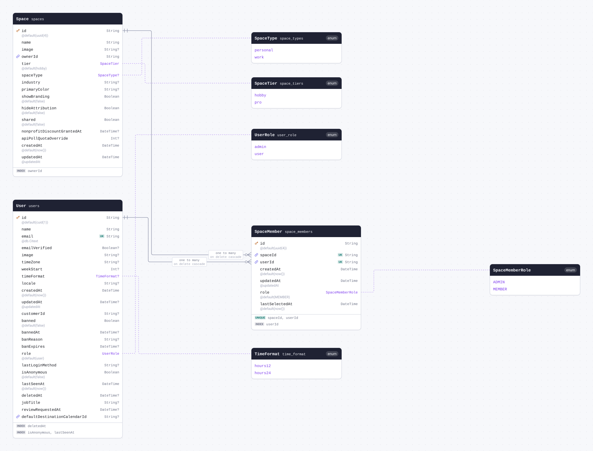

| Field                                 | Type                                       | Constraints                         | Default      | Description |
| ------------------------------------- | ------------------------------------------ | ----------------------------------- | ------------ | ----------- |
| `id`                                  | `String`                                   | PK NOT NULL                         | `uuid(4)`    |             |
| `spaceId` (`space_id`)                | `String`                                   | NOT NULL → [Space.id](#model-Space) |              |             |
| `userId` (`user_id`)                  | `String`                                   | NOT NULL → [User.id](#model-User)   |              |             |
| `createdAt` (`created_at`)            | `DateTime`                                 | NOT NULL                            | `now()`      |             |
| `updatedAt` (`updated_at`)            | `DateTime`                                 | NOT NULL                            | `@updatedAt` |             |
| `role`                                | [`SpaceMemberRole`](#enum-SpaceMemberRole) | NOT NULL                            | `MEMBER`     |             |
| `lastSelectedAt` (`last_selected_at`) | `DateTime`                                 | NOT NULL                            | `now()`      |             |

#### Indexes

- `@@index([userId])`
- `@@unique([spaceId, userId])`

#### References

- `spaceId` → [Space.id](#model-Space) (many-to-one, on delete Cascade)
- `userId` → [User.id](#model-User) (many-to-one, on delete Cascade)

#### Definition

```sql
CREATE TABLE "space_members" (
    "id" TEXT NOT NULL,
    "space_id" TEXT NOT NULL,
    "user_id" TEXT NOT NULL,
    "created_at" TIMESTAMP(3) NOT NULL DEFAULT CURRENT_TIMESTAMP,
    "updated_at" TIMESTAMP(3) NOT NULL,
    "role" "SpaceMemberRole" NOT NULL DEFAULT 'MEMBER',
    "last_selected_at" TIMESTAMP(3) NOT NULL DEFAULT CURRENT_TIMESTAMP,

    CONSTRAINT "space_members_pkey" PRIMARY KEY ("id")
);

CREATE INDEX "space_members_user_id_idx" ON "space_members"("user_id");

CREATE UNIQUE INDEX "space_members_space_id_user_id_key" ON "space_members"("space_id", "user_id");

ALTER TABLE "space_members" ADD CONSTRAINT "space_members_space_id_fkey" FOREIGN KEY ("space_id") REFERENCES "spaces"("id") ON DELETE CASCADE ON UPDATE CASCADE;

ALTER TABLE "space_members" ADD CONSTRAINT "space_members_user_id_fkey" FOREIGN KEY ("user_id") REFERENCES "users"("id") ON DELETE CASCADE ON UPDATE CASCADE;
```

<details>
<summary>Queries and their SQL</summary>

**findMany**: Every row

```ts
await prisma.spaceMember.findMany();
```

```sql
SELECT
  "public"."space_members"."id",
  "public"."space_members"."space_id",
  "public"."space_members"."user_id",
  "public"."space_members"."created_at",
  "public"."space_members"."updated_at",
  "public"."space_members"."role"::text,
  "public"."space_members"."last_selected_at"
FROM
  "public"."space_members"
WHERE
  1 = 1
OFFSET
  $1
-- params: ["0"]
```

**count**: How many rows there are

```ts
await prisma.spaceMember.count();
```

```sql
SELECT
  COUNT(*) AS "_count$_all"
FROM
  (
    SELECT
      "public"."space_members"."id"
    FROM
      "public"."space_members"
    WHERE
      1 = 1
    OFFSET
      $1
  ) AS "sub"
-- params: ["0"]
```

**findMany**: Every row with its relations

```ts
await prisma.spaceMember.findMany({ include: { space: true, user: true } });
```

```sql
SELECT
  "public"."space_members"."id",
  "public"."space_members"."space_id",
  "public"."space_members"."user_id",
  "public"."space_members"."created_at",
  "public"."space_members"."updated_at",
  "public"."space_members"."role"::text,
  "public"."space_members"."last_selected_at"
FROM
  "public"."space_members"
WHERE
  1 = 1
OFFSET
  $1
-- params: ["0"]

SELECT
  "public"."spaces"."id",
  "public"."spaces"."name",
  "public"."spaces"."image",
  "public"."spaces"."owner_id",
  "public"."spaces"."tier"::text,
  "public"."spaces"."space_type"::text,
  "public"."spaces"."industry",
  "public"."spaces"."primary_color",
  "public"."spaces"."show_branding",
  "public"."spaces"."hide_attribution",
  "public"."spaces"."shared",
  "public"."spaces"."nonprofit_discount_granted_at",
  "public"."spaces"."api_poll_quota_override",
  "public"."spaces"."created_at",
  "public"."spaces"."updated_at"
FROM
  "public"."spaces"
WHERE
  "public"."spaces"."id" IN ($1)
OFFSET
  $2
-- params: ["<spaceId of the rows above>","0"]

SELECT
  "public"."users"."id",
  "public"."users"."name",
  "public"."users"."email",
  "public"."users"."email_verified",
  "public"."users"."image",
  "public"."users"."time_zone",
  "public"."users"."week_start",
  "public"."users"."time_format"::text,
  "public"."users"."locale",
  "public"."users"."created_at",
  "public"."users"."updated_at",
  "public"."users"."customer_id",
  "public"."users"."banned",
  "public"."users"."banned_at",
  "public"."users"."ban_reason",
  "public"."users"."ban_expires",
  "public"."users"."role"::text,
  "public"."users"."last_login_method",
  "public"."users"."anonymous",
  "public"."users"."last_seen_at",
  "public"."users"."deleted_at",
  "public"."users"."job_title",
  "public"."users"."review_requested_at",
  "public"."users"."default_destination_calendar_id"
FROM
  "public"."users"
WHERE
  "public"."users"."id" IN ($1)
OFFSET
  $2
-- params: ["<userId of the rows above>","0"]
```

**findUnique**: One row by what is unique to it

```ts
await prisma.spaceMember.findUnique({ where: { id: "example" } });
```

```sql
SELECT
  "public"."space_members"."id",
  "public"."space_members"."space_id",
  "public"."space_members"."user_id",
  "public"."space_members"."created_at",
  "public"."space_members"."updated_at",
  "public"."space_members"."role"::text,
  "public"."space_members"."last_selected_at"
FROM
  "public"."space_members"
WHERE
  (
    "public"."space_members"."id" = $1
    AND 1 = 1
  )
LIMIT
  $2
OFFSET
  $3
-- params: ["example","1","0"]
```

**create**: Create a row

```ts
await prisma.spaceMember.create({ data: { spaceId: "example", userId: "example" } });
```

```sql
INSERT INTO
  "public"."space_members" (
    "id",
    "space_id",
    "user_id",
    "created_at",
    "updated_at",
    "role",
    "last_selected_at"
  )
VALUES
  (
    $1,
    $2,
    $3,
    $4,
    $5,
    CAST($6::text AS "public"."SpaceMemberRole"),
    $7
  )
RETURNING
  "public"."space_members"."id",
  "public"."space_members"."space_id",
  "public"."space_members"."user_id",
  "public"."space_members"."created_at",
  "public"."space_members"."updated_at",
  "public"."space_members"."role"::text,
  "public"."space_members"."last_selected_at"
-- params: ["<uuid(4)>","example","example","<now()>","<now()>","MEMBER","<now()>"]
```

**update**: Update a row

```ts
await prisma.spaceMember.update({
  where: { id: "example" },
  data: { createdAt: new Date("2026-01-01T00:00:00.000Z") },
});
```

```sql
UPDATE "public"."space_members"
SET
  "created_at" = $1,
  "updated_at" = $2
WHERE
  (
    "public"."space_members"."id" = $3
    AND 1 = 1
  )
RETURNING
  "public"."space_members"."id",
  "public"."space_members"."space_id",
  "public"."space_members"."user_id",
  "public"."space_members"."created_at",
  "public"."space_members"."updated_at",
  "public"."space_members"."role"::text,
  "public"."space_members"."last_selected_at"
-- params: ["2026-01-01T00:00:00.000Z",{"prisma__type":"generatorCall","prisma__value":{"name":"now","args":[],"returnType":{"type":"DateTime"}}},"example"]
```

**delete**: Delete a row

```ts
await prisma.spaceMember.delete({ where: { id: "example" } });
```

```sql
DELETE FROM "public"."space_members"
WHERE
  (
    "public"."space_members"."id" = $1
    AND 1 = 1
  )
RETURNING
  "public"."space_members"."id",
  "public"."space_members"."space_id",
  "public"."space_members"."user_id",
  "public"."space_members"."created_at",
  "public"."space_members"."updated_at",
  "public"."space_members"."role"::text,
  "public"."space_members"."last_selected_at"
-- params: ["example"]
```

</details>

<a id="model-SpaceMemberInvite"></a>

### SpaceMemberInvite

Table `space_member_invites`.

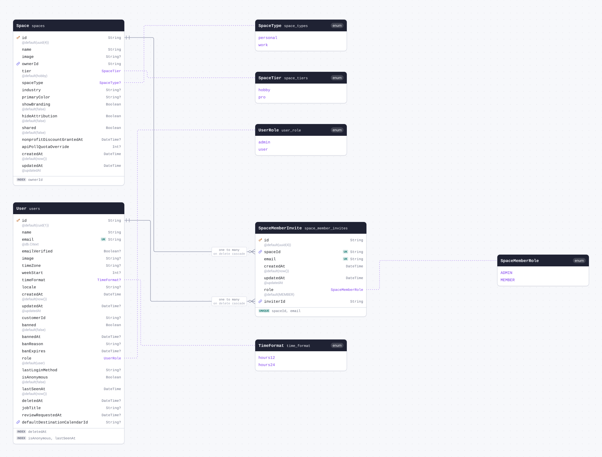

| Field                      | Type                                       | Constraints                         | Default      | Description |
| -------------------------- | ------------------------------------------ | ----------------------------------- | ------------ | ----------- |
| `id`                       | `String`                                   | PK NOT NULL                         | `uuid(4)`    |             |
| `spaceId` (`space_id`)     | `String`                                   | NOT NULL → [Space.id](#model-Space) |              |             |
| `email`                    | `String`                                   | NOT NULL                            |              |             |
| `createdAt` (`created_at`) | `DateTime`                                 | NOT NULL                            | `now()`      |             |
| `updatedAt` (`updated_at`) | `DateTime`                                 | NOT NULL                            | `@updatedAt` |             |
| `role`                     | [`SpaceMemberRole`](#enum-SpaceMemberRole) | NOT NULL                            | `MEMBER`     |             |
| `inviterId` (`inviter_id`) | `String`                                   | NOT NULL → [User.id](#model-User)   |              |             |

#### Indexes

- `@@unique([spaceId, email])`

#### References

- `inviterId` → [User.id](#model-User) (many-to-one, on delete Cascade)
- `spaceId` → [Space.id](#model-Space) (many-to-one, on delete Cascade)

#### Definition

```sql
CREATE TABLE "space_member_invites" (
    "id" TEXT NOT NULL,
    "space_id" TEXT NOT NULL,
    "email" TEXT NOT NULL,
    "created_at" TIMESTAMP(3) NOT NULL DEFAULT CURRENT_TIMESTAMP,
    "updated_at" TIMESTAMP(3) NOT NULL,
    "role" "SpaceMemberRole" NOT NULL DEFAULT 'MEMBER',
    "inviter_id" TEXT NOT NULL,

    CONSTRAINT "space_member_invites_pkey" PRIMARY KEY ("id")
);

CREATE UNIQUE INDEX "space_member_invites_space_id_email_key" ON "space_member_invites"("space_id", "email");

ALTER TABLE "space_member_invites" ADD CONSTRAINT "space_member_invites_inviter_id_fkey" FOREIGN KEY ("inviter_id") REFERENCES "users"("id") ON DELETE CASCADE ON UPDATE CASCADE;

ALTER TABLE "space_member_invites" ADD CONSTRAINT "space_member_invites_space_id_fkey" FOREIGN KEY ("space_id") REFERENCES "spaces"("id") ON DELETE CASCADE ON UPDATE CASCADE;
```

<details>
<summary>Queries and their SQL</summary>

**findMany**: Every row

```ts
await prisma.spaceMemberInvite.findMany();
```

```sql
SELECT
  "public"."space_member_invites"."id",
  "public"."space_member_invites"."space_id",
  "public"."space_member_invites"."email",
  "public"."space_member_invites"."created_at",
  "public"."space_member_invites"."updated_at",
  "public"."space_member_invites"."role"::text,
  "public"."space_member_invites"."inviter_id"
FROM
  "public"."space_member_invites"
WHERE
  1 = 1
OFFSET
  $1
-- params: ["0"]
```

**count**: How many rows there are

```ts
await prisma.spaceMemberInvite.count();
```

```sql
SELECT
  COUNT(*) AS "_count$_all"
FROM
  (
    SELECT
      "public"."space_member_invites"."id"
    FROM
      "public"."space_member_invites"
    WHERE
      1 = 1
    OFFSET
      $1
  ) AS "sub"
-- params: ["0"]
```

**findMany**: Every row with its relations

```ts
await prisma.spaceMemberInvite.findMany({ include: { invitedBy: true, space: true } });
```

```sql
SELECT
  "public"."space_member_invites"."id",
  "public"."space_member_invites"."space_id",
  "public"."space_member_invites"."email",
  "public"."space_member_invites"."created_at",
  "public"."space_member_invites"."updated_at",
  "public"."space_member_invites"."role"::text,
  "public"."space_member_invites"."inviter_id"
FROM
  "public"."space_member_invites"
WHERE
  1 = 1
OFFSET
  $1
-- params: ["0"]

SELECT
  "public"."users"."id",
  "public"."users"."name",
  "public"."users"."email",
  "public"."users"."email_verified",
  "public"."users"."image",
  "public"."users"."time_zone",
  "public"."users"."week_start",
  "public"."users"."time_format"::text,
  "public"."users"."locale",
  "public"."users"."created_at",
  "public"."users"."updated_at",
  "public"."users"."customer_id",
  "public"."users"."banned",
  "public"."users"."banned_at",
  "public"."users"."ban_reason",
  "public"."users"."ban_expires",
  "public"."users"."role"::text,
  "public"."users"."last_login_method",
  "public"."users"."anonymous",
  "public"."users"."last_seen_at",
  "public"."users"."deleted_at",
  "public"."users"."job_title",
  "public"."users"."review_requested_at",
  "public"."users"."default_destination_calendar_id"
FROM
  "public"."users"
WHERE
  "public"."users"."id" IN ($1)
OFFSET
  $2
-- params: ["<inviterId of the rows above>","0"]

SELECT
  "public"."spaces"."id",
  "public"."spaces"."name",
  "public"."spaces"."image",
  "public"."spaces"."owner_id",
  "public"."spaces"."tier"::text,
  "public"."spaces"."space_type"::text,
  "public"."spaces"."industry",
  "public"."spaces"."primary_color",
  "public"."spaces"."show_branding",
  "public"."spaces"."hide_attribution",
  "public"."spaces"."shared",
  "public"."spaces"."nonprofit_discount_granted_at",
  "public"."spaces"."api_poll_quota_override",
  "public"."spaces"."created_at",
  "public"."spaces"."updated_at"
FROM
  "public"."spaces"
WHERE
  "public"."spaces"."id" IN ($1)
OFFSET
  $2
-- params: ["<spaceId of the rows above>","0"]
```

**findUnique**: One row by what is unique to it

```ts
await prisma.spaceMemberInvite.findUnique({ where: { id: "example" } });
```

```sql
SELECT
  "public"."space_member_invites"."id",
  "public"."space_member_invites"."space_id",
  "public"."space_member_invites"."email",
  "public"."space_member_invites"."created_at",
  "public"."space_member_invites"."updated_at",
  "public"."space_member_invites"."role"::text,
  "public"."space_member_invites"."inviter_id"
FROM
  "public"."space_member_invites"
WHERE
  (
    "public"."space_member_invites"."id" = $1
    AND 1 = 1
  )
LIMIT
  $2
OFFSET
  $3
-- params: ["example","1","0"]
```

**create**: Create a row

```ts
await prisma.spaceMemberInvite.create({
  data: { spaceId: "example", email: "example", inviterId: "example" },
});
```

```sql
INSERT INTO
  "public"."space_member_invites" (
    "id",
    "space_id",
    "email",
    "created_at",
    "updated_at",
    "role",
    "inviter_id"
  )
VALUES
  (
    $1,
    $2,
    $3,
    $4,
    $5,
    CAST($6::text AS "public"."SpaceMemberRole"),
    $7
  )
RETURNING
  "public"."space_member_invites"."id",
  "public"."space_member_invites"."space_id",
  "public"."space_member_invites"."email",
  "public"."space_member_invites"."created_at",
  "public"."space_member_invites"."updated_at",
  "public"."space_member_invites"."role"::text,
  "public"."space_member_invites"."inviter_id"
-- params: ["<uuid(4)>","example","example","<now()>","<now()>","MEMBER","example"]
```

**update**: Update a row

```ts
await prisma.spaceMemberInvite.update({ where: { id: "example" }, data: { email: "example" } });
```

```sql
UPDATE "public"."space_member_invites"
SET
  "email" = $1,
  "updated_at" = $2
WHERE
  (
    "public"."space_member_invites"."id" = $3
    AND 1 = 1
  )
RETURNING
  "public"."space_member_invites"."id",
  "public"."space_member_invites"."space_id",
  "public"."space_member_invites"."email",
  "public"."space_member_invites"."created_at",
  "public"."space_member_invites"."updated_at",
  "public"."space_member_invites"."role"::text,
  "public"."space_member_invites"."inviter_id"
-- params: ["example",{"prisma__type":"generatorCall","prisma__value":{"name":"now","args":[],"returnType":{"type":"DateTime"}}},"example"]
```

**delete**: Delete a row

```ts
await prisma.spaceMemberInvite.delete({ where: { id: "example" } });
```

```sql
DELETE FROM "public"."space_member_invites"
WHERE
  (
    "public"."space_member_invites"."id" = $1
    AND 1 = 1
  )
RETURNING
  "public"."space_member_invites"."id",
  "public"."space_member_invites"."space_id",
  "public"."space_member_invites"."email",
  "public"."space_member_invites"."created_at",
  "public"."space_member_invites"."updated_at",
  "public"."space_member_invites"."role"::text,
  "public"."space_member_invites"."inviter_id"
-- params: ["example"]
```

</details>

<a id="model-SpaceApiKey"></a>

### SpaceApiKey

Table `space_api_keys`.

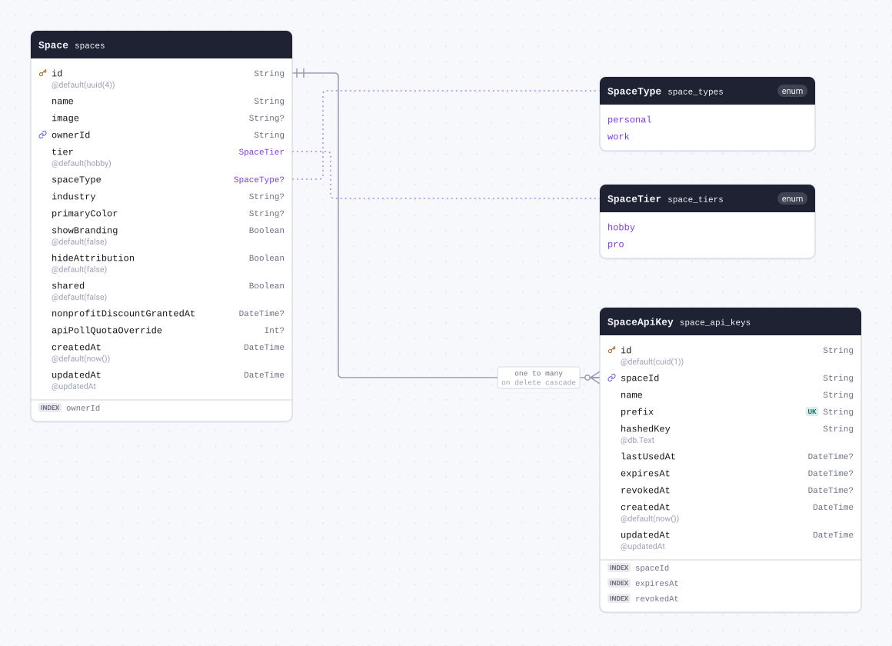

| Field                         | Type                | Constraints                         | Default      | Description |
| ----------------------------- | ------------------- | ----------------------------------- | ------------ | ----------- |
| `id`                          | `String`            | PK NOT NULL                         | `cuid(1)`    |             |
| `spaceId` (`space_id`)        | `String`            | NOT NULL → [Space.id](#model-Space) |              |             |
| `name`                        | `String`            | NOT NULL                            |              |             |
| `prefix`                      | `String`            | UNIQUE NOT NULL                     |              |             |
| `hashedKey` (`hashed_key`)    | `String` `@db.Text` | NOT NULL                            |              |             |
| `lastUsedAt` (`last_used_at`) | `DateTime`          | NULL                                |              |             |
| `expiresAt` (`expires_at`)    | `DateTime`          | NULL                                |              |             |
| `revokedAt` (`revoked_at`)    | `DateTime`          | NULL                                |              |             |
| `createdAt` (`created_at`)    | `DateTime`          | NOT NULL                            | `now()`      |             |
| `updatedAt` (`updated_at`)    | `DateTime`          | NOT NULL                            | `@updatedAt` |             |

#### Indexes

- `@@index([spaceId], map: "space_api_key_space_idx")`
- `@@index([expiresAt], map: "space_api_key_expires_idx")`
- `@@index([revokedAt], map: "space_api_key_revoked_idx")`

#### References

- `spaceId` → [Space.id](#model-Space) (many-to-one, on delete Cascade)

#### Definition

```sql
CREATE TABLE "space_api_keys" (
    "id" TEXT NOT NULL,
    "space_id" TEXT NOT NULL,
    "name" TEXT NOT NULL,
    "prefix" TEXT NOT NULL,
    "hashed_key" TEXT NOT NULL,
    "last_used_at" TIMESTAMP(3),
    "expires_at" TIMESTAMP(3),
    "revoked_at" TIMESTAMP(3),
    "created_at" TIMESTAMP(3) NOT NULL DEFAULT CURRENT_TIMESTAMP,
    "updated_at" TIMESTAMP(3) NOT NULL,

    CONSTRAINT "space_api_keys_pkey" PRIMARY KEY ("id")
);

CREATE UNIQUE INDEX "space_api_keys_prefix_key" ON "space_api_keys"("prefix");

CREATE INDEX "space_api_key_space_idx" ON "space_api_keys"("space_id");

CREATE INDEX "space_api_key_expires_idx" ON "space_api_keys"("expires_at");

CREATE INDEX "space_api_key_revoked_idx" ON "space_api_keys"("revoked_at");

ALTER TABLE "space_api_keys" ADD CONSTRAINT "space_api_keys_space_id_fkey" FOREIGN KEY ("space_id") REFERENCES "spaces"("id") ON DELETE CASCADE ON UPDATE CASCADE;
```

<details>
<summary>Queries and their SQL</summary>

**findMany**: Every row

```ts
await prisma.spaceApiKey.findMany();
```

```sql
SELECT
  "public"."space_api_keys"."id",
  "public"."space_api_keys"."space_id",
  "public"."space_api_keys"."name",
  "public"."space_api_keys"."prefix",
  "public"."space_api_keys"."hashed_key",
  "public"."space_api_keys"."last_used_at",
  "public"."space_api_keys"."expires_at",
  "public"."space_api_keys"."revoked_at",
  "public"."space_api_keys"."created_at",
  "public"."space_api_keys"."updated_at"
FROM
  "public"."space_api_keys"
WHERE
  1 = 1
OFFSET
  $1
-- params: ["0"]
```

**count**: How many rows there are

```ts
await prisma.spaceApiKey.count();
```

```sql
SELECT
  COUNT(*) AS "_count$_all"
FROM
  (
    SELECT
      "public"."space_api_keys"."id"
    FROM
      "public"."space_api_keys"
    WHERE
      1 = 1
    OFFSET
      $1
  ) AS "sub"
-- params: ["0"]
```

**findMany**: Every row with its relations

```ts
await prisma.spaceApiKey.findMany({ include: { space: true } });
```

```sql
SELECT
  "public"."space_api_keys"."id",
  "public"."space_api_keys"."space_id",
  "public"."space_api_keys"."name",
  "public"."space_api_keys"."prefix",
  "public"."space_api_keys"."hashed_key",
  "public"."space_api_keys"."last_used_at",
  "public"."space_api_keys"."expires_at",
  "public"."space_api_keys"."revoked_at",
  "public"."space_api_keys"."created_at",
  "public"."space_api_keys"."updated_at"
FROM
  "public"."space_api_keys"
WHERE
  1 = 1
OFFSET
  $1
-- params: ["0"]

SELECT
  "public"."spaces"."id",
  "public"."spaces"."name",
  "public"."spaces"."image",
  "public"."spaces"."owner_id",
  "public"."spaces"."tier"::text,
  "public"."spaces"."space_type"::text,
  "public"."spaces"."industry",
  "public"."spaces"."primary_color",
  "public"."spaces"."show_branding",
  "public"."spaces"."hide_attribution",
  "public"."spaces"."shared",
  "public"."spaces"."nonprofit_discount_granted_at",
  "public"."spaces"."api_poll_quota_override",
  "public"."spaces"."created_at",
  "public"."spaces"."updated_at"
FROM
  "public"."spaces"
WHERE
  "public"."spaces"."id" IN ($1)
OFFSET
  $2
-- params: ["<spaceId of the rows above>","0"]
```

**findUnique**: One row by what is unique to it

```ts
await prisma.spaceApiKey.findUnique({ where: { id: "example" } });
```

```sql
SELECT
  "public"."space_api_keys"."id",
  "public"."space_api_keys"."space_id",
  "public"."space_api_keys"."name",
  "public"."space_api_keys"."prefix",
  "public"."space_api_keys"."hashed_key",
  "public"."space_api_keys"."last_used_at",
  "public"."space_api_keys"."expires_at",
  "public"."space_api_keys"."revoked_at",
  "public"."space_api_keys"."created_at",
  "public"."space_api_keys"."updated_at"
FROM
  "public"."space_api_keys"
WHERE
  (
    "public"."space_api_keys"."id" = $1
    AND 1 = 1
  )
LIMIT
  $2
OFFSET
  $3
-- params: ["example","1","0"]
```

**create**: Create a row

```ts
await prisma.spaceApiKey.create({
  data: { spaceId: "example", name: "example", prefix: "example", hashedKey: "example" },
});
```

```sql
INSERT INTO
  "public"."space_api_keys" (
    "id",
    "space_id",
    "name",
    "prefix",
    "hashed_key",
    "created_at",
    "updated_at"
  )
VALUES
  ($1, $2, $3, $4, $5, $6, $7)
RETURNING
  "public"."space_api_keys"."id",
  "public"."space_api_keys"."space_id",
  "public"."space_api_keys"."name",
  "public"."space_api_keys"."prefix",
  "public"."space_api_keys"."hashed_key",
  "public"."space_api_keys"."last_used_at",
  "public"."space_api_keys"."expires_at",
  "public"."space_api_keys"."revoked_at",
  "public"."space_api_keys"."created_at",
  "public"."space_api_keys"."updated_at"
-- params: ["<cuid(1)>","example","example","example","example","<now()>","<now()>"]
```

**update**: Update a row

```ts
await prisma.spaceApiKey.update({ where: { id: "example" }, data: { name: "example" } });
```

```sql
UPDATE "public"."space_api_keys"
SET
  "name" = $1,
  "updated_at" = $2
WHERE
  (
    "public"."space_api_keys"."id" = $3
    AND 1 = 1
  )
RETURNING
  "public"."space_api_keys"."id",
  "public"."space_api_keys"."space_id",
  "public"."space_api_keys"."name",
  "public"."space_api_keys"."prefix",
  "public"."space_api_keys"."hashed_key",
  "public"."space_api_keys"."last_used_at",
  "public"."space_api_keys"."expires_at",
  "public"."space_api_keys"."revoked_at",
  "public"."space_api_keys"."created_at",
  "public"."space_api_keys"."updated_at"
-- params: ["example",{"prisma__type":"generatorCall","prisma__value":{"name":"now","args":[],"returnType":{"type":"DateTime"}}},"example"]
```

**delete**: Delete a row

```ts
await prisma.spaceApiKey.delete({ where: { id: "example" } });
```

```sql
DELETE FROM "public"."space_api_keys"
WHERE
  (
    "public"."space_api_keys"."id" = $1
    AND 1 = 1
  )
RETURNING
  "public"."space_api_keys"."id",
  "public"."space_api_keys"."space_id",
  "public"."space_api_keys"."name",
  "public"."space_api_keys"."prefix",
  "public"."space_api_keys"."hashed_key",
  "public"."space_api_keys"."last_used_at",
  "public"."space_api_keys"."expires_at",
  "public"."space_api_keys"."revoked_at",
  "public"."space_api_keys"."created_at",
  "public"."space_api_keys"."updated_at"
-- params: ["example"]
```

</details>

<a id="model-SpaceWebhook"></a>

### SpaceWebhook

Table `space_webhooks`.

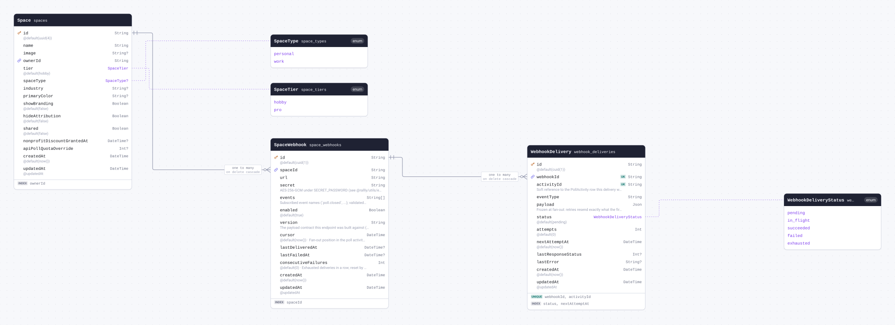

| Field                                          | Type       | Constraints                         | Default      | Description                                                                                                                                                                                                                                             |
| ---------------------------------------------- | ---------- | ----------------------------------- | ------------ | ------------------------------------------------------------------------------------------------------------------------------------------------------------------------------------------------------------------------------------------------------- |
| `id`                                           | `String`   | PK NOT NULL                         | `cuid(1)`    |                                                                                                                                                                                                                                                         |
| `spaceId` (`space_id`)                         | `String`   | NOT NULL → [Space.id](#model-Space) |              |                                                                                                                                                                                                                                                         |
| `url`                                          | `String`   | NOT NULL                            |              |                                                                                                                                                                                                                                                         |
| `secret`                                       | `String`   | NOT NULL                            |              | AES-256-GCM under SECRET_PASSWORD (see @rallly/utils/encryption); the plaintext is shown once at creation                                                                                                                                               |
| `events`                                       | `String[]` | NOT NULL                            |              | Subscribed event names (`poll.closed`, ...); validated by the feature schema, not a DB enum, so the vocabulary grows without migrations                                                                                                                 |
| `enabled`                                      | `Boolean`  | NOT NULL                            | `true`       |                                                                                                                                                                                                                                                         |
| `version`                                      | `String`   | NOT NULL                            |              | The payload contract this endpoint was built against (WEBHOOK_VERSION at creation). No default: a writer that forgets it fails instead of recording a stale contract. A breaking payload change branches on this so existing endpoints keep their shape |
| `cursor`                                       | `DateTime` | NOT NULL                            | `now()`      | Fan-out position in the poll activity log: activities created after this instant are still to be delivered. Starts at creation so a new endpoint never replays history                                                                                  |
| `lastDeliveredAt` (`last_delivered_at`)        | `DateTime` | NULL                                |              |                                                                                                                                                                                                                                                         |
| `lastFailedAt` (`last_failed_at`)              | `DateTime` | NULL                                |              |                                                                                                                                                                                                                                                         |
| `consecutiveFailures` (`consecutive_failures`) | `Int`      | NOT NULL                            | `0`          | Exhausted deliveries in a row; reset by any success. The dispatcher disables the endpoint once it reaches its cap                                                                                                                                       |
| `createdAt` (`created_at`)                     | `DateTime` | NOT NULL                            | `now()`      |                                                                                                                                                                                                                                                         |
| `updatedAt` (`updated_at`)                     | `DateTime` | NOT NULL                            | `@updatedAt` |                                                                                                                                                                                                                                                         |

#### Indexes

- `@@index([spaceId])`

#### References

- `spaceId` → [Space.id](#model-Space) (many-to-one, on delete Cascade)

#### Referenced by

- `id` ← [WebhookDelivery.webhookId](#model-WebhookDelivery) (one-to-many, on delete Cascade)

#### Definition

```sql
CREATE TABLE "space_webhooks" (
    "id" TEXT NOT NULL,
    "space_id" TEXT NOT NULL,
    "url" TEXT NOT NULL,
    "secret" TEXT NOT NULL,
    "events" TEXT[],
    "enabled" BOOLEAN NOT NULL DEFAULT true,
    "version" TEXT NOT NULL,
    "cursor" TIMESTAMP(3) NOT NULL DEFAULT CURRENT_TIMESTAMP,
    "last_delivered_at" TIMESTAMP(3),
    "last_failed_at" TIMESTAMP(3),
    "consecutive_failures" INTEGER NOT NULL DEFAULT 0,
    "created_at" TIMESTAMP(3) NOT NULL DEFAULT CURRENT_TIMESTAMP,
    "updated_at" TIMESTAMP(3) NOT NULL,

    CONSTRAINT "space_webhooks_pkey" PRIMARY KEY ("id")
);

CREATE INDEX "space_webhooks_space_id_idx" ON "space_webhooks"("space_id");

ALTER TABLE "space_webhooks" ADD CONSTRAINT "space_webhooks_space_id_fkey" FOREIGN KEY ("space_id") REFERENCES "spaces"("id") ON DELETE CASCADE ON UPDATE CASCADE;
```

<details>
<summary>Queries and their SQL</summary>

**findMany**: Every row

```ts
await prisma.spaceWebhook.findMany();
```

```sql
SELECT
  "public"."space_webhooks"."id",
  "public"."space_webhooks"."space_id",
  "public"."space_webhooks"."url",
  "public"."space_webhooks"."secret",
  "public"."space_webhooks"."events",
  "public"."space_webhooks"."enabled",
  "public"."space_webhooks"."version",
  "public"."space_webhooks"."cursor",
  "public"."space_webhooks"."last_delivered_at",
  "public"."space_webhooks"."last_failed_at",
  "public"."space_webhooks"."consecutive_failures",
  "public"."space_webhooks"."created_at",
  "public"."space_webhooks"."updated_at"
FROM
  "public"."space_webhooks"
WHERE
  1 = 1
OFFSET
  $1
-- params: ["0"]
```

**count**: How many rows there are

```ts
await prisma.spaceWebhook.count();
```

```sql
SELECT
  COUNT(*) AS "_count$_all"
FROM
  (
    SELECT
      "public"."space_webhooks"."id"
    FROM
      "public"."space_webhooks"
    WHERE
      1 = 1
    OFFSET
      $1
  ) AS "sub"
-- params: ["0"]
```

**findMany**: Every row with its relations

```ts
await prisma.spaceWebhook.findMany({ include: { space: true, deliveries: true } });
```

```sql
SELECT
  "public"."space_webhooks"."id",
  "public"."space_webhooks"."space_id",
  "public"."space_webhooks"."url",
  "public"."space_webhooks"."secret",
  "public"."space_webhooks"."events",
  "public"."space_webhooks"."enabled",
  "public"."space_webhooks"."version",
  "public"."space_webhooks"."cursor",
  "public"."space_webhooks"."last_delivered_at",
  "public"."space_webhooks"."last_failed_at",
  "public"."space_webhooks"."consecutive_failures",
  "public"."space_webhooks"."created_at",
  "public"."space_webhooks"."updated_at"
FROM
  "public"."space_webhooks"
WHERE
  1 = 1
OFFSET
  $1
-- params: ["0"]

SELECT
  "public"."spaces"."id",
  "public"."spaces"."name",
  "public"."spaces"."image",
  "public"."spaces"."owner_id",
  "public"."spaces"."tier"::text,
  "public"."spaces"."space_type"::text,
  "public"."spaces"."industry",
  "public"."spaces"."primary_color",
  "public"."spaces"."show_branding",
  "public"."spaces"."hide_attribution",
  "public"."spaces"."shared",
  "public"."spaces"."nonprofit_discount_granted_at",
  "public"."spaces"."api_poll_quota_override",
  "public"."spaces"."created_at",
  "public"."spaces"."updated_at"
FROM
  "public"."spaces"
WHERE
  "public"."spaces"."id" IN ($1)
OFFSET
  $2
-- params: ["<spaceId of the rows above>","0"]

SELECT
  "public"."webhook_deliveries"."id",
  "public"."webhook_deliveries"."webhook_id",
  "public"."webhook_deliveries"."activity_id",
  "public"."webhook_deliveries"."event_type",
  "public"."webhook_deliveries"."payload",
  "public"."webhook_deliveries"."status"::text,
  "public"."webhook_deliveries"."attempts",
  "public"."webhook_deliveries"."next_attempt_at",
  "public"."webhook_deliveries"."last_response_status",
  "public"."webhook_deliveries"."last_error",
  "public"."webhook_deliveries"."created_at",
  "public"."webhook_deliveries"."updated_at"
FROM
  "public"."webhook_deliveries"
WHERE
  "public"."webhook_deliveries"."webhook_id" IN ($1)
OFFSET
  $2
-- params: ["<id of the rows above>","0"]
```

**findUnique**: One row by what is unique to it

```ts
await prisma.spaceWebhook.findUnique({ where: { id: "example" } });
```

```sql
SELECT
  "public"."space_webhooks"."id",
  "public"."space_webhooks"."space_id",
  "public"."space_webhooks"."url",
  "public"."space_webhooks"."secret",
  "public"."space_webhooks"."events",
  "public"."space_webhooks"."enabled",
  "public"."space_webhooks"."version",
  "public"."space_webhooks"."cursor",
  "public"."space_webhooks"."last_delivered_at",
  "public"."space_webhooks"."last_failed_at",
  "public"."space_webhooks"."consecutive_failures",
  "public"."space_webhooks"."created_at",
  "public"."space_webhooks"."updated_at"
FROM
  "public"."space_webhooks"
WHERE
  (
    "public"."space_webhooks"."id" = $1
    AND 1 = 1
  )
LIMIT
  $2
OFFSET
  $3
-- params: ["example","1","0"]
```

**create**: Create a row

```ts
await prisma.spaceWebhook.create({
  data: {
    spaceId: "example",
    url: "example",
    secret: "example",
    events: ["example"],
    version: "example",
  },
});
```

```sql
INSERT INTO
  "public"."space_webhooks" (
    "id",
    "space_id",
    "url",
    "secret",
    "events",
    "enabled",
    "version",
    "cursor",
    "consecutive_failures",
    "created_at",
    "updated_at"
  )
VALUES
  ($1, $2, $3, $4, $5, $6, $7, $8, $9, $10, $11)
RETURNING
  "public"."space_webhooks"."id",
  "public"."space_webhooks"."space_id",
  "public"."space_webhooks"."url",
  "public"."space_webhooks"."secret",
  "public"."space_webhooks"."events",
  "public"."space_webhooks"."enabled",
  "public"."space_webhooks"."version",
  "public"."space_webhooks"."cursor",
  "public"."space_webhooks"."last_delivered_at",
  "public"."space_webhooks"."last_failed_at",
  "public"."space_webhooks"."consecutive_failures",
  "public"."space_webhooks"."created_at",
  "public"."space_webhooks"."updated_at"
-- params: ["<cuid(1)>","example","example","example",["example"],true,"example","<now()>","0","<now()>","<now()>"]
```

**update**: Update a row

```ts
await prisma.spaceWebhook.update({ where: { id: "example" }, data: { url: "example" } });
```

```sql
UPDATE "public"."space_webhooks"
SET
  "url" = $1,
  "updated_at" = $2
WHERE
  (
    "public"."space_webhooks"."id" = $3
    AND 1 = 1
  )
RETURNING
  "public"."space_webhooks"."id",
  "public"."space_webhooks"."space_id",
  "public"."space_webhooks"."url",
  "public"."space_webhooks"."secret",
  "public"."space_webhooks"."events",
  "public"."space_webhooks"."enabled",
  "public"."space_webhooks"."version",
  "public"."space_webhooks"."cursor",
  "public"."space_webhooks"."last_delivered_at",
  "public"."space_webhooks"."last_failed_at",
  "public"."space_webhooks"."consecutive_failures",
  "public"."space_webhooks"."created_at",
  "public"."space_webhooks"."updated_at"
-- params: ["example",{"prisma__type":"generatorCall","prisma__value":{"name":"now","args":[],"returnType":{"type":"DateTime"}}},"example"]
```

**delete**: Delete a row

```ts
await prisma.spaceWebhook.delete({ where: { id: "example" } });
```

```sql
DELETE FROM "public"."space_webhooks"
WHERE
  (
    "public"."space_webhooks"."id" = $1
    AND 1 = 1
  )
RETURNING
  "public"."space_webhooks"."id",
  "public"."space_webhooks"."space_id",
  "public"."space_webhooks"."url",
  "public"."space_webhooks"."secret",
  "public"."space_webhooks"."events",
  "public"."space_webhooks"."enabled",
  "public"."space_webhooks"."version",
  "public"."space_webhooks"."cursor",
  "public"."space_webhooks"."last_delivered_at",
  "public"."space_webhooks"."last_failed_at",
  "public"."space_webhooks"."consecutive_failures",
  "public"."space_webhooks"."created_at",
  "public"."space_webhooks"."updated_at"
-- params: ["example"]
```

</details>

<a id="model-WebhookDelivery"></a>

### WebhookDelivery

Table `webhook_deliveries`.

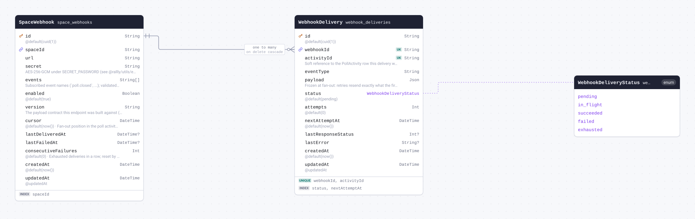

| Field                                         | Type                                                   | Constraints                                       | Default      | Description                                                                                                          |
| --------------------------------------------- | ------------------------------------------------------ | ------------------------------------------------- | ------------ | -------------------------------------------------------------------------------------------------------------------- |
| `id`                                          | `String`                                               | PK NOT NULL                                       | `cuid(1)`    |                                                                                                                      |
| `webhookId` (`webhook_id`)                    | `String`                                               | NOT NULL → [SpaceWebhook.id](#model-SpaceWebhook) |              |                                                                                                                      |
| `activityId` (`activity_id`)                  | `String`                                               | NOT NULL                                          |              | Soft reference to the PollActivity row this delivery was fanned out from; with webhookId it makes fan-out idempotent |
| `eventType` (`event_type`)                    | `String`                                               | NOT NULL                                          |              |                                                                                                                      |
| `payload`                                     | `Json`                                                 | NOT NULL                                          |              | Frozen at fan-out: retries resend exactly what the first attempt sent                                                |
| `status`                                      | [`WebhookDeliveryStatus`](#enum-WebhookDeliveryStatus) | NOT NULL                                          | `pending`    |                                                                                                                      |
| `attempts`                                    | `Int`                                                  | NOT NULL                                          | `0`          |                                                                                                                      |
| `nextAttemptAt` (`next_attempt_at`)           | `DateTime`                                             | NOT NULL                                          | `now()`      |                                                                                                                      |
| `lastResponseStatus` (`last_response_status`) | `Int`                                                  | NULL                                              |              |                                                                                                                      |
| `lastError` (`last_error`)                    | `String`                                               | NULL                                              |              |                                                                                                                      |
| `createdAt` (`created_at`)                    | `DateTime`                                             | NOT NULL                                          | `now()`      |                                                                                                                      |
| `updatedAt` (`updated_at`)                    | `DateTime`                                             | NOT NULL                                          | `@updatedAt` |                                                                                                                      |

#### Indexes

- `@@index([status, nextAttemptAt])`
- `@@unique([webhookId, activityId])`

#### References

- `webhookId` → [SpaceWebhook.id](#model-SpaceWebhook) (many-to-one, on delete Cascade)

#### Definition

```sql
CREATE TABLE "webhook_deliveries" (
    "id" TEXT NOT NULL,
    "webhook_id" TEXT NOT NULL,
    "activity_id" TEXT NOT NULL,
    "event_type" TEXT NOT NULL,
    "payload" JSONB NOT NULL,
    "status" "webhook_delivery_status" NOT NULL DEFAULT 'pending',
    "attempts" INTEGER NOT NULL DEFAULT 0,
    "next_attempt_at" TIMESTAMP(3) NOT NULL DEFAULT CURRENT_TIMESTAMP,
    "last_response_status" INTEGER,
    "last_error" TEXT,
    "created_at" TIMESTAMP(3) NOT NULL DEFAULT CURRENT_TIMESTAMP,
    "updated_at" TIMESTAMP(3) NOT NULL,

    CONSTRAINT "webhook_deliveries_pkey" PRIMARY KEY ("id")
);

CREATE INDEX "webhook_deliveries_status_next_attempt_at_idx" ON "webhook_deliveries"("status", "next_attempt_at");

CREATE UNIQUE INDEX "webhook_deliveries_webhook_id_activity_id_key" ON "webhook_deliveries"("webhook_id", "activity_id");

ALTER TABLE "webhook_deliveries" ADD CONSTRAINT "webhook_deliveries_webhook_id_fkey" FOREIGN KEY ("webhook_id") REFERENCES "space_webhooks"("id") ON DELETE CASCADE ON UPDATE CASCADE;
```

<details>
<summary>Queries and their SQL</summary>

**findMany**: Every row

```ts
await prisma.webhookDelivery.findMany();
```

```sql
SELECT
  "public"."webhook_deliveries"."id",
  "public"."webhook_deliveries"."webhook_id",
  "public"."webhook_deliveries"."activity_id",
  "public"."webhook_deliveries"."event_type",
  "public"."webhook_deliveries"."payload",
  "public"."webhook_deliveries"."status"::text,
  "public"."webhook_deliveries"."attempts",
  "public"."webhook_deliveries"."next_attempt_at",
  "public"."webhook_deliveries"."last_response_status",
  "public"."webhook_deliveries"."last_error",
  "public"."webhook_deliveries"."created_at",
  "public"."webhook_deliveries"."updated_at"
FROM
  "public"."webhook_deliveries"
WHERE
  1 = 1
OFFSET
  $1
-- params: ["0"]
```

**count**: How many rows there are

```ts
await prisma.webhookDelivery.count();
```

```sql
SELECT
  COUNT(*) AS "_count$_all"
FROM
  (
    SELECT
      "public"."webhook_deliveries"."id"
    FROM
      "public"."webhook_deliveries"
    WHERE
      1 = 1
    OFFSET
      $1
  ) AS "sub"
-- params: ["0"]
```

**findMany**: Every row with its relations

```ts
await prisma.webhookDelivery.findMany({ include: { webhook: true } });
```

```sql
SELECT
  "public"."webhook_deliveries"."id",
  "public"."webhook_deliveries"."webhook_id",
  "public"."webhook_deliveries"."activity_id",
  "public"."webhook_deliveries"."event_type",
  "public"."webhook_deliveries"."payload",
  "public"."webhook_deliveries"."status"::text,
  "public"."webhook_deliveries"."attempts",
  "public"."webhook_deliveries"."next_attempt_at",
  "public"."webhook_deliveries"."last_response_status",
  "public"."webhook_deliveries"."last_error",
  "public"."webhook_deliveries"."created_at",
  "public"."webhook_deliveries"."updated_at"
FROM
  "public"."webhook_deliveries"
WHERE
  1 = 1
OFFSET
  $1
-- params: ["0"]

SELECT
  "public"."space_webhooks"."id",
  "public"."space_webhooks"."space_id",
  "public"."space_webhooks"."url",
  "public"."space_webhooks"."secret",
  "public"."space_webhooks"."events",
  "public"."space_webhooks"."enabled",
  "public"."space_webhooks"."version",
  "public"."space_webhooks"."cursor",
  "public"."space_webhooks"."last_delivered_at",
  "public"."space_webhooks"."last_failed_at",
  "public"."space_webhooks"."consecutive_failures",
  "public"."space_webhooks"."created_at",
  "public"."space_webhooks"."updated_at"
FROM
  "public"."space_webhooks"
WHERE
  "public"."space_webhooks"."id" IN ($1)
OFFSET
  $2
-- params: ["<webhookId of the rows above>","0"]
```

**findUnique**: One row by what is unique to it

```ts
await prisma.webhookDelivery.findUnique({ where: { id: "example" } });
```

```sql
SELECT
  "public"."webhook_deliveries"."id",
  "public"."webhook_deliveries"."webhook_id",
  "public"."webhook_deliveries"."activity_id",
  "public"."webhook_deliveries"."event_type",
  "public"."webhook_deliveries"."payload",
  "public"."webhook_deliveries"."status"::text,
  "public"."webhook_deliveries"."attempts",
  "public"."webhook_deliveries"."next_attempt_at",
  "public"."webhook_deliveries"."last_response_status",
  "public"."webhook_deliveries"."last_error",
  "public"."webhook_deliveries"."created_at",
  "public"."webhook_deliveries"."updated_at"
FROM
  "public"."webhook_deliveries"
WHERE
  (
    "public"."webhook_deliveries"."id" = $1
    AND 1 = 1
  )
LIMIT
  $2
OFFSET
  $3
-- params: ["example","1","0"]
```

**create**: Create a row

```ts
await prisma.webhookDelivery.create({
  data: { webhookId: "example", activityId: "example", eventType: "example", payload: {} },
});
```

```sql
INSERT INTO
  "public"."webhook_deliveries" (
    "id",
    "webhook_id",
    "activity_id",
    "event_type",
    "payload",
    "status",
    "attempts",
    "next_attempt_at",
    "created_at",
    "updated_at"
  )
VALUES
  (
    $1,
    $2,
    $3,
    $4,
    $5,
    CAST($6::text AS "public"."webhook_delivery_status"),
    $7,
    $8,
    $9,
    $10
  )
RETURNING
  "public"."webhook_deliveries"."id",
  "public"."webhook_deliveries"."webhook_id",
  "public"."webhook_deliveries"."activity_id",
  "public"."webhook_deliveries"."event_type",
  "public"."webhook_deliveries"."payload",
  "public"."webhook_deliveries"."status"::text,
  "public"."webhook_deliveries"."attempts",
  "public"."webhook_deliveries"."next_attempt_at",
  "public"."webhook_deliveries"."last_response_status",
  "public"."webhook_deliveries"."last_error",
  "public"."webhook_deliveries"."created_at",
  "public"."webhook_deliveries"."updated_at"
-- params: ["<cuid(1)>","example","example","example","{}","pending","0","<now()>","<now()>","<now()>"]
```

**update**: Update a row

```ts
await prisma.webhookDelivery.update({ where: { id: "example" }, data: { activityId: "example" } });
```

```sql
UPDATE "public"."webhook_deliveries"
SET
  "activity_id" = $1,
  "updated_at" = $2
WHERE
  (
    "public"."webhook_deliveries"."id" = $3
    AND 1 = 1
  )
RETURNING
  "public"."webhook_deliveries"."id",
  "public"."webhook_deliveries"."webhook_id",
  "public"."webhook_deliveries"."activity_id",
  "public"."webhook_deliveries"."event_type",
  "public"."webhook_deliveries"."payload",
  "public"."webhook_deliveries"."status"::text,
  "public"."webhook_deliveries"."attempts",
  "public"."webhook_deliveries"."next_attempt_at",
  "public"."webhook_deliveries"."last_response_status",
  "public"."webhook_deliveries"."last_error",
  "public"."webhook_deliveries"."created_at",
  "public"."webhook_deliveries"."updated_at"
-- params: ["example",{"prisma__type":"generatorCall","prisma__value":{"name":"now","args":[],"returnType":{"type":"DateTime"}}},"example"]
```

**delete**: Delete a row

```ts
await prisma.webhookDelivery.delete({ where: { id: "example" } });
```

```sql
DELETE FROM "public"."webhook_deliveries"
WHERE
  (
    "public"."webhook_deliveries"."id" = $1
    AND 1 = 1
  )
RETURNING
  "public"."webhook_deliveries"."id",
  "public"."webhook_deliveries"."webhook_id",
  "public"."webhook_deliveries"."activity_id",
  "public"."webhook_deliveries"."event_type",
  "public"."webhook_deliveries"."payload",
  "public"."webhook_deliveries"."status"::text,
  "public"."webhook_deliveries"."attempts",
  "public"."webhook_deliveries"."next_attempt_at",
  "public"."webhook_deliveries"."last_response_status",
  "public"."webhook_deliveries"."last_error",
  "public"."webhook_deliveries"."created_at",
  "public"."webhook_deliveries"."updated_at"
-- params: ["example"]
```

</details>

<a id="model-Account"></a>

### Account

Table `accounts`.

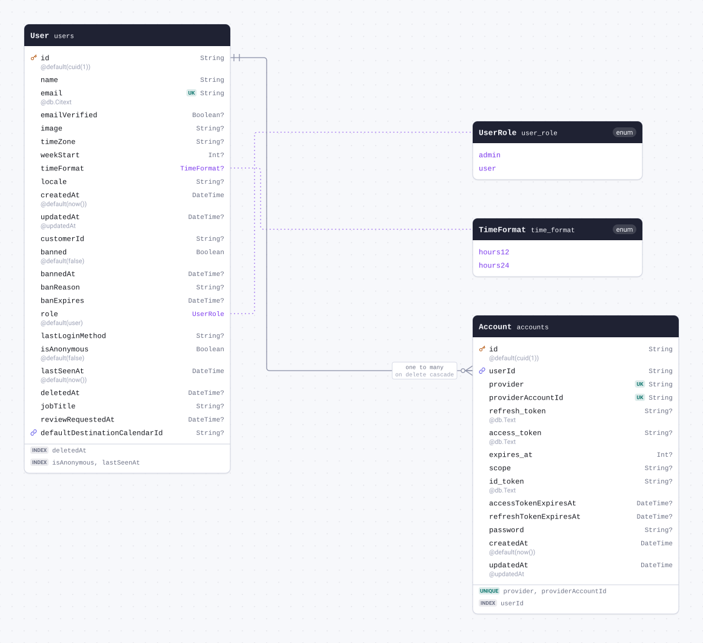

| Field                                                | Type                | Constraints                       | Default      | Description |
| ---------------------------------------------------- | ------------------- | --------------------------------- | ------------ | ----------- |
| `id`                                                 | `String`            | PK NOT NULL                       | `cuid(1)`    |             |
| `userId` (`user_id`)                                 | `String`            | NOT NULL → [User.id](#model-User) |              |             |
| `provider`                                           | `String`            | NOT NULL                          |              |             |
| `providerAccountId` (`provider_account_id`)          | `String`            | NOT NULL                          |              |             |
| `refresh_token`                                      | `String` `@db.Text` | NULL                              |              |             |
| `access_token`                                       | `String` `@db.Text` | NULL                              |              |             |
| `expires_at`                                         | `Int`               | NULL                              |              |             |
| `scope`                                              | `String`            | NULL                              |              |             |
| `id_token`                                           | `String` `@db.Text` | NULL                              |              |             |
| `accessTokenExpiresAt` (`access_token_expires_at`)   | `DateTime`          | NULL                              |              |             |
| `refreshTokenExpiresAt` (`refresh_token_expires_at`) | `DateTime`          | NULL                              |              |             |
| `password` (`password`)                              | `String`            | NULL                              |              |             |
| `createdAt` (`created_at`)                           | `DateTime`          | NOT NULL                          | `now()`      |             |
| `updatedAt` (`updated_at`)                           | `DateTime`          | NOT NULL                          | `@updatedAt` |             |

#### Indexes

- `@@index([userId])`
- `@@unique([provider, providerAccountId])`

#### References

- `userId` → [User.id](#model-User) (many-to-one, on delete Cascade)

#### Definition

```sql
CREATE TABLE "accounts" (
    "id" TEXT NOT NULL,
    "user_id" TEXT NOT NULL,
    "provider" TEXT NOT NULL,
    "provider_account_id" TEXT NOT NULL,
    "refresh_token" TEXT,
    "access_token" TEXT,
    "expires_at" INTEGER,
    "scope" TEXT,
    "id_token" TEXT,
    "access_token_expires_at" TIMESTAMP(3),
    "refresh_token_expires_at" TIMESTAMP(3),
    "password" TEXT,
    "created_at" TIMESTAMP(3) NOT NULL DEFAULT CURRENT_TIMESTAMP,
    "updated_at" TIMESTAMP(3) NOT NULL,

    CONSTRAINT "accounts_pkey" PRIMARY KEY ("id")
);

CREATE INDEX "accounts_user_id_idx" ON "accounts"("user_id");

CREATE UNIQUE INDEX "accounts_provider_provider_account_id_key" ON "accounts"("provider", "provider_account_id");

ALTER TABLE "accounts" ADD CONSTRAINT "accounts_user_id_fkey" FOREIGN KEY ("user_id") REFERENCES "users"("id") ON DELETE CASCADE ON UPDATE CASCADE;
```

<details>
<summary>Queries and their SQL</summary>

**findMany**: Every row

```ts
await prisma.account.findMany();
```

```sql
SELECT
  "public"."accounts"."id",
  "public"."accounts"."user_id",
  "public"."accounts"."provider",
  "public"."accounts"."provider_account_id",
  "public"."accounts"."refresh_token",
  "public"."accounts"."access_token",
  "public"."accounts"."expires_at",
  "public"."accounts"."scope",
  "public"."accounts"."id_token",
  "public"."accounts"."access_token_expires_at",
  "public"."accounts"."refresh_token_expires_at",
  "public"."accounts"."password",
  "public"."accounts"."created_at",
  "public"."accounts"."updated_at"
FROM
  "public"."accounts"
WHERE
  1 = 1
OFFSET
  $1
-- params: ["0"]
```

**count**: How many rows there are

```ts
await prisma.account.count();
```

```sql
SELECT
  COUNT(*) AS "_count$_all"
FROM
  (
    SELECT
      "public"."accounts"."id"
    FROM
      "public"."accounts"
    WHERE
      1 = 1
    OFFSET
      $1
  ) AS "sub"
-- params: ["0"]
```

**findMany**: Every row with its relations

```ts
await prisma.account.findMany({ include: { user: true } });
```

```sql
SELECT
  "public"."accounts"."id",
  "public"."accounts"."user_id",
  "public"."accounts"."provider",
  "public"."accounts"."provider_account_id",
  "public"."accounts"."refresh_token",
  "public"."accounts"."access_token",
  "public"."accounts"."expires_at",
  "public"."accounts"."scope",
  "public"."accounts"."id_token",
  "public"."accounts"."access_token_expires_at",
  "public"."accounts"."refresh_token_expires_at",
  "public"."accounts"."password",
  "public"."accounts"."created_at",
  "public"."accounts"."updated_at"
FROM
  "public"."accounts"
WHERE
  1 = 1
OFFSET
  $1
-- params: ["0"]

SELECT
  "public"."users"."id",
  "public"."users"."name",
  "public"."users"."email",
  "public"."users"."email_verified",
  "public"."users"."image",
  "public"."users"."time_zone",
  "public"."users"."week_start",
  "public"."users"."time_format"::text,
  "public"."users"."locale",
  "public"."users"."created_at",
  "public"."users"."updated_at",
  "public"."users"."customer_id",
  "public"."users"."banned",
  "public"."users"."banned_at",
  "public"."users"."ban_reason",
  "public"."users"."ban_expires",
  "public"."users"."role"::text,
  "public"."users"."last_login_method",
  "public"."users"."anonymous",
  "public"."users"."last_seen_at",
  "public"."users"."deleted_at",
  "public"."users"."job_title",
  "public"."users"."review_requested_at",
  "public"."users"."default_destination_calendar_id"
FROM
  "public"."users"
WHERE
  "public"."users"."id" IN ($1)
OFFSET
  $2
-- params: ["<userId of the rows above>","0"]
```

**findUnique**: One row by what is unique to it

```ts
await prisma.account.findUnique({ where: { id: "example" } });
```

```sql
SELECT
  "public"."accounts"."id",
  "public"."accounts"."user_id",
  "public"."accounts"."provider",
  "public"."accounts"."provider_account_id",
  "public"."accounts"."refresh_token",
  "public"."accounts"."access_token",
  "public"."accounts"."expires_at",
  "public"."accounts"."scope",
  "public"."accounts"."id_token",
  "public"."accounts"."access_token_expires_at",
  "public"."accounts"."refresh_token_expires_at",
  "public"."accounts"."password",
  "public"."accounts"."created_at",
  "public"."accounts"."updated_at"
FROM
  "public"."accounts"
WHERE
  (
    "public"."accounts"."id" = $1
    AND 1 = 1
  )
LIMIT
  $2
OFFSET
  $3
-- params: ["example","1","0"]
```

**create**: Create a row

```ts
await prisma.account.create({
  data: { userId: "example", provider: "example", providerAccountId: "example" },
});
```

```sql
INSERT INTO
  "public"."accounts" (
    "id",
    "user_id",
    "provider",
    "provider_account_id",
    "created_at",
    "updated_at"
  )
VALUES
  ($1, $2, $3, $4, $5, $6)
RETURNING
  "public"."accounts"."id",
  "public"."accounts"."user_id",
  "public"."accounts"."provider",
  "public"."accounts"."provider_account_id",
  "public"."accounts"."refresh_token",
  "public"."accounts"."access_token",
  "public"."accounts"."expires_at",
  "public"."accounts"."scope",
  "public"."accounts"."id_token",
  "public"."accounts"."access_token_expires_at",
  "public"."accounts"."refresh_token_expires_at",
  "public"."accounts"."password",
  "public"."accounts"."created_at",
  "public"."accounts"."updated_at"
-- params: ["<cuid(1)>","example","example","example","<now()>","<now()>"]
```

**update**: Update a row

```ts
await prisma.account.update({ where: { id: "example" }, data: { provider: "example" } });
```

```sql
UPDATE "public"."accounts"
SET
  "provider" = $1,
  "updated_at" = $2
WHERE
  (
    "public"."accounts"."id" = $3
    AND 1 = 1
  )
RETURNING
  "public"."accounts"."id",
  "public"."accounts"."user_id",
  "public"."accounts"."provider",
  "public"."accounts"."provider_account_id",
  "public"."accounts"."refresh_token",
  "public"."accounts"."access_token",
  "public"."accounts"."expires_at",
  "public"."accounts"."scope",
  "public"."accounts"."id_token",
  "public"."accounts"."access_token_expires_at",
  "public"."accounts"."refresh_token_expires_at",
  "public"."accounts"."password",
  "public"."accounts"."created_at",
  "public"."accounts"."updated_at"
-- params: ["example",{"prisma__type":"generatorCall","prisma__value":{"name":"now","args":[],"returnType":{"type":"DateTime"}}},"example"]
```

**delete**: Delete a row

```ts
await prisma.account.delete({ where: { id: "example" } });
```

```sql
DELETE FROM "public"."accounts"
WHERE
  (
    "public"."accounts"."id" = $1
    AND 1 = 1
  )
RETURNING
  "public"."accounts"."id",
  "public"."accounts"."user_id",
  "public"."accounts"."provider",
  "public"."accounts"."provider_account_id",
  "public"."accounts"."refresh_token",
  "public"."accounts"."access_token",
  "public"."accounts"."expires_at",
  "public"."accounts"."scope",
  "public"."accounts"."id_token",
  "public"."accounts"."access_token_expires_at",
  "public"."accounts"."refresh_token_expires_at",
  "public"."accounts"."password",
  "public"."accounts"."created_at",
  "public"."accounts"."updated_at"
-- params: ["example"]
```

</details>

<a id="model-User"></a>

### User

Table `users`.

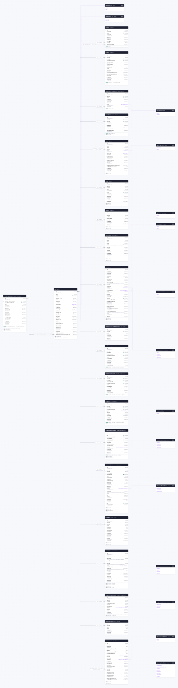

| Field                                                              | Type                             | Constraints                                           | Default      | Description |
| ------------------------------------------------------------------ | -------------------------------- | ----------------------------------------------------- | ------------ | ----------- |
| `id`                                                               | `String`                         | PK NOT NULL                                           | `cuid(1)`    |             |
| `name`                                                             | `String`                         | NOT NULL                                              |              |             |
| `email`                                                            | `String` `@db.Citext`            | UNIQUE NOT NULL                                       |              |             |
| `emailVerified` (`email_verified`)                                 | `Boolean`                        | NULL                                                  |              |             |
| `image`                                                            | `String`                         | NULL                                                  |              |             |
| `timeZone` (`time_zone`)                                           | `String`                         | NULL                                                  |              |             |
| `weekStart` (`week_start`)                                         | `Int`                            | NULL                                                  |              |             |
| `timeFormat` (`time_format`)                                       | [`TimeFormat`](#enum-TimeFormat) | NULL                                                  |              |             |
| `locale`                                                           | `String`                         | NULL                                                  |              |             |
| `createdAt` (`created_at`)                                         | `DateTime`                       | NOT NULL                                              | `now()`      |             |
| `updatedAt` (`updated_at`)                                         | `DateTime`                       | NULL                                                  | `@updatedAt` |             |
| `customerId` (`customer_id`)                                       | `String`                         | NULL                                                  |              |             |
| `banned`                                                           | `Boolean`                        | NOT NULL                                              | `false`      |             |
| `bannedAt` (`banned_at`)                                           | `DateTime`                       | NULL                                                  |              |             |
| `banReason` (`ban_reason`)                                         | `String`                         | NULL                                                  |              |             |
| `banExpires` (`ban_expires`)                                       | `DateTime`                       | NULL                                                  |              |             |
| `role`                                                             | [`UserRole`](#enum-UserRole)     | NOT NULL                                              | `user`       |             |
| `lastLoginMethod` (`last_login_method`)                            | `String`                         | NULL                                                  |              |             |
| `isAnonymous` (`anonymous`)                                        | `Boolean`                        | NOT NULL                                              | `false`      |             |
| `lastSeenAt` (`last_seen_at`)                                      | `DateTime`                       | NOT NULL                                              | `now()`      |             |
| `deletedAt` (`deleted_at`)                                         | `DateTime`                       | NULL                                                  |              |             |
| `jobTitle` (`job_title`)                                           | `String`                         | NULL                                                  |              |             |
| `reviewRequestedAt` (`review_requested_at`)                        | `DateTime`                       | NULL                                                  |              |             |
| `defaultDestinationCalendarId` (`default_destination_calendar_id`) | `String`                         | NULL → [ProviderCalendar.id](#model-ProviderCalendar) |              |             |

#### Indexes

- `@@index([deletedAt])`
- `@@index([isAnonymous, lastSeenAt])`

#### References

- `defaultDestinationCalendarId` → [ProviderCalendar.id](#model-ProviderCalendar) (many-to-one, on delete SetNull)

#### Referenced by

- `id` ← [Subscription.userId](#model-Subscription) (one-to-many, on delete Cascade)
- `id` ← [PaymentMethod.userId](#model-PaymentMethod) (one-to-many, on delete Cascade)
- `id` ← [NonprofitApplication.userId](#model-NonprofitApplication) (one-to-many, on delete Cascade)
- `id` ← [QueuedEmail.userId](#model-QueuedEmail) (one-to-many, on delete Cascade)
- `id` ← [EventType.hostId](#model-EventType) (one-to-many, on delete Cascade)
- `id` ← [ScheduledEvent.userId](#model-ScheduledEvent) (one-to-many, on delete Cascade)
- `id` ← [ScheduledEventInvite.inviteeId](#model-ScheduledEventInvite) (one-to-many, on delete SetNull)
- `id` ← [Credential.userId](#model-Credential) (one-to-many, on delete Cascade)
- `id` ← [CalendarConnection.userId](#model-CalendarConnection) (one-to-many, on delete Cascade)
- `id` ← [ConferencingConnection.userId](#model-ConferencingConnection) (one-to-many, on delete Cascade)
- `id` ← [UserNotificationPreferences.userId](#model-UserNotificationPreferences) (one-to-one, on delete Cascade)
- `id` ← [Poll.userId](#model-Poll) (one-to-many, on delete Cascade)
- `id` ← [Participant.userId](#model-Participant) (one-to-many, on delete SetNull)
- `id` ← [Comment.userId](#model-Comment) (one-to-many, on delete Cascade)
- `id` ← [Sheet.hostId](#model-Sheet) (one-to-many, on delete Cascade)
- `id` ← [Space.ownerId](#model-Space) (one-to-many, on delete Cascade)
- `id` ← [SpaceMember.userId](#model-SpaceMember) (one-to-many, on delete Cascade)
- `id` ← [SpaceMemberInvite.inviterId](#model-SpaceMemberInvite) (one-to-many, on delete Cascade)
- `id` ← [Account.userId](#model-Account) (one-to-many, on delete Cascade)
- `id` ← [Session.userId](#model-Session) (one-to-many, on delete Cascade)
- `id` ← [Session.impersonatedBy](#model-Session) (one-to-many)

#### Definition

```sql
CREATE TABLE "users" (
    "id" TEXT NOT NULL,
    "name" TEXT NOT NULL,
    "email" CITEXT NOT NULL,
    "email_verified" BOOLEAN,
    "image" TEXT,
    "time_zone" TEXT,
    "week_start" INTEGER,
    "time_format" "time_format",
    "locale" TEXT,
    "created_at" TIMESTAMP(3) NOT NULL DEFAULT CURRENT_TIMESTAMP,
    "updated_at" TIMESTAMP(3),
    "customer_id" TEXT,
    "banned" BOOLEAN NOT NULL DEFAULT false,
    "banned_at" TIMESTAMP(3),
    "ban_reason" TEXT,
    "ban_expires" TIMESTAMP(3),
    "role" "user_role" NOT NULL DEFAULT 'user',
    "last_login_method" TEXT,
    "anonymous" BOOLEAN NOT NULL DEFAULT false,
    "last_seen_at" TIMESTAMP(3) NOT NULL DEFAULT CURRENT_TIMESTAMP,
    "deleted_at" TIMESTAMP(3),
    "job_title" TEXT,
    "review_requested_at" TIMESTAMP(3),
    "default_destination_calendar_id" TEXT,

    CONSTRAINT "users_pkey" PRIMARY KEY ("id")
);

CREATE UNIQUE INDEX "users_email_key" ON "users"("email");

CREATE INDEX "users_deleted_at_idx" ON "users"("deleted_at");

CREATE INDEX "users_anonymous_last_seen_at_idx" ON "users"("anonymous", "last_seen_at");

ALTER TABLE "users" ADD CONSTRAINT "users_default_destination_calendar_id_fkey" FOREIGN KEY ("default_destination_calendar_id") REFERENCES "provider_calendars"("id") ON DELETE SET NULL ON UPDATE CASCADE;
```

<details>
<summary>Queries and their SQL</summary>

**findMany**: Every row

```ts
await prisma.user.findMany();
```

```sql
SELECT
  "public"."users"."id",
  "public"."users"."name",
  "public"."users"."email",
  "public"."users"."email_verified",
  "public"."users"."image",
  "public"."users"."time_zone",
  "public"."users"."week_start",
  "public"."users"."time_format"::text,
  "public"."users"."locale",
  "public"."users"."created_at",
  "public"."users"."updated_at",
  "public"."users"."customer_id",
  "public"."users"."banned",
  "public"."users"."banned_at",
  "public"."users"."ban_reason",
  "public"."users"."ban_expires",
  "public"."users"."role"::text,
  "public"."users"."last_login_method",
  "public"."users"."anonymous",
  "public"."users"."last_seen_at",
  "public"."users"."deleted_at",
  "public"."users"."job_title",
  "public"."users"."review_requested_at",
  "public"."users"."default_destination_calendar_id"
FROM
  "public"."users"
WHERE
  1 = 1
OFFSET
  $1
-- params: ["0"]
```

**count**: How many rows there are

```ts
await prisma.user.count();
```

```sql
SELECT
  COUNT(*) AS "_count$_all"
FROM
  (
    SELECT
      "public"."users"."id"
    FROM
      "public"."users"
    WHERE
      1 = 1
    OFFSET
      $1
  ) AS "sub"
-- params: ["0"]
```

**findMany**: Every row with its relations

```ts
await prisma.user.findMany({
  include: {
    comments: true,
    polls: true,
    notificationPreferences: true,
    queuedEmails: true,
    accounts: true,
    participants: true,
    paymentMethods: true,
    spaceMemberInvites: true,
    nonprofitApplications: true,
    subscriptions: true,
    spaces: true,
    memberOf: true,
    scheduledEvents: true,
    scheduledEventInvites: true,
    hostedEventTypes: true,
    hostedSheets: true,
    calendarConnections: true,
    conferencingConnections: true,
    credentials: true,
    defaultDestinationCalendar: true,
    sessions: true,
    impersonatedSessions: true,
  },
});
```

```sql
SELECT
  "public"."users"."id",
  "public"."users"."name",
  "public"."users"."email",
  "public"."users"."email_verified",
  "public"."users"."image",
  "public"."users"."time_zone",
  "public"."users"."week_start",
  "public"."users"."time_format"::text,
  "public"."users"."locale",
  "public"."users"."created_at",
  "public"."users"."updated_at",
  "public"."users"."customer_id",
  "public"."users"."banned",
  "public"."users"."banned_at",
  "public"."users"."ban_reason",
  "public"."users"."ban_expires",
  "public"."users"."role"::text,
  "public"."users"."last_login_method",
  "public"."users"."anonymous",
  "public"."users"."last_seen_at",
  "public"."users"."deleted_at",
  "public"."users"."job_title",
  "public"."users"."review_requested_at",
  "public"."users"."default_destination_calendar_id"
FROM
  "public"."users"
WHERE
  1 = 1
OFFSET
  $1
-- params: ["0"]

SELECT
  "public"."comments"."id",
  "public"."comments"."content",
  "public"."comments"."poll_id",
  "public"."comments"."author_name",
  "public"."comments"."user_id",
  "public"."comments"."created_at",
  "public"."comments"."updated_at"
FROM
  "public"."comments"
WHERE
  "public"."comments"."user_id" IN ($1)
OFFSET
  $2
-- params: ["<id of the rows above>","0"]

SELECT
  "public"."polls"."id",
  "public"."polls"."created_at",
  "public"."polls"."updated_at",
  "public"."polls"."deadline",
  "public"."polls"."title",
  "public"."polls"."description",
  "public"."polls"."location",
  "public"."polls"."conferencing",
  "public"."polls"."user_id",
  "public"."polls"."time_zone",
  "public"."polls"."status"::text,
  "public"."polls"."closed_reason"::text,
  "public"."polls"."kind"::text,
  "public"."polls"."deleted",
  "public"."polls"."deleted_at",
  "public"."polls"."event_id",
  "public"."polls"."scheduled_event_id",
  "public"."polls"."hide_participants",
  "public"."polls"."hide_scores",
  "public"."polls"."disable_comments",
  "public"."polls"."require_participant_email",
  "public"."polls"."allow_tentative_votes",
  "public"."polls"."muted",
  "public"."polls"."space_id"
FROM
  "public"."polls"
WHERE
  "public"."polls"."user_id" IN ($1)
OFFSET
  $2
-- params: ["<id of the rows above>","0"]

SELECT
  "public"."user_notification_preferences"."id",
  "public"."user_notification_preferences"."user_id",
  "public"."user_notification_preferences"."prefs",
  "public"."user_notification_preferences"."created_at",
  "public"."user_notification_preferences"."updated_at"
FROM
  "public"."user_notification_preferences"
WHERE
  "public"."user_notification_preferences"."user_id" IN ($1)
OFFSET
  $2
-- params: ["<id of the rows above>","0"]

SELECT
  "public"."queued_emails"."id",
  "public"."queued_emails"."kind",
  "public"."queued_emails"."subject_id",
  "public"."queued_emails"."batch_id",
  "public"."queued_emails"."user_id",
  "public"."queued_emails"."status"::text,
  "public"."queued_emails"."send_after",
  "public"."queued_emails"."attempts",
  "public"."queued_emails"."claimed_at",
  "public"."queued_emails"."sent_at",
  "public"."queued_emails"."last_error",
  "public"."queued_emails"."created_at",
  "public"."queued_emails"."updated_at"
FROM
  "public"."queued_emails"
WHERE
  "public"."queued_emails"."user_id" IN ($1)
OFFSET
  $2
-- params: ["<id of the rows above>","0"]

SELECT
  "public"."accounts"."id",
  "public"."accounts"."user_id",
  "public"."accounts"."provider",
  "public"."accounts"."provider_account_id",
  "public"."accounts"."refresh_token",
  "public"."accounts"."access_token",
  "public"."accounts"."expires_at",
  "public"."accounts"."scope",
  "public"."accounts"."id_token",
  "public"."accounts"."access_token_expires_at",
  "public"."accounts"."refresh_token_expires_at",
  "public"."accounts"."password",
  "public"."accounts"."created_at",
  "public"."accounts"."updated_at"
FROM
  "public"."accounts"
WHERE
  "public"."accounts"."user_id" IN ($1)
OFFSET
  $2
-- params: ["<id of the rows above>","0"]

SELECT
  "public"."participants"."id",
  "public"."participants"."name",
  "public"."participants"."email",
  "public"."participants"."note",
  "public"."participants"."token",
  "public"."participants"."user_id",
  "public"."participants"."poll_id",
  "public"."participants"."locale",
  "public"."participants"."time_zone",
  "public"."participants"."created_at",
  "public"."participants"."updated_at"
FROM
  "public"."participants"
WHERE
  "public"."participants"."user_id" IN ($1)
OFFSET
  $2
-- params: ["<id of the rows above>","0"]

SELECT
  "public"."payment_methods"."id",
  "public"."payment_methods"."user_id",
  "public"."payment_methods"."type",
  "public"."payment_methods"."data",
  "public"."payment_methods"."created_at",
  "public"."payment_methods"."updated_at"
FROM
  "public"."payment_methods"
WHERE
  "public"."payment_methods"."user_id" IN ($1)
OFFSET
  $2
-- params: ["<id of the rows above>","0"]

SELECT
  "public"."space_member_invites"."id",
  "public"."space_member_invites"."space_id",
  "public"."space_member_invites"."email",
  "public"."space_member_invites"."created_at",
  "public"."space_member_invites"."updated_at",
  "public"."space_member_invites"."role"::text,
  "public"."space_member_invites"."inviter_id"
FROM
  "public"."space_member_invites"
WHERE
  "public"."space_member_invites"."inviter_id" IN ($1)
OFFSET
  $2
-- params: ["<id of the rows above>","0"]

SELECT
  "public"."nonprofit_applications"."id",
  "public"."nonprofit_applications"."space_id",
  "public"."nonprofit_applications"."user_id",
  "public"."nonprofit_applications"."organization_name",
  "public"."nonprofit_applications"."website",
  "public"."nonprofit_applications"."email_domain",
  "public"."nonprofit_applications"."status"::text,
  "public"."nonprofit_applications"."reason",
  "public"."nonprofit_applications"."model",
  "public"."nonprofit_applications"."created_at"
FROM
  "public"."nonprofit_applications"
WHERE
  "public"."nonprofit_applications"."user_id" IN ($1)
OFFSET
  $2
-- params: ["<id of the rows above>","0"]

SELECT
  "public"."subscriptions"."id",
  "public"."subscriptions"."price_id",
  "public"."subscriptions"."quantity",
  "public"."subscriptions"."subscription_item_id",
  "public"."subscriptions"."amount",
  "public"."subscriptions"."discount_percent_off",
  "public"."subscriptions"."discount_amount_off",
  "public"."subscriptions"."status"::text,
  "public"."subscriptions"."active",
  "public"."subscriptions"."currency",
  "public"."subscriptions"."interval"::text,
  "public"."subscriptions"."created_at",
  "public"."subscriptions"."period_start",
  "public"."subscriptions"."period_end",
  "public"."subscriptions"."cancel_at_period_end",
  "public"."subscriptions"."user_id",
  "public"."subscriptions"."space_id",
  "public"."subscriptions"."api_addon_item_id",
  "public"."subscriptions"."api_addon_price_id",
  "public"."subscriptions"."api_addon_amount",
  "public"."subscriptions"."api_addon_tier",
  "public"."subscriptions"."api_poll_retained_tier",
  "public"."subscriptions"."api_poll_retained_until"
FROM
  "public"."subscriptions"
WHERE
  "public"."subscriptions"."user_id" IN ($1)
OFFSET
  $2
-- params: ["<id of the rows above>","0"]

SELECT
  "public"."spaces"."id",
  "public"."spaces"."name",
  "public"."spaces"."image",
  "public"."spaces"."owner_id",
  "public"."spaces"."tier"::text,
  "public"."spaces"."space_type"::text,
  "public"."spaces"."industry",
  "public"."spaces"."primary_color",
  "public"."spaces"."show_branding",
  "public"."spaces"."hide_attribution",
  "public"."spaces"."shared",
  "public"."spaces"."nonprofit_discount_granted_at",
  "public"."spaces"."api_poll_quota_override",
  "public"."spaces"."created_at",
  "public"."spaces"."updated_at"
FROM
  "public"."spaces"
WHERE
  "public"."spaces"."owner_id" IN ($1)
OFFSET
  $2
-- params: ["<id of the rows above>","0"]

SELECT
  "public"."space_members"."id",
  "public"."space_members"."space_id",
  "public"."space_members"."user_id",
  "public"."space_members"."created_at",
  "public"."space_members"."updated_at",
  "public"."space_members"."role"::text,
  "public"."space_members"."last_selected_at"
FROM
  "public"."space_members"
WHERE
  "public"."space_members"."user_id" IN ($1)
OFFSET
  $2
-- params: ["<id of the rows above>","0"]

SELECT
  "public"."scheduled_events"."id",
  "public"."scheduled_events"."user_id",
  "public"."scheduled_events"."space_id",
  "public"."scheduled_events"."event_type_id",
  "public"."scheduled_events"."sheet_slot_id",
  "public"."scheduled_events"."title",
  "public"."scheduled_events"."description",
  "public"."scheduled_events"."location",
  "public"."scheduled_events"."conferencing",
  "public"."scheduled_events"."capacity",
  "public"."scheduled_events"."created_at",
  "public"."scheduled_events"."updated_at",
  "public"."scheduled_events"."status"::text,
  "public"."scheduled_events"."time_zone",
  "public"."scheduled_events"."start",
  "public"."scheduled_events"."end",
  "public"."scheduled_events"."all_day",
  "public"."scheduled_events"."deleted_at",
  "public"."scheduled_events"."sequence",
  "public"."scheduled_events"."uid",
  "public"."scheduled_events"."hide_attendees"
FROM
  "public"."scheduled_events"
WHERE
  "public"."scheduled_events"."user_id" IN ($1)
OFFSET
  $2
-- params: ["<id of the rows above>","0"]

SELECT
  "public"."scheduled_event_invites"."id",
  "public"."scheduled_event_invites"."uid",
  "public"."scheduled_event_invites"."scheduled_event_id",
  "public"."scheduled_event_invites"."invitee_name",
  "public"."scheduled_event_invites"."invitee_email",
  "public"."scheduled_event_invites"."invitee_id",
  "public"."scheduled_event_invites"."invitee_time_zone",
  "public"."scheduled_event_invites"."invitee_locale",
  "public"."scheduled_event_invites"."status"::text,
  "public"."scheduled_event_invites"."created_at",
  "public"."scheduled_event_invites"."updated_at"
FROM
  "public"."scheduled_event_invites"
WHERE
  "public"."scheduled_event_invites"."invitee_id" IN ($1)
OFFSET
  $2
-- params: ["<id of the rows above>","0"]

SELECT
  "public"."event_types"."id",
  "public"."event_types"."space_id",
  "public"."event_types"."host_id",
  "public"."event_types"."name",
  "public"."event_types"."duration_minutes",
  "public"."event_types"."capacity",
  "public"."event_types"."description",
  "public"."event_types"."location",
  "public"."event_types"."created_at",
  "public"."event_types"."updated_at",
  "public"."event_types"."deleted",
  "public"."event_types"."deleted_at"
FROM
  "public"."event_types"
WHERE
  "public"."event_types"."host_id" IN ($1)
OFFSET
  $2
-- params: ["<id of the rows above>","0"]

SELECT
  "public"."sheets"."id",
  "public"."sheets"."space_id",
  "public"."sheets"."host_id",
  "public"."sheets"."title",
  "public"."sheets"."description",
  "public"."sheets"."url_id",
  "public"."sheets"."created_at",
  "public"."sheets"."updated_at",
  "public"."sheets"."deleted",
  "public"."sheets"."deleted_at"
FROM
  "public"."sheets"
WHERE
  "public"."sheets"."host_id" IN ($1)
OFFSET
  $2
-- params: ["<id of the rows above>","0"]

SELECT
  "public"."calendar_connections"."id",
  "public"."calendar_connections"."user_id",
  "public"."calendar_connections"."provider",
  "public"."calendar_connections"."integration_id",
  "public"."calendar_connections"."provider_account_id",
  "public"."calendar_connections"."email",
  "public"."calendar_connections"."display_name",
  "public"."calendar_connections"."created_at",
  "public"."calendar_connections"."updated_at",
  "public"."calendar_connections"."credential_id"
FROM
  "public"."calendar_connections"
WHERE
  "public"."calendar_connections"."user_id" IN ($1)
OFFSET
  $2
-- params: ["<id of the rows above>","0"]

SELECT
  "public"."conferencing_connections"."id",
  "public"."conferencing_connections"."user_id",
  "public"."conferencing_connections"."provider",
  "public"."conferencing_connections"."integration_id",
  "public"."conferencing_connections"."provider_account_id",
  "public"."conferencing_connections"."email",
  "public"."conferencing_connections"."display_name",
  "public"."conferencing_connections"."created_at",
  "public"."conferencing_connections"."updated_at",
  "public"."conferencing_connections"."credential_id"
FROM
  "public"."conferencing_connections"
WHERE
  "public"."conferencing_connections"."user_id" IN ($1)
OFFSET
  $2
-- params: ["<id of the rows above>","0"]

SELECT
  "public"."credentials"."id",
  "public"."credentials"."user_id",
  "public"."credentials"."provider",
  "public"."credentials"."provider_account_id",
  "public"."credentials"."type"::text,
  "public"."credentials"."secret",
  "public"."credentials"."scopes",
  "public"."credentials"."expires_at",
  "public"."credentials"."created_at",
  "public"."credentials"."updated_at"
FROM
  "public"."credentials"
WHERE
  "public"."credentials"."user_id" IN ($1)
OFFSET
  $2
-- params: ["<id of the rows above>","0"]

SELECT
  "public"."provider_calendars"."id",
  "public"."provider_calendars"."calendar_connection_id",
  "public"."provider_calendars"."provider_calendar_id",
  "public"."provider_calendars"."name",
  "public"."provider_calendars"."primary",
  "public"."provider_calendars"."time_zone",
  "public"."provider_calendars"."selected",
  "public"."provider_calendars"."deleted",
  "public"."provider_calendars"."writable",
  "public"."provider_calendars"."provider_data",
  "public"."provider_calendars"."last_synced_at",
  "public"."provider_calendars"."created_at",
  "public"."provider_calendars"."updated_at"
FROM
  "public"."provider_calendars"
WHERE
  "public"."provider_calendars"."id" IN ($1)
OFFSET
  $2
-- params: ["<defaultDestinationCalendarId of the rows above>","0"]

SELECT
  "public"."sessions"."id",
  "public"."sessions"."expires_at",
  "public"."sessions"."token",
  "public"."sessions"."created_at",
  "public"."sessions"."updated_at",
  "public"."sessions"."ip_address",
  "public"."sessions"."user_agent",
  "public"."sessions"."user_id",
  "public"."sessions"."impersonated_by"
FROM
  "public"."sessions"
WHERE
  "public"."sessions"."user_id" IN ($1)
OFFSET
  $2
-- params: ["<id of the rows above>","0"]

SELECT
  "public"."sessions"."id",
  "public"."sessions"."expires_at",
  "public"."sessions"."token",
  "public"."sessions"."created_at",
  "public"."sessions"."updated_at",
  "public"."sessions"."ip_address",
  "public"."sessions"."user_agent",
  "public"."sessions"."user_id",
  "public"."sessions"."impersonated_by"
FROM
  "public"."sessions"
WHERE
  "public"."sessions"."impersonated_by" IN ($1)
OFFSET
  $2
-- params: ["<id of the rows above>","0"]
```

**findUnique**: One row by what is unique to it

```ts
await prisma.user.findUnique({ where: { id: "example" } });
```

```sql
SELECT
  "public"."users"."id",
  "public"."users"."name",
  "public"."users"."email",
  "public"."users"."email_verified",
  "public"."users"."image",
  "public"."users"."time_zone",
  "public"."users"."week_start",
  "public"."users"."time_format"::text,
  "public"."users"."locale",
  "public"."users"."created_at",
  "public"."users"."updated_at",
  "public"."users"."customer_id",
  "public"."users"."banned",
  "public"."users"."banned_at",
  "public"."users"."ban_reason",
  "public"."users"."ban_expires",
  "public"."users"."role"::text,
  "public"."users"."last_login_method",
  "public"."users"."anonymous",
  "public"."users"."last_seen_at",
  "public"."users"."deleted_at",
  "public"."users"."job_title",
  "public"."users"."review_requested_at",
  "public"."users"."default_destination_calendar_id"
FROM
  "public"."users"
WHERE
  (
    "public"."users"."id" = $1
    AND 1 = 1
  )
LIMIT
  $2
OFFSET
  $3
-- params: ["example","1","0"]
```

**create**: Create a row

```ts
await prisma.user.create({ data: { name: "example", email: "example" } });
```

```sql
INSERT INTO
  "public"."users" (
    "id",
    "name",
    "email",
    "created_at",
    "updated_at",
    "banned",
    "role",
    "anonymous",
    "last_seen_at"
  )
VALUES
  (
    $1,
    $2,
    $3,
    $4,
    $5,
    $6,
    CAST($7::text AS "public"."user_role"),
    $8,
    $9
  )
RETURNING
  "public"."users"."id",
  "public"."users"."name",
  "public"."users"."email",
  "public"."users"."email_verified",
  "public"."users"."image",
  "public"."users"."time_zone",
  "public"."users"."week_start",
  "public"."users"."time_format"::text,
  "public"."users"."locale",
  "public"."users"."created_at",
  "public"."users"."updated_at",
  "public"."users"."customer_id",
  "public"."users"."banned",
  "public"."users"."banned_at",
  "public"."users"."ban_reason",
  "public"."users"."ban_expires",
  "public"."users"."role"::text,
  "public"."users"."last_login_method",
  "public"."users"."anonymous",
  "public"."users"."last_seen_at",
  "public"."users"."deleted_at",
  "public"."users"."job_title",
  "public"."users"."review_requested_at",
  "public"."users"."default_destination_calendar_id"
-- params: ["<cuid(1)>","example","example","<now()>","<now()>",false,"user",false,"<now()>"]
```

**update**: Update a row

```ts
await prisma.user.update({ where: { id: "example" }, data: { name: "example" } });
```

```sql
UPDATE "public"."users"
SET
  "name" = $1,
  "updated_at" = $2
WHERE
  (
    "public"."users"."id" = $3
    AND 1 = 1
  )
RETURNING
  "public"."users"."id",
  "public"."users"."name",
  "public"."users"."email",
  "public"."users"."email_verified",
  "public"."users"."image",
  "public"."users"."time_zone",
  "public"."users"."week_start",
  "public"."users"."time_format"::text,
  "public"."users"."locale",
  "public"."users"."created_at",
  "public"."users"."updated_at",
  "public"."users"."customer_id",
  "public"."users"."banned",
  "public"."users"."banned_at",
  "public"."users"."ban_reason",
  "public"."users"."ban_expires",
  "public"."users"."role"::text,
  "public"."users"."last_login_method",
  "public"."users"."anonymous",
  "public"."users"."last_seen_at",
  "public"."users"."deleted_at",
  "public"."users"."job_title",
  "public"."users"."review_requested_at",
  "public"."users"."default_destination_calendar_id"
-- params: ["example",{"prisma__type":"generatorCall","prisma__value":{"name":"now","args":[],"returnType":{"type":"DateTime"}}},"example"]
```

**delete**: Delete a row

```ts
await prisma.user.delete({ where: { id: "example" } });
```

```sql
DELETE FROM "public"."users"
WHERE
  (
    "public"."users"."id" = $1
    AND 1 = 1
  )
RETURNING
  "public"."users"."id",
  "public"."users"."name",
  "public"."users"."email",
  "public"."users"."email_verified",
  "public"."users"."image",
  "public"."users"."time_zone",
  "public"."users"."week_start",
  "public"."users"."time_format"::text,
  "public"."users"."locale",
  "public"."users"."created_at",
  "public"."users"."updated_at",
  "public"."users"."customer_id",
  "public"."users"."banned",
  "public"."users"."banned_at",
  "public"."users"."ban_reason",
  "public"."users"."ban_expires",
  "public"."users"."role"::text,
  "public"."users"."last_login_method",
  "public"."users"."anonymous",
  "public"."users"."last_seen_at",
  "public"."users"."deleted_at",
  "public"."users"."job_title",
  "public"."users"."review_requested_at",
  "public"."users"."default_destination_calendar_id"
-- params: ["example"]
```

</details>

<a id="model-Session"></a>

### Session

Table `sessions`.

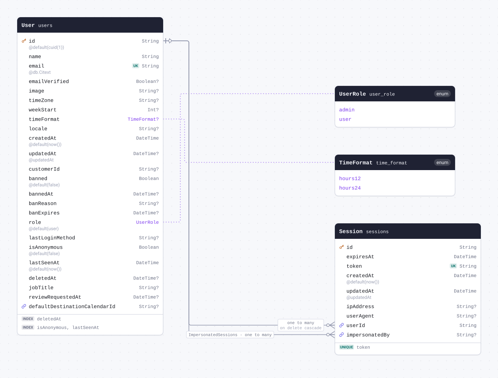

| Field                                | Type       | Constraints                       | Default      | Description |
| ------------------------------------ | ---------- | --------------------------------- | ------------ | ----------- |
| `id`                                 | `String`   | PK NOT NULL                       |              |             |
| `expiresAt` (`expires_at`)           | `DateTime` | NOT NULL                          |              |             |
| `token`                              | `String`   | UNIQUE NOT NULL                   |              |             |
| `createdAt` (`created_at`)           | `DateTime` | NOT NULL                          | `now()`      |             |
| `updatedAt` (`updated_at`)           | `DateTime` | NOT NULL                          | `@updatedAt` |             |
| `ipAddress` (`ip_address`)           | `String`   | NULL                              |              |             |
| `userAgent` (`user_agent`)           | `String`   | NULL                              |              |             |
| `userId` (`user_id`)                 | `String`   | NOT NULL → [User.id](#model-User) |              |             |
| `impersonatedBy` (`impersonated_by`) | `String`   | NULL → [User.id](#model-User)     |              |             |

#### Indexes

- `@@unique([token])`

#### References

- `userId` → [User.id](#model-User) (many-to-one, on delete Cascade)
- `impersonatedBy` → [User.id](#model-User) (many-to-one)

#### Definition

```sql
CREATE TABLE "sessions" (
    "id" TEXT NOT NULL,
    "expires_at" TIMESTAMP(3) NOT NULL,
    "token" TEXT NOT NULL,
    "created_at" TIMESTAMP(3) NOT NULL DEFAULT CURRENT_TIMESTAMP,
    "updated_at" TIMESTAMP(3) NOT NULL,
    "ip_address" TEXT,
    "user_agent" TEXT,
    "user_id" TEXT NOT NULL,
    "impersonated_by" TEXT,

    CONSTRAINT "sessions_pkey" PRIMARY KEY ("id")
);

CREATE UNIQUE INDEX "sessions_token_key" ON "sessions"("token");

ALTER TABLE "sessions" ADD CONSTRAINT "sessions_user_id_fkey" FOREIGN KEY ("user_id") REFERENCES "users"("id") ON DELETE CASCADE ON UPDATE CASCADE;

ALTER TABLE "sessions" ADD CONSTRAINT "sessions_impersonated_by_fkey" FOREIGN KEY ("impersonated_by") REFERENCES "users"("id") ON DELETE SET NULL ON UPDATE CASCADE;
```

<details>
<summary>Queries and their SQL</summary>

**findMany**: Every row

```ts
await prisma.session.findMany();
```

```sql
SELECT
  "public"."sessions"."id",
  "public"."sessions"."expires_at",
  "public"."sessions"."token",
  "public"."sessions"."created_at",
  "public"."sessions"."updated_at",
  "public"."sessions"."ip_address",
  "public"."sessions"."user_agent",
  "public"."sessions"."user_id",
  "public"."sessions"."impersonated_by"
FROM
  "public"."sessions"
WHERE
  1 = 1
OFFSET
  $1
-- params: ["0"]
```

**count**: How many rows there are

```ts
await prisma.session.count();
```

```sql
SELECT
  COUNT(*) AS "_count$_all"
FROM
  (
    SELECT
      "public"."sessions"."id"
    FROM
      "public"."sessions"
    WHERE
      1 = 1
    OFFSET
      $1
  ) AS "sub"
-- params: ["0"]
```

**findMany**: Every row with its relations

```ts
await prisma.session.findMany({ include: { user: true, impersonatedByUser: true } });
```

```sql
SELECT
  "public"."sessions"."id",
  "public"."sessions"."expires_at",
  "public"."sessions"."token",
  "public"."sessions"."created_at",
  "public"."sessions"."updated_at",
  "public"."sessions"."ip_address",
  "public"."sessions"."user_agent",
  "public"."sessions"."user_id",
  "public"."sessions"."impersonated_by"
FROM
  "public"."sessions"
WHERE
  1 = 1
OFFSET
  $1
-- params: ["0"]

SELECT
  "public"."users"."id",
  "public"."users"."name",
  "public"."users"."email",
  "public"."users"."email_verified",
  "public"."users"."image",
  "public"."users"."time_zone",
  "public"."users"."week_start",
  "public"."users"."time_format"::text,
  "public"."users"."locale",
  "public"."users"."created_at",
  "public"."users"."updated_at",
  "public"."users"."customer_id",
  "public"."users"."banned",
  "public"."users"."banned_at",
  "public"."users"."ban_reason",
  "public"."users"."ban_expires",
  "public"."users"."role"::text,
  "public"."users"."last_login_method",
  "public"."users"."anonymous",
  "public"."users"."last_seen_at",
  "public"."users"."deleted_at",
  "public"."users"."job_title",
  "public"."users"."review_requested_at",
  "public"."users"."default_destination_calendar_id"
FROM
  "public"."users"
WHERE
  "public"."users"."id" IN ($1)
OFFSET
  $2
-- params: ["<userId of the rows above>","0"]

SELECT
  "public"."users"."id",
  "public"."users"."name",
  "public"."users"."email",
  "public"."users"."email_verified",
  "public"."users"."image",
  "public"."users"."time_zone",
  "public"."users"."week_start",
  "public"."users"."time_format"::text,
  "public"."users"."locale",
  "public"."users"."created_at",
  "public"."users"."updated_at",
  "public"."users"."customer_id",
  "public"."users"."banned",
  "public"."users"."banned_at",
  "public"."users"."ban_reason",
  "public"."users"."ban_expires",
  "public"."users"."role"::text,
  "public"."users"."last_login_method",
  "public"."users"."anonymous",
  "public"."users"."last_seen_at",
  "public"."users"."deleted_at",
  "public"."users"."job_title",
  "public"."users"."review_requested_at",
  "public"."users"."default_destination_calendar_id"
FROM
  "public"."users"
WHERE
  "public"."users"."id" IN ($1)
OFFSET
  $2
-- params: ["<impersonatedBy of the rows above>","0"]
```

**findUnique**: One row by what is unique to it

```ts
await prisma.session.findUnique({ where: { id: "example" } });
```

```sql
SELECT
  "public"."sessions"."id",
  "public"."sessions"."expires_at",
  "public"."sessions"."token",
  "public"."sessions"."created_at",
  "public"."sessions"."updated_at",
  "public"."sessions"."ip_address",
  "public"."sessions"."user_agent",
  "public"."sessions"."user_id",
  "public"."sessions"."impersonated_by"
FROM
  "public"."sessions"
WHERE
  (
    "public"."sessions"."id" = $1
    AND 1 = 1
  )
LIMIT
  $2
OFFSET
  $3
-- params: ["example","1","0"]
```

**create**: Create a row

```ts
await prisma.session.create({
  data: {
    id: "example",
    expiresAt: new Date("2026-01-01T00:00:00.000Z"),
    token: "example",
    userId: "example",
  },
});
```

```sql
INSERT INTO
  "public"."sessions" (
    "id",
    "expires_at",
    "token",
    "created_at",
    "updated_at",
    "user_id"
  )
VALUES
  ($1, $2, $3, $4, $5, $6)
RETURNING
  "public"."sessions"."id",
  "public"."sessions"."expires_at",
  "public"."sessions"."token",
  "public"."sessions"."created_at",
  "public"."sessions"."updated_at",
  "public"."sessions"."ip_address",
  "public"."sessions"."user_agent",
  "public"."sessions"."user_id",
  "public"."sessions"."impersonated_by"
-- params: ["example","2026-01-01T00:00:00.000Z","example","<now()>","<now()>","example"]
```

**update**: Update a row

```ts
await prisma.session.update({
  where: { id: "example" },
  data: { expiresAt: new Date("2026-01-01T00:00:00.000Z") },
});
```

```sql
UPDATE "public"."sessions"
SET
  "expires_at" = $1,
  "updated_at" = $2
WHERE
  (
    "public"."sessions"."id" = $3
    AND 1 = 1
  )
RETURNING
  "public"."sessions"."id",
  "public"."sessions"."expires_at",
  "public"."sessions"."token",
  "public"."sessions"."created_at",
  "public"."sessions"."updated_at",
  "public"."sessions"."ip_address",
  "public"."sessions"."user_agent",
  "public"."sessions"."user_id",
  "public"."sessions"."impersonated_by"
-- params: ["2026-01-01T00:00:00.000Z",{"prisma__type":"generatorCall","prisma__value":{"name":"now","args":[],"returnType":{"type":"DateTime"}}},"example"]
```

**delete**: Delete a row

```ts
await prisma.session.delete({ where: { id: "example" } });
```

```sql
DELETE FROM "public"."sessions"
WHERE
  (
    "public"."sessions"."id" = $1
    AND 1 = 1
  )
RETURNING
  "public"."sessions"."id",
  "public"."sessions"."expires_at",
  "public"."sessions"."token",
  "public"."sessions"."created_at",
  "public"."sessions"."updated_at",
  "public"."sessions"."ip_address",
  "public"."sessions"."user_agent",
  "public"."sessions"."user_id",
  "public"."sessions"."impersonated_by"
-- params: ["example"]
```

</details>

<a id="model-Verification"></a>

### Verification

Table `verifications`.

| Field                      | Type       | Constraints     | Default              | Description |
| -------------------------- | ---------- | --------------- | -------------------- | ----------- |
| `id`                       | `String`   | PK NOT NULL     |                      |             |
| `identifier`               | `String`   | UNIQUE NOT NULL |                      |             |
| `value`                    | `String`   | NOT NULL        |                      |             |
| `expiresAt` (`expires_at`) | `DateTime` | NOT NULL        |                      |             |
| `createdAt` (`created_at`) | `DateTime` | NOT NULL        | `now()`              |             |
| `updatedAt` (`updated_at`) | `DateTime` | NOT NULL        | `now()` `@updatedAt` |             |

#### Indexes

- `@@index([identifier])`

#### Definition

```sql
CREATE TABLE "verifications" (
    "id" TEXT NOT NULL,
    "identifier" TEXT NOT NULL,
    "value" TEXT NOT NULL,
    "expires_at" TIMESTAMP(3) NOT NULL,
    "created_at" TIMESTAMP(3) NOT NULL DEFAULT CURRENT_TIMESTAMP,
    "updated_at" TIMESTAMP(3) NOT NULL DEFAULT CURRENT_TIMESTAMP,

    CONSTRAINT "verifications_pkey" PRIMARY KEY ("id")
);

CREATE UNIQUE INDEX "verifications_identifier_key" ON "verifications"("identifier");

CREATE INDEX "verifications_identifier_idx" ON "verifications"("identifier");
```

<details>
<summary>Queries and their SQL</summary>

**findMany**: Every row

```ts
await prisma.verification.findMany();
```

```sql
SELECT
  "public"."verifications"."id",
  "public"."verifications"."identifier",
  "public"."verifications"."value",
  "public"."verifications"."expires_at",
  "public"."verifications"."created_at",
  "public"."verifications"."updated_at"
FROM
  "public"."verifications"
WHERE
  1 = 1
OFFSET
  $1
-- params: ["0"]
```

**count**: How many rows there are

```ts
await prisma.verification.count();
```

```sql
SELECT
  COUNT(*) AS "_count$_all"
FROM
  (
    SELECT
      "public"."verifications"."id"
    FROM
      "public"."verifications"
    WHERE
      1 = 1
    OFFSET
      $1
  ) AS "sub"
-- params: ["0"]
```

**findUnique**: One row by what is unique to it

```ts
await prisma.verification.findUnique({ where: { id: "example" } });
```

```sql
SELECT
  "public"."verifications"."id",
  "public"."verifications"."identifier",
  "public"."verifications"."value",
  "public"."verifications"."expires_at",
  "public"."verifications"."created_at",
  "public"."verifications"."updated_at"
FROM
  "public"."verifications"
WHERE
  (
    "public"."verifications"."id" = $1
    AND 1 = 1
  )
LIMIT
  $2
OFFSET
  $3
-- params: ["example","1","0"]
```

**create**: Create a row

```ts
await prisma.verification.create({
  data: {
    id: "example",
    identifier: "example",
    value: "example",
    expiresAt: new Date("2026-01-01T00:00:00.000Z"),
  },
});
```

```sql
INSERT INTO
  "public"."verifications" (
    "id",
    "identifier",
    "value",
    "expires_at",
    "created_at",
    "updated_at"
  )
VALUES
  ($1, $2, $3, $4, $5, $6)
RETURNING
  "public"."verifications"."id",
  "public"."verifications"."identifier",
  "public"."verifications"."value",
  "public"."verifications"."expires_at",
  "public"."verifications"."created_at",
  "public"."verifications"."updated_at"
-- params: ["example","example","example","2026-01-01T00:00:00.000Z","<now()>","<now()>"]
```

**update**: Update a row

```ts
await prisma.verification.update({ where: { id: "example" }, data: { identifier: "example" } });
```

```sql
UPDATE "public"."verifications"
SET
  "identifier" = $1,
  "updated_at" = $2
WHERE
  (
    "public"."verifications"."id" = $3
    AND 1 = 1
  )
RETURNING
  "public"."verifications"."id",
  "public"."verifications"."identifier",
  "public"."verifications"."value",
  "public"."verifications"."expires_at",
  "public"."verifications"."created_at",
  "public"."verifications"."updated_at"
-- params: ["example",{"prisma__type":"generatorCall","prisma__value":{"name":"now","args":[],"returnType":{"type":"DateTime"}}},"example"]
```

**delete**: Delete a row

```ts
await prisma.verification.delete({ where: { id: "example" } });
```

```sql
DELETE FROM "public"."verifications"
WHERE
  (
    "public"."verifications"."id" = $1
    AND 1 = 1
  )
RETURNING
  "public"."verifications"."id",
  "public"."verifications"."identifier",
  "public"."verifications"."value",
  "public"."verifications"."expires_at",
  "public"."verifications"."created_at",
  "public"."verifications"."updated_at"
-- params: ["example"]
```

</details>

## Enums

<a id="enum-ApiUsageResource"></a>

### ApiUsageResource

Type `api_usage_resource`.

- `poll`

#### Definition

```sql
CREATE TYPE "api_usage_resource" AS ENUM ('poll');
```

<a id="enum-SubscriptionStatus"></a>

### SubscriptionStatus

Type `subscription_status`.

- `incomplete`
- `incomplete_expired`
- `active`
- `paused`
- `trialing`
- `past_due`
- `canceled`
- `unpaid`

#### Definition

```sql
CREATE TYPE "subscription_status" AS ENUM ('incomplete', 'incomplete_expired', 'active', 'paused', 'trialing', 'past_due', 'canceled', 'unpaid');
```

<a id="enum-SubscriptionInterval"></a>

### SubscriptionInterval

Type `subscription_interval`.

- `month`
- `year`

#### Definition

```sql
CREATE TYPE "subscription_interval" AS ENUM ('month', 'year');
```

<a id="enum-NonprofitApplicationStatus"></a>

### NonprofitApplicationStatus

Type `nonprofit_application_status`.

- `approved`
- `rejected`
- `failed`

#### Definition

```sql
CREATE TYPE "nonprofit_application_status" AS ENUM ('approved', 'rejected', 'failed');
```

<a id="enum-QueuedEmailStatus"></a>

### QueuedEmailStatus

Type `queued_email_status`.

- `pending`
- `sent`
- `skipped`
- `failed`

#### Definition

```sql
CREATE TYPE "queued_email_status" AS ENUM ('pending', 'sent', 'skipped', 'failed');
```

<a id="enum-ScheduledEventStatus"></a>

### ScheduledEventStatus

Type `scheduled_event_status`.

- `confirmed`
- `canceled`
- `unconfirmed`

#### Definition

```sql
CREATE TYPE "scheduled_event_status" AS ENUM ('confirmed', 'canceled', 'unconfirmed');
```

<a id="enum-ScheduledEventInviteStatus"></a>

### ScheduledEventInviteStatus

Type `scheduled_event_invite_status`.

- `pending`
- `accepted`
- `declined`
- `tentative`

#### Definition

```sql
CREATE TYPE "scheduled_event_invite_status" AS ENUM ('pending', 'accepted', 'declined', 'tentative');
```

<a id="enum-CredentialType"></a>

### CredentialType

- `OAUTH`

#### Definition

```sql
CREATE TYPE "CredentialType" AS ENUM ('OAUTH');
```

<a id="enum-LicenseType"></a>

### LicenseType

- `PLUS`
- `ORGANIZATION`
- `ENTERPRISE`

#### Definition

```sql
CREATE TYPE "LicenseType" AS ENUM ('PLUS', 'ORGANIZATION', 'ENTERPRISE');
```

<a id="enum-LicenseStatus"></a>

### LicenseStatus

- `ACTIVE`
- `REVOKED`

#### Definition

```sql
CREATE TYPE "LicenseStatus" AS ENUM ('ACTIVE', 'REVOKED');
```

<a id="enum-ParticipantVisibility"></a>

### ParticipantVisibility

Type `participant_visibility`.

- `full`
- `scoresOnly`
- `limited`

#### Definition

```sql
CREATE TYPE "participant_visibility" AS ENUM ('full', 'scoresOnly', 'limited');
```

<a id="enum-PollStatus"></a>

### PollStatus

Type `poll_status`.

- `open`
- `closed`
- `scheduled`
- `canceled`

#### Definition

```sql
CREATE TYPE "poll_status" AS ENUM ('open', 'closed', 'scheduled', 'canceled');
```

<a id="enum-PollKind"></a>

### PollKind

Type `poll_kind`.

- `date`
- `time`

#### Definition

```sql
CREATE TYPE "poll_kind" AS ENUM ('date', 'time');
```

<a id="enum-PollClosedReason"></a>

### PollClosedReason

Type `poll_closed_reason`.

- `auto`
- `manual`

#### Definition

```sql
CREATE TYPE "poll_closed_reason" AS ENUM ('auto', 'manual');
```

<a id="enum-VoteType"></a>

### VoteType

Type `vote_type`.

- `yes`
- `no`
- `ifNeedBe`

#### Definition

```sql
CREATE TYPE "vote_type" AS ENUM ('yes', 'no', 'ifNeedBe');
```

<a id="enum-SpaceMemberRole"></a>

### SpaceMemberRole

- `ADMIN`
- `MEMBER`

#### Definition

```sql
CREATE TYPE "SpaceMemberRole" AS ENUM ('ADMIN', 'MEMBER');
```

<a id="enum-SpaceType"></a>

### SpaceType

Type `space_types`.

- `personal`
- `work`

#### Definition

```sql
CREATE TYPE "space_types" AS ENUM ('personal', 'work');
```

<a id="enum-SpaceTier"></a>

### SpaceTier

Type `space_tiers`.

- `hobby`
- `pro`

#### Definition

```sql
CREATE TYPE "space_tiers" AS ENUM ('hobby', 'pro');
```

<a id="enum-WebhookDeliveryStatus"></a>

### WebhookDeliveryStatus

Type `webhook_delivery_status`.

- `pending`
- `in_flight`
- `succeeded`
- `failed`
- `exhausted`

#### Definition

```sql
CREATE TYPE "webhook_delivery_status" AS ENUM ('pending', 'in_flight', 'succeeded', 'failed', 'exhausted');
```

<a id="enum-TimeFormat"></a>

### TimeFormat

Type `time_format`.

- `hours12`
- `hours24`

#### Definition

```sql
CREATE TYPE "time_format" AS ENUM ('hours12', 'hours24');
```

<a id="enum-UserRole"></a>

### UserRole

Type `user_role`.

- `admin`
- `user`

#### Definition

```sql
CREATE TYPE "user_role" AS ENUM ('admin', 'user');
```
