# Schema docs

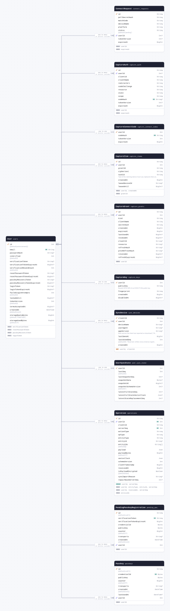

<details>
<summary>The whole schema as SQL</summary>

```sql
CREATE SCHEMA IF NOT EXISTS "public";

CREATE TABLE "users" (
    "id" SERIAL NOT NULL,
    "email" TEXT NOT NULL,
    "password_hash" TEXT,
    "is_verified" INTEGER NOT NULL DEFAULT 0,
    "verification_token" TEXT,
    "verification_token_expires_at" BIGINT,
    "verification_resend_count" INTEGER NOT NULL DEFAULT 0,
    "reset_password_token" TEXT,
    "reset_password_token_expires_at" BIGINT,
    "passkey_recovery_token" TEXT,
    "passkey_recovery_token_expires_at" BIGINT,
    "login_token" TEXT,
    "login_token_expires_at" BIGINT,
    "failed_login_attempts" INTEGER NOT NULL DEFAULT 0,
    "locked_until" BIGINT,
    "token_version" INTEGER NOT NULL DEFAULT 0,
    "terms_accepted_at" BIGINT,
    "created_at" TIMESTAMP(3) NOT NULL DEFAULT CURRENT_TIMESTAMP,
    "storage_quota_bytes" BIGINT NOT NULL DEFAULT 104857600,
    "storage_used_bytes" BIGINT NOT NULL DEFAULT 0,

    CONSTRAINT "users_pkey" PRIMARY KEY ("id")
);

CREATE TABLE "passkeys" (
    "id" TEXT NOT NULL,
    "credential_id" BYTEA NOT NULL,
    "public_key" BYTEA NOT NULL,
    "counter" BIGINT NOT NULL DEFAULT 0,
    "transports" TEXT,
    "created_at" TIMESTAMP(3) NOT NULL DEFAULT CURRENT_TIMESTAMP,
    "last_used_at" TIMESTAMP(3),
    "user_id" INTEGER NOT NULL,

    CONSTRAINT "passkeys_pkey" PRIMARY KEY ("id")
);

CREATE TABLE "pending_passkey_registrations" (
    "id" TEXT NOT NULL,
    "verification_token" TEXT NOT NULL,
    "verification_token_expires_at" BIGINT NOT NULL,
    "credential_id" BYTEA NOT NULL,
    "public_key" BYTEA NOT NULL,
    "counter" BIGINT NOT NULL DEFAULT 0,
    "transports" TEXT,
    "created_at" TIMESTAMP(3) NOT NULL DEFAULT CURRENT_TIMESTAMP,
    "user_id" INTEGER NOT NULL,

    CONSTRAINT "pending_passkey_registrations_pkey" PRIMARY KEY ("id")
);

CREATE TABLE "operations" (
    "id" TEXT NOT NULL,
    "user_id" INTEGER NOT NULL,
    "client_id" TEXT NOT NULL,
    "server_seq" INTEGER NOT NULL,
    "action_type" TEXT NOT NULL,
    "op_type" TEXT NOT NULL,
    "entity_type" TEXT NOT NULL,
    "entity_id" TEXT,
    "entity_ids" TEXT[] DEFAULT ARRAY[]::TEXT[],
    "payload" JSONB NOT NULL,
    "payload_bytes" BIGINT NOT NULL DEFAULT 0,
    "vector_clock" JSONB NOT NULL,
    "schema_version" INTEGER NOT NULL,
    "client_timestamp" BIGINT NOT NULL,
    "received_at" BIGINT NOT NULL,
    "is_payload_encrypted" BOOLEAN NOT NULL DEFAULT false,
    "sync_import_reason" TEXT,
    "repair_base_server_seq" INTEGER,

    CONSTRAINT "operations_pkey" PRIMARY KEY ("id")
);

CREATE TABLE "user_sync_state" (
    "user_id" INTEGER NOT NULL,
    "last_seq" INTEGER NOT NULL DEFAULT 0,
    "last_snapshot_seq" INTEGER,
    "snapshot_data" BYTEA,
    "snapshot_at" BIGINT,
    "snapshot_schema_version" INTEGER DEFAULT 1,
    "latest_full_state_seq" INTEGER,
    "latest_full_state_vector_clock" JSONB,
    "latest_state_replacement_seq" INTEGER,

    CONSTRAINT "user_sync_state_pkey" PRIMARY KEY ("user_id")
);

CREATE TABLE "sync_devices" (
    "client_id" TEXT NOT NULL,
    "user_id" INTEGER NOT NULL,
    "device_name" TEXT,
    "user_agent" TEXT,
    "app_version" TEXT,
    "last_seen_at" BIGINT NOT NULL,
    "last_acked_seq" INTEGER NOT NULL DEFAULT 0,
    "created_at" BIGINT NOT NULL,

    CONSTRAINT "sync_devices_pkey" PRIMARY KEY ("user_id","client_id")
);

CREATE TABLE "capture_keys" (
    "user_id" INTEGER NOT NULL,
    "public_key" TEXT NOT NULL,
    "fingerprint" TEXT NOT NULL,
    "created_at" BIGINT NOT NULL,
    "disabled_at" BIGINT,

    CONSTRAINT "capture_keys_pkey" PRIMARY KEY ("user_id")
);

CREATE TABLE "capture_grants" (
    "id" TEXT NOT NULL,
    "user_id" INTEGER NOT NULL,
    "kind" TEXT NOT NULL,
    "client_name" TEXT NOT NULL,
    "secret_hash" TEXT NOT NULL,
    "created_at" BIGINT NOT NULL,
    "expires_at" BIGINT NOT NULL,
    "last_used_at" BIGINT,
    "revoked_at" BIGINT,
    "client_id" TEXT,
    "resource" TEXT,
    "refresh_hash" TEXT,
    "prev_refresh_hash" TEXT,
    "rotated_at" BIGINT,
    "refresh_expires_at" BIGINT,

    CONSTRAINT "capture_grants_pkey" PRIMARY KEY ("id")
);

CREATE TABLE "capture_items" (
    "id" TEXT NOT NULL,
    "user_id" INTEGER NOT NULL,
    "grant_id" TEXT NOT NULL,
    "ciphertext" TEXT NOT NULL,
    "task_id" TEXT NOT NULL,
    "created_at" BIGINT NOT NULL,
    "lease_device_id" TEXT,
    "lease_until" BIGINT,

    CONSTRAINT "capture_items_pkey" PRIMARY KEY ("id")
);

CREATE TABLE "capture_connect_codes" (
    "user_id" INTEGER NOT NULL,
    "code_hash" TEXT NOT NULL,
    "token_version" INTEGER NOT NULL,
    "expires_at" BIGINT NOT NULL,

    CONSTRAINT "capture_connect_codes_pkey" PRIMARY KEY ("user_id")
);

CREATE TABLE "capture_auth" (
    "id" TEXT NOT NULL,
    "user_id" INTEGER,
    "client_id" TEXT NOT NULL,
    "client_name" TEXT NOT NULL,
    "redirect_uri" TEXT NOT NULL,
    "code_challenge" TEXT NOT NULL,
    "resource" TEXT NOT NULL,
    "state" TEXT NOT NULL,
    "scope" TEXT NOT NULL,
    "code_hash" TEXT,
    "token_version" INTEGER,
    "expires_at" BIGINT NOT NULL,

    CONSTRAINT "capture_auth_pkey" PRIMARY KEY ("id")
);

CREATE TABLE "connect_requests" (
    "id" TEXT NOT NULL,
    "poll_secret_hash" TEXT NOT NULL,
    "match_code" TEXT NOT NULL,
    "device_name" TEXT NOT NULL,
    "platform" TEXT NOT NULL,
    "status" TEXT NOT NULL DEFAULT 'pending',
    "user_id" INTEGER,
    "token_version" INTEGER,
    "expires_at" BIGINT NOT NULL,

    CONSTRAINT "connect_requests_pkey" PRIMARY KEY ("id")
);

CREATE UNIQUE INDEX "users_email_key" ON "users"("email");

CREATE INDEX "users_verification_token_idx" ON "users"("verification_token");

CREATE INDEX "users_reset_password_token_idx" ON "users"("reset_password_token");

CREATE INDEX "users_passkey_recovery_token_idx" ON "users"("passkey_recovery_token");

CREATE INDEX "users_login_token_idx" ON "users"("login_token");

CREATE UNIQUE INDEX "passkeys_credential_id_key" ON "passkeys"("credential_id");

CREATE INDEX "passkeys_user_id_idx" ON "passkeys"("user_id");

CREATE UNIQUE INDEX "pending_passkey_registrations_verification_token_key" ON "pending_passkey_registrations"("verification_token");

CREATE INDEX "pending_passkey_registrations_user_id_idx" ON "pending_passkey_registrations"("user_id");

CREATE INDEX "operations_user_id_entity_type_entity_id_server_seq_idx" ON "operations"("user_id", "entity_type", "entity_id", "server_seq");

CREATE INDEX "operations_user_id_received_at_server_seq_idx" ON "operations"("user_id", "received_at", "server_seq");

CREATE INDEX "operations_entity_ids_gin" ON "operations" USING GIN ("entity_ids");

CREATE UNIQUE INDEX "operations_user_id_server_seq_key" ON "operations"("user_id", "server_seq");

CREATE INDEX "capture_grants_user_id_idx" ON "capture_grants"("user_id");

CREATE INDEX "capture_items_user_id_created_at_idx" ON "capture_items"("user_id", "created_at");

CREATE INDEX "capture_items_grant_id_idx" ON "capture_items"("grant_id");

CREATE UNIQUE INDEX "capture_connect_codes_code_hash_key" ON "capture_connect_codes"("code_hash");

CREATE UNIQUE INDEX "capture_auth_code_hash_key" ON "capture_auth"("code_hash");

CREATE INDEX "capture_auth_user_id_idx" ON "capture_auth"("user_id");

CREATE INDEX "capture_auth_expires_at_idx" ON "capture_auth"("expires_at");

CREATE INDEX "connect_requests_user_id_idx" ON "connect_requests"("user_id");

CREATE INDEX "connect_requests_expires_at_idx" ON "connect_requests"("expires_at");

ALTER TABLE "passkeys" ADD CONSTRAINT "passkeys_user_id_fkey" FOREIGN KEY ("user_id") REFERENCES "users"("id") ON DELETE CASCADE ON UPDATE CASCADE;

ALTER TABLE "pending_passkey_registrations" ADD CONSTRAINT "pending_passkey_registrations_user_id_fkey" FOREIGN KEY ("user_id") REFERENCES "users"("id") ON DELETE CASCADE ON UPDATE CASCADE;

ALTER TABLE "operations" ADD CONSTRAINT "operations_user_id_fkey" FOREIGN KEY ("user_id") REFERENCES "users"("id") ON DELETE CASCADE ON UPDATE CASCADE;

ALTER TABLE "user_sync_state" ADD CONSTRAINT "user_sync_state_user_id_fkey" FOREIGN KEY ("user_id") REFERENCES "users"("id") ON DELETE CASCADE ON UPDATE CASCADE;

ALTER TABLE "sync_devices" ADD CONSTRAINT "sync_devices_user_id_fkey" FOREIGN KEY ("user_id") REFERENCES "users"("id") ON DELETE CASCADE ON UPDATE CASCADE;

ALTER TABLE "capture_keys" ADD CONSTRAINT "capture_keys_user_id_fkey" FOREIGN KEY ("user_id") REFERENCES "users"("id") ON DELETE CASCADE ON UPDATE CASCADE;

ALTER TABLE "capture_grants" ADD CONSTRAINT "capture_grants_user_id_fkey" FOREIGN KEY ("user_id") REFERENCES "users"("id") ON DELETE CASCADE ON UPDATE CASCADE;

ALTER TABLE "capture_items" ADD CONSTRAINT "capture_items_user_id_fkey" FOREIGN KEY ("user_id") REFERENCES "users"("id") ON DELETE CASCADE ON UPDATE CASCADE;

ALTER TABLE "capture_connect_codes" ADD CONSTRAINT "capture_connect_codes_user_id_fkey" FOREIGN KEY ("user_id") REFERENCES "users"("id") ON DELETE CASCADE ON UPDATE CASCADE;

ALTER TABLE "capture_auth" ADD CONSTRAINT "capture_auth_user_id_fkey" FOREIGN KEY ("user_id") REFERENCES "users"("id") ON DELETE CASCADE ON UPDATE CASCADE;

ALTER TABLE "connect_requests" ADD CONSTRAINT "connect_requests_user_id_fkey" FOREIGN KEY ("user_id") REFERENCES "users"("id") ON DELETE CASCADE ON UPDATE CASCADE;
```

</details>

## Contents

| Model                                                           | Table                           | Description                                                                                                                                   |
| --------------------------------------------------------------- | ------------------------------- | --------------------------------------------------------------------------------------------------------------------------------------------- |
| [User](#model-User)                                             | `users`                         |                                                                                                                                               |
| [Passkey](#model-Passkey)                                       | `passkeys`                      |                                                                                                                                               |
| [PendingPasskeyRegistration](#model-PendingPasskeyRegistration) | `pending_passkey_registrations` |                                                                                                                                               |
| [Operation](#model-Operation)                                   | `operations`                    |                                                                                                                                               |
| [UserSyncState](#model-UserSyncState)                           | `user_sync_state`               |                                                                                                                                               |
| [SyncDevice](#model-SyncDevice)                                 | `sync_devices`                  |                                                                                                                                               |
| [CaptureKey](#model-CaptureKey)                                 | `capture_keys`                  | Public half of the user's capture key. The row outlives switching the feature off: `disabledAt` stops a stale device re-registering that key. |
| [CaptureGrant](#model-CaptureGrant)                             | `capture_grants`                | Capture tokens and OAuth grants store only hashes of bearer credentials.                                                                      |
| [CaptureItem](#model-CaptureItem)                               | `capture_items`                 | One sealed capture waiting for a device. No relation to its grant: items outlive a grant that is revoked without discarding them.             |
| [CaptureConnectCode](#model-CaptureConnectCode)                 | `capture_connect_codes`         |                                                                                                                                               |
| [CaptureAuth](#model-CaptureAuth)                               | `capture_auth`                  |                                                                                                                                               |
| [ConnectRequest](#model-ConnectRequest)                         | `connect_requests`              |                                                                                                                                               |

## Models

<a id="model-User"></a>

### User

Table `users`.


| Field                                                                 | Type       | Constraints     | Default           | Description |
| --------------------------------------------------------------------- | ---------- | --------------- | ----------------- | ----------- |
| `id`                                                                  | `Int`      | PK NOT NULL     | `autoincrement()` |             |
| `email`                                                               | `String`   | UNIQUE NOT NULL |                   |             |
| `passwordHash` (`password_hash`)                                      | `String`   | NULL            |                   |             |
| `isVerified` (`is_verified`)                                          | `Int`      | NOT NULL        | `0`               |             |
| `verificationToken` (`verification_token`)                            | `String`   | NULL            |                   |             |
| `verificationTokenExpiresAt` (`verification_token_expires_at`)        | `BigInt`   | NULL            |                   |             |
| `verificationResendCount` (`verification_resend_count`)               | `Int`      | NOT NULL        | `0`               |             |
| `resetPasswordToken` (`reset_password_token`)                         | `String`   | NULL            |                   |             |
| `resetPasswordTokenExpiresAt` (`reset_password_token_expires_at`)     | `BigInt`   | NULL            |                   |             |
| `passkeyRecoveryToken` (`passkey_recovery_token`)                     | `String`   | NULL            |                   |             |
| `passkeyRecoveryTokenExpiresAt` (`passkey_recovery_token_expires_at`) | `BigInt`   | NULL            |                   |             |
| `loginToken` (`login_token`)                                          | `String`   | NULL            |                   |             |
| `loginTokenExpiresAt` (`login_token_expires_at`)                      | `BigInt`   | NULL            |                   |             |
| `failedLoginAttempts` (`failed_login_attempts`)                       | `Int`      | NOT NULL        | `0`               |             |
| `lockedUntil` (`locked_until`)                                        | `BigInt`   | NULL            |                   |             |
| `tokenVersion` (`token_version`)                                      | `Int`      | NOT NULL        | `0`               |             |
| `termsAcceptedAt` (`terms_accepted_at`)                               | `BigInt`   | NULL            |                   |             |
| `createdAt` (`created_at`)                                            | `DateTime` | NOT NULL        | `now()`           |             |
| `storageQuotaBytes` (`storage_quota_bytes`)                           | `BigInt`   | NOT NULL        | `"104857600"`     |             |
| `storageUsedBytes` (`storage_used_bytes`)                             | `BigInt`   | NOT NULL        | `"0"`             |             |

#### Indexes

- `@@index([verificationToken])`
- `@@index([resetPasswordToken])`
- `@@index([passkeyRecoveryToken])`
- `@@index([loginToken])`

#### Referenced by

- `id` ← [Passkey.userId](#model-Passkey) (one-to-many, on delete Cascade)
- `id` ← [PendingPasskeyRegistration.userId](#model-PendingPasskeyRegistration) (one-to-many, on delete Cascade)
- `id` ← [Operation.userId](#model-Operation) (one-to-many, on delete Cascade)
- `id` ← [UserSyncState.userId](#model-UserSyncState) (one-to-one, on delete Cascade)
- `id` ← [SyncDevice.userId](#model-SyncDevice) (one-to-many, on delete Cascade)
- `id` ← [CaptureKey.userId](#model-CaptureKey) (one-to-one, on delete Cascade)
- `id` ← [CaptureGrant.userId](#model-CaptureGrant) (one-to-many, on delete Cascade)
- `id` ← [CaptureItem.userId](#model-CaptureItem) (one-to-many, on delete Cascade)
- `id` ← [CaptureConnectCode.userId](#model-CaptureConnectCode) (one-to-one, on delete Cascade)
- `id` ← [CaptureAuth.userId](#model-CaptureAuth) (one-to-many, on delete Cascade)
- `id` ← [ConnectRequest.userId](#model-ConnectRequest) (one-to-many, on delete Cascade)

#### Definition

```sql
CREATE TABLE "users" (
    "id" SERIAL NOT NULL,
    "email" TEXT NOT NULL,
    "password_hash" TEXT,
    "is_verified" INTEGER NOT NULL DEFAULT 0,
    "verification_token" TEXT,
    "verification_token_expires_at" BIGINT,
    "verification_resend_count" INTEGER NOT NULL DEFAULT 0,
    "reset_password_token" TEXT,
    "reset_password_token_expires_at" BIGINT,
    "passkey_recovery_token" TEXT,
    "passkey_recovery_token_expires_at" BIGINT,
    "login_token" TEXT,
    "login_token_expires_at" BIGINT,
    "failed_login_attempts" INTEGER NOT NULL DEFAULT 0,
    "locked_until" BIGINT,
    "token_version" INTEGER NOT NULL DEFAULT 0,
    "terms_accepted_at" BIGINT,
    "created_at" TIMESTAMP(3) NOT NULL DEFAULT CURRENT_TIMESTAMP,
    "storage_quota_bytes" BIGINT NOT NULL DEFAULT 104857600,
    "storage_used_bytes" BIGINT NOT NULL DEFAULT 0,

    CONSTRAINT "users_pkey" PRIMARY KEY ("id")
);

CREATE UNIQUE INDEX "users_email_key" ON "users"("email");

CREATE INDEX "users_verification_token_idx" ON "users"("verification_token");

CREATE INDEX "users_reset_password_token_idx" ON "users"("reset_password_token");

CREATE INDEX "users_passkey_recovery_token_idx" ON "users"("passkey_recovery_token");

CREATE INDEX "users_login_token_idx" ON "users"("login_token");
```

<details>
<summary>Queries and their SQL</summary>

**findMany**: Every row

```ts
await prisma.user.findMany();
```

```sql
SELECT
  "public"."users"."id",
  "public"."users"."email",
  "public"."users"."password_hash",
  "public"."users"."is_verified",
  "public"."users"."verification_token",
  "public"."users"."verification_token_expires_at",
  "public"."users"."verification_resend_count",
  "public"."users"."reset_password_token",
  "public"."users"."reset_password_token_expires_at",
  "public"."users"."passkey_recovery_token",
  "public"."users"."passkey_recovery_token_expires_at",
  "public"."users"."login_token",
  "public"."users"."login_token_expires_at",
  "public"."users"."failed_login_attempts",
  "public"."users"."locked_until",
  "public"."users"."token_version",
  "public"."users"."terms_accepted_at",
  "public"."users"."created_at",
  "public"."users"."storage_quota_bytes",
  "public"."users"."storage_used_bytes"
FROM
  "public"."users"
WHERE
  1 = 1
OFFSET
  $1
-- params: ["0"]
```

**count**: How many rows there are

```ts
await prisma.user.count();
```

```sql
SELECT
  COUNT(*) AS "_count$_all"
FROM
  (
    SELECT
      "public"."users"."id"
    FROM
      "public"."users"
    WHERE
      1 = 1
    OFFSET
      $1
  ) AS "sub"
-- params: ["0"]
```

**findMany**: Every row with its relations

```ts
await prisma.user.findMany({
  include: {
    operations: true,
    syncState: true,
    devices: true,
    passkeys: true,
    pendingPasskeyRegistrations: true,
    captureKey: true,
    captureGrants: true,
    captureItems: true,
    captureConnectCode: true,
    captureAuthorizations: true,
    connectRequests: true,
  },
});
```

```sql
SELECT
  "public"."users"."id",
  "public"."users"."email",
  "public"."users"."password_hash",
  "public"."users"."is_verified",
  "public"."users"."verification_token",
  "public"."users"."verification_token_expires_at",
  "public"."users"."verification_resend_count",
  "public"."users"."reset_password_token",
  "public"."users"."reset_password_token_expires_at",
  "public"."users"."passkey_recovery_token",
  "public"."users"."passkey_recovery_token_expires_at",
  "public"."users"."login_token",
  "public"."users"."login_token_expires_at",
  "public"."users"."failed_login_attempts",
  "public"."users"."locked_until",
  "public"."users"."token_version",
  "public"."users"."terms_accepted_at",
  "public"."users"."created_at",
  "public"."users"."storage_quota_bytes",
  "public"."users"."storage_used_bytes"
FROM
  "public"."users"
WHERE
  1 = 1
OFFSET
  $1
-- params: ["0"]

SELECT
  "public"."operations"."id",
  "public"."operations"."user_id",
  "public"."operations"."client_id",
  "public"."operations"."server_seq",
  "public"."operations"."action_type",
  "public"."operations"."op_type",
  "public"."operations"."entity_type",
  "public"."operations"."entity_id",
  "public"."operations"."entity_ids",
  "public"."operations"."payload",
  "public"."operations"."payload_bytes",
  "public"."operations"."vector_clock",
  "public"."operations"."schema_version",
  "public"."operations"."client_timestamp",
  "public"."operations"."received_at",
  "public"."operations"."is_payload_encrypted",
  "public"."operations"."sync_import_reason",
  "public"."operations"."repair_base_server_seq"
FROM
  "public"."operations"
WHERE
  "public"."operations"."user_id" IN ($1)
OFFSET
  $2
-- params: ["<id of the rows above>","0"]

SELECT
  "public"."user_sync_state"."user_id",
  "public"."user_sync_state"."last_seq",
  "public"."user_sync_state"."last_snapshot_seq",
  "public"."user_sync_state"."snapshot_data",
  "public"."user_sync_state"."snapshot_at",
  "public"."user_sync_state"."snapshot_schema_version",
  "public"."user_sync_state"."latest_full_state_seq",
  "public"."user_sync_state"."latest_full_state_vector_clock",
  "public"."user_sync_state"."latest_state_replacement_seq"
FROM
  "public"."user_sync_state"
WHERE
  "public"."user_sync_state"."user_id" IN ($1)
OFFSET
  $2
-- params: ["<id of the rows above>","0"]

SELECT
  "public"."sync_devices"."user_id",
  "public"."sync_devices"."client_id",
  "public"."sync_devices"."device_name",
  "public"."sync_devices"."user_agent",
  "public"."sync_devices"."app_version",
  "public"."sync_devices"."last_seen_at",
  "public"."sync_devices"."last_acked_seq",
  "public"."sync_devices"."created_at"
FROM
  "public"."sync_devices"
WHERE
  "public"."sync_devices"."user_id" IN ($1)
OFFSET
  $2
-- params: ["<id of the rows above>","0"]

SELECT
  "public"."passkeys"."id",
  "public"."passkeys"."credential_id",
  "public"."passkeys"."public_key",
  "public"."passkeys"."counter",
  "public"."passkeys"."transports",
  "public"."passkeys"."created_at",
  "public"."passkeys"."last_used_at",
  "public"."passkeys"."user_id"
FROM
  "public"."passkeys"
WHERE
  "public"."passkeys"."user_id" IN ($1)
OFFSET
  $2
-- params: ["<id of the rows above>","0"]

SELECT
  "public"."pending_passkey_registrations"."id",
  "public"."pending_passkey_registrations"."verification_token",
  "public"."pending_passkey_registrations"."verification_token_expires_at",
  "public"."pending_passkey_registrations"."credential_id",
  "public"."pending_passkey_registrations"."public_key",
  "public"."pending_passkey_registrations"."counter",
  "public"."pending_passkey_registrations"."transports",
  "public"."pending_passkey_registrations"."created_at",
  "public"."pending_passkey_registrations"."user_id"
FROM
  "public"."pending_passkey_registrations"
WHERE
  "public"."pending_passkey_registrations"."user_id" IN ($1)
OFFSET
  $2
-- params: ["<id of the rows above>","0"]

SELECT
  "public"."capture_keys"."user_id",
  "public"."capture_keys"."public_key",
  "public"."capture_keys"."fingerprint",
  "public"."capture_keys"."created_at",
  "public"."capture_keys"."disabled_at"
FROM
  "public"."capture_keys"
WHERE
  "public"."capture_keys"."user_id" IN ($1)
OFFSET
  $2
-- params: ["<id of the rows above>","0"]

SELECT
  "public"."capture_grants"."id",
  "public"."capture_grants"."user_id",
  "public"."capture_grants"."kind",
  "public"."capture_grants"."client_name",
  "public"."capture_grants"."secret_hash",
  "public"."capture_grants"."created_at",
  "public"."capture_grants"."expires_at",
  "public"."capture_grants"."last_used_at",
  "public"."capture_grants"."revoked_at",
  "public"."capture_grants"."client_id",
  "public"."capture_grants"."resource",
  "public"."capture_grants"."refresh_hash",
  "public"."capture_grants"."prev_refresh_hash",
  "public"."capture_grants"."rotated_at",
  "public"."capture_grants"."refresh_expires_at"
FROM
  "public"."capture_grants"
WHERE
  "public"."capture_grants"."user_id" IN ($1)
OFFSET
  $2
-- params: ["<id of the rows above>","0"]

SELECT
  "public"."capture_items"."id",
  "public"."capture_items"."user_id",
  "public"."capture_items"."grant_id",
  "public"."capture_items"."ciphertext",
  "public"."capture_items"."task_id",
  "public"."capture_items"."created_at",
  "public"."capture_items"."lease_device_id",
  "public"."capture_items"."lease_until"
FROM
  "public"."capture_items"
WHERE
  "public"."capture_items"."user_id" IN ($1)
OFFSET
  $2
-- params: ["<id of the rows above>","0"]

SELECT
  "public"."capture_connect_codes"."user_id",
  "public"."capture_connect_codes"."code_hash",
  "public"."capture_connect_codes"."token_version",
  "public"."capture_connect_codes"."expires_at"
FROM
  "public"."capture_connect_codes"
WHERE
  "public"."capture_connect_codes"."user_id" IN ($1)
OFFSET
  $2
-- params: ["<id of the rows above>","0"]

SELECT
  "public"."capture_auth"."id",
  "public"."capture_auth"."user_id",
  "public"."capture_auth"."client_id",
  "public"."capture_auth"."client_name",
  "public"."capture_auth"."redirect_uri",
  "public"."capture_auth"."code_challenge",
  "public"."capture_auth"."resource",
  "public"."capture_auth"."state",
  "public"."capture_auth"."scope",
  "public"."capture_auth"."code_hash",
  "public"."capture_auth"."token_version",
  "public"."capture_auth"."expires_at"
FROM
  "public"."capture_auth"
WHERE
  "public"."capture_auth"."user_id" IN ($1)
OFFSET
  $2
-- params: ["<id of the rows above>","0"]

SELECT
  "public"."connect_requests"."id",
  "public"."connect_requests"."poll_secret_hash",
  "public"."connect_requests"."match_code",
  "public"."connect_requests"."device_name",
  "public"."connect_requests"."platform",
  "public"."connect_requests"."status",
  "public"."connect_requests"."user_id",
  "public"."connect_requests"."token_version",
  "public"."connect_requests"."expires_at"
FROM
  "public"."connect_requests"
WHERE
  "public"."connect_requests"."user_id" IN ($1)
OFFSET
  $2
-- params: ["<id of the rows above>","0"]
```

**findUnique**: One row by what is unique to it

```ts
await prisma.user.findUnique({ where: { id: 1 } });
```

```sql
SELECT
  "public"."users"."id",
  "public"."users"."email",
  "public"."users"."password_hash",
  "public"."users"."is_verified",
  "public"."users"."verification_token",
  "public"."users"."verification_token_expires_at",
  "public"."users"."verification_resend_count",
  "public"."users"."reset_password_token",
  "public"."users"."reset_password_token_expires_at",
  "public"."users"."passkey_recovery_token",
  "public"."users"."passkey_recovery_token_expires_at",
  "public"."users"."login_token",
  "public"."users"."login_token_expires_at",
  "public"."users"."failed_login_attempts",
  "public"."users"."locked_until",
  "public"."users"."token_version",
  "public"."users"."terms_accepted_at",
  "public"."users"."created_at",
  "public"."users"."storage_quota_bytes",
  "public"."users"."storage_used_bytes"
FROM
  "public"."users"
WHERE
  (
    "public"."users"."id" = $1
    AND 1 = 1
  )
LIMIT
  $2
OFFSET
  $3
-- params: ["1","1","0"]
```

**create**: Create a row

```ts
await prisma.user.create({ data: { email: "example" } });
```

```sql
INSERT INTO
  "public"."users" (
    "email",
    "is_verified",
    "verification_resend_count",
    "failed_login_attempts",
    "token_version",
    "created_at",
    "storage_quota_bytes",
    "storage_used_bytes"
  )
VALUES
  ($1, $2, $3, $4, $5, $6, $7, $8)
RETURNING
  "public"."users"."id",
  "public"."users"."email",
  "public"."users"."password_hash",
  "public"."users"."is_verified",
  "public"."users"."verification_token",
  "public"."users"."verification_token_expires_at",
  "public"."users"."verification_resend_count",
  "public"."users"."reset_password_token",
  "public"."users"."reset_password_token_expires_at",
  "public"."users"."passkey_recovery_token",
  "public"."users"."passkey_recovery_token_expires_at",
  "public"."users"."login_token",
  "public"."users"."login_token_expires_at",
  "public"."users"."failed_login_attempts",
  "public"."users"."locked_until",
  "public"."users"."token_version",
  "public"."users"."terms_accepted_at",
  "public"."users"."created_at",
  "public"."users"."storage_quota_bytes",
  "public"."users"."storage_used_bytes"
-- params: ["example","0","0","0","0","<now()>","104857600","0"]
```

**update**: Update a row

```ts
await prisma.user.update({ where: { id: 1 }, data: { email: "example" } });
```

```sql
UPDATE "public"."users"
SET
  "email" = $1
WHERE
  (
    "public"."users"."id" = $2
    AND 1 = 1
  )
RETURNING
  "public"."users"."id",
  "public"."users"."email",
  "public"."users"."password_hash",
  "public"."users"."is_verified",
  "public"."users"."verification_token",
  "public"."users"."verification_token_expires_at",
  "public"."users"."verification_resend_count",
  "public"."users"."reset_password_token",
  "public"."users"."reset_password_token_expires_at",
  "public"."users"."passkey_recovery_token",
  "public"."users"."passkey_recovery_token_expires_at",
  "public"."users"."login_token",
  "public"."users"."login_token_expires_at",
  "public"."users"."failed_login_attempts",
  "public"."users"."locked_until",
  "public"."users"."token_version",
  "public"."users"."terms_accepted_at",
  "public"."users"."created_at",
  "public"."users"."storage_quota_bytes",
  "public"."users"."storage_used_bytes"
-- params: ["example","1"]
```

**delete**: Delete a row

```ts
await prisma.user.delete({ where: { id: 1 } });
```

```sql
DELETE FROM "public"."users"
WHERE
  (
    "public"."users"."id" = $1
    AND 1 = 1
  )
RETURNING
  "public"."users"."id",
  "public"."users"."email",
  "public"."users"."password_hash",
  "public"."users"."is_verified",
  "public"."users"."verification_token",
  "public"."users"."verification_token_expires_at",
  "public"."users"."verification_resend_count",
  "public"."users"."reset_password_token",
  "public"."users"."reset_password_token_expires_at",
  "public"."users"."passkey_recovery_token",
  "public"."users"."passkey_recovery_token_expires_at",
  "public"."users"."login_token",
  "public"."users"."login_token_expires_at",
  "public"."users"."failed_login_attempts",
  "public"."users"."locked_until",
  "public"."users"."token_version",
  "public"."users"."terms_accepted_at",
  "public"."users"."created_at",
  "public"."users"."storage_quota_bytes",
  "public"."users"."storage_used_bytes"
-- params: ["1"]
```

</details>

<a id="model-Passkey"></a>

### Passkey

Table `passkeys`.

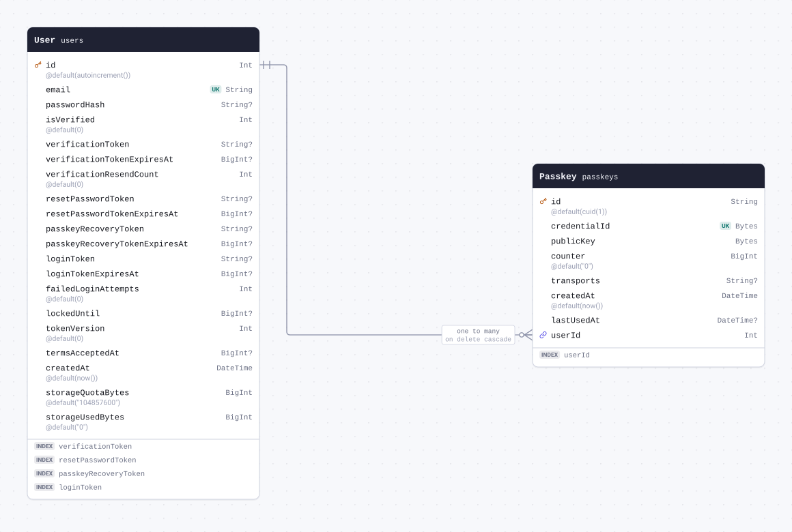

| Field                            | Type       | Constraints                       | Default   | Description |
| -------------------------------- | ---------- | --------------------------------- | --------- | ----------- |
| `id`                             | `String`   | PK NOT NULL                       | `cuid(1)` |             |
| `credentialId` (`credential_id`) | `Bytes`    | UNIQUE NOT NULL                   |           |             |
| `publicKey` (`public_key`)       | `Bytes`    | NOT NULL                          |           |             |
| `counter`                        | `BigInt`   | NOT NULL                          | `"0"`     |             |
| `transports`                     | `String`   | NULL                              |           |             |
| `createdAt` (`created_at`)       | `DateTime` | NOT NULL                          | `now()`   |             |
| `lastUsedAt` (`last_used_at`)    | `DateTime` | NULL                              |           |             |
| `userId` (`user_id`)             | `Int`      | NOT NULL → [User.id](#model-User) |           |             |

#### Indexes

- `@@index([userId])`

#### References

- `userId` → [User.id](#model-User) (many-to-one, on delete Cascade)

#### Definition

```sql
CREATE TABLE "passkeys" (
    "id" TEXT NOT NULL,
    "credential_id" BYTEA NOT NULL,
    "public_key" BYTEA NOT NULL,
    "counter" BIGINT NOT NULL DEFAULT 0,
    "transports" TEXT,
    "created_at" TIMESTAMP(3) NOT NULL DEFAULT CURRENT_TIMESTAMP,
    "last_used_at" TIMESTAMP(3),
    "user_id" INTEGER NOT NULL,

    CONSTRAINT "passkeys_pkey" PRIMARY KEY ("id")
);

CREATE UNIQUE INDEX "passkeys_credential_id_key" ON "passkeys"("credential_id");

CREATE INDEX "passkeys_user_id_idx" ON "passkeys"("user_id");

ALTER TABLE "passkeys" ADD CONSTRAINT "passkeys_user_id_fkey" FOREIGN KEY ("user_id") REFERENCES "users"("id") ON DELETE CASCADE ON UPDATE CASCADE;
```

<details>
<summary>Queries and their SQL</summary>

**findMany**: Every row

```ts
await prisma.passkey.findMany();
```

```sql
SELECT
  "public"."passkeys"."id",
  "public"."passkeys"."credential_id",
  "public"."passkeys"."public_key",
  "public"."passkeys"."counter",
  "public"."passkeys"."transports",
  "public"."passkeys"."created_at",
  "public"."passkeys"."last_used_at",
  "public"."passkeys"."user_id"
FROM
  "public"."passkeys"
WHERE
  1 = 1
OFFSET
  $1
-- params: ["0"]
```

**count**: How many rows there are

```ts
await prisma.passkey.count();
```

```sql
SELECT
  COUNT(*) AS "_count$_all"
FROM
  (
    SELECT
      "public"."passkeys"."id"
    FROM
      "public"."passkeys"
    WHERE
      1 = 1
    OFFSET
      $1
  ) AS "sub"
-- params: ["0"]
```

**findMany**: Every row with its relations

```ts
await prisma.passkey.findMany({ include: { user: true } });
```

```sql
SELECT
  "public"."passkeys"."id",
  "public"."passkeys"."credential_id",
  "public"."passkeys"."public_key",
  "public"."passkeys"."counter",
  "public"."passkeys"."transports",
  "public"."passkeys"."created_at",
  "public"."passkeys"."last_used_at",
  "public"."passkeys"."user_id"
FROM
  "public"."passkeys"
WHERE
  1 = 1
OFFSET
  $1
-- params: ["0"]

SELECT
  "public"."users"."id",
  "public"."users"."email",
  "public"."users"."password_hash",
  "public"."users"."is_verified",
  "public"."users"."verification_token",
  "public"."users"."verification_token_expires_at",
  "public"."users"."verification_resend_count",
  "public"."users"."reset_password_token",
  "public"."users"."reset_password_token_expires_at",
  "public"."users"."passkey_recovery_token",
  "public"."users"."passkey_recovery_token_expires_at",
  "public"."users"."login_token",
  "public"."users"."login_token_expires_at",
  "public"."users"."failed_login_attempts",
  "public"."users"."locked_until",
  "public"."users"."token_version",
  "public"."users"."terms_accepted_at",
  "public"."users"."created_at",
  "public"."users"."storage_quota_bytes",
  "public"."users"."storage_used_bytes"
FROM
  "public"."users"
WHERE
  "public"."users"."id" IN ($1)
OFFSET
  $2
-- params: ["<userId of the rows above>","0"]
```

**findUnique**: One row by what is unique to it

```ts
await prisma.passkey.findUnique({ where: { id: "example" } });
```

```sql
SELECT
  "public"."passkeys"."id",
  "public"."passkeys"."credential_id",
  "public"."passkeys"."public_key",
  "public"."passkeys"."counter",
  "public"."passkeys"."transports",
  "public"."passkeys"."created_at",
  "public"."passkeys"."last_used_at",
  "public"."passkeys"."user_id"
FROM
  "public"."passkeys"
WHERE
  (
    "public"."passkeys"."id" = $1
    AND 1 = 1
  )
LIMIT
  $2
OFFSET
  $3
-- params: ["example","1","0"]
```

**create**: Create a row

```ts
await prisma.passkey.create({
  data: {
    credentialId: Uint8Array.from([1, 2, 3]),
    publicKey: Uint8Array.from([1, 2, 3]),
    userId: 1,
  },
});
```

```sql
INSERT INTO
  "public"."passkeys" (
    "id",
    "credential_id",
    "public_key",
    "counter",
    "created_at",
    "user_id"
  )
VALUES
  ($1, $2, $3, $4, $5, $6)
RETURNING
  "public"."passkeys"."id",
  "public"."passkeys"."credential_id",
  "public"."passkeys"."public_key",
  "public"."passkeys"."counter",
  "public"."passkeys"."transports",
  "public"."passkeys"."created_at",
  "public"."passkeys"."last_used_at",
  "public"."passkeys"."user_id"
-- params: ["<cuid(1)>","AQID","AQID","0","<now()>","1"]
```

**update**: Update a row

```ts
await prisma.passkey.update({
  where: { id: "example" },
  data: { credentialId: Uint8Array.from([1, 2, 3]) },
});
```

```sql
UPDATE "public"."passkeys"
SET
  "credential_id" = $1
WHERE
  (
    "public"."passkeys"."id" = $2
    AND 1 = 1
  )
RETURNING
  "public"."passkeys"."id",
  "public"."passkeys"."credential_id",
  "public"."passkeys"."public_key",
  "public"."passkeys"."counter",
  "public"."passkeys"."transports",
  "public"."passkeys"."created_at",
  "public"."passkeys"."last_used_at",
  "public"."passkeys"."user_id"
-- params: ["AQID","example"]
```

**delete**: Delete a row

```ts
await prisma.passkey.delete({ where: { id: "example" } });
```

```sql
DELETE FROM "public"."passkeys"
WHERE
  (
    "public"."passkeys"."id" = $1
    AND 1 = 1
  )
RETURNING
  "public"."passkeys"."id",
  "public"."passkeys"."credential_id",
  "public"."passkeys"."public_key",
  "public"."passkeys"."counter",
  "public"."passkeys"."transports",
  "public"."passkeys"."created_at",
  "public"."passkeys"."last_used_at",
  "public"."passkeys"."user_id"
-- params: ["example"]
```

</details>

<a id="model-PendingPasskeyRegistration"></a>

### PendingPasskeyRegistration

Table `pending_passkey_registrations`.

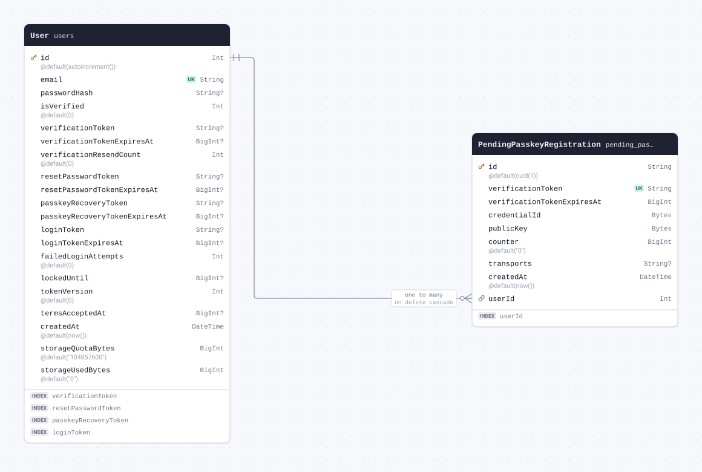

| Field                                                          | Type       | Constraints                       | Default   | Description |
| -------------------------------------------------------------- | ---------- | --------------------------------- | --------- | ----------- |
| `id`                                                           | `String`   | PK NOT NULL                       | `cuid(1)` |             |
| `verificationToken` (`verification_token`)                     | `String`   | UNIQUE NOT NULL                   |           |             |
| `verificationTokenExpiresAt` (`verification_token_expires_at`) | `BigInt`   | NOT NULL                          |           |             |
| `credentialId` (`credential_id`)                               | `Bytes`    | NOT NULL                          |           |             |
| `publicKey` (`public_key`)                                     | `Bytes`    | NOT NULL                          |           |             |
| `counter`                                                      | `BigInt`   | NOT NULL                          | `"0"`     |             |
| `transports`                                                   | `String`   | NULL                              |           |             |
| `createdAt` (`created_at`)                                     | `DateTime` | NOT NULL                          | `now()`   |             |
| `userId` (`user_id`)                                           | `Int`      | NOT NULL → [User.id](#model-User) |           |             |

#### Indexes

- `@@index([userId])`

#### References

- `userId` → [User.id](#model-User) (many-to-one, on delete Cascade)

#### Definition

```sql
CREATE TABLE "pending_passkey_registrations" (
    "id" TEXT NOT NULL,
    "verification_token" TEXT NOT NULL,
    "verification_token_expires_at" BIGINT NOT NULL,
    "credential_id" BYTEA NOT NULL,
    "public_key" BYTEA NOT NULL,
    "counter" BIGINT NOT NULL DEFAULT 0,
    "transports" TEXT,
    "created_at" TIMESTAMP(3) NOT NULL DEFAULT CURRENT_TIMESTAMP,
    "user_id" INTEGER NOT NULL,

    CONSTRAINT "pending_passkey_registrations_pkey" PRIMARY KEY ("id")
);

CREATE UNIQUE INDEX "pending_passkey_registrations_verification_token_key" ON "pending_passkey_registrations"("verification_token");

CREATE INDEX "pending_passkey_registrations_user_id_idx" ON "pending_passkey_registrations"("user_id");

ALTER TABLE "pending_passkey_registrations" ADD CONSTRAINT "pending_passkey_registrations_user_id_fkey" FOREIGN KEY ("user_id") REFERENCES "users"("id") ON DELETE CASCADE ON UPDATE CASCADE;
```

<details>
<summary>Queries and their SQL</summary>

**findMany**: Every row

```ts
await prisma.pendingPasskeyRegistration.findMany();
```

```sql
SELECT
  "public"."pending_passkey_registrations"."id",
  "public"."pending_passkey_registrations"."verification_token",
  "public"."pending_passkey_registrations"."verification_token_expires_at",
  "public"."pending_passkey_registrations"."credential_id",
  "public"."pending_passkey_registrations"."public_key",
  "public"."pending_passkey_registrations"."counter",
  "public"."pending_passkey_registrations"."transports",
  "public"."pending_passkey_registrations"."created_at",
  "public"."pending_passkey_registrations"."user_id"
FROM
  "public"."pending_passkey_registrations"
WHERE
  1 = 1
OFFSET
  $1
-- params: ["0"]
```

**count**: How many rows there are

```ts
await prisma.pendingPasskeyRegistration.count();
```

```sql
SELECT
  COUNT(*) AS "_count$_all"
FROM
  (
    SELECT
      "public"."pending_passkey_registrations"."id"
    FROM
      "public"."pending_passkey_registrations"
    WHERE
      1 = 1
    OFFSET
      $1
  ) AS "sub"
-- params: ["0"]
```

**findMany**: Every row with its relations

```ts
await prisma.pendingPasskeyRegistration.findMany({ include: { user: true } });
```

```sql
SELECT
  "public"."pending_passkey_registrations"."id",
  "public"."pending_passkey_registrations"."verification_token",
  "public"."pending_passkey_registrations"."verification_token_expires_at",
  "public"."pending_passkey_registrations"."credential_id",
  "public"."pending_passkey_registrations"."public_key",
  "public"."pending_passkey_registrations"."counter",
  "public"."pending_passkey_registrations"."transports",
  "public"."pending_passkey_registrations"."created_at",
  "public"."pending_passkey_registrations"."user_id"
FROM
  "public"."pending_passkey_registrations"
WHERE
  1 = 1
OFFSET
  $1
-- params: ["0"]

SELECT
  "public"."users"."id",
  "public"."users"."email",
  "public"."users"."password_hash",
  "public"."users"."is_verified",
  "public"."users"."verification_token",
  "public"."users"."verification_token_expires_at",
  "public"."users"."verification_resend_count",
  "public"."users"."reset_password_token",
  "public"."users"."reset_password_token_expires_at",
  "public"."users"."passkey_recovery_token",
  "public"."users"."passkey_recovery_token_expires_at",
  "public"."users"."login_token",
  "public"."users"."login_token_expires_at",
  "public"."users"."failed_login_attempts",
  "public"."users"."locked_until",
  "public"."users"."token_version",
  "public"."users"."terms_accepted_at",
  "public"."users"."created_at",
  "public"."users"."storage_quota_bytes",
  "public"."users"."storage_used_bytes"
FROM
  "public"."users"
WHERE
  "public"."users"."id" IN ($1)
OFFSET
  $2
-- params: ["<userId of the rows above>","0"]
```

**findUnique**: One row by what is unique to it

```ts
await prisma.pendingPasskeyRegistration.findUnique({ where: { id: "example" } });
```

```sql
SELECT
  "public"."pending_passkey_registrations"."id",
  "public"."pending_passkey_registrations"."verification_token",
  "public"."pending_passkey_registrations"."verification_token_expires_at",
  "public"."pending_passkey_registrations"."credential_id",
  "public"."pending_passkey_registrations"."public_key",
  "public"."pending_passkey_registrations"."counter",
  "public"."pending_passkey_registrations"."transports",
  "public"."pending_passkey_registrations"."created_at",
  "public"."pending_passkey_registrations"."user_id"
FROM
  "public"."pending_passkey_registrations"
WHERE
  (
    "public"."pending_passkey_registrations"."id" = $1
    AND 1 = 1
  )
LIMIT
  $2
OFFSET
  $3
-- params: ["example","1","0"]
```

**create**: Create a row

```ts
await prisma.pendingPasskeyRegistration.create({
  data: {
    verificationToken: "example",
    verificationTokenExpiresAt: 1n,
    credentialId: Uint8Array.from([1, 2, 3]),
    publicKey: Uint8Array.from([1, 2, 3]),
    userId: 1,
  },
});
```

```sql
INSERT INTO
  "public"."pending_passkey_registrations" (
    "id",
    "verification_token",
    "verification_token_expires_at",
    "credential_id",
    "public_key",
    "counter",
    "created_at",
    "user_id"
  )
VALUES
  ($1, $2, $3, $4, $5, $6, $7, $8)
RETURNING
  "public"."pending_passkey_registrations"."id",
  "public"."pending_passkey_registrations"."verification_token",
  "public"."pending_passkey_registrations"."verification_token_expires_at",
  "public"."pending_passkey_registrations"."credential_id",
  "public"."pending_passkey_registrations"."public_key",
  "public"."pending_passkey_registrations"."counter",
  "public"."pending_passkey_registrations"."transports",
  "public"."pending_passkey_registrations"."created_at",
  "public"."pending_passkey_registrations"."user_id"
-- params: ["<cuid(1)>","example","1","AQID","AQID","0","<now()>","1"]
```

**update**: Update a row

```ts
await prisma.pendingPasskeyRegistration.update({
  where: { id: "example" },
  data: { verificationToken: "example" },
});
```

```sql
UPDATE "public"."pending_passkey_registrations"
SET
  "verification_token" = $1
WHERE
  (
    "public"."pending_passkey_registrations"."id" = $2
    AND 1 = 1
  )
RETURNING
  "public"."pending_passkey_registrations"."id",
  "public"."pending_passkey_registrations"."verification_token",
  "public"."pending_passkey_registrations"."verification_token_expires_at",
  "public"."pending_passkey_registrations"."credential_id",
  "public"."pending_passkey_registrations"."public_key",
  "public"."pending_passkey_registrations"."counter",
  "public"."pending_passkey_registrations"."transports",
  "public"."pending_passkey_registrations"."created_at",
  "public"."pending_passkey_registrations"."user_id"
-- params: ["example","example"]
```

**delete**: Delete a row

```ts
await prisma.pendingPasskeyRegistration.delete({ where: { id: "example" } });
```

```sql
DELETE FROM "public"."pending_passkey_registrations"
WHERE
  (
    "public"."pending_passkey_registrations"."id" = $1
    AND 1 = 1
  )
RETURNING
  "public"."pending_passkey_registrations"."id",
  "public"."pending_passkey_registrations"."verification_token",
  "public"."pending_passkey_registrations"."verification_token_expires_at",
  "public"."pending_passkey_registrations"."credential_id",
  "public"."pending_passkey_registrations"."public_key",
  "public"."pending_passkey_registrations"."counter",
  "public"."pending_passkey_registrations"."transports",
  "public"."pending_passkey_registrations"."created_at",
  "public"."pending_passkey_registrations"."user_id"
-- params: ["example"]
```

</details>

<a id="model-Operation"></a>

### Operation

Table `operations`.

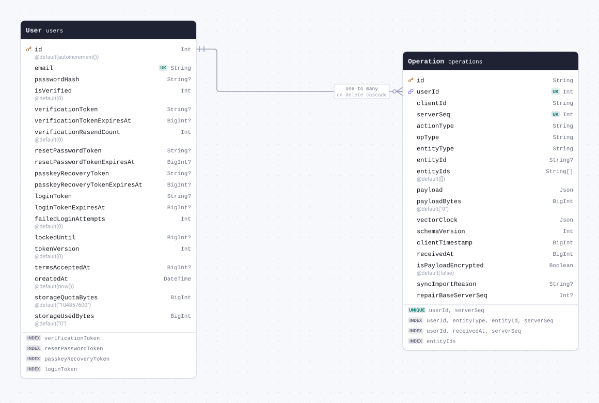

| Field                                            | Type       | Constraints                       | Default | Description |
| ------------------------------------------------ | ---------- | --------------------------------- | ------- | ----------- |
| `id`                                             | `String`   | PK NOT NULL                       |         |             |
| `userId` (`user_id`)                             | `Int`      | NOT NULL → [User.id](#model-User) |         |             |
| `clientId` (`client_id`)                         | `String`   | NOT NULL                          |         |             |
| `serverSeq` (`server_seq`)                       | `Int`      | NOT NULL                          |         |             |
| `actionType` (`action_type`)                     | `String`   | NOT NULL                          |         |             |
| `opType` (`op_type`)                             | `String`   | NOT NULL                          |         |             |
| `entityType` (`entity_type`)                     | `String`   | NOT NULL                          |         |             |
| `entityId` (`entity_id`)                         | `String`   | NULL                              |         |             |
| `entityIds` (`entity_ids`)                       | `String[]` | NOT NULL                          | `[]`    |             |
| `payload`                                        | `Json`     | NOT NULL                          |         |             |
| `payloadBytes` (`payload_bytes`)                 | `BigInt`   | NOT NULL                          | `"0"`   |             |
| `vectorClock` (`vector_clock`)                   | `Json`     | NOT NULL                          |         |             |
| `schemaVersion` (`schema_version`)               | `Int`      | NOT NULL                          |         |             |
| `clientTimestamp` (`client_timestamp`)           | `BigInt`   | NOT NULL                          |         |             |
| `receivedAt` (`received_at`)                     | `BigInt`   | NOT NULL                          |         |             |
| `isPayloadEncrypted` (`is_payload_encrypted`)    | `Boolean`  | NOT NULL                          | `false` |             |
| `syncImportReason` (`sync_import_reason`)        | `String`   | NULL                              |         |             |
| `repairBaseServerSeq` (`repair_base_server_seq`) | `Int`      | NULL                              |         |             |

#### Indexes

- `@@index([userId, entityType, entityId, serverSeq])`
- `@@index([userId, receivedAt, serverSeq])`
- `@@index([entityIds], map: "operations_entity_ids_gin")`
- `@@unique([userId, serverSeq])`

#### References

- `userId` → [User.id](#model-User) (many-to-one, on delete Cascade)

#### Definition

```sql
CREATE TABLE "operations" (
    "id" TEXT NOT NULL,
    "user_id" INTEGER NOT NULL,
    "client_id" TEXT NOT NULL,
    "server_seq" INTEGER NOT NULL,
    "action_type" TEXT NOT NULL,
    "op_type" TEXT NOT NULL,
    "entity_type" TEXT NOT NULL,
    "entity_id" TEXT,
    "entity_ids" TEXT[] DEFAULT ARRAY[]::TEXT[],
    "payload" JSONB NOT NULL,
    "payload_bytes" BIGINT NOT NULL DEFAULT 0,
    "vector_clock" JSONB NOT NULL,
    "schema_version" INTEGER NOT NULL,
    "client_timestamp" BIGINT NOT NULL,
    "received_at" BIGINT NOT NULL,
    "is_payload_encrypted" BOOLEAN NOT NULL DEFAULT false,
    "sync_import_reason" TEXT,
    "repair_base_server_seq" INTEGER,

    CONSTRAINT "operations_pkey" PRIMARY KEY ("id")
);

CREATE INDEX "operations_user_id_entity_type_entity_id_server_seq_idx" ON "operations"("user_id", "entity_type", "entity_id", "server_seq");

CREATE INDEX "operations_user_id_received_at_server_seq_idx" ON "operations"("user_id", "received_at", "server_seq");

CREATE INDEX "operations_entity_ids_gin" ON "operations" USING GIN ("entity_ids");

CREATE UNIQUE INDEX "operations_user_id_server_seq_key" ON "operations"("user_id", "server_seq");

ALTER TABLE "operations" ADD CONSTRAINT "operations_user_id_fkey" FOREIGN KEY ("user_id") REFERENCES "users"("id") ON DELETE CASCADE ON UPDATE CASCADE;
```

<details>
<summary>Queries and their SQL</summary>

**findMany**: Every row

```ts
await prisma.operation.findMany();
```

```sql
SELECT
  "public"."operations"."id",
  "public"."operations"."user_id",
  "public"."operations"."client_id",
  "public"."operations"."server_seq",
  "public"."operations"."action_type",
  "public"."operations"."op_type",
  "public"."operations"."entity_type",
  "public"."operations"."entity_id",
  "public"."operations"."entity_ids",
  "public"."operations"."payload",
  "public"."operations"."payload_bytes",
  "public"."operations"."vector_clock",
  "public"."operations"."schema_version",
  "public"."operations"."client_timestamp",
  "public"."operations"."received_at",
  "public"."operations"."is_payload_encrypted",
  "public"."operations"."sync_import_reason",
  "public"."operations"."repair_base_server_seq"
FROM
  "public"."operations"
WHERE
  1 = 1
OFFSET
  $1
-- params: ["0"]
```

**count**: How many rows there are

```ts
await prisma.operation.count();
```

```sql
SELECT
  COUNT(*) AS "_count$_all"
FROM
  (
    SELECT
      "public"."operations"."id"
    FROM
      "public"."operations"
    WHERE
      1 = 1
    OFFSET
      $1
  ) AS "sub"
-- params: ["0"]
```

**findMany**: Every row with its relations

```ts
await prisma.operation.findMany({ include: { user: true } });
```

```sql
SELECT
  "public"."operations"."id",
  "public"."operations"."user_id",
  "public"."operations"."client_id",
  "public"."operations"."server_seq",
  "public"."operations"."action_type",
  "public"."operations"."op_type",
  "public"."operations"."entity_type",
  "public"."operations"."entity_id",
  "public"."operations"."entity_ids",
  "public"."operations"."payload",
  "public"."operations"."payload_bytes",
  "public"."operations"."vector_clock",
  "public"."operations"."schema_version",
  "public"."operations"."client_timestamp",
  "public"."operations"."received_at",
  "public"."operations"."is_payload_encrypted",
  "public"."operations"."sync_import_reason",
  "public"."operations"."repair_base_server_seq"
FROM
  "public"."operations"
WHERE
  1 = 1
OFFSET
  $1
-- params: ["0"]

SELECT
  "public"."users"."id",
  "public"."users"."email",
  "public"."users"."password_hash",
  "public"."users"."is_verified",
  "public"."users"."verification_token",
  "public"."users"."verification_token_expires_at",
  "public"."users"."verification_resend_count",
  "public"."users"."reset_password_token",
  "public"."users"."reset_password_token_expires_at",
  "public"."users"."passkey_recovery_token",
  "public"."users"."passkey_recovery_token_expires_at",
  "public"."users"."login_token",
  "public"."users"."login_token_expires_at",
  "public"."users"."failed_login_attempts",
  "public"."users"."locked_until",
  "public"."users"."token_version",
  "public"."users"."terms_accepted_at",
  "public"."users"."created_at",
  "public"."users"."storage_quota_bytes",
  "public"."users"."storage_used_bytes"
FROM
  "public"."users"
WHERE
  "public"."users"."id" IN ($1)
OFFSET
  $2
-- params: ["<userId of the rows above>","0"]
```

**findUnique**: One row by what is unique to it

```ts
await prisma.operation.findUnique({ where: { id: "example" } });
```

```sql
SELECT
  "public"."operations"."id",
  "public"."operations"."user_id",
  "public"."operations"."client_id",
  "public"."operations"."server_seq",
  "public"."operations"."action_type",
  "public"."operations"."op_type",
  "public"."operations"."entity_type",
  "public"."operations"."entity_id",
  "public"."operations"."entity_ids",
  "public"."operations"."payload",
  "public"."operations"."payload_bytes",
  "public"."operations"."vector_clock",
  "public"."operations"."schema_version",
  "public"."operations"."client_timestamp",
  "public"."operations"."received_at",
  "public"."operations"."is_payload_encrypted",
  "public"."operations"."sync_import_reason",
  "public"."operations"."repair_base_server_seq"
FROM
  "public"."operations"
WHERE
  (
    "public"."operations"."id" = $1
    AND 1 = 1
  )
LIMIT
  $2
OFFSET
  $3
-- params: ["example","1","0"]
```

**create**: Create a row

```ts
await prisma.operation.create({
  data: {
    id: "example",
    userId: 1,
    clientId: "example",
    serverSeq: 1,
    actionType: "example",
    opType: "example",
    entityType: "example",
    payload: {},
    vectorClock: {},
    schemaVersion: 1,
    clientTimestamp: 1n,
    receivedAt: 1n,
  },
});
```

```sql
INSERT INTO
  "public"."operations" (
    "id",
    "user_id",
    "client_id",
    "server_seq",
    "action_type",
    "op_type",
    "entity_type",
    "entity_ids",
    "payload",
    "payload_bytes",
    "vector_clock",
    "schema_version",
    "client_timestamp",
    "received_at",
    "is_payload_encrypted"
  )
VALUES
  (
    $1,
    $2,
    $3,
    $4,
    $5,
    $6,
    $7,
    $8,
    $9,
    $10,
    $11,
    $12,
    $13,
    $14,
    $15
  )
RETURNING
  "public"."operations"."id",
  "public"."operations"."user_id",
  "public"."operations"."client_id",
  "public"."operations"."server_seq",
  "public"."operations"."action_type",
  "public"."operations"."op_type",
  "public"."operations"."entity_type",
  "public"."operations"."entity_id",
  "public"."operations"."entity_ids",
  "public"."operations"."payload",
  "public"."operations"."payload_bytes",
  "public"."operations"."vector_clock",
  "public"."operations"."schema_version",
  "public"."operations"."client_timestamp",
  "public"."operations"."received_at",
  "public"."operations"."is_payload_encrypted",
  "public"."operations"."sync_import_reason",
  "public"."operations"."repair_base_server_seq"
-- params: ["example","1","example","1","example","example","example",[],"{}","0","{}","1","1","1",false]
```

**update**: Update a row

```ts
await prisma.operation.update({ where: { id: "example" }, data: { clientId: "example" } });
```

```sql
UPDATE "public"."operations"
SET
  "client_id" = $1
WHERE
  (
    "public"."operations"."id" = $2
    AND 1 = 1
  )
RETURNING
  "public"."operations"."id",
  "public"."operations"."user_id",
  "public"."operations"."client_id",
  "public"."operations"."server_seq",
  "public"."operations"."action_type",
  "public"."operations"."op_type",
  "public"."operations"."entity_type",
  "public"."operations"."entity_id",
  "public"."operations"."entity_ids",
  "public"."operations"."payload",
  "public"."operations"."payload_bytes",
  "public"."operations"."vector_clock",
  "public"."operations"."schema_version",
  "public"."operations"."client_timestamp",
  "public"."operations"."received_at",
  "public"."operations"."is_payload_encrypted",
  "public"."operations"."sync_import_reason",
  "public"."operations"."repair_base_server_seq"
-- params: ["example","example"]
```

**delete**: Delete a row

```ts
await prisma.operation.delete({ where: { id: "example" } });
```

```sql
DELETE FROM "public"."operations"
WHERE
  (
    "public"."operations"."id" = $1
    AND 1 = 1
  )
RETURNING
  "public"."operations"."id",
  "public"."operations"."user_id",
  "public"."operations"."client_id",
  "public"."operations"."server_seq",
  "public"."operations"."action_type",
  "public"."operations"."op_type",
  "public"."operations"."entity_type",
  "public"."operations"."entity_id",
  "public"."operations"."entity_ids",
  "public"."operations"."payload",
  "public"."operations"."payload_bytes",
  "public"."operations"."vector_clock",
  "public"."operations"."schema_version",
  "public"."operations"."client_timestamp",
  "public"."operations"."received_at",
  "public"."operations"."is_payload_encrypted",
  "public"."operations"."sync_import_reason",
  "public"."operations"."repair_base_server_seq"
-- params: ["example"]
```

</details>

<a id="model-UserSyncState"></a>

### UserSyncState

Table `user_sync_state`.


| Field                                                           | Type     | Constraints                          | Default | Description |
| --------------------------------------------------------------- | -------- | ------------------------------------ | ------- | ----------- |
| `userId` (`user_id`)                                            | `Int`    | PK NOT NULL → [User.id](#model-User) |         |             |
| `lastSeq` (`last_seq`)                                          | `Int`    | NOT NULL                             | `0`     |             |
| `lastSnapshotSeq` (`last_snapshot_seq`)                         | `Int`    | NULL                                 |         |             |
| `snapshotData` (`snapshot_data`)                                | `Bytes`  | NULL                                 |         |             |
| `snapshotAt` (`snapshot_at`)                                    | `BigInt` | NULL                                 |         |             |
| `snapshotSchemaVersion` (`snapshot_schema_version`)             | `Int`    | NULL                                 | `1`     |             |
| `latestFullStateSeq` (`latest_full_state_seq`)                  | `Int`    | NULL                                 |         |             |
| `latestFullStateVectorClock` (`latest_full_state_vector_clock`) | `Json`   | NULL                                 |         |             |
| `latestStateReplacementSeq` (`latest_state_replacement_seq`)    | `Int`    | NULL                                 |         |             |

#### References

- `userId` → [User.id](#model-User) (one-to-one, on delete Cascade)

#### Definition

```sql
CREATE TABLE "user_sync_state" (
    "user_id" INTEGER NOT NULL,
    "last_seq" INTEGER NOT NULL DEFAULT 0,
    "last_snapshot_seq" INTEGER,
    "snapshot_data" BYTEA,
    "snapshot_at" BIGINT,
    "snapshot_schema_version" INTEGER DEFAULT 1,
    "latest_full_state_seq" INTEGER,
    "latest_full_state_vector_clock" JSONB,
    "latest_state_replacement_seq" INTEGER,

    CONSTRAINT "user_sync_state_pkey" PRIMARY KEY ("user_id")
);

ALTER TABLE "user_sync_state" ADD CONSTRAINT "user_sync_state_user_id_fkey" FOREIGN KEY ("user_id") REFERENCES "users"("id") ON DELETE CASCADE ON UPDATE CASCADE;
```

<details>
<summary>Queries and their SQL</summary>

**findMany**: Every row

```ts
await prisma.userSyncState.findMany();
```

```sql
SELECT
  "public"."user_sync_state"."user_id",
  "public"."user_sync_state"."last_seq",
  "public"."user_sync_state"."last_snapshot_seq",
  "public"."user_sync_state"."snapshot_data",
  "public"."user_sync_state"."snapshot_at",
  "public"."user_sync_state"."snapshot_schema_version",
  "public"."user_sync_state"."latest_full_state_seq",
  "public"."user_sync_state"."latest_full_state_vector_clock",
  "public"."user_sync_state"."latest_state_replacement_seq"
FROM
  "public"."user_sync_state"
WHERE
  1 = 1
OFFSET
  $1
-- params: ["0"]
```

**count**: How many rows there are

```ts
await prisma.userSyncState.count();
```

```sql
SELECT
  COUNT(*) AS "_count$_all"
FROM
  (
    SELECT
      "public"."user_sync_state"."user_id"
    FROM
      "public"."user_sync_state"
    WHERE
      1 = 1
    OFFSET
      $1
  ) AS "sub"
-- params: ["0"]
```

**findMany**: Every row with its relations

```ts
await prisma.userSyncState.findMany({ include: { user: true } });
```

```sql
SELECT
  "public"."user_sync_state"."user_id",
  "public"."user_sync_state"."last_seq",
  "public"."user_sync_state"."last_snapshot_seq",
  "public"."user_sync_state"."snapshot_data",
  "public"."user_sync_state"."snapshot_at",
  "public"."user_sync_state"."snapshot_schema_version",
  "public"."user_sync_state"."latest_full_state_seq",
  "public"."user_sync_state"."latest_full_state_vector_clock",
  "public"."user_sync_state"."latest_state_replacement_seq"
FROM
  "public"."user_sync_state"
WHERE
  1 = 1
OFFSET
  $1
-- params: ["0"]

SELECT
  "public"."users"."id",
  "public"."users"."email",
  "public"."users"."password_hash",
  "public"."users"."is_verified",
  "public"."users"."verification_token",
  "public"."users"."verification_token_expires_at",
  "public"."users"."verification_resend_count",
  "public"."users"."reset_password_token",
  "public"."users"."reset_password_token_expires_at",
  "public"."users"."passkey_recovery_token",
  "public"."users"."passkey_recovery_token_expires_at",
  "public"."users"."login_token",
  "public"."users"."login_token_expires_at",
  "public"."users"."failed_login_attempts",
  "public"."users"."locked_until",
  "public"."users"."token_version",
  "public"."users"."terms_accepted_at",
  "public"."users"."created_at",
  "public"."users"."storage_quota_bytes",
  "public"."users"."storage_used_bytes"
FROM
  "public"."users"
WHERE
  "public"."users"."id" IN ($1)
OFFSET
  $2
-- params: ["<userId of the rows above>","0"]
```

**findUnique**: One row by what is unique to it

```ts
await prisma.userSyncState.findUnique({ where: { userId: 1 } });
```

```sql
SELECT
  "public"."user_sync_state"."user_id",
  "public"."user_sync_state"."last_seq",
  "public"."user_sync_state"."last_snapshot_seq",
  "public"."user_sync_state"."snapshot_data",
  "public"."user_sync_state"."snapshot_at",
  "public"."user_sync_state"."snapshot_schema_version",
  "public"."user_sync_state"."latest_full_state_seq",
  "public"."user_sync_state"."latest_full_state_vector_clock",
  "public"."user_sync_state"."latest_state_replacement_seq"
FROM
  "public"."user_sync_state"
WHERE
  (
    "public"."user_sync_state"."user_id" = $1
    AND 1 = 1
  )
LIMIT
  $2
OFFSET
  $3
-- params: ["1","1","0"]
```

**create**: Create a row

```ts
await prisma.userSyncState.create({ data: { userId: 1 } });
```

```sql
INSERT INTO
  "public"."user_sync_state" ("user_id", "last_seq", "snapshot_schema_version")
VALUES
  ($1, $2, $3)
RETURNING
  "public"."user_sync_state"."user_id",
  "public"."user_sync_state"."last_seq",
  "public"."user_sync_state"."last_snapshot_seq",
  "public"."user_sync_state"."snapshot_data",
  "public"."user_sync_state"."snapshot_at",
  "public"."user_sync_state"."snapshot_schema_version",
  "public"."user_sync_state"."latest_full_state_seq",
  "public"."user_sync_state"."latest_full_state_vector_clock",
  "public"."user_sync_state"."latest_state_replacement_seq"
-- params: ["1","0","1"]
```

**update**: Update a row

```ts
await prisma.userSyncState.update({ where: { userId: 1 }, data: { lastSeq: 1 } });
```

```sql
UPDATE "public"."user_sync_state"
SET
  "last_seq" = $1
WHERE
  (
    "public"."user_sync_state"."user_id" = $2
    AND 1 = 1
  )
RETURNING
  "public"."user_sync_state"."user_id",
  "public"."user_sync_state"."last_seq",
  "public"."user_sync_state"."last_snapshot_seq",
  "public"."user_sync_state"."snapshot_data",
  "public"."user_sync_state"."snapshot_at",
  "public"."user_sync_state"."snapshot_schema_version",
  "public"."user_sync_state"."latest_full_state_seq",
  "public"."user_sync_state"."latest_full_state_vector_clock",
  "public"."user_sync_state"."latest_state_replacement_seq"
-- params: ["1","1"]
```

**delete**: Delete a row

```ts
await prisma.userSyncState.delete({ where: { userId: 1 } });
```

```sql
DELETE FROM "public"."user_sync_state"
WHERE
  (
    "public"."user_sync_state"."user_id" = $1
    AND 1 = 1
  )
RETURNING
  "public"."user_sync_state"."user_id",
  "public"."user_sync_state"."last_seq",
  "public"."user_sync_state"."last_snapshot_seq",
  "public"."user_sync_state"."snapshot_data",
  "public"."user_sync_state"."snapshot_at",
  "public"."user_sync_state"."snapshot_schema_version",
  "public"."user_sync_state"."latest_full_state_seq",
  "public"."user_sync_state"."latest_full_state_vector_clock",
  "public"."user_sync_state"."latest_state_replacement_seq"
-- params: ["1"]
```

</details>

<a id="model-SyncDevice"></a>

### SyncDevice

Table `sync_devices`.

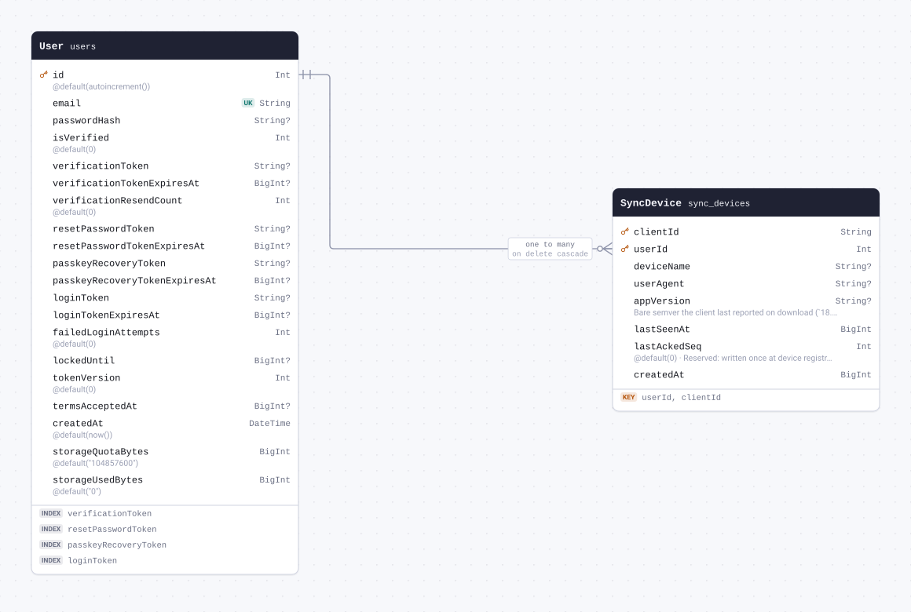

| Field                             | Type     | Constraints                          | Default | Description                                                                                                                                  |
| --------------------------------- | -------- | ------------------------------------ | ------- | -------------------------------------------------------------------------------------------------------------------------------------------- |
| `clientId` (`client_id`)          | `String` | PK NOT NULL                          |         |                                                                                                                                              |
| `userId` (`user_id`)              | `Int`    | PK NOT NULL → [User.id](#model-User) |         |                                                                                                                                              |
| `deviceName` (`device_name`)      | `String` | NULL                                 |         |                                                                                                                                              |
| `userAgent` (`user_agent`)        | `String` | NULL                                 |         |                                                                                                                                              |
| `appVersion` (`app_version`)      | `String` | NULL                                 |         | Bare semver the client last reported on download (`18.22.0`), NULL until it does. Read by the checkpoint gate (#9962); never shown to users. |
| `lastSeenAt` (`last_seen_at`)     | `BigInt` | NOT NULL                             |         |                                                                                                                                              |
| `lastAckedSeq` (`last_acked_seq`) | `Int`    | NOT NULL                             | `0`     | Reserved: written once at device registration, never read or updated.                                                                        |
| `createdAt` (`created_at`)        | `BigInt` | NOT NULL                             |         |                                                                                                                                              |

#### Indexes

- `@@id([userId, clientId])`

#### References

- `userId` → [User.id](#model-User) (many-to-one, on delete Cascade)

#### Definition

```sql
CREATE TABLE "sync_devices" (
    "client_id" TEXT NOT NULL,
    "user_id" INTEGER NOT NULL,
    "device_name" TEXT,
    "user_agent" TEXT,
    "app_version" TEXT,
    "last_seen_at" BIGINT NOT NULL,
    "last_acked_seq" INTEGER NOT NULL DEFAULT 0,
    "created_at" BIGINT NOT NULL,

    CONSTRAINT "sync_devices_pkey" PRIMARY KEY ("user_id","client_id")
);

ALTER TABLE "sync_devices" ADD CONSTRAINT "sync_devices_user_id_fkey" FOREIGN KEY ("user_id") REFERENCES "users"("id") ON DELETE CASCADE ON UPDATE CASCADE;
```

<details>
<summary>Queries and their SQL</summary>

**findMany**: Every row

```ts
await prisma.syncDevice.findMany();
```

```sql
SELECT
  "public"."sync_devices"."user_id",
  "public"."sync_devices"."client_id",
  "public"."sync_devices"."device_name",
  "public"."sync_devices"."user_agent",
  "public"."sync_devices"."app_version",
  "public"."sync_devices"."last_seen_at",
  "public"."sync_devices"."last_acked_seq",
  "public"."sync_devices"."created_at"
FROM
  "public"."sync_devices"
WHERE
  1 = 1
OFFSET
  $1
-- params: ["0"]
```

**count**: How many rows there are

```ts
await prisma.syncDevice.count();
```

```sql
SELECT
  COUNT(*) AS "_count$_all"
FROM
  (
    SELECT
      "public"."sync_devices"."user_id",
      "public"."sync_devices"."client_id"
    FROM
      "public"."sync_devices"
    WHERE
      1 = 1
    OFFSET
      $1
  ) AS "sub"
-- params: ["0"]
```

**findMany**: Every row with its relations

```ts
await prisma.syncDevice.findMany({ include: { user: true } });
```

```sql
SELECT
  "public"."sync_devices"."user_id",
  "public"."sync_devices"."client_id",
  "public"."sync_devices"."device_name",
  "public"."sync_devices"."user_agent",
  "public"."sync_devices"."app_version",
  "public"."sync_devices"."last_seen_at",
  "public"."sync_devices"."last_acked_seq",
  "public"."sync_devices"."created_at"
FROM
  "public"."sync_devices"
WHERE
  1 = 1
OFFSET
  $1
-- params: ["0"]

SELECT
  "public"."users"."id",
  "public"."users"."email",
  "public"."users"."password_hash",
  "public"."users"."is_verified",
  "public"."users"."verification_token",
  "public"."users"."verification_token_expires_at",
  "public"."users"."verification_resend_count",
  "public"."users"."reset_password_token",
  "public"."users"."reset_password_token_expires_at",
  "public"."users"."passkey_recovery_token",
  "public"."users"."passkey_recovery_token_expires_at",
  "public"."users"."login_token",
  "public"."users"."login_token_expires_at",
  "public"."users"."failed_login_attempts",
  "public"."users"."locked_until",
  "public"."users"."token_version",
  "public"."users"."terms_accepted_at",
  "public"."users"."created_at",
  "public"."users"."storage_quota_bytes",
  "public"."users"."storage_used_bytes"
FROM
  "public"."users"
WHERE
  "public"."users"."id" IN ($1)
OFFSET
  $2
-- params: ["<userId of the rows above>","0"]
```

**findUnique**: One row by what is unique to it

```ts
await prisma.syncDevice.findUnique({
  where: { userId_clientId: { userId: 1, clientId: "example" } },
});
```

```sql
SELECT
  "public"."sync_devices"."user_id",
  "public"."sync_devices"."client_id",
  "public"."sync_devices"."device_name",
  "public"."sync_devices"."user_agent",
  "public"."sync_devices"."app_version",
  "public"."sync_devices"."last_seen_at",
  "public"."sync_devices"."last_acked_seq",
  "public"."sync_devices"."created_at"
FROM
  "public"."sync_devices"
WHERE
  (
    (
      "public"."sync_devices"."user_id" = $1
      AND "public"."sync_devices"."client_id" = $2
    )
    AND 1 = 1
  )
LIMIT
  $3
OFFSET
  $4
-- params: ["1","example","1","0"]
```

**create**: Create a row

```ts
await prisma.syncDevice.create({
  data: { clientId: "example", userId: 1, lastSeenAt: 1n, createdAt: 1n },
});
```

```sql
INSERT INTO
  "public"."sync_devices" (
    "client_id",
    "user_id",
    "last_seen_at",
    "last_acked_seq",
    "created_at"
  )
VALUES
  ($1, $2, $3, $4, $5)
RETURNING
  "public"."sync_devices"."user_id",
  "public"."sync_devices"."client_id",
  "public"."sync_devices"."device_name",
  "public"."sync_devices"."user_agent",
  "public"."sync_devices"."app_version",
  "public"."sync_devices"."last_seen_at",
  "public"."sync_devices"."last_acked_seq",
  "public"."sync_devices"."created_at"
-- params: ["example","1","1","0","1"]
```

**update**: Update a row

```ts
await prisma.syncDevice.update({
  where: { userId_clientId: { userId: 1, clientId: "example" } },
  data: { deviceName: "example" },
});
```

```sql
UPDATE "public"."sync_devices"
SET
  "device_name" = $1
WHERE
  (
    (
      "public"."sync_devices"."user_id" = $2
      AND "public"."sync_devices"."client_id" = $3
    )
    AND 1 = 1
  )
RETURNING
  "public"."sync_devices"."user_id",
  "public"."sync_devices"."client_id",
  "public"."sync_devices"."device_name",
  "public"."sync_devices"."user_agent",
  "public"."sync_devices"."app_version",
  "public"."sync_devices"."last_seen_at",
  "public"."sync_devices"."last_acked_seq",
  "public"."sync_devices"."created_at"
-- params: ["example","1","example"]
```

**delete**: Delete a row

```ts
await prisma.syncDevice.delete({ where: { userId_clientId: { userId: 1, clientId: "example" } } });
```

```sql
DELETE FROM "public"."sync_devices"
WHERE
  (
    (
      "public"."sync_devices"."user_id" = $1
      AND "public"."sync_devices"."client_id" = $2
    )
    AND 1 = 1
  )
RETURNING
  "public"."sync_devices"."user_id",
  "public"."sync_devices"."client_id",
  "public"."sync_devices"."device_name",
  "public"."sync_devices"."user_agent",
  "public"."sync_devices"."app_version",
  "public"."sync_devices"."last_seen_at",
  "public"."sync_devices"."last_acked_seq",
  "public"."sync_devices"."created_at"
-- params: ["1","example"]
```

</details>

<a id="model-CaptureKey"></a>

### CaptureKey

Table `capture_keys`. Public half of the user's capture key. The row outlives switching the
feature off: `disabledAt` stops a stale device re-registering that key.

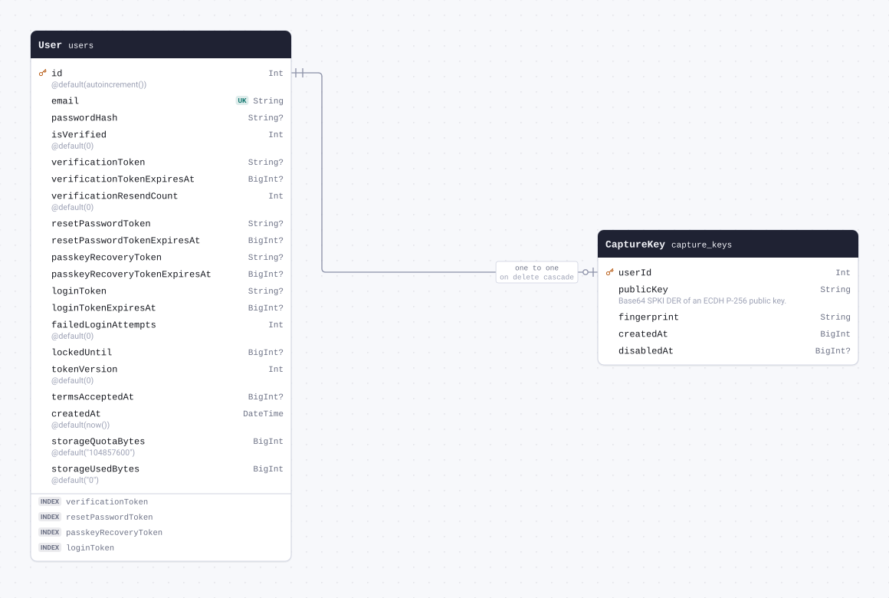

| Field                        | Type     | Constraints                          | Default | Description                                  |
| ---------------------------- | -------- | ------------------------------------ | ------- | -------------------------------------------- |
| `userId` (`user_id`)         | `Int`    | PK NOT NULL → [User.id](#model-User) |         |                                              |
| `publicKey` (`public_key`)   | `String` | NOT NULL                             |         | Base64 SPKI DER of an ECDH P-256 public key. |
| `fingerprint`                | `String` | NOT NULL                             |         |                                              |
| `createdAt` (`created_at`)   | `BigInt` | NOT NULL                             |         |                                              |
| `disabledAt` (`disabled_at`) | `BigInt` | NULL                                 |         |                                              |

#### References

- `userId` → [User.id](#model-User) (one-to-one, on delete Cascade)

#### Definition

```sql
CREATE TABLE "capture_keys" (
    "user_id" INTEGER NOT NULL,
    "public_key" TEXT NOT NULL,
    "fingerprint" TEXT NOT NULL,
    "created_at" BIGINT NOT NULL,
    "disabled_at" BIGINT,

    CONSTRAINT "capture_keys_pkey" PRIMARY KEY ("user_id")
);

ALTER TABLE "capture_keys" ADD CONSTRAINT "capture_keys_user_id_fkey" FOREIGN KEY ("user_id") REFERENCES "users"("id") ON DELETE CASCADE ON UPDATE CASCADE;
```

<details>
<summary>Queries and their SQL</summary>

**findMany**: Every row

```ts
await prisma.captureKey.findMany();
```

```sql
SELECT
  "public"."capture_keys"."user_id",
  "public"."capture_keys"."public_key",
  "public"."capture_keys"."fingerprint",
  "public"."capture_keys"."created_at",
  "public"."capture_keys"."disabled_at"
FROM
  "public"."capture_keys"
WHERE
  1 = 1
OFFSET
  $1
-- params: ["0"]
```

**count**: How many rows there are

```ts
await prisma.captureKey.count();
```

```sql
SELECT
  COUNT(*) AS "_count$_all"
FROM
  (
    SELECT
      "public"."capture_keys"."user_id"
    FROM
      "public"."capture_keys"
    WHERE
      1 = 1
    OFFSET
      $1
  ) AS "sub"
-- params: ["0"]
```

**findMany**: Every row with its relations

```ts
await prisma.captureKey.findMany({ include: { user: true } });
```

```sql
SELECT
  "public"."capture_keys"."user_id",
  "public"."capture_keys"."public_key",
  "public"."capture_keys"."fingerprint",
  "public"."capture_keys"."created_at",
  "public"."capture_keys"."disabled_at"
FROM
  "public"."capture_keys"
WHERE
  1 = 1
OFFSET
  $1
-- params: ["0"]

SELECT
  "public"."users"."id",
  "public"."users"."email",
  "public"."users"."password_hash",
  "public"."users"."is_verified",
  "public"."users"."verification_token",
  "public"."users"."verification_token_expires_at",
  "public"."users"."verification_resend_count",
  "public"."users"."reset_password_token",
  "public"."users"."reset_password_token_expires_at",
  "public"."users"."passkey_recovery_token",
  "public"."users"."passkey_recovery_token_expires_at",
  "public"."users"."login_token",
  "public"."users"."login_token_expires_at",
  "public"."users"."failed_login_attempts",
  "public"."users"."locked_until",
  "public"."users"."token_version",
  "public"."users"."terms_accepted_at",
  "public"."users"."created_at",
  "public"."users"."storage_quota_bytes",
  "public"."users"."storage_used_bytes"
FROM
  "public"."users"
WHERE
  "public"."users"."id" IN ($1)
OFFSET
  $2
-- params: ["<userId of the rows above>","0"]
```

**findUnique**: One row by what is unique to it

```ts
await prisma.captureKey.findUnique({ where: { userId: 1 } });
```

```sql
SELECT
  "public"."capture_keys"."user_id",
  "public"."capture_keys"."public_key",
  "public"."capture_keys"."fingerprint",
  "public"."capture_keys"."created_at",
  "public"."capture_keys"."disabled_at"
FROM
  "public"."capture_keys"
WHERE
  (
    "public"."capture_keys"."user_id" = $1
    AND 1 = 1
  )
LIMIT
  $2
OFFSET
  $3
-- params: ["1","1","0"]
```

**create**: Create a row

```ts
await prisma.captureKey.create({
  data: { userId: 1, publicKey: "example", fingerprint: "example", createdAt: 1n },
});
```

```sql
INSERT INTO
  "public"."capture_keys" (
    "user_id",
    "public_key",
    "fingerprint",
    "created_at"
  )
VALUES
  ($1, $2, $3, $4)
RETURNING
  "public"."capture_keys"."user_id",
  "public"."capture_keys"."public_key",
  "public"."capture_keys"."fingerprint",
  "public"."capture_keys"."created_at",
  "public"."capture_keys"."disabled_at"
-- params: ["1","example","example","1"]
```

**update**: Update a row

```ts
await prisma.captureKey.update({ where: { userId: 1 }, data: { publicKey: "example" } });
```

```sql
UPDATE "public"."capture_keys"
SET
  "public_key" = $1
WHERE
  (
    "public"."capture_keys"."user_id" = $2
    AND 1 = 1
  )
RETURNING
  "public"."capture_keys"."user_id",
  "public"."capture_keys"."public_key",
  "public"."capture_keys"."fingerprint",
  "public"."capture_keys"."created_at",
  "public"."capture_keys"."disabled_at"
-- params: ["example","1"]
```

**delete**: Delete a row

```ts
await prisma.captureKey.delete({ where: { userId: 1 } });
```

```sql
DELETE FROM "public"."capture_keys"
WHERE
  (
    "public"."capture_keys"."user_id" = $1
    AND 1 = 1
  )
RETURNING
  "public"."capture_keys"."user_id",
  "public"."capture_keys"."public_key",
  "public"."capture_keys"."fingerprint",
  "public"."capture_keys"."created_at",
  "public"."capture_keys"."disabled_at"
-- params: ["1"]
```

</details>

<a id="model-CaptureGrant"></a>

### CaptureGrant

Table `capture_grants`. Capture tokens and OAuth grants store only hashes of bearer credentials.

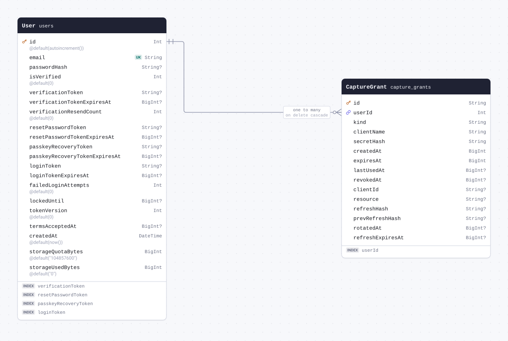

| Field                                     | Type     | Constraints                       | Default | Description |
| ----------------------------------------- | -------- | --------------------------------- | ------- | ----------- |
| `id`                                      | `String` | PK NOT NULL                       |         |             |
| `userId` (`user_id`)                      | `Int`    | NOT NULL → [User.id](#model-User) |         |             |
| `kind`                                    | `String` | NOT NULL                          |         |             |
| `clientName` (`client_name`)              | `String` | NOT NULL                          |         |             |
| `secretHash` (`secret_hash`)              | `String` | NOT NULL                          |         |             |
| `createdAt` (`created_at`)                | `BigInt` | NOT NULL                          |         |             |
| `expiresAt` (`expires_at`)                | `BigInt` | NOT NULL                          |         |             |
| `lastUsedAt` (`last_used_at`)             | `BigInt` | NULL                              |         |             |
| `revokedAt` (`revoked_at`)                | `BigInt` | NULL                              |         |             |
| `clientId` (`client_id`)                  | `String` | NULL                              |         |             |
| `resource`                                | `String` | NULL                              |         |             |
| `refreshHash` (`refresh_hash`)            | `String` | NULL                              |         |             |
| `prevRefreshHash` (`prev_refresh_hash`)   | `String` | NULL                              |         |             |
| `rotatedAt` (`rotated_at`)                | `BigInt` | NULL                              |         |             |
| `refreshExpiresAt` (`refresh_expires_at`) | `BigInt` | NULL                              |         |             |

#### Indexes

- `@@index([userId])`

#### References

- `userId` → [User.id](#model-User) (many-to-one, on delete Cascade)

#### Definition

```sql
CREATE TABLE "capture_grants" (
    "id" TEXT NOT NULL,
    "user_id" INTEGER NOT NULL,
    "kind" TEXT NOT NULL,
    "client_name" TEXT NOT NULL,
    "secret_hash" TEXT NOT NULL,
    "created_at" BIGINT NOT NULL,
    "expires_at" BIGINT NOT NULL,
    "last_used_at" BIGINT,
    "revoked_at" BIGINT,
    "client_id" TEXT,
    "resource" TEXT,
    "refresh_hash" TEXT,
    "prev_refresh_hash" TEXT,
    "rotated_at" BIGINT,
    "refresh_expires_at" BIGINT,

    CONSTRAINT "capture_grants_pkey" PRIMARY KEY ("id")
);

CREATE INDEX "capture_grants_user_id_idx" ON "capture_grants"("user_id");

ALTER TABLE "capture_grants" ADD CONSTRAINT "capture_grants_user_id_fkey" FOREIGN KEY ("user_id") REFERENCES "users"("id") ON DELETE CASCADE ON UPDATE CASCADE;
```

<details>
<summary>Queries and their SQL</summary>

**findMany**: Every row

```ts
await prisma.captureGrant.findMany();
```

```sql
SELECT
  "public"."capture_grants"."id",
  "public"."capture_grants"."user_id",
  "public"."capture_grants"."kind",
  "public"."capture_grants"."client_name",
  "public"."capture_grants"."secret_hash",
  "public"."capture_grants"."created_at",
  "public"."capture_grants"."expires_at",
  "public"."capture_grants"."last_used_at",
  "public"."capture_grants"."revoked_at",
  "public"."capture_grants"."client_id",
  "public"."capture_grants"."resource",
  "public"."capture_grants"."refresh_hash",
  "public"."capture_grants"."prev_refresh_hash",
  "public"."capture_grants"."rotated_at",
  "public"."capture_grants"."refresh_expires_at"
FROM
  "public"."capture_grants"
WHERE
  1 = 1
OFFSET
  $1
-- params: ["0"]
```

**count**: How many rows there are

```ts
await prisma.captureGrant.count();
```

```sql
SELECT
  COUNT(*) AS "_count$_all"
FROM
  (
    SELECT
      "public"."capture_grants"."id"
    FROM
      "public"."capture_grants"
    WHERE
      1 = 1
    OFFSET
      $1
  ) AS "sub"
-- params: ["0"]
```

**findMany**: Every row with its relations

```ts
await prisma.captureGrant.findMany({ include: { user: true } });
```

```sql
SELECT
  "public"."capture_grants"."id",
  "public"."capture_grants"."user_id",
  "public"."capture_grants"."kind",
  "public"."capture_grants"."client_name",
  "public"."capture_grants"."secret_hash",
  "public"."capture_grants"."created_at",
  "public"."capture_grants"."expires_at",
  "public"."capture_grants"."last_used_at",
  "public"."capture_grants"."revoked_at",
  "public"."capture_grants"."client_id",
  "public"."capture_grants"."resource",
  "public"."capture_grants"."refresh_hash",
  "public"."capture_grants"."prev_refresh_hash",
  "public"."capture_grants"."rotated_at",
  "public"."capture_grants"."refresh_expires_at"
FROM
  "public"."capture_grants"
WHERE
  1 = 1
OFFSET
  $1
-- params: ["0"]

SELECT
  "public"."users"."id",
  "public"."users"."email",
  "public"."users"."password_hash",
  "public"."users"."is_verified",
  "public"."users"."verification_token",
  "public"."users"."verification_token_expires_at",
  "public"."users"."verification_resend_count",
  "public"."users"."reset_password_token",
  "public"."users"."reset_password_token_expires_at",
  "public"."users"."passkey_recovery_token",
  "public"."users"."passkey_recovery_token_expires_at",
  "public"."users"."login_token",
  "public"."users"."login_token_expires_at",
  "public"."users"."failed_login_attempts",
  "public"."users"."locked_until",
  "public"."users"."token_version",
  "public"."users"."terms_accepted_at",
  "public"."users"."created_at",
  "public"."users"."storage_quota_bytes",
  "public"."users"."storage_used_bytes"
FROM
  "public"."users"
WHERE
  "public"."users"."id" IN ($1)
OFFSET
  $2
-- params: ["<userId of the rows above>","0"]
```

**findUnique**: One row by what is unique to it

```ts
await prisma.captureGrant.findUnique({ where: { id: "example" } });
```

```sql
SELECT
  "public"."capture_grants"."id",
  "public"."capture_grants"."user_id",
  "public"."capture_grants"."kind",
  "public"."capture_grants"."client_name",
  "public"."capture_grants"."secret_hash",
  "public"."capture_grants"."created_at",
  "public"."capture_grants"."expires_at",
  "public"."capture_grants"."last_used_at",
  "public"."capture_grants"."revoked_at",
  "public"."capture_grants"."client_id",
  "public"."capture_grants"."resource",
  "public"."capture_grants"."refresh_hash",
  "public"."capture_grants"."prev_refresh_hash",
  "public"."capture_grants"."rotated_at",
  "public"."capture_grants"."refresh_expires_at"
FROM
  "public"."capture_grants"
WHERE
  (
    "public"."capture_grants"."id" = $1
    AND 1 = 1
  )
LIMIT
  $2
OFFSET
  $3
-- params: ["example","1","0"]
```

**create**: Create a row

```ts
await prisma.captureGrant.create({
  data: {
    id: "example",
    userId: 1,
    kind: "example",
    clientName: "example",
    secretHash: "example",
    createdAt: 1n,
    expiresAt: 1n,
  },
});
```

```sql
INSERT INTO
  "public"."capture_grants" (
    "id",
    "user_id",
    "kind",
    "client_name",
    "secret_hash",
    "created_at",
    "expires_at"
  )
VALUES
  ($1, $2, $3, $4, $5, $6, $7)
RETURNING
  "public"."capture_grants"."id",
  "public"."capture_grants"."user_id",
  "public"."capture_grants"."kind",
  "public"."capture_grants"."client_name",
  "public"."capture_grants"."secret_hash",
  "public"."capture_grants"."created_at",
  "public"."capture_grants"."expires_at",
  "public"."capture_grants"."last_used_at",
  "public"."capture_grants"."revoked_at",
  "public"."capture_grants"."client_id",
  "public"."capture_grants"."resource",
  "public"."capture_grants"."refresh_hash",
  "public"."capture_grants"."prev_refresh_hash",
  "public"."capture_grants"."rotated_at",
  "public"."capture_grants"."refresh_expires_at"
-- params: ["example","1","example","example","example","1","1"]
```

**update**: Update a row

```ts
await prisma.captureGrant.update({ where: { id: "example" }, data: { kind: "example" } });
```

```sql
UPDATE "public"."capture_grants"
SET
  "kind" = $1
WHERE
  (
    "public"."capture_grants"."id" = $2
    AND 1 = 1
  )
RETURNING
  "public"."capture_grants"."id",
  "public"."capture_grants"."user_id",
  "public"."capture_grants"."kind",
  "public"."capture_grants"."client_name",
  "public"."capture_grants"."secret_hash",
  "public"."capture_grants"."created_at",
  "public"."capture_grants"."expires_at",
  "public"."capture_grants"."last_used_at",
  "public"."capture_grants"."revoked_at",
  "public"."capture_grants"."client_id",
  "public"."capture_grants"."resource",
  "public"."capture_grants"."refresh_hash",
  "public"."capture_grants"."prev_refresh_hash",
  "public"."capture_grants"."rotated_at",
  "public"."capture_grants"."refresh_expires_at"
-- params: ["example","example"]
```

**delete**: Delete a row

```ts
await prisma.captureGrant.delete({ where: { id: "example" } });
```

```sql
DELETE FROM "public"."capture_grants"
WHERE
  (
    "public"."capture_grants"."id" = $1
    AND 1 = 1
  )
RETURNING
  "public"."capture_grants"."id",
  "public"."capture_grants"."user_id",
  "public"."capture_grants"."kind",
  "public"."capture_grants"."client_name",
  "public"."capture_grants"."secret_hash",
  "public"."capture_grants"."created_at",
  "public"."capture_grants"."expires_at",
  "public"."capture_grants"."last_used_at",
  "public"."capture_grants"."revoked_at",
  "public"."capture_grants"."client_id",
  "public"."capture_grants"."resource",
  "public"."capture_grants"."refresh_hash",
  "public"."capture_grants"."prev_refresh_hash",
  "public"."capture_grants"."rotated_at",
  "public"."capture_grants"."refresh_expires_at"
-- params: ["example"]
```

</details>

<a id="model-CaptureItem"></a>

### CaptureItem

Table `capture_items`. One sealed capture waiting for a device. No relation to its grant: items
outlive a grant that is revoked without discarding them.

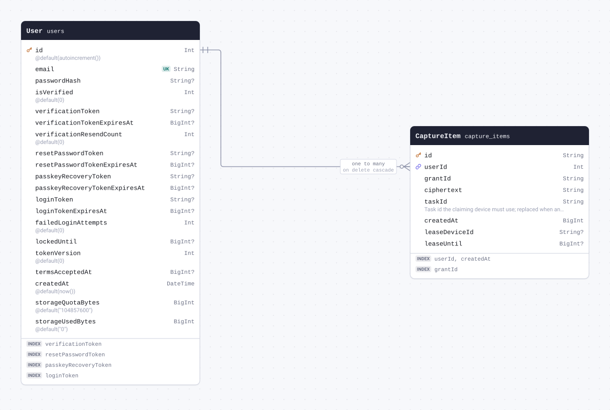

| Field                               | Type     | Constraints                       | Default | Description                                                                    |
| ----------------------------------- | -------- | --------------------------------- | ------- | ------------------------------------------------------------------------------ |
| `id`                                | `String` | PK NOT NULL                       |         |                                                                                |
| `userId` (`user_id`)                | `Int`    | NOT NULL → [User.id](#model-User) |         |                                                                                |
| `grantId` (`grant_id`)              | `String` | NOT NULL                          |         |                                                                                |
| `ciphertext`                        | `String` | NOT NULL                          |         |                                                                                |
| `taskId` (`task_id`)                | `String` | NOT NULL                          |         | Task id the claiming device must use; replaced when another device takes over. |
| `createdAt` (`created_at`)          | `BigInt` | NOT NULL                          |         |                                                                                |
| `leaseDeviceId` (`lease_device_id`) | `String` | NULL                              |         |                                                                                |
| `leaseUntil` (`lease_until`)        | `BigInt` | NULL                              |         |                                                                                |

#### Indexes

- `@@index([userId, createdAt])`
- `@@index([grantId])`

#### References

- `userId` → [User.id](#model-User) (many-to-one, on delete Cascade)

#### Definition

```sql
CREATE TABLE "capture_items" (
    "id" TEXT NOT NULL,
    "user_id" INTEGER NOT NULL,
    "grant_id" TEXT NOT NULL,
    "ciphertext" TEXT NOT NULL,
    "task_id" TEXT NOT NULL,
    "created_at" BIGINT NOT NULL,
    "lease_device_id" TEXT,
    "lease_until" BIGINT,

    CONSTRAINT "capture_items_pkey" PRIMARY KEY ("id")
);

CREATE INDEX "capture_items_user_id_created_at_idx" ON "capture_items"("user_id", "created_at");

CREATE INDEX "capture_items_grant_id_idx" ON "capture_items"("grant_id");

ALTER TABLE "capture_items" ADD CONSTRAINT "capture_items_user_id_fkey" FOREIGN KEY ("user_id") REFERENCES "users"("id") ON DELETE CASCADE ON UPDATE CASCADE;
```

<details>
<summary>Queries and their SQL</summary>

**findMany**: Every row

```ts
await prisma.captureItem.findMany();
```

```sql
SELECT
  "public"."capture_items"."id",
  "public"."capture_items"."user_id",
  "public"."capture_items"."grant_id",
  "public"."capture_items"."ciphertext",
  "public"."capture_items"."task_id",
  "public"."capture_items"."created_at",
  "public"."capture_items"."lease_device_id",
  "public"."capture_items"."lease_until"
FROM
  "public"."capture_items"
WHERE
  1 = 1
OFFSET
  $1
-- params: ["0"]
```

**count**: How many rows there are

```ts
await prisma.captureItem.count();
```

```sql
SELECT
  COUNT(*) AS "_count$_all"
FROM
  (
    SELECT
      "public"."capture_items"."id"
    FROM
      "public"."capture_items"
    WHERE
      1 = 1
    OFFSET
      $1
  ) AS "sub"
-- params: ["0"]
```

**findMany**: Every row with its relations

```ts
await prisma.captureItem.findMany({ include: { user: true } });
```

```sql
SELECT
  "public"."capture_items"."id",
  "public"."capture_items"."user_id",
  "public"."capture_items"."grant_id",
  "public"."capture_items"."ciphertext",
  "public"."capture_items"."task_id",
  "public"."capture_items"."created_at",
  "public"."capture_items"."lease_device_id",
  "public"."capture_items"."lease_until"
FROM
  "public"."capture_items"
WHERE
  1 = 1
OFFSET
  $1
-- params: ["0"]

SELECT
  "public"."users"."id",
  "public"."users"."email",
  "public"."users"."password_hash",
  "public"."users"."is_verified",
  "public"."users"."verification_token",
  "public"."users"."verification_token_expires_at",
  "public"."users"."verification_resend_count",
  "public"."users"."reset_password_token",
  "public"."users"."reset_password_token_expires_at",
  "public"."users"."passkey_recovery_token",
  "public"."users"."passkey_recovery_token_expires_at",
  "public"."users"."login_token",
  "public"."users"."login_token_expires_at",
  "public"."users"."failed_login_attempts",
  "public"."users"."locked_until",
  "public"."users"."token_version",
  "public"."users"."terms_accepted_at",
  "public"."users"."created_at",
  "public"."users"."storage_quota_bytes",
  "public"."users"."storage_used_bytes"
FROM
  "public"."users"
WHERE
  "public"."users"."id" IN ($1)
OFFSET
  $2
-- params: ["<userId of the rows above>","0"]
```

**findUnique**: One row by what is unique to it

```ts
await prisma.captureItem.findUnique({ where: { id: "example" } });
```

```sql
SELECT
  "public"."capture_items"."id",
  "public"."capture_items"."user_id",
  "public"."capture_items"."grant_id",
  "public"."capture_items"."ciphertext",
  "public"."capture_items"."task_id",
  "public"."capture_items"."created_at",
  "public"."capture_items"."lease_device_id",
  "public"."capture_items"."lease_until"
FROM
  "public"."capture_items"
WHERE
  (
    "public"."capture_items"."id" = $1
    AND 1 = 1
  )
LIMIT
  $2
OFFSET
  $3
-- params: ["example","1","0"]
```

**create**: Create a row

```ts
await prisma.captureItem.create({
  data: {
    id: "example",
    userId: 1,
    grantId: "example",
    ciphertext: "example",
    taskId: "example",
    createdAt: 1n,
  },
});
```

```sql
INSERT INTO
  "public"."capture_items" (
    "id",
    "user_id",
    "grant_id",
    "ciphertext",
    "task_id",
    "created_at"
  )
VALUES
  ($1, $2, $3, $4, $5, $6)
RETURNING
  "public"."capture_items"."id",
  "public"."capture_items"."user_id",
  "public"."capture_items"."grant_id",
  "public"."capture_items"."ciphertext",
  "public"."capture_items"."task_id",
  "public"."capture_items"."created_at",
  "public"."capture_items"."lease_device_id",
  "public"."capture_items"."lease_until"
-- params: ["example","1","example","example","example","1"]
```

**update**: Update a row

```ts
await prisma.captureItem.update({ where: { id: "example" }, data: { grantId: "example" } });
```

```sql
UPDATE "public"."capture_items"
SET
  "grant_id" = $1
WHERE
  (
    "public"."capture_items"."id" = $2
    AND 1 = 1
  )
RETURNING
  "public"."capture_items"."id",
  "public"."capture_items"."user_id",
  "public"."capture_items"."grant_id",
  "public"."capture_items"."ciphertext",
  "public"."capture_items"."task_id",
  "public"."capture_items"."created_at",
  "public"."capture_items"."lease_device_id",
  "public"."capture_items"."lease_until"
-- params: ["example","example"]
```

**delete**: Delete a row

```ts
await prisma.captureItem.delete({ where: { id: "example" } });
```

```sql
DELETE FROM "public"."capture_items"
WHERE
  (
    "public"."capture_items"."id" = $1
    AND 1 = 1
  )
RETURNING
  "public"."capture_items"."id",
  "public"."capture_items"."user_id",
  "public"."capture_items"."grant_id",
  "public"."capture_items"."ciphertext",
  "public"."capture_items"."task_id",
  "public"."capture_items"."created_at",
  "public"."capture_items"."lease_device_id",
  "public"."capture_items"."lease_until"
-- params: ["example"]
```

</details>

<a id="model-CaptureConnectCode"></a>

### CaptureConnectCode

Table `capture_connect_codes`.

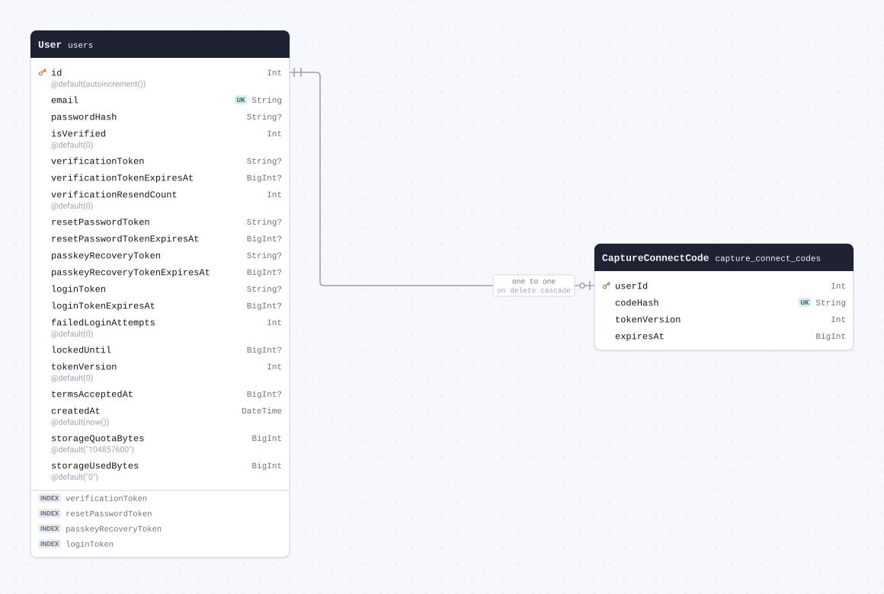

| Field                            | Type     | Constraints                          | Default | Description |
| -------------------------------- | -------- | ------------------------------------ | ------- | ----------- |
| `userId` (`user_id`)             | `Int`    | PK NOT NULL → [User.id](#model-User) |         |             |
| `codeHash` (`code_hash`)         | `String` | UNIQUE NOT NULL                      |         |             |
| `tokenVersion` (`token_version`) | `Int`    | NOT NULL                             |         |             |
| `expiresAt` (`expires_at`)       | `BigInt` | NOT NULL                             |         |             |

#### References

- `userId` → [User.id](#model-User) (one-to-one, on delete Cascade)

#### Definition

```sql
CREATE TABLE "capture_connect_codes" (
    "user_id" INTEGER NOT NULL,
    "code_hash" TEXT NOT NULL,
    "token_version" INTEGER NOT NULL,
    "expires_at" BIGINT NOT NULL,

    CONSTRAINT "capture_connect_codes_pkey" PRIMARY KEY ("user_id")
);

CREATE UNIQUE INDEX "capture_connect_codes_code_hash_key" ON "capture_connect_codes"("code_hash");

ALTER TABLE "capture_connect_codes" ADD CONSTRAINT "capture_connect_codes_user_id_fkey" FOREIGN KEY ("user_id") REFERENCES "users"("id") ON DELETE CASCADE ON UPDATE CASCADE;
```

<details>
<summary>Queries and their SQL</summary>

**findMany**: Every row

```ts
await prisma.captureConnectCode.findMany();
```

```sql
SELECT
  "public"."capture_connect_codes"."user_id",
  "public"."capture_connect_codes"."code_hash",
  "public"."capture_connect_codes"."token_version",
  "public"."capture_connect_codes"."expires_at"
FROM
  "public"."capture_connect_codes"
WHERE
  1 = 1
OFFSET
  $1
-- params: ["0"]
```

**count**: How many rows there are

```ts
await prisma.captureConnectCode.count();
```

```sql
SELECT
  COUNT(*) AS "_count$_all"
FROM
  (
    SELECT
      "public"."capture_connect_codes"."user_id"
    FROM
      "public"."capture_connect_codes"
    WHERE
      1 = 1
    OFFSET
      $1
  ) AS "sub"
-- params: ["0"]
```

**findMany**: Every row with its relations

```ts
await prisma.captureConnectCode.findMany({ include: { user: true } });
```

```sql
SELECT
  "public"."capture_connect_codes"."user_id",
  "public"."capture_connect_codes"."code_hash",
  "public"."capture_connect_codes"."token_version",
  "public"."capture_connect_codes"."expires_at"
FROM
  "public"."capture_connect_codes"
WHERE
  1 = 1
OFFSET
  $1
-- params: ["0"]

SELECT
  "public"."users"."id",
  "public"."users"."email",
  "public"."users"."password_hash",
  "public"."users"."is_verified",
  "public"."users"."verification_token",
  "public"."users"."verification_token_expires_at",
  "public"."users"."verification_resend_count",
  "public"."users"."reset_password_token",
  "public"."users"."reset_password_token_expires_at",
  "public"."users"."passkey_recovery_token",
  "public"."users"."passkey_recovery_token_expires_at",
  "public"."users"."login_token",
  "public"."users"."login_token_expires_at",
  "public"."users"."failed_login_attempts",
  "public"."users"."locked_until",
  "public"."users"."token_version",
  "public"."users"."terms_accepted_at",
  "public"."users"."created_at",
  "public"."users"."storage_quota_bytes",
  "public"."users"."storage_used_bytes"
FROM
  "public"."users"
WHERE
  "public"."users"."id" IN ($1)
OFFSET
  $2
-- params: ["<userId of the rows above>","0"]
```

**findUnique**: One row by what is unique to it

```ts
await prisma.captureConnectCode.findUnique({ where: { userId: 1 } });
```

```sql
SELECT
  "public"."capture_connect_codes"."user_id",
  "public"."capture_connect_codes"."code_hash",
  "public"."capture_connect_codes"."token_version",
  "public"."capture_connect_codes"."expires_at"
FROM
  "public"."capture_connect_codes"
WHERE
  (
    "public"."capture_connect_codes"."user_id" = $1
    AND 1 = 1
  )
LIMIT
  $2
OFFSET
  $3
-- params: ["1","1","0"]
```

**create**: Create a row

```ts
await prisma.captureConnectCode.create({
  data: { userId: 1, codeHash: "example", tokenVersion: 1, expiresAt: 1n },
});
```

```sql
INSERT INTO
  "public"."capture_connect_codes" (
    "user_id",
    "code_hash",
    "token_version",
    "expires_at"
  )
VALUES
  ($1, $2, $3, $4)
RETURNING
  "public"."capture_connect_codes"."user_id",
  "public"."capture_connect_codes"."code_hash",
  "public"."capture_connect_codes"."token_version",
  "public"."capture_connect_codes"."expires_at"
-- params: ["1","example","1","1"]
```

**update**: Update a row

```ts
await prisma.captureConnectCode.update({ where: { userId: 1 }, data: { codeHash: "example" } });
```

```sql
UPDATE "public"."capture_connect_codes"
SET
  "code_hash" = $1
WHERE
  (
    "public"."capture_connect_codes"."user_id" = $2
    AND 1 = 1
  )
RETURNING
  "public"."capture_connect_codes"."user_id",
  "public"."capture_connect_codes"."code_hash",
  "public"."capture_connect_codes"."token_version",
  "public"."capture_connect_codes"."expires_at"
-- params: ["example","1"]
```

**delete**: Delete a row

```ts
await prisma.captureConnectCode.delete({ where: { userId: 1 } });
```

```sql
DELETE FROM "public"."capture_connect_codes"
WHERE
  (
    "public"."capture_connect_codes"."user_id" = $1
    AND 1 = 1
  )
RETURNING
  "public"."capture_connect_codes"."user_id",
  "public"."capture_connect_codes"."code_hash",
  "public"."capture_connect_codes"."token_version",
  "public"."capture_connect_codes"."expires_at"
-- params: ["1"]
```

</details>

<a id="model-CaptureAuth"></a>

### CaptureAuth

Table `capture_auth`.

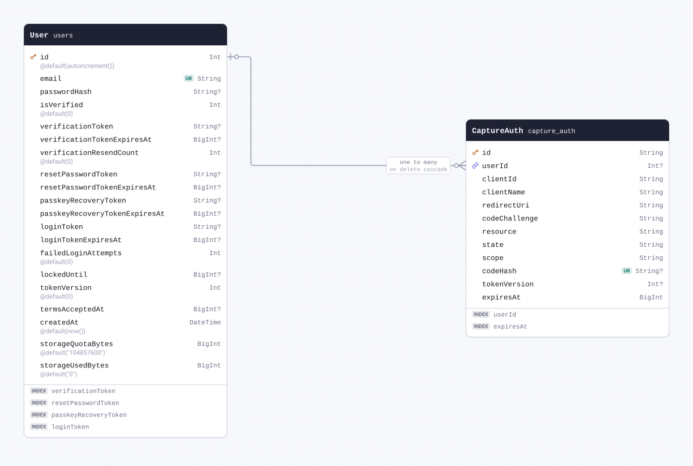

| Field                              | Type     | Constraints                   | Default | Description |
| ---------------------------------- | -------- | ----------------------------- | ------- | ----------- |
| `id`                               | `String` | PK NOT NULL                   |         |             |
| `userId` (`user_id`)               | `Int`    | NULL → [User.id](#model-User) |         |             |
| `clientId` (`client_id`)           | `String` | NOT NULL                      |         |             |
| `clientName` (`client_name`)       | `String` | NOT NULL                      |         |             |
| `redirectUri` (`redirect_uri`)     | `String` | NOT NULL                      |         |             |
| `codeChallenge` (`code_challenge`) | `String` | NOT NULL                      |         |             |
| `resource`                         | `String` | NOT NULL                      |         |             |
| `state`                            | `String` | NOT NULL                      |         |             |
| `scope`                            | `String` | NOT NULL                      |         |             |
| `codeHash` (`code_hash`)           | `String` | UNIQUE NULL                   |         |             |
| `tokenVersion` (`token_version`)   | `Int`    | NULL                          |         |             |
| `expiresAt` (`expires_at`)         | `BigInt` | NOT NULL                      |         |             |

#### Indexes

- `@@index([userId])`
- `@@index([expiresAt])`

#### References

- `userId` → [User.id](#model-User) (many-to-one, on delete Cascade)

#### Definition

```sql
CREATE TABLE "capture_auth" (
    "id" TEXT NOT NULL,
    "user_id" INTEGER,
    "client_id" TEXT NOT NULL,
    "client_name" TEXT NOT NULL,
    "redirect_uri" TEXT NOT NULL,
    "code_challenge" TEXT NOT NULL,
    "resource" TEXT NOT NULL,
    "state" TEXT NOT NULL,
    "scope" TEXT NOT NULL,
    "code_hash" TEXT,
    "token_version" INTEGER,
    "expires_at" BIGINT NOT NULL,

    CONSTRAINT "capture_auth_pkey" PRIMARY KEY ("id")
);

CREATE UNIQUE INDEX "capture_auth_code_hash_key" ON "capture_auth"("code_hash");

CREATE INDEX "capture_auth_user_id_idx" ON "capture_auth"("user_id");

CREATE INDEX "capture_auth_expires_at_idx" ON "capture_auth"("expires_at");

ALTER TABLE "capture_auth" ADD CONSTRAINT "capture_auth_user_id_fkey" FOREIGN KEY ("user_id") REFERENCES "users"("id") ON DELETE CASCADE ON UPDATE CASCADE;
```

<details>
<summary>Queries and their SQL</summary>

**findMany**: Every row

```ts
await prisma.captureAuth.findMany();
```

```sql
SELECT
  "public"."capture_auth"."id",
  "public"."capture_auth"."user_id",
  "public"."capture_auth"."client_id",
  "public"."capture_auth"."client_name",
  "public"."capture_auth"."redirect_uri",
  "public"."capture_auth"."code_challenge",
  "public"."capture_auth"."resource",
  "public"."capture_auth"."state",
  "public"."capture_auth"."scope",
  "public"."capture_auth"."code_hash",
  "public"."capture_auth"."token_version",
  "public"."capture_auth"."expires_at"
FROM
  "public"."capture_auth"
WHERE
  1 = 1
OFFSET
  $1
-- params: ["0"]
```

**count**: How many rows there are

```ts
await prisma.captureAuth.count();
```

```sql
SELECT
  COUNT(*) AS "_count$_all"
FROM
  (
    SELECT
      "public"."capture_auth"."id"
    FROM
      "public"."capture_auth"
    WHERE
      1 = 1
    OFFSET
      $1
  ) AS "sub"
-- params: ["0"]
```

**findMany**: Every row with its relations

```ts
await prisma.captureAuth.findMany({ include: { user: true } });
```

```sql
SELECT
  "public"."capture_auth"."id",
  "public"."capture_auth"."user_id",
  "public"."capture_auth"."client_id",
  "public"."capture_auth"."client_name",
  "public"."capture_auth"."redirect_uri",
  "public"."capture_auth"."code_challenge",
  "public"."capture_auth"."resource",
  "public"."capture_auth"."state",
  "public"."capture_auth"."scope",
  "public"."capture_auth"."code_hash",
  "public"."capture_auth"."token_version",
  "public"."capture_auth"."expires_at"
FROM
  "public"."capture_auth"
WHERE
  1 = 1
OFFSET
  $1
-- params: ["0"]

SELECT
  "public"."users"."id",
  "public"."users"."email",
  "public"."users"."password_hash",
  "public"."users"."is_verified",
  "public"."users"."verification_token",
  "public"."users"."verification_token_expires_at",
  "public"."users"."verification_resend_count",
  "public"."users"."reset_password_token",
  "public"."users"."reset_password_token_expires_at",
  "public"."users"."passkey_recovery_token",
  "public"."users"."passkey_recovery_token_expires_at",
  "public"."users"."login_token",
  "public"."users"."login_token_expires_at",
  "public"."users"."failed_login_attempts",
  "public"."users"."locked_until",
  "public"."users"."token_version",
  "public"."users"."terms_accepted_at",
  "public"."users"."created_at",
  "public"."users"."storage_quota_bytes",
  "public"."users"."storage_used_bytes"
FROM
  "public"."users"
WHERE
  "public"."users"."id" IN ($1)
OFFSET
  $2
-- params: ["<userId of the rows above>","0"]
```

**findUnique**: One row by what is unique to it

```ts
await prisma.captureAuth.findUnique({ where: { id: "example" } });
```

```sql
SELECT
  "public"."capture_auth"."id",
  "public"."capture_auth"."user_id",
  "public"."capture_auth"."client_id",
  "public"."capture_auth"."client_name",
  "public"."capture_auth"."redirect_uri",
  "public"."capture_auth"."code_challenge",
  "public"."capture_auth"."resource",
  "public"."capture_auth"."state",
  "public"."capture_auth"."scope",
  "public"."capture_auth"."code_hash",
  "public"."capture_auth"."token_version",
  "public"."capture_auth"."expires_at"
FROM
  "public"."capture_auth"
WHERE
  (
    "public"."capture_auth"."id" = $1
    AND 1 = 1
  )
LIMIT
  $2
OFFSET
  $3
-- params: ["example","1","0"]
```

**create**: Create a row

```ts
await prisma.captureAuth.create({
  data: {
    id: "example",
    clientId: "example",
    clientName: "example",
    redirectUri: "example",
    codeChallenge: "example",
    resource: "example",
    state: "example",
    scope: "example",
    expiresAt: 1n,
  },
});
```

```sql
INSERT INTO
  "public"."capture_auth" (
    "id",
    "client_id",
    "client_name",
    "redirect_uri",
    "code_challenge",
    "resource",
    "state",
    "scope",
    "expires_at"
  )
VALUES
  ($1, $2, $3, $4, $5, $6, $7, $8, $9)
RETURNING
  "public"."capture_auth"."id",
  "public"."capture_auth"."user_id",
  "public"."capture_auth"."client_id",
  "public"."capture_auth"."client_name",
  "public"."capture_auth"."redirect_uri",
  "public"."capture_auth"."code_challenge",
  "public"."capture_auth"."resource",
  "public"."capture_auth"."state",
  "public"."capture_auth"."scope",
  "public"."capture_auth"."code_hash",
  "public"."capture_auth"."token_version",
  "public"."capture_auth"."expires_at"
-- params: ["example","example","example","example","example","example","example","example","1"]
```

**update**: Update a row

```ts
await prisma.captureAuth.update({ where: { id: "example" }, data: { clientId: "example" } });
```

```sql
UPDATE "public"."capture_auth"
SET
  "client_id" = $1
WHERE
  (
    "public"."capture_auth"."id" = $2
    AND 1 = 1
  )
RETURNING
  "public"."capture_auth"."id",
  "public"."capture_auth"."user_id",
  "public"."capture_auth"."client_id",
  "public"."capture_auth"."client_name",
  "public"."capture_auth"."redirect_uri",
  "public"."capture_auth"."code_challenge",
  "public"."capture_auth"."resource",
  "public"."capture_auth"."state",
  "public"."capture_auth"."scope",
  "public"."capture_auth"."code_hash",
  "public"."capture_auth"."token_version",
  "public"."capture_auth"."expires_at"
-- params: ["example","example"]
```

**delete**: Delete a row

```ts
await prisma.captureAuth.delete({ where: { id: "example" } });
```

```sql
DELETE FROM "public"."capture_auth"
WHERE
  (
    "public"."capture_auth"."id" = $1
    AND 1 = 1
  )
RETURNING
  "public"."capture_auth"."id",
  "public"."capture_auth"."user_id",
  "public"."capture_auth"."client_id",
  "public"."capture_auth"."client_name",
  "public"."capture_auth"."redirect_uri",
  "public"."capture_auth"."code_challenge",
  "public"."capture_auth"."resource",
  "public"."capture_auth"."state",
  "public"."capture_auth"."scope",
  "public"."capture_auth"."code_hash",
  "public"."capture_auth"."token_version",
  "public"."capture_auth"."expires_at"
-- params: ["example"]
```

</details>

<a id="model-ConnectRequest"></a>

### ConnectRequest

Table `connect_requests`.

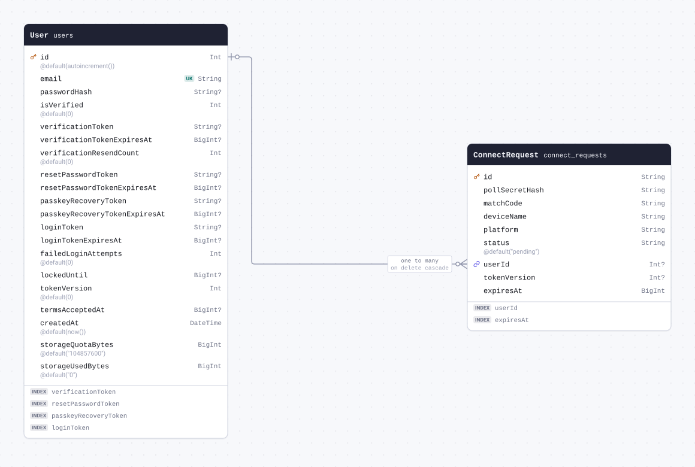

| Field                                 | Type     | Constraints                   | Default     | Description |
| ------------------------------------- | -------- | ----------------------------- | ----------- | ----------- |
| `id`                                  | `String` | PK NOT NULL                   |             |             |
| `pollSecretHash` (`poll_secret_hash`) | `String` | NOT NULL                      |             |             |
| `matchCode` (`match_code`)            | `String` | NOT NULL                      |             |             |
| `deviceName` (`device_name`)          | `String` | NOT NULL                      |             |             |
| `platform`                            | `String` | NOT NULL                      |             |             |
| `status`                              | `String` | NOT NULL                      | `"pending"` |             |
| `userId` (`user_id`)                  | `Int`    | NULL → [User.id](#model-User) |             |             |
| `tokenVersion` (`token_version`)      | `Int`    | NULL                          |             |             |
| `expiresAt` (`expires_at`)            | `BigInt` | NOT NULL                      |             |             |

#### Indexes

- `@@index([userId])`
- `@@index([expiresAt])`

#### References

- `userId` → [User.id](#model-User) (many-to-one, on delete Cascade)

#### Definition

```sql
CREATE TABLE "connect_requests" (
    "id" TEXT NOT NULL,
    "poll_secret_hash" TEXT NOT NULL,
    "match_code" TEXT NOT NULL,
    "device_name" TEXT NOT NULL,
    "platform" TEXT NOT NULL,
    "status" TEXT NOT NULL DEFAULT 'pending',
    "user_id" INTEGER,
    "token_version" INTEGER,
    "expires_at" BIGINT NOT NULL,

    CONSTRAINT "connect_requests_pkey" PRIMARY KEY ("id")
);

CREATE INDEX "connect_requests_user_id_idx" ON "connect_requests"("user_id");

CREATE INDEX "connect_requests_expires_at_idx" ON "connect_requests"("expires_at");

ALTER TABLE "connect_requests" ADD CONSTRAINT "connect_requests_user_id_fkey" FOREIGN KEY ("user_id") REFERENCES "users"("id") ON DELETE CASCADE ON UPDATE CASCADE;
```

<details>
<summary>Queries and their SQL</summary>

**findMany**: Every row

```ts
await prisma.connectRequest.findMany();
```

```sql
SELECT
  "public"."connect_requests"."id",
  "public"."connect_requests"."poll_secret_hash",
  "public"."connect_requests"."match_code",
  "public"."connect_requests"."device_name",
  "public"."connect_requests"."platform",
  "public"."connect_requests"."status",
  "public"."connect_requests"."user_id",
  "public"."connect_requests"."token_version",
  "public"."connect_requests"."expires_at"
FROM
  "public"."connect_requests"
WHERE
  1 = 1
OFFSET
  $1
-- params: ["0"]
```

**count**: How many rows there are

```ts
await prisma.connectRequest.count();
```

```sql
SELECT
  COUNT(*) AS "_count$_all"
FROM
  (
    SELECT
      "public"."connect_requests"."id"
    FROM
      "public"."connect_requests"
    WHERE
      1 = 1
    OFFSET
      $1
  ) AS "sub"
-- params: ["0"]
```

**findMany**: Every row with its relations

```ts
await prisma.connectRequest.findMany({ include: { user: true } });
```

```sql
SELECT
  "public"."connect_requests"."id",
  "public"."connect_requests"."poll_secret_hash",
  "public"."connect_requests"."match_code",
  "public"."connect_requests"."device_name",
  "public"."connect_requests"."platform",
  "public"."connect_requests"."status",
  "public"."connect_requests"."user_id",
  "public"."connect_requests"."token_version",
  "public"."connect_requests"."expires_at"
FROM
  "public"."connect_requests"
WHERE
  1 = 1
OFFSET
  $1
-- params: ["0"]

SELECT
  "public"."users"."id",
  "public"."users"."email",
  "public"."users"."password_hash",
  "public"."users"."is_verified",
  "public"."users"."verification_token",
  "public"."users"."verification_token_expires_at",
  "public"."users"."verification_resend_count",
  "public"."users"."reset_password_token",
  "public"."users"."reset_password_token_expires_at",
  "public"."users"."passkey_recovery_token",
  "public"."users"."passkey_recovery_token_expires_at",
  "public"."users"."login_token",
  "public"."users"."login_token_expires_at",
  "public"."users"."failed_login_attempts",
  "public"."users"."locked_until",
  "public"."users"."token_version",
  "public"."users"."terms_accepted_at",
  "public"."users"."created_at",
  "public"."users"."storage_quota_bytes",
  "public"."users"."storage_used_bytes"
FROM
  "public"."users"
WHERE
  "public"."users"."id" IN ($1)
OFFSET
  $2
-- params: ["<userId of the rows above>","0"]
```

**findUnique**: One row by what is unique to it

```ts
await prisma.connectRequest.findUnique({ where: { id: "example" } });
```

```sql
SELECT
  "public"."connect_requests"."id",
  "public"."connect_requests"."poll_secret_hash",
  "public"."connect_requests"."match_code",
  "public"."connect_requests"."device_name",
  "public"."connect_requests"."platform",
  "public"."connect_requests"."status",
  "public"."connect_requests"."user_id",
  "public"."connect_requests"."token_version",
  "public"."connect_requests"."expires_at"
FROM
  "public"."connect_requests"
WHERE
  (
    "public"."connect_requests"."id" = $1
    AND 1 = 1
  )
LIMIT
  $2
OFFSET
  $3
-- params: ["example","1","0"]
```

**create**: Create a row

```ts
await prisma.connectRequest.create({
  data: {
    id: "example",
    pollSecretHash: "example",
    matchCode: "example",
    deviceName: "example",
    platform: "example",
    expiresAt: 1n,
  },
});
```

```sql
INSERT INTO
  "public"."connect_requests" (
    "id",
    "poll_secret_hash",
    "match_code",
    "device_name",
    "platform",
    "status",
    "expires_at"
  )
VALUES
  ($1, $2, $3, $4, $5, $6, $7)
RETURNING
  "public"."connect_requests"."id",
  "public"."connect_requests"."poll_secret_hash",
  "public"."connect_requests"."match_code",
  "public"."connect_requests"."device_name",
  "public"."connect_requests"."platform",
  "public"."connect_requests"."status",
  "public"."connect_requests"."user_id",
  "public"."connect_requests"."token_version",
  "public"."connect_requests"."expires_at"
-- params: ["example","example","example","example","example","pending","1"]
```

**update**: Update a row

```ts
await prisma.connectRequest.update({
  where: { id: "example" },
  data: { pollSecretHash: "example" },
});
```

```sql
UPDATE "public"."connect_requests"
SET
  "poll_secret_hash" = $1
WHERE
  (
    "public"."connect_requests"."id" = $2
    AND 1 = 1
  )
RETURNING
  "public"."connect_requests"."id",
  "public"."connect_requests"."poll_secret_hash",
  "public"."connect_requests"."match_code",
  "public"."connect_requests"."device_name",
  "public"."connect_requests"."platform",
  "public"."connect_requests"."status",
  "public"."connect_requests"."user_id",
  "public"."connect_requests"."token_version",
  "public"."connect_requests"."expires_at"
-- params: ["example","example"]
```

**delete**: Delete a row

```ts
await prisma.connectRequest.delete({ where: { id: "example" } });
```

```sql
DELETE FROM "public"."connect_requests"
WHERE
  (
    "public"."connect_requests"."id" = $1
    AND 1 = 1
  )
RETURNING
  "public"."connect_requests"."id",
  "public"."connect_requests"."poll_secret_hash",
  "public"."connect_requests"."match_code",
  "public"."connect_requests"."device_name",
  "public"."connect_requests"."platform",
  "public"."connect_requests"."status",
  "public"."connect_requests"."user_id",
  "public"."connect_requests"."token_version",
  "public"."connect_requests"."expires_at"
-- params: ["example"]
```

</details>
