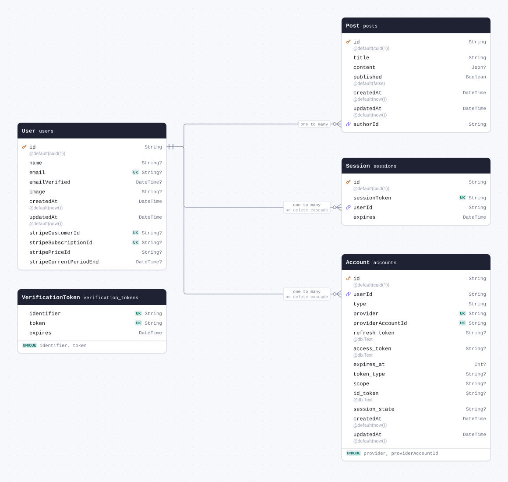
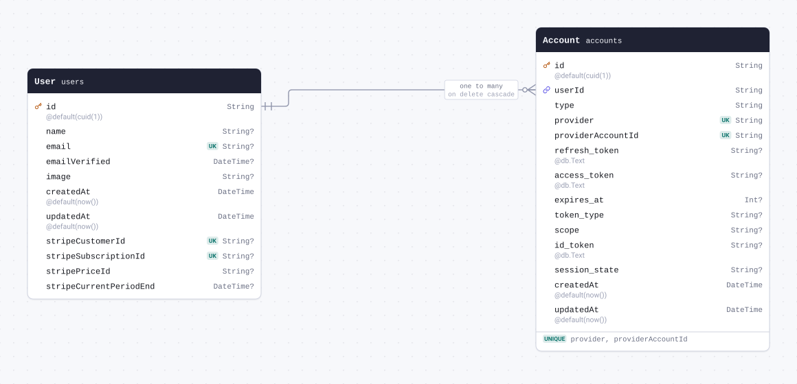
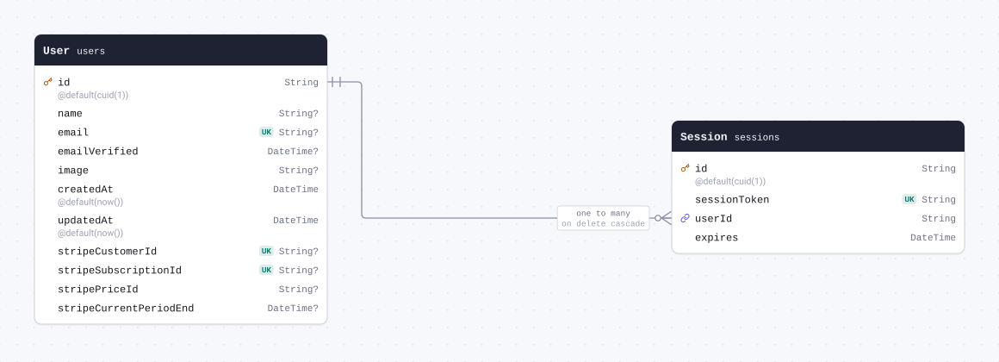
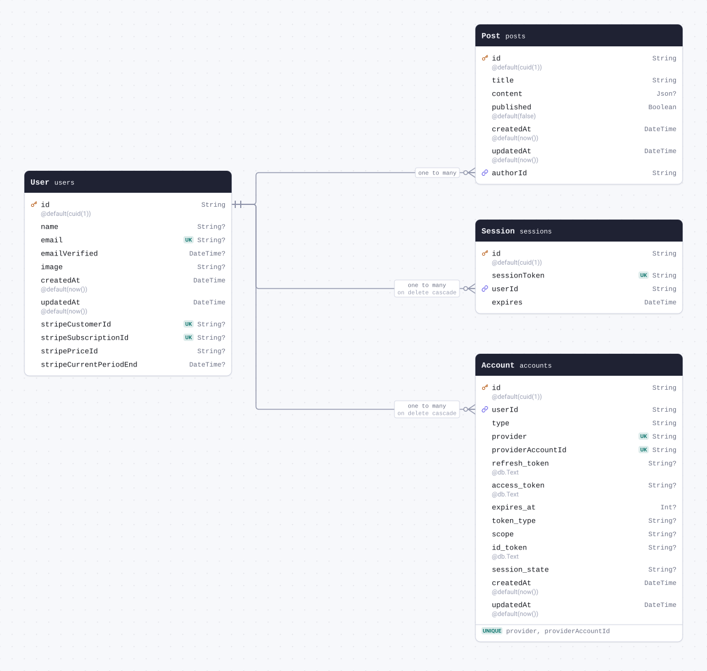
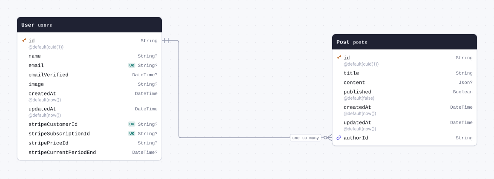

# Schema docs



<details>
<summary>The whole schema as SQL</summary>

```sql
CREATE TABLE `accounts` (
    `id` VARCHAR(191) NOT NULL,
    `userId` VARCHAR(191) NOT NULL,
    `type` VARCHAR(191) NOT NULL,
    `provider` VARCHAR(191) NOT NULL,
    `providerAccountId` VARCHAR(191) NOT NULL,
    `refresh_token` TEXT NULL,
    `access_token` TEXT NULL,
    `expires_at` INTEGER NULL,
    `token_type` VARCHAR(191) NULL,
    `scope` VARCHAR(191) NULL,
    `id_token` TEXT NULL,
    `session_state` VARCHAR(191) NULL,
    `created_at` DATETIME(3) NOT NULL DEFAULT CURRENT_TIMESTAMP(3),
    `updated_at` DATETIME(3) NOT NULL DEFAULT CURRENT_TIMESTAMP(3),

    UNIQUE INDEX `accounts_provider_providerAccountId_key`(`provider`, `providerAccountId`),
    PRIMARY KEY (`id`)
) DEFAULT CHARACTER SET utf8mb4 COLLATE utf8mb4_unicode_ci;

CREATE TABLE `sessions` (
    `id` VARCHAR(191) NOT NULL,
    `sessionToken` VARCHAR(191) NOT NULL,
    `userId` VARCHAR(191) NOT NULL,
    `expires` DATETIME(3) NOT NULL,

    UNIQUE INDEX `sessions_sessionToken_key`(`sessionToken`),
    PRIMARY KEY (`id`)
) DEFAULT CHARACTER SET utf8mb4 COLLATE utf8mb4_unicode_ci;

CREATE TABLE `users` (
    `id` VARCHAR(191) NOT NULL,
    `name` VARCHAR(191) NULL,
    `email` VARCHAR(191) NULL,
    `emailVerified` DATETIME(3) NULL,
    `image` VARCHAR(191) NULL,
    `created_at` DATETIME(3) NOT NULL DEFAULT CURRENT_TIMESTAMP(3),
    `updated_at` DATETIME(3) NOT NULL DEFAULT CURRENT_TIMESTAMP(3),
    `stripe_customer_id` VARCHAR(191) NULL,
    `stripe_subscription_id` VARCHAR(191) NULL,
    `stripe_price_id` VARCHAR(191) NULL,
    `stripe_current_period_end` DATETIME(3) NULL,

    UNIQUE INDEX `users_email_key`(`email`),
    UNIQUE INDEX `users_stripe_customer_id_key`(`stripe_customer_id`),
    UNIQUE INDEX `users_stripe_subscription_id_key`(`stripe_subscription_id`),
    PRIMARY KEY (`id`)
) DEFAULT CHARACTER SET utf8mb4 COLLATE utf8mb4_unicode_ci;

CREATE TABLE `verification_tokens` (
    `identifier` VARCHAR(191) NOT NULL,
    `token` VARCHAR(191) NOT NULL,
    `expires` DATETIME(3) NOT NULL,

    UNIQUE INDEX `verification_tokens_token_key`(`token`),
    UNIQUE INDEX `verification_tokens_identifier_token_key`(`identifier`, `token`)
) DEFAULT CHARACTER SET utf8mb4 COLLATE utf8mb4_unicode_ci;

CREATE TABLE `posts` (
    `id` VARCHAR(191) NOT NULL,
    `title` VARCHAR(191) NOT NULL,
    `content` JSON NULL,
    `published` BOOLEAN NOT NULL DEFAULT false,
    `created_at` DATETIME(3) NOT NULL DEFAULT CURRENT_TIMESTAMP(3),
    `updated_at` DATETIME(3) NOT NULL DEFAULT CURRENT_TIMESTAMP(3),
    `authorId` VARCHAR(191) NOT NULL,

    PRIMARY KEY (`id`)
) DEFAULT CHARACTER SET utf8mb4 COLLATE utf8mb4_unicode_ci;

ALTER TABLE `accounts` ADD CONSTRAINT `accounts_userId_fkey` FOREIGN KEY (`userId`) REFERENCES `users`(`id`) ON DELETE CASCADE ON UPDATE CASCADE;

ALTER TABLE `sessions` ADD CONSTRAINT `sessions_userId_fkey` FOREIGN KEY (`userId`) REFERENCES `users`(`id`) ON DELETE CASCADE ON UPDATE CASCADE;

ALTER TABLE `posts` ADD CONSTRAINT `posts_authorId_fkey` FOREIGN KEY (`authorId`) REFERENCES `users`(`id`) ON DELETE RESTRICT ON UPDATE CASCADE;
```

</details>

## Contents

| Model                                         | Table                 | Description |
| --------------------------------------------- | --------------------- | ----------- |
| [Account](#model-Account)                     | `accounts`            |             |
| [Session](#model-Session)                     | `sessions`            |             |
| [User](#model-User)                           | `users`               |             |
| [VerificationToken](#model-VerificationToken) | `verification_tokens` |             |
| [Post](#model-Post)                           | `posts`               |             |

## Models

<a id="model-Account"></a>

### Account

Table `accounts`.



| Field                      | Type                | Constraints                       | Default   | Description |
| -------------------------- | ------------------- | --------------------------------- | --------- | ----------- |
| `id`                       | `String`            | PK NOT NULL                       | `cuid(1)` |             |
| `userId`                   | `String`            | NOT NULL → [User.id](#model-User) |           |             |
| `type`                     | `String`            | NOT NULL                          |           |             |
| `provider`                 | `String`            | NOT NULL                          |           |             |
| `providerAccountId`        | `String`            | NOT NULL                          |           |             |
| `refresh_token`            | `String` `@db.Text` | NULL                              |           |             |
| `access_token`             | `String` `@db.Text` | NULL                              |           |             |
| `expires_at`               | `Int`               | NULL                              |           |             |
| `token_type`               | `String`            | NULL                              |           |             |
| `scope`                    | `String`            | NULL                              |           |             |
| `id_token`                 | `String` `@db.Text` | NULL                              |           |             |
| `session_state`            | `String`            | NULL                              |           |             |
| `createdAt` (`created_at`) | `DateTime`          | NOT NULL                          | `now()`   |             |
| `updatedAt` (`updated_at`) | `DateTime`          | NOT NULL                          | `now()`   |             |

#### Indexes

- `@@unique([provider, providerAccountId])`

#### References

- `userId` → [User.id](#model-User) (many-to-one, on delete Cascade)

#### Definition

```sql
CREATE TABLE `accounts` (
    `id` VARCHAR(191) NOT NULL,
    `userId` VARCHAR(191) NOT NULL,
    `type` VARCHAR(191) NOT NULL,
    `provider` VARCHAR(191) NOT NULL,
    `providerAccountId` VARCHAR(191) NOT NULL,
    `refresh_token` TEXT NULL,
    `access_token` TEXT NULL,
    `expires_at` INTEGER NULL,
    `token_type` VARCHAR(191) NULL,
    `scope` VARCHAR(191) NULL,
    `id_token` TEXT NULL,
    `session_state` VARCHAR(191) NULL,
    `created_at` DATETIME(3) NOT NULL DEFAULT CURRENT_TIMESTAMP(3),
    `updated_at` DATETIME(3) NOT NULL DEFAULT CURRENT_TIMESTAMP(3),

    UNIQUE INDEX `accounts_provider_providerAccountId_key`(`provider`, `providerAccountId`),
    PRIMARY KEY (`id`)
) DEFAULT CHARACTER SET utf8mb4 COLLATE utf8mb4_unicode_ci;

ALTER TABLE `accounts` ADD CONSTRAINT `accounts_userId_fkey` FOREIGN KEY (`userId`) REFERENCES `users`(`id`) ON DELETE CASCADE ON UPDATE CASCADE;
```

<details>
<summary>Queries and their SQL</summary>

**findMany**: Every row

```ts
await prisma.account.findMany();
```

```sql
SELECT
  `accounts`.`id`,
  `accounts`.`userId`,
  `accounts`.`type`,
  `accounts`.`provider`,
  `accounts`.`providerAccountId`,
  `accounts`.`refresh_token`,
  `accounts`.`access_token`,
  `accounts`.`expires_at`,
  `accounts`.`token_type`,
  `accounts`.`scope`,
  `accounts`.`id_token`,
  `accounts`.`session_state`,
  `accounts`.`created_at`,
  `accounts`.`updated_at`
FROM
  `accounts`
WHERE
  1 = 1
```

**count**: How many rows there are

```ts
await prisma.account.count();
```

```sql
SELECT
  COUNT(*) AS `_count$_all`
FROM
  (
    SELECT
      `accounts`.`id`
    FROM
      `accounts`
    WHERE
      1 = 1
  ) AS `sub`
```

**findMany**: Every row with its relations

```ts
await prisma.account.findMany({ include: { user: true } });
```

```sql
SELECT
  `accounts`.`id`,
  `accounts`.`userId`,
  `accounts`.`type`,
  `accounts`.`provider`,
  `accounts`.`providerAccountId`,
  `accounts`.`refresh_token`,
  `accounts`.`access_token`,
  `accounts`.`expires_at`,
  `accounts`.`token_type`,
  `accounts`.`scope`,
  `accounts`.`id_token`,
  `accounts`.`session_state`,
  `accounts`.`created_at`,
  `accounts`.`updated_at`
FROM
  `accounts`
WHERE
  1 = 1

SELECT
  `users`.`id`,
  `users`.`name`,
  `users`.`email`,
  `users`.`emailVerified`,
  `users`.`image`,
  `users`.`created_at`,
  `users`.`updated_at`,
  `users`.`stripe_customer_id`,
  `users`.`stripe_subscription_id`,
  `users`.`stripe_price_id`,
  `users`.`stripe_current_period_end`
FROM
  `users`
WHERE
  `users`.`id` IN (?)
-- params: ["<userId of the rows above>"]
```

**findUnique**: One row by what is unique to it

```ts
await prisma.account.findUnique({ where: { id: "example" } });
```

```sql
SELECT
  `accounts`.`id`,
  `accounts`.`userId`,
  `accounts`.`type`,
  `accounts`.`provider`,
  `accounts`.`providerAccountId`,
  `accounts`.`refresh_token`,
  `accounts`.`access_token`,
  `accounts`.`expires_at`,
  `accounts`.`token_type`,
  `accounts`.`scope`,
  `accounts`.`id_token`,
  `accounts`.`session_state`,
  `accounts`.`created_at`,
  `accounts`.`updated_at`
FROM
  `accounts`
WHERE
  (
    `accounts`.`id` = ?
    AND 1 = 1
  )
LIMIT
  ?
OFFSET
  ?
-- params: ["example","1","0"]
```

**create**: Create a row

```ts
await prisma.account.create({
  data: { userId: "example", type: "example", provider: "example", providerAccountId: "example" },
});
```

```sql
INSERT INTO
  `accounts` (
    `id`,
    `userId`,
    `type`,
    `provider`,
    `providerAccountId`,
    `created_at`,
    `updated_at`
  )
VALUES
  (?, ?, ?, ?, ?, ?, ?)
-- params: ["<cuid(1)>","example","example","example","example","<now()>","<now()>"]

SELECT
  `accounts`.`id`,
  `accounts`.`userId`,
  `accounts`.`type`,
  `accounts`.`provider`,
  `accounts`.`providerAccountId`,
  `accounts`.`refresh_token`,
  `accounts`.`access_token`,
  `accounts`.`expires_at`,
  `accounts`.`token_type`,
  `accounts`.`scope`,
  `accounts`.`id_token`,
  `accounts`.`session_state`,
  `accounts`.`created_at`,
  `accounts`.`updated_at`
FROM
  `accounts`
WHERE
  `accounts`.`id` = ?
LIMIT
  ?
OFFSET
  ?
-- params: ["<id of the rows above>","1","0"]
```

**update**: Update a row

```ts
await prisma.account.update({ where: { id: "example" }, data: { type: "example" } });
```

```sql
SELECT
  `accounts`.`id`
FROM
  `accounts`
WHERE
  (
    `accounts`.`id` = ?
    AND 1 = 1
  )
LIMIT
  ?
OFFSET
  ?
-- params: ["example","1","0"]

UPDATE `accounts`
SET
  `type` = ?
WHERE
  (
    `accounts`.`id` IN (?)
    AND (
      `accounts`.`id` = ?
      AND 1 = 1
    )
  )
-- params: ["example","<id of the rows above>","example"]

SELECT
  `accounts`.`id`,
  `accounts`.`userId`,
  `accounts`.`type`,
  `accounts`.`provider`,
  `accounts`.`providerAccountId`,
  `accounts`.`refresh_token`,
  `accounts`.`access_token`,
  `accounts`.`expires_at`,
  `accounts`.`token_type`,
  `accounts`.`scope`,
  `accounts`.`id_token`,
  `accounts`.`session_state`,
  `accounts`.`created_at`,
  `accounts`.`updated_at`
FROM
  `accounts`
WHERE
  `accounts`.`id` = ?
LIMIT
  ?
OFFSET
  ?
-- params: ["<id of the rows above>","1","0"]
```

**delete**: Delete a row

```ts
await prisma.account.delete({ where: { id: "example" } });
```

```sql
SELECT
  `accounts`.`id`,
  `accounts`.`userId`,
  `accounts`.`type`,
  `accounts`.`provider`,
  `accounts`.`providerAccountId`,
  `accounts`.`refresh_token`,
  `accounts`.`access_token`,
  `accounts`.`expires_at`,
  `accounts`.`token_type`,
  `accounts`.`scope`,
  `accounts`.`id_token`,
  `accounts`.`session_state`,
  `accounts`.`created_at`,
  `accounts`.`updated_at`
FROM
  `accounts`
WHERE
  (
    `accounts`.`id` = ?
    AND 1 = 1
  )
LIMIT
  ?
OFFSET
  ?
-- params: ["example","1","0"]

DELETE FROM `accounts`
WHERE
  (
    `accounts`.`id` = ?
    AND 1 = 1
  )
-- params: ["example"]
```

</details>

<a id="model-Session"></a>

### Session

Table `sessions`.



| Field          | Type       | Constraints                       | Default   | Description |
| -------------- | ---------- | --------------------------------- | --------- | ----------- |
| `id`           | `String`   | PK NOT NULL                       | `cuid(1)` |             |
| `sessionToken` | `String`   | UNIQUE NOT NULL                   |           |             |
| `userId`       | `String`   | NOT NULL → [User.id](#model-User) |           |             |
| `expires`      | `DateTime` | NOT NULL                          |           |             |

#### References

- `userId` → [User.id](#model-User) (many-to-one, on delete Cascade)

#### Definition

```sql
CREATE TABLE `sessions` (
    `id` VARCHAR(191) NOT NULL,
    `sessionToken` VARCHAR(191) NOT NULL,
    `userId` VARCHAR(191) NOT NULL,
    `expires` DATETIME(3) NOT NULL,

    UNIQUE INDEX `sessions_sessionToken_key`(`sessionToken`),
    PRIMARY KEY (`id`)
) DEFAULT CHARACTER SET utf8mb4 COLLATE utf8mb4_unicode_ci;

ALTER TABLE `sessions` ADD CONSTRAINT `sessions_userId_fkey` FOREIGN KEY (`userId`) REFERENCES `users`(`id`) ON DELETE CASCADE ON UPDATE CASCADE;
```

<details>
<summary>Queries and their SQL</summary>

**findMany**: Every row

```ts
await prisma.session.findMany();
```

```sql
SELECT
  `sessions`.`id`,
  `sessions`.`sessionToken`,
  `sessions`.`userId`,
  `sessions`.`expires`
FROM
  `sessions`
WHERE
  1 = 1
```

**count**: How many rows there are

```ts
await prisma.session.count();
```

```sql
SELECT
  COUNT(*) AS `_count$_all`
FROM
  (
    SELECT
      `sessions`.`id`
    FROM
      `sessions`
    WHERE
      1 = 1
  ) AS `sub`
```

**findMany**: Every row with its relations

```ts
await prisma.session.findMany({ include: { user: true } });
```

```sql
SELECT
  `sessions`.`id`,
  `sessions`.`sessionToken`,
  `sessions`.`userId`,
  `sessions`.`expires`
FROM
  `sessions`
WHERE
  1 = 1

SELECT
  `users`.`id`,
  `users`.`name`,
  `users`.`email`,
  `users`.`emailVerified`,
  `users`.`image`,
  `users`.`created_at`,
  `users`.`updated_at`,
  `users`.`stripe_customer_id`,
  `users`.`stripe_subscription_id`,
  `users`.`stripe_price_id`,
  `users`.`stripe_current_period_end`
FROM
  `users`
WHERE
  `users`.`id` IN (?)
-- params: ["<userId of the rows above>"]
```

**findUnique**: One row by what is unique to it

```ts
await prisma.session.findUnique({ where: { id: "example" } });
```

```sql
SELECT
  `sessions`.`id`,
  `sessions`.`sessionToken`,
  `sessions`.`userId`,
  `sessions`.`expires`
FROM
  `sessions`
WHERE
  (
    `sessions`.`id` = ?
    AND 1 = 1
  )
LIMIT
  ?
OFFSET
  ?
-- params: ["example","1","0"]
```

**create**: Create a row

```ts
await prisma.session.create({
  data: {
    sessionToken: "example",
    userId: "example",
    expires: new Date("2026-01-01T00:00:00.000Z"),
  },
});
```

```sql
INSERT INTO
  `sessions` (`id`, `sessionToken`, `userId`, `expires`)
VALUES
  (?, ?, ?, ?)
-- params: ["<cuid(1)>","example","example","2026-01-01T00:00:00.000Z"]

SELECT
  `sessions`.`id`,
  `sessions`.`sessionToken`,
  `sessions`.`userId`,
  `sessions`.`expires`
FROM
  `sessions`
WHERE
  `sessions`.`id` = ?
LIMIT
  ?
OFFSET
  ?
-- params: ["<id of the rows above>","1","0"]
```

**update**: Update a row

```ts
await prisma.session.update({ where: { id: "example" }, data: { sessionToken: "example" } });
```

```sql
SELECT
  `sessions`.`id`
FROM
  `sessions`
WHERE
  (
    `sessions`.`id` = ?
    AND 1 = 1
  )
LIMIT
  ?
OFFSET
  ?
-- params: ["example","1","0"]

UPDATE `sessions`
SET
  `sessionToken` = ?
WHERE
  (
    `sessions`.`id` IN (?)
    AND (
      `sessions`.`id` = ?
      AND 1 = 1
    )
  )
-- params: ["example","<id of the rows above>","example"]

SELECT
  `sessions`.`id`,
  `sessions`.`sessionToken`,
  `sessions`.`userId`,
  `sessions`.`expires`
FROM
  `sessions`
WHERE
  `sessions`.`id` = ?
LIMIT
  ?
OFFSET
  ?
-- params: ["<id of the rows above>","1","0"]
```

**delete**: Delete a row

```ts
await prisma.session.delete({ where: { id: "example" } });
```

```sql
SELECT
  `sessions`.`id`,
  `sessions`.`sessionToken`,
  `sessions`.`userId`,
  `sessions`.`expires`
FROM
  `sessions`
WHERE
  (
    `sessions`.`id` = ?
    AND 1 = 1
  )
LIMIT
  ?
OFFSET
  ?
-- params: ["example","1","0"]

DELETE FROM `sessions`
WHERE
  (
    `sessions`.`id` = ?
    AND 1 = 1
  )
-- params: ["example"]
```

</details>

<a id="model-User"></a>

### User

Table `users`.



| Field                                                  | Type       | Constraints | Default   | Description |
| ------------------------------------------------------ | ---------- | ----------- | --------- | ----------- |
| `id`                                                   | `String`   | PK NOT NULL | `cuid(1)` |             |
| `name`                                                 | `String`   | NULL        |           |             |
| `email`                                                | `String`   | UNIQUE NULL |           |             |
| `emailVerified`                                        | `DateTime` | NULL        |           |             |
| `image`                                                | `String`   | NULL        |           |             |
| `createdAt` (`created_at`)                             | `DateTime` | NOT NULL    | `now()`   |             |
| `updatedAt` (`updated_at`)                             | `DateTime` | NOT NULL    | `now()`   |             |
| `stripeCustomerId` (`stripe_customer_id`)              | `String`   | UNIQUE NULL |           |             |
| `stripeSubscriptionId` (`stripe_subscription_id`)      | `String`   | UNIQUE NULL |           |             |
| `stripePriceId` (`stripe_price_id`)                    | `String`   | NULL        |           |             |
| `stripeCurrentPeriodEnd` (`stripe_current_period_end`) | `DateTime` | NULL        |           |             |

#### Referenced by

- `id` ← [Account.userId](#model-Account) (one-to-many, on delete Cascade)
- `id` ← [Session.userId](#model-Session) (one-to-many, on delete Cascade)
- `id` ← [Post.authorId](#model-Post) (one-to-many)

#### Definition

```sql
CREATE TABLE `users` (
    `id` VARCHAR(191) NOT NULL,
    `name` VARCHAR(191) NULL,
    `email` VARCHAR(191) NULL,
    `emailVerified` DATETIME(3) NULL,
    `image` VARCHAR(191) NULL,
    `created_at` DATETIME(3) NOT NULL DEFAULT CURRENT_TIMESTAMP(3),
    `updated_at` DATETIME(3) NOT NULL DEFAULT CURRENT_TIMESTAMP(3),
    `stripe_customer_id` VARCHAR(191) NULL,
    `stripe_subscription_id` VARCHAR(191) NULL,
    `stripe_price_id` VARCHAR(191) NULL,
    `stripe_current_period_end` DATETIME(3) NULL,

    UNIQUE INDEX `users_email_key`(`email`),
    UNIQUE INDEX `users_stripe_customer_id_key`(`stripe_customer_id`),
    UNIQUE INDEX `users_stripe_subscription_id_key`(`stripe_subscription_id`),
    PRIMARY KEY (`id`)
) DEFAULT CHARACTER SET utf8mb4 COLLATE utf8mb4_unicode_ci;
```

<details>
<summary>Queries and their SQL</summary>

**findMany**: Every row

```ts
await prisma.user.findMany();
```

```sql
SELECT
  `users`.`id`,
  `users`.`name`,
  `users`.`email`,
  `users`.`emailVerified`,
  `users`.`image`,
  `users`.`created_at`,
  `users`.`updated_at`,
  `users`.`stripe_customer_id`,
  `users`.`stripe_subscription_id`,
  `users`.`stripe_price_id`,
  `users`.`stripe_current_period_end`
FROM
  `users`
WHERE
  1 = 1
```

**count**: How many rows there are

```ts
await prisma.user.count();
```

```sql
SELECT
  COUNT(*) AS `_count$_all`
FROM
  (
    SELECT
      `users`.`id`
    FROM
      `users`
    WHERE
      1 = 1
  ) AS `sub`
```

**findMany**: Every row with its relations

```ts
await prisma.user.findMany({ include: { accounts: true, sessions: true, Post: true } });
```

```sql
SELECT
  `users`.`id`,
  `users`.`name`,
  `users`.`email`,
  `users`.`emailVerified`,
  `users`.`image`,
  `users`.`created_at`,
  `users`.`updated_at`,
  `users`.`stripe_customer_id`,
  `users`.`stripe_subscription_id`,
  `users`.`stripe_price_id`,
  `users`.`stripe_current_period_end`
FROM
  `users`
WHERE
  1 = 1

SELECT
  `accounts`.`id`,
  `accounts`.`userId`,
  `accounts`.`type`,
  `accounts`.`provider`,
  `accounts`.`providerAccountId`,
  `accounts`.`refresh_token`,
  `accounts`.`access_token`,
  `accounts`.`expires_at`,
  `accounts`.`token_type`,
  `accounts`.`scope`,
  `accounts`.`id_token`,
  `accounts`.`session_state`,
  `accounts`.`created_at`,
  `accounts`.`updated_at`
FROM
  `accounts`
WHERE
  `accounts`.`userId` IN (?)
-- params: ["<id of the rows above>"]

SELECT
  `sessions`.`id`,
  `sessions`.`sessionToken`,
  `sessions`.`userId`,
  `sessions`.`expires`
FROM
  `sessions`
WHERE
  `sessions`.`userId` IN (?)
-- params: ["<id of the rows above>"]

SELECT
  `posts`.`id`,
  `posts`.`title`,
  `posts`.`content`,
  `posts`.`published`,
  `posts`.`created_at`,
  `posts`.`updated_at`,
  `posts`.`authorId`
FROM
  `posts`
WHERE
  `posts`.`authorId` IN (?)
-- params: ["<id of the rows above>"]
```

**findUnique**: One row by what is unique to it

```ts
await prisma.user.findUnique({ where: { id: "example" } });
```

```sql
SELECT
  `users`.`id`,
  `users`.`name`,
  `users`.`email`,
  `users`.`emailVerified`,
  `users`.`image`,
  `users`.`created_at`,
  `users`.`updated_at`,
  `users`.`stripe_customer_id`,
  `users`.`stripe_subscription_id`,
  `users`.`stripe_price_id`,
  `users`.`stripe_current_period_end`
FROM
  `users`
WHERE
  (
    `users`.`id` = ?
    AND 1 = 1
  )
LIMIT
  ?
OFFSET
  ?
-- params: ["example","1","0"]
```

**create**: Create a row

```ts
await prisma.user.create({ data: {} });
```

```sql
INSERT INTO
  `users` (`id`, `created_at`, `updated_at`)
VALUES
  (?, ?, ?)
-- params: ["<cuid(1)>","<now()>","<now()>"]

SELECT
  `users`.`id`,
  `users`.`name`,
  `users`.`email`,
  `users`.`emailVerified`,
  `users`.`image`,
  `users`.`created_at`,
  `users`.`updated_at`,
  `users`.`stripe_customer_id`,
  `users`.`stripe_subscription_id`,
  `users`.`stripe_price_id`,
  `users`.`stripe_current_period_end`
FROM
  `users`
WHERE
  `users`.`id` = ?
LIMIT
  ?
OFFSET
  ?
-- params: ["<id of the rows above>","1","0"]
```

**update**: Update a row

```ts
await prisma.user.update({ where: { id: "example" }, data: { name: "example" } });
```

```sql
SELECT
  `users`.`id`
FROM
  `users`
WHERE
  (
    `users`.`id` = ?
    AND 1 = 1
  )
LIMIT
  ?
OFFSET
  ?
-- params: ["example","1","0"]

UPDATE `users`
SET
  `name` = ?
WHERE
  (
    `users`.`id` IN (?)
    AND (
      `users`.`id` = ?
      AND 1 = 1
    )
  )
-- params: ["example","<id of the rows above>","example"]

SELECT
  `users`.`id`,
  `users`.`name`,
  `users`.`email`,
  `users`.`emailVerified`,
  `users`.`image`,
  `users`.`created_at`,
  `users`.`updated_at`,
  `users`.`stripe_customer_id`,
  `users`.`stripe_subscription_id`,
  `users`.`stripe_price_id`,
  `users`.`stripe_current_period_end`
FROM
  `users`
WHERE
  `users`.`id` = ?
LIMIT
  ?
OFFSET
  ?
-- params: ["<id of the rows above>","1","0"]
```

**delete**: Delete a row

```ts
await prisma.user.delete({ where: { id: "example" } });
```

```sql
SELECT
  `users`.`id`,
  `users`.`name`,
  `users`.`email`,
  `users`.`emailVerified`,
  `users`.`image`,
  `users`.`created_at`,
  `users`.`updated_at`,
  `users`.`stripe_customer_id`,
  `users`.`stripe_subscription_id`,
  `users`.`stripe_price_id`,
  `users`.`stripe_current_period_end`
FROM
  `users`
WHERE
  (
    `users`.`id` = ?
    AND 1 = 1
  )
LIMIT
  ?
OFFSET
  ?
-- params: ["example","1","0"]

DELETE FROM `users`
WHERE
  (
    `users`.`id` = ?
    AND 1 = 1
  )
-- params: ["example"]
```

</details>

<a id="model-VerificationToken"></a>

### VerificationToken

Table `verification_tokens`.

| Field        | Type       | Constraints     | Default | Description |
| ------------ | ---------- | --------------- | ------- | ----------- |
| `identifier` | `String`   | NOT NULL        |         |             |
| `token`      | `String`   | UNIQUE NOT NULL |         |             |
| `expires`    | `DateTime` | NOT NULL        |         |             |

#### Indexes

- `@@unique([identifier, token])`

#### Definition

```sql
CREATE TABLE `verification_tokens` (
    `identifier` VARCHAR(191) NOT NULL,
    `token` VARCHAR(191) NOT NULL,
    `expires` DATETIME(3) NOT NULL,

    UNIQUE INDEX `verification_tokens_token_key`(`token`),
    UNIQUE INDEX `verification_tokens_identifier_token_key`(`identifier`, `token`)
) DEFAULT CHARACTER SET utf8mb4 COLLATE utf8mb4_unicode_ci;
```

<details>
<summary>Queries and their SQL</summary>

**findMany**: Every row

```ts
await prisma.verificationToken.findMany();
```

```sql
SELECT
  `verification_tokens`.`token`,
  `verification_tokens`.`identifier`,
  `verification_tokens`.`expires`
FROM
  `verification_tokens`
WHERE
  1 = 1
```

**count**: How many rows there are

```ts
await prisma.verificationToken.count();
```

```sql
SELECT
  COUNT(*) AS `_count$_all`
FROM
  (
    SELECT
      `verification_tokens`.`token`
    FROM
      `verification_tokens`
    WHERE
      1 = 1
  ) AS `sub`
```

**findUnique**: One row by what is unique to it

```ts
await prisma.verificationToken.findUnique({ where: { token: "example" } });
```

```sql
SELECT
  `verification_tokens`.`token`,
  `verification_tokens`.`identifier`,
  `verification_tokens`.`expires`
FROM
  `verification_tokens`
WHERE
  (
    `verification_tokens`.`token` = ?
    AND 1 = 1
  )
LIMIT
  ?
OFFSET
  ?
-- params: ["example","1","0"]
```

**create**: Create a row

```ts
await prisma.verificationToken.create({
  data: { identifier: "example", token: "example", expires: new Date("2026-01-01T00:00:00.000Z") },
});
```

```sql
INSERT INTO
  `verification_tokens` (`identifier`, `token`, `expires`)
VALUES
  (?, ?, ?)
-- params: ["example","example","2026-01-01T00:00:00.000Z"]

SELECT
  `verification_tokens`.`token`,
  `verification_tokens`.`identifier`,
  `verification_tokens`.`expires`
FROM
  `verification_tokens`
WHERE
  `verification_tokens`.`token` = ?
LIMIT
  ?
OFFSET
  ?
-- params: ["<token of the rows above>","1","0"]
```

**update**: Update a row

```ts
await prisma.verificationToken.update({
  where: { token: "example" },
  data: { identifier: "example" },
});
```

```sql
SELECT
  `verification_tokens`.`token`
FROM
  `verification_tokens`
WHERE
  (
    `verification_tokens`.`token` = ?
    AND 1 = 1
  )
LIMIT
  ?
OFFSET
  ?
-- params: ["example","1","0"]

UPDATE `verification_tokens`
SET
  `identifier` = ?
WHERE
  (
    `verification_tokens`.`token` IN (?)
    AND (
      `verification_tokens`.`token` = ?
      AND 1 = 1
    )
  )
-- params: ["example","<token of the rows above>","example"]

SELECT
  `verification_tokens`.`token`,
  `verification_tokens`.`identifier`,
  `verification_tokens`.`expires`
FROM
  `verification_tokens`
WHERE
  `verification_tokens`.`token` = ?
LIMIT
  ?
OFFSET
  ?
-- params: ["<token of the rows above>","1","0"]
```

**delete**: Delete a row

```ts
await prisma.verificationToken.delete({ where: { token: "example" } });
```

```sql
SELECT
  `verification_tokens`.`token`,
  `verification_tokens`.`identifier`,
  `verification_tokens`.`expires`
FROM
  `verification_tokens`
WHERE
  (
    `verification_tokens`.`token` = ?
    AND 1 = 1
  )
LIMIT
  ?
OFFSET
  ?
-- params: ["example","1","0"]

DELETE FROM `verification_tokens`
WHERE
  (
    `verification_tokens`.`token` = ?
    AND 1 = 1
  )
-- params: ["example"]
```

</details>

<a id="model-Post"></a>

### Post

Table `posts`.



| Field                      | Type       | Constraints                       | Default   | Description |
| -------------------------- | ---------- | --------------------------------- | --------- | ----------- |
| `id`                       | `String`   | PK NOT NULL                       | `cuid(1)` |             |
| `title`                    | `String`   | NOT NULL                          |           |             |
| `content`                  | `Json`     | NULL                              |           |             |
| `published`                | `Boolean`  | NOT NULL                          | `false`   |             |
| `createdAt` (`created_at`) | `DateTime` | NOT NULL                          | `now()`   |             |
| `updatedAt` (`updated_at`) | `DateTime` | NOT NULL                          | `now()`   |             |
| `authorId`                 | `String`   | NOT NULL → [User.id](#model-User) |           |             |

#### References

- `authorId` → [User.id](#model-User) (many-to-one)

#### Definition

```sql
CREATE TABLE `posts` (
    `id` VARCHAR(191) NOT NULL,
    `title` VARCHAR(191) NOT NULL,
    `content` JSON NULL,
    `published` BOOLEAN NOT NULL DEFAULT false,
    `created_at` DATETIME(3) NOT NULL DEFAULT CURRENT_TIMESTAMP(3),
    `updated_at` DATETIME(3) NOT NULL DEFAULT CURRENT_TIMESTAMP(3),
    `authorId` VARCHAR(191) NOT NULL,

    PRIMARY KEY (`id`)
) DEFAULT CHARACTER SET utf8mb4 COLLATE utf8mb4_unicode_ci;

ALTER TABLE `posts` ADD CONSTRAINT `posts_authorId_fkey` FOREIGN KEY (`authorId`) REFERENCES `users`(`id`) ON DELETE RESTRICT ON UPDATE CASCADE;
```

<details>
<summary>Queries and their SQL</summary>

**findMany**: Every row

```ts
await prisma.post.findMany();
```

```sql
SELECT
  `posts`.`id`,
  `posts`.`title`,
  `posts`.`content`,
  `posts`.`published`,
  `posts`.`created_at`,
  `posts`.`updated_at`,
  `posts`.`authorId`
FROM
  `posts`
WHERE
  1 = 1
```

**count**: How many rows there are

```ts
await prisma.post.count();
```

```sql
SELECT
  COUNT(*) AS `_count$_all`
FROM
  (
    SELECT
      `posts`.`id`
    FROM
      `posts`
    WHERE
      1 = 1
  ) AS `sub`
```

**findMany**: Every row with its relations

```ts
await prisma.post.findMany({ include: { author: true } });
```

```sql
SELECT
  `posts`.`id`,
  `posts`.`title`,
  `posts`.`content`,
  `posts`.`published`,
  `posts`.`created_at`,
  `posts`.`updated_at`,
  `posts`.`authorId`
FROM
  `posts`
WHERE
  1 = 1

SELECT
  `users`.`id`,
  `users`.`name`,
  `users`.`email`,
  `users`.`emailVerified`,
  `users`.`image`,
  `users`.`created_at`,
  `users`.`updated_at`,
  `users`.`stripe_customer_id`,
  `users`.`stripe_subscription_id`,
  `users`.`stripe_price_id`,
  `users`.`stripe_current_period_end`
FROM
  `users`
WHERE
  `users`.`id` IN (?)
-- params: ["<authorId of the rows above>"]
```

**findUnique**: One row by what is unique to it

```ts
await prisma.post.findUnique({ where: { id: "example" } });
```

```sql
SELECT
  `posts`.`id`,
  `posts`.`title`,
  `posts`.`content`,
  `posts`.`published`,
  `posts`.`created_at`,
  `posts`.`updated_at`,
  `posts`.`authorId`
FROM
  `posts`
WHERE
  (
    `posts`.`id` = ?
    AND 1 = 1
  )
LIMIT
  ?
OFFSET
  ?
-- params: ["example","1","0"]
```

**create**: Create a row

```ts
await prisma.post.create({ data: { title: "example", authorId: "example" } });
```

```sql
INSERT INTO
  `posts` (
    `id`,
    `title`,
    `published`,
    `created_at`,
    `updated_at`,
    `authorId`
  )
VALUES
  (?, ?, ?, ?, ?, ?)
-- params: ["<cuid(1)>","example",false,"<now()>","<now()>","example"]

SELECT
  `posts`.`id`,
  `posts`.`title`,
  `posts`.`content`,
  `posts`.`published`,
  `posts`.`created_at`,
  `posts`.`updated_at`,
  `posts`.`authorId`
FROM
  `posts`
WHERE
  `posts`.`id` = ?
LIMIT
  ?
OFFSET
  ?
-- params: ["<id of the rows above>","1","0"]
```

**update**: Update a row

```ts
await prisma.post.update({ where: { id: "example" }, data: { title: "example" } });
```

```sql
SELECT
  `posts`.`id`
FROM
  `posts`
WHERE
  (
    `posts`.`id` = ?
    AND 1 = 1
  )
LIMIT
  ?
OFFSET
  ?
-- params: ["example","1","0"]

UPDATE `posts`
SET
  `title` = ?
WHERE
  (
    `posts`.`id` IN (?)
    AND (
      `posts`.`id` = ?
      AND 1 = 1
    )
  )
-- params: ["example","<id of the rows above>","example"]

SELECT
  `posts`.`id`,
  `posts`.`title`,
  `posts`.`content`,
  `posts`.`published`,
  `posts`.`created_at`,
  `posts`.`updated_at`,
  `posts`.`authorId`
FROM
  `posts`
WHERE
  `posts`.`id` = ?
LIMIT
  ?
OFFSET
  ?
-- params: ["<id of the rows above>","1","0"]
```

**delete**: Delete a row

```ts
await prisma.post.delete({ where: { id: "example" } });
```

```sql
SELECT
  `posts`.`id`,
  `posts`.`title`,
  `posts`.`content`,
  `posts`.`published`,
  `posts`.`created_at`,
  `posts`.`updated_at`,
  `posts`.`authorId`
FROM
  `posts`
WHERE
  (
    `posts`.`id` = ?
    AND 1 = 1
  )
LIMIT
  ?
OFFSET
  ?
-- params: ["example","1","0"]

DELETE FROM `posts`
WHERE
  (
    `posts`.`id` = ?
    AND 1 = 1
  )
-- params: ["example"]
```

</details>
