# Schema docs

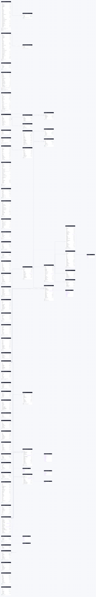

<details>
<summary>The whole schema as SQL</summary>

```sql
CREATE SCHEMA IF NOT EXISTS "public";

CREATE TYPE "ProvisionState" AS ENUM ('pending', 'ready', 'error', 'deleting');

CREATE TYPE "DataDbProvider" AS ENUM ('postgres');

CREATE TYPE "DataDbConnectionStatus" AS ENUM ('pending', 'validating', 'ready', 'error', 'migrating', 'disabled');

CREATE TYPE "DataDbConnectionHealthState" AS ENUM ('healthy', 'read_only', 'unreachable', 'degraded');

CREATE TYPE "SpaceDataDbBindingMode" AS ENUM ('default', 'byodb');

CREATE TYPE "SpaceDataDbBindingState" AS ENUM ('ready', 'validating', 'initializing', 'migrating', 'error', 'disabled');

CREATE TYPE "SpaceDataDbMigrationJobState" AS ENUM ('pending', 'waiting_worker', 'preflight', 'freezing_writes', 'copying', 'validating', 'switching', 'succeeded', 'failed', 'canceled', 'rolled_back');

CREATE TYPE "BaseDataDbMoveJobState" AS ENUM ('pending', 'waiting_worker', 'copying_base_schema', 'copying_shared_rows', 'validating', 'switching', 'succeeded', 'failed', 'cancelled');

CREATE TABLE "space" (
    "id" TEXT NOT NULL,
    "name" TEXT NOT NULL,
    "avatar" TEXT,
    "credit" INTEGER,
    "deleted_time" TIMESTAMP(3),
    "created_time" TIMESTAMP(3) NOT NULL DEFAULT CURRENT_TIMESTAMP,
    "created_by" TEXT NOT NULL,
    "last_modified_by" TEXT,
    "last_modified_time" TIMESTAMP(3),
    "is_template" BOOLEAN,

    CONSTRAINT "space_pkey" PRIMARY KEY ("id")
);

CREATE TABLE "data_db_connection" (
    "id" TEXT NOT NULL,
    "provider" "DataDbProvider" NOT NULL DEFAULT 'postgres',
    "encrypted_url" TEXT NOT NULL,
    "url_fingerprint" TEXT NOT NULL,
    "display_host" TEXT,
    "display_database" TEXT,
    "internal_schema" TEXT NOT NULL,
    "status" "DataDbConnectionStatus" NOT NULL DEFAULT 'pending',
    "schema_version" TEXT,
    "capabilities" JSONB,
    "last_validated_at" TIMESTAMP(3),
    "last_error" TEXT,
    "health_state" "DataDbConnectionHealthState" NOT NULL DEFAULT 'healthy',
    "health_reason" TEXT,
    "health_changed_at" TIMESTAMP(3),
    "last_health_check_at" TIMESTAMP(3),
    "consecutive_health_failures" INTEGER NOT NULL DEFAULT 0,
    "created_by" TEXT NOT NULL,
    "created_time" TIMESTAMP(3) NOT NULL DEFAULT CURRENT_TIMESTAMP,
    "last_modified_time" TIMESTAMP(3),

    CONSTRAINT "data_db_connection_pkey" PRIMARY KEY ("id")
);

CREATE TABLE "space_data_db_binding" (
    "id" TEXT NOT NULL,
    "space_id" TEXT NOT NULL,
    "data_db_connection_id" TEXT,
    "mode" "SpaceDataDbBindingMode" NOT NULL DEFAULT 'default',
    "state" "SpaceDataDbBindingState" NOT NULL DEFAULT 'ready',
    "created_by" TEXT NOT NULL,
    "created_time" TIMESTAMP(3) NOT NULL DEFAULT CURRENT_TIMESTAMP,
    "last_modified_time" TIMESTAMP(3),
    "last_history_flushed_at" TIMESTAMP(3),
    "last_removal_flushed_at" TIMESTAMP(3),

    CONSTRAINT "space_data_db_binding_pkey" PRIMARY KEY ("id")
);

CREATE TABLE "space_data_db_migration_job" (
    "id" TEXT NOT NULL,
    "space_id" TEXT NOT NULL,
    "source_connection_id" TEXT,
    "target_connection_id" TEXT,
    "target_mode" TEXT NOT NULL DEFAULT 'migrate-space',
    "switch_on_completion" BOOLEAN NOT NULL DEFAULT false,
    "state" "SpaceDataDbMigrationJobState" NOT NULL DEFAULT 'pending',
    "target_url_fingerprint" TEXT NOT NULL,
    "target_internal_schema" TEXT NOT NULL,
    "inventory" JSONB,
    "copy_stats" JSONB,
    "validation_stats" JSONB,
    "last_error" TEXT,
    "started_at" TIMESTAMP(3),
    "completed_at" TIMESTAMP(3),
    "created_by" TEXT NOT NULL,
    "created_time" TIMESTAMP(3) NOT NULL DEFAULT CURRENT_TIMESTAMP,
    "last_modified_time" TIMESTAMP(3),

    CONSTRAINT "space_data_db_migration_job_pkey" PRIMARY KEY ("id")
);

CREATE TABLE "base_data_db_move_job" (
    "id" TEXT NOT NULL,
    "base_id" TEXT NOT NULL,
    "source_space_id" TEXT NOT NULL,
    "target_space_id" TEXT NOT NULL,
    "source_connection_id" TEXT,
    "target_connection_id" TEXT,
    "state" "BaseDataDbMoveJobState" NOT NULL DEFAULT 'pending',
    "inventory" JSONB,
    "copy_stats" JSONB,
    "validation_stats" JSONB,
    "last_error" TEXT,
    "started_at" TIMESTAMP(3),
    "completed_at" TIMESTAMP(3),
    "created_by" TEXT NOT NULL,
    "created_time" TIMESTAMP(3) NOT NULL DEFAULT CURRENT_TIMESTAMP,
    "last_modified_time" TIMESTAMP(3),

    CONSTRAINT "base_data_db_move_job_pkey" PRIMARY KEY ("id")
);

CREATE TABLE "pin_resource" (
    "id" TEXT NOT NULL,
    "type" TEXT NOT NULL,
    "resource_id" TEXT NOT NULL,
    "created_time" TIMESTAMP(3) NOT NULL DEFAULT CURRENT_TIMESTAMP,
    "created_by" TEXT NOT NULL,
    "order" DOUBLE PRECISION NOT NULL,

    CONSTRAINT "pin_resource_pkey" PRIMARY KEY ("id")
);

CREATE TABLE "base" (
    "id" TEXT NOT NULL,
    "space_id" TEXT NOT NULL,
    "name" TEXT,
    "order" DOUBLE PRECISION NOT NULL,
    "icon" TEXT,
    "schema_pass" TEXT,
    "v2_enabled" BOOLEAN NOT NULL DEFAULT false,
    "provision_state" "ProvisionState" NOT NULL DEFAULT 'ready',
    "deleted_time" TIMESTAMP(3),
    "created_time" TIMESTAMP(3) NOT NULL DEFAULT CURRENT_TIMESTAMP,
    "created_by" TEXT NOT NULL,
    "last_modified_by" TEXT,
    "last_modified_time" TIMESTAMP(3),

    CONSTRAINT "base_pkey" PRIMARY KEY ("id")
);

CREATE TABLE "table_meta" (
    "id" TEXT NOT NULL,
    "base_id" TEXT NOT NULL,
    "name" TEXT NOT NULL,
    "description" TEXT,
    "icon" TEXT,
    "db_table_name" TEXT NOT NULL,
    "db_view_name" TEXT,
    "search_index" JSONB,
    "search_index_policy" JSONB,
    "query_index_policy" JSONB,
    "provision_state" "ProvisionState" NOT NULL DEFAULT 'ready',
    "version" INTEGER NOT NULL,
    "order" DOUBLE PRECISION NOT NULL,
    "created_time" TIMESTAMP(3) NOT NULL DEFAULT CURRENT_TIMESTAMP,
    "last_modified_time" TIMESTAMP(3),
    "deleted_time" TIMESTAMP(3),
    "created_by" TEXT NOT NULL,
    "last_modified_by" TEXT,

    CONSTRAINT "table_meta_pkey" PRIMARY KEY ("id")
);

CREATE TABLE "table_query_observation_shard" (
    "space_id" TEXT,
    "base_id" TEXT NOT NULL,
    "table_id" TEXT NOT NULL,
    "query_kind" TEXT NOT NULL,
    "shape_hash" TEXT NOT NULL,
    "window_start" TIMESTAMPTZ(6) NOT NULL,
    "writer_id" TEXT NOT NULL,
    "window_size_seconds" INTEGER NOT NULL,
    "request_count" INTEGER NOT NULL,
    "slow_count" INTEGER NOT NULL,
    "timeout_count" INTEGER NOT NULL,
    "db_error_count" INTEGER NOT NULL,
    "total_duration_ms" DOUBLE PRECISION NOT NULL,
    "max_duration_ms" DOUBLE PRECISION NOT NULL,
    "total_db_duration_ms" DOUBLE PRECISION,
    "max_db_duration_ms" DOUBLE PRECISION,
    "shape" JSONB NOT NULL,
    "sql_diagnostics" JSONB,
    "created_time" TIMESTAMPTZ(6) NOT NULL DEFAULT CURRENT_TIMESTAMP,
    "last_modified_time" TIMESTAMPTZ(6),

    CONSTRAINT "table_query_observation_shard_pkey" PRIMARY KEY ("table_id","query_kind","shape_hash","window_start","writer_id")
);

CREATE TABLE "schema_operation" (
    "id" TEXT NOT NULL,
    "type" TEXT NOT NULL,
    "status" TEXT NOT NULL,
    "phase" TEXT NOT NULL,
    "resource_type" TEXT NOT NULL,
    "resource_id" TEXT NOT NULL,
    "base_id" TEXT,
    "table_id" TEXT,
    "idempotency_key" TEXT NOT NULL,
    "payload" JSONB,
    "result" JSONB,
    "attempts" INTEGER NOT NULL DEFAULT 0,
    "max_attempts" INTEGER NOT NULL DEFAULT 8,
    "next_run_at" TIMESTAMPTZ(6) NOT NULL DEFAULT CURRENT_TIMESTAMP,
    "locked_at" TIMESTAMPTZ(6),
    "locked_by" TEXT,
    "last_error" TEXT,
    "created_time" TIMESTAMPTZ(6) NOT NULL DEFAULT CURRENT_TIMESTAMP,
    "created_by" TEXT NOT NULL,
    "last_modified_time" TIMESTAMPTZ(6),
    "last_modified_by" TEXT,

    CONSTRAINT "schema_operation_pkey" PRIMARY KEY ("id")
);

CREATE TABLE "field" (
    "id" TEXT NOT NULL,
    "name" TEXT NOT NULL,
    "description" TEXT,
    "options" TEXT,
    "meta" TEXT,
    "ai_config" TEXT,
    "type" TEXT NOT NULL,
    "cell_value_type" TEXT NOT NULL,
    "is_multiple_cell_value" BOOLEAN,
    "db_field_type" TEXT NOT NULL,
    "db_field_name" TEXT NOT NULL,
    "provision_state" "ProvisionState" NOT NULL DEFAULT 'ready',
    "not_null" BOOLEAN,
    "unique" BOOLEAN,
    "is_primary" BOOLEAN,
    "is_computed" BOOLEAN,
    "is_lookup" BOOLEAN,
    "is_conditional_lookup" BOOLEAN,
    "is_pending" BOOLEAN,
    "has_error" BOOLEAN,
    "lookup_linked_field_id" TEXT,
    "lookup_options" TEXT,
    "table_id" TEXT NOT NULL,
    "order" DOUBLE PRECISION NOT NULL,
    "version" INTEGER NOT NULL,
    "created_time" TIMESTAMP(3) NOT NULL DEFAULT CURRENT_TIMESTAMP,
    "last_modified_time" TIMESTAMP(3),
    "deleted_time" TIMESTAMP(3),
    "created_by" TEXT NOT NULL,
    "last_modified_by" TEXT,

    CONSTRAINT "field_pkey" PRIMARY KEY ("id")
);

CREATE TABLE "computed_update_outbox" (
    "id" TEXT NOT NULL,
    "base_id" TEXT NOT NULL,
    "worker_lane" TEXT NOT NULL DEFAULT 'production',
    "seed_table_id" TEXT NOT NULL,
    "seed_record_ids" JSONB,
    "change_type" TEXT NOT NULL,
    "steps" JSONB,
    "edges" JSONB,
    "status" TEXT NOT NULL,
    "attempts" INTEGER NOT NULL DEFAULT 0,
    "max_attempts" INTEGER NOT NULL DEFAULT 8,
    "next_run_at" TIMESTAMP(3) NOT NULL DEFAULT CURRENT_TIMESTAMP,
    "locked_at" TIMESTAMP(3),
    "locked_by" TEXT,
    "last_error" TEXT,
    "estimated_complexity" INTEGER NOT NULL DEFAULT 0,
    "plan_hash" TEXT NOT NULL,
    "dirty_stats" JSONB,
    "run_id" TEXT NOT NULL,
    "origin_run_ids" TEXT[] DEFAULT ARRAY[]::TEXT[],
    "run_total_steps" INTEGER NOT NULL DEFAULT 0,
    "run_completed_steps_before" INTEGER NOT NULL DEFAULT 0,
    "affected_table_ids" TEXT[] DEFAULT ARRAY[]::TEXT[],
    "affected_field_ids" TEXT[] DEFAULT ARRAY[]::TEXT[],
    "sync_max_level" INTEGER,
    "source_changed_at" TIMESTAMP(3),
    "stage_depth" INTEGER NOT NULL DEFAULT 0,
    "predecessor_task_id" TEXT,
    "created_at" TIMESTAMP(3) NOT NULL DEFAULT CURRENT_TIMESTAMP,
    "updated_at" TIMESTAMP(3) NOT NULL,

    CONSTRAINT "computed_update_outbox_pkey" PRIMARY KEY ("id")
);

CREATE TABLE "computed_update_outbox_seed" (
    "id" TEXT NOT NULL,
    "task_id" TEXT NOT NULL,
    "table_id" TEXT NOT NULL,
    "record_id" TEXT NOT NULL,

    CONSTRAINT "computed_update_outbox_seed_pkey" PRIMARY KEY ("id")
);

CREATE TABLE "computed_update_change_frontier" (
    "scope_id" TEXT NOT NULL,
    "kind" TEXT NOT NULL,
    "table_id" TEXT NOT NULL,
    "record_id" TEXT NOT NULL,
    "field_id" TEXT NOT NULL,

    CONSTRAINT "computed_update_change_frontier_pkey" PRIMARY KEY ("scope_id","kind","table_id","record_id","field_id")
);

CREATE TABLE "computed_update_stage_ledger" (
    "scope_id" TEXT NOT NULL,
    "kind" TEXT NOT NULL,
    "table_id" TEXT NOT NULL,
    "record_id" TEXT NOT NULL,
    "seq" BIGINT NOT NULL DEFAULT 0,

    CONSTRAINT "computed_update_stage_ledger_pkey" PRIMARY KEY ("scope_id","kind","table_id","record_id")
);

CREATE TABLE "computed_update_dead_letter" (
    "id" TEXT NOT NULL,
    "base_id" TEXT NOT NULL,
    "worker_lane" TEXT NOT NULL DEFAULT 'production',
    "seed_table_id" TEXT NOT NULL,
    "seed_record_ids" JSONB,
    "change_type" TEXT NOT NULL,
    "steps" JSONB,
    "edges" JSONB,
    "status" TEXT NOT NULL,
    "attempts" INTEGER NOT NULL DEFAULT 0,
    "max_attempts" INTEGER NOT NULL DEFAULT 8,
    "next_run_at" TIMESTAMP(3) NOT NULL,
    "locked_at" TIMESTAMP(3),
    "locked_by" TEXT,
    "last_error" TEXT,
    "estimated_complexity" INTEGER NOT NULL DEFAULT 0,
    "plan_hash" TEXT NOT NULL,
    "dirty_stats" JSONB,
    "run_id" TEXT NOT NULL,
    "origin_run_ids" TEXT[] DEFAULT ARRAY[]::TEXT[],
    "run_total_steps" INTEGER NOT NULL DEFAULT 0,
    "run_completed_steps_before" INTEGER NOT NULL DEFAULT 0,
    "affected_table_ids" TEXT[] DEFAULT ARRAY[]::TEXT[],
    "affected_field_ids" TEXT[] DEFAULT ARRAY[]::TEXT[],
    "sync_max_level" INTEGER,
    "source_changed_at" TIMESTAMP(3),
    "stage_depth" INTEGER NOT NULL DEFAULT 0,
    "predecessor_task_id" TEXT,
    "trace_data" JSONB,
    "failed_at" TIMESTAMP(3) NOT NULL,
    "created_at" TIMESTAMP(3) NOT NULL,
    "updated_at" TIMESTAMP(3) NOT NULL,

    CONSTRAINT "computed_update_dead_letter_pkey" PRIMARY KEY ("id")
);

CREATE TABLE "computed_update_dead_letter_seed" (
    "task_id" TEXT NOT NULL,
    "table_id" TEXT NOT NULL,
    "record_id" TEXT NOT NULL,

    CONSTRAINT "computed_update_dead_letter_seed_pkey" PRIMARY KEY ("task_id","table_id","record_id")
);

CREATE TABLE "computed_update_run_history" (
    "task_id" TEXT NOT NULL,
    "base_id" TEXT NOT NULL,
    "seed_table_id" TEXT NOT NULL,
    "change_type" TEXT NOT NULL,
    "run_id" TEXT NOT NULL,
    "origin_run_ids" TEXT[] DEFAULT ARRAY[]::TEXT[],
    "steps" JSONB,
    "edges" JSONB,
    "affected_table_ids" TEXT[] DEFAULT ARRAY[]::TEXT[],
    "affected_field_ids" TEXT[] DEFAULT ARRAY[]::TEXT[],
    "source_field_ids" TEXT[] DEFAULT ARRAY[]::TEXT[],
    "seed_record_count" INTEGER NOT NULL DEFAULT 0,
    "stage_depth" INTEGER NOT NULL DEFAULT 0,
    "predecessor_task_id" TEXT,
    "run_total_steps" INTEGER NOT NULL DEFAULT 0,
    "run_completed_steps_before" INTEGER NOT NULL DEFAULT 0,
    "sync_max_level" INTEGER,
    "estimated_complexity" INTEGER NOT NULL DEFAULT 0,
    "attempts" INTEGER NOT NULL DEFAULT 0,
    "outcome" TEXT NOT NULL,
    "source_changed_at" TIMESTAMP(3),
    "enqueued_at" TIMESTAMP(3) NOT NULL,
    "started_at" TIMESTAMP(3),
    "completed_at" TIMESTAMP(3) NOT NULL,
    "duration_ms" INTEGER NOT NULL DEFAULT 0,

    CONSTRAINT "computed_update_run_history_pkey" PRIMARY KEY ("task_id")
);

CREATE TABLE "computed_update_pause_scope" (
    "id" TEXT NOT NULL,
    "scope_type" TEXT NOT NULL,
    "scope_id" TEXT NOT NULL,
    "paused_at" TIMESTAMP(3) NOT NULL DEFAULT CURRENT_TIMESTAMP,
    "paused_by" TEXT,
    "resume_at" TIMESTAMP(3),
    "reason" TEXT,
    "write_policy" TEXT NOT NULL DEFAULT 'allow_bounded',
    "updated_at" TIMESTAMP(3) NOT NULL DEFAULT CURRENT_TIMESTAMP,
    "updated_by" TEXT,

    CONSTRAINT "computed_update_pause_scope_pkey" PRIMARY KEY ("id")
);

CREATE TABLE "computed_field_activity" (
    "field_id" TEXT NOT NULL,
    "table_id" TEXT NOT NULL,
    "base_id" TEXT NOT NULL,
    "status" TEXT NOT NULL,
    "active_task_count" INTEGER NOT NULL DEFAULT 0,
    "processing_task_count" INTEGER NOT NULL DEFAULT 0,
    "generation" BIGINT NOT NULL DEFAULT 0,
    "estimated_complexity" BIGINT NOT NULL DEFAULT 0,
    "estimated_dirty_records" BIGINT NOT NULL DEFAULT 0,
    "has_all_target_records" BOOLEAN NOT NULL DEFAULT false,
    "queued_at" TIMESTAMP(3),
    "started_at" TIMESTAMP(3),
    "last_completed_at" TIMESTAMP(3),
    "last_duration_ms" INTEGER,
    "last_error" JSONB,
    "extensions" JSONB,
    "updated_at" TIMESTAMP(3) NOT NULL DEFAULT CURRENT_TIMESTAMP,

    CONSTRAINT "computed_field_activity_pkey" PRIMARY KEY ("field_id")
);

CREATE TABLE "computed_table_activity" (
    "table_id" TEXT NOT NULL,
    "base_id" TEXT NOT NULL,
    "status" TEXT NOT NULL,
    "calculating_field_count" INTEGER NOT NULL DEFAULT 0,
    "queued_field_count" INTEGER NOT NULL DEFAULT 0,
    "estimated_complexity" BIGINT NOT NULL DEFAULT 0,
    "recent_completions" JSONB NOT NULL DEFAULT '[]',
    "generation" BIGINT NOT NULL DEFAULT 0,
    "updated_at" TIMESTAMP(3) NOT NULL DEFAULT CURRENT_TIMESTAMP,

    CONSTRAINT "computed_table_activity_pkey" PRIMARY KEY ("table_id")
);

CREATE TABLE "computed_task_field_ref" (
    "task_id" TEXT NOT NULL,
    "field_id" TEXT NOT NULL,
    "table_id" TEXT NOT NULL,
    "base_id" TEXT NOT NULL,
    "was_processing" BOOLEAN NOT NULL DEFAULT false,
    "created_at" TIMESTAMP(3) NOT NULL DEFAULT CURRENT_TIMESTAMP,

    CONSTRAINT "computed_task_field_ref_pkey" PRIMARY KEY ("task_id","field_id")
);

CREATE TABLE "view" (
    "id" TEXT NOT NULL,
    "name" TEXT NOT NULL,
    "description" TEXT,
    "table_id" TEXT NOT NULL,
    "type" TEXT NOT NULL,
    "sort" TEXT,
    "filter" TEXT,
    "group" TEXT,
    "options" TEXT,
    "order" DOUBLE PRECISION NOT NULL,
    "version" INTEGER NOT NULL,
    "column_meta" TEXT NOT NULL,
    "is_locked" BOOLEAN,
    "enable_share" BOOLEAN,
    "share_id" TEXT,
    "share_meta" TEXT,
    "created_time" TIMESTAMP(3) NOT NULL DEFAULT CURRENT_TIMESTAMP,
    "last_modified_time" TIMESTAMP(3),
    "deleted_time" TIMESTAMP(3),
    "created_by" TEXT NOT NULL,
    "last_modified_by" TEXT,

    CONSTRAINT "view_pkey" PRIMARY KEY ("id")
);

CREATE TABLE "ops" (
    "id" TEXT NOT NULL,
    "collection" TEXT NOT NULL,
    "doc_id" TEXT NOT NULL,
    "doc_type" TEXT NOT NULL,
    "version" INTEGER NOT NULL,
    "operation" TEXT NOT NULL,
    "created_time" TIMESTAMP(3) NOT NULL DEFAULT CURRENT_TIMESTAMP,
    "created_by" TEXT NOT NULL,

    CONSTRAINT "ops_pkey" PRIMARY KEY ("id")
);

CREATE TABLE "reference" (
    "id" TEXT NOT NULL,
    "from_field_id" TEXT NOT NULL,
    "to_field_id" TEXT NOT NULL,
    "created_time" TIMESTAMP(3) NOT NULL DEFAULT CURRENT_TIMESTAMP,

    CONSTRAINT "reference_pkey" PRIMARY KEY ("id")
);

CREATE TABLE "users" (
    "id" TEXT NOT NULL,
    "name" TEXT NOT NULL,
    "password" TEXT,
    "salt" TEXT,
    "phone" TEXT,
    "email" TEXT NOT NULL,
    "avatar" TEXT,
    "is_system" BOOLEAN,
    "is_admin" BOOLEAN,
    "is_trial_used" BOOLEAN,
    "lang" TEXT,
    "notify_meta" TEXT,
    "last_sign_time" TIMESTAMP(3),
    "deactivated_time" TIMESTAMP(3),
    "created_time" TIMESTAMP(3) NOT NULL DEFAULT CURRENT_TIMESTAMP,
    "deleted_time" TIMESTAMP(3),
    "last_modified_time" TIMESTAMP(3),
    "permanent_deleted_time" TIMESTAMP(3),
    "ref_meta" TEXT,

    CONSTRAINT "users_pkey" PRIMARY KEY ("id")
);

CREATE TABLE "account" (
    "id" TEXT NOT NULL,
    "user_id" TEXT NOT NULL,
    "type" TEXT NOT NULL,
    "provider" TEXT NOT NULL,
    "provider_id" TEXT NOT NULL,
    "connection_id" TEXT NOT NULL DEFAULT '',
    "created_time" TIMESTAMP(3) NOT NULL DEFAULT CURRENT_TIMESTAMP,

    CONSTRAINT "account_pkey" PRIMARY KEY ("id")
);

CREATE TABLE "attachments" (
    "id" TEXT NOT NULL,
    "token" TEXT NOT NULL,
    "hash" TEXT NOT NULL,
    "size" BIGINT NOT NULL,
    "mimetype" TEXT NOT NULL,
    "path" TEXT NOT NULL,
    "width" INTEGER,
    "height" INTEGER,
    "deleted_time" TIMESTAMP(3),
    "created_time" TIMESTAMP(3) NOT NULL DEFAULT CURRENT_TIMESTAMP,
    "created_by" TEXT NOT NULL,
    "last_modified_by" TEXT,
    "thumbnail_path" TEXT,

    CONSTRAINT "attachments_pkey" PRIMARY KEY ("id")
);

CREATE TABLE "attachments_table" (
    "id" TEXT NOT NULL,
    "attachment_id" TEXT NOT NULL,
    "name" TEXT NOT NULL,
    "token" TEXT NOT NULL,
    "table_id" TEXT NOT NULL,
    "record_id" TEXT NOT NULL,
    "field_id" TEXT NOT NULL,
    "created_time" TIMESTAMP(3) NOT NULL DEFAULT CURRENT_TIMESTAMP,
    "created_by" TEXT NOT NULL,
    "last_modified_by" TEXT,
    "last_modified_time" TIMESTAMP(3),

    CONSTRAINT "attachments_table_pkey" PRIMARY KEY ("id")
);

CREATE TABLE "collaborator" (
    "id" TEXT NOT NULL,
    "role_name" TEXT NOT NULL,
    "resource_type" TEXT NOT NULL,
    "resource_id" TEXT NOT NULL,
    "principal_id" TEXT NOT NULL,
    "principal_type" TEXT NOT NULL,
    "created_by" TEXT NOT NULL,
    "created_time" TIMESTAMP(3) NOT NULL DEFAULT CURRENT_TIMESTAMP,
    "last_modified_time" TIMESTAMP(3),
    "last_modified_by" TEXT,

    CONSTRAINT "collaborator_pkey" PRIMARY KEY ("id")
);

CREATE TABLE "invitation" (
    "id" TEXT NOT NULL,
    "base_id" TEXT,
    "space_id" TEXT,
    "type" TEXT NOT NULL,
    "role" TEXT NOT NULL,
    "invitation_code" TEXT NOT NULL,
    "expired_time" TIMESTAMP(3),
    "create_by" TEXT NOT NULL,
    "created_time" TIMESTAMP(3) NOT NULL DEFAULT CURRENT_TIMESTAMP,
    "last_modified_time" TIMESTAMP(3),
    "last_modified_by" TEXT,
    "deleted_time" TIMESTAMP(3),

    CONSTRAINT "invitation_pkey" PRIMARY KEY ("id")
);

CREATE TABLE "invitation_record" (
    "id" TEXT NOT NULL,
    "invitation_id" TEXT NOT NULL,
    "base_id" TEXT,
    "space_id" TEXT,
    "type" TEXT NOT NULL,
    "inviter" TEXT NOT NULL,
    "accepter" TEXT NOT NULL,
    "created_time" TIMESTAMP(3) NOT NULL DEFAULT CURRENT_TIMESTAMP,

    CONSTRAINT "invitation_record_pkey" PRIMARY KEY ("id")
);

CREATE TABLE "notification" (
    "id" TEXT NOT NULL,
    "from_user_id" TEXT NOT NULL,
    "to_user_id" TEXT NOT NULL,
    "type" TEXT NOT NULL,
    "message" TEXT NOT NULL,
    "message_i18n" TEXT,
    "severity" TEXT NOT NULL DEFAULT 'info',
    "url_path" TEXT,
    "is_read" BOOLEAN NOT NULL DEFAULT false,
    "created_time" TIMESTAMP(3) NOT NULL DEFAULT CURRENT_TIMESTAMP,
    "created_by" TEXT NOT NULL,

    CONSTRAINT "notification_pkey" PRIMARY KEY ("id")
);

CREATE TABLE "access_token" (
    "id" TEXT NOT NULL,
    "name" TEXT NOT NULL,
    "description" TEXT,
    "user_id" TEXT NOT NULL,
    "scopes" TEXT NOT NULL,
    "space_ids" TEXT,
    "base_ids" TEXT,
    "sign" TEXT NOT NULL,
    "client_id" TEXT,
    "has_full_access" BOOLEAN,
    "expired_time" TIMESTAMP(3) NOT NULL,
    "last_used_time" TIMESTAMP(3),
    "created_time" TIMESTAMP(3) NOT NULL DEFAULT CURRENT_TIMESTAMP,
    "last_modified_time" TIMESTAMP(3),

    CONSTRAINT "access_token_pkey" PRIMARY KEY ("id")
);

CREATE TABLE "setting" (
    "name" TEXT NOT NULL,
    "content" TEXT,
    "created_time" TIMESTAMP(3) NOT NULL DEFAULT CURRENT_TIMESTAMP,
    "last_modified_time" TIMESTAMP(3),
    "created_by" TEXT NOT NULL,
    "last_modified_by" TEXT
);

CREATE TABLE "oauth_app" (
    "id" TEXT NOT NULL,
    "name" TEXT NOT NULL,
    "logo" TEXT,
    "homepage" TEXT NOT NULL,
    "description" TEXT,
    "client_id" TEXT NOT NULL,
    "redirect_uris" TEXT,
    "scopes" TEXT,
    "allow_device_flow" BOOLEAN NOT NULL DEFAULT false,
    "dynamic_registration" BOOLEAN NOT NULL DEFAULT false,
    "created_time" TIMESTAMP(3) NOT NULL DEFAULT CURRENT_TIMESTAMP,
    "last_modified_time" TIMESTAMP(3),
    "created_by" TEXT NOT NULL,

    CONSTRAINT "oauth_app_pkey" PRIMARY KEY ("id")
);

CREATE TABLE "oauth_app_authorized" (
    "id" TEXT NOT NULL,
    "client_id" TEXT NOT NULL,
    "user_id" TEXT NOT NULL,
    "authorized_time" TIMESTAMP(3) NOT NULL,

    CONSTRAINT "oauth_app_authorized_pkey" PRIMARY KEY ("id")
);

CREATE TABLE "oauth_app_secret" (
    "id" TEXT NOT NULL,
    "client_id" TEXT NOT NULL,
    "secret" TEXT NOT NULL,
    "masked_secret" TEXT NOT NULL,
    "created_time" TIMESTAMP(3) NOT NULL DEFAULT CURRENT_TIMESTAMP,
    "created_by" TEXT NOT NULL,
    "last_used_time" TIMESTAMP(3),

    CONSTRAINT "oauth_app_secret_pkey" PRIMARY KEY ("id")
);

CREATE TABLE "oauth_app_token" (
    "id" TEXT NOT NULL,
    "client_id" TEXT NOT NULL,
    "app_secret_id" TEXT,
    "refresh_token_sign" TEXT NOT NULL,
    "expired_time" TIMESTAMP(3) NOT NULL,
    "created_time" TIMESTAMP(3) NOT NULL DEFAULT CURRENT_TIMESTAMP,
    "created_by" TEXT NOT NULL,

    CONSTRAINT "oauth_app_token_pkey" PRIMARY KEY ("id")
);

CREATE TABLE "record_history" (
    "id" TEXT NOT NULL,
    "table_id" TEXT NOT NULL,
    "record_id" TEXT NOT NULL,
    "field_id" TEXT NOT NULL,
    "before" TEXT NOT NULL,
    "after" TEXT NOT NULL,
    "created_time" TIMESTAMP(3) NOT NULL DEFAULT CURRENT_TIMESTAMP,
    "created_by" TEXT NOT NULL,

    CONSTRAINT "record_history_pkey" PRIMARY KEY ("id")
);

CREATE TABLE "trash" (
    "id" TEXT NOT NULL,
    "resource_type" TEXT NOT NULL,
    "resource_id" TEXT NOT NULL,
    "parent_id" TEXT,
    "deleted_time" TIMESTAMP(3) NOT NULL DEFAULT CURRENT_TIMESTAMP,
    "deleted_by" TEXT NOT NULL,

    CONSTRAINT "trash_pkey" PRIMARY KEY ("id")
);

CREATE TABLE "table_trash" (
    "id" TEXT NOT NULL,
    "table_id" TEXT NOT NULL,
    "resource_type" TEXT NOT NULL,
    "snapshot" TEXT NOT NULL,
    "created_time" TIMESTAMP(3) NOT NULL DEFAULT CURRENT_TIMESTAMP,
    "created_by" TEXT NOT NULL,

    CONSTRAINT "table_trash_pkey" PRIMARY KEY ("id")
);

CREATE TABLE "record_trash" (
    "id" TEXT NOT NULL,
    "table_id" TEXT NOT NULL,
    "record_id" TEXT NOT NULL,
    "snapshot" TEXT NOT NULL,
    "created_time" TIMESTAMP(3) NOT NULL DEFAULT CURRENT_TIMESTAMP,
    "created_by" TEXT NOT NULL,
    "reason" TEXT NOT NULL DEFAULT 'deleted',
    "record_created_time" TIMESTAMP(3),
    "record_created_by" TEXT,
    "record_last_modified_time" TIMESTAMP(3),
    "record_last_modified_by" TEXT,
    "operation_id" TEXT,

    CONSTRAINT "record_trash_pkey" PRIMARY KEY ("id")
);

CREATE TABLE "record_removal_tombstone" (
    "id" TEXT NOT NULL,
    "table_id" TEXT NOT NULL,
    "record_id" TEXT NOT NULL,
    "type" TEXT NOT NULL,
    "created_time" TIMESTAMP(3) NOT NULL DEFAULT CURRENT_TIMESTAMP,

    CONSTRAINT "record_removal_tombstone_pkey" PRIMARY KEY ("id")
);

CREATE TABLE "plugin" (
    "id" TEXT NOT NULL,
    "name" TEXT NOT NULL,
    "description" TEXT,
    "detail_desc" TEXT,
    "logo" TEXT NOT NULL,
    "help_url" TEXT,
    "status" TEXT NOT NULL,
    "positions" TEXT NOT NULL,
    "url" TEXT,
    "secret" TEXT NOT NULL,
    "masked_secret" TEXT NOT NULL,
    "i18n" TEXT,
    "config" TEXT,
    "plugin_user" TEXT,
    "created_time" TIMESTAMP(3) NOT NULL DEFAULT CURRENT_TIMESTAMP,
    "last_modified_time" TIMESTAMP(3),
    "created_by" TEXT NOT NULL,
    "last_modified_by" TEXT,

    CONSTRAINT "plugin_pkey" PRIMARY KEY ("id")
);

CREATE TABLE "plugin_install" (
    "id" TEXT NOT NULL,
    "plugin_id" TEXT NOT NULL,
    "base_id" TEXT NOT NULL,
    "name" TEXT NOT NULL,
    "position_id" TEXT NOT NULL,
    "position" TEXT NOT NULL,
    "storage" TEXT,
    "created_time" TIMESTAMP(3) NOT NULL DEFAULT CURRENT_TIMESTAMP,
    "created_by" TEXT NOT NULL,
    "last_modified_time" TIMESTAMP(3),
    "last_modified_by" TEXT,

    CONSTRAINT "plugin_install_pkey" PRIMARY KEY ("id")
);

CREATE TABLE "dashboard" (
    "id" TEXT NOT NULL,
    "name" TEXT NOT NULL,
    "base_id" TEXT NOT NULL,
    "layout" TEXT,
    "created_by" TEXT NOT NULL,
    "created_time" TIMESTAMP(3) NOT NULL DEFAULT CURRENT_TIMESTAMP,
    "last_modified_time" TIMESTAMP(3),
    "last_modified_by" TEXT,
    "deleted_time" TIMESTAMP(3),

    CONSTRAINT "dashboard_pkey" PRIMARY KEY ("id")
);

CREATE TABLE "comment" (
    "id" TEXT NOT NULL,
    "table_id" TEXT NOT NULL,
    "record_id" TEXT NOT NULL,
    "quote_Id" TEXT,
    "content" TEXT,
    "reaction" TEXT,
    "deleted_time" TIMESTAMP(3),
    "created_time" TIMESTAMP(3) NOT NULL DEFAULT CURRENT_TIMESTAMP,
    "created_by" TEXT NOT NULL,
    "last_modified_time" TIMESTAMP(3),

    CONSTRAINT "comment_pkey" PRIMARY KEY ("id")
);

CREATE TABLE "comment_subscription" (
    "id" TEXT NOT NULL,
    "table_id" TEXT NOT NULL,
    "record_id" TEXT NOT NULL,
    "created_by" TEXT NOT NULL,
    "created_time" TIMESTAMP(3) NOT NULL DEFAULT CURRENT_TIMESTAMP,

    CONSTRAINT "comment_subscription_pkey" PRIMARY KEY ("id")
);

CREATE TABLE "integration" (
    "id" TEXT NOT NULL,
    "resource_id" TEXT NOT NULL,
    "config" TEXT NOT NULL,
    "type" TEXT NOT NULL,
    "enable" BOOLEAN,
    "created_time" TIMESTAMP(3) NOT NULL DEFAULT CURRENT_TIMESTAMP,
    "last_modified_time" TIMESTAMP(3),

    CONSTRAINT "integration_pkey" PRIMARY KEY ("id")
);

CREATE TABLE "plugin_panel" (
    "id" TEXT NOT NULL,
    "name" TEXT NOT NULL,
    "table_id" TEXT NOT NULL,
    "layout" TEXT,
    "created_by" TEXT NOT NULL,
    "created_time" TIMESTAMP(3) NOT NULL DEFAULT CURRENT_TIMESTAMP,
    "last_modified_time" TIMESTAMP(3),
    "last_modified_by" TEXT,

    CONSTRAINT "plugin_panel_pkey" PRIMARY KEY ("id")
);

CREATE TABLE "plugin_context_menu" (
    "id" TEXT NOT NULL,
    "table_id" TEXT NOT NULL,
    "plugin_install_id" TEXT NOT NULL,
    "order" DOUBLE PRECISION NOT NULL,
    "created_time" TIMESTAMP(3) NOT NULL DEFAULT CURRENT_TIMESTAMP,
    "created_by" TEXT NOT NULL,
    "last_modified_time" TIMESTAMP(3),
    "last_modified_by" TEXT,

    CONSTRAINT "plugin_context_menu_pkey" PRIMARY KEY ("id")
);

CREATE TABLE "user_last_visit" (
    "id" TEXT NOT NULL,
    "user_id" TEXT NOT NULL,
    "resource_type" TEXT NOT NULL,
    "resource_id" TEXT NOT NULL,
    "parent_resource_id" TEXT NOT NULL,
    "last_visit_time" TIMESTAMP(3) NOT NULL DEFAULT CURRENT_TIMESTAMP,

    CONSTRAINT "user_last_visit_pkey" PRIMARY KEY ("id")
);

CREATE TABLE "user_base_order" (
    "id" TEXT NOT NULL,
    "user_id" TEXT NOT NULL,
    "base_id" TEXT NOT NULL,
    "order" DOUBLE PRECISION NOT NULL,
    "created_time" TIMESTAMP(3) NOT NULL DEFAULT CURRENT_TIMESTAMP,
    "last_modified_time" TIMESTAMP(3),

    CONSTRAINT "user_base_order_pkey" PRIMARY KEY ("id")
);

CREATE TABLE "template" (
    "id" TEXT NOT NULL,
    "base_id" TEXT,
    "cover" TEXT,
    "name" TEXT,
    "description" TEXT,
    "markdown_description" TEXT,
    "category_id" TEXT[],
    "created_time" TIMESTAMP(3) NOT NULL DEFAULT CURRENT_TIMESTAMP,
    "created_by" TEXT NOT NULL,
    "last_modified_time" TIMESTAMP(3),
    "last_modified_by" TEXT,
    "is_system" BOOLEAN,
    "is_published" BOOLEAN,
    "featured" BOOLEAN,
    "snapshot" TEXT,
    "order" DOUBLE PRECISION NOT NULL,
    "usage_count" INTEGER NOT NULL DEFAULT 0,
    "publish_info" JSONB,
    "visit_count" INTEGER NOT NULL DEFAULT 0,
    "kind" TEXT,
    "version" INTEGER NOT NULL DEFAULT 1,
    "manifest" JSONB,
    "review" JSONB,
    "history" JSONB,
    "parent_template_id" TEXT,
    "slug" TEXT,

    CONSTRAINT "template_pkey" PRIMARY KEY ("id")
);

CREATE TABLE "template_category" (
    "id" TEXT NOT NULL,
    "name" TEXT NOT NULL,
    "created_time" TIMESTAMP(3) NOT NULL DEFAULT CURRENT_TIMESTAMP,
    "created_by" TEXT NOT NULL,
    "last_modified_time" TIMESTAMP(3),
    "last_modified_by" TEXT,
    "order" DOUBLE PRECISION NOT NULL,
    "parent_id" TEXT,
    "kind" TEXT NOT NULL DEFAULT 'industry',
    "key" TEXT,

    CONSTRAINT "template_category_pkey" PRIMARY KEY ("id")
);

CREATE TABLE "task" (
    "id" TEXT NOT NULL,
    "type" TEXT NOT NULL,
    "status" TEXT NOT NULL,
    "snapshot" TEXT,
    "created_time" TIMESTAMP(3) NOT NULL DEFAULT CURRENT_TIMESTAMP,
    "last_modified_time" TIMESTAMP(3),
    "created_by" TEXT NOT NULL,
    "last_modified_by" TEXT,

    CONSTRAINT "task_pkey" PRIMARY KEY ("id")
);

CREATE TABLE "task_run" (
    "id" TEXT NOT NULL,
    "task_id" TEXT NOT NULL,
    "base_id" TEXT NOT NULL,
    "status" TEXT NOT NULL,
    "snapshot" TEXT NOT NULL,
    "depends_on_run_ids" TEXT[] DEFAULT ARRAY[]::TEXT[],
    "spent" INTEGER,
    "log" TEXT,
    "error_msg" TEXT,
    "started_time" TIMESTAMP(3),
    "created_time" TIMESTAMP(3) NOT NULL DEFAULT CURRENT_TIMESTAMP,
    "last_modified_time" TIMESTAMP(3),

    CONSTRAINT "task_run_pkey" PRIMARY KEY ("id")
);

CREATE TABLE "task_reference" (
    "id" TEXT NOT NULL,
    "from_field_id" TEXT NOT NULL,
    "to_field_id" TEXT NOT NULL,
    "created_time" TIMESTAMP(3) NOT NULL DEFAULT CURRENT_TIMESTAMP,

    CONSTRAINT "task_reference_pkey" PRIMARY KEY ("id")
);

CREATE TABLE "waitlist" (
    "email" TEXT NOT NULL,
    "invite" BOOLEAN,
    "invite_time" TIMESTAMP(3),
    "created_time" TIMESTAMP(3) NOT NULL DEFAULT CURRENT_TIMESTAMP
);

CREATE TABLE "base_node" (
    "id" TEXT NOT NULL,
    "parent_id" TEXT,
    "base_id" TEXT NOT NULL,
    "resource_type" TEXT NOT NULL,
    "resource_id" TEXT NOT NULL,
    "order" DOUBLE PRECISION NOT NULL,
    "created_time" TIMESTAMP(3) NOT NULL DEFAULT CURRENT_TIMESTAMP,
    "created_by" TEXT NOT NULL,
    "last_modified_time" TIMESTAMP(3),
    "last_modified_by" TEXT,

    CONSTRAINT "base_node_pkey" PRIMARY KEY ("id")
);

CREATE TABLE "base_node_folder" (
    "id" TEXT NOT NULL,
    "base_id" TEXT NOT NULL,
    "name" TEXT NOT NULL,
    "created_time" TIMESTAMP(3) NOT NULL DEFAULT CURRENT_TIMESTAMP,
    "created_by" TEXT NOT NULL,
    "last_modified_time" TIMESTAMP(3),
    "last_modified_by" TEXT,
    "deleted_time" TIMESTAMP(3),

    CONSTRAINT "base_node_folder_pkey" PRIMARY KEY ("id")
);

CREATE TABLE "base_share" (
    "id" TEXT NOT NULL,
    "base_id" TEXT NOT NULL,
    "share_id" TEXT NOT NULL,
    "password" TEXT,
    "node_id" TEXT,
    "allow_save" BOOLEAN,
    "allow_copy" BOOLEAN,
    "allow_edit" BOOLEAN,
    "enabled" BOOLEAN NOT NULL DEFAULT true,
    "created_time" TIMESTAMP(3) NOT NULL DEFAULT CURRENT_TIMESTAMP,
    "created_by" TEXT NOT NULL,
    "last_modified_time" TIMESTAMP(3),

    CONSTRAINT "base_share_pkey" PRIMARY KEY ("id")
);

CREATE TABLE "short_link" (
    "id" TEXT NOT NULL,
    "code" VARCHAR(32) NOT NULL,
    "type" VARCHAR(32) NOT NULL,
    "resource_id" TEXT NOT NULL,
    "created_time" TIMESTAMP(3) NOT NULL DEFAULT CURRENT_TIMESTAMP,
    "created_by" TEXT NOT NULL,
    "deleted_time" TIMESTAMP(3),

    CONSTRAINT "short_link_pkey" PRIMARY KEY ("id")
);

CREATE UNIQUE INDEX "data_db_connection_url_fingerprint_key" ON "data_db_connection"("url_fingerprint");

CREATE UNIQUE INDEX "space_data_db_binding_space_id_key" ON "space_data_db_binding"("space_id");

CREATE INDEX "space_data_db_binding_data_db_connection_id_idx" ON "space_data_db_binding"("data_db_connection_id");

CREATE INDEX "space_data_db_migration_job_space_id_state_idx" ON "space_data_db_migration_job"("space_id", "state");

CREATE INDEX "space_data_db_migration_job_source_connection_id_idx" ON "space_data_db_migration_job"("source_connection_id");

CREATE INDEX "space_data_db_migration_job_target_connection_id_idx" ON "space_data_db_migration_job"("target_connection_id");

CREATE INDEX "base_data_db_move_job_base_id_state_idx" ON "base_data_db_move_job"("base_id", "state");

CREATE INDEX "base_data_db_move_job_state_idx" ON "base_data_db_move_job"("state");

CREATE INDEX "base_data_db_move_job_source_space_id_state_idx" ON "base_data_db_move_job"("source_space_id", "state");

CREATE INDEX "base_data_db_move_job_target_space_id_state_idx" ON "base_data_db_move_job"("target_space_id", "state");

CREATE INDEX "pin_resource_order_idx" ON "pin_resource"("order");

CREATE UNIQUE INDEX "pin_resource_created_by_resource_id_key" ON "pin_resource"("created_by", "resource_id");

CREATE INDEX "base_order_idx" ON "base"("order");

CREATE INDEX "base_space_id_idx" ON "base"("space_id");

CREATE INDEX "table_meta_order_idx" ON "table_meta"("order");

CREATE INDEX "table_meta_db_table_name_idx" ON "table_meta"("db_table_name");

CREATE INDEX "table_meta_base_id_deleted_time_idx" ON "table_meta"("base_id", "deleted_time");

CREATE INDEX "table_query_observation_shard_window_start_idx" ON "table_query_observation_shard"("window_start");

CREATE INDEX "table_query_observation_shard_table_start_idx" ON "table_query_observation_shard"("table_id", "window_start");

CREATE INDEX "table_query_observation_shard_search_activity_idx" ON "table_query_observation_shard"("query_kind", "table_id", "window_start");

CREATE INDEX "table_query_observation_shard_base_start_idx" ON "table_query_observation_shard"("base_id", "window_start");

CREATE UNIQUE INDEX "schema_operation_idempotency_key_key" ON "schema_operation"("idempotency_key");

CREATE INDEX "schema_operation_status_next_run_at_idx" ON "schema_operation"("status", "next_run_at");

CREATE INDEX "schema_operation_resource_status_idx" ON "schema_operation"("resource_type", "resource_id", "status");

CREATE INDEX "schema_operation_base_status_idx" ON "schema_operation"("base_id", "status");

CREATE INDEX "schema_operation_table_status_idx" ON "schema_operation"("table_id", "status");

CREATE INDEX "field_lookup_linked_field_id_idx" ON "field"("lookup_linked_field_id");

CREATE INDEX "field_table_id_deleted_time_idx" ON "field"("table_id", "deleted_time");

CREATE INDEX "computed_update_outbox_status_next_run_at_idx" ON "computed_update_outbox"("status", "next_run_at");

CREATE INDEX "computed_update_outbox_worker_lane_status_next_run_at_idx" ON "computed_update_outbox"("worker_lane", "status", "next_run_at");

CREATE INDEX "computed_update_outbox_base_id_seed_table_id_idx" ON "computed_update_outbox"("base_id", "seed_table_id");

CREATE INDEX "computed_update_outbox_plan_hash_idx" ON "computed_update_outbox"("plan_hash");

CREATE INDEX "computed_update_outbox_run_id_idx" ON "computed_update_outbox"("run_id");

CREATE INDEX "computed_update_outbox_seed_task_id_idx" ON "computed_update_outbox_seed"("task_id");

CREATE UNIQUE INDEX "computed_update_outbox_seed_task_id_table_id_record_id_key" ON "computed_update_outbox_seed"("task_id", "table_id", "record_id");

CREATE INDEX "computed_update_stage_ledger_scope_id_kind_seq_idx" ON "computed_update_stage_ledger"("scope_id", "kind", "seq");

CREATE INDEX "computed_update_dead_letter_base_id_seed_table_id_idx" ON "computed_update_dead_letter"("base_id", "seed_table_id");

CREATE INDEX "computed_update_dead_letter_plan_hash_idx" ON "computed_update_dead_letter"("plan_hash");

CREATE INDEX "computed_update_dead_letter_run_id_idx" ON "computed_update_dead_letter"("run_id");

CREATE INDEX "computed_update_run_history_run_id_idx" ON "computed_update_run_history"("run_id");

CREATE INDEX "computed_update_run_history_base_id_completed_at_idx" ON "computed_update_run_history"("base_id", "completed_at");

CREATE INDEX "computed_update_run_history_completed_at_idx" ON "computed_update_run_history"("completed_at");

CREATE INDEX "computed_update_run_history_origin_run_ids_gin" ON "computed_update_run_history" USING GIN ("origin_run_ids");

CREATE INDEX "computed_update_pause_scope_resume_at_idx" ON "computed_update_pause_scope"("resume_at");

CREATE UNIQUE INDEX "computed_update_pause_scope_scope_type_scope_id_key" ON "computed_update_pause_scope"("scope_type", "scope_id");

CREATE INDEX "computed_field_activity_table_id_status_idx" ON "computed_field_activity"("table_id", "status");

CREATE INDEX "computed_field_activity_base_id_status_idx" ON "computed_field_activity"("base_id", "status");

CREATE INDEX "computed_table_activity_base_id_status_idx" ON "computed_table_activity"("base_id", "status");

CREATE INDEX "computed_task_field_ref_field_id_idx" ON "computed_task_field_ref"("field_id");

CREATE INDEX "computed_task_field_ref_table_id_idx" ON "computed_task_field_ref"("table_id");

CREATE UNIQUE INDEX "view_share_id_key" ON "view"("share_id");

CREATE INDEX "view_order_idx" ON "view"("order");

CREATE INDEX "view_table_id_deleted_time_idx" ON "view"("table_id", "deleted_time");

CREATE INDEX "ops_collection_created_time_idx" ON "ops"("collection", "created_time");

CREATE UNIQUE INDEX "ops_collection_doc_id_version_key" ON "ops"("collection", "doc_id", "version");

CREATE INDEX "reference_from_field_id_idx" ON "reference"("from_field_id");

CREATE INDEX "reference_to_field_id_idx" ON "reference"("to_field_id");

CREATE UNIQUE INDEX "reference_to_field_id_from_field_id_key" ON "reference"("to_field_id", "from_field_id");

CREATE UNIQUE INDEX "users_phone_key" ON "users"("phone");

CREATE UNIQUE INDEX "users_email_key" ON "users"("email");

CREATE UNIQUE INDEX "account_provider_provider_id_connection_id_key" ON "account"("provider", "provider_id", "connection_id");

CREATE UNIQUE INDEX "attachments_token_key" ON "attachments"("token");

CREATE INDEX "attachments_table_table_id_record_id_idx" ON "attachments_table"("table_id", "record_id");

CREATE INDEX "attachments_table_table_id_field_id_idx" ON "attachments_table"("table_id", "field_id");

CREATE INDEX "attachments_table_attachment_id_idx" ON "attachments_table"("attachment_id");

CREATE INDEX "collaborator_resource_id_idx" ON "collaborator"("resource_id");

CREATE INDEX "collaborator_principal_id_idx" ON "collaborator"("principal_id");

CREATE UNIQUE INDEX "collaborator_resource_type_resource_id_principal_id_princip_key" ON "collaborator"("resource_type", "resource_id", "principal_id", "principal_type");

CREATE INDEX "invitation_base_id_idx" ON "invitation"("base_id");

CREATE INDEX "invitation_space_id_idx" ON "invitation"("space_id");

CREATE INDEX "invitation_record_invitation_id_idx" ON "invitation_record"("invitation_id");

CREATE INDEX "invitation_record_base_id_idx" ON "invitation_record"("base_id");

CREATE INDEX "invitation_record_space_id_idx" ON "invitation_record"("space_id");

CREATE INDEX "notification_to_user_id_is_read_created_time_idx" ON "notification"("to_user_id", "is_read", "created_time");

CREATE INDEX "notification_created_time_idx" ON "notification"("created_time");

CREATE INDEX "access_token_user_id_idx" ON "access_token"("user_id");

CREATE INDEX "access_token_client_id_idx" ON "access_token"("client_id");

CREATE UNIQUE INDEX "setting_name_key" ON "setting"("name");

CREATE UNIQUE INDEX "oauth_app_client_id_key" ON "oauth_app"("client_id");

CREATE UNIQUE INDEX "oauth_app_authorized_client_id_user_id_key" ON "oauth_app_authorized"("client_id", "user_id");

CREATE UNIQUE INDEX "oauth_app_secret_secret_key" ON "oauth_app_secret"("secret");

CREATE UNIQUE INDEX "oauth_app_token_refresh_token_sign_key" ON "oauth_app_token"("refresh_token_sign");

CREATE INDEX "oauth_app_token_client_id_idx" ON "oauth_app_token"("client_id");

CREATE INDEX "record_history_table_id_record_id_created_time_idx" ON "record_history"("table_id", "record_id", "created_time");

CREATE INDEX "record_history_table_id_created_time_idx" ON "record_history"("table_id", "created_time");

CREATE UNIQUE INDEX "trash_resource_type_resource_id_key" ON "trash"("resource_type", "resource_id");

CREATE INDEX "table_trash_table_id_idx" ON "table_trash"("table_id");

CREATE INDEX "record_trash_table_id_record_id_idx" ON "record_trash"("table_id", "record_id");

CREATE INDEX "record_removal_tombstone_table_id_record_id_idx" ON "record_removal_tombstone"("table_id", "record_id");

CREATE UNIQUE INDEX "plugin_secret_key" ON "plugin"("secret");

CREATE INDEX "plugin_install_position_id_idx" ON "plugin_install"("position_id");

CREATE INDEX "plugin_install_base_id_idx" ON "plugin_install"("base_id");

CREATE INDEX "dashboard_base_id_idx" ON "dashboard"("base_id");

CREATE INDEX "comment_table_id_record_id_idx" ON "comment"("table_id", "record_id");

CREATE INDEX "comment_subscription_table_id_record_id_idx" ON "comment_subscription"("table_id", "record_id");

CREATE UNIQUE INDEX "comment_subscription_table_id_record_id_key" ON "comment_subscription"("table_id", "record_id");

CREATE UNIQUE INDEX "integration_resource_id_key" ON "integration"("resource_id");

CREATE INDEX "integration_resource_id_idx" ON "integration"("resource_id");

CREATE UNIQUE INDEX "plugin_context_menu_plugin_install_id_key" ON "plugin_context_menu"("plugin_install_id");

CREATE INDEX "user_last_visit_user_id_resource_type_parent_resource_id_idx" ON "user_last_visit"("user_id", "resource_type", "parent_resource_id");

CREATE UNIQUE INDEX "user_last_visit_user_id_resource_type_resource_id_key" ON "user_last_visit"("user_id", "resource_type", "resource_id");

CREATE INDEX "user_base_order_user_id_order_idx" ON "user_base_order"("user_id", "order");

CREATE INDEX "user_base_order_base_id_idx" ON "user_base_order"("base_id");

CREATE UNIQUE INDEX "user_base_order_user_id_base_id_key" ON "user_base_order"("user_id", "base_id");

CREATE UNIQUE INDEX "template_slug_key" ON "template"("slug");

CREATE UNIQUE INDEX "template_base_id_key" ON "template"("base_id");

CREATE UNIQUE INDEX "template_category_name_key" ON "template_category"("name");

CREATE UNIQUE INDEX "template_category_key_key" ON "template_category"("key");

CREATE INDEX "template_category_parent_id_idx" ON "template_category"("parent_id");

CREATE INDEX "task_type_status_idx" ON "task"("type", "status");

CREATE INDEX "task_run_task_id_status_idx" ON "task_run"("task_id", "status");

CREATE INDEX "task_run_status_base_id_created_time_idx" ON "task_run"("status", "base_id", "created_time");

CREATE INDEX "task_run_status_last_modified_time_idx" ON "task_run"("status", "last_modified_time");

CREATE INDEX "task_reference_from_field_id_idx" ON "task_reference"("from_field_id");

CREATE INDEX "task_reference_to_field_id_idx" ON "task_reference"("to_field_id");

CREATE UNIQUE INDEX "task_reference_to_field_id_from_field_id_key" ON "task_reference"("to_field_id", "from_field_id");

CREATE UNIQUE INDEX "waitlist_email_key" ON "waitlist"("email");

CREATE UNIQUE INDEX "base_node_base_id_resource_type_resource_id_key" ON "base_node"("base_id", "resource_type", "resource_id");

CREATE INDEX "base_node_folder_base_id_idx" ON "base_node_folder"("base_id");

CREATE UNIQUE INDEX "base_share_share_id_key" ON "base_share"("share_id");

CREATE INDEX "base_share_base_id_idx" ON "base_share"("base_id");

CREATE UNIQUE INDEX "base_share_base_id_node_id_key" ON "base_share"("base_id", "node_id");

CREATE UNIQUE INDEX "short_link_code_key" ON "short_link"("code");

CREATE INDEX "short_link_deleted_time_idx" ON "short_link"("deleted_time");

CREATE UNIQUE INDEX "short_link_type_resource_id_key" ON "short_link"("type", "resource_id");

ALTER TABLE "space_data_db_binding" ADD CONSTRAINT "space_data_db_binding_space_id_fkey" FOREIGN KEY ("space_id") REFERENCES "space"("id") ON DELETE CASCADE ON UPDATE CASCADE;

ALTER TABLE "space_data_db_binding" ADD CONSTRAINT "space_data_db_binding_data_db_connection_id_fkey" FOREIGN KEY ("data_db_connection_id") REFERENCES "data_db_connection"("id") ON DELETE SET NULL ON UPDATE CASCADE;

ALTER TABLE "space_data_db_migration_job" ADD CONSTRAINT "space_data_db_migration_job_space_id_fkey" FOREIGN KEY ("space_id") REFERENCES "space"("id") ON DELETE CASCADE ON UPDATE CASCADE;

ALTER TABLE "space_data_db_migration_job" ADD CONSTRAINT "space_data_db_migration_job_source_connection_id_fkey" FOREIGN KEY ("source_connection_id") REFERENCES "data_db_connection"("id") ON DELETE SET NULL ON UPDATE CASCADE;

ALTER TABLE "space_data_db_migration_job" ADD CONSTRAINT "space_data_db_migration_job_target_connection_id_fkey" FOREIGN KEY ("target_connection_id") REFERENCES "data_db_connection"("id") ON DELETE SET NULL ON UPDATE CASCADE;

ALTER TABLE "base_data_db_move_job" ADD CONSTRAINT "base_data_db_move_job_base_id_fkey" FOREIGN KEY ("base_id") REFERENCES "base"("id") ON DELETE CASCADE ON UPDATE CASCADE;

ALTER TABLE "base_data_db_move_job" ADD CONSTRAINT "base_data_db_move_job_source_space_id_fkey" FOREIGN KEY ("source_space_id") REFERENCES "space"("id") ON DELETE CASCADE ON UPDATE CASCADE;

ALTER TABLE "base_data_db_move_job" ADD CONSTRAINT "base_data_db_move_job_target_space_id_fkey" FOREIGN KEY ("target_space_id") REFERENCES "space"("id") ON DELETE CASCADE ON UPDATE CASCADE;

ALTER TABLE "base" ADD CONSTRAINT "base_space_id_fkey" FOREIGN KEY ("space_id") REFERENCES "space"("id") ON DELETE RESTRICT ON UPDATE CASCADE;

ALTER TABLE "table_meta" ADD CONSTRAINT "table_meta_base_id_fkey" FOREIGN KEY ("base_id") REFERENCES "base"("id") ON DELETE RESTRICT ON UPDATE CASCADE;

ALTER TABLE "field" ADD CONSTRAINT "field_table_id_fkey" FOREIGN KEY ("table_id") REFERENCES "table_meta"("id") ON DELETE RESTRICT ON UPDATE CASCADE;

ALTER TABLE "computed_update_outbox_seed" ADD CONSTRAINT "computed_update_outbox_seed_task_id_fkey" FOREIGN KEY ("task_id") REFERENCES "computed_update_outbox"("id") ON DELETE CASCADE ON UPDATE CASCADE;

ALTER TABLE "computed_update_dead_letter_seed" ADD CONSTRAINT "computed_update_dead_letter_seed_task_id_fkey" FOREIGN KEY ("task_id") REFERENCES "computed_update_dead_letter"("id") ON DELETE CASCADE ON UPDATE CASCADE;

ALTER TABLE "view" ADD CONSTRAINT "view_table_id_fkey" FOREIGN KEY ("table_id") REFERENCES "table_meta"("id") ON DELETE RESTRICT ON UPDATE CASCADE;

ALTER TABLE "account" ADD CONSTRAINT "account_user_id_fkey" FOREIGN KEY ("user_id") REFERENCES "users"("id") ON DELETE CASCADE ON UPDATE CASCADE;

ALTER TABLE "oauth_app_authorized" ADD CONSTRAINT "oauth_app_authorized_client_id_fkey" FOREIGN KEY ("client_id") REFERENCES "oauth_app"("client_id") ON DELETE CASCADE ON UPDATE CASCADE;

ALTER TABLE "oauth_app_secret" ADD CONSTRAINT "oauth_app_secret_client_id_fkey" FOREIGN KEY ("client_id") REFERENCES "oauth_app"("client_id") ON DELETE CASCADE ON UPDATE CASCADE;

ALTER TABLE "oauth_app_token" ADD CONSTRAINT "oauth_app_token_app_secret_id_fkey" FOREIGN KEY ("app_secret_id") REFERENCES "oauth_app_secret"("id") ON DELETE CASCADE ON UPDATE CASCADE;

ALTER TABLE "oauth_app_token" ADD CONSTRAINT "oauth_app_token_client_id_fkey" FOREIGN KEY ("client_id") REFERENCES "oauth_app"("client_id") ON DELETE CASCADE ON UPDATE CASCADE;

ALTER TABLE "plugin_install" ADD CONSTRAINT "plugin_install_plugin_id_fkey" FOREIGN KEY ("plugin_id") REFERENCES "plugin"("id") ON DELETE CASCADE ON UPDATE CASCADE;

ALTER TABLE "plugin_panel" ADD CONSTRAINT "plugin_panel_table_id_fkey" FOREIGN KEY ("table_id") REFERENCES "table_meta"("id") ON DELETE CASCADE ON UPDATE CASCADE;

ALTER TABLE "plugin_context_menu" ADD CONSTRAINT "plugin_context_menu_table_id_fkey" FOREIGN KEY ("table_id") REFERENCES "table_meta"("id") ON DELETE CASCADE ON UPDATE CASCADE;

ALTER TABLE "user_base_order" ADD CONSTRAINT "user_base_order_user_id_fkey" FOREIGN KEY ("user_id") REFERENCES "users"("id") ON DELETE CASCADE ON UPDATE CASCADE;

ALTER TABLE "user_base_order" ADD CONSTRAINT "user_base_order_base_id_fkey" FOREIGN KEY ("base_id") REFERENCES "base"("id") ON DELETE CASCADE ON UPDATE CASCADE;

ALTER TABLE "task_run" ADD CONSTRAINT "task_run_task_id_fkey" FOREIGN KEY ("task_id") REFERENCES "task"("id") ON DELETE CASCADE ON UPDATE CASCADE;

ALTER TABLE "base_node" ADD CONSTRAINT "base_node_parent_id_fkey" FOREIGN KEY ("parent_id") REFERENCES "base_node"("id") ON DELETE SET NULL ON UPDATE CASCADE;
```

</details>

## Contents

| Model                                                               | Table                              | Description                                                                                                                                                                                                                                                                                                                                                                                                                                                                                                                                                                                                                                       |
| ------------------------------------------------------------------- | ---------------------------------- | ------------------------------------------------------------------------------------------------------------------------------------------------------------------------------------------------------------------------------------------------------------------------------------------------------------------------------------------------------------------------------------------------------------------------------------------------------------------------------------------------------------------------------------------------------------------------------------------------------------------------------------------------- |
| [Space](#model-Space)                                               | `space`                            |                                                                                                                                                                                                                                                                                                                                                                                                                                                                                                                                                                                                                                                   |
| [DataDbConnection](#model-DataDbConnection)                         | `data_db_connection`               |                                                                                                                                                                                                                                                                                                                                                                                                                                                                                                                                                                                                                                                   |
| [SpaceDataDbBinding](#model-SpaceDataDbBinding)                     | `space_data_db_binding`            |                                                                                                                                                                                                                                                                                                                                                                                                                                                                                                                                                                                                                                                   |
| [SpaceDataDbMigrationJob](#model-SpaceDataDbMigrationJob)           | `space_data_db_migration_job`      |                                                                                                                                                                                                                                                                                                                                                                                                                                                                                                                                                                                                                                                   |
| [BaseDataDbMoveJob](#model-BaseDataDbMoveJob)                       | `base_data_db_move_job`            |                                                                                                                                                                                                                                                                                                                                                                                                                                                                                                                                                                                                                                                   |
| [PinResource](#model-PinResource)                                   | `pin_resource`                     |                                                                                                                                                                                                                                                                                                                                                                                                                                                                                                                                                                                                                                                   |
| [Base](#model-Base)                                                 | `base`                             |                                                                                                                                                                                                                                                                                                                                                                                                                                                                                                                                                                                                                                                   |
| [TableMeta](#model-TableMeta)                                       | `table_meta`                       |                                                                                                                                                                                                                                                                                                                                                                                                                                                                                                                                                                                                                                                   |
| [TableQueryObservationShard](#model-TableQueryObservationShard)     | `table_query_observation_shard`    |                                                                                                                                                                                                                                                                                                                                                                                                                                                                                                                                                                                                                                                   |
| [SchemaOperation](#model-SchemaOperation)                           | `schema_operation`                 |                                                                                                                                                                                                                                                                                                                                                                                                                                                                                                                                                                                                                                                   |
| [Field](#model-Field)                                               | `field`                            |                                                                                                                                                                                                                                                                                                                                                                                                                                                                                                                                                                                                                                                   |
| [ComputedUpdateOutbox](#model-ComputedUpdateOutbox)                 | `computed_update_outbox`           |                                                                                                                                                                                                                                                                                                                                                                                                                                                                                                                                                                                                                                                   |
| [ComputedUpdateOutboxSeed](#model-ComputedUpdateOutboxSeed)         | `computed_update_outbox_seed`      |                                                                                                                                                                                                                                                                                                                                                                                                                                                                                                                                                                                                                                                   |
| [ComputedUpdateChangeFrontier](#model-ComputedUpdateChangeFrontier) | `computed_update_change_frontier`  | Actual output-value evidence; independent from continuation progress.                                                                                                                                                                                                                                                                                                                                                                                                                                                                                                                                                                             |
| [ComputedUpdateStageLedger](#model-ComputedUpdateStageLedger)       | `computed_update_stage_ledger`     | Durable per-stage state for budget-staged computed updates, keyed by the continuation chain's root task id (its scope). Rows are written once per record and never copied between continuation tasks: - kind 'excluded': processed-target exclusion ledger for partial batches; - kind 'frontier': seq-ordered queue of sources whose outgoing propagation is not finished (self-referential generations + migrated explicit seeds); - kind 'consumed': retired frontier sources preserved for deferred edge chunks, handed to the continuation as seeds at stage completion. Cleared when the chain's stage completes or the chain dead-letters. |
| [ComputedUpdateDeadLetter](#model-ComputedUpdateDeadLetter)         | `computed_update_dead_letter`      |                                                                                                                                                                                                                                                                                                                                                                                                                                                                                                                                                                                                                                                   |
| [ComputedUpdateDeadLetterSeed](#model-ComputedUpdateDeadLetterSeed) | `computed_update_dead_letter_seed` |                                                                                                                                                                                                                                                                                                                                                                                                                                                                                                                                                                                                                                                   |
| [ComputedUpdateRunHistory](#model-ComputedUpdateRunHistory)         | `computed_update_run_history`      | Completion ledger for computed-update outbox tasks (lineage / latency tracing). Successful tasks are hard-deleted from the outbox on markDone, so this table keeps a retention-bounded trail per completed task: the run/stage chain (runId, stageDepth, predecessorTaskId) and the timeline from source mutation to converged write (sourceChangedAt → completedAt). Observability only — the worker never reads it; rows are pruned after a retention window.                                                                                                                                                                                   |
| [ComputedUpdatePauseScope](#model-ComputedUpdatePauseScope)         | `computed_update_pause_scope`      |                                                                                                                                                                                                                                                                                                                                                                                                                                                                                                                                                                                                                                                   |
| [ComputedFieldActivity](#model-ComputedFieldActivity)               | `computed_field_activity`          | Projection of async computed activity per field (not field schema meta).                                                                                                                                                                                                                                                                                                                                                                                                                                                                                                                                                                          |
| [ComputedTableActivity](#model-ComputedTableActivity)               | `computed_table_activity`          | Projection of async computed activity per table.                                                                                                                                                                                                                                                                                                                                                                                                                                                                                                                                                                                                  |
| [ComputedTaskFieldRef](#model-ComputedTaskFieldRef)                 | `computed_task_field_ref`          | Task→field refset for activity refcounting (prevents merge double-count).                                                                                                                                                                                                                                                                                                                                                                                                                                                                                                                                                                         |
| [View](#model-View)                                                 | `view`                             |                                                                                                                                                                                                                                                                                                                                                                                                                                                                                                                                                                                                                                                   |
| [Ops](#model-Ops)                                                   | `ops`                              |                                                                                                                                                                                                                                                                                                                                                                                                                                                                                                                                                                                                                                                   |
| [Reference](#model-Reference)                                       | `reference`                        |                                                                                                                                                                                                                                                                                                                                                                                                                                                                                                                                                                                                                                                   |
| [User](#model-User)                                                 | `users`                            |                                                                                                                                                                                                                                                                                                                                                                                                                                                                                                                                                                                                                                                   |
| [Account](#model-Account)                                           | `account`                          |                                                                                                                                                                                                                                                                                                                                                                                                                                                                                                                                                                                                                                                   |
| [Attachments](#model-Attachments)                                   | `attachments`                      |                                                                                                                                                                                                                                                                                                                                                                                                                                                                                                                                                                                                                                                   |
| [AttachmentsTable](#model-AttachmentsTable)                         | `attachments_table`                |                                                                                                                                                                                                                                                                                                                                                                                                                                                                                                                                                                                                                                                   |
| [Collaborator](#model-Collaborator)                                 | `collaborator`                     |                                                                                                                                                                                                                                                                                                                                                                                                                                                                                                                                                                                                                                                   |
| [Invitation](#model-Invitation)                                     | `invitation`                       |                                                                                                                                                                                                                                                                                                                                                                                                                                                                                                                                                                                                                                                   |
| [InvitationRecord](#model-InvitationRecord)                         | `invitation_record`                |                                                                                                                                                                                                                                                                                                                                                                                                                                                                                                                                                                                                                                                   |
| [Notification](#model-Notification)                                 | `notification`                     |                                                                                                                                                                                                                                                                                                                                                                                                                                                                                                                                                                                                                                                   |
| [AccessToken](#model-AccessToken)                                   | `access_token`                     |                                                                                                                                                                                                                                                                                                                                                                                                                                                                                                                                                                                                                                                   |
| [Setting](#model-Setting)                                           | `setting`                          |                                                                                                                                                                                                                                                                                                                                                                                                                                                                                                                                                                                                                                                   |
| [OAuthApp](#model-OAuthApp)                                         | `oauth_app`                        |                                                                                                                                                                                                                                                                                                                                                                                                                                                                                                                                                                                                                                                   |
| [OAuthAppAuthorized](#model-OAuthAppAuthorized)                     | `oauth_app_authorized`             |                                                                                                                                                                                                                                                                                                                                                                                                                                                                                                                                                                                                                                                   |
| [OAuthAppSecret](#model-OAuthAppSecret)                             | `oauth_app_secret`                 |                                                                                                                                                                                                                                                                                                                                                                                                                                                                                                                                                                                                                                                   |
| [OAuthAppToken](#model-OAuthAppToken)                               | `oauth_app_token`                  |                                                                                                                                                                                                                                                                                                                                                                                                                                                                                                                                                                                                                                                   |
| [RecordHistory](#model-RecordHistory)                               | `record_history`                   |                                                                                                                                                                                                                                                                                                                                                                                                                                                                                                                                                                                                                                                   |
| [Trash](#model-Trash)                                               | `trash`                            |                                                                                                                                                                                                                                                                                                                                                                                                                                                                                                                                                                                                                                                   |
| [TableTrash](#model-TableTrash)                                     | `table_trash`                      |                                                                                                                                                                                                                                                                                                                                                                                                                                                                                                                                                                                                                                                   |
| [RecordTrash](#model-RecordTrash)                                   | `record_trash`                     |                                                                                                                                                                                                                                                                                                                                                                                                                                                                                                                                                                                                                                                   |
| [RecordRemovalTombstone](#model-RecordRemovalTombstone)             | `record_removal_tombstone`         |                                                                                                                                                                                                                                                                                                                                                                                                                                                                                                                                                                                                                                                   |
| [Plugin](#model-Plugin)                                             | `plugin`                           |                                                                                                                                                                                                                                                                                                                                                                                                                                                                                                                                                                                                                                                   |
| [PluginInstall](#model-PluginInstall)                               | `plugin_install`                   |                                                                                                                                                                                                                                                                                                                                                                                                                                                                                                                                                                                                                                                   |
| [Dashboard](#model-Dashboard)                                       | `dashboard`                        |                                                                                                                                                                                                                                                                                                                                                                                                                                                                                                                                                                                                                                                   |
| [Comment](#model-Comment)                                           | `comment`                          |                                                                                                                                                                                                                                                                                                                                                                                                                                                                                                                                                                                                                                                   |
| [CommentSubscription](#model-CommentSubscription)                   | `comment_subscription`             |                                                                                                                                                                                                                                                                                                                                                                                                                                                                                                                                                                                                                                                   |
| [Integration](#model-Integration)                                   | `integration`                      |                                                                                                                                                                                                                                                                                                                                                                                                                                                                                                                                                                                                                                                   |
| [PluginPanel](#model-PluginPanel)                                   | `plugin_panel`                     |                                                                                                                                                                                                                                                                                                                                                                                                                                                                                                                                                                                                                                                   |
| [PluginContextMenu](#model-PluginContextMenu)                       | `plugin_context_menu`              |                                                                                                                                                                                                                                                                                                                                                                                                                                                                                                                                                                                                                                                   |
| [UserLastVisit](#model-UserLastVisit)                               | `user_last_visit`                  |                                                                                                                                                                                                                                                                                                                                                                                                                                                                                                                                                                                                                                                   |
| [UserBaseOrder](#model-UserBaseOrder)                               | `user_base_order`                  |                                                                                                                                                                                                                                                                                                                                                                                                                                                                                                                                                                                                                                                   |
| [Template](#model-Template)                                         | `template`                         |                                                                                                                                                                                                                                                                                                                                                                                                                                                                                                                                                                                                                                                   |
| [TemplateCategory](#model-TemplateCategory)                         | `template_category`                |                                                                                                                                                                                                                                                                                                                                                                                                                                                                                                                                                                                                                                                   |
| [Task](#model-Task)                                                 | `task`                             |                                                                                                                                                                                                                                                                                                                                                                                                                                                                                                                                                                                                                                                   |
| [TaskRun](#model-TaskRun)                                           | `task_run`                         |                                                                                                                                                                                                                                                                                                                                                                                                                                                                                                                                                                                                                                                   |
| [TaskReference](#model-TaskReference)                               | `task_reference`                   |                                                                                                                                                                                                                                                                                                                                                                                                                                                                                                                                                                                                                                                   |
| [Waitlist](#model-Waitlist)                                         | `waitlist`                         |                                                                                                                                                                                                                                                                                                                                                                                                                                                                                                                                                                                                                                                   |
| [BaseNode](#model-BaseNode)                                         | `base_node`                        |                                                                                                                                                                                                                                                                                                                                                                                                                                                                                                                                                                                                                                                   |
| [BaseNodeFolder](#model-BaseNodeFolder)                             | `base_node_folder`                 |                                                                                                                                                                                                                                                                                                                                                                                                                                                                                                                                                                                                                                                   |
| [BaseShare](#model-BaseShare)                                       | `base_share`                       |                                                                                                                                                                                                                                                                                                                                                                                                                                                                                                                                                                                                                                                   |
| [ShortLink](#model-ShortLink)                                       | `short_link`                       |                                                                                                                                                                                                                                                                                                                                                                                                                                                                                                                                                                                                                                                   |

| Enum                                                               | Name in the database           | Description |
| ------------------------------------------------------------------ | ------------------------------ | ----------- |
| [ProvisionState](#enum-ProvisionState)                             | `ProvisionState`               |             |
| [DataDbProvider](#enum-DataDbProvider)                             | `DataDbProvider`               |             |
| [DataDbConnectionStatus](#enum-DataDbConnectionStatus)             | `DataDbConnectionStatus`       |             |
| [DataDbConnectionHealthState](#enum-DataDbConnectionHealthState)   | `DataDbConnectionHealthState`  |             |
| [SpaceDataDbBindingMode](#enum-SpaceDataDbBindingMode)             | `SpaceDataDbBindingMode`       |             |
| [SpaceDataDbBindingState](#enum-SpaceDataDbBindingState)           | `SpaceDataDbBindingState`      |             |
| [SpaceDataDbMigrationJobState](#enum-SpaceDataDbMigrationJobState) | `SpaceDataDbMigrationJobState` |             |
| [BaseDataDbMoveJobState](#enum-BaseDataDbMoveJobState)             | `BaseDataDbMoveJobState`       |             |

## Models

<a id="model-Space"></a>

### Space

Table `space`.

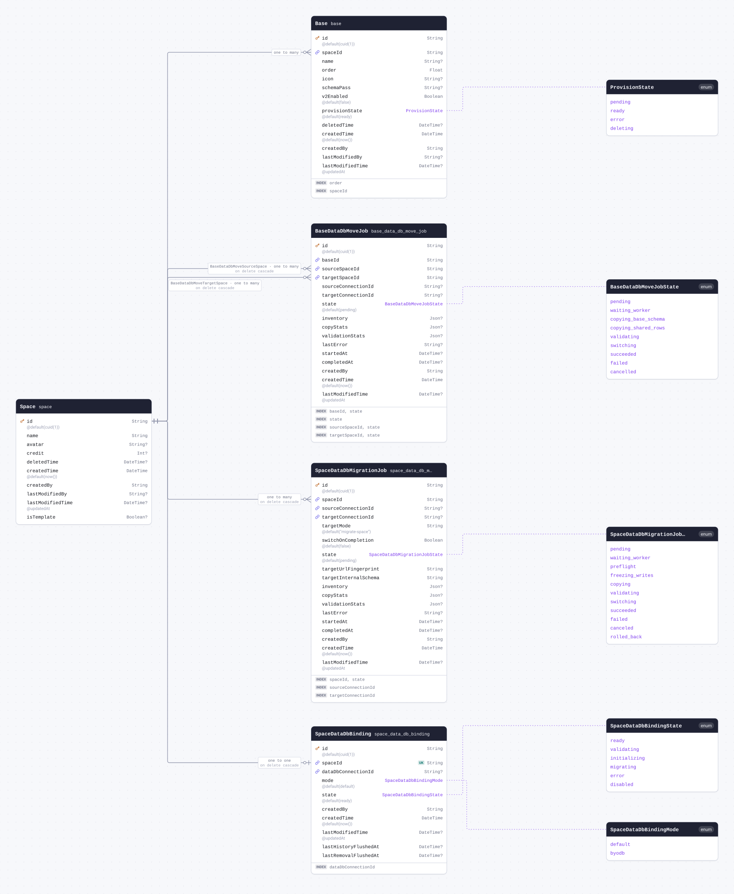

| Field                                     | Type       | Constraints | Default      | Description |
| ----------------------------------------- | ---------- | ----------- | ------------ | ----------- |
| `id`                                      | `String`   | PK NOT NULL | `cuid(1)`    |             |
| `name`                                    | `String`   | NOT NULL    |              |             |
| `avatar`                                  | `String`   | NULL        |              |             |
| `credit`                                  | `Int`      | NULL        |              |             |
| `deletedTime` (`deleted_time`)            | `DateTime` | NULL        |              |             |
| `createdTime` (`created_time`)            | `DateTime` | NOT NULL    | `now()`      |             |
| `createdBy` (`created_by`)                | `String`   | NOT NULL    |              |             |
| `lastModifiedBy` (`last_modified_by`)     | `String`   | NULL        |              |             |
| `lastModifiedTime` (`last_modified_time`) | `DateTime` | NULL        | `@updatedAt` |             |
| `isTemplate` (`is_template`)              | `Boolean`  | NULL        |              |             |

#### Referenced by

- `id` ← [SpaceDataDbBinding.spaceId](#model-SpaceDataDbBinding) (one-to-one, on delete Cascade)
- `id` ← [SpaceDataDbMigrationJob.spaceId](#model-SpaceDataDbMigrationJob) (one-to-many, on delete Cascade)
- `id` ← [BaseDataDbMoveJob.sourceSpaceId](#model-BaseDataDbMoveJob) (one-to-many, on delete Cascade)
- `id` ← [BaseDataDbMoveJob.targetSpaceId](#model-BaseDataDbMoveJob) (one-to-many, on delete Cascade)
- `id` ← [Base.spaceId](#model-Base) (one-to-many)

#### Definition

```sql
CREATE TABLE "space" (
    "id" TEXT NOT NULL,
    "name" TEXT NOT NULL,
    "avatar" TEXT,
    "credit" INTEGER,
    "deleted_time" TIMESTAMP(3),
    "created_time" TIMESTAMP(3) NOT NULL DEFAULT CURRENT_TIMESTAMP,
    "created_by" TEXT NOT NULL,
    "last_modified_by" TEXT,
    "last_modified_time" TIMESTAMP(3),
    "is_template" BOOLEAN,

    CONSTRAINT "space_pkey" PRIMARY KEY ("id")
);
```

<details>
<summary>Queries and their SQL</summary>

**findMany**: Every row

```ts
await prisma.space.findMany();
```

```sql
SELECT
  "public"."space"."id",
  "public"."space"."name",
  "public"."space"."avatar",
  "public"."space"."credit",
  "public"."space"."deleted_time",
  "public"."space"."created_time",
  "public"."space"."created_by",
  "public"."space"."last_modified_by",
  "public"."space"."last_modified_time",
  "public"."space"."is_template"
FROM
  "public"."space"
WHERE
  1 = 1
OFFSET
  $1
-- params: ["0"]
```

**count**: How many rows there are

```ts
await prisma.space.count();
```

```sql
SELECT
  COUNT(*) AS "_count$_all"
FROM
  (
    SELECT
      "public"."space"."id"
    FROM
      "public"."space"
    WHERE
      1 = 1
    OFFSET
      $1
  ) AS "sub"
-- params: ["0"]
```

**findMany**: Every row with its relations

```ts
await prisma.space.findMany({
  include: {
    baseGroup: true,
    dataDbBinding: true,
    dataDbMigrationJobs: true,
    baseDataDbMoveJobsAsSource: true,
    baseDataDbMoveJobsAsTarget: true,
  },
});
```

```sql
SELECT
  "public"."space"."id",
  "public"."space"."name",
  "public"."space"."avatar",
  "public"."space"."credit",
  "public"."space"."deleted_time",
  "public"."space"."created_time",
  "public"."space"."created_by",
  "public"."space"."last_modified_by",
  "public"."space"."last_modified_time",
  "public"."space"."is_template"
FROM
  "public"."space"
WHERE
  1 = 1
OFFSET
  $1
-- params: ["0"]

SELECT
  "public"."base"."id",
  "public"."base"."space_id",
  "public"."base"."name",
  "public"."base"."order",
  "public"."base"."icon",
  "public"."base"."schema_pass",
  "public"."base"."v2_enabled",
  "public"."base"."provision_state"::text,
  "public"."base"."deleted_time",
  "public"."base"."created_time",
  "public"."base"."created_by",
  "public"."base"."last_modified_by",
  "public"."base"."last_modified_time"
FROM
  "public"."base"
WHERE
  "public"."base"."space_id" IN ($1)
OFFSET
  $2
-- params: ["<id of the rows above>","0"]

SELECT
  "public"."space_data_db_binding"."id",
  "public"."space_data_db_binding"."space_id",
  "public"."space_data_db_binding"."data_db_connection_id",
  "public"."space_data_db_binding"."mode"::text,
  "public"."space_data_db_binding"."state"::text,
  "public"."space_data_db_binding"."created_by",
  "public"."space_data_db_binding"."created_time",
  "public"."space_data_db_binding"."last_modified_time",
  "public"."space_data_db_binding"."last_history_flushed_at",
  "public"."space_data_db_binding"."last_removal_flushed_at"
FROM
  "public"."space_data_db_binding"
WHERE
  "public"."space_data_db_binding"."space_id" IN ($1)
OFFSET
  $2
-- params: ["<id of the rows above>","0"]

SELECT
  "public"."space_data_db_migration_job"."id",
  "public"."space_data_db_migration_job"."space_id",
  "public"."space_data_db_migration_job"."source_connection_id",
  "public"."space_data_db_migration_job"."target_connection_id",
  "public"."space_data_db_migration_job"."target_mode",
  "public"."space_data_db_migration_job"."switch_on_completion",
  "public"."space_data_db_migration_job"."state"::text,
  "public"."space_data_db_migration_job"."target_url_fingerprint",
  "public"."space_data_db_migration_job"."target_internal_schema",
  "public"."space_data_db_migration_job"."inventory",
  "public"."space_data_db_migration_job"."copy_stats",
  "public"."space_data_db_migration_job"."validation_stats",
  "public"."space_data_db_migration_job"."last_error",
  "public"."space_data_db_migration_job"."started_at",
  "public"."space_data_db_migration_job"."completed_at",
  "public"."space_data_db_migration_job"."created_by",
  "public"."space_data_db_migration_job"."created_time",
  "public"."space_data_db_migration_job"."last_modified_time"
FROM
  "public"."space_data_db_migration_job"
WHERE
  "public"."space_data_db_migration_job"."space_id" IN ($1)
OFFSET
  $2
-- params: ["<id of the rows above>","0"]

SELECT
  "public"."base_data_db_move_job"."id",
  "public"."base_data_db_move_job"."base_id",
  "public"."base_data_db_move_job"."source_space_id",
  "public"."base_data_db_move_job"."target_space_id",
  "public"."base_data_db_move_job"."source_connection_id",
  "public"."base_data_db_move_job"."target_connection_id",
  "public"."base_data_db_move_job"."state"::text,
  "public"."base_data_db_move_job"."inventory",
  "public"."base_data_db_move_job"."copy_stats",
  "public"."base_data_db_move_job"."validation_stats",
  "public"."base_data_db_move_job"."last_error",
  "public"."base_data_db_move_job"."started_at",
  "public"."base_data_db_move_job"."completed_at",
  "public"."base_data_db_move_job"."created_by",
  "public"."base_data_db_move_job"."created_time",
  "public"."base_data_db_move_job"."last_modified_time"
FROM
  "public"."base_data_db_move_job"
WHERE
  "public"."base_data_db_move_job"."source_space_id" IN ($1)
OFFSET
  $2
-- params: ["<id of the rows above>","0"]

SELECT
  "public"."base_data_db_move_job"."id",
  "public"."base_data_db_move_job"."base_id",
  "public"."base_data_db_move_job"."source_space_id",
  "public"."base_data_db_move_job"."target_space_id",
  "public"."base_data_db_move_job"."source_connection_id",
  "public"."base_data_db_move_job"."target_connection_id",
  "public"."base_data_db_move_job"."state"::text,
  "public"."base_data_db_move_job"."inventory",
  "public"."base_data_db_move_job"."copy_stats",
  "public"."base_data_db_move_job"."validation_stats",
  "public"."base_data_db_move_job"."last_error",
  "public"."base_data_db_move_job"."started_at",
  "public"."base_data_db_move_job"."completed_at",
  "public"."base_data_db_move_job"."created_by",
  "public"."base_data_db_move_job"."created_time",
  "public"."base_data_db_move_job"."last_modified_time"
FROM
  "public"."base_data_db_move_job"
WHERE
  "public"."base_data_db_move_job"."target_space_id" IN ($1)
OFFSET
  $2
-- params: ["<id of the rows above>","0"]
```

**findUnique**: One row by what is unique to it

```ts
await prisma.space.findUnique({ where: { id: "example" } });
```

```sql
SELECT
  "public"."space"."id",
  "public"."space"."name",
  "public"."space"."avatar",
  "public"."space"."credit",
  "public"."space"."deleted_time",
  "public"."space"."created_time",
  "public"."space"."created_by",
  "public"."space"."last_modified_by",
  "public"."space"."last_modified_time",
  "public"."space"."is_template"
FROM
  "public"."space"
WHERE
  (
    "public"."space"."id" = $1
    AND 1 = 1
  )
LIMIT
  $2
OFFSET
  $3
-- params: ["example","1","0"]
```

**create**: Create a row

```ts
await prisma.space.create({ data: { name: "example", createdBy: "example" } });
```

```sql
INSERT INTO
  "public"."space" (
    "id",
    "name",
    "created_time",
    "created_by",
    "last_modified_time"
  )
VALUES
  ($1, $2, $3, $4, $5)
RETURNING
  "public"."space"."id",
  "public"."space"."name",
  "public"."space"."avatar",
  "public"."space"."credit",
  "public"."space"."deleted_time",
  "public"."space"."created_time",
  "public"."space"."created_by",
  "public"."space"."last_modified_by",
  "public"."space"."last_modified_time",
  "public"."space"."is_template"
-- params: ["<cuid(1)>","example","<now()>","example","<now()>"]
```

**update**: Update a row

```ts
await prisma.space.update({ where: { id: "example" }, data: { name: "example" } });
```

```sql
UPDATE "public"."space"
SET
  "name" = $1,
  "last_modified_time" = $2
WHERE
  (
    "public"."space"."id" = $3
    AND 1 = 1
  )
RETURNING
  "public"."space"."id",
  "public"."space"."name",
  "public"."space"."avatar",
  "public"."space"."credit",
  "public"."space"."deleted_time",
  "public"."space"."created_time",
  "public"."space"."created_by",
  "public"."space"."last_modified_by",
  "public"."space"."last_modified_time",
  "public"."space"."is_template"
-- params: ["example",{"prisma__type":"generatorCall","prisma__value":{"name":"now","args":[],"returnType":{"type":"DateTime"}}},"example"]
```

**delete**: Delete a row

```ts
await prisma.space.delete({ where: { id: "example" } });
```

```sql
DELETE FROM "public"."space"
WHERE
  (
    "public"."space"."id" = $1
    AND 1 = 1
  )
RETURNING
  "public"."space"."id",
  "public"."space"."name",
  "public"."space"."avatar",
  "public"."space"."credit",
  "public"."space"."deleted_time",
  "public"."space"."created_time",
  "public"."space"."created_by",
  "public"."space"."last_modified_by",
  "public"."space"."last_modified_time",
  "public"."space"."is_template"
-- params: ["example"]
```

</details>

<a id="model-DataDbConnection"></a>

### DataDbConnection

Table `data_db_connection`.

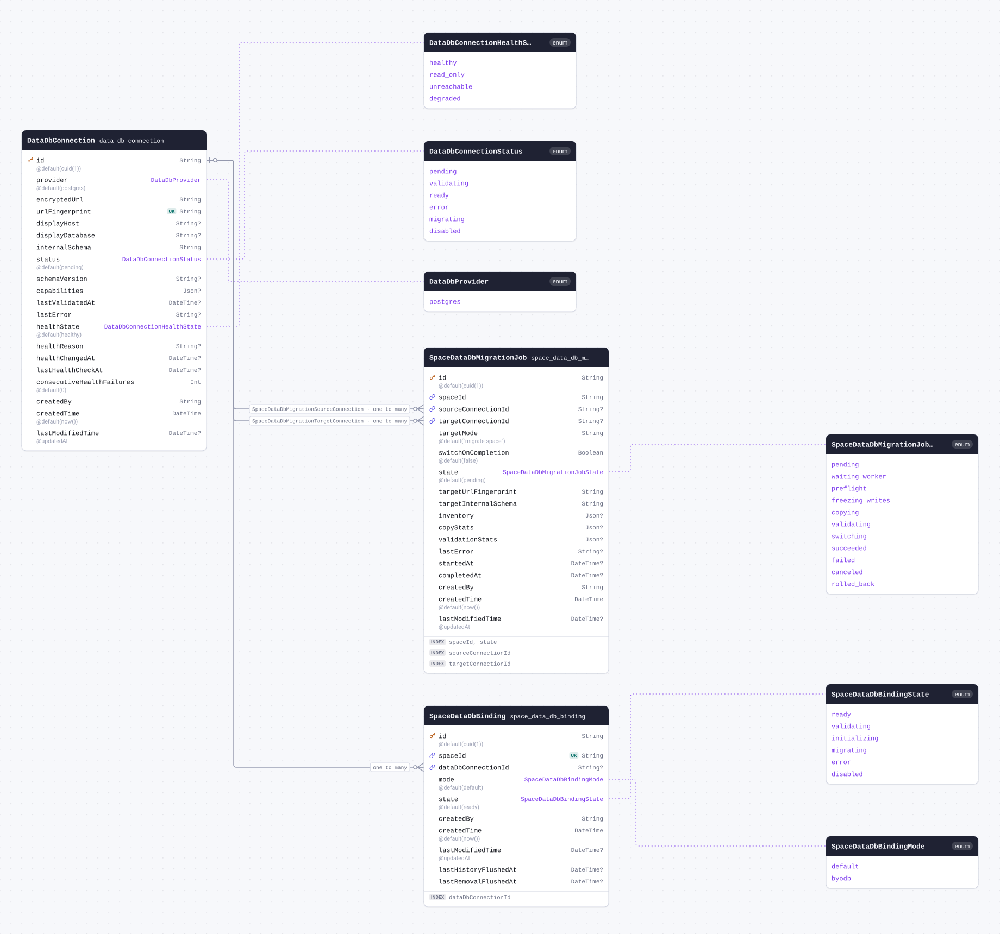

| Field                                                       | Type                                                               | Constraints     | Default      | Description |
| ----------------------------------------------------------- | ------------------------------------------------------------------ | --------------- | ------------ | ----------- |
| `id`                                                        | `String`                                                           | PK NOT NULL     | `cuid(1)`    |             |
| `provider`                                                  | [`DataDbProvider`](#enum-DataDbProvider)                           | NOT NULL        | `postgres`   |             |
| `encryptedUrl` (`encrypted_url`)                            | `String`                                                           | NOT NULL        |              |             |
| `urlFingerprint` (`url_fingerprint`)                        | `String`                                                           | UNIQUE NOT NULL |              |             |
| `displayHost` (`display_host`)                              | `String`                                                           | NULL            |              |             |
| `displayDatabase` (`display_database`)                      | `String`                                                           | NULL            |              |             |
| `internalSchema` (`internal_schema`)                        | `String`                                                           | NOT NULL        |              |             |
| `status`                                                    | [`DataDbConnectionStatus`](#enum-DataDbConnectionStatus)           | NOT NULL        | `pending`    |             |
| `schemaVersion` (`schema_version`)                          | `String`                                                           | NULL            |              |             |
| `capabilities`                                              | `Json`                                                             | NULL            |              |             |
| `lastValidatedAt` (`last_validated_at`)                     | `DateTime`                                                         | NULL            |              |             |
| `lastError` (`last_error`)                                  | `String`                                                           | NULL            |              |             |
| `healthState` (`health_state`)                              | [`DataDbConnectionHealthState`](#enum-DataDbConnectionHealthState) | NOT NULL        | `healthy`    |             |
| `healthReason` (`health_reason`)                            | `String`                                                           | NULL            |              |             |
| `healthChangedAt` (`health_changed_at`)                     | `DateTime`                                                         | NULL            |              |             |
| `lastHealthCheckAt` (`last_health_check_at`)                | `DateTime`                                                         | NULL            |              |             |
| `consecutiveHealthFailures` (`consecutive_health_failures`) | `Int`                                                              | NOT NULL        | `0`          |             |
| `createdBy` (`created_by`)                                  | `String`                                                           | NOT NULL        |              |             |
| `createdTime` (`created_time`)                              | `DateTime`                                                         | NOT NULL        | `now()`      |             |
| `lastModifiedTime` (`last_modified_time`)                   | `DateTime`                                                         | NULL            | `@updatedAt` |             |

#### Referenced by

- `id` ← [SpaceDataDbBinding.dataDbConnectionId](#model-SpaceDataDbBinding) (one-to-many)
- `id` ← [SpaceDataDbMigrationJob.sourceConnectionId](#model-SpaceDataDbMigrationJob) (one-to-many)
- `id` ← [SpaceDataDbMigrationJob.targetConnectionId](#model-SpaceDataDbMigrationJob) (one-to-many)

#### Definition

```sql
CREATE TABLE "data_db_connection" (
    "id" TEXT NOT NULL,
    "provider" "DataDbProvider" NOT NULL DEFAULT 'postgres',
    "encrypted_url" TEXT NOT NULL,
    "url_fingerprint" TEXT NOT NULL,
    "display_host" TEXT,
    "display_database" TEXT,
    "internal_schema" TEXT NOT NULL,
    "status" "DataDbConnectionStatus" NOT NULL DEFAULT 'pending',
    "schema_version" TEXT,
    "capabilities" JSONB,
    "last_validated_at" TIMESTAMP(3),
    "last_error" TEXT,
    "health_state" "DataDbConnectionHealthState" NOT NULL DEFAULT 'healthy',
    "health_reason" TEXT,
    "health_changed_at" TIMESTAMP(3),
    "last_health_check_at" TIMESTAMP(3),
    "consecutive_health_failures" INTEGER NOT NULL DEFAULT 0,
    "created_by" TEXT NOT NULL,
    "created_time" TIMESTAMP(3) NOT NULL DEFAULT CURRENT_TIMESTAMP,
    "last_modified_time" TIMESTAMP(3),

    CONSTRAINT "data_db_connection_pkey" PRIMARY KEY ("id")
);

CREATE UNIQUE INDEX "data_db_connection_url_fingerprint_key" ON "data_db_connection"("url_fingerprint");
```

<details>
<summary>Queries and their SQL</summary>

**findMany**: Every row

```ts
await prisma.dataDbConnection.findMany();
```

```sql
SELECT
  "public"."data_db_connection"."id",
  "public"."data_db_connection"."provider"::text,
  "public"."data_db_connection"."encrypted_url",
  "public"."data_db_connection"."url_fingerprint",
  "public"."data_db_connection"."display_host",
  "public"."data_db_connection"."display_database",
  "public"."data_db_connection"."internal_schema",
  "public"."data_db_connection"."status"::text,
  "public"."data_db_connection"."schema_version",
  "public"."data_db_connection"."capabilities",
  "public"."data_db_connection"."last_validated_at",
  "public"."data_db_connection"."last_error",
  "public"."data_db_connection"."health_state"::text,
  "public"."data_db_connection"."health_reason",
  "public"."data_db_connection"."health_changed_at",
  "public"."data_db_connection"."last_health_check_at",
  "public"."data_db_connection"."consecutive_health_failures",
  "public"."data_db_connection"."created_by",
  "public"."data_db_connection"."created_time",
  "public"."data_db_connection"."last_modified_time"
FROM
  "public"."data_db_connection"
WHERE
  1 = 1
OFFSET
  $1
-- params: ["0"]
```

**count**: How many rows there are

```ts
await prisma.dataDbConnection.count();
```

```sql
SELECT
  COUNT(*) AS "_count$_all"
FROM
  (
    SELECT
      "public"."data_db_connection"."id"
    FROM
      "public"."data_db_connection"
    WHERE
      1 = 1
    OFFSET
      $1
  ) AS "sub"
-- params: ["0"]
```

**findMany**: Every row with its relations

```ts
await prisma.dataDbConnection.findMany({
  include: { spaceBindings: true, sourceMigrationJobs: true, targetMigrationJobs: true },
});
```

```sql
SELECT
  "public"."data_db_connection"."id",
  "public"."data_db_connection"."provider"::text,
  "public"."data_db_connection"."encrypted_url",
  "public"."data_db_connection"."url_fingerprint",
  "public"."data_db_connection"."display_host",
  "public"."data_db_connection"."display_database",
  "public"."data_db_connection"."internal_schema",
  "public"."data_db_connection"."status"::text,
  "public"."data_db_connection"."schema_version",
  "public"."data_db_connection"."capabilities",
  "public"."data_db_connection"."last_validated_at",
  "public"."data_db_connection"."last_error",
  "public"."data_db_connection"."health_state"::text,
  "public"."data_db_connection"."health_reason",
  "public"."data_db_connection"."health_changed_at",
  "public"."data_db_connection"."last_health_check_at",
  "public"."data_db_connection"."consecutive_health_failures",
  "public"."data_db_connection"."created_by",
  "public"."data_db_connection"."created_time",
  "public"."data_db_connection"."last_modified_time"
FROM
  "public"."data_db_connection"
WHERE
  1 = 1
OFFSET
  $1
-- params: ["0"]

SELECT
  "public"."space_data_db_binding"."id",
  "public"."space_data_db_binding"."space_id",
  "public"."space_data_db_binding"."data_db_connection_id",
  "public"."space_data_db_binding"."mode"::text,
  "public"."space_data_db_binding"."state"::text,
  "public"."space_data_db_binding"."created_by",
  "public"."space_data_db_binding"."created_time",
  "public"."space_data_db_binding"."last_modified_time",
  "public"."space_data_db_binding"."last_history_flushed_at",
  "public"."space_data_db_binding"."last_removal_flushed_at"
FROM
  "public"."space_data_db_binding"
WHERE
  "public"."space_data_db_binding"."data_db_connection_id" IN ($1)
OFFSET
  $2
-- params: ["<id of the rows above>","0"]

SELECT
  "public"."space_data_db_migration_job"."id",
  "public"."space_data_db_migration_job"."space_id",
  "public"."space_data_db_migration_job"."source_connection_id",
  "public"."space_data_db_migration_job"."target_connection_id",
  "public"."space_data_db_migration_job"."target_mode",
  "public"."space_data_db_migration_job"."switch_on_completion",
  "public"."space_data_db_migration_job"."state"::text,
  "public"."space_data_db_migration_job"."target_url_fingerprint",
  "public"."space_data_db_migration_job"."target_internal_schema",
  "public"."space_data_db_migration_job"."inventory",
  "public"."space_data_db_migration_job"."copy_stats",
  "public"."space_data_db_migration_job"."validation_stats",
  "public"."space_data_db_migration_job"."last_error",
  "public"."space_data_db_migration_job"."started_at",
  "public"."space_data_db_migration_job"."completed_at",
  "public"."space_data_db_migration_job"."created_by",
  "public"."space_data_db_migration_job"."created_time",
  "public"."space_data_db_migration_job"."last_modified_time"
FROM
  "public"."space_data_db_migration_job"
WHERE
  "public"."space_data_db_migration_job"."source_connection_id" IN ($1)
OFFSET
  $2
-- params: ["<id of the rows above>","0"]

SELECT
  "public"."space_data_db_migration_job"."id",
  "public"."space_data_db_migration_job"."space_id",
  "public"."space_data_db_migration_job"."source_connection_id",
  "public"."space_data_db_migration_job"."target_connection_id",
  "public"."space_data_db_migration_job"."target_mode",
  "public"."space_data_db_migration_job"."switch_on_completion",
  "public"."space_data_db_migration_job"."state"::text,
  "public"."space_data_db_migration_job"."target_url_fingerprint",
  "public"."space_data_db_migration_job"."target_internal_schema",
  "public"."space_data_db_migration_job"."inventory",
  "public"."space_data_db_migration_job"."copy_stats",
  "public"."space_data_db_migration_job"."validation_stats",
  "public"."space_data_db_migration_job"."last_error",
  "public"."space_data_db_migration_job"."started_at",
  "public"."space_data_db_migration_job"."completed_at",
  "public"."space_data_db_migration_job"."created_by",
  "public"."space_data_db_migration_job"."created_time",
  "public"."space_data_db_migration_job"."last_modified_time"
FROM
  "public"."space_data_db_migration_job"
WHERE
  "public"."space_data_db_migration_job"."target_connection_id" IN ($1)
OFFSET
  $2
-- params: ["<id of the rows above>","0"]
```

**findUnique**: One row by what is unique to it

```ts
await prisma.dataDbConnection.findUnique({ where: { id: "example" } });
```

```sql
SELECT
  "public"."data_db_connection"."id",
  "public"."data_db_connection"."provider"::text,
  "public"."data_db_connection"."encrypted_url",
  "public"."data_db_connection"."url_fingerprint",
  "public"."data_db_connection"."display_host",
  "public"."data_db_connection"."display_database",
  "public"."data_db_connection"."internal_schema",
  "public"."data_db_connection"."status"::text,
  "public"."data_db_connection"."schema_version",
  "public"."data_db_connection"."capabilities",
  "public"."data_db_connection"."last_validated_at",
  "public"."data_db_connection"."last_error",
  "public"."data_db_connection"."health_state"::text,
  "public"."data_db_connection"."health_reason",
  "public"."data_db_connection"."health_changed_at",
  "public"."data_db_connection"."last_health_check_at",
  "public"."data_db_connection"."consecutive_health_failures",
  "public"."data_db_connection"."created_by",
  "public"."data_db_connection"."created_time",
  "public"."data_db_connection"."last_modified_time"
FROM
  "public"."data_db_connection"
WHERE
  (
    "public"."data_db_connection"."id" = $1
    AND 1 = 1
  )
LIMIT
  $2
OFFSET
  $3
-- params: ["example","1","0"]
```

**create**: Create a row

```ts
await prisma.dataDbConnection.create({
  data: {
    encryptedUrl: "example",
    urlFingerprint: "example",
    internalSchema: "example",
    createdBy: "example",
  },
});
```

```sql
INSERT INTO
  "public"."data_db_connection" (
    "id",
    "provider",
    "encrypted_url",
    "url_fingerprint",
    "internal_schema",
    "status",
    "health_state",
    "consecutive_health_failures",
    "created_by",
    "created_time",
    "last_modified_time"
  )
VALUES
  (
    $1,
    CAST($2::text AS "public"."DataDbProvider"),
    $3,
    $4,
    $5,
    CAST($6::text AS "public"."DataDbConnectionStatus"),
    CAST(
      $7::text AS "public"."DataDbConnectionHealthState"
    ),
    $8,
    $9,
    $10,
    $11
  )
RETURNING
  "public"."data_db_connection"."id",
  "public"."data_db_connection"."provider"::text,
  "public"."data_db_connection"."encrypted_url",
  "public"."data_db_connection"."url_fingerprint",
  "public"."data_db_connection"."display_host",
  "public"."data_db_connection"."display_database",
  "public"."data_db_connection"."internal_schema",
  "public"."data_db_connection"."status"::text,
  "public"."data_db_connection"."schema_version",
  "public"."data_db_connection"."capabilities",
  "public"."data_db_connection"."last_validated_at",
  "public"."data_db_connection"."last_error",
  "public"."data_db_connection"."health_state"::text,
  "public"."data_db_connection"."health_reason",
  "public"."data_db_connection"."health_changed_at",
  "public"."data_db_connection"."last_health_check_at",
  "public"."data_db_connection"."consecutive_health_failures",
  "public"."data_db_connection"."created_by",
  "public"."data_db_connection"."created_time",
  "public"."data_db_connection"."last_modified_time"
-- params: ["<cuid(1)>","postgres","example","example","example","pending","healthy","0","example","<now()>","<now()>"]
```

**update**: Update a row

```ts
await prisma.dataDbConnection.update({ where: { id: "example" }, data: { provider: "postgres" } });
```

```sql
UPDATE "public"."data_db_connection"
SET
  "provider" = CAST($1::text AS "public"."DataDbProvider"),
  "last_modified_time" = $2
WHERE
  (
    "public"."data_db_connection"."id" = $3
    AND 1 = 1
  )
RETURNING
  "public"."data_db_connection"."id",
  "public"."data_db_connection"."provider"::text,
  "public"."data_db_connection"."encrypted_url",
  "public"."data_db_connection"."url_fingerprint",
  "public"."data_db_connection"."display_host",
  "public"."data_db_connection"."display_database",
  "public"."data_db_connection"."internal_schema",
  "public"."data_db_connection"."status"::text,
  "public"."data_db_connection"."schema_version",
  "public"."data_db_connection"."capabilities",
  "public"."data_db_connection"."last_validated_at",
  "public"."data_db_connection"."last_error",
  "public"."data_db_connection"."health_state"::text,
  "public"."data_db_connection"."health_reason",
  "public"."data_db_connection"."health_changed_at",
  "public"."data_db_connection"."last_health_check_at",
  "public"."data_db_connection"."consecutive_health_failures",
  "public"."data_db_connection"."created_by",
  "public"."data_db_connection"."created_time",
  "public"."data_db_connection"."last_modified_time"
-- params: ["postgres",{"prisma__type":"generatorCall","prisma__value":{"name":"now","args":[],"returnType":{"type":"DateTime"}}},"example"]
```

**delete**: Delete a row

```ts
await prisma.dataDbConnection.delete({ where: { id: "example" } });
```

```sql
DELETE FROM "public"."data_db_connection"
WHERE
  (
    "public"."data_db_connection"."id" = $1
    AND 1 = 1
  )
RETURNING
  "public"."data_db_connection"."id",
  "public"."data_db_connection"."provider"::text,
  "public"."data_db_connection"."encrypted_url",
  "public"."data_db_connection"."url_fingerprint",
  "public"."data_db_connection"."display_host",
  "public"."data_db_connection"."display_database",
  "public"."data_db_connection"."internal_schema",
  "public"."data_db_connection"."status"::text,
  "public"."data_db_connection"."schema_version",
  "public"."data_db_connection"."capabilities",
  "public"."data_db_connection"."last_validated_at",
  "public"."data_db_connection"."last_error",
  "public"."data_db_connection"."health_state"::text,
  "public"."data_db_connection"."health_reason",
  "public"."data_db_connection"."health_changed_at",
  "public"."data_db_connection"."last_health_check_at",
  "public"."data_db_connection"."consecutive_health_failures",
  "public"."data_db_connection"."created_by",
  "public"."data_db_connection"."created_time",
  "public"."data_db_connection"."last_modified_time"
-- params: ["example"]
```

</details>

<a id="model-SpaceDataDbBinding"></a>

### SpaceDataDbBinding

Table `space_data_db_binding`.

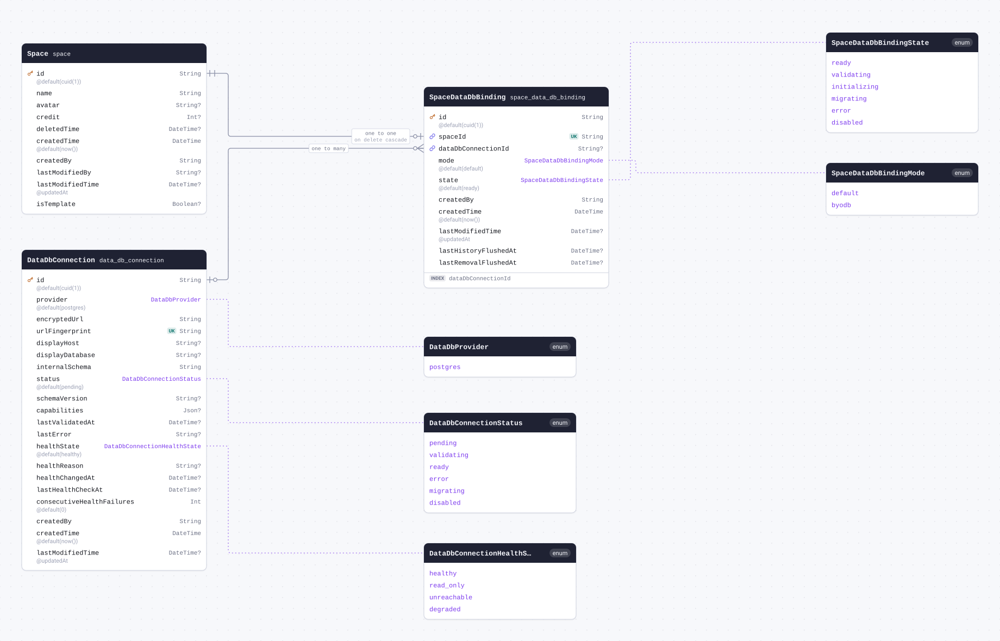

| Field                                              | Type                                                       | Constraints                                           | Default      | Description |
| -------------------------------------------------- | ---------------------------------------------------------- | ----------------------------------------------------- | ------------ | ----------- |
| `id`                                               | `String`                                                   | PK NOT NULL                                           | `cuid(1)`    |             |
| `spaceId` (`space_id`)                             | `String`                                                   | UNIQUE NOT NULL → [Space.id](#model-Space)            |              |             |
| `dataDbConnectionId` (`data_db_connection_id`)     | `String`                                                   | NULL → [DataDbConnection.id](#model-DataDbConnection) |              |             |
| `mode`                                             | [`SpaceDataDbBindingMode`](#enum-SpaceDataDbBindingMode)   | NOT NULL                                              | `default`    |             |
| `state`                                            | [`SpaceDataDbBindingState`](#enum-SpaceDataDbBindingState) | NOT NULL                                              | `ready`      |             |
| `createdBy` (`created_by`)                         | `String`                                                   | NOT NULL                                              |              |             |
| `createdTime` (`created_time`)                     | `DateTime`                                                 | NOT NULL                                              | `now()`      |             |
| `lastModifiedTime` (`last_modified_time`)          | `DateTime`                                                 | NULL                                                  | `@updatedAt` |             |
| `lastHistoryFlushedAt` (`last_history_flushed_at`) | `DateTime`                                                 | NULL                                                  |              |             |
| `lastRemovalFlushedAt` (`last_removal_flushed_at`) | `DateTime`                                                 | NULL                                                  |              |             |

#### Indexes

- `@@index([dataDbConnectionId])`

#### References

- `spaceId` → [Space.id](#model-Space) (one-to-one, on delete Cascade)
- `dataDbConnectionId` → [DataDbConnection.id](#model-DataDbConnection) (many-to-one)

#### Definition

```sql
CREATE TABLE "space_data_db_binding" (
    "id" TEXT NOT NULL,
    "space_id" TEXT NOT NULL,
    "data_db_connection_id" TEXT,
    "mode" "SpaceDataDbBindingMode" NOT NULL DEFAULT 'default',
    "state" "SpaceDataDbBindingState" NOT NULL DEFAULT 'ready',
    "created_by" TEXT NOT NULL,
    "created_time" TIMESTAMP(3) NOT NULL DEFAULT CURRENT_TIMESTAMP,
    "last_modified_time" TIMESTAMP(3),
    "last_history_flushed_at" TIMESTAMP(3),
    "last_removal_flushed_at" TIMESTAMP(3),

    CONSTRAINT "space_data_db_binding_pkey" PRIMARY KEY ("id")
);

CREATE UNIQUE INDEX "space_data_db_binding_space_id_key" ON "space_data_db_binding"("space_id");

CREATE INDEX "space_data_db_binding_data_db_connection_id_idx" ON "space_data_db_binding"("data_db_connection_id");

ALTER TABLE "space_data_db_binding" ADD CONSTRAINT "space_data_db_binding_space_id_fkey" FOREIGN KEY ("space_id") REFERENCES "space"("id") ON DELETE CASCADE ON UPDATE CASCADE;

ALTER TABLE "space_data_db_binding" ADD CONSTRAINT "space_data_db_binding_data_db_connection_id_fkey" FOREIGN KEY ("data_db_connection_id") REFERENCES "data_db_connection"("id") ON DELETE SET NULL ON UPDATE CASCADE;
```

<details>
<summary>Queries and their SQL</summary>

**findMany**: Every row

```ts
await prisma.spaceDataDbBinding.findMany();
```

```sql
SELECT
  "public"."space_data_db_binding"."id",
  "public"."space_data_db_binding"."space_id",
  "public"."space_data_db_binding"."data_db_connection_id",
  "public"."space_data_db_binding"."mode"::text,
  "public"."space_data_db_binding"."state"::text,
  "public"."space_data_db_binding"."created_by",
  "public"."space_data_db_binding"."created_time",
  "public"."space_data_db_binding"."last_modified_time",
  "public"."space_data_db_binding"."last_history_flushed_at",
  "public"."space_data_db_binding"."last_removal_flushed_at"
FROM
  "public"."space_data_db_binding"
WHERE
  1 = 1
OFFSET
  $1
-- params: ["0"]
```

**count**: How many rows there are

```ts
await prisma.spaceDataDbBinding.count();
```

```sql
SELECT
  COUNT(*) AS "_count$_all"
FROM
  (
    SELECT
      "public"."space_data_db_binding"."id"
    FROM
      "public"."space_data_db_binding"
    WHERE
      1 = 1
    OFFSET
      $1
  ) AS "sub"
-- params: ["0"]
```

**findMany**: Every row with its relations

```ts
await prisma.spaceDataDbBinding.findMany({ include: { space: true, dataDbConnection: true } });
```

```sql
SELECT
  "public"."space_data_db_binding"."id",
  "public"."space_data_db_binding"."space_id",
  "public"."space_data_db_binding"."data_db_connection_id",
  "public"."space_data_db_binding"."mode"::text,
  "public"."space_data_db_binding"."state"::text,
  "public"."space_data_db_binding"."created_by",
  "public"."space_data_db_binding"."created_time",
  "public"."space_data_db_binding"."last_modified_time",
  "public"."space_data_db_binding"."last_history_flushed_at",
  "public"."space_data_db_binding"."last_removal_flushed_at"
FROM
  "public"."space_data_db_binding"
WHERE
  1 = 1
OFFSET
  $1
-- params: ["0"]

SELECT
  "public"."space"."id",
  "public"."space"."name",
  "public"."space"."avatar",
  "public"."space"."credit",
  "public"."space"."deleted_time",
  "public"."space"."created_time",
  "public"."space"."created_by",
  "public"."space"."last_modified_by",
  "public"."space"."last_modified_time",
  "public"."space"."is_template"
FROM
  "public"."space"
WHERE
  "public"."space"."id" IN ($1)
OFFSET
  $2
-- params: ["<spaceId of the rows above>","0"]

SELECT
  "public"."data_db_connection"."id",
  "public"."data_db_connection"."provider"::text,
  "public"."data_db_connection"."encrypted_url",
  "public"."data_db_connection"."url_fingerprint",
  "public"."data_db_connection"."display_host",
  "public"."data_db_connection"."display_database",
  "public"."data_db_connection"."internal_schema",
  "public"."data_db_connection"."status"::text,
  "public"."data_db_connection"."schema_version",
  "public"."data_db_connection"."capabilities",
  "public"."data_db_connection"."last_validated_at",
  "public"."data_db_connection"."last_error",
  "public"."data_db_connection"."health_state"::text,
  "public"."data_db_connection"."health_reason",
  "public"."data_db_connection"."health_changed_at",
  "public"."data_db_connection"."last_health_check_at",
  "public"."data_db_connection"."consecutive_health_failures",
  "public"."data_db_connection"."created_by",
  "public"."data_db_connection"."created_time",
  "public"."data_db_connection"."last_modified_time"
FROM
  "public"."data_db_connection"
WHERE
  "public"."data_db_connection"."id" IN ($1)
OFFSET
  $2
-- params: ["<dataDbConnectionId of the rows above>","0"]
```

**findUnique**: One row by what is unique to it

```ts
await prisma.spaceDataDbBinding.findUnique({ where: { id: "example" } });
```

```sql
SELECT
  "public"."space_data_db_binding"."id",
  "public"."space_data_db_binding"."space_id",
  "public"."space_data_db_binding"."data_db_connection_id",
  "public"."space_data_db_binding"."mode"::text,
  "public"."space_data_db_binding"."state"::text,
  "public"."space_data_db_binding"."created_by",
  "public"."space_data_db_binding"."created_time",
  "public"."space_data_db_binding"."last_modified_time",
  "public"."space_data_db_binding"."last_history_flushed_at",
  "public"."space_data_db_binding"."last_removal_flushed_at"
FROM
  "public"."space_data_db_binding"
WHERE
  (
    "public"."space_data_db_binding"."id" = $1
    AND 1 = 1
  )
LIMIT
  $2
OFFSET
  $3
-- params: ["example","1","0"]
```

**create**: Create a row

```ts
await prisma.spaceDataDbBinding.create({ data: { spaceId: "example", createdBy: "example" } });
```

```sql
INSERT INTO
  "public"."space_data_db_binding" (
    "id",
    "space_id",
    "mode",
    "state",
    "created_by",
    "created_time",
    "last_modified_time"
  )
VALUES
  (
    $1,
    $2,
    CAST($3::text AS "public"."SpaceDataDbBindingMode"),
    CAST($4::text AS "public"."SpaceDataDbBindingState"),
    $5,
    $6,
    $7
  )
RETURNING
  "public"."space_data_db_binding"."id",
  "public"."space_data_db_binding"."space_id",
  "public"."space_data_db_binding"."data_db_connection_id",
  "public"."space_data_db_binding"."mode"::text,
  "public"."space_data_db_binding"."state"::text,
  "public"."space_data_db_binding"."created_by",
  "public"."space_data_db_binding"."created_time",
  "public"."space_data_db_binding"."last_modified_time",
  "public"."space_data_db_binding"."last_history_flushed_at",
  "public"."space_data_db_binding"."last_removal_flushed_at"
-- params: ["<cuid(1)>","example","default","ready","example","<now()>","<now()>"]
```

**update**: Update a row

```ts
await prisma.spaceDataDbBinding.update({ where: { id: "example" }, data: { mode: "default" } });
```

```sql
UPDATE "public"."space_data_db_binding"
SET
  "mode" = CAST($1::text AS "public"."SpaceDataDbBindingMode"),
  "last_modified_time" = $2
WHERE
  (
    "public"."space_data_db_binding"."id" = $3
    AND 1 = 1
  )
RETURNING
  "public"."space_data_db_binding"."id",
  "public"."space_data_db_binding"."space_id",
  "public"."space_data_db_binding"."data_db_connection_id",
  "public"."space_data_db_binding"."mode"::text,
  "public"."space_data_db_binding"."state"::text,
  "public"."space_data_db_binding"."created_by",
  "public"."space_data_db_binding"."created_time",
  "public"."space_data_db_binding"."last_modified_time",
  "public"."space_data_db_binding"."last_history_flushed_at",
  "public"."space_data_db_binding"."last_removal_flushed_at"
-- params: ["default",{"prisma__type":"generatorCall","prisma__value":{"name":"now","args":[],"returnType":{"type":"DateTime"}}},"example"]
```

**delete**: Delete a row

```ts
await prisma.spaceDataDbBinding.delete({ where: { id: "example" } });
```

```sql
DELETE FROM "public"."space_data_db_binding"
WHERE
  (
    "public"."space_data_db_binding"."id" = $1
    AND 1 = 1
  )
RETURNING
  "public"."space_data_db_binding"."id",
  "public"."space_data_db_binding"."space_id",
  "public"."space_data_db_binding"."data_db_connection_id",
  "public"."space_data_db_binding"."mode"::text,
  "public"."space_data_db_binding"."state"::text,
  "public"."space_data_db_binding"."created_by",
  "public"."space_data_db_binding"."created_time",
  "public"."space_data_db_binding"."last_modified_time",
  "public"."space_data_db_binding"."last_history_flushed_at",
  "public"."space_data_db_binding"."last_removal_flushed_at"
-- params: ["example"]
```

</details>

<a id="model-SpaceDataDbMigrationJob"></a>

### SpaceDataDbMigrationJob

Table `space_data_db_migration_job`.

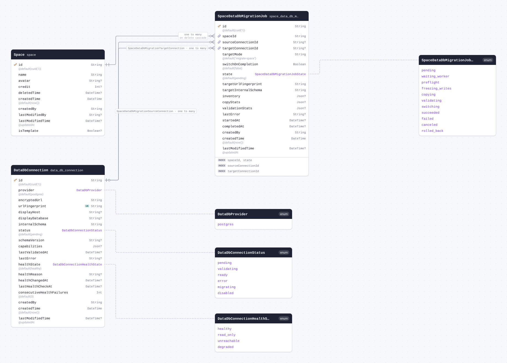

| Field                                             | Type                                                                 | Constraints                                           | Default           | Description |
| ------------------------------------------------- | -------------------------------------------------------------------- | ----------------------------------------------------- | ----------------- | ----------- |
| `id`                                              | `String`                                                             | PK NOT NULL                                           | `cuid(1)`         |             |
| `spaceId` (`space_id`)                            | `String`                                                             | NOT NULL → [Space.id](#model-Space)                   |                   |             |
| `sourceConnectionId` (`source_connection_id`)     | `String`                                                             | NULL → [DataDbConnection.id](#model-DataDbConnection) |                   |             |
| `targetConnectionId` (`target_connection_id`)     | `String`                                                             | NULL → [DataDbConnection.id](#model-DataDbConnection) |                   |             |
| `targetMode` (`target_mode`)                      | `String`                                                             | NOT NULL                                              | `"migrate-space"` |             |
| `switchOnCompletion` (`switch_on_completion`)     | `Boolean`                                                            | NOT NULL                                              | `false`           |             |
| `state`                                           | [`SpaceDataDbMigrationJobState`](#enum-SpaceDataDbMigrationJobState) | NOT NULL                                              | `pending`         |             |
| `targetUrlFingerprint` (`target_url_fingerprint`) | `String`                                                             | NOT NULL                                              |                   |             |
| `targetInternalSchema` (`target_internal_schema`) | `String`                                                             | NOT NULL                                              |                   |             |
| `inventory`                                       | `Json`                                                               | NULL                                                  |                   |             |
| `copyStats` (`copy_stats`)                        | `Json`                                                               | NULL                                                  |                   |             |
| `validationStats` (`validation_stats`)            | `Json`                                                               | NULL                                                  |                   |             |
| `lastError` (`last_error`)                        | `String`                                                             | NULL                                                  |                   |             |
| `startedAt` (`started_at`)                        | `DateTime`                                                           | NULL                                                  |                   |             |
| `completedAt` (`completed_at`)                    | `DateTime`                                                           | NULL                                                  |                   |             |
| `createdBy` (`created_by`)                        | `String`                                                             | NOT NULL                                              |                   |             |
| `createdTime` (`created_time`)                    | `DateTime`                                                           | NOT NULL                                              | `now()`           |             |
| `lastModifiedTime` (`last_modified_time`)         | `DateTime`                                                           | NULL                                                  | `@updatedAt`      |             |

#### Indexes

- `@@index([spaceId, state])`
- `@@index([sourceConnectionId])`
- `@@index([targetConnectionId])`

#### References

- `spaceId` → [Space.id](#model-Space) (many-to-one, on delete Cascade)
- `sourceConnectionId` → [DataDbConnection.id](#model-DataDbConnection) (many-to-one)
- `targetConnectionId` → [DataDbConnection.id](#model-DataDbConnection) (many-to-one)

#### Definition

```sql
CREATE TABLE "space_data_db_migration_job" (
    "id" TEXT NOT NULL,
    "space_id" TEXT NOT NULL,
    "source_connection_id" TEXT,
    "target_connection_id" TEXT,
    "target_mode" TEXT NOT NULL DEFAULT 'migrate-space',
    "switch_on_completion" BOOLEAN NOT NULL DEFAULT false,
    "state" "SpaceDataDbMigrationJobState" NOT NULL DEFAULT 'pending',
    "target_url_fingerprint" TEXT NOT NULL,
    "target_internal_schema" TEXT NOT NULL,
    "inventory" JSONB,
    "copy_stats" JSONB,
    "validation_stats" JSONB,
    "last_error" TEXT,
    "started_at" TIMESTAMP(3),
    "completed_at" TIMESTAMP(3),
    "created_by" TEXT NOT NULL,
    "created_time" TIMESTAMP(3) NOT NULL DEFAULT CURRENT_TIMESTAMP,
    "last_modified_time" TIMESTAMP(3),

    CONSTRAINT "space_data_db_migration_job_pkey" PRIMARY KEY ("id")
);

CREATE INDEX "space_data_db_migration_job_space_id_state_idx" ON "space_data_db_migration_job"("space_id", "state");

CREATE INDEX "space_data_db_migration_job_source_connection_id_idx" ON "space_data_db_migration_job"("source_connection_id");

CREATE INDEX "space_data_db_migration_job_target_connection_id_idx" ON "space_data_db_migration_job"("target_connection_id");

ALTER TABLE "space_data_db_migration_job" ADD CONSTRAINT "space_data_db_migration_job_space_id_fkey" FOREIGN KEY ("space_id") REFERENCES "space"("id") ON DELETE CASCADE ON UPDATE CASCADE;

ALTER TABLE "space_data_db_migration_job" ADD CONSTRAINT "space_data_db_migration_job_source_connection_id_fkey" FOREIGN KEY ("source_connection_id") REFERENCES "data_db_connection"("id") ON DELETE SET NULL ON UPDATE CASCADE;

ALTER TABLE "space_data_db_migration_job" ADD CONSTRAINT "space_data_db_migration_job_target_connection_id_fkey" FOREIGN KEY ("target_connection_id") REFERENCES "data_db_connection"("id") ON DELETE SET NULL ON UPDATE CASCADE;
```

<details>
<summary>Queries and their SQL</summary>

**findMany**: Every row

```ts
await prisma.spaceDataDbMigrationJob.findMany();
```

```sql
SELECT
  "public"."space_data_db_migration_job"."id",
  "public"."space_data_db_migration_job"."space_id",
  "public"."space_data_db_migration_job"."source_connection_id",
  "public"."space_data_db_migration_job"."target_connection_id",
  "public"."space_data_db_migration_job"."target_mode",
  "public"."space_data_db_migration_job"."switch_on_completion",
  "public"."space_data_db_migration_job"."state"::text,
  "public"."space_data_db_migration_job"."target_url_fingerprint",
  "public"."space_data_db_migration_job"."target_internal_schema",
  "public"."space_data_db_migration_job"."inventory",
  "public"."space_data_db_migration_job"."copy_stats",
  "public"."space_data_db_migration_job"."validation_stats",
  "public"."space_data_db_migration_job"."last_error",
  "public"."space_data_db_migration_job"."started_at",
  "public"."space_data_db_migration_job"."completed_at",
  "public"."space_data_db_migration_job"."created_by",
  "public"."space_data_db_migration_job"."created_time",
  "public"."space_data_db_migration_job"."last_modified_time"
FROM
  "public"."space_data_db_migration_job"
WHERE
  1 = 1
OFFSET
  $1
-- params: ["0"]
```

**count**: How many rows there are

```ts
await prisma.spaceDataDbMigrationJob.count();
```

```sql
SELECT
  COUNT(*) AS "_count$_all"
FROM
  (
    SELECT
      "public"."space_data_db_migration_job"."id"
    FROM
      "public"."space_data_db_migration_job"
    WHERE
      1 = 1
    OFFSET
      $1
  ) AS "sub"
-- params: ["0"]
```

**findMany**: Every row with its relations

```ts
await prisma.spaceDataDbMigrationJob.findMany({
  include: { space: true, sourceConnection: true, targetConnection: true },
});
```

```sql
SELECT
  "public"."space_data_db_migration_job"."id",
  "public"."space_data_db_migration_job"."space_id",
  "public"."space_data_db_migration_job"."source_connection_id",
  "public"."space_data_db_migration_job"."target_connection_id",
  "public"."space_data_db_migration_job"."target_mode",
  "public"."space_data_db_migration_job"."switch_on_completion",
  "public"."space_data_db_migration_job"."state"::text,
  "public"."space_data_db_migration_job"."target_url_fingerprint",
  "public"."space_data_db_migration_job"."target_internal_schema",
  "public"."space_data_db_migration_job"."inventory",
  "public"."space_data_db_migration_job"."copy_stats",
  "public"."space_data_db_migration_job"."validation_stats",
  "public"."space_data_db_migration_job"."last_error",
  "public"."space_data_db_migration_job"."started_at",
  "public"."space_data_db_migration_job"."completed_at",
  "public"."space_data_db_migration_job"."created_by",
  "public"."space_data_db_migration_job"."created_time",
  "public"."space_data_db_migration_job"."last_modified_time"
FROM
  "public"."space_data_db_migration_job"
WHERE
  1 = 1
OFFSET
  $1
-- params: ["0"]

SELECT
  "public"."space"."id",
  "public"."space"."name",
  "public"."space"."avatar",
  "public"."space"."credit",
  "public"."space"."deleted_time",
  "public"."space"."created_time",
  "public"."space"."created_by",
  "public"."space"."last_modified_by",
  "public"."space"."last_modified_time",
  "public"."space"."is_template"
FROM
  "public"."space"
WHERE
  "public"."space"."id" IN ($1)
OFFSET
  $2
-- params: ["<spaceId of the rows above>","0"]

SELECT
  "public"."data_db_connection"."id",
  "public"."data_db_connection"."provider"::text,
  "public"."data_db_connection"."encrypted_url",
  "public"."data_db_connection"."url_fingerprint",
  "public"."data_db_connection"."display_host",
  "public"."data_db_connection"."display_database",
  "public"."data_db_connection"."internal_schema",
  "public"."data_db_connection"."status"::text,
  "public"."data_db_connection"."schema_version",
  "public"."data_db_connection"."capabilities",
  "public"."data_db_connection"."last_validated_at",
  "public"."data_db_connection"."last_error",
  "public"."data_db_connection"."health_state"::text,
  "public"."data_db_connection"."health_reason",
  "public"."data_db_connection"."health_changed_at",
  "public"."data_db_connection"."last_health_check_at",
  "public"."data_db_connection"."consecutive_health_failures",
  "public"."data_db_connection"."created_by",
  "public"."data_db_connection"."created_time",
  "public"."data_db_connection"."last_modified_time"
FROM
  "public"."data_db_connection"
WHERE
  "public"."data_db_connection"."id" IN ($1)
OFFSET
  $2
-- params: ["<sourceConnectionId of the rows above>","0"]

SELECT
  "public"."data_db_connection"."id",
  "public"."data_db_connection"."provider"::text,
  "public"."data_db_connection"."encrypted_url",
  "public"."data_db_connection"."url_fingerprint",
  "public"."data_db_connection"."display_host",
  "public"."data_db_connection"."display_database",
  "public"."data_db_connection"."internal_schema",
  "public"."data_db_connection"."status"::text,
  "public"."data_db_connection"."schema_version",
  "public"."data_db_connection"."capabilities",
  "public"."data_db_connection"."last_validated_at",
  "public"."data_db_connection"."last_error",
  "public"."data_db_connection"."health_state"::text,
  "public"."data_db_connection"."health_reason",
  "public"."data_db_connection"."health_changed_at",
  "public"."data_db_connection"."last_health_check_at",
  "public"."data_db_connection"."consecutive_health_failures",
  "public"."data_db_connection"."created_by",
  "public"."data_db_connection"."created_time",
  "public"."data_db_connection"."last_modified_time"
FROM
  "public"."data_db_connection"
WHERE
  "public"."data_db_connection"."id" IN ($1)
OFFSET
  $2
-- params: ["<targetConnectionId of the rows above>","0"]
```

**findUnique**: One row by what is unique to it

```ts
await prisma.spaceDataDbMigrationJob.findUnique({ where: { id: "example" } });
```

```sql
SELECT
  "public"."space_data_db_migration_job"."id",
  "public"."space_data_db_migration_job"."space_id",
  "public"."space_data_db_migration_job"."source_connection_id",
  "public"."space_data_db_migration_job"."target_connection_id",
  "public"."space_data_db_migration_job"."target_mode",
  "public"."space_data_db_migration_job"."switch_on_completion",
  "public"."space_data_db_migration_job"."state"::text,
  "public"."space_data_db_migration_job"."target_url_fingerprint",
  "public"."space_data_db_migration_job"."target_internal_schema",
  "public"."space_data_db_migration_job"."inventory",
  "public"."space_data_db_migration_job"."copy_stats",
  "public"."space_data_db_migration_job"."validation_stats",
  "public"."space_data_db_migration_job"."last_error",
  "public"."space_data_db_migration_job"."started_at",
  "public"."space_data_db_migration_job"."completed_at",
  "public"."space_data_db_migration_job"."created_by",
  "public"."space_data_db_migration_job"."created_time",
  "public"."space_data_db_migration_job"."last_modified_time"
FROM
  "public"."space_data_db_migration_job"
WHERE
  (
    "public"."space_data_db_migration_job"."id" = $1
    AND 1 = 1
  )
LIMIT
  $2
OFFSET
  $3
-- params: ["example","1","0"]
```

**create**: Create a row

```ts
await prisma.spaceDataDbMigrationJob.create({
  data: {
    spaceId: "example",
    targetUrlFingerprint: "example",
    targetInternalSchema: "example",
    createdBy: "example",
  },
});
```

```sql
INSERT INTO
  "public"."space_data_db_migration_job" (
    "id",
    "space_id",
    "target_mode",
    "switch_on_completion",
    "state",
    "target_url_fingerprint",
    "target_internal_schema",
    "created_by",
    "created_time",
    "last_modified_time"
  )
VALUES
  (
    $1,
    $2,
    $3,
    $4,
    CAST(
      $5::text AS "public"."SpaceDataDbMigrationJobState"
    ),
    $6,
    $7,
    $8,
    $9,
    $10
  )
RETURNING
  "public"."space_data_db_migration_job"."id",
  "public"."space_data_db_migration_job"."space_id",
  "public"."space_data_db_migration_job"."source_connection_id",
  "public"."space_data_db_migration_job"."target_connection_id",
  "public"."space_data_db_migration_job"."target_mode",
  "public"."space_data_db_migration_job"."switch_on_completion",
  "public"."space_data_db_migration_job"."state"::text,
  "public"."space_data_db_migration_job"."target_url_fingerprint",
  "public"."space_data_db_migration_job"."target_internal_schema",
  "public"."space_data_db_migration_job"."inventory",
  "public"."space_data_db_migration_job"."copy_stats",
  "public"."space_data_db_migration_job"."validation_stats",
  "public"."space_data_db_migration_job"."last_error",
  "public"."space_data_db_migration_job"."started_at",
  "public"."space_data_db_migration_job"."completed_at",
  "public"."space_data_db_migration_job"."created_by",
  "public"."space_data_db_migration_job"."created_time",
  "public"."space_data_db_migration_job"."last_modified_time"
-- params: ["<cuid(1)>","example","migrate-space",false,"pending","example","example","example","<now()>","<now()>"]
```

**update**: Update a row

```ts
await prisma.spaceDataDbMigrationJob.update({
  where: { id: "example" },
  data: { targetMode: "example" },
});
```

```sql
UPDATE "public"."space_data_db_migration_job"
SET
  "target_mode" = $1,
  "last_modified_time" = $2
WHERE
  (
    "public"."space_data_db_migration_job"."id" = $3
    AND 1 = 1
  )
RETURNING
  "public"."space_data_db_migration_job"."id",
  "public"."space_data_db_migration_job"."space_id",
  "public"."space_data_db_migration_job"."source_connection_id",
  "public"."space_data_db_migration_job"."target_connection_id",
  "public"."space_data_db_migration_job"."target_mode",
  "public"."space_data_db_migration_job"."switch_on_completion",
  "public"."space_data_db_migration_job"."state"::text,
  "public"."space_data_db_migration_job"."target_url_fingerprint",
  "public"."space_data_db_migration_job"."target_internal_schema",
  "public"."space_data_db_migration_job"."inventory",
  "public"."space_data_db_migration_job"."copy_stats",
  "public"."space_data_db_migration_job"."validation_stats",
  "public"."space_data_db_migration_job"."last_error",
  "public"."space_data_db_migration_job"."started_at",
  "public"."space_data_db_migration_job"."completed_at",
  "public"."space_data_db_migration_job"."created_by",
  "public"."space_data_db_migration_job"."created_time",
  "public"."space_data_db_migration_job"."last_modified_time"
-- params: ["example",{"prisma__type":"generatorCall","prisma__value":{"name":"now","args":[],"returnType":{"type":"DateTime"}}},"example"]
```

**delete**: Delete a row

```ts
await prisma.spaceDataDbMigrationJob.delete({ where: { id: "example" } });
```

```sql
DELETE FROM "public"."space_data_db_migration_job"
WHERE
  (
    "public"."space_data_db_migration_job"."id" = $1
    AND 1 = 1
  )
RETURNING
  "public"."space_data_db_migration_job"."id",
  "public"."space_data_db_migration_job"."space_id",
  "public"."space_data_db_migration_job"."source_connection_id",
  "public"."space_data_db_migration_job"."target_connection_id",
  "public"."space_data_db_migration_job"."target_mode",
  "public"."space_data_db_migration_job"."switch_on_completion",
  "public"."space_data_db_migration_job"."state"::text,
  "public"."space_data_db_migration_job"."target_url_fingerprint",
  "public"."space_data_db_migration_job"."target_internal_schema",
  "public"."space_data_db_migration_job"."inventory",
  "public"."space_data_db_migration_job"."copy_stats",
  "public"."space_data_db_migration_job"."validation_stats",
  "public"."space_data_db_migration_job"."last_error",
  "public"."space_data_db_migration_job"."started_at",
  "public"."space_data_db_migration_job"."completed_at",
  "public"."space_data_db_migration_job"."created_by",
  "public"."space_data_db_migration_job"."created_time",
  "public"."space_data_db_migration_job"."last_modified_time"
-- params: ["example"]
```

</details>

<a id="model-BaseDataDbMoveJob"></a>

### BaseDataDbMoveJob

Table `base_data_db_move_job`.

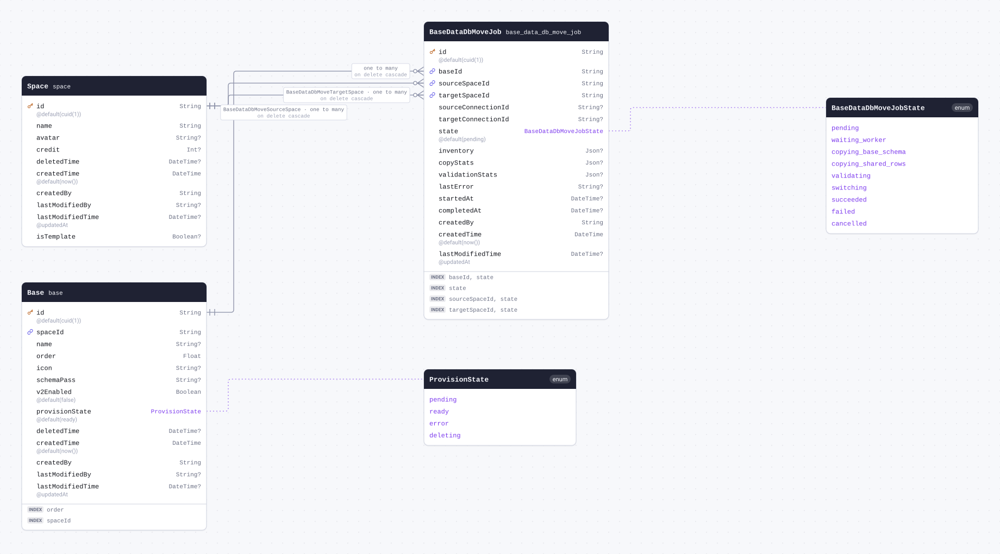

| Field                                         | Type                                                     | Constraints                         | Default      | Description |
| --------------------------------------------- | -------------------------------------------------------- | ----------------------------------- | ------------ | ----------- |
| `id`                                          | `String`                                                 | PK NOT NULL                         | `cuid(1)`    |             |
| `baseId` (`base_id`)                          | `String`                                                 | NOT NULL → [Base.id](#model-Base)   |              |             |
| `sourceSpaceId` (`source_space_id`)           | `String`                                                 | NOT NULL → [Space.id](#model-Space) |              |             |
| `targetSpaceId` (`target_space_id`)           | `String`                                                 | NOT NULL → [Space.id](#model-Space) |              |             |
| `sourceConnectionId` (`source_connection_id`) | `String`                                                 | NULL                                |              |             |
| `targetConnectionId` (`target_connection_id`) | `String`                                                 | NULL                                |              |             |
| `state`                                       | [`BaseDataDbMoveJobState`](#enum-BaseDataDbMoveJobState) | NOT NULL                            | `pending`    |             |
| `inventory`                                   | `Json`                                                   | NULL                                |              |             |
| `copyStats` (`copy_stats`)                    | `Json`                                                   | NULL                                |              |             |
| `validationStats` (`validation_stats`)        | `Json`                                                   | NULL                                |              |             |
| `lastError` (`last_error`)                    | `String`                                                 | NULL                                |              |             |
| `startedAt` (`started_at`)                    | `DateTime`                                               | NULL                                |              |             |
| `completedAt` (`completed_at`)                | `DateTime`                                               | NULL                                |              |             |
| `createdBy` (`created_by`)                    | `String`                                                 | NOT NULL                            |              |             |
| `createdTime` (`created_time`)                | `DateTime`                                               | NOT NULL                            | `now()`      |             |
| `lastModifiedTime` (`last_modified_time`)     | `DateTime`                                               | NULL                                | `@updatedAt` |             |

#### Indexes

- `@@index([baseId, state])`
- `@@index([state])`
- `@@index([sourceSpaceId, state])`
- `@@index([targetSpaceId, state])`

#### References

- `baseId` → [Base.id](#model-Base) (many-to-one, on delete Cascade)
- `sourceSpaceId` → [Space.id](#model-Space) (many-to-one, on delete Cascade)
- `targetSpaceId` → [Space.id](#model-Space) (many-to-one, on delete Cascade)

#### Definition

```sql
CREATE TABLE "base_data_db_move_job" (
    "id" TEXT NOT NULL,
    "base_id" TEXT NOT NULL,
    "source_space_id" TEXT NOT NULL,
    "target_space_id" TEXT NOT NULL,
    "source_connection_id" TEXT,
    "target_connection_id" TEXT,
    "state" "BaseDataDbMoveJobState" NOT NULL DEFAULT 'pending',
    "inventory" JSONB,
    "copy_stats" JSONB,
    "validation_stats" JSONB,
    "last_error" TEXT,
    "started_at" TIMESTAMP(3),
    "completed_at" TIMESTAMP(3),
    "created_by" TEXT NOT NULL,
    "created_time" TIMESTAMP(3) NOT NULL DEFAULT CURRENT_TIMESTAMP,
    "last_modified_time" TIMESTAMP(3),

    CONSTRAINT "base_data_db_move_job_pkey" PRIMARY KEY ("id")
);

CREATE INDEX "base_data_db_move_job_base_id_state_idx" ON "base_data_db_move_job"("base_id", "state");

CREATE INDEX "base_data_db_move_job_state_idx" ON "base_data_db_move_job"("state");

CREATE INDEX "base_data_db_move_job_source_space_id_state_idx" ON "base_data_db_move_job"("source_space_id", "state");

CREATE INDEX "base_data_db_move_job_target_space_id_state_idx" ON "base_data_db_move_job"("target_space_id", "state");

ALTER TABLE "base_data_db_move_job" ADD CONSTRAINT "base_data_db_move_job_base_id_fkey" FOREIGN KEY ("base_id") REFERENCES "base"("id") ON DELETE CASCADE ON UPDATE CASCADE;

ALTER TABLE "base_data_db_move_job" ADD CONSTRAINT "base_data_db_move_job_source_space_id_fkey" FOREIGN KEY ("source_space_id") REFERENCES "space"("id") ON DELETE CASCADE ON UPDATE CASCADE;

ALTER TABLE "base_data_db_move_job" ADD CONSTRAINT "base_data_db_move_job_target_space_id_fkey" FOREIGN KEY ("target_space_id") REFERENCES "space"("id") ON DELETE CASCADE ON UPDATE CASCADE;
```

<details>
<summary>Queries and their SQL</summary>

**findMany**: Every row

```ts
await prisma.baseDataDbMoveJob.findMany();
```

```sql
SELECT
  "public"."base_data_db_move_job"."id",
  "public"."base_data_db_move_job"."base_id",
  "public"."base_data_db_move_job"."source_space_id",
  "public"."base_data_db_move_job"."target_space_id",
  "public"."base_data_db_move_job"."source_connection_id",
  "public"."base_data_db_move_job"."target_connection_id",
  "public"."base_data_db_move_job"."state"::text,
  "public"."base_data_db_move_job"."inventory",
  "public"."base_data_db_move_job"."copy_stats",
  "public"."base_data_db_move_job"."validation_stats",
  "public"."base_data_db_move_job"."last_error",
  "public"."base_data_db_move_job"."started_at",
  "public"."base_data_db_move_job"."completed_at",
  "public"."base_data_db_move_job"."created_by",
  "public"."base_data_db_move_job"."created_time",
  "public"."base_data_db_move_job"."last_modified_time"
FROM
  "public"."base_data_db_move_job"
WHERE
  1 = 1
OFFSET
  $1
-- params: ["0"]
```

**count**: How many rows there are

```ts
await prisma.baseDataDbMoveJob.count();
```

```sql
SELECT
  COUNT(*) AS "_count$_all"
FROM
  (
    SELECT
      "public"."base_data_db_move_job"."id"
    FROM
      "public"."base_data_db_move_job"
    WHERE
      1 = 1
    OFFSET
      $1
  ) AS "sub"
-- params: ["0"]
```

**findMany**: Every row with its relations

```ts
await prisma.baseDataDbMoveJob.findMany({
  include: { base: true, sourceSpace: true, targetSpace: true },
});
```

```sql
SELECT
  "public"."base_data_db_move_job"."id",
  "public"."base_data_db_move_job"."base_id",
  "public"."base_data_db_move_job"."source_space_id",
  "public"."base_data_db_move_job"."target_space_id",
  "public"."base_data_db_move_job"."source_connection_id",
  "public"."base_data_db_move_job"."target_connection_id",
  "public"."base_data_db_move_job"."state"::text,
  "public"."base_data_db_move_job"."inventory",
  "public"."base_data_db_move_job"."copy_stats",
  "public"."base_data_db_move_job"."validation_stats",
  "public"."base_data_db_move_job"."last_error",
  "public"."base_data_db_move_job"."started_at",
  "public"."base_data_db_move_job"."completed_at",
  "public"."base_data_db_move_job"."created_by",
  "public"."base_data_db_move_job"."created_time",
  "public"."base_data_db_move_job"."last_modified_time"
FROM
  "public"."base_data_db_move_job"
WHERE
  1 = 1
OFFSET
  $1
-- params: ["0"]

SELECT
  "public"."base"."id",
  "public"."base"."space_id",
  "public"."base"."name",
  "public"."base"."order",
  "public"."base"."icon",
  "public"."base"."schema_pass",
  "public"."base"."v2_enabled",
  "public"."base"."provision_state"::text,
  "public"."base"."deleted_time",
  "public"."base"."created_time",
  "public"."base"."created_by",
  "public"."base"."last_modified_by",
  "public"."base"."last_modified_time"
FROM
  "public"."base"
WHERE
  "public"."base"."id" IN ($1)
OFFSET
  $2
-- params: ["<baseId of the rows above>","0"]

SELECT
  "public"."space"."id",
  "public"."space"."name",
  "public"."space"."avatar",
  "public"."space"."credit",
  "public"."space"."deleted_time",
  "public"."space"."created_time",
  "public"."space"."created_by",
  "public"."space"."last_modified_by",
  "public"."space"."last_modified_time",
  "public"."space"."is_template"
FROM
  "public"."space"
WHERE
  "public"."space"."id" IN ($1)
OFFSET
  $2
-- params: ["<sourceSpaceId of the rows above>","0"]

SELECT
  "public"."space"."id",
  "public"."space"."name",
  "public"."space"."avatar",
  "public"."space"."credit",
  "public"."space"."deleted_time",
  "public"."space"."created_time",
  "public"."space"."created_by",
  "public"."space"."last_modified_by",
  "public"."space"."last_modified_time",
  "public"."space"."is_template"
FROM
  "public"."space"
WHERE
  "public"."space"."id" IN ($1)
OFFSET
  $2
-- params: ["<targetSpaceId of the rows above>","0"]
```

**findUnique**: One row by what is unique to it

```ts
await prisma.baseDataDbMoveJob.findUnique({ where: { id: "example" } });
```

```sql
SELECT
  "public"."base_data_db_move_job"."id",
  "public"."base_data_db_move_job"."base_id",
  "public"."base_data_db_move_job"."source_space_id",
  "public"."base_data_db_move_job"."target_space_id",
  "public"."base_data_db_move_job"."source_connection_id",
  "public"."base_data_db_move_job"."target_connection_id",
  "public"."base_data_db_move_job"."state"::text,
  "public"."base_data_db_move_job"."inventory",
  "public"."base_data_db_move_job"."copy_stats",
  "public"."base_data_db_move_job"."validation_stats",
  "public"."base_data_db_move_job"."last_error",
  "public"."base_data_db_move_job"."started_at",
  "public"."base_data_db_move_job"."completed_at",
  "public"."base_data_db_move_job"."created_by",
  "public"."base_data_db_move_job"."created_time",
  "public"."base_data_db_move_job"."last_modified_time"
FROM
  "public"."base_data_db_move_job"
WHERE
  (
    "public"."base_data_db_move_job"."id" = $1
    AND 1 = 1
  )
LIMIT
  $2
OFFSET
  $3
-- params: ["example","1","0"]
```

**create**: Create a row

```ts
await prisma.baseDataDbMoveJob.create({
  data: {
    baseId: "example",
    sourceSpaceId: "example",
    targetSpaceId: "example",
    createdBy: "example",
  },
});
```

```sql
INSERT INTO
  "public"."base_data_db_move_job" (
    "id",
    "base_id",
    "source_space_id",
    "target_space_id",
    "state",
    "created_by",
    "created_time",
    "last_modified_time"
  )
VALUES
  (
    $1,
    $2,
    $3,
    $4,
    CAST($5::text AS "public"."BaseDataDbMoveJobState"),
    $6,
    $7,
    $8
  )
RETURNING
  "public"."base_data_db_move_job"."id",
  "public"."base_data_db_move_job"."base_id",
  "public"."base_data_db_move_job"."source_space_id",
  "public"."base_data_db_move_job"."target_space_id",
  "public"."base_data_db_move_job"."source_connection_id",
  "public"."base_data_db_move_job"."target_connection_id",
  "public"."base_data_db_move_job"."state"::text,
  "public"."base_data_db_move_job"."inventory",
  "public"."base_data_db_move_job"."copy_stats",
  "public"."base_data_db_move_job"."validation_stats",
  "public"."base_data_db_move_job"."last_error",
  "public"."base_data_db_move_job"."started_at",
  "public"."base_data_db_move_job"."completed_at",
  "public"."base_data_db_move_job"."created_by",
  "public"."base_data_db_move_job"."created_time",
  "public"."base_data_db_move_job"."last_modified_time"
-- params: ["<cuid(1)>","example","example","example","pending","example","<now()>","<now()>"]
```

**update**: Update a row

```ts
await prisma.baseDataDbMoveJob.update({
  where: { id: "example" },
  data: { sourceConnectionId: "example" },
});
```

```sql
UPDATE "public"."base_data_db_move_job"
SET
  "source_connection_id" = $1,
  "last_modified_time" = $2
WHERE
  (
    "public"."base_data_db_move_job"."id" = $3
    AND 1 = 1
  )
RETURNING
  "public"."base_data_db_move_job"."id",
  "public"."base_data_db_move_job"."base_id",
  "public"."base_data_db_move_job"."source_space_id",
  "public"."base_data_db_move_job"."target_space_id",
  "public"."base_data_db_move_job"."source_connection_id",
  "public"."base_data_db_move_job"."target_connection_id",
  "public"."base_data_db_move_job"."state"::text,
  "public"."base_data_db_move_job"."inventory",
  "public"."base_data_db_move_job"."copy_stats",
  "public"."base_data_db_move_job"."validation_stats",
  "public"."base_data_db_move_job"."last_error",
  "public"."base_data_db_move_job"."started_at",
  "public"."base_data_db_move_job"."completed_at",
  "public"."base_data_db_move_job"."created_by",
  "public"."base_data_db_move_job"."created_time",
  "public"."base_data_db_move_job"."last_modified_time"
-- params: ["example",{"prisma__type":"generatorCall","prisma__value":{"name":"now","args":[],"returnType":{"type":"DateTime"}}},"example"]
```

**delete**: Delete a row

```ts
await prisma.baseDataDbMoveJob.delete({ where: { id: "example" } });
```

```sql
DELETE FROM "public"."base_data_db_move_job"
WHERE
  (
    "public"."base_data_db_move_job"."id" = $1
    AND 1 = 1
  )
RETURNING
  "public"."base_data_db_move_job"."id",
  "public"."base_data_db_move_job"."base_id",
  "public"."base_data_db_move_job"."source_space_id",
  "public"."base_data_db_move_job"."target_space_id",
  "public"."base_data_db_move_job"."source_connection_id",
  "public"."base_data_db_move_job"."target_connection_id",
  "public"."base_data_db_move_job"."state"::text,
  "public"."base_data_db_move_job"."inventory",
  "public"."base_data_db_move_job"."copy_stats",
  "public"."base_data_db_move_job"."validation_stats",
  "public"."base_data_db_move_job"."last_error",
  "public"."base_data_db_move_job"."started_at",
  "public"."base_data_db_move_job"."completed_at",
  "public"."base_data_db_move_job"."created_by",
  "public"."base_data_db_move_job"."created_time",
  "public"."base_data_db_move_job"."last_modified_time"
-- params: ["example"]
```

</details>

<a id="model-PinResource"></a>

### PinResource

Table `pin_resource`.

| Field                          | Type       | Constraints | Default   | Description |
| ------------------------------ | ---------- | ----------- | --------- | ----------- |
| `id`                           | `String`   | PK NOT NULL | `cuid(1)` |             |
| `type` (`type`)                | `String`   | NOT NULL    |           |             |
| `resourceId` (`resource_id`)   | `String`   | NOT NULL    |           |             |
| `createdTime` (`created_time`) | `DateTime` | NOT NULL    | `now()`   |             |
| `createdBy` (`created_by`)     | `String`   | NOT NULL    |           |             |
| `order` (`order`)              | `Float`    | NOT NULL    |           |             |

#### Indexes

- `@@index([order])`
- `@@unique([createdBy, resourceId])`

#### Definition

```sql
CREATE TABLE "pin_resource" (
    "id" TEXT NOT NULL,
    "type" TEXT NOT NULL,
    "resource_id" TEXT NOT NULL,
    "created_time" TIMESTAMP(3) NOT NULL DEFAULT CURRENT_TIMESTAMP,
    "created_by" TEXT NOT NULL,
    "order" DOUBLE PRECISION NOT NULL,

    CONSTRAINT "pin_resource_pkey" PRIMARY KEY ("id")
);

CREATE INDEX "pin_resource_order_idx" ON "pin_resource"("order");

CREATE UNIQUE INDEX "pin_resource_created_by_resource_id_key" ON "pin_resource"("created_by", "resource_id");
```

<details>
<summary>Queries and their SQL</summary>

**findMany**: Every row

```ts
await prisma.pinResource.findMany();
```

```sql
SELECT
  "public"."pin_resource"."id",
  "public"."pin_resource"."type",
  "public"."pin_resource"."resource_id",
  "public"."pin_resource"."created_time",
  "public"."pin_resource"."created_by",
  "public"."pin_resource"."order"
FROM
  "public"."pin_resource"
WHERE
  1 = 1
OFFSET
  $1
-- params: ["0"]
```

**count**: How many rows there are

```ts
await prisma.pinResource.count();
```

```sql
SELECT
  COUNT(*) AS "_count$_all"
FROM
  (
    SELECT
      "public"."pin_resource"."id"
    FROM
      "public"."pin_resource"
    WHERE
      1 = 1
    OFFSET
      $1
  ) AS "sub"
-- params: ["0"]
```

**findUnique**: One row by what is unique to it

```ts
await prisma.pinResource.findUnique({ where: { id: "example" } });
```

```sql
SELECT
  "public"."pin_resource"."id",
  "public"."pin_resource"."type",
  "public"."pin_resource"."resource_id",
  "public"."pin_resource"."created_time",
  "public"."pin_resource"."created_by",
  "public"."pin_resource"."order"
FROM
  "public"."pin_resource"
WHERE
  (
    "public"."pin_resource"."id" = $1
    AND 1 = 1
  )
LIMIT
  $2
OFFSET
  $3
-- params: ["example","1","0"]
```

**create**: Create a row

```ts
await prisma.pinResource.create({
  data: { type: "example", resourceId: "example", createdBy: "example", order: 1.5 },
});
```

```sql
INSERT INTO
  "public"."pin_resource" (
    "id",
    "type",
    "resource_id",
    "created_time",
    "created_by",
    "order"
  )
VALUES
  ($1, $2, $3, $4, $5, $6)
RETURNING
  "public"."pin_resource"."id",
  "public"."pin_resource"."type",
  "public"."pin_resource"."resource_id",
  "public"."pin_resource"."created_time",
  "public"."pin_resource"."created_by",
  "public"."pin_resource"."order"
-- params: ["<cuid(1)>","example","example","<now()>","example","1.5"]
```

**update**: Update a row

```ts
await prisma.pinResource.update({ where: { id: "example" }, data: { type: "example" } });
```

```sql
UPDATE "public"."pin_resource"
SET
  "type" = $1
WHERE
  (
    "public"."pin_resource"."id" = $2
    AND 1 = 1
  )
RETURNING
  "public"."pin_resource"."id",
  "public"."pin_resource"."type",
  "public"."pin_resource"."resource_id",
  "public"."pin_resource"."created_time",
  "public"."pin_resource"."created_by",
  "public"."pin_resource"."order"
-- params: ["example","example"]
```

**delete**: Delete a row

```ts
await prisma.pinResource.delete({ where: { id: "example" } });
```

```sql
DELETE FROM "public"."pin_resource"
WHERE
  (
    "public"."pin_resource"."id" = $1
    AND 1 = 1
  )
RETURNING
  "public"."pin_resource"."id",
  "public"."pin_resource"."type",
  "public"."pin_resource"."resource_id",
  "public"."pin_resource"."created_time",
  "public"."pin_resource"."created_by",
  "public"."pin_resource"."order"
-- params: ["example"]
```

</details>

<a id="model-Base"></a>

### Base

Table `base`.

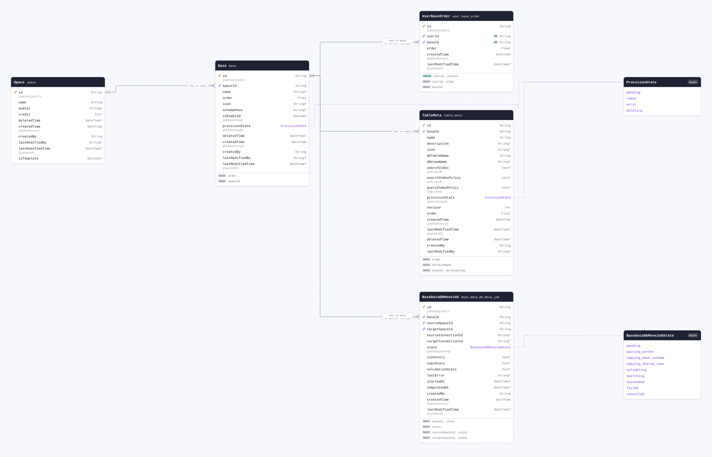

| Field                                     | Type                                     | Constraints                         | Default      | Description |
| ----------------------------------------- | ---------------------------------------- | ----------------------------------- | ------------ | ----------- |
| `id`                                      | `String`                                 | PK NOT NULL                         | `cuid(1)`    |             |
| `spaceId` (`space_id`)                    | `String`                                 | NOT NULL → [Space.id](#model-Space) |              |             |
| `name`                                    | `String`                                 | NULL                                |              |             |
| `order`                                   | `Float`                                  | NOT NULL                            |              |             |
| `icon`                                    | `String`                                 | NULL                                |              |             |
| `schemaPass` (`schema_pass`)              | `String`                                 | NULL                                |              |             |
| `v2Enabled` (`v2_enabled`)                | `Boolean`                                | NOT NULL                            | `false`      |             |
| `provisionState` (`provision_state`)      | [`ProvisionState`](#enum-ProvisionState) | NOT NULL                            | `ready`      |             |
| `deletedTime` (`deleted_time`)            | `DateTime`                               | NULL                                |              |             |
| `createdTime` (`created_time`)            | `DateTime`                               | NOT NULL                            | `now()`      |             |
| `createdBy` (`created_by`)                | `String`                                 | NOT NULL                            |              |             |
| `lastModifiedBy` (`last_modified_by`)     | `String`                                 | NULL                                |              |             |
| `lastModifiedTime` (`last_modified_time`) | `DateTime`                               | NULL                                | `@updatedAt` |             |

#### Indexes

- `@@index([order])`
- `@@index([spaceId])`

#### References

- `spaceId` → [Space.id](#model-Space) (many-to-one)

#### Referenced by

- `id` ← [BaseDataDbMoveJob.baseId](#model-BaseDataDbMoveJob) (one-to-many, on delete Cascade)
- `id` ← [TableMeta.baseId](#model-TableMeta) (one-to-many)
- `id` ← [UserBaseOrder.baseId](#model-UserBaseOrder) (one-to-many, on delete Cascade)

#### Definition

```sql
CREATE TABLE "base" (
    "id" TEXT NOT NULL,
    "space_id" TEXT NOT NULL,
    "name" TEXT,
    "order" DOUBLE PRECISION NOT NULL,
    "icon" TEXT,
    "schema_pass" TEXT,
    "v2_enabled" BOOLEAN NOT NULL DEFAULT false,
    "provision_state" "ProvisionState" NOT NULL DEFAULT 'ready',
    "deleted_time" TIMESTAMP(3),
    "created_time" TIMESTAMP(3) NOT NULL DEFAULT CURRENT_TIMESTAMP,
    "created_by" TEXT NOT NULL,
    "last_modified_by" TEXT,
    "last_modified_time" TIMESTAMP(3),

    CONSTRAINT "base_pkey" PRIMARY KEY ("id")
);

CREATE INDEX "base_order_idx" ON "base"("order");

CREATE INDEX "base_space_id_idx" ON "base"("space_id");

ALTER TABLE "base" ADD CONSTRAINT "base_space_id_fkey" FOREIGN KEY ("space_id") REFERENCES "space"("id") ON DELETE RESTRICT ON UPDATE CASCADE;
```

<details>
<summary>Queries and their SQL</summary>

**findMany**: Every row

```ts
await prisma.base.findMany();
```

```sql
SELECT
  "public"."base"."id",
  "public"."base"."space_id",
  "public"."base"."name",
  "public"."base"."order",
  "public"."base"."icon",
  "public"."base"."schema_pass",
  "public"."base"."v2_enabled",
  "public"."base"."provision_state"::text,
  "public"."base"."deleted_time",
  "public"."base"."created_time",
  "public"."base"."created_by",
  "public"."base"."last_modified_by",
  "public"."base"."last_modified_time"
FROM
  "public"."base"
WHERE
  1 = 1
OFFSET
  $1
-- params: ["0"]
```

**count**: How many rows there are

```ts
await prisma.base.count();
```

```sql
SELECT
  COUNT(*) AS "_count$_all"
FROM
  (
    SELECT
      "public"."base"."id"
    FROM
      "public"."base"
    WHERE
      1 = 1
    OFFSET
      $1
  ) AS "sub"
-- params: ["0"]
```

**findMany**: Every row with its relations

```ts
await prisma.base.findMany({
  include: { space: true, tables: true, dataDbMoveJobs: true, userOrders: true },
});
```

```sql
SELECT
  "public"."base"."id",
  "public"."base"."space_id",
  "public"."base"."name",
  "public"."base"."order",
  "public"."base"."icon",
  "public"."base"."schema_pass",
  "public"."base"."v2_enabled",
  "public"."base"."provision_state"::text,
  "public"."base"."deleted_time",
  "public"."base"."created_time",
  "public"."base"."created_by",
  "public"."base"."last_modified_by",
  "public"."base"."last_modified_time"
FROM
  "public"."base"
WHERE
  1 = 1
OFFSET
  $1
-- params: ["0"]

SELECT
  "public"."space"."id",
  "public"."space"."name",
  "public"."space"."avatar",
  "public"."space"."credit",
  "public"."space"."deleted_time",
  "public"."space"."created_time",
  "public"."space"."created_by",
  "public"."space"."last_modified_by",
  "public"."space"."last_modified_time",
  "public"."space"."is_template"
FROM
  "public"."space"
WHERE
  "public"."space"."id" IN ($1)
OFFSET
  $2
-- params: ["<spaceId of the rows above>","0"]

SELECT
  "public"."table_meta"."id",
  "public"."table_meta"."base_id",
  "public"."table_meta"."name",
  "public"."table_meta"."description",
  "public"."table_meta"."icon",
  "public"."table_meta"."db_table_name",
  "public"."table_meta"."db_view_name",
  "public"."table_meta"."search_index",
  "public"."table_meta"."search_index_policy",
  "public"."table_meta"."query_index_policy",
  "public"."table_meta"."provision_state"::text,
  "public"."table_meta"."version",
  "public"."table_meta"."order",
  "public"."table_meta"."created_time",
  "public"."table_meta"."last_modified_time",
  "public"."table_meta"."deleted_time",
  "public"."table_meta"."created_by",
  "public"."table_meta"."last_modified_by"
FROM
  "public"."table_meta"
WHERE
  "public"."table_meta"."base_id" IN ($1)
OFFSET
  $2
-- params: ["<id of the rows above>","0"]

SELECT
  "public"."base_data_db_move_job"."id",
  "public"."base_data_db_move_job"."base_id",
  "public"."base_data_db_move_job"."source_space_id",
  "public"."base_data_db_move_job"."target_space_id",
  "public"."base_data_db_move_job"."source_connection_id",
  "public"."base_data_db_move_job"."target_connection_id",
  "public"."base_data_db_move_job"."state"::text,
  "public"."base_data_db_move_job"."inventory",
  "public"."base_data_db_move_job"."copy_stats",
  "public"."base_data_db_move_job"."validation_stats",
  "public"."base_data_db_move_job"."last_error",
  "public"."base_data_db_move_job"."started_at",
  "public"."base_data_db_move_job"."completed_at",
  "public"."base_data_db_move_job"."created_by",
  "public"."base_data_db_move_job"."created_time",
  "public"."base_data_db_move_job"."last_modified_time"
FROM
  "public"."base_data_db_move_job"
WHERE
  "public"."base_data_db_move_job"."base_id" IN ($1)
OFFSET
  $2
-- params: ["<id of the rows above>","0"]

SELECT
  "public"."user_base_order"."id",
  "public"."user_base_order"."user_id",
  "public"."user_base_order"."base_id",
  "public"."user_base_order"."order",
  "public"."user_base_order"."created_time",
  "public"."user_base_order"."last_modified_time"
FROM
  "public"."user_base_order"
WHERE
  "public"."user_base_order"."base_id" IN ($1)
OFFSET
  $2
-- params: ["<id of the rows above>","0"]
```

**findUnique**: One row by what is unique to it

```ts
await prisma.base.findUnique({ where: { id: "example" } });
```

```sql
SELECT
  "public"."base"."id",
  "public"."base"."space_id",
  "public"."base"."name",
  "public"."base"."order",
  "public"."base"."icon",
  "public"."base"."schema_pass",
  "public"."base"."v2_enabled",
  "public"."base"."provision_state"::text,
  "public"."base"."deleted_time",
  "public"."base"."created_time",
  "public"."base"."created_by",
  "public"."base"."last_modified_by",
  "public"."base"."last_modified_time"
FROM
  "public"."base"
WHERE
  (
    "public"."base"."id" = $1
    AND 1 = 1
  )
LIMIT
  $2
OFFSET
  $3
-- params: ["example","1","0"]
```

**create**: Create a row

```ts
await prisma.base.create({ data: { spaceId: "example", order: 1.5, createdBy: "example" } });
```

```sql
INSERT INTO
  "public"."base" (
    "id",
    "space_id",
    "order",
    "v2_enabled",
    "provision_state",
    "created_time",
    "created_by",
    "last_modified_time"
  )
VALUES
  (
    $1,
    $2,
    $3,
    $4,
    CAST($5::text AS "public"."ProvisionState"),
    $6,
    $7,
    $8
  )
RETURNING
  "public"."base"."id",
  "public"."base"."space_id",
  "public"."base"."name",
  "public"."base"."order",
  "public"."base"."icon",
  "public"."base"."schema_pass",
  "public"."base"."v2_enabled",
  "public"."base"."provision_state"::text,
  "public"."base"."deleted_time",
  "public"."base"."created_time",
  "public"."base"."created_by",
  "public"."base"."last_modified_by",
  "public"."base"."last_modified_time"
-- params: ["<cuid(1)>","example","1.5",false,"ready","<now()>","example","<now()>"]
```

**update**: Update a row

```ts
await prisma.base.update({ where: { id: "example" }, data: { name: "example" } });
```

```sql
UPDATE "public"."base"
SET
  "name" = $1,
  "last_modified_time" = $2
WHERE
  (
    "public"."base"."id" = $3
    AND 1 = 1
  )
RETURNING
  "public"."base"."id",
  "public"."base"."space_id",
  "public"."base"."name",
  "public"."base"."order",
  "public"."base"."icon",
  "public"."base"."schema_pass",
  "public"."base"."v2_enabled",
  "public"."base"."provision_state"::text,
  "public"."base"."deleted_time",
  "public"."base"."created_time",
  "public"."base"."created_by",
  "public"."base"."last_modified_by",
  "public"."base"."last_modified_time"
-- params: ["example",{"prisma__type":"generatorCall","prisma__value":{"name":"now","args":[],"returnType":{"type":"DateTime"}}},"example"]
```

**delete**: Delete a row

```ts
await prisma.base.delete({ where: { id: "example" } });
```

```sql
DELETE FROM "public"."base"
WHERE
  (
    "public"."base"."id" = $1
    AND 1 = 1
  )
RETURNING
  "public"."base"."id",
  "public"."base"."space_id",
  "public"."base"."name",
  "public"."base"."order",
  "public"."base"."icon",
  "public"."base"."schema_pass",
  "public"."base"."v2_enabled",
  "public"."base"."provision_state"::text,
  "public"."base"."deleted_time",
  "public"."base"."created_time",
  "public"."base"."created_by",
  "public"."base"."last_modified_by",
  "public"."base"."last_modified_time"
-- params: ["example"]
```

</details>

<a id="model-TableMeta"></a>

### TableMeta

Table `table_meta`.

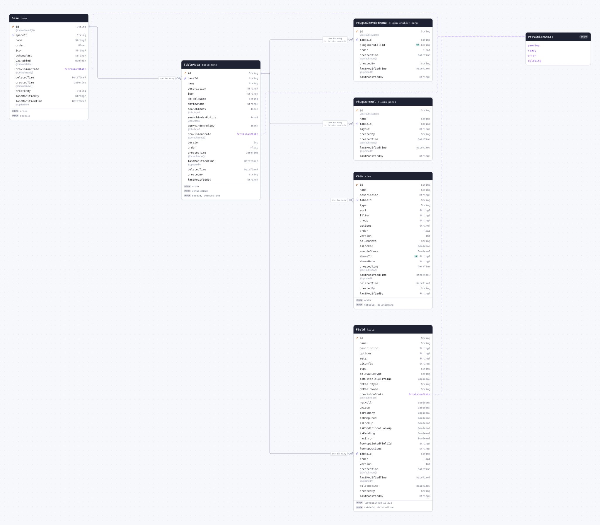

| Field                                       | Type                                     | Constraints                       | Default      | Description |
| ------------------------------------------- | ---------------------------------------- | --------------------------------- | ------------ | ----------- |
| `id`                                        | `String`                                 | PK NOT NULL                       |              |             |
| `baseId` (`base_id`)                        | `String`                                 | NOT NULL → [Base.id](#model-Base) |              |             |
| `name`                                      | `String`                                 | NOT NULL                          |              |             |
| `description`                               | `String`                                 | NULL                              |              |             |
| `icon`                                      | `String`                                 | NULL                              |              |             |
| `dbTableName` (`db_table_name`)             | `String`                                 | NOT NULL                          |              |             |
| `dbViewName` (`db_view_name`)               | `String`                                 | NULL                              |              |             |
| `searchIndex` (`search_index`)              | `Json` `@db.JsonB`                       | NULL                              |              |             |
| `searchIndexPolicy` (`search_index_policy`) | `Json` `@db.JsonB`                       | NULL                              |              |             |
| `queryIndexPolicy` (`query_index_policy`)   | `Json` `@db.JsonB`                       | NULL                              |              |             |
| `provisionState` (`provision_state`)        | [`ProvisionState`](#enum-ProvisionState) | NOT NULL                          | `ready`      |             |
| `version`                                   | `Int`                                    | NOT NULL                          |              |             |
| `order`                                     | `Float`                                  | NOT NULL                          |              |             |
| `createdTime` (`created_time`)              | `DateTime`                               | NOT NULL                          | `now()`      |             |
| `lastModifiedTime` (`last_modified_time`)   | `DateTime`                               | NULL                              | `@updatedAt` |             |
| `deletedTime` (`deleted_time`)              | `DateTime`                               | NULL                              |              |             |
| `createdBy` (`created_by`)                  | `String`                                 | NOT NULL                          |              |             |
| `lastModifiedBy` (`last_modified_by`)       | `String`                                 | NULL                              |              |             |

#### Indexes

- `@@index([order])`
- `@@index([dbTableName])`
- `@@index([baseId, deletedTime])`

#### References

- `baseId` → [Base.id](#model-Base) (many-to-one)

#### Referenced by

- `id` ← [Field.tableId](#model-Field) (one-to-many)
- `id` ← [View.tableId](#model-View) (one-to-many)
- `id` ← [PluginPanel.tableId](#model-PluginPanel) (one-to-many, on delete Cascade)
- `id` ← [PluginContextMenu.tableId](#model-PluginContextMenu) (one-to-many, on delete Cascade)

#### Definition

```sql
CREATE TABLE "table_meta" (
    "id" TEXT NOT NULL,
    "base_id" TEXT NOT NULL,
    "name" TEXT NOT NULL,
    "description" TEXT,
    "icon" TEXT,
    "db_table_name" TEXT NOT NULL,
    "db_view_name" TEXT,
    "search_index" JSONB,
    "search_index_policy" JSONB,
    "query_index_policy" JSONB,
    "provision_state" "ProvisionState" NOT NULL DEFAULT 'ready',
    "version" INTEGER NOT NULL,
    "order" DOUBLE PRECISION NOT NULL,
    "created_time" TIMESTAMP(3) NOT NULL DEFAULT CURRENT_TIMESTAMP,
    "last_modified_time" TIMESTAMP(3),
    "deleted_time" TIMESTAMP(3),
    "created_by" TEXT NOT NULL,
    "last_modified_by" TEXT,

    CONSTRAINT "table_meta_pkey" PRIMARY KEY ("id")
);

CREATE INDEX "table_meta_order_idx" ON "table_meta"("order");

CREATE INDEX "table_meta_db_table_name_idx" ON "table_meta"("db_table_name");

CREATE INDEX "table_meta_base_id_deleted_time_idx" ON "table_meta"("base_id", "deleted_time");

ALTER TABLE "table_meta" ADD CONSTRAINT "table_meta_base_id_fkey" FOREIGN KEY ("base_id") REFERENCES "base"("id") ON DELETE RESTRICT ON UPDATE CASCADE;
```

<details>
<summary>Queries and their SQL</summary>

**findMany**: Every row

```ts
await prisma.tableMeta.findMany();
```

```sql
SELECT
  "public"."table_meta"."id",
  "public"."table_meta"."base_id",
  "public"."table_meta"."name",
  "public"."table_meta"."description",
  "public"."table_meta"."icon",
  "public"."table_meta"."db_table_name",
  "public"."table_meta"."db_view_name",
  "public"."table_meta"."search_index",
  "public"."table_meta"."search_index_policy",
  "public"."table_meta"."query_index_policy",
  "public"."table_meta"."provision_state"::text,
  "public"."table_meta"."version",
  "public"."table_meta"."order",
  "public"."table_meta"."created_time",
  "public"."table_meta"."last_modified_time",
  "public"."table_meta"."deleted_time",
  "public"."table_meta"."created_by",
  "public"."table_meta"."last_modified_by"
FROM
  "public"."table_meta"
WHERE
  1 = 1
OFFSET
  $1
-- params: ["0"]
```

**count**: How many rows there are

```ts
await prisma.tableMeta.count();
```

```sql
SELECT
  COUNT(*) AS "_count$_all"
FROM
  (
    SELECT
      "public"."table_meta"."id"
    FROM
      "public"."table_meta"
    WHERE
      1 = 1
    OFFSET
      $1
  ) AS "sub"
-- params: ["0"]
```

**findMany**: Every row with its relations

```ts
await prisma.tableMeta.findMany({
  include: { base: true, fields: true, views: true, pluginPanel: true, pluginContextMenu: true },
});
```

```sql
SELECT
  "public"."table_meta"."id",
  "public"."table_meta"."base_id",
  "public"."table_meta"."name",
  "public"."table_meta"."description",
  "public"."table_meta"."icon",
  "public"."table_meta"."db_table_name",
  "public"."table_meta"."db_view_name",
  "public"."table_meta"."search_index",
  "public"."table_meta"."search_index_policy",
  "public"."table_meta"."query_index_policy",
  "public"."table_meta"."provision_state"::text,
  "public"."table_meta"."version",
  "public"."table_meta"."order",
  "public"."table_meta"."created_time",
  "public"."table_meta"."last_modified_time",
  "public"."table_meta"."deleted_time",
  "public"."table_meta"."created_by",
  "public"."table_meta"."last_modified_by"
FROM
  "public"."table_meta"
WHERE
  1 = 1
OFFSET
  $1
-- params: ["0"]

SELECT
  "public"."base"."id",
  "public"."base"."space_id",
  "public"."base"."name",
  "public"."base"."order",
  "public"."base"."icon",
  "public"."base"."schema_pass",
  "public"."base"."v2_enabled",
  "public"."base"."provision_state"::text,
  "public"."base"."deleted_time",
  "public"."base"."created_time",
  "public"."base"."created_by",
  "public"."base"."last_modified_by",
  "public"."base"."last_modified_time"
FROM
  "public"."base"
WHERE
  "public"."base"."id" IN ($1)
OFFSET
  $2
-- params: ["<baseId of the rows above>","0"]

SELECT
  "public"."field"."id",
  "public"."field"."name",
  "public"."field"."description",
  "public"."field"."options",
  "public"."field"."meta",
  "public"."field"."ai_config",
  "public"."field"."type",
  "public"."field"."cell_value_type",
  "public"."field"."is_multiple_cell_value",
  "public"."field"."db_field_type",
  "public"."field"."db_field_name",
  "public"."field"."provision_state"::text,
  "public"."field"."not_null",
  "public"."field"."unique",
  "public"."field"."is_primary",
  "public"."field"."is_computed",
  "public"."field"."is_lookup",
  "public"."field"."is_conditional_lookup",
  "public"."field"."is_pending",
  "public"."field"."has_error",
  "public"."field"."lookup_linked_field_id",
  "public"."field"."lookup_options",
  "public"."field"."table_id",
  "public"."field"."order",
  "public"."field"."version",
  "public"."field"."created_time",
  "public"."field"."last_modified_time",
  "public"."field"."deleted_time",
  "public"."field"."created_by",
  "public"."field"."last_modified_by"
FROM
  "public"."field"
WHERE
  "public"."field"."table_id" IN ($1)
OFFSET
  $2
-- params: ["<id of the rows above>","0"]

SELECT
  "public"."view"."id",
  "public"."view"."name",
  "public"."view"."description",
  "public"."view"."table_id",
  "public"."view"."type",
  "public"."view"."sort",
  "public"."view"."filter",
  "public"."view"."group",
  "public"."view"."options",
  "public"."view"."order",
  "public"."view"."version",
  "public"."view"."column_meta",
  "public"."view"."is_locked",
  "public"."view"."enable_share",
  "public"."view"."share_id",
  "public"."view"."share_meta",
  "public"."view"."created_time",
  "public"."view"."last_modified_time",
  "public"."view"."deleted_time",
  "public"."view"."created_by",
  "public"."view"."last_modified_by"
FROM
  "public"."view"
WHERE
  "public"."view"."table_id" IN ($1)
OFFSET
  $2
-- params: ["<id of the rows above>","0"]

SELECT
  "public"."plugin_panel"."id",
  "public"."plugin_panel"."name",
  "public"."plugin_panel"."table_id",
  "public"."plugin_panel"."layout",
  "public"."plugin_panel"."created_by",
  "public"."plugin_panel"."created_time",
  "public"."plugin_panel"."last_modified_time",
  "public"."plugin_panel"."last_modified_by"
FROM
  "public"."plugin_panel"
WHERE
  "public"."plugin_panel"."table_id" IN ($1)
OFFSET
  $2
-- params: ["<id of the rows above>","0"]

SELECT
  "public"."plugin_context_menu"."id",
  "public"."plugin_context_menu"."table_id",
  "public"."plugin_context_menu"."plugin_install_id",
  "public"."plugin_context_menu"."order",
  "public"."plugin_context_menu"."created_time",
  "public"."plugin_context_menu"."created_by",
  "public"."plugin_context_menu"."last_modified_time",
  "public"."plugin_context_menu"."last_modified_by"
FROM
  "public"."plugin_context_menu"
WHERE
  "public"."plugin_context_menu"."table_id" IN ($1)
OFFSET
  $2
-- params: ["<id of the rows above>","0"]
```

**findUnique**: One row by what is unique to it

```ts
await prisma.tableMeta.findUnique({ where: { id: "example" } });
```

```sql
SELECT
  "public"."table_meta"."id",
  "public"."table_meta"."base_id",
  "public"."table_meta"."name",
  "public"."table_meta"."description",
  "public"."table_meta"."icon",
  "public"."table_meta"."db_table_name",
  "public"."table_meta"."db_view_name",
  "public"."table_meta"."search_index",
  "public"."table_meta"."search_index_policy",
  "public"."table_meta"."query_index_policy",
  "public"."table_meta"."provision_state"::text,
  "public"."table_meta"."version",
  "public"."table_meta"."order",
  "public"."table_meta"."created_time",
  "public"."table_meta"."last_modified_time",
  "public"."table_meta"."deleted_time",
  "public"."table_meta"."created_by",
  "public"."table_meta"."last_modified_by"
FROM
  "public"."table_meta"
WHERE
  (
    "public"."table_meta"."id" = $1
    AND 1 = 1
  )
LIMIT
  $2
OFFSET
  $3
-- params: ["example","1","0"]
```

**create**: Create a row

```ts
await prisma.tableMeta.create({
  data: {
    id: "example",
    baseId: "example",
    name: "example",
    dbTableName: "example",
    version: 1,
    order: 1.5,
    createdBy: "example",
  },
});
```

```sql
INSERT INTO
  "public"."table_meta" (
    "id",
    "base_id",
    "name",
    "db_table_name",
    "provision_state",
    "version",
    "order",
    "created_time",
    "last_modified_time",
    "created_by"
  )
VALUES
  (
    $1,
    $2,
    $3,
    $4,
    CAST($5::text AS "public"."ProvisionState"),
    $6,
    $7,
    $8,
    $9,
    $10
  )
RETURNING
  "public"."table_meta"."id",
  "public"."table_meta"."base_id",
  "public"."table_meta"."name",
  "public"."table_meta"."description",
  "public"."table_meta"."icon",
  "public"."table_meta"."db_table_name",
  "public"."table_meta"."db_view_name",
  "public"."table_meta"."search_index",
  "public"."table_meta"."search_index_policy",
  "public"."table_meta"."query_index_policy",
  "public"."table_meta"."provision_state"::text,
  "public"."table_meta"."version",
  "public"."table_meta"."order",
  "public"."table_meta"."created_time",
  "public"."table_meta"."last_modified_time",
  "public"."table_meta"."deleted_time",
  "public"."table_meta"."created_by",
  "public"."table_meta"."last_modified_by"
-- params: ["example","example","example","example","ready","1","1.5","<now()>","<now()>","example"]
```

**update**: Update a row

```ts
await prisma.tableMeta.update({ where: { id: "example" }, data: { name: "example" } });
```

```sql
UPDATE "public"."table_meta"
SET
  "name" = $1,
  "last_modified_time" = $2
WHERE
  (
    "public"."table_meta"."id" = $3
    AND 1 = 1
  )
RETURNING
  "public"."table_meta"."id",
  "public"."table_meta"."base_id",
  "public"."table_meta"."name",
  "public"."table_meta"."description",
  "public"."table_meta"."icon",
  "public"."table_meta"."db_table_name",
  "public"."table_meta"."db_view_name",
  "public"."table_meta"."search_index",
  "public"."table_meta"."search_index_policy",
  "public"."table_meta"."query_index_policy",
  "public"."table_meta"."provision_state"::text,
  "public"."table_meta"."version",
  "public"."table_meta"."order",
  "public"."table_meta"."created_time",
  "public"."table_meta"."last_modified_time",
  "public"."table_meta"."deleted_time",
  "public"."table_meta"."created_by",
  "public"."table_meta"."last_modified_by"
-- params: ["example",{"prisma__type":"generatorCall","prisma__value":{"name":"now","args":[],"returnType":{"type":"DateTime"}}},"example"]
```

**delete**: Delete a row

```ts
await prisma.tableMeta.delete({ where: { id: "example" } });
```

```sql
DELETE FROM "public"."table_meta"
WHERE
  (
    "public"."table_meta"."id" = $1
    AND 1 = 1
  )
RETURNING
  "public"."table_meta"."id",
  "public"."table_meta"."base_id",
  "public"."table_meta"."name",
  "public"."table_meta"."description",
  "public"."table_meta"."icon",
  "public"."table_meta"."db_table_name",
  "public"."table_meta"."db_view_name",
  "public"."table_meta"."search_index",
  "public"."table_meta"."search_index_policy",
  "public"."table_meta"."query_index_policy",
  "public"."table_meta"."provision_state"::text,
  "public"."table_meta"."version",
  "public"."table_meta"."order",
  "public"."table_meta"."created_time",
  "public"."table_meta"."last_modified_time",
  "public"."table_meta"."deleted_time",
  "public"."table_meta"."created_by",
  "public"."table_meta"."last_modified_by"
-- params: ["example"]
```

</details>

<a id="model-TableQueryObservationShard"></a>

### TableQueryObservationShard

Table `table_query_observation_shard`.

| Field                                        | Type                            | Constraints | Default | Description |
| -------------------------------------------- | ------------------------------- | ----------- | ------- | ----------- |
| `spaceId` (`space_id`)                       | `String`                        | NULL        |         |             |
| `baseId` (`base_id`)                         | `String`                        | NOT NULL    |         |             |
| `tableId` (`table_id`)                       | `String`                        | PK NOT NULL |         |             |
| `queryKind` (`query_kind`)                   | `String`                        | PK NOT NULL |         |             |
| `shapeHash` (`shape_hash`)                   | `String`                        | PK NOT NULL |         |             |
| `windowStart` (`window_start`)               | `DateTime` `@db.Timestamptz(6)` | PK NOT NULL |         |             |
| `writerId` (`writer_id`)                     | `String`                        | PK NOT NULL |         |             |
| `windowSizeSeconds` (`window_size_seconds`)  | `Int`                           | NOT NULL    |         |             |
| `requestCount` (`request_count`)             | `Int`                           | NOT NULL    |         |             |
| `slowCount` (`slow_count`)                   | `Int`                           | NOT NULL    |         |             |
| `timeoutCount` (`timeout_count`)             | `Int`                           | NOT NULL    |         |             |
| `dbErrorCount` (`db_error_count`)            | `Int`                           | NOT NULL    |         |             |
| `totalDurationMs` (`total_duration_ms`)      | `Float`                         | NOT NULL    |         |             |
| `maxDurationMs` (`max_duration_ms`)          | `Float`                         | NOT NULL    |         |             |
| `totalDbDurationMs` (`total_db_duration_ms`) | `Float`                         | NULL        |         |             |
| `maxDbDurationMs` (`max_db_duration_ms`)     | `Float`                         | NULL        |         |             |
| `shape`                                      | `Json`                          | NOT NULL    |         |             |
| `sqlDiagnostics` (`sql_diagnostics`)         | `Json`                          | NULL        |         |             |
| `createdTime` (`created_time`)               | `DateTime` `@db.Timestamptz(6)` | NOT NULL    | `now()` |             |
| `lastModifiedTime` (`last_modified_time`)    | `DateTime` `@db.Timestamptz(6)` | NULL        |         |             |

#### Indexes

- `@@id([tableId, queryKind, shapeHash, windowStart, writerId], map: "table_query_observation_shard_pkey")`
- `@@index([windowStart], map: "table_query_observation_shard_window_start_idx")`
- `@@index([tableId, windowStart], map: "table_query_observation_shard_table_start_idx")`
- `@@index([queryKind, tableId, windowStart], map: "table_query_observation_shard_search_activity_idx")`
- `@@index([baseId, windowStart], map: "table_query_observation_shard_base_start_idx")`

#### Definition

```sql
CREATE TABLE "table_query_observation_shard" (
    "space_id" TEXT,
    "base_id" TEXT NOT NULL,
    "table_id" TEXT NOT NULL,
    "query_kind" TEXT NOT NULL,
    "shape_hash" TEXT NOT NULL,
    "window_start" TIMESTAMPTZ(6) NOT NULL,
    "writer_id" TEXT NOT NULL,
    "window_size_seconds" INTEGER NOT NULL,
    "request_count" INTEGER NOT NULL,
    "slow_count" INTEGER NOT NULL,
    "timeout_count" INTEGER NOT NULL,
    "db_error_count" INTEGER NOT NULL,
    "total_duration_ms" DOUBLE PRECISION NOT NULL,
    "max_duration_ms" DOUBLE PRECISION NOT NULL,
    "total_db_duration_ms" DOUBLE PRECISION,
    "max_db_duration_ms" DOUBLE PRECISION,
    "shape" JSONB NOT NULL,
    "sql_diagnostics" JSONB,
    "created_time" TIMESTAMPTZ(6) NOT NULL DEFAULT CURRENT_TIMESTAMP,
    "last_modified_time" TIMESTAMPTZ(6),

    CONSTRAINT "table_query_observation_shard_pkey" PRIMARY KEY ("table_id","query_kind","shape_hash","window_start","writer_id")
);

CREATE INDEX "table_query_observation_shard_window_start_idx" ON "table_query_observation_shard"("window_start");

CREATE INDEX "table_query_observation_shard_table_start_idx" ON "table_query_observation_shard"("table_id", "window_start");

CREATE INDEX "table_query_observation_shard_search_activity_idx" ON "table_query_observation_shard"("query_kind", "table_id", "window_start");

CREATE INDEX "table_query_observation_shard_base_start_idx" ON "table_query_observation_shard"("base_id", "window_start");
```

<details>
<summary>Queries and their SQL</summary>

**findMany**: Every row

```ts
await prisma.tableQueryObservationShard.findMany();
```

```sql
SELECT
  "public"."table_query_observation_shard"."table_id",
  "public"."table_query_observation_shard"."query_kind",
  "public"."table_query_observation_shard"."shape_hash",
  "public"."table_query_observation_shard"."window_start",
  "public"."table_query_observation_shard"."writer_id",
  "public"."table_query_observation_shard"."space_id",
  "public"."table_query_observation_shard"."base_id",
  "public"."table_query_observation_shard"."window_size_seconds",
  "public"."table_query_observation_shard"."request_count",
  "public"."table_query_observation_shard"."slow_count",
  "public"."table_query_observation_shard"."timeout_count",
  "public"."table_query_observation_shard"."db_error_count",
  "public"."table_query_observation_shard"."total_duration_ms",
  "public"."table_query_observation_shard"."max_duration_ms",
  "public"."table_query_observation_shard"."total_db_duration_ms",
  "public"."table_query_observation_shard"."max_db_duration_ms",
  "public"."table_query_observation_shard"."shape",
  "public"."table_query_observation_shard"."sql_diagnostics",
  "public"."table_query_observation_shard"."created_time",
  "public"."table_query_observation_shard"."last_modified_time"
FROM
  "public"."table_query_observation_shard"
WHERE
  1 = 1
OFFSET
  $1
-- params: ["0"]
```

**count**: How many rows there are

```ts
await prisma.tableQueryObservationShard.count();
```

```sql
SELECT
  COUNT(*) AS "_count$_all"
FROM
  (
    SELECT
      "public"."table_query_observation_shard"."table_id",
      "public"."table_query_observation_shard"."query_kind",
      "public"."table_query_observation_shard"."shape_hash",
      "public"."table_query_observation_shard"."window_start",
      "public"."table_query_observation_shard"."writer_id"
    FROM
      "public"."table_query_observation_shard"
    WHERE
      1 = 1
    OFFSET
      $1
  ) AS "sub"
-- params: ["0"]
```

**findUnique**: One row by what is unique to it

```ts
await prisma.tableQueryObservationShard.findUnique({
  where: {
    tableId_queryKind_shapeHash_windowStart_writerId: {
      tableId: "example",
      queryKind: "example",
      shapeHash: "example",
      windowStart: new Date("2026-01-01T00:00:00.000Z"),
      writerId: "example",
    },
  },
});
```

```sql
SELECT
  "public"."table_query_observation_shard"."table_id",
  "public"."table_query_observation_shard"."query_kind",
  "public"."table_query_observation_shard"."shape_hash",
  "public"."table_query_observation_shard"."window_start",
  "public"."table_query_observation_shard"."writer_id",
  "public"."table_query_observation_shard"."space_id",
  "public"."table_query_observation_shard"."base_id",
  "public"."table_query_observation_shard"."window_size_seconds",
  "public"."table_query_observation_shard"."request_count",
  "public"."table_query_observation_shard"."slow_count",
  "public"."table_query_observation_shard"."timeout_count",
  "public"."table_query_observation_shard"."db_error_count",
  "public"."table_query_observation_shard"."total_duration_ms",
  "public"."table_query_observation_shard"."max_duration_ms",
  "public"."table_query_observation_shard"."total_db_duration_ms",
  "public"."table_query_observation_shard"."max_db_duration_ms",
  "public"."table_query_observation_shard"."shape",
  "public"."table_query_observation_shard"."sql_diagnostics",
  "public"."table_query_observation_shard"."created_time",
  "public"."table_query_observation_shard"."last_modified_time"
FROM
  "public"."table_query_observation_shard"
WHERE
  (
    (
      "public"."table_query_observation_shard"."table_id" = $1
      AND "public"."table_query_observation_shard"."query_kind" = $2
      AND "public"."table_query_observation_shard"."shape_hash" = $3
      AND "public"."table_query_observation_shard"."window_start" = $4
      AND "public"."table_query_observation_shard"."writer_id" = $5
    )
    AND 1 = 1
  )
LIMIT
  $6
OFFSET
  $7
-- params: ["example","example","example","2026-01-01T00:00:00.000Z","example","1","0"]
```

**create**: Create a row

```ts
await prisma.tableQueryObservationShard.create({
  data: {
    baseId: "example",
    tableId: "example",
    queryKind: "example",
    shapeHash: "example",
    windowStart: new Date("2026-01-01T00:00:00.000Z"),
    writerId: "example",
    windowSizeSeconds: 1,
    requestCount: 1,
    slowCount: 1,
    timeoutCount: 1,
    dbErrorCount: 1,
    totalDurationMs: 1.5,
    maxDurationMs: 1.5,
    shape: {},
  },
});
```

```sql
INSERT INTO
  "public"."table_query_observation_shard" (
    "base_id",
    "table_id",
    "query_kind",
    "shape_hash",
    "window_start",
    "writer_id",
    "window_size_seconds",
    "request_count",
    "slow_count",
    "timeout_count",
    "db_error_count",
    "total_duration_ms",
    "max_duration_ms",
    "shape",
    "created_time"
  )
VALUES
  (
    $1,
    $2,
    $3,
    $4,
    $5,
    $6,
    $7,
    $8,
    $9,
    $10,
    $11,
    $12,
    $13,
    $14,
    $15
  )
RETURNING
  "public"."table_query_observation_shard"."table_id",
  "public"."table_query_observation_shard"."query_kind",
  "public"."table_query_observation_shard"."shape_hash",
  "public"."table_query_observation_shard"."window_start",
  "public"."table_query_observation_shard"."writer_id",
  "public"."table_query_observation_shard"."space_id",
  "public"."table_query_observation_shard"."base_id",
  "public"."table_query_observation_shard"."window_size_seconds",
  "public"."table_query_observation_shard"."request_count",
  "public"."table_query_observation_shard"."slow_count",
  "public"."table_query_observation_shard"."timeout_count",
  "public"."table_query_observation_shard"."db_error_count",
  "public"."table_query_observation_shard"."total_duration_ms",
  "public"."table_query_observation_shard"."max_duration_ms",
  "public"."table_query_observation_shard"."total_db_duration_ms",
  "public"."table_query_observation_shard"."max_db_duration_ms",
  "public"."table_query_observation_shard"."shape",
  "public"."table_query_observation_shard"."sql_diagnostics",
  "public"."table_query_observation_shard"."created_time",
  "public"."table_query_observation_shard"."last_modified_time"
-- params: ["example","example","example","example","2026-01-01T00:00:00.000Z","example","1","1","1","1","1","1.5","1.5","{}","<now()>"]
```

**update**: Update a row

```ts
await prisma.tableQueryObservationShard.update({
  where: {
    tableId_queryKind_shapeHash_windowStart_writerId: {
      tableId: "example",
      queryKind: "example",
      shapeHash: "example",
      windowStart: new Date("2026-01-01T00:00:00.000Z"),
      writerId: "example",
    },
  },
  data: { spaceId: "example" },
});
```

```sql
UPDATE "public"."table_query_observation_shard"
SET
  "space_id" = $1
WHERE
  (
    (
      "public"."table_query_observation_shard"."table_id" = $2
      AND "public"."table_query_observation_shard"."query_kind" = $3
      AND "public"."table_query_observation_shard"."shape_hash" = $4
      AND "public"."table_query_observation_shard"."window_start" = $5
      AND "public"."table_query_observation_shard"."writer_id" = $6
    )
    AND 1 = 1
  )
RETURNING
  "public"."table_query_observation_shard"."table_id",
  "public"."table_query_observation_shard"."query_kind",
  "public"."table_query_observation_shard"."shape_hash",
  "public"."table_query_observation_shard"."window_start",
  "public"."table_query_observation_shard"."writer_id",
  "public"."table_query_observation_shard"."space_id",
  "public"."table_query_observation_shard"."base_id",
  "public"."table_query_observation_shard"."window_size_seconds",
  "public"."table_query_observation_shard"."request_count",
  "public"."table_query_observation_shard"."slow_count",
  "public"."table_query_observation_shard"."timeout_count",
  "public"."table_query_observation_shard"."db_error_count",
  "public"."table_query_observation_shard"."total_duration_ms",
  "public"."table_query_observation_shard"."max_duration_ms",
  "public"."table_query_observation_shard"."total_db_duration_ms",
  "public"."table_query_observation_shard"."max_db_duration_ms",
  "public"."table_query_observation_shard"."shape",
  "public"."table_query_observation_shard"."sql_diagnostics",
  "public"."table_query_observation_shard"."created_time",
  "public"."table_query_observation_shard"."last_modified_time"
-- params: ["example","example","example","example","2026-01-01T00:00:00.000Z","example"]
```

**delete**: Delete a row

```ts
await prisma.tableQueryObservationShard.delete({
  where: {
    tableId_queryKind_shapeHash_windowStart_writerId: {
      tableId: "example",
      queryKind: "example",
      shapeHash: "example",
      windowStart: new Date("2026-01-01T00:00:00.000Z"),
      writerId: "example",
    },
  },
});
```

```sql
DELETE FROM "public"."table_query_observation_shard"
WHERE
  (
    (
      "public"."table_query_observation_shard"."table_id" = $1
      AND "public"."table_query_observation_shard"."query_kind" = $2
      AND "public"."table_query_observation_shard"."shape_hash" = $3
      AND "public"."table_query_observation_shard"."window_start" = $4
      AND "public"."table_query_observation_shard"."writer_id" = $5
    )
    AND 1 = 1
  )
RETURNING
  "public"."table_query_observation_shard"."table_id",
  "public"."table_query_observation_shard"."query_kind",
  "public"."table_query_observation_shard"."shape_hash",
  "public"."table_query_observation_shard"."window_start",
  "public"."table_query_observation_shard"."writer_id",
  "public"."table_query_observation_shard"."space_id",
  "public"."table_query_observation_shard"."base_id",
  "public"."table_query_observation_shard"."window_size_seconds",
  "public"."table_query_observation_shard"."request_count",
  "public"."table_query_observation_shard"."slow_count",
  "public"."table_query_observation_shard"."timeout_count",
  "public"."table_query_observation_shard"."db_error_count",
  "public"."table_query_observation_shard"."total_duration_ms",
  "public"."table_query_observation_shard"."max_duration_ms",
  "public"."table_query_observation_shard"."total_db_duration_ms",
  "public"."table_query_observation_shard"."max_db_duration_ms",
  "public"."table_query_observation_shard"."shape",
  "public"."table_query_observation_shard"."sql_diagnostics",
  "public"."table_query_observation_shard"."created_time",
  "public"."table_query_observation_shard"."last_modified_time"
-- params: ["example","example","example","2026-01-01T00:00:00.000Z","example"]
```

</details>

<a id="model-SchemaOperation"></a>

### SchemaOperation

Table `schema_operation`.

| Field                                     | Type                            | Constraints     | Default      | Description |
| ----------------------------------------- | ------------------------------- | --------------- | ------------ | ----------- |
| `id`                                      | `String`                        | PK NOT NULL     |              |             |
| `type`                                    | `String`                        | NOT NULL        |              |             |
| `status`                                  | `String`                        | NOT NULL        |              |             |
| `phase`                                   | `String`                        | NOT NULL        |              |             |
| `resourceType` (`resource_type`)          | `String`                        | NOT NULL        |              |             |
| `resourceId` (`resource_id`)              | `String`                        | NOT NULL        |              |             |
| `baseId` (`base_id`)                      | `String`                        | NULL            |              |             |
| `tableId` (`table_id`)                    | `String`                        | NULL            |              |             |
| `idempotencyKey` (`idempotency_key`)      | `String`                        | UNIQUE NOT NULL |              |             |
| `payload`                                 | `Json`                          | NULL            |              |             |
| `result`                                  | `Json`                          | NULL            |              |             |
| `attempts`                                | `Int`                           | NOT NULL        | `0`          |             |
| `maxAttempts` (`max_attempts`)            | `Int`                           | NOT NULL        | `8`          |             |
| `nextRunAt` (`next_run_at`)               | `DateTime` `@db.Timestamptz(6)` | NOT NULL        | `now()`      |             |
| `lockedAt` (`locked_at`)                  | `DateTime` `@db.Timestamptz(6)` | NULL            |              |             |
| `lockedBy` (`locked_by`)                  | `String`                        | NULL            |              |             |
| `lastError` (`last_error`)                | `String`                        | NULL            |              |             |
| `createdTime` (`created_time`)            | `DateTime` `@db.Timestamptz(6)` | NOT NULL        | `now()`      |             |
| `createdBy` (`created_by`)                | `String`                        | NOT NULL        |              |             |
| `lastModifiedTime` (`last_modified_time`) | `DateTime` `@db.Timestamptz(6)` | NULL            | `@updatedAt` |             |
| `lastModifiedBy` (`last_modified_by`)     | `String`                        | NULL            |              |             |

#### Indexes

- `@@index([status, nextRunAt])`
- `@@index([resourceType, resourceId, status], map: "schema_operation_resource_status_idx")`
- `@@index([baseId, status], map: "schema_operation_base_status_idx")`
- `@@index([tableId, status], map: "schema_operation_table_status_idx")`

#### Definition

```sql
CREATE TABLE "schema_operation" (
    "id" TEXT NOT NULL,
    "type" TEXT NOT NULL,
    "status" TEXT NOT NULL,
    "phase" TEXT NOT NULL,
    "resource_type" TEXT NOT NULL,
    "resource_id" TEXT NOT NULL,
    "base_id" TEXT,
    "table_id" TEXT,
    "idempotency_key" TEXT NOT NULL,
    "payload" JSONB,
    "result" JSONB,
    "attempts" INTEGER NOT NULL DEFAULT 0,
    "max_attempts" INTEGER NOT NULL DEFAULT 8,
    "next_run_at" TIMESTAMPTZ(6) NOT NULL DEFAULT CURRENT_TIMESTAMP,
    "locked_at" TIMESTAMPTZ(6),
    "locked_by" TEXT,
    "last_error" TEXT,
    "created_time" TIMESTAMPTZ(6) NOT NULL DEFAULT CURRENT_TIMESTAMP,
    "created_by" TEXT NOT NULL,
    "last_modified_time" TIMESTAMPTZ(6),
    "last_modified_by" TEXT,

    CONSTRAINT "schema_operation_pkey" PRIMARY KEY ("id")
);

CREATE UNIQUE INDEX "schema_operation_idempotency_key_key" ON "schema_operation"("idempotency_key");

CREATE INDEX "schema_operation_status_next_run_at_idx" ON "schema_operation"("status", "next_run_at");

CREATE INDEX "schema_operation_resource_status_idx" ON "schema_operation"("resource_type", "resource_id", "status");

CREATE INDEX "schema_operation_base_status_idx" ON "schema_operation"("base_id", "status");

CREATE INDEX "schema_operation_table_status_idx" ON "schema_operation"("table_id", "status");
```

<details>
<summary>Queries and their SQL</summary>

**findMany**: Every row

```ts
await prisma.schemaOperation.findMany();
```

```sql
SELECT
  "public"."schema_operation"."id",
  "public"."schema_operation"."type",
  "public"."schema_operation"."status",
  "public"."schema_operation"."phase",
  "public"."schema_operation"."resource_type",
  "public"."schema_operation"."resource_id",
  "public"."schema_operation"."base_id",
  "public"."schema_operation"."table_id",
  "public"."schema_operation"."idempotency_key",
  "public"."schema_operation"."payload",
  "public"."schema_operation"."result",
  "public"."schema_operation"."attempts",
  "public"."schema_operation"."max_attempts",
  "public"."schema_operation"."next_run_at",
  "public"."schema_operation"."locked_at",
  "public"."schema_operation"."locked_by",
  "public"."schema_operation"."last_error",
  "public"."schema_operation"."created_time",
  "public"."schema_operation"."created_by",
  "public"."schema_operation"."last_modified_time",
  "public"."schema_operation"."last_modified_by"
FROM
  "public"."schema_operation"
WHERE
  1 = 1
OFFSET
  $1
-- params: ["0"]
```

**count**: How many rows there are

```ts
await prisma.schemaOperation.count();
```

```sql
SELECT
  COUNT(*) AS "_count$_all"
FROM
  (
    SELECT
      "public"."schema_operation"."id"
    FROM
      "public"."schema_operation"
    WHERE
      1 = 1
    OFFSET
      $1
  ) AS "sub"
-- params: ["0"]
```

**findUnique**: One row by what is unique to it

```ts
await prisma.schemaOperation.findUnique({ where: { id: "example" } });
```

```sql
SELECT
  "public"."schema_operation"."id",
  "public"."schema_operation"."type",
  "public"."schema_operation"."status",
  "public"."schema_operation"."phase",
  "public"."schema_operation"."resource_type",
  "public"."schema_operation"."resource_id",
  "public"."schema_operation"."base_id",
  "public"."schema_operation"."table_id",
  "public"."schema_operation"."idempotency_key",
  "public"."schema_operation"."payload",
  "public"."schema_operation"."result",
  "public"."schema_operation"."attempts",
  "public"."schema_operation"."max_attempts",
  "public"."schema_operation"."next_run_at",
  "public"."schema_operation"."locked_at",
  "public"."schema_operation"."locked_by",
  "public"."schema_operation"."last_error",
  "public"."schema_operation"."created_time",
  "public"."schema_operation"."created_by",
  "public"."schema_operation"."last_modified_time",
  "public"."schema_operation"."last_modified_by"
FROM
  "public"."schema_operation"
WHERE
  (
    "public"."schema_operation"."id" = $1
    AND 1 = 1
  )
LIMIT
  $2
OFFSET
  $3
-- params: ["example","1","0"]
```

**create**: Create a row

```ts
await prisma.schemaOperation.create({
  data: {
    id: "example",
    type: "example",
    status: "example",
    phase: "example",
    resourceType: "example",
    resourceId: "example",
    idempotencyKey: "example",
    createdBy: "example",
  },
});
```

```sql
INSERT INTO
  "public"."schema_operation" (
    "id",
    "type",
    "status",
    "phase",
    "resource_type",
    "resource_id",
    "idempotency_key",
    "attempts",
    "max_attempts",
    "next_run_at",
    "created_time",
    "created_by",
    "last_modified_time"
  )
VALUES
  (
    $1,
    $2,
    $3,
    $4,
    $5,
    $6,
    $7,
    $8,
    $9,
    $10,
    $11,
    $12,
    $13
  )
RETURNING
  "public"."schema_operation"."id",
  "public"."schema_operation"."type",
  "public"."schema_operation"."status",
  "public"."schema_operation"."phase",
  "public"."schema_operation"."resource_type",
  "public"."schema_operation"."resource_id",
  "public"."schema_operation"."base_id",
  "public"."schema_operation"."table_id",
  "public"."schema_operation"."idempotency_key",
  "public"."schema_operation"."payload",
  "public"."schema_operation"."result",
  "public"."schema_operation"."attempts",
  "public"."schema_operation"."max_attempts",
  "public"."schema_operation"."next_run_at",
  "public"."schema_operation"."locked_at",
  "public"."schema_operation"."locked_by",
  "public"."schema_operation"."last_error",
  "public"."schema_operation"."created_time",
  "public"."schema_operation"."created_by",
  "public"."schema_operation"."last_modified_time",
  "public"."schema_operation"."last_modified_by"
-- params: ["example","example","example","example","example","example","example","0","8","<now()>","<now()>","example","<now()>"]
```

**update**: Update a row

```ts
await prisma.schemaOperation.update({ where: { id: "example" }, data: { type: "example" } });
```

```sql
UPDATE "public"."schema_operation"
SET
  "type" = $1,
  "last_modified_time" = $2
WHERE
  (
    "public"."schema_operation"."id" = $3
    AND 1 = 1
  )
RETURNING
  "public"."schema_operation"."id",
  "public"."schema_operation"."type",
  "public"."schema_operation"."status",
  "public"."schema_operation"."phase",
  "public"."schema_operation"."resource_type",
  "public"."schema_operation"."resource_id",
  "public"."schema_operation"."base_id",
  "public"."schema_operation"."table_id",
  "public"."schema_operation"."idempotency_key",
  "public"."schema_operation"."payload",
  "public"."schema_operation"."result",
  "public"."schema_operation"."attempts",
  "public"."schema_operation"."max_attempts",
  "public"."schema_operation"."next_run_at",
  "public"."schema_operation"."locked_at",
  "public"."schema_operation"."locked_by",
  "public"."schema_operation"."last_error",
  "public"."schema_operation"."created_time",
  "public"."schema_operation"."created_by",
  "public"."schema_operation"."last_modified_time",
  "public"."schema_operation"."last_modified_by"
-- params: ["example",{"prisma__type":"generatorCall","prisma__value":{"name":"now","args":[],"returnType":{"type":"DateTime"}}},"example"]
```

**delete**: Delete a row

```ts
await prisma.schemaOperation.delete({ where: { id: "example" } });
```

```sql
DELETE FROM "public"."schema_operation"
WHERE
  (
    "public"."schema_operation"."id" = $1
    AND 1 = 1
  )
RETURNING
  "public"."schema_operation"."id",
  "public"."schema_operation"."type",
  "public"."schema_operation"."status",
  "public"."schema_operation"."phase",
  "public"."schema_operation"."resource_type",
  "public"."schema_operation"."resource_id",
  "public"."schema_operation"."base_id",
  "public"."schema_operation"."table_id",
  "public"."schema_operation"."idempotency_key",
  "public"."schema_operation"."payload",
  "public"."schema_operation"."result",
  "public"."schema_operation"."attempts",
  "public"."schema_operation"."max_attempts",
  "public"."schema_operation"."next_run_at",
  "public"."schema_operation"."locked_at",
  "public"."schema_operation"."locked_by",
  "public"."schema_operation"."last_error",
  "public"."schema_operation"."created_time",
  "public"."schema_operation"."created_by",
  "public"."schema_operation"."last_modified_time",
  "public"."schema_operation"."last_modified_by"
-- params: ["example"]
```

</details>

<a id="model-Field"></a>

### Field

Table `field`.

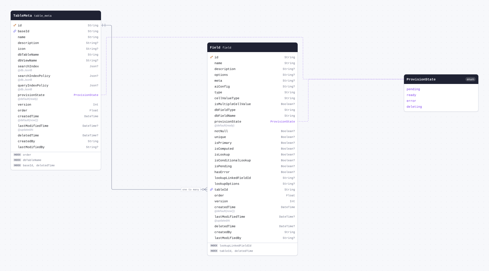

| Field                                            | Type                                     | Constraints                                 | Default      | Description |
| ------------------------------------------------ | ---------------------------------------- | ------------------------------------------- | ------------ | ----------- |
| `id`                                             | `String`                                 | PK NOT NULL                                 |              |             |
| `name`                                           | `String`                                 | NOT NULL                                    |              |             |
| `description`                                    | `String`                                 | NULL                                        |              |             |
| `options`                                        | `String`                                 | NULL                                        |              |             |
| `meta`                                           | `String`                                 | NULL                                        |              |             |
| `aiConfig` (`ai_config`)                         | `String`                                 | NULL                                        |              |             |
| `type`                                           | `String`                                 | NOT NULL                                    |              |             |
| `cellValueType` (`cell_value_type`)              | `String`                                 | NOT NULL                                    |              |             |
| `isMultipleCellValue` (`is_multiple_cell_value`) | `Boolean`                                | NULL                                        |              |             |
| `dbFieldType` (`db_field_type`)                  | `String`                                 | NOT NULL                                    |              |             |
| `dbFieldName` (`db_field_name`)                  | `String`                                 | NOT NULL                                    |              |             |
| `provisionState` (`provision_state`)             | [`ProvisionState`](#enum-ProvisionState) | NOT NULL                                    | `ready`      |             |
| `notNull` (`not_null`)                           | `Boolean`                                | NULL                                        |              |             |
| `unique`                                         | `Boolean`                                | NULL                                        |              |             |
| `isPrimary` (`is_primary`)                       | `Boolean`                                | NULL                                        |              |             |
| `isComputed` (`is_computed`)                     | `Boolean`                                | NULL                                        |              |             |
| `isLookup` (`is_lookup`)                         | `Boolean`                                | NULL                                        |              |             |
| `isConditionalLookup` (`is_conditional_lookup`)  | `Boolean`                                | NULL                                        |              |             |
| `isPending` (`is_pending`)                       | `Boolean`                                | NULL                                        |              |             |
| `hasError` (`has_error`)                         | `Boolean`                                | NULL                                        |              |             |
| `lookupLinkedFieldId` (`lookup_linked_field_id`) | `String`                                 | NULL                                        |              |             |
| `lookupOptions` (`lookup_options`)               | `String`                                 | NULL                                        |              |             |
| `tableId` (`table_id`)                           | `String`                                 | NOT NULL → [TableMeta.id](#model-TableMeta) |              |             |
| `order`                                          | `Float`                                  | NOT NULL                                    |              |             |
| `version`                                        | `Int`                                    | NOT NULL                                    |              |             |
| `createdTime` (`created_time`)                   | `DateTime`                               | NOT NULL                                    | `now()`      |             |
| `lastModifiedTime` (`last_modified_time`)        | `DateTime`                               | NULL                                        | `@updatedAt` |             |
| `deletedTime` (`deleted_time`)                   | `DateTime`                               | NULL                                        |              |             |
| `createdBy` (`created_by`)                       | `String`                                 | NOT NULL                                    |              |             |
| `lastModifiedBy` (`last_modified_by`)            | `String`                                 | NULL                                        |              |             |

#### Indexes

- `@@index([lookupLinkedFieldId])`
- `@@index([tableId, deletedTime])`

#### References

- `tableId` → [TableMeta.id](#model-TableMeta) (many-to-one)

#### Definition

```sql
CREATE TABLE "field" (
    "id" TEXT NOT NULL,
    "name" TEXT NOT NULL,
    "description" TEXT,
    "options" TEXT,
    "meta" TEXT,
    "ai_config" TEXT,
    "type" TEXT NOT NULL,
    "cell_value_type" TEXT NOT NULL,
    "is_multiple_cell_value" BOOLEAN,
    "db_field_type" TEXT NOT NULL,
    "db_field_name" TEXT NOT NULL,
    "provision_state" "ProvisionState" NOT NULL DEFAULT 'ready',
    "not_null" BOOLEAN,
    "unique" BOOLEAN,
    "is_primary" BOOLEAN,
    "is_computed" BOOLEAN,
    "is_lookup" BOOLEAN,
    "is_conditional_lookup" BOOLEAN,
    "is_pending" BOOLEAN,
    "has_error" BOOLEAN,
    "lookup_linked_field_id" TEXT,
    "lookup_options" TEXT,
    "table_id" TEXT NOT NULL,
    "order" DOUBLE PRECISION NOT NULL,
    "version" INTEGER NOT NULL,
    "created_time" TIMESTAMP(3) NOT NULL DEFAULT CURRENT_TIMESTAMP,
    "last_modified_time" TIMESTAMP(3),
    "deleted_time" TIMESTAMP(3),
    "created_by" TEXT NOT NULL,
    "last_modified_by" TEXT,

    CONSTRAINT "field_pkey" PRIMARY KEY ("id")
);

CREATE INDEX "field_lookup_linked_field_id_idx" ON "field"("lookup_linked_field_id");

CREATE INDEX "field_table_id_deleted_time_idx" ON "field"("table_id", "deleted_time");

ALTER TABLE "field" ADD CONSTRAINT "field_table_id_fkey" FOREIGN KEY ("table_id") REFERENCES "table_meta"("id") ON DELETE RESTRICT ON UPDATE CASCADE;
```

<details>
<summary>Queries and their SQL</summary>

**findMany**: Every row

```ts
await prisma.field.findMany();
```

```sql
SELECT
  "public"."field"."id",
  "public"."field"."name",
  "public"."field"."description",
  "public"."field"."options",
  "public"."field"."meta",
  "public"."field"."ai_config",
  "public"."field"."type",
  "public"."field"."cell_value_type",
  "public"."field"."is_multiple_cell_value",
  "public"."field"."db_field_type",
  "public"."field"."db_field_name",
  "public"."field"."provision_state"::text,
  "public"."field"."not_null",
  "public"."field"."unique",
  "public"."field"."is_primary",
  "public"."field"."is_computed",
  "public"."field"."is_lookup",
  "public"."field"."is_conditional_lookup",
  "public"."field"."is_pending",
  "public"."field"."has_error",
  "public"."field"."lookup_linked_field_id",
  "public"."field"."lookup_options",
  "public"."field"."table_id",
  "public"."field"."order",
  "public"."field"."version",
  "public"."field"."created_time",
  "public"."field"."last_modified_time",
  "public"."field"."deleted_time",
  "public"."field"."created_by",
  "public"."field"."last_modified_by"
FROM
  "public"."field"
WHERE
  1 = 1
OFFSET
  $1
-- params: ["0"]
```

**count**: How many rows there are

```ts
await prisma.field.count();
```

```sql
SELECT
  COUNT(*) AS "_count$_all"
FROM
  (
    SELECT
      "public"."field"."id"
    FROM
      "public"."field"
    WHERE
      1 = 1
    OFFSET
      $1
  ) AS "sub"
-- params: ["0"]
```

**findMany**: Every row with its relations

```ts
await prisma.field.findMany({ include: { table: true } });
```

```sql
SELECT
  "public"."field"."id",
  "public"."field"."name",
  "public"."field"."description",
  "public"."field"."options",
  "public"."field"."meta",
  "public"."field"."ai_config",
  "public"."field"."type",
  "public"."field"."cell_value_type",
  "public"."field"."is_multiple_cell_value",
  "public"."field"."db_field_type",
  "public"."field"."db_field_name",
  "public"."field"."provision_state"::text,
  "public"."field"."not_null",
  "public"."field"."unique",
  "public"."field"."is_primary",
  "public"."field"."is_computed",
  "public"."field"."is_lookup",
  "public"."field"."is_conditional_lookup",
  "public"."field"."is_pending",
  "public"."field"."has_error",
  "public"."field"."lookup_linked_field_id",
  "public"."field"."lookup_options",
  "public"."field"."table_id",
  "public"."field"."order",
  "public"."field"."version",
  "public"."field"."created_time",
  "public"."field"."last_modified_time",
  "public"."field"."deleted_time",
  "public"."field"."created_by",
  "public"."field"."last_modified_by"
FROM
  "public"."field"
WHERE
  1 = 1
OFFSET
  $1
-- params: ["0"]

SELECT
  "public"."table_meta"."id",
  "public"."table_meta"."base_id",
  "public"."table_meta"."name",
  "public"."table_meta"."description",
  "public"."table_meta"."icon",
  "public"."table_meta"."db_table_name",
  "public"."table_meta"."db_view_name",
  "public"."table_meta"."search_index",
  "public"."table_meta"."search_index_policy",
  "public"."table_meta"."query_index_policy",
  "public"."table_meta"."provision_state"::text,
  "public"."table_meta"."version",
  "public"."table_meta"."order",
  "public"."table_meta"."created_time",
  "public"."table_meta"."last_modified_time",
  "public"."table_meta"."deleted_time",
  "public"."table_meta"."created_by",
  "public"."table_meta"."last_modified_by"
FROM
  "public"."table_meta"
WHERE
  "public"."table_meta"."id" IN ($1)
OFFSET
  $2
-- params: ["<tableId of the rows above>","0"]
```

**findUnique**: One row by what is unique to it

```ts
await prisma.field.findUnique({ where: { id: "example" } });
```

```sql
SELECT
  "public"."field"."id",
  "public"."field"."name",
  "public"."field"."description",
  "public"."field"."options",
  "public"."field"."meta",
  "public"."field"."ai_config",
  "public"."field"."type",
  "public"."field"."cell_value_type",
  "public"."field"."is_multiple_cell_value",
  "public"."field"."db_field_type",
  "public"."field"."db_field_name",
  "public"."field"."provision_state"::text,
  "public"."field"."not_null",
  "public"."field"."unique",
  "public"."field"."is_primary",
  "public"."field"."is_computed",
  "public"."field"."is_lookup",
  "public"."field"."is_conditional_lookup",
  "public"."field"."is_pending",
  "public"."field"."has_error",
  "public"."field"."lookup_linked_field_id",
  "public"."field"."lookup_options",
  "public"."field"."table_id",
  "public"."field"."order",
  "public"."field"."version",
  "public"."field"."created_time",
  "public"."field"."last_modified_time",
  "public"."field"."deleted_time",
  "public"."field"."created_by",
  "public"."field"."last_modified_by"
FROM
  "public"."field"
WHERE
  (
    "public"."field"."id" = $1
    AND 1 = 1
  )
LIMIT
  $2
OFFSET
  $3
-- params: ["example","1","0"]
```

**create**: Create a row

```ts
await prisma.field.create({
  data: {
    id: "example",
    name: "example",
    type: "example",
    cellValueType: "example",
    dbFieldType: "example",
    dbFieldName: "example",
    tableId: "example",
    order: 1.5,
    version: 1,
    createdBy: "example",
  },
});
```

```sql
INSERT INTO
  "public"."field" (
    "id",
    "name",
    "type",
    "cell_value_type",
    "db_field_type",
    "db_field_name",
    "provision_state",
    "table_id",
    "order",
    "version",
    "created_time",
    "last_modified_time",
    "created_by"
  )
VALUES
  (
    $1,
    $2,
    $3,
    $4,
    $5,
    $6,
    CAST($7::text AS "public"."ProvisionState"),
    $8,
    $9,
    $10,
    $11,
    $12,
    $13
  )
RETURNING
  "public"."field"."id",
  "public"."field"."name",
  "public"."field"."description",
  "public"."field"."options",
  "public"."field"."meta",
  "public"."field"."ai_config",
  "public"."field"."type",
  "public"."field"."cell_value_type",
  "public"."field"."is_multiple_cell_value",
  "public"."field"."db_field_type",
  "public"."field"."db_field_name",
  "public"."field"."provision_state"::text,
  "public"."field"."not_null",
  "public"."field"."unique",
  "public"."field"."is_primary",
  "public"."field"."is_computed",
  "public"."field"."is_lookup",
  "public"."field"."is_conditional_lookup",
  "public"."field"."is_pending",
  "public"."field"."has_error",
  "public"."field"."lookup_linked_field_id",
  "public"."field"."lookup_options",
  "public"."field"."table_id",
  "public"."field"."order",
  "public"."field"."version",
  "public"."field"."created_time",
  "public"."field"."last_modified_time",
  "public"."field"."deleted_time",
  "public"."field"."created_by",
  "public"."field"."last_modified_by"
-- params: ["example","example","example","example","example","example","ready","example","1.5","1","<now()>","<now()>","example"]
```

**update**: Update a row

```ts
await prisma.field.update({ where: { id: "example" }, data: { name: "example" } });
```

```sql
UPDATE "public"."field"
SET
  "name" = $1,
  "last_modified_time" = $2
WHERE
  (
    "public"."field"."id" = $3
    AND 1 = 1
  )
RETURNING
  "public"."field"."id",
  "public"."field"."name",
  "public"."field"."description",
  "public"."field"."options",
  "public"."field"."meta",
  "public"."field"."ai_config",
  "public"."field"."type",
  "public"."field"."cell_value_type",
  "public"."field"."is_multiple_cell_value",
  "public"."field"."db_field_type",
  "public"."field"."db_field_name",
  "public"."field"."provision_state"::text,
  "public"."field"."not_null",
  "public"."field"."unique",
  "public"."field"."is_primary",
  "public"."field"."is_computed",
  "public"."field"."is_lookup",
  "public"."field"."is_conditional_lookup",
  "public"."field"."is_pending",
  "public"."field"."has_error",
  "public"."field"."lookup_linked_field_id",
  "public"."field"."lookup_options",
  "public"."field"."table_id",
  "public"."field"."order",
  "public"."field"."version",
  "public"."field"."created_time",
  "public"."field"."last_modified_time",
  "public"."field"."deleted_time",
  "public"."field"."created_by",
  "public"."field"."last_modified_by"
-- params: ["example",{"prisma__type":"generatorCall","prisma__value":{"name":"now","args":[],"returnType":{"type":"DateTime"}}},"example"]
```

**delete**: Delete a row

```ts
await prisma.field.delete({ where: { id: "example" } });
```

```sql
DELETE FROM "public"."field"
WHERE
  (
    "public"."field"."id" = $1
    AND 1 = 1
  )
RETURNING
  "public"."field"."id",
  "public"."field"."name",
  "public"."field"."description",
  "public"."field"."options",
  "public"."field"."meta",
  "public"."field"."ai_config",
  "public"."field"."type",
  "public"."field"."cell_value_type",
  "public"."field"."is_multiple_cell_value",
  "public"."field"."db_field_type",
  "public"."field"."db_field_name",
  "public"."field"."provision_state"::text,
  "public"."field"."not_null",
  "public"."field"."unique",
  "public"."field"."is_primary",
  "public"."field"."is_computed",
  "public"."field"."is_lookup",
  "public"."field"."is_conditional_lookup",
  "public"."field"."is_pending",
  "public"."field"."has_error",
  "public"."field"."lookup_linked_field_id",
  "public"."field"."lookup_options",
  "public"."field"."table_id",
  "public"."field"."order",
  "public"."field"."version",
  "public"."field"."created_time",
  "public"."field"."last_modified_time",
  "public"."field"."deleted_time",
  "public"."field"."created_by",
  "public"."field"."last_modified_by"
-- params: ["example"]
```

</details>

<a id="model-ComputedUpdateOutbox"></a>

### ComputedUpdateOutbox

Table `computed_update_outbox`.

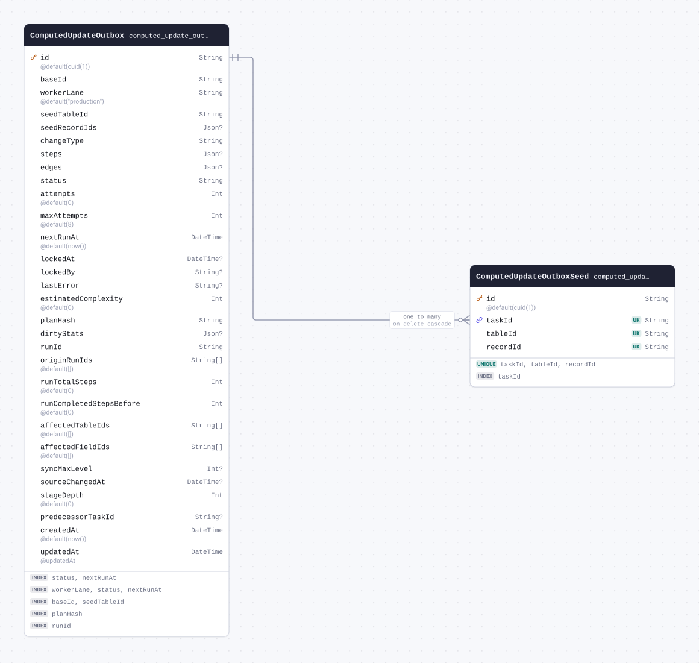

| Field                                                    | Type       | Constraints | Default        | Description |
| -------------------------------------------------------- | ---------- | ----------- | -------------- | ----------- |
| `id`                                                     | `String`   | PK NOT NULL | `cuid(1)`      |             |
| `baseId` (`base_id`)                                     | `String`   | NOT NULL    |                |             |
| `workerLane` (`worker_lane`)                             | `String`   | NOT NULL    | `"production"` |             |
| `seedTableId` (`seed_table_id`)                          | `String`   | NOT NULL    |                |             |
| `seedRecordIds` (`seed_record_ids`)                      | `Json`     | NULL        |                |             |
| `changeType` (`change_type`)                             | `String`   | NOT NULL    |                |             |
| `steps`                                                  | `Json`     | NULL        |                |             |
| `edges`                                                  | `Json`     | NULL        |                |             |
| `status`                                                 | `String`   | NOT NULL    |                |             |
| `attempts`                                               | `Int`      | NOT NULL    | `0`            |             |
| `maxAttempts` (`max_attempts`)                           | `Int`      | NOT NULL    | `8`            |             |
| `nextRunAt` (`next_run_at`)                              | `DateTime` | NOT NULL    | `now()`        |             |
| `lockedAt` (`locked_at`)                                 | `DateTime` | NULL        |                |             |
| `lockedBy` (`locked_by`)                                 | `String`   | NULL        |                |             |
| `lastError` (`last_error`)                               | `String`   | NULL        |                |             |
| `estimatedComplexity` (`estimated_complexity`)           | `Int`      | NOT NULL    | `0`            |             |
| `planHash` (`plan_hash`)                                 | `String`   | NOT NULL    |                |             |
| `dirtyStats` (`dirty_stats`)                             | `Json`     | NULL        |                |             |
| `runId` (`run_id`)                                       | `String`   | NOT NULL    |                |             |
| `originRunIds` (`origin_run_ids`)                        | `String[]` | NOT NULL    | `[]`           |             |
| `runTotalSteps` (`run_total_steps`)                      | `Int`      | NOT NULL    | `0`            |             |
| `runCompletedStepsBefore` (`run_completed_steps_before`) | `Int`      | NOT NULL    | `0`            |             |
| `affectedTableIds` (`affected_table_ids`)                | `String[]` | NOT NULL    | `[]`           |             |
| `affectedFieldIds` (`affected_field_ids`)                | `String[]` | NOT NULL    | `[]`           |             |
| `syncMaxLevel` (`sync_max_level`)                        | `Int`      | NULL        |                |             |
| `sourceChangedAt` (`source_changed_at`)                  | `DateTime` | NULL        |                |             |
| `stageDepth` (`stage_depth`)                             | `Int`      | NOT NULL    | `0`            |             |
| `predecessorTaskId` (`predecessor_task_id`)              | `String`   | NULL        |                |             |
| `createdAt` (`created_at`)                               | `DateTime` | NOT NULL    | `now()`        |             |
| `updatedAt` (`updated_at`)                               | `DateTime` | NOT NULL    | `@updatedAt`   |             |

#### Indexes

- `@@index([status, nextRunAt])`
- `@@index([workerLane, status, nextRunAt])`
- `@@index([baseId, seedTableId])`
- `@@index([planHash])`
- `@@index([runId])`

#### Referenced by

- `id` ← [ComputedUpdateOutboxSeed.taskId](#model-ComputedUpdateOutboxSeed) (one-to-many, on delete Cascade)

#### Definition

```sql
CREATE TABLE "computed_update_outbox" (
    "id" TEXT NOT NULL,
    "base_id" TEXT NOT NULL,
    "worker_lane" TEXT NOT NULL DEFAULT 'production',
    "seed_table_id" TEXT NOT NULL,
    "seed_record_ids" JSONB,
    "change_type" TEXT NOT NULL,
    "steps" JSONB,
    "edges" JSONB,
    "status" TEXT NOT NULL,
    "attempts" INTEGER NOT NULL DEFAULT 0,
    "max_attempts" INTEGER NOT NULL DEFAULT 8,
    "next_run_at" TIMESTAMP(3) NOT NULL DEFAULT CURRENT_TIMESTAMP,
    "locked_at" TIMESTAMP(3),
    "locked_by" TEXT,
    "last_error" TEXT,
    "estimated_complexity" INTEGER NOT NULL DEFAULT 0,
    "plan_hash" TEXT NOT NULL,
    "dirty_stats" JSONB,
    "run_id" TEXT NOT NULL,
    "origin_run_ids" TEXT[] DEFAULT ARRAY[]::TEXT[],
    "run_total_steps" INTEGER NOT NULL DEFAULT 0,
    "run_completed_steps_before" INTEGER NOT NULL DEFAULT 0,
    "affected_table_ids" TEXT[] DEFAULT ARRAY[]::TEXT[],
    "affected_field_ids" TEXT[] DEFAULT ARRAY[]::TEXT[],
    "sync_max_level" INTEGER,
    "source_changed_at" TIMESTAMP(3),
    "stage_depth" INTEGER NOT NULL DEFAULT 0,
    "predecessor_task_id" TEXT,
    "created_at" TIMESTAMP(3) NOT NULL DEFAULT CURRENT_TIMESTAMP,
    "updated_at" TIMESTAMP(3) NOT NULL,

    CONSTRAINT "computed_update_outbox_pkey" PRIMARY KEY ("id")
);

CREATE INDEX "computed_update_outbox_status_next_run_at_idx" ON "computed_update_outbox"("status", "next_run_at");

CREATE INDEX "computed_update_outbox_worker_lane_status_next_run_at_idx" ON "computed_update_outbox"("worker_lane", "status", "next_run_at");

CREATE INDEX "computed_update_outbox_base_id_seed_table_id_idx" ON "computed_update_outbox"("base_id", "seed_table_id");

CREATE INDEX "computed_update_outbox_plan_hash_idx" ON "computed_update_outbox"("plan_hash");

CREATE INDEX "computed_update_outbox_run_id_idx" ON "computed_update_outbox"("run_id");
```

<details>
<summary>Queries and their SQL</summary>

**findMany**: Every row

```ts
await prisma.computedUpdateOutbox.findMany();
```

```sql
SELECT
  "public"."computed_update_outbox"."id",
  "public"."computed_update_outbox"."base_id",
  "public"."computed_update_outbox"."worker_lane",
  "public"."computed_update_outbox"."seed_table_id",
  "public"."computed_update_outbox"."seed_record_ids",
  "public"."computed_update_outbox"."change_type",
  "public"."computed_update_outbox"."steps",
  "public"."computed_update_outbox"."edges",
  "public"."computed_update_outbox"."status",
  "public"."computed_update_outbox"."attempts",
  "public"."computed_update_outbox"."max_attempts",
  "public"."computed_update_outbox"."next_run_at",
  "public"."computed_update_outbox"."locked_at",
  "public"."computed_update_outbox"."locked_by",
  "public"."computed_update_outbox"."last_error",
  "public"."computed_update_outbox"."estimated_complexity",
  "public"."computed_update_outbox"."plan_hash",
  "public"."computed_update_outbox"."dirty_stats",
  "public"."computed_update_outbox"."run_id",
  "public"."computed_update_outbox"."origin_run_ids",
  "public"."computed_update_outbox"."run_total_steps",
  "public"."computed_update_outbox"."run_completed_steps_before",
  "public"."computed_update_outbox"."affected_table_ids",
  "public"."computed_update_outbox"."affected_field_ids",
  "public"."computed_update_outbox"."sync_max_level",
  "public"."computed_update_outbox"."source_changed_at",
  "public"."computed_update_outbox"."stage_depth",
  "public"."computed_update_outbox"."predecessor_task_id",
  "public"."computed_update_outbox"."created_at",
  "public"."computed_update_outbox"."updated_at"
FROM
  "public"."computed_update_outbox"
WHERE
  1 = 1
OFFSET
  $1
-- params: ["0"]
```

**count**: How many rows there are

```ts
await prisma.computedUpdateOutbox.count();
```

```sql
SELECT
  COUNT(*) AS "_count$_all"
FROM
  (
    SELECT
      "public"."computed_update_outbox"."id"
    FROM
      "public"."computed_update_outbox"
    WHERE
      1 = 1
    OFFSET
      $1
  ) AS "sub"
-- params: ["0"]
```

**findMany**: Every row with its relations

```ts
await prisma.computedUpdateOutbox.findMany({ include: { seeds: true } });
```

```sql
SELECT
  "public"."computed_update_outbox"."id",
  "public"."computed_update_outbox"."base_id",
  "public"."computed_update_outbox"."worker_lane",
  "public"."computed_update_outbox"."seed_table_id",
  "public"."computed_update_outbox"."seed_record_ids",
  "public"."computed_update_outbox"."change_type",
  "public"."computed_update_outbox"."steps",
  "public"."computed_update_outbox"."edges",
  "public"."computed_update_outbox"."status",
  "public"."computed_update_outbox"."attempts",
  "public"."computed_update_outbox"."max_attempts",
  "public"."computed_update_outbox"."next_run_at",
  "public"."computed_update_outbox"."locked_at",
  "public"."computed_update_outbox"."locked_by",
  "public"."computed_update_outbox"."last_error",
  "public"."computed_update_outbox"."estimated_complexity",
  "public"."computed_update_outbox"."plan_hash",
  "public"."computed_update_outbox"."dirty_stats",
  "public"."computed_update_outbox"."run_id",
  "public"."computed_update_outbox"."origin_run_ids",
  "public"."computed_update_outbox"."run_total_steps",
  "public"."computed_update_outbox"."run_completed_steps_before",
  "public"."computed_update_outbox"."affected_table_ids",
  "public"."computed_update_outbox"."affected_field_ids",
  "public"."computed_update_outbox"."sync_max_level",
  "public"."computed_update_outbox"."source_changed_at",
  "public"."computed_update_outbox"."stage_depth",
  "public"."computed_update_outbox"."predecessor_task_id",
  "public"."computed_update_outbox"."created_at",
  "public"."computed_update_outbox"."updated_at"
FROM
  "public"."computed_update_outbox"
WHERE
  1 = 1
OFFSET
  $1
-- params: ["0"]

SELECT
  "public"."computed_update_outbox_seed"."id",
  "public"."computed_update_outbox_seed"."task_id",
  "public"."computed_update_outbox_seed"."table_id",
  "public"."computed_update_outbox_seed"."record_id"
FROM
  "public"."computed_update_outbox_seed"
WHERE
  "public"."computed_update_outbox_seed"."task_id" IN ($1)
OFFSET
  $2
-- params: ["<id of the rows above>","0"]
```

**findUnique**: One row by what is unique to it

```ts
await prisma.computedUpdateOutbox.findUnique({ where: { id: "example" } });
```

```sql
SELECT
  "public"."computed_update_outbox"."id",
  "public"."computed_update_outbox"."base_id",
  "public"."computed_update_outbox"."worker_lane",
  "public"."computed_update_outbox"."seed_table_id",
  "public"."computed_update_outbox"."seed_record_ids",
  "public"."computed_update_outbox"."change_type",
  "public"."computed_update_outbox"."steps",
  "public"."computed_update_outbox"."edges",
  "public"."computed_update_outbox"."status",
  "public"."computed_update_outbox"."attempts",
  "public"."computed_update_outbox"."max_attempts",
  "public"."computed_update_outbox"."next_run_at",
  "public"."computed_update_outbox"."locked_at",
  "public"."computed_update_outbox"."locked_by",
  "public"."computed_update_outbox"."last_error",
  "public"."computed_update_outbox"."estimated_complexity",
  "public"."computed_update_outbox"."plan_hash",
  "public"."computed_update_outbox"."dirty_stats",
  "public"."computed_update_outbox"."run_id",
  "public"."computed_update_outbox"."origin_run_ids",
  "public"."computed_update_outbox"."run_total_steps",
  "public"."computed_update_outbox"."run_completed_steps_before",
  "public"."computed_update_outbox"."affected_table_ids",
  "public"."computed_update_outbox"."affected_field_ids",
  "public"."computed_update_outbox"."sync_max_level",
  "public"."computed_update_outbox"."source_changed_at",
  "public"."computed_update_outbox"."stage_depth",
  "public"."computed_update_outbox"."predecessor_task_id",
  "public"."computed_update_outbox"."created_at",
  "public"."computed_update_outbox"."updated_at"
FROM
  "public"."computed_update_outbox"
WHERE
  (
    "public"."computed_update_outbox"."id" = $1
    AND 1 = 1
  )
LIMIT
  $2
OFFSET
  $3
-- params: ["example","1","0"]
```

**create**: Create a row

```ts
await prisma.computedUpdateOutbox.create({
  data: {
    baseId: "example",
    seedTableId: "example",
    changeType: "example",
    status: "example",
    planHash: "example",
    runId: "example",
  },
});
```

```sql
INSERT INTO
  "public"."computed_update_outbox" (
    "id",
    "base_id",
    "worker_lane",
    "seed_table_id",
    "change_type",
    "status",
    "attempts",
    "max_attempts",
    "next_run_at",
    "estimated_complexity",
    "plan_hash",
    "run_id",
    "origin_run_ids",
    "run_total_steps",
    "run_completed_steps_before",
    "affected_table_ids",
    "affected_field_ids",
    "stage_depth",
    "created_at",
    "updated_at"
  )
VALUES
  (
    $1,
    $2,
    $3,
    $4,
    $5,
    $6,
    $7,
    $8,
    $9,
    $10,
    $11,
    $12,
    $13,
    $14,
    $15,
    $16,
    $17,
    $18,
    $19,
    $20
  )
RETURNING
  "public"."computed_update_outbox"."id",
  "public"."computed_update_outbox"."base_id",
  "public"."computed_update_outbox"."worker_lane",
  "public"."computed_update_outbox"."seed_table_id",
  "public"."computed_update_outbox"."seed_record_ids",
  "public"."computed_update_outbox"."change_type",
  "public"."computed_update_outbox"."steps",
  "public"."computed_update_outbox"."edges",
  "public"."computed_update_outbox"."status",
  "public"."computed_update_outbox"."attempts",
  "public"."computed_update_outbox"."max_attempts",
  "public"."computed_update_outbox"."next_run_at",
  "public"."computed_update_outbox"."locked_at",
  "public"."computed_update_outbox"."locked_by",
  "public"."computed_update_outbox"."last_error",
  "public"."computed_update_outbox"."estimated_complexity",
  "public"."computed_update_outbox"."plan_hash",
  "public"."computed_update_outbox"."dirty_stats",
  "public"."computed_update_outbox"."run_id",
  "public"."computed_update_outbox"."origin_run_ids",
  "public"."computed_update_outbox"."run_total_steps",
  "public"."computed_update_outbox"."run_completed_steps_before",
  "public"."computed_update_outbox"."affected_table_ids",
  "public"."computed_update_outbox"."affected_field_ids",
  "public"."computed_update_outbox"."sync_max_level",
  "public"."computed_update_outbox"."source_changed_at",
  "public"."computed_update_outbox"."stage_depth",
  "public"."computed_update_outbox"."predecessor_task_id",
  "public"."computed_update_outbox"."created_at",
  "public"."computed_update_outbox"."updated_at"
-- params: ["<cuid(1)>","example","production","example","example","example","0","8","<now()>","0","example","example",[],"0","0",[],[],"0","<now()>","<now()>"]
```

**update**: Update a row

```ts
await prisma.computedUpdateOutbox.update({ where: { id: "example" }, data: { baseId: "example" } });
```

```sql
UPDATE "public"."computed_update_outbox"
SET
  "base_id" = $1,
  "updated_at" = $2
WHERE
  (
    "public"."computed_update_outbox"."id" = $3
    AND 1 = 1
  )
RETURNING
  "public"."computed_update_outbox"."id",
  "public"."computed_update_outbox"."base_id",
  "public"."computed_update_outbox"."worker_lane",
  "public"."computed_update_outbox"."seed_table_id",
  "public"."computed_update_outbox"."seed_record_ids",
  "public"."computed_update_outbox"."change_type",
  "public"."computed_update_outbox"."steps",
  "public"."computed_update_outbox"."edges",
  "public"."computed_update_outbox"."status",
  "public"."computed_update_outbox"."attempts",
  "public"."computed_update_outbox"."max_attempts",
  "public"."computed_update_outbox"."next_run_at",
  "public"."computed_update_outbox"."locked_at",
  "public"."computed_update_outbox"."locked_by",
  "public"."computed_update_outbox"."last_error",
  "public"."computed_update_outbox"."estimated_complexity",
  "public"."computed_update_outbox"."plan_hash",
  "public"."computed_update_outbox"."dirty_stats",
  "public"."computed_update_outbox"."run_id",
  "public"."computed_update_outbox"."origin_run_ids",
  "public"."computed_update_outbox"."run_total_steps",
  "public"."computed_update_outbox"."run_completed_steps_before",
  "public"."computed_update_outbox"."affected_table_ids",
  "public"."computed_update_outbox"."affected_field_ids",
  "public"."computed_update_outbox"."sync_max_level",
  "public"."computed_update_outbox"."source_changed_at",
  "public"."computed_update_outbox"."stage_depth",
  "public"."computed_update_outbox"."predecessor_task_id",
  "public"."computed_update_outbox"."created_at",
  "public"."computed_update_outbox"."updated_at"
-- params: ["example",{"prisma__type":"generatorCall","prisma__value":{"name":"now","args":[],"returnType":{"type":"DateTime"}}},"example"]
```

**delete**: Delete a row

```ts
await prisma.computedUpdateOutbox.delete({ where: { id: "example" } });
```

```sql
DELETE FROM "public"."computed_update_outbox"
WHERE
  (
    "public"."computed_update_outbox"."id" = $1
    AND 1 = 1
  )
RETURNING
  "public"."computed_update_outbox"."id",
  "public"."computed_update_outbox"."base_id",
  "public"."computed_update_outbox"."worker_lane",
  "public"."computed_update_outbox"."seed_table_id",
  "public"."computed_update_outbox"."seed_record_ids",
  "public"."computed_update_outbox"."change_type",
  "public"."computed_update_outbox"."steps",
  "public"."computed_update_outbox"."edges",
  "public"."computed_update_outbox"."status",
  "public"."computed_update_outbox"."attempts",
  "public"."computed_update_outbox"."max_attempts",
  "public"."computed_update_outbox"."next_run_at",
  "public"."computed_update_outbox"."locked_at",
  "public"."computed_update_outbox"."locked_by",
  "public"."computed_update_outbox"."last_error",
  "public"."computed_update_outbox"."estimated_complexity",
  "public"."computed_update_outbox"."plan_hash",
  "public"."computed_update_outbox"."dirty_stats",
  "public"."computed_update_outbox"."run_id",
  "public"."computed_update_outbox"."origin_run_ids",
  "public"."computed_update_outbox"."run_total_steps",
  "public"."computed_update_outbox"."run_completed_steps_before",
  "public"."computed_update_outbox"."affected_table_ids",
  "public"."computed_update_outbox"."affected_field_ids",
  "public"."computed_update_outbox"."sync_max_level",
  "public"."computed_update_outbox"."source_changed_at",
  "public"."computed_update_outbox"."stage_depth",
  "public"."computed_update_outbox"."predecessor_task_id",
  "public"."computed_update_outbox"."created_at",
  "public"."computed_update_outbox"."updated_at"
-- params: ["example"]
```

</details>

<a id="model-ComputedUpdateOutboxSeed"></a>

### ComputedUpdateOutboxSeed

Table `computed_update_outbox_seed`.


| Field                    | Type     | Constraints                                                       | Default   | Description |
| ------------------------ | -------- | ----------------------------------------------------------------- | --------- | ----------- |
| `id`                     | `String` | PK NOT NULL                                                       | `cuid(1)` |             |
| `taskId` (`task_id`)     | `String` | NOT NULL → [ComputedUpdateOutbox.id](#model-ComputedUpdateOutbox) |           |             |
| `tableId` (`table_id`)   | `String` | NOT NULL                                                          |           |             |
| `recordId` (`record_id`) | `String` | NOT NULL                                                          |           |             |

#### Indexes

- `@@index([taskId])`
- `@@unique([taskId, tableId, recordId])`

#### References

- `taskId` → [ComputedUpdateOutbox.id](#model-ComputedUpdateOutbox) (many-to-one, on delete Cascade)

#### Definition

```sql
CREATE TABLE "computed_update_outbox_seed" (
    "id" TEXT NOT NULL,
    "task_id" TEXT NOT NULL,
    "table_id" TEXT NOT NULL,
    "record_id" TEXT NOT NULL,

    CONSTRAINT "computed_update_outbox_seed_pkey" PRIMARY KEY ("id")
);

CREATE INDEX "computed_update_outbox_seed_task_id_idx" ON "computed_update_outbox_seed"("task_id");

CREATE UNIQUE INDEX "computed_update_outbox_seed_task_id_table_id_record_id_key" ON "computed_update_outbox_seed"("task_id", "table_id", "record_id");

ALTER TABLE "computed_update_outbox_seed" ADD CONSTRAINT "computed_update_outbox_seed_task_id_fkey" FOREIGN KEY ("task_id") REFERENCES "computed_update_outbox"("id") ON DELETE CASCADE ON UPDATE CASCADE;
```

<details>
<summary>Queries and their SQL</summary>

**findMany**: Every row

```ts
await prisma.computedUpdateOutboxSeed.findMany();
```

```sql
SELECT
  "public"."computed_update_outbox_seed"."id",
  "public"."computed_update_outbox_seed"."task_id",
  "public"."computed_update_outbox_seed"."table_id",
  "public"."computed_update_outbox_seed"."record_id"
FROM
  "public"."computed_update_outbox_seed"
WHERE
  1 = 1
OFFSET
  $1
-- params: ["0"]
```

**count**: How many rows there are

```ts
await prisma.computedUpdateOutboxSeed.count();
```

```sql
SELECT
  COUNT(*) AS "_count$_all"
FROM
  (
    SELECT
      "public"."computed_update_outbox_seed"."id"
    FROM
      "public"."computed_update_outbox_seed"
    WHERE
      1 = 1
    OFFSET
      $1
  ) AS "sub"
-- params: ["0"]
```

**findMany**: Every row with its relations

```ts
await prisma.computedUpdateOutboxSeed.findMany({ include: { task: true } });
```

```sql
SELECT
  "public"."computed_update_outbox_seed"."id",
  "public"."computed_update_outbox_seed"."task_id",
  "public"."computed_update_outbox_seed"."table_id",
  "public"."computed_update_outbox_seed"."record_id"
FROM
  "public"."computed_update_outbox_seed"
WHERE
  1 = 1
OFFSET
  $1
-- params: ["0"]

SELECT
  "public"."computed_update_outbox"."id",
  "public"."computed_update_outbox"."base_id",
  "public"."computed_update_outbox"."worker_lane",
  "public"."computed_update_outbox"."seed_table_id",
  "public"."computed_update_outbox"."seed_record_ids",
  "public"."computed_update_outbox"."change_type",
  "public"."computed_update_outbox"."steps",
  "public"."computed_update_outbox"."edges",
  "public"."computed_update_outbox"."status",
  "public"."computed_update_outbox"."attempts",
  "public"."computed_update_outbox"."max_attempts",
  "public"."computed_update_outbox"."next_run_at",
  "public"."computed_update_outbox"."locked_at",
  "public"."computed_update_outbox"."locked_by",
  "public"."computed_update_outbox"."last_error",
  "public"."computed_update_outbox"."estimated_complexity",
  "public"."computed_update_outbox"."plan_hash",
  "public"."computed_update_outbox"."dirty_stats",
  "public"."computed_update_outbox"."run_id",
  "public"."computed_update_outbox"."origin_run_ids",
  "public"."computed_update_outbox"."run_total_steps",
  "public"."computed_update_outbox"."run_completed_steps_before",
  "public"."computed_update_outbox"."affected_table_ids",
  "public"."computed_update_outbox"."affected_field_ids",
  "public"."computed_update_outbox"."sync_max_level",
  "public"."computed_update_outbox"."source_changed_at",
  "public"."computed_update_outbox"."stage_depth",
  "public"."computed_update_outbox"."predecessor_task_id",
  "public"."computed_update_outbox"."created_at",
  "public"."computed_update_outbox"."updated_at"
FROM
  "public"."computed_update_outbox"
WHERE
  "public"."computed_update_outbox"."id" IN ($1)
OFFSET
  $2
-- params: ["<taskId of the rows above>","0"]
```

**findUnique**: One row by what is unique to it

```ts
await prisma.computedUpdateOutboxSeed.findUnique({ where: { id: "example" } });
```

```sql
SELECT
  "public"."computed_update_outbox_seed"."id",
  "public"."computed_update_outbox_seed"."task_id",
  "public"."computed_update_outbox_seed"."table_id",
  "public"."computed_update_outbox_seed"."record_id"
FROM
  "public"."computed_update_outbox_seed"
WHERE
  (
    "public"."computed_update_outbox_seed"."id" = $1
    AND 1 = 1
  )
LIMIT
  $2
OFFSET
  $3
-- params: ["example","1","0"]
```

**create**: Create a row

```ts
await prisma.computedUpdateOutboxSeed.create({
  data: { taskId: "example", tableId: "example", recordId: "example" },
});
```

```sql
INSERT INTO
  "public"."computed_update_outbox_seed" ("id", "task_id", "table_id", "record_id")
VALUES
  ($1, $2, $3, $4)
RETURNING
  "public"."computed_update_outbox_seed"."id",
  "public"."computed_update_outbox_seed"."task_id",
  "public"."computed_update_outbox_seed"."table_id",
  "public"."computed_update_outbox_seed"."record_id"
-- params: ["<cuid(1)>","example","example","example"]
```

**update**: Update a row

```ts
await prisma.computedUpdateOutboxSeed.update({
  where: { id: "example" },
  data: { tableId: "example" },
});
```

```sql
UPDATE "public"."computed_update_outbox_seed"
SET
  "table_id" = $1
WHERE
  (
    "public"."computed_update_outbox_seed"."id" = $2
    AND 1 = 1
  )
RETURNING
  "public"."computed_update_outbox_seed"."id",
  "public"."computed_update_outbox_seed"."task_id",
  "public"."computed_update_outbox_seed"."table_id",
  "public"."computed_update_outbox_seed"."record_id"
-- params: ["example","example"]
```

**delete**: Delete a row

```ts
await prisma.computedUpdateOutboxSeed.delete({ where: { id: "example" } });
```

```sql
DELETE FROM "public"."computed_update_outbox_seed"
WHERE
  (
    "public"."computed_update_outbox_seed"."id" = $1
    AND 1 = 1
  )
RETURNING
  "public"."computed_update_outbox_seed"."id",
  "public"."computed_update_outbox_seed"."task_id",
  "public"."computed_update_outbox_seed"."table_id",
  "public"."computed_update_outbox_seed"."record_id"
-- params: ["example"]
```

</details>

<a id="model-ComputedUpdateChangeFrontier"></a>

### ComputedUpdateChangeFrontier

Table `computed_update_change_frontier`. Actual output-value evidence; independent from continuation progress.

| Field                    | Type     | Constraints | Default | Description |
| ------------------------ | -------- | ----------- | ------- | ----------- |
| `scopeId` (`scope_id`)   | `String` | PK NOT NULL |         |             |
| `kind`                   | `String` | PK NOT NULL |         |             |
| `tableId` (`table_id`)   | `String` | PK NOT NULL |         |             |
| `recordId` (`record_id`) | `String` | PK NOT NULL |         |             |
| `fieldId` (`field_id`)   | `String` | PK NOT NULL |         |             |

#### Indexes

- `@@id([scopeId, kind, tableId, recordId, fieldId])`

#### Definition

```sql
CREATE TABLE "computed_update_change_frontier" (
    "scope_id" TEXT NOT NULL,
    "kind" TEXT NOT NULL,
    "table_id" TEXT NOT NULL,
    "record_id" TEXT NOT NULL,
    "field_id" TEXT NOT NULL,

    CONSTRAINT "computed_update_change_frontier_pkey" PRIMARY KEY ("scope_id","kind","table_id","record_id","field_id")
);
```

<details>
<summary>Queries and their SQL</summary>

**findMany**: Every row

```ts
await prisma.computedUpdateChangeFrontier.findMany();
```

```sql
SELECT
  "public"."computed_update_change_frontier"."scope_id",
  "public"."computed_update_change_frontier"."kind",
  "public"."computed_update_change_frontier"."table_id",
  "public"."computed_update_change_frontier"."record_id",
  "public"."computed_update_change_frontier"."field_id"
FROM
  "public"."computed_update_change_frontier"
WHERE
  1 = 1
OFFSET
  $1
-- params: ["0"]
```

**count**: How many rows there are

```ts
await prisma.computedUpdateChangeFrontier.count();
```

```sql
SELECT
  COUNT(*) AS "_count$_all"
FROM
  (
    SELECT
      "public"."computed_update_change_frontier"."scope_id",
      "public"."computed_update_change_frontier"."kind",
      "public"."computed_update_change_frontier"."table_id",
      "public"."computed_update_change_frontier"."record_id",
      "public"."computed_update_change_frontier"."field_id"
    FROM
      "public"."computed_update_change_frontier"
    WHERE
      1 = 1
    OFFSET
      $1
  ) AS "sub"
-- params: ["0"]
```

**findUnique**: One row by what is unique to it

```ts
await prisma.computedUpdateChangeFrontier.findUnique({
  where: {
    scopeId_kind_tableId_recordId_fieldId: {
      scopeId: "example",
      kind: "example",
      tableId: "example",
      recordId: "example",
      fieldId: "example",
    },
  },
});
```

```sql
SELECT
  "public"."computed_update_change_frontier"."scope_id",
  "public"."computed_update_change_frontier"."kind",
  "public"."computed_update_change_frontier"."table_id",
  "public"."computed_update_change_frontier"."record_id",
  "public"."computed_update_change_frontier"."field_id"
FROM
  "public"."computed_update_change_frontier"
WHERE
  (
    (
      "public"."computed_update_change_frontier"."scope_id" = $1
      AND "public"."computed_update_change_frontier"."kind" = $2
      AND "public"."computed_update_change_frontier"."table_id" = $3
      AND "public"."computed_update_change_frontier"."record_id" = $4
      AND "public"."computed_update_change_frontier"."field_id" = $5
    )
    AND 1 = 1
  )
LIMIT
  $6
OFFSET
  $7
-- params: ["example","example","example","example","example","1","0"]
```

**create**: Create a row

```ts
await prisma.computedUpdateChangeFrontier.create({
  data: {
    scopeId: "example",
    kind: "example",
    tableId: "example",
    recordId: "example",
    fieldId: "example",
  },
});
```

```sql
INSERT INTO
  "public"."computed_update_change_frontier" (
    "scope_id",
    "kind",
    "table_id",
    "record_id",
    "field_id"
  )
VALUES
  ($1, $2, $3, $4, $5)
RETURNING
  "public"."computed_update_change_frontier"."scope_id",
  "public"."computed_update_change_frontier"."kind",
  "public"."computed_update_change_frontier"."table_id",
  "public"."computed_update_change_frontier"."record_id",
  "public"."computed_update_change_frontier"."field_id"
-- params: ["example","example","example","example","example"]
```

**delete**: Delete a row

```ts
await prisma.computedUpdateChangeFrontier.delete({
  where: {
    scopeId_kind_tableId_recordId_fieldId: {
      scopeId: "example",
      kind: "example",
      tableId: "example",
      recordId: "example",
      fieldId: "example",
    },
  },
});
```

```sql
DELETE FROM "public"."computed_update_change_frontier"
WHERE
  (
    (
      "public"."computed_update_change_frontier"."scope_id" = $1
      AND "public"."computed_update_change_frontier"."kind" = $2
      AND "public"."computed_update_change_frontier"."table_id" = $3
      AND "public"."computed_update_change_frontier"."record_id" = $4
      AND "public"."computed_update_change_frontier"."field_id" = $5
    )
    AND 1 = 1
  )
RETURNING
  "public"."computed_update_change_frontier"."scope_id",
  "public"."computed_update_change_frontier"."kind",
  "public"."computed_update_change_frontier"."table_id",
  "public"."computed_update_change_frontier"."record_id",
  "public"."computed_update_change_frontier"."field_id"
-- params: ["example","example","example","example","example"]
```

</details>

<a id="model-ComputedUpdateStageLedger"></a>

### ComputedUpdateStageLedger

Table `computed_update_stage_ledger`. Durable per-stage state for budget-staged computed updates, keyed by the
continuation chain's root task id (its scope). Rows are written once per
record and never copied between continuation tasks:

- kind 'excluded': processed-target exclusion ledger for partial batches;
- kind 'frontier': seq-ordered queue of sources whose outgoing propagation
  is not finished (self-referential generations + migrated explicit seeds);
- kind 'consumed': retired frontier sources preserved for deferred edge
  chunks, handed to the continuation as seeds at stage completion.
  Cleared when the chain's stage completes or the chain dead-letters.

| Field                    | Type     | Constraints | Default | Description |
| ------------------------ | -------- | ----------- | ------- | ----------- |
| `scopeId` (`scope_id`)   | `String` | PK NOT NULL |         |             |
| `kind`                   | `String` | PK NOT NULL |         |             |
| `tableId` (`table_id`)   | `String` | PK NOT NULL |         |             |
| `recordId` (`record_id`) | `String` | PK NOT NULL |         |             |
| `seq`                    | `BigInt` | NOT NULL    | `"0"`   |             |

#### Indexes

- `@@id([scopeId, kind, tableId, recordId])`
- `@@index([scopeId, kind, seq])`

#### Definition

```sql
CREATE TABLE "computed_update_stage_ledger" (
    "scope_id" TEXT NOT NULL,
    "kind" TEXT NOT NULL,
    "table_id" TEXT NOT NULL,
    "record_id" TEXT NOT NULL,
    "seq" BIGINT NOT NULL DEFAULT 0,

    CONSTRAINT "computed_update_stage_ledger_pkey" PRIMARY KEY ("scope_id","kind","table_id","record_id")
);

CREATE INDEX "computed_update_stage_ledger_scope_id_kind_seq_idx" ON "computed_update_stage_ledger"("scope_id", "kind", "seq");
```

<details>
<summary>Queries and their SQL</summary>

**findMany**: Every row

```ts
await prisma.computedUpdateStageLedger.findMany();
```

```sql
SELECT
  "public"."computed_update_stage_ledger"."scope_id",
  "public"."computed_update_stage_ledger"."kind",
  "public"."computed_update_stage_ledger"."table_id",
  "public"."computed_update_stage_ledger"."record_id",
  "public"."computed_update_stage_ledger"."seq"
FROM
  "public"."computed_update_stage_ledger"
WHERE
  1 = 1
OFFSET
  $1
-- params: ["0"]
```

**count**: How many rows there are

```ts
await prisma.computedUpdateStageLedger.count();
```

```sql
SELECT
  COUNT(*) AS "_count$_all"
FROM
  (
    SELECT
      "public"."computed_update_stage_ledger"."scope_id",
      "public"."computed_update_stage_ledger"."kind",
      "public"."computed_update_stage_ledger"."table_id",
      "public"."computed_update_stage_ledger"."record_id"
    FROM
      "public"."computed_update_stage_ledger"
    WHERE
      1 = 1
    OFFSET
      $1
  ) AS "sub"
-- params: ["0"]
```

**findUnique**: One row by what is unique to it

```ts
await prisma.computedUpdateStageLedger.findUnique({
  where: {
    scopeId_kind_tableId_recordId: {
      scopeId: "example",
      kind: "example",
      tableId: "example",
      recordId: "example",
    },
  },
});
```

```sql
SELECT
  "public"."computed_update_stage_ledger"."scope_id",
  "public"."computed_update_stage_ledger"."kind",
  "public"."computed_update_stage_ledger"."table_id",
  "public"."computed_update_stage_ledger"."record_id",
  "public"."computed_update_stage_ledger"."seq"
FROM
  "public"."computed_update_stage_ledger"
WHERE
  (
    (
      "public"."computed_update_stage_ledger"."scope_id" = $1
      AND "public"."computed_update_stage_ledger"."kind" = $2
      AND "public"."computed_update_stage_ledger"."table_id" = $3
      AND "public"."computed_update_stage_ledger"."record_id" = $4
    )
    AND 1 = 1
  )
LIMIT
  $5
OFFSET
  $6
-- params: ["example","example","example","example","1","0"]
```

**create**: Create a row

```ts
await prisma.computedUpdateStageLedger.create({
  data: { scopeId: "example", kind: "example", tableId: "example", recordId: "example" },
});
```

```sql
INSERT INTO
  "public"."computed_update_stage_ledger" (
    "scope_id",
    "kind",
    "table_id",
    "record_id",
    "seq"
  )
VALUES
  ($1, $2, $3, $4, $5)
RETURNING
  "public"."computed_update_stage_ledger"."scope_id",
  "public"."computed_update_stage_ledger"."kind",
  "public"."computed_update_stage_ledger"."table_id",
  "public"."computed_update_stage_ledger"."record_id",
  "public"."computed_update_stage_ledger"."seq"
-- params: ["example","example","example","example","0"]
```

**update**: Update a row

```ts
await prisma.computedUpdateStageLedger.update({
  where: {
    scopeId_kind_tableId_recordId: {
      scopeId: "example",
      kind: "example",
      tableId: "example",
      recordId: "example",
    },
  },
  data: { seq: 1n },
});
```

```sql
UPDATE "public"."computed_update_stage_ledger"
SET
  "seq" = $1
WHERE
  (
    (
      "public"."computed_update_stage_ledger"."scope_id" = $2
      AND "public"."computed_update_stage_ledger"."kind" = $3
      AND "public"."computed_update_stage_ledger"."table_id" = $4
      AND "public"."computed_update_stage_ledger"."record_id" = $5
    )
    AND 1 = 1
  )
RETURNING
  "public"."computed_update_stage_ledger"."scope_id",
  "public"."computed_update_stage_ledger"."kind",
  "public"."computed_update_stage_ledger"."table_id",
  "public"."computed_update_stage_ledger"."record_id",
  "public"."computed_update_stage_ledger"."seq"
-- params: ["1","example","example","example","example"]
```

**delete**: Delete a row

```ts
await prisma.computedUpdateStageLedger.delete({
  where: {
    scopeId_kind_tableId_recordId: {
      scopeId: "example",
      kind: "example",
      tableId: "example",
      recordId: "example",
    },
  },
});
```

```sql
DELETE FROM "public"."computed_update_stage_ledger"
WHERE
  (
    (
      "public"."computed_update_stage_ledger"."scope_id" = $1
      AND "public"."computed_update_stage_ledger"."kind" = $2
      AND "public"."computed_update_stage_ledger"."table_id" = $3
      AND "public"."computed_update_stage_ledger"."record_id" = $4
    )
    AND 1 = 1
  )
RETURNING
  "public"."computed_update_stage_ledger"."scope_id",
  "public"."computed_update_stage_ledger"."kind",
  "public"."computed_update_stage_ledger"."table_id",
  "public"."computed_update_stage_ledger"."record_id",
  "public"."computed_update_stage_ledger"."seq"
-- params: ["example","example","example","example"]
```

</details>

<a id="model-ComputedUpdateDeadLetter"></a>

### ComputedUpdateDeadLetter

Table `computed_update_dead_letter`.

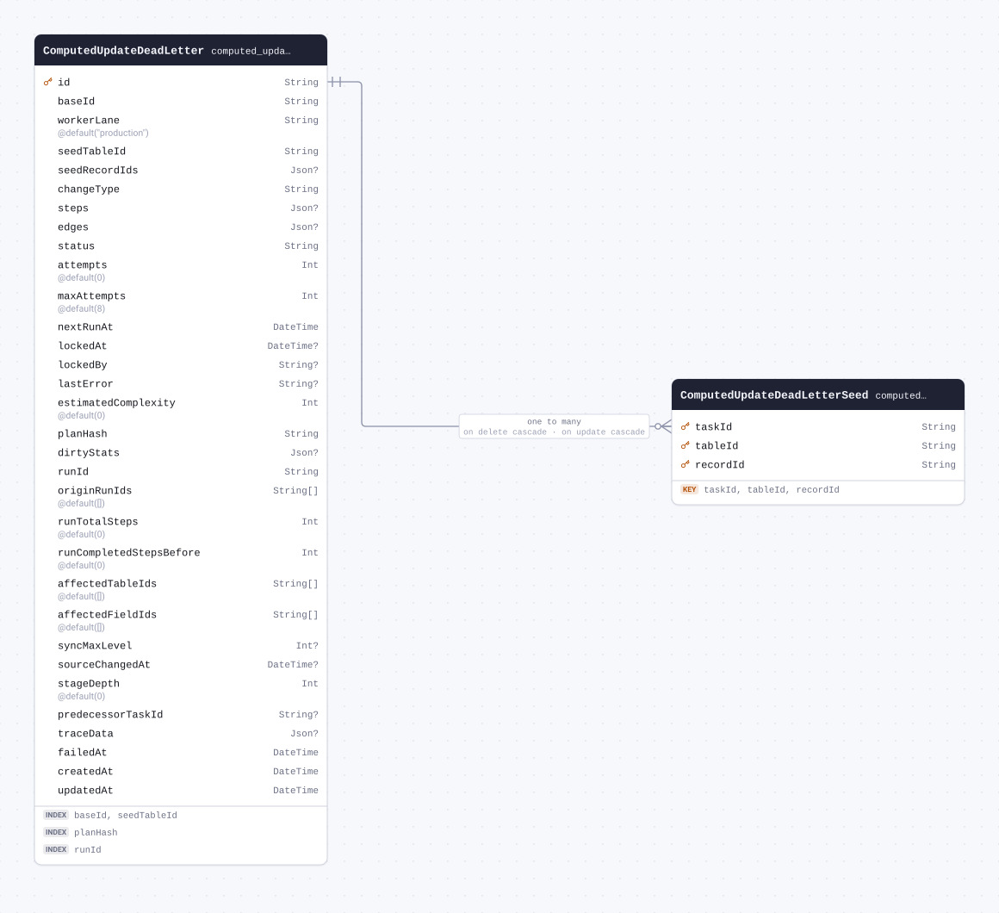

| Field                                                    | Type       | Constraints | Default        | Description |
| -------------------------------------------------------- | ---------- | ----------- | -------------- | ----------- |
| `id`                                                     | `String`   | PK NOT NULL |                |             |
| `baseId` (`base_id`)                                     | `String`   | NOT NULL    |                |             |
| `workerLane` (`worker_lane`)                             | `String`   | NOT NULL    | `"production"` |             |
| `seedTableId` (`seed_table_id`)                          | `String`   | NOT NULL    |                |             |
| `seedRecordIds` (`seed_record_ids`)                      | `Json`     | NULL        |                |             |
| `changeType` (`change_type`)                             | `String`   | NOT NULL    |                |             |
| `steps`                                                  | `Json`     | NULL        |                |             |
| `edges`                                                  | `Json`     | NULL        |                |             |
| `status`                                                 | `String`   | NOT NULL    |                |             |
| `attempts`                                               | `Int`      | NOT NULL    | `0`            |             |
| `maxAttempts` (`max_attempts`)                           | `Int`      | NOT NULL    | `8`            |             |
| `nextRunAt` (`next_run_at`)                              | `DateTime` | NOT NULL    |                |             |
| `lockedAt` (`locked_at`)                                 | `DateTime` | NULL        |                |             |
| `lockedBy` (`locked_by`)                                 | `String`   | NULL        |                |             |
| `lastError` (`last_error`)                               | `String`   | NULL        |                |             |
| `estimatedComplexity` (`estimated_complexity`)           | `Int`      | NOT NULL    | `0`            |             |
| `planHash` (`plan_hash`)                                 | `String`   | NOT NULL    |                |             |
| `dirtyStats` (`dirty_stats`)                             | `Json`     | NULL        |                |             |
| `runId` (`run_id`)                                       | `String`   | NOT NULL    |                |             |
| `originRunIds` (`origin_run_ids`)                        | `String[]` | NOT NULL    | `[]`           |             |
| `runTotalSteps` (`run_total_steps`)                      | `Int`      | NOT NULL    | `0`            |             |
| `runCompletedStepsBefore` (`run_completed_steps_before`) | `Int`      | NOT NULL    | `0`            |             |
| `affectedTableIds` (`affected_table_ids`)                | `String[]` | NOT NULL    | `[]`           |             |
| `affectedFieldIds` (`affected_field_ids`)                | `String[]` | NOT NULL    | `[]`           |             |
| `syncMaxLevel` (`sync_max_level`)                        | `Int`      | NULL        |                |             |
| `sourceChangedAt` (`source_changed_at`)                  | `DateTime` | NULL        |                |             |
| `stageDepth` (`stage_depth`)                             | `Int`      | NOT NULL    | `0`            |             |
| `predecessorTaskId` (`predecessor_task_id`)              | `String`   | NULL        |                |             |
| `traceData` (`trace_data`)                               | `Json`     | NULL        |                |             |
| `failedAt` (`failed_at`)                                 | `DateTime` | NOT NULL    |                |             |
| `createdAt` (`created_at`)                               | `DateTime` | NOT NULL    |                |             |
| `updatedAt` (`updated_at`)                               | `DateTime` | NOT NULL    |                |             |

#### Indexes

- `@@index([baseId, seedTableId])`
- `@@index([planHash])`
- `@@index([runId])`

#### Referenced by

- `id` ← [ComputedUpdateDeadLetterSeed.taskId](#model-ComputedUpdateDeadLetterSeed) (one-to-many, on delete Cascade, on update Cascade)

#### Definition

```sql
CREATE TABLE "computed_update_dead_letter" (
    "id" TEXT NOT NULL,
    "base_id" TEXT NOT NULL,
    "worker_lane" TEXT NOT NULL DEFAULT 'production',
    "seed_table_id" TEXT NOT NULL,
    "seed_record_ids" JSONB,
    "change_type" TEXT NOT NULL,
    "steps" JSONB,
    "edges" JSONB,
    "status" TEXT NOT NULL,
    "attempts" INTEGER NOT NULL DEFAULT 0,
    "max_attempts" INTEGER NOT NULL DEFAULT 8,
    "next_run_at" TIMESTAMP(3) NOT NULL,
    "locked_at" TIMESTAMP(3),
    "locked_by" TEXT,
    "last_error" TEXT,
    "estimated_complexity" INTEGER NOT NULL DEFAULT 0,
    "plan_hash" TEXT NOT NULL,
    "dirty_stats" JSONB,
    "run_id" TEXT NOT NULL,
    "origin_run_ids" TEXT[] DEFAULT ARRAY[]::TEXT[],
    "run_total_steps" INTEGER NOT NULL DEFAULT 0,
    "run_completed_steps_before" INTEGER NOT NULL DEFAULT 0,
    "affected_table_ids" TEXT[] DEFAULT ARRAY[]::TEXT[],
    "affected_field_ids" TEXT[] DEFAULT ARRAY[]::TEXT[],
    "sync_max_level" INTEGER,
    "source_changed_at" TIMESTAMP(3),
    "stage_depth" INTEGER NOT NULL DEFAULT 0,
    "predecessor_task_id" TEXT,
    "trace_data" JSONB,
    "failed_at" TIMESTAMP(3) NOT NULL,
    "created_at" TIMESTAMP(3) NOT NULL,
    "updated_at" TIMESTAMP(3) NOT NULL,

    CONSTRAINT "computed_update_dead_letter_pkey" PRIMARY KEY ("id")
);

CREATE INDEX "computed_update_dead_letter_base_id_seed_table_id_idx" ON "computed_update_dead_letter"("base_id", "seed_table_id");

CREATE INDEX "computed_update_dead_letter_plan_hash_idx" ON "computed_update_dead_letter"("plan_hash");

CREATE INDEX "computed_update_dead_letter_run_id_idx" ON "computed_update_dead_letter"("run_id");
```

<details>
<summary>Queries and their SQL</summary>

**findMany**: Every row

```ts
await prisma.computedUpdateDeadLetter.findMany();
```

```sql
SELECT
  "public"."computed_update_dead_letter"."id",
  "public"."computed_update_dead_letter"."base_id",
  "public"."computed_update_dead_letter"."worker_lane",
  "public"."computed_update_dead_letter"."seed_table_id",
  "public"."computed_update_dead_letter"."seed_record_ids",
  "public"."computed_update_dead_letter"."change_type",
  "public"."computed_update_dead_letter"."steps",
  "public"."computed_update_dead_letter"."edges",
  "public"."computed_update_dead_letter"."status",
  "public"."computed_update_dead_letter"."attempts",
  "public"."computed_update_dead_letter"."max_attempts",
  "public"."computed_update_dead_letter"."next_run_at",
  "public"."computed_update_dead_letter"."locked_at",
  "public"."computed_update_dead_letter"."locked_by",
  "public"."computed_update_dead_letter"."last_error",
  "public"."computed_update_dead_letter"."estimated_complexity",
  "public"."computed_update_dead_letter"."plan_hash",
  "public"."computed_update_dead_letter"."dirty_stats",
  "public"."computed_update_dead_letter"."run_id",
  "public"."computed_update_dead_letter"."origin_run_ids",
  "public"."computed_update_dead_letter"."run_total_steps",
  "public"."computed_update_dead_letter"."run_completed_steps_before",
  "public"."computed_update_dead_letter"."affected_table_ids",
  "public"."computed_update_dead_letter"."affected_field_ids",
  "public"."computed_update_dead_letter"."sync_max_level",
  "public"."computed_update_dead_letter"."source_changed_at",
  "public"."computed_update_dead_letter"."stage_depth",
  "public"."computed_update_dead_letter"."predecessor_task_id",
  "public"."computed_update_dead_letter"."trace_data",
  "public"."computed_update_dead_letter"."failed_at",
  "public"."computed_update_dead_letter"."created_at",
  "public"."computed_update_dead_letter"."updated_at"
FROM
  "public"."computed_update_dead_letter"
WHERE
  1 = 1
OFFSET
  $1
-- params: ["0"]
```

**count**: How many rows there are

```ts
await prisma.computedUpdateDeadLetter.count();
```

```sql
SELECT
  COUNT(*) AS "_count$_all"
FROM
  (
    SELECT
      "public"."computed_update_dead_letter"."id"
    FROM
      "public"."computed_update_dead_letter"
    WHERE
      1 = 1
    OFFSET
      $1
  ) AS "sub"
-- params: ["0"]
```

**findMany**: Every row with its relations

```ts
await prisma.computedUpdateDeadLetter.findMany({ include: { seeds: true } });
```

```sql
SELECT
  "public"."computed_update_dead_letter"."id",
  "public"."computed_update_dead_letter"."base_id",
  "public"."computed_update_dead_letter"."worker_lane",
  "public"."computed_update_dead_letter"."seed_table_id",
  "public"."computed_update_dead_letter"."seed_record_ids",
  "public"."computed_update_dead_letter"."change_type",
  "public"."computed_update_dead_letter"."steps",
  "public"."computed_update_dead_letter"."edges",
  "public"."computed_update_dead_letter"."status",
  "public"."computed_update_dead_letter"."attempts",
  "public"."computed_update_dead_letter"."max_attempts",
  "public"."computed_update_dead_letter"."next_run_at",
  "public"."computed_update_dead_letter"."locked_at",
  "public"."computed_update_dead_letter"."locked_by",
  "public"."computed_update_dead_letter"."last_error",
  "public"."computed_update_dead_letter"."estimated_complexity",
  "public"."computed_update_dead_letter"."plan_hash",
  "public"."computed_update_dead_letter"."dirty_stats",
  "public"."computed_update_dead_letter"."run_id",
  "public"."computed_update_dead_letter"."origin_run_ids",
  "public"."computed_update_dead_letter"."run_total_steps",
  "public"."computed_update_dead_letter"."run_completed_steps_before",
  "public"."computed_update_dead_letter"."affected_table_ids",
  "public"."computed_update_dead_letter"."affected_field_ids",
  "public"."computed_update_dead_letter"."sync_max_level",
  "public"."computed_update_dead_letter"."source_changed_at",
  "public"."computed_update_dead_letter"."stage_depth",
  "public"."computed_update_dead_letter"."predecessor_task_id",
  "public"."computed_update_dead_letter"."trace_data",
  "public"."computed_update_dead_letter"."failed_at",
  "public"."computed_update_dead_letter"."created_at",
  "public"."computed_update_dead_letter"."updated_at"
FROM
  "public"."computed_update_dead_letter"
WHERE
  1 = 1
OFFSET
  $1
-- params: ["0"]

SELECT
  "public"."computed_update_dead_letter_seed"."task_id",
  "public"."computed_update_dead_letter_seed"."table_id",
  "public"."computed_update_dead_letter_seed"."record_id"
FROM
  "public"."computed_update_dead_letter_seed"
WHERE
  "public"."computed_update_dead_letter_seed"."task_id" IN ($1)
OFFSET
  $2
-- params: ["<id of the rows above>","0"]
```

**findUnique**: One row by what is unique to it

```ts
await prisma.computedUpdateDeadLetter.findUnique({ where: { id: "example" } });
```

```sql
SELECT
  "public"."computed_update_dead_letter"."id",
  "public"."computed_update_dead_letter"."base_id",
  "public"."computed_update_dead_letter"."worker_lane",
  "public"."computed_update_dead_letter"."seed_table_id",
  "public"."computed_update_dead_letter"."seed_record_ids",
  "public"."computed_update_dead_letter"."change_type",
  "public"."computed_update_dead_letter"."steps",
  "public"."computed_update_dead_letter"."edges",
  "public"."computed_update_dead_letter"."status",
  "public"."computed_update_dead_letter"."attempts",
  "public"."computed_update_dead_letter"."max_attempts",
  "public"."computed_update_dead_letter"."next_run_at",
  "public"."computed_update_dead_letter"."locked_at",
  "public"."computed_update_dead_letter"."locked_by",
  "public"."computed_update_dead_letter"."last_error",
  "public"."computed_update_dead_letter"."estimated_complexity",
  "public"."computed_update_dead_letter"."plan_hash",
  "public"."computed_update_dead_letter"."dirty_stats",
  "public"."computed_update_dead_letter"."run_id",
  "public"."computed_update_dead_letter"."origin_run_ids",
  "public"."computed_update_dead_letter"."run_total_steps",
  "public"."computed_update_dead_letter"."run_completed_steps_before",
  "public"."computed_update_dead_letter"."affected_table_ids",
  "public"."computed_update_dead_letter"."affected_field_ids",
  "public"."computed_update_dead_letter"."sync_max_level",
  "public"."computed_update_dead_letter"."source_changed_at",
  "public"."computed_update_dead_letter"."stage_depth",
  "public"."computed_update_dead_letter"."predecessor_task_id",
  "public"."computed_update_dead_letter"."trace_data",
  "public"."computed_update_dead_letter"."failed_at",
  "public"."computed_update_dead_letter"."created_at",
  "public"."computed_update_dead_letter"."updated_at"
FROM
  "public"."computed_update_dead_letter"
WHERE
  (
    "public"."computed_update_dead_letter"."id" = $1
    AND 1 = 1
  )
LIMIT
  $2
OFFSET
  $3
-- params: ["example","1","0"]
```

**create**: Create a row

```ts
await prisma.computedUpdateDeadLetter.create({
  data: {
    id: "example",
    baseId: "example",
    seedTableId: "example",
    changeType: "example",
    status: "example",
    nextRunAt: new Date("2026-01-01T00:00:00.000Z"),
    planHash: "example",
    runId: "example",
    failedAt: new Date("2026-01-01T00:00:00.000Z"),
    createdAt: new Date("2026-01-01T00:00:00.000Z"),
    updatedAt: new Date("2026-01-01T00:00:00.000Z"),
  },
});
```

```sql
INSERT INTO
  "public"."computed_update_dead_letter" (
    "id",
    "base_id",
    "worker_lane",
    "seed_table_id",
    "change_type",
    "status",
    "attempts",
    "max_attempts",
    "next_run_at",
    "estimated_complexity",
    "plan_hash",
    "run_id",
    "origin_run_ids",
    "run_total_steps",
    "run_completed_steps_before",
    "affected_table_ids",
    "affected_field_ids",
    "stage_depth",
    "failed_at",
    "created_at",
    "updated_at"
  )
VALUES
  (
    $1,
    $2,
    $3,
    $4,
    $5,
    $6,
    $7,
    $8,
    $9,
    $10,
    $11,
    $12,
    $13,
    $14,
    $15,
    $16,
    $17,
    $18,
    $19,
    $20,
    $21
  )
RETURNING
  "public"."computed_update_dead_letter"."id",
  "public"."computed_update_dead_letter"."base_id",
  "public"."computed_update_dead_letter"."worker_lane",
  "public"."computed_update_dead_letter"."seed_table_id",
  "public"."computed_update_dead_letter"."seed_record_ids",
  "public"."computed_update_dead_letter"."change_type",
  "public"."computed_update_dead_letter"."steps",
  "public"."computed_update_dead_letter"."edges",
  "public"."computed_update_dead_letter"."status",
  "public"."computed_update_dead_letter"."attempts",
  "public"."computed_update_dead_letter"."max_attempts",
  "public"."computed_update_dead_letter"."next_run_at",
  "public"."computed_update_dead_letter"."locked_at",
  "public"."computed_update_dead_letter"."locked_by",
  "public"."computed_update_dead_letter"."last_error",
  "public"."computed_update_dead_letter"."estimated_complexity",
  "public"."computed_update_dead_letter"."plan_hash",
  "public"."computed_update_dead_letter"."dirty_stats",
  "public"."computed_update_dead_letter"."run_id",
  "public"."computed_update_dead_letter"."origin_run_ids",
  "public"."computed_update_dead_letter"."run_total_steps",
  "public"."computed_update_dead_letter"."run_completed_steps_before",
  "public"."computed_update_dead_letter"."affected_table_ids",
  "public"."computed_update_dead_letter"."affected_field_ids",
  "public"."computed_update_dead_letter"."sync_max_level",
  "public"."computed_update_dead_letter"."source_changed_at",
  "public"."computed_update_dead_letter"."stage_depth",
  "public"."computed_update_dead_letter"."predecessor_task_id",
  "public"."computed_update_dead_letter"."trace_data",
  "public"."computed_update_dead_letter"."failed_at",
  "public"."computed_update_dead_letter"."created_at",
  "public"."computed_update_dead_letter"."updated_at"
-- params: ["example","example","production","example","example","example","0","8","2026-01-01T00:00:00.000Z","0","example","example",[],"0","0",[],[],"0","2026-01-01T00:00:00.000Z","2026-01-01T00:00:00.000Z","2026-01-01T00:00:00.000Z"]
```

**update**: Update a row

```ts
await prisma.computedUpdateDeadLetter.update({
  where: { id: "example" },
  data: { baseId: "example" },
});
```

```sql
UPDATE "public"."computed_update_dead_letter"
SET
  "base_id" = $1
WHERE
  (
    "public"."computed_update_dead_letter"."id" = $2
    AND 1 = 1
  )
RETURNING
  "public"."computed_update_dead_letter"."id",
  "public"."computed_update_dead_letter"."base_id",
  "public"."computed_update_dead_letter"."worker_lane",
  "public"."computed_update_dead_letter"."seed_table_id",
  "public"."computed_update_dead_letter"."seed_record_ids",
  "public"."computed_update_dead_letter"."change_type",
  "public"."computed_update_dead_letter"."steps",
  "public"."computed_update_dead_letter"."edges",
  "public"."computed_update_dead_letter"."status",
  "public"."computed_update_dead_letter"."attempts",
  "public"."computed_update_dead_letter"."max_attempts",
  "public"."computed_update_dead_letter"."next_run_at",
  "public"."computed_update_dead_letter"."locked_at",
  "public"."computed_update_dead_letter"."locked_by",
  "public"."computed_update_dead_letter"."last_error",
  "public"."computed_update_dead_letter"."estimated_complexity",
  "public"."computed_update_dead_letter"."plan_hash",
  "public"."computed_update_dead_letter"."dirty_stats",
  "public"."computed_update_dead_letter"."run_id",
  "public"."computed_update_dead_letter"."origin_run_ids",
  "public"."computed_update_dead_letter"."run_total_steps",
  "public"."computed_update_dead_letter"."run_completed_steps_before",
  "public"."computed_update_dead_letter"."affected_table_ids",
  "public"."computed_update_dead_letter"."affected_field_ids",
  "public"."computed_update_dead_letter"."sync_max_level",
  "public"."computed_update_dead_letter"."source_changed_at",
  "public"."computed_update_dead_letter"."stage_depth",
  "public"."computed_update_dead_letter"."predecessor_task_id",
  "public"."computed_update_dead_letter"."trace_data",
  "public"."computed_update_dead_letter"."failed_at",
  "public"."computed_update_dead_letter"."created_at",
  "public"."computed_update_dead_letter"."updated_at"
-- params: ["example","example"]
```

**delete**: Delete a row

```ts
await prisma.computedUpdateDeadLetter.delete({ where: { id: "example" } });
```

```sql
DELETE FROM "public"."computed_update_dead_letter"
WHERE
  (
    "public"."computed_update_dead_letter"."id" = $1
    AND 1 = 1
  )
RETURNING
  "public"."computed_update_dead_letter"."id",
  "public"."computed_update_dead_letter"."base_id",
  "public"."computed_update_dead_letter"."worker_lane",
  "public"."computed_update_dead_letter"."seed_table_id",
  "public"."computed_update_dead_letter"."seed_record_ids",
  "public"."computed_update_dead_letter"."change_type",
  "public"."computed_update_dead_letter"."steps",
  "public"."computed_update_dead_letter"."edges",
  "public"."computed_update_dead_letter"."status",
  "public"."computed_update_dead_letter"."attempts",
  "public"."computed_update_dead_letter"."max_attempts",
  "public"."computed_update_dead_letter"."next_run_at",
  "public"."computed_update_dead_letter"."locked_at",
  "public"."computed_update_dead_letter"."locked_by",
  "public"."computed_update_dead_letter"."last_error",
  "public"."computed_update_dead_letter"."estimated_complexity",
  "public"."computed_update_dead_letter"."plan_hash",
  "public"."computed_update_dead_letter"."dirty_stats",
  "public"."computed_update_dead_letter"."run_id",
  "public"."computed_update_dead_letter"."origin_run_ids",
  "public"."computed_update_dead_letter"."run_total_steps",
  "public"."computed_update_dead_letter"."run_completed_steps_before",
  "public"."computed_update_dead_letter"."affected_table_ids",
  "public"."computed_update_dead_letter"."affected_field_ids",
  "public"."computed_update_dead_letter"."sync_max_level",
  "public"."computed_update_dead_letter"."source_changed_at",
  "public"."computed_update_dead_letter"."stage_depth",
  "public"."computed_update_dead_letter"."predecessor_task_id",
  "public"."computed_update_dead_letter"."trace_data",
  "public"."computed_update_dead_letter"."failed_at",
  "public"."computed_update_dead_letter"."created_at",
  "public"."computed_update_dead_letter"."updated_at"
-- params: ["example"]
```

</details>

<a id="model-ComputedUpdateDeadLetterSeed"></a>

### ComputedUpdateDeadLetterSeed

Table `computed_update_dead_letter_seed`.


| Field                    | Type     | Constraints                                                                  | Default | Description |
| ------------------------ | -------- | ---------------------------------------------------------------------------- | ------- | ----------- |
| `taskId` (`task_id`)     | `String` | PK NOT NULL → [ComputedUpdateDeadLetter.id](#model-ComputedUpdateDeadLetter) |         |             |
| `tableId` (`table_id`)   | `String` | PK NOT NULL                                                                  |         |             |
| `recordId` (`record_id`) | `String` | PK NOT NULL                                                                  |         |             |

#### Indexes

- `@@id([taskId, tableId, recordId])`

#### References

- `taskId` → [ComputedUpdateDeadLetter.id](#model-ComputedUpdateDeadLetter) (many-to-one, on delete Cascade, on update Cascade)

#### Definition

```sql
CREATE TABLE "computed_update_dead_letter_seed" (
    "task_id" TEXT NOT NULL,
    "table_id" TEXT NOT NULL,
    "record_id" TEXT NOT NULL,

    CONSTRAINT "computed_update_dead_letter_seed_pkey" PRIMARY KEY ("task_id","table_id","record_id")
);

ALTER TABLE "computed_update_dead_letter_seed" ADD CONSTRAINT "computed_update_dead_letter_seed_task_id_fkey" FOREIGN KEY ("task_id") REFERENCES "computed_update_dead_letter"("id") ON DELETE CASCADE ON UPDATE CASCADE;
```

<details>
<summary>Queries and their SQL</summary>

**findMany**: Every row

```ts
await prisma.computedUpdateDeadLetterSeed.findMany();
```

```sql
SELECT
  "public"."computed_update_dead_letter_seed"."task_id",
  "public"."computed_update_dead_letter_seed"."table_id",
  "public"."computed_update_dead_letter_seed"."record_id"
FROM
  "public"."computed_update_dead_letter_seed"
WHERE
  1 = 1
OFFSET
  $1
-- params: ["0"]
```

**count**: How many rows there are

```ts
await prisma.computedUpdateDeadLetterSeed.count();
```

```sql
SELECT
  COUNT(*) AS "_count$_all"
FROM
  (
    SELECT
      "public"."computed_update_dead_letter_seed"."task_id",
      "public"."computed_update_dead_letter_seed"."table_id",
      "public"."computed_update_dead_letter_seed"."record_id"
    FROM
      "public"."computed_update_dead_letter_seed"
    WHERE
      1 = 1
    OFFSET
      $1
  ) AS "sub"
-- params: ["0"]
```

**findMany**: Every row with its relations

```ts
await prisma.computedUpdateDeadLetterSeed.findMany({ include: { task: true } });
```

```sql
SELECT
  "public"."computed_update_dead_letter_seed"."task_id",
  "public"."computed_update_dead_letter_seed"."table_id",
  "public"."computed_update_dead_letter_seed"."record_id"
FROM
  "public"."computed_update_dead_letter_seed"
WHERE
  1 = 1
OFFSET
  $1
-- params: ["0"]

SELECT
  "public"."computed_update_dead_letter"."id",
  "public"."computed_update_dead_letter"."base_id",
  "public"."computed_update_dead_letter"."worker_lane",
  "public"."computed_update_dead_letter"."seed_table_id",
  "public"."computed_update_dead_letter"."seed_record_ids",
  "public"."computed_update_dead_letter"."change_type",
  "public"."computed_update_dead_letter"."steps",
  "public"."computed_update_dead_letter"."edges",
  "public"."computed_update_dead_letter"."status",
  "public"."computed_update_dead_letter"."attempts",
  "public"."computed_update_dead_letter"."max_attempts",
  "public"."computed_update_dead_letter"."next_run_at",
  "public"."computed_update_dead_letter"."locked_at",
  "public"."computed_update_dead_letter"."locked_by",
  "public"."computed_update_dead_letter"."last_error",
  "public"."computed_update_dead_letter"."estimated_complexity",
  "public"."computed_update_dead_letter"."plan_hash",
  "public"."computed_update_dead_letter"."dirty_stats",
  "public"."computed_update_dead_letter"."run_id",
  "public"."computed_update_dead_letter"."origin_run_ids",
  "public"."computed_update_dead_letter"."run_total_steps",
  "public"."computed_update_dead_letter"."run_completed_steps_before",
  "public"."computed_update_dead_letter"."affected_table_ids",
  "public"."computed_update_dead_letter"."affected_field_ids",
  "public"."computed_update_dead_letter"."sync_max_level",
  "public"."computed_update_dead_letter"."source_changed_at",
  "public"."computed_update_dead_letter"."stage_depth",
  "public"."computed_update_dead_letter"."predecessor_task_id",
  "public"."computed_update_dead_letter"."trace_data",
  "public"."computed_update_dead_letter"."failed_at",
  "public"."computed_update_dead_letter"."created_at",
  "public"."computed_update_dead_letter"."updated_at"
FROM
  "public"."computed_update_dead_letter"
WHERE
  "public"."computed_update_dead_letter"."id" IN ($1)
OFFSET
  $2
-- params: ["<taskId of the rows above>","0"]
```

**findUnique**: One row by what is unique to it

```ts
await prisma.computedUpdateDeadLetterSeed.findUnique({
  where: {
    taskId_tableId_recordId: { taskId: "example", tableId: "example", recordId: "example" },
  },
});
```

```sql
SELECT
  "public"."computed_update_dead_letter_seed"."task_id",
  "public"."computed_update_dead_letter_seed"."table_id",
  "public"."computed_update_dead_letter_seed"."record_id"
FROM
  "public"."computed_update_dead_letter_seed"
WHERE
  (
    (
      "public"."computed_update_dead_letter_seed"."task_id" = $1
      AND "public"."computed_update_dead_letter_seed"."table_id" = $2
      AND "public"."computed_update_dead_letter_seed"."record_id" = $3
    )
    AND 1 = 1
  )
LIMIT
  $4
OFFSET
  $5
-- params: ["example","example","example","1","0"]
```

**create**: Create a row

```ts
await prisma.computedUpdateDeadLetterSeed.create({
  data: { taskId: "example", tableId: "example", recordId: "example" },
});
```

```sql
INSERT INTO
  "public"."computed_update_dead_letter_seed" ("task_id", "table_id", "record_id")
VALUES
  ($1, $2, $3)
RETURNING
  "public"."computed_update_dead_letter_seed"."task_id",
  "public"."computed_update_dead_letter_seed"."table_id",
  "public"."computed_update_dead_letter_seed"."record_id"
-- params: ["example","example","example"]
```

**delete**: Delete a row

```ts
await prisma.computedUpdateDeadLetterSeed.delete({
  where: {
    taskId_tableId_recordId: { taskId: "example", tableId: "example", recordId: "example" },
  },
});
```

```sql
DELETE FROM "public"."computed_update_dead_letter_seed"
WHERE
  (
    (
      "public"."computed_update_dead_letter_seed"."task_id" = $1
      AND "public"."computed_update_dead_letter_seed"."table_id" = $2
      AND "public"."computed_update_dead_letter_seed"."record_id" = $3
    )
    AND 1 = 1
  )
RETURNING
  "public"."computed_update_dead_letter_seed"."task_id",
  "public"."computed_update_dead_letter_seed"."table_id",
  "public"."computed_update_dead_letter_seed"."record_id"
-- params: ["example","example","example"]
```

</details>

<a id="model-ComputedUpdateRunHistory"></a>

### ComputedUpdateRunHistory

Table `computed_update_run_history`. Completion ledger for computed-update outbox tasks (lineage / latency
tracing). Successful tasks are hard-deleted from the outbox on markDone,
so this table keeps a retention-bounded trail per completed task: the
run/stage chain (runId, stageDepth, predecessorTaskId) and the timeline
from source mutation to converged write (sourceChangedAt → completedAt).
Observability only — the worker never reads it; rows are pruned after a
retention window.

| Field                                                    | Type       | Constraints | Default | Description                                                                                                                    |
| -------------------------------------------------------- | ---------- | ----------- | ------- | ------------------------------------------------------------------------------------------------------------------------------ |
| `taskId` (`task_id`)                                     | `String`   | PK NOT NULL |         |                                                                                                                                |
| `baseId` (`base_id`)                                     | `String`   | NOT NULL    |         |                                                                                                                                |
| `seedTableId` (`seed_table_id`)                          | `String`   | NOT NULL    |         |                                                                                                                                |
| `changeType` (`change_type`)                             | `String`   | NOT NULL    |         |                                                                                                                                |
| `runId` (`run_id`)                                       | `String`   | NOT NULL    |         |                                                                                                                                |
| `originRunIds` (`origin_run_ids`)                        | `String[]` | NOT NULL    | `[]`    |                                                                                                                                |
| `steps`                                                  | `Json`     | NULL        |         |                                                                                                                                |
| `edges`                                                  | `Json`     | NULL        |         |                                                                                                                                |
| `affectedTableIds` (`affected_table_ids`)                | `String[]` | NOT NULL    | `[]`    |                                                                                                                                |
| `affectedFieldIds` (`affected_field_ids`)                | `String[]` | NOT NULL    | `[]`    |                                                                                                                                |
| `sourceFieldIds` (`source_field_ids`)                    | `String[]` | NOT NULL    | `[]`    | Source (changed) field ids; populated for seed tasks, where affected_field_ids carries the trigger fields rather than targets. |
| `seedRecordCount` (`seed_record_count`)                  | `Int`      | NOT NULL    | `0`     |                                                                                                                                |
| `stageDepth` (`stage_depth`)                             | `Int`      | NOT NULL    | `0`     |                                                                                                                                |
| `predecessorTaskId` (`predecessor_task_id`)              | `String`   | NULL        |         |                                                                                                                                |
| `runTotalSteps` (`run_total_steps`)                      | `Int`      | NOT NULL    | `0`     |                                                                                                                                |
| `runCompletedStepsBefore` (`run_completed_steps_before`) | `Int`      | NOT NULL    | `0`     |                                                                                                                                |
| `syncMaxLevel` (`sync_max_level`)                        | `Int`      | NULL        |         |                                                                                                                                |
| `estimatedComplexity` (`estimated_complexity`)           | `Int`      | NOT NULL    | `0`     |                                                                                                                                |
| `attempts`                                               | `Int`      | NOT NULL    | `0`     |                                                                                                                                |
| `outcome`                                                | `String`   | NOT NULL    |         |                                                                                                                                |
| `sourceChangedAt` (`source_changed_at`)                  | `DateTime` | NULL        |         |                                                                                                                                |
| `enqueuedAt` (`enqueued_at`)                             | `DateTime` | NOT NULL    |         |                                                                                                                                |
| `startedAt` (`started_at`)                               | `DateTime` | NULL        |         |                                                                                                                                |
| `completedAt` (`completed_at`)                           | `DateTime` | NOT NULL    |         |                                                                                                                                |
| `durationMs` (`duration_ms`)                             | `Int`      | NOT NULL    | `0`     |                                                                                                                                |

#### Indexes

- `@@index([runId])`
- `@@index([baseId, completedAt])`
- `@@index([completedAt])`
- `@@index([originRunIds], map: "computed_update_run_history_origin_run_ids_gin")`

#### Definition

```sql
CREATE TABLE "computed_update_run_history" (
    "task_id" TEXT NOT NULL,
    "base_id" TEXT NOT NULL,
    "seed_table_id" TEXT NOT NULL,
    "change_type" TEXT NOT NULL,
    "run_id" TEXT NOT NULL,
    "origin_run_ids" TEXT[] DEFAULT ARRAY[]::TEXT[],
    "steps" JSONB,
    "edges" JSONB,
    "affected_table_ids" TEXT[] DEFAULT ARRAY[]::TEXT[],
    "affected_field_ids" TEXT[] DEFAULT ARRAY[]::TEXT[],
    "source_field_ids" TEXT[] DEFAULT ARRAY[]::TEXT[],
    "seed_record_count" INTEGER NOT NULL DEFAULT 0,
    "stage_depth" INTEGER NOT NULL DEFAULT 0,
    "predecessor_task_id" TEXT,
    "run_total_steps" INTEGER NOT NULL DEFAULT 0,
    "run_completed_steps_before" INTEGER NOT NULL DEFAULT 0,
    "sync_max_level" INTEGER,
    "estimated_complexity" INTEGER NOT NULL DEFAULT 0,
    "attempts" INTEGER NOT NULL DEFAULT 0,
    "outcome" TEXT NOT NULL,
    "source_changed_at" TIMESTAMP(3),
    "enqueued_at" TIMESTAMP(3) NOT NULL,
    "started_at" TIMESTAMP(3),
    "completed_at" TIMESTAMP(3) NOT NULL,
    "duration_ms" INTEGER NOT NULL DEFAULT 0,

    CONSTRAINT "computed_update_run_history_pkey" PRIMARY KEY ("task_id")
);

CREATE INDEX "computed_update_run_history_run_id_idx" ON "computed_update_run_history"("run_id");

CREATE INDEX "computed_update_run_history_base_id_completed_at_idx" ON "computed_update_run_history"("base_id", "completed_at");

CREATE INDEX "computed_update_run_history_completed_at_idx" ON "computed_update_run_history"("completed_at");

CREATE INDEX "computed_update_run_history_origin_run_ids_gin" ON "computed_update_run_history" USING GIN ("origin_run_ids");
```

<details>
<summary>Queries and their SQL</summary>

**findMany**: Every row

```ts
await prisma.computedUpdateRunHistory.findMany();
```

```sql
SELECT
  "public"."computed_update_run_history"."task_id",
  "public"."computed_update_run_history"."base_id",
  "public"."computed_update_run_history"."seed_table_id",
  "public"."computed_update_run_history"."change_type",
  "public"."computed_update_run_history"."run_id",
  "public"."computed_update_run_history"."origin_run_ids",
  "public"."computed_update_run_history"."steps",
  "public"."computed_update_run_history"."edges",
  "public"."computed_update_run_history"."affected_table_ids",
  "public"."computed_update_run_history"."affected_field_ids",
  "public"."computed_update_run_history"."source_field_ids",
  "public"."computed_update_run_history"."seed_record_count",
  "public"."computed_update_run_history"."stage_depth",
  "public"."computed_update_run_history"."predecessor_task_id",
  "public"."computed_update_run_history"."run_total_steps",
  "public"."computed_update_run_history"."run_completed_steps_before",
  "public"."computed_update_run_history"."sync_max_level",
  "public"."computed_update_run_history"."estimated_complexity",
  "public"."computed_update_run_history"."attempts",
  "public"."computed_update_run_history"."outcome",
  "public"."computed_update_run_history"."source_changed_at",
  "public"."computed_update_run_history"."enqueued_at",
  "public"."computed_update_run_history"."started_at",
  "public"."computed_update_run_history"."completed_at",
  "public"."computed_update_run_history"."duration_ms"
FROM
  "public"."computed_update_run_history"
WHERE
  1 = 1
OFFSET
  $1
-- params: ["0"]
```

**count**: How many rows there are

```ts
await prisma.computedUpdateRunHistory.count();
```

```sql
SELECT
  COUNT(*) AS "_count$_all"
FROM
  (
    SELECT
      "public"."computed_update_run_history"."task_id"
    FROM
      "public"."computed_update_run_history"
    WHERE
      1 = 1
    OFFSET
      $1
  ) AS "sub"
-- params: ["0"]
```

**findUnique**: One row by what is unique to it

```ts
await prisma.computedUpdateRunHistory.findUnique({ where: { taskId: "example" } });
```

```sql
SELECT
  "public"."computed_update_run_history"."task_id",
  "public"."computed_update_run_history"."base_id",
  "public"."computed_update_run_history"."seed_table_id",
  "public"."computed_update_run_history"."change_type",
  "public"."computed_update_run_history"."run_id",
  "public"."computed_update_run_history"."origin_run_ids",
  "public"."computed_update_run_history"."steps",
  "public"."computed_update_run_history"."edges",
  "public"."computed_update_run_history"."affected_table_ids",
  "public"."computed_update_run_history"."affected_field_ids",
  "public"."computed_update_run_history"."source_field_ids",
  "public"."computed_update_run_history"."seed_record_count",
  "public"."computed_update_run_history"."stage_depth",
  "public"."computed_update_run_history"."predecessor_task_id",
  "public"."computed_update_run_history"."run_total_steps",
  "public"."computed_update_run_history"."run_completed_steps_before",
  "public"."computed_update_run_history"."sync_max_level",
  "public"."computed_update_run_history"."estimated_complexity",
  "public"."computed_update_run_history"."attempts",
  "public"."computed_update_run_history"."outcome",
  "public"."computed_update_run_history"."source_changed_at",
  "public"."computed_update_run_history"."enqueued_at",
  "public"."computed_update_run_history"."started_at",
  "public"."computed_update_run_history"."completed_at",
  "public"."computed_update_run_history"."duration_ms"
FROM
  "public"."computed_update_run_history"
WHERE
  (
    "public"."computed_update_run_history"."task_id" = $1
    AND 1 = 1
  )
LIMIT
  $2
OFFSET
  $3
-- params: ["example","1","0"]
```

**create**: Create a row

```ts
await prisma.computedUpdateRunHistory.create({
  data: {
    taskId: "example",
    baseId: "example",
    seedTableId: "example",
    changeType: "example",
    runId: "example",
    outcome: "example",
    enqueuedAt: new Date("2026-01-01T00:00:00.000Z"),
    completedAt: new Date("2026-01-01T00:00:00.000Z"),
  },
});
```

```sql
INSERT INTO
  "public"."computed_update_run_history" (
    "task_id",
    "base_id",
    "seed_table_id",
    "change_type",
    "run_id",
    "origin_run_ids",
    "affected_table_ids",
    "affected_field_ids",
    "source_field_ids",
    "seed_record_count",
    "stage_depth",
    "run_total_steps",
    "run_completed_steps_before",
    "estimated_complexity",
    "attempts",
    "outcome",
    "enqueued_at",
    "completed_at",
    "duration_ms"
  )
VALUES
  (
    $1,
    $2,
    $3,
    $4,
    $5,
    $6,
    $7,
    $8,
    $9,
    $10,
    $11,
    $12,
    $13,
    $14,
    $15,
    $16,
    $17,
    $18,
    $19
  )
RETURNING
  "public"."computed_update_run_history"."task_id",
  "public"."computed_update_run_history"."base_id",
  "public"."computed_update_run_history"."seed_table_id",
  "public"."computed_update_run_history"."change_type",
  "public"."computed_update_run_history"."run_id",
  "public"."computed_update_run_history"."origin_run_ids",
  "public"."computed_update_run_history"."steps",
  "public"."computed_update_run_history"."edges",
  "public"."computed_update_run_history"."affected_table_ids",
  "public"."computed_update_run_history"."affected_field_ids",
  "public"."computed_update_run_history"."source_field_ids",
  "public"."computed_update_run_history"."seed_record_count",
  "public"."computed_update_run_history"."stage_depth",
  "public"."computed_update_run_history"."predecessor_task_id",
  "public"."computed_update_run_history"."run_total_steps",
  "public"."computed_update_run_history"."run_completed_steps_before",
  "public"."computed_update_run_history"."sync_max_level",
  "public"."computed_update_run_history"."estimated_complexity",
  "public"."computed_update_run_history"."attempts",
  "public"."computed_update_run_history"."outcome",
  "public"."computed_update_run_history"."source_changed_at",
  "public"."computed_update_run_history"."enqueued_at",
  "public"."computed_update_run_history"."started_at",
  "public"."computed_update_run_history"."completed_at",
  "public"."computed_update_run_history"."duration_ms"
-- params: ["example","example","example","example","example",[],[],[],[],"0","0","0","0","0","0","example","2026-01-01T00:00:00.000Z","2026-01-01T00:00:00.000Z","0"]
```

**update**: Update a row

```ts
await prisma.computedUpdateRunHistory.update({
  where: { taskId: "example" },
  data: { baseId: "example" },
});
```

```sql
UPDATE "public"."computed_update_run_history"
SET
  "base_id" = $1
WHERE
  (
    "public"."computed_update_run_history"."task_id" = $2
    AND 1 = 1
  )
RETURNING
  "public"."computed_update_run_history"."task_id",
  "public"."computed_update_run_history"."base_id",
  "public"."computed_update_run_history"."seed_table_id",
  "public"."computed_update_run_history"."change_type",
  "public"."computed_update_run_history"."run_id",
  "public"."computed_update_run_history"."origin_run_ids",
  "public"."computed_update_run_history"."steps",
  "public"."computed_update_run_history"."edges",
  "public"."computed_update_run_history"."affected_table_ids",
  "public"."computed_update_run_history"."affected_field_ids",
  "public"."computed_update_run_history"."source_field_ids",
  "public"."computed_update_run_history"."seed_record_count",
  "public"."computed_update_run_history"."stage_depth",
  "public"."computed_update_run_history"."predecessor_task_id",
  "public"."computed_update_run_history"."run_total_steps",
  "public"."computed_update_run_history"."run_completed_steps_before",
  "public"."computed_update_run_history"."sync_max_level",
  "public"."computed_update_run_history"."estimated_complexity",
  "public"."computed_update_run_history"."attempts",
  "public"."computed_update_run_history"."outcome",
  "public"."computed_update_run_history"."source_changed_at",
  "public"."computed_update_run_history"."enqueued_at",
  "public"."computed_update_run_history"."started_at",
  "public"."computed_update_run_history"."completed_at",
  "public"."computed_update_run_history"."duration_ms"
-- params: ["example","example"]
```

**delete**: Delete a row

```ts
await prisma.computedUpdateRunHistory.delete({ where: { taskId: "example" } });
```

```sql
DELETE FROM "public"."computed_update_run_history"
WHERE
  (
    "public"."computed_update_run_history"."task_id" = $1
    AND 1 = 1
  )
RETURNING
  "public"."computed_update_run_history"."task_id",
  "public"."computed_update_run_history"."base_id",
  "public"."computed_update_run_history"."seed_table_id",
  "public"."computed_update_run_history"."change_type",
  "public"."computed_update_run_history"."run_id",
  "public"."computed_update_run_history"."origin_run_ids",
  "public"."computed_update_run_history"."steps",
  "public"."computed_update_run_history"."edges",
  "public"."computed_update_run_history"."affected_table_ids",
  "public"."computed_update_run_history"."affected_field_ids",
  "public"."computed_update_run_history"."source_field_ids",
  "public"."computed_update_run_history"."seed_record_count",
  "public"."computed_update_run_history"."stage_depth",
  "public"."computed_update_run_history"."predecessor_task_id",
  "public"."computed_update_run_history"."run_total_steps",
  "public"."computed_update_run_history"."run_completed_steps_before",
  "public"."computed_update_run_history"."sync_max_level",
  "public"."computed_update_run_history"."estimated_complexity",
  "public"."computed_update_run_history"."attempts",
  "public"."computed_update_run_history"."outcome",
  "public"."computed_update_run_history"."source_changed_at",
  "public"."computed_update_run_history"."enqueued_at",
  "public"."computed_update_run_history"."started_at",
  "public"."computed_update_run_history"."completed_at",
  "public"."computed_update_run_history"."duration_ms"
-- params: ["example"]
```

</details>

<a id="model-ComputedUpdatePauseScope"></a>

### ComputedUpdatePauseScope

Table `computed_update_pause_scope`.

| Field                          | Type       | Constraints | Default              | Description |
| ------------------------------ | ---------- | ----------- | -------------------- | ----------- |
| `id`                           | `String`   | PK NOT NULL |                      |             |
| `scopeType` (`scope_type`)     | `String`   | NOT NULL    |                      |             |
| `scopeId` (`scope_id`)         | `String`   | NOT NULL    |                      |             |
| `pausedAt` (`paused_at`)       | `DateTime` | NOT NULL    | `now()`              |             |
| `pausedBy` (`paused_by`)       | `String`   | NULL        |                      |             |
| `resumeAt` (`resume_at`)       | `DateTime` | NULL        |                      |             |
| `reason`                       | `String`   | NULL        |                      |             |
| `writePolicy` (`write_policy`) | `String`   | NOT NULL    | `"allow_bounded"`    |             |
| `updatedAt` (`updated_at`)     | `DateTime` | NOT NULL    | `now()` `@updatedAt` |             |
| `updatedBy` (`updated_by`)     | `String`   | NULL        |                      |             |

#### Indexes

- `@@index([resumeAt])`
- `@@unique([scopeType, scopeId])`

#### Definition

```sql
CREATE TABLE "computed_update_pause_scope" (
    "id" TEXT NOT NULL,
    "scope_type" TEXT NOT NULL,
    "scope_id" TEXT NOT NULL,
    "paused_at" TIMESTAMP(3) NOT NULL DEFAULT CURRENT_TIMESTAMP,
    "paused_by" TEXT,
    "resume_at" TIMESTAMP(3),
    "reason" TEXT,
    "write_policy" TEXT NOT NULL DEFAULT 'allow_bounded',
    "updated_at" TIMESTAMP(3) NOT NULL DEFAULT CURRENT_TIMESTAMP,
    "updated_by" TEXT,

    CONSTRAINT "computed_update_pause_scope_pkey" PRIMARY KEY ("id")
);

CREATE INDEX "computed_update_pause_scope_resume_at_idx" ON "computed_update_pause_scope"("resume_at");

CREATE UNIQUE INDEX "computed_update_pause_scope_scope_type_scope_id_key" ON "computed_update_pause_scope"("scope_type", "scope_id");
```

<details>
<summary>Queries and their SQL</summary>

**findMany**: Every row

```ts
await prisma.computedUpdatePauseScope.findMany();
```

```sql
SELECT
  "public"."computed_update_pause_scope"."id",
  "public"."computed_update_pause_scope"."scope_type",
  "public"."computed_update_pause_scope"."scope_id",
  "public"."computed_update_pause_scope"."paused_at",
  "public"."computed_update_pause_scope"."paused_by",
  "public"."computed_update_pause_scope"."resume_at",
  "public"."computed_update_pause_scope"."reason",
  "public"."computed_update_pause_scope"."write_policy",
  "public"."computed_update_pause_scope"."updated_at",
  "public"."computed_update_pause_scope"."updated_by"
FROM
  "public"."computed_update_pause_scope"
WHERE
  1 = 1
OFFSET
  $1
-- params: ["0"]
```

**count**: How many rows there are

```ts
await prisma.computedUpdatePauseScope.count();
```

```sql
SELECT
  COUNT(*) AS "_count$_all"
FROM
  (
    SELECT
      "public"."computed_update_pause_scope"."id"
    FROM
      "public"."computed_update_pause_scope"
    WHERE
      1 = 1
    OFFSET
      $1
  ) AS "sub"
-- params: ["0"]
```

**findUnique**: One row by what is unique to it

```ts
await prisma.computedUpdatePauseScope.findUnique({ where: { id: "example" } });
```

```sql
SELECT
  "public"."computed_update_pause_scope"."id",
  "public"."computed_update_pause_scope"."scope_type",
  "public"."computed_update_pause_scope"."scope_id",
  "public"."computed_update_pause_scope"."paused_at",
  "public"."computed_update_pause_scope"."paused_by",
  "public"."computed_update_pause_scope"."resume_at",
  "public"."computed_update_pause_scope"."reason",
  "public"."computed_update_pause_scope"."write_policy",
  "public"."computed_update_pause_scope"."updated_at",
  "public"."computed_update_pause_scope"."updated_by"
FROM
  "public"."computed_update_pause_scope"
WHERE
  (
    "public"."computed_update_pause_scope"."id" = $1
    AND 1 = 1
  )
LIMIT
  $2
OFFSET
  $3
-- params: ["example","1","0"]
```

**create**: Create a row

```ts
await prisma.computedUpdatePauseScope.create({
  data: { id: "example", scopeType: "example", scopeId: "example" },
});
```

```sql
INSERT INTO
  "public"."computed_update_pause_scope" (
    "id",
    "scope_type",
    "scope_id",
    "paused_at",
    "write_policy",
    "updated_at"
  )
VALUES
  ($1, $2, $3, $4, $5, $6)
RETURNING
  "public"."computed_update_pause_scope"."id",
  "public"."computed_update_pause_scope"."scope_type",
  "public"."computed_update_pause_scope"."scope_id",
  "public"."computed_update_pause_scope"."paused_at",
  "public"."computed_update_pause_scope"."paused_by",
  "public"."computed_update_pause_scope"."resume_at",
  "public"."computed_update_pause_scope"."reason",
  "public"."computed_update_pause_scope"."write_policy",
  "public"."computed_update_pause_scope"."updated_at",
  "public"."computed_update_pause_scope"."updated_by"
-- params: ["example","example","example","<now()>","allow_bounded","<now()>"]
```

**update**: Update a row

```ts
await prisma.computedUpdatePauseScope.update({
  where: { id: "example" },
  data: { scopeType: "example" },
});
```

```sql
UPDATE "public"."computed_update_pause_scope"
SET
  "scope_type" = $1,
  "updated_at" = $2
WHERE
  (
    "public"."computed_update_pause_scope"."id" = $3
    AND 1 = 1
  )
RETURNING
  "public"."computed_update_pause_scope"."id",
  "public"."computed_update_pause_scope"."scope_type",
  "public"."computed_update_pause_scope"."scope_id",
  "public"."computed_update_pause_scope"."paused_at",
  "public"."computed_update_pause_scope"."paused_by",
  "public"."computed_update_pause_scope"."resume_at",
  "public"."computed_update_pause_scope"."reason",
  "public"."computed_update_pause_scope"."write_policy",
  "public"."computed_update_pause_scope"."updated_at",
  "public"."computed_update_pause_scope"."updated_by"
-- params: ["example",{"prisma__type":"generatorCall","prisma__value":{"name":"now","args":[],"returnType":{"type":"DateTime"}}},"example"]
```

**delete**: Delete a row

```ts
await prisma.computedUpdatePauseScope.delete({ where: { id: "example" } });
```

```sql
DELETE FROM "public"."computed_update_pause_scope"
WHERE
  (
    "public"."computed_update_pause_scope"."id" = $1
    AND 1 = 1
  )
RETURNING
  "public"."computed_update_pause_scope"."id",
  "public"."computed_update_pause_scope"."scope_type",
  "public"."computed_update_pause_scope"."scope_id",
  "public"."computed_update_pause_scope"."paused_at",
  "public"."computed_update_pause_scope"."paused_by",
  "public"."computed_update_pause_scope"."resume_at",
  "public"."computed_update_pause_scope"."reason",
  "public"."computed_update_pause_scope"."write_policy",
  "public"."computed_update_pause_scope"."updated_at",
  "public"."computed_update_pause_scope"."updated_by"
-- params: ["example"]
```

</details>

<a id="model-ComputedFieldActivity"></a>

### ComputedFieldActivity

Table `computed_field_activity`. Projection of async computed activity per field (not field schema meta).

| Field                                               | Type       | Constraints | Default | Description |
| --------------------------------------------------- | ---------- | ----------- | ------- | ----------- |
| `fieldId` (`field_id`)                              | `String`   | PK NOT NULL |         |             |
| `tableId` (`table_id`)                              | `String`   | NOT NULL    |         |             |
| `baseId` (`base_id`)                                | `String`   | NOT NULL    |         |             |
| `status`                                            | `String`   | NOT NULL    |         |             |
| `activeTaskCount` (`active_task_count`)             | `Int`      | NOT NULL    | `0`     |             |
| `processingTaskCount` (`processing_task_count`)     | `Int`      | NOT NULL    | `0`     |             |
| `generation`                                        | `BigInt`   | NOT NULL    | `"0"`   |             |
| `estimatedComplexity` (`estimated_complexity`)      | `BigInt`   | NOT NULL    | `"0"`   |             |
| `estimatedDirtyRecords` (`estimated_dirty_records`) | `BigInt`   | NOT NULL    | `"0"`   |             |
| `hasAllTargetRecords` (`has_all_target_records`)    | `Boolean`  | NOT NULL    | `false` |             |
| `queuedAt` (`queued_at`)                            | `DateTime` | NULL        |         |             |
| `startedAt` (`started_at`)                          | `DateTime` | NULL        |         |             |
| `lastCompletedAt` (`last_completed_at`)             | `DateTime` | NULL        |         |             |
| `lastDurationMs` (`last_duration_ms`)               | `Int`      | NULL        |         |             |
| `lastError` (`last_error`)                          | `Json`     | NULL        |         |             |
| `extensions`                                        | `Json`     | NULL        |         |             |
| `updatedAt` (`updated_at`)                          | `DateTime` | NOT NULL    | `now()` |             |

#### Indexes

- `@@index([tableId, status])`
- `@@index([baseId, status])`

#### Definition

```sql
CREATE TABLE "computed_field_activity" (
    "field_id" TEXT NOT NULL,
    "table_id" TEXT NOT NULL,
    "base_id" TEXT NOT NULL,
    "status" TEXT NOT NULL,
    "active_task_count" INTEGER NOT NULL DEFAULT 0,
    "processing_task_count" INTEGER NOT NULL DEFAULT 0,
    "generation" BIGINT NOT NULL DEFAULT 0,
    "estimated_complexity" BIGINT NOT NULL DEFAULT 0,
    "estimated_dirty_records" BIGINT NOT NULL DEFAULT 0,
    "has_all_target_records" BOOLEAN NOT NULL DEFAULT false,
    "queued_at" TIMESTAMP(3),
    "started_at" TIMESTAMP(3),
    "last_completed_at" TIMESTAMP(3),
    "last_duration_ms" INTEGER,
    "last_error" JSONB,
    "extensions" JSONB,
    "updated_at" TIMESTAMP(3) NOT NULL DEFAULT CURRENT_TIMESTAMP,

    CONSTRAINT "computed_field_activity_pkey" PRIMARY KEY ("field_id")
);

CREATE INDEX "computed_field_activity_table_id_status_idx" ON "computed_field_activity"("table_id", "status");

CREATE INDEX "computed_field_activity_base_id_status_idx" ON "computed_field_activity"("base_id", "status");
```

<details>
<summary>Queries and their SQL</summary>

**findMany**: Every row

```ts
await prisma.computedFieldActivity.findMany();
```

```sql
SELECT
  "public"."computed_field_activity"."field_id",
  "public"."computed_field_activity"."table_id",
  "public"."computed_field_activity"."base_id",
  "public"."computed_field_activity"."status",
  "public"."computed_field_activity"."active_task_count",
  "public"."computed_field_activity"."processing_task_count",
  "public"."computed_field_activity"."generation",
  "public"."computed_field_activity"."estimated_complexity",
  "public"."computed_field_activity"."estimated_dirty_records",
  "public"."computed_field_activity"."has_all_target_records",
  "public"."computed_field_activity"."queued_at",
  "public"."computed_field_activity"."started_at",
  "public"."computed_field_activity"."last_completed_at",
  "public"."computed_field_activity"."last_duration_ms",
  "public"."computed_field_activity"."last_error",
  "public"."computed_field_activity"."extensions",
  "public"."computed_field_activity"."updated_at"
FROM
  "public"."computed_field_activity"
WHERE
  1 = 1
OFFSET
  $1
-- params: ["0"]
```

**count**: How many rows there are

```ts
await prisma.computedFieldActivity.count();
```

```sql
SELECT
  COUNT(*) AS "_count$_all"
FROM
  (
    SELECT
      "public"."computed_field_activity"."field_id"
    FROM
      "public"."computed_field_activity"
    WHERE
      1 = 1
    OFFSET
      $1
  ) AS "sub"
-- params: ["0"]
```

**findUnique**: One row by what is unique to it

```ts
await prisma.computedFieldActivity.findUnique({ where: { fieldId: "example" } });
```

```sql
SELECT
  "public"."computed_field_activity"."field_id",
  "public"."computed_field_activity"."table_id",
  "public"."computed_field_activity"."base_id",
  "public"."computed_field_activity"."status",
  "public"."computed_field_activity"."active_task_count",
  "public"."computed_field_activity"."processing_task_count",
  "public"."computed_field_activity"."generation",
  "public"."computed_field_activity"."estimated_complexity",
  "public"."computed_field_activity"."estimated_dirty_records",
  "public"."computed_field_activity"."has_all_target_records",
  "public"."computed_field_activity"."queued_at",
  "public"."computed_field_activity"."started_at",
  "public"."computed_field_activity"."last_completed_at",
  "public"."computed_field_activity"."last_duration_ms",
  "public"."computed_field_activity"."last_error",
  "public"."computed_field_activity"."extensions",
  "public"."computed_field_activity"."updated_at"
FROM
  "public"."computed_field_activity"
WHERE
  (
    "public"."computed_field_activity"."field_id" = $1
    AND 1 = 1
  )
LIMIT
  $2
OFFSET
  $3
-- params: ["example","1","0"]
```

**create**: Create a row

```ts
await prisma.computedFieldActivity.create({
  data: { fieldId: "example", tableId: "example", baseId: "example", status: "example" },
});
```

```sql
INSERT INTO
  "public"."computed_field_activity" (
    "field_id",
    "table_id",
    "base_id",
    "status",
    "active_task_count",
    "processing_task_count",
    "generation",
    "estimated_complexity",
    "estimated_dirty_records",
    "has_all_target_records",
    "updated_at"
  )
VALUES
  ($1, $2, $3, $4, $5, $6, $7, $8, $9, $10, $11)
RETURNING
  "public"."computed_field_activity"."field_id",
  "public"."computed_field_activity"."table_id",
  "public"."computed_field_activity"."base_id",
  "public"."computed_field_activity"."status",
  "public"."computed_field_activity"."active_task_count",
  "public"."computed_field_activity"."processing_task_count",
  "public"."computed_field_activity"."generation",
  "public"."computed_field_activity"."estimated_complexity",
  "public"."computed_field_activity"."estimated_dirty_records",
  "public"."computed_field_activity"."has_all_target_records",
  "public"."computed_field_activity"."queued_at",
  "public"."computed_field_activity"."started_at",
  "public"."computed_field_activity"."last_completed_at",
  "public"."computed_field_activity"."last_duration_ms",
  "public"."computed_field_activity"."last_error",
  "public"."computed_field_activity"."extensions",
  "public"."computed_field_activity"."updated_at"
-- params: ["example","example","example","example","0","0","0","0","0",false,"<now()>"]
```

**update**: Update a row

```ts
await prisma.computedFieldActivity.update({
  where: { fieldId: "example" },
  data: { tableId: "example" },
});
```

```sql
UPDATE "public"."computed_field_activity"
SET
  "table_id" = $1
WHERE
  (
    "public"."computed_field_activity"."field_id" = $2
    AND 1 = 1
  )
RETURNING
  "public"."computed_field_activity"."field_id",
  "public"."computed_field_activity"."table_id",
  "public"."computed_field_activity"."base_id",
  "public"."computed_field_activity"."status",
  "public"."computed_field_activity"."active_task_count",
  "public"."computed_field_activity"."processing_task_count",
  "public"."computed_field_activity"."generation",
  "public"."computed_field_activity"."estimated_complexity",
  "public"."computed_field_activity"."estimated_dirty_records",
  "public"."computed_field_activity"."has_all_target_records",
  "public"."computed_field_activity"."queued_at",
  "public"."computed_field_activity"."started_at",
  "public"."computed_field_activity"."last_completed_at",
  "public"."computed_field_activity"."last_duration_ms",
  "public"."computed_field_activity"."last_error",
  "public"."computed_field_activity"."extensions",
  "public"."computed_field_activity"."updated_at"
-- params: ["example","example"]
```

**delete**: Delete a row

```ts
await prisma.computedFieldActivity.delete({ where: { fieldId: "example" } });
```

```sql
DELETE FROM "public"."computed_field_activity"
WHERE
  (
    "public"."computed_field_activity"."field_id" = $1
    AND 1 = 1
  )
RETURNING
  "public"."computed_field_activity"."field_id",
  "public"."computed_field_activity"."table_id",
  "public"."computed_field_activity"."base_id",
  "public"."computed_field_activity"."status",
  "public"."computed_field_activity"."active_task_count",
  "public"."computed_field_activity"."processing_task_count",
  "public"."computed_field_activity"."generation",
  "public"."computed_field_activity"."estimated_complexity",
  "public"."computed_field_activity"."estimated_dirty_records",
  "public"."computed_field_activity"."has_all_target_records",
  "public"."computed_field_activity"."queued_at",
  "public"."computed_field_activity"."started_at",
  "public"."computed_field_activity"."last_completed_at",
  "public"."computed_field_activity"."last_duration_ms",
  "public"."computed_field_activity"."last_error",
  "public"."computed_field_activity"."extensions",
  "public"."computed_field_activity"."updated_at"
-- params: ["example"]
```

</details>

<a id="model-ComputedTableActivity"></a>

### ComputedTableActivity

Table `computed_table_activity`. Projection of async computed activity per table.

| Field                                               | Type       | Constraints | Default | Description |
| --------------------------------------------------- | ---------- | ----------- | ------- | ----------- |
| `tableId` (`table_id`)                              | `String`   | PK NOT NULL |         |             |
| `baseId` (`base_id`)                                | `String`   | NOT NULL    |         |             |
| `status`                                            | `String`   | NOT NULL    |         |             |
| `calculatingFieldCount` (`calculating_field_count`) | `Int`      | NOT NULL    | `0`     |             |
| `queuedFieldCount` (`queued_field_count`)           | `Int`      | NOT NULL    | `0`     |             |
| `estimatedComplexity` (`estimated_complexity`)      | `BigInt`   | NOT NULL    | `"0"`   |             |
| `recentCompletions` (`recent_completions`)          | `Json`     | NOT NULL    | `"[]"`  |             |
| `generation`                                        | `BigInt`   | NOT NULL    | `"0"`   |             |
| `updatedAt` (`updated_at`)                          | `DateTime` | NOT NULL    | `now()` |             |

#### Indexes

- `@@index([baseId, status])`

#### Definition

```sql
CREATE TABLE "computed_table_activity" (
    "table_id" TEXT NOT NULL,
    "base_id" TEXT NOT NULL,
    "status" TEXT NOT NULL,
    "calculating_field_count" INTEGER NOT NULL DEFAULT 0,
    "queued_field_count" INTEGER NOT NULL DEFAULT 0,
    "estimated_complexity" BIGINT NOT NULL DEFAULT 0,
    "recent_completions" JSONB NOT NULL DEFAULT '[]',
    "generation" BIGINT NOT NULL DEFAULT 0,
    "updated_at" TIMESTAMP(3) NOT NULL DEFAULT CURRENT_TIMESTAMP,

    CONSTRAINT "computed_table_activity_pkey" PRIMARY KEY ("table_id")
);

CREATE INDEX "computed_table_activity_base_id_status_idx" ON "computed_table_activity"("base_id", "status");
```

<details>
<summary>Queries and their SQL</summary>

**findMany**: Every row

```ts
await prisma.computedTableActivity.findMany();
```

```sql
SELECT
  "public"."computed_table_activity"."table_id",
  "public"."computed_table_activity"."base_id",
  "public"."computed_table_activity"."status",
  "public"."computed_table_activity"."calculating_field_count",
  "public"."computed_table_activity"."queued_field_count",
  "public"."computed_table_activity"."estimated_complexity",
  "public"."computed_table_activity"."recent_completions",
  "public"."computed_table_activity"."generation",
  "public"."computed_table_activity"."updated_at"
FROM
  "public"."computed_table_activity"
WHERE
  1 = 1
OFFSET
  $1
-- params: ["0"]
```

**count**: How many rows there are

```ts
await prisma.computedTableActivity.count();
```

```sql
SELECT
  COUNT(*) AS "_count$_all"
FROM
  (
    SELECT
      "public"."computed_table_activity"."table_id"
    FROM
      "public"."computed_table_activity"
    WHERE
      1 = 1
    OFFSET
      $1
  ) AS "sub"
-- params: ["0"]
```

**findUnique**: One row by what is unique to it

```ts
await prisma.computedTableActivity.findUnique({ where: { tableId: "example" } });
```

```sql
SELECT
  "public"."computed_table_activity"."table_id",
  "public"."computed_table_activity"."base_id",
  "public"."computed_table_activity"."status",
  "public"."computed_table_activity"."calculating_field_count",
  "public"."computed_table_activity"."queued_field_count",
  "public"."computed_table_activity"."estimated_complexity",
  "public"."computed_table_activity"."recent_completions",
  "public"."computed_table_activity"."generation",
  "public"."computed_table_activity"."updated_at"
FROM
  "public"."computed_table_activity"
WHERE
  (
    "public"."computed_table_activity"."table_id" = $1
    AND 1 = 1
  )
LIMIT
  $2
OFFSET
  $3
-- params: ["example","1","0"]
```

**create**: Create a row

```ts
await prisma.computedTableActivity.create({
  data: { tableId: "example", baseId: "example", status: "example" },
});
```

```sql
INSERT INTO
  "public"."computed_table_activity" (
    "table_id",
    "base_id",
    "status",
    "calculating_field_count",
    "queued_field_count",
    "estimated_complexity",
    "recent_completions",
    "generation",
    "updated_at"
  )
VALUES
  ($1, $2, $3, $4, $5, $6, $7, $8, $9)
RETURNING
  "public"."computed_table_activity"."table_id",
  "public"."computed_table_activity"."base_id",
  "public"."computed_table_activity"."status",
  "public"."computed_table_activity"."calculating_field_count",
  "public"."computed_table_activity"."queued_field_count",
  "public"."computed_table_activity"."estimated_complexity",
  "public"."computed_table_activity"."recent_completions",
  "public"."computed_table_activity"."generation",
  "public"."computed_table_activity"."updated_at"
-- params: ["example","example","example","0","0","0","[]","0","<now()>"]
```

**update**: Update a row

```ts
await prisma.computedTableActivity.update({
  where: { tableId: "example" },
  data: { baseId: "example" },
});
```

```sql
UPDATE "public"."computed_table_activity"
SET
  "base_id" = $1
WHERE
  (
    "public"."computed_table_activity"."table_id" = $2
    AND 1 = 1
  )
RETURNING
  "public"."computed_table_activity"."table_id",
  "public"."computed_table_activity"."base_id",
  "public"."computed_table_activity"."status",
  "public"."computed_table_activity"."calculating_field_count",
  "public"."computed_table_activity"."queued_field_count",
  "public"."computed_table_activity"."estimated_complexity",
  "public"."computed_table_activity"."recent_completions",
  "public"."computed_table_activity"."generation",
  "public"."computed_table_activity"."updated_at"
-- params: ["example","example"]
```

**delete**: Delete a row

```ts
await prisma.computedTableActivity.delete({ where: { tableId: "example" } });
```

```sql
DELETE FROM "public"."computed_table_activity"
WHERE
  (
    "public"."computed_table_activity"."table_id" = $1
    AND 1 = 1
  )
RETURNING
  "public"."computed_table_activity"."table_id",
  "public"."computed_table_activity"."base_id",
  "public"."computed_table_activity"."status",
  "public"."computed_table_activity"."calculating_field_count",
  "public"."computed_table_activity"."queued_field_count",
  "public"."computed_table_activity"."estimated_complexity",
  "public"."computed_table_activity"."recent_completions",
  "public"."computed_table_activity"."generation",
  "public"."computed_table_activity"."updated_at"
-- params: ["example"]
```

</details>

<a id="model-ComputedTaskFieldRef"></a>

### ComputedTaskFieldRef

Table `computed_task_field_ref`. Task→field refset for activity refcounting (prevents merge double-count).

| Field                              | Type       | Constraints | Default | Description |
| ---------------------------------- | ---------- | ----------- | ------- | ----------- |
| `taskId` (`task_id`)               | `String`   | PK NOT NULL |         |             |
| `fieldId` (`field_id`)             | `String`   | PK NOT NULL |         |             |
| `tableId` (`table_id`)             | `String`   | NOT NULL    |         |             |
| `baseId` (`base_id`)               | `String`   | NOT NULL    |         |             |
| `wasProcessing` (`was_processing`) | `Boolean`  | NOT NULL    | `false` |             |
| `createdAt` (`created_at`)         | `DateTime` | NOT NULL    | `now()` |             |

#### Indexes

- `@@id([taskId, fieldId])`
- `@@index([fieldId])`
- `@@index([tableId])`

#### Definition

```sql
CREATE TABLE "computed_task_field_ref" (
    "task_id" TEXT NOT NULL,
    "field_id" TEXT NOT NULL,
    "table_id" TEXT NOT NULL,
    "base_id" TEXT NOT NULL,
    "was_processing" BOOLEAN NOT NULL DEFAULT false,
    "created_at" TIMESTAMP(3) NOT NULL DEFAULT CURRENT_TIMESTAMP,

    CONSTRAINT "computed_task_field_ref_pkey" PRIMARY KEY ("task_id","field_id")
);

CREATE INDEX "computed_task_field_ref_field_id_idx" ON "computed_task_field_ref"("field_id");

CREATE INDEX "computed_task_field_ref_table_id_idx" ON "computed_task_field_ref"("table_id");
```

<details>
<summary>Queries and their SQL</summary>

**findMany**: Every row

```ts
await prisma.computedTaskFieldRef.findMany();
```

```sql
SELECT
  "public"."computed_task_field_ref"."task_id",
  "public"."computed_task_field_ref"."field_id",
  "public"."computed_task_field_ref"."table_id",
  "public"."computed_task_field_ref"."base_id",
  "public"."computed_task_field_ref"."was_processing",
  "public"."computed_task_field_ref"."created_at"
FROM
  "public"."computed_task_field_ref"
WHERE
  1 = 1
OFFSET
  $1
-- params: ["0"]
```

**count**: How many rows there are

```ts
await prisma.computedTaskFieldRef.count();
```

```sql
SELECT
  COUNT(*) AS "_count$_all"
FROM
  (
    SELECT
      "public"."computed_task_field_ref"."task_id",
      "public"."computed_task_field_ref"."field_id"
    FROM
      "public"."computed_task_field_ref"
    WHERE
      1 = 1
    OFFSET
      $1
  ) AS "sub"
-- params: ["0"]
```

**findUnique**: One row by what is unique to it

```ts
await prisma.computedTaskFieldRef.findUnique({
  where: { taskId_fieldId: { taskId: "example", fieldId: "example" } },
});
```

```sql
SELECT
  "public"."computed_task_field_ref"."task_id",
  "public"."computed_task_field_ref"."field_id",
  "public"."computed_task_field_ref"."table_id",
  "public"."computed_task_field_ref"."base_id",
  "public"."computed_task_field_ref"."was_processing",
  "public"."computed_task_field_ref"."created_at"
FROM
  "public"."computed_task_field_ref"
WHERE
  (
    (
      "public"."computed_task_field_ref"."task_id" = $1
      AND "public"."computed_task_field_ref"."field_id" = $2
    )
    AND 1 = 1
  )
LIMIT
  $3
OFFSET
  $4
-- params: ["example","example","1","0"]
```

**create**: Create a row

```ts
await prisma.computedTaskFieldRef.create({
  data: { taskId: "example", fieldId: "example", tableId: "example", baseId: "example" },
});
```

```sql
INSERT INTO
  "public"."computed_task_field_ref" (
    "task_id",
    "field_id",
    "table_id",
    "base_id",
    "was_processing",
    "created_at"
  )
VALUES
  ($1, $2, $3, $4, $5, $6)
RETURNING
  "public"."computed_task_field_ref"."task_id",
  "public"."computed_task_field_ref"."field_id",
  "public"."computed_task_field_ref"."table_id",
  "public"."computed_task_field_ref"."base_id",
  "public"."computed_task_field_ref"."was_processing",
  "public"."computed_task_field_ref"."created_at"
-- params: ["example","example","example","example",false,"<now()>"]
```

**update**: Update a row

```ts
await prisma.computedTaskFieldRef.update({
  where: { taskId_fieldId: { taskId: "example", fieldId: "example" } },
  data: { tableId: "example" },
});
```

```sql
UPDATE "public"."computed_task_field_ref"
SET
  "table_id" = $1
WHERE
  (
    (
      "public"."computed_task_field_ref"."task_id" = $2
      AND "public"."computed_task_field_ref"."field_id" = $3
    )
    AND 1 = 1
  )
RETURNING
  "public"."computed_task_field_ref"."task_id",
  "public"."computed_task_field_ref"."field_id",
  "public"."computed_task_field_ref"."table_id",
  "public"."computed_task_field_ref"."base_id",
  "public"."computed_task_field_ref"."was_processing",
  "public"."computed_task_field_ref"."created_at"
-- params: ["example","example","example"]
```

**delete**: Delete a row

```ts
await prisma.computedTaskFieldRef.delete({
  where: { taskId_fieldId: { taskId: "example", fieldId: "example" } },
});
```

```sql
DELETE FROM "public"."computed_task_field_ref"
WHERE
  (
    (
      "public"."computed_task_field_ref"."task_id" = $1
      AND "public"."computed_task_field_ref"."field_id" = $2
    )
    AND 1 = 1
  )
RETURNING
  "public"."computed_task_field_ref"."task_id",
  "public"."computed_task_field_ref"."field_id",
  "public"."computed_task_field_ref"."table_id",
  "public"."computed_task_field_ref"."base_id",
  "public"."computed_task_field_ref"."was_processing",
  "public"."computed_task_field_ref"."created_at"
-- params: ["example","example"]
```

</details>

<a id="model-View"></a>

### View

Table `view`.

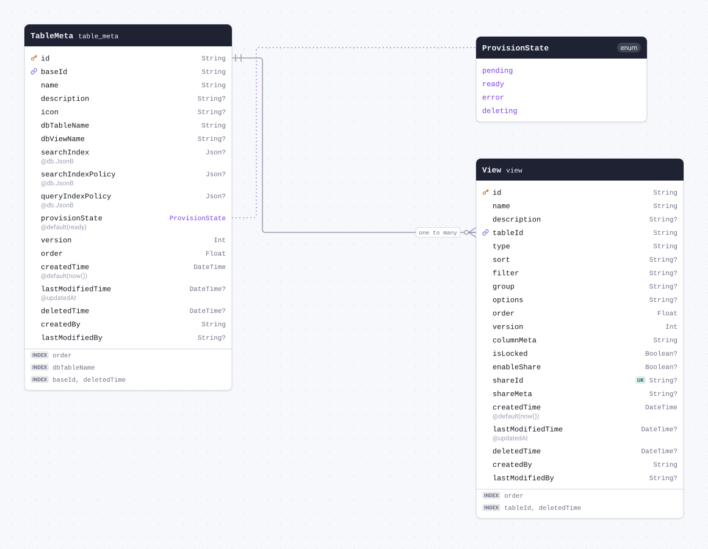

| Field                                     | Type       | Constraints                                 | Default      | Description |
| ----------------------------------------- | ---------- | ------------------------------------------- | ------------ | ----------- |
| `id`                                      | `String`   | PK NOT NULL                                 |              |             |
| `name`                                    | `String`   | NOT NULL                                    |              |             |
| `description`                             | `String`   | NULL                                        |              |             |
| `tableId` (`table_id`)                    | `String`   | NOT NULL → [TableMeta.id](#model-TableMeta) |              |             |
| `type`                                    | `String`   | NOT NULL                                    |              |             |
| `sort`                                    | `String`   | NULL                                        |              |             |
| `filter`                                  | `String`   | NULL                                        |              |             |
| `group`                                   | `String`   | NULL                                        |              |             |
| `options`                                 | `String`   | NULL                                        |              |             |
| `order`                                   | `Float`    | NOT NULL                                    |              |             |
| `version`                                 | `Int`      | NOT NULL                                    |              |             |
| `columnMeta` (`column_meta`)              | `String`   | NOT NULL                                    |              |             |
| `isLocked` (`is_locked`)                  | `Boolean`  | NULL                                        |              |             |
| `enableShare` (`enable_share`)            | `Boolean`  | NULL                                        |              |             |
| `shareId` (`share_id`)                    | `String`   | UNIQUE NULL                                 |              |             |
| `shareMeta` (`share_meta`)                | `String`   | NULL                                        |              |             |
| `createdTime` (`created_time`)            | `DateTime` | NOT NULL                                    | `now()`      |             |
| `lastModifiedTime` (`last_modified_time`) | `DateTime` | NULL                                        | `@updatedAt` |             |
| `deletedTime` (`deleted_time`)            | `DateTime` | NULL                                        |              |             |
| `createdBy` (`created_by`)                | `String`   | NOT NULL                                    |              |             |
| `lastModifiedBy` (`last_modified_by`)     | `String`   | NULL                                        |              |             |

#### Indexes

- `@@index([order])`
- `@@index([tableId, deletedTime])`

#### References

- `tableId` → [TableMeta.id](#model-TableMeta) (many-to-one)

#### Definition

```sql
CREATE TABLE "view" (
    "id" TEXT NOT NULL,
    "name" TEXT NOT NULL,
    "description" TEXT,
    "table_id" TEXT NOT NULL,
    "type" TEXT NOT NULL,
    "sort" TEXT,
    "filter" TEXT,
    "group" TEXT,
    "options" TEXT,
    "order" DOUBLE PRECISION NOT NULL,
    "version" INTEGER NOT NULL,
    "column_meta" TEXT NOT NULL,
    "is_locked" BOOLEAN,
    "enable_share" BOOLEAN,
    "share_id" TEXT,
    "share_meta" TEXT,
    "created_time" TIMESTAMP(3) NOT NULL DEFAULT CURRENT_TIMESTAMP,
    "last_modified_time" TIMESTAMP(3),
    "deleted_time" TIMESTAMP(3),
    "created_by" TEXT NOT NULL,
    "last_modified_by" TEXT,

    CONSTRAINT "view_pkey" PRIMARY KEY ("id")
);

CREATE UNIQUE INDEX "view_share_id_key" ON "view"("share_id");

CREATE INDEX "view_order_idx" ON "view"("order");

CREATE INDEX "view_table_id_deleted_time_idx" ON "view"("table_id", "deleted_time");

ALTER TABLE "view" ADD CONSTRAINT "view_table_id_fkey" FOREIGN KEY ("table_id") REFERENCES "table_meta"("id") ON DELETE RESTRICT ON UPDATE CASCADE;
```

<details>
<summary>Queries and their SQL</summary>

**findMany**: Every row

```ts
await prisma.view.findMany();
```

```sql
SELECT
  "public"."view"."id",
  "public"."view"."name",
  "public"."view"."description",
  "public"."view"."table_id",
  "public"."view"."type",
  "public"."view"."sort",
  "public"."view"."filter",
  "public"."view"."group",
  "public"."view"."options",
  "public"."view"."order",
  "public"."view"."version",
  "public"."view"."column_meta",
  "public"."view"."is_locked",
  "public"."view"."enable_share",
  "public"."view"."share_id",
  "public"."view"."share_meta",
  "public"."view"."created_time",
  "public"."view"."last_modified_time",
  "public"."view"."deleted_time",
  "public"."view"."created_by",
  "public"."view"."last_modified_by"
FROM
  "public"."view"
WHERE
  1 = 1
OFFSET
  $1
-- params: ["0"]
```

**count**: How many rows there are

```ts
await prisma.view.count();
```

```sql
SELECT
  COUNT(*) AS "_count$_all"
FROM
  (
    SELECT
      "public"."view"."id"
    FROM
      "public"."view"
    WHERE
      1 = 1
    OFFSET
      $1
  ) AS "sub"
-- params: ["0"]
```

**findMany**: Every row with its relations

```ts
await prisma.view.findMany({ include: { table: true } });
```

```sql
SELECT
  "public"."view"."id",
  "public"."view"."name",
  "public"."view"."description",
  "public"."view"."table_id",
  "public"."view"."type",
  "public"."view"."sort",
  "public"."view"."filter",
  "public"."view"."group",
  "public"."view"."options",
  "public"."view"."order",
  "public"."view"."version",
  "public"."view"."column_meta",
  "public"."view"."is_locked",
  "public"."view"."enable_share",
  "public"."view"."share_id",
  "public"."view"."share_meta",
  "public"."view"."created_time",
  "public"."view"."last_modified_time",
  "public"."view"."deleted_time",
  "public"."view"."created_by",
  "public"."view"."last_modified_by"
FROM
  "public"."view"
WHERE
  1 = 1
OFFSET
  $1
-- params: ["0"]

SELECT
  "public"."table_meta"."id",
  "public"."table_meta"."base_id",
  "public"."table_meta"."name",
  "public"."table_meta"."description",
  "public"."table_meta"."icon",
  "public"."table_meta"."db_table_name",
  "public"."table_meta"."db_view_name",
  "public"."table_meta"."search_index",
  "public"."table_meta"."search_index_policy",
  "public"."table_meta"."query_index_policy",
  "public"."table_meta"."provision_state"::text,
  "public"."table_meta"."version",
  "public"."table_meta"."order",
  "public"."table_meta"."created_time",
  "public"."table_meta"."last_modified_time",
  "public"."table_meta"."deleted_time",
  "public"."table_meta"."created_by",
  "public"."table_meta"."last_modified_by"
FROM
  "public"."table_meta"
WHERE
  "public"."table_meta"."id" IN ($1)
OFFSET
  $2
-- params: ["<tableId of the rows above>","0"]
```

**findUnique**: One row by what is unique to it

```ts
await prisma.view.findUnique({ where: { id: "example" } });
```

```sql
SELECT
  "public"."view"."id",
  "public"."view"."name",
  "public"."view"."description",
  "public"."view"."table_id",
  "public"."view"."type",
  "public"."view"."sort",
  "public"."view"."filter",
  "public"."view"."group",
  "public"."view"."options",
  "public"."view"."order",
  "public"."view"."version",
  "public"."view"."column_meta",
  "public"."view"."is_locked",
  "public"."view"."enable_share",
  "public"."view"."share_id",
  "public"."view"."share_meta",
  "public"."view"."created_time",
  "public"."view"."last_modified_time",
  "public"."view"."deleted_time",
  "public"."view"."created_by",
  "public"."view"."last_modified_by"
FROM
  "public"."view"
WHERE
  (
    "public"."view"."id" = $1
    AND 1 = 1
  )
LIMIT
  $2
OFFSET
  $3
-- params: ["example","1","0"]
```

**create**: Create a row

```ts
await prisma.view.create({
  data: {
    id: "example",
    name: "example",
    tableId: "example",
    type: "example",
    order: 1.5,
    version: 1,
    columnMeta: "example",
    createdBy: "example",
  },
});
```

```sql
INSERT INTO
  "public"."view" (
    "id",
    "name",
    "table_id",
    "type",
    "order",
    "version",
    "column_meta",
    "created_time",
    "last_modified_time",
    "created_by"
  )
VALUES
  ($1, $2, $3, $4, $5, $6, $7, $8, $9, $10)
RETURNING
  "public"."view"."id",
  "public"."view"."name",
  "public"."view"."description",
  "public"."view"."table_id",
  "public"."view"."type",
  "public"."view"."sort",
  "public"."view"."filter",
  "public"."view"."group",
  "public"."view"."options",
  "public"."view"."order",
  "public"."view"."version",
  "public"."view"."column_meta",
  "public"."view"."is_locked",
  "public"."view"."enable_share",
  "public"."view"."share_id",
  "public"."view"."share_meta",
  "public"."view"."created_time",
  "public"."view"."last_modified_time",
  "public"."view"."deleted_time",
  "public"."view"."created_by",
  "public"."view"."last_modified_by"
-- params: ["example","example","example","example","1.5","1","example","<now()>","<now()>","example"]
```

**update**: Update a row

```ts
await prisma.view.update({ where: { id: "example" }, data: { name: "example" } });
```

```sql
UPDATE "public"."view"
SET
  "name" = $1,
  "last_modified_time" = $2
WHERE
  (
    "public"."view"."id" = $3
    AND 1 = 1
  )
RETURNING
  "public"."view"."id",
  "public"."view"."name",
  "public"."view"."description",
  "public"."view"."table_id",
  "public"."view"."type",
  "public"."view"."sort",
  "public"."view"."filter",
  "public"."view"."group",
  "public"."view"."options",
  "public"."view"."order",
  "public"."view"."version",
  "public"."view"."column_meta",
  "public"."view"."is_locked",
  "public"."view"."enable_share",
  "public"."view"."share_id",
  "public"."view"."share_meta",
  "public"."view"."created_time",
  "public"."view"."last_modified_time",
  "public"."view"."deleted_time",
  "public"."view"."created_by",
  "public"."view"."last_modified_by"
-- params: ["example",{"prisma__type":"generatorCall","prisma__value":{"name":"now","args":[],"returnType":{"type":"DateTime"}}},"example"]
```

**delete**: Delete a row

```ts
await prisma.view.delete({ where: { id: "example" } });
```

```sql
DELETE FROM "public"."view"
WHERE
  (
    "public"."view"."id" = $1
    AND 1 = 1
  )
RETURNING
  "public"."view"."id",
  "public"."view"."name",
  "public"."view"."description",
  "public"."view"."table_id",
  "public"."view"."type",
  "public"."view"."sort",
  "public"."view"."filter",
  "public"."view"."group",
  "public"."view"."options",
  "public"."view"."order",
  "public"."view"."version",
  "public"."view"."column_meta",
  "public"."view"."is_locked",
  "public"."view"."enable_share",
  "public"."view"."share_id",
  "public"."view"."share_meta",
  "public"."view"."created_time",
  "public"."view"."last_modified_time",
  "public"."view"."deleted_time",
  "public"."view"."created_by",
  "public"."view"."last_modified_by"
-- params: ["example"]
```

</details>

<a id="model-Ops"></a>

### Ops

Table `ops`.

| Field                          | Type       | Constraints | Default   | Description |
| ------------------------------ | ---------- | ----------- | --------- | ----------- |
| `id`                           | `String`   | PK NOT NULL | `cuid(1)` |             |
| `collection`                   | `String`   | NOT NULL    |           |             |
| `docId` (`doc_id`)             | `String`   | NOT NULL    |           |             |
| `docType` (`doc_type`)         | `String`   | NOT NULL    |           |             |
| `version`                      | `Int`      | NOT NULL    |           |             |
| `operation`                    | `String`   | NOT NULL    |           |             |
| `createdTime` (`created_time`) | `DateTime` | NOT NULL    | `now()`   |             |
| `createdBy` (`created_by`)     | `String`   | NOT NULL    |           |             |

#### Indexes

- `@@index([collection, createdTime])`
- `@@unique([collection, docId, version])`

#### Definition

```sql
CREATE TABLE "ops" (
    "id" TEXT NOT NULL,
    "collection" TEXT NOT NULL,
    "doc_id" TEXT NOT NULL,
    "doc_type" TEXT NOT NULL,
    "version" INTEGER NOT NULL,
    "operation" TEXT NOT NULL,
    "created_time" TIMESTAMP(3) NOT NULL DEFAULT CURRENT_TIMESTAMP,
    "created_by" TEXT NOT NULL,

    CONSTRAINT "ops_pkey" PRIMARY KEY ("id")
);

CREATE INDEX "ops_collection_created_time_idx" ON "ops"("collection", "created_time");

CREATE UNIQUE INDEX "ops_collection_doc_id_version_key" ON "ops"("collection", "doc_id", "version");
```

<details>
<summary>Queries and their SQL</summary>

**findMany**: Every row

```ts
await prisma.ops.findMany();
```

```sql
SELECT
  "public"."ops"."id",
  "public"."ops"."collection",
  "public"."ops"."doc_id",
  "public"."ops"."doc_type",
  "public"."ops"."version",
  "public"."ops"."operation",
  "public"."ops"."created_time",
  "public"."ops"."created_by"
FROM
  "public"."ops"
WHERE
  1 = 1
OFFSET
  $1
-- params: ["0"]
```

**count**: How many rows there are

```ts
await prisma.ops.count();
```

```sql
SELECT
  COUNT(*) AS "_count$_all"
FROM
  (
    SELECT
      "public"."ops"."id"
    FROM
      "public"."ops"
    WHERE
      1 = 1
    OFFSET
      $1
  ) AS "sub"
-- params: ["0"]
```

**findUnique**: One row by what is unique to it

```ts
await prisma.ops.findUnique({ where: { id: "example" } });
```

```sql
SELECT
  "public"."ops"."id",
  "public"."ops"."collection",
  "public"."ops"."doc_id",
  "public"."ops"."doc_type",
  "public"."ops"."version",
  "public"."ops"."operation",
  "public"."ops"."created_time",
  "public"."ops"."created_by"
FROM
  "public"."ops"
WHERE
  (
    "public"."ops"."id" = $1
    AND 1 = 1
  )
LIMIT
  $2
OFFSET
  $3
-- params: ["example","1","0"]
```

**create**: Create a row

```ts
await prisma.ops.create({
  data: {
    collection: "example",
    docId: "example",
    docType: "example",
    version: 1,
    operation: "example",
    createdBy: "example",
  },
});
```

```sql
INSERT INTO
  "public"."ops" (
    "id",
    "collection",
    "doc_id",
    "doc_type",
    "version",
    "operation",
    "created_time",
    "created_by"
  )
VALUES
  ($1, $2, $3, $4, $5, $6, $7, $8)
RETURNING
  "public"."ops"."id",
  "public"."ops"."collection",
  "public"."ops"."doc_id",
  "public"."ops"."doc_type",
  "public"."ops"."version",
  "public"."ops"."operation",
  "public"."ops"."created_time",
  "public"."ops"."created_by"
-- params: ["<cuid(1)>","example","example","example","1","example","<now()>","example"]
```

**update**: Update a row

```ts
await prisma.ops.update({ where: { id: "example" }, data: { collection: "example" } });
```

```sql
UPDATE "public"."ops"
SET
  "collection" = $1
WHERE
  (
    "public"."ops"."id" = $2
    AND 1 = 1
  )
RETURNING
  "public"."ops"."id",
  "public"."ops"."collection",
  "public"."ops"."doc_id",
  "public"."ops"."doc_type",
  "public"."ops"."version",
  "public"."ops"."operation",
  "public"."ops"."created_time",
  "public"."ops"."created_by"
-- params: ["example","example"]
```

**delete**: Delete a row

```ts
await prisma.ops.delete({ where: { id: "example" } });
```

```sql
DELETE FROM "public"."ops"
WHERE
  (
    "public"."ops"."id" = $1
    AND 1 = 1
  )
RETURNING
  "public"."ops"."id",
  "public"."ops"."collection",
  "public"."ops"."doc_id",
  "public"."ops"."doc_type",
  "public"."ops"."version",
  "public"."ops"."operation",
  "public"."ops"."created_time",
  "public"."ops"."created_by"
-- params: ["example"]
```

</details>

<a id="model-Reference"></a>

### Reference

Table `reference`.

| Field                           | Type       | Constraints | Default   | Description |
| ------------------------------- | ---------- | ----------- | --------- | ----------- |
| `id`                            | `String`   | PK NOT NULL | `cuid(1)` |             |
| `fromFieldId` (`from_field_id`) | `String`   | NOT NULL    |           |             |
| `toFieldId` (`to_field_id`)     | `String`   | NOT NULL    |           |             |
| `createdTime` (`created_time`)  | `DateTime` | NOT NULL    | `now()`   |             |

#### Indexes

- `@@index([fromFieldId])`
- `@@index([toFieldId])`
- `@@unique([toFieldId, fromFieldId])`

#### Definition

```sql
CREATE TABLE "reference" (
    "id" TEXT NOT NULL,
    "from_field_id" TEXT NOT NULL,
    "to_field_id" TEXT NOT NULL,
    "created_time" TIMESTAMP(3) NOT NULL DEFAULT CURRENT_TIMESTAMP,

    CONSTRAINT "reference_pkey" PRIMARY KEY ("id")
);

CREATE INDEX "reference_from_field_id_idx" ON "reference"("from_field_id");

CREATE INDEX "reference_to_field_id_idx" ON "reference"("to_field_id");

CREATE UNIQUE INDEX "reference_to_field_id_from_field_id_key" ON "reference"("to_field_id", "from_field_id");
```

<details>
<summary>Queries and their SQL</summary>

**findMany**: Every row

```ts
await prisma.reference.findMany();
```

```sql
SELECT
  "public"."reference"."id",
  "public"."reference"."from_field_id",
  "public"."reference"."to_field_id",
  "public"."reference"."created_time"
FROM
  "public"."reference"
WHERE
  1 = 1
OFFSET
  $1
-- params: ["0"]
```

**count**: How many rows there are

```ts
await prisma.reference.count();
```

```sql
SELECT
  COUNT(*) AS "_count$_all"
FROM
  (
    SELECT
      "public"."reference"."id"
    FROM
      "public"."reference"
    WHERE
      1 = 1
    OFFSET
      $1
  ) AS "sub"
-- params: ["0"]
```

**findUnique**: One row by what is unique to it

```ts
await prisma.reference.findUnique({ where: { id: "example" } });
```

```sql
SELECT
  "public"."reference"."id",
  "public"."reference"."from_field_id",
  "public"."reference"."to_field_id",
  "public"."reference"."created_time"
FROM
  "public"."reference"
WHERE
  (
    "public"."reference"."id" = $1
    AND 1 = 1
  )
LIMIT
  $2
OFFSET
  $3
-- params: ["example","1","0"]
```

**create**: Create a row

```ts
await prisma.reference.create({ data: { fromFieldId: "example", toFieldId: "example" } });
```

```sql
INSERT INTO
  "public"."reference" (
    "id",
    "from_field_id",
    "to_field_id",
    "created_time"
  )
VALUES
  ($1, $2, $3, $4)
RETURNING
  "public"."reference"."id",
  "public"."reference"."from_field_id",
  "public"."reference"."to_field_id",
  "public"."reference"."created_time"
-- params: ["<cuid(1)>","example","example","<now()>"]
```

**update**: Update a row

```ts
await prisma.reference.update({ where: { id: "example" }, data: { fromFieldId: "example" } });
```

```sql
UPDATE "public"."reference"
SET
  "from_field_id" = $1
WHERE
  (
    "public"."reference"."id" = $2
    AND 1 = 1
  )
RETURNING
  "public"."reference"."id",
  "public"."reference"."from_field_id",
  "public"."reference"."to_field_id",
  "public"."reference"."created_time"
-- params: ["example","example"]
```

**delete**: Delete a row

```ts
await prisma.reference.delete({ where: { id: "example" } });
```

```sql
DELETE FROM "public"."reference"
WHERE
  (
    "public"."reference"."id" = $1
    AND 1 = 1
  )
RETURNING
  "public"."reference"."id",
  "public"."reference"."from_field_id",
  "public"."reference"."to_field_id",
  "public"."reference"."created_time"
-- params: ["example"]
```

</details>

<a id="model-User"></a>

### User

Table `users`.

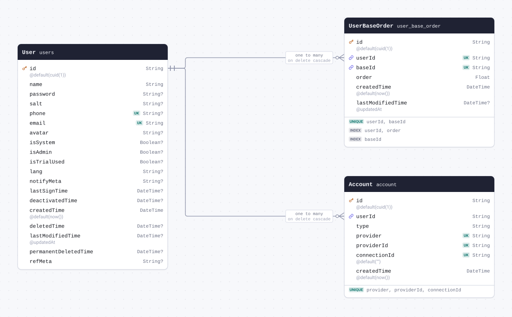

| Field                                             | Type       | Constraints     | Default      | Description |
| ------------------------------------------------- | ---------- | --------------- | ------------ | ----------- |
| `id`                                              | `String`   | PK NOT NULL     | `cuid(1)`    |             |
| `name`                                            | `String`   | NOT NULL        |              |             |
| `password`                                        | `String`   | NULL            |              |             |
| `salt`                                            | `String`   | NULL            |              |             |
| `phone`                                           | `String`   | UNIQUE NULL     |              |             |
| `email`                                           | `String`   | UNIQUE NOT NULL |              |             |
| `avatar`                                          | `String`   | NULL            |              |             |
| `isSystem` (`is_system`)                          | `Boolean`  | NULL            |              |             |
| `isAdmin` (`is_admin`)                            | `Boolean`  | NULL            |              |             |
| `isTrialUsed` (`is_trial_used`)                   | `Boolean`  | NULL            |              |             |
| `lang` (`lang`)                                   | `String`   | NULL            |              |             |
| `notifyMeta` (`notify_meta`)                      | `String`   | NULL            |              |             |
| `lastSignTime` (`last_sign_time`)                 | `DateTime` | NULL            |              |             |
| `deactivatedTime` (`deactivated_time`)            | `DateTime` | NULL            |              |             |
| `createdTime` (`created_time`)                    | `DateTime` | NOT NULL        | `now()`      |             |
| `deletedTime` (`deleted_time`)                    | `DateTime` | NULL            |              |             |
| `lastModifiedTime` (`last_modified_time`)         | `DateTime` | NULL            | `@updatedAt` |             |
| `permanentDeletedTime` (`permanent_deleted_time`) | `DateTime` | NULL            |              |             |
| `refMeta` (`ref_meta`)                            | `String`   | NULL            |              |             |

#### Referenced by

- `id` ← [Account.userId](#model-Account) (one-to-many, on delete Cascade)
- `id` ← [UserBaseOrder.userId](#model-UserBaseOrder) (one-to-many, on delete Cascade)

#### Definition

```sql
CREATE TABLE "users" (
    "id" TEXT NOT NULL,
    "name" TEXT NOT NULL,
    "password" TEXT,
    "salt" TEXT,
    "phone" TEXT,
    "email" TEXT NOT NULL,
    "avatar" TEXT,
    "is_system" BOOLEAN,
    "is_admin" BOOLEAN,
    "is_trial_used" BOOLEAN,
    "lang" TEXT,
    "notify_meta" TEXT,
    "last_sign_time" TIMESTAMP(3),
    "deactivated_time" TIMESTAMP(3),
    "created_time" TIMESTAMP(3) NOT NULL DEFAULT CURRENT_TIMESTAMP,
    "deleted_time" TIMESTAMP(3),
    "last_modified_time" TIMESTAMP(3),
    "permanent_deleted_time" TIMESTAMP(3),
    "ref_meta" TEXT,

    CONSTRAINT "users_pkey" PRIMARY KEY ("id")
);

CREATE UNIQUE INDEX "users_phone_key" ON "users"("phone");

CREATE UNIQUE INDEX "users_email_key" ON "users"("email");
```

<details>
<summary>Queries and their SQL</summary>

**findMany**: Every row

```ts
await prisma.user.findMany();
```

```sql
SELECT
  "public"."users"."id",
  "public"."users"."name",
  "public"."users"."password",
  "public"."users"."salt",
  "public"."users"."phone",
  "public"."users"."email",
  "public"."users"."avatar",
  "public"."users"."is_system",
  "public"."users"."is_admin",
  "public"."users"."is_trial_used",
  "public"."users"."lang",
  "public"."users"."notify_meta",
  "public"."users"."last_sign_time",
  "public"."users"."deactivated_time",
  "public"."users"."created_time",
  "public"."users"."deleted_time",
  "public"."users"."last_modified_time",
  "public"."users"."permanent_deleted_time",
  "public"."users"."ref_meta"
FROM
  "public"."users"
WHERE
  1 = 1
OFFSET
  $1
-- params: ["0"]
```

**count**: How many rows there are

```ts
await prisma.user.count();
```

```sql
SELECT
  COUNT(*) AS "_count$_all"
FROM
  (
    SELECT
      "public"."users"."id"
    FROM
      "public"."users"
    WHERE
      1 = 1
    OFFSET
      $1
  ) AS "sub"
-- params: ["0"]
```

**findMany**: Every row with its relations

```ts
await prisma.user.findMany({ include: { accounts: true, baseOrders: true } });
```

```sql
SELECT
  "public"."users"."id",
  "public"."users"."name",
  "public"."users"."password",
  "public"."users"."salt",
  "public"."users"."phone",
  "public"."users"."email",
  "public"."users"."avatar",
  "public"."users"."is_system",
  "public"."users"."is_admin",
  "public"."users"."is_trial_used",
  "public"."users"."lang",
  "public"."users"."notify_meta",
  "public"."users"."last_sign_time",
  "public"."users"."deactivated_time",
  "public"."users"."created_time",
  "public"."users"."deleted_time",
  "public"."users"."last_modified_time",
  "public"."users"."permanent_deleted_time",
  "public"."users"."ref_meta"
FROM
  "public"."users"
WHERE
  1 = 1
OFFSET
  $1
-- params: ["0"]

SELECT
  "public"."account"."id",
  "public"."account"."user_id",
  "public"."account"."type",
  "public"."account"."provider",
  "public"."account"."provider_id",
  "public"."account"."connection_id",
  "public"."account"."created_time"
FROM
  "public"."account"
WHERE
  "public"."account"."user_id" IN ($1)
OFFSET
  $2
-- params: ["<id of the rows above>","0"]

SELECT
  "public"."user_base_order"."id",
  "public"."user_base_order"."user_id",
  "public"."user_base_order"."base_id",
  "public"."user_base_order"."order",
  "public"."user_base_order"."created_time",
  "public"."user_base_order"."last_modified_time"
FROM
  "public"."user_base_order"
WHERE
  "public"."user_base_order"."user_id" IN ($1)
OFFSET
  $2
-- params: ["<id of the rows above>","0"]
```

**findUnique**: One row by what is unique to it

```ts
await prisma.user.findUnique({ where: { id: "example" } });
```

```sql
SELECT
  "public"."users"."id",
  "public"."users"."name",
  "public"."users"."password",
  "public"."users"."salt",
  "public"."users"."phone",
  "public"."users"."email",
  "public"."users"."avatar",
  "public"."users"."is_system",
  "public"."users"."is_admin",
  "public"."users"."is_trial_used",
  "public"."users"."lang",
  "public"."users"."notify_meta",
  "public"."users"."last_sign_time",
  "public"."users"."deactivated_time",
  "public"."users"."created_time",
  "public"."users"."deleted_time",
  "public"."users"."last_modified_time",
  "public"."users"."permanent_deleted_time",
  "public"."users"."ref_meta"
FROM
  "public"."users"
WHERE
  (
    "public"."users"."id" = $1
    AND 1 = 1
  )
LIMIT
  $2
OFFSET
  $3
-- params: ["example","1","0"]
```

**create**: Create a row

```ts
await prisma.user.create({ data: { name: "example", email: "example" } });
```

```sql
INSERT INTO
  "public"."users" (
    "id",
    "name",
    "email",
    "created_time",
    "last_modified_time"
  )
VALUES
  ($1, $2, $3, $4, $5)
RETURNING
  "public"."users"."id",
  "public"."users"."name",
  "public"."users"."password",
  "public"."users"."salt",
  "public"."users"."phone",
  "public"."users"."email",
  "public"."users"."avatar",
  "public"."users"."is_system",
  "public"."users"."is_admin",
  "public"."users"."is_trial_used",
  "public"."users"."lang",
  "public"."users"."notify_meta",
  "public"."users"."last_sign_time",
  "public"."users"."deactivated_time",
  "public"."users"."created_time",
  "public"."users"."deleted_time",
  "public"."users"."last_modified_time",
  "public"."users"."permanent_deleted_time",
  "public"."users"."ref_meta"
-- params: ["<cuid(1)>","example","example","<now()>","<now()>"]
```

**update**: Update a row

```ts
await prisma.user.update({ where: { id: "example" }, data: { name: "example" } });
```

```sql
UPDATE "public"."users"
SET
  "name" = $1,
  "last_modified_time" = $2
WHERE
  (
    "public"."users"."id" = $3
    AND 1 = 1
  )
RETURNING
  "public"."users"."id",
  "public"."users"."name",
  "public"."users"."password",
  "public"."users"."salt",
  "public"."users"."phone",
  "public"."users"."email",
  "public"."users"."avatar",
  "public"."users"."is_system",
  "public"."users"."is_admin",
  "public"."users"."is_trial_used",
  "public"."users"."lang",
  "public"."users"."notify_meta",
  "public"."users"."last_sign_time",
  "public"."users"."deactivated_time",
  "public"."users"."created_time",
  "public"."users"."deleted_time",
  "public"."users"."last_modified_time",
  "public"."users"."permanent_deleted_time",
  "public"."users"."ref_meta"
-- params: ["example",{"prisma__type":"generatorCall","prisma__value":{"name":"now","args":[],"returnType":{"type":"DateTime"}}},"example"]
```

**delete**: Delete a row

```ts
await prisma.user.delete({ where: { id: "example" } });
```

```sql
DELETE FROM "public"."users"
WHERE
  (
    "public"."users"."id" = $1
    AND 1 = 1
  )
RETURNING
  "public"."users"."id",
  "public"."users"."name",
  "public"."users"."password",
  "public"."users"."salt",
  "public"."users"."phone",
  "public"."users"."email",
  "public"."users"."avatar",
  "public"."users"."is_system",
  "public"."users"."is_admin",
  "public"."users"."is_trial_used",
  "public"."users"."lang",
  "public"."users"."notify_meta",
  "public"."users"."last_sign_time",
  "public"."users"."deactivated_time",
  "public"."users"."created_time",
  "public"."users"."deleted_time",
  "public"."users"."last_modified_time",
  "public"."users"."permanent_deleted_time",
  "public"."users"."ref_meta"
-- params: ["example"]
```

</details>

<a id="model-Account"></a>

### Account

Table `account`.

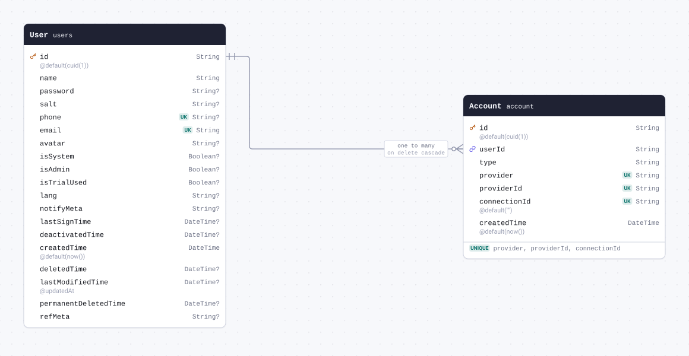

| Field                            | Type       | Constraints                       | Default   | Description |
| -------------------------------- | ---------- | --------------------------------- | --------- | ----------- |
| `id`                             | `String`   | PK NOT NULL                       | `cuid(1)` |             |
| `userId` (`user_id`)             | `String`   | NOT NULL → [User.id](#model-User) |           |             |
| `type`                           | `String`   | NOT NULL                          |           |             |
| `provider`                       | `String`   | NOT NULL                          |           |             |
| `providerId` (`provider_id`)     | `String`   | NOT NULL                          |           |             |
| `connectionId` (`connection_id`) | `String`   | NOT NULL                          | `""`      |             |
| `createdTime` (`created_time`)   | `DateTime` | NOT NULL                          | `now()`   |             |

#### Indexes

- `@@unique([provider, providerId, connectionId])`

#### References

- `userId` → [User.id](#model-User) (many-to-one, on delete Cascade)

#### Definition

```sql
CREATE TABLE "account" (
    "id" TEXT NOT NULL,
    "user_id" TEXT NOT NULL,
    "type" TEXT NOT NULL,
    "provider" TEXT NOT NULL,
    "provider_id" TEXT NOT NULL,
    "connection_id" TEXT NOT NULL DEFAULT '',
    "created_time" TIMESTAMP(3) NOT NULL DEFAULT CURRENT_TIMESTAMP,

    CONSTRAINT "account_pkey" PRIMARY KEY ("id")
);

CREATE UNIQUE INDEX "account_provider_provider_id_connection_id_key" ON "account"("provider", "provider_id", "connection_id");

ALTER TABLE "account" ADD CONSTRAINT "account_user_id_fkey" FOREIGN KEY ("user_id") REFERENCES "users"("id") ON DELETE CASCADE ON UPDATE CASCADE;
```

<details>
<summary>Queries and their SQL</summary>

**findMany**: Every row

```ts
await prisma.account.findMany();
```

```sql
SELECT
  "public"."account"."id",
  "public"."account"."user_id",
  "public"."account"."type",
  "public"."account"."provider",
  "public"."account"."provider_id",
  "public"."account"."connection_id",
  "public"."account"."created_time"
FROM
  "public"."account"
WHERE
  1 = 1
OFFSET
  $1
-- params: ["0"]
```

**count**: How many rows there are

```ts
await prisma.account.count();
```

```sql
SELECT
  COUNT(*) AS "_count$_all"
FROM
  (
    SELECT
      "public"."account"."id"
    FROM
      "public"."account"
    WHERE
      1 = 1
    OFFSET
      $1
  ) AS "sub"
-- params: ["0"]
```

**findMany**: Every row with its relations

```ts
await prisma.account.findMany({ include: { user: true } });
```

```sql
SELECT
  "public"."account"."id",
  "public"."account"."user_id",
  "public"."account"."type",
  "public"."account"."provider",
  "public"."account"."provider_id",
  "public"."account"."connection_id",
  "public"."account"."created_time"
FROM
  "public"."account"
WHERE
  1 = 1
OFFSET
  $1
-- params: ["0"]

SELECT
  "public"."users"."id",
  "public"."users"."name",
  "public"."users"."password",
  "public"."users"."salt",
  "public"."users"."phone",
  "public"."users"."email",
  "public"."users"."avatar",
  "public"."users"."is_system",
  "public"."users"."is_admin",
  "public"."users"."is_trial_used",
  "public"."users"."lang",
  "public"."users"."notify_meta",
  "public"."users"."last_sign_time",
  "public"."users"."deactivated_time",
  "public"."users"."created_time",
  "public"."users"."deleted_time",
  "public"."users"."last_modified_time",
  "public"."users"."permanent_deleted_time",
  "public"."users"."ref_meta"
FROM
  "public"."users"
WHERE
  "public"."users"."id" IN ($1)
OFFSET
  $2
-- params: ["<userId of the rows above>","0"]
```

**findUnique**: One row by what is unique to it

```ts
await prisma.account.findUnique({ where: { id: "example" } });
```

```sql
SELECT
  "public"."account"."id",
  "public"."account"."user_id",
  "public"."account"."type",
  "public"."account"."provider",
  "public"."account"."provider_id",
  "public"."account"."connection_id",
  "public"."account"."created_time"
FROM
  "public"."account"
WHERE
  (
    "public"."account"."id" = $1
    AND 1 = 1
  )
LIMIT
  $2
OFFSET
  $3
-- params: ["example","1","0"]
```

**create**: Create a row

```ts
await prisma.account.create({
  data: { userId: "example", type: "example", provider: "example", providerId: "example" },
});
```

```sql
INSERT INTO
  "public"."account" (
    "id",
    "user_id",
    "type",
    "provider",
    "provider_id",
    "connection_id",
    "created_time"
  )
VALUES
  ($1, $2, $3, $4, $5, $6, $7)
RETURNING
  "public"."account"."id",
  "public"."account"."user_id",
  "public"."account"."type",
  "public"."account"."provider",
  "public"."account"."provider_id",
  "public"."account"."connection_id",
  "public"."account"."created_time"
-- params: ["<cuid(1)>","example","example","example","example","","<now()>"]
```

**update**: Update a row

```ts
await prisma.account.update({ where: { id: "example" }, data: { type: "example" } });
```

```sql
UPDATE "public"."account"
SET
  "type" = $1
WHERE
  (
    "public"."account"."id" = $2
    AND 1 = 1
  )
RETURNING
  "public"."account"."id",
  "public"."account"."user_id",
  "public"."account"."type",
  "public"."account"."provider",
  "public"."account"."provider_id",
  "public"."account"."connection_id",
  "public"."account"."created_time"
-- params: ["example","example"]
```

**delete**: Delete a row

```ts
await prisma.account.delete({ where: { id: "example" } });
```

```sql
DELETE FROM "public"."account"
WHERE
  (
    "public"."account"."id" = $1
    AND 1 = 1
  )
RETURNING
  "public"."account"."id",
  "public"."account"."user_id",
  "public"."account"."type",
  "public"."account"."provider",
  "public"."account"."provider_id",
  "public"."account"."connection_id",
  "public"."account"."created_time"
-- params: ["example"]
```

</details>

<a id="model-Attachments"></a>

### Attachments

Table `attachments`.

| Field                                 | Type       | Constraints     | Default   | Description |
| ------------------------------------- | ---------- | --------------- | --------- | ----------- |
| `id`                                  | `String`   | PK NOT NULL     | `cuid(1)` |             |
| `token`                               | `String`   | UNIQUE NOT NULL |           |             |
| `hash`                                | `String`   | NOT NULL        |           |             |
| `size`                                | `BigInt`   | NOT NULL        |           |             |
| `mimetype`                            | `String`   | NOT NULL        |           |             |
| `path`                                | `String`   | NOT NULL        |           |             |
| `width`                               | `Int`      | NULL            |           |             |
| `height`                              | `Int`      | NULL            |           |             |
| `deletedTime` (`deleted_time`)        | `DateTime` | NULL            |           |             |
| `createdTime` (`created_time`)        | `DateTime` | NOT NULL        | `now()`   |             |
| `createdBy` (`created_by`)            | `String`   | NOT NULL        |           |             |
| `lastModifiedBy` (`last_modified_by`) | `String`   | NULL            |           |             |
| `thumbnailPath` (`thumbnail_path`)    | `String`   | NULL            |           |             |

#### Definition

```sql
CREATE TABLE "attachments" (
    "id" TEXT NOT NULL,
    "token" TEXT NOT NULL,
    "hash" TEXT NOT NULL,
    "size" BIGINT NOT NULL,
    "mimetype" TEXT NOT NULL,
    "path" TEXT NOT NULL,
    "width" INTEGER,
    "height" INTEGER,
    "deleted_time" TIMESTAMP(3),
    "created_time" TIMESTAMP(3) NOT NULL DEFAULT CURRENT_TIMESTAMP,
    "created_by" TEXT NOT NULL,
    "last_modified_by" TEXT,
    "thumbnail_path" TEXT,

    CONSTRAINT "attachments_pkey" PRIMARY KEY ("id")
);

CREATE UNIQUE INDEX "attachments_token_key" ON "attachments"("token");
```

<details>
<summary>Queries and their SQL</summary>

**findMany**: Every row

```ts
await prisma.attachments.findMany();
```

```sql
SELECT
  "public"."attachments"."id",
  "public"."attachments"."token",
  "public"."attachments"."hash",
  "public"."attachments"."size",
  "public"."attachments"."mimetype",
  "public"."attachments"."path",
  "public"."attachments"."width",
  "public"."attachments"."height",
  "public"."attachments"."deleted_time",
  "public"."attachments"."created_time",
  "public"."attachments"."created_by",
  "public"."attachments"."last_modified_by",
  "public"."attachments"."thumbnail_path"
FROM
  "public"."attachments"
WHERE
  1 = 1
OFFSET
  $1
-- params: ["0"]
```

**count**: How many rows there are

```ts
await prisma.attachments.count();
```

```sql
SELECT
  COUNT(*) AS "_count$_all"
FROM
  (
    SELECT
      "public"."attachments"."id"
    FROM
      "public"."attachments"
    WHERE
      1 = 1
    OFFSET
      $1
  ) AS "sub"
-- params: ["0"]
```

**findUnique**: One row by what is unique to it

```ts
await prisma.attachments.findUnique({ where: { id: "example" } });
```

```sql
SELECT
  "public"."attachments"."id",
  "public"."attachments"."token",
  "public"."attachments"."hash",
  "public"."attachments"."size",
  "public"."attachments"."mimetype",
  "public"."attachments"."path",
  "public"."attachments"."width",
  "public"."attachments"."height",
  "public"."attachments"."deleted_time",
  "public"."attachments"."created_time",
  "public"."attachments"."created_by",
  "public"."attachments"."last_modified_by",
  "public"."attachments"."thumbnail_path"
FROM
  "public"."attachments"
WHERE
  (
    "public"."attachments"."id" = $1
    AND 1 = 1
  )
LIMIT
  $2
OFFSET
  $3
-- params: ["example","1","0"]
```

**create**: Create a row

```ts
await prisma.attachments.create({
  data: {
    token: "example",
    hash: "example",
    size: 1n,
    mimetype: "example",
    path: "example",
    createdBy: "example",
  },
});
```

```sql
INSERT INTO
  "public"."attachments" (
    "id",
    "token",
    "hash",
    "size",
    "mimetype",
    "path",
    "created_time",
    "created_by"
  )
VALUES
  ($1, $2, $3, $4, $5, $6, $7, $8)
RETURNING
  "public"."attachments"."id",
  "public"."attachments"."token",
  "public"."attachments"."hash",
  "public"."attachments"."size",
  "public"."attachments"."mimetype",
  "public"."attachments"."path",
  "public"."attachments"."width",
  "public"."attachments"."height",
  "public"."attachments"."deleted_time",
  "public"."attachments"."created_time",
  "public"."attachments"."created_by",
  "public"."attachments"."last_modified_by",
  "public"."attachments"."thumbnail_path"
-- params: ["<cuid(1)>","example","example","1","example","example","<now()>","example"]
```

**update**: Update a row

```ts
await prisma.attachments.update({ where: { id: "example" }, data: { token: "example" } });
```

```sql
UPDATE "public"."attachments"
SET
  "token" = $1
WHERE
  (
    "public"."attachments"."id" = $2
    AND 1 = 1
  )
RETURNING
  "public"."attachments"."id",
  "public"."attachments"."token",
  "public"."attachments"."hash",
  "public"."attachments"."size",
  "public"."attachments"."mimetype",
  "public"."attachments"."path",
  "public"."attachments"."width",
  "public"."attachments"."height",
  "public"."attachments"."deleted_time",
  "public"."attachments"."created_time",
  "public"."attachments"."created_by",
  "public"."attachments"."last_modified_by",
  "public"."attachments"."thumbnail_path"
-- params: ["example","example"]
```

**delete**: Delete a row

```ts
await prisma.attachments.delete({ where: { id: "example" } });
```

```sql
DELETE FROM "public"."attachments"
WHERE
  (
    "public"."attachments"."id" = $1
    AND 1 = 1
  )
RETURNING
  "public"."attachments"."id",
  "public"."attachments"."token",
  "public"."attachments"."hash",
  "public"."attachments"."size",
  "public"."attachments"."mimetype",
  "public"."attachments"."path",
  "public"."attachments"."width",
  "public"."attachments"."height",
  "public"."attachments"."deleted_time",
  "public"."attachments"."created_time",
  "public"."attachments"."created_by",
  "public"."attachments"."last_modified_by",
  "public"."attachments"."thumbnail_path"
-- params: ["example"]
```

</details>

<a id="model-AttachmentsTable"></a>

### AttachmentsTable

Table `attachments_table`.

| Field                                     | Type       | Constraints | Default      | Description |
| ----------------------------------------- | ---------- | ----------- | ------------ | ----------- |
| `id`                                      | `String`   | PK NOT NULL | `cuid(1)`    |             |
| `attachmentId` (`attachment_id`)          | `String`   | NOT NULL    |              |             |
| `name`                                    | `String`   | NOT NULL    |              |             |
| `token`                                   | `String`   | NOT NULL    |              |             |
| `tableId` (`table_id`)                    | `String`   | NOT NULL    |              |             |
| `recordId` (`record_id`)                  | `String`   | NOT NULL    |              |             |
| `fieldId` (`field_id`)                    | `String`   | NOT NULL    |              |             |
| `createdTime` (`created_time`)            | `DateTime` | NOT NULL    | `now()`      |             |
| `createdBy` (`created_by`)                | `String`   | NOT NULL    |              |             |
| `lastModifiedBy` (`last_modified_by`)     | `String`   | NULL        |              |             |
| `lastModifiedTime` (`last_modified_time`) | `DateTime` | NULL        | `@updatedAt` |             |

#### Indexes

- `@@index([tableId, recordId])`
- `@@index([tableId, fieldId])`
- `@@index([attachmentId])`

#### Definition

```sql
CREATE TABLE "attachments_table" (
    "id" TEXT NOT NULL,
    "attachment_id" TEXT NOT NULL,
    "name" TEXT NOT NULL,
    "token" TEXT NOT NULL,
    "table_id" TEXT NOT NULL,
    "record_id" TEXT NOT NULL,
    "field_id" TEXT NOT NULL,
    "created_time" TIMESTAMP(3) NOT NULL DEFAULT CURRENT_TIMESTAMP,
    "created_by" TEXT NOT NULL,
    "last_modified_by" TEXT,
    "last_modified_time" TIMESTAMP(3),

    CONSTRAINT "attachments_table_pkey" PRIMARY KEY ("id")
);

CREATE INDEX "attachments_table_table_id_record_id_idx" ON "attachments_table"("table_id", "record_id");

CREATE INDEX "attachments_table_table_id_field_id_idx" ON "attachments_table"("table_id", "field_id");

CREATE INDEX "attachments_table_attachment_id_idx" ON "attachments_table"("attachment_id");
```

<details>
<summary>Queries and their SQL</summary>

**findMany**: Every row

```ts
await prisma.attachmentsTable.findMany();
```

```sql
SELECT
  "public"."attachments_table"."id",
  "public"."attachments_table"."attachment_id",
  "public"."attachments_table"."name",
  "public"."attachments_table"."token",
  "public"."attachments_table"."table_id",
  "public"."attachments_table"."record_id",
  "public"."attachments_table"."field_id",
  "public"."attachments_table"."created_time",
  "public"."attachments_table"."created_by",
  "public"."attachments_table"."last_modified_by",
  "public"."attachments_table"."last_modified_time"
FROM
  "public"."attachments_table"
WHERE
  1 = 1
OFFSET
  $1
-- params: ["0"]
```

**count**: How many rows there are

```ts
await prisma.attachmentsTable.count();
```

```sql
SELECT
  COUNT(*) AS "_count$_all"
FROM
  (
    SELECT
      "public"."attachments_table"."id"
    FROM
      "public"."attachments_table"
    WHERE
      1 = 1
    OFFSET
      $1
  ) AS "sub"
-- params: ["0"]
```

**findUnique**: One row by what is unique to it

```ts
await prisma.attachmentsTable.findUnique({ where: { id: "example" } });
```

```sql
SELECT
  "public"."attachments_table"."id",
  "public"."attachments_table"."attachment_id",
  "public"."attachments_table"."name",
  "public"."attachments_table"."token",
  "public"."attachments_table"."table_id",
  "public"."attachments_table"."record_id",
  "public"."attachments_table"."field_id",
  "public"."attachments_table"."created_time",
  "public"."attachments_table"."created_by",
  "public"."attachments_table"."last_modified_by",
  "public"."attachments_table"."last_modified_time"
FROM
  "public"."attachments_table"
WHERE
  (
    "public"."attachments_table"."id" = $1
    AND 1 = 1
  )
LIMIT
  $2
OFFSET
  $3
-- params: ["example","1","0"]
```

**create**: Create a row

```ts
await prisma.attachmentsTable.create({
  data: {
    attachmentId: "example",
    name: "example",
    token: "example",
    tableId: "example",
    recordId: "example",
    fieldId: "example",
    createdBy: "example",
  },
});
```

```sql
INSERT INTO
  "public"."attachments_table" (
    "id",
    "attachment_id",
    "name",
    "token",
    "table_id",
    "record_id",
    "field_id",
    "created_time",
    "created_by",
    "last_modified_time"
  )
VALUES
  ($1, $2, $3, $4, $5, $6, $7, $8, $9, $10)
RETURNING
  "public"."attachments_table"."id",
  "public"."attachments_table"."attachment_id",
  "public"."attachments_table"."name",
  "public"."attachments_table"."token",
  "public"."attachments_table"."table_id",
  "public"."attachments_table"."record_id",
  "public"."attachments_table"."field_id",
  "public"."attachments_table"."created_time",
  "public"."attachments_table"."created_by",
  "public"."attachments_table"."last_modified_by",
  "public"."attachments_table"."last_modified_time"
-- params: ["<cuid(1)>","example","example","example","example","example","example","<now()>","example","<now()>"]
```

**update**: Update a row

```ts
await prisma.attachmentsTable.update({
  where: { id: "example" },
  data: { attachmentId: "example" },
});
```

```sql
UPDATE "public"."attachments_table"
SET
  "attachment_id" = $1,
  "last_modified_time" = $2
WHERE
  (
    "public"."attachments_table"."id" = $3
    AND 1 = 1
  )
RETURNING
  "public"."attachments_table"."id",
  "public"."attachments_table"."attachment_id",
  "public"."attachments_table"."name",
  "public"."attachments_table"."token",
  "public"."attachments_table"."table_id",
  "public"."attachments_table"."record_id",
  "public"."attachments_table"."field_id",
  "public"."attachments_table"."created_time",
  "public"."attachments_table"."created_by",
  "public"."attachments_table"."last_modified_by",
  "public"."attachments_table"."last_modified_time"
-- params: ["example",{"prisma__type":"generatorCall","prisma__value":{"name":"now","args":[],"returnType":{"type":"DateTime"}}},"example"]
```

**delete**: Delete a row

```ts
await prisma.attachmentsTable.delete({ where: { id: "example" } });
```

```sql
DELETE FROM "public"."attachments_table"
WHERE
  (
    "public"."attachments_table"."id" = $1
    AND 1 = 1
  )
RETURNING
  "public"."attachments_table"."id",
  "public"."attachments_table"."attachment_id",
  "public"."attachments_table"."name",
  "public"."attachments_table"."token",
  "public"."attachments_table"."table_id",
  "public"."attachments_table"."record_id",
  "public"."attachments_table"."field_id",
  "public"."attachments_table"."created_time",
  "public"."attachments_table"."created_by",
  "public"."attachments_table"."last_modified_by",
  "public"."attachments_table"."last_modified_time"
-- params: ["example"]
```

</details>

<a id="model-Collaborator"></a>

### Collaborator

Table `collaborator`.

| Field                                     | Type       | Constraints | Default      | Description |
| ----------------------------------------- | ---------- | ----------- | ------------ | ----------- |
| `id`                                      | `String`   | PK NOT NULL | `cuid(1)`    |             |
| `roleName` (`role_name`)                  | `String`   | NOT NULL    |              |             |
| `resourceType` (`resource_type`)          | `String`   | NOT NULL    |              |             |
| `resourceId` (`resource_id`)              | `String`   | NOT NULL    |              |             |
| `principalId` (`principal_id`)            | `String`   | NOT NULL    |              |             |
| `principalType` (`principal_type`)        | `String`   | NOT NULL    |              |             |
| `createdBy` (`created_by`)                | `String`   | NOT NULL    |              |             |
| `createdTime` (`created_time`)            | `DateTime` | NOT NULL    | `now()`      |             |
| `lastModifiedTime` (`last_modified_time`) | `DateTime` | NULL        | `@updatedAt` |             |
| `lastModifiedBy` (`last_modified_by`)     | `String`   | NULL        |              |             |

#### Indexes

- `@@index([resourceId])`
- `@@index([principalId])`
- `@@unique([resourceType, resourceId, principalId, principalType])`

#### Definition

```sql
CREATE TABLE "collaborator" (
    "id" TEXT NOT NULL,
    "role_name" TEXT NOT NULL,
    "resource_type" TEXT NOT NULL,
    "resource_id" TEXT NOT NULL,
    "principal_id" TEXT NOT NULL,
    "principal_type" TEXT NOT NULL,
    "created_by" TEXT NOT NULL,
    "created_time" TIMESTAMP(3) NOT NULL DEFAULT CURRENT_TIMESTAMP,
    "last_modified_time" TIMESTAMP(3),
    "last_modified_by" TEXT,

    CONSTRAINT "collaborator_pkey" PRIMARY KEY ("id")
);

CREATE INDEX "collaborator_resource_id_idx" ON "collaborator"("resource_id");

CREATE INDEX "collaborator_principal_id_idx" ON "collaborator"("principal_id");

CREATE UNIQUE INDEX "collaborator_resource_type_resource_id_principal_id_princip_key" ON "collaborator"("resource_type", "resource_id", "principal_id", "principal_type");
```

<details>
<summary>Queries and their SQL</summary>

**findMany**: Every row

```ts
await prisma.collaborator.findMany();
```

```sql
SELECT
  "public"."collaborator"."id",
  "public"."collaborator"."role_name",
  "public"."collaborator"."resource_type",
  "public"."collaborator"."resource_id",
  "public"."collaborator"."principal_id",
  "public"."collaborator"."principal_type",
  "public"."collaborator"."created_by",
  "public"."collaborator"."created_time",
  "public"."collaborator"."last_modified_time",
  "public"."collaborator"."last_modified_by"
FROM
  "public"."collaborator"
WHERE
  1 = 1
OFFSET
  $1
-- params: ["0"]
```

**count**: How many rows there are

```ts
await prisma.collaborator.count();
```

```sql
SELECT
  COUNT(*) AS "_count$_all"
FROM
  (
    SELECT
      "public"."collaborator"."id"
    FROM
      "public"."collaborator"
    WHERE
      1 = 1
    OFFSET
      $1
  ) AS "sub"
-- params: ["0"]
```

**findUnique**: One row by what is unique to it

```ts
await prisma.collaborator.findUnique({ where: { id: "example" } });
```

```sql
SELECT
  "public"."collaborator"."id",
  "public"."collaborator"."role_name",
  "public"."collaborator"."resource_type",
  "public"."collaborator"."resource_id",
  "public"."collaborator"."principal_id",
  "public"."collaborator"."principal_type",
  "public"."collaborator"."created_by",
  "public"."collaborator"."created_time",
  "public"."collaborator"."last_modified_time",
  "public"."collaborator"."last_modified_by"
FROM
  "public"."collaborator"
WHERE
  (
    "public"."collaborator"."id" = $1
    AND 1 = 1
  )
LIMIT
  $2
OFFSET
  $3
-- params: ["example","1","0"]
```

**create**: Create a row

```ts
await prisma.collaborator.create({
  data: {
    roleName: "example",
    resourceType: "example",
    resourceId: "example",
    principalId: "example",
    principalType: "example",
    createdBy: "example",
  },
});
```

```sql
INSERT INTO
  "public"."collaborator" (
    "id",
    "role_name",
    "resource_type",
    "resource_id",
    "principal_id",
    "principal_type",
    "created_by",
    "created_time",
    "last_modified_time"
  )
VALUES
  ($1, $2, $3, $4, $5, $6, $7, $8, $9)
RETURNING
  "public"."collaborator"."id",
  "public"."collaborator"."role_name",
  "public"."collaborator"."resource_type",
  "public"."collaborator"."resource_id",
  "public"."collaborator"."principal_id",
  "public"."collaborator"."principal_type",
  "public"."collaborator"."created_by",
  "public"."collaborator"."created_time",
  "public"."collaborator"."last_modified_time",
  "public"."collaborator"."last_modified_by"
-- params: ["<cuid(1)>","example","example","example","example","example","example","<now()>","<now()>"]
```

**update**: Update a row

```ts
await prisma.collaborator.update({ where: { id: "example" }, data: { roleName: "example" } });
```

```sql
UPDATE "public"."collaborator"
SET
  "role_name" = $1,
  "last_modified_time" = $2
WHERE
  (
    "public"."collaborator"."id" = $3
    AND 1 = 1
  )
RETURNING
  "public"."collaborator"."id",
  "public"."collaborator"."role_name",
  "public"."collaborator"."resource_type",
  "public"."collaborator"."resource_id",
  "public"."collaborator"."principal_id",
  "public"."collaborator"."principal_type",
  "public"."collaborator"."created_by",
  "public"."collaborator"."created_time",
  "public"."collaborator"."last_modified_time",
  "public"."collaborator"."last_modified_by"
-- params: ["example",{"prisma__type":"generatorCall","prisma__value":{"name":"now","args":[],"returnType":{"type":"DateTime"}}},"example"]
```

**delete**: Delete a row

```ts
await prisma.collaborator.delete({ where: { id: "example" } });
```

```sql
DELETE FROM "public"."collaborator"
WHERE
  (
    "public"."collaborator"."id" = $1
    AND 1 = 1
  )
RETURNING
  "public"."collaborator"."id",
  "public"."collaborator"."role_name",
  "public"."collaborator"."resource_type",
  "public"."collaborator"."resource_id",
  "public"."collaborator"."principal_id",
  "public"."collaborator"."principal_type",
  "public"."collaborator"."created_by",
  "public"."collaborator"."created_time",
  "public"."collaborator"."last_modified_time",
  "public"."collaborator"."last_modified_by"
-- params: ["example"]
```

</details>

<a id="model-Invitation"></a>

### Invitation

Table `invitation`.

| Field                                     | Type       | Constraints | Default      | Description |
| ----------------------------------------- | ---------- | ----------- | ------------ | ----------- |
| `id`                                      | `String`   | PK NOT NULL | `cuid(1)`    |             |
| `baseId` (`base_id`)                      | `String`   | NULL        |              |             |
| `spaceId` (`space_id`)                    | `String`   | NULL        |              |             |
| `type` (`type`)                           | `String`   | NOT NULL    |              |             |
| `role`                                    | `String`   | NOT NULL    |              |             |
| `invitationCode` (`invitation_code`)      | `String`   | NOT NULL    |              |             |
| `expiredTime` (`expired_time`)            | `DateTime` | NULL        |              |             |
| `createdBy` (`create_by`)                 | `String`   | NOT NULL    |              |             |
| `createdTime` (`created_time`)            | `DateTime` | NOT NULL    | `now()`      |             |
| `lastModifiedTime` (`last_modified_time`) | `DateTime` | NULL        | `@updatedAt` |             |
| `lastModifiedBy` (`last_modified_by`)     | `String`   | NULL        |              |             |
| `deletedTime` (`deleted_time`)            | `DateTime` | NULL        |              |             |

#### Indexes

- `@@index([baseId])`
- `@@index([spaceId])`

#### Definition

```sql
CREATE TABLE "invitation" (
    "id" TEXT NOT NULL,
    "base_id" TEXT,
    "space_id" TEXT,
    "type" TEXT NOT NULL,
    "role" TEXT NOT NULL,
    "invitation_code" TEXT NOT NULL,
    "expired_time" TIMESTAMP(3),
    "create_by" TEXT NOT NULL,
    "created_time" TIMESTAMP(3) NOT NULL DEFAULT CURRENT_TIMESTAMP,
    "last_modified_time" TIMESTAMP(3),
    "last_modified_by" TEXT,
    "deleted_time" TIMESTAMP(3),

    CONSTRAINT "invitation_pkey" PRIMARY KEY ("id")
);

CREATE INDEX "invitation_base_id_idx" ON "invitation"("base_id");

CREATE INDEX "invitation_space_id_idx" ON "invitation"("space_id");
```

<details>
<summary>Queries and their SQL</summary>

**findMany**: Every row

```ts
await prisma.invitation.findMany();
```

```sql
SELECT
  "public"."invitation"."id",
  "public"."invitation"."base_id",
  "public"."invitation"."space_id",
  "public"."invitation"."type",
  "public"."invitation"."role",
  "public"."invitation"."invitation_code",
  "public"."invitation"."expired_time",
  "public"."invitation"."create_by",
  "public"."invitation"."created_time",
  "public"."invitation"."last_modified_time",
  "public"."invitation"."last_modified_by",
  "public"."invitation"."deleted_time"
FROM
  "public"."invitation"
WHERE
  1 = 1
OFFSET
  $1
-- params: ["0"]
```

**count**: How many rows there are

```ts
await prisma.invitation.count();
```

```sql
SELECT
  COUNT(*) AS "_count$_all"
FROM
  (
    SELECT
      "public"."invitation"."id"
    FROM
      "public"."invitation"
    WHERE
      1 = 1
    OFFSET
      $1
  ) AS "sub"
-- params: ["0"]
```

**findUnique**: One row by what is unique to it

```ts
await prisma.invitation.findUnique({ where: { id: "example" } });
```

```sql
SELECT
  "public"."invitation"."id",
  "public"."invitation"."base_id",
  "public"."invitation"."space_id",
  "public"."invitation"."type",
  "public"."invitation"."role",
  "public"."invitation"."invitation_code",
  "public"."invitation"."expired_time",
  "public"."invitation"."create_by",
  "public"."invitation"."created_time",
  "public"."invitation"."last_modified_time",
  "public"."invitation"."last_modified_by",
  "public"."invitation"."deleted_time"
FROM
  "public"."invitation"
WHERE
  (
    "public"."invitation"."id" = $1
    AND 1 = 1
  )
LIMIT
  $2
OFFSET
  $3
-- params: ["example","1","0"]
```

**create**: Create a row

```ts
await prisma.invitation.create({
  data: { type: "example", role: "example", invitationCode: "example", createdBy: "example" },
});
```

```sql
INSERT INTO
  "public"."invitation" (
    "id",
    "type",
    "role",
    "invitation_code",
    "create_by",
    "created_time",
    "last_modified_time"
  )
VALUES
  ($1, $2, $3, $4, $5, $6, $7)
RETURNING
  "public"."invitation"."id",
  "public"."invitation"."base_id",
  "public"."invitation"."space_id",
  "public"."invitation"."type",
  "public"."invitation"."role",
  "public"."invitation"."invitation_code",
  "public"."invitation"."expired_time",
  "public"."invitation"."create_by",
  "public"."invitation"."created_time",
  "public"."invitation"."last_modified_time",
  "public"."invitation"."last_modified_by",
  "public"."invitation"."deleted_time"
-- params: ["<cuid(1)>","example","example","example","example","<now()>","<now()>"]
```

**update**: Update a row

```ts
await prisma.invitation.update({ where: { id: "example" }, data: { baseId: "example" } });
```

```sql
UPDATE "public"."invitation"
SET
  "base_id" = $1,
  "last_modified_time" = $2
WHERE
  (
    "public"."invitation"."id" = $3
    AND 1 = 1
  )
RETURNING
  "public"."invitation"."id",
  "public"."invitation"."base_id",
  "public"."invitation"."space_id",
  "public"."invitation"."type",
  "public"."invitation"."role",
  "public"."invitation"."invitation_code",
  "public"."invitation"."expired_time",
  "public"."invitation"."create_by",
  "public"."invitation"."created_time",
  "public"."invitation"."last_modified_time",
  "public"."invitation"."last_modified_by",
  "public"."invitation"."deleted_time"
-- params: ["example",{"prisma__type":"generatorCall","prisma__value":{"name":"now","args":[],"returnType":{"type":"DateTime"}}},"example"]
```

**delete**: Delete a row

```ts
await prisma.invitation.delete({ where: { id: "example" } });
```

```sql
DELETE FROM "public"."invitation"
WHERE
  (
    "public"."invitation"."id" = $1
    AND 1 = 1
  )
RETURNING
  "public"."invitation"."id",
  "public"."invitation"."base_id",
  "public"."invitation"."space_id",
  "public"."invitation"."type",
  "public"."invitation"."role",
  "public"."invitation"."invitation_code",
  "public"."invitation"."expired_time",
  "public"."invitation"."create_by",
  "public"."invitation"."created_time",
  "public"."invitation"."last_modified_time",
  "public"."invitation"."last_modified_by",
  "public"."invitation"."deleted_time"
-- params: ["example"]
```

</details>

<a id="model-InvitationRecord"></a>

### InvitationRecord

Table `invitation_record`.

| Field                            | Type       | Constraints | Default   | Description |
| -------------------------------- | ---------- | ----------- | --------- | ----------- |
| `id`                             | `String`   | PK NOT NULL | `cuid(1)` |             |
| `invitationId` (`invitation_id`) | `String`   | NOT NULL    |           |             |
| `baseId` (`base_id`)             | `String`   | NULL        |           |             |
| `spaceId` (`space_id`)           | `String`   | NULL        |           |             |
| `type` (`type`)                  | `String`   | NOT NULL    |           |             |
| `inviter` (`inviter`)            | `String`   | NOT NULL    |           |             |
| `accepter` (`accepter`)          | `String`   | NOT NULL    |           |             |
| `createdTime` (`created_time`)   | `DateTime` | NOT NULL    | `now()`   |             |

#### Indexes

- `@@index([invitationId])`
- `@@index([baseId])`
- `@@index([spaceId])`

#### Definition

```sql
CREATE TABLE "invitation_record" (
    "id" TEXT NOT NULL,
    "invitation_id" TEXT NOT NULL,
    "base_id" TEXT,
    "space_id" TEXT,
    "type" TEXT NOT NULL,
    "inviter" TEXT NOT NULL,
    "accepter" TEXT NOT NULL,
    "created_time" TIMESTAMP(3) NOT NULL DEFAULT CURRENT_TIMESTAMP,

    CONSTRAINT "invitation_record_pkey" PRIMARY KEY ("id")
);

CREATE INDEX "invitation_record_invitation_id_idx" ON "invitation_record"("invitation_id");

CREATE INDEX "invitation_record_base_id_idx" ON "invitation_record"("base_id");

CREATE INDEX "invitation_record_space_id_idx" ON "invitation_record"("space_id");
```

<details>
<summary>Queries and their SQL</summary>

**findMany**: Every row

```ts
await prisma.invitationRecord.findMany();
```

```sql
SELECT
  "public"."invitation_record"."id",
  "public"."invitation_record"."invitation_id",
  "public"."invitation_record"."base_id",
  "public"."invitation_record"."space_id",
  "public"."invitation_record"."type",
  "public"."invitation_record"."inviter",
  "public"."invitation_record"."accepter",
  "public"."invitation_record"."created_time"
FROM
  "public"."invitation_record"
WHERE
  1 = 1
OFFSET
  $1
-- params: ["0"]
```

**count**: How many rows there are

```ts
await prisma.invitationRecord.count();
```

```sql
SELECT
  COUNT(*) AS "_count$_all"
FROM
  (
    SELECT
      "public"."invitation_record"."id"
    FROM
      "public"."invitation_record"
    WHERE
      1 = 1
    OFFSET
      $1
  ) AS "sub"
-- params: ["0"]
```

**findUnique**: One row by what is unique to it

```ts
await prisma.invitationRecord.findUnique({ where: { id: "example" } });
```

```sql
SELECT
  "public"."invitation_record"."id",
  "public"."invitation_record"."invitation_id",
  "public"."invitation_record"."base_id",
  "public"."invitation_record"."space_id",
  "public"."invitation_record"."type",
  "public"."invitation_record"."inviter",
  "public"."invitation_record"."accepter",
  "public"."invitation_record"."created_time"
FROM
  "public"."invitation_record"
WHERE
  (
    "public"."invitation_record"."id" = $1
    AND 1 = 1
  )
LIMIT
  $2
OFFSET
  $3
-- params: ["example","1","0"]
```

**create**: Create a row

```ts
await prisma.invitationRecord.create({
  data: { invitationId: "example", type: "example", inviter: "example", accepter: "example" },
});
```

```sql
INSERT INTO
  "public"."invitation_record" (
    "id",
    "invitation_id",
    "type",
    "inviter",
    "accepter",
    "created_time"
  )
VALUES
  ($1, $2, $3, $4, $5, $6)
RETURNING
  "public"."invitation_record"."id",
  "public"."invitation_record"."invitation_id",
  "public"."invitation_record"."base_id",
  "public"."invitation_record"."space_id",
  "public"."invitation_record"."type",
  "public"."invitation_record"."inviter",
  "public"."invitation_record"."accepter",
  "public"."invitation_record"."created_time"
-- params: ["<cuid(1)>","example","example","example","example","<now()>"]
```

**update**: Update a row

```ts
await prisma.invitationRecord.update({
  where: { id: "example" },
  data: { invitationId: "example" },
});
```

```sql
UPDATE "public"."invitation_record"
SET
  "invitation_id" = $1
WHERE
  (
    "public"."invitation_record"."id" = $2
    AND 1 = 1
  )
RETURNING
  "public"."invitation_record"."id",
  "public"."invitation_record"."invitation_id",
  "public"."invitation_record"."base_id",
  "public"."invitation_record"."space_id",
  "public"."invitation_record"."type",
  "public"."invitation_record"."inviter",
  "public"."invitation_record"."accepter",
  "public"."invitation_record"."created_time"
-- params: ["example","example"]
```

**delete**: Delete a row

```ts
await prisma.invitationRecord.delete({ where: { id: "example" } });
```

```sql
DELETE FROM "public"."invitation_record"
WHERE
  (
    "public"."invitation_record"."id" = $1
    AND 1 = 1
  )
RETURNING
  "public"."invitation_record"."id",
  "public"."invitation_record"."invitation_id",
  "public"."invitation_record"."base_id",
  "public"."invitation_record"."space_id",
  "public"."invitation_record"."type",
  "public"."invitation_record"."inviter",
  "public"."invitation_record"."accepter",
  "public"."invitation_record"."created_time"
-- params: ["example"]
```

</details>

<a id="model-Notification"></a>

### Notification

Table `notification`.

| Field                          | Type       | Constraints | Default   | Description |
| ------------------------------ | ---------- | ----------- | --------- | ----------- |
| `id`                           | `String`   | PK NOT NULL | `cuid(1)` |             |
| `fromUserId` (`from_user_id`)  | `String`   | NOT NULL    |           |             |
| `toUserId` (`to_user_id`)      | `String`   | NOT NULL    |           |             |
| `type` (`type`)                | `String`   | NOT NULL    |           |             |
| `message` (`message`)          | `String`   | NOT NULL    |           |             |
| `messageI18n` (`message_i18n`) | `String`   | NULL        |           |             |
| `severity`                     | `String`   | NOT NULL    | `"info"`  |             |
| `urlPath` (`url_path`)         | `String`   | NULL        |           |             |
| `isRead` (`is_read`)           | `Boolean`  | NOT NULL    | `false`   |             |
| `createdTime` (`created_time`) | `DateTime` | NOT NULL    | `now()`   |             |
| `createdBy` (`created_by`)     | `String`   | NOT NULL    |           |             |

#### Indexes

- `@@index([toUserId, isRead, createdTime])`
- `@@index([createdTime])`

#### Definition

```sql
CREATE TABLE "notification" (
    "id" TEXT NOT NULL,
    "from_user_id" TEXT NOT NULL,
    "to_user_id" TEXT NOT NULL,
    "type" TEXT NOT NULL,
    "message" TEXT NOT NULL,
    "message_i18n" TEXT,
    "severity" TEXT NOT NULL DEFAULT 'info',
    "url_path" TEXT,
    "is_read" BOOLEAN NOT NULL DEFAULT false,
    "created_time" TIMESTAMP(3) NOT NULL DEFAULT CURRENT_TIMESTAMP,
    "created_by" TEXT NOT NULL,

    CONSTRAINT "notification_pkey" PRIMARY KEY ("id")
);

CREATE INDEX "notification_to_user_id_is_read_created_time_idx" ON "notification"("to_user_id", "is_read", "created_time");

CREATE INDEX "notification_created_time_idx" ON "notification"("created_time");
```

<details>
<summary>Queries and their SQL</summary>

**findMany**: Every row

```ts
await prisma.notification.findMany();
```

```sql
SELECT
  "public"."notification"."id",
  "public"."notification"."from_user_id",
  "public"."notification"."to_user_id",
  "public"."notification"."type",
  "public"."notification"."message",
  "public"."notification"."message_i18n",
  "public"."notification"."severity",
  "public"."notification"."url_path",
  "public"."notification"."is_read",
  "public"."notification"."created_time",
  "public"."notification"."created_by"
FROM
  "public"."notification"
WHERE
  1 = 1
OFFSET
  $1
-- params: ["0"]
```

**count**: How many rows there are

```ts
await prisma.notification.count();
```

```sql
SELECT
  COUNT(*) AS "_count$_all"
FROM
  (
    SELECT
      "public"."notification"."id"
    FROM
      "public"."notification"
    WHERE
      1 = 1
    OFFSET
      $1
  ) AS "sub"
-- params: ["0"]
```

**findUnique**: One row by what is unique to it

```ts
await prisma.notification.findUnique({ where: { id: "example" } });
```

```sql
SELECT
  "public"."notification"."id",
  "public"."notification"."from_user_id",
  "public"."notification"."to_user_id",
  "public"."notification"."type",
  "public"."notification"."message",
  "public"."notification"."message_i18n",
  "public"."notification"."severity",
  "public"."notification"."url_path",
  "public"."notification"."is_read",
  "public"."notification"."created_time",
  "public"."notification"."created_by"
FROM
  "public"."notification"
WHERE
  (
    "public"."notification"."id" = $1
    AND 1 = 1
  )
LIMIT
  $2
OFFSET
  $3
-- params: ["example","1","0"]
```

**create**: Create a row

```ts
await prisma.notification.create({
  data: {
    fromUserId: "example",
    toUserId: "example",
    type: "example",
    message: "example",
    createdBy: "example",
  },
});
```

```sql
INSERT INTO
  "public"."notification" (
    "id",
    "from_user_id",
    "to_user_id",
    "type",
    "message",
    "severity",
    "is_read",
    "created_time",
    "created_by"
  )
VALUES
  ($1, $2, $3, $4, $5, $6, $7, $8, $9)
RETURNING
  "public"."notification"."id",
  "public"."notification"."from_user_id",
  "public"."notification"."to_user_id",
  "public"."notification"."type",
  "public"."notification"."message",
  "public"."notification"."message_i18n",
  "public"."notification"."severity",
  "public"."notification"."url_path",
  "public"."notification"."is_read",
  "public"."notification"."created_time",
  "public"."notification"."created_by"
-- params: ["<cuid(1)>","example","example","example","example","info",false,"<now()>","example"]
```

**update**: Update a row

```ts
await prisma.notification.update({ where: { id: "example" }, data: { fromUserId: "example" } });
```

```sql
UPDATE "public"."notification"
SET
  "from_user_id" = $1
WHERE
  (
    "public"."notification"."id" = $2
    AND 1 = 1
  )
RETURNING
  "public"."notification"."id",
  "public"."notification"."from_user_id",
  "public"."notification"."to_user_id",
  "public"."notification"."type",
  "public"."notification"."message",
  "public"."notification"."message_i18n",
  "public"."notification"."severity",
  "public"."notification"."url_path",
  "public"."notification"."is_read",
  "public"."notification"."created_time",
  "public"."notification"."created_by"
-- params: ["example","example"]
```

**delete**: Delete a row

```ts
await prisma.notification.delete({ where: { id: "example" } });
```

```sql
DELETE FROM "public"."notification"
WHERE
  (
    "public"."notification"."id" = $1
    AND 1 = 1
  )
RETURNING
  "public"."notification"."id",
  "public"."notification"."from_user_id",
  "public"."notification"."to_user_id",
  "public"."notification"."type",
  "public"."notification"."message",
  "public"."notification"."message_i18n",
  "public"."notification"."severity",
  "public"."notification"."url_path",
  "public"."notification"."is_read",
  "public"."notification"."created_time",
  "public"."notification"."created_by"
-- params: ["example"]
```

</details>

<a id="model-AccessToken"></a>

### AccessToken

Table `access_token`.

| Field                                     | Type       | Constraints | Default      | Description |
| ----------------------------------------- | ---------- | ----------- | ------------ | ----------- |
| `id`                                      | `String`   | PK NOT NULL | `cuid(1)`    |             |
| `name`                                    | `String`   | NOT NULL    |              |             |
| `description`                             | `String`   | NULL        |              |             |
| `userId` (`user_id`)                      | `String`   | NOT NULL    |              |             |
| `scopes`                                  | `String`   | NOT NULL    |              |             |
| `spaceIds` (`space_ids`)                  | `String`   | NULL        |              |             |
| `baseIds` (`base_ids`)                    | `String`   | NULL        |              |             |
| `sign`                                    | `String`   | NOT NULL    |              |             |
| `clientId` (`client_id`)                  | `String`   | NULL        |              |             |
| `hasFullAccess` (`has_full_access`)       | `Boolean`  | NULL        |              |             |
| `expiredTime` (`expired_time`)            | `DateTime` | NOT NULL    |              |             |
| `lastUsedTime` (`last_used_time`)         | `DateTime` | NULL        |              |             |
| `createdTime` (`created_time`)            | `DateTime` | NOT NULL    | `now()`      |             |
| `lastModifiedTime` (`last_modified_time`) | `DateTime` | NULL        | `@updatedAt` |             |

#### Indexes

- `@@index([userId])`
- `@@index([clientId])`

#### Definition

```sql
CREATE TABLE "access_token" (
    "id" TEXT NOT NULL,
    "name" TEXT NOT NULL,
    "description" TEXT,
    "user_id" TEXT NOT NULL,
    "scopes" TEXT NOT NULL,
    "space_ids" TEXT,
    "base_ids" TEXT,
    "sign" TEXT NOT NULL,
    "client_id" TEXT,
    "has_full_access" BOOLEAN,
    "expired_time" TIMESTAMP(3) NOT NULL,
    "last_used_time" TIMESTAMP(3),
    "created_time" TIMESTAMP(3) NOT NULL DEFAULT CURRENT_TIMESTAMP,
    "last_modified_time" TIMESTAMP(3),

    CONSTRAINT "access_token_pkey" PRIMARY KEY ("id")
);

CREATE INDEX "access_token_user_id_idx" ON "access_token"("user_id");

CREATE INDEX "access_token_client_id_idx" ON "access_token"("client_id");
```

<details>
<summary>Queries and their SQL</summary>

**findMany**: Every row

```ts
await prisma.accessToken.findMany();
```

```sql
SELECT
  "public"."access_token"."id",
  "public"."access_token"."name",
  "public"."access_token"."description",
  "public"."access_token"."user_id",
  "public"."access_token"."scopes",
  "public"."access_token"."space_ids",
  "public"."access_token"."base_ids",
  "public"."access_token"."sign",
  "public"."access_token"."client_id",
  "public"."access_token"."has_full_access",
  "public"."access_token"."expired_time",
  "public"."access_token"."last_used_time",
  "public"."access_token"."created_time",
  "public"."access_token"."last_modified_time"
FROM
  "public"."access_token"
WHERE
  1 = 1
OFFSET
  $1
-- params: ["0"]
```

**count**: How many rows there are

```ts
await prisma.accessToken.count();
```

```sql
SELECT
  COUNT(*) AS "_count$_all"
FROM
  (
    SELECT
      "public"."access_token"."id"
    FROM
      "public"."access_token"
    WHERE
      1 = 1
    OFFSET
      $1
  ) AS "sub"
-- params: ["0"]
```

**findUnique**: One row by what is unique to it

```ts
await prisma.accessToken.findUnique({ where: { id: "example" } });
```

```sql
SELECT
  "public"."access_token"."id",
  "public"."access_token"."name",
  "public"."access_token"."description",
  "public"."access_token"."user_id",
  "public"."access_token"."scopes",
  "public"."access_token"."space_ids",
  "public"."access_token"."base_ids",
  "public"."access_token"."sign",
  "public"."access_token"."client_id",
  "public"."access_token"."has_full_access",
  "public"."access_token"."expired_time",
  "public"."access_token"."last_used_time",
  "public"."access_token"."created_time",
  "public"."access_token"."last_modified_time"
FROM
  "public"."access_token"
WHERE
  (
    "public"."access_token"."id" = $1
    AND 1 = 1
  )
LIMIT
  $2
OFFSET
  $3
-- params: ["example","1","0"]
```

**create**: Create a row

```ts
await prisma.accessToken.create({
  data: {
    name: "example",
    userId: "example",
    scopes: "example",
    sign: "example",
    expiredTime: new Date("2026-01-01T00:00:00.000Z"),
  },
});
```

```sql
INSERT INTO
  "public"."access_token" (
    "id",
    "name",
    "user_id",
    "scopes",
    "sign",
    "expired_time",
    "created_time",
    "last_modified_time"
  )
VALUES
  ($1, $2, $3, $4, $5, $6, $7, $8)
RETURNING
  "public"."access_token"."id",
  "public"."access_token"."name",
  "public"."access_token"."description",
  "public"."access_token"."user_id",
  "public"."access_token"."scopes",
  "public"."access_token"."space_ids",
  "public"."access_token"."base_ids",
  "public"."access_token"."sign",
  "public"."access_token"."client_id",
  "public"."access_token"."has_full_access",
  "public"."access_token"."expired_time",
  "public"."access_token"."last_used_time",
  "public"."access_token"."created_time",
  "public"."access_token"."last_modified_time"
-- params: ["<cuid(1)>","example","example","example","example","2026-01-01T00:00:00.000Z","<now()>","<now()>"]
```

**update**: Update a row

```ts
await prisma.accessToken.update({ where: { id: "example" }, data: { name: "example" } });
```

```sql
UPDATE "public"."access_token"
SET
  "name" = $1,
  "last_modified_time" = $2
WHERE
  (
    "public"."access_token"."id" = $3
    AND 1 = 1
  )
RETURNING
  "public"."access_token"."id",
  "public"."access_token"."name",
  "public"."access_token"."description",
  "public"."access_token"."user_id",
  "public"."access_token"."scopes",
  "public"."access_token"."space_ids",
  "public"."access_token"."base_ids",
  "public"."access_token"."sign",
  "public"."access_token"."client_id",
  "public"."access_token"."has_full_access",
  "public"."access_token"."expired_time",
  "public"."access_token"."last_used_time",
  "public"."access_token"."created_time",
  "public"."access_token"."last_modified_time"
-- params: ["example",{"prisma__type":"generatorCall","prisma__value":{"name":"now","args":[],"returnType":{"type":"DateTime"}}},"example"]
```

**delete**: Delete a row

```ts
await prisma.accessToken.delete({ where: { id: "example" } });
```

```sql
DELETE FROM "public"."access_token"
WHERE
  (
    "public"."access_token"."id" = $1
    AND 1 = 1
  )
RETURNING
  "public"."access_token"."id",
  "public"."access_token"."name",
  "public"."access_token"."description",
  "public"."access_token"."user_id",
  "public"."access_token"."scopes",
  "public"."access_token"."space_ids",
  "public"."access_token"."base_ids",
  "public"."access_token"."sign",
  "public"."access_token"."client_id",
  "public"."access_token"."has_full_access",
  "public"."access_token"."expired_time",
  "public"."access_token"."last_used_time",
  "public"."access_token"."created_time",
  "public"."access_token"."last_modified_time"
-- params: ["example"]
```

</details>

<a id="model-Setting"></a>

### Setting

Table `setting`.

| Field                                     | Type       | Constraints     | Default      | Description |
| ----------------------------------------- | ---------- | --------------- | ------------ | ----------- |
| `name`                                    | `String`   | UNIQUE NOT NULL |              |             |
| `content`                                 | `String`   | NULL            |              |             |
| `createdTime` (`created_time`)            | `DateTime` | NOT NULL        | `now()`      |             |
| `lastModifiedTime` (`last_modified_time`) | `DateTime` | NULL            | `@updatedAt` |             |
| `createdBy` (`created_by`)                | `String`   | NOT NULL        |              |             |
| `lastModifiedBy` (`last_modified_by`)     | `String`   | NULL            |              |             |

#### Definition

```sql
CREATE TABLE "setting" (
    "name" TEXT NOT NULL,
    "content" TEXT,
    "created_time" TIMESTAMP(3) NOT NULL DEFAULT CURRENT_TIMESTAMP,
    "last_modified_time" TIMESTAMP(3),
    "created_by" TEXT NOT NULL,
    "last_modified_by" TEXT
);

CREATE UNIQUE INDEX "setting_name_key" ON "setting"("name");
```

<details>
<summary>Queries and their SQL</summary>

**findMany**: Every row

```ts
await prisma.setting.findMany();
```

```sql
SELECT
  "public"."setting"."name",
  "public"."setting"."content",
  "public"."setting"."created_time",
  "public"."setting"."last_modified_time",
  "public"."setting"."created_by",
  "public"."setting"."last_modified_by"
FROM
  "public"."setting"
WHERE
  1 = 1
OFFSET
  $1
-- params: ["0"]
```

**count**: How many rows there are

```ts
await prisma.setting.count();
```

```sql
SELECT
  COUNT(*) AS "_count$_all"
FROM
  (
    SELECT
      "public"."setting"."name"
    FROM
      "public"."setting"
    WHERE
      1 = 1
    OFFSET
      $1
  ) AS "sub"
-- params: ["0"]
```

**findUnique**: One row by what is unique to it

```ts
await prisma.setting.findUnique({ where: { name: "example" } });
```

```sql
SELECT
  "public"."setting"."name",
  "public"."setting"."content",
  "public"."setting"."created_time",
  "public"."setting"."last_modified_time",
  "public"."setting"."created_by",
  "public"."setting"."last_modified_by"
FROM
  "public"."setting"
WHERE
  (
    "public"."setting"."name" = $1
    AND 1 = 1
  )
LIMIT
  $2
OFFSET
  $3
-- params: ["example","1","0"]
```

**create**: Create a row

```ts
await prisma.setting.create({ data: { name: "example", createdBy: "example" } });
```

```sql
INSERT INTO
  "public"."setting" (
    "name",
    "created_time",
    "last_modified_time",
    "created_by"
  )
VALUES
  ($1, $2, $3, $4)
RETURNING
  "public"."setting"."name",
  "public"."setting"."content",
  "public"."setting"."created_time",
  "public"."setting"."last_modified_time",
  "public"."setting"."created_by",
  "public"."setting"."last_modified_by"
-- params: ["example","<now()>","<now()>","example"]
```

**update**: Update a row

```ts
await prisma.setting.update({ where: { name: "example" }, data: { content: "example" } });
```

```sql
UPDATE "public"."setting"
SET
  "content" = $1,
  "last_modified_time" = $2
WHERE
  (
    "public"."setting"."name" = $3
    AND 1 = 1
  )
RETURNING
  "public"."setting"."name",
  "public"."setting"."content",
  "public"."setting"."created_time",
  "public"."setting"."last_modified_time",
  "public"."setting"."created_by",
  "public"."setting"."last_modified_by"
-- params: ["example",{"prisma__type":"generatorCall","prisma__value":{"name":"now","args":[],"returnType":{"type":"DateTime"}}},"example"]
```

**delete**: Delete a row

```ts
await prisma.setting.delete({ where: { name: "example" } });
```

```sql
DELETE FROM "public"."setting"
WHERE
  (
    "public"."setting"."name" = $1
    AND 1 = 1
  )
RETURNING
  "public"."setting"."name",
  "public"."setting"."content",
  "public"."setting"."created_time",
  "public"."setting"."last_modified_time",
  "public"."setting"."created_by",
  "public"."setting"."last_modified_by"
-- params: ["example"]
```

</details>

<a id="model-OAuthApp"></a>

### OAuthApp

Table `oauth_app`.

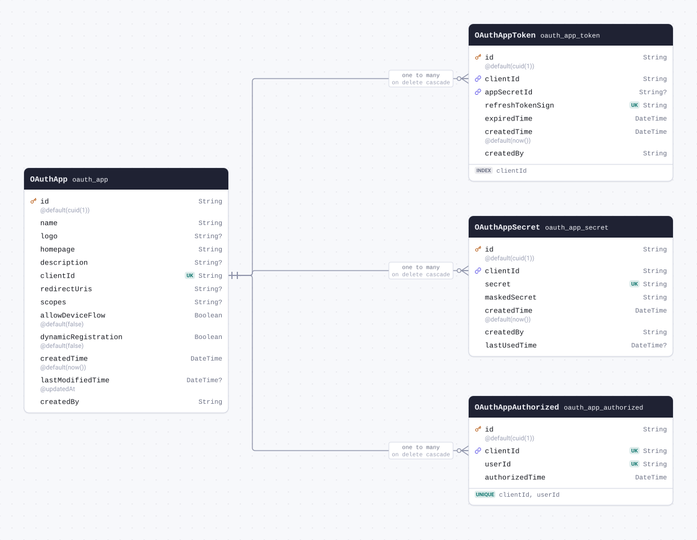

| Field                                          | Type       | Constraints     | Default      | Description |
| ---------------------------------------------- | ---------- | --------------- | ------------ | ----------- |
| `id`                                           | `String`   | PK NOT NULL     | `cuid(1)`    |             |
| `name`                                         | `String`   | NOT NULL        |              |             |
| `logo`                                         | `String`   | NULL            |              |             |
| `homepage`                                     | `String`   | NOT NULL        |              |             |
| `description`                                  | `String`   | NULL            |              |             |
| `clientId` (`client_id`)                       | `String`   | UNIQUE NOT NULL |              |             |
| `redirectUris` (`redirect_uris`)               | `String`   | NULL            |              |             |
| `scopes`                                       | `String`   | NULL            |              |             |
| `allowDeviceFlow` (`allow_device_flow`)        | `Boolean`  | NOT NULL        | `false`      |             |
| `dynamicRegistration` (`dynamic_registration`) | `Boolean`  | NOT NULL        | `false`      |             |
| `createdTime` (`created_time`)                 | `DateTime` | NOT NULL        | `now()`      |             |
| `lastModifiedTime` (`last_modified_time`)      | `DateTime` | NULL            | `@updatedAt` |             |
| `createdBy` (`created_by`)                     | `String`   | NOT NULL        |              |             |

#### Referenced by

- `clientId` ← [OAuthAppAuthorized.clientId](#model-OAuthAppAuthorized) (one-to-many, on delete Cascade)
- `clientId` ← [OAuthAppSecret.clientId](#model-OAuthAppSecret) (one-to-many, on delete Cascade)
- `clientId` ← [OAuthAppToken.clientId](#model-OAuthAppToken) (one-to-many, on delete Cascade)

#### Definition

```sql
CREATE TABLE "oauth_app" (
    "id" TEXT NOT NULL,
    "name" TEXT NOT NULL,
    "logo" TEXT,
    "homepage" TEXT NOT NULL,
    "description" TEXT,
    "client_id" TEXT NOT NULL,
    "redirect_uris" TEXT,
    "scopes" TEXT,
    "allow_device_flow" BOOLEAN NOT NULL DEFAULT false,
    "dynamic_registration" BOOLEAN NOT NULL DEFAULT false,
    "created_time" TIMESTAMP(3) NOT NULL DEFAULT CURRENT_TIMESTAMP,
    "last_modified_time" TIMESTAMP(3),
    "created_by" TEXT NOT NULL,

    CONSTRAINT "oauth_app_pkey" PRIMARY KEY ("id")
);

CREATE UNIQUE INDEX "oauth_app_client_id_key" ON "oauth_app"("client_id");
```

<details>
<summary>Queries and their SQL</summary>

**findMany**: Every row

```ts
await prisma.oAuthApp.findMany();
```

```sql
SELECT
  "public"."oauth_app"."id",
  "public"."oauth_app"."name",
  "public"."oauth_app"."logo",
  "public"."oauth_app"."homepage",
  "public"."oauth_app"."description",
  "public"."oauth_app"."client_id",
  "public"."oauth_app"."redirect_uris",
  "public"."oauth_app"."scopes",
  "public"."oauth_app"."allow_device_flow",
  "public"."oauth_app"."dynamic_registration",
  "public"."oauth_app"."created_time",
  "public"."oauth_app"."last_modified_time",
  "public"."oauth_app"."created_by"
FROM
  "public"."oauth_app"
WHERE
  1 = 1
OFFSET
  $1
-- params: ["0"]
```

**count**: How many rows there are

```ts
await prisma.oAuthApp.count();
```

```sql
SELECT
  COUNT(*) AS "_count$_all"
FROM
  (
    SELECT
      "public"."oauth_app"."id"
    FROM
      "public"."oauth_app"
    WHERE
      1 = 1
    OFFSET
      $1
  ) AS "sub"
-- params: ["0"]
```

**findMany**: Every row with its relations

```ts
await prisma.oAuthApp.findMany({ include: { secrets: true, authorized: true, tokens: true } });
```

```sql
SELECT
  "public"."oauth_app"."id",
  "public"."oauth_app"."name",
  "public"."oauth_app"."logo",
  "public"."oauth_app"."homepage",
  "public"."oauth_app"."description",
  "public"."oauth_app"."client_id",
  "public"."oauth_app"."redirect_uris",
  "public"."oauth_app"."scopes",
  "public"."oauth_app"."allow_device_flow",
  "public"."oauth_app"."dynamic_registration",
  "public"."oauth_app"."created_time",
  "public"."oauth_app"."last_modified_time",
  "public"."oauth_app"."created_by"
FROM
  "public"."oauth_app"
WHERE
  1 = 1
OFFSET
  $1
-- params: ["0"]

SELECT
  "public"."oauth_app_secret"."id",
  "public"."oauth_app_secret"."client_id",
  "public"."oauth_app_secret"."secret",
  "public"."oauth_app_secret"."masked_secret",
  "public"."oauth_app_secret"."created_time",
  "public"."oauth_app_secret"."created_by",
  "public"."oauth_app_secret"."last_used_time"
FROM
  "public"."oauth_app_secret"
WHERE
  "public"."oauth_app_secret"."client_id" IN ($1)
OFFSET
  $2
-- params: ["<clientId of the rows above>","0"]

SELECT
  "public"."oauth_app_authorized"."id",
  "public"."oauth_app_authorized"."client_id",
  "public"."oauth_app_authorized"."user_id",
  "public"."oauth_app_authorized"."authorized_time"
FROM
  "public"."oauth_app_authorized"
WHERE
  "public"."oauth_app_authorized"."client_id" IN ($1)
OFFSET
  $2
-- params: ["<clientId of the rows above>","0"]

SELECT
  "public"."oauth_app_token"."id",
  "public"."oauth_app_token"."client_id",
  "public"."oauth_app_token"."app_secret_id",
  "public"."oauth_app_token"."refresh_token_sign",
  "public"."oauth_app_token"."expired_time",
  "public"."oauth_app_token"."created_time",
  "public"."oauth_app_token"."created_by"
FROM
  "public"."oauth_app_token"
WHERE
  "public"."oauth_app_token"."client_id" IN ($1)
OFFSET
  $2
-- params: ["<clientId of the rows above>","0"]
```

**findUnique**: One row by what is unique to it

```ts
await prisma.oAuthApp.findUnique({ where: { id: "example" } });
```

```sql
SELECT
  "public"."oauth_app"."id",
  "public"."oauth_app"."name",
  "public"."oauth_app"."logo",
  "public"."oauth_app"."homepage",
  "public"."oauth_app"."description",
  "public"."oauth_app"."client_id",
  "public"."oauth_app"."redirect_uris",
  "public"."oauth_app"."scopes",
  "public"."oauth_app"."allow_device_flow",
  "public"."oauth_app"."dynamic_registration",
  "public"."oauth_app"."created_time",
  "public"."oauth_app"."last_modified_time",
  "public"."oauth_app"."created_by"
FROM
  "public"."oauth_app"
WHERE
  (
    "public"."oauth_app"."id" = $1
    AND 1 = 1
  )
LIMIT
  $2
OFFSET
  $3
-- params: ["example","1","0"]
```

**create**: Create a row

```ts
await prisma.oAuthApp.create({
  data: { name: "example", homepage: "example", clientId: "example", createdBy: "example" },
});
```

```sql
INSERT INTO
  "public"."oauth_app" (
    "id",
    "name",
    "homepage",
    "client_id",
    "allow_device_flow",
    "dynamic_registration",
    "created_time",
    "last_modified_time",
    "created_by"
  )
VALUES
  ($1, $2, $3, $4, $5, $6, $7, $8, $9)
RETURNING
  "public"."oauth_app"."id",
  "public"."oauth_app"."name",
  "public"."oauth_app"."logo",
  "public"."oauth_app"."homepage",
  "public"."oauth_app"."description",
  "public"."oauth_app"."client_id",
  "public"."oauth_app"."redirect_uris",
  "public"."oauth_app"."scopes",
  "public"."oauth_app"."allow_device_flow",
  "public"."oauth_app"."dynamic_registration",
  "public"."oauth_app"."created_time",
  "public"."oauth_app"."last_modified_time",
  "public"."oauth_app"."created_by"
-- params: ["<cuid(1)>","example","example","example",false,false,"<now()>","<now()>","example"]
```

**update**: Update a row

```ts
await prisma.oAuthApp.update({ where: { id: "example" }, data: { name: "example" } });
```

```sql
UPDATE "public"."oauth_app"
SET
  "name" = $1,
  "last_modified_time" = $2
WHERE
  (
    "public"."oauth_app"."id" = $3
    AND 1 = 1
  )
RETURNING
  "public"."oauth_app"."id",
  "public"."oauth_app"."name",
  "public"."oauth_app"."logo",
  "public"."oauth_app"."homepage",
  "public"."oauth_app"."description",
  "public"."oauth_app"."client_id",
  "public"."oauth_app"."redirect_uris",
  "public"."oauth_app"."scopes",
  "public"."oauth_app"."allow_device_flow",
  "public"."oauth_app"."dynamic_registration",
  "public"."oauth_app"."created_time",
  "public"."oauth_app"."last_modified_time",
  "public"."oauth_app"."created_by"
-- params: ["example",{"prisma__type":"generatorCall","prisma__value":{"name":"now","args":[],"returnType":{"type":"DateTime"}}},"example"]
```

**delete**: Delete a row

```ts
await prisma.oAuthApp.delete({ where: { id: "example" } });
```

```sql
DELETE FROM "public"."oauth_app"
WHERE
  (
    "public"."oauth_app"."id" = $1
    AND 1 = 1
  )
RETURNING
  "public"."oauth_app"."id",
  "public"."oauth_app"."name",
  "public"."oauth_app"."logo",
  "public"."oauth_app"."homepage",
  "public"."oauth_app"."description",
  "public"."oauth_app"."client_id",
  "public"."oauth_app"."redirect_uris",
  "public"."oauth_app"."scopes",
  "public"."oauth_app"."allow_device_flow",
  "public"."oauth_app"."dynamic_registration",
  "public"."oauth_app"."created_time",
  "public"."oauth_app"."last_modified_time",
  "public"."oauth_app"."created_by"
-- params: ["example"]
```

</details>

<a id="model-OAuthAppAuthorized"></a>

### OAuthAppAuthorized

Table `oauth_app_authorized`.

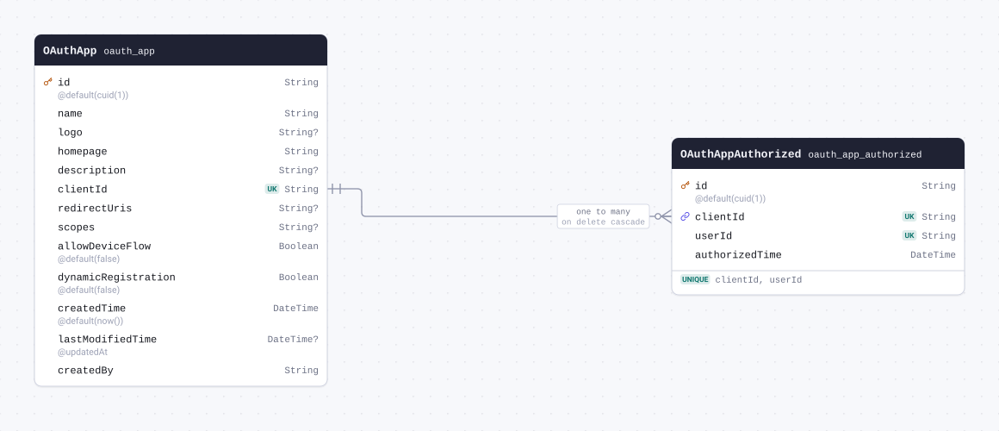

| Field                                | Type       | Constraints                                     | Default   | Description |
| ------------------------------------ | ---------- | ----------------------------------------------- | --------- | ----------- |
| `id`                                 | `String`   | PK NOT NULL                                     | `cuid(1)` |             |
| `clientId` (`client_id`)             | `String`   | NOT NULL → [OAuthApp.clientId](#model-OAuthApp) |           |             |
| `userId` (`user_id`)                 | `String`   | NOT NULL                                        |           |             |
| `authorizedTime` (`authorized_time`) | `DateTime` | NOT NULL                                        |           |             |

#### Indexes

- `@@unique([clientId, userId])`

#### References

- `clientId` → [OAuthApp.clientId](#model-OAuthApp) (many-to-one, on delete Cascade)

#### Definition

```sql
CREATE TABLE "oauth_app_authorized" (
    "id" TEXT NOT NULL,
    "client_id" TEXT NOT NULL,
    "user_id" TEXT NOT NULL,
    "authorized_time" TIMESTAMP(3) NOT NULL,

    CONSTRAINT "oauth_app_authorized_pkey" PRIMARY KEY ("id")
);

CREATE UNIQUE INDEX "oauth_app_authorized_client_id_user_id_key" ON "oauth_app_authorized"("client_id", "user_id");

ALTER TABLE "oauth_app_authorized" ADD CONSTRAINT "oauth_app_authorized_client_id_fkey" FOREIGN KEY ("client_id") REFERENCES "oauth_app"("client_id") ON DELETE CASCADE ON UPDATE CASCADE;
```

<details>
<summary>Queries and their SQL</summary>

**findMany**: Every row

```ts
await prisma.oAuthAppAuthorized.findMany();
```

```sql
SELECT
  "public"."oauth_app_authorized"."id",
  "public"."oauth_app_authorized"."client_id",
  "public"."oauth_app_authorized"."user_id",
  "public"."oauth_app_authorized"."authorized_time"
FROM
  "public"."oauth_app_authorized"
WHERE
  1 = 1
OFFSET
  $1
-- params: ["0"]
```

**count**: How many rows there are

```ts
await prisma.oAuthAppAuthorized.count();
```

```sql
SELECT
  COUNT(*) AS "_count$_all"
FROM
  (
    SELECT
      "public"."oauth_app_authorized"."id"
    FROM
      "public"."oauth_app_authorized"
    WHERE
      1 = 1
    OFFSET
      $1
  ) AS "sub"
-- params: ["0"]
```

**findMany**: Every row with its relations

```ts
await prisma.oAuthAppAuthorized.findMany({ include: { oAuthApp: true } });
```

```sql
SELECT
  "public"."oauth_app_authorized"."id",
  "public"."oauth_app_authorized"."client_id",
  "public"."oauth_app_authorized"."user_id",
  "public"."oauth_app_authorized"."authorized_time"
FROM
  "public"."oauth_app_authorized"
WHERE
  1 = 1
OFFSET
  $1
-- params: ["0"]

SELECT
  "public"."oauth_app"."id",
  "public"."oauth_app"."name",
  "public"."oauth_app"."logo",
  "public"."oauth_app"."homepage",
  "public"."oauth_app"."description",
  "public"."oauth_app"."client_id",
  "public"."oauth_app"."redirect_uris",
  "public"."oauth_app"."scopes",
  "public"."oauth_app"."allow_device_flow",
  "public"."oauth_app"."dynamic_registration",
  "public"."oauth_app"."created_time",
  "public"."oauth_app"."last_modified_time",
  "public"."oauth_app"."created_by"
FROM
  "public"."oauth_app"
WHERE
  "public"."oauth_app"."client_id" IN ($1)
OFFSET
  $2
-- params: ["<clientId of the rows above>","0"]
```

**findUnique**: One row by what is unique to it

```ts
await prisma.oAuthAppAuthorized.findUnique({ where: { id: "example" } });
```

```sql
SELECT
  "public"."oauth_app_authorized"."id",
  "public"."oauth_app_authorized"."client_id",
  "public"."oauth_app_authorized"."user_id",
  "public"."oauth_app_authorized"."authorized_time"
FROM
  "public"."oauth_app_authorized"
WHERE
  (
    "public"."oauth_app_authorized"."id" = $1
    AND 1 = 1
  )
LIMIT
  $2
OFFSET
  $3
-- params: ["example","1","0"]
```

**create**: Create a row

```ts
await prisma.oAuthAppAuthorized.create({
  data: {
    clientId: "example",
    userId: "example",
    authorizedTime: new Date("2026-01-01T00:00:00.000Z"),
  },
});
```

```sql
INSERT INTO
  "public"."oauth_app_authorized" ("id", "client_id", "user_id", "authorized_time")
VALUES
  ($1, $2, $3, $4)
RETURNING
  "public"."oauth_app_authorized"."id",
  "public"."oauth_app_authorized"."client_id",
  "public"."oauth_app_authorized"."user_id",
  "public"."oauth_app_authorized"."authorized_time"
-- params: ["<cuid(1)>","example","example","2026-01-01T00:00:00.000Z"]
```

**update**: Update a row

```ts
await prisma.oAuthAppAuthorized.update({ where: { id: "example" }, data: { userId: "example" } });
```

```sql
UPDATE "public"."oauth_app_authorized"
SET
  "user_id" = $1
WHERE
  (
    "public"."oauth_app_authorized"."id" = $2
    AND 1 = 1
  )
RETURNING
  "public"."oauth_app_authorized"."id",
  "public"."oauth_app_authorized"."client_id",
  "public"."oauth_app_authorized"."user_id",
  "public"."oauth_app_authorized"."authorized_time"
-- params: ["example","example"]
```

**delete**: Delete a row

```ts
await prisma.oAuthAppAuthorized.delete({ where: { id: "example" } });
```

```sql
DELETE FROM "public"."oauth_app_authorized"
WHERE
  (
    "public"."oauth_app_authorized"."id" = $1
    AND 1 = 1
  )
RETURNING
  "public"."oauth_app_authorized"."id",
  "public"."oauth_app_authorized"."client_id",
  "public"."oauth_app_authorized"."user_id",
  "public"."oauth_app_authorized"."authorized_time"
-- params: ["example"]
```

</details>

<a id="model-OAuthAppSecret"></a>

### OAuthAppSecret

Table `oauth_app_secret`.

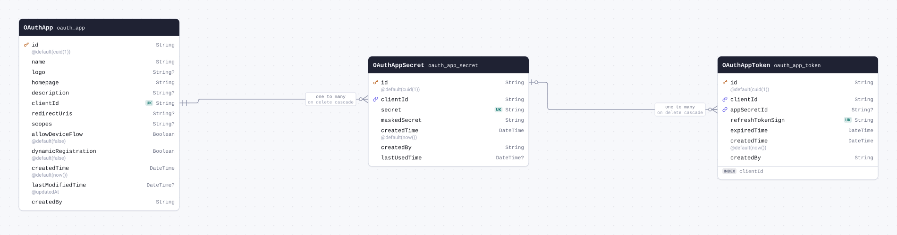

| Field                             | Type       | Constraints                                     | Default   | Description |
| --------------------------------- | ---------- | ----------------------------------------------- | --------- | ----------- |
| `id`                              | `String`   | PK NOT NULL                                     | `cuid(1)` |             |
| `clientId` (`client_id`)          | `String`   | NOT NULL → [OAuthApp.clientId](#model-OAuthApp) |           |             |
| `secret`                          | `String`   | UNIQUE NOT NULL                                 |           |             |
| `maskedSecret` (`masked_secret`)  | `String`   | NOT NULL                                        |           |             |
| `createdTime` (`created_time`)    | `DateTime` | NOT NULL                                        | `now()`   |             |
| `createdBy` (`created_by`)        | `String`   | NOT NULL                                        |           |             |
| `lastUsedTime` (`last_used_time`) | `DateTime` | NULL                                            |           |             |

#### References

- `clientId` → [OAuthApp.clientId](#model-OAuthApp) (many-to-one, on delete Cascade)

#### Referenced by

- `id` ← [OAuthAppToken.appSecretId](#model-OAuthAppToken) (one-to-many, on delete Cascade)

#### Definition

```sql
CREATE TABLE "oauth_app_secret" (
    "id" TEXT NOT NULL,
    "client_id" TEXT NOT NULL,
    "secret" TEXT NOT NULL,
    "masked_secret" TEXT NOT NULL,
    "created_time" TIMESTAMP(3) NOT NULL DEFAULT CURRENT_TIMESTAMP,
    "created_by" TEXT NOT NULL,
    "last_used_time" TIMESTAMP(3),

    CONSTRAINT "oauth_app_secret_pkey" PRIMARY KEY ("id")
);

CREATE UNIQUE INDEX "oauth_app_secret_secret_key" ON "oauth_app_secret"("secret");

ALTER TABLE "oauth_app_secret" ADD CONSTRAINT "oauth_app_secret_client_id_fkey" FOREIGN KEY ("client_id") REFERENCES "oauth_app"("client_id") ON DELETE CASCADE ON UPDATE CASCADE;
```

<details>
<summary>Queries and their SQL</summary>

**findMany**: Every row

```ts
await prisma.oAuthAppSecret.findMany();
```

```sql
SELECT
  "public"."oauth_app_secret"."id",
  "public"."oauth_app_secret"."client_id",
  "public"."oauth_app_secret"."secret",
  "public"."oauth_app_secret"."masked_secret",
  "public"."oauth_app_secret"."created_time",
  "public"."oauth_app_secret"."created_by",
  "public"."oauth_app_secret"."last_used_time"
FROM
  "public"."oauth_app_secret"
WHERE
  1 = 1
OFFSET
  $1
-- params: ["0"]
```

**count**: How many rows there are

```ts
await prisma.oAuthAppSecret.count();
```

```sql
SELECT
  COUNT(*) AS "_count$_all"
FROM
  (
    SELECT
      "public"."oauth_app_secret"."id"
    FROM
      "public"."oauth_app_secret"
    WHERE
      1 = 1
    OFFSET
      $1
  ) AS "sub"
-- params: ["0"]
```

**findMany**: Every row with its relations

```ts
await prisma.oAuthAppSecret.findMany({ include: { tokens: true, oAuthApp: true } });
```

```sql
SELECT
  "public"."oauth_app_secret"."id",
  "public"."oauth_app_secret"."client_id",
  "public"."oauth_app_secret"."secret",
  "public"."oauth_app_secret"."masked_secret",
  "public"."oauth_app_secret"."created_time",
  "public"."oauth_app_secret"."created_by",
  "public"."oauth_app_secret"."last_used_time"
FROM
  "public"."oauth_app_secret"
WHERE
  1 = 1
OFFSET
  $1
-- params: ["0"]

SELECT
  "public"."oauth_app_token"."id",
  "public"."oauth_app_token"."client_id",
  "public"."oauth_app_token"."app_secret_id",
  "public"."oauth_app_token"."refresh_token_sign",
  "public"."oauth_app_token"."expired_time",
  "public"."oauth_app_token"."created_time",
  "public"."oauth_app_token"."created_by"
FROM
  "public"."oauth_app_token"
WHERE
  "public"."oauth_app_token"."app_secret_id" IN ($1)
OFFSET
  $2
-- params: ["<id of the rows above>","0"]

SELECT
  "public"."oauth_app"."id",
  "public"."oauth_app"."name",
  "public"."oauth_app"."logo",
  "public"."oauth_app"."homepage",
  "public"."oauth_app"."description",
  "public"."oauth_app"."client_id",
  "public"."oauth_app"."redirect_uris",
  "public"."oauth_app"."scopes",
  "public"."oauth_app"."allow_device_flow",
  "public"."oauth_app"."dynamic_registration",
  "public"."oauth_app"."created_time",
  "public"."oauth_app"."last_modified_time",
  "public"."oauth_app"."created_by"
FROM
  "public"."oauth_app"
WHERE
  "public"."oauth_app"."client_id" IN ($1)
OFFSET
  $2
-- params: ["<clientId of the rows above>","0"]
```

**findUnique**: One row by what is unique to it

```ts
await prisma.oAuthAppSecret.findUnique({ where: { id: "example" } });
```

```sql
SELECT
  "public"."oauth_app_secret"."id",
  "public"."oauth_app_secret"."client_id",
  "public"."oauth_app_secret"."secret",
  "public"."oauth_app_secret"."masked_secret",
  "public"."oauth_app_secret"."created_time",
  "public"."oauth_app_secret"."created_by",
  "public"."oauth_app_secret"."last_used_time"
FROM
  "public"."oauth_app_secret"
WHERE
  (
    "public"."oauth_app_secret"."id" = $1
    AND 1 = 1
  )
LIMIT
  $2
OFFSET
  $3
-- params: ["example","1","0"]
```

**create**: Create a row

```ts
await prisma.oAuthAppSecret.create({
  data: { clientId: "example", secret: "example", maskedSecret: "example", createdBy: "example" },
});
```

```sql
INSERT INTO
  "public"."oauth_app_secret" (
    "id",
    "client_id",
    "secret",
    "masked_secret",
    "created_time",
    "created_by"
  )
VALUES
  ($1, $2, $3, $4, $5, $6)
RETURNING
  "public"."oauth_app_secret"."id",
  "public"."oauth_app_secret"."client_id",
  "public"."oauth_app_secret"."secret",
  "public"."oauth_app_secret"."masked_secret",
  "public"."oauth_app_secret"."created_time",
  "public"."oauth_app_secret"."created_by",
  "public"."oauth_app_secret"."last_used_time"
-- params: ["<cuid(1)>","example","example","example","<now()>","example"]
```

**update**: Update a row

```ts
await prisma.oAuthAppSecret.update({ where: { id: "example" }, data: { secret: "example" } });
```

```sql
UPDATE "public"."oauth_app_secret"
SET
  "secret" = $1
WHERE
  (
    "public"."oauth_app_secret"."id" = $2
    AND 1 = 1
  )
RETURNING
  "public"."oauth_app_secret"."id",
  "public"."oauth_app_secret"."client_id",
  "public"."oauth_app_secret"."secret",
  "public"."oauth_app_secret"."masked_secret",
  "public"."oauth_app_secret"."created_time",
  "public"."oauth_app_secret"."created_by",
  "public"."oauth_app_secret"."last_used_time"
-- params: ["example","example"]
```

**delete**: Delete a row

```ts
await prisma.oAuthAppSecret.delete({ where: { id: "example" } });
```

```sql
DELETE FROM "public"."oauth_app_secret"
WHERE
  (
    "public"."oauth_app_secret"."id" = $1
    AND 1 = 1
  )
RETURNING
  "public"."oauth_app_secret"."id",
  "public"."oauth_app_secret"."client_id",
  "public"."oauth_app_secret"."secret",
  "public"."oauth_app_secret"."masked_secret",
  "public"."oauth_app_secret"."created_time",
  "public"."oauth_app_secret"."created_by",
  "public"."oauth_app_secret"."last_used_time"
-- params: ["example"]
```

</details>

<a id="model-OAuthAppToken"></a>

### OAuthAppToken

Table `oauth_app_token`.

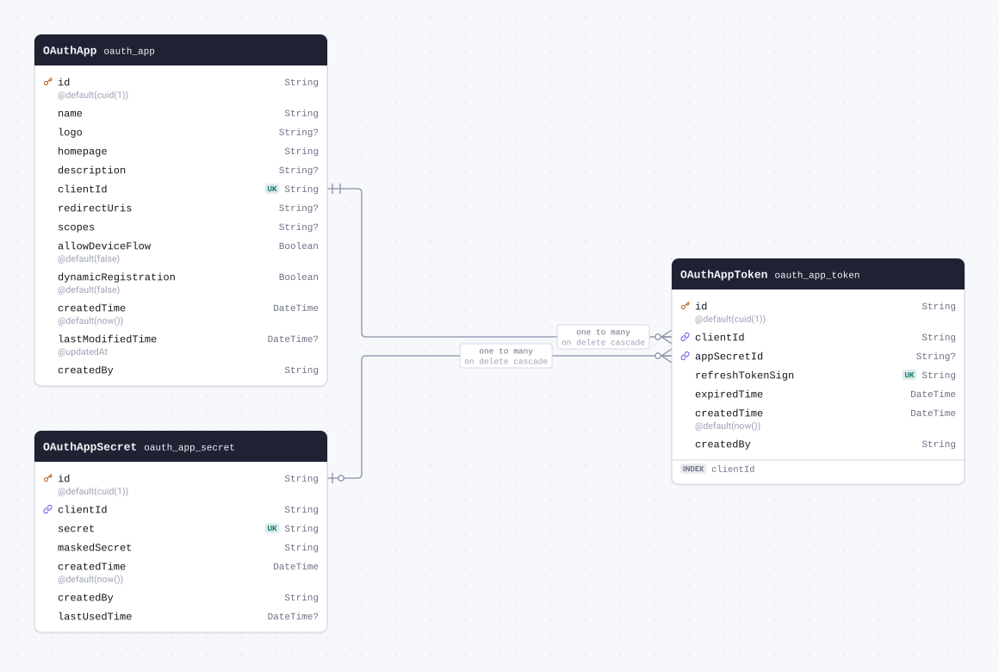

| Field                                     | Type       | Constraints                                       | Default   | Description |
| ----------------------------------------- | ---------- | ------------------------------------------------- | --------- | ----------- |
| `id`                                      | `String`   | PK NOT NULL                                       | `cuid(1)` |             |
| `clientId` (`client_id`)                  | `String`   | NOT NULL → [OAuthApp.clientId](#model-OAuthApp)   |           |             |
| `appSecretId` (`app_secret_id`)           | `String`   | NULL → [OAuthAppSecret.id](#model-OAuthAppSecret) |           |             |
| `refreshTokenSign` (`refresh_token_sign`) | `String`   | UNIQUE NOT NULL                                   |           |             |
| `expiredTime` (`expired_time`)            | `DateTime` | NOT NULL                                          |           |             |
| `createdTime` (`created_time`)            | `DateTime` | NOT NULL                                          | `now()`   |             |
| `createdBy` (`created_by`)                | `String`   | NOT NULL                                          |           |             |

#### Indexes

- `@@index([clientId])`

#### References

- `appSecretId` → [OAuthAppSecret.id](#model-OAuthAppSecret) (many-to-one, on delete Cascade)
- `clientId` → [OAuthApp.clientId](#model-OAuthApp) (many-to-one, on delete Cascade)

#### Definition

```sql
CREATE TABLE "oauth_app_token" (
    "id" TEXT NOT NULL,
    "client_id" TEXT NOT NULL,
    "app_secret_id" TEXT,
    "refresh_token_sign" TEXT NOT NULL,
    "expired_time" TIMESTAMP(3) NOT NULL,
    "created_time" TIMESTAMP(3) NOT NULL DEFAULT CURRENT_TIMESTAMP,
    "created_by" TEXT NOT NULL,

    CONSTRAINT "oauth_app_token_pkey" PRIMARY KEY ("id")
);

CREATE UNIQUE INDEX "oauth_app_token_refresh_token_sign_key" ON "oauth_app_token"("refresh_token_sign");

CREATE INDEX "oauth_app_token_client_id_idx" ON "oauth_app_token"("client_id");

ALTER TABLE "oauth_app_token" ADD CONSTRAINT "oauth_app_token_app_secret_id_fkey" FOREIGN KEY ("app_secret_id") REFERENCES "oauth_app_secret"("id") ON DELETE CASCADE ON UPDATE CASCADE;

ALTER TABLE "oauth_app_token" ADD CONSTRAINT "oauth_app_token_client_id_fkey" FOREIGN KEY ("client_id") REFERENCES "oauth_app"("client_id") ON DELETE CASCADE ON UPDATE CASCADE;
```

<details>
<summary>Queries and their SQL</summary>

**findMany**: Every row

```ts
await prisma.oAuthAppToken.findMany();
```

```sql
SELECT
  "public"."oauth_app_token"."id",
  "public"."oauth_app_token"."client_id",
  "public"."oauth_app_token"."app_secret_id",
  "public"."oauth_app_token"."refresh_token_sign",
  "public"."oauth_app_token"."expired_time",
  "public"."oauth_app_token"."created_time",
  "public"."oauth_app_token"."created_by"
FROM
  "public"."oauth_app_token"
WHERE
  1 = 1
OFFSET
  $1
-- params: ["0"]
```

**count**: How many rows there are

```ts
await prisma.oAuthAppToken.count();
```

```sql
SELECT
  COUNT(*) AS "_count$_all"
FROM
  (
    SELECT
      "public"."oauth_app_token"."id"
    FROM
      "public"."oauth_app_token"
    WHERE
      1 = 1
    OFFSET
      $1
  ) AS "sub"
-- params: ["0"]
```

**findMany**: Every row with its relations

```ts
await prisma.oAuthAppToken.findMany({ include: { oAuthAppSecret: true, oAuthApp: true } });
```

```sql
SELECT
  "public"."oauth_app_token"."id",
  "public"."oauth_app_token"."client_id",
  "public"."oauth_app_token"."app_secret_id",
  "public"."oauth_app_token"."refresh_token_sign",
  "public"."oauth_app_token"."expired_time",
  "public"."oauth_app_token"."created_time",
  "public"."oauth_app_token"."created_by"
FROM
  "public"."oauth_app_token"
WHERE
  1 = 1
OFFSET
  $1
-- params: ["0"]

SELECT
  "public"."oauth_app_secret"."id",
  "public"."oauth_app_secret"."client_id",
  "public"."oauth_app_secret"."secret",
  "public"."oauth_app_secret"."masked_secret",
  "public"."oauth_app_secret"."created_time",
  "public"."oauth_app_secret"."created_by",
  "public"."oauth_app_secret"."last_used_time"
FROM
  "public"."oauth_app_secret"
WHERE
  "public"."oauth_app_secret"."id" IN ($1)
OFFSET
  $2
-- params: ["<appSecretId of the rows above>","0"]

SELECT
  "public"."oauth_app"."id",
  "public"."oauth_app"."name",
  "public"."oauth_app"."logo",
  "public"."oauth_app"."homepage",
  "public"."oauth_app"."description",
  "public"."oauth_app"."client_id",
  "public"."oauth_app"."redirect_uris",
  "public"."oauth_app"."scopes",
  "public"."oauth_app"."allow_device_flow",
  "public"."oauth_app"."dynamic_registration",
  "public"."oauth_app"."created_time",
  "public"."oauth_app"."last_modified_time",
  "public"."oauth_app"."created_by"
FROM
  "public"."oauth_app"
WHERE
  "public"."oauth_app"."client_id" IN ($1)
OFFSET
  $2
-- params: ["<clientId of the rows above>","0"]
```

**findUnique**: One row by what is unique to it

```ts
await prisma.oAuthAppToken.findUnique({ where: { id: "example" } });
```

```sql
SELECT
  "public"."oauth_app_token"."id",
  "public"."oauth_app_token"."client_id",
  "public"."oauth_app_token"."app_secret_id",
  "public"."oauth_app_token"."refresh_token_sign",
  "public"."oauth_app_token"."expired_time",
  "public"."oauth_app_token"."created_time",
  "public"."oauth_app_token"."created_by"
FROM
  "public"."oauth_app_token"
WHERE
  (
    "public"."oauth_app_token"."id" = $1
    AND 1 = 1
  )
LIMIT
  $2
OFFSET
  $3
-- params: ["example","1","0"]
```

**create**: Create a row

```ts
await prisma.oAuthAppToken.create({
  data: {
    clientId: "example",
    refreshTokenSign: "example",
    expiredTime: new Date("2026-01-01T00:00:00.000Z"),
    createdBy: "example",
  },
});
```

```sql
INSERT INTO
  "public"."oauth_app_token" (
    "id",
    "client_id",
    "refresh_token_sign",
    "expired_time",
    "created_time",
    "created_by"
  )
VALUES
  ($1, $2, $3, $4, $5, $6)
RETURNING
  "public"."oauth_app_token"."id",
  "public"."oauth_app_token"."client_id",
  "public"."oauth_app_token"."app_secret_id",
  "public"."oauth_app_token"."refresh_token_sign",
  "public"."oauth_app_token"."expired_time",
  "public"."oauth_app_token"."created_time",
  "public"."oauth_app_token"."created_by"
-- params: ["<cuid(1)>","example","example","2026-01-01T00:00:00.000Z","<now()>","example"]
```

**update**: Update a row

```ts
await prisma.oAuthAppToken.update({
  where: { id: "example" },
  data: { refreshTokenSign: "example" },
});
```

```sql
UPDATE "public"."oauth_app_token"
SET
  "refresh_token_sign" = $1
WHERE
  (
    "public"."oauth_app_token"."id" = $2
    AND 1 = 1
  )
RETURNING
  "public"."oauth_app_token"."id",
  "public"."oauth_app_token"."client_id",
  "public"."oauth_app_token"."app_secret_id",
  "public"."oauth_app_token"."refresh_token_sign",
  "public"."oauth_app_token"."expired_time",
  "public"."oauth_app_token"."created_time",
  "public"."oauth_app_token"."created_by"
-- params: ["example","example"]
```

**delete**: Delete a row

```ts
await prisma.oAuthAppToken.delete({ where: { id: "example" } });
```

```sql
DELETE FROM "public"."oauth_app_token"
WHERE
  (
    "public"."oauth_app_token"."id" = $1
    AND 1 = 1
  )
RETURNING
  "public"."oauth_app_token"."id",
  "public"."oauth_app_token"."client_id",
  "public"."oauth_app_token"."app_secret_id",
  "public"."oauth_app_token"."refresh_token_sign",
  "public"."oauth_app_token"."expired_time",
  "public"."oauth_app_token"."created_time",
  "public"."oauth_app_token"."created_by"
-- params: ["example"]
```

</details>

<a id="model-RecordHistory"></a>

### RecordHistory

Table `record_history`.

| Field                          | Type       | Constraints | Default   | Description |
| ------------------------------ | ---------- | ----------- | --------- | ----------- |
| `id`                           | `String`   | PK NOT NULL | `cuid(1)` |             |
| `tableId` (`table_id`)         | `String`   | NOT NULL    |           |             |
| `recordId` (`record_id`)       | `String`   | NOT NULL    |           |             |
| `fieldId` (`field_id`)         | `String`   | NOT NULL    |           |             |
| `before` (`before`)            | `String`   | NOT NULL    |           |             |
| `after` (`after`)              | `String`   | NOT NULL    |           |             |
| `createdTime` (`created_time`) | `DateTime` | NOT NULL    | `now()`   |             |
| `createdBy` (`created_by`)     | `String`   | NOT NULL    |           |             |

#### Indexes

- `@@index([tableId, recordId, createdTime])`
- `@@index([tableId, createdTime])`

#### Definition

```sql
CREATE TABLE "record_history" (
    "id" TEXT NOT NULL,
    "table_id" TEXT NOT NULL,
    "record_id" TEXT NOT NULL,
    "field_id" TEXT NOT NULL,
    "before" TEXT NOT NULL,
    "after" TEXT NOT NULL,
    "created_time" TIMESTAMP(3) NOT NULL DEFAULT CURRENT_TIMESTAMP,
    "created_by" TEXT NOT NULL,

    CONSTRAINT "record_history_pkey" PRIMARY KEY ("id")
);

CREATE INDEX "record_history_table_id_record_id_created_time_idx" ON "record_history"("table_id", "record_id", "created_time");

CREATE INDEX "record_history_table_id_created_time_idx" ON "record_history"("table_id", "created_time");
```

<details>
<summary>Queries and their SQL</summary>

**findMany**: Every row

```ts
await prisma.recordHistory.findMany();
```

```sql
SELECT
  "public"."record_history"."id",
  "public"."record_history"."table_id",
  "public"."record_history"."record_id",
  "public"."record_history"."field_id",
  "public"."record_history"."before",
  "public"."record_history"."after",
  "public"."record_history"."created_time",
  "public"."record_history"."created_by"
FROM
  "public"."record_history"
WHERE
  1 = 1
OFFSET
  $1
-- params: ["0"]
```

**count**: How many rows there are

```ts
await prisma.recordHistory.count();
```

```sql
SELECT
  COUNT(*) AS "_count$_all"
FROM
  (
    SELECT
      "public"."record_history"."id"
    FROM
      "public"."record_history"
    WHERE
      1 = 1
    OFFSET
      $1
  ) AS "sub"
-- params: ["0"]
```

**findUnique**: One row by what is unique to it

```ts
await prisma.recordHistory.findUnique({ where: { id: "example" } });
```

```sql
SELECT
  "public"."record_history"."id",
  "public"."record_history"."table_id",
  "public"."record_history"."record_id",
  "public"."record_history"."field_id",
  "public"."record_history"."before",
  "public"."record_history"."after",
  "public"."record_history"."created_time",
  "public"."record_history"."created_by"
FROM
  "public"."record_history"
WHERE
  (
    "public"."record_history"."id" = $1
    AND 1 = 1
  )
LIMIT
  $2
OFFSET
  $3
-- params: ["example","1","0"]
```

**create**: Create a row

```ts
await prisma.recordHistory.create({
  data: {
    tableId: "example",
    recordId: "example",
    fieldId: "example",
    before: "example",
    after: "example",
    createdBy: "example",
  },
});
```

```sql
INSERT INTO
  "public"."record_history" (
    "id",
    "table_id",
    "record_id",
    "field_id",
    "before",
    "after",
    "created_time",
    "created_by"
  )
VALUES
  ($1, $2, $3, $4, $5, $6, $7, $8)
RETURNING
  "public"."record_history"."id",
  "public"."record_history"."table_id",
  "public"."record_history"."record_id",
  "public"."record_history"."field_id",
  "public"."record_history"."before",
  "public"."record_history"."after",
  "public"."record_history"."created_time",
  "public"."record_history"."created_by"
-- params: ["<cuid(1)>","example","example","example","example","example","<now()>","example"]
```

**update**: Update a row

```ts
await prisma.recordHistory.update({ where: { id: "example" }, data: { tableId: "example" } });
```

```sql
UPDATE "public"."record_history"
SET
  "table_id" = $1
WHERE
  (
    "public"."record_history"."id" = $2
    AND 1 = 1
  )
RETURNING
  "public"."record_history"."id",
  "public"."record_history"."table_id",
  "public"."record_history"."record_id",
  "public"."record_history"."field_id",
  "public"."record_history"."before",
  "public"."record_history"."after",
  "public"."record_history"."created_time",
  "public"."record_history"."created_by"
-- params: ["example","example"]
```

**delete**: Delete a row

```ts
await prisma.recordHistory.delete({ where: { id: "example" } });
```

```sql
DELETE FROM "public"."record_history"
WHERE
  (
    "public"."record_history"."id" = $1
    AND 1 = 1
  )
RETURNING
  "public"."record_history"."id",
  "public"."record_history"."table_id",
  "public"."record_history"."record_id",
  "public"."record_history"."field_id",
  "public"."record_history"."before",
  "public"."record_history"."after",
  "public"."record_history"."created_time",
  "public"."record_history"."created_by"
-- params: ["example"]
```

</details>

<a id="model-Trash"></a>

### Trash

Table `trash`.

| Field                            | Type       | Constraints | Default   | Description |
| -------------------------------- | ---------- | ----------- | --------- | ----------- |
| `id`                             | `String`   | PK NOT NULL | `cuid(1)` |             |
| `resourceType` (`resource_type`) | `String`   | NOT NULL    |           |             |
| `resourceId` (`resource_id`)     | `String`   | NOT NULL    |           |             |
| `parentId` (`parent_id`)         | `String`   | NULL        |           |             |
| `deletedTime` (`deleted_time`)   | `DateTime` | NOT NULL    | `now()`   |             |
| `deletedBy` (`deleted_by`)       | `String`   | NOT NULL    |           |             |

#### Indexes

- `@@unique([resourceType, resourceId])`

#### Definition

```sql
CREATE TABLE "trash" (
    "id" TEXT NOT NULL,
    "resource_type" TEXT NOT NULL,
    "resource_id" TEXT NOT NULL,
    "parent_id" TEXT,
    "deleted_time" TIMESTAMP(3) NOT NULL DEFAULT CURRENT_TIMESTAMP,
    "deleted_by" TEXT NOT NULL,

    CONSTRAINT "trash_pkey" PRIMARY KEY ("id")
);

CREATE UNIQUE INDEX "trash_resource_type_resource_id_key" ON "trash"("resource_type", "resource_id");
```

<details>
<summary>Queries and their SQL</summary>

**findMany**: Every row

```ts
await prisma.trash.findMany();
```

```sql
SELECT
  "public"."trash"."id",
  "public"."trash"."resource_type",
  "public"."trash"."resource_id",
  "public"."trash"."parent_id",
  "public"."trash"."deleted_time",
  "public"."trash"."deleted_by"
FROM
  "public"."trash"
WHERE
  1 = 1
OFFSET
  $1
-- params: ["0"]
```

**count**: How many rows there are

```ts
await prisma.trash.count();
```

```sql
SELECT
  COUNT(*) AS "_count$_all"
FROM
  (
    SELECT
      "public"."trash"."id"
    FROM
      "public"."trash"
    WHERE
      1 = 1
    OFFSET
      $1
  ) AS "sub"
-- params: ["0"]
```

**findUnique**: One row by what is unique to it

```ts
await prisma.trash.findUnique({ where: { id: "example" } });
```

```sql
SELECT
  "public"."trash"."id",
  "public"."trash"."resource_type",
  "public"."trash"."resource_id",
  "public"."trash"."parent_id",
  "public"."trash"."deleted_time",
  "public"."trash"."deleted_by"
FROM
  "public"."trash"
WHERE
  (
    "public"."trash"."id" = $1
    AND 1 = 1
  )
LIMIT
  $2
OFFSET
  $3
-- params: ["example","1","0"]
```

**create**: Create a row

```ts
await prisma.trash.create({
  data: { resourceType: "example", resourceId: "example", deletedBy: "example" },
});
```

```sql
INSERT INTO
  "public"."trash" (
    "id",
    "resource_type",
    "resource_id",
    "deleted_time",
    "deleted_by"
  )
VALUES
  ($1, $2, $3, $4, $5)
RETURNING
  "public"."trash"."id",
  "public"."trash"."resource_type",
  "public"."trash"."resource_id",
  "public"."trash"."parent_id",
  "public"."trash"."deleted_time",
  "public"."trash"."deleted_by"
-- params: ["<cuid(1)>","example","example","<now()>","example"]
```

**update**: Update a row

```ts
await prisma.trash.update({ where: { id: "example" }, data: { resourceType: "example" } });
```

```sql
UPDATE "public"."trash"
SET
  "resource_type" = $1
WHERE
  (
    "public"."trash"."id" = $2
    AND 1 = 1
  )
RETURNING
  "public"."trash"."id",
  "public"."trash"."resource_type",
  "public"."trash"."resource_id",
  "public"."trash"."parent_id",
  "public"."trash"."deleted_time",
  "public"."trash"."deleted_by"
-- params: ["example","example"]
```

**delete**: Delete a row

```ts
await prisma.trash.delete({ where: { id: "example" } });
```

```sql
DELETE FROM "public"."trash"
WHERE
  (
    "public"."trash"."id" = $1
    AND 1 = 1
  )
RETURNING
  "public"."trash"."id",
  "public"."trash"."resource_type",
  "public"."trash"."resource_id",
  "public"."trash"."parent_id",
  "public"."trash"."deleted_time",
  "public"."trash"."deleted_by"
-- params: ["example"]
```

</details>

<a id="model-TableTrash"></a>

### TableTrash

Table `table_trash`.

| Field                            | Type       | Constraints | Default   | Description |
| -------------------------------- | ---------- | ----------- | --------- | ----------- |
| `id`                             | `String`   | PK NOT NULL | `cuid(1)` |             |
| `tableId` (`table_id`)           | `String`   | NOT NULL    |           |             |
| `resourceType` (`resource_type`) | `String`   | NOT NULL    |           |             |
| `snapshot` (`snapshot`)          | `String`   | NOT NULL    |           |             |
| `createdTime` (`created_time`)   | `DateTime` | NOT NULL    | `now()`   |             |
| `createdBy` (`created_by`)       | `String`   | NOT NULL    |           |             |

#### Indexes

- `@@index([tableId])`

#### Definition

```sql
CREATE TABLE "table_trash" (
    "id" TEXT NOT NULL,
    "table_id" TEXT NOT NULL,
    "resource_type" TEXT NOT NULL,
    "snapshot" TEXT NOT NULL,
    "created_time" TIMESTAMP(3) NOT NULL DEFAULT CURRENT_TIMESTAMP,
    "created_by" TEXT NOT NULL,

    CONSTRAINT "table_trash_pkey" PRIMARY KEY ("id")
);

CREATE INDEX "table_trash_table_id_idx" ON "table_trash"("table_id");
```

<details>
<summary>Queries and their SQL</summary>

**findMany**: Every row

```ts
await prisma.tableTrash.findMany();
```

```sql
SELECT
  "public"."table_trash"."id",
  "public"."table_trash"."table_id",
  "public"."table_trash"."resource_type",
  "public"."table_trash"."snapshot",
  "public"."table_trash"."created_time",
  "public"."table_trash"."created_by"
FROM
  "public"."table_trash"
WHERE
  1 = 1
OFFSET
  $1
-- params: ["0"]
```

**count**: How many rows there are

```ts
await prisma.tableTrash.count();
```

```sql
SELECT
  COUNT(*) AS "_count$_all"
FROM
  (
    SELECT
      "public"."table_trash"."id"
    FROM
      "public"."table_trash"
    WHERE
      1 = 1
    OFFSET
      $1
  ) AS "sub"
-- params: ["0"]
```

**findUnique**: One row by what is unique to it

```ts
await prisma.tableTrash.findUnique({ where: { id: "example" } });
```

```sql
SELECT
  "public"."table_trash"."id",
  "public"."table_trash"."table_id",
  "public"."table_trash"."resource_type",
  "public"."table_trash"."snapshot",
  "public"."table_trash"."created_time",
  "public"."table_trash"."created_by"
FROM
  "public"."table_trash"
WHERE
  (
    "public"."table_trash"."id" = $1
    AND 1 = 1
  )
LIMIT
  $2
OFFSET
  $3
-- params: ["example","1","0"]
```

**create**: Create a row

```ts
await prisma.tableTrash.create({
  data: { tableId: "example", resourceType: "example", snapshot: "example", createdBy: "example" },
});
```

```sql
INSERT INTO
  "public"."table_trash" (
    "id",
    "table_id",
    "resource_type",
    "snapshot",
    "created_time",
    "created_by"
  )
VALUES
  ($1, $2, $3, $4, $5, $6)
RETURNING
  "public"."table_trash"."id",
  "public"."table_trash"."table_id",
  "public"."table_trash"."resource_type",
  "public"."table_trash"."snapshot",
  "public"."table_trash"."created_time",
  "public"."table_trash"."created_by"
-- params: ["<cuid(1)>","example","example","example","<now()>","example"]
```

**update**: Update a row

```ts
await prisma.tableTrash.update({ where: { id: "example" }, data: { tableId: "example" } });
```

```sql
UPDATE "public"."table_trash"
SET
  "table_id" = $1
WHERE
  (
    "public"."table_trash"."id" = $2
    AND 1 = 1
  )
RETURNING
  "public"."table_trash"."id",
  "public"."table_trash"."table_id",
  "public"."table_trash"."resource_type",
  "public"."table_trash"."snapshot",
  "public"."table_trash"."created_time",
  "public"."table_trash"."created_by"
-- params: ["example","example"]
```

**delete**: Delete a row

```ts
await prisma.tableTrash.delete({ where: { id: "example" } });
```

```sql
DELETE FROM "public"."table_trash"
WHERE
  (
    "public"."table_trash"."id" = $1
    AND 1 = 1
  )
RETURNING
  "public"."table_trash"."id",
  "public"."table_trash"."table_id",
  "public"."table_trash"."resource_type",
  "public"."table_trash"."snapshot",
  "public"."table_trash"."created_time",
  "public"."table_trash"."created_by"
-- params: ["example"]
```

</details>

<a id="model-RecordTrash"></a>

### RecordTrash

Table `record_trash`.

| Field                                                  | Type       | Constraints | Default     | Description |
| ------------------------------------------------------ | ---------- | ----------- | ----------- | ----------- |
| `id`                                                   | `String`   | PK NOT NULL | `cuid(1)`   |             |
| `tableId` (`table_id`)                                 | `String`   | NOT NULL    |             |             |
| `recordId` (`record_id`)                               | `String`   | NOT NULL    |             |             |
| `snapshot` (`snapshot`)                                | `String`   | NOT NULL    |             |             |
| `createdTime` (`created_time`)                         | `DateTime` | NOT NULL    | `now()`     |             |
| `createdBy` (`created_by`)                             | `String`   | NOT NULL    |             |             |
| `reason` (`reason`)                                    | `String`   | NOT NULL    | `"deleted"` |             |
| `recordCreatedTime` (`record_created_time`)            | `DateTime` | NULL        |             |             |
| `recordCreatedBy` (`record_created_by`)                | `String`   | NULL        |             |             |
| `recordLastModifiedTime` (`record_last_modified_time`) | `DateTime` | NULL        |             |             |
| `recordLastModifiedBy` (`record_last_modified_by`)     | `String`   | NULL        |             |             |
| `operationId` (`operation_id`)                         | `String`   | NULL        |             |             |

#### Indexes

- `@@index([tableId, recordId])`

#### Definition

```sql
CREATE TABLE "record_trash" (
    "id" TEXT NOT NULL,
    "table_id" TEXT NOT NULL,
    "record_id" TEXT NOT NULL,
    "snapshot" TEXT NOT NULL,
    "created_time" TIMESTAMP(3) NOT NULL DEFAULT CURRENT_TIMESTAMP,
    "created_by" TEXT NOT NULL,
    "reason" TEXT NOT NULL DEFAULT 'deleted',
    "record_created_time" TIMESTAMP(3),
    "record_created_by" TEXT,
    "record_last_modified_time" TIMESTAMP(3),
    "record_last_modified_by" TEXT,
    "operation_id" TEXT,

    CONSTRAINT "record_trash_pkey" PRIMARY KEY ("id")
);

CREATE INDEX "record_trash_table_id_record_id_idx" ON "record_trash"("table_id", "record_id");
```

<details>
<summary>Queries and their SQL</summary>

**findMany**: Every row

```ts
await prisma.recordTrash.findMany();
```

```sql
SELECT
  "public"."record_trash"."id",
  "public"."record_trash"."table_id",
  "public"."record_trash"."record_id",
  "public"."record_trash"."snapshot",
  "public"."record_trash"."created_time",
  "public"."record_trash"."created_by",
  "public"."record_trash"."reason",
  "public"."record_trash"."record_created_time",
  "public"."record_trash"."record_created_by",
  "public"."record_trash"."record_last_modified_time",
  "public"."record_trash"."record_last_modified_by",
  "public"."record_trash"."operation_id"
FROM
  "public"."record_trash"
WHERE
  1 = 1
OFFSET
  $1
-- params: ["0"]
```

**count**: How many rows there are

```ts
await prisma.recordTrash.count();
```

```sql
SELECT
  COUNT(*) AS "_count$_all"
FROM
  (
    SELECT
      "public"."record_trash"."id"
    FROM
      "public"."record_trash"
    WHERE
      1 = 1
    OFFSET
      $1
  ) AS "sub"
-- params: ["0"]
```

**findUnique**: One row by what is unique to it

```ts
await prisma.recordTrash.findUnique({ where: { id: "example" } });
```

```sql
SELECT
  "public"."record_trash"."id",
  "public"."record_trash"."table_id",
  "public"."record_trash"."record_id",
  "public"."record_trash"."snapshot",
  "public"."record_trash"."created_time",
  "public"."record_trash"."created_by",
  "public"."record_trash"."reason",
  "public"."record_trash"."record_created_time",
  "public"."record_trash"."record_created_by",
  "public"."record_trash"."record_last_modified_time",
  "public"."record_trash"."record_last_modified_by",
  "public"."record_trash"."operation_id"
FROM
  "public"."record_trash"
WHERE
  (
    "public"."record_trash"."id" = $1
    AND 1 = 1
  )
LIMIT
  $2
OFFSET
  $3
-- params: ["example","1","0"]
```

**create**: Create a row

```ts
await prisma.recordTrash.create({
  data: { tableId: "example", recordId: "example", snapshot: "example", createdBy: "example" },
});
```

```sql
INSERT INTO
  "public"."record_trash" (
    "id",
    "table_id",
    "record_id",
    "snapshot",
    "created_time",
    "created_by",
    "reason"
  )
VALUES
  ($1, $2, $3, $4, $5, $6, $7)
RETURNING
  "public"."record_trash"."id",
  "public"."record_trash"."table_id",
  "public"."record_trash"."record_id",
  "public"."record_trash"."snapshot",
  "public"."record_trash"."created_time",
  "public"."record_trash"."created_by",
  "public"."record_trash"."reason",
  "public"."record_trash"."record_created_time",
  "public"."record_trash"."record_created_by",
  "public"."record_trash"."record_last_modified_time",
  "public"."record_trash"."record_last_modified_by",
  "public"."record_trash"."operation_id"
-- params: ["<cuid(1)>","example","example","example","<now()>","example","deleted"]
```

**update**: Update a row

```ts
await prisma.recordTrash.update({ where: { id: "example" }, data: { tableId: "example" } });
```

```sql
UPDATE "public"."record_trash"
SET
  "table_id" = $1
WHERE
  (
    "public"."record_trash"."id" = $2
    AND 1 = 1
  )
RETURNING
  "public"."record_trash"."id",
  "public"."record_trash"."table_id",
  "public"."record_trash"."record_id",
  "public"."record_trash"."snapshot",
  "public"."record_trash"."created_time",
  "public"."record_trash"."created_by",
  "public"."record_trash"."reason",
  "public"."record_trash"."record_created_time",
  "public"."record_trash"."record_created_by",
  "public"."record_trash"."record_last_modified_time",
  "public"."record_trash"."record_last_modified_by",
  "public"."record_trash"."operation_id"
-- params: ["example","example"]
```

**delete**: Delete a row

```ts
await prisma.recordTrash.delete({ where: { id: "example" } });
```

```sql
DELETE FROM "public"."record_trash"
WHERE
  (
    "public"."record_trash"."id" = $1
    AND 1 = 1
  )
RETURNING
  "public"."record_trash"."id",
  "public"."record_trash"."table_id",
  "public"."record_trash"."record_id",
  "public"."record_trash"."snapshot",
  "public"."record_trash"."created_time",
  "public"."record_trash"."created_by",
  "public"."record_trash"."reason",
  "public"."record_trash"."record_created_time",
  "public"."record_trash"."record_created_by",
  "public"."record_trash"."record_last_modified_time",
  "public"."record_trash"."record_last_modified_by",
  "public"."record_trash"."operation_id"
-- params: ["example"]
```

</details>

<a id="model-RecordRemovalTombstone"></a>

### RecordRemovalTombstone

Table `record_removal_tombstone`.

| Field                          | Type       | Constraints | Default | Description |
| ------------------------------ | ---------- | ----------- | ------- | ----------- |
| `id`                           | `String`   | PK NOT NULL |         |             |
| `tableId` (`table_id`)         | `String`   | NOT NULL    |         |             |
| `recordId` (`record_id`)       | `String`   | NOT NULL    |         |             |
| `type`                         | `String`   | NOT NULL    |         |             |
| `createdTime` (`created_time`) | `DateTime` | NOT NULL    | `now()` |             |

#### Indexes

- `@@index([tableId, recordId])`

#### Definition

```sql
CREATE TABLE "record_removal_tombstone" (
    "id" TEXT NOT NULL,
    "table_id" TEXT NOT NULL,
    "record_id" TEXT NOT NULL,
    "type" TEXT NOT NULL,
    "created_time" TIMESTAMP(3) NOT NULL DEFAULT CURRENT_TIMESTAMP,

    CONSTRAINT "record_removal_tombstone_pkey" PRIMARY KEY ("id")
);

CREATE INDEX "record_removal_tombstone_table_id_record_id_idx" ON "record_removal_tombstone"("table_id", "record_id");
```

<details>
<summary>Queries and their SQL</summary>

**findMany**: Every row

```ts
await prisma.recordRemovalTombstone.findMany();
```

```sql
SELECT
  "public"."record_removal_tombstone"."id",
  "public"."record_removal_tombstone"."table_id",
  "public"."record_removal_tombstone"."record_id",
  "public"."record_removal_tombstone"."type",
  "public"."record_removal_tombstone"."created_time"
FROM
  "public"."record_removal_tombstone"
WHERE
  1 = 1
OFFSET
  $1
-- params: ["0"]
```

**count**: How many rows there are

```ts
await prisma.recordRemovalTombstone.count();
```

```sql
SELECT
  COUNT(*) AS "_count$_all"
FROM
  (
    SELECT
      "public"."record_removal_tombstone"."id"
    FROM
      "public"."record_removal_tombstone"
    WHERE
      1 = 1
    OFFSET
      $1
  ) AS "sub"
-- params: ["0"]
```

**findUnique**: One row by what is unique to it

```ts
await prisma.recordRemovalTombstone.findUnique({ where: { id: "example" } });
```

```sql
SELECT
  "public"."record_removal_tombstone"."id",
  "public"."record_removal_tombstone"."table_id",
  "public"."record_removal_tombstone"."record_id",
  "public"."record_removal_tombstone"."type",
  "public"."record_removal_tombstone"."created_time"
FROM
  "public"."record_removal_tombstone"
WHERE
  (
    "public"."record_removal_tombstone"."id" = $1
    AND 1 = 1
  )
LIMIT
  $2
OFFSET
  $3
-- params: ["example","1","0"]
```

**create**: Create a row

```ts
await prisma.recordRemovalTombstone.create({
  data: { id: "example", tableId: "example", recordId: "example", type: "example" },
});
```

```sql
INSERT INTO
  "public"."record_removal_tombstone" (
    "id",
    "table_id",
    "record_id",
    "type",
    "created_time"
  )
VALUES
  ($1, $2, $3, $4, $5)
RETURNING
  "public"."record_removal_tombstone"."id",
  "public"."record_removal_tombstone"."table_id",
  "public"."record_removal_tombstone"."record_id",
  "public"."record_removal_tombstone"."type",
  "public"."record_removal_tombstone"."created_time"
-- params: ["example","example","example","example","<now()>"]
```

**update**: Update a row

```ts
await prisma.recordRemovalTombstone.update({
  where: { id: "example" },
  data: { tableId: "example" },
});
```

```sql
UPDATE "public"."record_removal_tombstone"
SET
  "table_id" = $1
WHERE
  (
    "public"."record_removal_tombstone"."id" = $2
    AND 1 = 1
  )
RETURNING
  "public"."record_removal_tombstone"."id",
  "public"."record_removal_tombstone"."table_id",
  "public"."record_removal_tombstone"."record_id",
  "public"."record_removal_tombstone"."type",
  "public"."record_removal_tombstone"."created_time"
-- params: ["example","example"]
```

**delete**: Delete a row

```ts
await prisma.recordRemovalTombstone.delete({ where: { id: "example" } });
```

```sql
DELETE FROM "public"."record_removal_tombstone"
WHERE
  (
    "public"."record_removal_tombstone"."id" = $1
    AND 1 = 1
  )
RETURNING
  "public"."record_removal_tombstone"."id",
  "public"."record_removal_tombstone"."table_id",
  "public"."record_removal_tombstone"."record_id",
  "public"."record_removal_tombstone"."type",
  "public"."record_removal_tombstone"."created_time"
-- params: ["example"]
```

</details>

<a id="model-Plugin"></a>

### Plugin

Table `plugin`.


| Field                                     | Type       | Constraints     | Default      | Description |
| ----------------------------------------- | ---------- | --------------- | ------------ | ----------- |
| `id`                                      | `String`   | PK NOT NULL     | `cuid(1)`    |             |
| `name`                                    | `String`   | NOT NULL        |              |             |
| `description`                             | `String`   | NULL            |              |             |
| `detailDesc` (`detail_desc`)              | `String`   | NULL            |              |             |
| `logo`                                    | `String`   | NOT NULL        |              |             |
| `helpUrl` (`help_url`)                    | `String`   | NULL            |              |             |
| `status`                                  | `String`   | NOT NULL        |              |             |
| `positions`                               | `String`   | NOT NULL        |              |             |
| `url`                                     | `String`   | NULL            |              |             |
| `secret`                                  | `String`   | UNIQUE NOT NULL |              |             |
| `maskedSecret` (`masked_secret`)          | `String`   | NOT NULL        |              |             |
| `i18n`                                    | `String`   | NULL            |              |             |
| `config`                                  | `String`   | NULL            |              |             |
| `pluginUser` (`plugin_user`)              | `String`   | NULL            |              |             |
| `createdTime` (`created_time`)            | `DateTime` | NOT NULL        | `now()`      |             |
| `lastModifiedTime` (`last_modified_time`) | `DateTime` | NULL            | `@updatedAt` |             |
| `createdBy` (`created_by`)                | `String`   | NOT NULL        |              |             |
| `lastModifiedBy` (`last_modified_by`)     | `String`   | NULL            |              |             |

#### Referenced by

- `id` ← [PluginInstall.pluginId](#model-PluginInstall) (one-to-many, on delete Cascade)

#### Definition

```sql
CREATE TABLE "plugin" (
    "id" TEXT NOT NULL,
    "name" TEXT NOT NULL,
    "description" TEXT,
    "detail_desc" TEXT,
    "logo" TEXT NOT NULL,
    "help_url" TEXT,
    "status" TEXT NOT NULL,
    "positions" TEXT NOT NULL,
    "url" TEXT,
    "secret" TEXT NOT NULL,
    "masked_secret" TEXT NOT NULL,
    "i18n" TEXT,
    "config" TEXT,
    "plugin_user" TEXT,
    "created_time" TIMESTAMP(3) NOT NULL DEFAULT CURRENT_TIMESTAMP,
    "last_modified_time" TIMESTAMP(3),
    "created_by" TEXT NOT NULL,
    "last_modified_by" TEXT,

    CONSTRAINT "plugin_pkey" PRIMARY KEY ("id")
);

CREATE UNIQUE INDEX "plugin_secret_key" ON "plugin"("secret");
```

<details>
<summary>Queries and their SQL</summary>

**findMany**: Every row

```ts
await prisma.plugin.findMany();
```

```sql
SELECT
  "public"."plugin"."id",
  "public"."plugin"."name",
  "public"."plugin"."description",
  "public"."plugin"."detail_desc",
  "public"."plugin"."logo",
  "public"."plugin"."help_url",
  "public"."plugin"."status",
  "public"."plugin"."positions",
  "public"."plugin"."url",
  "public"."plugin"."secret",
  "public"."plugin"."masked_secret",
  "public"."plugin"."i18n",
  "public"."plugin"."config",
  "public"."plugin"."plugin_user",
  "public"."plugin"."created_time",
  "public"."plugin"."last_modified_time",
  "public"."plugin"."created_by",
  "public"."plugin"."last_modified_by"
FROM
  "public"."plugin"
WHERE
  1 = 1
OFFSET
  $1
-- params: ["0"]
```

**count**: How many rows there are

```ts
await prisma.plugin.count();
```

```sql
SELECT
  COUNT(*) AS "_count$_all"
FROM
  (
    SELECT
      "public"."plugin"."id"
    FROM
      "public"."plugin"
    WHERE
      1 = 1
    OFFSET
      $1
  ) AS "sub"
-- params: ["0"]
```

**findMany**: Every row with its relations

```ts
await prisma.plugin.findMany({ include: { pluginInstall: true } });
```

```sql
SELECT
  "public"."plugin"."id",
  "public"."plugin"."name",
  "public"."plugin"."description",
  "public"."plugin"."detail_desc",
  "public"."plugin"."logo",
  "public"."plugin"."help_url",
  "public"."plugin"."status",
  "public"."plugin"."positions",
  "public"."plugin"."url",
  "public"."plugin"."secret",
  "public"."plugin"."masked_secret",
  "public"."plugin"."i18n",
  "public"."plugin"."config",
  "public"."plugin"."plugin_user",
  "public"."plugin"."created_time",
  "public"."plugin"."last_modified_time",
  "public"."plugin"."created_by",
  "public"."plugin"."last_modified_by"
FROM
  "public"."plugin"
WHERE
  1 = 1
OFFSET
  $1
-- params: ["0"]

SELECT
  "public"."plugin_install"."id",
  "public"."plugin_install"."plugin_id",
  "public"."plugin_install"."base_id",
  "public"."plugin_install"."name",
  "public"."plugin_install"."position_id",
  "public"."plugin_install"."position",
  "public"."plugin_install"."storage",
  "public"."plugin_install"."created_time",
  "public"."plugin_install"."created_by",
  "public"."plugin_install"."last_modified_time",
  "public"."plugin_install"."last_modified_by"
FROM
  "public"."plugin_install"
WHERE
  "public"."plugin_install"."plugin_id" IN ($1)
OFFSET
  $2
-- params: ["<id of the rows above>","0"]
```

**findUnique**: One row by what is unique to it

```ts
await prisma.plugin.findUnique({ where: { id: "example" } });
```

```sql
SELECT
  "public"."plugin"."id",
  "public"."plugin"."name",
  "public"."plugin"."description",
  "public"."plugin"."detail_desc",
  "public"."plugin"."logo",
  "public"."plugin"."help_url",
  "public"."plugin"."status",
  "public"."plugin"."positions",
  "public"."plugin"."url",
  "public"."plugin"."secret",
  "public"."plugin"."masked_secret",
  "public"."plugin"."i18n",
  "public"."plugin"."config",
  "public"."plugin"."plugin_user",
  "public"."plugin"."created_time",
  "public"."plugin"."last_modified_time",
  "public"."plugin"."created_by",
  "public"."plugin"."last_modified_by"
FROM
  "public"."plugin"
WHERE
  (
    "public"."plugin"."id" = $1
    AND 1 = 1
  )
LIMIT
  $2
OFFSET
  $3
-- params: ["example","1","0"]
```

**create**: Create a row

```ts
await prisma.plugin.create({
  data: {
    name: "example",
    logo: "example",
    status: "example",
    positions: "example",
    secret: "example",
    maskedSecret: "example",
    createdBy: "example",
  },
});
```

```sql
INSERT INTO
  "public"."plugin" (
    "id",
    "name",
    "logo",
    "status",
    "positions",
    "secret",
    "masked_secret",
    "created_time",
    "last_modified_time",
    "created_by"
  )
VALUES
  ($1, $2, $3, $4, $5, $6, $7, $8, $9, $10)
RETURNING
  "public"."plugin"."id",
  "public"."plugin"."name",
  "public"."plugin"."description",
  "public"."plugin"."detail_desc",
  "public"."plugin"."logo",
  "public"."plugin"."help_url",
  "public"."plugin"."status",
  "public"."plugin"."positions",
  "public"."plugin"."url",
  "public"."plugin"."secret",
  "public"."plugin"."masked_secret",
  "public"."plugin"."i18n",
  "public"."plugin"."config",
  "public"."plugin"."plugin_user",
  "public"."plugin"."created_time",
  "public"."plugin"."last_modified_time",
  "public"."plugin"."created_by",
  "public"."plugin"."last_modified_by"
-- params: ["<cuid(1)>","example","example","example","example","example","example","<now()>","<now()>","example"]
```

**update**: Update a row

```ts
await prisma.plugin.update({ where: { id: "example" }, data: { name: "example" } });
```

```sql
UPDATE "public"."plugin"
SET
  "name" = $1,
  "last_modified_time" = $2
WHERE
  (
    "public"."plugin"."id" = $3
    AND 1 = 1
  )
RETURNING
  "public"."plugin"."id",
  "public"."plugin"."name",
  "public"."plugin"."description",
  "public"."plugin"."detail_desc",
  "public"."plugin"."logo",
  "public"."plugin"."help_url",
  "public"."plugin"."status",
  "public"."plugin"."positions",
  "public"."plugin"."url",
  "public"."plugin"."secret",
  "public"."plugin"."masked_secret",
  "public"."plugin"."i18n",
  "public"."plugin"."config",
  "public"."plugin"."plugin_user",
  "public"."plugin"."created_time",
  "public"."plugin"."last_modified_time",
  "public"."plugin"."created_by",
  "public"."plugin"."last_modified_by"
-- params: ["example",{"prisma__type":"generatorCall","prisma__value":{"name":"now","args":[],"returnType":{"type":"DateTime"}}},"example"]
```

**delete**: Delete a row

```ts
await prisma.plugin.delete({ where: { id: "example" } });
```

```sql
DELETE FROM "public"."plugin"
WHERE
  (
    "public"."plugin"."id" = $1
    AND 1 = 1
  )
RETURNING
  "public"."plugin"."id",
  "public"."plugin"."name",
  "public"."plugin"."description",
  "public"."plugin"."detail_desc",
  "public"."plugin"."logo",
  "public"."plugin"."help_url",
  "public"."plugin"."status",
  "public"."plugin"."positions",
  "public"."plugin"."url",
  "public"."plugin"."secret",
  "public"."plugin"."masked_secret",
  "public"."plugin"."i18n",
  "public"."plugin"."config",
  "public"."plugin"."plugin_user",
  "public"."plugin"."created_time",
  "public"."plugin"."last_modified_time",
  "public"."plugin"."created_by",
  "public"."plugin"."last_modified_by"
-- params: ["example"]
```

</details>

<a id="model-PluginInstall"></a>

### PluginInstall

Table `plugin_install`.

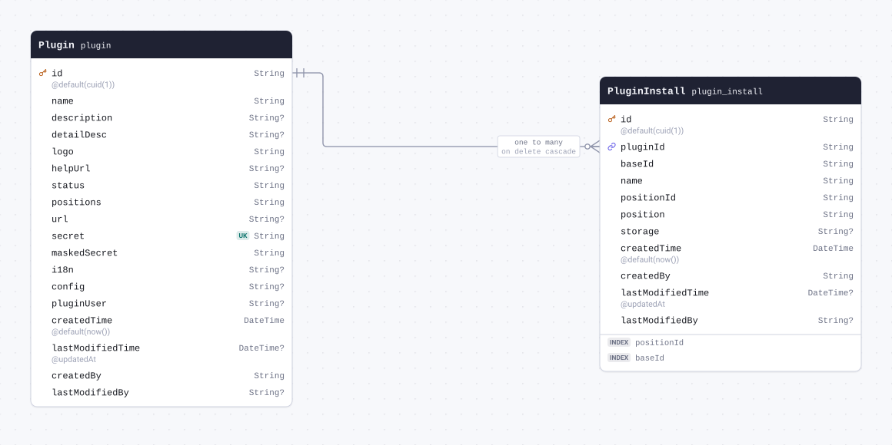

| Field                                     | Type       | Constraints                           | Default      | Description |
| ----------------------------------------- | ---------- | ------------------------------------- | ------------ | ----------- |
| `id`                                      | `String`   | PK NOT NULL                           | `cuid(1)`    |             |
| `pluginId` (`plugin_id`)                  | `String`   | NOT NULL → [Plugin.id](#model-Plugin) |              |             |
| `baseId` (`base_id`)                      | `String`   | NOT NULL                              |              |             |
| `name`                                    | `String`   | NOT NULL                              |              |             |
| `positionId` (`position_id`)              | `String`   | NOT NULL                              |              |             |
| `position`                                | `String`   | NOT NULL                              |              |             |
| `storage`                                 | `String`   | NULL                                  |              |             |
| `createdTime` (`created_time`)            | `DateTime` | NOT NULL                              | `now()`      |             |
| `createdBy` (`created_by`)                | `String`   | NOT NULL                              |              |             |
| `lastModifiedTime` (`last_modified_time`) | `DateTime` | NULL                                  | `@updatedAt` |             |
| `lastModifiedBy` (`last_modified_by`)     | `String`   | NULL                                  |              |             |

#### Indexes

- `@@index([positionId])`
- `@@index([baseId])`

#### References

- `pluginId` → [Plugin.id](#model-Plugin) (many-to-one, on delete Cascade)

#### Definition

```sql
CREATE TABLE "plugin_install" (
    "id" TEXT NOT NULL,
    "plugin_id" TEXT NOT NULL,
    "base_id" TEXT NOT NULL,
    "name" TEXT NOT NULL,
    "position_id" TEXT NOT NULL,
    "position" TEXT NOT NULL,
    "storage" TEXT,
    "created_time" TIMESTAMP(3) NOT NULL DEFAULT CURRENT_TIMESTAMP,
    "created_by" TEXT NOT NULL,
    "last_modified_time" TIMESTAMP(3),
    "last_modified_by" TEXT,

    CONSTRAINT "plugin_install_pkey" PRIMARY KEY ("id")
);

CREATE INDEX "plugin_install_position_id_idx" ON "plugin_install"("position_id");

CREATE INDEX "plugin_install_base_id_idx" ON "plugin_install"("base_id");

ALTER TABLE "plugin_install" ADD CONSTRAINT "plugin_install_plugin_id_fkey" FOREIGN KEY ("plugin_id") REFERENCES "plugin"("id") ON DELETE CASCADE ON UPDATE CASCADE;
```

<details>
<summary>Queries and their SQL</summary>

**findMany**: Every row

```ts
await prisma.pluginInstall.findMany();
```

```sql
SELECT
  "public"."plugin_install"."id",
  "public"."plugin_install"."plugin_id",
  "public"."plugin_install"."base_id",
  "public"."plugin_install"."name",
  "public"."plugin_install"."position_id",
  "public"."plugin_install"."position",
  "public"."plugin_install"."storage",
  "public"."plugin_install"."created_time",
  "public"."plugin_install"."created_by",
  "public"."plugin_install"."last_modified_time",
  "public"."plugin_install"."last_modified_by"
FROM
  "public"."plugin_install"
WHERE
  1 = 1
OFFSET
  $1
-- params: ["0"]
```

**count**: How many rows there are

```ts
await prisma.pluginInstall.count();
```

```sql
SELECT
  COUNT(*) AS "_count$_all"
FROM
  (
    SELECT
      "public"."plugin_install"."id"
    FROM
      "public"."plugin_install"
    WHERE
      1 = 1
    OFFSET
      $1
  ) AS "sub"
-- params: ["0"]
```

**findMany**: Every row with its relations

```ts
await prisma.pluginInstall.findMany({ include: { plugin: true } });
```

```sql
SELECT
  "public"."plugin_install"."id",
  "public"."plugin_install"."plugin_id",
  "public"."plugin_install"."base_id",
  "public"."plugin_install"."name",
  "public"."plugin_install"."position_id",
  "public"."plugin_install"."position",
  "public"."plugin_install"."storage",
  "public"."plugin_install"."created_time",
  "public"."plugin_install"."created_by",
  "public"."plugin_install"."last_modified_time",
  "public"."plugin_install"."last_modified_by"
FROM
  "public"."plugin_install"
WHERE
  1 = 1
OFFSET
  $1
-- params: ["0"]

SELECT
  "public"."plugin"."id",
  "public"."plugin"."name",
  "public"."plugin"."description",
  "public"."plugin"."detail_desc",
  "public"."plugin"."logo",
  "public"."plugin"."help_url",
  "public"."plugin"."status",
  "public"."plugin"."positions",
  "public"."plugin"."url",
  "public"."plugin"."secret",
  "public"."plugin"."masked_secret",
  "public"."plugin"."i18n",
  "public"."plugin"."config",
  "public"."plugin"."plugin_user",
  "public"."plugin"."created_time",
  "public"."plugin"."last_modified_time",
  "public"."plugin"."created_by",
  "public"."plugin"."last_modified_by"
FROM
  "public"."plugin"
WHERE
  "public"."plugin"."id" IN ($1)
OFFSET
  $2
-- params: ["<pluginId of the rows above>","0"]
```

**findUnique**: One row by what is unique to it

```ts
await prisma.pluginInstall.findUnique({ where: { id: "example" } });
```

```sql
SELECT
  "public"."plugin_install"."id",
  "public"."plugin_install"."plugin_id",
  "public"."plugin_install"."base_id",
  "public"."plugin_install"."name",
  "public"."plugin_install"."position_id",
  "public"."plugin_install"."position",
  "public"."plugin_install"."storage",
  "public"."plugin_install"."created_time",
  "public"."plugin_install"."created_by",
  "public"."plugin_install"."last_modified_time",
  "public"."plugin_install"."last_modified_by"
FROM
  "public"."plugin_install"
WHERE
  (
    "public"."plugin_install"."id" = $1
    AND 1 = 1
  )
LIMIT
  $2
OFFSET
  $3
-- params: ["example","1","0"]
```

**create**: Create a row

```ts
await prisma.pluginInstall.create({
  data: {
    pluginId: "example",
    baseId: "example",
    name: "example",
    positionId: "example",
    position: "example",
    createdBy: "example",
  },
});
```

```sql
INSERT INTO
  "public"."plugin_install" (
    "id",
    "plugin_id",
    "base_id",
    "name",
    "position_id",
    "position",
    "created_time",
    "created_by",
    "last_modified_time"
  )
VALUES
  ($1, $2, $3, $4, $5, $6, $7, $8, $9)
RETURNING
  "public"."plugin_install"."id",
  "public"."plugin_install"."plugin_id",
  "public"."plugin_install"."base_id",
  "public"."plugin_install"."name",
  "public"."plugin_install"."position_id",
  "public"."plugin_install"."position",
  "public"."plugin_install"."storage",
  "public"."plugin_install"."created_time",
  "public"."plugin_install"."created_by",
  "public"."plugin_install"."last_modified_time",
  "public"."plugin_install"."last_modified_by"
-- params: ["<cuid(1)>","example","example","example","example","example","<now()>","example","<now()>"]
```

**update**: Update a row

```ts
await prisma.pluginInstall.update({ where: { id: "example" }, data: { baseId: "example" } });
```

```sql
UPDATE "public"."plugin_install"
SET
  "base_id" = $1,
  "last_modified_time" = $2
WHERE
  (
    "public"."plugin_install"."id" = $3
    AND 1 = 1
  )
RETURNING
  "public"."plugin_install"."id",
  "public"."plugin_install"."plugin_id",
  "public"."plugin_install"."base_id",
  "public"."plugin_install"."name",
  "public"."plugin_install"."position_id",
  "public"."plugin_install"."position",
  "public"."plugin_install"."storage",
  "public"."plugin_install"."created_time",
  "public"."plugin_install"."created_by",
  "public"."plugin_install"."last_modified_time",
  "public"."plugin_install"."last_modified_by"
-- params: ["example",{"prisma__type":"generatorCall","prisma__value":{"name":"now","args":[],"returnType":{"type":"DateTime"}}},"example"]
```

**delete**: Delete a row

```ts
await prisma.pluginInstall.delete({ where: { id: "example" } });
```

```sql
DELETE FROM "public"."plugin_install"
WHERE
  (
    "public"."plugin_install"."id" = $1
    AND 1 = 1
  )
RETURNING
  "public"."plugin_install"."id",
  "public"."plugin_install"."plugin_id",
  "public"."plugin_install"."base_id",
  "public"."plugin_install"."name",
  "public"."plugin_install"."position_id",
  "public"."plugin_install"."position",
  "public"."plugin_install"."storage",
  "public"."plugin_install"."created_time",
  "public"."plugin_install"."created_by",
  "public"."plugin_install"."last_modified_time",
  "public"."plugin_install"."last_modified_by"
-- params: ["example"]
```

</details>

<a id="model-Dashboard"></a>

### Dashboard

Table `dashboard`.

| Field                                     | Type       | Constraints | Default      | Description |
| ----------------------------------------- | ---------- | ----------- | ------------ | ----------- |
| `id`                                      | `String`   | PK NOT NULL | `cuid(1)`    |             |
| `name`                                    | `String`   | NOT NULL    |              |             |
| `baseId` (`base_id`)                      | `String`   | NOT NULL    |              |             |
| `layout`                                  | `String`   | NULL        |              |             |
| `createdBy` (`created_by`)                | `String`   | NOT NULL    |              |             |
| `createdTime` (`created_time`)            | `DateTime` | NOT NULL    | `now()`      |             |
| `lastModifiedTime` (`last_modified_time`) | `DateTime` | NULL        | `@updatedAt` |             |
| `lastModifiedBy` (`last_modified_by`)     | `String`   | NULL        |              |             |
| `deletedTime` (`deleted_time`)            | `DateTime` | NULL        |              |             |

#### Indexes

- `@@index([baseId])`

#### Definition

```sql
CREATE TABLE "dashboard" (
    "id" TEXT NOT NULL,
    "name" TEXT NOT NULL,
    "base_id" TEXT NOT NULL,
    "layout" TEXT,
    "created_by" TEXT NOT NULL,
    "created_time" TIMESTAMP(3) NOT NULL DEFAULT CURRENT_TIMESTAMP,
    "last_modified_time" TIMESTAMP(3),
    "last_modified_by" TEXT,
    "deleted_time" TIMESTAMP(3),

    CONSTRAINT "dashboard_pkey" PRIMARY KEY ("id")
);

CREATE INDEX "dashboard_base_id_idx" ON "dashboard"("base_id");
```

<details>
<summary>Queries and their SQL</summary>

**findMany**: Every row

```ts
await prisma.dashboard.findMany();
```

```sql
SELECT
  "public"."dashboard"."id",
  "public"."dashboard"."name",
  "public"."dashboard"."base_id",
  "public"."dashboard"."layout",
  "public"."dashboard"."created_by",
  "public"."dashboard"."created_time",
  "public"."dashboard"."last_modified_time",
  "public"."dashboard"."last_modified_by",
  "public"."dashboard"."deleted_time"
FROM
  "public"."dashboard"
WHERE
  1 = 1
OFFSET
  $1
-- params: ["0"]
```

**count**: How many rows there are

```ts
await prisma.dashboard.count();
```

```sql
SELECT
  COUNT(*) AS "_count$_all"
FROM
  (
    SELECT
      "public"."dashboard"."id"
    FROM
      "public"."dashboard"
    WHERE
      1 = 1
    OFFSET
      $1
  ) AS "sub"
-- params: ["0"]
```

**findUnique**: One row by what is unique to it

```ts
await prisma.dashboard.findUnique({ where: { id: "example" } });
```

```sql
SELECT
  "public"."dashboard"."id",
  "public"."dashboard"."name",
  "public"."dashboard"."base_id",
  "public"."dashboard"."layout",
  "public"."dashboard"."created_by",
  "public"."dashboard"."created_time",
  "public"."dashboard"."last_modified_time",
  "public"."dashboard"."last_modified_by",
  "public"."dashboard"."deleted_time"
FROM
  "public"."dashboard"
WHERE
  (
    "public"."dashboard"."id" = $1
    AND 1 = 1
  )
LIMIT
  $2
OFFSET
  $3
-- params: ["example","1","0"]
```

**create**: Create a row

```ts
await prisma.dashboard.create({
  data: { name: "example", baseId: "example", createdBy: "example" },
});
```

```sql
INSERT INTO
  "public"."dashboard" (
    "id",
    "name",
    "base_id",
    "created_by",
    "created_time",
    "last_modified_time"
  )
VALUES
  ($1, $2, $3, $4, $5, $6)
RETURNING
  "public"."dashboard"."id",
  "public"."dashboard"."name",
  "public"."dashboard"."base_id",
  "public"."dashboard"."layout",
  "public"."dashboard"."created_by",
  "public"."dashboard"."created_time",
  "public"."dashboard"."last_modified_time",
  "public"."dashboard"."last_modified_by",
  "public"."dashboard"."deleted_time"
-- params: ["<cuid(1)>","example","example","example","<now()>","<now()>"]
```

**update**: Update a row

```ts
await prisma.dashboard.update({ where: { id: "example" }, data: { name: "example" } });
```

```sql
UPDATE "public"."dashboard"
SET
  "name" = $1,
  "last_modified_time" = $2
WHERE
  (
    "public"."dashboard"."id" = $3
    AND 1 = 1
  )
RETURNING
  "public"."dashboard"."id",
  "public"."dashboard"."name",
  "public"."dashboard"."base_id",
  "public"."dashboard"."layout",
  "public"."dashboard"."created_by",
  "public"."dashboard"."created_time",
  "public"."dashboard"."last_modified_time",
  "public"."dashboard"."last_modified_by",
  "public"."dashboard"."deleted_time"
-- params: ["example",{"prisma__type":"generatorCall","prisma__value":{"name":"now","args":[],"returnType":{"type":"DateTime"}}},"example"]
```

**delete**: Delete a row

```ts
await prisma.dashboard.delete({ where: { id: "example" } });
```

```sql
DELETE FROM "public"."dashboard"
WHERE
  (
    "public"."dashboard"."id" = $1
    AND 1 = 1
  )
RETURNING
  "public"."dashboard"."id",
  "public"."dashboard"."name",
  "public"."dashboard"."base_id",
  "public"."dashboard"."layout",
  "public"."dashboard"."created_by",
  "public"."dashboard"."created_time",
  "public"."dashboard"."last_modified_time",
  "public"."dashboard"."last_modified_by",
  "public"."dashboard"."deleted_time"
-- params: ["example"]
```

</details>

<a id="model-Comment"></a>

### Comment

Table `comment`.

| Field                                     | Type       | Constraints | Default      | Description |
| ----------------------------------------- | ---------- | ----------- | ------------ | ----------- |
| `id`                                      | `String`   | PK NOT NULL | `cuid(1)`    |             |
| `tableId` (`table_id`)                    | `String`   | NOT NULL    |              |             |
| `recordId` (`record_id`)                  | `String`   | NOT NULL    |              |             |
| `quoteId` (`quote_Id`)                    | `String`   | NULL        |              |             |
| `content`                                 | `String`   | NULL        |              |             |
| `reaction`                                | `String`   | NULL        |              |             |
| `deletedTime` (`deleted_time`)            | `DateTime` | NULL        |              |             |
| `createdTime` (`created_time`)            | `DateTime` | NOT NULL    | `now()`      |             |
| `createdBy` (`created_by`)                | `String`   | NOT NULL    |              |             |
| `lastModifiedTime` (`last_modified_time`) | `DateTime` | NULL        | `@updatedAt` |             |

#### Indexes

- `@@index([tableId, recordId])`

#### Definition

```sql
CREATE TABLE "comment" (
    "id" TEXT NOT NULL,
    "table_id" TEXT NOT NULL,
    "record_id" TEXT NOT NULL,
    "quote_Id" TEXT,
    "content" TEXT,
    "reaction" TEXT,
    "deleted_time" TIMESTAMP(3),
    "created_time" TIMESTAMP(3) NOT NULL DEFAULT CURRENT_TIMESTAMP,
    "created_by" TEXT NOT NULL,
    "last_modified_time" TIMESTAMP(3),

    CONSTRAINT "comment_pkey" PRIMARY KEY ("id")
);

CREATE INDEX "comment_table_id_record_id_idx" ON "comment"("table_id", "record_id");
```

<details>
<summary>Queries and their SQL</summary>

**findMany**: Every row

```ts
await prisma.comment.findMany();
```

```sql
SELECT
  "public"."comment"."id",
  "public"."comment"."table_id",
  "public"."comment"."record_id",
  "public"."comment"."quote_Id",
  "public"."comment"."content",
  "public"."comment"."reaction",
  "public"."comment"."deleted_time",
  "public"."comment"."created_time",
  "public"."comment"."created_by",
  "public"."comment"."last_modified_time"
FROM
  "public"."comment"
WHERE
  1 = 1
OFFSET
  $1
-- params: ["0"]
```

**count**: How many rows there are

```ts
await prisma.comment.count();
```

```sql
SELECT
  COUNT(*) AS "_count$_all"
FROM
  (
    SELECT
      "public"."comment"."id"
    FROM
      "public"."comment"
    WHERE
      1 = 1
    OFFSET
      $1
  ) AS "sub"
-- params: ["0"]
```

**findUnique**: One row by what is unique to it

```ts
await prisma.comment.findUnique({ where: { id: "example" } });
```

```sql
SELECT
  "public"."comment"."id",
  "public"."comment"."table_id",
  "public"."comment"."record_id",
  "public"."comment"."quote_Id",
  "public"."comment"."content",
  "public"."comment"."reaction",
  "public"."comment"."deleted_time",
  "public"."comment"."created_time",
  "public"."comment"."created_by",
  "public"."comment"."last_modified_time"
FROM
  "public"."comment"
WHERE
  (
    "public"."comment"."id" = $1
    AND 1 = 1
  )
LIMIT
  $2
OFFSET
  $3
-- params: ["example","1","0"]
```

**create**: Create a row

```ts
await prisma.comment.create({
  data: { tableId: "example", recordId: "example", createdBy: "example" },
});
```

```sql
INSERT INTO
  "public"."comment" (
    "id",
    "table_id",
    "record_id",
    "created_time",
    "created_by",
    "last_modified_time"
  )
VALUES
  ($1, $2, $3, $4, $5, $6)
RETURNING
  "public"."comment"."id",
  "public"."comment"."table_id",
  "public"."comment"."record_id",
  "public"."comment"."quote_Id",
  "public"."comment"."content",
  "public"."comment"."reaction",
  "public"."comment"."deleted_time",
  "public"."comment"."created_time",
  "public"."comment"."created_by",
  "public"."comment"."last_modified_time"
-- params: ["<cuid(1)>","example","example","<now()>","example","<now()>"]
```

**update**: Update a row

```ts
await prisma.comment.update({ where: { id: "example" }, data: { tableId: "example" } });
```

```sql
UPDATE "public"."comment"
SET
  "table_id" = $1,
  "last_modified_time" = $2
WHERE
  (
    "public"."comment"."id" = $3
    AND 1 = 1
  )
RETURNING
  "public"."comment"."id",
  "public"."comment"."table_id",
  "public"."comment"."record_id",
  "public"."comment"."quote_Id",
  "public"."comment"."content",
  "public"."comment"."reaction",
  "public"."comment"."deleted_time",
  "public"."comment"."created_time",
  "public"."comment"."created_by",
  "public"."comment"."last_modified_time"
-- params: ["example",{"prisma__type":"generatorCall","prisma__value":{"name":"now","args":[],"returnType":{"type":"DateTime"}}},"example"]
```

**delete**: Delete a row

```ts
await prisma.comment.delete({ where: { id: "example" } });
```

```sql
DELETE FROM "public"."comment"
WHERE
  (
    "public"."comment"."id" = $1
    AND 1 = 1
  )
RETURNING
  "public"."comment"."id",
  "public"."comment"."table_id",
  "public"."comment"."record_id",
  "public"."comment"."quote_Id",
  "public"."comment"."content",
  "public"."comment"."reaction",
  "public"."comment"."deleted_time",
  "public"."comment"."created_time",
  "public"."comment"."created_by",
  "public"."comment"."last_modified_time"
-- params: ["example"]
```

</details>

<a id="model-CommentSubscription"></a>

### CommentSubscription

Table `comment_subscription`.

| Field                          | Type       | Constraints | Default   | Description |
| ------------------------------ | ---------- | ----------- | --------- | ----------- |
| `id`                           | `String`   | PK NOT NULL | `cuid(1)` |             |
| `tableId` (`table_id`)         | `String`   | NOT NULL    |           |             |
| `recordId` (`record_id`)       | `String`   | NOT NULL    |           |             |
| `createdBy` (`created_by`)     | `String`   | NOT NULL    |           |             |
| `createdTime` (`created_time`) | `DateTime` | NOT NULL    | `now()`   |             |

#### Indexes

- `@@index([tableId, recordId])`
- `@@unique([tableId, recordId])`

#### Definition

```sql
CREATE TABLE "comment_subscription" (
    "id" TEXT NOT NULL,
    "table_id" TEXT NOT NULL,
    "record_id" TEXT NOT NULL,
    "created_by" TEXT NOT NULL,
    "created_time" TIMESTAMP(3) NOT NULL DEFAULT CURRENT_TIMESTAMP,

    CONSTRAINT "comment_subscription_pkey" PRIMARY KEY ("id")
);

CREATE INDEX "comment_subscription_table_id_record_id_idx" ON "comment_subscription"("table_id", "record_id");

CREATE UNIQUE INDEX "comment_subscription_table_id_record_id_key" ON "comment_subscription"("table_id", "record_id");
```

<details>
<summary>Queries and their SQL</summary>

**findMany**: Every row

```ts
await prisma.commentSubscription.findMany();
```

```sql
SELECT
  "public"."comment_subscription"."id",
  "public"."comment_subscription"."table_id",
  "public"."comment_subscription"."record_id",
  "public"."comment_subscription"."created_by",
  "public"."comment_subscription"."created_time"
FROM
  "public"."comment_subscription"
WHERE
  1 = 1
OFFSET
  $1
-- params: ["0"]
```

**count**: How many rows there are

```ts
await prisma.commentSubscription.count();
```

```sql
SELECT
  COUNT(*) AS "_count$_all"
FROM
  (
    SELECT
      "public"."comment_subscription"."id"
    FROM
      "public"."comment_subscription"
    WHERE
      1 = 1
    OFFSET
      $1
  ) AS "sub"
-- params: ["0"]
```

**findUnique**: One row by what is unique to it

```ts
await prisma.commentSubscription.findUnique({ where: { id: "example" } });
```

```sql
SELECT
  "public"."comment_subscription"."id",
  "public"."comment_subscription"."table_id",
  "public"."comment_subscription"."record_id",
  "public"."comment_subscription"."created_by",
  "public"."comment_subscription"."created_time"
FROM
  "public"."comment_subscription"
WHERE
  (
    "public"."comment_subscription"."id" = $1
    AND 1 = 1
  )
LIMIT
  $2
OFFSET
  $3
-- params: ["example","1","0"]
```

**create**: Create a row

```ts
await prisma.commentSubscription.create({
  data: { tableId: "example", recordId: "example", createdBy: "example" },
});
```

```sql
INSERT INTO
  "public"."comment_subscription" (
    "id",
    "table_id",
    "record_id",
    "created_by",
    "created_time"
  )
VALUES
  ($1, $2, $3, $4, $5)
RETURNING
  "public"."comment_subscription"."id",
  "public"."comment_subscription"."table_id",
  "public"."comment_subscription"."record_id",
  "public"."comment_subscription"."created_by",
  "public"."comment_subscription"."created_time"
-- params: ["<cuid(1)>","example","example","example","<now()>"]
```

**update**: Update a row

```ts
await prisma.commentSubscription.update({ where: { id: "example" }, data: { tableId: "example" } });
```

```sql
UPDATE "public"."comment_subscription"
SET
  "table_id" = $1
WHERE
  (
    "public"."comment_subscription"."id" = $2
    AND 1 = 1
  )
RETURNING
  "public"."comment_subscription"."id",
  "public"."comment_subscription"."table_id",
  "public"."comment_subscription"."record_id",
  "public"."comment_subscription"."created_by",
  "public"."comment_subscription"."created_time"
-- params: ["example","example"]
```

**delete**: Delete a row

```ts
await prisma.commentSubscription.delete({ where: { id: "example" } });
```

```sql
DELETE FROM "public"."comment_subscription"
WHERE
  (
    "public"."comment_subscription"."id" = $1
    AND 1 = 1
  )
RETURNING
  "public"."comment_subscription"."id",
  "public"."comment_subscription"."table_id",
  "public"."comment_subscription"."record_id",
  "public"."comment_subscription"."created_by",
  "public"."comment_subscription"."created_time"
-- params: ["example"]
```

</details>

<a id="model-Integration"></a>

### Integration

Table `integration`.

| Field                                     | Type       | Constraints     | Default      | Description |
| ----------------------------------------- | ---------- | --------------- | ------------ | ----------- |
| `id`                                      | `String`   | PK NOT NULL     | `cuid(1)`    |             |
| `resourceId` (`resource_id`)              | `String`   | UNIQUE NOT NULL |              |             |
| `config` (`config`)                       | `String`   | NOT NULL        |              |             |
| `type` (`type`)                           | `String`   | NOT NULL        |              |             |
| `enable` (`enable`)                       | `Boolean`  | NULL            |              |             |
| `createdTime` (`created_time`)            | `DateTime` | NOT NULL        | `now()`      |             |
| `lastModifiedTime` (`last_modified_time`) | `DateTime` | NULL            | `@updatedAt` |             |

#### Indexes

- `@@index([resourceId])`

#### Definition

```sql
CREATE TABLE "integration" (
    "id" TEXT NOT NULL,
    "resource_id" TEXT NOT NULL,
    "config" TEXT NOT NULL,
    "type" TEXT NOT NULL,
    "enable" BOOLEAN,
    "created_time" TIMESTAMP(3) NOT NULL DEFAULT CURRENT_TIMESTAMP,
    "last_modified_time" TIMESTAMP(3),

    CONSTRAINT "integration_pkey" PRIMARY KEY ("id")
);

CREATE UNIQUE INDEX "integration_resource_id_key" ON "integration"("resource_id");

CREATE INDEX "integration_resource_id_idx" ON "integration"("resource_id");
```

<details>
<summary>Queries and their SQL</summary>

**findMany**: Every row

```ts
await prisma.integration.findMany();
```

```sql
SELECT
  "public"."integration"."id",
  "public"."integration"."resource_id",
  "public"."integration"."config",
  "public"."integration"."type",
  "public"."integration"."enable",
  "public"."integration"."created_time",
  "public"."integration"."last_modified_time"
FROM
  "public"."integration"
WHERE
  1 = 1
OFFSET
  $1
-- params: ["0"]
```

**count**: How many rows there are

```ts
await prisma.integration.count();
```

```sql
SELECT
  COUNT(*) AS "_count$_all"
FROM
  (
    SELECT
      "public"."integration"."id"
    FROM
      "public"."integration"
    WHERE
      1 = 1
    OFFSET
      $1
  ) AS "sub"
-- params: ["0"]
```

**findUnique**: One row by what is unique to it

```ts
await prisma.integration.findUnique({ where: { id: "example" } });
```

```sql
SELECT
  "public"."integration"."id",
  "public"."integration"."resource_id",
  "public"."integration"."config",
  "public"."integration"."type",
  "public"."integration"."enable",
  "public"."integration"."created_time",
  "public"."integration"."last_modified_time"
FROM
  "public"."integration"
WHERE
  (
    "public"."integration"."id" = $1
    AND 1 = 1
  )
LIMIT
  $2
OFFSET
  $3
-- params: ["example","1","0"]
```

**create**: Create a row

```ts
await prisma.integration.create({
  data: { resourceId: "example", config: "example", type: "example" },
});
```

```sql
INSERT INTO
  "public"."integration" (
    "id",
    "resource_id",
    "config",
    "type",
    "created_time",
    "last_modified_time"
  )
VALUES
  ($1, $2, $3, $4, $5, $6)
RETURNING
  "public"."integration"."id",
  "public"."integration"."resource_id",
  "public"."integration"."config",
  "public"."integration"."type",
  "public"."integration"."enable",
  "public"."integration"."created_time",
  "public"."integration"."last_modified_time"
-- params: ["<cuid(1)>","example","example","example","<now()>","<now()>"]
```

**update**: Update a row

```ts
await prisma.integration.update({ where: { id: "example" }, data: { resourceId: "example" } });
```

```sql
UPDATE "public"."integration"
SET
  "resource_id" = $1,
  "last_modified_time" = $2
WHERE
  (
    "public"."integration"."id" = $3
    AND 1 = 1
  )
RETURNING
  "public"."integration"."id",
  "public"."integration"."resource_id",
  "public"."integration"."config",
  "public"."integration"."type",
  "public"."integration"."enable",
  "public"."integration"."created_time",
  "public"."integration"."last_modified_time"
-- params: ["example",{"prisma__type":"generatorCall","prisma__value":{"name":"now","args":[],"returnType":{"type":"DateTime"}}},"example"]
```

**delete**: Delete a row

```ts
await prisma.integration.delete({ where: { id: "example" } });
```

```sql
DELETE FROM "public"."integration"
WHERE
  (
    "public"."integration"."id" = $1
    AND 1 = 1
  )
RETURNING
  "public"."integration"."id",
  "public"."integration"."resource_id",
  "public"."integration"."config",
  "public"."integration"."type",
  "public"."integration"."enable",
  "public"."integration"."created_time",
  "public"."integration"."last_modified_time"
-- params: ["example"]
```

</details>

<a id="model-PluginPanel"></a>

### PluginPanel

Table `plugin_panel`.

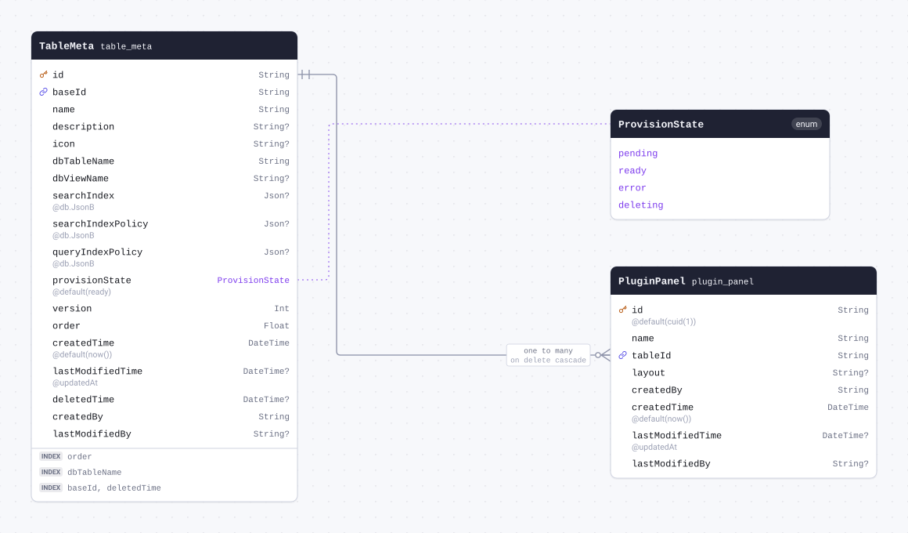

| Field                                     | Type       | Constraints                                 | Default      | Description |
| ----------------------------------------- | ---------- | ------------------------------------------- | ------------ | ----------- |
| `id`                                      | `String`   | PK NOT NULL                                 | `cuid(1)`    |             |
| `name`                                    | `String`   | NOT NULL                                    |              |             |
| `tableId` (`table_id`)                    | `String`   | NOT NULL → [TableMeta.id](#model-TableMeta) |              |             |
| `layout`                                  | `String`   | NULL                                        |              |             |
| `createdBy` (`created_by`)                | `String`   | NOT NULL                                    |              |             |
| `createdTime` (`created_time`)            | `DateTime` | NOT NULL                                    | `now()`      |             |
| `lastModifiedTime` (`last_modified_time`) | `DateTime` | NULL                                        | `@updatedAt` |             |
| `lastModifiedBy` (`last_modified_by`)     | `String`   | NULL                                        |              |             |

#### References

- `tableId` → [TableMeta.id](#model-TableMeta) (many-to-one, on delete Cascade)

#### Definition

```sql
CREATE TABLE "plugin_panel" (
    "id" TEXT NOT NULL,
    "name" TEXT NOT NULL,
    "table_id" TEXT NOT NULL,
    "layout" TEXT,
    "created_by" TEXT NOT NULL,
    "created_time" TIMESTAMP(3) NOT NULL DEFAULT CURRENT_TIMESTAMP,
    "last_modified_time" TIMESTAMP(3),
    "last_modified_by" TEXT,

    CONSTRAINT "plugin_panel_pkey" PRIMARY KEY ("id")
);

ALTER TABLE "plugin_panel" ADD CONSTRAINT "plugin_panel_table_id_fkey" FOREIGN KEY ("table_id") REFERENCES "table_meta"("id") ON DELETE CASCADE ON UPDATE CASCADE;
```

<details>
<summary>Queries and their SQL</summary>

**findMany**: Every row

```ts
await prisma.pluginPanel.findMany();
```

```sql
SELECT
  "public"."plugin_panel"."id",
  "public"."plugin_panel"."name",
  "public"."plugin_panel"."table_id",
  "public"."plugin_panel"."layout",
  "public"."plugin_panel"."created_by",
  "public"."plugin_panel"."created_time",
  "public"."plugin_panel"."last_modified_time",
  "public"."plugin_panel"."last_modified_by"
FROM
  "public"."plugin_panel"
WHERE
  1 = 1
OFFSET
  $1
-- params: ["0"]
```

**count**: How many rows there are

```ts
await prisma.pluginPanel.count();
```

```sql
SELECT
  COUNT(*) AS "_count$_all"
FROM
  (
    SELECT
      "public"."plugin_panel"."id"
    FROM
      "public"."plugin_panel"
    WHERE
      1 = 1
    OFFSET
      $1
  ) AS "sub"
-- params: ["0"]
```

**findMany**: Every row with its relations

```ts
await prisma.pluginPanel.findMany({ include: { table: true } });
```

```sql
SELECT
  "public"."plugin_panel"."id",
  "public"."plugin_panel"."name",
  "public"."plugin_panel"."table_id",
  "public"."plugin_panel"."layout",
  "public"."plugin_panel"."created_by",
  "public"."plugin_panel"."created_time",
  "public"."plugin_panel"."last_modified_time",
  "public"."plugin_panel"."last_modified_by"
FROM
  "public"."plugin_panel"
WHERE
  1 = 1
OFFSET
  $1
-- params: ["0"]

SELECT
  "public"."table_meta"."id",
  "public"."table_meta"."base_id",
  "public"."table_meta"."name",
  "public"."table_meta"."description",
  "public"."table_meta"."icon",
  "public"."table_meta"."db_table_name",
  "public"."table_meta"."db_view_name",
  "public"."table_meta"."search_index",
  "public"."table_meta"."search_index_policy",
  "public"."table_meta"."query_index_policy",
  "public"."table_meta"."provision_state"::text,
  "public"."table_meta"."version",
  "public"."table_meta"."order",
  "public"."table_meta"."created_time",
  "public"."table_meta"."last_modified_time",
  "public"."table_meta"."deleted_time",
  "public"."table_meta"."created_by",
  "public"."table_meta"."last_modified_by"
FROM
  "public"."table_meta"
WHERE
  "public"."table_meta"."id" IN ($1)
OFFSET
  $2
-- params: ["<tableId of the rows above>","0"]
```

**findUnique**: One row by what is unique to it

```ts
await prisma.pluginPanel.findUnique({ where: { id: "example" } });
```

```sql
SELECT
  "public"."plugin_panel"."id",
  "public"."plugin_panel"."name",
  "public"."plugin_panel"."table_id",
  "public"."plugin_panel"."layout",
  "public"."plugin_panel"."created_by",
  "public"."plugin_panel"."created_time",
  "public"."plugin_panel"."last_modified_time",
  "public"."plugin_panel"."last_modified_by"
FROM
  "public"."plugin_panel"
WHERE
  (
    "public"."plugin_panel"."id" = $1
    AND 1 = 1
  )
LIMIT
  $2
OFFSET
  $3
-- params: ["example","1","0"]
```

**create**: Create a row

```ts
await prisma.pluginPanel.create({
  data: { name: "example", tableId: "example", createdBy: "example" },
});
```

```sql
INSERT INTO
  "public"."plugin_panel" (
    "id",
    "name",
    "table_id",
    "created_by",
    "created_time",
    "last_modified_time"
  )
VALUES
  ($1, $2, $3, $4, $5, $6)
RETURNING
  "public"."plugin_panel"."id",
  "public"."plugin_panel"."name",
  "public"."plugin_panel"."table_id",
  "public"."plugin_panel"."layout",
  "public"."plugin_panel"."created_by",
  "public"."plugin_panel"."created_time",
  "public"."plugin_panel"."last_modified_time",
  "public"."plugin_panel"."last_modified_by"
-- params: ["<cuid(1)>","example","example","example","<now()>","<now()>"]
```

**update**: Update a row

```ts
await prisma.pluginPanel.update({ where: { id: "example" }, data: { name: "example" } });
```

```sql
UPDATE "public"."plugin_panel"
SET
  "name" = $1,
  "last_modified_time" = $2
WHERE
  (
    "public"."plugin_panel"."id" = $3
    AND 1 = 1
  )
RETURNING
  "public"."plugin_panel"."id",
  "public"."plugin_panel"."name",
  "public"."plugin_panel"."table_id",
  "public"."plugin_panel"."layout",
  "public"."plugin_panel"."created_by",
  "public"."plugin_panel"."created_time",
  "public"."plugin_panel"."last_modified_time",
  "public"."plugin_panel"."last_modified_by"
-- params: ["example",{"prisma__type":"generatorCall","prisma__value":{"name":"now","args":[],"returnType":{"type":"DateTime"}}},"example"]
```

**delete**: Delete a row

```ts
await prisma.pluginPanel.delete({ where: { id: "example" } });
```

```sql
DELETE FROM "public"."plugin_panel"
WHERE
  (
    "public"."plugin_panel"."id" = $1
    AND 1 = 1
  )
RETURNING
  "public"."plugin_panel"."id",
  "public"."plugin_panel"."name",
  "public"."plugin_panel"."table_id",
  "public"."plugin_panel"."layout",
  "public"."plugin_panel"."created_by",
  "public"."plugin_panel"."created_time",
  "public"."plugin_panel"."last_modified_time",
  "public"."plugin_panel"."last_modified_by"
-- params: ["example"]
```

</details>

<a id="model-PluginContextMenu"></a>

### PluginContextMenu

Table `plugin_context_menu`.

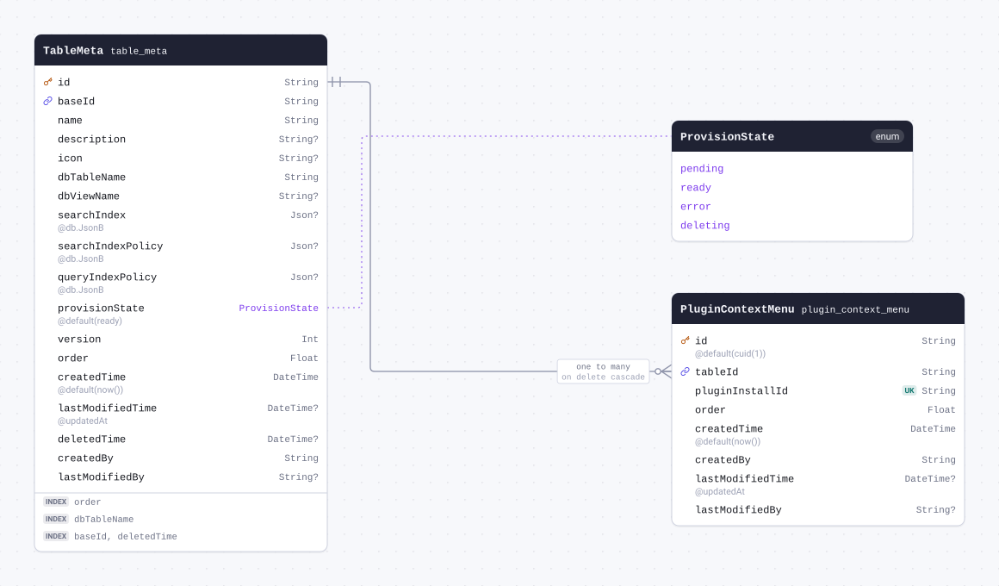

| Field                                     | Type       | Constraints                                 | Default      | Description |
| ----------------------------------------- | ---------- | ------------------------------------------- | ------------ | ----------- |
| `id`                                      | `String`   | PK NOT NULL                                 | `cuid(1)`    |             |
| `tableId` (`table_id`)                    | `String`   | NOT NULL → [TableMeta.id](#model-TableMeta) |              |             |
| `pluginInstallId` (`plugin_install_id`)   | `String`   | UNIQUE NOT NULL                             |              |             |
| `order` (`order`)                         | `Float`    | NOT NULL                                    |              |             |
| `createdTime` (`created_time`)            | `DateTime` | NOT NULL                                    | `now()`      |             |
| `createdBy` (`created_by`)                | `String`   | NOT NULL                                    |              |             |
| `lastModifiedTime` (`last_modified_time`) | `DateTime` | NULL                                        | `@updatedAt` |             |
| `lastModifiedBy` (`last_modified_by`)     | `String`   | NULL                                        |              |             |

#### References

- `tableId` → [TableMeta.id](#model-TableMeta) (many-to-one, on delete Cascade)

#### Definition

```sql
CREATE TABLE "plugin_context_menu" (
    "id" TEXT NOT NULL,
    "table_id" TEXT NOT NULL,
    "plugin_install_id" TEXT NOT NULL,
    "order" DOUBLE PRECISION NOT NULL,
    "created_time" TIMESTAMP(3) NOT NULL DEFAULT CURRENT_TIMESTAMP,
    "created_by" TEXT NOT NULL,
    "last_modified_time" TIMESTAMP(3),
    "last_modified_by" TEXT,

    CONSTRAINT "plugin_context_menu_pkey" PRIMARY KEY ("id")
);

CREATE UNIQUE INDEX "plugin_context_menu_plugin_install_id_key" ON "plugin_context_menu"("plugin_install_id");

ALTER TABLE "plugin_context_menu" ADD CONSTRAINT "plugin_context_menu_table_id_fkey" FOREIGN KEY ("table_id") REFERENCES "table_meta"("id") ON DELETE CASCADE ON UPDATE CASCADE;
```

<details>
<summary>Queries and their SQL</summary>

**findMany**: Every row

```ts
await prisma.pluginContextMenu.findMany();
```

```sql
SELECT
  "public"."plugin_context_menu"."id",
  "public"."plugin_context_menu"."table_id",
  "public"."plugin_context_menu"."plugin_install_id",
  "public"."plugin_context_menu"."order",
  "public"."plugin_context_menu"."created_time",
  "public"."plugin_context_menu"."created_by",
  "public"."plugin_context_menu"."last_modified_time",
  "public"."plugin_context_menu"."last_modified_by"
FROM
  "public"."plugin_context_menu"
WHERE
  1 = 1
OFFSET
  $1
-- params: ["0"]
```

**count**: How many rows there are

```ts
await prisma.pluginContextMenu.count();
```

```sql
SELECT
  COUNT(*) AS "_count$_all"
FROM
  (
    SELECT
      "public"."plugin_context_menu"."id"
    FROM
      "public"."plugin_context_menu"
    WHERE
      1 = 1
    OFFSET
      $1
  ) AS "sub"
-- params: ["0"]
```

**findMany**: Every row with its relations

```ts
await prisma.pluginContextMenu.findMany({ include: { table: true } });
```

```sql
SELECT
  "public"."plugin_context_menu"."id",
  "public"."plugin_context_menu"."table_id",
  "public"."plugin_context_menu"."plugin_install_id",
  "public"."plugin_context_menu"."order",
  "public"."plugin_context_menu"."created_time",
  "public"."plugin_context_menu"."created_by",
  "public"."plugin_context_menu"."last_modified_time",
  "public"."plugin_context_menu"."last_modified_by"
FROM
  "public"."plugin_context_menu"
WHERE
  1 = 1
OFFSET
  $1
-- params: ["0"]

SELECT
  "public"."table_meta"."id",
  "public"."table_meta"."base_id",
  "public"."table_meta"."name",
  "public"."table_meta"."description",
  "public"."table_meta"."icon",
  "public"."table_meta"."db_table_name",
  "public"."table_meta"."db_view_name",
  "public"."table_meta"."search_index",
  "public"."table_meta"."search_index_policy",
  "public"."table_meta"."query_index_policy",
  "public"."table_meta"."provision_state"::text,
  "public"."table_meta"."version",
  "public"."table_meta"."order",
  "public"."table_meta"."created_time",
  "public"."table_meta"."last_modified_time",
  "public"."table_meta"."deleted_time",
  "public"."table_meta"."created_by",
  "public"."table_meta"."last_modified_by"
FROM
  "public"."table_meta"
WHERE
  "public"."table_meta"."id" IN ($1)
OFFSET
  $2
-- params: ["<tableId of the rows above>","0"]
```

**findUnique**: One row by what is unique to it

```ts
await prisma.pluginContextMenu.findUnique({ where: { id: "example" } });
```

```sql
SELECT
  "public"."plugin_context_menu"."id",
  "public"."plugin_context_menu"."table_id",
  "public"."plugin_context_menu"."plugin_install_id",
  "public"."plugin_context_menu"."order",
  "public"."plugin_context_menu"."created_time",
  "public"."plugin_context_menu"."created_by",
  "public"."plugin_context_menu"."last_modified_time",
  "public"."plugin_context_menu"."last_modified_by"
FROM
  "public"."plugin_context_menu"
WHERE
  (
    "public"."plugin_context_menu"."id" = $1
    AND 1 = 1
  )
LIMIT
  $2
OFFSET
  $3
-- params: ["example","1","0"]
```

**create**: Create a row

```ts
await prisma.pluginContextMenu.create({
  data: { tableId: "example", pluginInstallId: "example", order: 1.5, createdBy: "example" },
});
```

```sql
INSERT INTO
  "public"."plugin_context_menu" (
    "id",
    "table_id",
    "plugin_install_id",
    "order",
    "created_time",
    "created_by",
    "last_modified_time"
  )
VALUES
  ($1, $2, $3, $4, $5, $6, $7)
RETURNING
  "public"."plugin_context_menu"."id",
  "public"."plugin_context_menu"."table_id",
  "public"."plugin_context_menu"."plugin_install_id",
  "public"."plugin_context_menu"."order",
  "public"."plugin_context_menu"."created_time",
  "public"."plugin_context_menu"."created_by",
  "public"."plugin_context_menu"."last_modified_time",
  "public"."plugin_context_menu"."last_modified_by"
-- params: ["<cuid(1)>","example","example","1.5","<now()>","example","<now()>"]
```

**update**: Update a row

```ts
await prisma.pluginContextMenu.update({
  where: { id: "example" },
  data: { pluginInstallId: "example" },
});
```

```sql
UPDATE "public"."plugin_context_menu"
SET
  "plugin_install_id" = $1,
  "last_modified_time" = $2
WHERE
  (
    "public"."plugin_context_menu"."id" = $3
    AND 1 = 1
  )
RETURNING
  "public"."plugin_context_menu"."id",
  "public"."plugin_context_menu"."table_id",
  "public"."plugin_context_menu"."plugin_install_id",
  "public"."plugin_context_menu"."order",
  "public"."plugin_context_menu"."created_time",
  "public"."plugin_context_menu"."created_by",
  "public"."plugin_context_menu"."last_modified_time",
  "public"."plugin_context_menu"."last_modified_by"
-- params: ["example",{"prisma__type":"generatorCall","prisma__value":{"name":"now","args":[],"returnType":{"type":"DateTime"}}},"example"]
```

**delete**: Delete a row

```ts
await prisma.pluginContextMenu.delete({ where: { id: "example" } });
```

```sql
DELETE FROM "public"."plugin_context_menu"
WHERE
  (
    "public"."plugin_context_menu"."id" = $1
    AND 1 = 1
  )
RETURNING
  "public"."plugin_context_menu"."id",
  "public"."plugin_context_menu"."table_id",
  "public"."plugin_context_menu"."plugin_install_id",
  "public"."plugin_context_menu"."order",
  "public"."plugin_context_menu"."created_time",
  "public"."plugin_context_menu"."created_by",
  "public"."plugin_context_menu"."last_modified_time",
  "public"."plugin_context_menu"."last_modified_by"
-- params: ["example"]
```

</details>

<a id="model-UserLastVisit"></a>

### UserLastVisit

Table `user_last_visit`.

| Field                                     | Type       | Constraints | Default   | Description |
| ----------------------------------------- | ---------- | ----------- | --------- | ----------- |
| `id`                                      | `String`   | PK NOT NULL | `cuid(1)` |             |
| `userId` (`user_id`)                      | `String`   | NOT NULL    |           |             |
| `resourceType` (`resource_type`)          | `String`   | NOT NULL    |           |             |
| `resourceId` (`resource_id`)              | `String`   | NOT NULL    |           |             |
| `parentResourceId` (`parent_resource_id`) | `String`   | NOT NULL    |           |             |
| `lastVisitTime` (`last_visit_time`)       | `DateTime` | NOT NULL    | `now()`   |             |

#### Indexes

- `@@index([userId, resourceType, parentResourceId])`
- `@@unique([userId, resourceType, resourceId])`

#### Definition

```sql
CREATE TABLE "user_last_visit" (
    "id" TEXT NOT NULL,
    "user_id" TEXT NOT NULL,
    "resource_type" TEXT NOT NULL,
    "resource_id" TEXT NOT NULL,
    "parent_resource_id" TEXT NOT NULL,
    "last_visit_time" TIMESTAMP(3) NOT NULL DEFAULT CURRENT_TIMESTAMP,

    CONSTRAINT "user_last_visit_pkey" PRIMARY KEY ("id")
);

CREATE INDEX "user_last_visit_user_id_resource_type_parent_resource_id_idx" ON "user_last_visit"("user_id", "resource_type", "parent_resource_id");

CREATE UNIQUE INDEX "user_last_visit_user_id_resource_type_resource_id_key" ON "user_last_visit"("user_id", "resource_type", "resource_id");
```

<details>
<summary>Queries and their SQL</summary>

**findMany**: Every row

```ts
await prisma.userLastVisit.findMany();
```

```sql
SELECT
  "public"."user_last_visit"."id",
  "public"."user_last_visit"."user_id",
  "public"."user_last_visit"."resource_type",
  "public"."user_last_visit"."resource_id",
  "public"."user_last_visit"."parent_resource_id",
  "public"."user_last_visit"."last_visit_time"
FROM
  "public"."user_last_visit"
WHERE
  1 = 1
OFFSET
  $1
-- params: ["0"]
```

**count**: How many rows there are

```ts
await prisma.userLastVisit.count();
```

```sql
SELECT
  COUNT(*) AS "_count$_all"
FROM
  (
    SELECT
      "public"."user_last_visit"."id"
    FROM
      "public"."user_last_visit"
    WHERE
      1 = 1
    OFFSET
      $1
  ) AS "sub"
-- params: ["0"]
```

**findUnique**: One row by what is unique to it

```ts
await prisma.userLastVisit.findUnique({ where: { id: "example" } });
```

```sql
SELECT
  "public"."user_last_visit"."id",
  "public"."user_last_visit"."user_id",
  "public"."user_last_visit"."resource_type",
  "public"."user_last_visit"."resource_id",
  "public"."user_last_visit"."parent_resource_id",
  "public"."user_last_visit"."last_visit_time"
FROM
  "public"."user_last_visit"
WHERE
  (
    "public"."user_last_visit"."id" = $1
    AND 1 = 1
  )
LIMIT
  $2
OFFSET
  $3
-- params: ["example","1","0"]
```

**create**: Create a row

```ts
await prisma.userLastVisit.create({
  data: {
    userId: "example",
    resourceType: "example",
    resourceId: "example",
    parentResourceId: "example",
  },
});
```

```sql
INSERT INTO
  "public"."user_last_visit" (
    "id",
    "user_id",
    "resource_type",
    "resource_id",
    "parent_resource_id",
    "last_visit_time"
  )
VALUES
  ($1, $2, $3, $4, $5, $6)
RETURNING
  "public"."user_last_visit"."id",
  "public"."user_last_visit"."user_id",
  "public"."user_last_visit"."resource_type",
  "public"."user_last_visit"."resource_id",
  "public"."user_last_visit"."parent_resource_id",
  "public"."user_last_visit"."last_visit_time"
-- params: ["<cuid(1)>","example","example","example","example","<now()>"]
```

**update**: Update a row

```ts
await prisma.userLastVisit.update({ where: { id: "example" }, data: { userId: "example" } });
```

```sql
UPDATE "public"."user_last_visit"
SET
  "user_id" = $1
WHERE
  (
    "public"."user_last_visit"."id" = $2
    AND 1 = 1
  )
RETURNING
  "public"."user_last_visit"."id",
  "public"."user_last_visit"."user_id",
  "public"."user_last_visit"."resource_type",
  "public"."user_last_visit"."resource_id",
  "public"."user_last_visit"."parent_resource_id",
  "public"."user_last_visit"."last_visit_time"
-- params: ["example","example"]
```

**delete**: Delete a row

```ts
await prisma.userLastVisit.delete({ where: { id: "example" } });
```

```sql
DELETE FROM "public"."user_last_visit"
WHERE
  (
    "public"."user_last_visit"."id" = $1
    AND 1 = 1
  )
RETURNING
  "public"."user_last_visit"."id",
  "public"."user_last_visit"."user_id",
  "public"."user_last_visit"."resource_type",
  "public"."user_last_visit"."resource_id",
  "public"."user_last_visit"."parent_resource_id",
  "public"."user_last_visit"."last_visit_time"
-- params: ["example"]
```

</details>

<a id="model-UserBaseOrder"></a>

### UserBaseOrder

Table `user_base_order`.

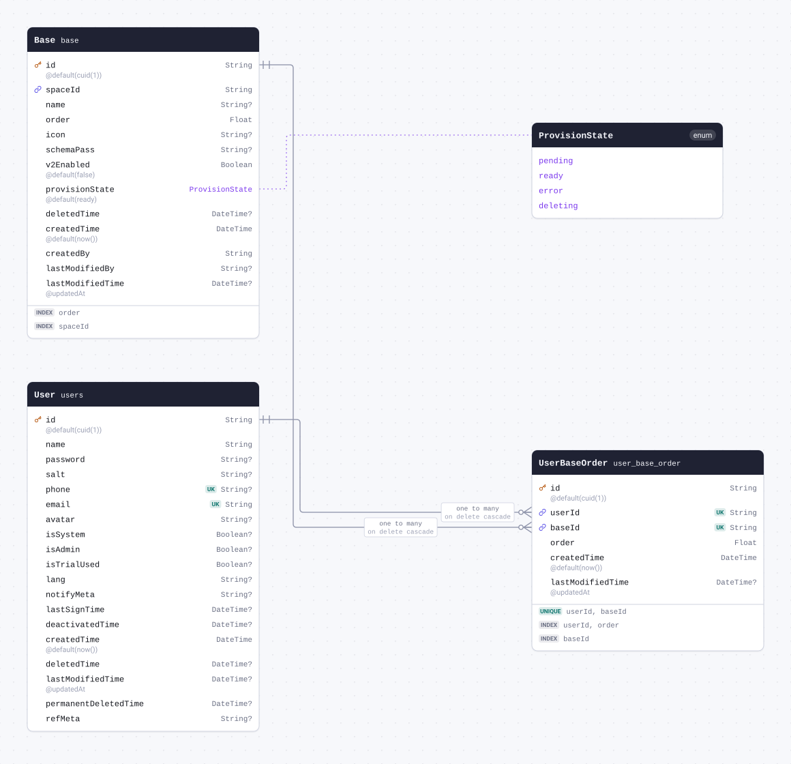

| Field                                     | Type       | Constraints                       | Default      | Description |
| ----------------------------------------- | ---------- | --------------------------------- | ------------ | ----------- |
| `id`                                      | `String`   | PK NOT NULL                       | `cuid(1)`    |             |
| `userId` (`user_id`)                      | `String`   | NOT NULL → [User.id](#model-User) |              |             |
| `baseId` (`base_id`)                      | `String`   | NOT NULL → [Base.id](#model-Base) |              |             |
| `order`                                   | `Float`    | NOT NULL                          |              |             |
| `createdTime` (`created_time`)            | `DateTime` | NOT NULL                          | `now()`      |             |
| `lastModifiedTime` (`last_modified_time`) | `DateTime` | NULL                              | `@updatedAt` |             |

#### Indexes

- `@@index([userId, order])`
- `@@index([baseId])`
- `@@unique([userId, baseId])`

#### References

- `userId` → [User.id](#model-User) (many-to-one, on delete Cascade)
- `baseId` → [Base.id](#model-Base) (many-to-one, on delete Cascade)

#### Definition

```sql
CREATE TABLE "user_base_order" (
    "id" TEXT NOT NULL,
    "user_id" TEXT NOT NULL,
    "base_id" TEXT NOT NULL,
    "order" DOUBLE PRECISION NOT NULL,
    "created_time" TIMESTAMP(3) NOT NULL DEFAULT CURRENT_TIMESTAMP,
    "last_modified_time" TIMESTAMP(3),

    CONSTRAINT "user_base_order_pkey" PRIMARY KEY ("id")
);

CREATE INDEX "user_base_order_user_id_order_idx" ON "user_base_order"("user_id", "order");

CREATE INDEX "user_base_order_base_id_idx" ON "user_base_order"("base_id");

CREATE UNIQUE INDEX "user_base_order_user_id_base_id_key" ON "user_base_order"("user_id", "base_id");

ALTER TABLE "user_base_order" ADD CONSTRAINT "user_base_order_user_id_fkey" FOREIGN KEY ("user_id") REFERENCES "users"("id") ON DELETE CASCADE ON UPDATE CASCADE;

ALTER TABLE "user_base_order" ADD CONSTRAINT "user_base_order_base_id_fkey" FOREIGN KEY ("base_id") REFERENCES "base"("id") ON DELETE CASCADE ON UPDATE CASCADE;
```

<details>
<summary>Queries and their SQL</summary>

**findMany**: Every row

```ts
await prisma.userBaseOrder.findMany();
```

```sql
SELECT
  "public"."user_base_order"."id",
  "public"."user_base_order"."user_id",
  "public"."user_base_order"."base_id",
  "public"."user_base_order"."order",
  "public"."user_base_order"."created_time",
  "public"."user_base_order"."last_modified_time"
FROM
  "public"."user_base_order"
WHERE
  1 = 1
OFFSET
  $1
-- params: ["0"]
```

**count**: How many rows there are

```ts
await prisma.userBaseOrder.count();
```

```sql
SELECT
  COUNT(*) AS "_count$_all"
FROM
  (
    SELECT
      "public"."user_base_order"."id"
    FROM
      "public"."user_base_order"
    WHERE
      1 = 1
    OFFSET
      $1
  ) AS "sub"
-- params: ["0"]
```

**findMany**: Every row with its relations

```ts
await prisma.userBaseOrder.findMany({ include: { user: true, base: true } });
```

```sql
SELECT
  "public"."user_base_order"."id",
  "public"."user_base_order"."user_id",
  "public"."user_base_order"."base_id",
  "public"."user_base_order"."order",
  "public"."user_base_order"."created_time",
  "public"."user_base_order"."last_modified_time"
FROM
  "public"."user_base_order"
WHERE
  1 = 1
OFFSET
  $1
-- params: ["0"]

SELECT
  "public"."users"."id",
  "public"."users"."name",
  "public"."users"."password",
  "public"."users"."salt",
  "public"."users"."phone",
  "public"."users"."email",
  "public"."users"."avatar",
  "public"."users"."is_system",
  "public"."users"."is_admin",
  "public"."users"."is_trial_used",
  "public"."users"."lang",
  "public"."users"."notify_meta",
  "public"."users"."last_sign_time",
  "public"."users"."deactivated_time",
  "public"."users"."created_time",
  "public"."users"."deleted_time",
  "public"."users"."last_modified_time",
  "public"."users"."permanent_deleted_time",
  "public"."users"."ref_meta"
FROM
  "public"."users"
WHERE
  "public"."users"."id" IN ($1)
OFFSET
  $2
-- params: ["<userId of the rows above>","0"]

SELECT
  "public"."base"."id",
  "public"."base"."space_id",
  "public"."base"."name",
  "public"."base"."order",
  "public"."base"."icon",
  "public"."base"."schema_pass",
  "public"."base"."v2_enabled",
  "public"."base"."provision_state"::text,
  "public"."base"."deleted_time",
  "public"."base"."created_time",
  "public"."base"."created_by",
  "public"."base"."last_modified_by",
  "public"."base"."last_modified_time"
FROM
  "public"."base"
WHERE
  "public"."base"."id" IN ($1)
OFFSET
  $2
-- params: ["<baseId of the rows above>","0"]
```

**findUnique**: One row by what is unique to it

```ts
await prisma.userBaseOrder.findUnique({ where: { id: "example" } });
```

```sql
SELECT
  "public"."user_base_order"."id",
  "public"."user_base_order"."user_id",
  "public"."user_base_order"."base_id",
  "public"."user_base_order"."order",
  "public"."user_base_order"."created_time",
  "public"."user_base_order"."last_modified_time"
FROM
  "public"."user_base_order"
WHERE
  (
    "public"."user_base_order"."id" = $1
    AND 1 = 1
  )
LIMIT
  $2
OFFSET
  $3
-- params: ["example","1","0"]
```

**create**: Create a row

```ts
await prisma.userBaseOrder.create({ data: { userId: "example", baseId: "example", order: 1.5 } });
```

```sql
INSERT INTO
  "public"."user_base_order" (
    "id",
    "user_id",
    "base_id",
    "order",
    "created_time",
    "last_modified_time"
  )
VALUES
  ($1, $2, $3, $4, $5, $6)
RETURNING
  "public"."user_base_order"."id",
  "public"."user_base_order"."user_id",
  "public"."user_base_order"."base_id",
  "public"."user_base_order"."order",
  "public"."user_base_order"."created_time",
  "public"."user_base_order"."last_modified_time"
-- params: ["<cuid(1)>","example","example","1.5","<now()>","<now()>"]
```

**update**: Update a row

```ts
await prisma.userBaseOrder.update({ where: { id: "example" }, data: { order: 1.5 } });
```

```sql
UPDATE "public"."user_base_order"
SET
  "order" = $1,
  "last_modified_time" = $2
WHERE
  (
    "public"."user_base_order"."id" = $3
    AND 1 = 1
  )
RETURNING
  "public"."user_base_order"."id",
  "public"."user_base_order"."user_id",
  "public"."user_base_order"."base_id",
  "public"."user_base_order"."order",
  "public"."user_base_order"."created_time",
  "public"."user_base_order"."last_modified_time"
-- params: ["1.5",{"prisma__type":"generatorCall","prisma__value":{"name":"now","args":[],"returnType":{"type":"DateTime"}}},"example"]
```

**delete**: Delete a row

```ts
await prisma.userBaseOrder.delete({ where: { id: "example" } });
```

```sql
DELETE FROM "public"."user_base_order"
WHERE
  (
    "public"."user_base_order"."id" = $1
    AND 1 = 1
  )
RETURNING
  "public"."user_base_order"."id",
  "public"."user_base_order"."user_id",
  "public"."user_base_order"."base_id",
  "public"."user_base_order"."order",
  "public"."user_base_order"."created_time",
  "public"."user_base_order"."last_modified_time"
-- params: ["example"]
```

</details>

<a id="model-Template"></a>

### Template

Table `template`.

| Field                                          | Type       | Constraints | Default      | Description |
| ---------------------------------------------- | ---------- | ----------- | ------------ | ----------- |
| `id`                                           | `String`   | PK NOT NULL | `cuid(1)`    |             |
| `baseId` (`base_id`)                           | `String`   | UNIQUE NULL |              |             |
| `cover`                                        | `String`   | NULL        |              |             |
| `name`                                         | `String`   | NULL        |              |             |
| `description`                                  | `String`   | NULL        |              |             |
| `markdownDescription` (`markdown_description`) | `String`   | NULL        |              |             |
| `categoryId` (`category_id`)                   | `String[]` | NOT NULL    |              |             |
| `createdTime` (`created_time`)                 | `DateTime` | NOT NULL    | `now()`      |             |
| `createdBy` (`created_by`)                     | `String`   | NOT NULL    |              |             |
| `lastModifiedTime` (`last_modified_time`)      | `DateTime` | NULL        | `@updatedAt` |             |
| `lastModifiedBy` (`last_modified_by`)          | `String`   | NULL        |              |             |
| `isSystem` (`is_system`)                       | `Boolean`  | NULL        |              |             |
| `isPublished` (`is_published`)                 | `Boolean`  | NULL        |              |             |
| `featured` (`featured`)                        | `Boolean`  | NULL        |              |             |
| `snapshot` (`snapshot`)                        | `String`   | NULL        |              |             |
| `order` (`order`)                              | `Float`    | NOT NULL    |              |             |
| `usageCount` (`usage_count`)                   | `Int`      | NOT NULL    | `0`          |             |
| `publishInfo` (`publish_info`)                 | `Json`     | NULL        |              |             |
| `visitCount` (`visit_count`)                   | `Int`      | NOT NULL    | `0`          |             |
| `kind` (`kind`)                                | `String`   | NULL        |              |             |
| `version` (`version`)                          | `Int`      | NOT NULL    | `1`          |             |
| `manifest` (`manifest`)                        | `Json`     | NULL        |              |             |
| `review` (`review`)                            | `Json`     | NULL        |              |             |
| `history` (`history`)                          | `Json`     | NULL        |              |             |
| `parentTemplateId` (`parent_template_id`)      | `String`   | NULL        |              |             |
| `slug` (`slug`)                                | `String`   | UNIQUE NULL |              |             |

#### Indexes

- `@@unique([baseId])`

#### Definition

```sql
CREATE TABLE "template" (
    "id" TEXT NOT NULL,
    "base_id" TEXT,
    "cover" TEXT,
    "name" TEXT,
    "description" TEXT,
    "markdown_description" TEXT,
    "category_id" TEXT[],
    "created_time" TIMESTAMP(3) NOT NULL DEFAULT CURRENT_TIMESTAMP,
    "created_by" TEXT NOT NULL,
    "last_modified_time" TIMESTAMP(3),
    "last_modified_by" TEXT,
    "is_system" BOOLEAN,
    "is_published" BOOLEAN,
    "featured" BOOLEAN,
    "snapshot" TEXT,
    "order" DOUBLE PRECISION NOT NULL,
    "usage_count" INTEGER NOT NULL DEFAULT 0,
    "publish_info" JSONB,
    "visit_count" INTEGER NOT NULL DEFAULT 0,
    "kind" TEXT,
    "version" INTEGER NOT NULL DEFAULT 1,
    "manifest" JSONB,
    "review" JSONB,
    "history" JSONB,
    "parent_template_id" TEXT,
    "slug" TEXT,

    CONSTRAINT "template_pkey" PRIMARY KEY ("id")
);

CREATE UNIQUE INDEX "template_slug_key" ON "template"("slug");

CREATE UNIQUE INDEX "template_base_id_key" ON "template"("base_id");
```

<details>
<summary>Queries and their SQL</summary>

**findMany**: Every row

```ts
await prisma.template.findMany();
```

```sql
SELECT
  "public"."template"."id",
  "public"."template"."base_id",
  "public"."template"."cover",
  "public"."template"."name",
  "public"."template"."description",
  "public"."template"."markdown_description",
  "public"."template"."category_id",
  "public"."template"."created_time",
  "public"."template"."created_by",
  "public"."template"."last_modified_time",
  "public"."template"."last_modified_by",
  "public"."template"."is_system",
  "public"."template"."is_published",
  "public"."template"."featured",
  "public"."template"."snapshot",
  "public"."template"."order",
  "public"."template"."usage_count",
  "public"."template"."publish_info",
  "public"."template"."visit_count",
  "public"."template"."kind",
  "public"."template"."version",
  "public"."template"."manifest",
  "public"."template"."review",
  "public"."template"."history",
  "public"."template"."parent_template_id",
  "public"."template"."slug"
FROM
  "public"."template"
WHERE
  1 = 1
OFFSET
  $1
-- params: ["0"]
```

**count**: How many rows there are

```ts
await prisma.template.count();
```

```sql
SELECT
  COUNT(*) AS "_count$_all"
FROM
  (
    SELECT
      "public"."template"."id"
    FROM
      "public"."template"
    WHERE
      1 = 1
    OFFSET
      $1
  ) AS "sub"
-- params: ["0"]
```

**findUnique**: One row by what is unique to it

```ts
await prisma.template.findUnique({ where: { id: "example" } });
```

```sql
SELECT
  "public"."template"."id",
  "public"."template"."base_id",
  "public"."template"."cover",
  "public"."template"."name",
  "public"."template"."description",
  "public"."template"."markdown_description",
  "public"."template"."category_id",
  "public"."template"."created_time",
  "public"."template"."created_by",
  "public"."template"."last_modified_time",
  "public"."template"."last_modified_by",
  "public"."template"."is_system",
  "public"."template"."is_published",
  "public"."template"."featured",
  "public"."template"."snapshot",
  "public"."template"."order",
  "public"."template"."usage_count",
  "public"."template"."publish_info",
  "public"."template"."visit_count",
  "public"."template"."kind",
  "public"."template"."version",
  "public"."template"."manifest",
  "public"."template"."review",
  "public"."template"."history",
  "public"."template"."parent_template_id",
  "public"."template"."slug"
FROM
  "public"."template"
WHERE
  (
    "public"."template"."id" = $1
    AND 1 = 1
  )
LIMIT
  $2
OFFSET
  $3
-- params: ["example","1","0"]
```

**create**: Create a row

```ts
await prisma.template.create({
  data: { categoryId: ["example"], createdBy: "example", order: 1.5 },
});
```

```sql
INSERT INTO
  "public"."template" (
    "id",
    "category_id",
    "created_time",
    "created_by",
    "last_modified_time",
    "order",
    "usage_count",
    "visit_count",
    "version"
  )
VALUES
  ($1, $2, $3, $4, $5, $6, $7, $8, $9)
RETURNING
  "public"."template"."id",
  "public"."template"."base_id",
  "public"."template"."cover",
  "public"."template"."name",
  "public"."template"."description",
  "public"."template"."markdown_description",
  "public"."template"."category_id",
  "public"."template"."created_time",
  "public"."template"."created_by",
  "public"."template"."last_modified_time",
  "public"."template"."last_modified_by",
  "public"."template"."is_system",
  "public"."template"."is_published",
  "public"."template"."featured",
  "public"."template"."snapshot",
  "public"."template"."order",
  "public"."template"."usage_count",
  "public"."template"."publish_info",
  "public"."template"."visit_count",
  "public"."template"."kind",
  "public"."template"."version",
  "public"."template"."manifest",
  "public"."template"."review",
  "public"."template"."history",
  "public"."template"."parent_template_id",
  "public"."template"."slug"
-- params: ["<cuid(1)>",["example"],"<now()>","example","<now()>","1.5","0","0","1"]
```

**update**: Update a row

```ts
await prisma.template.update({ where: { id: "example" }, data: { baseId: "example" } });
```

```sql
UPDATE "public"."template"
SET
  "base_id" = $1,
  "last_modified_time" = $2
WHERE
  (
    "public"."template"."id" = $3
    AND 1 = 1
  )
RETURNING
  "public"."template"."id",
  "public"."template"."base_id",
  "public"."template"."cover",
  "public"."template"."name",
  "public"."template"."description",
  "public"."template"."markdown_description",
  "public"."template"."category_id",
  "public"."template"."created_time",
  "public"."template"."created_by",
  "public"."template"."last_modified_time",
  "public"."template"."last_modified_by",
  "public"."template"."is_system",
  "public"."template"."is_published",
  "public"."template"."featured",
  "public"."template"."snapshot",
  "public"."template"."order",
  "public"."template"."usage_count",
  "public"."template"."publish_info",
  "public"."template"."visit_count",
  "public"."template"."kind",
  "public"."template"."version",
  "public"."template"."manifest",
  "public"."template"."review",
  "public"."template"."history",
  "public"."template"."parent_template_id",
  "public"."template"."slug"
-- params: ["example",{"prisma__type":"generatorCall","prisma__value":{"name":"now","args":[],"returnType":{"type":"DateTime"}}},"example"]
```

**delete**: Delete a row

```ts
await prisma.template.delete({ where: { id: "example" } });
```

```sql
DELETE FROM "public"."template"
WHERE
  (
    "public"."template"."id" = $1
    AND 1 = 1
  )
RETURNING
  "public"."template"."id",
  "public"."template"."base_id",
  "public"."template"."cover",
  "public"."template"."name",
  "public"."template"."description",
  "public"."template"."markdown_description",
  "public"."template"."category_id",
  "public"."template"."created_time",
  "public"."template"."created_by",
  "public"."template"."last_modified_time",
  "public"."template"."last_modified_by",
  "public"."template"."is_system",
  "public"."template"."is_published",
  "public"."template"."featured",
  "public"."template"."snapshot",
  "public"."template"."order",
  "public"."template"."usage_count",
  "public"."template"."publish_info",
  "public"."template"."visit_count",
  "public"."template"."kind",
  "public"."template"."version",
  "public"."template"."manifest",
  "public"."template"."review",
  "public"."template"."history",
  "public"."template"."parent_template_id",
  "public"."template"."slug"
-- params: ["example"]
```

</details>

<a id="model-TemplateCategory"></a>

### TemplateCategory

Table `template_category`.

| Field                                     | Type       | Constraints     | Default      | Description |
| ----------------------------------------- | ---------- | --------------- | ------------ | ----------- |
| `id`                                      | `String`   | PK NOT NULL     | `cuid(1)`    |             |
| `name`                                    | `String`   | UNIQUE NOT NULL |              |             |
| `createdTime` (`created_time`)            | `DateTime` | NOT NULL        | `now()`      |             |
| `createdBy` (`created_by`)                | `String`   | NOT NULL        |              |             |
| `lastModifiedTime` (`last_modified_time`) | `DateTime` | NULL            | `@updatedAt` |             |
| `lastModifiedBy` (`last_modified_by`)     | `String`   | NULL            |              |             |
| `order` (`order`)                         | `Float`    | NOT NULL        |              |             |
| `parentId` (`parent_id`)                  | `String`   | NULL            |              |             |
| `kind` (`kind`)                           | `String`   | NOT NULL        | `"industry"` |             |
| `key` (`key`)                             | `String`   | UNIQUE NULL     |              |             |

#### Indexes

- `@@index([parentId])`

#### Definition

```sql
CREATE TABLE "template_category" (
    "id" TEXT NOT NULL,
    "name" TEXT NOT NULL,
    "created_time" TIMESTAMP(3) NOT NULL DEFAULT CURRENT_TIMESTAMP,
    "created_by" TEXT NOT NULL,
    "last_modified_time" TIMESTAMP(3),
    "last_modified_by" TEXT,
    "order" DOUBLE PRECISION NOT NULL,
    "parent_id" TEXT,
    "kind" TEXT NOT NULL DEFAULT 'industry',
    "key" TEXT,

    CONSTRAINT "template_category_pkey" PRIMARY KEY ("id")
);

CREATE UNIQUE INDEX "template_category_name_key" ON "template_category"("name");

CREATE UNIQUE INDEX "template_category_key_key" ON "template_category"("key");

CREATE INDEX "template_category_parent_id_idx" ON "template_category"("parent_id");
```

<details>
<summary>Queries and their SQL</summary>

**findMany**: Every row

```ts
await prisma.templateCategory.findMany();
```

```sql
SELECT
  "public"."template_category"."id",
  "public"."template_category"."name",
  "public"."template_category"."created_time",
  "public"."template_category"."created_by",
  "public"."template_category"."last_modified_time",
  "public"."template_category"."last_modified_by",
  "public"."template_category"."order",
  "public"."template_category"."parent_id",
  "public"."template_category"."kind",
  "public"."template_category"."key"
FROM
  "public"."template_category"
WHERE
  1 = 1
OFFSET
  $1
-- params: ["0"]
```

**count**: How many rows there are

```ts
await prisma.templateCategory.count();
```

```sql
SELECT
  COUNT(*) AS "_count$_all"
FROM
  (
    SELECT
      "public"."template_category"."id"
    FROM
      "public"."template_category"
    WHERE
      1 = 1
    OFFSET
      $1
  ) AS "sub"
-- params: ["0"]
```

**findUnique**: One row by what is unique to it

```ts
await prisma.templateCategory.findUnique({ where: { id: "example" } });
```

```sql
SELECT
  "public"."template_category"."id",
  "public"."template_category"."name",
  "public"."template_category"."created_time",
  "public"."template_category"."created_by",
  "public"."template_category"."last_modified_time",
  "public"."template_category"."last_modified_by",
  "public"."template_category"."order",
  "public"."template_category"."parent_id",
  "public"."template_category"."kind",
  "public"."template_category"."key"
FROM
  "public"."template_category"
WHERE
  (
    "public"."template_category"."id" = $1
    AND 1 = 1
  )
LIMIT
  $2
OFFSET
  $3
-- params: ["example","1","0"]
```

**create**: Create a row

```ts
await prisma.templateCategory.create({
  data: { name: "example", createdBy: "example", order: 1.5 },
});
```

```sql
INSERT INTO
  "public"."template_category" (
    "id",
    "name",
    "created_time",
    "created_by",
    "last_modified_time",
    "order",
    "kind"
  )
VALUES
  ($1, $2, $3, $4, $5, $6, $7)
RETURNING
  "public"."template_category"."id",
  "public"."template_category"."name",
  "public"."template_category"."created_time",
  "public"."template_category"."created_by",
  "public"."template_category"."last_modified_time",
  "public"."template_category"."last_modified_by",
  "public"."template_category"."order",
  "public"."template_category"."parent_id",
  "public"."template_category"."kind",
  "public"."template_category"."key"
-- params: ["<cuid(1)>","example","<now()>","example","<now()>","1.5","industry"]
```

**update**: Update a row

```ts
await prisma.templateCategory.update({ where: { id: "example" }, data: { name: "example" } });
```

```sql
UPDATE "public"."template_category"
SET
  "name" = $1,
  "last_modified_time" = $2
WHERE
  (
    "public"."template_category"."id" = $3
    AND 1 = 1
  )
RETURNING
  "public"."template_category"."id",
  "public"."template_category"."name",
  "public"."template_category"."created_time",
  "public"."template_category"."created_by",
  "public"."template_category"."last_modified_time",
  "public"."template_category"."last_modified_by",
  "public"."template_category"."order",
  "public"."template_category"."parent_id",
  "public"."template_category"."kind",
  "public"."template_category"."key"
-- params: ["example",{"prisma__type":"generatorCall","prisma__value":{"name":"now","args":[],"returnType":{"type":"DateTime"}}},"example"]
```

**delete**: Delete a row

```ts
await prisma.templateCategory.delete({ where: { id: "example" } });
```

```sql
DELETE FROM "public"."template_category"
WHERE
  (
    "public"."template_category"."id" = $1
    AND 1 = 1
  )
RETURNING
  "public"."template_category"."id",
  "public"."template_category"."name",
  "public"."template_category"."created_time",
  "public"."template_category"."created_by",
  "public"."template_category"."last_modified_time",
  "public"."template_category"."last_modified_by",
  "public"."template_category"."order",
  "public"."template_category"."parent_id",
  "public"."template_category"."kind",
  "public"."template_category"."key"
-- params: ["example"]
```

</details>

<a id="model-Task"></a>

### Task

Table `task`.

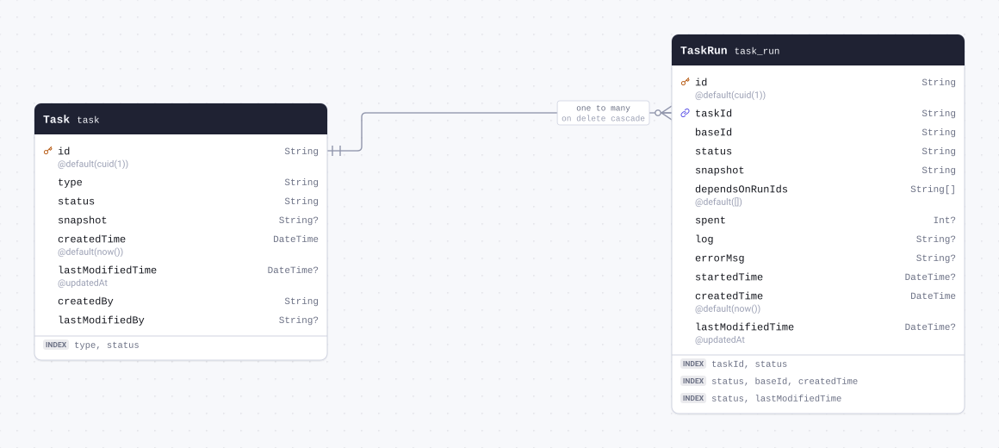

| Field                                     | Type       | Constraints | Default      | Description |
| ----------------------------------------- | ---------- | ----------- | ------------ | ----------- |
| `id`                                      | `String`   | PK NOT NULL | `cuid(1)`    |             |
| `type` (`type`)                           | `String`   | NOT NULL    |              |             |
| `status` (`status`)                       | `String`   | NOT NULL    |              |             |
| `snapshot` (`snapshot`)                   | `String`   | NULL        |              |             |
| `createdTime` (`created_time`)            | `DateTime` | NOT NULL    | `now()`      |             |
| `lastModifiedTime` (`last_modified_time`) | `DateTime` | NULL        | `@updatedAt` |             |
| `createdBy` (`created_by`)                | `String`   | NOT NULL    |              |             |
| `lastModifiedBy` (`last_modified_by`)     | `String`   | NULL        |              |             |

#### Indexes

- `@@index([type, status])`

#### Referenced by

- `id` ← [TaskRun.taskId](#model-TaskRun) (one-to-many, on delete Cascade)

#### Definition

```sql
CREATE TABLE "task" (
    "id" TEXT NOT NULL,
    "type" TEXT NOT NULL,
    "status" TEXT NOT NULL,
    "snapshot" TEXT,
    "created_time" TIMESTAMP(3) NOT NULL DEFAULT CURRENT_TIMESTAMP,
    "last_modified_time" TIMESTAMP(3),
    "created_by" TEXT NOT NULL,
    "last_modified_by" TEXT,

    CONSTRAINT "task_pkey" PRIMARY KEY ("id")
);

CREATE INDEX "task_type_status_idx" ON "task"("type", "status");
```

<details>
<summary>Queries and their SQL</summary>

**findMany**: Every row

```ts
await prisma.task.findMany();
```

```sql
SELECT
  "public"."task"."id",
  "public"."task"."type",
  "public"."task"."status",
  "public"."task"."snapshot",
  "public"."task"."created_time",
  "public"."task"."last_modified_time",
  "public"."task"."created_by",
  "public"."task"."last_modified_by"
FROM
  "public"."task"
WHERE
  1 = 1
OFFSET
  $1
-- params: ["0"]
```

**count**: How many rows there are

```ts
await prisma.task.count();
```

```sql
SELECT
  COUNT(*) AS "_count$_all"
FROM
  (
    SELECT
      "public"."task"."id"
    FROM
      "public"."task"
    WHERE
      1 = 1
    OFFSET
      $1
  ) AS "sub"
-- params: ["0"]
```

**findMany**: Every row with its relations

```ts
await prisma.task.findMany({ include: { runs: true } });
```

```sql
SELECT
  "public"."task"."id",
  "public"."task"."type",
  "public"."task"."status",
  "public"."task"."snapshot",
  "public"."task"."created_time",
  "public"."task"."last_modified_time",
  "public"."task"."created_by",
  "public"."task"."last_modified_by"
FROM
  "public"."task"
WHERE
  1 = 1
OFFSET
  $1
-- params: ["0"]

SELECT
  "public"."task_run"."id",
  "public"."task_run"."task_id",
  "public"."task_run"."base_id",
  "public"."task_run"."status",
  "public"."task_run"."snapshot",
  "public"."task_run"."depends_on_run_ids",
  "public"."task_run"."spent",
  "public"."task_run"."log",
  "public"."task_run"."error_msg",
  "public"."task_run"."started_time",
  "public"."task_run"."created_time",
  "public"."task_run"."last_modified_time"
FROM
  "public"."task_run"
WHERE
  "public"."task_run"."task_id" IN ($1)
OFFSET
  $2
-- params: ["<id of the rows above>","0"]
```

**findUnique**: One row by what is unique to it

```ts
await prisma.task.findUnique({ where: { id: "example" } });
```

```sql
SELECT
  "public"."task"."id",
  "public"."task"."type",
  "public"."task"."status",
  "public"."task"."snapshot",
  "public"."task"."created_time",
  "public"."task"."last_modified_time",
  "public"."task"."created_by",
  "public"."task"."last_modified_by"
FROM
  "public"."task"
WHERE
  (
    "public"."task"."id" = $1
    AND 1 = 1
  )
LIMIT
  $2
OFFSET
  $3
-- params: ["example","1","0"]
```

**create**: Create a row

```ts
await prisma.task.create({ data: { type: "example", status: "example", createdBy: "example" } });
```

```sql
INSERT INTO
  "public"."task" (
    "id",
    "type",
    "status",
    "created_time",
    "last_modified_time",
    "created_by"
  )
VALUES
  ($1, $2, $3, $4, $5, $6)
RETURNING
  "public"."task"."id",
  "public"."task"."type",
  "public"."task"."status",
  "public"."task"."snapshot",
  "public"."task"."created_time",
  "public"."task"."last_modified_time",
  "public"."task"."created_by",
  "public"."task"."last_modified_by"
-- params: ["<cuid(1)>","example","example","<now()>","<now()>","example"]
```

**update**: Update a row

```ts
await prisma.task.update({ where: { id: "example" }, data: { type: "example" } });
```

```sql
UPDATE "public"."task"
SET
  "type" = $1,
  "last_modified_time" = $2
WHERE
  (
    "public"."task"."id" = $3
    AND 1 = 1
  )
RETURNING
  "public"."task"."id",
  "public"."task"."type",
  "public"."task"."status",
  "public"."task"."snapshot",
  "public"."task"."created_time",
  "public"."task"."last_modified_time",
  "public"."task"."created_by",
  "public"."task"."last_modified_by"
-- params: ["example",{"prisma__type":"generatorCall","prisma__value":{"name":"now","args":[],"returnType":{"type":"DateTime"}}},"example"]
```

**delete**: Delete a row

```ts
await prisma.task.delete({ where: { id: "example" } });
```

```sql
DELETE FROM "public"."task"
WHERE
  (
    "public"."task"."id" = $1
    AND 1 = 1
  )
RETURNING
  "public"."task"."id",
  "public"."task"."type",
  "public"."task"."status",
  "public"."task"."snapshot",
  "public"."task"."created_time",
  "public"."task"."last_modified_time",
  "public"."task"."created_by",
  "public"."task"."last_modified_by"
-- params: ["example"]
```

</details>

<a id="model-TaskRun"></a>

### TaskRun

Table `task_run`.


| Field                                     | Type       | Constraints                       | Default      | Description |
| ----------------------------------------- | ---------- | --------------------------------- | ------------ | ----------- |
| `id`                                      | `String`   | PK NOT NULL                       | `cuid(1)`    |             |
| `taskId` (`task_id`)                      | `String`   | NOT NULL → [Task.id](#model-Task) |              |             |
| `baseId` (`base_id`)                      | `String`   | NOT NULL                          |              |             |
| `status` (`status`)                       | `String`   | NOT NULL                          |              |             |
| `snapshot` (`snapshot`)                   | `String`   | NOT NULL                          |              |             |
| `dependsOnRunIds` (`depends_on_run_ids`)  | `String[]` | NOT NULL                          | `[]`         |             |
| `spent` (`spent`)                         | `Int`      | NULL                              |              |             |
| `log` (`log`)                             | `String`   | NULL                              |              |             |
| `errorMsg` (`error_msg`)                  | `String`   | NULL                              |              |             |
| `startedTime` (`started_time`)            | `DateTime` | NULL                              |              |             |
| `createdTime` (`created_time`)            | `DateTime` | NOT NULL                          | `now()`      |             |
| `lastModifiedTime` (`last_modified_time`) | `DateTime` | NULL                              | `@updatedAt` |             |

#### Indexes

- `@@index([taskId, status])`
- `@@index([status, baseId, createdTime])`
- `@@index([status, lastModifiedTime])`

#### References

- `taskId` → [Task.id](#model-Task) (many-to-one, on delete Cascade)

#### Definition

```sql
CREATE TABLE "task_run" (
    "id" TEXT NOT NULL,
    "task_id" TEXT NOT NULL,
    "base_id" TEXT NOT NULL,
    "status" TEXT NOT NULL,
    "snapshot" TEXT NOT NULL,
    "depends_on_run_ids" TEXT[] DEFAULT ARRAY[]::TEXT[],
    "spent" INTEGER,
    "log" TEXT,
    "error_msg" TEXT,
    "started_time" TIMESTAMP(3),
    "created_time" TIMESTAMP(3) NOT NULL DEFAULT CURRENT_TIMESTAMP,
    "last_modified_time" TIMESTAMP(3),

    CONSTRAINT "task_run_pkey" PRIMARY KEY ("id")
);

CREATE INDEX "task_run_task_id_status_idx" ON "task_run"("task_id", "status");

CREATE INDEX "task_run_status_base_id_created_time_idx" ON "task_run"("status", "base_id", "created_time");

CREATE INDEX "task_run_status_last_modified_time_idx" ON "task_run"("status", "last_modified_time");

ALTER TABLE "task_run" ADD CONSTRAINT "task_run_task_id_fkey" FOREIGN KEY ("task_id") REFERENCES "task"("id") ON DELETE CASCADE ON UPDATE CASCADE;
```

<details>
<summary>Queries and their SQL</summary>

**findMany**: Every row

```ts
await prisma.taskRun.findMany();
```

```sql
SELECT
  "public"."task_run"."id",
  "public"."task_run"."task_id",
  "public"."task_run"."base_id",
  "public"."task_run"."status",
  "public"."task_run"."snapshot",
  "public"."task_run"."depends_on_run_ids",
  "public"."task_run"."spent",
  "public"."task_run"."log",
  "public"."task_run"."error_msg",
  "public"."task_run"."started_time",
  "public"."task_run"."created_time",
  "public"."task_run"."last_modified_time"
FROM
  "public"."task_run"
WHERE
  1 = 1
OFFSET
  $1
-- params: ["0"]
```

**count**: How many rows there are

```ts
await prisma.taskRun.count();
```

```sql
SELECT
  COUNT(*) AS "_count$_all"
FROM
  (
    SELECT
      "public"."task_run"."id"
    FROM
      "public"."task_run"
    WHERE
      1 = 1
    OFFSET
      $1
  ) AS "sub"
-- params: ["0"]
```

**findMany**: Every row with its relations

```ts
await prisma.taskRun.findMany({ include: { task: true } });
```

```sql
SELECT
  "public"."task_run"."id",
  "public"."task_run"."task_id",
  "public"."task_run"."base_id",
  "public"."task_run"."status",
  "public"."task_run"."snapshot",
  "public"."task_run"."depends_on_run_ids",
  "public"."task_run"."spent",
  "public"."task_run"."log",
  "public"."task_run"."error_msg",
  "public"."task_run"."started_time",
  "public"."task_run"."created_time",
  "public"."task_run"."last_modified_time"
FROM
  "public"."task_run"
WHERE
  1 = 1
OFFSET
  $1
-- params: ["0"]

SELECT
  "public"."task"."id",
  "public"."task"."type",
  "public"."task"."status",
  "public"."task"."snapshot",
  "public"."task"."created_time",
  "public"."task"."last_modified_time",
  "public"."task"."created_by",
  "public"."task"."last_modified_by"
FROM
  "public"."task"
WHERE
  "public"."task"."id" IN ($1)
OFFSET
  $2
-- params: ["<taskId of the rows above>","0"]
```

**findUnique**: One row by what is unique to it

```ts
await prisma.taskRun.findUnique({ where: { id: "example" } });
```

```sql
SELECT
  "public"."task_run"."id",
  "public"."task_run"."task_id",
  "public"."task_run"."base_id",
  "public"."task_run"."status",
  "public"."task_run"."snapshot",
  "public"."task_run"."depends_on_run_ids",
  "public"."task_run"."spent",
  "public"."task_run"."log",
  "public"."task_run"."error_msg",
  "public"."task_run"."started_time",
  "public"."task_run"."created_time",
  "public"."task_run"."last_modified_time"
FROM
  "public"."task_run"
WHERE
  (
    "public"."task_run"."id" = $1
    AND 1 = 1
  )
LIMIT
  $2
OFFSET
  $3
-- params: ["example","1","0"]
```

**create**: Create a row

```ts
await prisma.taskRun.create({
  data: { taskId: "example", baseId: "example", status: "example", snapshot: "example" },
});
```

```sql
INSERT INTO
  "public"."task_run" (
    "id",
    "task_id",
    "base_id",
    "status",
    "snapshot",
    "depends_on_run_ids",
    "created_time",
    "last_modified_time"
  )
VALUES
  ($1, $2, $3, $4, $5, $6, $7, $8)
RETURNING
  "public"."task_run"."id",
  "public"."task_run"."task_id",
  "public"."task_run"."base_id",
  "public"."task_run"."status",
  "public"."task_run"."snapshot",
  "public"."task_run"."depends_on_run_ids",
  "public"."task_run"."spent",
  "public"."task_run"."log",
  "public"."task_run"."error_msg",
  "public"."task_run"."started_time",
  "public"."task_run"."created_time",
  "public"."task_run"."last_modified_time"
-- params: ["<cuid(1)>","example","example","example","example",[],"<now()>","<now()>"]
```

**update**: Update a row

```ts
await prisma.taskRun.update({ where: { id: "example" }, data: { baseId: "example" } });
```

```sql
UPDATE "public"."task_run"
SET
  "base_id" = $1,
  "last_modified_time" = $2
WHERE
  (
    "public"."task_run"."id" = $3
    AND 1 = 1
  )
RETURNING
  "public"."task_run"."id",
  "public"."task_run"."task_id",
  "public"."task_run"."base_id",
  "public"."task_run"."status",
  "public"."task_run"."snapshot",
  "public"."task_run"."depends_on_run_ids",
  "public"."task_run"."spent",
  "public"."task_run"."log",
  "public"."task_run"."error_msg",
  "public"."task_run"."started_time",
  "public"."task_run"."created_time",
  "public"."task_run"."last_modified_time"
-- params: ["example",{"prisma__type":"generatorCall","prisma__value":{"name":"now","args":[],"returnType":{"type":"DateTime"}}},"example"]
```

**delete**: Delete a row

```ts
await prisma.taskRun.delete({ where: { id: "example" } });
```

```sql
DELETE FROM "public"."task_run"
WHERE
  (
    "public"."task_run"."id" = $1
    AND 1 = 1
  )
RETURNING
  "public"."task_run"."id",
  "public"."task_run"."task_id",
  "public"."task_run"."base_id",
  "public"."task_run"."status",
  "public"."task_run"."snapshot",
  "public"."task_run"."depends_on_run_ids",
  "public"."task_run"."spent",
  "public"."task_run"."log",
  "public"."task_run"."error_msg",
  "public"."task_run"."started_time",
  "public"."task_run"."created_time",
  "public"."task_run"."last_modified_time"
-- params: ["example"]
```

</details>

<a id="model-TaskReference"></a>

### TaskReference

Table `task_reference`.

| Field                           | Type       | Constraints | Default   | Description |
| ------------------------------- | ---------- | ----------- | --------- | ----------- |
| `id`                            | `String`   | PK NOT NULL | `cuid(1)` |             |
| `fromFieldId` (`from_field_id`) | `String`   | NOT NULL    |           |             |
| `toFieldId` (`to_field_id`)     | `String`   | NOT NULL    |           |             |
| `createdTime` (`created_time`)  | `DateTime` | NOT NULL    | `now()`   |             |

#### Indexes

- `@@index([fromFieldId])`
- `@@index([toFieldId])`
- `@@unique([toFieldId, fromFieldId])`

#### Definition

```sql
CREATE TABLE "task_reference" (
    "id" TEXT NOT NULL,
    "from_field_id" TEXT NOT NULL,
    "to_field_id" TEXT NOT NULL,
    "created_time" TIMESTAMP(3) NOT NULL DEFAULT CURRENT_TIMESTAMP,

    CONSTRAINT "task_reference_pkey" PRIMARY KEY ("id")
);

CREATE INDEX "task_reference_from_field_id_idx" ON "task_reference"("from_field_id");

CREATE INDEX "task_reference_to_field_id_idx" ON "task_reference"("to_field_id");

CREATE UNIQUE INDEX "task_reference_to_field_id_from_field_id_key" ON "task_reference"("to_field_id", "from_field_id");
```

<details>
<summary>Queries and their SQL</summary>

**findMany**: Every row

```ts
await prisma.taskReference.findMany();
```

```sql
SELECT
  "public"."task_reference"."id",
  "public"."task_reference"."from_field_id",
  "public"."task_reference"."to_field_id",
  "public"."task_reference"."created_time"
FROM
  "public"."task_reference"
WHERE
  1 = 1
OFFSET
  $1
-- params: ["0"]
```

**count**: How many rows there are

```ts
await prisma.taskReference.count();
```

```sql
SELECT
  COUNT(*) AS "_count$_all"
FROM
  (
    SELECT
      "public"."task_reference"."id"
    FROM
      "public"."task_reference"
    WHERE
      1 = 1
    OFFSET
      $1
  ) AS "sub"
-- params: ["0"]
```

**findUnique**: One row by what is unique to it

```ts
await prisma.taskReference.findUnique({ where: { id: "example" } });
```

```sql
SELECT
  "public"."task_reference"."id",
  "public"."task_reference"."from_field_id",
  "public"."task_reference"."to_field_id",
  "public"."task_reference"."created_time"
FROM
  "public"."task_reference"
WHERE
  (
    "public"."task_reference"."id" = $1
    AND 1 = 1
  )
LIMIT
  $2
OFFSET
  $3
-- params: ["example","1","0"]
```

**create**: Create a row

```ts
await prisma.taskReference.create({ data: { fromFieldId: "example", toFieldId: "example" } });
```

```sql
INSERT INTO
  "public"."task_reference" (
    "id",
    "from_field_id",
    "to_field_id",
    "created_time"
  )
VALUES
  ($1, $2, $3, $4)
RETURNING
  "public"."task_reference"."id",
  "public"."task_reference"."from_field_id",
  "public"."task_reference"."to_field_id",
  "public"."task_reference"."created_time"
-- params: ["<cuid(1)>","example","example","<now()>"]
```

**update**: Update a row

```ts
await prisma.taskReference.update({ where: { id: "example" }, data: { fromFieldId: "example" } });
```

```sql
UPDATE "public"."task_reference"
SET
  "from_field_id" = $1
WHERE
  (
    "public"."task_reference"."id" = $2
    AND 1 = 1
  )
RETURNING
  "public"."task_reference"."id",
  "public"."task_reference"."from_field_id",
  "public"."task_reference"."to_field_id",
  "public"."task_reference"."created_time"
-- params: ["example","example"]
```

**delete**: Delete a row

```ts
await prisma.taskReference.delete({ where: { id: "example" } });
```

```sql
DELETE FROM "public"."task_reference"
WHERE
  (
    "public"."task_reference"."id" = $1
    AND 1 = 1
  )
RETURNING
  "public"."task_reference"."id",
  "public"."task_reference"."from_field_id",
  "public"."task_reference"."to_field_id",
  "public"."task_reference"."created_time"
-- params: ["example"]
```

</details>

<a id="model-Waitlist"></a>

### Waitlist

Table `waitlist`.

| Field                          | Type       | Constraints     | Default | Description |
| ------------------------------ | ---------- | --------------- | ------- | ----------- |
| `email` (`email`)              | `String`   | UNIQUE NOT NULL |         |             |
| `invite` (`invite`)            | `Boolean`  | NULL            |         |             |
| `inviteTime` (`invite_time`)   | `DateTime` | NULL            |         |             |
| `createdTime` (`created_time`) | `DateTime` | NOT NULL        | `now()` |             |

#### Definition

```sql
CREATE TABLE "waitlist" (
    "email" TEXT NOT NULL,
    "invite" BOOLEAN,
    "invite_time" TIMESTAMP(3),
    "created_time" TIMESTAMP(3) NOT NULL DEFAULT CURRENT_TIMESTAMP
);

CREATE UNIQUE INDEX "waitlist_email_key" ON "waitlist"("email");
```

<details>
<summary>Queries and their SQL</summary>

**findMany**: Every row

```ts
await prisma.waitlist.findMany();
```

```sql
SELECT
  "public"."waitlist"."email",
  "public"."waitlist"."invite",
  "public"."waitlist"."invite_time",
  "public"."waitlist"."created_time"
FROM
  "public"."waitlist"
WHERE
  1 = 1
OFFSET
  $1
-- params: ["0"]
```

**count**: How many rows there are

```ts
await prisma.waitlist.count();
```

```sql
SELECT
  COUNT(*) AS "_count$_all"
FROM
  (
    SELECT
      "public"."waitlist"."email"
    FROM
      "public"."waitlist"
    WHERE
      1 = 1
    OFFSET
      $1
  ) AS "sub"
-- params: ["0"]
```

**findUnique**: One row by what is unique to it

```ts
await prisma.waitlist.findUnique({ where: { email: "example" } });
```

```sql
SELECT
  "public"."waitlist"."email",
  "public"."waitlist"."invite",
  "public"."waitlist"."invite_time",
  "public"."waitlist"."created_time"
FROM
  "public"."waitlist"
WHERE
  (
    "public"."waitlist"."email" = $1
    AND 1 = 1
  )
LIMIT
  $2
OFFSET
  $3
-- params: ["example","1","0"]
```

**create**: Create a row

```ts
await prisma.waitlist.create({ data: { email: "example" } });
```

```sql
INSERT INTO
  "public"."waitlist" ("email", "created_time")
VALUES
  ($1, $2)
RETURNING
  "public"."waitlist"."email",
  "public"."waitlist"."invite",
  "public"."waitlist"."invite_time",
  "public"."waitlist"."created_time"
-- params: ["example","<now()>"]
```

**update**: Update a row

```ts
await prisma.waitlist.update({ where: { email: "example" }, data: { invite: true } });
```

```sql
UPDATE "public"."waitlist"
SET
  "invite" = $1
WHERE
  (
    "public"."waitlist"."email" = $2
    AND 1 = 1
  )
RETURNING
  "public"."waitlist"."email",
  "public"."waitlist"."invite",
  "public"."waitlist"."invite_time",
  "public"."waitlist"."created_time"
-- params: [true,"example"]
```

**delete**: Delete a row

```ts
await prisma.waitlist.delete({ where: { email: "example" } });
```

```sql
DELETE FROM "public"."waitlist"
WHERE
  (
    "public"."waitlist"."email" = $1
    AND 1 = 1
  )
RETURNING
  "public"."waitlist"."email",
  "public"."waitlist"."invite",
  "public"."waitlist"."invite_time",
  "public"."waitlist"."created_time"
-- params: ["example"]
```

</details>

<a id="model-BaseNode"></a>

### BaseNode

Table `base_node`.

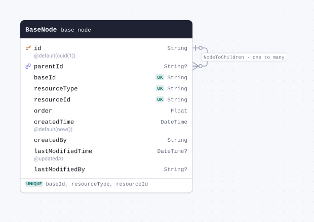

| Field                                     | Type       | Constraints                           | Default      | Description |
| ----------------------------------------- | ---------- | ------------------------------------- | ------------ | ----------- |
| `id`                                      | `String`   | PK NOT NULL                           | `cuid(1)`    |             |
| `parentId` (`parent_id`)                  | `String`   | NULL → [BaseNode.id](#model-BaseNode) |              |             |
| `baseId` (`base_id`)                      | `String`   | NOT NULL                              |              |             |
| `resourceType` (`resource_type`)          | `String`   | NOT NULL                              |              |             |
| `resourceId` (`resource_id`)              | `String`   | NOT NULL                              |              |             |
| `order` (`order`)                         | `Float`    | NOT NULL                              |              |             |
| `createdTime` (`created_time`)            | `DateTime` | NOT NULL                              | `now()`      |             |
| `createdBy` (`created_by`)                | `String`   | NOT NULL                              |              |             |
| `lastModifiedTime` (`last_modified_time`) | `DateTime` | NULL                                  | `@updatedAt` |             |
| `lastModifiedBy` (`last_modified_by`)     | `String`   | NULL                                  |              |             |

#### Indexes

- `@@unique([baseId, resourceType, resourceId])`

#### References

- `parentId` → [BaseNode.id](#model-BaseNode) (many-to-one)

#### Referenced by

- `id` ← [BaseNode.parentId](#model-BaseNode) (one-to-many)

#### Definition

```sql
CREATE TABLE "base_node" (
    "id" TEXT NOT NULL,
    "parent_id" TEXT,
    "base_id" TEXT NOT NULL,
    "resource_type" TEXT NOT NULL,
    "resource_id" TEXT NOT NULL,
    "order" DOUBLE PRECISION NOT NULL,
    "created_time" TIMESTAMP(3) NOT NULL DEFAULT CURRENT_TIMESTAMP,
    "created_by" TEXT NOT NULL,
    "last_modified_time" TIMESTAMP(3),
    "last_modified_by" TEXT,

    CONSTRAINT "base_node_pkey" PRIMARY KEY ("id")
);

CREATE UNIQUE INDEX "base_node_base_id_resource_type_resource_id_key" ON "base_node"("base_id", "resource_type", "resource_id");

ALTER TABLE "base_node" ADD CONSTRAINT "base_node_parent_id_fkey" FOREIGN KEY ("parent_id") REFERENCES "base_node"("id") ON DELETE SET NULL ON UPDATE CASCADE;
```

<details>
<summary>Queries and their SQL</summary>

**findMany**: Every row

```ts
await prisma.baseNode.findMany();
```

```sql
SELECT
  "public"."base_node"."id",
  "public"."base_node"."parent_id",
  "public"."base_node"."base_id",
  "public"."base_node"."resource_type",
  "public"."base_node"."resource_id",
  "public"."base_node"."order",
  "public"."base_node"."created_time",
  "public"."base_node"."created_by",
  "public"."base_node"."last_modified_time",
  "public"."base_node"."last_modified_by"
FROM
  "public"."base_node"
WHERE
  1 = 1
OFFSET
  $1
-- params: ["0"]
```

**count**: How many rows there are

```ts
await prisma.baseNode.count();
```

```sql
SELECT
  COUNT(*) AS "_count$_all"
FROM
  (
    SELECT
      "public"."base_node"."id"
    FROM
      "public"."base_node"
    WHERE
      1 = 1
    OFFSET
      $1
  ) AS "sub"
-- params: ["0"]
```

**findMany**: Every row with its relations

```ts
await prisma.baseNode.findMany({ include: { parent: true, children: true } });
```

```sql
SELECT
  "public"."base_node"."id",
  "public"."base_node"."parent_id",
  "public"."base_node"."base_id",
  "public"."base_node"."resource_type",
  "public"."base_node"."resource_id",
  "public"."base_node"."order",
  "public"."base_node"."created_time",
  "public"."base_node"."created_by",
  "public"."base_node"."last_modified_time",
  "public"."base_node"."last_modified_by"
FROM
  "public"."base_node"
WHERE
  1 = 1
OFFSET
  $1
-- params: ["0"]

SELECT
  "public"."base_node"."id",
  "public"."base_node"."parent_id",
  "public"."base_node"."base_id",
  "public"."base_node"."resource_type",
  "public"."base_node"."resource_id",
  "public"."base_node"."order",
  "public"."base_node"."created_time",
  "public"."base_node"."created_by",
  "public"."base_node"."last_modified_time",
  "public"."base_node"."last_modified_by"
FROM
  "public"."base_node"
WHERE
  "public"."base_node"."id" IN ($1)
OFFSET
  $2
-- params: ["<parentId of the rows above>","0"]

SELECT
  "public"."base_node"."id",
  "public"."base_node"."parent_id",
  "public"."base_node"."base_id",
  "public"."base_node"."resource_type",
  "public"."base_node"."resource_id",
  "public"."base_node"."order",
  "public"."base_node"."created_time",
  "public"."base_node"."created_by",
  "public"."base_node"."last_modified_time",
  "public"."base_node"."last_modified_by"
FROM
  "public"."base_node"
WHERE
  "public"."base_node"."parent_id" IN ($1)
OFFSET
  $2
-- params: ["<id of the rows above>","0"]
```

**findUnique**: One row by what is unique to it

```ts
await prisma.baseNode.findUnique({ where: { id: "example" } });
```

```sql
SELECT
  "public"."base_node"."id",
  "public"."base_node"."parent_id",
  "public"."base_node"."base_id",
  "public"."base_node"."resource_type",
  "public"."base_node"."resource_id",
  "public"."base_node"."order",
  "public"."base_node"."created_time",
  "public"."base_node"."created_by",
  "public"."base_node"."last_modified_time",
  "public"."base_node"."last_modified_by"
FROM
  "public"."base_node"
WHERE
  (
    "public"."base_node"."id" = $1
    AND 1 = 1
  )
LIMIT
  $2
OFFSET
  $3
-- params: ["example","1","0"]
```

**create**: Create a row

```ts
await prisma.baseNode.create({
  data: {
    baseId: "example",
    resourceType: "example",
    resourceId: "example",
    order: 1.5,
    createdBy: "example",
  },
});
```

```sql
INSERT INTO
  "public"."base_node" (
    "id",
    "base_id",
    "resource_type",
    "resource_id",
    "order",
    "created_time",
    "created_by",
    "last_modified_time"
  )
VALUES
  ($1, $2, $3, $4, $5, $6, $7, $8)
RETURNING
  "public"."base_node"."id",
  "public"."base_node"."parent_id",
  "public"."base_node"."base_id",
  "public"."base_node"."resource_type",
  "public"."base_node"."resource_id",
  "public"."base_node"."order",
  "public"."base_node"."created_time",
  "public"."base_node"."created_by",
  "public"."base_node"."last_modified_time",
  "public"."base_node"."last_modified_by"
-- params: ["<cuid(1)>","example","example","example","1.5","<now()>","example","<now()>"]
```

**update**: Update a row

```ts
await prisma.baseNode.update({ where: { id: "example" }, data: { baseId: "example" } });
```

```sql
UPDATE "public"."base_node"
SET
  "base_id" = $1,
  "last_modified_time" = $2
WHERE
  (
    "public"."base_node"."id" = $3
    AND 1 = 1
  )
RETURNING
  "public"."base_node"."id",
  "public"."base_node"."parent_id",
  "public"."base_node"."base_id",
  "public"."base_node"."resource_type",
  "public"."base_node"."resource_id",
  "public"."base_node"."order",
  "public"."base_node"."created_time",
  "public"."base_node"."created_by",
  "public"."base_node"."last_modified_time",
  "public"."base_node"."last_modified_by"
-- params: ["example",{"prisma__type":"generatorCall","prisma__value":{"name":"now","args":[],"returnType":{"type":"DateTime"}}},"example"]
```

**delete**: Delete a row

```ts
await prisma.baseNode.delete({ where: { id: "example" } });
```

```sql
DELETE FROM "public"."base_node"
WHERE
  (
    "public"."base_node"."id" = $1
    AND 1 = 1
  )
RETURNING
  "public"."base_node"."id",
  "public"."base_node"."parent_id",
  "public"."base_node"."base_id",
  "public"."base_node"."resource_type",
  "public"."base_node"."resource_id",
  "public"."base_node"."order",
  "public"."base_node"."created_time",
  "public"."base_node"."created_by",
  "public"."base_node"."last_modified_time",
  "public"."base_node"."last_modified_by"
-- params: ["example"]
```

</details>

<a id="model-BaseNodeFolder"></a>

### BaseNodeFolder

Table `base_node_folder`.

| Field                                     | Type       | Constraints | Default      | Description |
| ----------------------------------------- | ---------- | ----------- | ------------ | ----------- |
| `id`                                      | `String`   | PK NOT NULL | `cuid(1)`    |             |
| `baseId` (`base_id`)                      | `String`   | NOT NULL    |              |             |
| `name` (`name`)                           | `String`   | NOT NULL    |              |             |
| `createdTime` (`created_time`)            | `DateTime` | NOT NULL    | `now()`      |             |
| `createdBy` (`created_by`)                | `String`   | NOT NULL    |              |             |
| `lastModifiedTime` (`last_modified_time`) | `DateTime` | NULL        | `@updatedAt` |             |
| `lastModifiedBy` (`last_modified_by`)     | `String`   | NULL        |              |             |
| `deletedTime` (`deleted_time`)            | `DateTime` | NULL        |              |             |

#### Indexes

- `@@index([baseId])`

#### Definition

```sql
CREATE TABLE "base_node_folder" (
    "id" TEXT NOT NULL,
    "base_id" TEXT NOT NULL,
    "name" TEXT NOT NULL,
    "created_time" TIMESTAMP(3) NOT NULL DEFAULT CURRENT_TIMESTAMP,
    "created_by" TEXT NOT NULL,
    "last_modified_time" TIMESTAMP(3),
    "last_modified_by" TEXT,
    "deleted_time" TIMESTAMP(3),

    CONSTRAINT "base_node_folder_pkey" PRIMARY KEY ("id")
);

CREATE INDEX "base_node_folder_base_id_idx" ON "base_node_folder"("base_id");
```

<details>
<summary>Queries and their SQL</summary>

**findMany**: Every row

```ts
await prisma.baseNodeFolder.findMany();
```

```sql
SELECT
  "public"."base_node_folder"."id",
  "public"."base_node_folder"."base_id",
  "public"."base_node_folder"."name",
  "public"."base_node_folder"."created_time",
  "public"."base_node_folder"."created_by",
  "public"."base_node_folder"."last_modified_time",
  "public"."base_node_folder"."last_modified_by",
  "public"."base_node_folder"."deleted_time"
FROM
  "public"."base_node_folder"
WHERE
  1 = 1
OFFSET
  $1
-- params: ["0"]
```

**count**: How many rows there are

```ts
await prisma.baseNodeFolder.count();
```

```sql
SELECT
  COUNT(*) AS "_count$_all"
FROM
  (
    SELECT
      "public"."base_node_folder"."id"
    FROM
      "public"."base_node_folder"
    WHERE
      1 = 1
    OFFSET
      $1
  ) AS "sub"
-- params: ["0"]
```

**findUnique**: One row by what is unique to it

```ts
await prisma.baseNodeFolder.findUnique({ where: { id: "example" } });
```

```sql
SELECT
  "public"."base_node_folder"."id",
  "public"."base_node_folder"."base_id",
  "public"."base_node_folder"."name",
  "public"."base_node_folder"."created_time",
  "public"."base_node_folder"."created_by",
  "public"."base_node_folder"."last_modified_time",
  "public"."base_node_folder"."last_modified_by",
  "public"."base_node_folder"."deleted_time"
FROM
  "public"."base_node_folder"
WHERE
  (
    "public"."base_node_folder"."id" = $1
    AND 1 = 1
  )
LIMIT
  $2
OFFSET
  $3
-- params: ["example","1","0"]
```

**create**: Create a row

```ts
await prisma.baseNodeFolder.create({
  data: { baseId: "example", name: "example", createdBy: "example" },
});
```

```sql
INSERT INTO
  "public"."base_node_folder" (
    "id",
    "base_id",
    "name",
    "created_time",
    "created_by",
    "last_modified_time"
  )
VALUES
  ($1, $2, $3, $4, $5, $6)
RETURNING
  "public"."base_node_folder"."id",
  "public"."base_node_folder"."base_id",
  "public"."base_node_folder"."name",
  "public"."base_node_folder"."created_time",
  "public"."base_node_folder"."created_by",
  "public"."base_node_folder"."last_modified_time",
  "public"."base_node_folder"."last_modified_by",
  "public"."base_node_folder"."deleted_time"
-- params: ["<cuid(1)>","example","example","<now()>","example","<now()>"]
```

**update**: Update a row

```ts
await prisma.baseNodeFolder.update({ where: { id: "example" }, data: { baseId: "example" } });
```

```sql
UPDATE "public"."base_node_folder"
SET
  "base_id" = $1,
  "last_modified_time" = $2
WHERE
  (
    "public"."base_node_folder"."id" = $3
    AND 1 = 1
  )
RETURNING
  "public"."base_node_folder"."id",
  "public"."base_node_folder"."base_id",
  "public"."base_node_folder"."name",
  "public"."base_node_folder"."created_time",
  "public"."base_node_folder"."created_by",
  "public"."base_node_folder"."last_modified_time",
  "public"."base_node_folder"."last_modified_by",
  "public"."base_node_folder"."deleted_time"
-- params: ["example",{"prisma__type":"generatorCall","prisma__value":{"name":"now","args":[],"returnType":{"type":"DateTime"}}},"example"]
```

**delete**: Delete a row

```ts
await prisma.baseNodeFolder.delete({ where: { id: "example" } });
```

```sql
DELETE FROM "public"."base_node_folder"
WHERE
  (
    "public"."base_node_folder"."id" = $1
    AND 1 = 1
  )
RETURNING
  "public"."base_node_folder"."id",
  "public"."base_node_folder"."base_id",
  "public"."base_node_folder"."name",
  "public"."base_node_folder"."created_time",
  "public"."base_node_folder"."created_by",
  "public"."base_node_folder"."last_modified_time",
  "public"."base_node_folder"."last_modified_by",
  "public"."base_node_folder"."deleted_time"
-- params: ["example"]
```

</details>

<a id="model-BaseShare"></a>

### BaseShare

Table `base_share`.

| Field                                     | Type       | Constraints     | Default      | Description |
| ----------------------------------------- | ---------- | --------------- | ------------ | ----------- |
| `id`                                      | `String`   | PK NOT NULL     | `cuid(1)`    |             |
| `baseId` (`base_id`)                      | `String`   | NOT NULL        |              |             |
| `shareId` (`share_id`)                    | `String`   | UNIQUE NOT NULL |              |             |
| `password`                                | `String`   | NULL            |              |             |
| `nodeId` (`node_id`)                      | `String`   | NULL            |              |             |
| `allowSave` (`allow_save`)                | `Boolean`  | NULL            |              |             |
| `allowCopy` (`allow_copy`)                | `Boolean`  | NULL            |              |             |
| `allowEdit` (`allow_edit`)                | `Boolean`  | NULL            |              |             |
| `enabled`                                 | `Boolean`  | NOT NULL        | `true`       |             |
| `createdTime` (`created_time`)            | `DateTime` | NOT NULL        | `now()`      |             |
| `createdBy` (`created_by`)                | `String`   | NOT NULL        |              |             |
| `lastModifiedTime` (`last_modified_time`) | `DateTime` | NULL            | `@updatedAt` |             |

#### Indexes

- `@@index([baseId])`
- `@@unique([baseId, nodeId])`

#### Definition

```sql
CREATE TABLE "base_share" (
    "id" TEXT NOT NULL,
    "base_id" TEXT NOT NULL,
    "share_id" TEXT NOT NULL,
    "password" TEXT,
    "node_id" TEXT,
    "allow_save" BOOLEAN,
    "allow_copy" BOOLEAN,
    "allow_edit" BOOLEAN,
    "enabled" BOOLEAN NOT NULL DEFAULT true,
    "created_time" TIMESTAMP(3) NOT NULL DEFAULT CURRENT_TIMESTAMP,
    "created_by" TEXT NOT NULL,
    "last_modified_time" TIMESTAMP(3),

    CONSTRAINT "base_share_pkey" PRIMARY KEY ("id")
);

CREATE UNIQUE INDEX "base_share_share_id_key" ON "base_share"("share_id");

CREATE INDEX "base_share_base_id_idx" ON "base_share"("base_id");

CREATE UNIQUE INDEX "base_share_base_id_node_id_key" ON "base_share"("base_id", "node_id");
```

<details>
<summary>Queries and their SQL</summary>

**findMany**: Every row

```ts
await prisma.baseShare.findMany();
```

```sql
SELECT
  "public"."base_share"."id",
  "public"."base_share"."base_id",
  "public"."base_share"."share_id",
  "public"."base_share"."password",
  "public"."base_share"."node_id",
  "public"."base_share"."allow_save",
  "public"."base_share"."allow_copy",
  "public"."base_share"."allow_edit",
  "public"."base_share"."enabled",
  "public"."base_share"."created_time",
  "public"."base_share"."created_by",
  "public"."base_share"."last_modified_time"
FROM
  "public"."base_share"
WHERE
  1 = 1
OFFSET
  $1
-- params: ["0"]
```

**count**: How many rows there are

```ts
await prisma.baseShare.count();
```

```sql
SELECT
  COUNT(*) AS "_count$_all"
FROM
  (
    SELECT
      "public"."base_share"."id"
    FROM
      "public"."base_share"
    WHERE
      1 = 1
    OFFSET
      $1
  ) AS "sub"
-- params: ["0"]
```

**findUnique**: One row by what is unique to it

```ts
await prisma.baseShare.findUnique({ where: { id: "example" } });
```

```sql
SELECT
  "public"."base_share"."id",
  "public"."base_share"."base_id",
  "public"."base_share"."share_id",
  "public"."base_share"."password",
  "public"."base_share"."node_id",
  "public"."base_share"."allow_save",
  "public"."base_share"."allow_copy",
  "public"."base_share"."allow_edit",
  "public"."base_share"."enabled",
  "public"."base_share"."created_time",
  "public"."base_share"."created_by",
  "public"."base_share"."last_modified_time"
FROM
  "public"."base_share"
WHERE
  (
    "public"."base_share"."id" = $1
    AND 1 = 1
  )
LIMIT
  $2
OFFSET
  $3
-- params: ["example","1","0"]
```

**create**: Create a row

```ts
await prisma.baseShare.create({
  data: { baseId: "example", shareId: "example", createdBy: "example" },
});
```

```sql
INSERT INTO
  "public"."base_share" (
    "id",
    "base_id",
    "share_id",
    "enabled",
    "created_time",
    "created_by",
    "last_modified_time"
  )
VALUES
  ($1, $2, $3, $4, $5, $6, $7)
RETURNING
  "public"."base_share"."id",
  "public"."base_share"."base_id",
  "public"."base_share"."share_id",
  "public"."base_share"."password",
  "public"."base_share"."node_id",
  "public"."base_share"."allow_save",
  "public"."base_share"."allow_copy",
  "public"."base_share"."allow_edit",
  "public"."base_share"."enabled",
  "public"."base_share"."created_time",
  "public"."base_share"."created_by",
  "public"."base_share"."last_modified_time"
-- params: ["<cuid(1)>","example","example",true,"<now()>","example","<now()>"]
```

**update**: Update a row

```ts
await prisma.baseShare.update({ where: { id: "example" }, data: { baseId: "example" } });
```

```sql
UPDATE "public"."base_share"
SET
  "base_id" = $1,
  "last_modified_time" = $2
WHERE
  (
    "public"."base_share"."id" = $3
    AND 1 = 1
  )
RETURNING
  "public"."base_share"."id",
  "public"."base_share"."base_id",
  "public"."base_share"."share_id",
  "public"."base_share"."password",
  "public"."base_share"."node_id",
  "public"."base_share"."allow_save",
  "public"."base_share"."allow_copy",
  "public"."base_share"."allow_edit",
  "public"."base_share"."enabled",
  "public"."base_share"."created_time",
  "public"."base_share"."created_by",
  "public"."base_share"."last_modified_time"
-- params: ["example",{"prisma__type":"generatorCall","prisma__value":{"name":"now","args":[],"returnType":{"type":"DateTime"}}},"example"]
```

**delete**: Delete a row

```ts
await prisma.baseShare.delete({ where: { id: "example" } });
```

```sql
DELETE FROM "public"."base_share"
WHERE
  (
    "public"."base_share"."id" = $1
    AND 1 = 1
  )
RETURNING
  "public"."base_share"."id",
  "public"."base_share"."base_id",
  "public"."base_share"."share_id",
  "public"."base_share"."password",
  "public"."base_share"."node_id",
  "public"."base_share"."allow_save",
  "public"."base_share"."allow_copy",
  "public"."base_share"."allow_edit",
  "public"."base_share"."enabled",
  "public"."base_share"."created_time",
  "public"."base_share"."created_by",
  "public"."base_share"."last_modified_time"
-- params: ["example"]
```

</details>

<a id="model-ShortLink"></a>

### ShortLink

Table `short_link`.

| Field                          | Type                       | Constraints     | Default   | Description |
| ------------------------------ | -------------------------- | --------------- | --------- | ----------- |
| `id`                           | `String`                   | PK NOT NULL     | `cuid(1)` |             |
| `code`                         | `String` `@db.VarChar(32)` | UNIQUE NOT NULL |           |             |
| `type`                         | `String` `@db.VarChar(32)` | NOT NULL        |           |             |
| `resourceId` (`resource_id`)   | `String`                   | NOT NULL        |           |             |
| `createdTime` (`created_time`) | `DateTime`                 | NOT NULL        | `now()`   |             |
| `createdBy` (`created_by`)     | `String`                   | NOT NULL        |           |             |
| `deletedTime` (`deleted_time`) | `DateTime`                 | NULL            |           |             |

#### Indexes

- `@@index([deletedTime])`
- `@@unique([type, resourceId])`

#### Definition

```sql
CREATE TABLE "short_link" (
    "id" TEXT NOT NULL,
    "code" VARCHAR(32) NOT NULL,
    "type" VARCHAR(32) NOT NULL,
    "resource_id" TEXT NOT NULL,
    "created_time" TIMESTAMP(3) NOT NULL DEFAULT CURRENT_TIMESTAMP,
    "created_by" TEXT NOT NULL,
    "deleted_time" TIMESTAMP(3),

    CONSTRAINT "short_link_pkey" PRIMARY KEY ("id")
);

CREATE UNIQUE INDEX "short_link_code_key" ON "short_link"("code");

CREATE INDEX "short_link_deleted_time_idx" ON "short_link"("deleted_time");

CREATE UNIQUE INDEX "short_link_type_resource_id_key" ON "short_link"("type", "resource_id");
```

<details>
<summary>Queries and their SQL</summary>

**findMany**: Every row

```ts
await prisma.shortLink.findMany();
```

```sql
SELECT
  "public"."short_link"."id",
  "public"."short_link"."code",
  "public"."short_link"."type",
  "public"."short_link"."resource_id",
  "public"."short_link"."created_time",
  "public"."short_link"."created_by",
  "public"."short_link"."deleted_time"
FROM
  "public"."short_link"
WHERE
  1 = 1
OFFSET
  $1
-- params: ["0"]
```

**count**: How many rows there are

```ts
await prisma.shortLink.count();
```

```sql
SELECT
  COUNT(*) AS "_count$_all"
FROM
  (
    SELECT
      "public"."short_link"."id"
    FROM
      "public"."short_link"
    WHERE
      1 = 1
    OFFSET
      $1
  ) AS "sub"
-- params: ["0"]
```

**findUnique**: One row by what is unique to it

```ts
await prisma.shortLink.findUnique({ where: { id: "example" } });
```

```sql
SELECT
  "public"."short_link"."id",
  "public"."short_link"."code",
  "public"."short_link"."type",
  "public"."short_link"."resource_id",
  "public"."short_link"."created_time",
  "public"."short_link"."created_by",
  "public"."short_link"."deleted_time"
FROM
  "public"."short_link"
WHERE
  (
    "public"."short_link"."id" = $1
    AND 1 = 1
  )
LIMIT
  $2
OFFSET
  $3
-- params: ["example","1","0"]
```

**create**: Create a row

```ts
await prisma.shortLink.create({
  data: { code: "example", type: "example", resourceId: "example", createdBy: "example" },
});
```

```sql
INSERT INTO
  "public"."short_link" (
    "id",
    "code",
    "type",
    "resource_id",
    "created_time",
    "created_by"
  )
VALUES
  ($1, $2, $3, $4, $5, $6)
RETURNING
  "public"."short_link"."id",
  "public"."short_link"."code",
  "public"."short_link"."type",
  "public"."short_link"."resource_id",
  "public"."short_link"."created_time",
  "public"."short_link"."created_by",
  "public"."short_link"."deleted_time"
-- params: ["<cuid(1)>","example","example","example","<now()>","example"]
```

**update**: Update a row

```ts
await prisma.shortLink.update({ where: { id: "example" }, data: { code: "example" } });
```

```sql
UPDATE "public"."short_link"
SET
  "code" = $1
WHERE
  (
    "public"."short_link"."id" = $2
    AND 1 = 1
  )
RETURNING
  "public"."short_link"."id",
  "public"."short_link"."code",
  "public"."short_link"."type",
  "public"."short_link"."resource_id",
  "public"."short_link"."created_time",
  "public"."short_link"."created_by",
  "public"."short_link"."deleted_time"
-- params: ["example","example"]
```

**delete**: Delete a row

```ts
await prisma.shortLink.delete({ where: { id: "example" } });
```

```sql
DELETE FROM "public"."short_link"
WHERE
  (
    "public"."short_link"."id" = $1
    AND 1 = 1
  )
RETURNING
  "public"."short_link"."id",
  "public"."short_link"."code",
  "public"."short_link"."type",
  "public"."short_link"."resource_id",
  "public"."short_link"."created_time",
  "public"."short_link"."created_by",
  "public"."short_link"."deleted_time"
-- params: ["example"]
```

</details>

## Enums

<a id="enum-ProvisionState"></a>

### ProvisionState

- `pending`
- `ready`
- `error`
- `deleting`

#### Definition

```sql
CREATE TYPE "ProvisionState" AS ENUM ('pending', 'ready', 'error', 'deleting');
```

<a id="enum-DataDbProvider"></a>

### DataDbProvider

- `postgres`

#### Definition

```sql
CREATE TYPE "DataDbProvider" AS ENUM ('postgres');
```

<a id="enum-DataDbConnectionStatus"></a>

### DataDbConnectionStatus

- `pending`
- `validating`
- `ready`
- `error`
- `migrating`
- `disabled`

#### Definition

```sql
CREATE TYPE "DataDbConnectionStatus" AS ENUM ('pending', 'validating', 'ready', 'error', 'migrating', 'disabled');
```

<a id="enum-DataDbConnectionHealthState"></a>

### DataDbConnectionHealthState

- `healthy`
- `read_only`
- `unreachable`
- `degraded`

#### Definition

```sql
CREATE TYPE "DataDbConnectionHealthState" AS ENUM ('healthy', 'read_only', 'unreachable', 'degraded');
```

<a id="enum-SpaceDataDbBindingMode"></a>

### SpaceDataDbBindingMode

- `default`
- `byodb`

#### Definition

```sql
CREATE TYPE "SpaceDataDbBindingMode" AS ENUM ('default', 'byodb');
```

<a id="enum-SpaceDataDbBindingState"></a>

### SpaceDataDbBindingState

- `ready`
- `validating`
- `initializing`
- `migrating`
- `error`
- `disabled`

#### Definition

```sql
CREATE TYPE "SpaceDataDbBindingState" AS ENUM ('ready', 'validating', 'initializing', 'migrating', 'error', 'disabled');
```

<a id="enum-SpaceDataDbMigrationJobState"></a>

### SpaceDataDbMigrationJobState

- `pending`
- `waiting_worker`
- `preflight`
- `freezing_writes`
- `copying`
- `validating`
- `switching`
- `succeeded`
- `failed`
- `canceled`
- `rolled_back`

#### Definition

```sql
CREATE TYPE "SpaceDataDbMigrationJobState" AS ENUM ('pending', 'waiting_worker', 'preflight', 'freezing_writes', 'copying', 'validating', 'switching', 'succeeded', 'failed', 'canceled', 'rolled_back');
```

<a id="enum-BaseDataDbMoveJobState"></a>

### BaseDataDbMoveJobState

- `pending`
- `waiting_worker`
- `copying_base_schema`
- `copying_shared_rows`
- `validating`
- `switching`
- `succeeded`
- `failed`
- `cancelled`

#### Definition

```sql
CREATE TYPE "BaseDataDbMoveJobState" AS ENUM ('pending', 'waiting_worker', 'copying_base_schema', 'copying_shared_rows', 'validating', 'switching', 'succeeded', 'failed', 'cancelled');
```
